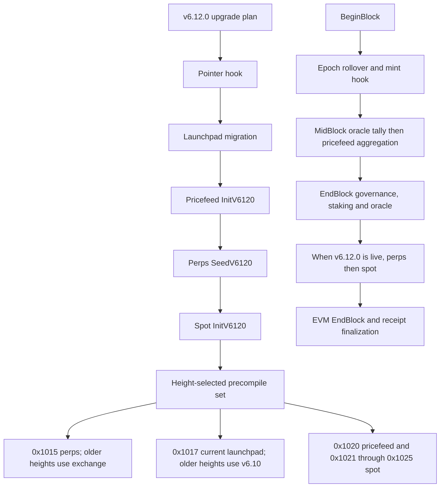
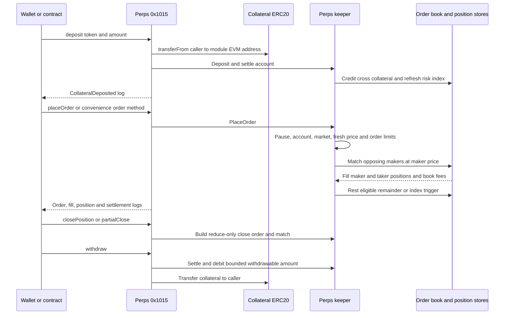
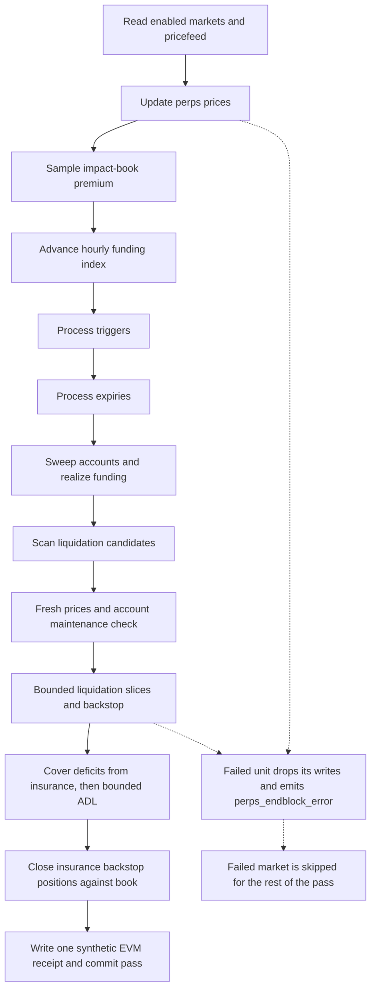
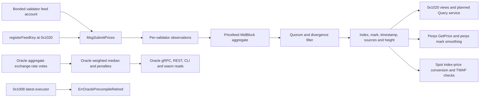
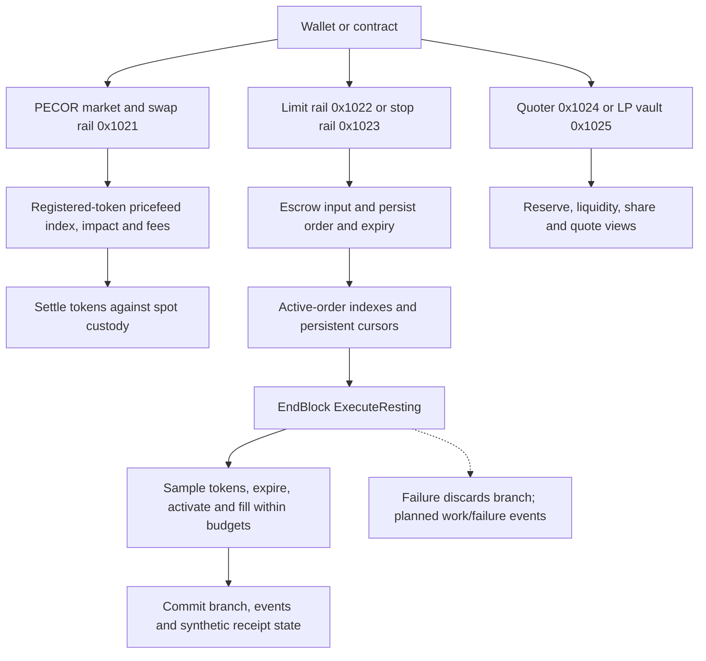
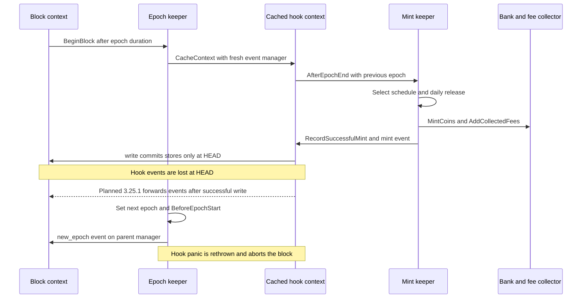
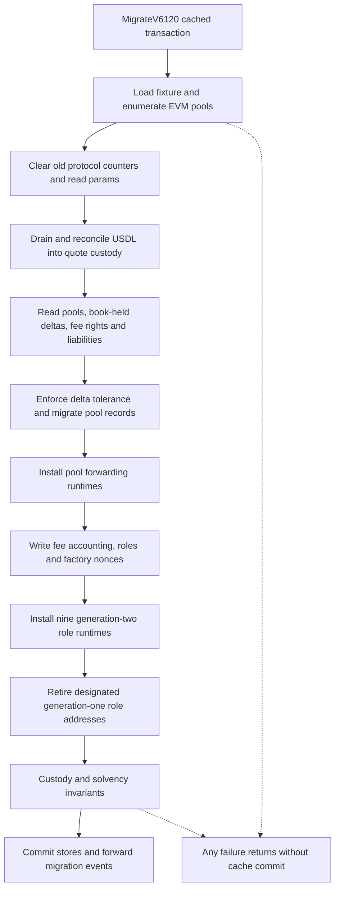
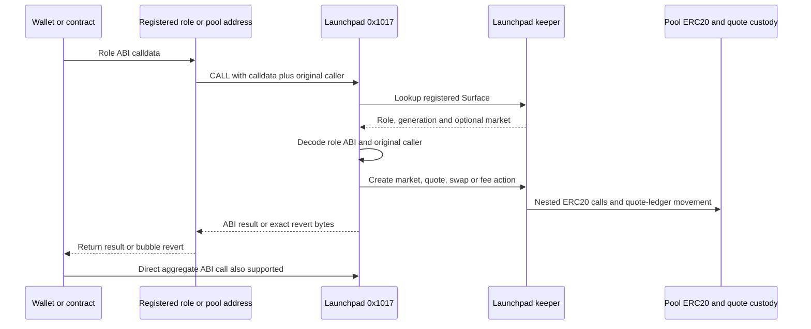
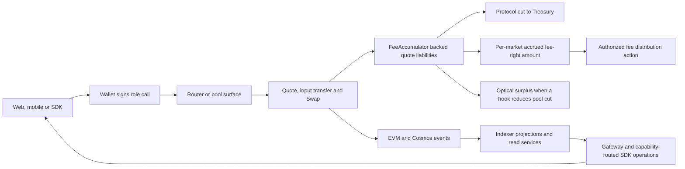

# Markets and launchpad

This schematic describes the repository at revision `2a1033aa2` and the pending work in the merged specification. A solid diagram edge describes the baseline unless its label says **planned**. Interface status describes the specification change: `stable` preserves existing behavior, `change` modifies it, `new` creates a surface, and `retire` removes or refuses it. A stable historical executor can still be unavailable to live calls. Task ids refer to `task.<id>` in the merged specification; listing a task does not claim that its gate has run.

The served venues are Go keepers: perps at `0x1015`, pricefeed at `0x1020`, spot at `0x1021`–`0x1025`, and launchpad at `0x1017`. Their state and collateral models are distinct. The old exchange intent keeper remains for historical replay. Decisions `301`, `303`, `304`, `323`, `334` and `401` rule out substituting the stale hosted exchange design for these venues. The authoritative contracts are [markets](../../contracts/markets.md), [launchpad](../../contracts/launchpad.md), [services](../../contracts/services.md) and [clients](../../contracts/clients.md). The retired exchange-launchpad contract is folded into the markets and launchpad contracts.

## Venue and ownership map

| Component | Entry and persisted state | Baseline and planned work | Covering tasks |
|---|---|---|---|
| Perps | `0x1015`; ERC20 cross collateral and `perps` KV accounts, orders, positions, funding and insurance books | 67 ABI methods, 30 events and 44 selector errors already exist; add reachable governance and prove governed risk limits | `3.0.1`–`3.0.3`, `3.1.1`–`3.1.6`, `3.6.1`–`3.6.21`, `3.7.1`–`3.7.5` |
| Pricefeed | `0x1020` and Cosmos Msg service; observations, feed keys and aggregates in `pricefeed` | Submission and aggregation already exist; add operator gRPC, REST and CLI reads and bounded ante lock storage | `3.11.1`–`3.16.8`, `3.0.4` |
| Oracle | Cosmos vote/Query service, REST, CLI and wasm reads; oracle rates and vote state | Live `0x1008` methods refuse; historical executors remain; never route perps or spot pricing through oracle rates | `3.18.1`, `3.91.1`, `3.97.1`; decisions `304`, `361` |
| Spot | Market rail `0x1021`, limit rail `0x1022`, stop rail `0x1023`, quoter `0x1024`, vault `0x1025`; spot module custody | Existing swaps, escrowed resting orders and LP shares; fix production wrapper wiring, active-list complexity and unpriced-token handling | `3.21.1`–`3.24.2`, node task `5.0.3` |
| Epoch | BeginBlock keeper and one epoch record; no EVM precompile | Strict elapsed-duration rollover and cached hooks; propagate successful hook events | `3.25.1`–`3.25.3` |
| Mint | Epoch hook, legacy governance content, gRPC and CLI; one `Minter` record | Scheduled daily bank-coin release to `fee_collector`; bound schedules and use unsigned conversion; retire failing legacy REST routes | `3.26.1`–`3.26.6` |
| Legacy exchange | Pre-activation `0x1015` and exchange Cosmos Msg service; intent/nonces remain | Replay old heights; refuse writes at and after the completed v6.12.0 height | `3.27.1`–`3.27.4`; `3.92.1`; conflict for `3.93.1` recorded below |
| Launchpad | `0x1017`, nine role forwarding surfaces and pool forwarding surfaces; markets, quote ledgers, roles and fee rights | Existing v6.12.0 execution; add 17 operator queries and retire unreachable native-generation bookkeeping | `4.0.1`–`4.12.3`, `4.43.1`–`4.55.1` |

Address and routing evidence: `node/app.go:3500-3535`, `modules/spot/types/keys.go:12-24`, `modules/launchpad/keeper/surfaces.go:16-26`. The perps keeper has an EVM dependency and no bank-coin dependency at `modules/perps/types/expected_keepers.go:11-27`. The mint hook uses bank coins at `modules/mint/keeper/hooks.go:19-32`.

## Activation and block execution

The upgrade hook order is executable code at `node/upgrades_v6120.go:84-98`. New-store module versions are inserted into the migration version map so the explicit seeds initialize them once, rather than running their `InitGenesis` during the upgrade (`node/upgrades_v6120.go:43-58`). The precompile table pairs the current and replay executors at `node/app.go:3528-3534`. MidBlock ordering is `node/app.go:1085-1088`; EndBlock ordering and its live-height guard are `node/legacyabci/end_block.go:32-42`. Epoch is called from `node/legacyabci/begin_block.go:57`.

Fresh genesis has a separate module order: perps and spot precede pricefeed (`node/app.go:1123-1125`). Decision `362` preserves that order because these genesis paths do not read feed listings; planned market-listing checks belong to governance messages (`3.1.5`, `3.23.4`). Historical version dispatch is a baseline capability; tasks `3.8.1`, `3.8.2` and `3.22.8` rehearse migration behavior rather than create another venue.

## Perps collateral, orders and positions

`createVault` ensures one cross account and returns the shared precompile address, rather than deploying a vault per user (`precompiles/perps/account.go:61-76`). The deposit handler performs the token leg and then books collateral (`precompiles/perps/account.go:81`); `Deposit` settles, credits and refreshes margin ratio (`modules/perps/keeper/account.go:54-76`). `Withdraw` settles and debits only the withdrawable amount (`modules/perps/keeper/account.go:84-103`). `TransferCollateral` is an internal book transfer; it moves no ERC20 (`modules/perps/keeper/account.go:110-161`).

`PlaceOrder` checks pause, account creation, market enablement and freshness before kind, deadline, sizing, value, leverage, order-count, client-id, reduce-only and margin checks (`modules/perps/keeper/orders.go:58-125`). `Match` uses a cached branch (`modules/perps/keeper/matching.go:66-74`). `fillMaker` prices at the maker limit, checks open interest and applies both maker and taker fills (`modules/perps/keeper/matching.go:381-427`). `ApplyFill` has its own cached branch (`modules/perps/keeper/positions.go:139-147`); a close is an order, so liquidity and close bounds still apply (`modules/perps/keeper/positions.go:659-720`). Trigger and expiry processing run during EndBlock as well as exposed order methods.

The executor rejects delegate calls, static writes, attached value, missing keepers and disallowed paused writes (`precompiles/perps/perps.go:153-177`). Views remain available during pause; the permitted exit set is defined at `modules/perps/keeper/pause.go:8-17`. Task `3.6.1` replaces the hard-coded withdrawal floor with `WithdrawFloorPpm`; the remaining `3.6.*` gates prove that governance parameters actually reach funding, liquidation, fees, listing age, marks, leverage, pause and order admission. These are pending gates over an existing execution engine.

## Perps funding, liquidation, insurance and ADL

The nine steps are ordered in `modules/perps/keeper/endblock.go:49-58`. ADL belongs to the **deficits** step; the last step closes backstop positions. The pass commits only after its synthetic receipt is written (`modules/perps/keeper/endblock.go:91-117`). A failed isolated unit emits `perps_endblock_error` on the parent manager and discards that unit's writes (`modules/perps/keeper/endblock.go:121-140`). This is different from the consensus-critical epoch hook panic below.

Funding samples feed a capped hourly rate and a cumulative index; the hourly update does not visit every position (`modules/perps/keeper/funding.go:158-202`). Positions realize the index difference at settlement through `FundingOwed` and `SettlePositionFunding` (`modules/perps/keeper/funding.go:251`, `modules/perps/keeper/funding.go:302`). Explicit `Liquidate` requires fresh prices across the account and refuses healthy accounts (`modules/perps/keeper/liquidation.go:48-71`), with slice/cooldown checks following. Deficit handling calls `CoverDeficit` for each eligible account (`modules/perps/keeper/endblock.go:357-378`); insurance and ADL implementation boundaries are `modules/perps/keeper/insurance.go:179` and `modules/perps/keeper/adl.go:90`. This EndBlock pass books state and synthetic receipts rather than moving ERC20 collateral (`modules/perps/keeper/endblock.go:91-117`).

## Price sourcing and the oracle boundary

Pricefeed accepts registered bonded feeders, bounds transaction bytes and observation count, enforces one submission per validator per height, and records accepted and refused observations separately (`modules/pricefeed/keeper/msg_server.go:54-95`). Ante eligibility and gasless admission are `modules/pricefeed/ante.go:59-106`; task `3.12.1` bounds submission-lock storage. Registration and revocation emit **EVM** `FeedKeyRegistered` and `FeedKeyRevoked` logs (`precompiles/pricefeed/register.go:13-47`). Submission and aggregation additionally emit Cosmos events. The merged `contract_context.3.pricefeed-0x1020.events` claim that the precompile emits no EVM events conflicts with those two handlers; this schematic follows the code and records the discrepancy for correction.

For each enabled market the aggregate selects fresh bonded observations (`modules/pricefeed/keeper/aggregate.go:22-41`), requires `max(MinSources, floor(bonded/2)+1)` (`modules/pricefeed/keeper/aggregate.go:63-68`), filters divergence around the first median, and requires quorum again (`modules/pricefeed/keeper/aggregate.go:80-96`). It persists a median index, smoothed mark, the oldest agreeing source timestamp, height and source count (`modules/pricefeed/keeper/aggregate.go:99-120`). A read reports `Fresh` only for an enabled market within the clock-skew and age bounds (`modules/pricefeed/keeper/price.go:44-71`). Skipping an aggregate does not make an old price fresh. Perps reads this keeper at `modules/perps/keeper/mark.go:72-81`; spot reads its index and refuses stale/nonpositive prices at `modules/spot/keeper/pricing.go:30-43`.

Oracle is a separate vote/rate subsystem: tallying starts at `modules/oracle/abci.go:19`, and the live EVM methods explicitly return `ErrOraclePrecompileRetired` after argument validation (`precompiles/oracle/oracle.go:85-104`). The live Cosmos rate store is not frozen wholesale: votes and tally still update rates. Historical TWAP snapshot behavior is separate. Decision `361` retains the unwired `legacy/v65` snapshot without adding a dispatch entry. Tasks `3.16.1`–`3.16.8` add pricefeed operator queries, including a 64-id batch bound, rather than rebuilding the removed exchange `pushOracle` path.

## Spot swaps, escrow and bounded resting execution

Immediate swaps enter through `MarketBuy`, `MarketSell`, `SwapExactIn`, `SwapExactOut` or `SwapNative` (`modules/spot/keeper/swap.go:23-31`, `modules/spot/keeper/swap.go:80-99`, `modules/spot/keeper/swap.go:171`). Limit placement is `modules/spot/keeper/orders.go:309`; stop-limit and stop-loss placement are `modules/spot/keeper/stoporders.go:287-292` and `modules/spot/keeper/stoporders.go:346-351`. The source inventory tables distinguish these entry methods from ABI admin selectors that deliberately refuse.

At HEAD, `ExecuteResting` already checks positive execution budgets, caches a branch, records token samples, processes expiries, activates/fills when orders are unpaused, stores cursors, commits and propagates branch events (`modules/spot/keeper/execute.go:108-159`). It skips stale and paused tokens while sampling; task `3.24.1` also skips unpriced tokens. The wrapper drops the returned work counts at `modules/spot/abci.go:9-11`; task `3.24.2` exposes `spot_resting` and `spot_resting_failed` observability. Tasks `3.22.1`–`3.22.8` add position/length indexes, constant-cost active-list operations, invariant and migration gates, so bounded EndBlock scans do not hide whole-list rewriting.

The production set currently calls raw `NewPrecompileSet` (`node/app.go:3524-3534`). Tasks `3.21.1`–`3.21.4` provide and freeze `NewServedSet`; the node-owned integration replaces the raw set so dynamic per-token, multicall and receive gas behavior reaches the served addresses. This is pending work, not an already-correct production wrapper. Decision `363` intentionally keeps the user order-history index append-only; active execution indexes have a different lifetime.

## Epoch cache interactions and mint release bounds

`BeginBlock` rolls only when elapsed time is **greater than** the duration, advances one epoch per call, and invokes `AfterEpochEnd` before changing the epoch (`modules/epoch/keeper/abci.go:26-45`). `MultiEpochHooks` gives each hook its own cache (`modules/epoch/types/hooks.go:26-36`). At HEAD `panicCatchingEpochHook` calls the hook then `write()` without event forwarding (`modules/epoch/types/hooks.go:40-51`); `CacheContext` creates a new event manager and returns only `cms.Write` (`sdk/types/context.go:571-574`). Thus the mint balance/minter state can commit while hook events are absent from the parent, whereas the parent's `new_epoch` event survives. A hook panic re-panics; it does not silently advance the epoch.

Task `3.25.1` forwards `cacheCtx.EventManager().Events()` to the parent **after** successful write and preserves re-panic. Task `3.26.4` then checks exactly one parent `mint` event with the correct amount and epoch. The repair propagates all successful hook events, including bank events, rather than synthesizing a replacement mint event. Tasks `3.25.2` and `3.25.3` give simulation genesis a non-nil epoch and make unset hook sets no-ops. These chain epoch hooks are distinct from kernel pay/stream or program-market epochs.

Mint uses the previous epoch's UTC start time, returns early for zero release/remaining balance, mints bank coins, sends them to `fee_collector`, records success and persists the minter (`modules/mint/keeper/hooks.go:10-32`). The daily amount is zero before the start or when already minted that day; it releases the remaining amount after the end or when no days remain, otherwise divides remaining amount by days left (`modules/mint/types/minter.go:139-151`). `RecordSuccessfulMint` decrements remaining amount and records date, height, amount and `mint` attributes (`modules/mint/types/minter.go:121-136`).

| Boundary | HEAD behavior | Required result and gate |
|---|---|---|
| Schedule validation | Dates/order/overlap are validated, without an amount bound (`modules/mint/types/params.go:99-129`) | Reject `token_release_amount > 9223372036854775807` with `error: token release amount exceeds int64 bounds`; `3.26.1` |
| Minter validation | Total and last mint amounts already reject above `math.MaxInt64` (`modules/mint/types/minter.go:53-59`) | Preserve this baseline; do not confuse it with the missing schedule bound |
| Coin construction | `GetLastMintAmountCoin` and `GetReleaseAmountToday` cast uint64 to int64 (`modules/mint/types/minter.go:113-118`) | Use `sdk.NewIntFromUint64`; clamp only the metric conversion, not coin values; `3.26.2` |
| Parameter update | `ParamSetPairs` installs the schedule validator (`modules/mint/types/params.go:62-67`) | A rejected oversized schedule leaves params and minter unchanged; `3.26.3` |
| Block event | Hook's `mint` event lives only on its cache at HEAD | Forward after success and prove parent delivery; `3.25.1`, `3.26.4` |
| Legacy REST | Old mint REST code and its stale test remain | Retire `/minting/*` legacy queries and rewrite gateway tests for current Params/Minter; `3.26.5`, `3.26.6` |

## Launchpad v6.12.0 migration and runtime dispatch

`MigrateV6120` wraps the full migration in a cache and forwards events only on success (`modules/launchpad/keeper/migrate_v6120.go:76-83`). The body reads pools and params, reconciles USDL, checks book/held delta tolerance, moves fee rights and accounting, installs pool and role surfaces, records retired addresses, then checks custody and solvency (`modules/launchpad/keeper/migrate_v6120.go:86-183`). `MigrateV6120USDL` performs the quote-custody step (`modules/launchpad/keeper/migrate_v6120_usdl.go:59`). This migration's explicit event forwarding demonstrates the operation missing from epoch's wrapper.

The runtime is 41 bytes and appends `CALLER` before calling `0x1017` without value (`precompiles/launchpad/surface.go:9-12`). `resolve` trusts the trailing caller only when the EVM caller has a registered surface record; ordinary direct calls use the direct ABI (`precompiles/launchpad/run.go:215-254`). Native forwarding is **CALL**, not proxy `DELEGATECALL`. There are eleven role ABI artifacts, but `SidioraERC20` encodes nested calls to real token contracts, leaving ten served role ABIs: nine fixed role surfaces plus the pool role (`precompiles/launchpad/abi.go:10-16`, `modules/launchpad/keeper/surfaces.go:16-26`). The table below gives the nine fixed surfaces; pool addresses are registered per market.

| Role | Fixed surface address |
|---|---|
| SidioraFactory | `0x3993D004166738d1069B5C4e0a923f7B9D5D8830` |
| Router | `0x78FB06f525cD964388f2305A489035263E31C6e4` |
| Quoter | `0x793006f4F321b8863F26DBD75b11bAa01DA181dc` |
| FeesRouter | `0x05681dA6f611C2dfFD3E92611F6dE2d247647927` |
| FeeAccumulator | `0x7b14808b72f61664cDb79D25E6d1587655571a66` |
| PoolRegistry | `0x1dC357d2B7B850332a91F06A9E66634F46fC4Ba7` |
| ProtocolConfig | `0xF3669eDc475Cb6E1F0d7635240ABD8e8FB7E20C6` |
| SidioraNFT fee-right collection | `0xe8DcC844a8006dbf64f5Bb851bCad90292a6409B` |
| Treasury | `0xBb82d74E071e03d8E68F1d78Fae9EFe8b6b7A723` |

`CreateMarket` charges the creation fee, deploys a pool ERC20, derives and registers a forwarding pool, mints a fee right, records the market and binds/funds its token (`modules/launchpad/keeper/market.go:125-224`). `CreateMarketFor` omits the creation fee already collected by Router. New market identifiers are `launchpad/<pool>`; this is not the old native tokenfactory-denom path. The keeper currently omits the Cosmos market-created event; task `4.6.1` adds it without inventing another EVM factory event. Queries and CLI are also planned: `4.2.1`, `4.3.1`–`4.5.9` add 17 read-only operator RPCs, gateway routes and commands. `PriceHistory` must order the eight-slot ring and preserve malformed-ring refusals (decision `406`).

## Launchpad trade, fee and client flows

`Swap` locks the pool, refuses paused markets, checks deadline/input/recipient, reconciles held balances, applies optional optical hooks, computes the quote, enforces minimum output, updates the market and pays out (`modules/launchpad/keeper/swap.go:247-385`). The buy leg moves fees from held pool quote to the accumulator and calls `RecordFee`; the sell leg pays quote out of the pool ledger. `RecordFee` requires backing, tracks liabilities, calculates the protocol cut, allows a hook to reduce the pool cut into optical surplus, accrues market fees and moves the protocol cut to Treasury (`modules/launchpad/keeper/fees.go:169-274`). A per-market legacy protocol counter is not the current accounting model (decision `403`).

Governance owns admin writes through `MsgUpdateParams` and `MsgTreasuryWithdraw`; scripts must recognize forwarding runtimes and refuse UUPS upgrades against native surfaces (decision `411`, tasks `4.12.1`–`4.12.3`). Generation-one native airdrop/holding-history hooks and reserved prefixes are retired by `4.8.1`–`4.8.6`; the frozen v6.10 replay keeper remains. This does not retire current generation-two fee rights, fee strategies or role methods. Client ABI/binding synchronization is covered by `4.43.*`, `4.51.*`, `4.52.*` and `4.53.*`; web/mobile quoting and trading must go through the native role identities (`4.43.4`, `4.47.1`–`4.47.3`).

The event registry decodes factory, pool and role events into indexer state (`services/launchpad/indexer/internal/decode/registry.go:34-38`, `services/launchpad/indexer/internal/processor/processor.go:360-361`). Tasks `4.28.1` and `4.28.2` bind discovery and reserve reads to canonical role ABIs. API, gateway, user, discovery, notifications, social, livestream, rankings and metadata tasks `4.22.*`–`4.36.*` reconcile mounted routes and response envelopes with the frozen SDK operation catalog. SDK task `4.48.2` refuses unregistered operations before network I/O using `CapabilityUnavailableError`, whose existing status is 501 (`sdk/launchpad/packages/sdk/src/transport.ts:15`). HTTP 503 for an unconfigured dependency remains an explicit unavailable state; a route's presence is not evidence that the capability is operational.

## Read models, errors and qualification boundaries

Perps-data currently refreshes market rows transactionally from `totalMarkets` and `getMarket` (`services/platform/perps-data/internal/markets/markets.go:114-155`, `services/platform/perps-data/internal/markets/markets.go:231-246`). Tasks `3.41.*` and `3.42.*` replace static symbol/id assumptions with database-backed market discovery and refresh canonical decimals, ticks, lots, caps and margin tiers through `getMarketConfig`/`getMarginTiers`. The chain is authoritative when the SQL seed differs (decision `364`). Tasks `3.48.*` propagate that catalog into order planning and UI limits; `3.52.*` expose spot token pause; `3.53.*` expose account fee tier. These read models do not become the settlement authority.

| Surface | Revert/event contract | Governing work |
|---|---|---|
| Perps | Four-byte parameterless custom-error selector; unmapped errors retain the fallback mapper. EVM logs are emitted on calls and in the EndBlock synthetic receipt | Decisions `302`, `313`; registry tasks `3.4.1`, `3.4.2`; golden tasks `3.7.1`–`3.7.5` |
| Spot | ABI custom errors, with governance owning admin operations; receive and dynamic gas depend on the served wrapper | `3.21.1`–`3.21.4`, `3.22.6`, `3.24.2` |
| Pricefeed | `LXP_PRICEFEED_*` string reasons; feed-key EVM events and submission/aggregation Cosmos events | `3.13.1`–`3.13.3`, `3.15.1`; event discrepancy above |
| Oracle | Live EVM retired refusal; historical replay executors retain their old read behavior | Decision `361`; unused vote-event retirement `3.18.1` |
| Mint/epoch | Hook panic aborts the block; successful hook events must reach the parent | `3.25.1`, `3.26.1`–`3.26.4` |
| Launchpad | Mapped custom-error selectors and arguments; keeper-only errors retain registered `LXP_LAUNCHPAD_*` string reasons; nested revert data bubbles | Decision `402`; direct ABI errors `4.9.3`; registry gate `4.7.1` and domain-six fulfilling task `6.92.1` |
| Launchpad HTTP/SDK | Frozen v2 Error envelope; unavailable capabilities remain explicit | `4.22.*`–`4.36.*`, `4.48.1`–`4.48.3` |

Error mapper evidence: `precompiles/perps/errors.go:70-77`, `precompiles/pricefeed/pricefeed.go:148-165`, `precompiles/launchpad/errors.go:49-98`. Query and ABI parity, migration rehearsal, bounded workloads and client conformance remain pending until each named task's exact gate succeeds. Domain completion gates are `3.0.9` and `4.0.9`; all task wave/status values in the generated index below come from the merged document.

The following inherited gaps are recorded rather than silently resolved in this schematic:

- `3.93.1` adds kernel observation submission/committed reads to the replay exchange keeper, while decisions `301`/`323` and `3.27.3` forbid live post-v6.12.0 exchange writes. Its description explicitly records a replay-path conflict. It is not a price source for the served perps/spot venues; the final reconciliation belongs to the specification repair job.
- Launchpad SQL migration inputs and v1/v2 spec bundles referenced by qualification/codegen are incomplete at HEAD. Decisions `442` and `446` retain local capability refusal and leave the self-qualification harness unchanged until its inputs exist. Generated operations must not be presented as proof of missing server behavior.
- The oracle context's statement that its storage is frozen at genesis is too broad: live rate tallying continues; only snapshot-based history has the inherited frozen behavior. The pricefeed context's no-EVM-event statement is contradicted by registration/revocation code. Both discrepancies are reported for specification repair.
- Duplicate telemetry, the epoch Info log and unused helper roots are intentionally retained by decision `365`; the append-only spot user history is retained by decision `363`.

## Exhaustive interface and task tables

The generated appendix includes every domain-three and domain-four interface in the merged input, including methods, events, errors, historical ABI copies, HTTP/WS routes, cross-package exports and supporting schemas/configuration. Separate interface ids remain separate rows even when they share a signature. Method overloads and component-specific errors are not collapsed. Source locations are read from the repository; a `new` interface with line zero is explicitly planned and is not cited as existing code. Each covering-task cell is the exact reverse lookup of the interface's id in merged task `interfaces` lists. `stable; no modifying task` means the rebuild preserves the baseline, not that a runtime path is necessarily live.

<!-- J84 GENERATED APPENDIX -->

### Inventory totals

| Domain | Stable | Change | New | Retire | Interfaces | Tasks |
|---|---:|---:|---:|---:|---:|---:|
| 3 Markets | 3915 | 156 | 99 | 32 | 4202 | 170 |
| 4 Launchpad | 13905 | 133 | 195 | 82 | 14315 | 186 |

### Canonical ABI occurrence tables

These tables read each current ABI artifact at HEAD. Shared inherited selectors appear once per artifact. Constructor entries are deployment metadata; receive entries are shown separately below. A matching inventory id can cite its Go handler or the first ABI that defines a shared signature. Per-artifact presence does not promise that an administrative method succeeds: the handler may intentionally refuse it. SidioraERC20 and spot share ABIs describe token contracts rather than additional fixed precompiles. The exhaustive inventory that follows also includes historical executors and planned ABI changes.

#### <code>precompiles/perps/abi/abi.json</code>

| Kind and canonical signature | Source | Matching interfaces and status | Covering tasks |
|---|---|---|---|
| <code>error PerpsCloseSizeExceedsPosition()</code> | <code>precompiles/perps/abi/abi.json:1</code> | <code>interface.3.pc-0x1015-err-perpsclosesizeexceedsposition</code> stable | stable; no modifying task |
| <code>error PerpsCrossMarginOnly()</code> | <code>precompiles/perps/abi/abi.json:1</code> | <code>interface.3.pc-0x1015-err-perpscrossmarginonly</code> stable | stable; no modifying task |
| <code>error PerpsDeadlineExpired()</code> | <code>precompiles/perps/abi/abi.json:1</code> | <code>interface.3.pc-0x1015-err-perpsdeadlineexpired</code> stable | stable; no modifying task |
| <code>error PerpsDelegatecall()</code> | <code>precompiles/perps/abi/abi.json:1</code> | <code>interface.3.pc-0x1015-err-perpsdelegatecall</code> stable | stable; no modifying task |
| <code>error PerpsDuplicateCloid()</code> | <code>precompiles/perps/abi/abi.json:1</code> | <code>interface.3.pc-0x1015-err-perpsduplicatecloid</code> stable | stable; no modifying task |
| <code>error PerpsFokNotFilled()</code> | <code>precompiles/perps/abi/abi.json:1</code> | <code>interface.3.pc-0x1015-err-perpsfoknotfilled</code> stable | stable; no modifying task |
| <code>error PerpsInsufficientCollateral()</code> | <code>precompiles/perps/abi/abi.json:1</code> | <code>interface.3.pc-0x1015-err-perpsinsufficientcollateral</code> stable | stable; no modifying task |
| <code>error PerpsInsufficientMargin()</code> | <code>precompiles/perps/abi/abi.json:1</code> | <code>interface.3.pc-0x1015-err-perpsinsufficientmargin</code> stable | stable; no modifying task |
| <code>error PerpsInvalidGenesis()</code> | <code>precompiles/perps/abi/abi.json:1</code> | <code>interface.3.pc-0x1015-err-perpsinvalidgenesis</code> stable | stable; no modifying task |
| <code>error PerpsInvalidOrderType()</code> | <code>precompiles/perps/abi/abi.json:1</code> | <code>interface.3.pc-0x1015-err-perpsinvalidordertype</code> stable | stable; no modifying task |
| <code>error PerpsInvalidParams()</code> | <code>precompiles/perps/abi/abi.json:1</code> | <code>interface.3.pc-0x1015-err-perpsinvalidparams</code> stable | stable; no modifying task |
| <code>error PerpsInvalidTimeInForce()</code> | <code>precompiles/perps/abi/abi.json:1</code> | <code>interface.3.pc-0x1015-err-perpsinvalidtimeinforce</code> stable | stable; no modifying task |
| <code>error PerpsInvalidTriggerPrice()</code> | <code>precompiles/perps/abi/abi.json:1</code> | <code>interface.3.pc-0x1015-err-perpsinvalidtriggerprice</code> stable | stable; no modifying task |
| <code>error PerpsLeverageTooHigh()</code> | <code>precompiles/perps/abi/abi.json:1</code> | <code>interface.3.pc-0x1015-err-perpsleveragetoohigh</code> stable | stable; no modifying task |
| <code>error PerpsLiquidationCooldown()</code> | <code>precompiles/perps/abi/abi.json:1</code> | <code>interface.3.pc-0x1015-err-perpsliquidationcooldown</code> stable | stable; no modifying task |
| <code>error PerpsLotSize()</code> | <code>precompiles/perps/abi/abi.json:1</code> | <code>interface.3.pc-0x1015-err-perpslotsize</code> stable | stable; no modifying task |
| <code>error PerpsMarketDisabled()</code> | <code>precompiles/perps/abi/abi.json:1</code> | <code>interface.3.pc-0x1015-err-perpsmarketdisabled</code> stable | stable; no modifying task |
| <code>error PerpsMaxOrderValue()</code> | <code>precompiles/perps/abi/abi.json:1</code> | <code>interface.3.pc-0x1015-err-perpsmaxordervalue</code> stable | stable; no modifying task |
| <code>error PerpsMinOrderValue()</code> | <code>precompiles/perps/abi/abi.json:1</code> | <code>interface.3.pc-0x1015-err-perpsminordervalue</code> stable | stable; no modifying task |
| <code>error PerpsNoAccount()</code> | <code>precompiles/perps/abi/abi.json:1</code> | <code>interface.3.pc-0x1015-err-perpsnoaccount</code> stable | stable; no modifying task |
| <code>error PerpsNoLiquidity()</code> | <code>precompiles/perps/abi/abi.json:1</code> | <code>interface.3.pc-0x1015-err-perpsnoliquidity</code> stable | stable; no modifying task |
| <code>error PerpsNotLiquidatable()</code> | <code>precompiles/perps/abi/abi.json:1</code> | <code>interface.3.pc-0x1015-err-perpsnotliquidatable</code> stable | stable; no modifying task |
| <code>error PerpsNotOrderHolder()</code> | <code>precompiles/perps/abi/abi.json:1</code> | <code>interface.3.pc-0x1015-err-perpsnotorderholder</code> stable | stable; no modifying task |
| <code>error PerpsNotPositionHolder()</code> | <code>precompiles/perps/abi/abi.json:1</code> | <code>interface.3.pc-0x1015-err-perpsnotpositionholder</code> stable | stable; no modifying task |
| <code>error PerpsOpenInterestCap()</code> | <code>precompiles/perps/abi/abi.json:1</code> | <code>interface.3.pc-0x1015-err-perpsopeninterestcap</code> stable | stable; no modifying task |
| <code>error PerpsOverflow()</code> | <code>precompiles/perps/abi/abi.json:1</code> | <code>interface.3.pc-0x1015-err-perpsoverflow</code> stable | stable; no modifying task |
| <code>error PerpsPaused()</code> | <code>precompiles/perps/abi/abi.json:1</code> | <code>interface.3.pc-0x1015-err-perpspaused</code> stable | stable; no modifying task |
| <code>error PerpsPostOnlyWouldCross()</code> | <code>precompiles/perps/abi/abi.json:1</code> | <code>interface.3.pc-0x1015-err-perpspostonlywouldcross</code> stable | stable; no modifying task |
| <code>error PerpsPriceStale()</code> | <code>precompiles/perps/abi/abi.json:1</code> | <code>interface.3.pc-0x1015-err-perpspricestale</code> stable | stable; no modifying task |
| <code>error PerpsReduceOnlyViolation()</code> | <code>precompiles/perps/abi/abi.json:1</code> | <code>interface.3.pc-0x1015-err-perpsreduceonlyviolation</code> stable | stable; no modifying task |
| <code>error PerpsSelfTransfer()</code> | <code>precompiles/perps/abi/abi.json:1</code> | <code>interface.3.pc-0x1015-err-perpsselftransfer</code> stable | stable; no modifying task |
| <code>error PerpsSlippageExceeded()</code> | <code>precompiles/perps/abi/abi.json:1</code> | <code>interface.3.pc-0x1015-err-perpsslippageexceeded</code> stable | stable; no modifying task |
| <code>error PerpsStaticCall()</code> | <code>precompiles/perps/abi/abi.json:1</code> | <code>interface.3.pc-0x1015-err-perpsstaticcall</code> stable | stable; no modifying task |
| <code>error PerpsTickSize()</code> | <code>precompiles/perps/abi/abi.json:1</code> | <code>interface.3.pc-0x1015-err-perpsticksize</code> stable | stable; no modifying task |
| <code>error PerpsTokenTransferFailed()</code> | <code>precompiles/perps/abi/abi.json:1</code> | <code>interface.3.pc-0x1015-err-perpstokentransferfailed</code> stable | stable; no modifying task |
| <code>error PerpsTooManyOpenOrders()</code> | <code>precompiles/perps/abi/abi.json:1</code> | <code>interface.3.pc-0x1015-err-perpstoomanyopenorders</code> stable | stable; no modifying task |
| <code>error PerpsTriggerNotReached()</code> | <code>precompiles/perps/abi/abi.json:1</code> | <code>interface.3.pc-0x1015-err-perpstriggernotreached</code> stable | stable; no modifying task |
| <code>error PerpsUnauthorized()</code> | <code>precompiles/perps/abi/abi.json:1</code> | <code>interface.3.pc-0x1015-err-perpsunauthorized</code> stable | stable; no modifying task |
| <code>error PerpsUnknownMarket()</code> | <code>precompiles/perps/abi/abi.json:1</code> | <code>interface.3.pc-0x1015-err-perpsunknownmarket</code> stable | stable; no modifying task |
| <code>error PerpsUnknownOrder()</code> | <code>precompiles/perps/abi/abi.json:1</code> | <code>interface.3.pc-0x1015-err-perpsunknownorder</code> stable | stable; no modifying task |
| <code>error PerpsUnknownPosition()</code> | <code>precompiles/perps/abi/abi.json:1</code> | <code>interface.3.pc-0x1015-err-perpsunknownposition</code> stable | stable; no modifying task |
| <code>error PerpsUnsupportedCollateral()</code> | <code>precompiles/perps/abi/abi.json:1</code> | <code>interface.3.pc-0x1015-err-perpsunsupportedcollateral</code> stable | stable; no modifying task |
| <code>error PerpsZeroAddress()</code> | <code>precompiles/perps/abi/abi.json:1</code> | <code>interface.3.pc-0x1015-err-perpszeroaddress</code> stable | stable; no modifying task |
| <code>error PerpsZeroAmount()</code> | <code>precompiles/perps/abi/abi.json:1</code> | <code>interface.3.pc-0x1015-err-perpszeroamount</code> stable | stable; no modifying task |
| <code>event ADLExecuted(uint256,uint256)</code> | <code>precompiles/perps/abi/abi.json:1</code> | <code>interface.3.pc-0x1015-evt-adlexecuted</code> stable | stable; no modifying task |
| <code>event ADLMatched(uint256,uint256,address,uint256,uint256,uint256)</code> | <code>precompiles/perps/abi/abi.json:1</code> | <code>interface.3.pc-0x1015-evt-adlmatched</code> stable | stable; no modifying task |
| <code>event BackstopLiquidation(address,uint256,uint256,uint256,uint256)</code> | <code>precompiles/perps/abi/abi.json:1</code> | <code>interface.3.pc-0x1015-evt-backstopliquidation</code> stable | stable; no modifying task |
| <code>event CollateralDeposited(address,uint256,uint256)</code> | <code>precompiles/perps/abi/abi.json:1</code> | <code>interface.3.pc-0x1015-evt-collateraldeposited</code> stable | stable; no modifying task |
| <code>event CollateralTransferred(address,address,uint256)</code> | <code>precompiles/perps/abi/abi.json:1</code> | <code>interface.3.pc-0x1015-evt-collateraltransferred</code> stable | stable; no modifying task |
| <code>event CollateralWithdrawn(address,uint256,uint256)</code> | <code>precompiles/perps/abi/abi.json:1</code> | <code>interface.3.pc-0x1015-evt-collateralwithdrawn</code> stable | stable; no modifying task |
| <code>event FeeCollected(uint256,address,uint256,uint8,uint256,uint256,address)</code> | <code>precompiles/perps/abi/abi.json:1</code> | <code>interface.3.pc-0x1015-evt-feecollected</code> stable | stable; no modifying task |
| <code>event Fill(uint256,uint256,uint256,address,address,bool,uint256,uint256,int256,uint256)</code> | <code>precompiles/perps/abi/abi.json:1</code> | <code>interface.3.pc-0x1015-evt-fill</code> stable | stable; no modifying task |
| <code>event FundingRateUpdated(uint256,int256,int256)</code> | <code>precompiles/perps/abi/abi.json:1</code> | <code>interface.3.pc-0x1015-evt-fundingrateupdated</code> stable | stable; no modifying task |
| <code>event FundingSettled(uint256,int256,int256,int256)</code> | <code>precompiles/perps/abi/abi.json:1</code> | <code>interface.3.pc-0x1015-evt-fundingsettled</code> stable | stable; no modifying task |
| <code>event InsuranceContribution(address,uint256,uint8)</code> | <code>precompiles/perps/abi/abi.json:1</code> | <code>interface.3.pc-0x1015-evt-insurancecontribution</code> stable | stable; no modifying task |
| <code>event InsuranceDraw(uint256,uint256,uint256)</code> | <code>precompiles/perps/abi/abi.json:1</code> | <code>interface.3.pc-0x1015-evt-insurancedraw</code> stable | stable; no modifying task |
| <code>event Liquidation(uint256,address,uint256,uint256,uint256,address)</code> | <code>precompiles/perps/abi/abi.json:1</code> | <code>interface.3.pc-0x1015-evt-liquidation</code> stable | stable; no modifying task |
| <code>event MarkPriceUpdated(uint256,uint256,uint256,uint256)</code> | <code>precompiles/perps/abi/abi.json:1</code> | <code>interface.3.pc-0x1015-evt-markpriceupdated</code> stable | stable; no modifying task |
| <code>event OpenInterestChanged(uint256,uint256,uint256,uint256,bool)</code> | <code>precompiles/perps/abi/abi.json:1</code> | <code>interface.3.pc-0x1015-evt-openinterestchanged</code> stable | stable; no modifying task |
| <code>event OrderCancelled(uint256,address)</code> | <code>precompiles/perps/abi/abi.json:1</code> | <code>interface.3.pc-0x1015-evt-ordercancelled</code> stable | stable; no modifying task |
| <code>event OrderExecuted(uint256,uint256,uint256)</code> | <code>precompiles/perps/abi/abi.json:1</code> | <code>interface.3.pc-0x1015-evt-orderexecuted</code> stable | stable; no modifying task |
| <code>event OrderExpired(uint256,address,uint256)</code> | <code>precompiles/perps/abi/abi.json:1</code> | <code>interface.3.pc-0x1015-evt-orderexpired</code> stable | stable; no modifying task |
| <code>event OrderOptions(uint256,uint8,bool,uint256,uint256,uint64,bytes16)</code> | <code>precompiles/perps/abi/abi.json:1</code> | <code>interface.3.pc-0x1015-evt-orderoptions</code> stable | stable; no modifying task |
| <code>event OrderPlaced(uint256,address,uint256,uint8,bool,uint256,uint256)</code> | <code>precompiles/perps/abi/abi.json:1</code> | <code>interface.3.pc-0x1015-evt-orderplaced</code> stable | stable; no modifying task |
| <code>event OrderTriggered(uint256,uint256,uint256)</code> | <code>precompiles/perps/abi/abi.json:1</code> | <code>interface.3.pc-0x1015-evt-ordertriggered</code> stable | stable; no modifying task |
| <code>event PositionClosed(uint256,address,uint256,uint256,uint256,int256,bool)</code> | <code>precompiles/perps/abi/abi.json:1</code> | <code>interface.3.pc-0x1015-evt-positionclosed</code> stable | stable; no modifying task |
| <code>event PositionEntryPriceChanged(uint256,uint256,uint256)</code> | <code>precompiles/perps/abi/abi.json:1</code> | <code>interface.3.pc-0x1015-evt-positionentrypricechanged</code> stable | stable; no modifying task |
| <code>event PositionFundingApplied(uint256,address,uint256,int256,uint256,uint256)</code> | <code>precompiles/perps/abi/abi.json:1</code> | <code>interface.3.pc-0x1015-evt-positionfundingapplied</code> stable | stable; no modifying task |
| <code>event PositionModified(uint256,uint256,uint256,uint256)</code> | <code>precompiles/perps/abi/abi.json:1</code> | <code>interface.3.pc-0x1015-evt-positionmodified</code> stable | stable; no modifying task |
| <code>event PositionOpened(uint256,address,uint256,bool,uint256,uint256,uint256,address,uint256)</code> | <code>precompiles/perps/abi/abi.json:1</code> | <code>interface.3.pc-0x1015-evt-positionopened</code> stable | stable; no modifying task |
| <code>event PositionTpSlSet(uint256,uint256,uint256)</code> | <code>precompiles/perps/abi/abi.json:1</code> | <code>interface.3.pc-0x1015-evt-positiontpslset</code> stable | stable; no modifying task |
| <code>event TradeSettled(uint256,address,uint256,uint8,uint256,uint256,int256,uint256,int256,uint256)</code> | <code>precompiles/perps/abi/abi.json:1</code> | <code>interface.3.pc-0x1015-evt-tradesettled</code> stable | stable; no modifying task |
| <code>event VaultCreated(address,address)</code> | <code>precompiles/perps/abi/abi.json:1</code> | <code>interface.3.pc-0x1015-evt-vaultcreated</code> stable | stable; no modifying task |
| <code>event VaultDeficit(address,uint256)</code> | <code>precompiles/perps/abi/abi.json:1</code> | <code>interface.3.pc-0x1015-evt-vaultdeficit</code> stable | stable; no modifying task |
| <code>function addCollateral(uint256,uint256)</code> | <code>precompiles/perps/abi/abi.json:1</code> | <code>interface.3.pc-0x1015-addcollateral</code> stable | stable; no modifying task |
| <code>function addSize(uint256,uint256,uint256)</code> | <code>precompiles/perps/abi/abi.json:1</code> | <code>interface.3.pc-0x1015-addsize</code> stable | stable; no modifying task |
| <code>function cancelByCloid(uint256,bytes16)</code> | <code>precompiles/perps/abi/abi.json:1</code> | <code>interface.3.pc-0x1015-cancelbycloid</code> stable | stable; no modifying task |
| <code>function cancelOrder(uint256)</code> | <code>precompiles/perps/abi/abi.json:1</code> | <code>interface.3.pc-0x1015-cancelorder</code> stable | stable; no modifying task |
| <code>function checkLiquidatable(uint256)</code> | <code>precompiles/perps/abi/abi.json:1</code> | <code>interface.3.pc-0x1015-checkliquidatable</code> stable | stable; no modifying task |
| <code>function closePosition(uint256)</code> | <code>precompiles/perps/abi/abi.json:1</code> | <code>interface.3.pc-0x1015-closeposition</code> stable | stable; no modifying task |
| <code>function closePositionWithParams(uint256,uint256,uint256,uint64)</code> | <code>precompiles/perps/abi/abi.json:1</code> | <code>interface.3.pc-0x1015-closepositionwithparams</code> stable | stable; no modifying task |
| <code>function createVault()</code> | <code>precompiles/perps/abi/abi.json:1</code> | <code>interface.3.pc-0x1015-createvault</code> stable | stable; no modifying task |
| <code>function deposit(address,uint256)</code> | <code>precompiles/perps/abi/abi.json:1</code> | <code>interface.3.pc-0x1015-deposit</code> stable | stable; no modifying task |
| <code>function emergencyWithdraw(address)</code> | <code>precompiles/perps/abi/abi.json:1</code> | <code>interface.3.pc-0x1015-emergencywithdraw</code> stable | stable; no modifying task |
| <code>function executeOrder(uint256)</code> | <code>precompiles/perps/abi/abi.json:1</code> | <code>interface.3.pc-0x1015-executeorder</code> stable | stable; no modifying task |
| <code>function getADLRank(uint256)</code> | <code>precompiles/perps/abi/abi.json:1</code> | <code>interface.3.pc-0x1015-getadlrank</code> stable | stable; no modifying task |
| <code>function getAccount(address)</code> | <code>precompiles/perps/abi/abi.json:1</code> | <code>interface.3.pc-0x1015-getaccount</code> stable | stable; no modifying task |
| <code>function getAccountSummary(address)</code> | <code>precompiles/perps/abi/abi.json:1</code> | <code>interface.3.pc-0x1015-getaccountsummary-43ad2977</code> stable | stable; no modifying task |
| <code>function getAccountSummary(address,address)</code> | <code>precompiles/perps/abi/abi.json:1</code> | <code>interface.3.pc-0x1015-getaccountsummary-65d53f6c</code> stable | stable; no modifying task |
| <code>function getActiveMarketIds()</code> | <code>precompiles/perps/abi/abi.json:1</code> | <code>interface.3.pc-0x1015-getactivemarketids</code> stable | stable; no modifying task |
| <code>function getBalance(address,address)</code> | <code>precompiles/perps/abi/abi.json:1</code> | <code>interface.3.pc-0x1015-getbalance-d4fac45d</code> stable | stable; no modifying task |
| <code>function getBalance(address)</code> | <code>precompiles/perps/abi/abi.json:1</code> | <code>interface.3.pc-0x1015-getbalance-f8b2cb4f</code> stable | stable; no modifying task |
| <code>function getCurrentFundingRate(uint256)</code> | <code>precompiles/perps/abi/abi.json:1</code> | <code>interface.3.pc-0x1015-getcurrentfundingrate</code> stable | stable; no modifying task |
| <code>function getFeeTier(address)</code> | <code>precompiles/perps/abi/abi.json:1</code> | <code>interface.3.pc-0x1015-getfeetier</code> stable | stable; no modifying task |
| <code>function getFees()</code> | <code>precompiles/perps/abi/abi.json:1</code> | <code>interface.3.pc-0x1015-getfees</code> stable | stable; no modifying task |
| <code>function getFundingDetails(uint256)</code> | <code>precompiles/perps/abi/abi.json:1</code> | <code>interface.3.pc-0x1015-getfundingdetails</code> stable | stable; no modifying task |
| <code>function getFundingState(uint256)</code> | <code>precompiles/perps/abi/abi.json:1</code> | <code>interface.3.pc-0x1015-getfundingstate</code> stable | stable; no modifying task |
| <code>function getInsuranceBalance(address)</code> | <code>precompiles/perps/abi/abi.json:1</code> | <code>interface.3.pc-0x1015-getinsurancebalance</code> stable | stable; no modifying task |
| <code>function getLiquidationPrice(uint256)</code> | <code>precompiles/perps/abi/abi.json:1</code> | <code>interface.3.pc-0x1015-getliquidationprice</code> stable | stable; no modifying task |
| <code>function getLockedBalance(address)</code> | <code>precompiles/perps/abi/abi.json:1</code> | <code>interface.3.pc-0x1015-getlockedbalance-c4086893</code> stable | stable; no modifying task |
| <code>function getLockedBalance(address,address)</code> | <code>precompiles/perps/abi/abi.json:1</code> | <code>interface.3.pc-0x1015-getlockedbalance-c736887e</code> stable | stable; no modifying task |
| <code>function getMarginMode()</code> | <code>precompiles/perps/abi/abi.json:1</code> | <code>interface.3.pc-0x1015-getmarginmode-3ca0c5c5</code> stable | stable; no modifying task |
| <code>function getMarginMode(address)</code> | <code>precompiles/perps/abi/abi.json:1</code> | <code>interface.3.pc-0x1015-getmarginmode-b71d031c</code> stable | stable; no modifying task |
| <code>function getMarginTiers(uint256)</code> | <code>precompiles/perps/abi/abi.json:1</code> | <code>interface.3.pc-0x1015-getmargintiers</code> stable | stable; no modifying task |
| <code>function getMarkPrice(uint256)</code> | <code>precompiles/perps/abi/abi.json:1</code> | <code>interface.3.pc-0x1015-getmarkprice</code> stable | stable; no modifying task |
| <code>function getMarkPriceDetails(uint256)</code> | <code>precompiles/perps/abi/abi.json:1</code> | <code>interface.3.pc-0x1015-getmarkpricedetails</code> stable | stable; no modifying task |
| <code>function getMarket(uint256)</code> | <code>precompiles/perps/abi/abi.json:1</code> | <code>interface.3.pc-0x1015-getmarket</code> stable | stable; no modifying task |
| <code>function getMarketConfig(uint256)</code> | <code>precompiles/perps/abi/abi.json:1</code> | <code>interface.3.pc-0x1015-getmarketconfig</code> stable | stable; no modifying task |
| <code>function getOpenInterest(uint256)</code> | <code>precompiles/perps/abi/abi.json:1</code> | <code>interface.3.pc-0x1015-getopeninterest</code> stable | stable; no modifying task |
| <code>function getOrder(uint256)</code> | <code>precompiles/perps/abi/abi.json:1</code> | <code>interface.3.pc-0x1015-getorder</code> stable | stable; no modifying task |
| <code>function getOrderDetails(uint256)</code> | <code>precompiles/perps/abi/abi.json:1</code> | <code>interface.3.pc-0x1015-getorderdetails</code> stable | stable; no modifying task |
| <code>function getPosition(uint256)</code> | <code>precompiles/perps/abi/abi.json:1</code> | <code>interface.3.pc-0x1015-getposition</code> stable | stable; no modifying task |
| <code>function getPositionDetails(uint256)</code> | <code>precompiles/perps/abi/abi.json:1</code> | <code>interface.3.pc-0x1015-getpositiondetails</code> stable | stable; no modifying task |
| <code>function getPositionFunding(uint256)</code> | <code>precompiles/perps/abi/abi.json:1</code> | <code>interface.3.pc-0x1015-getpositionfunding</code> stable | stable; no modifying task |
| <code>function getPositionMargin(uint256)</code> | <code>precompiles/perps/abi/abi.json:1</code> | <code>interface.3.pc-0x1015-getpositionmargin</code> stable | stable; no modifying task |
| <code>function getProtocolAccounts()</code> | <code>precompiles/perps/abi/abi.json:1</code> | <code>interface.3.pc-0x1015-getprotocolaccounts</code> stable | stable; no modifying task |
| <code>function getUserMarketPosition(address,uint256)</code> | <code>precompiles/perps/abi/abi.json:1</code> | <code>interface.3.pc-0x1015-getusermarketposition</code> stable | stable; no modifying task |
| <code>function getUserOrderIds(address)</code> | <code>precompiles/perps/abi/abi.json:1</code> | <code>interface.3.pc-0x1015-getuserorderids</code> stable | stable; no modifying task |
| <code>function getUserPositionIds(address)</code> | <code>precompiles/perps/abi/abi.json:1</code> | <code>interface.3.pc-0x1015-getuserpositionids</code> stable | stable; no modifying task |
| <code>function getVault(address)</code> | <code>precompiles/perps/abi/abi.json:1</code> | <code>interface.3.pc-0x1015-getvault</code> stable | stable; no modifying task |
| <code>function isMarketActive(uint256)</code> | <code>precompiles/perps/abi/abi.json:1</code> | <code>interface.3.pc-0x1015-ismarketactive</code> stable | stable; no modifying task |
| <code>function liquidate(uint256)</code> | <code>precompiles/perps/abi/abi.json:1</code> | <code>interface.3.pc-0x1015-liquidate</code> stable | stable; no modifying task |
| <code>function openPosition(uint256,address,uint256,uint256,bool)</code> | <code>precompiles/perps/abi/abi.json:1</code> | <code>interface.3.pc-0x1015-openposition</code> stable | stable; no modifying task |
| <code>function partialClose(uint256,uint256)</code> | <code>precompiles/perps/abi/abi.json:1</code> | <code>interface.3.pc-0x1015-partialclose</code> stable | stable; no modifying task |
| <code>function placeLimitOrder(uint256,bool,uint256,uint256,uint256,address,uint256)</code> | <code>precompiles/perps/abi/abi.json:1</code> | <code>interface.3.pc-0x1015-placelimitorder</code> stable | stable; no modifying task |
| <code>function placeOrder((uint256,bool,uint8,uint8,uint256,uint256,uint256,uint256,uint256,uint256,bool,uint256,uint256,uint64,bytes16))</code> | <code>precompiles/perps/abi/abi.json:1</code> | <code>interface.3.pc-0x1015-placeorder</code> stable | stable; no modifying task |
| <code>function placeStopLimitOrder(uint256,bool,uint256,uint256,uint256,uint256,address,uint256)</code> | <code>precompiles/perps/abi/abi.json:1</code> | <code>interface.3.pc-0x1015-placestoplimitorder</code> stable | stable; no modifying task |
| <code>function placeStopLossOrder(uint256,uint256)</code> | <code>precompiles/perps/abi/abi.json:1</code> | <code>interface.3.pc-0x1015-placestoplossorder</code> stable | stable; no modifying task |
| <code>function placeTakeProfitOrder(uint256,uint256)</code> | <code>precompiles/perps/abi/abi.json:1</code> | <code>interface.3.pc-0x1015-placetakeprofitorder</code> stable | stable; no modifying task |
| <code>function quoteClosePosition(uint256)</code> | <code>precompiles/perps/abi/abi.json:1</code> | <code>interface.3.pc-0x1015-quotecloseposition</code> stable | stable; no modifying task |
| <code>function quoteMarket(uint256)</code> | <code>precompiles/perps/abi/abi.json:1</code> | <code>interface.3.pc-0x1015-quotemarket</code> stable | stable; no modifying task |
| <code>function quoteOpenPosition(uint256,address,uint256,uint256,bool)</code> | <code>precompiles/perps/abi/abi.json:1</code> | <code>interface.3.pc-0x1015-quoteopenposition</code> stable | stable; no modifying task |
| <code>function quotePartialClose(uint256,uint256)</code> | <code>precompiles/perps/abi/abi.json:1</code> | <code>interface.3.pc-0x1015-quotepartialclose</code> stable | stable; no modifying task |
| <code>function removeCollateral(uint256,uint256)</code> | <code>precompiles/perps/abi/abi.json:1</code> | <code>interface.3.pc-0x1015-removecollateral</code> stable | stable; no modifying task |
| <code>function setMarginMode(uint8)</code> | <code>precompiles/perps/abi/abi.json:1</code> | <code>interface.3.pc-0x1015-setmarginmode</code> stable | stable; no modifying task |
| <code>function setPositionTpSl(uint256,uint256,uint256)</code> | <code>precompiles/perps/abi/abi.json:1</code> | <code>interface.3.pc-0x1015-setpositiontpsl</code> stable | stable; no modifying task |
| <code>function topUpPosition(uint256,uint256)</code> | <code>precompiles/perps/abi/abi.json:1</code> | <code>interface.3.pc-0x1015-topupposition</code> stable | stable; no modifying task |
| <code>function totalMarkets()</code> | <code>precompiles/perps/abi/abi.json:1</code> | <code>interface.3.pc-0x1015-totalmarkets</code> stable | stable; no modifying task |
| <code>function transferCollateral(address,uint256)</code> | <code>precompiles/perps/abi/abi.json:1</code> | <code>interface.3.pc-0x1015-transfercollateral</code> stable | stable; no modifying task |
| <code>function transferMargin(uint256,uint256,uint256)</code> | <code>precompiles/perps/abi/abi.json:1</code> | <code>interface.3.pc-0x1015-transfermargin</code> stable | stable; no modifying task |
| <code>function withdraw(address,uint256)</code> | <code>precompiles/perps/abi/abi.json:1</code> | <code>interface.3.pc-0x1015-withdraw</code> stable | stable; no modifying task |

#### <code>precompiles/pricefeed/abi/abi.json</code>

| Kind and canonical signature | Source | Matching interfaces and status | Covering tasks |
|---|---|---|---|
| <code>function registerFeedKey(bytes)</code> | <code>precompiles/pricefeed/abi/abi.json:2</code> | <code>interface.3.pc-0x1020-registerfeedkey</code> stable | stable; no modifying task |
| <code>function revokeFeedKey()</code> | <code>precompiles/pricefeed/abi/abi.json:3</code> | <code>interface.3.pc-0x1020-revokefeedkey</code> stable | stable; no modifying task |
| <code>function getPrice(uint256)</code> | <code>precompiles/pricefeed/abi/abi.json:4</code> | <code>interface.3.pc-0x1020-getprice</code> stable | stable; no modifying task |
| <code>function getPriceBySymbol(string)</code> | <code>precompiles/pricefeed/abi/abi.json:5</code> | <code>interface.3.pc-0x1020-getpricebysymbol</code> stable | stable; no modifying task |
| <code>function getPrices(uint256[])</code> | <code>precompiles/pricefeed/abi/abi.json:6</code> | <code>interface.3.pc-0x1020-getprices</code> stable | stable; no modifying task |
| <code>function getMarket(uint256)</code> | <code>precompiles/pricefeed/abi/abi.json:7</code> | <code>interface.3.pc-0x1020-getmarket</code> stable | stable; no modifying task |
| <code>function getMarketCount()</code> | <code>precompiles/pricefeed/abi/abi.json:8</code> | <code>interface.3.pc-0x1020-getmarketcount</code> stable | stable; no modifying task |
| <code>function marketIdOf(string)</code> | <code>precompiles/pricefeed/abi/abi.json:9</code> | <code>interface.3.pc-0x1020-marketidof</code> stable | stable; no modifying task |
| <code>function getObservation(uint256,address)</code> | <code>precompiles/pricefeed/abi/abi.json:10</code> | <code>interface.3.pc-0x1020-getobservation</code> stable | stable; no modifying task |
| <code>function getFeedKey(address)</code> | <code>precompiles/pricefeed/abi/abi.json:11</code> | <code>interface.3.pc-0x1020-getfeedkey</code> stable | stable; no modifying task |
| <code>function getValidatorByFeedAccount(address)</code> | <code>precompiles/pricefeed/abi/abi.json:12</code> | <code>interface.3.pc-0x1020-getvalidatorbyfeedaccount</code> stable | stable; no modifying task |
| <code>function getParams()</code> | <code>precompiles/pricefeed/abi/abi.json:13</code> | <code>interface.3.pc-0x1020-getparams</code> stable | stable; no modifying task |
| <code>event FeedKeyRegistered(address,address,bytes,address)</code> | <code>precompiles/pricefeed/abi/abi.json:14</code> | <code>interface.3.pc-0x1020-evt-feedkeyregistered</code> stable | stable; no modifying task |
| <code>event FeedKeyRevoked(address,address)</code> | <code>precompiles/pricefeed/abi/abi.json:15</code> | <code>interface.3.pc-0x1020-evt-feedkeyrevoked</code> stable | stable; no modifying task |

#### <code>precompiles/oracle/abi.json</code>

| Kind and canonical signature | Source | Matching interfaces and status | Covering tasks |
|---|---|---|---|
| <code>function getExchangeRates()</code> | <code>precompiles/oracle/abi.json:1</code> | <code>interface.3.pc-0x1008-getexchangerates</code> stable | stable; no modifying task |
| <code>function getOracleTwaps(uint64)</code> | <code>precompiles/oracle/abi.json:1</code> | <code>interface.3.pc-0x1008-getoracletwaps</code> stable | stable; no modifying task |

#### <code>precompiles/launchpad/abi.json</code>

| Kind and canonical signature | Source | Matching interfaces and status | Covering tasks |
|---|---|---|---|
| <code>function DEFAULT_ADMIN_ROLE()</code> | <code>precompiles/launchpad/abi.json:2</code> | <code>interface.4.pc-fee-accumulator-default-admin-role</code> stable <code>interface.4.pc-fees-router-default-admin-role</code> stable <code>interface.4.pc-pool-registry-default-admin-role</code> stable <code>interface.4.pc-protocol-config-default-admin-role</code> stable <code>interface.4.pc-quoter-default-admin-role</code> stable <code>interface.4.pc-router-default-admin-role</code> stable <code>interface.4.pc-sidiora-factory-default-admin-role</code> stable <code>interface.4.pc-sidiora-nft-default-admin-role</code> stable <code>interface.4.pc-treasury-default-admin-role</code> stable | stable; no modifying task |
| <code>function buy(address,uint256,uint256,uint256)</code> | <code>precompiles/launchpad/abi.json:15</code> | <code>interface.4.pc-router-buy</code> stable | stable; no modifying task |
| <code>function buyWithPermit(address,uint256,uint256,uint256,(uint256,uint256,uint8,bytes32,bytes32))</code> | <code>precompiles/launchpad/abi.json:49</code> | <code>interface.4.pc-router-buy-with-permit</code> stable | stable; no modifying task |
| <code>function createMarket(string,string,uint8,address)</code> | <code>precompiles/launchpad/abi.json:115</code> | <code>interface.4.pc-router-create-market</code> stable <code>interface.4.pc-sidiora-factory-create-market</code> stable | stable; no modifying task |
| <code>function createMarketWithPermit(string,string,uint8,address,(uint256,uint256,uint8,bytes32,bytes32))</code> | <code>precompiles/launchpad/abi.json:159</code> | <code>interface.4.pc-router-create-market-with-permit</code> stable | stable; no modifying task |
| <code>function factory()</code> | <code>precompiles/launchpad/abi.json:235</code> | <code>interface.4.pc-router-factory</code> stable <code>interface.4.pc-sidiora-pool-factory</code> stable | stable; no modifying task |
| <code>function getRoleAdmin(bytes32)</code> | <code>precompiles/launchpad/abi.json:248</code> | <code>interface.4.pc-fee-accumulator-get-role-admin</code> stable <code>interface.4.pc-fees-router-get-role-admin</code> stable <code>interface.4.pc-pool-registry-get-role-admin</code> stable <code>interface.4.pc-protocol-config-get-role-admin</code> stable <code>interface.4.pc-quoter-get-role-admin</code> stable <code>interface.4.pc-router-get-role-admin</code> stable <code>interface.4.pc-sidiora-factory-get-role-admin</code> stable <code>interface.4.pc-sidiora-nft-get-role-admin</code> stable <code>interface.4.pc-treasury-get-role-admin</code> stable | stable; no modifying task |
| <code>function grantRole(bytes32,address)</code> | <code>precompiles/launchpad/abi.json:267</code> | <code>interface.4.pc-fee-accumulator-grant-role</code> stable <code>interface.4.pc-fees-router-grant-role</code> stable <code>interface.4.pc-pool-registry-grant-role</code> stable <code>interface.4.pc-protocol-config-grant-role</code> stable <code>interface.4.pc-quoter-grant-role</code> stable <code>interface.4.pc-router-grant-role</code> stable <code>interface.4.pc-sidiora-factory-grant-role</code> stable <code>interface.4.pc-sidiora-nft-grant-role</code> stable <code>interface.4.pc-treasury-grant-role</code> stable | stable; no modifying task |
| <code>function hasRole(bytes32,address)</code> | <code>precompiles/launchpad/abi.json:285</code> | <code>interface.4.pc-fee-accumulator-has-role</code> stable <code>interface.4.pc-fees-router-has-role</code> stable <code>interface.4.pc-pool-registry-has-role</code> stable <code>interface.4.pc-protocol-config-has-role</code> stable <code>interface.4.pc-quoter-has-role</code> stable <code>interface.4.pc-router-has-role</code> stable <code>interface.4.pc-sidiora-factory-has-role</code> stable <code>interface.4.pc-sidiora-nft-has-role</code> stable <code>interface.4.pc-treasury-has-role</code> stable | stable; no modifying task |
| <code>function initialize(address,address,address,address,address)</code> | <code>precompiles/launchpad/abi.json:309</code> | <code>interface.4.pc-router-initialize</code> stable | stable; no modifying task |
| <code>function multicall(bytes[])</code> | <code>precompiles/launchpad/abi.json:342</code> | <code>interface.4.pc-router-multicall</code> stable | stable; no modifying task |
| <code>function poolRegistry()</code> | <code>precompiles/launchpad/abi.json:361</code> | <code>interface.4.pc-fee-accumulator-pool-registry</code> stable <code>interface.4.pc-fees-router-pool-registry</code> stable <code>interface.4.pc-quoter-pool-registry</code> stable <code>interface.4.pc-router-pool-registry</code> stable <code>interface.4.pc-sidiora-factory-pool-registry</code> stable | stable; no modifying task |
| <code>function protocolConfig()</code> | <code>precompiles/launchpad/abi.json:374</code> | <code>interface.4.pc-fee-accumulator-protocol-config</code> stable <code>interface.4.pc-quoter-protocol-config</code> stable <code>interface.4.pc-router-protocol-config</code> stable <code>interface.4.pc-sidiora-factory-protocol-config</code> stable <code>interface.4.pc-sidiora-pool-protocol-config</code> stable | stable; no modifying task |
| <code>function proxiableUUID()</code> | <code>precompiles/launchpad/abi.json:387</code> | <code>interface.4.pc-fee-accumulator-proxiable-uuid</code> stable <code>interface.4.pc-fees-router-proxiable-uuid</code> stable <code>interface.4.pc-pool-registry-proxiable-uuid</code> stable <code>interface.4.pc-protocol-config-proxiable-uuid</code> stable <code>interface.4.pc-quoter-proxiable-uuid</code> stable <code>interface.4.pc-router-proxiable-uuid</code> stable <code>interface.4.pc-sidiora-factory-proxiable-uuid</code> stable <code>interface.4.pc-sidiora-nft-proxiable-uuid</code> stable <code>interface.4.pc-treasury-proxiable-uuid</code> stable | stable; no modifying task |
| <code>function registeredDefaultAdminCount()</code> | <code>precompiles/launchpad/abi.json:400</code> | <code>interface.4.pc-fee-accumulator-registered-default-admin-count</code> stable <code>interface.4.pc-fees-router-registered-default-admin-count</code> stable <code>interface.4.pc-pool-registry-registered-default-admin-count</code> stable <code>interface.4.pc-protocol-config-registered-default-admin-count</code> stable <code>interface.4.pc-quoter-registered-default-admin-count</code> stable <code>interface.4.pc-router-registered-default-admin-count</code> stable <code>interface.4.pc-sidiora-factory-registered-default-admin-count</code> stable <code>interface.4.pc-sidiora-nft-registered-default-admin-count</code> stable <code>interface.4.pc-treasury-registered-default-admin-count</code> stable | stable; no modifying task |
| <code>function renounceRole(bytes32,address)</code> | <code>precompiles/launchpad/abi.json:413</code> | <code>interface.4.pc-fee-accumulator-renounce-role</code> stable <code>interface.4.pc-fees-router-renounce-role</code> stable <code>interface.4.pc-pool-registry-renounce-role</code> stable <code>interface.4.pc-protocol-config-renounce-role</code> stable <code>interface.4.pc-quoter-renounce-role</code> stable <code>interface.4.pc-router-renounce-role</code> stable <code>interface.4.pc-sidiora-factory-renounce-role</code> stable <code>interface.4.pc-sidiora-nft-renounce-role</code> stable <code>interface.4.pc-treasury-renounce-role</code> stable | stable; no modifying task |
| <code>function revokeRole(bytes32,address)</code> | <code>precompiles/launchpad/abi.json:431</code> | <code>interface.4.pc-fee-accumulator-revoke-role</code> stable <code>interface.4.pc-fees-router-revoke-role</code> stable <code>interface.4.pc-pool-registry-revoke-role</code> stable <code>interface.4.pc-protocol-config-revoke-role</code> stable <code>interface.4.pc-quoter-revoke-role</code> stable <code>interface.4.pc-router-revoke-role</code> stable <code>interface.4.pc-sidiora-factory-revoke-role</code> stable <code>interface.4.pc-sidiora-nft-revoke-role</code> stable <code>interface.4.pc-treasury-revoke-role</code> stable | stable; no modifying task |
| <code>function sell(address,uint256,uint256,uint256)</code> | <code>precompiles/launchpad/abi.json:449</code> | <code>interface.4.pc-router-sell</code> stable | stable; no modifying task |
| <code>function sellWithPermit(address,uint256,uint256,uint256,(uint256,uint256,uint8,bytes32,bytes32))</code> | <code>precompiles/launchpad/abi.json:483</code> | <code>interface.4.pc-router-sell-with-permit</code> stable | stable; no modifying task |
| <code>function swapTokenForToken(address,address,uint256,uint256,uint256)</code> | <code>precompiles/launchpad/abi.json:549</code> | <code>interface.4.pc-router-swap-token-for-token</code> stable | stable; no modifying task |
| <code>function swapTokenForTokenWithPermit(address,address,uint256,uint256,uint256,(uint256,uint256,uint8,bytes32,bytes32))</code> | <code>precompiles/launchpad/abi.json:593</code> | <code>interface.4.pc-router-swap-token-for-token-with-permit</code> stable | stable; no modifying task |
| <code>function upgradeToAndCall(address,bytes)</code> | <code>precompiles/launchpad/abi.json:669</code> | <code>interface.4.pc-fee-accumulator-upgrade-to-and-call</code> stable <code>interface.4.pc-fees-router-upgrade-to-and-call</code> stable <code>interface.4.pc-pool-registry-upgrade-to-and-call</code> stable <code>interface.4.pc-protocol-config-upgrade-to-and-call</code> stable <code>interface.4.pc-quoter-upgrade-to-and-call</code> stable <code>interface.4.pc-router-upgrade-to-and-call</code> stable <code>interface.4.pc-sidiora-factory-upgrade-to-and-call</code> stable <code>interface.4.pc-sidiora-nft-upgrade-to-and-call</code> stable <code>interface.4.pc-treasury-upgrade-to-and-call</code> stable | stable; no modifying task |
| <code>function usdlAddress()</code> | <code>precompiles/launchpad/abi.json:687</code> | <code>interface.4.pc-fee-accumulator-usdl-address</code> stable <code>interface.4.pc-protocol-config-usdl-address</code> stable <code>interface.4.pc-router-usdl-address</code> stable <code>interface.4.pc-sidiora-factory-usdl-address</code> stable <code>interface.4.pc-sidiora-pool-usdl-address</code> stable | stable; no modifying task |
| <code>function ROUTER_ROLE()</code> | <code>precompiles/launchpad/abi.json:700</code> | <code>interface.4.pc-sidiora-factory-router-role</code> stable | stable; no modifying task |
| <code>function createMarketFor(address,string,string,uint8,address)</code> | <code>precompiles/launchpad/abi.json:713</code> | <code>interface.4.pc-sidiora-factory-create-market-for</code> stable | stable; no modifying task |
| <code>function eventEmitter()</code> | <code>precompiles/launchpad/abi.json:762</code> | <code>interface.4.pc-fee-accumulator-event-emitter</code> stable <code>interface.4.pc-pool-registry-event-emitter</code> stable <code>interface.4.pc-protocol-config-event-emitter</code> stable <code>interface.4.pc-sidiora-factory-event-emitter</code> stable <code>interface.4.pc-sidiora-nft-event-emitter</code> stable <code>interface.4.pc-sidiora-pool-event-emitter</code> stable <code>interface.4.pc-treasury-event-emitter</code> stable | stable; no modifying task |
| <code>function feeAccumulator()</code> | <code>precompiles/launchpad/abi.json:775</code> | <code>interface.4.pc-fees-router-fee-accumulator</code> stable <code>interface.4.pc-sidiora-factory-fee-accumulator</code> stable <code>interface.4.pc-sidiora-pool-fee-accumulator</code> stable | stable; no modifying task |
| <code>function getNonce(address)</code> | <code>precompiles/launchpad/abi.json:788</code> | <code>interface.4.pc-sidiora-factory-get-nonce</code> stable | stable; no modifying task |
| <code>function initialize(address,address,address,address,address,address,address,address,address)</code> | <code>precompiles/launchpad/abi.json:807</code> | <code>interface.4.pc-sidiora-factory-initialize</code> stable | stable; no modifying task |
| <code>function nftContract()</code> | <code>precompiles/launchpad/abi.json:860</code> | <code>interface.4.pc-fees-router-nft-contract</code> stable <code>interface.4.pc-sidiora-factory-nft-contract</code> stable | stable; no modifying task |
| <code>function poolBeacon()</code> | <code>precompiles/launchpad/abi.json:873</code> | <code>interface.4.pc-sidiora-factory-pool-beacon</code> stable | stable; no modifying task |
| <code>function predictPoolAddress(address,address,address)</code> | <code>precompiles/launchpad/abi.json:886</code> | <code>interface.4.pc-sidiora-factory-predict-pool-address</code> stable | stable; no modifying task |
| <code>function treasury()</code> | <code>precompiles/launchpad/abi.json:915</code> | <code>interface.4.pc-fee-accumulator-treasury</code> stable <code>interface.4.pc-sidiora-factory-treasury</code> stable | stable; no modifying task |
| <code>function getAllPools(uint256,uint256)</code> | <code>precompiles/launchpad/abi.json:928</code> | <code>interface.4.pc-pool-registry-get-all-pools</code> stable <code>interface.4.pc-quoter-get-all-pools</code> stable | stable; no modifying task |
| <code>function getMarketCap(address)</code> | <code>precompiles/launchpad/abi.json:952</code> | <code>interface.4.pc-quoter-get-market-cap</code> stable | stable; no modifying task |
| <code>function getPoolPrice(address)</code> | <code>precompiles/launchpad/abi.json:971</code> | <code>interface.4.pc-quoter-get-pool-price</code> stable | stable; no modifying task |
| <code>function getPoolStats(address)</code> | <code>precompiles/launchpad/abi.json:990</code> | <code>interface.4.pc-quoter-get-pool-stats</code> stable | stable; no modifying task |
| <code>function getPoolsByCreator(address)</code> | <code>precompiles/launchpad/abi.json:1051</code> | <code>interface.4.pc-pool-registry-get-pools-by-creator</code> stable <code>interface.4.pc-quoter-get-pools-by-creator</code> stable | stable; no modifying task |
| <code>function initialize(address,address,address)</code> | <code>precompiles/launchpad/abi.json:1070</code> | <code>interface.4.pc-protocol-config-initialize</code> stable <code>interface.4.pc-quoter-initialize</code> stable | stable; no modifying task |
| <code>function quoteExactInput(address,uint256,bool)</code> | <code>precompiles/launchpad/abi.json:1093</code> | <code>interface.4.pc-quoter-quote-exact-input</code> stable | stable; no modifying task |
| <code>function quoteMultihop(address,address,uint256)</code> | <code>precompiles/launchpad/abi.json:1139</code> | <code>interface.4.pc-quoter-quote-multihop</code> stable | stable; no modifying task |
| <code>function FACTORY_ROLE()</code> | <code>precompiles/launchpad/abi.json:1215</code> | <code>interface.4.pc-fee-accumulator-factory-role</code> stable <code>interface.4.pc-pool-registry-factory-role</code> stable | stable; no modifying task |
| <code>function getNftIdByPool(address)</code> | <code>precompiles/launchpad/abi.json:1228</code> | <code>interface.4.pc-pool-registry-get-nft-id-by-pool</code> stable | stable; no modifying task |
| <code>function getPoolByToken(address)</code> | <code>precompiles/launchpad/abi.json:1247</code> | <code>interface.4.pc-pool-registry-get-pool-by-token</code> stable | stable; no modifying task |
| <code>function getPoolCount()</code> | <code>precompiles/launchpad/abi.json:1266</code> | <code>interface.4.pc-pool-registry-get-pool-count</code> stable | stable; no modifying task |
| <code>function getPoolCountByCreator(address)</code> | <code>precompiles/launchpad/abi.json:1279</code> | <code>interface.4.pc-pool-registry-get-pool-count-by-creator</code> stable | stable; no modifying task |
| <code>function getPoolMetadata(address)</code> | <code>precompiles/launchpad/abi.json:1298</code> | <code>interface.4.pc-pool-registry-get-pool-metadata</code> stable | stable; no modifying task |
| <code>function getPoolsByCreatorPage(address,uint256,uint256)</code> | <code>precompiles/launchpad/abi.json:1349</code> | <code>interface.4.pc-pool-registry-get-pools-by-creator-page</code> stable | stable; no modifying task |
| <code>function initialize(address,address)</code> | <code>precompiles/launchpad/abi.json:1378</code> | <code>interface.4.pc-pool-registry-initialize</code> stable <code>interface.4.pc-treasury-initialize</code> stable | stable; no modifying task |
| <code>function isRegisteredPool(address)</code> | <code>precompiles/launchpad/abi.json:1396</code> | <code>interface.4.pc-pool-registry-is-registered-pool</code> stable | stable; no modifying task |
| <code>function register(address,address,address,address,uint256)</code> | <code>precompiles/launchpad/abi.json:1415</code> | <code>interface.4.pc-pool-registry-register</code> stable | stable; no modifying task |
| <code>function claimAirdrop(uint256)</code> | <code>precompiles/launchpad/abi.json:1448</code> | <code>interface.4.pc-fees-router-claim-airdrop</code> stable | stable; no modifying task |
| <code>function claimAirdropEpoch(uint256,uint256)</code> | <code>precompiles/launchpad/abi.json:1467</code> | <code>interface.4.pc-fees-router-claim-airdrop-epoch</code> stable | stable; no modifying task |
| <code>function claimFees(uint256)</code> | <code>precompiles/launchpad/abi.json:1491</code> | <code>interface.4.pc-fees-router-claim-fees</code> stable | stable; no modifying task |
| <code>function executeAirdrop(uint256)</code> | <code>precompiles/launchpad/abi.json:1510</code> | <code>interface.4.pc-fees-router-execute-airdrop</code> stable | stable; no modifying task |
| <code>function executeBurn(uint256)</code> | <code>precompiles/launchpad/abi.json:1529</code> | <code>interface.4.pc-fees-router-execute-burn</code> stable | stable; no modifying task |
| <code>function executeLpRewards(uint256)</code> | <code>precompiles/launchpad/abi.json:1548</code> | <code>interface.4.pc-fees-router-execute-lp-rewards</code> stable | stable; no modifying task |
| <code>function initialize(address,address,address,address)</code> | <code>precompiles/launchpad/abi.json:1567</code> | <code>interface.4.pc-fees-router-initialize</code> stable | stable; no modifying task |
| <code>function setFeeStrategy(uint256,uint8)</code> | <code>precompiles/launchpad/abi.json:1595</code> | <code>interface.4.pc-fees-router-set-fee-strategy</code> stable <code>interface.4.pc-sidiora-nft-set-fee-strategy</code> stable | stable; no modifying task |
| <code>function DEAD_ADDRESS()</code> | <code>precompiles/launchpad/abi.json:1613</code> | <code>interface.4.pc-fee-accumulator-dead-address</code> stable | stable; no modifying task |
| <code>function FEES_ROUTER_ROLE()</code> | <code>precompiles/launchpad/abi.json:1626</code> | <code>interface.4.pc-fee-accumulator-fees-router-role</code> stable | stable; no modifying task |
| <code>function OPTICAL_CLAIM_ROLE()</code> | <code>precompiles/launchpad/abi.json:1639</code> | <code>interface.4.pc-fee-accumulator-optical-claim-role</code> stable | stable; no modifying task |
| <code>function OPTICAL_GRANTER_ROLE()</code> | <code>precompiles/launchpad/abi.json:1652</code> | <code>interface.4.pc-fee-accumulator-optical-granter-role</code> stable | stable; no modifying task |
| <code>function POOL_ROLE()</code> | <code>precompiles/launchpad/abi.json:1665</code> | <code>interface.4.pc-fee-accumulator-pool-role</code> stable | stable; no modifying task |
| <code>function accountingInitialized()</code> | <code>precompiles/launchpad/abi.json:1678</code> | <code>interface.4.pc-fee-accumulator-accounting-initialized</code> stable | stable; no modifying task |
| <code>function accountingMigrationCursor()</code> | <code>precompiles/launchpad/abi.json:1691</code> | <code>interface.4.pc-fee-accumulator-accounting-migration-cursor</code> stable | stable; no modifying task |
| <code>function airdropClaimedSupply(address,uint256)</code> | <code>precompiles/launchpad/abi.json:1704</code> | <code>interface.4.pc-fee-accumulator-airdrop-claimed-supply</code> stable | stable; no modifying task |
| <code>function airdropEligibleSupply(address,uint256)</code> | <code>precompiles/launchpad/abi.json:1728</code> | <code>interface.4.pc-fee-accumulator-airdrop-eligible-supply</code> stable | stable; no modifying task |
| <code>function airdropEpochRemaining(address,uint256)</code> | <code>precompiles/launchpad/abi.json:1752</code> | <code>interface.4.pc-fee-accumulator-airdrop-epoch-remaining</code> stable | stable; no modifying task |
| <code>function airdropSnapshotBlock(address,uint256)</code> | <code>precompiles/launchpad/abi.json:1776</code> | <code>interface.4.pc-fee-accumulator-airdrop-snapshot-block</code> stable | stable; no modifying task |
| <code>function allocateLegacyAirdrop(address,uint256,bytes32,uint256)</code> | <code>precompiles/launchpad/abi.json:1800</code> | <code>interface.4.pc-fee-accumulator-allocate-legacy-airdrop</code> stable | stable; no modifying task |
| <code>function authorizeOptical(address)</code> | <code>precompiles/launchpad/abi.json:1828</code> | <code>interface.4.pc-fee-accumulator-authorize-optical</code> stable | stable; no modifying task |
| <code>function authorizePool(address)</code> | <code>precompiles/launchpad/abi.json:1841</code> | <code>interface.4.pc-fee-accumulator-authorize-pool</code> stable | stable; no modifying task |
| <code>function burn(address)</code> | <code>precompiles/launchpad/abi.json:1854</code> | <code>interface.4.pc-fee-accumulator-burn</code> stable | stable; no modifying task |
| <code>function claim(address,address)</code> | <code>precompiles/launchpad/abi.json:1873</code> | <code>interface.4.pc-fee-accumulator-claim</code> stable | stable; no modifying task |
| <code>function claimAirdrop(address,address)</code> | <code>precompiles/launchpad/abi.json:1897</code> | <code>interface.4.pc-fee-accumulator-claim-airdrop</code> stable | stable; no modifying task |
| <code>function claimAirdropEpoch(address,address,uint256)</code> | <code>precompiles/launchpad/abi.json:1921</code> | <code>interface.4.pc-fee-accumulator-claim-airdrop-epoch</code> stable | stable; no modifying task |
| <code>function claimLegacyAirdrop(address,uint256,address,uint256,bytes32[])</code> | <code>precompiles/launchpad/abi.json:1950</code> | <code>interface.4.pc-fee-accumulator-claim-legacy-airdrop</code> stable | stable; no modifying task |
| <code>function claimOpticalSurplus(address,uint256,address)</code> | <code>precompiles/launchpad/abi.json:1983</code> | <code>interface.4.pc-fee-accumulator-claim-optical-surplus</code> stable | stable; no modifying task |
| <code>function getAccumulatedFees(address)</code> | <code>precompiles/launchpad/abi.json:2006</code> | <code>interface.4.pc-fee-accumulator-get-accumulated-fees</code> stable | stable; no modifying task |
| <code>function getAirdropBalance(address)</code> | <code>precompiles/launchpad/abi.json:2025</code> | <code>interface.4.pc-fee-accumulator-get-airdrop-balance</code> stable | stable; no modifying task |
| <code>function getAirdropEpoch(address)</code> | <code>precompiles/launchpad/abi.json:2044</code> | <code>interface.4.pc-fee-accumulator-get-airdrop-epoch</code> stable | stable; no modifying task |
| <code>function getLpRewardsBalance(address)</code> | <code>precompiles/launchpad/abi.json:2063</code> | <code>interface.4.pc-fee-accumulator-get-lp-rewards-balance</code> stable | stable; no modifying task |
| <code>function getOpticalSurplus(address)</code> | <code>precompiles/launchpad/abi.json:2082</code> | <code>interface.4.pc-fee-accumulator-get-optical-surplus</code> stable | stable; no modifying task |
| <code>function getProtocolFeesPending()</code> | <code>precompiles/launchpad/abi.json:2101</code> | <code>interface.4.pc-fee-accumulator-get-protocol-fees-pending</code> stable | stable; no modifying task |
| <code>function hasClaimedAirdrop(address,address,uint256)</code> | <code>precompiles/launchpad/abi.json:2114</code> | <code>interface.4.pc-fee-accumulator-has-claimed-airdrop</code> stable | stable; no modifying task |
| <code>function initialize(address,address,address,address,address,address)</code> | <code>precompiles/launchpad/abi.json:2143</code> | <code>interface.4.pc-fee-accumulator-initialize</code> stable | stable; no modifying task |
| <code>function legacyAirdropRemaining(address,uint256)</code> | <code>precompiles/launchpad/abi.json:2181</code> | <code>interface.4.pc-fee-accumulator-legacy-airdrop-remaining</code> stable | stable; no modifying task |
| <code>function legacyAirdropRoot(address,uint256)</code> | <code>precompiles/launchpad/abi.json:2205</code> | <code>interface.4.pc-fee-accumulator-legacy-airdrop-root</code> stable | stable; no modifying task |
| <code>function legacyAirdropUnallocated(address)</code> | <code>precompiles/launchpad/abi.json:2229</code> | <code>interface.4.pc-fee-accumulator-legacy-airdrop-unallocated</code> stable | stable; no modifying task |
| <code>function migrateAccounting(uint256)</code> | <code>precompiles/launchpad/abi.json:2248</code> | <code>interface.4.pc-fee-accumulator-migrate-accounting</code> stable | stable; no modifying task |
| <code>function migrateAdditionalAccounting(address[])</code> | <code>precompiles/launchpad/abi.json:2261</code> | <code>interface.4.pc-fee-accumulator-migrate-additional-accounting</code> stable | stable; no modifying task |
| <code>function recordFee(address,uint256)</code> | <code>precompiles/launchpad/abi.json:2274</code> | <code>interface.4.pc-fee-accumulator-record-fee</code> stable | stable; no modifying task |
| <code>function recordOpticalSurplus(address,uint256)</code> | <code>precompiles/launchpad/abi.json:2292</code> | <code>interface.4.pc-fee-accumulator-record-optical-surplus</code> stable | stable; no modifying task |
| <code>function sendLpRewards(address)</code> | <code>precompiles/launchpad/abi.json:2310</code> | <code>interface.4.pc-fee-accumulator-send-lp-rewards</code> stable | stable; no modifying task |
| <code>function supportsAirdrop(address)</code> | <code>precompiles/launchpad/abi.json:2329</code> | <code>interface.4.pc-fee-accumulator-supports-airdrop</code> stable | stable; no modifying task |
| <code>function totalLiabilities()</code> | <code>precompiles/launchpad/abi.json:2348</code> | <code>interface.4.pc-fee-accumulator-total-liabilities</code> stable | stable; no modifying task |
| <code>function triggerAirdrop(address)</code> | <code>precompiles/launchpad/abi.json:2361</code> | <code>interface.4.pc-fee-accumulator-trigger-airdrop</code> stable | stable; no modifying task |
| <code>function baseFeeBps()</code> | <code>precompiles/launchpad/abi.json:2380</code> | <code>interface.4.pc-protocol-config-base-fee-bps</code> stable | stable; no modifying task |
| <code>function concentrationWeight()</code> | <code>precompiles/launchpad/abi.json:2393</code> | <code>interface.4.pc-protocol-config-concentration-weight</code> stable | stable; no modifying task |
| <code>function creationFee()</code> | <code>precompiles/launchpad/abi.json:2406</code> | <code>interface.4.pc-protocol-config-creation-fee</code> stable | stable; no modifying task |
| <code>function feeDecayRate()</code> | <code>precompiles/launchpad/abi.json:2419</code> | <code>interface.4.pc-protocol-config-fee-decay-rate</code> stable | stable; no modifying task |
| <code>function maxFeeBps()</code> | <code>precompiles/launchpad/abi.json:2432</code> | <code>interface.4.pc-protocol-config-max-fee-bps</code> stable | stable; no modifying task |
| <code>function minFeeBps()</code> | <code>precompiles/launchpad/abi.json:2445</code> | <code>interface.4.pc-protocol-config-min-fee-bps</code> stable | stable; no modifying task |
| <code>function protocolFeeBps()</code> | <code>precompiles/launchpad/abi.json:2458</code> | <code>interface.4.pc-protocol-config-protocol-fee-bps</code> stable | stable; no modifying task |
| <code>function setBaseFeeBps(uint256)</code> | <code>precompiles/launchpad/abi.json:2471</code> | <code>interface.4.pc-protocol-config-set-base-fee-bps</code> stable | stable; no modifying task |
| <code>function setCreationFee(uint256)</code> | <code>precompiles/launchpad/abi.json:2484</code> | <code>interface.4.pc-protocol-config-set-creation-fee</code> stable | stable; no modifying task |
| <code>function setFeeWeights(uint256,uint256,uint256)</code> | <code>precompiles/launchpad/abi.json:2497</code> | <code>interface.4.pc-protocol-config-set-fee-weights</code> stable | stable; no modifying task |
| <code>function setProtocolFeeBps(uint256)</code> | <code>precompiles/launchpad/abi.json:2520</code> | <code>interface.4.pc-protocol-config-set-protocol-fee-bps</code> stable | stable; no modifying task |
| <code>function setVirtualDefaults(uint256,uint256)</code> | <code>precompiles/launchpad/abi.json:2533</code> | <code>interface.4.pc-protocol-config-set-virtual-defaults</code> stable | stable; no modifying task |
| <code>function virtualTokenDefault()</code> | <code>precompiles/launchpad/abi.json:2551</code> | <code>interface.4.pc-protocol-config-virtual-token-default</code> stable | stable; no modifying task |
| <code>function virtualUsdlDefault()</code> | <code>precompiles/launchpad/abi.json:2564</code> | <code>interface.4.pc-protocol-config-virtual-usdl-default</code> stable | stable; no modifying task |
| <code>function volatilityWeight()</code> | <code>precompiles/launchpad/abi.json:2577</code> | <code>interface.4.pc-protocol-config-volatility-weight</code> stable | stable; no modifying task |
| <code>event ConfigUpdated(bytes32,uint256,uint256,uint256,uint256)</code> | <code>precompiles/launchpad/abi.json:2590</code> | <code>interface.4.evt-launchpad-log-config-updated-5</code> stable <code>interface.4.sevt-ieventemitter-configupdated-2903b364</code> stable <code>interface.4.sevt-lp-ievent-emitter-config-updated-j11</code> stable | stable; no modifying task |
| <code>event FeeDistributed(bytes32,uint256,uint8,uint256,address,uint256,uint256)</code> | <code>precompiles/launchpad/abi.json:2627</code> | <code>interface.4.sevt-ieventemitter-feedistributed-f7ab826c</code> stable <code>interface.4.sevt-lp-ievent-emitter-fee-distributed-j11</code> stable | stable; no modifying task |
| <code>event FeeFlow(uint8,address,address,uint256,uint256,uint256,uint256,uint256,uint256)</code> | <code>precompiles/launchpad/abi.json:2676</code> | <code>interface.4.sevt-ieventemitter-feeflow-626e3fd5</code> stable | stable; no modifying task |
| <code>event FeeStrategyChanged(bytes32,uint256,uint8,uint8,uint256,uint256)</code> | <code>precompiles/launchpad/abi.json:2737</code> | <code>interface.4.sevt-ieventemitter-feestrategychanged-337fd9f9</code> stable <code>interface.4.sevt-lp-ievent-emitter-fee-strategy-changed-j11</code> stable | stable; no modifying task |
| <code>event MarketCreated(bytes32,address,address,address,address,uint256,uint256)</code> | <code>precompiles/launchpad/abi.json:2780</code> | <code>interface.4.sevt-ieventemitter-marketcreated-b0a9c760</code> stable <code>interface.4.sevt-lp-ievent-emitter-market-created-j11</code> stable | stable; no modifying task |
| <code>event NftMint(uint256,address,address,uint8,uint256,uint256)</code> | <code>precompiles/launchpad/abi.json:2829</code> | <code>interface.4.sevt-ieventemitter-nftmint-d2917d37</code> stable <code>interface.4.sevt-lp-ievent-emitter-nft-mint-j11</code> stable | stable; no modifying task |
| <code>event NftTransfer(address,address,address,uint256,uint256,uint256)</code> | <code>precompiles/launchpad/abi.json:2872</code> | <code>interface.4.sevt-ieventemitter-nfttransfer-021f03e8</code> stable <code>interface.4.sevt-lp-ievent-emitter-nft-transfer-j11</code> stable | stable; no modifying task |
| <code>event PoolRegistered(address,address,address,address,uint256,uint256,uint256)</code> | <code>precompiles/launchpad/abi.json:2915</code> | <code>interface.4.sevt-ieventemitter-poolregistered-da556864</code> stable <code>interface.4.sevt-lp-ievent-emitter-pool-registered-j11</code> stable | stable; no modifying task |
| <code>event PoolStateUpdated(bytes32,uint256,uint256,uint256,uint256,uint256,uint256)</code> | <code>precompiles/launchpad/abi.json:2964</code> | <code>interface.4.sevt-ieventemitter-poolstateupdated-8155a4b3</code> stable <code>interface.4.sevt-lp-ievent-emitter-pool-state-updated-j11</code> stable | stable; no modifying task |
| <code>event RouterTrade(uint8,address,address,address,address,uint256,uint256,uint256,uint256,uint256)</code> | <code>precompiles/launchpad/abi.json:3013</code> | <code>interface.4.sevt-ieventemitter-routertrade-17c1899a</code> stable | stable; no modifying task |
| <code>event Swap(bytes32,address,bool,uint256,uint256,uint256,uint256,uint256,uint256)</code> | <code>precompiles/launchpad/abi.json:3080</code> | <code>interface.4.sevt-ieventemitter-swap-a234ab85</code> stable <code>interface.4.sevt-lp-ievent-emitter-swap-j11</code> stable | stable; no modifying task |
| <code>event TokenDeployed(address,address,address,bytes32,string,string,uint8,uint256,uint256,uint256)</code> | <code>precompiles/launchpad/abi.json:3141</code> | <code>interface.4.sevt-ieventemitter-tokendeployed-ad187874</code> stable <code>interface.4.sevt-lp-ievent-emitter-token-deployed-j11</code> stable | stable; no modifying task |

#### <code>precompiles/spot/abi/orders.json</code>

| Kind and canonical signature | Source | Matching interfaces and status | Covering tasks |
|---|---|---|---|
| <code>function BPS_DENOMINATOR()</code> | <code>precompiles/spot/abi/orders.json:23</code> | <code>interface.3.pc-0x1022-bps-denominator</code> stable | stable; no modifying task |
| <code>function MAX_ORDER_FEE_BPS()</code> | <code>precompiles/spot/abi/orders.json:36</code> | <code>interface.3.pc-0x1022-max-order-fee-bps</code> stable | stable; no modifying task |
| <code>function accumulatedFees(address)</code> | <code>precompiles/spot/abi/orders.json:49</code> | <code>interface.3.pc-0x1022-accumulatedfees</code> stable | stable; no modifying task |
| <code>function activeLimitOrderIds(uint256)</code> | <code>precompiles/spot/abi/orders.json:68</code> | <code>interface.3.pc-0x1022-activelimitorderids</code> stable | stable; no modifying task |
| <code>function batchExecuteLimitOrders(uint256[])</code> | <code>precompiles/spot/abi/orders.json:87</code> | <code>interface.3.pc-0x1022-batchexecutelimitorders</code> stable | stable; no modifying task |
| <code>function batchExpireOrders(uint256[])</code> | <code>precompiles/spot/abi/orders.json:106</code> | <code>interface.3.pc-0x1022-batchexpireorders</code> stable | stable; no modifying task |
| <code>function canExecuteLimitOrder(uint256)</code> | <code>precompiles/spot/abi/orders.json:125</code> | <code>interface.3.pc-0x1022-canexecutelimitorder</code> stable | stable; no modifying task |
| <code>function cancelLimitOrder(uint256)</code> | <code>precompiles/spot/abi/orders.json:149</code> | <code>interface.3.pc-0x1022-cancellimitorder</code> stable | stable; no modifying task |
| <code>function collectFees(address)</code> | <code>precompiles/spot/abi/orders.json:162</code> | <code>interface.3.pc-0x1022-collectfees</code> stable | stable; no modifying task |
| <code>function executeLimitOrder(uint256)</code> | <code>precompiles/spot/abi/orders.json:175</code> | <code>interface.3.pc-0x1022-executelimitorder</code> stable | stable; no modifying task |
| <code>function feeCollector()</code> | <code>precompiles/spot/abi/orders.json:188</code> | <code>interface.3.pc-0x1022-feecollector</code> stable | stable; no modifying task |
| <code>function fillQualityTwapPeriod()</code> | <code>precompiles/spot/abi/orders.json:201</code> | <code>interface.3.pc-0x1022-fillqualitytwapperiod</code> stable | stable; no modifying task |
| <code>function getAccumulatedFees(address)</code> | <code>precompiles/spot/abi/orders.json:214</code> | <code>interface.3.pc-0x1022-getaccumulatedfees</code> stable | stable; no modifying task |
| <code>function getActiveLimitOrderCount()</code> | <code>precompiles/spot/abi/orders.json:233</code> | <code>interface.3.pc-0x1022-getactivelimitordercount</code> stable | stable; no modifying task |
| <code>function getExecutableLimitOrders(uint256)</code> | <code>precompiles/spot/abi/orders.json:246</code> | <code>interface.3.pc-0x1022-getexecutablelimitorders</code> stable | stable; no modifying task |
| <code>function getLimitOrder(uint256)</code> | <code>precompiles/spot/abi/orders.json:265</code> | <code>interface.3.pc-0x1022-getlimitorder</code> stable | stable; no modifying task |
| <code>function getUserLimitOrders(address)</code> | <code>precompiles/spot/abi/orders.json:336</code> | <code>interface.3.pc-0x1022-getuserlimitorders</code> stable | stable; no modifying task |
| <code>function keepers(address)</code> | <code>precompiles/spot/abi/orders.json:355</code> | <code>interface.3.pc-0x1022-keepers</code> stable | stable; no modifying task |
| <code>function limitOrders(uint256)</code> | <code>precompiles/spot/abi/orders.json:374</code> | <code>interface.3.pc-0x1022-limitorders</code> stable | stable; no modifying task |
| <code>function modifyLimitOrder(uint256,uint256,uint256)</code> | <code>precompiles/spot/abi/orders.json:438</code> | <code>interface.3.pc-0x1022-modifylimitorder</code> stable | stable; no modifying task |
| <code>function nextOrderId()</code> | <code>precompiles/spot/abi/orders.json:461</code> | <code>interface.3.pc-0x1022-nextorderid</code> stable | stable; no modifying task |
| <code>function orderFeeBps()</code> | <code>precompiles/spot/abi/orders.json:474</code> | <code>interface.3.pc-0x1022-orderfeebps</code> stable | stable; no modifying task |
| <code>function owner()</code> | <code>precompiles/spot/abi/orders.json:487</code> | <code>interface.3.pc-0x1022-owner</code> stable | stable; no modifying task |
| <code>function pause()</code> | <code>precompiles/spot/abi/orders.json:500</code> | <code>interface.3.pc-0x1022-pause</code> stable | stable; no modifying task |
| <code>function paused()</code> | <code>precompiles/spot/abi/orders.json:507</code> | <code>interface.3.pc-0x1022-paused</code> stable | stable; no modifying task |
| <code>function placeLimitBuy(address,address,uint256,uint256,uint256)</code> | <code>precompiles/spot/abi/orders.json:520</code> | <code>interface.3.pc-0x1022-placelimitbuy</code> stable | stable; no modifying task |
| <code>function placeLimitSell(address,address,uint256,uint256,uint256)</code> | <code>precompiles/spot/abi/orders.json:559</code> | <code>interface.3.pc-0x1022-placelimitsell</code> stable | stable; no modifying task |
| <code>function priceOracle()</code> | <code>precompiles/spot/abi/orders.json:598</code> | <code>interface.3.pc-0x1022-priceoracle</code> stable | stable; no modifying task |
| <code>function renounceOwnership()</code> | <code>precompiles/spot/abi/orders.json:611</code> | <code>interface.3.pc-0x1022-renounceownership</code> stable | stable; no modifying task |
| <code>function setFeeCollector(address)</code> | <code>precompiles/spot/abi/orders.json:618</code> | <code>interface.3.pc-0x1022-setfeecollector</code> stable | stable; no modifying task |
| <code>function setFillQualityTwapPeriod(uint256)</code> | <code>precompiles/spot/abi/orders.json:631</code> | <code>interface.3.pc-0x1022-setfillqualitytwapperiod</code> stable | stable; no modifying task |
| <code>function setKeeper(address,bool)</code> | <code>precompiles/spot/abi/orders.json:644</code> | <code>interface.3.pc-0x1022-setkeeper</code> stable | stable; no modifying task |
| <code>function setOrderFee(uint256)</code> | <code>precompiles/spot/abi/orders.json:662</code> | <code>interface.3.pc-0x1022-setorderfee</code> stable | stable; no modifying task |
| <code>function setPriceOracle(address)</code> | <code>precompiles/spot/abi/orders.json:675</code> | <code>interface.3.pc-0x1022-setpriceoracle</code> stable | stable; no modifying task |
| <code>function setTransactionTracker(address)</code> | <code>precompiles/spot/abi/orders.json:688</code> | <code>interface.3.pc-0x1022-settransactiontracker</code> stable | stable; no modifying task |
| <code>function transactionTracker()</code> | <code>precompiles/spot/abi/orders.json:701</code> | <code>interface.3.pc-0x1022-transactiontracker</code> stable | stable; no modifying task |
| <code>function transferOwnership(address)</code> | <code>precompiles/spot/abi/orders.json:714</code> | <code>interface.3.pc-0x1022-transferownership</code> stable | stable; no modifying task |
| <code>function unpause()</code> | <code>precompiles/spot/abi/orders.json:727</code> | <code>interface.3.pc-0x1022-unpause</code> stable | stable; no modifying task |
| <code>function userLimitOrders(address,uint256)</code> | <code>precompiles/spot/abi/orders.json:734</code> | <code>interface.3.pc-0x1022-userlimitorders</code> stable | stable; no modifying task |
| <code>function vault()</code> | <code>precompiles/spot/abi/orders.json:758</code> | <code>interface.3.pc-0x1022-vault</code> stable | stable; no modifying task |
| <code>event LimitOrderCancelled(uint256)</code> | <code>precompiles/spot/abi/orders.json:771</code> | <code>interface.3.pc-0x1022-evt-limitordercancelled</code> stable | stable; no modifying task |
| <code>event LimitOrderCreated(uint256,address,uint8,uint256,uint256)</code> | <code>precompiles/spot/abi/orders.json:784</code> | <code>interface.3.pc-0x1022-evt-limitordercreated</code> stable | stable; no modifying task |
| <code>event LimitOrderExecuted(uint256,uint256)</code> | <code>precompiles/spot/abi/orders.json:821</code> | <code>interface.3.pc-0x1022-evt-limitorderexecuted</code> stable | stable; no modifying task |
| <code>event LimitOrderExpired(uint256)</code> | <code>precompiles/spot/abi/orders.json:840</code> | <code>interface.3.pc-0x1022-evt-limitorderexpired</code> stable | stable; no modifying task |
| <code>event LimitOrderModified(uint256,uint256,uint256)</code> | <code>precompiles/spot/abi/orders.json:853</code> | <code>interface.3.pc-0x1022-evt-limitordermodified</code> stable | stable; no modifying task |
| <code>event OwnershipTransferred(address,address)</code> | <code>precompiles/spot/abi/orders.json:878</code> | <code>interface.3.pc-0x1022-evt-ownershiptransferred</code> stable | stable; no modifying task |
| <code>event Paused(address)</code> | <code>precompiles/spot/abi/orders.json:897</code> | <code>interface.3.pc-0x1022-evt-paused</code> stable | stable; no modifying task |
| <code>event Unpaused(address)</code> | <code>precompiles/spot/abi/orders.json:910</code> | <code>interface.3.pc-0x1022-evt-unpaused</code> stable | stable; no modifying task |
| <code>error CannotCancel()</code> | <code>precompiles/spot/abi/orders.json:923</code> | <code>interface.3.pc-0x1022-err-cannotcancel</code> stable | stable; no modifying task |
| <code>error EnforcedPause()</code> | <code>precompiles/spot/abi/orders.json:928</code> | <code>interface.3.pc-0x1022-err-enforcedpause</code> stable | stable; no modifying task |
| <code>error ExpectedPause()</code> | <code>precompiles/spot/abi/orders.json:933</code> | <code>interface.3.pc-0x1022-err-expectedpause</code> stable | stable; no modifying task |
| <code>error FeeExceedsMax()</code> | <code>precompiles/spot/abi/orders.json:938</code> | <code>interface.3.pc-0x1022-err-feeexceedsmax</code> stable | stable; no modifying task |
| <code>error InsufficientLiquidity()</code> | <code>precompiles/spot/abi/orders.json:943</code> | <code>interface.3.pc-0x1022-err-insufficientliquidity</code> stable | stable; no modifying task |
| <code>error InvalidExpiry()</code> | <code>precompiles/spot/abi/orders.json:948</code> | <code>interface.3.pc-0x1022-err-invalidexpiry</code> stable | stable; no modifying task |
| <code>error InvalidOracle()</code> | <code>precompiles/spot/abi/orders.json:953</code> | <code>interface.3.pc-0x1022-err-invalidoracle</code> stable | stable; no modifying task |
| <code>error InvalidPrice()</code> | <code>precompiles/spot/abi/orders.json:958</code> | <code>interface.3.pc-0x1022-err-invalidprice</code> stable | stable; no modifying task |
| <code>error InvalidTWAPPeriod()</code> | <code>precompiles/spot/abi/orders.json:963</code> | <code>interface.3.pc-0x1022-err-invalidtwapperiod</code> stable | stable; no modifying task |
| <code>error InvalidVault()</code> | <code>precompiles/spot/abi/orders.json:968</code> | <code>interface.3.pc-0x1022-err-invalidvault</code> stable | stable; no modifying task |
| <code>error NoFeesToCollect()</code> | <code>precompiles/spot/abi/orders.json:973</code> | <code>interface.3.pc-0x1022-err-nofeestocollect</code> stable | stable; no modifying task |
| <code>error NotAStablecoin()</code> | <code>precompiles/spot/abi/orders.json:978</code> | <code>interface.3.pc-0x1022-err-notastablecoin</code> stable | stable; no modifying task |
| <code>error NotAuthorized()</code> | <code>precompiles/spot/abi/orders.json:983</code> | <code>interface.3.pc-0x1022-err-notauthorized</code> stable | stable; no modifying task |
| <code>error NotFeeCollector()</code> | <code>precompiles/spot/abi/orders.json:988</code> | <code>interface.3.pc-0x1022-err-notfeecollector</code> stable | stable; no modifying task |
| <code>error NotOrderOwner()</code> | <code>precompiles/spot/abi/orders.json:993</code> | <code>interface.3.pc-0x1022-err-notorderowner</code> stable | stable; no modifying task |
| <code>error OrderExpired()</code> | <code>precompiles/spot/abi/orders.json:998</code> | <code>interface.3.pc-0x1022-err-orderexpired</code> stable | stable; no modifying task |
| <code>error OrderNotPending()</code> | <code>precompiles/spot/abi/orders.json:1003</code> | <code>interface.3.pc-0x1022-err-ordernotpending</code> stable | stable; no modifying task |
| <code>error OwnableInvalidOwner(address)</code> | <code>precompiles/spot/abi/orders.json:1008</code> | <code>interface.3.pc-0x1022-err-ownableinvalidowner</code> stable | stable; no modifying task |
| <code>error OwnableUnauthorizedAccount(address)</code> | <code>precompiles/spot/abi/orders.json:1019</code> | <code>interface.3.pc-0x1022-err-ownableunauthorizedaccount</code> stable | stable; no modifying task |
| <code>error PriceAboveTarget()</code> | <code>precompiles/spot/abi/orders.json:1030</code> | <code>interface.3.pc-0x1022-err-priceabovetarget</code> stable | stable; no modifying task |
| <code>error PriceBelowTarget()</code> | <code>precompiles/spot/abi/orders.json:1035</code> | <code>interface.3.pc-0x1022-err-pricebelowtarget</code> stable | stable; no modifying task |
| <code>error ReentrancyGuardReentrantCall()</code> | <code>precompiles/spot/abi/orders.json:1040</code> | <code>interface.3.pc-0x1022-err-reentrancyguardreentrantcall</code> stable | stable; no modifying task |
| <code>error SameToken()</code> | <code>precompiles/spot/abi/orders.json:1045</code> | <code>interface.3.pc-0x1022-err-sametoken</code> stable | stable; no modifying task |
| <code>error TokenIsStablecoin()</code> | <code>precompiles/spot/abi/orders.json:1050</code> | <code>interface.3.pc-0x1022-err-tokenisstablecoin</code> stable | stable; no modifying task |
| <code>error TokenPaused()</code> | <code>precompiles/spot/abi/orders.json:1055</code> | <code>interface.3.pc-0x1022-err-tokenpaused</code> stable | stable; no modifying task |
| <code>error ZeroAmount()</code> | <code>precompiles/spot/abi/orders.json:1060</code> | <code>interface.3.pc-0x1022-err-zeroamount</code> stable | stable; no modifying task |
| <code>error InsufficientOutput()</code> | <code>precompiles/spot/abi/orders.json:1065</code> | <code>interface.3.pc-0x1022-err-insufficientoutput</code> stable | stable; no modifying task |
| <code>error StalePrice()</code> | <code>precompiles/spot/abi/orders.json:1070</code> | <code>interface.3.pc-0x1022-err-staleprice</code> stable | stable; no modifying task |
| <code>error UnsupportedTransfer()</code> | <code>precompiles/spot/abi/orders.json:1075</code> | <code>interface.3.pc-0x1022-err-unsupportedtransfer</code> stable | stable; no modifying task |
| <code>error UnsupportedInputTransfer()</code> | <code>precompiles/spot/abi/orders.json:1080</code> | <code>interface.3.pc-0x1022-err-unsupportedinputtransfer</code> stable | stable; no modifying task |
| <code>error SafeERC20FailedOperation(address)</code> | <code>precompiles/spot/abi/orders.json:1085</code> | <code>interface.3.pc-0x1022-err-safeerc20failedoperation</code> stable | stable; no modifying task |
| <code>error OrderBelowMinimumNotional()</code> | <code>precompiles/spot/abi/orders.json:1096</code> | <code>interface.3.pc-0x1022-err-orderbelowminimumnotional</code> stable | stable; no modifying task |
| <code>error TooManyActiveOrders()</code> | <code>precompiles/spot/abi/orders.json:1101</code> | <code>interface.3.pc-0x1022-err-toomanyactiveorders</code> stable | stable; no modifying task |

#### <code>precompiles/spot/abi/pecor.json</code>

| Kind and canonical signature | Source | Matching interfaces and status | Covering tasks |
|---|---|---|---|
| <code>receive() payable</code> | <code>precompiles/spot/abi/pecor.json:28</code> | <code>interface.3.pc-0x1021-receive</code> change | <code>3.21.3</code> |
| <code>function BPS_DENOMINATOR()</code> | <code>precompiles/spot/abi/pecor.json:32</code> | <code>interface.3.pc-0x1021-bps-denominator</code> stable | stable; no modifying task |
| <code>function MAX_FEE_BPS()</code> | <code>precompiles/spot/abi/pecor.json:45</code> | <code>interface.3.pc-0x1021-max-fee-bps</code> stable | stable; no modifying task |
| <code>function MAX_IMPACT_BPS()</code> | <code>precompiles/spot/abi/pecor.json:58</code> | <code>interface.3.pc-0x1021-max-impact-bps</code> stable | stable; no modifying task |
| <code>function PRECISION()</code> | <code>precompiles/spot/abi/pecor.json:71</code> | <code>interface.3.pc-0x1021-precision</code> stable | stable; no modifying task |
| <code>function TIER1_THRESHOLD()</code> | <code>precompiles/spot/abi/pecor.json:84</code> | <code>interface.3.pc-0x1021-tier1-threshold</code> stable | stable; no modifying task |
| <code>function TIER2_THRESHOLD()</code> | <code>precompiles/spot/abi/pecor.json:97</code> | <code>interface.3.pc-0x1021-tier2-threshold</code> stable | stable; no modifying task |
| <code>function WETH()</code> | <code>precompiles/spot/abi/pecor.json:110</code> | <code>interface.3.pc-0x1021-weth</code> stable | stable; no modifying task |
| <code>function accumulatedFees(address)</code> | <code>precompiles/spot/abi/pecor.json:123</code> | <code>interface.3.pc-0x1021-accumulatedfees</code> stable | stable; no modifying task |
| <code>function collectFees(address)</code> | <code>precompiles/spot/abi/pecor.json:142</code> | <code>interface.3.pc-0x1021-collectfees</code> stable | stable; no modifying task |
| <code>function feeCollector()</code> | <code>precompiles/spot/abi/pecor.json:155</code> | <code>interface.3.pc-0x1021-feecollector</code> stable | stable; no modifying task |
| <code>function getAccumulatedFees(address)</code> | <code>precompiles/spot/abi/pecor.json:168</code> | <code>interface.3.pc-0x1021-getaccumulatedfees</code> stable | stable; no modifying task |
| <code>function getDetailedQuote(address,address,uint256)</code> | <code>precompiles/spot/abi/pecor.json:187</code> | <code>interface.3.pc-0x1021-getdetailedquote</code> stable | stable; no modifying task |
| <code>function getQuoteExactIn(address,address,uint256)</code> | <code>precompiles/spot/abi/pecor.json:236</code> | <code>interface.3.pc-0x1021-getquoteexactin</code> stable | stable; no modifying task |
| <code>function getQuoteExactOut(address,address,uint256)</code> | <code>precompiles/spot/abi/pecor.json:265</code> | <code>interface.3.pc-0x1021-getquoteexactout</code> stable | stable; no modifying task |
| <code>function impactScalarBps()</code> | <code>precompiles/spot/abi/pecor.json:294</code> | <code>interface.3.pc-0x1021-impactscalarbps</code> stable | stable; no modifying task |
| <code>function marketBuy(address,address,uint256,uint256,uint256)</code> | <code>precompiles/spot/abi/pecor.json:307</code> | <code>interface.3.pc-0x1021-marketbuy</code> stable | stable; no modifying task |
| <code>function marketSell(address,address,uint256,uint256,uint256)</code> | <code>precompiles/spot/abi/pecor.json:346</code> | <code>interface.3.pc-0x1021-marketsell</code> stable | stable; no modifying task |
| <code>function maxTwapDeviationBps()</code> | <code>precompiles/spot/abi/pecor.json:385</code> | <code>interface.3.pc-0x1021-maxtwapdeviationbps</code> stable | stable; no modifying task |
| <code>function multicall(bytes[])</code> | <code>precompiles/spot/abi/pecor.json:398</code> | <code>interface.3.pc-0x1021-multicall</code> stable | stable; no modifying task |
| <code>function owner()</code> | <code>precompiles/spot/abi/pecor.json:417</code> | <code>interface.3.pc-0x1021-owner</code> stable | stable; no modifying task |
| <code>function pause()</code> | <code>precompiles/spot/abi/pecor.json:430</code> | <code>interface.3.pc-0x1021-pause</code> stable | stable; no modifying task |
| <code>function paused()</code> | <code>precompiles/spot/abi/pecor.json:437</code> | <code>interface.3.pc-0x1021-paused</code> stable | stable; no modifying task |
| <code>function priceImpactEnabled()</code> | <code>precompiles/spot/abi/pecor.json:450</code> | <code>interface.3.pc-0x1021-priceimpactenabled</code> stable | stable; no modifying task |
| <code>function priceOracle()</code> | <code>precompiles/spot/abi/pecor.json:463</code> | <code>interface.3.pc-0x1021-priceoracle</code> stable | stable; no modifying task |
| <code>function renounceOwnership()</code> | <code>precompiles/spot/abi/pecor.json:476</code> | <code>interface.3.pc-0x1021-renounceownership</code> stable | stable; no modifying task |
| <code>function setFeeCollector(address)</code> | <code>precompiles/spot/abi/pecor.json:483</code> | <code>interface.3.pc-0x1021-setfeecollector</code> stable | stable; no modifying task |
| <code>function setPriceImpact(bool,uint256)</code> | <code>precompiles/spot/abi/pecor.json:496</code> | <code>interface.3.pc-0x1021-setpriceimpact</code> stable | stable; no modifying task |
| <code>function setPriceOracle(address)</code> | <code>precompiles/spot/abi/pecor.json:514</code> | <code>interface.3.pc-0x1021-setpriceoracle</code> stable | stable; no modifying task |
| <code>function setSwapFee(uint256)</code> | <code>precompiles/spot/abi/pecor.json:527</code> | <code>interface.3.pc-0x1021-setswapfee</code> stable | stable; no modifying task |
| <code>function setTieredFees(uint256,uint256)</code> | <code>precompiles/spot/abi/pecor.json:540</code> | <code>interface.3.pc-0x1021-settieredfees</code> stable | stable; no modifying task |
| <code>function setTransactionTracker(address)</code> | <code>precompiles/spot/abi/pecor.json:558</code> | <code>interface.3.pc-0x1021-settransactiontracker</code> stable | stable; no modifying task |
| <code>function setTwapSanity(bool,uint256,uint256)</code> | <code>precompiles/spot/abi/pecor.json:571</code> | <code>interface.3.pc-0x1021-settwapsanity</code> stable | stable; no modifying task |
| <code>function swapExactIn(address,address,uint256,uint256,uint256)</code> | <code>precompiles/spot/abi/pecor.json:594</code> | <code>interface.3.pc-0x1021-swapexactin</code> stable | stable; no modifying task |
| <code>function swapExactInNative(address,uint256,uint256)</code> | <code>precompiles/spot/abi/pecor.json:633</code> | <code>interface.3.pc-0x1021-swapexactinnative</code> stable | stable; no modifying task |
| <code>function swapExactInToNative(address,uint256,uint256,uint256)</code> | <code>precompiles/spot/abi/pecor.json:662</code> | <code>interface.3.pc-0x1021-swapexactintonative</code> stable | stable; no modifying task |
| <code>function swapExactOut(address,address,uint256,uint256,uint256)</code> | <code>precompiles/spot/abi/pecor.json:696</code> | <code>interface.3.pc-0x1021-swapexactout</code> stable | stable; no modifying task |
| <code>function swapFeeBps()</code> | <code>precompiles/spot/abi/pecor.json:735</code> | <code>interface.3.pc-0x1021-swapfeebps</code> stable | stable; no modifying task |
| <code>function tier1FeeBps()</code> | <code>precompiles/spot/abi/pecor.json:748</code> | <code>interface.3.pc-0x1021-tier1feebps</code> stable | stable; no modifying task |
| <code>function tier2FeeBps()</code> | <code>precompiles/spot/abi/pecor.json:761</code> | <code>interface.3.pc-0x1021-tier2feebps</code> stable | stable; no modifying task |
| <code>function transactionTracker()</code> | <code>precompiles/spot/abi/pecor.json:774</code> | <code>interface.3.pc-0x1021-transactiontracker</code> stable | stable; no modifying task |
| <code>function transferOwnership(address)</code> | <code>precompiles/spot/abi/pecor.json:787</code> | <code>interface.3.pc-0x1021-transferownership</code> stable | stable; no modifying task |
| <code>function twapSanityEnabled()</code> | <code>precompiles/spot/abi/pecor.json:800</code> | <code>interface.3.pc-0x1021-twapsanityenabled</code> stable | stable; no modifying task |
| <code>function twapSanityPeriod()</code> | <code>precompiles/spot/abi/pecor.json:813</code> | <code>interface.3.pc-0x1021-twapsanityperiod</code> stable | stable; no modifying task |
| <code>function unpause()</code> | <code>precompiles/spot/abi/pecor.json:826</code> | <code>interface.3.pc-0x1021-unpause</code> stable | stable; no modifying task |
| <code>function vault()</code> | <code>precompiles/spot/abi/pecor.json:833</code> | <code>interface.3.pc-0x1021-vault</code> stable | stable; no modifying task |
| <code>event MarketOrderExecuted(address,address,address,uint256,uint256,bool)</code> | <code>precompiles/spot/abi/pecor.json:846</code> | <code>interface.3.pc-0x1021-evt-marketorderexecuted</code> stable | stable; no modifying task |
| <code>event NativeSwap(address,address,uint256,uint256,bool)</code> | <code>precompiles/spot/abi/pecor.json:889</code> | <code>interface.3.pc-0x1021-evt-nativeswap</code> stable | stable; no modifying task |
| <code>event OwnershipTransferred(address,address)</code> | <code>precompiles/spot/abi/pecor.json:926</code> | <code>interface.3.pc-0x1021-evt-ownershiptransferred</code> stable | stable; no modifying task |
| <code>event Paused(address)</code> | <code>precompiles/spot/abi/pecor.json:945</code> | <code>interface.3.pc-0x1021-evt-paused</code> stable | stable; no modifying task |
| <code>event PriceImpactApplied(address,address,uint256,uint256)</code> | <code>precompiles/spot/abi/pecor.json:958</code> | <code>interface.3.pc-0x1021-evt-priceimpactapplied</code> stable | stable; no modifying task |
| <code>event SimpleSwap(address,address,address,uint256,uint256,uint256)</code> | <code>precompiles/spot/abi/pecor.json:989</code> | <code>interface.3.pc-0x1021-evt-simpleswap</code> stable | stable; no modifying task |
| <code>event TieredFeeApplied(address,address,uint256,uint256,uint256)</code> | <code>precompiles/spot/abi/pecor.json:1032</code> | <code>interface.3.pc-0x1021-evt-tieredfeeapplied</code> stable | stable; no modifying task |
| <code>event TwapSanityUpdated(bool,uint256,uint256)</code> | <code>precompiles/spot/abi/pecor.json:1069</code> | <code>interface.3.pc-0x1021-evt-twapsanityupdated</code> stable | stable; no modifying task |
| <code>event Unpaused(address)</code> | <code>precompiles/spot/abi/pecor.json:1094</code> | <code>interface.3.pc-0x1021-evt-unpaused</code> stable | stable; no modifying task |
| <code>error EnforcedPause()</code> | <code>precompiles/spot/abi/pecor.json:1107</code> | <code>interface.3.pc-0x1021-err-enforcedpause</code> stable | stable; no modifying task |
| <code>error ExpectedPause()</code> | <code>precompiles/spot/abi/pecor.json:1112</code> | <code>interface.3.pc-0x1021-err-expectedpause</code> stable | stable; no modifying task |
| <code>error OwnableInvalidOwner(address)</code> | <code>precompiles/spot/abi/pecor.json:1117</code> | <code>interface.3.pc-0x1021-err-ownableinvalidowner</code> stable | stable; no modifying task |
| <code>error OwnableUnauthorizedAccount(address)</code> | <code>precompiles/spot/abi/pecor.json:1128</code> | <code>interface.3.pc-0x1021-err-ownableunauthorizedaccount</code> stable | stable; no modifying task |
| <code>error ReentrancyGuardReentrantCall()</code> | <code>precompiles/spot/abi/pecor.json:1139</code> | <code>interface.3.pc-0x1021-err-reentrancyguardreentrantcall</code> stable | stable; no modifying task |
| <code>error SafeERC20FailedOperation(address)</code> | <code>precompiles/spot/abi/pecor.json:1144</code> | <code>interface.3.pc-0x1021-err-safeerc20failedoperation</code> stable | stable; no modifying task |
| <code>error ZeroAmount()</code> | <code>precompiles/spot/abi/pecor.json:1155</code> | <code>interface.3.pc-0x1021-err-zeroamount</code> stable | stable; no modifying task |
| <code>error SameToken()</code> | <code>precompiles/spot/abi/pecor.json:1160</code> | <code>interface.3.pc-0x1021-err-sametoken</code> stable | stable; no modifying task |
| <code>error Expired()</code> | <code>precompiles/spot/abi/pecor.json:1165</code> | <code>interface.3.pc-0x1021-err-expired</code> stable | stable; no modifying task |
| <code>error InsufficientOutput()</code> | <code>precompiles/spot/abi/pecor.json:1170</code> | <code>interface.3.pc-0x1021-err-insufficientoutput</code> stable | stable; no modifying task |
| <code>error ExcessiveInput()</code> | <code>precompiles/spot/abi/pecor.json:1175</code> | <code>interface.3.pc-0x1021-err-excessiveinput</code> stable | stable; no modifying task |
| <code>error InsufficientLiquidity()</code> | <code>precompiles/spot/abi/pecor.json:1180</code> | <code>interface.3.pc-0x1021-err-insufficientliquidity</code> stable | stable; no modifying task |
| <code>error NotAStablecoin()</code> | <code>precompiles/spot/abi/pecor.json:1185</code> | <code>interface.3.pc-0x1021-err-notastablecoin</code> stable | stable; no modifying task |
| <code>error TokenIsStablecoin()</code> | <code>precompiles/spot/abi/pecor.json:1190</code> | <code>interface.3.pc-0x1021-err-tokenisstablecoin</code> stable | stable; no modifying task |
| <code>error UseWethDeposit()</code> | <code>precompiles/spot/abi/pecor.json:1195</code> | <code>interface.3.pc-0x1021-err-usewethdeposit</code> stable | stable; no modifying task |
| <code>error UseWethWithdraw()</code> | <code>precompiles/spot/abi/pecor.json:1200</code> | <code>interface.3.pc-0x1021-err-usewethwithdraw</code> stable | stable; no modifying task |
| <code>error NoFeesToCollect()</code> | <code>precompiles/spot/abi/pecor.json:1205</code> | <code>interface.3.pc-0x1021-err-nofeestocollect</code> stable | stable; no modifying task |
| <code>error NativeTransferFailed()</code> | <code>precompiles/spot/abi/pecor.json:1210</code> | <code>interface.3.pc-0x1021-err-nativetransferfailed</code> stable | stable; no modifying task |
| <code>error MulticallFailed(uint256)</code> | <code>precompiles/spot/abi/pecor.json:1215</code> | <code>interface.3.pc-0x1021-err-multicallfailed</code> stable | stable; no modifying task |
| <code>error UnsupportedInputTransfer()</code> | <code>precompiles/spot/abi/pecor.json:1226</code> | <code>interface.3.pc-0x1021-err-unsupportedinputtransfer</code> stable | stable; no modifying task |
| <code>error StalePrice()</code> | <code>precompiles/spot/abi/pecor.json:1231</code> | <code>interface.3.pc-0x1021-err-staleprice</code> stable | stable; no modifying task |
| <code>error TokenPaused()</code> | <code>precompiles/spot/abi/pecor.json:1236</code> | <code>interface.3.pc-0x1021-err-tokenpaused</code> stable | stable; no modifying task |
| <code>error InvalidVault()</code> | <code>precompiles/spot/abi/pecor.json:1241</code> | <code>interface.3.pc-0x1021-err-invalidvault</code> stable | stable; no modifying task |
| <code>error UnsupportedTransfer()</code> | <code>precompiles/spot/abi/pecor.json:1246</code> | <code>interface.3.pc-0x1021-err-unsupportedtransfer</code> stable | stable; no modifying task |

#### <code>precompiles/spot/abi/quoter.json</code>

| Kind and canonical signature | Source | Matching interfaces and status | Covering tasks |
|---|---|---|---|
| <code>function WETH()</code> | <code>precompiles/spot/abi/quoter.json:28</code> | <code>interface.3.pc-0x1024-weth</code> stable | stable; no modifying task |
| <code>function batchQuote((address,address,uint256,bool)[])</code> | <code>precompiles/spot/abi/quoter.json:41</code> | <code>interface.3.pc-0x1024-batchquote</code> stable | stable; no modifying task |
| <code>function getAllLiquidityInfo()</code> | <code>precompiles/spot/abi/quoter.json:199</code> | <code>interface.3.pc-0x1024-getallliquidityinfo</code> stable | stable; no modifying task |
| <code>function getLiquidityInfo(address)</code> | <code>precompiles/spot/abi/quoter.json:227</code> | <code>interface.3.pc-0x1024-getliquidityinfo</code> stable | stable; no modifying task |
| <code>function getTWAP(address,uint256)</code> | <code>precompiles/spot/abi/quoter.json:256</code> | <code>interface.3.pc-0x1024-gettwap</code> stable | stable; no modifying task |
| <code>function getTokenPrice(address)</code> | <code>precompiles/spot/abi/quoter.json:280</code> | <code>interface.3.pc-0x1024-gettokenprice</code> stable | stable; no modifying task |
| <code>function getTokenPrices(address[])</code> | <code>precompiles/spot/abi/quoter.json:309</code> | <code>interface.3.pc-0x1024-gettokenprices</code> stable | stable; no modifying task |
| <code>function pecor()</code> | <code>precompiles/spot/abi/quoter.json:338</code> | <code>interface.3.pc-0x1024-pecor</code> stable | stable; no modifying task |
| <code>function priceOracle()</code> | <code>precompiles/spot/abi/quoter.json:351</code> | <code>interface.3.pc-0x1024-priceoracle</code> stable | stable; no modifying task |
| <code>function quoteExactIn(address,address,uint256)</code> | <code>precompiles/spot/abi/quoter.json:364</code> | <code>interface.3.pc-0x1024-quoteexactin</code> stable | stable; no modifying task |
| <code>function quoteExactInNative(address,uint256)</code> | <code>precompiles/spot/abi/quoter.json:510</code> | <code>interface.3.pc-0x1024-quoteexactinnative</code> stable | stable; no modifying task |
| <code>function quoteExactInToNative(address,uint256)</code> | <code>precompiles/spot/abi/quoter.json:651</code> | <code>interface.3.pc-0x1024-quoteexactintonative</code> stable | stable; no modifying task |
| <code>function quoteExactOut(address,address,uint256)</code> | <code>precompiles/spot/abi/quoter.json:792</code> | <code>interface.3.pc-0x1024-quoteexactout</code> stable | stable; no modifying task |
| <code>function quoteMarketBuy(address,address,uint256)</code> | <code>precompiles/spot/abi/quoter.json:938</code> | <code>interface.3.pc-0x1024-quotemarketbuy</code> stable | stable; no modifying task |
| <code>function quoteMarketSell(address,address,uint256)</code> | <code>precompiles/spot/abi/quoter.json:1084</code> | <code>interface.3.pc-0x1024-quotemarketsell</code> stable | stable; no modifying task |
| <code>function setPecor(address)</code> | <code>precompiles/spot/abi/quoter.json:1230</code> | <code>interface.3.pc-0x1024-setpecor</code> stable | stable; no modifying task |
| <code>function vault()</code> | <code>precompiles/spot/abi/quoter.json:1243</code> | <code>interface.3.pc-0x1024-vault</code> stable | stable; no modifying task |
| <code>error TwapWindowInvalid()</code> | <code>precompiles/spot/abi/quoter.json:1256</code> | <code>interface.3.pc-0x1024-err-twapwindowinvalid</code> stable | stable; no modifying task |
| <code>error StalePrice()</code> | <code>precompiles/spot/abi/quoter.json:1261</code> | <code>interface.3.pc-0x1024-err-staleprice</code> stable | stable; no modifying task |
| <code>error OwnableUnauthorizedAccount(address)</code> | <code>precompiles/spot/abi/quoter.json:1266</code> | <code>interface.3.pc-0x1024-err-ownableunauthorizedaccount</code> stable | stable; no modifying task |

#### <code>precompiles/spot/abi/share.json</code>

| Kind and canonical signature | Source | Matching interfaces and status | Covering tasks |
|---|---|---|---|
| <code>function allowance(address,address)</code> | <code>precompiles/spot/abi/share.json:28</code> | <code>interface.3.pc-spotshare-allowance</code> stable | stable; no modifying task |
| <code>function approve(address,uint256)</code> | <code>precompiles/spot/abi/share.json:52</code> | <code>interface.3.pc-spotshare-approve</code> stable | stable; no modifying task |
| <code>function balanceOf(address)</code> | <code>precompiles/spot/abi/share.json:76</code> | <code>interface.3.pc-spotshare-balanceof</code> stable | stable; no modifying task |
| <code>function burn(address,uint256)</code> | <code>precompiles/spot/abi/share.json:95</code> | <code>interface.3.pc-spotshare-burn</code> stable | stable; no modifying task |
| <code>function decimals()</code> | <code>precompiles/spot/abi/share.json:113</code> | <code>interface.3.pc-spotshare-decimals</code> stable | stable; no modifying task |
| <code>function mint(address,uint256)</code> | <code>precompiles/spot/abi/share.json:126</code> | <code>interface.3.pc-spotshare-mint</code> stable | stable; no modifying task |
| <code>function name()</code> | <code>precompiles/spot/abi/share.json:144</code> | <code>interface.3.pc-spotshare-name</code> stable | stable; no modifying task |
| <code>function owner()</code> | <code>precompiles/spot/abi/share.json:157</code> | <code>interface.3.pc-spotshare-owner</code> stable | stable; no modifying task |
| <code>function renounceOwnership()</code> | <code>precompiles/spot/abi/share.json:170</code> | <code>interface.3.pc-spotshare-renounceownership</code> stable | stable; no modifying task |
| <code>function symbol()</code> | <code>precompiles/spot/abi/share.json:177</code> | <code>interface.3.pc-spotshare-symbol</code> stable | stable; no modifying task |
| <code>function totalSupply()</code> | <code>precompiles/spot/abi/share.json:190</code> | <code>interface.3.pc-spotshare-totalsupply</code> stable | stable; no modifying task |
| <code>function transfer(address,uint256)</code> | <code>precompiles/spot/abi/share.json:203</code> | <code>interface.3.pc-spotshare-transfer</code> stable | stable; no modifying task |
| <code>function transferFrom(address,address,uint256)</code> | <code>precompiles/spot/abi/share.json:227</code> | <code>interface.3.pc-spotshare-transferfrom</code> stable | stable; no modifying task |
| <code>function transferOwnership(address)</code> | <code>precompiles/spot/abi/share.json:256</code> | <code>interface.3.pc-spotshare-transferownership</code> stable | stable; no modifying task |
| <code>event Approval(address,address,uint256)</code> | <code>precompiles/spot/abi/share.json:269</code> | <code>interface.3.pc-spotshare-evt-approval</code> stable | stable; no modifying task |
| <code>event OwnershipTransferred(address,address)</code> | <code>precompiles/spot/abi/share.json:294</code> | <code>interface.3.pc-spotshare-evt-ownershiptransferred</code> stable | stable; no modifying task |
| <code>event Transfer(address,address,uint256)</code> | <code>precompiles/spot/abi/share.json:313</code> | <code>interface.3.pc-spotshare-evt-transfer</code> stable | stable; no modifying task |
| <code>error ERC20InsufficientAllowance(address,uint256,uint256)</code> | <code>precompiles/spot/abi/share.json:338</code> | <code>interface.3.pc-spotshare-err-erc20insufficientallowance</code> stable | stable; no modifying task |
| <code>error ERC20InsufficientBalance(address,uint256,uint256)</code> | <code>precompiles/spot/abi/share.json:359</code> | <code>interface.3.pc-spotshare-err-erc20insufficientbalance</code> stable | stable; no modifying task |
| <code>error ERC20InvalidApprover(address)</code> | <code>precompiles/spot/abi/share.json:380</code> | <code>interface.3.pc-spotshare-err-erc20invalidapprover</code> stable | stable; no modifying task |
| <code>error ERC20InvalidReceiver(address)</code> | <code>precompiles/spot/abi/share.json:391</code> | <code>interface.3.pc-spotshare-err-erc20invalidreceiver</code> stable | stable; no modifying task |
| <code>error ERC20InvalidSender(address)</code> | <code>precompiles/spot/abi/share.json:402</code> | <code>interface.3.pc-spotshare-err-erc20invalidsender</code> stable | stable; no modifying task |
| <code>error ERC20InvalidSpender(address)</code> | <code>precompiles/spot/abi/share.json:413</code> | <code>interface.3.pc-spotshare-err-erc20invalidspender</code> stable | stable; no modifying task |
| <code>error OwnableInvalidOwner(address)</code> | <code>precompiles/spot/abi/share.json:424</code> | <code>interface.3.pc-spotshare-err-ownableinvalidowner</code> stable | stable; no modifying task |
| <code>error OwnableUnauthorizedAccount(address)</code> | <code>precompiles/spot/abi/share.json:435</code> | <code>interface.3.pc-spotshare-err-ownableunauthorizedaccount</code> stable | stable; no modifying task |

#### <code>precompiles/spot/abi/stoporders.json</code>

| Kind and canonical signature | Source | Matching interfaces and status | Covering tasks |
|---|---|---|---|
| <code>function BPS_DENOMINATOR()</code> | <code>precompiles/spot/abi/stoporders.json:23</code> | <code>interface.3.pc-0x1023-bps-denominator</code> stable | stable; no modifying task |
| <code>function MAX_ORDER_FEE_BPS()</code> | <code>precompiles/spot/abi/stoporders.json:36</code> | <code>interface.3.pc-0x1023-max-order-fee-bps</code> stable | stable; no modifying task |
| <code>function accumulatedFees(address)</code> | <code>precompiles/spot/abi/stoporders.json:49</code> | <code>interface.3.pc-0x1023-accumulatedfees</code> stable | stable; no modifying task |
| <code>function activeStopLimitOrderIds(uint256)</code> | <code>precompiles/spot/abi/stoporders.json:68</code> | <code>interface.3.pc-0x1023-activestoplimitorderids</code> stable | stable; no modifying task |
| <code>function activeStopLossOrderIds(uint256)</code> | <code>precompiles/spot/abi/stoporders.json:87</code> | <code>interface.3.pc-0x1023-activestoplossorderids</code> stable | stable; no modifying task |
| <code>function batchCheckAndExecuteStopLimits(uint256[])</code> | <code>precompiles/spot/abi/stoporders.json:106</code> | <code>interface.3.pc-0x1023-batchcheckandexecutestoplimits</code> stable | stable; no modifying task |
| <code>function batchExecuteStopLossOrders(uint256[])</code> | <code>precompiles/spot/abi/stoporders.json:130</code> | <code>interface.3.pc-0x1023-batchexecutestoplossorders</code> stable | stable; no modifying task |
| <code>function cancelStopLimitOrder(uint256)</code> | <code>precompiles/spot/abi/stoporders.json:149</code> | <code>interface.3.pc-0x1023-cancelstoplimitorder</code> stable | stable; no modifying task |
| <code>function cancelStopLossOrder(uint256)</code> | <code>precompiles/spot/abi/stoporders.json:162</code> | <code>interface.3.pc-0x1023-cancelstoplossorder</code> stable | stable; no modifying task |
| <code>function checkStopLimitActivation(uint256)</code> | <code>precompiles/spot/abi/stoporders.json:175</code> | <code>interface.3.pc-0x1023-checkstoplimitactivation</code> stable | stable; no modifying task |
| <code>function collectFees(address)</code> | <code>precompiles/spot/abi/stoporders.json:188</code> | <code>interface.3.pc-0x1023-collectfees</code> stable | stable; no modifying task |
| <code>function executeStopLimitOrder(uint256)</code> | <code>precompiles/spot/abi/stoporders.json:201</code> | <code>interface.3.pc-0x1023-executestoplimitorder</code> stable | stable; no modifying task |
| <code>function executeStopLossOrder(uint256)</code> | <code>precompiles/spot/abi/stoporders.json:214</code> | <code>interface.3.pc-0x1023-executestoplossorder</code> stable | stable; no modifying task |
| <code>function feeCollector()</code> | <code>precompiles/spot/abi/stoporders.json:227</code> | <code>interface.3.pc-0x1023-feecollector</code> stable | stable; no modifying task |
| <code>function fillQualityTwapPeriod()</code> | <code>precompiles/spot/abi/stoporders.json:240</code> | <code>interface.3.pc-0x1023-fillqualitytwapperiod</code> stable | stable; no modifying task |
| <code>function getAccumulatedFees(address)</code> | <code>precompiles/spot/abi/stoporders.json:253</code> | <code>interface.3.pc-0x1023-getaccumulatedfees</code> stable | stable; no modifying task |
| <code>function getActivatableStopLimits(uint256)</code> | <code>precompiles/spot/abi/stoporders.json:272</code> | <code>interface.3.pc-0x1023-getactivatablestoplimits</code> stable | stable; no modifying task |
| <code>function getActiveStopLimitOrderCount()</code> | <code>precompiles/spot/abi/stoporders.json:291</code> | <code>interface.3.pc-0x1023-getactivestoplimitordercount</code> stable | stable; no modifying task |
| <code>function getActiveStopLossOrderCount()</code> | <code>precompiles/spot/abi/stoporders.json:304</code> | <code>interface.3.pc-0x1023-getactivestoplossordercount</code> stable | stable; no modifying task |
| <code>function getExecutableStopLimits(uint256)</code> | <code>precompiles/spot/abi/stoporders.json:317</code> | <code>interface.3.pc-0x1023-getexecutablestoplimits</code> stable | stable; no modifying task |
| <code>function getStopLimitOrder(uint256)</code> | <code>precompiles/spot/abi/stoporders.json:336</code> | <code>interface.3.pc-0x1023-getstoplimitorder</code> stable | stable; no modifying task |
| <code>function getStopLossOrder(uint256)</code> | <code>precompiles/spot/abi/stoporders.json:412</code> | <code>interface.3.pc-0x1023-getstoplossorder</code> stable | stable; no modifying task |
| <code>function getUserStopLimitOrders(address)</code> | <code>precompiles/spot/abi/stoporders.json:478</code> | <code>interface.3.pc-0x1023-getuserstoplimitorders</code> stable | stable; no modifying task |
| <code>function getUserStopLossOrders(address)</code> | <code>precompiles/spot/abi/stoporders.json:497</code> | <code>interface.3.pc-0x1023-getuserstoplossorders</code> stable | stable; no modifying task |
| <code>function keepers(address)</code> | <code>precompiles/spot/abi/stoporders.json:516</code> | <code>interface.3.pc-0x1023-keepers</code> stable | stable; no modifying task |
| <code>function nextOrderId()</code> | <code>precompiles/spot/abi/stoporders.json:535</code> | <code>interface.3.pc-0x1023-nextorderid</code> stable | stable; no modifying task |
| <code>function orderFeeBps()</code> | <code>precompiles/spot/abi/stoporders.json:548</code> | <code>interface.3.pc-0x1023-orderfeebps</code> stable | stable; no modifying task |
| <code>function owner()</code> | <code>precompiles/spot/abi/stoporders.json:561</code> | <code>interface.3.pc-0x1023-owner</code> stable | stable; no modifying task |
| <code>function pause()</code> | <code>precompiles/spot/abi/stoporders.json:574</code> | <code>interface.3.pc-0x1023-pause</code> stable | stable; no modifying task |
| <code>function paused()</code> | <code>precompiles/spot/abi/stoporders.json:581</code> | <code>interface.3.pc-0x1023-paused</code> stable | stable; no modifying task |
| <code>function placeStopLimitBuy(address,address,uint256,uint256,uint256,uint256)</code> | <code>precompiles/spot/abi/stoporders.json:594</code> | <code>interface.3.pc-0x1023-placestoplimitbuy</code> stable | stable; no modifying task |
| <code>function placeStopLimitSell(address,address,uint256,uint256,uint256,uint256)</code> | <code>precompiles/spot/abi/stoporders.json:638</code> | <code>interface.3.pc-0x1023-placestoplimitsell</code> stable | stable; no modifying task |
| <code>function placeStopLoss(address,address,uint256,uint256,uint256)</code> | <code>precompiles/spot/abi/stoporders.json:682</code> | <code>interface.3.pc-0x1023-placestoploss</code> stable | stable; no modifying task |
| <code>function priceOracle()</code> | <code>precompiles/spot/abi/stoporders.json:721</code> | <code>interface.3.pc-0x1023-priceoracle</code> stable | stable; no modifying task |
| <code>function renounceOwnership()</code> | <code>precompiles/spot/abi/stoporders.json:734</code> | <code>interface.3.pc-0x1023-renounceownership</code> stable | stable; no modifying task |
| <code>function setFeeCollector(address)</code> | <code>precompiles/spot/abi/stoporders.json:741</code> | <code>interface.3.pc-0x1023-setfeecollector</code> stable | stable; no modifying task |
| <code>function setFillQualityTwapPeriod(uint256)</code> | <code>precompiles/spot/abi/stoporders.json:754</code> | <code>interface.3.pc-0x1023-setfillqualitytwapperiod</code> stable | stable; no modifying task |
| <code>function setKeeper(address,bool)</code> | <code>precompiles/spot/abi/stoporders.json:767</code> | <code>interface.3.pc-0x1023-setkeeper</code> stable | stable; no modifying task |
| <code>function setOrderFee(uint256)</code> | <code>precompiles/spot/abi/stoporders.json:785</code> | <code>interface.3.pc-0x1023-setorderfee</code> stable | stable; no modifying task |
| <code>function setPriceOracle(address)</code> | <code>precompiles/spot/abi/stoporders.json:798</code> | <code>interface.3.pc-0x1023-setpriceoracle</code> stable | stable; no modifying task |
| <code>function setTransactionTracker(address)</code> | <code>precompiles/spot/abi/stoporders.json:811</code> | <code>interface.3.pc-0x1023-settransactiontracker</code> stable | stable; no modifying task |
| <code>function stopLimitOrders(uint256)</code> | <code>precompiles/spot/abi/stoporders.json:824</code> | <code>interface.3.pc-0x1023-stoplimitorders</code> stable | stable; no modifying task |
| <code>function stopLossOrders(uint256)</code> | <code>precompiles/spot/abi/stoporders.json:893</code> | <code>interface.3.pc-0x1023-stoplossorders</code> stable | stable; no modifying task |
| <code>function transactionTracker()</code> | <code>precompiles/spot/abi/stoporders.json:952</code> | <code>interface.3.pc-0x1023-transactiontracker</code> stable | stable; no modifying task |
| <code>function transferOwnership(address)</code> | <code>precompiles/spot/abi/stoporders.json:965</code> | <code>interface.3.pc-0x1023-transferownership</code> stable | stable; no modifying task |
| <code>function unpause()</code> | <code>precompiles/spot/abi/stoporders.json:978</code> | <code>interface.3.pc-0x1023-unpause</code> stable | stable; no modifying task |
| <code>function userStopLimitOrders(address,uint256)</code> | <code>precompiles/spot/abi/stoporders.json:985</code> | <code>interface.3.pc-0x1023-userstoplimitorders</code> stable | stable; no modifying task |
| <code>function userStopLossOrders(address,uint256)</code> | <code>precompiles/spot/abi/stoporders.json:1009</code> | <code>interface.3.pc-0x1023-userstoplossorders</code> stable | stable; no modifying task |
| <code>function vault()</code> | <code>precompiles/spot/abi/stoporders.json:1033</code> | <code>interface.3.pc-0x1023-vault</code> stable | stable; no modifying task |
| <code>event OwnershipTransferred(address,address)</code> | <code>precompiles/spot/abi/stoporders.json:1046</code> | <code>interface.3.pc-0x1023-evt-ownershiptransferred</code> stable | stable; no modifying task |
| <code>event Paused(address)</code> | <code>precompiles/spot/abi/stoporders.json:1065</code> | <code>interface.3.pc-0x1023-evt-paused</code> stable | stable; no modifying task |
| <code>event StopLimitActivated(uint256,uint256)</code> | <code>precompiles/spot/abi/stoporders.json:1078</code> | <code>interface.3.pc-0x1023-evt-stoplimitactivated</code> stable | stable; no modifying task |
| <code>event StopLimitCancelled(uint256)</code> | <code>precompiles/spot/abi/stoporders.json:1097</code> | <code>interface.3.pc-0x1023-evt-stoplimitcancelled</code> stable | stable; no modifying task |
| <code>event StopLimitExecuted(uint256,uint256)</code> | <code>precompiles/spot/abi/stoporders.json:1110</code> | <code>interface.3.pc-0x1023-evt-stoplimitexecuted</code> stable | stable; no modifying task |
| <code>event StopLimitOrderCreated(uint256,address,uint8,uint256,uint256,uint256)</code> | <code>precompiles/spot/abi/stoporders.json:1129</code> | <code>interface.3.pc-0x1023-evt-stoplimitordercreated</code> stable | stable; no modifying task |
| <code>event StopLossOrderCancelled(uint256)</code> | <code>precompiles/spot/abi/stoporders.json:1172</code> | <code>interface.3.pc-0x1023-evt-stoplossordercancelled</code> stable | stable; no modifying task |
| <code>event StopLossOrderCreated(uint256,address,uint256,uint256)</code> | <code>precompiles/spot/abi/stoporders.json:1185</code> | <code>interface.3.pc-0x1023-evt-stoplossordercreated</code> stable | stable; no modifying task |
| <code>event StopLossOrderExecuted(uint256,uint256)</code> | <code>precompiles/spot/abi/stoporders.json:1216</code> | <code>interface.3.pc-0x1023-evt-stoplossorderexecuted</code> stable | stable; no modifying task |
| <code>event Unpaused(address)</code> | <code>precompiles/spot/abi/stoporders.json:1235</code> | <code>interface.3.pc-0x1023-evt-unpaused</code> stable | stable; no modifying task |
| <code>error CannotCancel()</code> | <code>precompiles/spot/abi/stoporders.json:1248</code> | <code>interface.3.pc-0x1023-err-cannotcancel</code> stable | stable; no modifying task |
| <code>error EnforcedPause()</code> | <code>precompiles/spot/abi/stoporders.json:1253</code> | <code>interface.3.pc-0x1023-err-enforcedpause</code> stable | stable; no modifying task |
| <code>error ExpectedPause()</code> | <code>precompiles/spot/abi/stoporders.json:1258</code> | <code>interface.3.pc-0x1023-err-expectedpause</code> stable | stable; no modifying task |
| <code>error FeeExceedsMax()</code> | <code>precompiles/spot/abi/stoporders.json:1263</code> | <code>interface.3.pc-0x1023-err-feeexceedsmax</code> stable | stable; no modifying task |
| <code>error InsufficientLiquidity()</code> | <code>precompiles/spot/abi/stoporders.json:1268</code> | <code>interface.3.pc-0x1023-err-insufficientliquidity</code> stable | stable; no modifying task |
| <code>error InvalidExpiry()</code> | <code>precompiles/spot/abi/stoporders.json:1273</code> | <code>interface.3.pc-0x1023-err-invalidexpiry</code> stable | stable; no modifying task |
| <code>error InvalidOracle()</code> | <code>precompiles/spot/abi/stoporders.json:1278</code> | <code>interface.3.pc-0x1023-err-invalidoracle</code> stable | stable; no modifying task |
| <code>error InvalidPrice()</code> | <code>precompiles/spot/abi/stoporders.json:1283</code> | <code>interface.3.pc-0x1023-err-invalidprice</code> stable | stable; no modifying task |
| <code>error InvalidPrices()</code> | <code>precompiles/spot/abi/stoporders.json:1288</code> | <code>interface.3.pc-0x1023-err-invalidprices</code> stable | stable; no modifying task |
| <code>error InvalidTWAPPeriod()</code> | <code>precompiles/spot/abi/stoporders.json:1293</code> | <code>interface.3.pc-0x1023-err-invalidtwapperiod</code> stable | stable; no modifying task |
| <code>error InvalidVault()</code> | <code>precompiles/spot/abi/stoporders.json:1298</code> | <code>interface.3.pc-0x1023-err-invalidvault</code> stable | stable; no modifying task |
| <code>error LimitMustBeAboveStopBuy()</code> | <code>precompiles/spot/abi/stoporders.json:1303</code> | <code>interface.3.pc-0x1023-err-limitmustbeabovestopbuy</code> stable | stable; no modifying task |
| <code>error LimitMustBeBelowStopSell()</code> | <code>precompiles/spot/abi/stoporders.json:1308</code> | <code>interface.3.pc-0x1023-err-limitmustbebelowstopsell</code> stable | stable; no modifying task |
| <code>error NoFeesToCollect()</code> | <code>precompiles/spot/abi/stoporders.json:1313</code> | <code>interface.3.pc-0x1023-err-nofeestocollect</code> stable | stable; no modifying task |
| <code>error NotAStablecoin()</code> | <code>precompiles/spot/abi/stoporders.json:1318</code> | <code>interface.3.pc-0x1023-err-notastablecoin</code> stable | stable; no modifying task |
| <code>error NotActivated()</code> | <code>precompiles/spot/abi/stoporders.json:1323</code> | <code>interface.3.pc-0x1023-err-notactivated</code> stable | stable; no modifying task |
| <code>error NotAuthorized()</code> | <code>precompiles/spot/abi/stoporders.json:1328</code> | <code>interface.3.pc-0x1023-err-notauthorized</code> stable | stable; no modifying task |
| <code>error NotFeeCollector()</code> | <code>precompiles/spot/abi/stoporders.json:1333</code> | <code>interface.3.pc-0x1023-err-notfeecollector</code> stable | stable; no modifying task |
| <code>error NotOrderOwner()</code> | <code>precompiles/spot/abi/stoporders.json:1338</code> | <code>interface.3.pc-0x1023-err-notorderowner</code> stable | stable; no modifying task |
| <code>error NotPending()</code> | <code>precompiles/spot/abi/stoporders.json:1343</code> | <code>interface.3.pc-0x1023-err-notpending</code> stable | stable; no modifying task |
| <code>error OrderExpired()</code> | <code>precompiles/spot/abi/stoporders.json:1348</code> | <code>interface.3.pc-0x1023-err-orderexpired</code> stable | stable; no modifying task |
| <code>error OrderNotPending()</code> | <code>precompiles/spot/abi/stoporders.json:1353</code> | <code>interface.3.pc-0x1023-err-ordernotpending</code> stable | stable; no modifying task |
| <code>error OwnableInvalidOwner(address)</code> | <code>precompiles/spot/abi/stoporders.json:1358</code> | <code>interface.3.pc-0x1023-err-ownableinvalidowner</code> stable | stable; no modifying task |
| <code>error OwnableUnauthorizedAccount(address)</code> | <code>precompiles/spot/abi/stoporders.json:1369</code> | <code>interface.3.pc-0x1023-err-ownableunauthorizedaccount</code> stable | stable; no modifying task |
| <code>error PriceAboveLimit()</code> | <code>precompiles/spot/abi/stoporders.json:1380</code> | <code>interface.3.pc-0x1023-err-priceabovelimit</code> stable | stable; no modifying task |
| <code>error PriceAboveTrigger()</code> | <code>precompiles/spot/abi/stoporders.json:1385</code> | <code>interface.3.pc-0x1023-err-priceabovetrigger</code> stable | stable; no modifying task |
| <code>error PriceBelowLimit()</code> | <code>precompiles/spot/abi/stoporders.json:1390</code> | <code>interface.3.pc-0x1023-err-pricebelowlimit</code> stable | stable; no modifying task |
| <code>error ReentrancyGuardReentrantCall()</code> | <code>precompiles/spot/abi/stoporders.json:1395</code> | <code>interface.3.pc-0x1023-err-reentrancyguardreentrantcall</code> stable | stable; no modifying task |
| <code>error TokenIsStablecoin()</code> | <code>precompiles/spot/abi/stoporders.json:1400</code> | <code>interface.3.pc-0x1023-err-tokenisstablecoin</code> stable | stable; no modifying task |
| <code>error TokenPaused()</code> | <code>precompiles/spot/abi/stoporders.json:1405</code> | <code>interface.3.pc-0x1023-err-tokenpaused</code> stable | stable; no modifying task |
| <code>error ZeroAmount()</code> | <code>precompiles/spot/abi/stoporders.json:1410</code> | <code>interface.3.pc-0x1023-err-zeroamount</code> stable | stable; no modifying task |
| <code>error InsufficientOutput()</code> | <code>precompiles/spot/abi/stoporders.json:1415</code> | <code>interface.3.pc-0x1023-err-insufficientoutput</code> stable | stable; no modifying task |
| <code>error StalePrice()</code> | <code>precompiles/spot/abi/stoporders.json:1420</code> | <code>interface.3.pc-0x1023-err-staleprice</code> stable | stable; no modifying task |
| <code>error UnsupportedTransfer()</code> | <code>precompiles/spot/abi/stoporders.json:1425</code> | <code>interface.3.pc-0x1023-err-unsupportedtransfer</code> stable | stable; no modifying task |
| <code>error UnsupportedInputTransfer()</code> | <code>precompiles/spot/abi/stoporders.json:1430</code> | <code>interface.3.pc-0x1023-err-unsupportedinputtransfer</code> stable | stable; no modifying task |
| <code>error SafeERC20FailedOperation(address)</code> | <code>precompiles/spot/abi/stoporders.json:1435</code> | <code>interface.3.pc-0x1023-err-safeerc20failedoperation</code> stable | stable; no modifying task |
| <code>error OrderBelowMinimumNotional()</code> | <code>precompiles/spot/abi/stoporders.json:1446</code> | <code>interface.3.pc-0x1023-err-orderbelowminimumnotional</code> stable | stable; no modifying task |
| <code>error TooManyActiveOrders()</code> | <code>precompiles/spot/abi/stoporders.json:1451</code> | <code>interface.3.pc-0x1023-err-toomanyactiveorders</code> stable | stable; no modifying task |

#### <code>precompiles/spot/abi/vault.json</code>

| Kind and canonical signature | Source | Matching interfaces and status | Covering tasks |
|---|---|---|---|
| <code>receive() payable</code> | <code>precompiles/spot/abi/vault.json:18</code> | <code>interface.3.pc-0x1025-receive</code> change | <code>3.21.3</code> |
| <code>function BPS_DENOMINATOR()</code> | <code>precompiles/spot/abi/vault.json:22</code> | <code>interface.3.pc-0x1025-bps-denominator</code> stable | stable; no modifying task |
| <code>function DEFAULT_MAX_UTILIZATION_BPS()</code> | <code>precompiles/spot/abi/vault.json:35</code> | <code>interface.3.pc-0x1025-default-max-utilization-bps</code> stable | stable; no modifying task |
| <code>function WETH()</code> | <code>precompiles/spot/abi/vault.json:48</code> | <code>interface.3.pc-0x1025-weth</code> stable | stable; no modifying task |
| <code>function authorizedOperators(address)</code> | <code>precompiles/spot/abi/vault.json:61</code> | <code>interface.3.pc-0x1025-authorizedoperators</code> stable | stable; no modifying task |
| <code>function deposit(address,uint256)</code> | <code>precompiles/spot/abi/vault.json:80</code> | <code>interface.3.pc-0x1025-deposit</code> stable | stable; no modifying task |
| <code>function depositBatch(address[],uint256[])</code> | <code>precompiles/spot/abi/vault.json:98</code> | <code>interface.3.pc-0x1025-depositbatch</code> stable | stable; no modifying task |
| <code>function depositNative()</code> | <code>precompiles/spot/abi/vault.json:116</code> | <code>interface.3.pc-0x1025-depositnative</code> stable | stable; no modifying task |
| <code>function emergencyWithdraw(address,uint256,address)</code> | <code>precompiles/spot/abi/vault.json:123</code> | <code>interface.3.pc-0x1025-emergencywithdraw</code> stable | stable; no modifying task |
| <code>function getAllReserves()</code> | <code>precompiles/spot/abi/vault.json:146</code> | <code>interface.3.pc-0x1025-getallreserves</code> stable | stable; no modifying task |
| <code>function getRegisteredStablecoins()</code> | <code>precompiles/spot/abi/vault.json:164</code> | <code>interface.3.pc-0x1025-getregisteredstablecoins</code> stable | stable; no modifying task |
| <code>function getRegisteredTokenCount()</code> | <code>precompiles/spot/abi/vault.json:177</code> | <code>interface.3.pc-0x1025-getregisteredtokencount</code> stable | stable; no modifying task |
| <code>function getRegisteredTokens()</code> | <code>precompiles/spot/abi/vault.json:190</code> | <code>interface.3.pc-0x1025-getregisteredtokens</code> stable | stable; no modifying task |
| <code>function getReserves(address)</code> | <code>precompiles/spot/abi/vault.json:203</code> | <code>interface.3.pc-0x1025-getreserves</code> stable | stable; no modifying task |
| <code>function getTokenDecimals(address)</code> | <code>precompiles/spot/abi/vault.json:222</code> | <code>interface.3.pc-0x1025-gettokendecimals</code> stable | stable; no modifying task |
| <code>function getTokenInfo(address)</code> | <code>precompiles/spot/abi/vault.json:241</code> | <code>interface.3.pc-0x1025-gettokeninfo</code> stable | stable; no modifying task |
| <code>function getUntrackedFunds(address)</code> | <code>precompiles/spot/abi/vault.json:285</code> | <code>interface.3.pc-0x1025-getuntrackedfunds</code> stable | stable; no modifying task |
| <code>function hasLiquidity(address,uint256)</code> | <code>precompiles/spot/abi/vault.json:304</code> | <code>interface.3.pc-0x1025-hasliquidity</code> stable | stable; no modifying task |
| <code>function isStablecoin(address)</code> | <code>precompiles/spot/abi/vault.json:328</code> | <code>interface.3.pc-0x1025-isstablecoin</code> stable | stable; no modifying task |
| <code>function isTokenPaused(address)</code> | <code>precompiles/spot/abi/vault.json:347</code> | <code>interface.3.pc-0x1025-istokenpaused</code> stable | stable; no modifying task |
| <code>function maxUtilizationBps(address)</code> | <code>precompiles/spot/abi/vault.json:366</code> | <code>interface.3.pc-0x1025-maxutilizationbps</code> stable | stable; no modifying task |
| <code>function owner()</code> | <code>precompiles/spot/abi/vault.json:385</code> | <code>interface.3.pc-0x1025-owner</code> stable | stable; no modifying task |
| <code>function pausedTokens(address)</code> | <code>precompiles/spot/abi/vault.json:398</code> | <code>interface.3.pc-0x1025-pausedtokens</code> stable | stable; no modifying task |
| <code>function pullTokens(address,address,uint256)</code> | <code>precompiles/spot/abi/vault.json:417</code> | <code>interface.3.pc-0x1025-pulltokens</code> stable | stable; no modifying task |
| <code>function pushTokens(address,address,uint256)</code> | <code>precompiles/spot/abi/vault.json:446</code> | <code>interface.3.pc-0x1025-pushtokens</code> stable | stable; no modifying task |
| <code>function registerToken(address,bool)</code> | <code>precompiles/spot/abi/vault.json:469</code> | <code>interface.3.pc-0x1025-registertoken</code> stable | stable; no modifying task |
| <code>function registeredStablecoins(uint256)</code> | <code>precompiles/spot/abi/vault.json:487</code> | <code>interface.3.pc-0x1025-registeredstablecoins</code> stable | stable; no modifying task |
| <code>function registeredTokens(uint256)</code> | <code>precompiles/spot/abi/vault.json:506</code> | <code>interface.3.pc-0x1025-registeredtokens</code> stable | stable; no modifying task |
| <code>function renounceOwnership()</code> | <code>precompiles/spot/abi/vault.json:525</code> | <code>interface.3.pc-0x1025-renounceownership</code> stable | stable; no modifying task |
| <code>function setMaxUtilizationBps(address,uint256)</code> | <code>precompiles/spot/abi/vault.json:532</code> | <code>interface.3.pc-0x1025-setmaxutilizationbps</code> stable | stable; no modifying task |
| <code>function setOperator(address,bool)</code> | <code>precompiles/spot/abi/vault.json:550</code> | <code>interface.3.pc-0x1025-setoperator</code> stable | stable; no modifying task |
| <code>function setStablecoinStatus(address,bool)</code> | <code>precompiles/spot/abi/vault.json:568</code> | <code>interface.3.pc-0x1025-setstablecoinstatus</code> stable | stable; no modifying task |
| <code>function setTokenPaused(address,bool)</code> | <code>precompiles/spot/abi/vault.json:586</code> | <code>interface.3.pc-0x1025-settokenpaused</code> stable | stable; no modifying task |
| <code>function setTransactionTracker(address)</code> | <code>precompiles/spot/abi/vault.json:604</code> | <code>interface.3.pc-0x1025-settransactiontracker</code> stable | stable; no modifying task |
| <code>function shareTokens(address)</code> | <code>precompiles/spot/abi/vault.json:617</code> | <code>interface.3.pc-0x1025-sharetokens</code> stable | stable; no modifying task |
| <code>function syncAllReserves()</code> | <code>precompiles/spot/abi/vault.json:636</code> | <code>interface.3.pc-0x1025-syncallreserves</code> stable | stable; no modifying task |
| <code>function syncReserves(address)</code> | <code>precompiles/spot/abi/vault.json:643</code> | <code>interface.3.pc-0x1025-syncreserves</code> stable | stable; no modifying task |
| <code>function tokens(address)</code> | <code>precompiles/spot/abi/vault.json:656</code> | <code>interface.3.pc-0x1025-tokens</code> stable | stable; no modifying task |
| <code>function transactionTracker()</code> | <code>precompiles/spot/abi/vault.json:700</code> | <code>interface.3.pc-0x1025-transactiontracker</code> stable | stable; no modifying task |
| <code>function transferOwnership(address)</code> | <code>precompiles/spot/abi/vault.json:713</code> | <code>interface.3.pc-0x1025-transferownership</code> stable | stable; no modifying task |
| <code>function updateReserves(address,uint256,address,uint256)</code> | <code>precompiles/spot/abi/vault.json:726</code> | <code>interface.3.pc-0x1025-updatereserves</code> stable | stable; no modifying task |
| <code>function withdraw(address,uint256)</code> | <code>precompiles/spot/abi/vault.json:754</code> | <code>interface.3.pc-0x1025-withdraw</code> stable | stable; no modifying task |
| <code>function withdrawNative(uint256,address)</code> | <code>precompiles/spot/abi/vault.json:778</code> | <code>interface.3.pc-0x1025-withdrawnative</code> stable | stable; no modifying task |
| <code>event Deposit(address,address,uint256,uint256)</code> | <code>precompiles/spot/abi/vault.json:796</code> | <code>interface.3.pc-0x1025-evt-deposit</code> stable | stable; no modifying task |
| <code>event LPWithdrawal(address,address,uint256,uint256)</code> | <code>precompiles/spot/abi/vault.json:827</code> | <code>interface.3.pc-0x1025-evt-lpwithdrawal</code> stable | stable; no modifying task |
| <code>event NativeDeposit(address,uint256,uint256)</code> | <code>precompiles/spot/abi/vault.json:858</code> | <code>interface.3.pc-0x1025-evt-nativedeposit</code> stable | stable; no modifying task |
| <code>event NativeWithdrawal(address,uint256,uint256)</code> | <code>precompiles/spot/abi/vault.json:883</code> | <code>interface.3.pc-0x1025-evt-nativewithdrawal</code> stable | stable; no modifying task |
| <code>event OperatorUpdated(address,bool)</code> | <code>precompiles/spot/abi/vault.json:908</code> | <code>interface.3.pc-0x1025-evt-operatorupdated</code> stable | stable; no modifying task |
| <code>event OwnershipTransferred(address,address)</code> | <code>precompiles/spot/abi/vault.json:927</code> | <code>interface.3.pc-0x1025-evt-ownershiptransferred</code> stable | stable; no modifying task |
| <code>event ReservesSync(address,uint256,uint256,uint256)</code> | <code>precompiles/spot/abi/vault.json:946</code> | <code>interface.3.pc-0x1025-evt-reservessync</code> stable | stable; no modifying task |
| <code>event ReservesUpdated(address,uint256,uint256)</code> | <code>precompiles/spot/abi/vault.json:977</code> | <code>interface.3.pc-0x1025-evt-reservesupdated</code> stable | stable; no modifying task |
| <code>event ShareTokenCreated(address,address)</code> | <code>precompiles/spot/abi/vault.json:1002</code> | <code>interface.3.pc-0x1025-evt-sharetokencreated</code> stable | stable; no modifying task |
| <code>event TokenPauseUpdated(address,bool)</code> | <code>precompiles/spot/abi/vault.json:1021</code> | <code>interface.3.pc-0x1025-evt-tokenpauseupdated</code> stable | stable; no modifying task |
| <code>event TokenRegistered(address,uint8,bool)</code> | <code>precompiles/spot/abi/vault.json:1040</code> | <code>interface.3.pc-0x1025-evt-tokenregistered</code> stable | stable; no modifying task |
| <code>event TransactionTrackerUpdated(address)</code> | <code>precompiles/spot/abi/vault.json:1065</code> | <code>interface.3.pc-0x1025-evt-transactiontrackerupdated</code> stable | stable; no modifying task |
| <code>event UtilizationCapUpdated(address,uint256)</code> | <code>precompiles/spot/abi/vault.json:1078</code> | <code>interface.3.pc-0x1025-evt-utilizationcapupdated</code> stable | stable; no modifying task |
| <code>event Withdrawal(address,address,uint256,uint256)</code> | <code>precompiles/spot/abi/vault.json:1097</code> | <code>interface.3.pc-0x1025-evt-withdrawal</code> stable | stable; no modifying task |
| <code>error OwnableInvalidOwner(address)</code> | <code>precompiles/spot/abi/vault.json:1128</code> | <code>interface.3.pc-0x1025-err-ownableinvalidowner</code> stable | stable; no modifying task |
| <code>error OwnableUnauthorizedAccount(address)</code> | <code>precompiles/spot/abi/vault.json:1139</code> | <code>interface.3.pc-0x1025-err-ownableunauthorizedaccount</code> stable | stable; no modifying task |
| <code>error ReentrancyGuardReentrantCall()</code> | <code>precompiles/spot/abi/vault.json:1150</code> | <code>interface.3.pc-0x1025-err-reentrancyguardreentrantcall</code> stable | stable; no modifying task |
| <code>error SafeERC20FailedOperation(address)</code> | <code>precompiles/spot/abi/vault.json:1155</code> | <code>interface.3.pc-0x1025-err-safeerc20failedoperation</code> stable | stable; no modifying task |
| <code>error ZeroAmount()</code> | <code>precompiles/spot/abi/vault.json:1166</code> | <code>interface.3.pc-0x1025-err-zeroamount</code> stable | stable; no modifying task |
| <code>error InvalidArrayLength()</code> | <code>precompiles/spot/abi/vault.json:1171</code> | <code>interface.3.pc-0x1025-err-invalidarraylength</code> stable | stable; no modifying task |
| <code>error WethOnly()</code> | <code>precompiles/spot/abi/vault.json:1176</code> | <code>interface.3.pc-0x1025-err-wethonly</code> stable | stable; no modifying task |
| <code>error TokenNotRegistered()</code> | <code>precompiles/spot/abi/vault.json:1181</code> | <code>interface.3.pc-0x1025-err-tokennotregistered</code> stable | stable; no modifying task |
| <code>error TokenPaused()</code> | <code>precompiles/spot/abi/vault.json:1186</code> | <code>interface.3.pc-0x1025-err-tokenpaused</code> stable | stable; no modifying task |
| <code>error InsufficientLiquidity()</code> | <code>precompiles/spot/abi/vault.json:1191</code> | <code>interface.3.pc-0x1025-err-insufficientliquidity</code> stable | stable; no modifying task |
| <code>error UnsupportedTransfer()</code> | <code>precompiles/spot/abi/vault.json:1196</code> | <code>interface.3.pc-0x1025-err-unsupportedtransfer</code> stable | stable; no modifying task |
| <code>error UnsupportedInputTransfer()</code> | <code>precompiles/spot/abi/vault.json:1201</code> | <code>interface.3.pc-0x1025-err-unsupportedinputtransfer</code> stable | stable; no modifying task |

#### <code>precompiles/launchpad/abi/FeeAccumulator.json</code>

| Kind and canonical signature | Source | Matching interfaces and status | Covering tasks |
|---|---|---|---|
| <code>error AirdropNotTriggered()</code> | <code>precompiles/launchpad/abi/FeeAccumulator.json:7</code> | <code>interface.4.pc-err-airdrop-not-triggered</code> stable | stable; no modifying task |
| <code>error AlreadyClaimed()</code> | <code>precompiles/launchpad/abi/FeeAccumulator.json:12</code> | <code>interface.4.pc-err-already-claimed</code> stable | stable; no modifying task |
| <code>error AlreadyInitialized()</code> | <code>precompiles/launchpad/abi/FeeAccumulator.json:17</code> | <code>interface.4.pc-err-already-initialized</code> stable | stable; no modifying task |
| <code>error ApproveFailed()</code> | <code>precompiles/launchpad/abi/FeeAccumulator.json:22</code> | <code>interface.4.pc-err-approve-failed</code> stable | stable; no modifying task |
| <code>error InsufficientSurplus()</code> | <code>precompiles/launchpad/abi/FeeAccumulator.json:27</code> | <code>interface.4.pc-err-insufficient-surplus</code> stable | stable; no modifying task |
| <code>error InvalidImplementation()</code> | <code>precompiles/launchpad/abi/FeeAccumulator.json:32</code> | <code>interface.4.pc-err-invalid-implementation</code> stable | stable; no modifying task |
| <code>error InvalidImplementation()</code> | <code>precompiles/launchpad/abi/FeeAccumulator.json:37</code> | <code>interface.4.pc-err-invalid-implementation</code> stable | stable; no modifying task |
| <code>error InvalidRoleAccount()</code> | <code>precompiles/launchpad/abi/FeeAccumulator.json:42</code> | <code>interface.4.pc-err-invalid-role-account</code> stable | stable; no modifying task |
| <code>error LastDefaultAdmin()</code> | <code>precompiles/launchpad/abi/FeeAccumulator.json:47</code> | <code>interface.4.pc-err-last-default-admin</code> stable | stable; no modifying task |
| <code>error MissingRole(address,bytes32)</code> | <code>precompiles/launchpad/abi/FeeAccumulator.json:52</code> | <code>interface.4.pc-err-missing-role</code> stable | stable; no modifying task |
| <code>error NoFeesAccumulated()</code> | <code>precompiles/launchpad/abi/FeeAccumulator.json:68</code> | <code>interface.4.pc-err-no-fees-accumulated</code> stable | stable; no modifying task |
| <code>error NonPayableUpgrade()</code> | <code>precompiles/launchpad/abi/FeeAccumulator.json:73</code> | <code>interface.4.pc-err-non-payable-upgrade</code> stable | stable; no modifying task |
| <code>error NotInitializing()</code> | <code>precompiles/launchpad/abi/FeeAccumulator.json:78</code> | <code>interface.4.pc-err-not-initializing</code> stable | stable; no modifying task |
| <code>error ReentrancyGuardReentrantCall()</code> | <code>precompiles/launchpad/abi/FeeAccumulator.json:83</code> | <code>interface.4.pc-err-reentrancy-guard-reentrant-call</code> stable | stable; no modifying task |
| <code>error TransferFailed()</code> | <code>precompiles/launchpad/abi/FeeAccumulator.json:88</code> | <code>interface.4.pc-err-transfer-failed</code> stable | stable; no modifying task |
| <code>error UUPSNotThroughActiveProxy()</code> | <code>precompiles/launchpad/abi/FeeAccumulator.json:93</code> | <code>interface.4.pc-err-uupsnot-through-active-proxy</code> stable | stable; no modifying task |
| <code>error UUPSNotThroughProxy()</code> | <code>precompiles/launchpad/abi/FeeAccumulator.json:98</code> | <code>interface.4.pc-err-uupsnot-through-proxy</code> stable | stable; no modifying task |
| <code>error Unauthorized()</code> | <code>precompiles/launchpad/abi/FeeAccumulator.json:103</code> | <code>interface.4.pc-err-unauthorized</code> stable | stable; no modifying task |
| <code>error UnauthorizedUpgrade()</code> | <code>precompiles/launchpad/abi/FeeAccumulator.json:108</code> | <code>interface.4.pc-err-unauthorized-upgrade</code> stable | stable; no modifying task |
| <code>error UnsupportedSnapshotToken()</code> | <code>precompiles/launchpad/abi/FeeAccumulator.json:113</code> | <code>interface.4.pc-err-unsupported-snapshot-token</code> stable | stable; no modifying task |
| <code>error UpgradeInitializationFailed()</code> | <code>precompiles/launchpad/abi/FeeAccumulator.json:118</code> | <code>interface.4.pc-err-upgrade-initialization-failed</code> stable | stable; no modifying task |
| <code>error WrongStrategy()</code> | <code>precompiles/launchpad/abi/FeeAccumulator.json:123</code> | <code>interface.4.pc-err-wrong-strategy</code> stable | stable; no modifying task |
| <code>error ZeroAddress()</code> | <code>precompiles/launchpad/abi/FeeAccumulator.json:128</code> | <code>interface.4.pc-err-zero-address</code> stable | stable; no modifying task |
| <code>error ZeroAmount()</code> | <code>precompiles/launchpad/abi/FeeAccumulator.json:133</code> | <code>interface.4.pc-err-zero-amount</code> stable | stable; no modifying task |
| <code>event AccountingMigrated(uint256)</code> | <code>precompiles/launchpad/abi/FeeAccumulator.json:138</code> | <code>interface.4.pc-event-accounting-migrated</code> stable | stable; no modifying task |
| <code>event AirdropClaimed(address,address,uint256,uint256)</code> | <code>precompiles/launchpad/abi/FeeAccumulator.json:151</code> | <code>interface.4.pc-event-airdrop-claimed-d399c6e7</code> stable | stable; no modifying task |
| <code>event AirdropTriggered(address,uint256,uint256)</code> | <code>precompiles/launchpad/abi/FeeAccumulator.json:182</code> | <code>interface.4.pc-event-airdrop-triggered</code> stable | stable; no modifying task |
| <code>event FeeRecorded(address,uint256,uint256,uint256)</code> | <code>precompiles/launchpad/abi/FeeAccumulator.json:207</code> | <code>interface.4.pc-event-fee-recorded</code> stable | stable; no modifying task |
| <code>event FeesBurned(address,uint256)</code> | <code>precompiles/launchpad/abi/FeeAccumulator.json:238</code> | <code>interface.4.pc-event-fees-burned-0d9575a7</code> stable | stable; no modifying task |
| <code>event FeesClaimed(address,address,uint256)</code> | <code>precompiles/launchpad/abi/FeeAccumulator.json:257</code> | <code>interface.4.pc-event-fees-claimed-fe3464cd</code> stable | stable; no modifying task |
| <code>event Initialized(uint64)</code> | <code>precompiles/launchpad/abi/FeeAccumulator.json:282</code> | <code>interface.4.pc-event-initialized</code> stable | stable; no modifying task |
| <code>event LegacyAirdropAllocated(address,uint256,bytes32,uint256)</code> | <code>precompiles/launchpad/abi/FeeAccumulator.json:295</code> | <code>interface.4.pc-event-legacy-airdrop-allocated</code> stable | stable; no modifying task |
| <code>event LpRewardsSent(address,uint256)</code> | <code>precompiles/launchpad/abi/FeeAccumulator.json:326</code> | <code>interface.4.pc-event-lp-rewards-sent</code> stable | stable; no modifying task |
| <code>event MirrorFailed(bytes4)</code> | <code>precompiles/launchpad/abi/FeeAccumulator.json:345</code> | <code>interface.4.pc-event-mirror-failed</code> stable | stable; no modifying task |
| <code>event OpticalSurplusClaimed(address,address,uint256)</code> | <code>precompiles/launchpad/abi/FeeAccumulator.json:358</code> | <code>interface.4.pc-event-optical-surplus-claimed</code> stable | stable; no modifying task |
| <code>event OpticalSurplusRecorded(address,uint256)</code> | <code>precompiles/launchpad/abi/FeeAccumulator.json:383</code> | <code>interface.4.pc-event-optical-surplus-recorded</code> stable | stable; no modifying task |
| <code>event ProtocolFeeSwept(uint256)</code> | <code>precompiles/launchpad/abi/FeeAccumulator.json:402</code> | <code>interface.4.pc-event-protocol-fee-swept</code> stable | stable; no modifying task |
| <code>event RoleAdminChanged(bytes32,bytes32,bytes32)</code> | <code>precompiles/launchpad/abi/FeeAccumulator.json:415</code> | <code>interface.4.pc-event-role-admin-changed</code> stable | stable; no modifying task |
| <code>event RoleGranted(bytes32,address,address)</code> | <code>precompiles/launchpad/abi/FeeAccumulator.json:440</code> | <code>interface.4.pc-event-role-granted</code> stable | stable; no modifying task |
| <code>event RoleRevoked(bytes32,address,address)</code> | <code>precompiles/launchpad/abi/FeeAccumulator.json:465</code> | <code>interface.4.pc-event-role-revoked</code> stable | stable; no modifying task |
| <code>event Upgraded(address)</code> | <code>precompiles/launchpad/abi/FeeAccumulator.json:490</code> | <code>interface.4.pc-event-upgraded</code> stable | stable; no modifying task |
| <code>function DEAD_ADDRESS()</code> | <code>precompiles/launchpad/abi/FeeAccumulator.json:503</code> | <code>interface.4.pc-fee-accumulator-dead-address</code> stable | stable; no modifying task |
| <code>function DEFAULT_ADMIN_ROLE()</code> | <code>precompiles/launchpad/abi/FeeAccumulator.json:516</code> | <code>interface.4.pc-fee-accumulator-default-admin-role</code> stable | stable; no modifying task |
| <code>function FACTORY_ROLE()</code> | <code>precompiles/launchpad/abi/FeeAccumulator.json:529</code> | <code>interface.4.pc-fee-accumulator-factory-role</code> stable | stable; no modifying task |
| <code>function FEES_ROUTER_ROLE()</code> | <code>precompiles/launchpad/abi/FeeAccumulator.json:542</code> | <code>interface.4.pc-fee-accumulator-fees-router-role</code> stable | stable; no modifying task |
| <code>function OPTICAL_CLAIM_ROLE()</code> | <code>precompiles/launchpad/abi/FeeAccumulator.json:555</code> | <code>interface.4.pc-fee-accumulator-optical-claim-role</code> stable | stable; no modifying task |
| <code>function OPTICAL_GRANTER_ROLE()</code> | <code>precompiles/launchpad/abi/FeeAccumulator.json:568</code> | <code>interface.4.pc-fee-accumulator-optical-granter-role</code> stable | stable; no modifying task |
| <code>function POOL_ROLE()</code> | <code>precompiles/launchpad/abi/FeeAccumulator.json:581</code> | <code>interface.4.pc-fee-accumulator-pool-role</code> stable | stable; no modifying task |
| <code>function accountingInitialized()</code> | <code>precompiles/launchpad/abi/FeeAccumulator.json:594</code> | <code>interface.4.pc-fee-accumulator-accounting-initialized</code> stable | stable; no modifying task |
| <code>function accountingMigrationCursor()</code> | <code>precompiles/launchpad/abi/FeeAccumulator.json:607</code> | <code>interface.4.pc-fee-accumulator-accounting-migration-cursor</code> stable | stable; no modifying task |
| <code>function airdropClaimedSupply(address,uint256)</code> | <code>precompiles/launchpad/abi/FeeAccumulator.json:620</code> | <code>interface.4.pc-fee-accumulator-airdrop-claimed-supply</code> stable | stable; no modifying task |
| <code>function airdropEligibleSupply(address,uint256)</code> | <code>precompiles/launchpad/abi/FeeAccumulator.json:644</code> | <code>interface.4.pc-fee-accumulator-airdrop-eligible-supply</code> stable | stable; no modifying task |
| <code>function airdropEpochRemaining(address,uint256)</code> | <code>precompiles/launchpad/abi/FeeAccumulator.json:668</code> | <code>interface.4.pc-fee-accumulator-airdrop-epoch-remaining</code> stable | stable; no modifying task |
| <code>function airdropSnapshotBlock(address,uint256)</code> | <code>precompiles/launchpad/abi/FeeAccumulator.json:692</code> | <code>interface.4.pc-fee-accumulator-airdrop-snapshot-block</code> stable | stable; no modifying task |
| <code>function allocateLegacyAirdrop(address,uint256,bytes32,uint256)</code> | <code>precompiles/launchpad/abi/FeeAccumulator.json:716</code> | <code>interface.4.pc-fee-accumulator-allocate-legacy-airdrop</code> stable | stable; no modifying task |
| <code>function authorizeOptical(address)</code> | <code>precompiles/launchpad/abi/FeeAccumulator.json:744</code> | <code>interface.4.pc-fee-accumulator-authorize-optical</code> stable | stable; no modifying task |
| <code>function authorizePool(address)</code> | <code>precompiles/launchpad/abi/FeeAccumulator.json:757</code> | <code>interface.4.pc-fee-accumulator-authorize-pool</code> stable | stable; no modifying task |
| <code>function burn(address)</code> | <code>precompiles/launchpad/abi/FeeAccumulator.json:770</code> | <code>interface.4.pc-fee-accumulator-burn</code> stable | stable; no modifying task |
| <code>function claim(address,address)</code> | <code>precompiles/launchpad/abi/FeeAccumulator.json:789</code> | <code>interface.4.pc-fee-accumulator-claim</code> stable | stable; no modifying task |
| <code>function claimAirdrop(address,address)</code> | <code>precompiles/launchpad/abi/FeeAccumulator.json:813</code> | <code>interface.4.pc-fee-accumulator-claim-airdrop</code> stable | stable; no modifying task |
| <code>function claimAirdropEpoch(address,address,uint256)</code> | <code>precompiles/launchpad/abi/FeeAccumulator.json:837</code> | <code>interface.4.pc-fee-accumulator-claim-airdrop-epoch</code> stable | stable; no modifying task |
| <code>function claimLegacyAirdrop(address,uint256,address,uint256,bytes32[])</code> | <code>precompiles/launchpad/abi/FeeAccumulator.json:866</code> | <code>interface.4.pc-fee-accumulator-claim-legacy-airdrop</code> stable | stable; no modifying task |
| <code>function claimOpticalSurplus(address,uint256,address)</code> | <code>precompiles/launchpad/abi/FeeAccumulator.json:899</code> | <code>interface.4.pc-fee-accumulator-claim-optical-surplus</code> stable | stable; no modifying task |
| <code>function eventEmitter()</code> | <code>precompiles/launchpad/abi/FeeAccumulator.json:922</code> | <code>interface.4.pc-fee-accumulator-event-emitter</code> stable | stable; no modifying task |
| <code>function getAccumulatedFees(address)</code> | <code>precompiles/launchpad/abi/FeeAccumulator.json:935</code> | <code>interface.4.pc-fee-accumulator-get-accumulated-fees</code> stable | stable; no modifying task |
| <code>function getAirdropBalance(address)</code> | <code>precompiles/launchpad/abi/FeeAccumulator.json:954</code> | <code>interface.4.pc-fee-accumulator-get-airdrop-balance</code> stable | stable; no modifying task |
| <code>function getAirdropEpoch(address)</code> | <code>precompiles/launchpad/abi/FeeAccumulator.json:973</code> | <code>interface.4.pc-fee-accumulator-get-airdrop-epoch</code> stable | stable; no modifying task |
| <code>function getLpRewardsBalance(address)</code> | <code>precompiles/launchpad/abi/FeeAccumulator.json:992</code> | <code>interface.4.pc-fee-accumulator-get-lp-rewards-balance</code> stable | stable; no modifying task |
| <code>function getOpticalSurplus(address)</code> | <code>precompiles/launchpad/abi/FeeAccumulator.json:1011</code> | <code>interface.4.pc-fee-accumulator-get-optical-surplus</code> stable | stable; no modifying task |
| <code>function getProtocolFeesPending()</code> | <code>precompiles/launchpad/abi/FeeAccumulator.json:1030</code> | <code>interface.4.pc-fee-accumulator-get-protocol-fees-pending</code> stable | stable; no modifying task |
| <code>function getRoleAdmin(bytes32)</code> | <code>precompiles/launchpad/abi/FeeAccumulator.json:1043</code> | <code>interface.4.pc-fee-accumulator-get-role-admin</code> stable | stable; no modifying task |
| <code>function grantRole(bytes32,address)</code> | <code>precompiles/launchpad/abi/FeeAccumulator.json:1062</code> | <code>interface.4.pc-fee-accumulator-grant-role</code> stable | stable; no modifying task |
| <code>function hasClaimedAirdrop(address,address,uint256)</code> | <code>precompiles/launchpad/abi/FeeAccumulator.json:1080</code> | <code>interface.4.pc-fee-accumulator-has-claimed-airdrop</code> stable | stable; no modifying task |
| <code>function hasRole(bytes32,address)</code> | <code>precompiles/launchpad/abi/FeeAccumulator.json:1109</code> | <code>interface.4.pc-fee-accumulator-has-role</code> stable | stable; no modifying task |
| <code>function initialize(address,address,address,address,address,address)</code> | <code>precompiles/launchpad/abi/FeeAccumulator.json:1133</code> | <code>interface.4.pc-fee-accumulator-initialize</code> stable | stable; no modifying task |
| <code>function legacyAirdropRemaining(address,uint256)</code> | <code>precompiles/launchpad/abi/FeeAccumulator.json:1171</code> | <code>interface.4.pc-fee-accumulator-legacy-airdrop-remaining</code> stable | stable; no modifying task |
| <code>function legacyAirdropRoot(address,uint256)</code> | <code>precompiles/launchpad/abi/FeeAccumulator.json:1195</code> | <code>interface.4.pc-fee-accumulator-legacy-airdrop-root</code> stable | stable; no modifying task |
| <code>function legacyAirdropUnallocated(address)</code> | <code>precompiles/launchpad/abi/FeeAccumulator.json:1219</code> | <code>interface.4.pc-fee-accumulator-legacy-airdrop-unallocated</code> stable | stable; no modifying task |
| <code>function migrateAccounting(uint256)</code> | <code>precompiles/launchpad/abi/FeeAccumulator.json:1238</code> | <code>interface.4.pc-fee-accumulator-migrate-accounting</code> stable | stable; no modifying task |
| <code>function migrateAdditionalAccounting(address[])</code> | <code>precompiles/launchpad/abi/FeeAccumulator.json:1251</code> | <code>interface.4.pc-fee-accumulator-migrate-additional-accounting</code> stable | stable; no modifying task |
| <code>function poolRegistry()</code> | <code>precompiles/launchpad/abi/FeeAccumulator.json:1264</code> | <code>interface.4.pc-fee-accumulator-pool-registry</code> stable | stable; no modifying task |
| <code>function protocolConfig()</code> | <code>precompiles/launchpad/abi/FeeAccumulator.json:1277</code> | <code>interface.4.pc-fee-accumulator-protocol-config</code> stable | stable; no modifying task |
| <code>function proxiableUUID()</code> | <code>precompiles/launchpad/abi/FeeAccumulator.json:1290</code> | <code>interface.4.pc-fee-accumulator-proxiable-uuid</code> stable | stable; no modifying task |
| <code>function recordFee(address,uint256)</code> | <code>precompiles/launchpad/abi/FeeAccumulator.json:1303</code> | <code>interface.4.pc-fee-accumulator-record-fee</code> stable | stable; no modifying task |
| <code>function recordOpticalSurplus(address,uint256)</code> | <code>precompiles/launchpad/abi/FeeAccumulator.json:1321</code> | <code>interface.4.pc-fee-accumulator-record-optical-surplus</code> stable | stable; no modifying task |
| <code>function registeredDefaultAdminCount()</code> | <code>precompiles/launchpad/abi/FeeAccumulator.json:1339</code> | <code>interface.4.pc-fee-accumulator-registered-default-admin-count</code> stable | stable; no modifying task |
| <code>function renounceRole(bytes32,address)</code> | <code>precompiles/launchpad/abi/FeeAccumulator.json:1352</code> | <code>interface.4.pc-fee-accumulator-renounce-role</code> stable | stable; no modifying task |
| <code>function revokeRole(bytes32,address)</code> | <code>precompiles/launchpad/abi/FeeAccumulator.json:1370</code> | <code>interface.4.pc-fee-accumulator-revoke-role</code> stable | stable; no modifying task |
| <code>function sendLpRewards(address)</code> | <code>precompiles/launchpad/abi/FeeAccumulator.json:1388</code> | <code>interface.4.pc-fee-accumulator-send-lp-rewards</code> stable | stable; no modifying task |
| <code>function supportsAirdrop(address)</code> | <code>precompiles/launchpad/abi/FeeAccumulator.json:1407</code> | <code>interface.4.pc-fee-accumulator-supports-airdrop</code> stable | stable; no modifying task |
| <code>function totalLiabilities()</code> | <code>precompiles/launchpad/abi/FeeAccumulator.json:1426</code> | <code>interface.4.pc-fee-accumulator-total-liabilities</code> stable | stable; no modifying task |
| <code>function treasury()</code> | <code>precompiles/launchpad/abi/FeeAccumulator.json:1439</code> | <code>interface.4.pc-fee-accumulator-treasury</code> stable | stable; no modifying task |
| <code>function triggerAirdrop(address)</code> | <code>precompiles/launchpad/abi/FeeAccumulator.json:1452</code> | <code>interface.4.pc-fee-accumulator-trigger-airdrop</code> stable | stable; no modifying task |
| <code>function upgradeToAndCall(address,bytes)</code> | <code>precompiles/launchpad/abi/FeeAccumulator.json:1471</code> | <code>interface.4.pc-fee-accumulator-upgrade-to-and-call</code> stable | stable; no modifying task |
| <code>function usdlAddress()</code> | <code>precompiles/launchpad/abi/FeeAccumulator.json:1489</code> | <code>interface.4.pc-fee-accumulator-usdl-address</code> stable | stable; no modifying task |

#### <code>precompiles/launchpad/abi/FeesRouter.json</code>

| Kind and canonical signature | Source | Matching interfaces and status | Covering tasks |
|---|---|---|---|
| <code>error AlreadyInitialized()</code> | <code>precompiles/launchpad/abi/FeesRouter.json:7</code> | <code>interface.4.pc-err-already-initialized</code> stable | stable; no modifying task |
| <code>error InvalidImplementation()</code> | <code>precompiles/launchpad/abi/FeesRouter.json:12</code> | <code>interface.4.pc-err-invalid-implementation</code> stable | stable; no modifying task |
| <code>error InvalidImplementation()</code> | <code>precompiles/launchpad/abi/FeesRouter.json:17</code> | <code>interface.4.pc-err-invalid-implementation</code> stable | stable; no modifying task |
| <code>error InvalidRoleAccount()</code> | <code>precompiles/launchpad/abi/FeesRouter.json:22</code> | <code>interface.4.pc-err-invalid-role-account</code> stable | stable; no modifying task |
| <code>error LastDefaultAdmin()</code> | <code>precompiles/launchpad/abi/FeesRouter.json:27</code> | <code>interface.4.pc-err-last-default-admin</code> stable | stable; no modifying task |
| <code>error MissingRole(address,bytes32)</code> | <code>precompiles/launchpad/abi/FeesRouter.json:32</code> | <code>interface.4.pc-err-missing-role</code> stable | stable; no modifying task |
| <code>error NonPayableUpgrade()</code> | <code>precompiles/launchpad/abi/FeesRouter.json:48</code> | <code>interface.4.pc-err-non-payable-upgrade</code> stable | stable; no modifying task |
| <code>error NotInitializing()</code> | <code>precompiles/launchpad/abi/FeesRouter.json:53</code> | <code>interface.4.pc-err-not-initializing</code> stable | stable; no modifying task |
| <code>error NotNftOwner()</code> | <code>precompiles/launchpad/abi/FeesRouter.json:58</code> | <code>interface.4.pc-err-not-nft-owner</code> stable | stable; no modifying task |
| <code>error ReentrancyGuardReentrantCall()</code> | <code>precompiles/launchpad/abi/FeesRouter.json:63</code> | <code>interface.4.pc-err-reentrancy-guard-reentrant-call</code> stable | stable; no modifying task |
| <code>error UUPSNotThroughActiveProxy()</code> | <code>precompiles/launchpad/abi/FeesRouter.json:68</code> | <code>interface.4.pc-err-uupsnot-through-active-proxy</code> stable | stable; no modifying task |
| <code>error UUPSNotThroughProxy()</code> | <code>precompiles/launchpad/abi/FeesRouter.json:73</code> | <code>interface.4.pc-err-uupsnot-through-proxy</code> stable | stable; no modifying task |
| <code>error UnauthorizedUpgrade()</code> | <code>precompiles/launchpad/abi/FeesRouter.json:78</code> | <code>interface.4.pc-err-unauthorized-upgrade</code> stable | stable; no modifying task |
| <code>error UnsupportedSnapshotToken()</code> | <code>precompiles/launchpad/abi/FeesRouter.json:83</code> | <code>interface.4.pc-err-unsupported-snapshot-token</code> stable | stable; no modifying task |
| <code>error UpgradeInitializationFailed()</code> | <code>precompiles/launchpad/abi/FeesRouter.json:88</code> | <code>interface.4.pc-err-upgrade-initialization-failed</code> stable | stable; no modifying task |
| <code>error WrongStrategy()</code> | <code>precompiles/launchpad/abi/FeesRouter.json:93</code> | <code>interface.4.pc-err-wrong-strategy</code> stable | stable; no modifying task |
| <code>error ZeroAddress()</code> | <code>precompiles/launchpad/abi/FeesRouter.json:98</code> | <code>interface.4.pc-err-zero-address</code> stable | stable; no modifying task |
| <code>event AirdropClaimed(uint256,address,uint256)</code> | <code>precompiles/launchpad/abi/FeesRouter.json:103</code> | <code>interface.4.pc-event-airdrop-claimed-752d3a5d</code> stable | stable; no modifying task |
| <code>event AirdropExecuted(uint256,uint256)</code> | <code>precompiles/launchpad/abi/FeesRouter.json:128</code> | <code>interface.4.pc-event-airdrop-executed</code> stable | stable; no modifying task |
| <code>event FeeStrategyChanged(uint256,uint8,uint8)</code> | <code>precompiles/launchpad/abi/FeesRouter.json:147</code> | <code>interface.4.pc-event-fee-strategy-changed</code> stable | stable; no modifying task |
| <code>event FeesBurned(uint256,uint256)</code> | <code>precompiles/launchpad/abi/FeesRouter.json:172</code> | <code>interface.4.pc-event-fees-burned-9768e1fe</code> stable | stable; no modifying task |
| <code>event FeesClaimed(uint256,address,uint256)</code> | <code>precompiles/launchpad/abi/FeesRouter.json:191</code> | <code>interface.4.pc-event-fees-claimed-2227733f</code> stable | stable; no modifying task |
| <code>event Initialized(uint64)</code> | <code>precompiles/launchpad/abi/FeesRouter.json:216</code> | <code>interface.4.pc-event-initialized</code> stable | stable; no modifying task |
| <code>event LpRewardsExecuted(uint256,uint256)</code> | <code>precompiles/launchpad/abi/FeesRouter.json:229</code> | <code>interface.4.pc-event-lp-rewards-executed</code> stable | stable; no modifying task |
| <code>event MirrorFailed(bytes4)</code> | <code>precompiles/launchpad/abi/FeesRouter.json:248</code> | <code>interface.4.pc-event-mirror-failed</code> stable | stable; no modifying task |
| <code>event RoleAdminChanged(bytes32,bytes32,bytes32)</code> | <code>precompiles/launchpad/abi/FeesRouter.json:261</code> | <code>interface.4.pc-event-role-admin-changed</code> stable | stable; no modifying task |
| <code>event RoleGranted(bytes32,address,address)</code> | <code>precompiles/launchpad/abi/FeesRouter.json:286</code> | <code>interface.4.pc-event-role-granted</code> stable | stable; no modifying task |
| <code>event RoleRevoked(bytes32,address,address)</code> | <code>precompiles/launchpad/abi/FeesRouter.json:311</code> | <code>interface.4.pc-event-role-revoked</code> stable | stable; no modifying task |
| <code>event Upgraded(address)</code> | <code>precompiles/launchpad/abi/FeesRouter.json:336</code> | <code>interface.4.pc-event-upgraded</code> stable | stable; no modifying task |
| <code>function DEFAULT_ADMIN_ROLE()</code> | <code>precompiles/launchpad/abi/FeesRouter.json:349</code> | <code>interface.4.pc-fees-router-default-admin-role</code> stable | stable; no modifying task |
| <code>function claimAirdrop(uint256)</code> | <code>precompiles/launchpad/abi/FeesRouter.json:362</code> | <code>interface.4.pc-fees-router-claim-airdrop</code> stable | stable; no modifying task |
| <code>function claimAirdropEpoch(uint256,uint256)</code> | <code>precompiles/launchpad/abi/FeesRouter.json:381</code> | <code>interface.4.pc-fees-router-claim-airdrop-epoch</code> stable | stable; no modifying task |
| <code>function claimFees(uint256)</code> | <code>precompiles/launchpad/abi/FeesRouter.json:405</code> | <code>interface.4.pc-fees-router-claim-fees</code> stable | stable; no modifying task |
| <code>function executeAirdrop(uint256)</code> | <code>precompiles/launchpad/abi/FeesRouter.json:424</code> | <code>interface.4.pc-fees-router-execute-airdrop</code> stable | stable; no modifying task |
| <code>function executeBurn(uint256)</code> | <code>precompiles/launchpad/abi/FeesRouter.json:443</code> | <code>interface.4.pc-fees-router-execute-burn</code> stable | stable; no modifying task |
| <code>function executeLpRewards(uint256)</code> | <code>precompiles/launchpad/abi/FeesRouter.json:462</code> | <code>interface.4.pc-fees-router-execute-lp-rewards</code> stable | stable; no modifying task |
| <code>function feeAccumulator()</code> | <code>precompiles/launchpad/abi/FeesRouter.json:481</code> | <code>interface.4.pc-fees-router-fee-accumulator</code> stable | stable; no modifying task |
| <code>function getRoleAdmin(bytes32)</code> | <code>precompiles/launchpad/abi/FeesRouter.json:494</code> | <code>interface.4.pc-fees-router-get-role-admin</code> stable | stable; no modifying task |
| <code>function grantRole(bytes32,address)</code> | <code>precompiles/launchpad/abi/FeesRouter.json:513</code> | <code>interface.4.pc-fees-router-grant-role</code> stable | stable; no modifying task |
| <code>function hasRole(bytes32,address)</code> | <code>precompiles/launchpad/abi/FeesRouter.json:531</code> | <code>interface.4.pc-fees-router-has-role</code> stable | stable; no modifying task |
| <code>function initialize(address,address,address,address)</code> | <code>precompiles/launchpad/abi/FeesRouter.json:555</code> | <code>interface.4.pc-fees-router-initialize</code> stable | stable; no modifying task |
| <code>function nftContract()</code> | <code>precompiles/launchpad/abi/FeesRouter.json:583</code> | <code>interface.4.pc-fees-router-nft-contract</code> stable | stable; no modifying task |
| <code>function poolRegistry()</code> | <code>precompiles/launchpad/abi/FeesRouter.json:596</code> | <code>interface.4.pc-fees-router-pool-registry</code> stable | stable; no modifying task |
| <code>function proxiableUUID()</code> | <code>precompiles/launchpad/abi/FeesRouter.json:609</code> | <code>interface.4.pc-fees-router-proxiable-uuid</code> stable | stable; no modifying task |
| <code>function registeredDefaultAdminCount()</code> | <code>precompiles/launchpad/abi/FeesRouter.json:622</code> | <code>interface.4.pc-fees-router-registered-default-admin-count</code> stable | stable; no modifying task |
| <code>function renounceRole(bytes32,address)</code> | <code>precompiles/launchpad/abi/FeesRouter.json:635</code> | <code>interface.4.pc-fees-router-renounce-role</code> stable | stable; no modifying task |
| <code>function revokeRole(bytes32,address)</code> | <code>precompiles/launchpad/abi/FeesRouter.json:653</code> | <code>interface.4.pc-fees-router-revoke-role</code> stable | stable; no modifying task |
| <code>function setFeeStrategy(uint256,uint8)</code> | <code>precompiles/launchpad/abi/FeesRouter.json:671</code> | <code>interface.4.pc-fees-router-set-fee-strategy</code> stable | stable; no modifying task |
| <code>function upgradeToAndCall(address,bytes)</code> | <code>precompiles/launchpad/abi/FeesRouter.json:689</code> | <code>interface.4.pc-fees-router-upgrade-to-and-call</code> stable | stable; no modifying task |

#### <code>precompiles/launchpad/abi/PoolRegistry.json</code>

| Kind and canonical signature | Source | Matching interfaces and status | Covering tasks |
|---|---|---|---|
| <code>error AlreadyInitialized()</code> | <code>precompiles/launchpad/abi/PoolRegistry.json:7</code> | <code>interface.4.pc-err-already-initialized</code> stable | stable; no modifying task |
| <code>error DuplicatePool()</code> | <code>precompiles/launchpad/abi/PoolRegistry.json:12</code> | <code>interface.4.pc-err-duplicate-pool</code> stable | stable; no modifying task |
| <code>error DuplicateToken()</code> | <code>precompiles/launchpad/abi/PoolRegistry.json:17</code> | <code>interface.4.pc-err-duplicate-token</code> stable | stable; no modifying task |
| <code>error InvalidImplementation()</code> | <code>precompiles/launchpad/abi/PoolRegistry.json:22</code> | <code>interface.4.pc-err-invalid-implementation</code> stable | stable; no modifying task |
| <code>error InvalidImplementation()</code> | <code>precompiles/launchpad/abi/PoolRegistry.json:27</code> | <code>interface.4.pc-err-invalid-implementation</code> stable | stable; no modifying task |
| <code>error InvalidRoleAccount()</code> | <code>precompiles/launchpad/abi/PoolRegistry.json:32</code> | <code>interface.4.pc-err-invalid-role-account</code> stable | stable; no modifying task |
| <code>error LastDefaultAdmin()</code> | <code>precompiles/launchpad/abi/PoolRegistry.json:37</code> | <code>interface.4.pc-err-last-default-admin</code> stable | stable; no modifying task |
| <code>error MissingRole(address,bytes32)</code> | <code>precompiles/launchpad/abi/PoolRegistry.json:42</code> | <code>interface.4.pc-err-missing-role</code> stable | stable; no modifying task |
| <code>error NonPayableUpgrade()</code> | <code>precompiles/launchpad/abi/PoolRegistry.json:58</code> | <code>interface.4.pc-err-non-payable-upgrade</code> stable | stable; no modifying task |
| <code>error NotInitializing()</code> | <code>precompiles/launchpad/abi/PoolRegistry.json:63</code> | <code>interface.4.pc-err-not-initializing</code> stable | stable; no modifying task |
| <code>error PoolNotFound()</code> | <code>precompiles/launchpad/abi/PoolRegistry.json:68</code> | <code>interface.4.pc-err-pool-not-found</code> stable | stable; no modifying task |
| <code>error UUPSNotThroughActiveProxy()</code> | <code>precompiles/launchpad/abi/PoolRegistry.json:73</code> | <code>interface.4.pc-err-uupsnot-through-active-proxy</code> stable | stable; no modifying task |
| <code>error UUPSNotThroughProxy()</code> | <code>precompiles/launchpad/abi/PoolRegistry.json:78</code> | <code>interface.4.pc-err-uupsnot-through-proxy</code> stable | stable; no modifying task |
| <code>error Unauthorized()</code> | <code>precompiles/launchpad/abi/PoolRegistry.json:83</code> | <code>interface.4.pc-err-unauthorized</code> stable | stable; no modifying task |
| <code>error UnauthorizedUpgrade()</code> | <code>precompiles/launchpad/abi/PoolRegistry.json:88</code> | <code>interface.4.pc-err-unauthorized-upgrade</code> stable | stable; no modifying task |
| <code>error UpgradeInitializationFailed()</code> | <code>precompiles/launchpad/abi/PoolRegistry.json:93</code> | <code>interface.4.pc-err-upgrade-initialization-failed</code> stable | stable; no modifying task |
| <code>error ZeroAddress()</code> | <code>precompiles/launchpad/abi/PoolRegistry.json:98</code> | <code>interface.4.pc-err-zero-address</code> stable | stable; no modifying task |
| <code>event Initialized(uint64)</code> | <code>precompiles/launchpad/abi/PoolRegistry.json:103</code> | <code>interface.4.pc-event-initialized</code> stable | stable; no modifying task |
| <code>event MirrorFailed(bytes4)</code> | <code>precompiles/launchpad/abi/PoolRegistry.json:116</code> | <code>interface.4.pc-event-mirror-failed</code> stable | stable; no modifying task |
| <code>event PoolRegistered(address,address,address,address,uint256,uint256)</code> | <code>precompiles/launchpad/abi/PoolRegistry.json:129</code> | <code>interface.4.pc-event-pool-registered</code> stable | stable; no modifying task |
| <code>event RoleAdminChanged(bytes32,bytes32,bytes32)</code> | <code>precompiles/launchpad/abi/PoolRegistry.json:172</code> | <code>interface.4.pc-event-role-admin-changed</code> stable | stable; no modifying task |
| <code>event RoleGranted(bytes32,address,address)</code> | <code>precompiles/launchpad/abi/PoolRegistry.json:197</code> | <code>interface.4.pc-event-role-granted</code> stable | stable; no modifying task |
| <code>event RoleRevoked(bytes32,address,address)</code> | <code>precompiles/launchpad/abi/PoolRegistry.json:222</code> | <code>interface.4.pc-event-role-revoked</code> stable | stable; no modifying task |
| <code>event Upgraded(address)</code> | <code>precompiles/launchpad/abi/PoolRegistry.json:247</code> | <code>interface.4.pc-event-upgraded</code> stable | stable; no modifying task |
| <code>function DEFAULT_ADMIN_ROLE()</code> | <code>precompiles/launchpad/abi/PoolRegistry.json:260</code> | <code>interface.4.pc-pool-registry-default-admin-role</code> stable | stable; no modifying task |
| <code>function FACTORY_ROLE()</code> | <code>precompiles/launchpad/abi/PoolRegistry.json:273</code> | <code>interface.4.pc-pool-registry-factory-role</code> stable | stable; no modifying task |
| <code>function eventEmitter()</code> | <code>precompiles/launchpad/abi/PoolRegistry.json:286</code> | <code>interface.4.pc-pool-registry-event-emitter</code> stable | stable; no modifying task |
| <code>function getAllPools(uint256,uint256)</code> | <code>precompiles/launchpad/abi/PoolRegistry.json:299</code> | <code>interface.4.pc-pool-registry-get-all-pools</code> stable | stable; no modifying task |
| <code>function getNftIdByPool(address)</code> | <code>precompiles/launchpad/abi/PoolRegistry.json:323</code> | <code>interface.4.pc-pool-registry-get-nft-id-by-pool</code> stable | stable; no modifying task |
| <code>function getPoolByToken(address)</code> | <code>precompiles/launchpad/abi/PoolRegistry.json:342</code> | <code>interface.4.pc-pool-registry-get-pool-by-token</code> stable | stable; no modifying task |
| <code>function getPoolCount()</code> | <code>precompiles/launchpad/abi/PoolRegistry.json:361</code> | <code>interface.4.pc-pool-registry-get-pool-count</code> stable | stable; no modifying task |
| <code>function getPoolCountByCreator(address)</code> | <code>precompiles/launchpad/abi/PoolRegistry.json:374</code> | <code>interface.4.pc-pool-registry-get-pool-count-by-creator</code> stable | stable; no modifying task |
| <code>function getPoolMetadata(address)</code> | <code>precompiles/launchpad/abi/PoolRegistry.json:393</code> | <code>interface.4.pc-pool-registry-get-pool-metadata</code> stable | stable; no modifying task |
| <code>function getPoolsByCreator(address)</code> | <code>precompiles/launchpad/abi/PoolRegistry.json:444</code> | <code>interface.4.pc-pool-registry-get-pools-by-creator</code> stable | stable; no modifying task |
| <code>function getPoolsByCreatorPage(address,uint256,uint256)</code> | <code>precompiles/launchpad/abi/PoolRegistry.json:463</code> | <code>interface.4.pc-pool-registry-get-pools-by-creator-page</code> stable | stable; no modifying task |
| <code>function getRoleAdmin(bytes32)</code> | <code>precompiles/launchpad/abi/PoolRegistry.json:492</code> | <code>interface.4.pc-pool-registry-get-role-admin</code> stable | stable; no modifying task |
| <code>function grantRole(bytes32,address)</code> | <code>precompiles/launchpad/abi/PoolRegistry.json:511</code> | <code>interface.4.pc-pool-registry-grant-role</code> stable | stable; no modifying task |
| <code>function hasRole(bytes32,address)</code> | <code>precompiles/launchpad/abi/PoolRegistry.json:529</code> | <code>interface.4.pc-pool-registry-has-role</code> stable | stable; no modifying task |
| <code>function initialize(address,address)</code> | <code>precompiles/launchpad/abi/PoolRegistry.json:553</code> | <code>interface.4.pc-pool-registry-initialize</code> stable | stable; no modifying task |
| <code>function isRegisteredPool(address)</code> | <code>precompiles/launchpad/abi/PoolRegistry.json:571</code> | <code>interface.4.pc-pool-registry-is-registered-pool</code> stable | stable; no modifying task |
| <code>function proxiableUUID()</code> | <code>precompiles/launchpad/abi/PoolRegistry.json:590</code> | <code>interface.4.pc-pool-registry-proxiable-uuid</code> stable | stable; no modifying task |
| <code>function register(address,address,address,address,uint256)</code> | <code>precompiles/launchpad/abi/PoolRegistry.json:603</code> | <code>interface.4.pc-pool-registry-register</code> stable | stable; no modifying task |
| <code>function registeredDefaultAdminCount()</code> | <code>precompiles/launchpad/abi/PoolRegistry.json:636</code> | <code>interface.4.pc-pool-registry-registered-default-admin-count</code> stable | stable; no modifying task |
| <code>function renounceRole(bytes32,address)</code> | <code>precompiles/launchpad/abi/PoolRegistry.json:649</code> | <code>interface.4.pc-pool-registry-renounce-role</code> stable | stable; no modifying task |
| <code>function revokeRole(bytes32,address)</code> | <code>precompiles/launchpad/abi/PoolRegistry.json:667</code> | <code>interface.4.pc-pool-registry-revoke-role</code> stable | stable; no modifying task |
| <code>function upgradeToAndCall(address,bytes)</code> | <code>precompiles/launchpad/abi/PoolRegistry.json:685</code> | <code>interface.4.pc-pool-registry-upgrade-to-and-call</code> stable | stable; no modifying task |

#### <code>precompiles/launchpad/abi/ProtocolConfig.json</code>

| Kind and canonical signature | Source | Matching interfaces and status | Covering tasks |
|---|---|---|---|
| <code>error AlreadyInitialized()</code> | <code>precompiles/launchpad/abi/ProtocolConfig.json:7</code> | <code>interface.4.pc-err-already-initialized</code> stable | stable; no modifying task |
| <code>error FeeOutOfRange()</code> | <code>precompiles/launchpad/abi/ProtocolConfig.json:12</code> | <code>interface.4.pc-err-fee-out-of-range</code> stable | stable; no modifying task |
| <code>error InvalidImplementation()</code> | <code>precompiles/launchpad/abi/ProtocolConfig.json:17</code> | <code>interface.4.pc-err-invalid-implementation</code> stable | stable; no modifying task |
| <code>error InvalidImplementation()</code> | <code>precompiles/launchpad/abi/ProtocolConfig.json:22</code> | <code>interface.4.pc-err-invalid-implementation</code> stable | stable; no modifying task |
| <code>error InvalidRoleAccount()</code> | <code>precompiles/launchpad/abi/ProtocolConfig.json:27</code> | <code>interface.4.pc-err-invalid-role-account</code> stable | stable; no modifying task |
| <code>error LastDefaultAdmin()</code> | <code>precompiles/launchpad/abi/ProtocolConfig.json:32</code> | <code>interface.4.pc-err-last-default-admin</code> stable | stable; no modifying task |
| <code>error MissingRole(address,bytes32)</code> | <code>precompiles/launchpad/abi/ProtocolConfig.json:37</code> | <code>interface.4.pc-err-missing-role</code> stable | stable; no modifying task |
| <code>error NonPayableUpgrade()</code> | <code>precompiles/launchpad/abi/ProtocolConfig.json:53</code> | <code>interface.4.pc-err-non-payable-upgrade</code> stable | stable; no modifying task |
| <code>error NotInitializing()</code> | <code>precompiles/launchpad/abi/ProtocolConfig.json:58</code> | <code>interface.4.pc-err-not-initializing</code> stable | stable; no modifying task |
| <code>error UUPSNotThroughActiveProxy()</code> | <code>precompiles/launchpad/abi/ProtocolConfig.json:63</code> | <code>interface.4.pc-err-uupsnot-through-active-proxy</code> stable | stable; no modifying task |
| <code>error UUPSNotThroughProxy()</code> | <code>precompiles/launchpad/abi/ProtocolConfig.json:68</code> | <code>interface.4.pc-err-uupsnot-through-proxy</code> stable | stable; no modifying task |
| <code>error UnauthorizedUpgrade()</code> | <code>precompiles/launchpad/abi/ProtocolConfig.json:73</code> | <code>interface.4.pc-err-unauthorized-upgrade</code> stable | stable; no modifying task |
| <code>error UpgradeInitializationFailed()</code> | <code>precompiles/launchpad/abi/ProtocolConfig.json:78</code> | <code>interface.4.pc-err-upgrade-initialization-failed</code> stable | stable; no modifying task |
| <code>error ZeroAddress()</code> | <code>precompiles/launchpad/abi/ProtocolConfig.json:83</code> | <code>interface.4.pc-err-zero-address</code> stable | stable; no modifying task |
| <code>event ConfigUpdated(bytes32,uint256,uint256)</code> | <code>precompiles/launchpad/abi/ProtocolConfig.json:88</code> | <code>interface.4.pc-event-config-updated</code> stable | stable; no modifying task |
| <code>event Initialized(uint64)</code> | <code>precompiles/launchpad/abi/ProtocolConfig.json:113</code> | <code>interface.4.pc-event-initialized</code> stable | stable; no modifying task |
| <code>event RoleAdminChanged(bytes32,bytes32,bytes32)</code> | <code>precompiles/launchpad/abi/ProtocolConfig.json:126</code> | <code>interface.4.pc-event-role-admin-changed</code> stable | stable; no modifying task |
| <code>event RoleGranted(bytes32,address,address)</code> | <code>precompiles/launchpad/abi/ProtocolConfig.json:151</code> | <code>interface.4.pc-event-role-granted</code> stable | stable; no modifying task |
| <code>event RoleRevoked(bytes32,address,address)</code> | <code>precompiles/launchpad/abi/ProtocolConfig.json:176</code> | <code>interface.4.pc-event-role-revoked</code> stable | stable; no modifying task |
| <code>event Upgraded(address)</code> | <code>precompiles/launchpad/abi/ProtocolConfig.json:201</code> | <code>interface.4.pc-event-upgraded</code> stable | stable; no modifying task |
| <code>function DEFAULT_ADMIN_ROLE()</code> | <code>precompiles/launchpad/abi/ProtocolConfig.json:214</code> | <code>interface.4.pc-protocol-config-default-admin-role</code> stable | stable; no modifying task |
| <code>function baseFeeBps()</code> | <code>precompiles/launchpad/abi/ProtocolConfig.json:227</code> | <code>interface.4.pc-protocol-config-base-fee-bps</code> stable | stable; no modifying task |
| <code>function concentrationWeight()</code> | <code>precompiles/launchpad/abi/ProtocolConfig.json:240</code> | <code>interface.4.pc-protocol-config-concentration-weight</code> stable | stable; no modifying task |
| <code>function creationFee()</code> | <code>precompiles/launchpad/abi/ProtocolConfig.json:253</code> | <code>interface.4.pc-protocol-config-creation-fee</code> stable | stable; no modifying task |
| <code>function eventEmitter()</code> | <code>precompiles/launchpad/abi/ProtocolConfig.json:266</code> | <code>interface.4.pc-protocol-config-event-emitter</code> stable | stable; no modifying task |
| <code>function feeDecayRate()</code> | <code>precompiles/launchpad/abi/ProtocolConfig.json:279</code> | <code>interface.4.pc-protocol-config-fee-decay-rate</code> stable | stable; no modifying task |
| <code>function getRoleAdmin(bytes32)</code> | <code>precompiles/launchpad/abi/ProtocolConfig.json:292</code> | <code>interface.4.pc-protocol-config-get-role-admin</code> stable | stable; no modifying task |
| <code>function grantRole(bytes32,address)</code> | <code>precompiles/launchpad/abi/ProtocolConfig.json:311</code> | <code>interface.4.pc-protocol-config-grant-role</code> stable | stable; no modifying task |
| <code>function hasRole(bytes32,address)</code> | <code>precompiles/launchpad/abi/ProtocolConfig.json:329</code> | <code>interface.4.pc-protocol-config-has-role</code> stable | stable; no modifying task |
| <code>function initialize(address,address,address)</code> | <code>precompiles/launchpad/abi/ProtocolConfig.json:353</code> | <code>interface.4.pc-protocol-config-initialize</code> stable | stable; no modifying task |
| <code>function maxFeeBps()</code> | <code>precompiles/launchpad/abi/ProtocolConfig.json:376</code> | <code>interface.4.pc-protocol-config-max-fee-bps</code> stable | stable; no modifying task |
| <code>function minFeeBps()</code> | <code>precompiles/launchpad/abi/ProtocolConfig.json:389</code> | <code>interface.4.pc-protocol-config-min-fee-bps</code> stable | stable; no modifying task |
| <code>function protocolFeeBps()</code> | <code>precompiles/launchpad/abi/ProtocolConfig.json:402</code> | <code>interface.4.pc-protocol-config-protocol-fee-bps</code> stable | stable; no modifying task |
| <code>function proxiableUUID()</code> | <code>precompiles/launchpad/abi/ProtocolConfig.json:415</code> | <code>interface.4.pc-protocol-config-proxiable-uuid</code> stable | stable; no modifying task |
| <code>function registeredDefaultAdminCount()</code> | <code>precompiles/launchpad/abi/ProtocolConfig.json:428</code> | <code>interface.4.pc-protocol-config-registered-default-admin-count</code> stable | stable; no modifying task |
| <code>function renounceRole(bytes32,address)</code> | <code>precompiles/launchpad/abi/ProtocolConfig.json:441</code> | <code>interface.4.pc-protocol-config-renounce-role</code> stable | stable; no modifying task |
| <code>function revokeRole(bytes32,address)</code> | <code>precompiles/launchpad/abi/ProtocolConfig.json:459</code> | <code>interface.4.pc-protocol-config-revoke-role</code> stable | stable; no modifying task |
| <code>function setBaseFeeBps(uint256)</code> | <code>precompiles/launchpad/abi/ProtocolConfig.json:477</code> | <code>interface.4.pc-protocol-config-set-base-fee-bps</code> stable | stable; no modifying task |
| <code>function setCreationFee(uint256)</code> | <code>precompiles/launchpad/abi/ProtocolConfig.json:490</code> | <code>interface.4.pc-protocol-config-set-creation-fee</code> stable | stable; no modifying task |
| <code>function setFeeWeights(uint256,uint256,uint256)</code> | <code>precompiles/launchpad/abi/ProtocolConfig.json:503</code> | <code>interface.4.pc-protocol-config-set-fee-weights</code> stable | stable; no modifying task |
| <code>function setProtocolFeeBps(uint256)</code> | <code>precompiles/launchpad/abi/ProtocolConfig.json:526</code> | <code>interface.4.pc-protocol-config-set-protocol-fee-bps</code> stable | stable; no modifying task |
| <code>function setVirtualDefaults(uint256,uint256)</code> | <code>precompiles/launchpad/abi/ProtocolConfig.json:539</code> | <code>interface.4.pc-protocol-config-set-virtual-defaults</code> stable | stable; no modifying task |
| <code>function upgradeToAndCall(address,bytes)</code> | <code>precompiles/launchpad/abi/ProtocolConfig.json:557</code> | <code>interface.4.pc-protocol-config-upgrade-to-and-call</code> stable | stable; no modifying task |
| <code>function usdlAddress()</code> | <code>precompiles/launchpad/abi/ProtocolConfig.json:575</code> | <code>interface.4.pc-protocol-config-usdl-address</code> stable | stable; no modifying task |
| <code>function virtualTokenDefault()</code> | <code>precompiles/launchpad/abi/ProtocolConfig.json:588</code> | <code>interface.4.pc-protocol-config-virtual-token-default</code> stable | stable; no modifying task |
| <code>function virtualUsdlDefault()</code> | <code>precompiles/launchpad/abi/ProtocolConfig.json:601</code> | <code>interface.4.pc-protocol-config-virtual-usdl-default</code> stable | stable; no modifying task |
| <code>function volatilityWeight()</code> | <code>precompiles/launchpad/abi/ProtocolConfig.json:614</code> | <code>interface.4.pc-protocol-config-volatility-weight</code> stable | stable; no modifying task |

#### <code>precompiles/launchpad/abi/Quoter.json</code>

| Kind and canonical signature | Source | Matching interfaces and status | Covering tasks |
|---|---|---|---|
| <code>error AlreadyInitialized()</code> | <code>precompiles/launchpad/abi/Quoter.json:7</code> | <code>interface.4.pc-err-already-initialized</code> stable | stable; no modifying task |
| <code>error DivisionByZero()</code> | <code>precompiles/launchpad/abi/Quoter.json:12</code> | <code>interface.4.pc-err-division-by-zero</code> stable | stable; no modifying task |
| <code>error InsufficientInput()</code> | <code>precompiles/launchpad/abi/Quoter.json:17</code> | <code>interface.4.pc-err-insufficient-input</code> stable | stable; no modifying task |
| <code>error InsufficientLiquidity()</code> | <code>precompiles/launchpad/abi/Quoter.json:22</code> | <code>interface.4.pc-err-insufficient-liquidity</code> stable | stable; no modifying task |
| <code>error InvalidImplementation()</code> | <code>precompiles/launchpad/abi/Quoter.json:27</code> | <code>interface.4.pc-err-invalid-implementation</code> stable | stable; no modifying task |
| <code>error InvalidImplementation()</code> | <code>precompiles/launchpad/abi/Quoter.json:32</code> | <code>interface.4.pc-err-invalid-implementation</code> stable | stable; no modifying task |
| <code>error InvalidRoleAccount()</code> | <code>precompiles/launchpad/abi/Quoter.json:37</code> | <code>interface.4.pc-err-invalid-role-account</code> stable | stable; no modifying task |
| <code>error LastDefaultAdmin()</code> | <code>precompiles/launchpad/abi/Quoter.json:42</code> | <code>interface.4.pc-err-last-default-admin</code> stable | stable; no modifying task |
| <code>error MissingRole(address,bytes32)</code> | <code>precompiles/launchpad/abi/Quoter.json:47</code> | <code>interface.4.pc-err-missing-role</code> stable | stable; no modifying task |
| <code>error NonPayableUpgrade()</code> | <code>precompiles/launchpad/abi/Quoter.json:63</code> | <code>interface.4.pc-err-non-payable-upgrade</code> stable | stable; no modifying task |
| <code>error NotInitializing()</code> | <code>precompiles/launchpad/abi/Quoter.json:68</code> | <code>interface.4.pc-err-not-initializing</code> stable | stable; no modifying task |
| <code>error OpticalQuoteUnsupported()</code> | <code>precompiles/launchpad/abi/Quoter.json:73</code> | <code>interface.4.pc-err-optical-quote-unsupported</code> stable | stable; no modifying task |
| <code>error Overflow()</code> | <code>precompiles/launchpad/abi/Quoter.json:78</code> | <code>interface.4.pc-err-overflow</code> stable | stable; no modifying task |
| <code>error UUPSNotThroughActiveProxy()</code> | <code>precompiles/launchpad/abi/Quoter.json:83</code> | <code>interface.4.pc-err-uupsnot-through-active-proxy</code> stable | stable; no modifying task |
| <code>error UUPSNotThroughProxy()</code> | <code>precompiles/launchpad/abi/Quoter.json:88</code> | <code>interface.4.pc-err-uupsnot-through-proxy</code> stable | stable; no modifying task |
| <code>error UnauthorizedUpgrade()</code> | <code>precompiles/launchpad/abi/Quoter.json:93</code> | <code>interface.4.pc-err-unauthorized-upgrade</code> stable | stable; no modifying task |
| <code>error UnexecutableQuote()</code> | <code>precompiles/launchpad/abi/Quoter.json:98</code> | <code>interface.4.pc-err-unexecutable-quote</code> stable | stable; no modifying task |
| <code>error UpgradeInitializationFailed()</code> | <code>precompiles/launchpad/abi/Quoter.json:103</code> | <code>interface.4.pc-err-upgrade-initialization-failed</code> stable | stable; no modifying task |
| <code>error ZeroAddress()</code> | <code>precompiles/launchpad/abi/Quoter.json:108</code> | <code>interface.4.pc-err-zero-address</code> stable | stable; no modifying task |
| <code>event Initialized(uint64)</code> | <code>precompiles/launchpad/abi/Quoter.json:113</code> | <code>interface.4.pc-event-initialized</code> stable | stable; no modifying task |
| <code>event RoleAdminChanged(bytes32,bytes32,bytes32)</code> | <code>precompiles/launchpad/abi/Quoter.json:126</code> | <code>interface.4.pc-event-role-admin-changed</code> stable | stable; no modifying task |
| <code>event RoleGranted(bytes32,address,address)</code> | <code>precompiles/launchpad/abi/Quoter.json:151</code> | <code>interface.4.pc-event-role-granted</code> stable | stable; no modifying task |
| <code>event RoleRevoked(bytes32,address,address)</code> | <code>precompiles/launchpad/abi/Quoter.json:176</code> | <code>interface.4.pc-event-role-revoked</code> stable | stable; no modifying task |
| <code>event Upgraded(address)</code> | <code>precompiles/launchpad/abi/Quoter.json:201</code> | <code>interface.4.pc-event-upgraded</code> stable | stable; no modifying task |
| <code>function DEFAULT_ADMIN_ROLE()</code> | <code>precompiles/launchpad/abi/Quoter.json:214</code> | <code>interface.4.pc-quoter-default-admin-role</code> stable | stable; no modifying task |
| <code>function getAllPools(uint256,uint256)</code> | <code>precompiles/launchpad/abi/Quoter.json:227</code> | <code>interface.4.pc-quoter-get-all-pools</code> stable | stable; no modifying task |
| <code>function getMarketCap(address)</code> | <code>precompiles/launchpad/abi/Quoter.json:251</code> | <code>interface.4.pc-quoter-get-market-cap</code> stable | stable; no modifying task |
| <code>function getPoolPrice(address)</code> | <code>precompiles/launchpad/abi/Quoter.json:270</code> | <code>interface.4.pc-quoter-get-pool-price</code> stable | stable; no modifying task |
| <code>function getPoolStats(address)</code> | <code>precompiles/launchpad/abi/Quoter.json:289</code> | <code>interface.4.pc-quoter-get-pool-stats</code> stable | stable; no modifying task |
| <code>function getPoolsByCreator(address)</code> | <code>precompiles/launchpad/abi/Quoter.json:350</code> | <code>interface.4.pc-quoter-get-pools-by-creator</code> stable | stable; no modifying task |
| <code>function getRoleAdmin(bytes32)</code> | <code>precompiles/launchpad/abi/Quoter.json:369</code> | <code>interface.4.pc-quoter-get-role-admin</code> stable | stable; no modifying task |
| <code>function grantRole(bytes32,address)</code> | <code>precompiles/launchpad/abi/Quoter.json:388</code> | <code>interface.4.pc-quoter-grant-role</code> stable | stable; no modifying task |
| <code>function hasRole(bytes32,address)</code> | <code>precompiles/launchpad/abi/Quoter.json:406</code> | <code>interface.4.pc-quoter-has-role</code> stable | stable; no modifying task |
| <code>function initialize(address,address,address)</code> | <code>precompiles/launchpad/abi/Quoter.json:430</code> | <code>interface.4.pc-quoter-initialize</code> stable | stable; no modifying task |
| <code>function poolRegistry()</code> | <code>precompiles/launchpad/abi/Quoter.json:453</code> | <code>interface.4.pc-quoter-pool-registry</code> stable | stable; no modifying task |
| <code>function protocolConfig()</code> | <code>precompiles/launchpad/abi/Quoter.json:466</code> | <code>interface.4.pc-quoter-protocol-config</code> stable | stable; no modifying task |
| <code>function proxiableUUID()</code> | <code>precompiles/launchpad/abi/Quoter.json:479</code> | <code>interface.4.pc-quoter-proxiable-uuid</code> stable | stable; no modifying task |
| <code>function quoteExactInput(address,uint256,bool)</code> | <code>precompiles/launchpad/abi/Quoter.json:492</code> | <code>interface.4.pc-quoter-quote-exact-input</code> stable | stable; no modifying task |
| <code>function quoteMultihop(address,address,uint256)</code> | <code>precompiles/launchpad/abi/Quoter.json:538</code> | <code>interface.4.pc-quoter-quote-multihop</code> stable | stable; no modifying task |
| <code>function registeredDefaultAdminCount()</code> | <code>precompiles/launchpad/abi/Quoter.json:614</code> | <code>interface.4.pc-quoter-registered-default-admin-count</code> stable | stable; no modifying task |
| <code>function renounceRole(bytes32,address)</code> | <code>precompiles/launchpad/abi/Quoter.json:627</code> | <code>interface.4.pc-quoter-renounce-role</code> stable | stable; no modifying task |
| <code>function revokeRole(bytes32,address)</code> | <code>precompiles/launchpad/abi/Quoter.json:645</code> | <code>interface.4.pc-quoter-revoke-role</code> stable | stable; no modifying task |
| <code>function upgradeToAndCall(address,bytes)</code> | <code>precompiles/launchpad/abi/Quoter.json:663</code> | <code>interface.4.pc-quoter-upgrade-to-and-call</code> stable | stable; no modifying task |

#### <code>precompiles/launchpad/abi/Router.json</code>

| Kind and canonical signature | Source | Matching interfaces and status | Covering tasks |
|---|---|---|---|
| <code>error AlreadyInitialized()</code> | <code>precompiles/launchpad/abi/Router.json:7</code> | <code>interface.4.pc-err-already-initialized</code> stable | stable; no modifying task |
| <code>error DeadlineExpired()</code> | <code>precompiles/launchpad/abi/Router.json:12</code> | <code>interface.4.pc-err-deadline-expired</code> stable | stable; no modifying task |
| <code>error InsufficientBalance()</code> | <code>precompiles/launchpad/abi/Router.json:17</code> | <code>interface.4.pc-err-insufficient-balance</code> stable | stable; no modifying task |
| <code>error InvalidImplementation()</code> | <code>precompiles/launchpad/abi/Router.json:22</code> | <code>interface.4.pc-err-invalid-implementation</code> stable | stable; no modifying task |
| <code>error InvalidImplementation()</code> | <code>precompiles/launchpad/abi/Router.json:27</code> | <code>interface.4.pc-err-invalid-implementation</code> stable | stable; no modifying task |
| <code>error InvalidRoleAccount()</code> | <code>precompiles/launchpad/abi/Router.json:32</code> | <code>interface.4.pc-err-invalid-role-account</code> stable | stable; no modifying task |
| <code>error LastDefaultAdmin()</code> | <code>precompiles/launchpad/abi/Router.json:37</code> | <code>interface.4.pc-err-last-default-admin</code> stable | stable; no modifying task |
| <code>error MissingRole(address,bytes32)</code> | <code>precompiles/launchpad/abi/Router.json:42</code> | <code>interface.4.pc-err-missing-role</code> stable | stable; no modifying task |
| <code>error MulticallFailed(uint256,bytes)</code> | <code>precompiles/launchpad/abi/Router.json:58</code> | <code>interface.4.pc-err-multicall-failed</code> stable | stable; no modifying task |
| <code>error NonPayableUpgrade()</code> | <code>precompiles/launchpad/abi/Router.json:74</code> | <code>interface.4.pc-err-non-payable-upgrade</code> stable | stable; no modifying task |
| <code>error NotInitializing()</code> | <code>precompiles/launchpad/abi/Router.json:79</code> | <code>interface.4.pc-err-not-initializing</code> stable | stable; no modifying task |
| <code>error PoolNotFound()</code> | <code>precompiles/launchpad/abi/Router.json:84</code> | <code>interface.4.pc-err-pool-not-found</code> stable | stable; no modifying task |
| <code>error ReentrancyGuardReentrantCall()</code> | <code>precompiles/launchpad/abi/Router.json:89</code> | <code>interface.4.pc-err-reentrancy-guard-reentrant-call</code> stable | stable; no modifying task |
| <code>error SameToken()</code> | <code>precompiles/launchpad/abi/Router.json:94</code> | <code>interface.4.pc-err-same-token</code> stable | stable; no modifying task |
| <code>error TransferFailed()</code> | <code>precompiles/launchpad/abi/Router.json:99</code> | <code>interface.4.pc-err-transfer-failed</code> stable | stable; no modifying task |
| <code>error TransferFromFailed()</code> | <code>precompiles/launchpad/abi/Router.json:104</code> | <code>interface.4.pc-err-transfer-from-failed</code> stable | stable; no modifying task |
| <code>error UUPSNotThroughActiveProxy()</code> | <code>precompiles/launchpad/abi/Router.json:109</code> | <code>interface.4.pc-err-uupsnot-through-active-proxy</code> stable | stable; no modifying task |
| <code>error UUPSNotThroughProxy()</code> | <code>precompiles/launchpad/abi/Router.json:114</code> | <code>interface.4.pc-err-uupsnot-through-proxy</code> stable | stable; no modifying task |
| <code>error UnauthorizedUpgrade()</code> | <code>precompiles/launchpad/abi/Router.json:119</code> | <code>interface.4.pc-err-unauthorized-upgrade</code> stable | stable; no modifying task |
| <code>error UpgradeInitializationFailed()</code> | <code>precompiles/launchpad/abi/Router.json:124</code> | <code>interface.4.pc-err-upgrade-initialization-failed</code> stable | stable; no modifying task |
| <code>error ZeroAddress()</code> | <code>precompiles/launchpad/abi/Router.json:129</code> | <code>interface.4.pc-err-zero-address</code> stable | stable; no modifying task |
| <code>error ZeroAmount()</code> | <code>precompiles/launchpad/abi/Router.json:134</code> | <code>interface.4.pc-err-zero-amount</code> stable | stable; no modifying task |
| <code>event Buy(address,address,uint256,uint256)</code> | <code>precompiles/launchpad/abi/Router.json:139</code> | <code>interface.4.pc-event-buy</code> stable | stable; no modifying task |
| <code>event Initialized(uint64)</code> | <code>precompiles/launchpad/abi/Router.json:170</code> | <code>interface.4.pc-event-initialized</code> stable | stable; no modifying task |
| <code>event MarketCreated(address,address,address,uint256)</code> | <code>precompiles/launchpad/abi/Router.json:183</code> | <code>interface.4.pc-event-market-created-fe7e33f2</code> stable | stable; no modifying task |
| <code>event MultihopSwap(address,address,address,uint256,uint256,uint256)</code> | <code>precompiles/launchpad/abi/Router.json:214</code> | <code>interface.4.pc-event-multihop-swap</code> stable | stable; no modifying task |
| <code>event RoleAdminChanged(bytes32,bytes32,bytes32)</code> | <code>precompiles/launchpad/abi/Router.json:257</code> | <code>interface.4.pc-event-role-admin-changed</code> stable | stable; no modifying task |
| <code>event RoleGranted(bytes32,address,address)</code> | <code>precompiles/launchpad/abi/Router.json:282</code> | <code>interface.4.pc-event-role-granted</code> stable | stable; no modifying task |
| <code>event RoleRevoked(bytes32,address,address)</code> | <code>precompiles/launchpad/abi/Router.json:307</code> | <code>interface.4.pc-event-role-revoked</code> stable | stable; no modifying task |
| <code>event Sell(address,address,uint256,uint256)</code> | <code>precompiles/launchpad/abi/Router.json:332</code> | <code>interface.4.pc-event-sell</code> stable | stable; no modifying task |
| <code>event Upgraded(address)</code> | <code>precompiles/launchpad/abi/Router.json:363</code> | <code>interface.4.pc-event-upgraded</code> stable | stable; no modifying task |
| <code>function DEFAULT_ADMIN_ROLE()</code> | <code>precompiles/launchpad/abi/Router.json:376</code> | <code>interface.4.pc-router-default-admin-role</code> stable | stable; no modifying task |
| <code>function buy(address,uint256,uint256,uint256)</code> | <code>precompiles/launchpad/abi/Router.json:389</code> | <code>interface.4.pc-router-buy</code> stable | stable; no modifying task |
| <code>function buyWithPermit(address,uint256,uint256,uint256,(uint256,uint256,uint8,bytes32,bytes32))</code> | <code>precompiles/launchpad/abi/Router.json:423</code> | <code>interface.4.pc-router-buy-with-permit</code> stable | stable; no modifying task |
| <code>function createMarket(string,string,uint8,address)</code> | <code>precompiles/launchpad/abi/Router.json:489</code> | <code>interface.4.pc-router-create-market</code> stable | stable; no modifying task |
| <code>function createMarketWithPermit(string,string,uint8,address,(uint256,uint256,uint8,bytes32,bytes32))</code> | <code>precompiles/launchpad/abi/Router.json:533</code> | <code>interface.4.pc-router-create-market-with-permit</code> stable | stable; no modifying task |
| <code>function factory()</code> | <code>precompiles/launchpad/abi/Router.json:609</code> | <code>interface.4.pc-router-factory</code> stable | stable; no modifying task |
| <code>function getRoleAdmin(bytes32)</code> | <code>precompiles/launchpad/abi/Router.json:622</code> | <code>interface.4.pc-router-get-role-admin</code> stable | stable; no modifying task |
| <code>function grantRole(bytes32,address)</code> | <code>precompiles/launchpad/abi/Router.json:641</code> | <code>interface.4.pc-router-grant-role</code> stable | stable; no modifying task |
| <code>function hasRole(bytes32,address)</code> | <code>precompiles/launchpad/abi/Router.json:659</code> | <code>interface.4.pc-router-has-role</code> stable | stable; no modifying task |
| <code>function initialize(address,address,address,address,address)</code> | <code>precompiles/launchpad/abi/Router.json:683</code> | <code>interface.4.pc-router-initialize</code> stable | stable; no modifying task |
| <code>function multicall(bytes[])</code> | <code>precompiles/launchpad/abi/Router.json:716</code> | <code>interface.4.pc-router-multicall</code> stable | stable; no modifying task |
| <code>function poolRegistry()</code> | <code>precompiles/launchpad/abi/Router.json:735</code> | <code>interface.4.pc-router-pool-registry</code> stable | stable; no modifying task |
| <code>function protocolConfig()</code> | <code>precompiles/launchpad/abi/Router.json:748</code> | <code>interface.4.pc-router-protocol-config</code> stable | stable; no modifying task |
| <code>function proxiableUUID()</code> | <code>precompiles/launchpad/abi/Router.json:761</code> | <code>interface.4.pc-router-proxiable-uuid</code> stable | stable; no modifying task |
| <code>function registeredDefaultAdminCount()</code> | <code>precompiles/launchpad/abi/Router.json:774</code> | <code>interface.4.pc-router-registered-default-admin-count</code> stable | stable; no modifying task |
| <code>function renounceRole(bytes32,address)</code> | <code>precompiles/launchpad/abi/Router.json:787</code> | <code>interface.4.pc-router-renounce-role</code> stable | stable; no modifying task |
| <code>function revokeRole(bytes32,address)</code> | <code>precompiles/launchpad/abi/Router.json:805</code> | <code>interface.4.pc-router-revoke-role</code> stable | stable; no modifying task |
| <code>function sell(address,uint256,uint256,uint256)</code> | <code>precompiles/launchpad/abi/Router.json:823</code> | <code>interface.4.pc-router-sell</code> stable | stable; no modifying task |
| <code>function sellWithPermit(address,uint256,uint256,uint256,(uint256,uint256,uint8,bytes32,bytes32))</code> | <code>precompiles/launchpad/abi/Router.json:857</code> | <code>interface.4.pc-router-sell-with-permit</code> stable | stable; no modifying task |
| <code>function swapTokenForToken(address,address,uint256,uint256,uint256)</code> | <code>precompiles/launchpad/abi/Router.json:923</code> | <code>interface.4.pc-router-swap-token-for-token</code> stable | stable; no modifying task |
| <code>function swapTokenForTokenWithPermit(address,address,uint256,uint256,uint256,(uint256,uint256,uint8,bytes32,bytes32))</code> | <code>precompiles/launchpad/abi/Router.json:967</code> | <code>interface.4.pc-router-swap-token-for-token-with-permit</code> stable | stable; no modifying task |
| <code>function upgradeToAndCall(address,bytes)</code> | <code>precompiles/launchpad/abi/Router.json:1043</code> | <code>interface.4.pc-router-upgrade-to-and-call</code> stable | stable; no modifying task |
| <code>function usdlAddress()</code> | <code>precompiles/launchpad/abi/Router.json:1061</code> | <code>interface.4.pc-router-usdl-address</code> stable | stable; no modifying task |

#### <code>precompiles/launchpad/abi/SidioraERC20.json</code>

| Kind and canonical signature | Source | Matching interfaces and status | Covering tasks |
|---|---|---|---|
| <code>error FutureLookup()</code> | <code>precompiles/launchpad/abi/SidioraERC20.json:28</code> | <code>interface.4.err-erc20base-futurelookup-0297ecc2</code> stable <code>interface.4.err-lpsol-erc20-base-future-lookup-j11</code> stable | stable; no modifying task |
| <code>error InsufficientAllowance()</code> | <code>precompiles/launchpad/abi/SidioraERC20.json:33</code> | <code>interface.4.err-erc20base-insufficientallowance-13be252b</code> stable <code>interface.4.err-lpsol-erc20-base-insufficient-allowance-j11</code> stable <code>interface.4.err-mockweth9-insufficientallowance-13be252b</code> stable | stable; no modifying task |
| <code>error InsufficientBalance()</code> | <code>precompiles/launchpad/abi/SidioraERC20.json:38</code> | <code>interface.4.pc-err-insufficient-balance</code> stable | stable; no modifying task |
| <code>error InvalidPermit()</code> | <code>precompiles/launchpad/abi/SidioraERC20.json:43</code> | <code>interface.4.err-erc20base-invalidpermit-ddafbaef</code> stable <code>interface.4.err-lpsol-erc20-base-invalid-permit-j11</code> stable | stable; no modifying task |
| <code>error InvalidPoolBinding()</code> | <code>precompiles/launchpad/abi/SidioraERC20.json:48</code> | <code>interface.4.err-lpsol-sidiora-erc20-invalid-pool-binding-j11</code> stable <code>interface.4.err-sidioraerc20-invalidpoolbinding-f77cf96c</code> stable | stable; no modifying task |
| <code>error PermitExpired()</code> | <code>precompiles/launchpad/abi/SidioraERC20.json:53</code> | <code>interface.4.err-erc20base-permitexpired-1a15a3cc</code> stable <code>interface.4.err-lpsol-erc20-base-permit-expired-j11</code> stable | stable; no modifying task |
| <code>error ZeroAddress()</code> | <code>precompiles/launchpad/abi/SidioraERC20.json:58</code> | <code>interface.4.pc-err-zero-address</code> stable | stable; no modifying task |
| <code>event Approval(address,address,uint256)</code> | <code>precompiles/launchpad/abi/SidioraERC20.json:63</code> | <code>interface.4.pc-event-approval</code> stable | stable; no modifying task |
| <code>event Transfer(address,address,uint256)</code> | <code>precompiles/launchpad/abi/SidioraERC20.json:88</code> | <code>interface.4.pc-event-transfer</code> stable | stable; no modifying task |
| <code>function DOMAIN_SEPARATOR()</code> | <code>precompiles/launchpad/abi/SidioraERC20.json:113</code> | <code>interface.4.sol-erc20base-domain-separator-3644e515</code> stable <code>interface.4.sol-lp-erc20-base-domain-separator-j11</code> stable | stable; no modifying task |
| <code>function PERMIT_TYPEHASH()</code> | <code>precompiles/launchpad/abi/SidioraERC20.json:126</code> | <code>interface.4.sol-erc20base-permit-typehash-30adf81f</code> stable <code>interface.4.sol-lp-erc20-base-permit-typehash-j11</code> stable | stable; no modifying task |
| <code>function allowance(address,address)</code> | <code>precompiles/launchpad/abi/SidioraERC20.json:139</code> | <code>interface.4.sol-ierc20minimal-allowance-dd62ed3e</code> stable <code>interface.4.sol-iweth-allowance-dd62ed3e</code> stable <code>interface.4.sol-lp-ierc20-minimal-allowance-j11</code> stable <code>interface.4.sol-lp-iweth-allowance-j11</code> stable <code>interface.4.sol-mockweth9-allowance-dd62ed3e</code> stable | stable; no modifying task |
| <code>function approve(address,uint256)</code> | <code>precompiles/launchpad/abi/SidioraERC20.json:163</code> | <code>interface.4.pc-sidiora-nft-approve</code> stable | stable; no modifying task |
| <code>function balanceOf(address)</code> | <code>precompiles/launchpad/abi/SidioraERC20.json:187</code> | <code>interface.4.pc-sidiora-nft-balance-of</code> stable | stable; no modifying task |
| <code>function bindPool(address)</code> | <code>precompiles/launchpad/abi/SidioraERC20.json:206</code> | <code>interface.4.sol-lp-sidiora-erc20-bind-pool-j11</code> stable <code>interface.4.sol-sidioraerc20-bindpool-5a73fae2</code> stable | stable; no modifying task |
| <code>function decimals()</code> | <code>precompiles/launchpad/abi/SidioraERC20.json:219</code> | <code>interface.4.sol-erc20base-decimals-313ce567</code> stable <code>interface.4.sol-ierc20minimal-decimals-313ce567</code> stable <code>interface.4.sol-lp-erc20-base-decimals-j11</code> stable <code>interface.4.sol-lp-ierc20-minimal-decimals-j11</code> stable <code>interface.4.sol-lp-wpax9-decimals-j11</code> stable <code>interface.4.sol-mockfeeontransfererc20-decimals-313ce567</code> stable <code>interface.4.sol-mockreentranterc20-decimals-313ce567</code> stable <code>interface.4.sol-mockstandarderc20-decimals-313ce567</code> stable <code>interface.4.sol-mockweth9-decimals-313ce567</code> stable <code>interface.4.sol-pecorauditmetadatatoken-decimals-313ce567</code> stable <code>interface.4.sol-wpax9-decimals-313ce567</code> stable | stable; no modifying task |
| <code>function deploymentFactory()</code> | <code>precompiles/launchpad/abi/SidioraERC20.json:232</code> | <code>interface.4.sol-lp-sidiora-erc20-deployment-factory-j11</code> stable <code>interface.4.sol-sidioraerc20-deploymentfactory-8ea261cc</code> stable | stable; no modifying task |
| <code>function getPastBalance(address,uint256)</code> | <code>precompiles/launchpad/abi/SidioraERC20.json:245</code> | <code>interface.4.sol-erc20base-getpastbalance-0df86999</code> stable <code>interface.4.sol-icheckpointtoken-getpastbalance-0df86999</code> stable <code>interface.4.sol-lp-erc20-base-get-past-balance-j11</code> stable <code>interface.4.sol-lp-icheckpoint-token-get-past-balance-j11</code> stable | stable; no modifying task |
| <code>function getPastTotalSupply(uint256)</code> | <code>precompiles/launchpad/abi/SidioraERC20.json:269</code> | <code>interface.4.sol-erc20base-getpasttotalsupply-8e539e8c</code> stable <code>interface.4.sol-icheckpointtoken-getpasttotalsupply-8e539e8c</code> stable <code>interface.4.sol-lp-erc20-base-get-past-total-supply-j11</code> stable <code>interface.4.sol-lp-icheckpoint-token-get-past-total-supply-j11</code> stable | stable; no modifying task |
| <code>function getPastVotes(address,uint256)</code> | <code>precompiles/launchpad/abi/SidioraERC20.json:288</code> | <code>interface.4.sol-erc20base-getpastvotes-3a46b1a8</code> stable <code>interface.4.sol-ivotingcheckpoints-getpastvotes-3a46b1a8</code> stable <code>interface.4.sol-lp-erc20-base-get-past-votes-j11</code> stable <code>interface.4.sol-lp-ivoting-checkpoints-get-past-votes-j11</code> stable | stable; no modifying task |
| <code>function name()</code> | <code>precompiles/launchpad/abi/SidioraERC20.json:312</code> | <code>interface.4.pc-sidiora-nft-name</code> stable | stable; no modifying task |
| <code>function nonces(address)</code> | <code>precompiles/launchpad/abi/SidioraERC20.json:325</code> | <code>interface.4.sol-lp-erc20-base-nonces-j11</code> stable | stable; no modifying task |
| <code>function permit(address,address,uint256,uint256,uint8,bytes32,bytes32)</code> | <code>precompiles/launchpad/abi/SidioraERC20.json:344</code> | <code>interface.4.sol-erc20base-permit-d505accf</code> stable <code>interface.4.sol-lp-erc20-base-permit-j11</code> stable | stable; no modifying task |
| <code>function pool()</code> | <code>precompiles/launchpad/abi/SidioraERC20.json:387</code> | <code>interface.4.sol-lp-sidiora-erc20-pool-j11</code> stable <code>interface.4.sol-sidioraerc20-pool-16f0115b</code> stable | stable; no modifying task |
| <code>function symbol()</code> | <code>precompiles/launchpad/abi/SidioraERC20.json:400</code> | <code>interface.4.pc-sidiora-nft-symbol</code> stable | stable; no modifying task |
| <code>function totalSupply()</code> | <code>precompiles/launchpad/abi/SidioraERC20.json:413</code> | <code>interface.4.pc-sidiora-nft-total-supply</code> stable | stable; no modifying task |
| <code>function transfer(address,uint256)</code> | <code>precompiles/launchpad/abi/SidioraERC20.json:426</code> | <code>interface.4.sol-erc20base-transfer-a9059cbb</code> stable <code>interface.4.sol-ierc20minimal-transfer-a9059cbb</code> stable <code>interface.4.sol-imockmintableerc20-transfer-a9059cbb</code> stable <code>interface.4.sol-iweth-transfer-a9059cbb</code> stable <code>interface.4.sol-lp-erc20-base-transfer-j11</code> stable <code>interface.4.sol-lp-ierc20-minimal-transfer-j11</code> stable <code>interface.4.sol-lp-iweth-transfer-j11</code> stable <code>interface.4.sol-lp-wpax9-transfer-j11</code> stable <code>interface.4.sol-mockfeeontransfererc20-transfer-a9059cbb</code> stable <code>interface.4.sol-mockreentranterc20-transfer-a9059cbb</code> stable <code>interface.4.sol-mockstandarderc20-transfer-a9059cbb</code> stable <code>interface.4.sol-mockweth9-transfer-a9059cbb</code> stable <code>interface.4.sol-pecorauditmetadatatoken-transfer-a9059cbb</code> stable <code>interface.4.sol-wpax9-transfer-a9059cbb</code> stable | stable; no modifying task |
| <code>function transferFrom(address,address,uint256)</code> | <code>precompiles/launchpad/abi/SidioraERC20.json:450</code> | <code>interface.4.pc-sidiora-nft-transfer-from</code> stable | stable; no modifying task |

#### <code>precompiles/launchpad/abi/SidioraFactory.json</code>

| Kind and canonical signature | Source | Matching interfaces and status | Covering tasks |
|---|---|---|---|
| <code>error AlreadyInitialized()</code> | <code>precompiles/launchpad/abi/SidioraFactory.json:7</code> | <code>interface.4.pc-err-already-initialized</code> stable | stable; no modifying task |
| <code>error DuplicateToken()</code> | <code>precompiles/launchpad/abi/SidioraFactory.json:12</code> | <code>interface.4.pc-err-duplicate-token</code> stable | stable; no modifying task |
| <code>error InsufficientCreationFee()</code> | <code>precompiles/launchpad/abi/SidioraFactory.json:17</code> | <code>interface.4.pc-err-insufficient-creation-fee</code> stable | stable; no modifying task |
| <code>error InvalidImplementation()</code> | <code>precompiles/launchpad/abi/SidioraFactory.json:22</code> | <code>interface.4.pc-err-invalid-implementation</code> stable | stable; no modifying task |
| <code>error InvalidImplementation()</code> | <code>precompiles/launchpad/abi/SidioraFactory.json:27</code> | <code>interface.4.pc-err-invalid-implementation</code> stable | stable; no modifying task |
| <code>error InvalidRoleAccount()</code> | <code>precompiles/launchpad/abi/SidioraFactory.json:32</code> | <code>interface.4.pc-err-invalid-role-account</code> stable | stable; no modifying task |
| <code>error LastDefaultAdmin()</code> | <code>precompiles/launchpad/abi/SidioraFactory.json:37</code> | <code>interface.4.pc-err-last-default-admin</code> stable | stable; no modifying task |
| <code>error MissingRole(address,bytes32)</code> | <code>precompiles/launchpad/abi/SidioraFactory.json:42</code> | <code>interface.4.pc-err-missing-role</code> stable | stable; no modifying task |
| <code>error NonPayableUpgrade()</code> | <code>precompiles/launchpad/abi/SidioraFactory.json:58</code> | <code>interface.4.pc-err-non-payable-upgrade</code> stable | stable; no modifying task |
| <code>error NotInitializing()</code> | <code>precompiles/launchpad/abi/SidioraFactory.json:63</code> | <code>interface.4.pc-err-not-initializing</code> stable | stable; no modifying task |
| <code>error TransferFailed()</code> | <code>precompiles/launchpad/abi/SidioraFactory.json:68</code> | <code>interface.4.pc-err-transfer-failed</code> stable | stable; no modifying task |
| <code>error TransferFromFailed()</code> | <code>precompiles/launchpad/abi/SidioraFactory.json:73</code> | <code>interface.4.pc-err-transfer-from-failed</code> stable | stable; no modifying task |
| <code>error UUPSNotThroughActiveProxy()</code> | <code>precompiles/launchpad/abi/SidioraFactory.json:78</code> | <code>interface.4.pc-err-uupsnot-through-active-proxy</code> stable | stable; no modifying task |
| <code>error UUPSNotThroughProxy()</code> | <code>precompiles/launchpad/abi/SidioraFactory.json:83</code> | <code>interface.4.pc-err-uupsnot-through-proxy</code> stable | stable; no modifying task |
| <code>error UnauthorizedUpgrade()</code> | <code>precompiles/launchpad/abi/SidioraFactory.json:88</code> | <code>interface.4.pc-err-unauthorized-upgrade</code> stable | stable; no modifying task |
| <code>error UpgradeInitializationFailed()</code> | <code>precompiles/launchpad/abi/SidioraFactory.json:93</code> | <code>interface.4.pc-err-upgrade-initialization-failed</code> stable | stable; no modifying task |
| <code>error ZeroAddress()</code> | <code>precompiles/launchpad/abi/SidioraFactory.json:98</code> | <code>interface.4.pc-err-zero-address</code> stable | stable; no modifying task |
| <code>event Initialized(uint64)</code> | <code>precompiles/launchpad/abi/SidioraFactory.json:103</code> | <code>interface.4.pc-event-initialized</code> stable | stable; no modifying task |
| <code>event MarketCreated(address,address,address,uint256,address)</code> | <code>precompiles/launchpad/abi/SidioraFactory.json:116</code> | <code>interface.4.pc-event-market-created-de3c5cd2</code> stable | stable; no modifying task |
| <code>event RoleAdminChanged(bytes32,bytes32,bytes32)</code> | <code>precompiles/launchpad/abi/SidioraFactory.json:153</code> | <code>interface.4.pc-event-role-admin-changed</code> stable | stable; no modifying task |
| <code>event RoleGranted(bytes32,address,address)</code> | <code>precompiles/launchpad/abi/SidioraFactory.json:178</code> | <code>interface.4.pc-event-role-granted</code> stable | stable; no modifying task |
| <code>event RoleRevoked(bytes32,address,address)</code> | <code>precompiles/launchpad/abi/SidioraFactory.json:203</code> | <code>interface.4.pc-event-role-revoked</code> stable | stable; no modifying task |
| <code>event Upgraded(address)</code> | <code>precompiles/launchpad/abi/SidioraFactory.json:228</code> | <code>interface.4.pc-event-upgraded</code> stable | stable; no modifying task |
| <code>function DEFAULT_ADMIN_ROLE()</code> | <code>precompiles/launchpad/abi/SidioraFactory.json:241</code> | <code>interface.4.pc-sidiora-factory-default-admin-role</code> stable | stable; no modifying task |
| <code>function ROUTER_ROLE()</code> | <code>precompiles/launchpad/abi/SidioraFactory.json:254</code> | <code>interface.4.pc-sidiora-factory-router-role</code> stable | stable; no modifying task |
| <code>function createMarket(string,string,uint8,address)</code> | <code>precompiles/launchpad/abi/SidioraFactory.json:267</code> | <code>interface.4.pc-sidiora-factory-create-market</code> stable | stable; no modifying task |
| <code>function createMarketFor(address,string,string,uint8,address)</code> | <code>precompiles/launchpad/abi/SidioraFactory.json:311</code> | <code>interface.4.pc-sidiora-factory-create-market-for</code> stable | stable; no modifying task |
| <code>function eventEmitter()</code> | <code>precompiles/launchpad/abi/SidioraFactory.json:360</code> | <code>interface.4.pc-sidiora-factory-event-emitter</code> stable | stable; no modifying task |
| <code>function feeAccumulator()</code> | <code>precompiles/launchpad/abi/SidioraFactory.json:373</code> | <code>interface.4.pc-sidiora-factory-fee-accumulator</code> stable | stable; no modifying task |
| <code>function getNonce(address)</code> | <code>precompiles/launchpad/abi/SidioraFactory.json:386</code> | <code>interface.4.pc-sidiora-factory-get-nonce</code> stable | stable; no modifying task |
| <code>function getRoleAdmin(bytes32)</code> | <code>precompiles/launchpad/abi/SidioraFactory.json:405</code> | <code>interface.4.pc-sidiora-factory-get-role-admin</code> stable | stable; no modifying task |
| <code>function grantRole(bytes32,address)</code> | <code>precompiles/launchpad/abi/SidioraFactory.json:424</code> | <code>interface.4.pc-sidiora-factory-grant-role</code> stable | stable; no modifying task |
| <code>function hasRole(bytes32,address)</code> | <code>precompiles/launchpad/abi/SidioraFactory.json:442</code> | <code>interface.4.pc-sidiora-factory-has-role</code> stable | stable; no modifying task |
| <code>function initialize(address,address,address,address,address,address,address,address,address)</code> | <code>precompiles/launchpad/abi/SidioraFactory.json:466</code> | <code>interface.4.pc-sidiora-factory-initialize</code> stable | stable; no modifying task |
| <code>function nftContract()</code> | <code>precompiles/launchpad/abi/SidioraFactory.json:519</code> | <code>interface.4.pc-sidiora-factory-nft-contract</code> stable | stable; no modifying task |
| <code>function poolBeacon()</code> | <code>precompiles/launchpad/abi/SidioraFactory.json:532</code> | <code>interface.4.pc-sidiora-factory-pool-beacon</code> stable | stable; no modifying task |
| <code>function poolRegistry()</code> | <code>precompiles/launchpad/abi/SidioraFactory.json:545</code> | <code>interface.4.pc-sidiora-factory-pool-registry</code> stable | stable; no modifying task |
| <code>function predictPoolAddress(address,address,address)</code> | <code>precompiles/launchpad/abi/SidioraFactory.json:558</code> | <code>interface.4.pc-sidiora-factory-predict-pool-address</code> stable | stable; no modifying task |
| <code>function protocolConfig()</code> | <code>precompiles/launchpad/abi/SidioraFactory.json:587</code> | <code>interface.4.pc-sidiora-factory-protocol-config</code> stable | stable; no modifying task |
| <code>function proxiableUUID()</code> | <code>precompiles/launchpad/abi/SidioraFactory.json:600</code> | <code>interface.4.pc-sidiora-factory-proxiable-uuid</code> stable | stable; no modifying task |
| <code>function registeredDefaultAdminCount()</code> | <code>precompiles/launchpad/abi/SidioraFactory.json:613</code> | <code>interface.4.pc-sidiora-factory-registered-default-admin-count</code> stable | stable; no modifying task |
| <code>function renounceRole(bytes32,address)</code> | <code>precompiles/launchpad/abi/SidioraFactory.json:626</code> | <code>interface.4.pc-sidiora-factory-renounce-role</code> stable | stable; no modifying task |
| <code>function revokeRole(bytes32,address)</code> | <code>precompiles/launchpad/abi/SidioraFactory.json:644</code> | <code>interface.4.pc-sidiora-factory-revoke-role</code> stable | stable; no modifying task |
| <code>function treasury()</code> | <code>precompiles/launchpad/abi/SidioraFactory.json:662</code> | <code>interface.4.pc-sidiora-factory-treasury</code> stable | stable; no modifying task |
| <code>function upgradeToAndCall(address,bytes)</code> | <code>precompiles/launchpad/abi/SidioraFactory.json:675</code> | <code>interface.4.pc-sidiora-factory-upgrade-to-and-call</code> stable | stable; no modifying task |
| <code>function usdlAddress()</code> | <code>precompiles/launchpad/abi/SidioraFactory.json:693</code> | <code>interface.4.pc-sidiora-factory-usdl-address</code> stable | stable; no modifying task |

#### <code>precompiles/launchpad/abi/SidioraNFT.json</code>

| Kind and canonical signature | Source | Matching interfaces and status | Covering tasks |
|---|---|---|---|
| <code>error AlreadyInitialized()</code> | <code>precompiles/launchpad/abi/SidioraNFT.json:7</code> | <code>interface.4.pc-err-already-initialized</code> stable | stable; no modifying task |
| <code>error AlreadyMinted()</code> | <code>precompiles/launchpad/abi/SidioraNFT.json:12</code> | <code>interface.4.pc-err-already-minted</code> stable | stable; no modifying task |
| <code>error DuplicatePool()</code> | <code>precompiles/launchpad/abi/SidioraNFT.json:17</code> | <code>interface.4.pc-err-duplicate-pool</code> stable | stable; no modifying task |
| <code>error IndexOutOfBounds()</code> | <code>precompiles/launchpad/abi/SidioraNFT.json:22</code> | <code>interface.4.pc-err-index-out-of-bounds</code> stable | stable; no modifying task |
| <code>error InvalidImplementation()</code> | <code>precompiles/launchpad/abi/SidioraNFT.json:27</code> | <code>interface.4.pc-err-invalid-implementation</code> stable | stable; no modifying task |
| <code>error InvalidImplementation()</code> | <code>precompiles/launchpad/abi/SidioraNFT.json:32</code> | <code>interface.4.pc-err-invalid-implementation</code> stable | stable; no modifying task |
| <code>error InvalidRoleAccount()</code> | <code>precompiles/launchpad/abi/SidioraNFT.json:37</code> | <code>interface.4.pc-err-invalid-role-account</code> stable | stable; no modifying task |
| <code>error InvalidStrategy()</code> | <code>precompiles/launchpad/abi/SidioraNFT.json:42</code> | <code>interface.4.pc-err-invalid-strategy</code> stable | stable; no modifying task |
| <code>error LastDefaultAdmin()</code> | <code>precompiles/launchpad/abi/SidioraNFT.json:47</code> | <code>interface.4.pc-err-last-default-admin</code> stable | stable; no modifying task |
| <code>error MissingRole(address,bytes32)</code> | <code>precompiles/launchpad/abi/SidioraNFT.json:52</code> | <code>interface.4.pc-err-missing-role</code> stable | stable; no modifying task |
| <code>error NonERC721Receiver()</code> | <code>precompiles/launchpad/abi/SidioraNFT.json:68</code> | <code>interface.4.pc-err-non-erc721-receiver</code> stable | stable; no modifying task |
| <code>error NonPayableUpgrade()</code> | <code>precompiles/launchpad/abi/SidioraNFT.json:73</code> | <code>interface.4.pc-err-non-payable-upgrade</code> stable | stable; no modifying task |
| <code>error NotApproved()</code> | <code>precompiles/launchpad/abi/SidioraNFT.json:78</code> | <code>interface.4.pc-err-not-approved</code> stable | stable; no modifying task |
| <code>error NotInitializing()</code> | <code>precompiles/launchpad/abi/SidioraNFT.json:83</code> | <code>interface.4.pc-err-not-initializing</code> stable | stable; no modifying task |
| <code>error NotTokenOwner()</code> | <code>precompiles/launchpad/abi/SidioraNFT.json:88</code> | <code>interface.4.pc-err-not-token-owner</code> stable | stable; no modifying task |
| <code>error PoolIndexMigrationRequired()</code> | <code>precompiles/launchpad/abi/SidioraNFT.json:93</code> | <code>interface.4.pc-err-pool-index-migration-required</code> stable | stable; no modifying task |
| <code>error TokenNotFound()</code> | <code>precompiles/launchpad/abi/SidioraNFT.json:98</code> | <code>interface.4.pc-err-token-not-found</code> stable | stable; no modifying task |
| <code>error UUPSNotThroughActiveProxy()</code> | <code>precompiles/launchpad/abi/SidioraNFT.json:103</code> | <code>interface.4.pc-err-uupsnot-through-active-proxy</code> stable | stable; no modifying task |
| <code>error UUPSNotThroughProxy()</code> | <code>precompiles/launchpad/abi/SidioraNFT.json:108</code> | <code>interface.4.pc-err-uupsnot-through-proxy</code> stable | stable; no modifying task |
| <code>error UnauthorizedUpgrade()</code> | <code>precompiles/launchpad/abi/SidioraNFT.json:113</code> | <code>interface.4.pc-err-unauthorized-upgrade</code> stable | stable; no modifying task |
| <code>error UnsupportedSnapshotToken()</code> | <code>precompiles/launchpad/abi/SidioraNFT.json:118</code> | <code>interface.4.pc-err-unsupported-snapshot-token</code> stable | stable; no modifying task |
| <code>error UpgradeInitializationFailed()</code> | <code>precompiles/launchpad/abi/SidioraNFT.json:123</code> | <code>interface.4.pc-err-upgrade-initialization-failed</code> stable | stable; no modifying task |
| <code>error ZeroAddress()</code> | <code>precompiles/launchpad/abi/SidioraNFT.json:128</code> | <code>interface.4.pc-err-zero-address</code> stable | stable; no modifying task |
| <code>event Approval(address,address,uint256)</code> | <code>precompiles/launchpad/abi/SidioraNFT.json:133</code> | <code>interface.4.pc-event-approval</code> stable | stable; no modifying task |
| <code>event ApprovalForAll(address,address,bool)</code> | <code>precompiles/launchpad/abi/SidioraNFT.json:158</code> | <code>interface.4.pc-event-approval-for-all</code> stable | stable; no modifying task |
| <code>event FeeStrategyChanged(uint256,uint8,uint8)</code> | <code>precompiles/launchpad/abi/SidioraNFT.json:183</code> | <code>interface.4.pc-event-fee-strategy-changed</code> stable | stable; no modifying task |
| <code>event Initialized(uint64)</code> | <code>precompiles/launchpad/abi/SidioraNFT.json:208</code> | <code>interface.4.pc-event-initialized</code> stable | stable; no modifying task |
| <code>event PoolNFTMinted(uint256,address,address)</code> | <code>precompiles/launchpad/abi/SidioraNFT.json:221</code> | <code>interface.4.pc-event-pool-nftminted</code> stable | stable; no modifying task |
| <code>event RoleAdminChanged(bytes32,bytes32,bytes32)</code> | <code>precompiles/launchpad/abi/SidioraNFT.json:246</code> | <code>interface.4.pc-event-role-admin-changed</code> stable | stable; no modifying task |
| <code>event RoleGranted(bytes32,address,address)</code> | <code>precompiles/launchpad/abi/SidioraNFT.json:271</code> | <code>interface.4.pc-event-role-granted</code> stable | stable; no modifying task |
| <code>event RoleRevoked(bytes32,address,address)</code> | <code>precompiles/launchpad/abi/SidioraNFT.json:296</code> | <code>interface.4.pc-event-role-revoked</code> stable | stable; no modifying task |
| <code>event Transfer(address,address,uint256)</code> | <code>precompiles/launchpad/abi/SidioraNFT.json:321</code> | <code>interface.4.pc-event-transfer</code> stable | stable; no modifying task |
| <code>event Upgraded(address)</code> | <code>precompiles/launchpad/abi/SidioraNFT.json:346</code> | <code>interface.4.pc-event-upgraded</code> stable | stable; no modifying task |
| <code>function DEFAULT_ADMIN_ROLE()</code> | <code>precompiles/launchpad/abi/SidioraNFT.json:359</code> | <code>interface.4.pc-sidiora-nft-default-admin-role</code> stable | stable; no modifying task |
| <code>function MINTER_ROLE()</code> | <code>precompiles/launchpad/abi/SidioraNFT.json:372</code> | <code>interface.4.pc-sidiora-nft-minter-role</code> stable | stable; no modifying task |
| <code>function STRATEGY_SETTER_ROLE()</code> | <code>precompiles/launchpad/abi/SidioraNFT.json:385</code> | <code>interface.4.pc-sidiora-nft-strategy-setter-role</code> stable | stable; no modifying task |
| <code>function approve(address,uint256)</code> | <code>precompiles/launchpad/abi/SidioraNFT.json:398</code> | <code>interface.4.pc-sidiora-nft-approve</code> stable | stable; no modifying task |
| <code>function balanceOf(address)</code> | <code>precompiles/launchpad/abi/SidioraNFT.json:416</code> | <code>interface.4.pc-sidiora-nft-balance-of</code> stable | stable; no modifying task |
| <code>function eventEmitter()</code> | <code>precompiles/launchpad/abi/SidioraNFT.json:435</code> | <code>interface.4.pc-sidiora-nft-event-emitter</code> stable | stable; no modifying task |
| <code>function getApproved(uint256)</code> | <code>precompiles/launchpad/abi/SidioraNFT.json:448</code> | <code>interface.4.pc-sidiora-nft-get-approved</code> stable | stable; no modifying task |
| <code>function getFeeStrategy(uint256)</code> | <code>precompiles/launchpad/abi/SidioraNFT.json:467</code> | <code>interface.4.pc-sidiora-nft-get-fee-strategy</code> stable | stable; no modifying task |
| <code>function getPoolAddress(uint256)</code> | <code>precompiles/launchpad/abi/SidioraNFT.json:486</code> | <code>interface.4.pc-sidiora-nft-get-pool-address</code> stable | stable; no modifying task |
| <code>function getRoleAdmin(bytes32)</code> | <code>precompiles/launchpad/abi/SidioraNFT.json:505</code> | <code>interface.4.pc-sidiora-nft-get-role-admin</code> stable | stable; no modifying task |
| <code>function grantRole(bytes32,address)</code> | <code>precompiles/launchpad/abi/SidioraNFT.json:524</code> | <code>interface.4.pc-sidiora-nft-grant-role</code> stable | stable; no modifying task |
| <code>function hasRole(bytes32,address)</code> | <code>precompiles/launchpad/abi/SidioraNFT.json:542</code> | <code>interface.4.pc-sidiora-nft-has-role</code> stable | stable; no modifying task |
| <code>function initialize(string,string,address,address)</code> | <code>precompiles/launchpad/abi/SidioraNFT.json:566</code> | <code>interface.4.pc-sidiora-nft-initialize</code> stable | stable; no modifying task |
| <code>function isApprovedForAll(address,address)</code> | <code>precompiles/launchpad/abi/SidioraNFT.json:594</code> | <code>interface.4.pc-sidiora-nft-is-approved-for-all</code> stable | stable; no modifying task |
| <code>function migratePoolIndex(uint256)</code> | <code>precompiles/launchpad/abi/SidioraNFT.json:618</code> | <code>interface.4.pc-sidiora-nft-migrate-pool-index</code> stable | stable; no modifying task |
| <code>function mint(address,address,uint8)</code> | <code>precompiles/launchpad/abi/SidioraNFT.json:631</code> | <code>interface.4.pc-sidiora-nft-mint</code> stable | stable; no modifying task |
| <code>function name()</code> | <code>precompiles/launchpad/abi/SidioraNFT.json:660</code> | <code>interface.4.pc-sidiora-nft-name</code> stable | stable; no modifying task |
| <code>function nextTokenId()</code> | <code>precompiles/launchpad/abi/SidioraNFT.json:673</code> | <code>interface.4.pc-sidiora-nft-next-token-id</code> stable | stable; no modifying task |
| <code>function ownerOf(uint256)</code> | <code>precompiles/launchpad/abi/SidioraNFT.json:686</code> | <code>interface.4.pc-sidiora-nft-owner-of</code> stable | stable; no modifying task |
| <code>function poolIndexMigrationCursor()</code> | <code>precompiles/launchpad/abi/SidioraNFT.json:705</code> | <code>interface.4.pc-sidiora-nft-pool-index-migration-cursor</code> stable | stable; no modifying task |
| <code>function poolIndexReady()</code> | <code>precompiles/launchpad/abi/SidioraNFT.json:718</code> | <code>interface.4.pc-sidiora-nft-pool-index-ready</code> stable | stable; no modifying task |
| <code>function poolTokenId(address)</code> | <code>precompiles/launchpad/abi/SidioraNFT.json:731</code> | <code>interface.4.pc-sidiora-nft-pool-token-id</code> stable | stable; no modifying task |
| <code>function proxiableUUID()</code> | <code>precompiles/launchpad/abi/SidioraNFT.json:750</code> | <code>interface.4.pc-sidiora-nft-proxiable-uuid</code> stable | stable; no modifying task |
| <code>function registeredDefaultAdminCount()</code> | <code>precompiles/launchpad/abi/SidioraNFT.json:763</code> | <code>interface.4.pc-sidiora-nft-registered-default-admin-count</code> stable | stable; no modifying task |
| <code>function renounceRole(bytes32,address)</code> | <code>precompiles/launchpad/abi/SidioraNFT.json:776</code> | <code>interface.4.pc-sidiora-nft-renounce-role</code> stable | stable; no modifying task |
| <code>function revokeRole(bytes32,address)</code> | <code>precompiles/launchpad/abi/SidioraNFT.json:794</code> | <code>interface.4.pc-sidiora-nft-revoke-role</code> stable | stable; no modifying task |
| <code>function safeTransferFrom(address,address,uint256)</code> | <code>precompiles/launchpad/abi/SidioraNFT.json:812</code> | <code>interface.4.pc-sidiora-nft-safe-transfer-from</code> stable | stable; no modifying task |
| <code>function safeTransferFrom(address,address,uint256,bytes)</code> | <code>precompiles/launchpad/abi/SidioraNFT.json:835</code> | <code>interface.4.pc-sidiora-nft-safe-transfer-from-b88d4fde</code> stable | stable; no modifying task |
| <code>function setApprovalForAll(address,bool)</code> | <code>precompiles/launchpad/abi/SidioraNFT.json:863</code> | <code>interface.4.pc-sidiora-nft-set-approval-for-all</code> stable | stable; no modifying task |
| <code>function setFeeStrategy(uint256,uint8)</code> | <code>precompiles/launchpad/abi/SidioraNFT.json:881</code> | <code>interface.4.pc-sidiora-nft-set-fee-strategy</code> stable | stable; no modifying task |
| <code>function supportsInterface(bytes4)</code> | <code>precompiles/launchpad/abi/SidioraNFT.json:899</code> | <code>interface.4.pc-sidiora-nft-supports-interface</code> stable | stable; no modifying task |
| <code>function symbol()</code> | <code>precompiles/launchpad/abi/SidioraNFT.json:918</code> | <code>interface.4.pc-sidiora-nft-symbol</code> stable | stable; no modifying task |
| <code>function tokenByIndex(uint256)</code> | <code>precompiles/launchpad/abi/SidioraNFT.json:931</code> | <code>interface.4.pc-sidiora-nft-token-by-index</code> stable | stable; no modifying task |
| <code>function tokenOfOwnerByIndex(address,uint256)</code> | <code>precompiles/launchpad/abi/SidioraNFT.json:950</code> | <code>interface.4.pc-sidiora-nft-token-of-owner-by-index</code> stable | stable; no modifying task |
| <code>function totalSupply()</code> | <code>precompiles/launchpad/abi/SidioraNFT.json:974</code> | <code>interface.4.pc-sidiora-nft-total-supply</code> stable | stable; no modifying task |
| <code>function transferFrom(address,address,uint256)</code> | <code>precompiles/launchpad/abi/SidioraNFT.json:987</code> | <code>interface.4.pc-sidiora-nft-transfer-from</code> stable | stable; no modifying task |
| <code>function upgradeToAndCall(address,bytes)</code> | <code>precompiles/launchpad/abi/SidioraNFT.json:1010</code> | <code>interface.4.pc-sidiora-nft-upgrade-to-and-call</code> stable | stable; no modifying task |

#### <code>precompiles/launchpad/abi/SidioraPool.json</code>

| Kind and canonical signature | Source | Matching interfaces and status | Covering tasks |
|---|---|---|---|
| <code>error AlreadyInitialized()</code> | <code>precompiles/launchpad/abi/SidioraPool.json:7</code> | <code>interface.4.pc-err-already-initialized</code> stable | stable; no modifying task |
| <code>error DeadlineExpired()</code> | <code>precompiles/launchpad/abi/SidioraPool.json:12</code> | <code>interface.4.pc-err-deadline-expired</code> stable | stable; no modifying task |
| <code>error DivisionByZero()</code> | <code>precompiles/launchpad/abi/SidioraPool.json:17</code> | <code>interface.4.pc-err-division-by-zero</code> stable | stable; no modifying task |
| <code>error InsufficientInput()</code> | <code>precompiles/launchpad/abi/SidioraPool.json:22</code> | <code>interface.4.pc-err-insufficient-input</code> stable | stable; no modifying task |
| <code>error InsufficientInput()</code> | <code>precompiles/launchpad/abi/SidioraPool.json:27</code> | <code>interface.4.pc-err-insufficient-input</code> stable | stable; no modifying task |
| <code>error InsufficientLiquidity()</code> | <code>precompiles/launchpad/abi/SidioraPool.json:32</code> | <code>interface.4.pc-err-insufficient-liquidity</code> stable | stable; no modifying task |
| <code>error InsufficientLiquidity()</code> | <code>precompiles/launchpad/abi/SidioraPool.json:37</code> | <code>interface.4.pc-err-insufficient-liquidity</code> stable | stable; no modifying task |
| <code>error InvalidBalance()</code> | <code>precompiles/launchpad/abi/SidioraPool.json:42</code> | <code>interface.4.pc-err-invalid-balance</code> stable | stable; no modifying task |
| <code>error InvalidConfiguration()</code> | <code>precompiles/launchpad/abi/SidioraPool.json:47</code> | <code>interface.4.pc-err-invalid-configuration</code> stable | stable; no modifying task |
| <code>error InvalidHookResponse()</code> | <code>precompiles/launchpad/abi/SidioraPool.json:52</code> | <code>interface.4.pc-err-invalid-hook-response</code> stable | stable; no modifying task |
| <code>error NotInitializing()</code> | <code>precompiles/launchpad/abi/SidioraPool.json:57</code> | <code>interface.4.pc-err-not-initializing</code> stable | stable; no modifying task |
| <code>error NotPaused()</code> | <code>precompiles/launchpad/abi/SidioraPool.json:62</code> | <code>interface.4.pc-err-not-paused</code> stable | stable; no modifying task |
| <code>error Overflow()</code> | <code>precompiles/launchpad/abi/SidioraPool.json:67</code> | <code>interface.4.pc-err-overflow</code> stable | stable; no modifying task |
| <code>error Paused()</code> | <code>precompiles/launchpad/abi/SidioraPool.json:72</code> | <code>interface.4.pc-err-paused</code> stable | stable; no modifying task |
| <code>error ReentrancyGuardReentrantCall()</code> | <code>precompiles/launchpad/abi/SidioraPool.json:77</code> | <code>interface.4.pc-err-reentrancy-guard-reentrant-call</code> stable | stable; no modifying task |
| <code>error SlippageExceeded()</code> | <code>precompiles/launchpad/abi/SidioraPool.json:82</code> | <code>interface.4.pc-err-slippage-exceeded</code> stable | stable; no modifying task |
| <code>error TransferFailed()</code> | <code>precompiles/launchpad/abi/SidioraPool.json:87</code> | <code>interface.4.pc-err-transfer-failed</code> stable | stable; no modifying task |
| <code>error Unauthorized()</code> | <code>precompiles/launchpad/abi/SidioraPool.json:92</code> | <code>interface.4.pc-err-unauthorized</code> stable | stable; no modifying task |
| <code>error VirtualFloorBreached()</code> | <code>precompiles/launchpad/abi/SidioraPool.json:97</code> | <code>interface.4.pc-err-virtual-floor-breached</code> stable | stable; no modifying task |
| <code>error ZeroAddress()</code> | <code>precompiles/launchpad/abi/SidioraPool.json:102</code> | <code>interface.4.pc-err-zero-address</code> stable | stable; no modifying task |
| <code>error ZeroAmount()</code> | <code>precompiles/launchpad/abi/SidioraPool.json:107</code> | <code>interface.4.pc-err-zero-amount</code> stable | stable; no modifying task |
| <code>event FactoryMigrated(address)</code> | <code>precompiles/launchpad/abi/SidioraPool.json:112</code> | <code>interface.4.pc-event-factory-migrated</code> stable | stable; no modifying task |
| <code>event GuardianTransferStarted(address,address)</code> | <code>precompiles/launchpad/abi/SidioraPool.json:125</code> | <code>interface.4.pc-event-guardian-transfer-started</code> stable | stable; no modifying task |
| <code>event GuardianTransferred(address,address)</code> | <code>precompiles/launchpad/abi/SidioraPool.json:144</code> | <code>interface.4.pc-event-guardian-transferred</code> stable | stable; no modifying task |
| <code>event Initialized(uint64)</code> | <code>precompiles/launchpad/abi/SidioraPool.json:163</code> | <code>interface.4.pc-event-initialized</code> stable | stable; no modifying task |
| <code>event InputAdjustment(uint256,uint256)</code> | <code>precompiles/launchpad/abi/SidioraPool.json:176</code> | <code>interface.4.pc-event-input-adjustment</code> stable | stable; no modifying task |
| <code>event PauseToggled(bool)</code> | <code>precompiles/launchpad/abi/SidioraPool.json:195</code> | <code>interface.4.pc-event-pause-toggled</code> stable | stable; no modifying task |
| <code>function PAUSER_ROLE()</code> | <code>precompiles/launchpad/abi/SidioraPool.json:208</code> | <code>interface.4.pc-sidiora-pool-pauser-role</code> stable | stable; no modifying task |
| <code>function SNAPSHOT_INTERVAL()</code> | <code>precompiles/launchpad/abi/SidioraPool.json:221</code> | <code>interface.4.pc-sidiora-pool-snapshot-interval</code> stable | stable; no modifying task |
| <code>function SNAPSHOT_MIN_VOLUME_BPS()</code> | <code>precompiles/launchpad/abi/SidioraPool.json:234</code> | <code>interface.4.pc-sidiora-pool-snapshot-min-volume-bps</code> stable | stable; no modifying task |
| <code>function acceptGuardian()</code> | <code>precompiles/launchpad/abi/SidioraPool.json:247</code> | <code>interface.4.pc-sidiora-pool-accept-guardian</code> stable | stable; no modifying task |
| <code>function accumulatedTokenFees()</code> | <code>precompiles/launchpad/abi/SidioraPool.json:254</code> | <code>interface.4.pc-sidiora-pool-accumulated-token-fees</code> stable | stable; no modifying task |
| <code>function accumulatedUsdlFees()</code> | <code>precompiles/launchpad/abi/SidioraPool.json:267</code> | <code>interface.4.pc-sidiora-pool-accumulated-usdl-fees</code> stable | stable; no modifying task |
| <code>function creationTimestamp()</code> | <code>precompiles/launchpad/abi/SidioraPool.json:280</code> | <code>interface.4.pc-sidiora-pool-creation-timestamp</code> stable | stable; no modifying task |
| <code>function cumulativeBuyUsdlVolume()</code> | <code>precompiles/launchpad/abi/SidioraPool.json:293</code> | <code>interface.4.pc-sidiora-pool-cumulative-buy-usdl-volume</code> stable | stable; no modifying task |
| <code>function cumulativeSellUsdlVolume()</code> | <code>precompiles/launchpad/abi/SidioraPool.json:306</code> | <code>interface.4.pc-sidiora-pool-cumulative-sell-usdl-volume</code> stable | stable; no modifying task |
| <code>function cumulativeVolume()</code> | <code>precompiles/launchpad/abi/SidioraPool.json:319</code> | <code>interface.4.pc-sidiora-pool-cumulative-volume</code> stable | stable; no modifying task |
| <code>function currentFeeBps()</code> | <code>precompiles/launchpad/abi/SidioraPool.json:332</code> | <code>interface.4.pc-sidiora-pool-current-fee-bps</code> stable | stable; no modifying task |
| <code>function emergencyPaused()</code> | <code>precompiles/launchpad/abi/SidioraPool.json:345</code> | <code>interface.4.pc-sidiora-pool-emergency-paused</code> stable | stable; no modifying task |
| <code>function eventEmitter()</code> | <code>precompiles/launchpad/abi/SidioraPool.json:358</code> | <code>interface.4.pc-sidiora-pool-event-emitter</code> stable | stable; no modifying task |
| <code>function factory()</code> | <code>precompiles/launchpad/abi/SidioraPool.json:371</code> | <code>interface.4.pc-sidiora-pool-factory</code> stable | stable; no modifying task |
| <code>function feeAccumulator()</code> | <code>precompiles/launchpad/abi/SidioraPool.json:384</code> | <code>interface.4.pc-sidiora-pool-fee-accumulator</code> stable | stable; no modifying task |
| <code>function getEffectiveReserves()</code> | <code>precompiles/launchpad/abi/SidioraPool.json:397</code> | <code>interface.4.pc-sidiora-pool-get-effective-reserves</code> stable | stable; no modifying task |
| <code>function getPoolInfo()</code> | <code>precompiles/launchpad/abi/SidioraPool.json:415</code> | <code>interface.4.pc-sidiora-pool-get-pool-info</code> stable | stable; no modifying task |
| <code>function getPrice()</code> | <code>precompiles/launchpad/abi/SidioraPool.json:465</code> | <code>interface.4.pc-sidiora-pool-get-price</code> stable | stable; no modifying task |
| <code>function getPriceSnapshots()</code> | <code>precompiles/launchpad/abi/SidioraPool.json:478</code> | <code>interface.4.pc-sidiora-pool-get-price-snapshots</code> stable | stable; no modifying task |
| <code>function getReserves()</code> | <code>precompiles/launchpad/abi/SidioraPool.json:491</code> | <code>interface.4.pc-sidiora-pool-get-reserves</code> stable | stable; no modifying task |
| <code>function guardian()</code> | <code>precompiles/launchpad/abi/SidioraPool.json:514</code> | <code>interface.4.pc-sidiora-pool-guardian</code> stable | stable; no modifying task |
| <code>function initialize(address,address,address,address,address,address,address,uint256,uint256)</code> | <code>precompiles/launchpad/abi/SidioraPool.json:527</code> | <code>interface.4.pc-sidiora-pool-initialize</code> stable | stable; no modifying task |
| <code>function lastSnapshotTimestamp()</code> | <code>precompiles/launchpad/abi/SidioraPool.json:580</code> | <code>interface.4.pc-sidiora-pool-last-snapshot-timestamp</code> stable | stable; no modifying task |
| <code>function migrateFactory(address)</code> | <code>precompiles/launchpad/abi/SidioraPool.json:593</code> | <code>interface.4.pc-sidiora-pool-migrate-factory</code> stable | stable; no modifying task |
| <code>function opticalAddress()</code> | <code>precompiles/launchpad/abi/SidioraPool.json:606</code> | <code>interface.4.pc-sidiora-pool-optical-address</code> stable | stable; no modifying task |
| <code>function pause()</code> | <code>precompiles/launchpad/abi/SidioraPool.json:619</code> | <code>interface.4.pc-sidiora-pool-pause</code> stable | stable; no modifying task |
| <code>function paused()</code> | <code>precompiles/launchpad/abi/SidioraPool.json:626</code> | <code>interface.4.pc-sidiora-pool-paused</code> stable | stable; no modifying task |
| <code>function pendingGuardian()</code> | <code>precompiles/launchpad/abi/SidioraPool.json:639</code> | <code>interface.4.pc-sidiora-pool-pending-guardian</code> stable | stable; no modifying task |
| <code>function priceSnapshots(uint256)</code> | <code>precompiles/launchpad/abi/SidioraPool.json:652</code> | <code>interface.4.pc-sidiora-pool-price-snapshots</code> stable | stable; no modifying task |
| <code>function protocolConfig()</code> | <code>precompiles/launchpad/abi/SidioraPool.json:671</code> | <code>interface.4.pc-sidiora-pool-protocol-config</code> stable | stable; no modifying task |
| <code>function realUsdlBalance()</code> | <code>precompiles/launchpad/abi/SidioraPool.json:684</code> | <code>interface.4.pc-sidiora-pool-real-usdl-balance</code> stable | stable; no modifying task |
| <code>function snapshotCount()</code> | <code>precompiles/launchpad/abi/SidioraPool.json:697</code> | <code>interface.4.pc-sidiora-pool-snapshot-count</code> stable | stable; no modifying task |
| <code>function snapshotIndex()</code> | <code>precompiles/launchpad/abi/SidioraPool.json:710</code> | <code>interface.4.pc-sidiora-pool-snapshot-index</code> stable | stable; no modifying task |
| <code>function swap(uint256,uint256,bool,address,uint256)</code> | <code>precompiles/launchpad/abi/SidioraPool.json:723</code> | <code>interface.4.pc-sidiora-pool-swap</code> stable | stable; no modifying task |
| <code>function swapFor(uint256,uint256,bool,address,address,uint256)</code> | <code>precompiles/launchpad/abi/SidioraPool.json:762</code> | <code>interface.4.pc-sidiora-pool-swap-for</code> stable | stable; no modifying task |
| <code>function syncReserves()</code> | <code>precompiles/launchpad/abi/SidioraPool.json:806</code> | <code>interface.4.pc-sidiora-pool-sync-reserves</code> stable | stable; no modifying task |
| <code>function tokenAddress()</code> | <code>precompiles/launchpad/abi/SidioraPool.json:824</code> | <code>interface.4.pc-sidiora-pool-token-address</code> stable | stable; no modifying task |
| <code>function tokenReserve()</code> | <code>precompiles/launchpad/abi/SidioraPool.json:837</code> | <code>interface.4.pc-sidiora-pool-token-reserve</code> stable | stable; no modifying task |
| <code>function transferGuardian(address)</code> | <code>precompiles/launchpad/abi/SidioraPool.json:850</code> | <code>interface.4.pc-sidiora-pool-transfer-guardian</code> stable | stable; no modifying task |
| <code>function unpause()</code> | <code>precompiles/launchpad/abi/SidioraPool.json:863</code> | <code>interface.4.pc-sidiora-pool-unpause</code> stable | stable; no modifying task |
| <code>function usdlAddress()</code> | <code>precompiles/launchpad/abi/SidioraPool.json:870</code> | <code>interface.4.pc-sidiora-pool-usdl-address</code> stable | stable; no modifying task |
| <code>function virtualUsdlReserve()</code> | <code>precompiles/launchpad/abi/SidioraPool.json:883</code> | <code>interface.4.pc-sidiora-pool-virtual-usdl-reserve</code> stable | stable; no modifying task |

#### <code>precompiles/launchpad/abi/Treasury.json</code>

| Kind and canonical signature | Source | Matching interfaces and status | Covering tasks |
|---|---|---|---|
| <code>error AlreadyInitialized()</code> | <code>precompiles/launchpad/abi/Treasury.json:7</code> | <code>interface.4.pc-err-already-initialized</code> stable | stable; no modifying task |
| <code>error InsufficientBalance()</code> | <code>precompiles/launchpad/abi/Treasury.json:12</code> | <code>interface.4.pc-err-insufficient-balance</code> stable | stable; no modifying task |
| <code>error InvalidImplementation()</code> | <code>precompiles/launchpad/abi/Treasury.json:17</code> | <code>interface.4.pc-err-invalid-implementation</code> stable | stable; no modifying task |
| <code>error InvalidImplementation()</code> | <code>precompiles/launchpad/abi/Treasury.json:22</code> | <code>interface.4.pc-err-invalid-implementation</code> stable | stable; no modifying task |
| <code>error InvalidRoleAccount()</code> | <code>precompiles/launchpad/abi/Treasury.json:27</code> | <code>interface.4.pc-err-invalid-role-account</code> stable | stable; no modifying task |
| <code>error InvalidToken()</code> | <code>precompiles/launchpad/abi/Treasury.json:32</code> | <code>interface.4.pc-err-invalid-token</code> stable | stable; no modifying task |
| <code>error LastDefaultAdmin()</code> | <code>precompiles/launchpad/abi/Treasury.json:37</code> | <code>interface.4.pc-err-last-default-admin</code> stable | stable; no modifying task |
| <code>error MissingRole(address,bytes32)</code> | <code>precompiles/launchpad/abi/Treasury.json:42</code> | <code>interface.4.pc-err-missing-role</code> stable | stable; no modifying task |
| <code>error NonPayableUpgrade()</code> | <code>precompiles/launchpad/abi/Treasury.json:58</code> | <code>interface.4.pc-err-non-payable-upgrade</code> stable | stable; no modifying task |
| <code>error NotInitializing()</code> | <code>precompiles/launchpad/abi/Treasury.json:63</code> | <code>interface.4.pc-err-not-initializing</code> stable | stable; no modifying task |
| <code>error ReentrantCall()</code> | <code>precompiles/launchpad/abi/Treasury.json:68</code> | <code>interface.4.pc-err-reentrant-call</code> stable | stable; no modifying task |
| <code>error TransferFailed()</code> | <code>precompiles/launchpad/abi/Treasury.json:73</code> | <code>interface.4.pc-err-transfer-failed</code> stable | stable; no modifying task |
| <code>error TransferFromFailed()</code> | <code>precompiles/launchpad/abi/Treasury.json:78</code> | <code>interface.4.pc-err-transfer-from-failed</code> stable | stable; no modifying task |
| <code>error UUPSNotThroughActiveProxy()</code> | <code>precompiles/launchpad/abi/Treasury.json:83</code> | <code>interface.4.pc-err-uupsnot-through-active-proxy</code> stable | stable; no modifying task |
| <code>error UUPSNotThroughProxy()</code> | <code>precompiles/launchpad/abi/Treasury.json:88</code> | <code>interface.4.pc-err-uupsnot-through-proxy</code> stable | stable; no modifying task |
| <code>error Unauthorized()</code> | <code>precompiles/launchpad/abi/Treasury.json:93</code> | <code>interface.4.pc-err-unauthorized</code> stable | stable; no modifying task |
| <code>error UnauthorizedUpgrade()</code> | <code>precompiles/launchpad/abi/Treasury.json:98</code> | <code>interface.4.pc-err-unauthorized-upgrade</code> stable | stable; no modifying task |
| <code>error UpgradeInitializationFailed()</code> | <code>precompiles/launchpad/abi/Treasury.json:103</code> | <code>interface.4.pc-err-upgrade-initialization-failed</code> stable | stable; no modifying task |
| <code>error ZeroAddress()</code> | <code>precompiles/launchpad/abi/Treasury.json:108</code> | <code>interface.4.pc-err-zero-address</code> stable | stable; no modifying task |
| <code>error ZeroAmount()</code> | <code>precompiles/launchpad/abi/Treasury.json:113</code> | <code>interface.4.pc-err-zero-amount</code> stable | stable; no modifying task |
| <code>event Deposited(address,address,uint256)</code> | <code>precompiles/launchpad/abi/Treasury.json:118</code> | <code>interface.4.pc-event-deposited</code> stable | stable; no modifying task |
| <code>event Initialized(uint64)</code> | <code>precompiles/launchpad/abi/Treasury.json:143</code> | <code>interface.4.pc-event-initialized</code> stable | stable; no modifying task |
| <code>event RoleAdminChanged(bytes32,bytes32,bytes32)</code> | <code>precompiles/launchpad/abi/Treasury.json:156</code> | <code>interface.4.pc-event-role-admin-changed</code> stable | stable; no modifying task |
| <code>event RoleGranted(bytes32,address,address)</code> | <code>precompiles/launchpad/abi/Treasury.json:181</code> | <code>interface.4.pc-event-role-granted</code> stable | stable; no modifying task |
| <code>event RoleRevoked(bytes32,address,address)</code> | <code>precompiles/launchpad/abi/Treasury.json:206</code> | <code>interface.4.pc-event-role-revoked</code> stable | stable; no modifying task |
| <code>event SurplusRecovered(address,address,uint256)</code> | <code>precompiles/launchpad/abi/Treasury.json:231</code> | <code>interface.4.pc-event-surplus-recovered</code> stable | stable; no modifying task |
| <code>event Upgraded(address)</code> | <code>precompiles/launchpad/abi/Treasury.json:256</code> | <code>interface.4.pc-event-upgraded</code> stable | stable; no modifying task |
| <code>event Withdrawn(address,address,uint256)</code> | <code>precompiles/launchpad/abi/Treasury.json:269</code> | <code>interface.4.pc-event-withdrawn</code> stable | stable; no modifying task |
| <code>function DEFAULT_ADMIN_ROLE()</code> | <code>precompiles/launchpad/abi/Treasury.json:294</code> | <code>interface.4.pc-treasury-default-admin-role</code> stable | stable; no modifying task |
| <code>function DEPOSITOR_ROLE()</code> | <code>precompiles/launchpad/abi/Treasury.json:307</code> | <code>interface.4.pc-treasury-depositor-role</code> stable | stable; no modifying task |
| <code>function deposit(address,uint256)</code> | <code>precompiles/launchpad/abi/Treasury.json:320</code> | <code>interface.4.pc-treasury-deposit</code> stable | stable; no modifying task |
| <code>function eventEmitter()</code> | <code>precompiles/launchpad/abi/Treasury.json:338</code> | <code>interface.4.pc-treasury-event-emitter</code> stable | stable; no modifying task |
| <code>function getBalance(address)</code> | <code>precompiles/launchpad/abi/Treasury.json:351</code> | <code>interface.4.pc-treasury-get-balance</code> stable | stable; no modifying task |
| <code>function getRoleAdmin(bytes32)</code> | <code>precompiles/launchpad/abi/Treasury.json:370</code> | <code>interface.4.pc-treasury-get-role-admin</code> stable | stable; no modifying task |
| <code>function grantRole(bytes32,address)</code> | <code>precompiles/launchpad/abi/Treasury.json:389</code> | <code>interface.4.pc-treasury-grant-role</code> stable | stable; no modifying task |
| <code>function hasRole(bytes32,address)</code> | <code>precompiles/launchpad/abi/Treasury.json:407</code> | <code>interface.4.pc-treasury-has-role</code> stable | stable; no modifying task |
| <code>function initialize(address,address)</code> | <code>precompiles/launchpad/abi/Treasury.json:431</code> | <code>interface.4.pc-treasury-initialize</code> stable | stable; no modifying task |
| <code>function proxiableUUID()</code> | <code>precompiles/launchpad/abi/Treasury.json:449</code> | <code>interface.4.pc-treasury-proxiable-uuid</code> stable | stable; no modifying task |
| <code>function recordDeposit(address,uint256)</code> | <code>precompiles/launchpad/abi/Treasury.json:462</code> | <code>interface.4.pc-treasury-record-deposit</code> stable | stable; no modifying task |
| <code>function recoverSurplus(address,address,uint256)</code> | <code>precompiles/launchpad/abi/Treasury.json:480</code> | <code>interface.4.pc-treasury-recover-surplus</code> stable | stable; no modifying task |
| <code>function registeredDefaultAdminCount()</code> | <code>precompiles/launchpad/abi/Treasury.json:503</code> | <code>interface.4.pc-treasury-registered-default-admin-count</code> stable | stable; no modifying task |
| <code>function renounceRole(bytes32,address)</code> | <code>precompiles/launchpad/abi/Treasury.json:516</code> | <code>interface.4.pc-treasury-renounce-role</code> stable | stable; no modifying task |
| <code>function revokeRole(bytes32,address)</code> | <code>precompiles/launchpad/abi/Treasury.json:534</code> | <code>interface.4.pc-treasury-revoke-role</code> stable | stable; no modifying task |
| <code>function upgradeToAndCall(address,bytes)</code> | <code>precompiles/launchpad/abi/Treasury.json:552</code> | <code>interface.4.pc-treasury-upgrade-to-and-call</code> stable | stable; no modifying task |
| <code>function withdraw(address,address,uint256)</code> | <code>precompiles/launchpad/abi/Treasury.json:570</code> | <code>interface.4.pc-treasury-withdraw</code> stable | stable; no modifying task |

### All interface records

Every row below preserves the merged inventory id, signature, status and direct task coverage. The date-format constant is named without reproducing its date-shaped format literal. All other signatures are reproduced as recorded.

#### Domain 3 — <code>api/epoch</code> — <code>genesis_param</code>

| Interface id | Signature | Source at HEAD or planned | Status | Covering tasks |
|---|---|---|---|---|
| <code>interface.3.gen-epoch-params-j26</code> | <code>epoch.params</code> | <code>api/epoch/genesis.proto:13</code> | stable | stable; no modifying task |
| <code>interface.3.gen-epoch-epoch-j26</code> | <code>epoch.epoch</code> | <code>api/epoch/genesis.proto:14</code> | stable | stable; no modifying task |

#### Domain 3 — <code>api/epoch</code> — <code>grpc_query</code>

| Interface id | Signature | Source at HEAD or planned | Status | Covering tasks |
|---|---|---|---|---|
| <code>interface.3.qry-epoch-epoch</code> | <code>paxprotocol.paxchain.epoch.Query/Epoch: rpc Epoch(QueryEpochRequest) returns (QueryEpochResponse)</code> | <code>api/epoch/query.proto:15</code> | stable | stable; no modifying task |
| <code>interface.3.qry-epoch-params</code> | <code>paxprotocol.paxchain.epoch.Query/Params: rpc Params(QueryParamsRequest) returns (QueryParamsResponse)</code> | <code>api/epoch/query.proto:19</code> | stable | stable; no modifying task |

#### Domain 3 — <code>api/epoch</code> — <code>proto_message</code>

| Interface id | Signature | Source at HEAD or planned | Status | Covering tasks |
|---|---|---|---|---|
| <code>interface.3.proto-epoch-epoch</code> | <code>message paxprotocol.paxchain.epoch.Epoch { google.protobuf.Timestamp genesis_time = 1; google.protobuf.Duration epoch_duration = 2; uint64 current_epoch = 3; google.protobuf.Timestamp current_epoch_start_time = 4; int64 current_epoch_height = 5; }</code> | <code>api/epoch/epoch.proto:10</code> | stable | stable; no modifying task |
| <code>interface.3.proto-epoch-genesisstate</code> | <code>message paxprotocol.paxchain.epoch.GenesisState { Params params = 1; Epoch epoch = 2; }</code> | <code>api/epoch/genesis.proto:12</code> | stable | stable; no modifying task |
| <code>interface.3.proto-epoch-params</code> | <code>message paxprotocol.paxchain.epoch.Params { }</code> | <code>api/epoch/params.proto:9</code> | stable | stable; no modifying task |
| <code>interface.3.proto-epoch-queryparamsrequest</code> | <code>message paxprotocol.paxchain.epoch.QueryParamsRequest { }</code> | <code>api/epoch/query.proto:26</code> | stable | stable; no modifying task |
| <code>interface.3.proto-epoch-queryparamsresponse</code> | <code>message paxprotocol.paxchain.epoch.QueryParamsResponse { Params params = 1; }</code> | <code>api/epoch/query.proto:29</code> | stable | stable; no modifying task |
| <code>interface.3.proto-epoch-queryepochrequest</code> | <code>message paxprotocol.paxchain.epoch.QueryEpochRequest { }</code> | <code>api/epoch/query.proto:34</code> | stable | stable; no modifying task |
| <code>interface.3.proto-epoch-queryepochresponse</code> | <code>message paxprotocol.paxchain.epoch.QueryEpochResponse { Epoch epoch = 1; }</code> | <code>api/epoch/query.proto:36</code> | stable | stable; no modifying task |

#### Domain 3 — <code>api/epoch</code> — <code>rest_route</code>

| Interface id | Signature | Source at HEAD or planned | Status | Covering tasks |
|---|---|---|---|---|
| <code>interface.3.rest-epoch-epoch</code> | <code>GET /pax-protocol/paxchain/epoch/epoch</code> | <code>api/epoch/query.proto:16</code> | stable | stable; no modifying task |
| <code>interface.3.rest-epoch-params</code> | <code>GET /pax-protocol/paxchain/epoch/params</code> | <code>api/epoch/query.proto:20</code> | stable | stable; no modifying task |

#### Domain 3 — <code>api/layerxexchange</code> — <code>cosmos_msg</code>

| Interface id | Signature | Source at HEAD or planned | Status | Covering tasks |
|---|---|---|---|---|
| <code>interface.3.msg-layerxexchange-updateparams</code> | <code>paxprotocol.paxchain.layerxexchange.Msg/UpdateParams: rpc UpdateParams(MsgUpdateParams) returns (MsgUpdateParamsResponse)</code> | <code>api/layerxexchange/tx.proto:13</code> | retire | <code>3.27.3</code> |
| <code>interface.3.msg-layerxexchange-setmarket</code> | <code>paxprotocol.paxchain.layerxexchange.Msg/SetMarket: rpc SetMarket(MsgSetMarket) returns (MsgSetMarketResponse)</code> | <code>api/layerxexchange/tx.proto:14</code> | retire | <code>3.27.3</code> |

#### Domain 3 — <code>api/layerxexchange</code> — <code>genesis_param</code>

| Interface id | Signature | Source at HEAD or planned | Status | Covering tasks |
|---|---|---|---|---|
| <code>interface.3.gen-layerxexchange-params-j26</code> | <code>layerxexchange.params</code> | <code>api/layerxexchange/genesis.proto:12</code> | stable | stable; no modifying task |
| <code>interface.3.gen-layerxexchange-intent-count-j26</code> | <code>layerxexchange.intent_count</code> | <code>api/layerxexchange/genesis.proto:13</code> | stable | stable; no modifying task |
| <code>interface.3.gen-layerxexchange-intents-j26</code> | <code>layerxexchange.intents</code> | <code>api/layerxexchange/genesis.proto:14</code> | stable | stable; no modifying task |
| <code>interface.3.gen-layerxexchange-owner-nonces-j26</code> | <code>layerxexchange.owner_nonces</code> | <code>api/layerxexchange/genesis.proto:15</code> | stable | stable; no modifying task |
| <code>interface.3.gen-layerxexchange-params-authority-j26</code> | <code>layerxexchange.params.authority</code> | <code>api/layerxexchange/params.proto:26</code> | stable | stable; no modifying task |
| <code>interface.3.gen-layerxexchange-params-markets-j26</code> | <code>layerxexchange.params.markets</code> | <code>api/layerxexchange/params.proto:28</code> | stable | stable; no modifying task |
| <code>interface.3.gen-layerxexchange-params-paused-j26</code> | <code>layerxexchange.params.paused</code> | <code>api/layerxexchange/params.proto:29</code> | stable | stable; no modifying task |
| <code>interface.3.gen-layerxexchange-params-time-in-force-j26</code> | <code>layerxexchange.params.time_in_force</code> | <code>api/layerxexchange/params.proto:30</code> | stable | stable; no modifying task |

#### Domain 3 — <code>api/layerxexchange</code> — <code>proto_message</code>

| Interface id | Signature | Source at HEAD or planned | Status | Covering tasks |
|---|---|---|---|---|
| <code>interface.3.proto-layerxexchange-eventmargindeposited</code> | <code>message paxprotocol.paxchain.layerxexchange.EventMarginDeposited { string deposit_id = 1; string margin_account = 2; string owner = 3; string asset_id = 4; string amount = 5; }</code> | <code>api/layerxexchange/events.proto:8</code> | stable | stable; no modifying task |
| <code>interface.3.proto-layerxexchange-eventmarginwithdrawn</code> | <code>message paxprotocol.paxchain.layerxexchange.EventMarginWithdrawn { string margin_account = 1; string owner = 2; string asset_id = 3; string amount = 4; }</code> | <code>api/layerxexchange/events.proto:19</code> | stable | stable; no modifying task |
| <code>interface.3.proto-layerxexchange-eventperpsmarketcreated</code> | <code>message paxprotocol.paxchain.layerxexchange.EventPerpsMarketCreated { string market_id = 1; string quote_asset = 2; }</code> | <code>api/layerxexchange/events.proto:29</code> | stable | stable; no modifying task |
| <code>interface.3.proto-layerxexchange-eventperpsmarkethalted</code> | <code>message paxprotocol.paxchain.layerxexchange.EventPerpsMarketHalted { string market_id = 1; string administrator = 2; bool halted = 3; }</code> | <code>api/layerxexchange/events.proto:34</code> | stable | stable; no modifying task |
| <code>interface.3.proto-layerxexchange-eventoracleaccepted</code> | <code>message paxprotocol.paxchain.layerxexchange.EventOracleAccepted { string market_id = 1; string oracle_pubkey = 2; uint64 sequence = 3; string price = 4; }</code> | <code>api/layerxexchange/events.proto:40</code> | stable | stable; no modifying task |
| <code>interface.3.proto-layerxexchange-eventorderplaced</code> | <code>message paxprotocol.paxchain.layerxexchange.EventOrderPlaced { string order_id = 1; string market_id = 2; uint32 fill_count = 3; string quantity = 4; }</code> | <code>api/layerxexchange/events.proto:50</code> | stable | stable; no modifying task |
| <code>interface.3.proto-layerxexchange-eventordercancelled</code> | <code>message paxprotocol.paxchain.layerxexchange.EventOrderCancelled { string order_id = 1; string market_id = 2; }</code> | <code>api/layerxexchange/events.proto:60</code> | stable | stable; no modifying task |
| <code>interface.3.proto-layerxexchange-eventpositionopened</code> | <code>message paxprotocol.paxchain.layerxexchange.EventPositionOpened { string position_id = 1; string market_id = 2; uint32 side = 3; }</code> | <code>api/layerxexchange/events.proto:65</code> | stable | stable; no modifying task |
| <code>interface.3.proto-layerxexchange-eventpositionincreased</code> | <code>message paxprotocol.paxchain.layerxexchange.EventPositionIncreased { string position_id = 1; string market_id = 2; uint32 side = 3; }</code> | <code>api/layerxexchange/events.proto:71</code> | stable | stable; no modifying task |
| <code>interface.3.proto-layerxexchange-eventpositionclosed</code> | <code>message paxprotocol.paxchain.layerxexchange.EventPositionClosed { string position_id = 1; string market_id = 2; string owed = 3; }</code> | <code>api/layerxexchange/events.proto:77</code> | stable | stable; no modifying task |
| <code>interface.3.proto-layerxexchange-eventfundingsettled</code> | <code>message paxprotocol.paxchain.layerxexchange.EventFundingSettled { string market_id = 1; string quote_asset = 2; string funding_index = 3; string rate = 4; }</code> | <code>api/layerxexchange/events.proto:86</code> | stable | stable; no modifying task |
| <code>interface.3.proto-layerxexchange-eventliquidated</code> | <code>message paxprotocol.paxchain.layerxexchange.EventLiquidated { string position_id = 1; string market_id = 2; string covered = 3; }</code> | <code>api/layerxexchange/events.proto:99</code> | stable | stable; no modifying task |
| <code>interface.3.proto-layerxexchange-eventdeleveraged</code> | <code>message paxprotocol.paxchain.layerxexchange.EventDeleveraged { string market_id = 1; string liquidity_id = 2; uint32 count = 3; string deficit = 4; }</code> | <code>api/layerxexchange/events.proto:108</code> | stable | stable; no modifying task |
| <code>interface.3.proto-layerxexchange-eventspotmarketcreated</code> | <code>message paxprotocol.paxchain.layerxexchange.EventSpotMarketCreated { string market_id = 1; string base_asset = 2; string quote_asset = 3; }</code> | <code>api/layerxexchange/events.proto:118</code> | stable | stable; no modifying task |
| <code>interface.3.proto-layerxexchange-eventspotorderplaced</code> | <code>message paxprotocol.paxchain.layerxexchange.EventSpotOrderPlaced { string order_id = 1; string market_id = 2; uint32 fill_count = 3; string quantity = 4; string remaining = 5; }</code> | <code>api/layerxexchange/events.proto:124</code> | stable | stable; no modifying task |
| <code>interface.3.proto-layerxexchange-eventspotordercancelled</code> | <code>message paxprotocol.paxchain.layerxexchange.EventSpotOrderCancelled { string order_id = 1; string market_id = 2; string escrowed = 3; }</code> | <code>api/layerxexchange/events.proto:138</code> | stable | stable; no modifying task |
| <code>interface.3.proto-layerxexchange-eventspotmarkethalted</code> | <code>message paxprotocol.paxchain.layerxexchange.EventSpotMarketHalted { string market_id = 1; string administrator = 2; }</code> | <code>api/layerxexchange/events.proto:147</code> | stable | stable; no modifying task |
| <code>interface.3.proto-layerxexchange-eventspotmarketresumed</code> | <code>message paxprotocol.paxchain.layerxexchange.EventSpotMarketResumed { string market_id = 1; string administrator = 2; }</code> | <code>api/layerxexchange/events.proto:152</code> | stable | stable; no modifying task |
| <code>interface.3.proto-layerxexchange-eventmarginwithdrawalrequested</code> | <code>message paxprotocol.paxchain.layerxexchange.EventMarginWithdrawalRequested { string intent_id = 1; string owner = 2; string account = 3; string asset_id = 4; string amount = 5; uint64 nonce = 6; }</code> | <code>api/layerxexchange/events.proto:158</code> | stable | stable; no modifying task |
| <code>interface.3.proto-layerxexchange-eventordercancelrequested</code> | <code>message paxprotocol.paxchain.layerxexchange.EventOrderCancelRequested { string intent_id = 1; string owner = 2; string order_id = 3; uint64 nonce = 4; }</code> | <code>api/layerxexchange/events.proto:168</code> | stable | stable; no modifying task |
| <code>interface.3.proto-layerxexchange-eventsettlementrequested</code> | <code>message paxprotocol.paxchain.layerxexchange.EventSettlementRequested { string intent_id = 1; string owner = 2; string position_id = 3; uint64 nonce = 4; }</code> | <code>api/layerxexchange/events.proto:176</code> | stable | stable; no modifying task |
| <code>interface.3.proto-layerxexchange-genesisstate</code> | <code>message paxprotocol.paxchain.layerxexchange.GenesisState { Params params = 1; uint64 intent_count = 2; repeated Intent intents = 3; repeated OwnerNonce owner_nonces = 4; }</code> | <code>api/layerxexchange/genesis.proto:11</code> | stable | stable; no modifying task |
| <code>interface.3.proto-layerxexchange-market</code> | <code>message paxprotocol.paxchain.layerxexchange.Market { string market_id = 1; string margin_asset_id = 2; bool enabled = 3; bytes native_genesis = 4; uint64 capability_batch = 5; bytes capability_witness = 6; }</code> | <code>api/layerxexchange/params.proto:10</code> | stable | stable; no modifying task |
| <code>interface.3.proto-layerxexchange-params</code> | <code>message paxprotocol.paxchain.layerxexchange.Params { string authority = 1; repeated Market markets = 2; bool paused = 3; bool time_in_force = 4; }</code> | <code>api/layerxexchange/params.proto:23</code> | stable | stable; no modifying task |
| <code>interface.3.proto-layerxexchange-intentkind</code> | <code>enum paxprotocol.paxchain.layerxexchange.IntentKind { INTENT_KIND_UNSPECIFIED = 0; INTENT_KIND_DEPOSIT = 1; INTENT_KIND_WITHDRAW = 2; INTENT_KIND_PLACE = 3; INTENT_KIND_CANCEL = 4; INTENT_KIND_SETTLE = 5; }</code> | <code>api/layerxexchange/state.proto:7</code> | stable | stable; no modifying task |
| <code>interface.3.proto-layerxexchange-intentstatus</code> | <code>enum paxprotocol.paxchain.layerxexchange.IntentStatus { INTENT_STATUS_NONE = 0; INTENT_STATUS_PENDING = 1; }</code> | <code>api/layerxexchange/state.proto:17</code> | stable | stable; no modifying task |
| <code>interface.3.proto-layerxexchange-intent</code> | <code>message paxprotocol.paxchain.layerxexchange.Intent { string intent_id = 1; IntentKind kind = 2; IntentStatus status = 3; string owner = 4; uint64 nonce = 5; int64 height = 6; string account = 7; string asset_id = 8; string denom = 9; string amount = 10; string deposit_id = 11; string market_id = 12; uint32 side = 13; string price = 14; string quantity = 15; uint32 time_in_force = 16; string order_id = 17; string position_id = 18; }</code> | <code>api/layerxexchange/state.proto:25</code> | stable | stable; no modifying task |
| <code>interface.3.proto-layerxexchange-ownernonce</code> | <code>message paxprotocol.paxchain.layerxexchange.OwnerNonce { string owner = 1; uint64 nonce = 2; }</code> | <code>api/layerxexchange/state.proto:50</code> | stable | stable; no modifying task |
| <code>interface.3.proto-layerxexchange-msgupdateparams</code> | <code>message paxprotocol.paxchain.layerxexchange.MsgUpdateParams { string authority = 1; Params params = 2; }</code> | <code>api/layerxexchange/tx.proto:18</code> | retire | <code>3.27.3</code> |
| <code>interface.3.proto-layerxexchange-msgupdateparamsresponse</code> | <code>message paxprotocol.paxchain.layerxexchange.MsgUpdateParamsResponse { }</code> | <code>api/layerxexchange/tx.proto:24</code> | retire | <code>3.27.3</code> |
| <code>interface.3.proto-layerxexchange-msgsetmarket</code> | <code>message paxprotocol.paxchain.layerxexchange.MsgSetMarket { string authority = 1; Market market = 2; }</code> | <code>api/layerxexchange/tx.proto:27</code> | retire | <code>3.27.3</code> |
| <code>interface.3.proto-layerxexchange-msgsetmarketresponse</code> | <code>message paxprotocol.paxchain.layerxexchange.MsgSetMarketResponse { }</code> | <code>api/layerxexchange/tx.proto:33</code> | retire | <code>3.27.3</code> |

#### Domain 3 — <code>api/mint</code> — <code>genesis_param</code>

| Interface id | Signature | Source at HEAD or planned | Status | Covering tasks |
|---|---|---|---|---|
| <code>interface.3.gen-mint-minter-j26</code> | <code>mint.minter</code> | <code>api/mint/v1beta1/genesis.proto:12</code> | stable | stable; no modifying task |
| <code>interface.3.gen-mint-mint-denom-j26</code> | <code>mint.params.mint_denom</code> | <code>api/mint/v1beta1/mint.proto:31</code> | stable | stable; no modifying task |
| <code>interface.3.gen-mint-token-release-schedule-j26</code> | <code>mint.params.token_release_schedule</code> | <code>api/mint/v1beta1/mint.proto:33</code> | change | <code>3.26.1</code> |

#### Domain 3 — <code>api/mint</code> — <code>grpc_query</code>

| Interface id | Signature | Source at HEAD or planned | Status | Covering tasks |
|---|---|---|---|---|
| <code>interface.3.qry-mint-params</code> | <code>paxprotocol.paxchain.mint.Query/Params: rpc Params(QueryParamsRequest) returns (QueryParamsResponse)</code> | <code>api/mint/v1beta1/query.proto:13</code> | stable | stable; no modifying task |
| <code>interface.3.qry-mint-minter</code> | <code>paxprotocol.paxchain.mint.Query/Minter: rpc Minter(QueryMinterRequest) returns (QueryMinterResponse)</code> | <code>api/mint/v1beta1/query.proto:18</code> | stable | stable; no modifying task |

#### Domain 3 — <code>api/mint</code> — <code>proto_message</code>

| Interface id | Signature | Source at HEAD or planned | Status | Covering tasks |
|---|---|---|---|---|
| <code>interface.3.proto-mint-genesisstate</code> | <code>message paxprotocol.paxchain.mint.GenesisState { Minter minter = 1; Params params = 2; }</code> | <code>api/mint/v1beta1/genesis.proto:10</code> | stable | stable; no modifying task |
| <code>interface.3.proto-mint-updateminterproposal</code> | <code>message paxprotocol.paxchain.mint.UpdateMinterProposal { string title = 1; string description = 2; mint.Minter minter = 3; }</code> | <code>api/mint/v1beta1/gov.proto:9</code> | stable | stable; no modifying task |
| <code>interface.3.proto-mint-minter</code> | <code>message paxprotocol.paxchain.mint.Minter { string start_date = 1; string end_date = 2; string denom = 3; uint64 total_mint_amount = 4; uint64 remaining_mint_amount = 5; uint64 last_mint_amount = 6; string last_mint_date = 7; uint64 last_mint_height = 8; }</code> | <code>api/mint/v1beta1/mint.proto:9</code> | stable | stable; no modifying task |
| <code>interface.3.proto-mint-scheduledtokenrelease</code> | <code>message paxprotocol.paxchain.mint.ScheduledTokenRelease { string start_date = 1; string end_date = 2; uint64 token_release_amount = 3; }</code> | <code>api/mint/v1beta1/mint.proto:20</code> | stable | stable; no modifying task |
| <code>interface.3.proto-mint-params</code> | <code>message paxprotocol.paxchain.mint.Params { string mint_denom = 1; repeated ScheduledTokenRelease token_release_schedule = 2; }</code> | <code>api/mint/v1beta1/mint.proto:27</code> | stable | stable; no modifying task |
| <code>interface.3.proto-mint-version2minter</code> | <code>message paxprotocol.paxchain.mint.Version2Minter { string last_mint_amount = 1; string last_mint_date = 2; int64 last_mint_height = 3; string denom = 4; }</code> | <code>api/mint/v1beta1/mint.proto:42</code> | stable | stable; no modifying task |
| <code>interface.3.proto-mint-version2scheduledtokenrelease</code> | <code>message paxprotocol.paxchain.mint.Version2ScheduledTokenRelease { string date = 1; int64 token_release_amount = 2; }</code> | <code>api/mint/v1beta1/mint.proto:53</code> | stable | stable; no modifying task |
| <code>interface.3.proto-mint-version2params</code> | <code>message paxprotocol.paxchain.mint.Version2Params { string mint_denom = 1; repeated Version2ScheduledTokenRelease token_release_schedule = 2; }</code> | <code>api/mint/v1beta1/mint.proto:59</code> | stable | stable; no modifying task |
| <code>interface.3.proto-mint-queryparamsrequest</code> | <code>message paxprotocol.paxchain.mint.QueryParamsRequest { }</code> | <code>api/mint/v1beta1/query.proto:24</code> | stable | stable; no modifying task |
| <code>interface.3.proto-mint-queryparamsresponse</code> | <code>message paxprotocol.paxchain.mint.QueryParamsResponse { Params params = 1; }</code> | <code>api/mint/v1beta1/query.proto:27</code> | stable | stable; no modifying task |
| <code>interface.3.proto-mint-queryminterrequest</code> | <code>message paxprotocol.paxchain.mint.QueryMinterRequest { }</code> | <code>api/mint/v1beta1/query.proto:34</code> | stable | stable; no modifying task |
| <code>interface.3.proto-mint-queryminterresponse</code> | <code>message paxprotocol.paxchain.mint.QueryMinterResponse { string start_date = 1; string end_date = 2; string denom = 3; uint64 total_mint_amount = 4; uint64 remaining_mint_amount = 5; uint64 last_mint_amount = 6; string last_mint_date = 7; uint64 last_mint_height = 8; }</code> | <code>api/mint/v1beta1/query.proto:38</code> | stable | stable; no modifying task |

#### Domain 3 — <code>api/mint</code> — <code>rest_route</code>

| Interface id | Signature | Source at HEAD or planned | Status | Covering tasks |
|---|---|---|---|---|
| <code>interface.3.rest-mint-params</code> | <code>GET /paxchain/mint/v1beta1/params</code> | <code>api/mint/v1beta1/query.proto:14</code> | stable | stable; no modifying task |
| <code>interface.3.rest-mint-minter</code> | <code>GET /paxchain/mint/v1beta1/minter</code> | <code>api/mint/v1beta1/query.proto:19</code> | stable | stable; no modifying task |

#### Domain 3 — <code>api/oracle</code> — <code>cosmos_msg</code>

| Interface id | Signature | Source at HEAD or planned | Status | Covering tasks |
|---|---|---|---|---|
| <code>interface.3.msg-oracle-aggregateexchangeratevote</code> | <code>paxprotocol.paxchain.oracle.Msg/AggregateExchangeRateVote: rpc AggregateExchangeRateVote(MsgAggregateExchangeRateVote) returns (MsgAggregateExchangeRateVoteResponse)</code> | <code>api/oracle/tx.proto:12</code> | stable | stable; no modifying task |
| <code>interface.3.msg-oracle-delegatefeedconsent</code> | <code>paxprotocol.paxchain.oracle.Msg/DelegateFeedConsent: rpc DelegateFeedConsent(MsgDelegateFeedConsent) returns (MsgDelegateFeedConsentResponse)</code> | <code>api/oracle/tx.proto:15</code> | stable | stable; no modifying task |

#### Domain 3 — <code>api/oracle</code> — <code>grpc_query</code>

| Interface id | Signature | Source at HEAD or planned | Status | Covering tasks |
|---|---|---|---|---|
| <code>interface.3.qry-oracle-exchangerate</code> | <code>paxprotocol.paxchain.oracle.Query/ExchangeRate: rpc ExchangeRate(QueryExchangeRateRequest) returns (QueryExchangeRateResponse)</code> | <code>api/oracle/query.proto:13</code> | stable | stable; no modifying task |
| <code>interface.3.qry-oracle-exchangerates</code> | <code>paxprotocol.paxchain.oracle.Query/ExchangeRates: rpc ExchangeRates(QueryExchangeRatesRequest) returns (QueryExchangeRatesResponse)</code> | <code>api/oracle/query.proto:18</code> | stable | stable; no modifying task |
| <code>interface.3.qry-oracle-actives</code> | <code>paxprotocol.paxchain.oracle.Query/Actives: rpc Actives(QueryActivesRequest) returns (QueryActivesResponse)</code> | <code>api/oracle/query.proto:23</code> | stable | stable; no modifying task |
| <code>interface.3.qry-oracle-votetargets</code> | <code>paxprotocol.paxchain.oracle.Query/VoteTargets: rpc VoteTargets(QueryVoteTargetsRequest) returns (QueryVoteTargetsResponse)</code> | <code>api/oracle/query.proto:28</code> | stable | stable; no modifying task |
| <code>interface.3.qry-oracle-pricesnapshothistory</code> | <code>paxprotocol.paxchain.oracle.Query/PriceSnapshotHistory: rpc PriceSnapshotHistory(QueryPriceSnapshotHistoryRequest) returns (QueryPriceSnapshotHistoryResponse)</code> | <code>api/oracle/query.proto:33</code> | stable | stable; no modifying task |
| <code>interface.3.qry-oracle-twaps</code> | <code>paxprotocol.paxchain.oracle.Query/Twaps: rpc Twaps(QueryTwapsRequest) returns (QueryTwapsResponse)</code> | <code>api/oracle/query.proto:37</code> | stable | stable; no modifying task |
| <code>interface.3.qry-oracle-feederdelegation</code> | <code>paxprotocol.paxchain.oracle.Query/FeederDelegation: rpc FeederDelegation(QueryFeederDelegationRequest) returns (QueryFeederDelegationResponse)</code> | <code>api/oracle/query.proto:42</code> | stable | stable; no modifying task |
| <code>interface.3.qry-oracle-votepenaltycounter</code> | <code>paxprotocol.paxchain.oracle.Query/VotePenaltyCounter: rpc VotePenaltyCounter(QueryVotePenaltyCounterRequest) returns (QueryVotePenaltyCounterResponse)</code> | <code>api/oracle/query.proto:47</code> | stable | stable; no modifying task |
| <code>interface.3.qry-oracle-slashwindow</code> | <code>paxprotocol.paxchain.oracle.Query/SlashWindow: rpc SlashWindow(QuerySlashWindowRequest) returns (QuerySlashWindowResponse)</code> | <code>api/oracle/query.proto:52</code> | stable | stable; no modifying task |
| <code>interface.3.qry-oracle-params</code> | <code>paxprotocol.paxchain.oracle.Query/Params: rpc Params(QueryParamsRequest) returns (QueryParamsResponse)</code> | <code>api/oracle/query.proto:57</code> | stable | stable; no modifying task |

#### Domain 3 — <code>api/oracle</code> — <code>proto_message</code>

| Interface id | Signature | Source at HEAD or planned | Status | Covering tasks |
|---|---|---|---|---|
| <code>interface.3.proto-oracle-genesisstate</code> | <code>message paxprotocol.paxchain.oracle.GenesisState { Params params = 1; repeated FeederDelegation feeder_delegations = 2; repeated ExchangeRateTuple exchange_rates = 3; repeated PenaltyCounter penalty_counters = 4; reserved 5; repeated AggregateExchangeRateVote aggregate_exchange_rate_votes = 6; repeated PriceSnapshot price_snapshots = 7; }</code> | <code>api/oracle/genesis.proto:9</code> | stable | stable; no modifying task |
| <code>interface.3.proto-oracle-feederdelegation</code> | <code>message paxprotocol.paxchain.oracle.FeederDelegation { string feeder_address = 1; string validator_address = 2; }</code> | <code>api/oracle/genesis.proto:25</code> | stable | stable; no modifying task |
| <code>interface.3.proto-oracle-penaltycounter</code> | <code>message paxprotocol.paxchain.oracle.PenaltyCounter { string validator_address = 1; VotePenaltyCounter vote_penalty_counter = 2; }</code> | <code>api/oracle/genesis.proto:30</code> | stable | stable; no modifying task |
| <code>interface.3.proto-oracle-params</code> | <code>message paxprotocol.paxchain.oracle.Params { uint64 vote_period = 1; string vote_threshold = 2; string reward_band = 3; repeated Denom whitelist = 4; string slash_fraction = 5; uint64 slash_window = 6; string min_valid_per_window = 7; uint64 lookback_duration = 9; }</code> | <code>api/oracle/oracle.proto:8</code> | stable | stable; no modifying task |
| <code>interface.3.proto-oracle-denom</code> | <code>message paxprotocol.paxchain.oracle.Denom { string name = 1; }</code> | <code>api/oracle/oracle.proto:45</code> | stable | stable; no modifying task |
| <code>interface.3.proto-oracle-aggregateexchangeratevote</code> | <code>message paxprotocol.paxchain.oracle.AggregateExchangeRateVote { repeated ExchangeRateTuple exchange_rate_tuples = 1; string voter = 2; }</code> | <code>api/oracle/oracle.proto:53</code> | stable | stable; no modifying task |
| <code>interface.3.proto-oracle-exchangeratetuple</code> | <code>message paxprotocol.paxchain.oracle.ExchangeRateTuple { string denom = 1; string exchange_rate = 2; }</code> | <code>api/oracle/oracle.proto:67</code> | stable | stable; no modifying task |
| <code>interface.3.proto-oracle-oracleexchangerate</code> | <code>message paxprotocol.paxchain.oracle.OracleExchangeRate { string exchange_rate = 1; string last_update = 2; int64 last_update_timestamp = 3; }</code> | <code>api/oracle/oracle.proto:80</code> | stable | stable; no modifying task |
| <code>interface.3.proto-oracle-pricesnapshotitem</code> | <code>message paxprotocol.paxchain.oracle.PriceSnapshotItem { string denom = 1; OracleExchangeRate oracle_exchange_rate = 2; }</code> | <code>api/oracle/oracle.proto:98</code> | stable | stable; no modifying task |
| <code>interface.3.proto-oracle-pricesnapshot</code> | <code>message paxprotocol.paxchain.oracle.PriceSnapshot { int64 snapshot_timestamp = 1; repeated PriceSnapshotItem price_snapshot_items = 2; }</code> | <code>api/oracle/oracle.proto:103</code> | stable | stable; no modifying task |
| <code>interface.3.proto-oracle-oracletwap</code> | <code>message paxprotocol.paxchain.oracle.OracleTwap { string denom = 1; string twap = 2; int64 lookback_seconds = 3; }</code> | <code>api/oracle/oracle.proto:112</code> | stable | stable; no modifying task |
| <code>interface.3.proto-oracle-votepenaltycounter</code> | <code>message paxprotocol.paxchain.oracle.VotePenaltyCounter { uint64 miss_count = 1; uint64 abstain_count = 2; uint64 success_count = 3; }</code> | <code>api/oracle/oracle.proto:122</code> | stable | stable; no modifying task |
| <code>interface.3.proto-oracle-queryexchangeraterequest</code> | <code>message paxprotocol.paxchain.oracle.QueryExchangeRateRequest { string denom = 1; }</code> | <code>api/oracle/query.proto:63</code> | stable | stable; no modifying task |
| <code>interface.3.proto-oracle-queryexchangerateresponse</code> | <code>message paxprotocol.paxchain.oracle.QueryExchangeRateResponse { OracleExchangeRate oracle_exchange_rate = 1; }</code> | <code>api/oracle/query.proto:73</code> | stable | stable; no modifying task |
| <code>interface.3.proto-oracle-queryexchangeratesrequest</code> | <code>message paxprotocol.paxchain.oracle.QueryExchangeRatesRequest { }</code> | <code>api/oracle/query.proto:79</code> | stable | stable; no modifying task |
| <code>interface.3.proto-oracle-denomoracleexchangeratepair</code> | <code>message paxprotocol.paxchain.oracle.DenomOracleExchangeRatePair { string denom = 1; OracleExchangeRate oracle_exchange_rate = 2; }</code> | <code>api/oracle/query.proto:81</code> | stable | stable; no modifying task |
| <code>interface.3.proto-oracle-queryexchangeratesresponse</code> | <code>message paxprotocol.paxchain.oracle.QueryExchangeRatesResponse { repeated DenomOracleExchangeRatePair denom_oracle_exchange_rate_pairs = 1; }</code> | <code>api/oracle/query.proto:88</code> | stable | stable; no modifying task |
| <code>interface.3.proto-oracle-queryactivesrequest</code> | <code>message paxprotocol.paxchain.oracle.QueryActivesRequest { }</code> | <code>api/oracle/query.proto:97</code> | stable | stable; no modifying task |
| <code>interface.3.proto-oracle-queryactivesresponse</code> | <code>message paxprotocol.paxchain.oracle.QueryActivesResponse { repeated string actives = 1; }</code> | <code>api/oracle/query.proto:101</code> | stable | stable; no modifying task |
| <code>interface.3.proto-oracle-queryvotetargetsrequest</code> | <code>message paxprotocol.paxchain.oracle.QueryVoteTargetsRequest { }</code> | <code>api/oracle/query.proto:107</code> | stable | stable; no modifying task |
| <code>interface.3.proto-oracle-queryvotetargetsresponse</code> | <code>message paxprotocol.paxchain.oracle.QueryVoteTargetsResponse { repeated string vote_targets = 1; }</code> | <code>api/oracle/query.proto:111</code> | stable | stable; no modifying task |
| <code>interface.3.proto-oracle-querypricesnapshothistoryrequest</code> | <code>message paxprotocol.paxchain.oracle.QueryPriceSnapshotHistoryRequest { }</code> | <code>api/oracle/query.proto:118</code> | stable | stable; no modifying task |
| <code>interface.3.proto-oracle-querypricesnapshothistoryresponse</code> | <code>message paxprotocol.paxchain.oracle.QueryPriceSnapshotHistoryResponse { repeated PriceSnapshot price_snapshots = 1; }</code> | <code>api/oracle/query.proto:120</code> | stable | stable; no modifying task |
| <code>interface.3.proto-oracle-querytwapsrequest</code> | <code>message paxprotocol.paxchain.oracle.QueryTwapsRequest { uint64 lookback_seconds = 1; }</code> | <code>api/oracle/query.proto:128</code> | stable | stable; no modifying task |
| <code>interface.3.proto-oracle-querytwapsresponse</code> | <code>message paxprotocol.paxchain.oracle.QueryTwapsResponse { repeated OracleTwap oracle_twaps = 1; }</code> | <code>api/oracle/query.proto:132</code> | stable | stable; no modifying task |
| <code>interface.3.proto-oracle-queryfeederdelegationrequest</code> | <code>message paxprotocol.paxchain.oracle.QueryFeederDelegationRequest { string validator_addr = 1; }</code> | <code>api/oracle/query.proto:140</code> | stable | stable; no modifying task |
| <code>interface.3.proto-oracle-queryfeederdelegationresponse</code> | <code>message paxprotocol.paxchain.oracle.QueryFeederDelegationResponse { string feeder_addr = 1; }</code> | <code>api/oracle/query.proto:150</code> | stable | stable; no modifying task |
| <code>interface.3.proto-oracle-queryvotepenaltycounterrequest</code> | <code>message paxprotocol.paxchain.oracle.QueryVotePenaltyCounterRequest { string validator_addr = 1; }</code> | <code>api/oracle/query.proto:156</code> | stable | stable; no modifying task |
| <code>interface.3.proto-oracle-queryvotepenaltycounterresponse</code> | <code>message paxprotocol.paxchain.oracle.QueryVotePenaltyCounterResponse { VotePenaltyCounter vote_penalty_counter = 1; }</code> | <code>api/oracle/query.proto:166</code> | stable | stable; no modifying task |
| <code>interface.3.proto-oracle-queryslashwindowrequest</code> | <code>message paxprotocol.paxchain.oracle.QuerySlashWindowRequest { }</code> | <code>api/oracle/query.proto:172</code> | stable | stable; no modifying task |
| <code>interface.3.proto-oracle-queryslashwindowresponse</code> | <code>message paxprotocol.paxchain.oracle.QuerySlashWindowResponse { uint64 window_progress = 1; }</code> | <code>api/oracle/query.proto:176</code> | stable | stable; no modifying task |
| <code>interface.3.proto-oracle-queryparamsrequest</code> | <code>message paxprotocol.paxchain.oracle.QueryParamsRequest { }</code> | <code>api/oracle/query.proto:183</code> | stable | stable; no modifying task |
| <code>interface.3.proto-oracle-queryparamsresponse</code> | <code>message paxprotocol.paxchain.oracle.QueryParamsResponse { Params params = 1; }</code> | <code>api/oracle/query.proto:186</code> | stable | stable; no modifying task |
| <code>interface.3.proto-oracle-msgaggregateexchangeratevote</code> | <code>message paxprotocol.paxchain.oracle.MsgAggregateExchangeRateVote { string exchange_rates = 2; string feeder = 3; string validator = 4; }</code> | <code>api/oracle/tx.proto:20</code> | stable | stable; no modifying task |
| <code>interface.3.proto-oracle-msgaggregateexchangeratevoteresponse</code> | <code>message paxprotocol.paxchain.oracle.MsgAggregateExchangeRateVoteResponse { }</code> | <code>api/oracle/tx.proto:31</code> | stable | stable; no modifying task |
| <code>interface.3.proto-oracle-msgdelegatefeedconsent</code> | <code>message paxprotocol.paxchain.oracle.MsgDelegateFeedConsent { string operator = 1; string delegate = 2; }</code> | <code>api/oracle/tx.proto:35</code> | stable | stable; no modifying task |
| <code>interface.3.proto-oracle-msgdelegatefeedconsentresponse</code> | <code>message paxprotocol.paxchain.oracle.MsgDelegateFeedConsentResponse { }</code> | <code>api/oracle/tx.proto:44</code> | stable | stable; no modifying task |

#### Domain 3 — <code>api/oracle</code> — <code>rest_route</code>

| Interface id | Signature | Source at HEAD or planned | Status | Covering tasks |
|---|---|---|---|---|
| <code>interface.3.rest-oracle-exchangerate</code> | <code>GET /pax-protocol/pax-chain/oracle/denoms/{denom}/exchange_rate</code> | <code>api/oracle/query.proto:14</code> | stable | stable; no modifying task |
| <code>interface.3.rest-oracle-exchangerates</code> | <code>GET /pax-protocol/pax-chain/oracle/denoms/exchange_rates</code> | <code>api/oracle/query.proto:19</code> | stable | stable; no modifying task |
| <code>interface.3.rest-oracle-actives</code> | <code>GET /pax-protocol/pax-chain/oracle/denoms/actives</code> | <code>api/oracle/query.proto:24</code> | stable | stable; no modifying task |
| <code>interface.3.rest-oracle-votetargets</code> | <code>GET /pax-protocol/pax-chain/oracle/denoms/vote_targets</code> | <code>api/oracle/query.proto:29</code> | stable | stable; no modifying task |
| <code>interface.3.rest-oracle-pricesnapshothistory</code> | <code>GET /pax-protocol/pax-chain/oracle/denoms/price_snapshot_history</code> | <code>api/oracle/query.proto:34</code> | stable | stable; no modifying task |
| <code>interface.3.rest-oracle-twaps</code> | <code>GET /pax-protocol/pax-chain/oracle/denoms/twaps/{lookback_seconds}</code> | <code>api/oracle/query.proto:38</code> | stable | stable; no modifying task |
| <code>interface.3.rest-oracle-feederdelegation</code> | <code>GET /pax-protocol/pax-chain/oracle/validators/{validator_addr}/feeder</code> | <code>api/oracle/query.proto:43</code> | stable | stable; no modifying task |
| <code>interface.3.rest-oracle-votepenaltycounter</code> | <code>GET /pax-protocol/pax-chain/oracle/validators/{validator_addr}/vote_penalty_counter</code> | <code>api/oracle/query.proto:48</code> | stable | stable; no modifying task |
| <code>interface.3.rest-oracle-slashwindow</code> | <code>GET /pax-protocol/pax-chain/oracle/slash_window</code> | <code>api/oracle/query.proto:53</code> | stable | stable; no modifying task |
| <code>interface.3.rest-oracle-params</code> | <code>GET /pax-protocol/pax-chain/oracle/params</code> | <code>api/oracle/query.proto:58</code> | stable | stable; no modifying task |

#### Domain 3 — <code>api/perps</code> — <code>cosmos_msg</code>

| Interface id | Signature | Source at HEAD or planned | Status | Covering tasks |
|---|---|---|---|---|
| <code>interface.3.msg-perps-setmarket-j25</code> | <code>paxprotocol.paxchain.perps.Msg/SetMarket: rpc SetMarket(MsgSetMarket) returns (MsgSetMarketResponse)</code> | <code>api/perps/tx.proto (planned; line 0 in inventory)</code> | new | <code>3.1.5</code> |
| <code>interface.3.msg-perps-setpaused-j25</code> | <code>paxprotocol.paxchain.perps.Msg/SetPaused: rpc SetPaused(MsgSetPaused) returns (MsgSetPausedResponse)</code> | <code>api/perps/tx.proto (planned; line 0 in inventory)</code> | new | <code>3.1.6</code> |
| <code>interface.3.msg-perps-updateparams-j25</code> | <code>paxprotocol.paxchain.perps.Msg/UpdateParams: rpc UpdateParams(MsgUpdateParams) returns (MsgUpdateParamsResponse)</code> | <code>api/perps/tx.proto (planned; line 0 in inventory)</code> | new | <code>3.1.4</code> |

#### Domain 3 — <code>api/perps</code> — <code>proto_message</code>

| Interface id | Signature | Source at HEAD or planned | Status | Covering tasks |
|---|---|---|---|---|
| <code>interface.3.proto-perps-msgsetmarket-j25</code> | <code>message MsgSetMarket { string authority = 1; bytes market = 2 [(gogoproto.customtype) = &quot;Market&quot;, (gogoproto.nullable) = false]; }</code> | <code>api/perps/tx.proto (planned; line 0 in inventory)</code> | new | <code>3.0.1</code> |
| <code>interface.3.proto-perps-msgsetmarketresponse-j25</code> | <code>message MsgSetMarketResponse {}</code> | <code>api/perps/tx.proto (planned; line 0 in inventory)</code> | new | <code>3.0.1</code> |
| <code>interface.3.proto-perps-msgsetpaused-j25</code> | <code>message MsgSetPaused { string authority = 1; bool paused = 2; }</code> | <code>api/perps/tx.proto (planned; line 0 in inventory)</code> | new | <code>3.0.1</code> |
| <code>interface.3.proto-perps-msgsetpausedresponse-j25</code> | <code>message MsgSetPausedResponse {}</code> | <code>api/perps/tx.proto (planned; line 0 in inventory)</code> | new | <code>3.0.1</code> |
| <code>interface.3.proto-perps-msgupdateparams-j25</code> | <code>message MsgUpdateParams { string authority = 1; bytes params = 2 [(gogoproto.customtype) = &quot;Params&quot;, (gogoproto.nullable) = false]; }</code> | <code>api/perps/tx.proto (planned; line 0 in inventory)</code> | new | <code>3.0.1</code> |
| <code>interface.3.proto-perps-msgupdateparamsresponse-j25</code> | <code>message MsgUpdateParamsResponse {}</code> | <code>api/perps/tx.proto (planned; line 0 in inventory)</code> | new | <code>3.0.1</code> |

#### Domain 3 — <code>api/pricefeed</code> — <code>cosmos_msg</code>

| Interface id | Signature | Source at HEAD or planned | Status | Covering tasks |
|---|---|---|---|---|
| <code>interface.3.msg-pricefeed-submitprices</code> | <code>paxprotocol.paxchain.pricefeed.Msg/SubmitPrices: rpc SubmitPrices(MsgSubmitPrices) returns (MsgSubmitPricesResponse)</code> | <code>api/pricefeed/tx.proto:12</code> | stable | stable; no modifying task |
| <code>interface.3.msg-pricefeed-setparams</code> | <code>paxprotocol.paxchain.pricefeed.Msg/SetParams: rpc SetParams(MsgSetParams) returns (MsgSetParamsResponse)</code> | <code>api/pricefeed/tx.proto:13</code> | stable | stable; no modifying task |

#### Domain 3 — <code>api/pricefeed</code> — <code>grpc_query</code>

| Interface id | Signature | Source at HEAD or planned | Status | Covering tasks |
|---|---|---|---|---|
| <code>interface.3.qry-pricefeed-feedkey-j25</code> | <code>paxprotocol.paxchain.pricefeed.Query/FeedKey: rpc FeedKey(QueryFeedKeyRequest) returns (QueryFeedKeyResponse)</code> | <code>api/pricefeed/query.proto (planned; line 0 in inventory)</code> | new | <code>3.16.1</code> |
| <code>interface.3.qry-pricefeed-observation-j25</code> | <code>paxprotocol.paxchain.pricefeed.Query/Observation: rpc Observation(QueryObservationRequest) returns (QueryObservationResponse)</code> | <code>api/pricefeed/query.proto (planned; line 0 in inventory)</code> | new | <code>3.16.1</code> |
| <code>interface.3.qry-pricefeed-params-j25</code> | <code>paxprotocol.paxchain.pricefeed.Query/Params: rpc Params(QueryParamsRequest) returns (QueryParamsResponse)</code> | <code>api/pricefeed/query.proto (planned; line 0 in inventory)</code> | new | <code>3.16.1</code> |
| <code>interface.3.qry-pricefeed-price-j25</code> | <code>paxprotocol.paxchain.pricefeed.Query/Price: rpc Price(QueryPriceRequest) returns (QueryPriceResponse)</code> | <code>api/pricefeed/query.proto (planned; line 0 in inventory)</code> | new | <code>3.16.1</code> |
| <code>interface.3.qry-pricefeed-prices-j25</code> | <code>paxprotocol.paxchain.pricefeed.Query/Prices: rpc Prices(QueryPricesRequest) returns (QueryPricesResponse)</code> | <code>api/pricefeed/query.proto (planned; line 0 in inventory)</code> | new | <code>3.16.1</code> |
| <code>interface.3.qry-pricefeed-validatorbyfeedaccount-j25</code> | <code>paxprotocol.paxchain.pricefeed.Query/ValidatorByFeedAccount: rpc ValidatorByFeedAccount(QueryValidatorByFeedAccountRequest) returns (QueryValidatorByFeedAccountResponse)</code> | <code>api/pricefeed/query.proto (planned; line 0 in inventory)</code> | new | <code>3.16.1</code> |

#### Domain 3 — <code>api/pricefeed</code> — <code>proto_message</code>

| Interface id | Signature | Source at HEAD or planned | Status | Covering tasks |
|---|---|---|---|---|
| <code>interface.3.proto-pricefeed-queryfeedkeyrequest-j25</code> | <code>message QueryFeedKeyRequest</code> | <code>api/pricefeed/query.proto (planned; line 0 in inventory)</code> | new | <code>3.16.1</code> |
| <code>interface.3.proto-pricefeed-queryfeedkeyresponse-j25</code> | <code>message QueryFeedKeyResponse</code> | <code>api/pricefeed/query.proto (planned; line 0 in inventory)</code> | new | <code>3.16.1</code> |
| <code>interface.3.proto-pricefeed-queryobservationrequest-j25</code> | <code>message QueryObservationRequest</code> | <code>api/pricefeed/query.proto (planned; line 0 in inventory)</code> | new | <code>3.16.1</code> |
| <code>interface.3.proto-pricefeed-queryobservationresponse-j25</code> | <code>message QueryObservationResponse</code> | <code>api/pricefeed/query.proto (planned; line 0 in inventory)</code> | new | <code>3.16.1</code> |
| <code>interface.3.proto-pricefeed-queryparamsrequest-j25</code> | <code>message QueryParamsRequest</code> | <code>api/pricefeed/query.proto (planned; line 0 in inventory)</code> | new | <code>3.16.1</code> |
| <code>interface.3.proto-pricefeed-queryparamsresponse-j25</code> | <code>message QueryParamsResponse</code> | <code>api/pricefeed/query.proto (planned; line 0 in inventory)</code> | new | <code>3.16.1</code> |
| <code>interface.3.proto-pricefeed-querypricerequest-j25</code> | <code>message QueryPriceRequest</code> | <code>api/pricefeed/query.proto (planned; line 0 in inventory)</code> | new | <code>3.16.1</code> |
| <code>interface.3.proto-pricefeed-querypriceresponse-j25</code> | <code>message QueryPriceResponse</code> | <code>api/pricefeed/query.proto (planned; line 0 in inventory)</code> | new | <code>3.16.1</code> |
| <code>interface.3.proto-pricefeed-querypricesrequest-j25</code> | <code>message QueryPricesRequest</code> | <code>api/pricefeed/query.proto (planned; line 0 in inventory)</code> | new | <code>3.16.1</code> |
| <code>interface.3.proto-pricefeed-querypricesresponse-j25</code> | <code>message QueryPricesResponse</code> | <code>api/pricefeed/query.proto (planned; line 0 in inventory)</code> | new | <code>3.16.1</code> |
| <code>interface.3.proto-pricefeed-queryvalidatorbyfeedaccountrequest-j25</code> | <code>message QueryValidatorByFeedAccountRequest</code> | <code>api/pricefeed/query.proto (planned; line 0 in inventory)</code> | new | <code>3.16.1</code> |
| <code>interface.3.proto-pricefeed-queryvalidatorbyfeedaccountresponse-j25</code> | <code>message QueryValidatorByFeedAccountResponse</code> | <code>api/pricefeed/query.proto (planned; line 0 in inventory)</code> | new | <code>3.16.1</code> |
| <code>interface.3.proto-pricefeed-observation</code> | <code>message paxprotocol.paxchain.pricefeed.Observation { uint64 market_id = 1; uint64 sequence = 2; string index_price = 3; string mark_price = 4; uint64 source_timestamp_ms = 5; }</code> | <code>api/pricefeed/tx.proto:19</code> | stable | stable; no modifying task |
| <code>interface.3.proto-pricefeed-msgsubmitprices</code> | <code>message paxprotocol.paxchain.pricefeed.MsgSubmitPrices { string feeder = 1; repeated Observation observations = 2; }</code> | <code>api/pricefeed/tx.proto:29</code> | stable | stable; no modifying task |
| <code>interface.3.proto-pricefeed-msgsubmitpricesresponse</code> | <code>message paxprotocol.paxchain.pricefeed.MsgSubmitPricesResponse { uint32 accepted = 1; uint32 refused = 2; }</code> | <code>api/pricefeed/tx.proto:36</code> | stable | stable; no modifying task |
| <code>interface.3.proto-pricefeed-market</code> | <code>message paxprotocol.paxchain.pricefeed.Market { uint64 id = 1; string symbol = 2; string chainflow_symbol = 3; string min_price = 4; string max_price = 5; bool enabled = 6; }</code> | <code>api/pricefeed/tx.proto:43</code> | stable | stable; no modifying task |
| <code>interface.3.proto-pricefeed-msgsetparams</code> | <code>message paxprotocol.paxchain.pricefeed.MsgSetParams { string authority = 1; repeated Market markets = 2; uint64 staleness_window_ms = 3; uint64 max_clock_skew_ms = 4; uint32 min_sources = 5; uint32 max_divergence_bps = 6; uint32 max_deviation_bps = 7; uint32 max_observations_per_submission = 8; uint32 max_submission_bytes = 9; uint64 mark_ema_tau_ms = 10; uint32 max_mark_basis_bps = 11; uint64 max_price_age_ms = 12; }</code> | <code>api/pricefeed/tx.proto:65</code> | stable | stable; no modifying task |
| <code>interface.3.proto-pricefeed-msgsetparamsresponse</code> | <code>message paxprotocol.paxchain.pricefeed.MsgSetParamsResponse { }</code> | <code>api/pricefeed/tx.proto:81</code> | stable | stable; no modifying task |

#### Domain 3 — <code>api/pricefeed</code> — <code>rest_route</code>

| Interface id | Signature | Source at HEAD or planned | Status | Covering tasks |
|---|---|---|---|---|
| <code>interface.3.rest-pricefeed-feedkey-j25</code> | <code>GET /paxprotocol/paxchain/pricefeed/feed_key/{validator}</code> | <code>api/pricefeed/query.proto (planned; line 0 in inventory)</code> | new | <code>3.16.5</code> |
| <code>interface.3.rest-pricefeed-observation-j25</code> | <code>GET /paxprotocol/paxchain/pricefeed/observation/{market_id}/{validator}</code> | <code>api/pricefeed/query.proto (planned; line 0 in inventory)</code> | new | <code>3.16.5</code> |
| <code>interface.3.rest-pricefeed-params-j25</code> | <code>GET /paxprotocol/paxchain/pricefeed/params</code> | <code>api/pricefeed/query.proto (planned; line 0 in inventory)</code> | new | <code>3.16.5</code> |
| <code>interface.3.rest-pricefeed-price-j25</code> | <code>GET /paxprotocol/paxchain/pricefeed/price/{market_id}</code> | <code>api/pricefeed/query.proto (planned; line 0 in inventory)</code> | new | <code>3.16.5</code> |
| <code>interface.3.rest-pricefeed-prices-j25</code> | <code>GET /paxprotocol/paxchain/pricefeed/prices</code> | <code>api/pricefeed/query.proto (planned; line 0 in inventory)</code> | new | <code>3.16.5</code> |
| <code>interface.3.rest-pricefeed-validatorbyfeedaccount-j25</code> | <code>GET /paxprotocol/paxchain/pricefeed/validator_by_feed_account/{feed_account}</code> | <code>api/pricefeed/query.proto (planned; line 0 in inventory)</code> | new | <code>3.16.5</code> |

#### Domain 3 — <code>api/spot</code> — <code>cosmos_msg</code>

| Interface id | Signature | Source at HEAD or planned | Status | Covering tasks |
|---|---|---|---|---|
| <code>interface.3.msg-spot-updateparams</code> | <code>paxprotocol.paxchain.spot.Msg/UpdateParams: rpc UpdateParams(MsgUpdateParams) returns (MsgUpdateParamsResponse)</code> | <code>api/spot/tx.proto:6</code> | change | <code>3.23.4</code> |
| <code>interface.3.msg-spot-syncreserves</code> | <code>paxprotocol.paxchain.spot.Msg/SyncReserves: rpc SyncReserves(MsgSyncReserves) returns (MsgSyncReservesResponse)</code> | <code>api/spot/tx.proto:7</code> | change | <code>3.23.5</code> |

#### Domain 3 — <code>api/spot</code> — <code>proto_message</code>

| Interface id | Signature | Source at HEAD or planned | Status | Covering tasks |
|---|---|---|---|---|
| <code>interface.3.proto-spot-msgupdateparams</code> | <code>message paxprotocol.paxchain.spot.MsgUpdateParams { string authority = 1; bytes params = 2; }</code> | <code>api/spot/tx.proto:9</code> | stable | stable; no modifying task |
| <code>interface.3.proto-spot-msgupdateparamsresponse</code> | <code>message paxprotocol.paxchain.spot.MsgUpdateParamsResponse { }</code> | <code>api/spot/tx.proto:14</code> | stable | stable; no modifying task |
| <code>interface.3.proto-spot-msgsyncreserves</code> | <code>message paxprotocol.paxchain.spot.MsgSyncReserves { string authority = 1; repeated string tokens = 2; }</code> | <code>api/spot/tx.proto:15</code> | stable | stable; no modifying task |
| <code>interface.3.proto-spot-msgsyncreservesresponse</code> | <code>message paxprotocol.paxchain.spot.MsgSyncReservesResponse { }</code> | <code>api/spot/tx.proto:20</code> | stable | stable; no modifying task |

#### Domain 3 — <code>apps/perps/src</code> — <code>env_var</code>

| Interface id | Signature | Source at HEAD or planned | Status | Covering tasks |
|---|---|---|---|---|
| <code>interface.3.env-perps-next-public-status-page-url</code> | <code>NEXT_PUBLIC_STATUS_PAGE_URL</code> | <code>apps/perps/src/app/shell/Footer.tsx:4</code> | stable | stable; no modifying task |
| <code>interface.3.env-perps-next-public-market-proxy-host</code> | <code>NEXT_PUBLIC_MARKET_PROXY_HOST</code> | <code>apps/perps/src/core/feeds.ts:2</code> | stable | stable; no modifying task |
| <code>interface.3.env-perps-next-public-log-level</code> | <code>NEXT_PUBLIC_LOG_LEVEL</code> | <code>apps/perps/src/core/log/logger.ts:30</code> | stable | stable; no modifying task |
| <code>interface.3.env-perps-next-public-release-spot-open</code> | <code>NEXT_PUBLIC_RELEASE_SPOT_OPEN</code> | <code>apps/perps/src/core/nav.ts:17</code> | stable | stable; no modifying task |
| <code>interface.3.env-perps-next-public-perps-gateway-url</code> | <code>NEXT_PUBLIC_PERPS_GATEWAY_URL</code> | <code>apps/perps/src/core/network/gateway.ts:1</code> | stable | stable; no modifying task |
| <code>interface.3.env-perps-next-public-perps-precompile</code> | <code>NEXT_PUBLIC_PERPS_PRECOMPILE</code> | <code>apps/perps/src/core/network/precompiles.ts:15</code> | stable | stable; no modifying task |
| <code>interface.3.env-perps-next-public-launchpad-precompile</code> | <code>NEXT_PUBLIC_LAUNCHPAD_PRECOMPILE</code> | <code>apps/perps/src/core/network/precompiles.ts:20</code> | stable | stable; no modifying task |
| <code>interface.3.env-perps-next-public-pecor-market-precompile</code> | <code>NEXT_PUBLIC_PECOR_MARKET_PRECOMPILE</code> | <code>apps/perps/src/core/network/precompiles.ts:26</code> | stable | stable; no modifying task |
| <code>interface.3.env-perps-next-public-pecor-orders-precompile</code> | <code>NEXT_PUBLIC_PECOR_ORDERS_PRECOMPILE</code> | <code>apps/perps/src/core/network/precompiles.ts:31</code> | stable | stable; no modifying task |
| <code>interface.3.env-perps-next-public-pecor-stop-precompile</code> | <code>NEXT_PUBLIC_PECOR_STOP_PRECOMPILE</code> | <code>apps/perps/src/core/network/precompiles.ts:36</code> | stable | stable; no modifying task |
| <code>interface.3.env-perps-next-public-pecor-quoter-precompile</code> | <code>NEXT_PUBLIC_PECOR_QUOTER_PRECOMPILE</code> | <code>apps/perps/src/core/network/precompiles.ts:41</code> | stable | stable; no modifying task |
| <code>interface.3.env-perps-next-public-pecor-vault-precompile</code> | <code>NEXT_PUBLIC_PECOR_VAULT_PRECOMPILE</code> | <code>apps/perps/src/core/network/precompiles.ts:46</code> | stable | stable; no modifying task |
| <code>interface.3.env-perps-next-public-paxscan-base-url</code> | <code>NEXT_PUBLIC_PAXSCAN_BASE_URL</code> | <code>apps/perps/src/core/paxscan/config.ts:1</code> | stable | stable; no modifying task |
| <code>interface.3.env-perps-next-public-paxscan-api-url</code> | <code>NEXT_PUBLIC_PAXSCAN_API_URL</code> | <code>apps/perps/src/core/paxscan/config.ts:20</code> | stable | stable; no modifying task |
| <code>interface.3.env-perps-next-public-paxscan-ws-url</code> | <code>NEXT_PUBLIC_PAXSCAN_WS_URL</code> | <code>apps/perps/src/core/paxscan/config.ts:21</code> | stable | stable; no modifying task |
| <code>interface.3.env-perps-next-public-paxeer-rpc-urls</code> | <code>NEXT_PUBLIC_PAXEER_RPC_URLS</code> | <code>apps/perps/src/core/rpc.ts:63</code> | stable | stable; no modifying task |
| <code>interface.3.env-perps-next-public-paxeer-wallet-api</code> | <code>NEXT_PUBLIC_PAXEER_WALLET_API</code> | <code>apps/perps/src/core/wallet/embedded/client.ts:30</code> | stable | stable; no modifying task |
| <code>interface.3.env-perps-next-public-supabase-url</code> | <code>NEXT_PUBLIC_SUPABASE_URL</code> | <code>apps/perps/src/core/wallet/embedded/client.ts:31</code> | stable | stable; no modifying task |
| <code>interface.3.env-perps-next-public-supabase-publishable-key</code> | <code>NEXT_PUBLIC_SUPABASE_PUBLISHABLE_KEY</code> | <code>apps/perps/src/core/wallet/embedded/client.ts:32</code> | stable | stable; no modifying task |
| <code>interface.3.env-perps-next-public-auth-redirect-url</code> | <code>NEXT_PUBLIC_AUTH_REDIRECT_URL</code> | <code>apps/perps/src/core/wallet/embedded/client.ts:75</code> | stable | stable; no modifying task |
| <code>interface.3.env-perps-next-public-wallet-iframe-origin</code> | <code>NEXT_PUBLIC_WALLET_IFRAME_ORIGIN</code> | <code>apps/perps/src/core/wallet/postMessageEip1193.ts:143</code> | stable | stable; no modifying task |
| <code>interface.3.env-perps-template-rpc-url</code> | <code>RPC_URL=</code> | <code>apps/perps/src/env/.env.template:20</code> | stable | stable; no modifying task |
| <code>interface.3.env-perps-template-chain-id</code> | <code>CHAIN_ID=</code> | <code>apps/perps/src/env/.env.template:21</code> | stable | stable; no modifying task |
| <code>interface.3.env-perps-template-chain-name</code> | <code>CHAIN_NAME=</code> | <code>apps/perps/src/env/.env.template:22</code> | stable | stable; no modifying task |
| <code>interface.3.env-perps-template-explorer-url</code> | <code>EXPLORER_URL=</code> | <code>apps/perps/src/env/.env.template:23</code> | stable | stable; no modifying task |
| <code>interface.3.env-perps-template-native-symbol</code> | <code>NATIVE_SYMBOL=</code> | <code>apps/perps/src/env/.env.template:24</code> | stable | stable; no modifying task |
| <code>interface.3.env-perps-template-usdl-address</code> | <code>USDL_ADDRESS=</code> | <code>apps/perps/src/env/.env.template:27</code> | stable | stable; no modifying task |
| <code>interface.3.env-perps-template-walletconnect-project-id</code> | <code>WALLETCONNECT_PROJECT_ID=</code> | <code>apps/perps/src/env/.env.template:43</code> | stable | stable; no modifying task |
| <code>interface.3.env-perps-next-runtime</code> | <code>NEXT_RUNTIME</code> | <code>apps/perps/src/instrumentation.ts:3</code> | stable | stable; no modifying task |
| <code>interface.3.env-perps-market-proxy-origin</code> | <code>MARKET_PROXY_ORIGIN</code> | <code>apps/perps/src/instrumentation.ts:7</code> | stable | stable; no modifying task |
| <code>interface.3.env-perps-next-public-vercel-git-commit-sha</code> | <code>NEXT_PUBLIC_VERCEL_GIT_COMMIT_SHA</code> | <code>apps/perps/src/pages/_document.tsx:9</code> | stable | stable; no modifying task |
| <code>interface.3.env-perps-railway-git-commit-sha</code> | <code>RAILWAY_GIT_COMMIT_SHA</code> | <code>apps/perps/src/pages/api/build-id.ts:11</code> | stable | stable; no modifying task |
| <code>interface.3.env-perps-vercel-git-commit-sha</code> | <code>VERCEL_GIT_COMMIT_SHA</code> | <code>apps/perps/src/pages/api/build-id.ts:11</code> | stable | stable; no modifying task |
| <code>interface.3.env-perps-market-proxy-host</code> | <code>MARKET_PROXY_HOST</code> | <code>apps/perps/src/pages/api/candle/[...path].ts:5</code> | stable | stable; no modifying task |

#### Domain 3 — <code>apps/perps/src</code> — <code>http_route</code>

| Interface id | Signature | Source at HEAD or planned | Status | Covering tasks |
|---|---|---|---|---|
| <code>interface.3.http-perps-get-analytics</code> | <code>GET /analytics (page)</code> | <code>apps/perps/src/pages/analytics.tsx:1</code> | stable | stable; no modifying task |
| <code>interface.3.http-perps-any-api-build-id</code> | <code>ANY /api/build-id</code> | <code>apps/perps/src/pages/api/build-id.ts:7</code> | stable | stable; no modifying task |
| <code>interface.3.http-perps-get-head-api-candle-path</code> | <code>GET&#124;HEAD /api/candle/{...path}</code> | <code>apps/perps/src/pages/api/candle/[...path].ts:142</code> | stable | stable; no modifying task |
| <code>interface.3.http-perps-get-post-api-presence</code> | <code>GET&#124;POST /api/presence</code> | <code>apps/perps/src/pages/api/presence.ts:127</code> | stable | stable; no modifying task |
| <code>interface.3.http-perps-get-auth-callback</code> | <code>GET /auth/callback (page)</code> | <code>apps/perps/src/pages/auth/callback.tsx:18</code> | stable | stable; no modifying task |
| <code>interface.3.http-perps-get-block-height</code> | <code>GET /block/{height} (page)</code> | <code>apps/perps/src/pages/block/[height].tsx:1</code> | stable | stable; no modifying task |
| <code>interface.3.http-perps-get-competitions</code> | <code>GET /competitions (page)</code> | <code>apps/perps/src/pages/competitions.tsx:1</code> | stable | stable; no modifying task |
| <code>interface.3.http-perps-get-cookies</code> | <code>GET /cookies (page)</code> | <code>apps/perps/src/pages/cookies.tsx:1</code> | stable | stable; no modifying task |
| <code>interface.3.http-perps-get-explorer</code> | <code>GET /explorer (page)</code> | <code>apps/perps/src/pages/explorer.tsx:1</code> | stable | stable; no modifying task |
| <code>interface.3.http-perps-get</code> | <code>GET / (page)</code> | <code>apps/perps/src/pages/index.tsx:1</code> | stable | stable; no modifying task |
| <code>interface.3.http-perps-get-leaderboard</code> | <code>GET /leaderboard (page)</code> | <code>apps/perps/src/pages/leaderboard.tsx:1</code> | stable | stable; no modifying task |
| <code>interface.3.http-perps-get-markets</code> | <code>GET /markets (page)</code> | <code>apps/perps/src/pages/markets.tsx:1</code> | stable | stable; no modifying task |
| <code>interface.3.http-perps-get-perps</code> | <code>GET /perps (page)</code> | <code>apps/perps/src/pages/perps.tsx:1</code> | stable | stable; no modifying task |
| <code>interface.3.http-perps-get-portfolio</code> | <code>GET /portfolio (page)</code> | <code>apps/perps/src/pages/portfolio.tsx:1</code> | stable | stable; no modifying task |
| <code>interface.3.http-perps-get-privacy</code> | <code>GET /privacy (page)</code> | <code>apps/perps/src/pages/privacy.tsx:1</code> | stable | stable; no modifying task |
| <code>interface.3.http-perps-get-referrals</code> | <code>GET /referrals (page)</code> | <code>apps/perps/src/pages/referrals.tsx:1</code> | stable | stable; no modifying task |
| <code>interface.3.http-perps-get-spot</code> | <code>GET /spot (page)</code> | <code>apps/perps/src/pages/spot.tsx:68</code> | stable | stable; no modifying task |
| <code>interface.3.http-perps-get-terms</code> | <code>GET /terms (page)</code> | <code>apps/perps/src/pages/terms.tsx:1</code> | stable | stable; no modifying task |
| <code>interface.3.http-perps-get-tx-hash</code> | <code>GET /tx/{hash} (page)</code> | <code>apps/perps/src/pages/tx/[hash].tsx:1</code> | stable | stable; no modifying task |

#### Domain 3 — <code>apps/perps/src</code> — <code>ts_export</code>

| Interface id | Signature | Source at HEAD or planned | Status | Covering tasks |
|---|---|---|---|---|
| <code>interface.3.ts-perps-app-modals-connectwalletmodal-connectwalletmodal</code> | <code>export function ConnectWalletModal()</code> | <code>apps/perps/src/app/modals/ConnectWalletModal.tsx:45</code> | stable | stable; no modifying task |
| <code>interface.3.ts-perps-app-modals-depositwithdrawmodal-depositwithdrawmodal</code> | <code>export function DepositWithdrawModal({ isOpen, onClose }: DepositWithdrawModalProps)</code> | <code>apps/perps/src/app/modals/DepositWithdrawModal.tsx:30</code> | stable | stable; no modifying task |
| <code>interface.3.ts-perps-app-modals-settingsmodal-settingsmodal</code> | <code>export function SettingsModal({ isOpen, onClose }: SettingsModalProps)</code> | <code>apps/perps/src/app/modals/SettingsModal.tsx:30</code> | stable | stable; no modifying task |
| <code>interface.3.ts-perps-app-modals-walletcontrolpanel-walletcontrolpanel</code> | <code>export function WalletControlPanel({ open, onOpenChange, trigger, onDeposit, onWithdraw, }: WalletControlPanelProps)</code> | <code>apps/perps/src/app/modals/WalletControlPanel.tsx:45</code> | stable | stable; no modifying task |
| <code>interface.3.ts-perps-app-providers-paxscanprovider-paxscanprovider</code> | <code>export function PaxscanProvider({ children }: { children: React.ReactNode })</code> | <code>apps/perps/src/app/providers/PaxscanProvider.tsx:6</code> | stable | stable; no modifying task |
| <code>interface.3.ts-perps-app-shell-appshell-appshell</code> | <code>export function AppShell({ Component, pageProps }: AppShellProps)</code> | <code>apps/perps/src/app/shell/AppShell.tsx:21</code> | stable | stable; no modifying task |
| <code>interface.3.ts-perps-app-shell-cookiebanner-cookiebanner</code> | <code>export function CookieBanner()</code> | <code>apps/perps/src/app/shell/CookieBanner.tsx:13</code> | stable | stable; no modifying task |
| <code>interface.3.ts-perps-app-shell-desktopsidebar-desktopsidebar</code> | <code>export function DesktopSidebar()</code> | <code>apps/perps/src/app/shell/DesktopSidebar.tsx:100</code> | stable | stable; no modifying task |
| <code>interface.3.ts-perps-app-shell-errorboundary-errorboundary</code> | <code>export class ErrorBoundary extends React.Component&lt;Props, State&gt;</code> | <code>apps/perps/src/app/shell/ErrorBoundary.tsx:30</code> | stable | stable; no modifying task |
| <code>interface.3.ts-perps-app-shell-footer-parsestatuspageurl</code> | <code>export function parseStatusPageUrl(raw: string &#124; undefined): string &#124; null</code> | <code>apps/perps/src/app/shell/Footer.tsx:6</code> | stable | stable; no modifying task |
| <code>interface.3.ts-perps-app-shell-footer-footer</code> | <code>export function Footer()</code> | <code>apps/perps/src/app/shell/Footer.tsx:21</code> | stable | stable; no modifying task |
| <code>interface.3.ts-perps-app-shell-footersettings-footersettings</code> | <code>export function FooterSettings({ isPaused, setIsPaused, showPrice, setShowPrice, tickerDisplayMode, setTickerDisplayMode }: FooterSettingsProps)</code> | <code>apps/perps/src/app/shell/FooterSettings.tsx:19</code> | stable | stable; no modifying task |
| <code>interface.3.ts-perps-app-shell-header-header</code> | <code>export function Header()</code> | <code>apps/perps/src/app/shell/Header.tsx:21</code> | stable | stable; no modifying task |
| <code>interface.3.ts-perps-app-shell-mobilenav-mobilenavtrigger</code> | <code>export function MobileNavTrigger({ onClick }: { onClick: () =&gt; void })</code> | <code>apps/perps/src/app/shell/MobileNav.tsx:8</code> | stable | stable; no modifying task |
| <code>interface.3.ts-perps-app-shell-mobilenav-mobilenavdrawer</code> | <code>export function MobileNavDrawer({ open, onClose }: { open: boolean; onClose: () =&gt; void })</code> | <code>apps/perps/src/app/shell/MobileNav.tsx:20</code> | stable | stable; no modifying task |
| <code>interface.3.ts-perps-app-shell-mobilenav-usemobilenav</code> | <code>export function useMobileNav()</code> | <code>apps/perps/src/app/shell/MobileNav.tsx:83</code> | stable | stable; no modifying task |
| <code>interface.3.ts-perps-app-shell-mobiletradeheader-mobiletradeheader</code> | <code>export function MobileTradeHeader({ selectedPair, onOpenMarketPanel, onSelectMarket }: MobileTradeHeaderProps)</code> | <code>apps/perps/src/app/shell/MobileTradeHeader.tsx:32</code> | stable | stable; no modifying task |
| <code>interface.3.ts-perps-app-shell-splashscreen-splashscreen</code> | <code>export function SplashScreen()</code> | <code>apps/perps/src/app/shell/SplashScreen.tsx:8</code> | stable | stable; no modifying task |
| <code>interface.3.ts-perps-components-paxeer-activeorders-activeorders</code> | <code>export function ActiveOrders()</code> | <code>apps/perps/src/components/paxeer/ActiveOrders.tsx:4</code> | stable | stable; no modifying task |
| <code>interface.3.ts-perps-components-paxeer-activeorders-default</code> | <code>export default ActiveOrders;</code> | <code>apps/perps/src/components/paxeer/ActiveOrders.tsx:54</code> | stable | stable; no modifying task |
| <code>interface.3.ts-perps-components-paxeer-addresschip-addresschip</code> | <code>export function AddressChip()</code> | <code>apps/perps/src/components/paxeer/AddressChip.tsx:7</code> | stable | stable; no modifying task |
| <code>interface.3.ts-perps-components-paxeer-addresschip-default</code> | <code>export default AddressChip;</code> | <code>apps/perps/src/components/paxeer/AddressChip.tsx:97</code> | stable | stable; no modifying task |
| <code>interface.3.ts-perps-components-paxeer-closedpositions-closedpositions</code> | <code>export function ClosedPositions()</code> | <code>apps/perps/src/components/paxeer/ClosedPositions.tsx:5</code> | stable | stable; no modifying task |
| <code>interface.3.ts-perps-components-paxeer-closedpositions-default</code> | <code>export default ClosedPositions;</code> | <code>apps/perps/src/components/paxeer/ClosedPositions.tsx:60</code> | stable | stable; no modifying task |
| <code>interface.3.ts-perps-components-paxeer-commandpalette-commandpalette</code> | <code>export function CommandPalette()</code> | <code>apps/perps/src/components/paxeer/CommandPalette.tsx:4</code> | stable | stable; no modifying task |
| <code>interface.3.ts-perps-components-paxeer-commandpalette-default</code> | <code>export default CommandPalette;</code> | <code>apps/perps/src/components/paxeer/CommandPalette.tsx:74</code> | stable | stable; no modifying task |
| <code>interface.3.ts-perps-components-paxeer-confirmslider-confirmslider</code> | <code>export function ConfirmSlider({ label = &quot;Slide to confirm swap&quot;, confirmedLabel = &quot;Confirmed&quot;, accent = &quot;var(--accent-solid)&quot; })</code> | <code>apps/perps/src/components/paxeer/ConfirmSlider.tsx:6</code> | stable | stable; no modifying task |
| <code>interface.3.ts-perps-components-paxeer-confirmslider-default</code> | <code>export default ConfirmSlider;</code> | <code>apps/perps/src/components/paxeer/ConfirmSlider.tsx:113</code> | stable | stable; no modifying task |
| <code>interface.3.ts-perps-components-paxeer-cumulativepnl-cumulativepnl</code> | <code>export function CumulativePnL()</code> | <code>apps/perps/src/components/paxeer/CumulativePnL.tsx:4</code> | stable | stable; no modifying task |
| <code>interface.3.ts-perps-components-paxeer-cumulativepnl-default</code> | <code>export default CumulativePnL;</code> | <code>apps/perps/src/components/paxeer/CumulativePnL.tsx:69</code> | stable | stable; no modifying task |
| <code>interface.3.ts-perps-components-paxeer-datainput-datainput</code> | <code>export function DataInput()</code> | <code>apps/perps/src/components/paxeer/DataInput.tsx:7</code> | stable | stable; no modifying task |
| <code>interface.3.ts-perps-components-paxeer-datainput-default</code> | <code>export default DataInput;</code> | <code>apps/perps/src/components/paxeer/DataInput.tsx:103</code> | stable | stable; no modifying task |
| <code>interface.3.ts-perps-components-paxeer-depthchart-depthchart</code> | <code>export function DepthChart()</code> | <code>apps/perps/src/components/paxeer/DepthChart.tsx:5</code> | stable | stable; no modifying task |
| <code>interface.3.ts-perps-components-paxeer-depthchart-default</code> | <code>export default DepthChart;</code> | <code>apps/perps/src/components/paxeer/DepthChart.tsx:66</code> | stable | stable; no modifying task |
| <code>interface.3.ts-perps-components-paxeer-epochcountdown-epochcountdown</code> | <code>export function EpochCountdown()</code> | <code>apps/perps/src/components/paxeer/EpochCountdown.tsx:5</code> | stable | stable; no modifying task |
| <code>interface.3.ts-perps-components-paxeer-epochcountdown-default</code> | <code>export default EpochCountdown;</code> | <code>apps/perps/src/components/paxeer/EpochCountdown.tsx:67</code> | stable | stable; no modifying task |
| <code>interface.3.ts-perps-components-paxeer-feesbreakdown-feesbreakdown</code> | <code>export function FeesBreakdown()</code> | <code>apps/perps/src/components/paxeer/FeesBreakdown.tsx:4</code> | stable | stable; no modifying task |
| <code>interface.3.ts-perps-components-paxeer-feesbreakdown-default</code> | <code>export default FeesBreakdown;</code> | <code>apps/perps/src/components/paxeer/FeesBreakdown.tsx:71</code> | stable | stable; no modifying task |
| <code>interface.3.ts-perps-components-paxeer-gasweather-gasweather</code> | <code>export function GasWeather()</code> | <code>apps/perps/src/components/paxeer/GasWeather.tsx:4</code> | stable | stable; no modifying task |
| <code>interface.3.ts-perps-components-paxeer-gasweather-default</code> | <code>export default GasWeather;</code> | <code>apps/perps/src/components/paxeer/GasWeather.tsx:71</code> | stable | stable; no modifying task |
| <code>interface.3.ts-perps-components-paxeer-gestureunlock-gestureunlock</code> | <code>export function GestureUnlock()</code> | <code>apps/perps/src/components/paxeer/GestureUnlock.tsx:4</code> | stable | stable; no modifying task |
| <code>interface.3.ts-perps-components-paxeer-gestureunlock-default</code> | <code>export default GestureUnlock;</code> | <code>apps/perps/src/components/paxeer/GestureUnlock.tsx:91</code> | stable | stable; no modifying task |
| <code>interface.3.ts-perps-components-paxeer-ghosthold-ghosthold</code> | <code>export function GhostHold()</code> | <code>apps/perps/src/components/paxeer/GhostHold.tsx:4</code> | stable | stable; no modifying task |
| <code>interface.3.ts-perps-components-paxeer-ghosthold-default</code> | <code>export default GhostHold;</code> | <code>apps/perps/src/components/paxeer/GhostHold.tsx:54</code> | stable | stable; no modifying task |
| <code>interface.3.ts-perps-components-paxeer-leaderboard-leaderboard</code> | <code>export function Leaderboard()</code> | <code>apps/perps/src/components/paxeer/Leaderboard.tsx:4</code> | stable | stable; no modifying task |
| <code>interface.3.ts-perps-components-paxeer-leaderboard-default</code> | <code>export default Leaderboard;</code> | <code>apps/perps/src/components/paxeer/Leaderboard.tsx:114</code> | stable | stable; no modifying task |
| <code>interface.3.ts-perps-components-paxeer-leaderboardstats-leaderboardstats</code> | <code>export function LeaderboardStats()</code> | <code>apps/perps/src/components/paxeer/LeaderboardStats.tsx:4</code> | stable | stable; no modifying task |
| <code>interface.3.ts-perps-components-paxeer-leaderboardstats-default</code> | <code>export default LeaderboardStats;</code> | <code>apps/perps/src/components/paxeer/LeaderboardStats.tsx:40</code> | stable | stable; no modifying task |
| <code>interface.3.ts-perps-components-paxeer-leveragedial-leveragedial</code> | <code>export function LeverageDial()</code> | <code>apps/perps/src/components/paxeer/LeverageDial.tsx:4</code> | stable | stable; no modifying task |
| <code>interface.3.ts-perps-components-paxeer-leveragedial-default</code> | <code>export default LeverageDial;</code> | <code>apps/perps/src/components/paxeer/LeverageDial.tsx:104</code> | stable | stable; no modifying task |
| <code>interface.3.ts-perps-components-paxeer-liquidstat-liquidstat</code> | <code>export function LiquidStat()</code> | <code>apps/perps/src/components/paxeer/LiquidStat.tsx:7</code> | stable | stable; no modifying task |
| <code>interface.3.ts-perps-components-paxeer-liquidstat-default</code> | <code>export default LiquidStat;</code> | <code>apps/perps/src/components/paxeer/LiquidStat.tsx:92</code> | stable | stable; no modifying task |
| <code>interface.3.ts-perps-components-paxeer-magneticswap-magneticswap</code> | <code>export function MagneticSwap()</code> | <code>apps/perps/src/components/paxeer/MagneticSwap.tsx:8</code> | stable | stable; no modifying task |
| <code>interface.3.ts-perps-components-paxeer-magneticswap-default</code> | <code>export default MagneticSwap;</code> | <code>apps/perps/src/components/paxeer/MagneticSwap.tsx:168</code> | stable | stable; no modifying task |
| <code>interface.3.ts-perps-components-paxeer-networkpill-networkpill</code> | <code>export function NetworkPill()</code> | <code>apps/perps/src/components/paxeer/NetworkPill.tsx:7</code> | stable | stable; no modifying task |
| <code>interface.3.ts-perps-components-paxeer-networkpill-default</code> | <code>export default NetworkPill;</code> | <code>apps/perps/src/components/paxeer/NetworkPill.tsx:88</code> | stable | stable; no modifying task |
| <code>interface.3.ts-perps-components-paxeer-orbitalselector-orbitalselector</code> | <code>export function OrbitalSelector()</code> | <code>apps/perps/src/components/paxeer/OrbitalSelector.tsx:7</code> | stable | stable; no modifying task |
| <code>interface.3.ts-perps-components-paxeer-orbitalselector-default</code> | <code>export default OrbitalSelector;</code> | <code>apps/perps/src/components/paxeer/OrbitalSelector.tsx:109</code> | stable | stable; no modifying task |
| <code>interface.3.ts-perps-components-paxeer-orderbook-orderbook</code> | <code>export function OrderBook()</code> | <code>apps/perps/src/components/paxeer/OrderBook.tsx:7</code> | stable | stable; no modifying task |
| <code>interface.3.ts-perps-components-paxeer-orderbook-default</code> | <code>export default OrderBook;</code> | <code>apps/perps/src/components/paxeer/OrderBook.tsx:97</code> | stable | stable; no modifying task |
| <code>interface.3.ts-perps-components-paxeer-orderentry-orderentry</code> | <code>export function OrderEntry()</code> | <code>apps/perps/src/components/paxeer/OrderEntry.tsx:7</code> | stable | stable; no modifying task |
| <code>interface.3.ts-perps-components-paxeer-orderentry-default</code> | <code>export default OrderEntry;</code> | <code>apps/perps/src/components/paxeer/OrderEntry.tsx:146</code> | stable | stable; no modifying task |
| <code>interface.3.ts-perps-components-paxeer-orderbooktopo-orderbooktopo</code> | <code>export function OrderbookTopo()</code> | <code>apps/perps/src/components/paxeer/OrderbookTopo.tsx:4</code> | stable | stable; no modifying task |
| <code>interface.3.ts-perps-components-paxeer-orderbooktopo-default</code> | <code>export default OrderbookTopo;</code> | <code>apps/perps/src/components/paxeer/OrderbookTopo.tsx:65</code> | stable | stable; no modifying task |
| <code>interface.3.ts-perps-components-paxeer-overview-overview</code> | <code>export function Overview()</code> | <code>apps/perps/src/components/paxeer/Overview.tsx:5</code> | stable | stable; no modifying task |
| <code>interface.3.ts-perps-components-paxeer-overview-default</code> | <code>export default Overview;</code> | <code>apps/perps/src/components/paxeer/Overview.tsx:51</code> | stable | stable; no modifying task |
| <code>interface.3.ts-perps-components-paxeer-performance-performance</code> | <code>export function Performance()</code> | <code>apps/perps/src/components/paxeer/Performance.tsx:4</code> | stable | stable; no modifying task |
| <code>interface.3.ts-perps-components-paxeer-performance-default</code> | <code>export default Performance;</code> | <code>apps/perps/src/components/paxeer/Performance.tsx:62</code> | stable | stable; no modifying task |
| <code>interface.3.ts-perps-components-paxeer-positioncard-positioncard</code> | <code>export function PositionCard({ data })</code> | <code>apps/perps/src/components/paxeer/PositionCard.tsx:6</code> | stable | stable; no modifying task |
| <code>interface.3.ts-perps-components-paxeer-positioncard-default</code> | <code>export default PositionCard;</code> | <code>apps/perps/src/components/paxeer/PositionCard.tsx:122</code> | stable | stable; no modifying task |
| <code>interface.3.ts-perps-components-paxeer-pulsefeed-pulsefeed</code> | <code>export function PulseFeed()</code> | <code>apps/perps/src/components/paxeer/PulseFeed.tsx:7</code> | stable | stable; no modifying task |
| <code>interface.3.ts-perps-components-paxeer-pulsefeed-default</code> | <code>export default PulseFeed;</code> | <code>apps/perps/src/components/paxeer/PulseFeed.tsx:81</code> | stable | stable; no modifying task |
| <code>interface.3.ts-perps-components-paxeer-radialallocator-radialallocator</code> | <code>export function RadialAllocator()</code> | <code>apps/perps/src/components/paxeer/RadialAllocator.tsx:7</code> | stable | stable; no modifying task |
| <code>interface.3.ts-perps-components-paxeer-radialallocator-default</code> | <code>export default RadialAllocator;</code> | <code>apps/perps/src/components/paxeer/RadialAllocator.tsx:93</code> | stable | stable; no modifying task |
| <code>interface.3.ts-perps-components-paxeer-reactionrail-reactionrail</code> | <code>export function ReactionRail()</code> | <code>apps/perps/src/components/paxeer/ReactionRail.tsx:4</code> | stable | stable; no modifying task |
| <code>interface.3.ts-perps-components-paxeer-reactionrail-default</code> | <code>export default ReactionRail;</code> | <code>apps/perps/src/components/paxeer/ReactionRail.tsx:74</code> | stable | stable; no modifying task |
| <code>interface.3.ts-perps-components-paxeer-recenttrades-recenttrades</code> | <code>export function RecentTrades()</code> | <code>apps/perps/src/components/paxeer/RecentTrades.tsx:7</code> | stable | stable; no modifying task |
| <code>interface.3.ts-perps-components-paxeer-recenttrades-default</code> | <code>export default RecentTrades;</code> | <code>apps/perps/src/components/paxeer/RecentTrades.tsx:76</code> | stable | stable; no modifying task |
| <code>interface.3.ts-perps-components-paxeer-riskdial-riskdial</code> | <code>export function RiskDial()</code> | <code>apps/perps/src/components/paxeer/RiskDial.tsx:4</code> | stable | stable; no modifying task |
| <code>interface.3.ts-perps-components-paxeer-riskdial-default</code> | <code>export default RiskDial;</code> | <code>apps/perps/src/components/paxeer/RiskDial.tsx:59</code> | stable | stable; no modifying task |
| <code>interface.3.ts-perps-components-paxeer-shardstatus-shardstatus</code> | <code>export function ShardStatus()</code> | <code>apps/perps/src/components/paxeer/ShardStatus.tsx:6</code> | stable | stable; no modifying task |
| <code>interface.3.ts-perps-components-paxeer-shardstatus-default</code> | <code>export default ShardStatus;</code> | <code>apps/perps/src/components/paxeer/ShardStatus.tsx:84</code> | stable | stable; no modifying task |
| <code>interface.3.ts-perps-components-paxeer-smartbutton-smartbutton</code> | <code>export function SmartButton()</code> | <code>apps/perps/src/components/paxeer/SmartButton.tsx:7</code> | stable | stable; no modifying task |
| <code>interface.3.ts-perps-components-paxeer-smartbutton-default</code> | <code>export default SmartButton;</code> | <code>apps/perps/src/components/paxeer/SmartButton.tsx:64</code> | stable | stable; no modifying task |
| <code>interface.3.ts-perps-components-paxeer-tradepathsankey-tradepathsankey</code> | <code>export function TradePathSankey()</code> | <code>apps/perps/src/components/paxeer/TradePathSankey.tsx:4</code> | stable | stable; no modifying task |
| <code>interface.3.ts-perps-components-paxeer-tradepathsankey-default</code> | <code>export default TradePathSankey;</code> | <code>apps/perps/src/components/paxeer/TradePathSankey.tsx:85</code> | stable | stable; no modifying task |
| <code>interface.3.ts-perps-components-paxeer-tradercard-tradercard</code> | <code>export function TraderCard()</code> | <code>apps/perps/src/components/paxeer/TraderCard.tsx:4</code> | stable | stable; no modifying task |
| <code>interface.3.ts-perps-components-paxeer-tradercard-default</code> | <code>export default TraderCard;</code> | <code>apps/perps/src/components/paxeer/TraderCard.tsx:72</code> | stable | stable; no modifying task |
| <code>interface.3.ts-perps-components-paxeer-tradestable-tradestable</code> | <code>export function TradesTable()</code> | <code>apps/perps/src/components/paxeer/TradesTable.tsx:4</code> | stable | stable; no modifying task |
| <code>interface.3.ts-perps-components-paxeer-tradestable-default</code> | <code>export default TradesTable;</code> | <code>apps/perps/src/components/paxeer/TradesTable.tsx:55</code> | stable | stable; no modifying task |
| <code>interface.3.ts-perps-components-paxeer-transfermodal-transfermodal</code> | <code>export function TransferModal({ initialMode = &#x27;deposit&#x27; } = {})</code> | <code>apps/perps/src/components/paxeer/TransferModal.tsx:7</code> | stable | stable; no modifying task |
| <code>interface.3.ts-perps-components-paxeer-transfermodal-default</code> | <code>export default TransferModal;</code> | <code>apps/perps/src/components/paxeer/TransferModal.tsx:170</code> | stable | stable; no modifying task |
| <code>interface.3.ts-perps-components-paxeer-transfershistory-transfershistory</code> | <code>export function TransfersHistory()</code> | <code>apps/perps/src/components/paxeer/TransfersHistory.tsx:5</code> | stable | stable; no modifying task |
| <code>interface.3.ts-perps-components-paxeer-transfershistory-default</code> | <code>export default TransfersHistory;</code> | <code>apps/perps/src/components/paxeer/TransfersHistory.tsx:67</code> | stable | stable; no modifying task |
| <code>interface.3.ts-perps-components-paxeer-txsimulator-txsimulator</code> | <code>export function TxSimulator()</code> | <code>apps/perps/src/components/paxeer/TxSimulator.tsx:4</code> | stable | stable; no modifying task |
| <code>interface.3.ts-perps-components-paxeer-txsimulator-default</code> | <code>export default TxSimulator;</code> | <code>apps/perps/src/components/paxeer/TxSimulator.tsx:85</code> | stable | stable; no modifying task |
| <code>interface.3.ts-perps-components-paxeer-shared-token</code> | <code>export type Token =</code> | <code>apps/perps/src/components/paxeer/_shared.tsx:4</code> | stable | stable; no modifying task |
| <code>interface.3.ts-perps-components-paxeer-shared-tokens</code> | <code>export const TOKENS: Token[] = [</code> | <code>apps/perps/src/components/paxeer/_shared.tsx:13</code> | stable | stable; no modifying task |
| <code>interface.3.ts-perps-components-paxeer-shared-icon</code> | <code>export const Icon =</code> | <code>apps/perps/src/components/paxeer/_shared.tsx:26</code> | stable | stable; no modifying task |
| <code>interface.3.ts-perps-components-paxeer-shared-cx</code> | <code>export function cx(...parts: Array&lt;string &#124; false &#124; null &#124; undefined&gt;): string</code> | <code>apps/perps/src/components/paxeer/_shared.tsx:42</code> | stable | stable; no modifying task |
| <code>interface.3.ts-perps-components-paxeer-shared-fmt</code> | <code>export function fmt(n: number, digits = 2): string</code> | <code>apps/perps/src/components/paxeer/_shared.tsx:46</code> | stable | stable; no modifying task |
| <code>interface.3.ts-perps-components-paxeer-shared-shortaddr</code> | <code>export function shortAddr(a: string): string</code> | <code>apps/perps/src/components/paxeer/_shared.tsx:50</code> | stable | stable; no modifying task |
| <code>interface.3.ts-perps-components-paxeer-shared-tokenbadge</code> | <code>export function TokenBadge({ token, size = 28 }: { token: Token; size?: number })</code> | <code>apps/perps/src/components/paxeer/_shared.tsx:54</code> | stable | stable; no modifying task |
| <code>interface.3.ts-perps-components-paxeer-shared-useanimatednumber</code> | <code>export function useAnimatedNumber(target: number, duration = 600): number</code> | <code>apps/perps/src/components/paxeer/_shared.tsx:69</code> | stable | stable; no modifying task |
| <code>interface.3.ts-perps-core-chain-explorer-base-url</code> | <code>export const EXPLORER_BASE_URL = PAXSCAN_BASE_URL ?? MAINNET_EXPLORER;</code> | <code>apps/perps/src/core/chain.ts:14</code> | stable | stable; no modifying task |
| <code>interface.3.ts-perps-core-chain-paxeerchain</code> | <code>export const paxeerChain = defineChain(</code> | <code>apps/perps/src/core/chain.ts:21</code> | stable | stable; no modifying task |
| <code>interface.3.ts-perps-core-datafeed-perps-perpsdatafeed</code> | <code>export class PerpsDatafeed implements IBasicDataFeed</code> | <code>apps/perps/src/core/datafeed/perps.ts:60</code> | stable | stable; no modifying task |
| <code>interface.3.ts-perps-core-errors-catalog-error-catalog</code> | <code>export const ERROR_CATALOG: Record&lt;ErrorCode, CatalogEntry&gt; =</code> | <code>apps/perps/src/core/errors/catalog.ts:19</code> | stable | stable; no modifying task |
| <code>interface.3.ts-perps-core-errors-catalog-getcatalogentry</code> | <code>export function getCatalogEntry(code: ErrorCode &#124; undefined &#124; null): CatalogEntry</code> | <code>apps/perps/src/core/errors/catalog.ts:428</code> | stable | stable; no modifying task |
| <code>interface.3.ts-perps-core-errors-classify-precompileerrorname</code> | <code>export type PrecompileErrorName = Extract&lt;(typeof PRECOMPILE_ABI)[number], { type: &quot;error&quot; }&gt;[&quot;name&quot;];</code> | <code>apps/perps/src/core/errors/classify.ts:279</code> | stable | stable; no modifying task |
| <code>interface.3.ts-perps-core-errors-classify-precompileerrorentry</code> | <code>export interface PrecompileErrorEntry</code> | <code>apps/perps/src/core/errors/classify.ts:281</code> | stable | stable; no modifying task |
| <code>interface.3.ts-perps-core-errors-classify-precompile-error-codes</code> | <code>export const PRECOMPILE_ERROR_CODES: Readonly&lt;Record&lt;PrecompileErrorName, PrecompileErrorEntry&gt;&gt; =</code> | <code>apps/perps/src/core/errors/classify.ts:311</code> | change | <code>3.47.3</code> |
| <code>interface.3.ts-perps-core-errors-classify-classifyerror</code> | <code>export function classifyError(raw: unknown, ctx?: ErrorContext): UserFacingError</code> | <code>apps/perps/src/core/errors/classify.ts:468</code> | stable | stable; no modifying task |
| <code>interface.3.ts-perps-core-errors-classify-makeerror</code> | <code>export function makeError(code: ErrorCode, ctx?: ErrorContext, cause?: unknown): UserFacingError</code> | <code>apps/perps/src/core/errors/classify.ts:515</code> | stable | stable; no modifying task |
| <code>interface.3.ts-perps-core-errors-classify-isuserfacingerror</code> | <code>export function isUserFacingError(v: unknown): v is UserFacingError</code> | <code>apps/perps/src/core/errors/classify.ts:529</code> | stable | stable; no modifying task |
| <code>interface.3.ts-perps-core-errors-global-installglobalerrorhandlers</code> | <code>export function installGlobalErrorHandlers(): () =&gt; void</code> | <code>apps/perps/src/core/errors/global.ts:33</code> | stable | stable; no modifying task |
| <code>interface.3.ts-perps-core-errors-report-reporterror</code> | <code>export async function reportError( err: unknown, opts: ReportErrorOptions = {}, ): Promise&lt;void&gt;</code> | <code>apps/perps/src/core/errors/report.ts:48</code> | stable | stable; no modifying task |
| <code>interface.3.ts-perps-core-errors-report-leavebreadcrumb</code> | <code>export async function leaveBreadcrumb( category: string, message: string, data?: Record&lt;string, unknown&gt;, ): Promise&lt;void&gt;</code> | <code>apps/perps/src/core/errors/report.ts:118</code> | stable | stable; no modifying task |
| <code>interface.3.ts-perps-core-errors-types-errorseverity</code> | <code>export type ErrorSeverity = &quot;info&quot; &#124; &quot;warning&quot; &#124; &quot;error&quot; &#124; &quot;fatal&quot;;</code> | <code>apps/perps/src/core/errors/types.ts:12</code> | stable | stable; no modifying task |
| <code>interface.3.ts-perps-core-errors-types-errorcode</code> | <code>export type ErrorCode =</code> | <code>apps/perps/src/core/errors/types.ts:19</code> | stable | stable; no modifying task |
| <code>interface.3.ts-perps-core-errors-types-errorcontext</code> | <code>export type ErrorContext = string;</code> | <code>apps/perps/src/core/errors/types.ts:77</code> | stable | stable; no modifying task |
| <code>interface.3.ts-perps-core-errors-types-userfacingerror</code> | <code>export interface UserFacingError</code> | <code>apps/perps/src/core/errors/types.ts:80</code> | stable | stable; no modifying task |
| <code>interface.3.ts-perps-core-errors-types-reporterroroptions</code> | <code>export interface ReportErrorOptions</code> | <code>apps/perps/src/core/errors/types.ts:121</code> | stable | stable; no modifying task |
| <code>interface.3.ts-perps-core-errors-types-handleerroroptions</code> | <code>export interface HandleErrorOptions extends ReportErrorOptions</code> | <code>apps/perps/src/core/errors/types.ts:136</code> | stable | stable; no modifying task |
| <code>interface.3.ts-perps-core-feeds-feed-origin</code> | <code>export const FEED_ORIGIN = &#96;&lt;url&gt; &#124;&#124; &quot;&lt;host&gt;&quot;}&#96;;</code> | <code>apps/perps/src/core/feeds.ts:2</code> | stable | stable; no modifying task |
| <code>interface.3.ts-perps-core-feeds-market-data-url</code> | <code>export const MARKET_DATA_URL = &#96;${FEED_ORIGIN}/api/markets&#96;;</code> | <code>apps/perps/src/core/feeds.ts:3</code> | stable | stable; no modifying task |
| <code>interface.3.ts-perps-core-feeds-feed-symbols</code> | <code>export const FEED_SYMBOLS = [&quot;BTC&quot;, &quot;ETH&quot;, &quot;SOL&quot;, &quot;AVAX&quot;, &quot;LINK&quot;, &quot;HYPE&quot;, &quot;XRP&quot;, &quot;ASTER&quot;, &quot;TRUMP&quot;, &quot;BNB&quot;, &quot;SID&quot;, &quot;PAX&quot;, &quot;TSLA&quot;, &quot;NVDA&quot;, &quot;GOOGL&quot;, &quot;XAU&quot;, &quot;NAS100&quot;, &quot;SPX500&quot;] as const;</code> | <code>apps/perps/src/core/feeds.ts:4</code> | stable | stable; no modifying task |
| <code>interface.3.ts-perps-core-feeds-normalizefeedsymbol</code> | <code>export function normalizeFeedSymbol(symbol: string): string</code> | <code>apps/perps/src/core/feeds.ts:5</code> | stable | stable; no modifying task |
| <code>interface.3.ts-perps-core-feeds-candlefeedurl</code> | <code>export function candleFeedUrl(endpoint: &quot;config&quot; &#124; &quot;symbols&quot; &#124; &quot;history&quot;, symbol = &quot;SID&quot;, params?: URLSearchParams): string</code> | <code>apps/perps/src/core/feeds.ts:8</code> | stable | stable; no modifying task |
| <code>interface.3.ts-perps-core-graphql-client-graphqlendpoint</code> | <code>export interface GraphQLEndpoint</code> | <code>apps/perps/src/core/graphql/client.ts:45</code> | stable | stable; no modifying task |
| <code>interface.3.ts-perps-core-graphql-client-gqlendpoint</code> | <code>export function gqlEndpoint(url: string, opts: Partial&lt;GraphQLEndpoint&gt; = {}): GraphQLEndpoint</code> | <code>apps/perps/src/core/graphql/client.ts:59</code> | stable | stable; no modifying task |
| <code>interface.3.ts-perps-core-graphql-client-gqlquery</code> | <code>export function gqlQuery&lt;T&gt;( endpoint: GraphQLEndpoint, query: string, variables?: Record&lt;string, unknown&gt;, ): Promise&lt;T&gt;</code> | <code>apps/perps/src/core/graphql/client.ts:113</code> | stable | stable; no modifying task |
| <code>interface.3.ts-perps-core-graphql-client-polledsubscriptionoptions</code> | <code>export interface PolledSubscriptionOptions&lt;T&gt;</code> | <code>apps/perps/src/core/graphql/client.ts:132</code> | stable | stable; no modifying task |
| <code>interface.3.ts-perps-core-graphql-client-subscribequery</code> | <code>export function subscribeQuery&lt;T&gt;(opts: PolledSubscriptionOptions&lt;T&gt;): () =&gt; void</code> | <code>apps/perps/src/core/graphql/client.ts:230</code> | stable | stable; no modifying task |
| <code>interface.3.ts-perps-core-graphql-client-streamsubscriptionoptions</code> | <code>export interface StreamSubscriptionOptions&lt;T&gt;</code> | <code>apps/perps/src/core/graphql/client.ts:419</code> | stable | stable; no modifying task |
| <code>interface.3.ts-perps-core-graphql-client-subscribestream</code> | <code>export function subscribeStream&lt;T&gt;(opts: StreamSubscriptionOptions&lt;T&gt;): () =&gt; void</code> | <code>apps/perps/src/core/graphql/client.ts:435</code> | stable | stable; no modifying task |
| <code>interface.3.ts-perps-core-log-logger-loglevel</code> | <code>export type LogLevel = &quot;debug&quot; &#124; &quot;info&quot; &#124; &quot;warn&quot; &#124; &quot;error&quot;;</code> | <code>apps/perps/src/core/log/logger.ts:16</code> | stable | stable; no modifying task |
| <code>interface.3.ts-perps-core-log-logger-logevent</code> | <code>export type LogEvent =</code> | <code>apps/perps/src/core/log/logger.ts:19</code> | stable | stable; no modifying task |
| <code>interface.3.ts-perps-core-log-logger-logsink</code> | <code>export type LogSink = (event: LogEvent) =&gt; void;</code> | <code>apps/perps/src/core/log/logger.ts:26</code> | stable | stable; no modifying task |
| <code>interface.3.ts-perps-core-log-logger-setsink</code> | <code>export function setSink(sink: LogSink): void</code> | <code>apps/perps/src/core/log/logger.ts:48</code> | stable | stable; no modifying task |
| <code>interface.3.ts-perps-core-log-logger-logger</code> | <code>export interface Logger</code> | <code>apps/perps/src/core/log/logger.ts:57</code> | stable | stable; no modifying task |
| <code>interface.3.ts-perps-core-log-logger-createlogger</code> | <code>export function createLogger(ns: string): Logger</code> | <code>apps/perps/src/core/log/logger.ts:65</code> | stable | stable; no modifying task |
| <code>interface.3.ts-perps-core-nav-navsurface</code> | <code>export type NavSurface = &quot;desktopPro&quot; &#124; &quot;mobileDrawer&quot;;</code> | <code>apps/perps/src/core/nav.ts:1</code> | stable | stable; no modifying task |
| <code>interface.3.ts-perps-core-nav-navgroup</code> | <code>export type NavGroup = &quot;trade&quot; &#124; &quot;account&quot;;</code> | <code>apps/perps/src/core/nav.ts:2</code> | stable | stable; no modifying task |
| <code>interface.3.ts-perps-core-nav-navitem</code> | <code>export interface NavItem</code> | <code>apps/perps/src/core/nav.ts:4</code> | stable | stable; no modifying task |
| <code>interface.3.ts-perps-core-nav-isspotopen</code> | <code>export function isSpotOpen( value: string &#124; undefined = process.env.NEXT_PUBLIC_RELEASE_SPOT_OPEN, ): boolean</code> | <code>apps/perps/src/core/nav.ts:16</code> | stable | stable; no modifying task |
| <code>interface.3.ts-perps-core-nav-navitems</code> | <code>export function navItems(spotOpen: boolean = isSpotOpen()): NavItem[]</code> | <code>apps/perps/src/core/nav.ts:29</code> | stable | stable; no modifying task |
| <code>interface.3.ts-perps-core-nav-nav-items</code> | <code>export const NAV_ITEMS: NavItem[] = navItems();</code> | <code>apps/perps/src/core/nav.ts:87</code> | stable | stable; no modifying task |
| <code>interface.3.ts-perps-core-nav-nav-group-labels</code> | <code>export const NAV_GROUP_LABELS: Record&lt;NavGroup, string&gt; =</code> | <code>apps/perps/src/core/nav.ts:93</code> | stable | stable; no modifying task |
| <code>interface.3.ts-perps-core-nav-nav-group-order</code> | <code>export const NAV_GROUP_ORDER: NavGroup[] = [&quot;trade&quot;, &quot;account&quot;];</code> | <code>apps/perps/src/core/nav.ts:101</code> | stable | stable; no modifying task |
| <code>interface.3.ts-perps-core-net-fetch-fetcherrorkind</code> | <code>export type FetchErrorKind = &quot;timeout&quot; &#124; &quot;abort&quot; &#124; &quot;network&quot; &#124; &quot;http&quot; &#124; &quot;parse&quot; &#124; &quot;unknown&quot;;</code> | <code>apps/perps/src/core/net/fetch.ts:2</code> | stable | stable; no modifying task |
| <code>interface.3.ts-perps-core-net-fetch-fetchpolicyerror</code> | <code>export class FetchPolicyError extends Error</code> | <code>apps/perps/src/core/net/fetch.ts:3</code> | stable | stable; no modifying task |
| <code>interface.3.ts-perps-core-net-fetch-fetchpolicy</code> | <code>export interface FetchPolicy extends Omit&lt;RequestInit, &quot;body&quot;&gt;</code> | <code>apps/perps/src/core/net/fetch.ts:13</code> | stable | stable; no modifying task |
| <code>interface.3.ts-perps-core-net-fetch-retryafterms</code> | <code>export function retryAfterMs(value: string &#124; null, now = Date.now()): number</code> | <code>apps/perps/src/core/net/fetch.ts:22</code> | stable | stable; no modifying task |
| <code>interface.3.ts-perps-core-net-fetch-fetchwithpolicy</code> | <code>export async function fetchWithPolicy(input: string &#124; URL &#124; Request, policy: FetchPolicy = {}): Promise&lt;Response&gt;</code> | <code>apps/perps/src/core/net/fetch.ts:36</code> | stable | stable; no modifying task |
| <code>interface.3.ts-perps-core-net-fetch-fetchjsonwithpolicy</code> | <code>export async function fetchJsonWithPolicy&lt;T = unknown&gt;(url: string, policy: FetchPolicy = {}): Promise&lt;T&gt;</code> | <code>apps/perps/src/core/net/fetch.ts:110</code> | stable | stable; no modifying task |
| <code>interface.3.ts-perps-core-net-realtime-canceltask</code> | <code>export type CancelTask = () =&gt; void;</code> | <code>apps/perps/src/core/net/realtime.ts:2</code> | stable | stable; no modifying task |
| <code>interface.3.ts-perps-core-net-realtime-ispageactive</code> | <code>export const isPageActive = () =&gt; typeof document === &#x27;undefined&#x27; &#124;&#124; (!document.hidden &amp;&amp; (typeof navigator === &#x27;undefined&#x27; &#124;&#124; navigator.onLine !== false));</code> | <code>apps/perps/src/core/net/realtime.ts:3</code> | stable | stable; no modifying task |
| <code>interface.3.ts-perps-core-net-realtime-jitter</code> | <code>export const jitter = (ceiling: number, random = Math.random) =&gt; Math.floor(random() * Math.min(60000, Math.max(0, ceiling)));</code> | <code>apps/perps/src/core/net/realtime.ts:4</code> | stable | stable; no modifying task |
| <code>interface.3.ts-perps-core-net-realtime-scheduleactive</code> | <code>export function scheduleActive(task: () =&gt; void, ceiling = 1000, url = &#x27;&#x27;): CancelTask</code> | <code>apps/perps/src/core/net/realtime.ts:8</code> | stable | stable; no modifying task |
| <code>interface.3.ts-perps-core-net-realtime-onstreamresync</code> | <code>export function onStreamResync(callback: (url: string) =&gt; void): CancelTask</code> | <code>apps/perps/src/core/net/realtime.ts:25</code> | stable | stable; no modifying task |
| <code>interface.3.ts-perps-core-net-realtime-notifystreamresync</code> | <code>export function notifyStreamResync(url: string)</code> | <code>apps/perps/src/core/net/realtime.ts:26</code> | stable | stable; no modifying task |
| <code>interface.3.ts-perps-core-net-realtime-sequenceguard</code> | <code>export function sequenceGuard()</code> | <code>apps/perps/src/core/net/realtime.ts:29</code> | stable | stable; no modifying task |
| <code>interface.3.ts-perps-core-net-realtime-watchsocket</code> | <code>export function watchSocket(ws: WebSocket, onStable: () =&gt; void, ping?: unknown, requireData = false): void</code> | <code>apps/perps/src/core/net/realtime.ts:50</code> | stable | stable; no modifying task |
| <code>interface.3.ts-perps-core-net-realtime-activepoll</code> | <code>export function activePoll(task: () =&gt; unknown &#124; Promise&lt;unknown&gt;, intervalMs: number, immediate = true): CancelTask</code> | <code>apps/perps/src/core/net/realtime.ts:90</code> | stable | stable; no modifying task |
| <code>interface.3.ts-perps-venuestream-registervenuesymbols-j27</code> | <code>export function registerVenueSymbols(symbols: readonly string[]): void</code> | <code>apps/perps/src/core/net/venueStream.ts (planned; line 0 in inventory)</code> | new | <code>3.48.9</code> |
| <code>interface.3.ts-perps-core-net-venuestream-venuelevel</code> | <code>export type VenueLevel = SpotBookLevel;</code> | <code>apps/perps/src/core/net/venueStream.ts:11</code> | stable | stable; no modifying task |
| <code>interface.3.ts-perps-core-net-venuestream-venuebook</code> | <code>export interface VenueBook</code> | <code>apps/perps/src/core/net/venueStream.ts:13</code> | stable | stable; no modifying task |
| <code>interface.3.ts-perps-core-net-venuestream-venuefill</code> | <code>export interface VenueFill</code> | <code>apps/perps/src/core/net/venueStream.ts:22</code> | stable | stable; no modifying task |
| <code>interface.3.ts-perps-core-net-venuestream-spotvenuetrade</code> | <code>export interface SpotVenueTrade</code> | <code>apps/perps/src/core/net/venueStream.ts:32</code> | stable | stable; no modifying task |
| <code>interface.3.ts-perps-core-net-venuestream-venueframe</code> | <code>export type VenueFrame = { event: &quot;subscribe&quot; &#124; &quot;unsubscribe&quot;; topic: string };</code> | <code>apps/perps/src/core/net/venueStream.ts:40</code> | stable | stable; no modifying task |
| <code>interface.3.ts-perps-core-net-venuestream-max-subscriptions</code> | <code>export const MAX_SUBSCRIPTIONS = 200;</code> | <code>apps/perps/src/core/net/venueStream.ts:42</code> | stable | stable; no modifying task |
| <code>interface.3.ts-perps-core-net-venuestream-fill-cap</code> | <code>export const FILL_CAP = 100;</code> | <code>apps/perps/src/core/net/venueStream.ts:43</code> | stable | stable; no modifying task |
| <code>interface.3.ts-perps-core-net-venuestream-resync-depth</code> | <code>export const RESYNC_DEPTH = 100;</code> | <code>apps/perps/src/core/net/venueStream.ts:44</code> | stable | stable; no modifying task |
| <code>interface.3.ts-perps-core-net-venuestream-gap-close-code</code> | <code>export const GAP_CLOSE_CODE = 4000;</code> | <code>apps/perps/src/core/net/venueStream.ts:45</code> | stable | stable; no modifying task |
| <code>interface.3.ts-perps-core-net-venuestream-isvenuesymbol</code> | <code>export function isVenueSymbol(symbol: string &#124; null &#124; undefined): boolean</code> | <code>apps/perps/src/core/net/venueStream.ts:80</code> | change | <code>3.48.9</code> |
| <code>interface.3.ts-perps-core-net-venuestream-isspotvenuesymbol</code> | <code>export function isSpotVenueSymbol(symbol: string &#124; null &#124; undefined): boolean</code> | <code>apps/perps/src/core/net/venueStream.ts:84</code> | stable | stable; no modifying task |
| <code>interface.3.ts-perps-core-net-venuestream-perpbooktopic</code> | <code>export function perpBookTopic(symbol: string): string</code> | <code>apps/perps/src/core/net/venueStream.ts:88</code> | stable | stable; no modifying task |
| <code>interface.3.ts-perps-core-net-venuestream-perptradetopic</code> | <code>export function perpTradeTopic(symbol: string): string</code> | <code>apps/perps/src/core/net/venueStream.ts:92</code> | stable | stable; no modifying task |
| <code>interface.3.ts-perps-core-net-venuestream-spotbooktopic</code> | <code>export function spotBookTopic(symbol: string): string</code> | <code>apps/perps/src/core/net/venueStream.ts:96</code> | stable | stable; no modifying task |
| <code>interface.3.ts-perps-core-net-venuestream-spottradetopic</code> | <code>export function spotTradeTopic(symbol: string): string</code> | <code>apps/perps/src/core/net/venueStream.ts:100</code> | stable | stable; no modifying task |
| <code>interface.3.ts-perps-core-net-venuestream-parsevenuebook</code> | <code>export function parseVenueBook(data: unknown, ts: number): VenueBook &#124; null</code> | <code>apps/perps/src/core/net/venueStream.ts:116</code> | stable | stable; no modifying task |
| <code>interface.3.ts-perps-core-net-venuestream-parsevenuefill</code> | <code>export function parseVenueFill(raw: unknown): VenueFill &#124; null</code> | <code>apps/perps/src/core/net/venueStream.ts:130</code> | stable | stable; no modifying task |
| <code>interface.3.ts-perps-core-net-venuestream-parsespotvenuetrade</code> | <code>export function parseSpotVenueTrade(raw: unknown): SpotVenueTrade &#124; null</code> | <code>apps/perps/src/core/net/venueStream.ts:150</code> | stable | stable; no modifying task |
| <code>interface.3.ts-perps-core-net-venuestream-subscribevenuebook</code> | <code>export function subscribeVenueBook(symbol: string, listener: (book: VenueBook &#124; null) =&gt; void): CancelTask</code> | <code>apps/perps/src/core/net/venueStream.ts:367</code> | stable | stable; no modifying task |
| <code>interface.3.ts-perps-core-net-venuestream-subscribevenuefills</code> | <code>export function subscribeVenueFills(symbol: string, listener: (fills: VenueFill[] &#124; null) =&gt; void): CancelTask</code> | <code>apps/perps/src/core/net/venueStream.ts:372</code> | stable | stable; no modifying task |
| <code>interface.3.ts-perps-core-net-venuestream-usevenuebook</code> | <code>export function useVenueBook(symbol: string &#124; undefined): VenueBook &#124; null</code> | <code>apps/perps/src/core/net/venueStream.ts:376</code> | stable | stable; no modifying task |
| <code>interface.3.ts-perps-core-net-venuestream-usevenuefills</code> | <code>export function useVenueFills(symbol: string &#124; undefined): VenueFill[] &#124; null</code> | <code>apps/perps/src/core/net/venueStream.ts:385</code> | stable | stable; no modifying task |
| <code>interface.3.ts-perps-core-net-venuestream-subscribespotvenuebook</code> | <code>export function subscribeSpotVenueBook(symbol: string, listener: (book: VenueBook &#124; null) =&gt; void): CancelTask</code> | <code>apps/perps/src/core/net/venueStream.ts:395</code> | stable | stable; no modifying task |
| <code>interface.3.ts-perps-core-net-venuestream-subscribespotvenuetrades</code> | <code>export function subscribeSpotVenueTrades(symbol: string, listener: (trades: SpotVenueTrade[] &#124; null) =&gt; void): CancelTask</code> | <code>apps/perps/src/core/net/venueStream.ts:400</code> | stable | stable; no modifying task |
| <code>interface.3.ts-perps-core-net-venuestream-usespotvenuebook</code> | <code>export function useSpotVenueBook(symbol: string &#124; undefined): VenueBook &#124; null</code> | <code>apps/perps/src/core/net/venueStream.ts:404</code> | stable | stable; no modifying task |
| <code>interface.3.ts-perps-core-net-venuestream-usespotvenuetrades</code> | <code>export function useSpotVenueTrades(symbol: string &#124; undefined): SpotVenueTrade[] &#124; null</code> | <code>apps/perps/src/core/net/venueStream.ts:413</code> | stable | stable; no modifying task |
| <code>interface.3.ts-perps-core-network-abi-ierc20-ierc20abi</code> | <code>module.exports = { IERC20ABI };</code> | <code>apps/perps/src/core/network/abi/IERC20.js:201</code> | stable | stable; no modifying task |
| <code>interface.3.ts-perps-core-network-abi-ierc20-ierc20abi-2</code> | <code>export const IERC20ABI = [</code> | <code>apps/perps/src/core/network/abi/IERC20.ts:2</code> | stable | stable; no modifying task |
| <code>interface.3.ts-perps-core-network-abi-perpsprecompile-perpsprecompileabi</code> | <code>export const PerpsPrecompileABI = [</code> | <code>apps/perps/src/core/network/abi/PerpsPrecompile.ts:2</code> | stable | stable; no modifying task |
| <code>interface.3.ts-perps-core-network-abi-perpsprecompile-ordertype</code> | <code>export const OrderType =</code> | <code>apps/perps/src/core/network/abi/PerpsPrecompile.ts:3447</code> | stable | stable; no modifying task |
| <code>interface.3.ts-perps-core-network-abi-perpsprecompile-ordertype-type</code> | <code>export type OrderType = (typeof OrderType)[keyof typeof OrderType];</code> | <code>apps/perps/src/core/network/abi/PerpsPrecompile.ts:3455</code> | stable | stable; no modifying task |
| <code>interface.3.ts-perps-core-network-abi-perpsprecompile-timeinforce</code> | <code>export const TimeInForce =</code> | <code>apps/perps/src/core/network/abi/PerpsPrecompile.ts:3457</code> | stable | stable; no modifying task |
| <code>interface.3.ts-perps-core-network-abi-perpsprecompile-timeinforce-type</code> | <code>export type TimeInForce = (typeof TimeInForce)[keyof typeof TimeInForce];</code> | <code>apps/perps/src/core/network/abi/PerpsPrecompile.ts:3463</code> | stable | stable; no modifying task |
| <code>interface.3.ts-perps-core-network-abi-index-ierc20abi</code> | <code>module.exports = {</code> | <code>apps/perps/src/core/network/abi/index.js:5</code> | stable | stable; no modifying task |
| <code>interface.3.ts-perps-core-network-abi-index-ordertype</code> | <code>module.exports = {</code> | <code>apps/perps/src/core/network/abi/index.js:5</code> | stable | stable; no modifying task |
| <code>interface.3.ts-perps-core-network-abi-index-perpsprecompileabi</code> | <code>module.exports = {</code> | <code>apps/perps/src/core/network/abi/index.js:5</code> | stable | stable; no modifying task |
| <code>interface.3.ts-perps-core-network-abi-index-timeinforce</code> | <code>module.exports = {</code> | <code>apps/perps/src/core/network/abi/index.js:5</code> | stable | stable; no modifying task |
| <code>interface.3.ts-perps-core-network-approvals-perps-spender</code> | <code>export const PERPS_SPENDER: Address = PRECOMPILES.perps;</code> | <code>apps/perps/src/core/network/approvals.ts:5</code> | stable | stable; no modifying task |
| <code>interface.3.ts-perps-core-network-approvals-launchpad-spender</code> | <code>export const LAUNCHPAD_SPENDER: Address = PRECOMPILES.launchpad;</code> | <code>apps/perps/src/core/network/approvals.ts:6</code> | stable | stable; no modifying task |
| <code>interface.3.ts-perps-core-network-approvals-spot-spenders</code> | <code>export const SPOT_SPENDERS =</code> | <code>apps/perps/src/core/network/approvals.ts:7</code> | stable | stable; no modifying task |
| <code>interface.3.ts-perps-core-network-approvals-approvaltoken</code> | <code>export type ApprovalToken = Address &#124; null;</code> | <code>apps/perps/src/core/network/approvals.ts:16</code> | stable | stable; no modifying task |
| <code>interface.3.ts-perps-core-network-approvals-nativetokens</code> | <code>export type NativeTokens = ReadonlySet&lt;Address&gt;;</code> | <code>apps/perps/src/core/network/approvals.ts:19</code> | stable | stable; no modifying task |
| <code>interface.3.ts-perps-core-network-approvals-approvecall</code> | <code>export interface ApproveCall</code> | <code>apps/perps/src/core/network/approvals.ts:21</code> | stable | stable; no modifying task |
| <code>interface.3.ts-perps-core-network-approvals-approvalplan</code> | <code>export type ApprovalPlan = readonly ApproveCall[];</code> | <code>apps/perps/src/core/network/approvals.ts:27</code> | stable | stable; no modifying task |
| <code>interface.3.ts-perps-core-network-approvals-needsapproval</code> | <code>export function needsApproval( token: ApprovalToken, allowance: bigint, amount: bigint, native: NativeTokens, ): boolean</code> | <code>apps/perps/src/core/network/approvals.ts:44</code> | stable | stable; no modifying task |
| <code>interface.3.ts-perps-core-network-approvals-planapproval</code> | <code>export async function planApproval( token: ApprovalToken, spender: Address, allowance: () =&gt; Promise&lt;bigint&gt;, amount: bigint, native: NativeTokens, ): Promise&lt;ApprovalPlan&gt;</code> | <code>apps/perps/src/core/network/approvals.ts:59</code> | stable | stable; no modifying task |
| <code>interface.3.ts-perps-core-network-gas-gaswithmargin</code> | <code>export function gasWithMargin(estimate: bigint): bigint</code> | <code>apps/perps/src/core/network/gas.ts:1</code> | stable | stable; no modifying task |
| <code>interface.3.ts-perps-core-network-gateway-gatewayurls</code> | <code>export interface GatewayUrls</code> | <code>apps/perps/src/core/network/gateway.ts:3</code> | stable | stable; no modifying task |
| <code>interface.3.ts-perps-core-network-gateway-gatewayurls-2</code> | <code>export function gatewayUrls(): GatewayUrls</code> | <code>apps/perps/src/core/network/gateway.ts:44</code> | stable | stable; no modifying task |
| <code>interface.3.ts-perps-core-network-precompiles-precompiles</code> | <code>export const PRECOMPILES =</code> | <code>apps/perps/src/core/network/precompiles.ts:12</code> | stable | stable; no modifying task |
| <code>interface.3.ts-perps-core-network-spot-abi-pecor-pecorabi</code> | <code>export const pecorAbi = [</code> | <code>apps/perps/src/core/network/spot_abi/PECOR.ts:5</code> | stable | stable; no modifying task |
| <code>interface.3.ts-perps-core-network-spot-abi-pecororders-pecorordersabi</code> | <code>export const pecorOrdersAbi = [</code> | <code>apps/perps/src/core/network/spot_abi/PECOROrders.ts:5</code> | stable | stable; no modifying task |
| <code>interface.3.ts-perps-core-network-spot-abi-pecorquoter-pecorquoterabi</code> | <code>export const pecorQuoterAbi = [</code> | <code>apps/perps/src/core/network/spot_abi/PECORQuoter.ts:5</code> | stable | stable; no modifying task |
| <code>interface.3.ts-perps-core-network-spot-abi-pecorstoporders-pecorstopordersabi</code> | <code>export const pecorStopOrdersAbi = [</code> | <code>apps/perps/src/core/network/spot_abi/PECORStopOrders.ts:5</code> | stable | stable; no modifying task |
| <code>interface.3.ts-perps-core-network-spot-abi-pecorvault-pecorvaultabi</code> | <code>export const pecorVaultAbi = [</code> | <code>apps/perps/src/core/network/spot_abi/PECORVault.ts:5</code> | stable | stable; no modifying task |
| <code>interface.3.ts-perps-core-paxscan-api-buildurl-buildurl</code> | <code>export function buildUrl&lt;R extends ResourceName&gt;( resource: R, pathParams?: PathParams&lt;R&gt;, queryParams?: QueryParams&lt;R&gt;, ): string</code> | <code>apps/perps/src/core/paxscan/api/buildUrl.ts:47</code> | stable | stable; no modifying task |
| <code>interface.3.ts-perps-core-paxscan-api-fetch-paxscanerror</code> | <code>export class PaxscanError extends Error</code> | <code>apps/perps/src/core/paxscan/api/fetch.ts:12</code> | stable | stable; no modifying task |
| <code>interface.3.ts-perps-core-paxscan-api-fetch-paxscanfetch</code> | <code>export async function paxscanFetch&lt;T&gt;(url: string, init?: RequestInit): Promise&lt;T&gt;</code> | <code>apps/perps/src/core/paxscan/api/fetch.ts:23</code> | stable | stable; no modifying task |
| <code>interface.3.ts-perps-core-paxscan-api-resources-apiresource</code> | <code>export interface ApiResource</code> | <code>apps/perps/src/core/paxscan/api/resources.ts:39</code> | stable | stable; no modifying task |
| <code>interface.3.ts-perps-core-paxscan-api-resources-resources</code> | <code>export const RESOURCES =</code> | <code>apps/perps/src/core/paxscan/api/resources.ts:51</code> | stable | stable; no modifying task |
| <code>interface.3.ts-perps-core-paxscan-api-resources-resourcename</code> | <code>export type ResourceName = keyof typeof RESOURCES;</code> | <code>apps/perps/src/core/paxscan/api/resources.ts:191</code> | stable | stable; no modifying task |
| <code>interface.3.ts-perps-core-paxscan-api-resources-paginatedresourcename</code> | <code>export type PaginatedResourceName =</code> | <code>apps/perps/src/core/paxscan/api/resources.ts:193</code> | stable | stable; no modifying task |
| <code>interface.3.ts-perps-core-paxscan-api-resources-pathparams</code> | <code>export type PathParams&lt;R extends ResourceName&gt; = R extends keyof PathParamsMap ? PathParamsMap[R] : never;</code> | <code>apps/perps/src/core/paxscan/api/resources.ts:229</code> | stable | stable; no modifying task |
| <code>interface.3.ts-perps-core-paxscan-api-resources-queryparams</code> | <code>export type QueryParams&lt;_R extends ResourceName = ResourceName&gt; =</code> | <code>apps/perps/src/core/paxscan/api/resources.ts:237</code> | stable | stable; no modifying task |
| <code>interface.3.ts-perps-core-paxscan-api-resources-resourcepayload</code> | <code>export type ResourcePayload&lt;R extends ResourceName&gt; = R extends keyof PayloadMap ? PayloadMap[R] : never;</code> | <code>apps/perps/src/core/paxscan/api/resources.ts:274</code> | stable | stable; no modifying task |
| <code>interface.3.ts-perps-core-paxscan-config-paxscan-api-url</code> | <code>export const PAXSCAN_API_URL = process.env.NEXT_PUBLIC_PAXSCAN_API_URL ?? &#x27;&#x27;;</code> | <code>apps/perps/src/core/paxscan/config.ts:20</code> | stable | stable; no modifying task |
| <code>interface.3.ts-perps-core-paxscan-config-paxscan-ws-url</code> | <code>export const PAXSCAN_WS_URL = process.env.NEXT_PUBLIC_PAXSCAN_WS_URL ?? &#x27;&#x27;;</code> | <code>apps/perps/src/core/paxscan/config.ts:21</code> | stable | stable; no modifying task |
| <code>interface.3.ts-perps-core-paxscan-config-paxscan-base-url</code> | <code>export const PAXSCAN_BASE_URL = parseBaseUrl(process.env.NEXT_PUBLIC_PAXSCAN_BASE_URL);</code> | <code>apps/perps/src/core/paxscan/config.ts:22</code> | stable | stable; no modifying task |
| <code>interface.3.ts-perps-core-paxscan-socket-context-paxscansocketprovider</code> | <code>export function PaxscanSocketProvider({ children, options, url, name = &#x27;default&#x27; }: PaxscanSocketProviderProps)</code> | <code>apps/perps/src/core/paxscan/socket/context.tsx:53</code> | stable | stable; no modifying task |
| <code>interface.3.ts-perps-core-paxscan-socket-context-usepaxscansocket</code> | <code>export function usePaxscanSocket(name: string = &#x27;default&#x27;)</code> | <code>apps/perps/src/core/paxscan/socket/context.tsx:99</code> | stable | stable; no modifying task |
| <code>interface.3.ts-perps-core-paxscan-socket-types-socketmessageparams</code> | <code>export type SocketMessageParams =</code> | <code>apps/perps/src/core/paxscan/socket/types.ts:19</code> | stable | stable; no modifying task |
| <code>interface.3.ts-perps-core-paxscan-socket-types-socketmessage</code> | <code>export namespace SocketMessage</code> | <code>apps/perps/src/core/paxscan/socket/types.ts:57</code> | stable | stable; no modifying task |
| <code>interface.3.ts-perps-core-paxscan-socket-usesocketchannel-usepaxscansocketchannel</code> | <code>export function usePaxscanSocketChannel({ topic, params, isDisabled, onJoin, onSocketClose, onSocketError, socketName }: Params)</code> | <code>apps/perps/src/core/paxscan/socket/useSocketChannel.tsx:16</code> | stable | stable; no modifying task |
| <code>interface.3.ts-perps-core-paxscan-socket-usesocketmessage-usepaxscansocketmessage</code> | <code>export function usePaxscanSocketMessage({ channel, event, handler }: SocketMessageParams)</code> | <code>apps/perps/src/core/paxscan/socket/useSocketMessage.tsx:5</code> | stable | stable; no modifying task |
| <code>interface.3.ts-perps-core-paxscan-urls-paxscantxurl</code> | <code>export const paxscanTxUrl = (hash: string) =&gt; &#96;${ EXPLORER_BASE_URL }/tx/${ hash }&#96;;</code> | <code>apps/perps/src/core/paxscan/urls.ts:3</code> | stable | stable; no modifying task |
| <code>interface.3.ts-perps-core-paxscan-urls-paxscanaddressurl</code> | <code>export const paxscanAddressUrl = (addr: string) =&gt; &#96;${ EXPLORER_BASE_URL }/address/${ addr }&#96;;</code> | <code>apps/perps/src/core/paxscan/urls.ts:4</code> | stable | stable; no modifying task |
| <code>interface.3.ts-perps-core-paxscan-urls-paxscanblockurl</code> | <code>export const paxscanBlockUrl = (n: number &#124; string) =&gt; &#96;${ EXPLORER_BASE_URL }/block/${ n }&#96;;</code> | <code>apps/perps/src/core/paxscan/urls.ts:5</code> | stable | stable; no modifying task |
| <code>interface.3.ts-perps-core-paxscan-urls-paxscantokenurl</code> | <code>export const paxscanTokenUrl = (addr: string) =&gt; &#96;${ EXPLORER_BASE_URL }/token/${ addr }&#96;;</code> | <code>apps/perps/src/core/paxscan/urls.ts:6</code> | stable | stable; no modifying task |
| <code>interface.3.ts-perps-core-paxscan-urls-paxscansearchurl</code> | <code>export const paxscanSearchUrl = (q: string) =&gt; &#96;${ EXPLORER_BASE_URL }/search-results?q=${ encodeURIComponent(q) }&#96;;</code> | <code>apps/perps/src/core/paxscan/urls.ts:7</code> | stable | stable; no modifying task |
| <code>interface.3.ts-perps-core-perfdb-client-perfdb-url</code> | <code>export const PERFDB_URL = gatewayUrls().perfdbOrigin;</code> | <code>apps/perps/src/core/perfdb/client.ts:13</code> | stable | stable; no modifying task |
| <code>interface.3.ts-perps-core-perfdb-client-perfdb-rest-url</code> | <code>export const PERFDB_REST_URL = PERFDB_URL;</code> | <code>apps/perps/src/core/perfdb/client.ts:15</code> | stable | stable; no modifying task |
| <code>interface.3.ts-perps-core-perfdb-client-perfdb-ws-url</code> | <code>export const PERFDB_WS_URL = PERFDB_URL.replace(/^https/, &quot;wss&quot;).replace(</code> | <code>apps/perps/src/core/perfdb/client.ts:17</code> | stable | stable; no modifying task |
| <code>interface.3.ts-perps-core-perfdb-client-getauthtoken</code> | <code>export function getAuthToken(): string &#124; null</code> | <code>apps/perps/src/core/perfdb/client.ts:27</code> | stable | stable; no modifying task |
| <code>interface.3.ts-perps-core-perfdb-client-getauthheaders</code> | <code>export function getAuthHeaders(): Record&lt;string, string&gt;</code> | <code>apps/perps/src/core/perfdb/client.ts:43</code> | stable | stable; no modifying task |
| <code>interface.3.ts-perps-core-perfdb-client-perfdbquery</code> | <code>export async function perfdbQuery&lt;T&gt;( document: string, variables?: Record&lt;string, unknown&gt; ): Promise&lt;T&gt;</code> | <code>apps/perps/src/core/perfdb/client.ts:50</code> | stable | stable; no modifying task |
| <code>interface.3.ts-perps-core-perfdb-client-perfdbqueryauth</code> | <code>export async function perfdbQueryAuth&lt;T&gt;( document: string, variables?: Record&lt;string, unknown&gt; ): Promise&lt;T&gt;</code> | <code>apps/perps/src/core/perfdb/client.ts:66</code> | stable | stable; no modifying task |
| <code>interface.3.ts-perps-core-perfdb-client-perfdbrest</code> | <code>export async function perfdbRest&lt;T&gt;( path: string, options?: RequestInit ): Promise&lt;T&gt;</code> | <code>apps/perps/src/core/perfdb/client.ts:85</code> | stable | stable; no modifying task |
| <code>interface.3.ts-perps-core-perfdb-client-perfdbrestauth</code> | <code>export async function perfdbRestAuth&lt;T&gt;( path: string, options?: RequestInit ): Promise&lt;T&gt;</code> | <code>apps/perps/src/core/perfdb/client.ts:97</code> | stable | stable; no modifying task |
| <code>interface.3.ts-perps-core-perfdb-client-perfdb-graphql</code> | <code>export const PERFDB_GRAPHQL: GraphQLEndpoint = gqlEndpoint(</code> | <code>apps/perps/src/core/perfdb/client.ts:116</code> | stable | stable; no modifying task |
| <code>interface.3.ts-perps-core-perps-accountview-accountview</code> | <code>export interface AccountView</code> | <code>apps/perps/src/core/perps/accountView.ts:7</code> | stable | stable; no modifying task |
| <code>interface.3.ts-perps-core-perps-accountview-accountviewfromstate</code> | <code>export function accountViewFromState(accountState: AccountState): AccountView</code> | <code>apps/perps/src/core/perps/accountView.ts:20</code> | stable | stable; no modifying task |
| <code>interface.3.ts-perps-core-perps-accountview-pickedcollateral</code> | <code>export interface PickedCollateral</code> | <code>apps/perps/src/core/perps/accountView.ts:31</code> | stable | stable; no modifying task |
| <code>interface.3.ts-perps-core-perps-accountview-pickcollateral</code> | <code>export function pickCollateral(accountState: Pick&lt;AccountState, &quot;collateral&quot;&gt;): PickedCollateral</code> | <code>apps/perps/src/core/perps/accountView.ts:39</code> | stable | stable; no modifying task |
| <code>interface.3.ts-perps-core-perps-amounts-safeparseunits</code> | <code>export function safeParseUnits(value: string &#124; undefined &#124; null, decimals: number): bigint</code> | <code>apps/perps/src/core/perps/amounts.ts:26</code> | stable | stable; no modifying task |
| <code>interface.3.ts-perps-core-perps-amounts-getcollateraldecimals</code> | <code>export function getCollateralDecimals(tokenAddress: string): number</code> | <code>apps/perps/src/core/perps/amounts.ts:40</code> | stable | stable; no modifying task |
| <code>interface.3.ts-perps-core-perps-amounts-deriveimpliedcollateral</code> | <code>export function deriveImpliedCollateral( sizeUsd1e18: bigint, leverage1e18: bigint, collateralDecimals: number, ): bigint</code> | <code>apps/perps/src/core/perps/amounts.ts:58</code> | stable | stable; no modifying task |
| <code>interface.3.ts-perps-core-perps-booklevels-spotbooklevel</code> | <code>export interface SpotBookLevel</code> | <code>apps/perps/src/core/perps/bookLevels.ts:1</code> | stable | stable; no modifying task |
| <code>interface.3.ts-perps-core-perps-booklevels-normalizelevels</code> | <code>export function normalizeLevels(raw: unknown, side: &quot;asks&quot; &#124; &quot;bids&quot;): SpotBookLevel[]</code> | <code>apps/perps/src/core/perps/bookLevels.ts:29</code> | stable | stable; no modifying task |
| <code>interface.3.ts-perps-calls-buildgetfeetier-j27</code> | <code>export function buildGetFeeTier(account: Address) { return call(&quot;getFeeTier&quot;, [requireAccount(account)] as const) }</code> | <code>apps/perps/src/core/perps/calls.ts (planned; line 0 in inventory)</code> | new | <code>3.48.1</code> |
| <code>interface.3.ts-perps-calls-buildgetmargintiers-j27</code> | <code>export function buildGetMarginTiers(marketId: bigint) { return call(&quot;getMarginTiers&quot;, [marketId] as const) }</code> | <code>apps/perps/src/core/perps/calls.ts (planned; line 0 in inventory)</code> | new | <code>3.48.1</code> |
| <code>interface.3.ts-perps-calls-buildgetmarketconfig-j27</code> | <code>export function buildGetMarketConfig(marketId: bigint) { return call(&quot;getMarketConfig&quot;, [marketId] as const) }</code> | <code>apps/perps/src/core/perps/calls.ts (planned; line 0 in inventory)</code> | new | <code>3.48.1</code> |
| <code>interface.3.ts-perps-calls-buildgetmarkpricedetails-j27</code> | <code>export function buildGetMarkPriceDetails(marketId: bigint) { return call(&quot;getMarkPriceDetails&quot;, [marketId] as const) }</code> | <code>apps/perps/src/core/perps/calls.ts (planned; line 0 in inventory)</code> | new | <code>3.48.1</code> |
| <code>interface.3.ts-perps-core-perps-calls-perpscall</code> | <code>export interface PerpsCall&lt;</code> | <code>apps/perps/src/core/perps/calls.ts:29</code> | stable | stable; no modifying task |
| <code>interface.3.ts-perps-core-perps-calls-orderparams</code> | <code>export type OrderParams = ContractFunctionArgs&lt;PerpsAbi, &quot;nonpayable&quot;, &quot;placeOrder&quot;&gt;[0];</code> | <code>apps/perps/src/core/perps/calls.ts:43</code> | stable | stable; no modifying task |
| <code>interface.3.ts-perps-core-perps-calls-accountstate</code> | <code>export type AccountState = ContractFunctionReturnType&lt;PerpsAbi, &quot;view&quot;, &quot;getAccount&quot;&gt;;</code> | <code>apps/perps/src/core/perps/calls.ts:44</code> | stable | stable; no modifying task |
| <code>interface.3.ts-perps-core-perps-calls-acceptableprice</code> | <code>export function acceptablePrice( price: bigint, isLong: boolean, action: &quot;open&quot; &#124; &quot;close&quot;, bps: number = DEFAULT_SLIPPAGE_BPS, ): bigint</code> | <code>apps/perps/src/core/perps/calls.ts:97</code> | stable | stable; no modifying task |
| <code>interface.3.ts-perps-core-perps-calls-laddercloid</code> | <code>export function ladderCloid(ladderId: bigint, rung: number): Hex</code> | <code>apps/perps/src/core/perps/calls.ts:113</code> | stable | stable; no modifying task |
| <code>interface.3.ts-perps-core-perps-calls-openquote</code> | <code>export interface OpenQuote</code> | <code>apps/perps/src/core/perps/calls.ts:140</code> | stable | stable; no modifying task |
| <code>interface.3.ts-perps-core-perps-calls-openpositioninput</code> | <code>export interface OpenPositionInput</code> | <code>apps/perps/src/core/perps/calls.ts:147</code> | stable | stable; no modifying task |
| <code>interface.3.ts-perps-core-perps-calls-buildopenposition</code> | <code>export function buildOpenPosition(input: OpenPositionInput)</code> | <code>apps/perps/src/core/perps/calls.ts:160</code> | stable | stable; no modifying task |
| <code>interface.3.ts-perps-core-perps-calls-addsizeinput</code> | <code>export interface AddSizeInput</code> | <code>apps/perps/src/core/perps/calls.ts:186</code> | stable | stable; no modifying task |
| <code>interface.3.ts-perps-core-perps-calls-buildaddsize</code> | <code>export function buildAddSize(input: AddSizeInput)</code> | <code>apps/perps/src/core/perps/calls.ts:195</code> | stable | stable; no modifying task |
| <code>interface.3.ts-perps-core-perps-calls-closepositioninput</code> | <code>export interface ClosePositionInput</code> | <code>apps/perps/src/core/perps/calls.ts:219</code> | stable | stable; no modifying task |
| <code>interface.3.ts-perps-core-perps-calls-buildcloseposition</code> | <code>export function buildClosePosition(input: ClosePositionInput)</code> | <code>apps/perps/src/core/perps/calls.ts:226</code> | stable | stable; no modifying task |
| <code>interface.3.ts-perps-core-perps-calls-partialcloseinput</code> | <code>export interface PartialCloseInput</code> | <code>apps/perps/src/core/perps/calls.ts:235</code> | stable | stable; no modifying task |
| <code>interface.3.ts-perps-core-perps-calls-buildpartialclose</code> | <code>export function buildPartialClose(input: PartialCloseInput)</code> | <code>apps/perps/src/core/perps/calls.ts:244</code> | stable | stable; no modifying task |
| <code>interface.3.ts-perps-core-perps-calls-setpositiontpslinput</code> | <code>export interface SetPositionTpSlInput</code> | <code>apps/perps/src/core/perps/calls.ts:253</code> | stable | stable; no modifying task |
| <code>interface.3.ts-perps-core-perps-calls-buildsetpositiontpsl</code> | <code>export function buildSetPositionTpSl(input: SetPositionTpSlInput)</code> | <code>apps/perps/src/core/perps/calls.ts:262</code> | stable | stable; no modifying task |
| <code>interface.3.ts-perps-core-perps-calls-buildaddcollateral</code> | <code>export function buildAddCollateral(positionId: bigint, amount: bigint)</code> | <code>apps/perps/src/core/perps/calls.ts:270</code> | stable | stable; no modifying task |
| <code>interface.3.ts-perps-core-perps-calls-buildremovecollateral</code> | <code>export function buildRemoveCollateral(positionId: bigint, amount: bigint)</code> | <code>apps/perps/src/core/perps/calls.ts:275</code> | stable | stable; no modifying task |
| <code>interface.3.ts-perps-core-perps-calls-buildtopupposition</code> | <code>export function buildTopUpPosition(positionId: bigint, amount: bigint)</code> | <code>apps/perps/src/core/perps/calls.ts:280</code> | stable | stable; no modifying task |
| <code>interface.3.ts-perps-core-perps-calls-limitorderinput</code> | <code>export interface LimitOrderInput</code> | <code>apps/perps/src/core/perps/calls.ts:286</code> | stable | stable; no modifying task |
| <code>interface.3.ts-perps-core-perps-calls-stoplimitorderinput</code> | <code>export interface StopLimitOrderInput extends LimitOrderInput</code> | <code>apps/perps/src/core/perps/calls.ts:304</code> | stable | stable; no modifying task |
| <code>interface.3.ts-perps-core-perps-calls-buildplacelimitorder</code> | <code>export function buildPlaceLimitOrder(input: LimitOrderInput)</code> | <code>apps/perps/src/core/perps/calls.ts:338</code> | stable | stable; no modifying task |
| <code>interface.3.ts-perps-core-perps-calls-buildplacestoplimitorder</code> | <code>export function buildPlaceStopLimitOrder(input: StopLimitOrderInput)</code> | <code>apps/perps/src/core/perps/calls.ts:342</code> | stable | stable; no modifying task |
| <code>interface.3.ts-perps-core-perps-calls-buildcancelorder</code> | <code>export function buildCancelOrder(orderId: bigint)</code> | <code>apps/perps/src/core/perps/calls.ts:346</code> | stable | stable; no modifying task |
| <code>interface.3.ts-perps-core-perps-calls-buildcancelbycloid</code> | <code>export function buildCancelByCloid(marketId: bigint, cloid: Hex)</code> | <code>apps/perps/src/core/perps/calls.ts:350</code> | stable | stable; no modifying task |
| <code>interface.3.ts-perps-core-perps-calls-builddeposit</code> | <code>export function buildDeposit(amount: bigint)</code> | <code>apps/perps/src/core/perps/calls.ts:357</code> | stable | stable; no modifying task |
| <code>interface.3.ts-perps-core-perps-calls-buildwithdraw</code> | <code>export function buildWithdraw(amount: bigint)</code> | <code>apps/perps/src/core/perps/calls.ts:362</code> | stable | stable; no modifying task |
| <code>interface.3.ts-perps-core-perps-calls-depositplan</code> | <code>export type DepositPlan = readonly (ApproveCall &#124; ReturnType&lt;typeof buildDeposit&gt;)[];</code> | <code>apps/perps/src/core/perps/calls.ts:366</code> | stable | stable; no modifying task |
| <code>interface.3.ts-perps-core-perps-calls-builddepositplan</code> | <code>export async function buildDepositPlan( amount: bigint, allowance: () =&gt; Promise&lt;bigint&gt;, native: NativeTokens, ): Promise&lt;DepositPlan&gt;</code> | <code>apps/perps/src/core/perps/calls.ts:369</code> | stable | stable; no modifying task |
| <code>interface.3.ts-perps-core-perps-calls-buildwithdrawall</code> | <code>export function buildWithdrawAll(accountState: Pick&lt;AccountState, &quot;withdrawable&quot;&gt;)</code> | <code>apps/perps/src/core/perps/calls.ts:380</code> | stable | stable; no modifying task |
| <code>interface.3.ts-perps-core-perps-calls-buildgetaccount</code> | <code>export function buildGetAccount(account: Address)</code> | <code>apps/perps/src/core/perps/calls.ts:386</code> | stable | stable; no modifying task |
| <code>interface.3.ts-perps-core-perps-calls-buildgetaccountsummary</code> | <code>export function buildGetAccountSummary(account: Address, token: Address)</code> | <code>apps/perps/src/core/perps/calls.ts:390</code> | stable | stable; no modifying task |
| <code>interface.3.ts-perps-core-perps-calls-buildgetbalance</code> | <code>export function buildGetBalance(account: Address, token: Address)</code> | <code>apps/perps/src/core/perps/calls.ts:394</code> | stable | stable; no modifying task |
| <code>interface.3.ts-perps-core-perps-calls-buildgetlockedbalance</code> | <code>export function buildGetLockedBalance(account: Address, token: Address)</code> | <code>apps/perps/src/core/perps/calls.ts:398</code> | stable | stable; no modifying task |
| <code>interface.3.ts-perps-core-perps-calls-buildgetpositionmargin</code> | <code>export function buildGetPositionMargin(positionId: bigint)</code> | <code>apps/perps/src/core/perps/calls.ts:402</code> | stable | stable; no modifying task |
| <code>interface.3.ts-perps-core-perps-calls-buildgetposition</code> | <code>export function buildGetPosition(positionId: bigint)</code> | <code>apps/perps/src/core/perps/calls.ts:406</code> | stable | stable; no modifying task |
| <code>interface.3.ts-perps-core-perps-calls-buildgetpositiondetails</code> | <code>export function buildGetPositionDetails(positionId: bigint)</code> | <code>apps/perps/src/core/perps/calls.ts:410</code> | stable | stable; no modifying task |
| <code>interface.3.ts-perps-core-perps-calls-buildgetuserpositionids</code> | <code>export function buildGetUserPositionIds(account: Address)</code> | <code>apps/perps/src/core/perps/calls.ts:414</code> | stable | stable; no modifying task |
| <code>interface.3.ts-perps-core-perps-calls-buildgetorder</code> | <code>export function buildGetOrder(orderId: bigint)</code> | <code>apps/perps/src/core/perps/calls.ts:418</code> | stable | stable; no modifying task |
| <code>interface.3.ts-perps-core-perps-calls-buildgetuserorderids</code> | <code>export function buildGetUserOrderIds(account: Address)</code> | <code>apps/perps/src/core/perps/calls.ts:422</code> | stable | stable; no modifying task |
| <code>interface.3.ts-perps-core-perps-collateralinputs-tocollateralunits</code> | <code>export function toCollateralUnits(text: string): bigint</code> | <code>apps/perps/src/core/perps/collateralInputs.ts:4</code> | stable | stable; no modifying task |
| <code>interface.3.ts-perps-core-perps-config-indexer-graphql</code> | <code>export const INDEXER_GRAPHQL: GraphQLEndpoint = gqlEndpoint(gatewayUrls().graphql.url,</code> | <code>apps/perps/src/core/perps/config.ts:15</code> | stable | stable; no modifying task |
| <code>interface.3.ts-perps-core-perps-config-explorer-url</code> | <code>export const EXPLORER_URL = paxeerChain.blockExplorers.default.url;</code> | <code>apps/perps/src/core/perps/config.ts:20</code> | stable | stable; no modifying task |
| <code>interface.3.ts-perps-core-perps-config-toorderlysymbol</code> | <code>export function toOrderlySymbol(paxeerSymbol: string): string</code> | <code>apps/perps/src/core/perps/config.ts:23</code> | stable | stable; no modifying task |
| <code>interface.3.ts-perps-core-perps-config-fromorderlysymbol</code> | <code>export function fromOrderlySymbol(orderlySymbol: string): string</code> | <code>apps/perps/src/core/perps/config.ts:27</code> | stable | stable; no modifying task |
| <code>interface.3.ts-perps-core-perps-config-collateral-tokens</code> | <code>export const COLLATERAL_TOKENS =</code> | <code>apps/perps/src/core/perps/config.ts:32</code> | stable | stable; no modifying task |
| <code>interface.3.ts-perps-core-perps-config-collateral-options</code> | <code>export const COLLATERAL_OPTIONS = Object.entries(COLLATERAL_TOKENS).map(</code> | <code>apps/perps/src/core/perps/config.ts:40</code> | stable | stable; no modifying task |
| <code>interface.3.ts-perps-core-perps-config-perpsmarket</code> | <code>export interface PerpsMarket</code> | <code>apps/perps/src/core/perps/config.ts:48</code> | change | <code>3.55.1</code> |
| <code>interface.3.ts-perps-core-perps-config-perps-markets</code> | <code>export const PERPS_MARKETS: PerpsMarket[] = [</code> | <code>apps/perps/src/core/perps/config.ts:57</code> | change | <code>3.55.1</code> |
| <code>interface.3.ts-perps-core-perps-config-market-categories</code> | <code>export const MARKET_CATEGORIES: Record&lt;string, number[]&gt; =</code> | <code>apps/perps/src/core/perps/config.ts:79</code> | stable | stable; no modifying task |
| <code>interface.3.ts-perps-core-perps-config-market-category-labels</code> | <code>export const MARKET_CATEGORY_LABELS: Record&lt;string, string&gt; =</code> | <code>apps/perps/src/core/perps/config.ts:86</code> | stable | stable; no modifying task |
| <code>interface.3.ts-perps-core-perps-config-getmarketcategory</code> | <code>export function getMarketCategory(marketId: number): string</code> | <code>apps/perps/src/core/perps/config.ts:94</code> | stable | stable; no modifying task |
| <code>interface.3.ts-perps-core-perps-config-order-type-labels</code> | <code>export const ORDER_TYPE_LABELS: Record&lt;number, string&gt; =</code> | <code>apps/perps/src/core/perps/config.ts:102</code> | stable | stable; no modifying task |
| <code>interface.3.ts-perps-core-perps-config-order-type-colors</code> | <code>export const ORDER_TYPE_COLORS: Record&lt;number, string&gt; =</code> | <code>apps/perps/src/core/perps/config.ts:111</code> | stable | stable; no modifying task |
| <code>interface.3.ts-perps-core-perps-config-marketlogourl</code> | <code>export function marketLogoUrl(symbol: string): string</code> | <code>apps/perps/src/core/perps/config.ts:120</code> | stable | stable; no modifying task |
| <code>interface.3.ts-perps-core-perps-config-market-logo-files</code> | <code>export const MARKET_LOGO_FILES: Readonly&lt;Record&lt;string, string&gt;&gt; = Object.freeze(</code> | <code>apps/perps/src/core/perps/config.ts:125</code> | stable | stable; no modifying task |
| <code>interface.3.ts-perps-core-perps-config-market-logo-symbols</code> | <code>export const MARKET_LOGO_SYMBOLS: ReadonlySet&lt;string&gt; = new Set(Object.keys(MARKET_LOGO_FILES));</code> | <code>apps/perps/src/core/perps/config.ts:132</code> | stable | stable; no modifying task |
| <code>interface.3.ts-perps-core-perps-config-market-logo-placeholder</code> | <code>export const MARKET_LOGO_PLACEHOLDER = &quot;/market-logos/generic.svg&quot;;</code> | <code>apps/perps/src/core/perps/config.ts:134</code> | stable | stable; no modifying task |
| <code>interface.3.ts-perps-core-perps-config-coinlogourl</code> | <code>export function coinLogoUrl(symbol: string): string</code> | <code>apps/perps/src/core/perps/config.ts:136</code> | stable | stable; no modifying task |
| <code>interface.3.ts-perps-core-perps-config-erc20abi</code> | <code>export const erc20Abi = [</code> | <code>apps/perps/src/core/perps/config.ts:142</code> | stable | stable; no modifying task |
| <code>interface.3.ts-perps-core-perps-config-spot-side-labels</code> | <code>export const SPOT_SIDE_LABELS: Record&lt;number, string&gt; =</code> | <code>apps/perps/src/core/perps/config.ts:151</code> | stable | stable; no modifying task |
| <code>interface.3.ts-perps-core-perps-config-spot-order-type-labels</code> | <code>export const SPOT_ORDER_TYPE_LABELS: Record&lt;number, string&gt; =</code> | <code>apps/perps/src/core/perps/config.ts:157</code> | stable | stable; no modifying task |
| <code>interface.3.ts-perps-core-perps-config-spot-mode-labels</code> | <code>export const SPOT_MODE_LABELS: Record&lt;number, string&gt; =</code> | <code>apps/perps/src/core/perps/config.ts:163</code> | retire | <code>3.55.1</code> |
| <code>interface.3.ts-perps-core-perps-config-fee-type-labels</code> | <code>export const FEE_TYPE_LABELS: Record&lt;number, string&gt; =</code> | <code>apps/perps/src/core/perps/config.ts:169</code> | stable | stable; no modifying task |
| <code>interface.3.ts-perps-core-perps-config-trade-type-labels</code> | <code>export const TRADE_TYPE_LABELS: Record&lt;number, string&gt; =</code> | <code>apps/perps/src/core/perps/config.ts:178</code> | stable | stable; no modifying task |
| <code>interface.3.ts-perps-core-perps-config-pofq-tier-labels</code> | <code>export const POFQ_TIER_LABELS: Record&lt;number, string&gt; =</code> | <code>apps/perps/src/core/perps/config.ts:189</code> | retire | <code>3.55.1</code> |
| <code>interface.3.ts-perps-core-perps-config-margin-mode-labels</code> | <code>export const MARGIN_MODE_LABELS: Record&lt;number, string&gt; =</code> | <code>apps/perps/src/core/perps/config.ts:197</code> | stable | stable; no modifying task |
| <code>interface.3.ts-perps-core-perps-config-vault-type-labels</code> | <code>export const VAULT_TYPE_LABELS: Record&lt;number, string&gt; =</code> | <code>apps/perps/src/core/perps/config.ts:202</code> | stable | stable; no modifying task |
| <code>interface.3.ts-perps-core-perps-config-track-b-strings</code> | <code>export const TRACK_B_STRINGS =</code> | <code>apps/perps/src/core/perps/config.ts:209</code> | stable | stable; no modifying task |
| <code>interface.3.ts-perps-core-perps-config-analytics-chart-colors</code> | <code>export const ANALYTICS_CHART_COLORS =</code> | <code>apps/perps/src/core/perps/config.ts:222</code> | stable | stable; no modifying task |
| <code>interface.3.ts-perps-core-perps-config-analytics-axis-formatters</code> | <code>export const ANALYTICS_AXIS_FORMATTERS =</code> | <code>apps/perps/src/core/perps/config.ts:233</code> | stable | stable; no modifying task |
| <code>interface.3.ts-perps-core-perps-config-featured-market-symbols</code> | <code>export const FEATURED_MARKET_SYMBOLS: readonly string[] = [</code> | <code>apps/perps/src/core/perps/config.ts:255</code> | stable | stable; no modifying task |
| <code>interface.3.ts-perps-core-perps-config-spot-mode-banner-copy</code> | <code>export const SPOT_MODE_BANNER_COPY =</code> | <code>apps/perps/src/core/perps/config.ts:260</code> | retire | <code>3.55.1</code> |
| <code>interface.3.ts-perps-core-perps-config-default-slippage-bps</code> | <code>export const DEFAULT_SLIPPAGE_BPS = 50; // 0.5%</code> | <code>apps/perps/src/core/perps/config.ts:264</code> | stable | stable; no modifying task |
| <code>interface.3.ts-perps-core-perps-config-position-action-copy</code> | <code>export const POSITION_ACTION_COPY =</code> | <code>apps/perps/src/core/perps/config.ts:267</code> | stable | stable; no modifying task |
| <code>interface.3.ts-perps-core-perps-config-margin-mode-toggle-copy</code> | <code>export const MARGIN_MODE_TOGGLE_COPY =</code> | <code>apps/perps/src/core/perps/config.ts:287</code> | stable | stable; no modifying task |
| <code>interface.3.ts-perps-core-perps-config-tp-sl-copy</code> | <code>export const TP_SL_COPY =</code> | <code>apps/perps/src/core/perps/config.ts:298</code> | stable | stable; no modifying task |
| <code>interface.3.ts-perps-feetier-feetierview-j27</code> | <code>export function feeTierView(raw: PrecompileFeeTier): FeeTierView</code> | <code>apps/perps/src/core/perps/feeTier.ts (planned; line 0 in inventory)</code> | new | <code>3.53.1</code> |
| <code>interface.3.ts-perps-core-perps-fundingrate-funding-rate-decimals</code> | <code>export const FUNDING_RATE_DECIMALS = 18;</code> | <code>apps/perps/src/core/perps/fundingRate.ts:14</code> | stable | stable; no modifying task |
| <code>interface.3.ts-perps-core-perps-fundingrate-funding-label-1h</code> | <code>export const FUNDING_LABEL_1H = &quot;last settled funding (1h)&quot;;</code> | <code>apps/perps/src/core/perps/fundingRate.ts:19</code> | stable | stable; no modifying task |
| <code>interface.3.ts-perps-core-perps-fundingrate-funding-label-24h</code> | <code>export const FUNDING_LABEL_24H = &quot;last settled funding (1h) ?24 projection&quot;;</code> | <code>apps/perps/src/core/perps/fundingRate.ts:20</code> | stable | stable; no modifying task |
| <code>interface.3.ts-perps-core-perps-fundingrate-funding-label-predicted</code> | <code>export const FUNDING_LABEL_PREDICTED = &quot;Pred. funding rate&quot;;</code> | <code>apps/perps/src/core/perps/fundingRate.ts:21</code> | stable | stable; no modifying task |
| <code>interface.3.ts-perps-core-perps-fundingrate-venueticker</code> | <code>export interface VenueTicker</code> | <code>apps/perps/src/core/perps/fundingRate.ts:24</code> | stable | stable; no modifying task |
| <code>interface.3.ts-perps-core-perps-fundingrate-parsefundingratehourly</code> | <code>export function parseFundingRateHourly(v: string &#124; null &#124; undefined): bigint</code> | <code>apps/perps/src/core/perps/fundingRate.ts:35</code> | stable | stable; no modifying task |
| <code>interface.3.ts-perps-core-perps-fundingrate-projectfunding24h</code> | <code>export function projectFunding24h(hourly: bigint): bigint</code> | <code>apps/perps/src/core/perps/fundingRate.ts:43</code> | stable | stable; no modifying task |
| <code>interface.3.ts-perps-core-perps-fundingrate-formatfundingratepct</code> | <code>export function formatFundingRatePct(rate: bigint, dp = 4): string</code> | <code>apps/perps/src/core/perps/fundingRate.ts:48</code> | stable | stable; no modifying task |
| <code>interface.3.ts-perps-core-perps-fundingrate-fundingwadfigure</code> | <code>export function fundingWadFigure(rate: bigint &#124; null):</code> | <code>apps/perps/src/core/perps/fundingRate.ts:53</code> | stable | stable; no modifying task |
| <code>interface.3.ts-perps-core-perps-fundingrate-fundingfigures</code> | <code>export function fundingFigures(hourly: bigint &#124; null):</code> | <code>apps/perps/src/core/perps/fundingRate.ts:59</code> | stable | stable; no modifying task |
| <code>interface.3.ts-perps-core-perps-fundingrate-fundingratefromjsonnumber</code> | <code>export function fundingRateFromJsonNumber(v: unknown): string &#124; null</code> | <code>apps/perps/src/core/perps/fundingRate.ts:78</code> | stable | stable; no modifying task |
| <code>interface.3.ts-perps-core-perps-fundingrate-formatfundingdecimalpct</code> | <code>export function formatFundingDecimalPct(v: string &#124; null, dp = 4): string</code> | <code>apps/perps/src/core/perps/fundingRate.ts:93</code> | stable | stable; no modifying task |
| <code>interface.3.ts-perps-core-perps-fundingrate-fundingdecimalsign</code> | <code>export function fundingDecimalSign(v: string &#124; null): -1 &#124; 0 &#124; 1 &#124; null</code> | <code>apps/perps/src/core/perps/fundingRate.ts:107</code> | stable | stable; no modifying task |
| <code>interface.3.ts-perps-core-perps-fundingrate-formatsignedfundingdecimalpct</code> | <code>export function formatSignedFundingDecimalPct(v: string &#124; null, dp = 4): string</code> | <code>apps/perps/src/core/perps/fundingRate.ts:115</code> | stable | stable; no modifying task |
| <code>interface.3.ts-perps-core-perps-fundingrate-fundingrowfigure</code> | <code>export function fundingRowFigure( socketRate: string &#124; null &#124; undefined, venueHourly: bigint &#124; null, ):</code> | <code>apps/perps/src/core/perps/fundingRate.ts:127</code> | stable | stable; no modifying task |
| <code>interface.3.ts-perps-core-perps-fundingrate-parsefundingratewad</code> | <code>export function parseFundingRateWad(v: string &#124; null &#124; undefined): bigint &#124; null</code> | <code>apps/perps/src/core/perps/fundingRate.ts:140</code> | stable | stable; no modifying task |
| <code>interface.3.ts-perps-core-perps-fundingrate-fundingwaddecimal</code> | <code>export function fundingWadDecimal(rate: bigint &#124; null): string &#124; null</code> | <code>apps/perps/src/core/perps/fundingRate.ts:145</code> | stable | stable; no modifying task |
| <code>interface.3.ts-perps-markstatus-markstatus-j27</code> | <code>export function markStatus(details: MarkPriceDetails, enabled: boolean): &#x27;open&#x27; &#124; &#x27;stale&#x27; &#124; &#x27;disabled&#x27;</code> | <code>apps/perps/src/core/perps/markStatus.ts (planned; line 0 in inventory)</code> | new | <code>3.48.13</code> |
| <code>interface.3.ts-perps-marketcatalog-catalogfromgateway-j27</code> | <code>export function catalogFromGateway(rows: readonly GatewayMarketRow[]): MarketCatalogEntry[]</code> | <code>apps/perps/src/core/perps/marketCatalog.ts (planned; line 0 in inventory)</code> | new | <code>3.48.3</code> |
| <code>interface.3.ts-perps-marketconfig-decodemarketconfig-j27</code> | <code>export function decodeMarketConfig(raw: PrecompileMarketConfig): MarketConfig</code> | <code>apps/perps/src/core/perps/marketConfig.ts (planned; line 0 in inventory)</code> | new | <code>3.48.1</code> |
| <code>interface.3.ts-perps-marketconfig-maintenancemargin-j27</code> | <code>export function maintenanceMargin(tiers: readonly MarginTier[], notionalUsd: bigint): bigint</code> | <code>apps/perps/src/core/perps/marketConfig.ts (planned; line 0 in inventory)</code> | new | <code>3.48.1</code> |
| <code>interface.3.ts-perps-marketconfig-maxleveragefornotional-j27</code> | <code>export function maxLeverageForNotional(tiers: readonly MarginTier[], notionalUsd: bigint): bigint</code> | <code>apps/perps/src/core/perps/marketConfig.ts (planned; line 0 in inventory)</code> | new | <code>3.48.1</code> |
| <code>interface.3.ts-perps-marketlabel-marketlabel-j27</code> | <code>export function marketLabel(marketId: bigint, catalog: readonly MarketCatalogEntry[]): string</code> | <code>apps/perps/src/core/perps/marketLabel.ts (planned; line 0 in inventory)</code> | new | <code>3.48.10</code> |
| <code>interface.3.ts-perps-orderplan-aligntotick-j27</code> | <code>export function alignToTick(price: bigint, tickSize: bigint, side: &#x27;down&#x27; &#124; &#x27;up&#x27;): bigint</code> | <code>apps/perps/src/core/perps/orderPlan.ts (planned; line 0 in inventory)</code> | new | <code>3.48.2</code> |
| <code>interface.3.ts-perps-orderplan-checkorderlimits-j27</code> | <code>export function checkOrderLimits(state: OrderFormState, limits: OrderLimits): OrderPlan &#124; null</code> | <code>apps/perps/src/core/perps/orderPlan.ts (planned; line 0 in inventory)</code> | new | <code>3.48.2</code> |
| <code>interface.3.ts-perps-core-perps-orderplan-quote-max-age-ms</code> | <code>export const QUOTE_MAX_AGE_MS = 6_000;</code> | <code>apps/perps/src/core/perps/orderPlan.ts:13</code> | stable | stable; no modifying task |
| <code>interface.3.ts-perps-core-perps-orderplan-min-scaled-orders</code> | <code>export const MIN_SCALED_ORDERS = 2;</code> | <code>apps/perps/src/core/perps/orderPlan.ts:14</code> | stable | stable; no modifying task |
| <code>interface.3.ts-perps-core-perps-orderplan-max-scaled-orders</code> | <code>export const MAX_SCALED_ORDERS = 20;</code> | <code>apps/perps/src/core/perps/orderPlan.ts:15</code> | stable | stable; no modifying task |
| <code>interface.3.ts-perps-core-perps-orderplan-orderkind</code> | <code>export type OrderKind = &quot;market&quot; &#124; &quot;limit&quot; &#124; &quot;stop-limit&quot; &#124; &quot;scaled&quot;;</code> | <code>apps/perps/src/core/perps/orderPlan.ts:23</code> | stable | stable; no modifying task |
| <code>interface.3.ts-perps-core-perps-orderplan-scaleddistribution</code> | <code>export type ScaledDistribution = &quot;flat&quot; &#124; &quot;asc&quot; &#124; &quot;desc&quot; &#124; &quot;custom&quot;;</code> | <code>apps/perps/src/core/perps/orderPlan.ts:24</code> | stable | stable; no modifying task |
| <code>interface.3.ts-perps-core-perps-orderplan-orderoptions</code> | <code>export interface OrderOptions</code> | <code>apps/perps/src/core/perps/orderPlan.ts:26</code> | stable | stable; no modifying task |
| <code>interface.3.ts-perps-core-perps-orderplan-orderformstate</code> | <code>export interface OrderFormState extends OrderOptions</code> | <code>apps/perps/src/core/perps/orderPlan.ts:33</code> | stable | stable; no modifying task |
| <code>interface.3.ts-perps-core-perps-orderplan-placeordercall</code> | <code>export type PlaceOrderCall = ReturnType&lt;typeof buildOpenPosition&gt;;</code> | <code>apps/perps/src/core/perps/orderPlan.ts:58</code> | stable | stable; no modifying task |
| <code>interface.3.ts-perps-core-perps-orderplan-orderplan</code> | <code>export interface OrderPlan</code> | <code>apps/perps/src/core/perps/orderPlan.ts:60</code> | stable | stable; no modifying task |
| <code>interface.3.ts-perps-core-perps-orderplan-parseleverage</code> | <code>export function parseLeverage(value: string): bigint</code> | <code>apps/perps/src/core/perps/orderPlan.ts:71</code> | stable | stable; no modifying task |
| <code>interface.3.ts-perps-core-perps-orderplan-selectorderoption</code> | <code>export function selectOrderOption(options: OrderOptions, option: keyof OrderOptions, on: boolean): OrderOptions</code> | <code>apps/perps/src/core/perps/orderPlan.ts:77</code> | stable | stable; no modifying task |
| <code>interface.3.ts-perps-core-perps-orderplan-timeinforceof</code> | <code>export function timeInForceOf(kind: OrderKind, options: OrderOptions): TimeInForce</code> | <code>apps/perps/src/core/perps/orderPlan.ts:86</code> | stable | stable; no modifying task |
| <code>interface.3.ts-perps-core-perps-orderplan-buildorderplan</code> | <code>export function buildOrderPlan(state: OrderFormState, quote: OpenPositionQuote &#124; null): OrderPlan</code> | <code>apps/perps/src/core/perps/orderPlan.ts:201</code> | change | <code>3.48.5</code> |
| <code>interface.3.ts-perps-core-perps-orderplan-needsrequote</code> | <code>export function needsRequote(quoteAgeMs: number): boolean</code> | <code>apps/perps/src/core/perps/orderPlan.ts:213</code> | stable | stable; no modifying task |
| <code>interface.3.ts-perps-core-perps-orderplan-needsconfirmation</code> | <code>export function needsConfirmation(orderConfirm: boolean): boolean</code> | <code>apps/perps/src/core/perps/orderPlan.ts:218</code> | stable | stable; no modifying task |
| <code>interface.3.ts-perps-core-perps-orderplan-orderconfirmation</code> | <code>export interface OrderConfirmation</code> | <code>apps/perps/src/core/perps/orderPlan.ts:222</code> | stable | stable; no modifying task |
| <code>interface.3.ts-perps-core-perps-orderplan-buildconfirmation</code> | <code>export function buildConfirmation(quote: OpenPositionQuote &#124; null, plan: OrderPlan): OrderConfirmation &#124; null</code> | <code>apps/perps/src/core/perps/orderPlan.ts:247</code> | stable | stable; no modifying task |
| <code>interface.3.ts-perps-core-perps-orderplan-clearedinputs</code> | <code>export type ClearedInputs = Pick&lt;</code> | <code>apps/perps/src/core/perps/orderPlan.ts:271</code> | stable | stable; no modifying task |
| <code>interface.3.ts-perps-core-perps-orderplan-successreset</code> | <code>export interface SuccessReset</code> | <code>apps/perps/src/core/perps/orderPlan.ts:283</code> | stable | stable; no modifying task |
| <code>interface.3.ts-perps-core-perps-orderplan-successreset-2</code> | <code>export function successReset(status: &quot;success&quot; &#124; &quot;reverted&quot;): SuccessReset &#124; null</code> | <code>apps/perps/src/core/perps/orderPlan.ts:289</code> | stable | stable; no modifying task |
| <code>interface.3.ts-perps-core-perps-pnlhelpers-wad</code> | <code>export const WAD = 10n ** 18n;</code> | <code>apps/perps/src/core/perps/pnlHelpers.ts:30</code> | stable | stable; no modifying task |
| <code>interface.3.ts-perps-core-perps-pnlhelpers-parsedposition</code> | <code>export interface ParsedPosition</code> | <code>apps/perps/src/core/perps/pnlHelpers.ts:36</code> | stable | stable; no modifying task |
| <code>interface.3.ts-perps-core-perps-pnlhelpers-positionpnl</code> | <code>export interface PositionPnl</code> | <code>apps/perps/src/core/perps/pnlHelpers.ts:57</code> | stable | stable; no modifying task |
| <code>interface.3.ts-perps-core-perps-pnlhelpers-positionrowinput</code> | <code>export interface PositionRowInput</code> | <code>apps/perps/src/core/perps/pnlHelpers.ts:72</code> | stable | stable; no modifying task |
| <code>interface.3.ts-perps-core-perps-pnlhelpers-parsepositionrow</code> | <code>export function parsePositionRow(row: PositionRowInput, symbol: string): ParsedPosition</code> | <code>apps/perps/src/core/perps/pnlHelpers.ts:100</code> | stable | stable; no modifying task |
| <code>interface.3.ts-perps-core-perps-pnlhelpers-decimaltowad</code> | <code>export function decimalToWad(v: string): bigint</code> | <code>apps/perps/src/core/perps/pnlHelpers.ts:120</code> | stable | stable; no modifying task |
| <code>interface.3.ts-perps-core-perps-pnlhelpers-markpricewad</code> | <code>export function markPriceWad(v: number &#124; string &#124; null &#124; undefined): bigint</code> | <code>apps/perps/src/core/perps/pnlHelpers.ts:132</code> | stable | stable; no modifying task |
| <code>interface.3.ts-perps-core-perps-pnlhelpers-pctwad</code> | <code>export function pctWad(num: bigint, den: bigint): bigint</code> | <code>apps/perps/src/core/perps/pnlHelpers.ts:140</code> | stable | stable; no modifying task |
| <code>interface.3.ts-perps-core-perps-pnlhelpers-computepositionpnl</code> | <code>export function computePositionPnl(pos: ParsedPosition, markPrice: bigint): PositionPnl</code> | <code>apps/perps/src/core/perps/pnlHelpers.ts:148</code> | change | <code>3.59.1</code> |
| <code>interface.3.ts-perps-core-perps-pnlhelpers-wadtodecimal</code> | <code>export function wadToDecimal(v: bigint): string</code> | <code>apps/perps/src/core/perps/pnlHelpers.ts:221</code> | stable | stable; no modifying task |
| <code>interface.3.ts-perps-core-perps-pnlhelpers-formatwadfixed</code> | <code>export function formatWadFixed(v: bigint, dp: number, group = false): string</code> | <code>apps/perps/src/core/perps/pnlHelpers.ts:229</code> | stable | stable; no modifying task |
| <code>interface.3.ts-perps-core-perps-pnlhelpers-formatpnlvalue</code> | <code>export function formatPnlValue(value: bigint): string</code> | <code>apps/perps/src/core/perps/pnlHelpers.ts:240</code> | stable | stable; no modifying task |
| <code>interface.3.ts-perps-core-perps-pnlhelpers-formatpnlpercent</code> | <code>export function formatPnlPercent(value: bigint): string</code> | <code>apps/perps/src/core/perps/pnlHelpers.ts:245</code> | stable | stable; no modifying task |
| <code>interface.3.ts-perps-core-perps-pnlhelpers-pnlcolorclass</code> | <code>export function pnlColorClass(value: bigint): string</code> | <code>apps/perps/src/core/perps/pnlHelpers.ts:250</code> | stable | stable; no modifying task |
| <code>interface.3.ts-perps-core-perps-pnlhelpers-collateralhealthcolor</code> | <code>export function collateralHealthColor(healthPct: bigint): string</code> | <code>apps/perps/src/core/perps/pnlHelpers.ts:259</code> | stable | stable; no modifying task |
| <code>interface.3.ts-perps-core-perps-portfolio-portfolioposition</code> | <code>export interface PortfolioPosition</code> | <code>apps/perps/src/core/perps/portfolio.ts:13</code> | stable | stable; no modifying task |
| <code>interface.3.ts-perps-core-perps-portfolio-portfoliototals</code> | <code>export interface PortfolioTotals</code> | <code>apps/perps/src/core/perps/portfolio.ts:18</code> | stable | stable; no modifying task |
| <code>interface.3.ts-perps-core-perps-portfolio-portfoliofromaccount</code> | <code>export function portfolioFromAccount( accountState: Pick&lt;AccountState, &quot;collateral&quot; &#124; &quot;equityUsd&quot; &#124; &quot;withdrawable&quot;&gt;, positions: readonly PortfolioPosition[], ): PortfolioTotals</code> | <code>apps/perps/src/core/perps/portfolio.ts:34</code> | stable | stable; no modifying task |
| <code>interface.3.ts-perps-core-perps-positionactions-positionactionkind</code> | <code>export type PositionActionKind = &quot;close&quot; &#124; &quot;partialClose&quot; &#124; &quot;adjustCollateral&quot; &#124; &quot;topUp&quot; &#124; &quot;setTpSl&quot; &#124; &quot;cancel&quot;;</code> | <code>apps/perps/src/core/perps/positionActions.ts:6</code> | stable | stable; no modifying task |
| <code>interface.3.ts-perps-core-perps-positionactions-positionaction</code> | <code>export interface PositionAction</code> | <code>apps/perps/src/core/perps/positionActions.ts:8</code> | stable | stable; no modifying task |
| <code>interface.3.ts-perps-core-perps-positionactions-positionactions</code> | <code>export const positionActions: readonly PositionAction[] = [</code> | <code>apps/perps/src/core/perps/positionActions.ts:18</code> | stable | stable; no modifying task |
| <code>interface.3.ts-perps-core-perps-positionactions-partial-close-bps</code> | <code>export const PARTIAL_CLOSE_BPS = [2_500, 5_000, 7_500] as const;</code> | <code>apps/perps/src/core/perps/positionActions.ts:33</code> | stable | stable; no modifying task |
| <code>interface.3.ts-perps-core-perps-positionactions-unitsfromindexed</code> | <code>export function unitsFromIndexed(value: string): bigint</code> | <code>apps/perps/src/core/perps/positionActions.ts:41</code> | stable | stable; no modifying task |
| <code>interface.3.ts-perps-core-perps-positionactions-partialclosesize</code> | <code>export function partialCloseSize(sizeUsd: bigint, bps: number): bigint</code> | <code>apps/perps/src/core/perps/positionActions.ts:55</code> | stable | stable; no modifying task |
| <code>interface.3.ts-perps-core-perps-positionactions-partialcloseaction</code> | <code>export interface PartialCloseAction</code> | <code>apps/perps/src/core/perps/positionActions.ts:66</code> | stable | stable; no modifying task |
| <code>interface.3.ts-perps-core-perps-positionactions-partialcloseaction-2</code> | <code>export function partialCloseAction(input: PartialCloseAction)</code> | <code>apps/perps/src/core/perps/positionActions.ts:75</code> | stable | stable; no modifying task |
| <code>interface.3.ts-perps-core-perps-positionactions-settpslaction</code> | <code>export function setTpSlAction(positionId: bigint, isLong: boolean, takeProfit: string, stopLoss: string)</code> | <code>apps/perps/src/core/perps/positionActions.ts:91</code> | stable | stable; no modifying task |
| <code>interface.3.ts-perps-core-perps-positionwrites-allowancesource</code> | <code>export interface AllowanceSource</code> | <code>apps/perps/src/core/perps/positionWrites.ts:22</code> | stable | stable; no modifying task |
| <code>interface.3.ts-perps-core-perps-positionwrites-placeordercall</code> | <code>export type PlaceOrderCall = ReturnType&lt;typeof buildOpenPosition&gt;;</code> | <code>apps/perps/src/core/perps/positionWrites.ts:27</code> | stable | stable; no modifying task |
| <code>interface.3.ts-perps-core-perps-positionwrites-closecall</code> | <code>export type CloseCall = ReturnType&lt;typeof buildClosePosition&gt;;</code> | <code>apps/perps/src/core/perps/positionWrites.ts:28</code> | stable | stable; no modifying task |
| <code>interface.3.ts-perps-core-perps-positionwrites-collateralcall</code> | <code>export type CollateralCall = ReturnType&lt;typeof buildAddCollateral&gt; &#124; ReturnType&lt;typeof buildRemoveCollateral&gt;;</code> | <code>apps/perps/src/core/perps/positionWrites.ts:29</code> | stable | stable; no modifying task |
| <code>interface.3.ts-perps-core-perps-positionwrites-positionwrite</code> | <code>export type PositionWrite = PlaceOrderCall &#124; CloseCall &#124; CollateralCall;</code> | <code>apps/perps/src/core/perps/positionWrites.ts:30</code> | stable | stable; no modifying task |
| <code>interface.3.ts-perps-core-perps-positionwrites-writeplan</code> | <code>export type WritePlan&lt;C extends PositionWrite = PositionWrite&gt; = readonly (ApproveCall &#124; C)[];</code> | <code>apps/perps/src/core/perps/positionWrites.ts:33</code> | stable | stable; no modifying task |
| <code>interface.3.ts-perps-core-perps-positionwrites-planopen</code> | <code>export async function planOpen(input: OpenPositionInput, source: AllowanceSource): Promise&lt;WritePlan&lt;PlaceOrderCall&gt;&gt;</code> | <code>apps/perps/src/core/perps/positionWrites.ts:46</code> | stable | stable; no modifying task |
| <code>interface.3.ts-perps-core-perps-positionwrites-planaddsize</code> | <code>export async function planAddSize(input: AddSizeInput, source: AllowanceSource): Promise&lt;WritePlan&lt;PlaceOrderCall&gt;&gt;</code> | <code>apps/perps/src/core/perps/positionWrites.ts:51</code> | stable | stable; no modifying task |
| <code>interface.3.ts-perps-core-perps-positionwrites-planclose</code> | <code>export function planClose(input: ClosePositionInput): WritePlan&lt;CloseCall&gt;</code> | <code>apps/perps/src/core/perps/positionWrites.ts:56</code> | stable | stable; no modifying task |
| <code>interface.3.ts-perps-core-perps-positionwrites-planpartialclose</code> | <code>export function planPartialClose(input: PartialCloseInput): WritePlan&lt;CloseCall&gt;</code> | <code>apps/perps/src/core/perps/positionWrites.ts:61</code> | stable | stable; no modifying task |
| <code>interface.3.ts-perps-core-perps-positionwrites-collateralinput</code> | <code>export interface CollateralInput</code> | <code>apps/perps/src/core/perps/positionWrites.ts:65</code> | stable | stable; no modifying task |
| <code>interface.3.ts-perps-core-perps-positionwrites-plancollateral</code> | <code>export async function planCollateral(input: CollateralInput, source: AllowanceSource): Promise&lt;WritePlan&lt;CollateralCall&gt;&gt;</code> | <code>apps/perps/src/core/perps/positionWrites.ts:73</code> | stable | stable; no modifying task |
| <code>interface.3.ts-perps-core-perps-positionwrites-planorder</code> | <code>export async function planOrder( calls: readonly PlaceOrderCall[], source: AllowanceSource, ): Promise&lt;WritePlan&lt;PlaceOrderCall&gt;&gt;</code> | <code>apps/perps/src/core/perps/positionWrites.ts:81</code> | stable | stable; no modifying task |
| <code>interface.3.ts-perps-core-perps-positionwrites-positiontuple</code> | <code>export type PositionTuple = ContractFunctionReturnType&lt;typeof PerpsPrecompileABI, &quot;view&quot;, &quot;getPosition&quot;&gt;;</code> | <code>apps/perps/src/core/perps/positionWrites.ts:91</code> | stable | stable; no modifying task |
| <code>interface.3.ts-perps-core-perps-positionwrites-positionrecord</code> | <code>export interface PositionRecord</code> | <code>apps/perps/src/core/perps/positionWrites.ts:93</code> | stable | stable; no modifying task |
| <code>interface.3.ts-perps-core-perps-positionwrites-positionfromtuple</code> | <code>export function positionFromTuple(tuple: PositionTuple): PositionRecord</code> | <code>apps/perps/src/core/perps/positionWrites.ts:109</code> | stable | stable; no modifying task |
| <code>interface.3.ts-perps-quotefallback-tickerquotewithconfig-j27</code> | <code>export function tickerQuoteWithConfig(ticker: TickerQuote, config: MarketConfig, tiers: readonly MarginTier[], mark: MarkPriceDetails): MarketQuote</code> | <code>apps/perps/src/core/perps/quoteFallback.ts (planned; line 0 in inventory)</code> | new | <code>3.48.6</code> |
| <code>interface.3.ts-perps-core-perps-quotefallback-marketquote</code> | <code>export interface MarketQuote</code> | <code>apps/perps/src/core/perps/quoteFallback.ts:4</code> | stable | stable; no modifying task |
| <code>interface.3.ts-perps-core-perps-quotefallback-partialclosequote</code> | <code>export interface PartialCloseQuote</code> | <code>apps/perps/src/core/perps/quoteFallback.ts:18</code> | stable | stable; no modifying task |
| <code>interface.3.ts-perps-core-perps-quotefallback-precompilemarketquote</code> | <code>export type PrecompileMarketQuote = ContractFunctionReturnType&lt;typeof PerpsPrecompileABI, &quot;view&quot;, &quot;quoteMarket&quot;&gt;;</code> | <code>apps/perps/src/core/perps/quoteFallback.ts:25</code> | stable | stable; no modifying task |
| <code>interface.3.ts-perps-core-perps-quotefallback-precompilepartialclosequote</code> | <code>export type PrecompilePartialCloseQuote = ContractFunctionReturnType&lt;</code> | <code>apps/perps/src/core/perps/quoteFallback.ts:26</code> | stable | stable; no modifying task |
| <code>interface.3.ts-perps-core-perps-quotefallback-marketquotefromprecompile</code> | <code>export function marketQuoteFromPrecompile(result: PrecompileMarketQuote): MarketQuote</code> | <code>apps/perps/src/core/perps/quoteFallback.ts:33</code> | stable | stable; no modifying task |
| <code>interface.3.ts-perps-core-perps-quotefallback-partialclosequotefromprecompile</code> | <code>export function partialCloseQuoteFromPrecompile(result: PrecompilePartialCloseQuote): PartialCloseQuote</code> | <code>apps/perps/src/core/perps/quoteFallback.ts:50</code> | stable | stable; no modifying task |
| <code>interface.3.ts-perps-core-rpc-getpaxeerrpcurls</code> | <code>export function getPaxeerRpcUrls(): string[]</code> | <code>apps/perps/src/core/rpc.ts:62</code> | stable | stable; no modifying task |
| <code>interface.3.ts-perps-core-rpc-buildpaxeertransport</code> | <code>export function buildPaxeerTransport(): Transport</code> | <code>apps/perps/src/core/rpc.ts:90</code> | stable | stable; no modifying task |
| <code>interface.3.ts-perps-core-spot-addresses-pecor-contracts</code> | <code>export const PECOR_CONTRACTS = PRECOMPILES.spot;</code> | <code>apps/perps/src/core/spot/addresses.ts:23</code> | stable | stable; no modifying task |
| <code>interface.3.ts-perps-core-spot-addresses-spottokenmeta</code> | <code>export interface SpotTokenMeta</code> | <code>apps/perps/src/core/spot/addresses.ts:27</code> | stable | stable; no modifying task |
| <code>interface.3.ts-perps-core-spot-addresses-native-pax-address</code> | <code>export const NATIVE_PAX_ADDRESS: Address =</code> | <code>apps/perps/src/core/spot/addresses.ts:43</code> | stable | stable; no modifying task |
| <code>interface.3.ts-perps-core-spot-addresses-spot-tokens</code> | <code>export const SPOT_TOKENS =</code> | <code>apps/perps/src/core/spot/addresses.ts:46</code> | stable | stable; no modifying task |
| <code>interface.3.ts-perps-core-spot-addresses-spottokensymbol</code> | <code>export type SpotTokenSymbol = keyof typeof SPOT_TOKENS;</code> | <code>apps/perps/src/core/spot/addresses.ts:74</code> | stable | stable; no modifying task |
| <code>interface.3.ts-perps-core-spot-addresses-spot-stablecoin-list</code> | <code>export const SPOT_STABLECOIN_LIST: readonly SpotTokenMeta[] = [SPOT_TOKENS.USDL];</code> | <code>apps/perps/src/core/spot/addresses.ts:79</code> | stable | stable; no modifying task |
| <code>interface.3.ts-perps-core-spot-addresses-spot-stablecoin-addresses</code> | <code>export const SPOT_STABLECOIN_ADDRESSES: ReadonlySet&lt;string&gt; = new Set(</code> | <code>apps/perps/src/core/spot/addresses.ts:82</code> | stable | stable; no modifying task |
| <code>interface.3.ts-perps-core-spot-addresses-gettokenbyaddress</code> | <code>export function getTokenByAddress( addressLike: string, ): SpotTokenMeta &#124; undefined</code> | <code>apps/perps/src/core/spot/addresses.ts:89</code> | stable | stable; no modifying task |
| <code>interface.3.ts-perps-core-spot-addresses-gettokenbysymbol</code> | <code>export function getTokenBySymbol(symbol: string): SpotTokenMeta &#124; undefined</code> | <code>apps/perps/src/core/spot/addresses.ts:100</code> | stable | stable; no modifying task |
| <code>interface.3.ts-perps-core-spot-addresses-isstablecoinaddress</code> | <code>export function isStablecoinAddress(addressLike: string): boolean</code> | <code>apps/perps/src/core/spot/addresses.ts:109</code> | stable | stable; no modifying task |
| <code>interface.3.ts-perps-core-spot-api-dstr</code> | <code>export function dStr(v: string &#124; null &#124; undefined, fallback = 0): number</code> | <code>apps/perps/src/core/spot/api.ts:23</code> | stable | stable; no modifying task |
| <code>interface.3.ts-perps-core-spot-api-dstrtotoken</code> | <code>export function dStrToToken( raw: string &#124; null &#124; undefined, decimals: number &#124; null &#124; undefined, fallback = 0, ): number</code> | <code>apps/perps/src/core/spot/api.ts:33</code> | stable | stable; no modifying task |
| <code>interface.3.ts-perps-core-spot-api-dstrtousd</code> | <code>export function dStrToUsd(raw: string &#124; null &#124; undefined, fallback = 0): number</code> | <code>apps/perps/src/core/spot/api.ts:49</code> | stable | stable; no modifying task |
| <code>interface.3.ts-perps-core-spot-api-spotholdingsresponse</code> | <code>export interface SpotHoldingsResponse</code> | <code>apps/perps/src/core/spot/api.ts:58</code> | stable | stable; no modifying task |
| <code>interface.3.ts-perps-core-spot-api-spotposition</code> | <code>export interface SpotPosition</code> | <code>apps/perps/src/core/spot/api.ts:77</code> | stable | stable; no modifying task |
| <code>interface.3.ts-perps-core-spot-api-spotpositionsresponse</code> | <code>export interface SpotPositionsResponse</code> | <code>apps/perps/src/core/spot/api.ts:102</code> | stable | stable; no modifying task |
| <code>interface.3.ts-perps-core-spot-api-spotordertype</code> | <code>export type SpotOrderType = &quot;limit&quot; &#124; &quot;stop_limit&quot; &#124; &quot;stop_loss&quot;;</code> | <code>apps/perps/src/core/spot/api.ts:107</code> | stable | stable; no modifying task |
| <code>interface.3.ts-perps-core-spot-api-spotorderstatus</code> | <code>export type SpotOrderStatus = &quot;open&quot; &#124; &quot;executed&quot; &#124; &quot;cancelled&quot; &#124; &quot;activated&quot;;</code> | <code>apps/perps/src/core/spot/api.ts:108</code> | stable | stable; no modifying task |
| <code>interface.3.ts-perps-core-spot-api-spotorder</code> | <code>export interface SpotOrder</code> | <code>apps/perps/src/core/spot/api.ts:110</code> | stable | stable; no modifying task |
| <code>interface.3.ts-perps-core-spot-api-spotordersresponse</code> | <code>export interface SpotOrdersResponse</code> | <code>apps/perps/src/core/spot/api.ts:133</code> | stable | stable; no modifying task |
| <code>interface.3.ts-perps-core-spot-api-spottrade</code> | <code>export interface SpotTrade</code> | <code>apps/perps/src/core/spot/api.ts:139</code> | stable | stable; no modifying task |
| <code>interface.3.ts-perps-core-spot-api-spottradesresponse</code> | <code>export interface SpotTradesResponse</code> | <code>apps/perps/src/core/spot/api.ts:164</code> | stable | stable; no modifying task |
| <code>interface.3.ts-perps-core-spot-api-spotclosedleg</code> | <code>export interface SpotClosedLeg</code> | <code>apps/perps/src/core/spot/api.ts:172</code> | stable | stable; no modifying task |
| <code>interface.3.ts-perps-core-spot-api-spotclosedlegsresponse</code> | <code>export interface SpotClosedLegsResponse</code> | <code>apps/perps/src/core/spot/api.ts:191</code> | stable | stable; no modifying task |
| <code>interface.3.ts-perps-core-spot-api-spotpnlsummary</code> | <code>export interface SpotPnlSummary</code> | <code>apps/perps/src/core/spot/api.ts:199</code> | stable | stable; no modifying task |
| <code>interface.3.ts-perps-core-spot-api-spotidentity</code> | <code>export interface SpotIdentity</code> | <code>apps/perps/src/core/spot/api.ts:210</code> | stable | stable; no modifying task |
| <code>interface.3.ts-perps-core-spot-api-spottradesstats</code> | <code>export interface SpotTradesStats</code> | <code>apps/perps/src/core/spot/api.ts:219</code> | stable | stable; no modifying task |
| <code>interface.3.ts-perps-core-spot-api-spotapierror</code> | <code>export class SpotApiError extends Error</code> | <code>apps/perps/src/core/spot/api.ts:229</code> | stable | stable; no modifying task |
| <code>interface.3.ts-perps-core-spot-api-spotapi</code> | <code>export const spotApi =</code> | <code>apps/perps/src/core/spot/api.ts:277</code> | stable | stable; no modifying task |
| <code>interface.3.ts-perps-core-spot-api-positionusdvalue</code> | <code>export function positionUsdValue(p: SpotPosition, currentPrice: number): number</code> | <code>apps/perps/src/core/spot/api.ts:370</code> | stable | stable; no modifying task |
| <code>interface.3.ts-perps-core-spot-api-symbolorshort</code> | <code>export function symbolOrShort(token: string, symbol: string &#124; null &#124; undefined): string</code> | <code>apps/perps/src/core/spot/api.ts:379</code> | stable | stable; no modifying task |
| <code>interface.3.ts-perps-spot-calls-buildistokenpaused-j27</code> | <code>export function buildIsTokenPaused(token: Address) { return { address: SPOT_VAULT, abi: pecorVaultAbi, functionName: &quot;isTokenPaused&quot;, args: [token] } }</code> | <code>apps/perps/src/core/spot/calls.ts (planned; line 0 in inventory)</code> | new | <code>3.52.1</code> |
| <code>interface.3.ts-perps-core-spot-calls-spotcall</code> | <code>export interface SpotCall&lt;</code> | <code>apps/perps/src/core/spot/calls.ts:11</code> | stable | stable; no modifying task |
| <code>interface.3.ts-perps-core-spot-calls-wei-per-uhpx</code> | <code>export const WEI_PER_UHPX = 10n ** 12n;</code> | <code>apps/perps/src/core/spot/calls.ts:24</code> | stable | stable; no modifying task |
| <code>interface.3.ts-perps-core-spot-calls-marketbuycallinput</code> | <code>export interface MarketBuyCallInput</code> | <code>apps/perps/src/core/spot/calls.ts:46</code> | stable | stable; no modifying task |
| <code>interface.3.ts-perps-core-spot-calls-buildmarketbuy</code> | <code>export function buildMarketBuy(input: MarketBuyCallInput)</code> | <code>apps/perps/src/core/spot/calls.ts:57</code> | stable | stable; no modifying task |
| <code>interface.3.ts-perps-core-spot-calls-marketsellcallinput</code> | <code>export interface MarketSellCallInput</code> | <code>apps/perps/src/core/spot/calls.ts:71</code> | stable | stable; no modifying task |
| <code>interface.3.ts-perps-core-spot-calls-buildmarketsell</code> | <code>export function buildMarketSell(input: MarketSellCallInput)</code> | <code>apps/perps/src/core/spot/calls.ts:81</code> | stable | stable; no modifying task |
| <code>interface.3.ts-perps-core-spot-calls-swapexactinnativecallinput</code> | <code>export interface SwapExactInNativeCallInput</code> | <code>apps/perps/src/core/spot/calls.ts:95</code> | stable | stable; no modifying task |
| <code>interface.3.ts-perps-core-spot-calls-buildswapexactinnative</code> | <code>export function buildSwapExactInNative(input: SwapExactInNativeCallInput)</code> | <code>apps/perps/src/core/spot/calls.ts:104</code> | stable | stable; no modifying task |
| <code>interface.3.ts-perps-core-spot-calls-buildgetpaxpointer</code> | <code>export function buildGetPaxPointer()</code> | <code>apps/perps/src/core/spot/calls.ts:117</code> | stable | stable; no modifying task |
| <code>interface.3.ts-perps-core-spot-calls-limitcallinput</code> | <code>export interface LimitCallInput</code> | <code>apps/perps/src/core/spot/calls.ts:126</code> | stable | stable; no modifying task |
| <code>interface.3.ts-perps-core-spot-calls-buildplacelimitbuy</code> | <code>export function buildPlaceLimitBuy(input: LimitCallInput &amp; { stablecoin: Address; token: Address })</code> | <code>apps/perps/src/core/spot/calls.ts:135</code> | stable | stable; no modifying task |
| <code>interface.3.ts-perps-core-spot-calls-buildplacelimitsell</code> | <code>export function buildPlaceLimitSell(input: LimitCallInput &amp; { token: Address; stablecoin: Address })</code> | <code>apps/perps/src/core/spot/calls.ts:149</code> | stable | stable; no modifying task |
| <code>interface.3.ts-perps-core-spot-calls-buildcancellimitorder</code> | <code>export function buildCancelLimitOrder(orderId: bigint)</code> | <code>apps/perps/src/core/spot/calls.ts:163</code> | stable | stable; no modifying task |
| <code>interface.3.ts-perps-core-spot-calls-buildmodifylimitorder</code> | <code>export function buildModifyLimitOrder(input: { orderId: bigint; newTargetPrice: bigint; newExpiresAt: bigint })</code> | <code>apps/perps/src/core/spot/calls.ts:171</code> | stable | stable; no modifying task |
| <code>interface.3.ts-perps-core-spot-calls-buildgetuserlimitorders</code> | <code>export function buildGetUserLimitOrders(user: Address)</code> | <code>apps/perps/src/core/spot/calls.ts:183</code> | stable | stable; no modifying task |
| <code>interface.3.ts-perps-core-spot-calls-buildgetlimitorder</code> | <code>export function buildGetLimitOrder(orderId: bigint)</code> | <code>apps/perps/src/core/spot/calls.ts:191</code> | stable | stable; no modifying task |
| <code>interface.3.ts-perps-core-spot-calls-stoplimitcallinput</code> | <code>export interface StopLimitCallInput</code> | <code>apps/perps/src/core/spot/calls.ts:201</code> | stable | stable; no modifying task |
| <code>interface.3.ts-perps-core-spot-calls-buildplacestoplimitbuy</code> | <code>export function buildPlaceStopLimitBuy(input: StopLimitCallInput &amp; { stablecoin: Address; token: Address })</code> | <code>apps/perps/src/core/spot/calls.ts:218</code> | stable | stable; no modifying task |
| <code>interface.3.ts-perps-core-spot-calls-buildplacestoplimitsell</code> | <code>export function buildPlaceStopLimitSell(input: StopLimitCallInput &amp; { token: Address; stablecoin: Address })</code> | <code>apps/perps/src/core/spot/calls.ts:237</code> | stable | stable; no modifying task |
| <code>interface.3.ts-perps-core-spot-calls-buildcancelstoplimitorder</code> | <code>export function buildCancelStopLimitOrder(orderId: bigint)</code> | <code>apps/perps/src/core/spot/calls.ts:255</code> | stable | stable; no modifying task |
| <code>interface.3.ts-perps-core-spot-calls-buildplacestoploss</code> | <code>export function buildPlaceStopLoss(input: { token: Address; stablecoin: Address; tokenAmount: bigint; /** Trigger price, 18 decimals: the sell fires when the mark is at or below it. */ triggerPrice: bigint; expiresAt: bigint; })</code> | <code>apps/perps/src/core/spot/calls.ts:265</code> | stable | stable; no modifying task |
| <code>interface.3.ts-perps-core-spot-calls-buildcancelstoplossorder</code> | <code>export function buildCancelStopLossOrder(orderId: bigint)</code> | <code>apps/perps/src/core/spot/calls.ts:286</code> | stable | stable; no modifying task |
| <code>interface.3.ts-perps-core-spot-calls-buildgetuserstoplimitorders</code> | <code>export function buildGetUserStopLimitOrders(user: Address)</code> | <code>apps/perps/src/core/spot/calls.ts:296</code> | stable | stable; no modifying task |
| <code>interface.3.ts-perps-core-spot-calls-buildgetuserstoplossorders</code> | <code>export function buildGetUserStopLossOrders(user: Address)</code> | <code>apps/perps/src/core/spot/calls.ts:306</code> | stable | stable; no modifying task |
| <code>interface.3.ts-perps-core-spot-calls-buildgetstoplimitorder</code> | <code>export function buildGetStopLimitOrder(orderId: bigint)</code> | <code>apps/perps/src/core/spot/calls.ts:316</code> | stable | stable; no modifying task |
| <code>interface.3.ts-perps-core-spot-calls-buildgetstoplossorder</code> | <code>export function buildGetStopLossOrder(orderId: bigint)</code> | <code>apps/perps/src/core/spot/calls.ts:326</code> | stable | stable; no modifying task |
| <code>interface.3.ts-perps-core-spot-config-spotmarket</code> | <code>export interface SpotMarket</code> | <code>apps/perps/src/core/spot/config.ts:9</code> | stable | stable; no modifying task |
| <code>interface.3.ts-perps-core-spot-config-spot-markets</code> | <code>export const SPOT_MARKETS: SpotMarket[] = [</code> | <code>apps/perps/src/core/spot/config.ts:53</code> | stable | stable; no modifying task |
| <code>interface.3.ts-perps-core-spot-config-stablecoinmeta</code> | <code>export type StablecoinMeta = SpotTokenMeta;</code> | <code>apps/perps/src/core/spot/config.ts:75</code> | stable | stable; no modifying task |
| <code>interface.3.ts-perps-core-spot-config-spot-stablecoins</code> | <code>export const SPOT_STABLECOINS: readonly StablecoinMeta[] = SPOT_STABLECOIN_LIST;</code> | <code>apps/perps/src/core/spot/config.ts:77</code> | stable | stable; no modifying task |
| <code>interface.3.ts-perps-core-spot-config-spot-symbols</code> | <code>export const SPOT_SYMBOLS = new Set(SPOT_MARKETS.map((m) =&gt; m.symbol));</code> | <code>apps/perps/src/core/spot/config.ts:82</code> | stable | stable; no modifying task |
| <code>interface.3.ts-perps-core-spot-config-getspotmarket</code> | <code>export function getSpotMarket(symbol: string): SpotMarket &#124; undefined</code> | <code>apps/perps/src/core/spot/config.ts:85</code> | stable | stable; no modifying task |
| <code>interface.3.ts-perps-core-spot-config-spotcoinlogourl</code> | <code>export function spotCoinLogoUrl(symbol: string): string</code> | <code>apps/perps/src/core/spot/config.ts:90</code> | stable | stable; no modifying task |
| <code>interface.3.ts-perps-core-spot-config-default-spot-symbol</code> | <code>export const DEFAULT_SPOT_SYMBOL = &quot;SID&quot;;</code> | <code>apps/perps/src/core/spot/config.ts:95</code> | stable | stable; no modifying task |
| <code>interface.3.ts-perps-core-spot-config-spot-categories</code> | <code>export const SPOT_CATEGORIES: Record&lt;string, string[]&gt; =</code> | <code>apps/perps/src/core/spot/config.ts:98</code> | stable | stable; no modifying task |
| <code>interface.3.ts-perps-core-spot-config-spot-category-labels</code> | <code>export const SPOT_CATEGORY_LABELS: Record&lt;string, string&gt; =</code> | <code>apps/perps/src/core/spot/config.ts:102</code> | stable | stable; no modifying task |
| <code>interface.3.ts-perps-core-spot-quotercalls-quotercall</code> | <code>export interface QuoterCall&lt;</code> | <code>apps/perps/src/core/spot/quoterCalls.ts:10</code> | stable | stable; no modifying task |
| <code>interface.3.ts-perps-core-spot-quotercalls-batchquoterequests</code> | <code>export type BatchQuoteRequests = ContractFunctionArgs&lt;QuoterAbi, &quot;view&quot;, &quot;batchQuote&quot;&gt;[0];</code> | <code>apps/perps/src/core/spot/quoterCalls.ts:24</code> | stable | stable; no modifying task |
| <code>interface.3.ts-perps-core-spot-quotercalls-buildquotemarketbuy</code> | <code>export function buildQuoteMarketBuy(stablecoin: Address, token: Address, stablecoinAmount: bigint)</code> | <code>apps/perps/src/core/spot/quoterCalls.ts:33</code> | stable | stable; no modifying task |
| <code>interface.3.ts-perps-core-spot-quotercalls-buildquotemarketsell</code> | <code>export function buildQuoteMarketSell(token: Address, stablecoin: Address, tokenAmount: bigint)</code> | <code>apps/perps/src/core/spot/quoterCalls.ts:37</code> | stable | stable; no modifying task |
| <code>interface.3.ts-perps-core-spot-quotercalls-buildquoteexactin</code> | <code>export function buildQuoteExactIn(tokenIn: Address, tokenOut: Address, amountIn: bigint)</code> | <code>apps/perps/src/core/spot/quoterCalls.ts:41</code> | stable | stable; no modifying task |
| <code>interface.3.ts-perps-core-spot-quotercalls-buildquoteexactout</code> | <code>export function buildQuoteExactOut(tokenIn: Address, tokenOut: Address, amountOut: bigint)</code> | <code>apps/perps/src/core/spot/quoterCalls.ts:45</code> | stable | stable; no modifying task |
| <code>interface.3.ts-perps-core-spot-quotercalls-buildbatchquote</code> | <code>export function buildBatchQuote(requests: BatchQuoteRequests)</code> | <code>apps/perps/src/core/spot/quoterCalls.ts:49</code> | stable | stable; no modifying task |
| <code>interface.3.ts-perps-core-spot-quotercalls-buildgettokenprice</code> | <code>export function buildGetTokenPrice(token: Address)</code> | <code>apps/perps/src/core/spot/quoterCalls.ts:53</code> | stable | stable; no modifying task |
| <code>interface.3.ts-perps-core-spot-quotercalls-buildgetliquidityinfo</code> | <code>export function buildGetLiquidityInfo(token: Address)</code> | <code>apps/perps/src/core/spot/quoterCalls.ts:57</code> | stable | stable; no modifying task |
| <code>interface.3.ts-perps-core-spot-quotercalls-buildgetallliquidityinfo</code> | <code>export function buildGetAllLiquidityInfo()</code> | <code>apps/perps/src/core/spot/quoterCalls.ts:61</code> | stable | stable; no modifying task |
| <code>interface.3.ts-perps-core-spot-quotercalls-buildgettwap</code> | <code>export function buildGetTWAP(token: Address, period: bigint)</code> | <code>apps/perps/src/core/spot/quoterCalls.ts:65</code> | stable | stable; no modifying task |
| <code>interface.3.ts-perps-core-spot-slippage-price-decimals</code> | <code>export const PRICE_DECIMALS = 18;</code> | <code>apps/perps/src/core/spot/slippage.ts:20</code> | stable | stable; no modifying task |
| <code>interface.3.ts-perps-core-spot-slippage-price-scale</code> | <code>export const PRICE_SCALE = 10n ** BigInt(PRICE_DECIMALS);</code> | <code>apps/perps/src/core/spot/slippage.ts:21</code> | stable | stable; no modifying task |
| <code>interface.3.ts-perps-core-spot-slippage-bps-denominator</code> | <code>export const BPS_DENOMINATOR = 10_000n;</code> | <code>apps/perps/src/core/spot/slippage.ts:24</code> | stable | stable; no modifying task |
| <code>interface.3.ts-perps-core-spot-slippage-default-market-deadline-seconds</code> | <code>export const DEFAULT_MARKET_DEADLINE_SECONDS = 60;</code> | <code>apps/perps/src/core/spot/slippage.ts:27</code> | stable | stable; no modifying task |
| <code>interface.3.ts-perps-core-spot-slippage-default-limit-expiry-seconds</code> | <code>export const DEFAULT_LIMIT_EXPIRY_SECONDS = 24 * 60 * 60; // 24 h</code> | <code>apps/perps/src/core/spot/slippage.ts:30</code> | stable | stable; no modifying task |
| <code>interface.3.ts-perps-core-spot-slippage-applyslippageminout</code> | <code>export function applySlippageMinOut( expectedOut: bigint, slippageBps: number, ): bigint</code> | <code>apps/perps/src/core/spot/slippage.ts:43</code> | stable | stable; no modifying task |
| <code>interface.3.ts-perps-core-spot-slippage-applyslippagemaxin</code> | <code>export function applySlippageMaxIn( expectedIn: bigint, slippageBps: number, ): bigint</code> | <code>apps/perps/src/core/spot/slippage.ts:60</code> | stable | stable; no modifying task |
| <code>interface.3.ts-perps-core-spot-slippage-builddeadline</code> | <code>export function buildDeadline(secondsFromNow: number = DEFAULT_MARKET_DEADLINE_SECONDS): bigint</code> | <code>apps/perps/src/core/spot/slippage.ts:75</code> | stable | stable; no modifying task |
| <code>interface.3.ts-perps-core-spot-slippage-buildlimitexpiry</code> | <code>export function buildLimitExpiry( secondsFromNow: number = DEFAULT_LIMIT_EXPIRY_SECONDS, ): bigint</code> | <code>apps/perps/src/core/spot/slippage.ts:86</code> | stable | stable; no modifying task |
| <code>interface.3.ts-perps-core-spot-slippage-parsetokenamount</code> | <code>export function parseTokenAmount(value: string &#124; number, decimals: number): bigint</code> | <code>apps/perps/src/core/spot/slippage.ts:99</code> | stable | stable; no modifying task |
| <code>interface.3.ts-perps-core-spot-slippage-formattokenamount</code> | <code>export function formatTokenAmount(value: bigint, decimals: number): string</code> | <code>apps/perps/src/core/spot/slippage.ts:120</code> | stable | stable; no modifying task |
| <code>interface.3.ts-perps-core-spot-slippage-parseprice</code> | <code>export function parsePrice(value: string &#124; number): bigint</code> | <code>apps/perps/src/core/spot/slippage.ts:140</code> | stable | stable; no modifying task |
| <code>interface.3.ts-perps-core-spot-slippage-formatprice</code> | <code>export function formatPrice(value: bigint): string</code> | <code>apps/perps/src/core/spot/slippage.ts:145</code> | stable | stable; no modifying task |
| <code>interface.3.ts-perps-core-spot-slippage-expectedoutfromprice</code> | <code>export function expectedOutFromPrice(params: { amountIn: bigint; price: bigint; /** Decimals of &#96;amountIn&#96;. */ amountInDecimals: number; /** Decimals of the output token. */ amountOutDecimals: number; }): bigint</code> | <code>apps/perps/src/core/spot/slippage.ts:160</code> | stable | stable; no modifying task |
| <code>interface.3.ts-perps-core-spot-slippage-limitminout</code> | <code>export function limitMinOut( amountIn: bigint, limitPrice: bigint, isBuy: boolean, decimalsIn: number, decimalsOut: number, ): bigint</code> | <code>apps/perps/src/core/spot/slippage.ts:184</code> | stable | stable; no modifying task |
| <code>interface.3.ts-perps-core-spot-slippage-spotordertype</code> | <code>export type SpotOrderType = &quot;market&quot; &#124; &quot;limit&quot; &#124; &quot;stop-limit&quot;;</code> | <code>apps/perps/src/core/spot/slippage.ts:214</code> | stable | stable; no modifying task |
| <code>interface.3.ts-perps-core-spot-slippage-spottimeinforce</code> | <code>export type SpotTimeInForce = &quot;GTC&quot; &#124; &quot;IOC&quot; &#124; &quot;FOK&quot;;</code> | <code>apps/perps/src/core/spot/slippage.ts:215</code> | stable | stable; no modifying task |
| <code>interface.3.ts-perps-core-spot-slippage-spotrail</code> | <code>export type SpotRail = &quot;market&quot; &#124; &quot;limit&quot; &#124; &quot;stop&quot;;</code> | <code>apps/perps/src/core/spot/slippage.ts:216</code> | stable | stable; no modifying task |
| <code>interface.3.ts-perps-core-spot-slippage-spotorderrail</code> | <code>export function spotOrderRail( orderType: SpotOrderType, tif: SpotTimeInForce, postOnly: boolean, ): SpotRail</code> | <code>apps/perps/src/core/spot/slippage.ts:222</code> | stable | stable; no modifying task |
| <code>interface.3.ts-perps-core-spot-slippage-quotedecimals</code> | <code>export function quoteDecimals( stables: readonly { readonly decimals: number }[], ): number</code> | <code>apps/perps/src/core/spot/slippage.ts:237</code> | stable | stable; no modifying task |
| <code>interface.3.ts-perps-core-spot-stableselector-stableamountmap</code> | <code>export type StableAmountMap = Readonly&lt;Record&lt;string, bigint&gt;&gt;;</code> | <code>apps/perps/src/core/spot/stableSelector.ts:19</code> | stable | stable; no modifying task |
| <code>interface.3.ts-perps-core-spot-stableselector-selectstableforbuyinput</code> | <code>export interface SelectStableForBuyInput</code> | <code>apps/perps/src/core/spot/stableSelector.ts:21</code> | stable | stable; no modifying task |
| <code>interface.3.ts-perps-core-spot-stableselector-selectstableforsellinput</code> | <code>export interface SelectStableForSellInput</code> | <code>apps/perps/src/core/spot/stableSelector.ts:31</code> | stable | stable; no modifying task |
| <code>interface.3.ts-perps-core-spot-stableselector-stableselection</code> | <code>export interface StableSelection</code> | <code>apps/perps/src/core/spot/stableSelector.ts:42</code> | stable | stable; no modifying task |
| <code>interface.3.ts-perps-core-spot-stableselector-selectstableforbuy</code> | <code>export function selectStableForBuy(input: SelectStableForBuyInput): StableSelection</code> | <code>apps/perps/src/core/spot/stableSelector.ts:65</code> | stable | stable; no modifying task |
| <code>interface.3.ts-perps-core-spot-stableselector-selectstableforsell</code> | <code>export function selectStableForSell(input: SelectStableForSellInput): StableSelection</code> | <code>apps/perps/src/core/spot/stableSelector.ts:73</code> | stable | stable; no modifying task |
| <code>interface.3.ts-perps-core-spot-stableselector-sumstableamounts</code> | <code>export function sumStableAmounts(map: StableAmountMap): bigint</code> | <code>apps/perps/src/core/spot/stableSelector.ts:83</code> | stable | stable; no modifying task |
| <code>interface.3.ts-perps-core-spot-stableselector-buildstableamountmap</code> | <code>export function buildStableAmountMap( entries: ReadonlyArray&lt;{ address: Address &#124; string; amount: bigint }&gt;, ): StableAmountMap</code> | <code>apps/perps/src/core/spot/stableSelector.ts:95</code> | stable | stable; no modifying task |
| <code>interface.3.ts-perps-spot-tokenstate-spottokenstate-j27</code> | <code>export function spotTokenState(paused: boolean, info: VaultTokenInfo): SpotTokenState</code> | <code>apps/perps/src/core/spot/tokenState.ts (planned; line 0 in inventory)</code> | new | <code>3.52.1</code> |
| <code>interface.3.ts-perps-core-viem-clients-getpublicclient</code> | <code>export function getPublicClient(): PublicClient</code> | <code>apps/perps/src/core/viem/clients.ts:16</code> | stable | stable; no modifying task |
| <code>interface.3.ts-perps-core-viem-clients-getwalletclient</code> | <code>export async function getWalletClient(): Promise&lt;WalletClient &#124; null&gt;</code> | <code>apps/perps/src/core/viem/clients.ts:33</code> | stable | stable; no modifying task |
| <code>interface.3.ts-perps-core-viem-clients-getconnectedaddress</code> | <code>export function getConnectedAddress(): &#96;0x$</code> | <code>apps/perps/src/core/viem/clients.ts:49</code> | stable | stable; no modifying task |
| <code>interface.3.ts-perps-core-viem-clients-getwalletaccount</code> | <code>export async function getWalletAccount(): Promise&lt;&#96;0x$</code> | <code>apps/perps/src/core/viem/clients.ts:61</code> | stable | stable; no modifying task |
| <code>interface.3.ts-perps-core-wagmi-wagmiconfig</code> | <code>export const wagmiConfig = createConfig(</code> | <code>apps/perps/src/core/wagmi.ts:50</code> | stable | stable; no modifying task |
| <code>interface.3.ts-perps-core-wallet-embedded-paxeerprovider-signinprovider</code> | <code>export type SignInProvider = OAuthProvider;</code> | <code>apps/perps/src/core/wallet/embedded/PaxeerProvider.tsx:30</code> | stable | stable; no modifying task |
| <code>interface.3.ts-perps-core-wallet-embedded-paxeerprovider-embeddedsigninresult</code> | <code>export interface EmbeddedSignInResult</code> | <code>apps/perps/src/core/wallet/embedded/PaxeerProvider.tsx:32</code> | stable | stable; no modifying task |
| <code>interface.3.ts-perps-core-wallet-embedded-paxeerprovider-paxeerprovider</code> | <code>export function PaxeerProvider({ children }: PaxeerProviderProps)</code> | <code>apps/perps/src/core/wallet/embedded/PaxeerProvider.tsx:63</code> | stable | stable; no modifying task |
| <code>interface.3.ts-perps-core-wallet-embedded-paxeerprovider-usepaxeer</code> | <code>export function usePaxeer(): PaxeerContextValue</code> | <code>apps/perps/src/core/wallet/embedded/PaxeerProvider.tsx:217</code> | stable | stable; no modifying task |
| <code>interface.3.ts-perps-core-wallet-embedded-paxeerprovider-useembeddedwalletavailable</code> | <code>export function useEmbeddedWalletAvailable(): boolean</code> | <code>apps/perps/src/core/wallet/embedded/PaxeerProvider.tsx:226</code> | stable | stable; no modifying task |
| <code>interface.3.ts-perps-core-wallet-embedded-client-resolvedpaxeerconfig</code> | <code>export interface ResolvedPaxeerConfig extends PaxeerWalletConfig</code> | <code>apps/perps/src/core/wallet/embedded/client.ts:22</code> | stable | stable; no modifying task |
| <code>interface.3.ts-perps-core-wallet-embedded-client-resolvepaxeerconfig</code> | <code>export function resolvePaxeerConfig(): ResolvedPaxeerConfig &#124; null</code> | <code>apps/perps/src/core/wallet/embedded/client.ts:27</code> | stable | stable; no modifying task |
| <code>interface.3.ts-perps-core-wallet-embedded-client-getpaxeerwallet</code> | <code>export function getPaxeerWallet(): PaxeerWallet &#124; null</code> | <code>apps/perps/src/core/wallet/embedded/client.ts:48</code> | stable | stable; no modifying task |
| <code>interface.3.ts-perps-core-wallet-embedded-client-getauthredirecturl</code> | <code>export function getAuthRedirectUrl(): string</code> | <code>apps/perps/src/core/wallet/embedded/client.ts:74</code> | stable | stable; no modifying task |
| <code>interface.3.ts-perps-core-wallet-embedded-eip1193-eip1193event</code> | <code>export type EIP1193Event =</code> | <code>apps/perps/src/core/wallet/embedded/eip1193.ts:31</code> | stable | stable; no modifying task |
| <code>interface.3.ts-perps-core-wallet-embedded-eip1193-paxeereip1193provider</code> | <code>export interface PaxeerEIP1193Provider</code> | <code>apps/perps/src/core/wallet/embedded/eip1193.ts:38</code> | stable | stable; no modifying task |
| <code>interface.3.ts-perps-core-wallet-embedded-eip1193-paxeerprovideroptions</code> | <code>export interface PaxeerProviderOptions</code> | <code>apps/perps/src/core/wallet/embedded/eip1193.ts:47</code> | stable | stable; no modifying task |
| <code>interface.3.ts-perps-core-wallet-embedded-eip1193-createpaxeereip1193provider</code> | <code>export function createPaxeerEIP1193Provider(opts: PaxeerProviderOptions): PaxeerEIP1193Provider</code> | <code>apps/perps/src/core/wallet/embedded/eip1193.ts:54</code> | stable | stable; no modifying task |
| <code>interface.3.ts-perps-core-wallet-embedded-paxeerconnector-paxeer-connector-id</code> | <code>export const PAXEER_CONNECTOR_ID = &quot;paxeer-embedded&quot;;</code> | <code>apps/perps/src/core/wallet/embedded/paxeerConnector.ts:17</code> | stable | stable; no modifying task |
| <code>interface.3.ts-perps-core-wallet-embedded-paxeerconnector-paxeerconnectorparams</code> | <code>export interface PaxeerConnectorParams</code> | <code>apps/perps/src/core/wallet/embedded/paxeerConnector.ts:19</code> | stable | stable; no modifying task |
| <code>interface.3.ts-perps-core-wallet-embedded-paxeerconnector-paxeerembeddedconnector</code> | <code>export function paxeerEmbeddedConnector(params: PaxeerConnectorParams)</code> | <code>apps/perps/src/core/wallet/embedded/paxeerConnector.ts:25</code> | stable | stable; no modifying task |
| <code>interface.3.ts-perps-core-wallet-embedded-sdk-index-oauthprovider</code> | <code>export type OAuthProvider = &quot;google&quot; &#124; &quot;apple&quot; &#124; &quot;twitter&quot; &#124; &quot;github&quot; &#124; &quot;discord&quot;;</code> | <code>apps/perps/src/core/wallet/embedded/sdk/index.ts:33</code> | stable | stable; no modifying task |
| <code>interface.3.ts-perps-core-wallet-embedded-sdk-index-paxeerwallet</code> | <code>export class PaxeerWallet</code> | <code>apps/perps/src/core/wallet/embedded/sdk/index.ts:35</code> | stable | stable; no modifying task |
| <code>interface.3.ts-perps-core-wallet-embedded-sdk-react-usesessionresult</code> | <code>export interface UseSessionResult</code> | <code>apps/perps/src/core/wallet/embedded/sdk/react.ts:13</code> | stable | stable; no modifying task |
| <code>interface.3.ts-perps-core-wallet-embedded-sdk-react-usesession</code> | <code>export function useSession(wallet: PaxeerWallet): UseSessionResult</code> | <code>apps/perps/src/core/wallet/embedded/sdk/react.ts:19</code> | stable | stable; no modifying task |
| <code>interface.3.ts-perps-core-wallet-embedded-sdk-react-usewalletresult</code> | <code>export interface UseWalletResult</code> | <code>apps/perps/src/core/wallet/embedded/sdk/react.ts:46</code> | stable | stable; no modifying task |
| <code>interface.3.ts-perps-core-wallet-embedded-sdk-react-usewallet</code> | <code>export function useWallet(client: PaxeerWallet): UseWalletResult</code> | <code>apps/perps/src/core/wallet/embedded/sdk/react.ts:54</code> | stable | stable; no modifying task |
| <code>interface.3.ts-perps-core-wallet-embedded-sdk-react-usepaxeerwallet</code> | <code>export function usePaxeerWallet(config: PaxeerWalletConfig): PaxeerWallet</code> | <code>apps/perps/src/core/wallet/embedded/sdk/react.ts:97</code> | stable | stable; no modifying task |
| <code>interface.3.ts-perps-core-wallet-embedded-sdk-types-paxeerwalletconfig</code> | <code>export interface PaxeerWalletConfig</code> | <code>apps/perps/src/core/wallet/embedded/sdk/types.ts:10</code> | stable | stable; no modifying task |
| <code>interface.3.ts-perps-core-wallet-embedded-sdk-types-publicwallet</code> | <code>export interface PublicWallet</code> | <code>apps/perps/src/core/wallet/embedded/sdk/types.ts:21</code> | stable | stable; no modifying task |
| <code>interface.3.ts-perps-core-wallet-embedded-sdk-types-chaininfo</code> | <code>export interface ChainInfo</code> | <code>apps/perps/src/core/wallet/embedded/sdk/types.ts:29</code> | stable | stable; no modifying task |
| <code>interface.3.ts-perps-core-wallet-embedded-sdk-types-txrequest</code> | <code>export interface TxRequest</code> | <code>apps/perps/src/core/wallet/embedded/sdk/types.ts:35</code> | stable | stable; no modifying task |
| <code>interface.3.ts-perps-core-wallet-embedded-sdk-types-signtxresponse</code> | <code>export interface SignTxResponse</code> | <code>apps/perps/src/core/wallet/embedded/sdk/types.ts:48</code> | stable | stable; no modifying task |
| <code>interface.3.ts-perps-core-wallet-embedded-sdk-types-sendtxresponse</code> | <code>export interface SendTxResponse</code> | <code>apps/perps/src/core/wallet/embedded/sdk/types.ts:54</code> | stable | stable; no modifying task |
| <code>interface.3.ts-perps-core-wallet-embedded-sdk-types-signmessageresponse</code> | <code>export interface SignMessageResponse</code> | <code>apps/perps/src/core/wallet/embedded/sdk/types.ts:60</code> | stable | stable; no modifying task |
| <code>interface.3.ts-perps-core-wallet-embedded-sdk-types-paxeerwalleterror</code> | <code>export class PaxeerWalletError extends Error</code> | <code>apps/perps/src/core/wallet/embedded/sdk/types.ts:65</code> | stable | stable; no modifying task |
| <code>interface.3.ts-perps-core-wallet-postmessageeip1193-postmessageeip1193provider</code> | <code>export class PostMessageEip1193Provider</code> | <code>apps/perps/src/core/wallet/postMessageEip1193.ts:52</code> | stable | stable; no modifying task |
| <code>interface.3.ts-perps-core-wallet-postmessageeip1193-installpostmessageeip1193provider</code> | <code>export function installPostMessageEip1193Provider()</code> | <code>apps/perps/src/core/wallet/postMessageEip1193.ts:139</code> | stable | stable; no modifying task |
| <code>interface.3.ts-perps-hooks-chain-useevmblockstream-useevmblockstreamoptions</code> | <code>export interface UseEvmBlockStreamOptions</code> | <code>apps/perps/src/hooks/chain/useEvmBlockStream.ts:84</code> | stable | stable; no modifying task |
| <code>interface.3.ts-perps-hooks-chain-useevmblockstream-evmblockstreamstate</code> | <code>export interface EvmBlockStreamState</code> | <code>apps/perps/src/hooks/chain/useEvmBlockStream.ts:93</code> | stable | stable; no modifying task |
| <code>interface.3.ts-perps-hooks-chain-useevmblockstream-useevmblockstream</code> | <code>export function useEvmBlockStream( options: UseEvmBlockStreamOptions = {}, ): EvmBlockStreamState</code> | <code>apps/perps/src/hooks/chain/useEvmBlockStream.ts:97</code> | stable | stable; no modifying task |
| <code>interface.3.ts-perps-hooks-chain-useexplorerstream-explorer-ws-url</code> | <code>export const EXPLORER_WS_URL = &#96;${FEED_ORIGIN.replace(/^http/, &quot;ws&quot;)}/ws/explorer&#96;;</code> | <code>apps/perps/src/hooks/chain/useExplorerStream.ts:30</code> | stable | stable; no modifying task |
| <code>interface.3.ts-perps-hooks-chain-useexplorerstream-explorerblock</code> | <code>export interface ExplorerBlock</code> | <code>apps/perps/src/hooks/chain/useExplorerStream.ts:40</code> | stable | stable; no modifying task |
| <code>interface.3.ts-perps-hooks-chain-useexplorerstream-explorertx</code> | <code>export interface ExplorerTx</code> | <code>apps/perps/src/hooks/chain/useExplorerStream.ts:50</code> | stable | stable; no modifying task |
| <code>interface.3.ts-perps-hooks-chain-useexplorerstream-useexplorerstreamresult</code> | <code>export interface UseExplorerStreamResult</code> | <code>apps/perps/src/hooks/chain/useExplorerStream.ts:65</code> | stable | stable; no modifying task |
| <code>interface.3.ts-perps-hooks-chain-useexplorerstream-useexplorerstream</code> | <code>export function useExplorerStream(): UseExplorerStreamResult</code> | <code>apps/perps/src/hooks/chain/useExplorerStream.ts:118</code> | stable | stable; no modifying task |
| <code>interface.3.ts-perps-hooks-paxscan-useblockscoutinfinitequery-paxscanpageparam</code> | <code>export type PaxscanPageParam =</code> | <code>apps/perps/src/hooks/paxscan/useBlockscoutInfiniteQuery.ts:34</code> | stable | stable; no modifying task |
| <code>interface.3.ts-perps-hooks-paxscan-useblockscoutinfinitequery-useblockscoutinfinitequeryoptions</code> | <code>export interface UseBlockscoutInfiniteQueryOptions&lt;R extends PaginatedResourceName&gt;</code> | <code>apps/perps/src/hooks/paxscan/useBlockscoutInfiniteQuery.ts:38</code> | stable | stable; no modifying task |
| <code>interface.3.ts-perps-hooks-paxscan-useblockscoutinfinitequery-useblockscoutinfinitequery</code> | <code>export function useBlockscoutInfiniteQuery&lt;R extends PaginatedResourceName&gt;( resource: R, opts: UseBlockscoutInfiniteQueryOptions&lt;R&gt; = {}, ): UseInfiniteQueryResult&lt;InfiniteData&lt;ResourcePayload&lt;R&gt;&gt;, PaxscanError&gt;</code> | <code>apps/perps/src/hooks/paxscan/useBlockscoutInfiniteQuery.ts:53</code> | stable | stable; no modifying task |
| <code>interface.3.ts-perps-hooks-paxscan-useblockscoutquery-useblockscoutqueryoptions</code> | <code>export interface UseBlockscoutQueryOptions&lt;R extends ResourceName&gt;</code> | <code>apps/perps/src/hooks/paxscan/useBlockscoutQuery.ts:29</code> | stable | stable; no modifying task |
| <code>interface.3.ts-perps-hooks-paxscan-useblockscoutquery-useblockscoutquery</code> | <code>export function useBlockscoutQuery&lt;R extends ResourceName&gt;( resource: R, opts: UseBlockscoutQueryOptions&lt;R&gt; = {}, ): UseQueryResult&lt;ResourcePayload&lt;R&gt;, PaxscanError&gt;</code> | <code>apps/perps/src/hooks/paxscan/useBlockscoutQuery.ts:38</code> | stable | stable; no modifying task |
| <code>interface.3.ts-perps-hooks-perps-useaccount-depositstep</code> | <code>export type DepositStep = &quot;approving&quot; &#124; &quot;executing&quot;;</code> | <code>apps/perps/src/hooks/perps/useAccount.ts:18</code> | stable | stable; no modifying task |
| <code>interface.3.ts-perps-hooks-perps-useaccount-getaccount</code> | <code>export async function getAccount(account: Address): Promise&lt;AccountView&gt;</code> | <code>apps/perps/src/hooks/perps/useAccount.ts:21</code> | stable | stable; no modifying task |
| <code>interface.3.ts-perps-hooks-perps-useaccount-getwalletbalance</code> | <code>export async function getWalletBalance(account: Address): Promise&lt;bigint&gt;</code> | <code>apps/perps/src/hooks/perps/useAccount.ts:27</code> | stable | stable; no modifying task |
| <code>interface.3.ts-perps-hooks-perps-useaccount-getallowance</code> | <code>export async function getAllowance(account: Address): Promise&lt;bigint&gt;</code> | <code>apps/perps/src/hooks/perps/useAccount.ts:37</code> | stable | stable; no modifying task |
| <code>interface.3.ts-perps-hooks-perps-useaccount-deposit</code> | <code>export async function deposit( account: Address, amount: bigint, onStep?: (step: DepositStep) =&gt; void, ): Promise&lt;WaitForTxResult&gt;</code> | <code>apps/perps/src/hooks/perps/useAccount.ts:50</code> | stable | stable; no modifying task |
| <code>interface.3.ts-perps-hooks-perps-useaccount-withdraw</code> | <code>export async function withdraw(amount: bigint): Promise&lt;WaitForTxResult&gt;</code> | <code>apps/perps/src/hooks/perps/useAccount.ts:71</code> | stable | stable; no modifying task |
| <code>interface.3.ts-perps-hooks-perps-useaccount-withdrawall</code> | <code>export async function withdrawAll(account: Address): Promise&lt;WaitForTxResult&gt;</code> | <code>apps/perps/src/hooks/perps/useAccount.ts:76</code> | stable | stable; no modifying task |
| <code>interface.3.ts-perps-hooks-perps-useaccount-useaccount</code> | <code>export function useAccount()</code> | <code>apps/perps/src/hooks/perps/useAccount.ts:80</code> | stable | stable; no modifying task |
| <code>interface.3.ts-perps-hooks-perps-useanalytics-useoisnapshots</code> | <code>export function useOiSnapshots(marketId: number &#124; undefined, limit = 100)</code> | <code>apps/perps/src/hooks/perps/useAnalytics.ts:33</code> | stable | stable; no modifying task |
| <code>interface.3.ts-perps-hooks-perps-useanalytics-usemarkpricehistory</code> | <code>export function useMarkPriceHistory(marketId: number &#124; undefined, limit = 100)</code> | <code>apps/perps/src/hooks/perps/useAnalytics.ts:45</code> | stable | stable; no modifying task |
| <code>interface.3.ts-perps-hooks-perps-useanalytics-usevaultbalancehistory</code> | <code>export function useVaultBalanceHistory( tokenAddress?: string, vaultType?: number, limit = 100, )</code> | <code>apps/perps/src/hooks/perps/useAnalytics.ts:57</code> | stable | stable; no modifying task |
| <code>interface.3.ts-perps-hooks-perps-useanalytics-usemarketsnapshots</code> | <code>export function useMarketSnapshots(marketId: number &#124; undefined, limit = 100)</code> | <code>apps/perps/src/hooks/perps/useAnalytics.ts:72</code> | stable | stable; no modifying task |
| <code>interface.3.ts-perps-hooks-perps-useanalytics-useprotocolsnapshots</code> | <code>export function useProtocolSnapshots(limit = 100)</code> | <code>apps/perps/src/hooks/perps/useAnalytics.ts:84</code> | stable | stable; no modifying task |
| <code>interface.3.ts-perps-hooks-perps-useanalytics-usetradesettlements</code> | <code>export function useTradeSettlements(params?: { userAddress?: string; marketId?: number; positionId?: string; tradeType?: number; limit?: number; offset?: number; })</code> | <code>apps/perps/src/hooks/perps/useAnalytics.ts:99</code> | stable | stable; no modifying task |
| <code>interface.3.ts-perps-hooks-perps-useautocollateral-autocollateralresult</code> | <code>export interface AutoCollateralResult</code> | <code>apps/perps/src/hooks/perps/useAutoCollateral.ts:10</code> | stable | stable; no modifying task |
| <code>interface.3.ts-perps-hooks-perps-useautocollateral-useautocollateral</code> | <code>export function useAutoCollateral(): AutoCollateralResult</code> | <code>apps/perps/src/hooks/perps/useAutoCollateral.ts:24</code> | stable | stable; no modifying task |
| <code>interface.3.ts-perps-hooks-perps-usecontract-readcontract</code> | <code>export async function readContract(params: { address: Address; abi: readonly unknown[]; functionName: string; args?: readonly unknown[]; })</code> | <code>apps/perps/src/hooks/perps/useContract.ts:9</code> | stable | stable; no modifying task |
| <code>interface.3.ts-perps-hooks-perps-usecontract-writecontract</code> | <code>export async function writeContract(params: { address: Address; abi: readonly unknown[]; functionName: string; args?: readonly unknown[]; value?: bigint; }): Promise&lt;&#96;0x$</code> | <code>apps/perps/src/hooks/perps/useContract.ts:50</code> | stable | stable; no modifying task |
| <code>interface.3.ts-perps-hooks-perps-usecontract-waitfortxresult</code> | <code>export interface WaitForTxResult</code> | <code>apps/perps/src/hooks/perps/useContract.ts:132</code> | stable | stable; no modifying task |
| <code>interface.3.ts-perps-hooks-perps-usecontract-waitfortx</code> | <code>export async function waitForTx(hash: &#96;0x${string}&#96;): Promise&lt;WaitForTxResult&gt;</code> | <code>apps/perps/src/hooks/perps/useContract.ts:150</code> | stable | stable; no modifying task |
| <code>interface.3.ts-perps-hooks-perps-usedailypnl-dailypnl</code> | <code>export interface DailyPnl</code> | <code>apps/perps/src/hooks/perps/useDailyPnl.ts:8</code> | stable | stable; no modifying task |
| <code>interface.3.ts-perps-hooks-perps-usedailypnl-dailypnlresult</code> | <code>export interface DailyPnlResult</code> | <code>apps/perps/src/hooks/perps/useDailyPnl.ts:39</code> | stable | stable; no modifying task |
| <code>interface.3.ts-perps-hooks-perps-usedailypnl-fetchdailypnl</code> | <code>export async function fetchDailyPnl(addr: string): Promise&lt;DailyPnlResult&gt;</code> | <code>apps/perps/src/hooks/perps/useDailyPnl.ts:77</code> | stable | stable; no modifying task |
| <code>interface.3.ts-perps-hooks-perps-usedailypnl-usedailypnl</code> | <code>export function useDailyPnl(address: string &#124; undefined):</code> | <code>apps/perps/src/hooks/perps/useDailyPnl.ts:88</code> | stable | stable; no modifying task |
| <code>interface.3.ts-perps-hooks-perps-useenrichedstats-useenrichedglobalstats</code> | <code>export function useEnrichedGlobalStats()</code> | <code>apps/perps/src/hooks/perps/useEnrichedStats.ts:37</code> | stable | stable; no modifying task |
| <code>interface.3.ts-perps-hooks-perps-useenrichedstats-useenrichedmarketstats</code> | <code>export function useEnrichedMarketStats(marketId: number &#124; undefined)</code> | <code>apps/perps/src/hooks/perps/useEnrichedStats.ts:50</code> | stable | stable; no modifying task |
| <code>interface.3.ts-perps-hooks-perps-useenrichedstats-useorderlytickers</code> | <code>export function useOrderlyTickers()</code> | <code>apps/perps/src/hooks/perps/useEnrichedStats.ts:65</code> | stable | stable; no modifying task |
| <code>interface.3.ts-perps-hooks-perps-useenrichedstats-useorderlyfundingrates</code> | <code>export function useOrderlyFundingRates()</code> | <code>apps/perps/src/hooks/perps/useEnrichedStats.ts:78</code> | stable | stable; no modifying task |
| <code>interface.3.ts-perps-hooks-perps-useenrichedstats-useorderlypricechanges</code> | <code>export function useOrderlyPriceChanges()</code> | <code>apps/perps/src/hooks/perps/useEnrichedStats.ts:91</code> | stable | stable; no modifying task |
| <code>interface.3.ts-perps-hooks-perps-useenrichedstats-useorderlyopeninterests</code> | <code>export function useOrderlyOpenInterests()</code> | <code>apps/perps/src/hooks/perps/useEnrichedStats.ts:104</code> | stable | stable; no modifying task |
| <code>interface.3.ts-perps-hooks-usefeetier-j27</code> | <code>export function useFeeTier(account: Address &#124; undefined): FeeTierView &#124; undefined</code> | <code>apps/perps/src/hooks/perps/useFeeTier.ts (planned; line 0 in inventory)</code> | new | <code>3.53.2</code> |
| <code>interface.3.ts-perps-hooks-perps-usefees-usefees</code> | <code>export function useFees(params?: { userAddress?: string; marketId?: number; positionId?: string; feeType?: number; limit?: number; offset?: number; })</code> | <code>apps/perps/src/hooks/perps/useFees.ts:12</code> | stable | stable; no modifying task |
| <code>interface.3.ts-perps-hooks-perps-usefundingpayments-usefundingpayments</code> | <code>export function useFundingPayments(params?: { userAddress?: string; marketId?: number; positionId?: string; limit?: number; offset?: number; })</code> | <code>apps/perps/src/hooks/perps/useFundingPayments.ts:12</code> | stable | stable; no modifying task |
| <code>interface.3.ts-perps-hooks-perps-usegraphqlquery-sharedpolledqueryoptions</code> | <code>export interface SharedPolledQueryOptions&lt;TRaw, TPicked&gt;</code> | <code>apps/perps/src/hooks/perps/useGraphQLQuery.ts:26</code> | stable | stable; no modifying task |
| <code>interface.3.ts-perps-hooks-perps-usegraphqlquery-sharedpolledqueryresult</code> | <code>export interface SharedPolledQueryResult&lt;T&gt;</code> | <code>apps/perps/src/hooks/perps/useGraphQLQuery.ts:48</code> | stable | stable; no modifying task |
| <code>interface.3.ts-perps-hooks-perps-usegraphqlquery-usesharedpolledquery</code> | <code>export function useSharedPolledQuery&lt;TRaw = unknown, TPicked = TRaw&gt;( opts: SharedPolledQueryOptions&lt;TRaw, TPicked&gt;, ): SharedPolledQueryResult&lt;TPicked&gt;</code> | <code>apps/perps/src/hooks/perps/useGraphQLQuery.ts:63</code> | stable | stable; no modifying task |
| <code>interface.3.ts-perps-hooks-perps-useindexersubscriptions-indexerstatus</code> | <code>export interface IndexerStatus</code> | <code>apps/perps/src/hooks/perps/useIndexerSubscriptions.ts:24</code> | stable | stable; no modifying task |
| <code>interface.3.ts-perps-hooks-perps-useindexersubscriptions-indexerpriceupdate</code> | <code>export interface IndexerPriceUpdate</code> | <code>apps/perps/src/hooks/perps/useIndexerSubscriptions.ts:32</code> | stable | stable; no modifying task |
| <code>interface.3.ts-perps-hooks-perps-useindexersubscriptions-indexerposition</code> | <code>export interface IndexerPosition</code> | <code>apps/perps/src/hooks/perps/useIndexerSubscriptions.ts:39</code> | stable | stable; no modifying task |
| <code>interface.3.ts-perps-hooks-perps-useindexersubscriptions-indexerorder</code> | <code>export interface IndexerOrder</code> | <code>apps/perps/src/hooks/perps/useIndexerSubscriptions.ts:50</code> | stable | stable; no modifying task |
| <code>interface.3.ts-perps-hooks-perps-useindexersubscriptions-indexertrade</code> | <code>export interface IndexerTrade</code> | <code>apps/perps/src/hooks/perps/useIndexerSubscriptions.ts:59</code> | stable | stable; no modifying task |
| <code>interface.3.ts-perps-hooks-perps-useindexersubscriptions-indexerliquidation</code> | <code>export interface IndexerLiquidation</code> | <code>apps/perps/src/hooks/perps/useIndexerSubscriptions.ts:68</code> | stable | stable; no modifying task |
| <code>interface.3.ts-perps-hooks-perps-useindexersubscriptions-useindexerstatus</code> | <code>export function useIndexerStatus()</code> | <code>apps/perps/src/hooks/perps/useIndexerSubscriptions.ts:90</code> | stable | stable; no modifying task |
| <code>interface.3.ts-perps-hooks-perps-useindexersubscriptions-uselatestpricessubscription</code> | <code>export function useLatestPricesSubscription()</code> | <code>apps/perps/src/hooks/perps/useIndexerSubscriptions.ts:117</code> | stable | stable; no modifying task |
| <code>interface.3.ts-perps-hooks-perps-useindexersubscriptions-usesinglemarketpricesubscription</code> | <code>export function useSingleMarketPriceSubscription(marketId: number &#124; undefined)</code> | <code>apps/perps/src/hooks/perps/useIndexerSubscriptions.ts:144</code> | stable | stable; no modifying task |
| <code>interface.3.ts-perps-hooks-perps-useindexersubscriptions-usepositionchangedsubscription</code> | <code>export function usePositionChangedSubscription(userAddress: string &#124; undefined)</code> | <code>apps/perps/src/hooks/perps/useIndexerSubscriptions.ts:177</code> | stable | stable; no modifying task |
| <code>interface.3.ts-perps-hooks-perps-useindexersubscriptions-useorderchangedsubscription</code> | <code>export function useOrderChangedSubscription(userAddress: string &#124; undefined)</code> | <code>apps/perps/src/hooks/perps/useIndexerSubscriptions.ts:208</code> | stable | stable; no modifying task |
| <code>interface.3.ts-perps-hooks-perps-useindexersubscriptions-usetradecreatedsubscription</code> | <code>export function useTradeCreatedSubscription(marketId: number &#124; undefined)</code> | <code>apps/perps/src/hooks/perps/useIndexerSubscriptions.ts:239</code> | stable | stable; no modifying task |
| <code>interface.3.ts-perps-hooks-perps-useindexersubscriptions-useliquidationsubscription</code> | <code>export function useLiquidationSubscription(marketId: number &#124; undefined)</code> | <code>apps/perps/src/hooks/perps/useIndexerSubscriptions.ts:269</code> | stable | stable; no modifying task |
| <code>interface.3.ts-perps-hooks-perps-usemarginmode-usepositionmargin</code> | <code>export function usePositionMargin( userAddress: &#96;0x${string}&#96; &#124; undefined, positionId: bigint &#124; undefined ):</code> | <code>apps/perps/src/hooks/perps/useMarginMode.ts:12</code> | stable | stable; no modifying task |
| <code>interface.3.ts-perps-hooks-perps-usemarginmode-usetopupposition</code> | <code>export function useTopUpPosition(userAddress: &#96;0x${string}&#96; &#124; undefined):</code> | <code>apps/perps/src/hooks/perps/useMarginMode.ts:57</code> | stable | stable; no modifying task |
| <code>interface.3.ts-perps-hooks-perps-usemarginmode-useaccountsummary</code> | <code>export function useAccountSummary( userAddress: &#96;0x${string}&#96; &#124; undefined, tokenAddress: &#96;0x${string}&#96; &#124; undefined ):</code> | <code>apps/perps/src/hooks/perps/useMarginMode.ts:84</code> | stable | stable; no modifying task |
| <code>interface.3.ts-perps-hooks-usemarketconfig-j27</code> | <code>export function useMarketConfig(marketId: bigint &#124; undefined): { config?: MarketConfig; tiers: MarginTier[]; error?: Error }</code> | <code>apps/perps/src/hooks/perps/useMarketConfig.ts (planned; line 0 in inventory)</code> | new | <code>3.48.5</code> |
| <code>interface.3.ts-perps-hooks-perps-usemarketsstream-markets-ws-url</code> | <code>export const MARKETS_WS_URL = &#96;${FEED_ORIGIN.replace(/^http/, &quot;ws&quot;)}/ws/markets&#96;;</code> | <code>apps/perps/src/hooks/perps/useMarketsStream.ts:27</code> | stable | stable; no modifying task |
| <code>interface.3.ts-perps-hooks-perps-usemarketsstream-marketsnapshot</code> | <code>export interface MarketSnapshot</code> | <code>apps/perps/src/hooks/perps/useMarketsStream.ts:35</code> | stable | stable; no modifying task |
| <code>interface.3.ts-perps-hooks-perps-usemarketsstream-marketstotals</code> | <code>export interface MarketsTotals</code> | <code>apps/perps/src/hooks/perps/useMarketsStream.ts:66</code> | stable | stable; no modifying task |
| <code>interface.3.ts-perps-hooks-perps-usemarketsstream-connectionstate</code> | <code>export type ConnectionState = &quot;idle&quot; &#124; &quot;connecting&quot; &#124; &quot;open&quot; &#124; &quot;closed&quot;;</code> | <code>apps/perps/src/hooks/perps/useMarketsStream.ts:76</code> | stable | stable; no modifying task |
| <code>interface.3.ts-perps-hooks-perps-usemarketsstream-parsevenuefundinghourly</code> | <code>export function parseVenueFundingHourly(v: unknown): bigint &#124; null</code> | <code>apps/perps/src/hooks/perps/useMarketsStream.ts:296</code> | stable | stable; no modifying task |
| <code>interface.3.ts-perps-hooks-perps-usemarketsstream-marketfundinghourly</code> | <code>export function marketFundingHourly(symbol: string, field: string, v: unknown): bigint &#124; null</code> | <code>apps/perps/src/hooks/perps/useMarketsStream.ts:309</code> | stable | stable; no modifying task |
| <code>interface.3.ts-perps-hooks-perps-usemarketsstream-normalizemarket</code> | <code>export function normalizeMarket(raw: unknown): MarketSnapshot &#124; null</code> | <code>apps/perps/src/hooks/perps/useMarketsStream.ts:324</code> | stable | stable; no modifying task |
| <code>interface.3.ts-perps-hooks-perps-usemarketsstream-normalizemarketsframe</code> | <code>export function normalizeMarketsFrame(data: unknown[]): MarketSnapshot[]</code> | <code>apps/perps/src/hooks/perps/useMarketsStream.ts:354</code> | stable | stable; no modifying task |
| <code>interface.3.ts-perps-hooks-perps-usemarketsstream-usemarketssnapshot</code> | <code>export function useMarketsSnapshot(enabled = true): MarketSnapshot[]</code> | <code>apps/perps/src/hooks/perps/useMarketsStream.ts:378</code> | stable | stable; no modifying task |
| <code>interface.3.ts-perps-hooks-perps-usemarketsstream-usemarketsnapshot</code> | <code>export function useMarketSnapshot(symbol: string &#124; undefined &#124; null): MarketSnapshot &#124; undefined</code> | <code>apps/perps/src/hooks/perps/useMarketsStream.ts:404</code> | stable | stable; no modifying task |
| <code>interface.3.ts-perps-hooks-perps-usemarketsstream-usemarketstotals</code> | <code>export function useMarketsTotals(): MarketsTotals &#124; null</code> | <code>apps/perps/src/hooks/perps/useMarketsStream.ts:439</code> | stable | stable; no modifying task |
| <code>interface.3.ts-perps-hooks-perps-usemarketsstream-usemarketsstreamconnection</code> | <code>export function useMarketsStreamConnection(): ConnectionState</code> | <code>apps/perps/src/hooks/perps/useMarketsStream.ts:459</code> | stable | stable; no modifying task |
| <code>interface.3.ts-perps-hooks-perps-useorderlinestore-draftorderlines</code> | <code>export interface DraftOrderLines</code> | <code>apps/perps/src/hooks/perps/useOrderLineStore.ts:3</code> | stable | stable; no modifying task |
| <code>interface.3.ts-perps-hooks-perps-useorderlinestore-useorderlinestore</code> | <code>export const useOrderLineStore = create&lt;DraftOrderLines&gt;()((set) =&gt; (</code> | <code>apps/perps/src/hooks/perps/useOrderLineStore.ts:38</code> | stable | stable; no modifying task |
| <code>interface.3.ts-perps-hooks-perps-useperfdbalerts-alerttype</code> | <code>export type AlertType =</code> | <code>apps/perps/src/hooks/perps/usePerfdbAlerts.ts:7</code> | stable | stable; no modifying task |
| <code>interface.3.ts-perps-hooks-perps-useperfdbalerts-perfdbalert</code> | <code>export interface PerfdbAlert</code> | <code>apps/perps/src/hooks/perps/usePerfdbAlerts.ts:17</code> | stable | stable; no modifying task |
| <code>interface.3.ts-perps-hooks-perps-useperfdbalerts-useperfdbalerts</code> | <code>export function usePerfdbAlerts(address: string &#124; undefined):</code> | <code>apps/perps/src/hooks/perps/usePerfdbAlerts.ts:69</code> | stable | stable; no modifying task |
| <code>interface.3.ts-perps-hooks-perps-useperfdbauth-useperfdbauthreturn</code> | <code>export interface UsePerfdbAuthReturn extends AuthState</code> | <code>apps/perps/src/hooks/perps/usePerfdbAuth.ts:15</code> | stable | stable; no modifying task |
| <code>interface.3.ts-perps-hooks-perps-useperfdbauth-useperfdbauth</code> | <code>export function usePerfdbAuth(): UsePerfdbAuthReturn</code> | <code>apps/perps/src/hooks/perps/usePerfdbAuth.ts:92</code> | stable | stable; no modifying task |
| <code>interface.3.ts-perps-hooks-perps-useperfdbbalances-perfdbbalance</code> | <code>export interface PerfdbBalance</code> | <code>apps/perps/src/hooks/perps/usePerfdbBalances.ts:7</code> | stable | stable; no modifying task |
| <code>interface.3.ts-perps-hooks-perps-useperfdbbalances-useperfdbbalances</code> | <code>export function usePerfdbBalances(address: string &#124; undefined):</code> | <code>apps/perps/src/hooks/perps/usePerfdbBalances.ts:38</code> | stable | stable; no modifying task |
| <code>interface.3.ts-perps-hooks-perps-useperfdbcompetitions-competitionmetric</code> | <code>export type CompetitionMetric = &quot;pnl&quot; &#124; &quot;volume&quot; &#124; &quot;trades&quot; &#124; &quot;roi&quot; &#124; string;</code> | <code>apps/perps/src/hooks/perps/usePerfdbCompetitions.ts:13</code> | stable | stable; no modifying task |
| <code>interface.3.ts-perps-hooks-perps-useperfdbcompetitions-competitionstatus</code> | <code>export type CompetitionStatus = &quot;upcoming&quot; &#124; &quot;active&quot; &#124; &quot;ended&quot;;</code> | <code>apps/perps/src/hooks/perps/usePerfdbCompetitions.ts:14</code> | stable | stable; no modifying task |
| <code>interface.3.ts-perps-hooks-perps-useperfdbcompetitions-competition</code> | <code>export interface Competition</code> | <code>apps/perps/src/hooks/perps/usePerfdbCompetitions.ts:16</code> | stable | stable; no modifying task |
| <code>interface.3.ts-perps-hooks-perps-useperfdbcompetitions-competitionranking</code> | <code>export interface CompetitionRanking</code> | <code>apps/perps/src/hooks/perps/usePerfdbCompetitions.ts:33</code> | stable | stable; no modifying task |
| <code>interface.3.ts-perps-hooks-perps-useperfdbcompetitions-competitiondetail</code> | <code>export interface CompetitionDetail extends Competition</code> | <code>apps/perps/src/hooks/perps/usePerfdbCompetitions.ts:40</code> | stable | stable; no modifying task |
| <code>interface.3.ts-perps-hooks-perps-useperfdbcompetitions-useperfdbcompetitions</code> | <code>export function usePerfdbCompetitions():</code> | <code>apps/perps/src/hooks/perps/usePerfdbCompetitions.ts:143</code> | stable | stable; no modifying task |
| <code>interface.3.ts-perps-hooks-perps-useperfdbcompetitions-useperfdbcompetitiondetail</code> | <code>export function usePerfdbCompetitionDetail(id: string &#124; null):</code> | <code>apps/perps/src/hooks/perps/usePerfdbCompetitions.ts:186</code> | stable | stable; no modifying task |
| <code>interface.3.ts-perps-hooks-perps-useperfdbreferrals-referraltier</code> | <code>export interface ReferralTier</code> | <code>apps/perps/src/hooks/perps/usePerfdbReferrals.ts:15</code> | stable | stable; no modifying task |
| <code>interface.3.ts-perps-hooks-perps-useperfdbreferrals-userreferraldata</code> | <code>export interface UserReferralData</code> | <code>apps/perps/src/hooks/perps/usePerfdbReferrals.ts:28</code> | stable | stable; no modifying task |
| <code>interface.3.ts-perps-hooks-perps-useperfdbreferrals-useperfdbreferrals</code> | <code>export function usePerfdbReferrals(address: string &#124; undefined):</code> | <code>apps/perps/src/hooks/perps/usePerfdbReferrals.ts:116</code> | stable | stable; no modifying task |
| <code>interface.3.ts-perps-hooks-perps-useperfdbsubscriptions-priceupdate</code> | <code>export interface PriceUpdate</code> | <code>apps/perps/src/hooks/perps/usePerfdbSubscriptions.ts:18</code> | stable | stable; no modifying task |
| <code>interface.3.ts-perps-hooks-perps-useperfdbsubscriptions-tradeupdate</code> | <code>export interface TradeUpdate</code> | <code>apps/perps/src/hooks/perps/usePerfdbSubscriptions.ts:24</code> | stable | stable; no modifying task |
| <code>interface.3.ts-perps-hooks-perps-useperfdbsubscriptions-usepricesubscription</code> | <code>export function usePriceSubscription(marketId?: number)</code> | <code>apps/perps/src/hooks/perps/usePerfdbSubscriptions.ts:44</code> | stable | stable; no modifying task |
| <code>interface.3.ts-perps-hooks-perps-useperfdbsubscriptions-usetradesubscription</code> | <code>export function useTradeSubscription(marketId?: number)</code> | <code>apps/perps/src/hooks/perps/usePerfdbSubscriptions.ts:80</code> | stable | stable; no modifying task |
| <code>interface.3.ts-perps-hooks-perps-useperfdbtraderstats-perfdbtraderstats</code> | <code>export interface PerfdbTraderStats</code> | <code>apps/perps/src/hooks/perps/usePerfdbTraderStats.ts:7</code> | stable | stable; no modifying task |
| <code>interface.3.ts-perps-hooks-perps-useperfdbtraderstats-useperfdbtraderstats</code> | <code>export function usePerfdbTraderStats(address: string &#124; undefined):</code> | <code>apps/perps/src/hooks/perps/usePerfdbTraderStats.ts:44</code> | stable | stable; no modifying task |
| <code>interface.3.ts-perps-hooks-perps-useperfdbuser-perfdbuser</code> | <code>export interface PerfdbUser</code> | <code>apps/perps/src/hooks/perps/usePerfdbUser.ts:7</code> | stable | stable; no modifying task |
| <code>interface.3.ts-perps-hooks-perps-useperfdbuser-useperfdbuser</code> | <code>export function usePerfdbUser(address: string &#124; undefined):</code> | <code>apps/perps/src/hooks/perps/usePerfdbUser.ts:36</code> | stable | stable; no modifying task |
| <code>interface.3.ts-perps-hooks-useperpsmarkets-j27</code> | <code>export function usePerpsMarkets(): { markets: MarketCatalogEntry[]; loading: boolean; error?: Error }</code> | <code>apps/perps/src/hooks/perps/usePerpsMarkets.ts (planned; line 0 in inventory)</code> | new | <code>3.48.7</code> |
| <code>interface.3.ts-perps-hooks-perps-useperpsorders-useperpsorders</code> | <code>export function usePerpsOrders()</code> | <code>apps/perps/src/hooks/perps/usePerpsOrders.ts:19</code> | stable | stable; no modifying task |
| <code>interface.3.ts-perps-hooks-perps-useperpswallet-useperpswallet</code> | <code>export function usePerpsWallet()</code> | <code>apps/perps/src/hooks/perps/usePerpsWallet.ts:43</code> | stable | stable; no modifying task |
| <code>interface.3.ts-perps-hooks-perps-useportfoliostats-portfoliostats</code> | <code>export interface PortfolioStats</code> | <code>apps/perps/src/hooks/perps/usePortfolioStats.ts:17</code> | stable | stable; no modifying task |
| <code>interface.3.ts-perps-hooks-perps-useportfoliostats-markpositionlocallyclosed</code> | <code>export function markPositionLocallyClosed(positionId: string &#124; bigint)</code> | <code>apps/perps/src/hooks/perps/usePortfolioStats.ts:97</code> | stable | stable; no modifying task |
| <code>interface.3.ts-perps-hooks-perps-useportfoliostats-unmarkpositionlocallyclosed</code> | <code>export function unmarkPositionLocallyClosed(positionId: string &#124; bigint)</code> | <code>apps/perps/src/hooks/perps/usePortfolioStats.ts:104</code> | stable | stable; no modifying task |
| <code>interface.3.ts-perps-hooks-perps-useportfoliostats-refreshpositions</code> | <code>export function refreshPositions()</code> | <code>apps/perps/src/hooks/perps/usePortfolioStats.ts:167</code> | stable | stable; no modifying task |
| <code>interface.3.ts-perps-hooks-perps-useportfoliostats-useportfoliostats</code> | <code>export function usePortfolioStats(): PortfolioStats</code> | <code>apps/perps/src/hooks/perps/usePortfolioStats.ts:222</code> | stable | stable; no modifying task |
| <code>interface.3.ts-perps-hooks-perps-useposition-perpsallowancesource</code> | <code>export function perpsAllowanceSource(): AllowanceSource</code> | <code>apps/perps/src/hooks/perps/usePosition.ts:40</code> | stable | stable; no modifying task |
| <code>interface.3.ts-perps-hooks-perps-useposition-sendplan</code> | <code>export async function sendPlan(plan: WritePlan): Promise&lt;WaitForTxResult&gt;</code> | <code>apps/perps/src/hooks/perps/usePosition.ts:46</code> | stable | stable; no modifying task |
| <code>interface.3.ts-perps-hooks-perps-useposition-useposition</code> | <code>export function usePosition()</code> | <code>apps/perps/src/hooks/perps/usePosition.ts:57</code> | stable | stable; no modifying task |
| <code>interface.3.ts-perps-hooks-perps-usequoter-openpositionquote</code> | <code>export interface OpenPositionQuote</code> | <code>apps/perps/src/hooks/perps/useQuoter.ts:17</code> | stable | stable; no modifying task |
| <code>interface.3.ts-perps-hooks-perps-usequoter-closepositionquote</code> | <code>export interface ClosePositionQuote</code> | <code>apps/perps/src/hooks/perps/useQuoter.ts:30</code> | stable | stable; no modifying task |
| <code>interface.3.ts-perps-hooks-perps-usequoter-marketquote</code> | <code>export type { MarketQuote, PartialCloseQuote };</code> | <code>apps/perps/src/hooks/perps/useQuoter.ts:40</code> | stable | stable; no modifying task |
| <code>interface.3.ts-perps-hooks-perps-usequoter-partialclosequote</code> | <code>export type { MarketQuote, PartialCloseQuote };</code> | <code>apps/perps/src/hooks/perps/useQuoter.ts:40</code> | stable | stable; no modifying task |
| <code>interface.3.ts-perps-hooks-perps-usequoter-quotermarketquote</code> | <code>export interface QuoterMarketQuote extends MarketQuote</code> | <code>apps/perps/src/hooks/perps/useQuoter.ts:47</code> | stable | stable; no modifying task |
| <code>interface.3.ts-perps-hooks-perps-usequoter-usequoter</code> | <code>export function useQuoter()</code> | <code>apps/perps/src/hooks/perps/useQuoter.ts:89</code> | change | <code>3.48.6</code> |
| <code>interface.3.ts-perps-hooks-perps-userealtimeprices-tickerentry</code> | <code>export interface TickerEntry</code> | <code>apps/perps/src/hooks/perps/useRealtimePrices.ts:6</code> | stable | stable; no modifying task |
| <code>interface.3.ts-perps-hooks-perps-userealtimeprices-tickermap</code> | <code>export type TickerMap = Record&lt;string, TickerEntry&gt;;</code> | <code>apps/perps/src/hooks/perps/useRealtimePrices.ts:23</code> | stable | stable; no modifying task |
| <code>interface.3.ts-perps-hooks-perps-userealtimeprices-realtimepricesresult</code> | <code>export interface RealtimePricesResult</code> | <code>apps/perps/src/hooks/perps/useRealtimePrices.ts:25</code> | stable | stable; no modifying task |
| <code>interface.3.ts-perps-hooks-perps-userealtimeprices-tickerfromsnapshot</code> | <code>export function tickerFromSnapshot(row: MarketSnapshot): TickerEntry</code> | <code>apps/perps/src/hooks/perps/useRealtimePrices.ts:30</code> | stable | stable; no modifying task |
| <code>interface.3.ts-perps-hooks-perps-userealtimeprices-tickerwire</code> | <code>export type TickerWire = Omit&lt;TickerEntry, &quot;last_funding_rate_hourly&quot;&gt; &amp; { last_funding_rate_hourly: string &#124; null };</code> | <code>apps/perps/src/hooks/perps/useRealtimePrices.ts:42</code> | stable | stable; no modifying task |
| <code>interface.3.ts-perps-hooks-perps-userealtimeprices-tickerfromwire</code> | <code>export function tickerFromWire(row: TickerWire): TickerEntry</code> | <code>apps/perps/src/hooks/perps/useRealtimePrices.ts:44</code> | stable | stable; no modifying task |
| <code>interface.3.ts-perps-hooks-perps-userealtimeprices-tickersfromwire</code> | <code>export function tickersFromWire(rows: TickerWire[]): TickerMap</code> | <code>apps/perps/src/hooks/perps/useRealtimePrices.ts:49</code> | stable | stable; no modifying task |
| <code>interface.3.ts-perps-hooks-perps-userealtimeprices-userealtimeprices</code> | <code>export function useRealtimePrices({ enabled = true }: { enabled?: boolean } = {}): RealtimePricesResult</code> | <code>apps/perps/src/hooks/perps/useRealtimePrices.ts:53</code> | stable | stable; no modifying task |
| <code>interface.3.ts-perps-hooks-perps-userealtimeprices-fetchtickers</code> | <code>export function fetchTickers(): Promise&lt;TickerMap&gt;</code> | <code>apps/perps/src/hooks/perps/useRealtimePrices.ts:69</code> | stable | stable; no modifying task |
| <code>interface.3.ts-perps-hooks-perps-usesidpaxmarketstream-hasdedicatedmarketstream</code> | <code>export function hasDedicatedMarketStream(symbol: string &#124; undefined &#124; null): boolean</code> | <code>apps/perps/src/hooks/perps/useSidPaxMarketStream.ts:70</code> | stable | stable; no modifying task |
| <code>interface.3.ts-perps-hooks-perps-usesidpaxmarketstream-sidpaxbooklevel</code> | <code>export interface SidPaxBookLevel</code> | <code>apps/perps/src/hooks/perps/useSidPaxMarketStream.ts:76</code> | stable | stable; no modifying task |
| <code>interface.3.ts-perps-hooks-perps-usesidpaxmarketstream-sidpaxorderbook</code> | <code>export interface SidPaxOrderbook</code> | <code>apps/perps/src/hooks/perps/useSidPaxMarketStream.ts:81</code> | stable | stable; no modifying task |
| <code>interface.3.ts-perps-hooks-perps-usesidpaxmarketstream-sidpaxtrade</code> | <code>export interface SidPaxTrade</code> | <code>apps/perps/src/hooks/perps/useSidPaxMarketStream.ts:87</code> | stable | stable; no modifying task |
| <code>interface.3.ts-perps-hooks-perps-usesidpaxmarketstream-sidpaxstats</code> | <code>export interface SidPaxStats</code> | <code>apps/perps/src/hooks/perps/useSidPaxMarketStream.ts:105</code> | stable | stable; no modifying task |
| <code>interface.3.ts-perps-hooks-perps-usesidpaxmarketstream-sidpaxcandle</code> | <code>export interface SidPaxCandle</code> | <code>apps/perps/src/hooks/perps/useSidPaxMarketStream.ts:144</code> | stable | stable; no modifying task |
| <code>interface.3.ts-perps-hooks-perps-usesidpaxmarketstream-sidpaxklinesubscriber</code> | <code>export interface SidPaxKlineSubscriber</code> | <code>apps/perps/src/hooks/perps/useSidPaxMarketStream.ts:159</code> | stable | stable; no modifying task |
| <code>interface.3.ts-perps-hooks-perps-usesidpaxmarketstream-subscribeorderbook</code> | <code>export function subscribeOrderbook(symbol: string, cb: (book: SidPaxOrderbook &#124; null) =&gt; void): () =&gt; void</code> | <code>apps/perps/src/hooks/perps/useSidPaxMarketStream.ts:480</code> | stable | stable; no modifying task |
| <code>interface.3.ts-perps-hooks-perps-usesidpaxmarketstream-usesidpaxorderbook</code> | <code>export function useSidPaxOrderbook(symbol: string &#124; undefined): SidPaxOrderbook &#124; null</code> | <code>apps/perps/src/hooks/perps/useSidPaxMarketStream.ts:497</code> | stable | stable; no modifying task |
| <code>interface.3.ts-perps-hooks-perps-usesidpaxmarketstream-usesidpaxtrades</code> | <code>export function useSidPaxTrades(symbol: string &#124; undefined): SidPaxTrade[]</code> | <code>apps/perps/src/hooks/perps/useSidPaxMarketStream.ts:522</code> | stable | stable; no modifying task |
| <code>interface.3.ts-perps-hooks-perps-usesidpaxmarketstream-usesidpaxstats</code> | <code>export function useSidPaxStats(symbol: string &#124; undefined): SidPaxStats &#124; null</code> | <code>apps/perps/src/hooks/perps/useSidPaxMarketStream.ts:551</code> | stable | stable; no modifying task |
| <code>interface.3.ts-perps-hooks-perps-usesidpaxmarketstream-hasdedicatedklinestream</code> | <code>export function hasDedicatedKlineStream(symbol: string &#124; undefined &#124; null): boolean</code> | <code>apps/perps/src/hooks/perps/useSidPaxMarketStream.ts:583</code> | stable | stable; no modifying task |
| <code>interface.3.ts-perps-hooks-perps-usesidpaxmarketstream-tvresolutiontoklineinterval</code> | <code>export function tvResolutionToKlineInterval(resolution: string &#124; undefined &#124; null): string &#124; null</code> | <code>apps/perps/src/hooks/perps/useSidPaxMarketStream.ts:597</code> | stable | stable; no modifying task |
| <code>interface.3.ts-perps-hooks-perps-usesidpaxmarketstream-subscribekline</code> | <code>export function subscribeKline( symbol: string &#124; undefined &#124; null, interval: string &#124; undefined &#124; null, subscriber: SidPaxKlineSubscriber, limit?: number, ): () =&gt; void</code> | <code>apps/perps/src/hooks/perps/useSidPaxMarketStream.ts:635</code> | stable | stable; no modifying task |
| <code>interface.3.ts-perps-hooks-perps-usesubgraph-subgraphquery</code> | <code>export async function subgraphQuery&lt;T = unknown&gt;( document: string, variables?: Record&lt;string, unknown&gt; ): Promise&lt;T&gt;</code> | <code>apps/perps/src/hooks/perps/useSubgraph.ts:4</code> | stable | stable; no modifying task |
| <code>interface.3.ts-perps-hooks-perps-usesubgraph-positions-query</code> | <code>export const POSITIONS_QUERY = /* GraphQL */ &#96;</code> | <code>apps/perps/src/hooks/perps/useSubgraph.ts:22</code> | stable | stable; no modifying task |
| <code>interface.3.ts-perps-hooks-perps-usesubgraph-closed-positions-query</code> | <code>export const CLOSED_POSITIONS_QUERY = /* GraphQL */ &#96;</code> | <code>apps/perps/src/hooks/perps/useSubgraph.ts:32</code> | stable | stable; no modifying task |
| <code>interface.3.ts-perps-hooks-perps-usesubgraph-trades-query</code> | <code>export const TRADES_QUERY = /* GraphQL */ &#96;</code> | <code>apps/perps/src/hooks/perps/useSubgraph.ts:42</code> | stable | stable; no modifying task |
| <code>interface.3.ts-perps-hooks-perps-usesubgraph-orders-query</code> | <code>export const ORDERS_QUERY = /* GraphQL */ &#96;</code> | <code>apps/perps/src/hooks/perps/useSubgraph.ts:51</code> | stable | stable; no modifying task |
| <code>interface.3.ts-perps-hooks-perps-usesubgraph-market-info-query</code> | <code>export const MARKET_INFO_QUERY = /* GraphQL */ &#96;</code> | <code>apps/perps/src/hooks/perps/useSubgraph.ts:60</code> | stable | stable; no modifying task |
| <code>interface.3.ts-perps-hooks-perps-usesubgraph-markets-query</code> | <code>export const MARKETS_QUERY = /* GraphQL */ &#96;</code> | <code>apps/perps/src/hooks/perps/useSubgraph.ts:73</code> | change | <code>3.48.7</code> |
| <code>interface.3.ts-perps-hooks-perps-usesubgraph-global-stats-query</code> | <code>export const GLOBAL_STATS_QUERY = /* GraphQL */ &#96;</code> | <code>apps/perps/src/hooks/perps/useSubgraph.ts:83</code> | stable | stable; no modifying task |
| <code>interface.3.ts-perps-hooks-perps-usesubgraph-user-stats-query</code> | <code>export const USER_STATS_QUERY = /* GraphQL */ &#96;</code> | <code>apps/perps/src/hooks/perps/useSubgraph.ts:91</code> | stable | stable; no modifying task |
| <code>interface.3.ts-perps-hooks-perps-usesubgraph-user-vault-query</code> | <code>export const USER_VAULT_QUERY = /* GraphQL */ &#96;</code> | <code>apps/perps/src/hooks/perps/useSubgraph.ts:100</code> | stable | stable; no modifying task |
| <code>interface.3.ts-perps-hooks-perps-usesubgraph-filled-orders-query</code> | <code>export const FILLED_ORDERS_QUERY = /* GraphQL */ &#96;</code> | <code>apps/perps/src/hooks/perps/useSubgraph.ts:108</code> | stable | stable; no modifying task |
| <code>interface.3.ts-perps-hooks-perps-usesubgraph-all-orders-query</code> | <code>export const ALL_ORDERS_QUERY = /* GraphQL */ &#96;</code> | <code>apps/perps/src/hooks/perps/useSubgraph.ts:117</code> | stable | stable; no modifying task |
| <code>interface.3.ts-perps-hooks-perps-usesubgraph-liquidations-query</code> | <code>export const LIQUIDATIONS_QUERY = /* GraphQL */ &#96;</code> | <code>apps/perps/src/hooks/perps/useSubgraph.ts:126</code> | stable | stable; no modifying task |
| <code>interface.3.ts-perps-hooks-perps-usesubgraph-latest-prices-query</code> | <code>export const LATEST_PRICES_QUERY = /* GraphQL */ &#96;</code> | <code>apps/perps/src/hooks/perps/useSubgraph.ts:134</code> | stable | stable; no modifying task |
| <code>interface.3.ts-perps-hooks-perps-usesubgraph-vault-events-query</code> | <code>export const VAULT_EVENTS_QUERY = /* GraphQL */ &#96;</code> | <code>apps/perps/src/hooks/perps/useSubgraph.ts:142</code> | stable | stable; no modifying task |
| <code>interface.3.ts-perps-hooks-perps-usesubgraph-account-ledger-query</code> | <code>export const ACCOUNT_LEDGER_QUERY = /* GraphQL */ &#96;</code> | <code>apps/perps/src/hooks/perps/useSubgraph.ts:152</code> | stable | stable; no modifying task |
| <code>interface.3.ts-perps-hooks-perps-usesubgraph-position-ledger-query</code> | <code>export const POSITION_LEDGER_QUERY = /* GraphQL */ &#96;</code> | <code>apps/perps/src/hooks/perps/useSubgraph.ts:160</code> | stable | stable; no modifying task |
| <code>interface.3.ts-perps-hooks-perps-usesubgraph-delegates-query</code> | <code>export const DELEGATES_QUERY = /* GraphQL */ &#96;</code> | <code>apps/perps/src/hooks/perps/useSubgraph.ts:168</code> | stable | stable; no modifying task |
| <code>interface.3.ts-perps-hooks-perps-usesubgraph-trading-account-events-query</code> | <code>export const TRADING_ACCOUNT_EVENTS_QUERY = /* GraphQL */ &#96;</code> | <code>apps/perps/src/hooks/perps/useSubgraph.ts:176</code> | stable | stable; no modifying task |
| <code>interface.3.ts-perps-hooks-perps-usesubgraph-keeper-cycles-query</code> | <code>export const KEEPER_CYCLES_QUERY = /* GraphQL */ &#96;</code> | <code>apps/perps/src/hooks/perps/useSubgraph.ts:184</code> | stable | stable; no modifying task |
| <code>interface.3.ts-perps-hooks-perps-usesubgraph-tpsl-orders-query</code> | <code>export const TPSL_ORDERS_QUERY = /* GraphQL */ &#96;</code> | <code>apps/perps/src/hooks/perps/useSubgraph.ts:193</code> | stable | stable; no modifying task |
| <code>interface.3.ts-perps-hooks-perps-usesubgraph-dashboard-v2-query</code> | <code>export const DASHBOARD_V2_QUERY = /* GraphQL */ &#96;</code> | <code>apps/perps/src/hooks/perps/useSubgraph.ts:204</code> | stable | stable; no modifying task |
| <code>interface.3.ts-perps-hooks-perps-usesubgraph-all-orders-v2-query</code> | <code>export const ALL_ORDERS_V2_QUERY = /* GraphQL */ &#96;</code> | <code>apps/perps/src/hooks/perps/useSubgraph.ts:226</code> | stable | stable; no modifying task |
| <code>interface.3.ts-perps-hooks-perps-usesubgraph-leaderboard-query</code> | <code>export const LEADERBOARD_QUERY = /* GraphQL */ &#96;</code> | <code>apps/perps/src/hooks/perps/useSubgraph.ts:235</code> | stable | stable; no modifying task |
| <code>interface.3.ts-perps-hooks-perps-usesubgraph-fees-query</code> | <code>export const FEES_QUERY = /* GraphQL */ &#96;</code> | <code>apps/perps/src/hooks/perps/useSubgraph.ts:246</code> | stable | stable; no modifying task |
| <code>interface.3.ts-perps-hooks-perps-usesubgraph-trade-settlements-query</code> | <code>export const TRADE_SETTLEMENTS_QUERY = /* GraphQL */ &#96;</code> | <code>apps/perps/src/hooks/perps/useSubgraph.ts:255</code> | stable | stable; no modifying task |
| <code>interface.3.ts-perps-hooks-perps-usesubgraph-oi-snapshots-query</code> | <code>export const OI_SNAPSHOTS_QUERY = /* GraphQL */ &#96;</code> | <code>apps/perps/src/hooks/perps/useSubgraph.ts:265</code> | stable | stable; no modifying task |
| <code>interface.3.ts-perps-hooks-perps-usesubgraph-mark-price-history-query</code> | <code>export const MARK_PRICE_HISTORY_QUERY = /* GraphQL */ &#96;</code> | <code>apps/perps/src/hooks/perps/useSubgraph.ts:273</code> | stable | stable; no modifying task |
| <code>interface.3.ts-perps-hooks-perps-usesubgraph-vault-balance-history-query</code> | <code>export const VAULT_BALANCE_HISTORY_QUERY = /* GraphQL */ &#96;</code> | <code>apps/perps/src/hooks/perps/useSubgraph.ts:281</code> | stable | stable; no modifying task |
| <code>interface.3.ts-perps-hooks-perps-usesubgraph-funding-payments-query</code> | <code>export const FUNDING_PAYMENTS_QUERY = /* GraphQL */ &#96;</code> | <code>apps/perps/src/hooks/perps/useSubgraph.ts:290</code> | stable | stable; no modifying task |
| <code>interface.3.ts-perps-hooks-perps-usesubgraph-market-snapshots-query</code> | <code>export const MARKET_SNAPSHOTS_QUERY = /* GraphQL */ &#96;</code> | <code>apps/perps/src/hooks/perps/useSubgraph.ts:299</code> | stable | stable; no modifying task |
| <code>interface.3.ts-perps-hooks-perps-usesubgraph-protocol-snapshots-query</code> | <code>export const PROTOCOL_SNAPSHOTS_QUERY = /* GraphQL */ &#96;</code> | <code>apps/perps/src/hooks/perps/useSubgraph.ts:308</code> | stable | stable; no modifying task |
| <code>interface.3.ts-perps-hooks-perps-usesubgraph-enriched-global-stats-query</code> | <code>export const ENRICHED_GLOBAL_STATS_QUERY = /* GraphQL */ &#96;</code> | <code>apps/perps/src/hooks/perps/useSubgraph.ts:319</code> | stable | stable; no modifying task |
| <code>interface.3.ts-perps-hooks-perps-usesubgraph-enriched-market-stats-query</code> | <code>export const ENRICHED_MARKET_STATS_QUERY = /* GraphQL */ &#96;</code> | <code>apps/perps/src/hooks/perps/useSubgraph.ts:333</code> | stable | stable; no modifying task |
| <code>interface.3.ts-perps-hooks-perps-usesubgraph-orderly-tickers-query</code> | <code>export const ORDERLY_TICKERS_QUERY = /* GraphQL */ &#96;</code> | <code>apps/perps/src/hooks/perps/useSubgraph.ts:361</code> | stable | stable; no modifying task |
| <code>interface.3.ts-perps-hooks-perps-usesubgraph-orderly-funding-rates-query</code> | <code>export const ORDERLY_FUNDING_RATES_QUERY = /* GraphQL */ &#96;</code> | <code>apps/perps/src/hooks/perps/useSubgraph.ts:371</code> | stable | stable; no modifying task |
| <code>interface.3.ts-perps-hooks-perps-usesubgraph-orderly-price-changes-query</code> | <code>export const ORDERLY_PRICE_CHANGES_QUERY = /* GraphQL */ &#96;</code> | <code>apps/perps/src/hooks/perps/useSubgraph.ts:380</code> | stable | stable; no modifying task |
| <code>interface.3.ts-perps-hooks-perps-usesubgraph-orderly-open-interests-query</code> | <code>export const ORDERLY_OPEN_INTERESTS_QUERY = /* GraphQL */ &#96;</code> | <code>apps/perps/src/hooks/perps/useSubgraph.ts:389</code> | stable | stable; no modifying task |
| <code>interface.3.ts-perps-hooks-perps-usesubgraph-spot-markets-query</code> | <code>export const SPOT_MARKETS_QUERY = /* GraphQL */ &#96;</code> | <code>apps/perps/src/hooks/perps/useSubgraph.ts:399</code> | stable | stable; no modifying task |
| <code>interface.3.ts-perps-hooks-perps-usesubgraph-spot-market-query</code> | <code>export const SPOT_MARKET_QUERY = /* GraphQL */ &#96;</code> | <code>apps/perps/src/hooks/perps/useSubgraph.ts:409</code> | stable | stable; no modifying task |
| <code>interface.3.ts-perps-hooks-perps-usesubgraph-spot-orders-query</code> | <code>export const SPOT_ORDERS_QUERY = /* GraphQL */ &#96;</code> | <code>apps/perps/src/hooks/perps/useSubgraph.ts:419</code> | stable | stable; no modifying task |
| <code>interface.3.ts-perps-hooks-perps-usesubgraph-spot-order-query</code> | <code>export const SPOT_ORDER_QUERY = /* GraphQL */ &#96;</code> | <code>apps/perps/src/hooks/perps/useSubgraph.ts:430</code> | stable | stable; no modifying task |
| <code>interface.3.ts-perps-hooks-perps-usesubgraph-spot-order-fills-query</code> | <code>export const SPOT_ORDER_FILLS_QUERY = /* GraphQL */ &#96;</code> | <code>apps/perps/src/hooks/perps/useSubgraph.ts:445</code> | stable | stable; no modifying task |
| <code>interface.3.ts-perps-hooks-perps-usesubgraph-spot-batch-clearings-query</code> | <code>export const SPOT_BATCH_CLEARINGS_QUERY = /* GraphQL */ &#96;</code> | <code>apps/perps/src/hooks/perps/useSubgraph.ts:454</code> | retire | <code>3.43.3</code> |
| <code>interface.3.ts-perps-hooks-perps-usesubgraph-spot-epoch-settlements-query</code> | <code>export const SPOT_EPOCH_SETTLEMENTS_QUERY = /* GraphQL */ &#96;</code> | <code>apps/perps/src/hooks/perps/useSubgraph.ts:463</code> | retire | <code>3.43.3</code> |
| <code>interface.3.ts-perps-hooks-perps-usesubgraph-spot-fast-settlements-query</code> | <code>export const SPOT_FAST_SETTLEMENTS_QUERY = /* GraphQL */ &#96;</code> | <code>apps/perps/src/hooks/perps/useSubgraph.ts:472</code> | retire | <code>3.43.3</code> |
| <code>interface.3.ts-perps-hooks-perps-usesubgraph-spot-collateral-movements-query</code> | <code>export const SPOT_COLLATERAL_MOVEMENTS_QUERY = /* GraphQL */ &#96;</code> | <code>apps/perps/src/hooks/perps/useSubgraph.ts:481</code> | stable | stable; no modifying task |
| <code>interface.3.ts-perps-hooks-perps-usesubgraph-spot-market-mode-changes-query</code> | <code>export const SPOT_MARKET_MODE_CHANGES_QUERY = /* GraphQL */ &#96;</code> | <code>apps/perps/src/hooks/perps/useSubgraph.ts:490</code> | retire | <code>3.43.3</code> |
| <code>interface.3.ts-perps-hooks-perps-usesubgraph-spot-pofq-updates-query</code> | <code>export const SPOT_POFQ_UPDATES_QUERY = /* GraphQL */ &#96;</code> | <code>apps/perps/src/hooks/perps/useSubgraph.ts:499</code> | retire | <code>3.43.3</code> |
| <code>interface.3.ts-perps-hooks-perps-usesubgraph-spot-plvs-query</code> | <code>export const SPOT_PLVS_QUERY = /* GraphQL */ &#96;</code> | <code>apps/perps/src/hooks/perps/useSubgraph.ts:508</code> | retire | <code>3.43.3</code> |
| <code>interface.3.ts-perps-hooks-perps-usesubgraph-spot-keeper-cycles-query</code> | <code>export const SPOT_KEEPER_CYCLES_QUERY = /* GraphQL */ &#96;</code> | <code>apps/perps/src/hooks/perps/useSubgraph.ts:518</code> | retire | <code>3.43.3</code> |
| <code>interface.3.ts-perps-hooks-perps-usesubgraph-spot-batch-clear-failures-query</code> | <code>export const SPOT_BATCH_CLEAR_FAILURES_QUERY = /* GraphQL */ &#96;</code> | <code>apps/perps/src/hooks/perps/useSubgraph.ts:527</code> | retire | <code>3.43.3</code> |
| <code>interface.3.ts-perps-hooks-presence-usepresence-presencesnapshot</code> | <code>export interface PresenceSnapshot</code> | <code>apps/perps/src/hooks/presence/usePresence.ts:10</code> | stable | stable; no modifying task |
| <code>interface.3.ts-perps-hooks-presence-usepresence-usepresenceheartbeat</code> | <code>export function usePresenceHeartbeat(market: string = &quot;home&quot;)</code> | <code>apps/perps/src/hooks/presence/usePresence.ts:47</code> | stable | stable; no modifying task |
| <code>interface.3.ts-perps-hooks-presence-usepresence-usepresencesnapshot</code> | <code>export function usePresenceSnapshot(intervalMs: number = SNAPSHOT_INTERVAL_MS)</code> | <code>apps/perps/src/hooks/presence/usePresence.ts:94</code> | stable | stable; no modifying task |
| <code>interface.3.ts-perps-hooks-spot-usespotapprovals-spot-native-tokens</code> | <code>export const SPOT_NATIVE_TOKENS: NativeTokens = new Set&lt;Address&gt;(</code> | <code>apps/perps/src/hooks/spot/useSpotApprovals.ts:31</code> | stable | stable; no modifying task |
| <code>interface.3.ts-perps-hooks-spot-usespotapprovals-getallowance</code> | <code>export async function getAllowance(params: { token: Address; owner: Address; spender: Address; }): Promise&lt;bigint&gt;</code> | <code>apps/perps/src/hooks/spot/useSpotApprovals.ts:40</code> | stable | stable; no modifying task |
| <code>interface.3.ts-perps-hooks-spot-usespotapprovals-approveexact</code> | <code>export async function approveExact(params: { token: Address; spender: Address; amount: bigint; }): Promise&lt;WaitForTxResult&gt;</code> | <code>apps/perps/src/hooks/spot/useSpotApprovals.ts:62</code> | stable | stable; no modifying task |
| <code>interface.3.ts-perps-hooks-spot-usespotapprovals-ensureallowanceresult</code> | <code>export interface EnsureAllowanceResult</code> | <code>apps/perps/src/hooks/spot/useSpotApprovals.ts:79</code> | stable | stable; no modifying task |
| <code>interface.3.ts-perps-hooks-spot-usespotapprovals-ensureallowance</code> | <code>export async function ensureAllowance(params: { token: ApprovalToken; owner: Address; spender: Address; amount: bigint; native?: NativeTokens; }): Promise&lt;EnsureAllowanceResult&gt;</code> | <code>apps/perps/src/hooks/spot/useSpotApprovals.ts:96</code> | stable | stable; no modifying task |
| <code>interface.3.ts-perps-hooks-spot-usespotapprovals-usespotapprovals</code> | <code>export function useSpotApprovals()</code> | <code>apps/perps/src/hooks/spot/useSpotApprovals.ts:147</code> | stable | stable; no modifying task |
| <code>interface.3.ts-perps-hooks-spot-usespotmarketstream-buildsymbolwsurl</code> | <code>export function buildSymbolWsUrl(symbol: string): string</code> | <code>apps/perps/src/hooks/spot/useSpotMarketStream.ts:33</code> | stable | stable; no modifying task |
| <code>interface.3.ts-perps-hooks-spot-usespotmarketstream-hasspotmarketstream</code> | <code>export function hasSpotMarketStream(symbol: string &#124; undefined &#124; null): boolean</code> | <code>apps/perps/src/hooks/spot/useSpotMarketStream.ts:38</code> | stable | stable; no modifying task |
| <code>interface.3.ts-perps-hooks-spot-usespotmarketstream-spotorderbook</code> | <code>export interface SpotOrderbook</code> | <code>apps/perps/src/hooks/spot/useSpotMarketStream.ts:46</code> | stable | stable; no modifying task |
| <code>interface.3.ts-perps-hooks-spot-usespotmarketstream-spottrade</code> | <code>export interface SpotTrade</code> | <code>apps/perps/src/hooks/spot/useSpotMarketStream.ts:52</code> | stable | stable; no modifying task |
| <code>interface.3.ts-perps-hooks-spot-usespotmarketstream-spotstats</code> | <code>export interface SpotStats</code> | <code>apps/perps/src/hooks/spot/useSpotMarketStream.ts:65</code> | stable | stable; no modifying task |
| <code>interface.3.ts-perps-hooks-spot-usespotmarketstream-subscribespotorderbook</code> | <code>export function subscribeSpotOrderbook(symbol: string, cb: (book: SpotOrderbook &#124; null) =&gt; void): () =&gt; void</code> | <code>apps/perps/src/hooks/spot/useSpotMarketStream.ts:278</code> | stable | stable; no modifying task |
| <code>interface.3.ts-perps-hooks-spot-usespotmarketstream-usespotorderbook</code> | <code>export function useSpotOrderbook(symbol: string &#124; undefined): SpotOrderbook &#124; null</code> | <code>apps/perps/src/hooks/spot/useSpotMarketStream.ts:292</code> | stable | stable; no modifying task |
| <code>interface.3.ts-perps-hooks-spot-usespotmarketstream-usespottrades</code> | <code>export function useSpotTrades(symbol: string &#124; undefined): SpotTrade[]</code> | <code>apps/perps/src/hooks/spot/useSpotMarketStream.ts:313</code> | stable | stable; no modifying task |
| <code>interface.3.ts-perps-hooks-spot-usespotmarketstream-usespotstats</code> | <code>export function useSpotStats(symbol: string &#124; undefined): SpotStats &#124; null</code> | <code>apps/perps/src/hooks/spot/useSpotMarketStream.ts:338</code> | stable | stable; no modifying task |
| <code>interface.3.ts-perps-hooks-spot-usespotorders-spotorderresult</code> | <code>export interface SpotOrderResult</code> | <code>apps/perps/src/hooks/spot/useSpotOrders.ts:80</code> | stable | stable; no modifying task |
| <code>interface.3.ts-perps-hooks-spot-usespotorders-marketorderresult</code> | <code>export interface MarketOrderResult extends SpotOrderResult</code> | <code>apps/perps/src/hooks/spot/useSpotOrders.ts:87</code> | stable | stable; no modifying task |
| <code>interface.3.ts-perps-hooks-spot-usespotorders-limitorderresult</code> | <code>export interface LimitOrderResult extends SpotOrderResult</code> | <code>apps/perps/src/hooks/spot/useSpotOrders.ts:94</code> | stable | stable; no modifying task |
| <code>interface.3.ts-perps-hooks-spot-usespotorders-stoplimitorderresult</code> | <code>export type StopLimitOrderResult = LimitOrderResult;</code> | <code>apps/perps/src/hooks/spot/useSpotOrders.ts:99</code> | stable | stable; no modifying task |
| <code>interface.3.ts-perps-hooks-spot-usespotorders-stoplossorderresult</code> | <code>export type StopLossOrderResult = LimitOrderResult;</code> | <code>apps/perps/src/hooks/spot/useSpotOrders.ts:100</code> | stable | stable; no modifying task |
| <code>interface.3.ts-perps-hooks-spot-usespotorders-getpaxpointer</code> | <code>export async function getPaxPointer(): Promise&lt;Address&gt;</code> | <code>apps/perps/src/hooks/spot/useSpotOrders.ts:122</code> | stable | stable; no modifying task |
| <code>interface.3.ts-perps-hooks-spot-usespotorders-marketbuyparams</code> | <code>export interface MarketBuyParams</code> | <code>apps/perps/src/hooks/spot/useSpotOrders.ts:134</code> | stable | stable; no modifying task |
| <code>interface.3.ts-perps-hooks-spot-usespotorders-marketbuy</code> | <code>export async function marketBuy(params: MarketBuyParams): Promise&lt;MarketOrderResult&gt;</code> | <code>apps/perps/src/hooks/spot/useSpotOrders.ts:150</code> | stable | stable; no modifying task |
| <code>interface.3.ts-perps-hooks-spot-usespotorders-marketsellparams</code> | <code>export interface MarketSellParams</code> | <code>apps/perps/src/hooks/spot/useSpotOrders.ts:195</code> | stable | stable; no modifying task |
| <code>interface.3.ts-perps-hooks-spot-usespotorders-marketsell</code> | <code>export async function marketSell(params: MarketSellParams): Promise&lt;MarketOrderResult&gt;</code> | <code>apps/perps/src/hooks/spot/useSpotOrders.ts:218</code> | stable | stable; no modifying task |
| <code>interface.3.ts-perps-hooks-spot-usespotorders-placelimitbuyparams</code> | <code>export interface PlaceLimitBuyParams</code> | <code>apps/perps/src/hooks/spot/useSpotOrders.ts:277</code> | stable | stable; no modifying task |
| <code>interface.3.ts-perps-hooks-spot-usespotorders-placelimitbuy</code> | <code>export async function placeLimitBuy( params: PlaceLimitBuyParams, ): Promise&lt;LimitOrderResult&gt;</code> | <code>apps/perps/src/hooks/spot/useSpotOrders.ts:289</code> | stable | stable; no modifying task |
| <code>interface.3.ts-perps-hooks-spot-usespotorders-placelimitsellparams</code> | <code>export interface PlaceLimitSellParams</code> | <code>apps/perps/src/hooks/spot/useSpotOrders.ts:317</code> | stable | stable; no modifying task |
| <code>interface.3.ts-perps-hooks-spot-usespotorders-placelimitsell</code> | <code>export async function placeLimitSell( params: PlaceLimitSellParams, ): Promise&lt;LimitOrderResult&gt;</code> | <code>apps/perps/src/hooks/spot/useSpotOrders.ts:326</code> | stable | stable; no modifying task |
| <code>interface.3.ts-perps-hooks-spot-usespotorders-cancellimitorder</code> | <code>export async function cancelLimitOrder(orderId: bigint): Promise&lt;WaitForTxResult&gt;</code> | <code>apps/perps/src/hooks/spot/useSpotOrders.ts:354</code> | stable | stable; no modifying task |
| <code>interface.3.ts-perps-hooks-spot-usespotorders-modifylimitorder</code> | <code>export async function modifyLimitOrder(params: { orderId: bigint; newTargetPrice: bigint; newExpiresAt: bigint; }): Promise&lt;WaitForTxResult&gt;</code> | <code>apps/perps/src/hooks/spot/useSpotOrders.ts:358</code> | stable | stable; no modifying task |
| <code>interface.3.ts-perps-hooks-spot-usespotorders-getuserlimitorders</code> | <code>export async function getUserLimitOrders(user: Address): Promise&lt;readonly bigint[]&gt;</code> | <code>apps/perps/src/hooks/spot/useSpotOrders.ts:368</code> | stable | stable; no modifying task |
| <code>interface.3.ts-perps-hooks-spot-usespotorders-getlimitorder</code> | <code>export async function getLimitOrder(orderId: bigint)</code> | <code>apps/perps/src/hooks/spot/useSpotOrders.ts:373</code> | stable | stable; no modifying task |
| <code>interface.3.ts-perps-hooks-spot-usespotorders-placestoplimitbuyparams</code> | <code>export interface PlaceStopLimitBuyParams</code> | <code>apps/perps/src/hooks/spot/useSpotOrders.ts:381</code> | stable | stable; no modifying task |
| <code>interface.3.ts-perps-hooks-spot-usespotorders-placestoplimitbuy</code> | <code>export async function placeStopLimitBuy( params: PlaceStopLimitBuyParams, ): Promise&lt;StopLimitOrderResult&gt;</code> | <code>apps/perps/src/hooks/spot/useSpotOrders.ts:393</code> | stable | stable; no modifying task |
| <code>interface.3.ts-perps-hooks-spot-usespotorders-placestoplimitsellparams</code> | <code>export interface PlaceStopLimitSellParams</code> | <code>apps/perps/src/hooks/spot/useSpotOrders.ts:428</code> | stable | stable; no modifying task |
| <code>interface.3.ts-perps-hooks-spot-usespotorders-placestoplimitsell</code> | <code>export async function placeStopLimitSell( params: PlaceStopLimitSellParams, ): Promise&lt;StopLimitOrderResult&gt;</code> | <code>apps/perps/src/hooks/spot/useSpotOrders.ts:439</code> | stable | stable; no modifying task |
| <code>interface.3.ts-perps-hooks-spot-usespotorders-cancelstoplimitorder</code> | <code>export async function cancelStopLimitOrder(orderId: bigint): Promise&lt;WaitForTxResult&gt;</code> | <code>apps/perps/src/hooks/spot/useSpotOrders.ts:473</code> | stable | stable; no modifying task |
| <code>interface.3.ts-perps-hooks-spot-usespotorders-placestoplossparams</code> | <code>export interface PlaceStopLossParams</code> | <code>apps/perps/src/hooks/spot/useSpotOrders.ts:481</code> | stable | stable; no modifying task |
| <code>interface.3.ts-perps-hooks-spot-usespotorders-placestoploss</code> | <code>export async function placeStopLoss( params: PlaceStopLossParams, ): Promise&lt;StopLossOrderResult&gt;</code> | <code>apps/perps/src/hooks/spot/useSpotOrders.ts:491</code> | stable | stable; no modifying task |
| <code>interface.3.ts-perps-hooks-spot-usespotorders-cancelstoplossorder</code> | <code>export async function cancelStopLossOrder(orderId: bigint): Promise&lt;WaitForTxResult&gt;</code> | <code>apps/perps/src/hooks/spot/useSpotOrders.ts:519</code> | stable | stable; no modifying task |
| <code>interface.3.ts-perps-hooks-spot-usespotorders-getuserstoplimitorders</code> | <code>export async function getUserStopLimitOrders(user: Address): Promise&lt;readonly bigint[]&gt;</code> | <code>apps/perps/src/hooks/spot/useSpotOrders.ts:525</code> | stable | stable; no modifying task |
| <code>interface.3.ts-perps-hooks-spot-usespotorders-getuserstoplossorders</code> | <code>export async function getUserStopLossOrders(user: Address): Promise&lt;readonly bigint[]&gt;</code> | <code>apps/perps/src/hooks/spot/useSpotOrders.ts:530</code> | stable | stable; no modifying task |
| <code>interface.3.ts-perps-hooks-spot-usespotorders-getstoplimitorder</code> | <code>export async function getStopLimitOrder(orderId: bigint)</code> | <code>apps/perps/src/hooks/spot/useSpotOrders.ts:535</code> | stable | stable; no modifying task |
| <code>interface.3.ts-perps-hooks-spot-usespotorders-getstoplossorder</code> | <code>export async function getStopLossOrder(orderId: bigint)</code> | <code>apps/perps/src/hooks/spot/useSpotOrders.ts:539</code> | stable | stable; no modifying task |
| <code>interface.3.ts-perps-hooks-spot-usespotorders-usespotorders</code> | <code>export function useSpotOrders()</code> | <code>apps/perps/src/hooks/spot/useSpotOrders.ts:552</code> | stable | stable; no modifying task |
| <code>interface.3.ts-perps-hooks-spot-usespotportfolio-spotportfoliostate</code> | <code>export interface SpotPortfolioState</code> | <code>apps/perps/src/hooks/spot/useSpotPortfolio.ts:47</code> | stable | stable; no modifying task |
| <code>interface.3.ts-perps-hooks-spot-usespotportfolio-usespotportfolio</code> | <code>export function useSpotPortfolio(address: string &#124; null &#124; undefined): SpotPortfolioState</code> | <code>apps/perps/src/hooks/spot/useSpotPortfolio.ts:122</code> | stable | stable; no modifying task |
| <code>interface.3.ts-perps-hooks-spot-usespotquoter-spotquoteresult</code> | <code>export interface SpotQuoteResult</code> | <code>apps/perps/src/hooks/spot/useSpotQuoter.ts:41</code> | stable | stable; no modifying task |
| <code>interface.3.ts-perps-hooks-spot-usespotquoter-spottokenprice</code> | <code>export interface SpotTokenPrice</code> | <code>apps/perps/src/hooks/spot/useSpotQuoter.ts:68</code> | stable | stable; no modifying task |
| <code>interface.3.ts-perps-hooks-spot-usespotquoter-spotliquidityinfo</code> | <code>export interface SpotLiquidityInfo</code> | <code>apps/perps/src/hooks/spot/useSpotQuoter.ts:78</code> | stable | stable; no modifying task |
| <code>interface.3.ts-perps-hooks-spot-usespotquoter-spotallliquidityrow</code> | <code>export interface SpotAllLiquidityRow</code> | <code>apps/perps/src/hooks/spot/useSpotQuoter.ts:88</code> | stable | stable; no modifying task |
| <code>interface.3.ts-perps-hooks-spot-usespotquoter-quotemarketbuy</code> | <code>export async function quoteMarketBuy(params: { stablecoin: Address; token: Address; stablecoinAmount: bigint; }): Promise&lt;SpotQuoteResult&gt;</code> | <code>apps/perps/src/hooks/spot/useSpotQuoter.ts:141</code> | stable | stable; no modifying task |
| <code>interface.3.ts-perps-hooks-spot-usespotquoter-quotemarketsell</code> | <code>export async function quoteMarketSell(params: { token: Address; stablecoin: Address; tokenAmount: bigint; }): Promise&lt;SpotQuoteResult&gt;</code> | <code>apps/perps/src/hooks/spot/useSpotQuoter.ts:155</code> | stable | stable; no modifying task |
| <code>interface.3.ts-perps-hooks-spot-usespotquoter-quoteexactin</code> | <code>export async function quoteExactIn(params: { tokenIn: Address; tokenOut: Address; amountIn: bigint; }): Promise&lt;SpotQuoteResult&gt;</code> | <code>apps/perps/src/hooks/spot/useSpotQuoter.ts:168</code> | stable | stable; no modifying task |
| <code>interface.3.ts-perps-hooks-spot-usespotquoter-quoteexactout</code> | <code>export async function quoteExactOut(params: { tokenIn: Address; tokenOut: Address; amountOut: bigint; }): Promise&lt;SpotQuoteResult&gt;</code> | <code>apps/perps/src/hooks/spot/useSpotQuoter.ts:179</code> | stable | stable; no modifying task |
| <code>interface.3.ts-perps-hooks-spot-usespotquoter-batchquoterequest</code> | <code>export interface BatchQuoteRequest</code> | <code>apps/perps/src/hooks/spot/useSpotQuoter.ts:191</code> | stable | stable; no modifying task |
| <code>interface.3.ts-perps-hooks-spot-usespotquoter-batchquote</code> | <code>export async function batchQuote( requests: ReadonlyArray&lt;BatchQuoteRequest&gt;, ): Promise&lt;SpotQuoteResult[]&gt;</code> | <code>apps/perps/src/hooks/spot/useSpotQuoter.ts:199</code> | stable | stable; no modifying task |
| <code>interface.3.ts-perps-hooks-spot-usespotquoter-gettokenprice</code> | <code>export async function getTokenPrice(token: Address): Promise&lt;SpotTokenPrice&gt;</code> | <code>apps/perps/src/hooks/spot/useSpotQuoter.ts:211</code> | stable | stable; no modifying task |
| <code>interface.3.ts-perps-hooks-spot-usespotquoter-getliquidityinfo</code> | <code>export async function getLiquidityInfo(token: Address): Promise&lt;SpotLiquidityInfo&gt;</code> | <code>apps/perps/src/hooks/spot/useSpotQuoter.ts:221</code> | stable | stable; no modifying task |
| <code>interface.3.ts-perps-hooks-spot-usespotquoter-getallliquidityinfo</code> | <code>export async function getAllLiquidityInfo(): Promise&lt;SpotAllLiquidityRow[]&gt;</code> | <code>apps/perps/src/hooks/spot/useSpotQuoter.ts:234</code> | stable | stable; no modifying task |
| <code>interface.3.ts-perps-hooks-spot-usespotquoter-gettwap</code> | <code>export async function getTWAP(token: Address, period: bigint): Promise&lt;bigint&gt;</code> | <code>apps/perps/src/hooks/spot/useSpotQuoter.ts:256</code> | stable | stable; no modifying task |
| <code>interface.3.ts-perps-hooks-spot-usespotquoter-usespotquoter</code> | <code>export function useSpotQuoter()</code> | <code>apps/perps/src/hooks/spot/useSpotQuoter.ts:267</code> | stable | stable; no modifying task |
| <code>interface.3.ts-perps-hooks-usespottokenstate-j27</code> | <code>export function useSpotTokenState(token: Address &#124; undefined): SpotTokenState &#124; undefined</code> | <code>apps/perps/src/hooks/spot/useSpotTokenState.ts (planned; line 0 in inventory)</code> | new | <code>3.52.2</code> |
| <code>interface.3.ts-perps-hooks-spot-usespotuserstream-spot-user-ws-url</code> | <code>export const SPOT_USER_WS_URL = gatewayUrls().spotUserWsUrl;</code> | <code>apps/perps/src/hooks/spot/useSpotUserStream.ts:33</code> | stable | stable; no modifying task |
| <code>interface.3.ts-perps-hooks-spot-usespotuserstream-spotuserstreamname</code> | <code>export type SpotUserStreamName =</code> | <code>apps/perps/src/hooks/spot/useSpotUserStream.ts:39</code> | stable | stable; no modifying task |
| <code>interface.3.ts-perps-hooks-spot-usespotuserstream-spotuserconnectionstate</code> | <code>export type SpotUserConnectionState = &quot;idle&quot; &#124; &quot;connecting&quot; &#124; &quot;open&quot; &#124; &quot;closed&quot;;</code> | <code>apps/perps/src/hooks/spot/useSpotUserStream.ts:46</code> | stable | stable; no modifying task |
| <code>interface.3.ts-perps-hooks-spot-usespotuserstream-spotuserframe</code> | <code>export type SpotUserFrame = Record&lt;string, unknown&gt;;</code> | <code>apps/perps/src/hooks/spot/useSpotUserStream.ts:49</code> | stable | stable; no modifying task |
| <code>interface.3.ts-perps-hooks-spot-usespotuserstream-subscribespotuserstream</code> | <code>export function subscribeSpotUserStream( stream: SpotUserStreamName, address: string, handler: FrameHandler, ): () =&gt; void</code> | <code>apps/perps/src/hooks/spot/useSpotUserStream.ts:257</code> | stable | stable; no modifying task |
| <code>interface.3.ts-perps-hooks-spot-usespotuserstream-usespotuserconnection</code> | <code>export function useSpotUserConnection(): SpotUserConnectionState</code> | <code>apps/perps/src/hooks/spot/useSpotUserStream.ts:320</code> | stable | stable; no modifying task |
| <code>interface.3.ts-perps-hooks-spot-usespotuserstream-usespotuserstream</code> | <code>export function useSpotUserStream( stream: SpotUserStreamName, address: string &#124; null &#124; undefined, ): SpotUserFrame &#124; null</code> | <code>apps/perps/src/hooks/spot/useSpotUserStream.ts:343</code> | stable | stable; no modifying task |
| <code>interface.3.ts-perps-hooks-spot-usespotuserstream-usespotuserstreams</code> | <code>export function useSpotUserStreams( streams: SpotUserStreamName[], address: string &#124; null &#124; undefined, ): Partial&lt;Record&lt;SpotUserStreamName, SpotUserFrame&gt;&gt;</code> | <code>apps/perps/src/hooks/spot/useSpotUserStream.ts:365</code> | stable | stable; no modifying task |
| <code>interface.3.ts-perps-hooks-ui-usecookieconsent-cookieconsentvalue</code> | <code>export type CookieConsentValue = &quot;accepted&quot; &#124; &quot;declined&quot; &#124; null;</code> | <code>apps/perps/src/hooks/ui/useCookieConsent.ts:8</code> | stable | stable; no modifying task |
| <code>interface.3.ts-perps-hooks-ui-usecookieconsent-cookieconsent</code> | <code>export interface CookieConsent</code> | <code>apps/perps/src/hooks/ui/useCookieConsent.ts:10</code> | stable | stable; no modifying task |
| <code>interface.3.ts-perps-hooks-ui-usecookieconsent-cookieconsentstore</code> | <code>export const cookieConsentStore = create&lt;CookieConsentStore&gt;()((set, get) =&gt; (</code> | <code>apps/perps/src/hooks/ui/useCookieConsent.ts:28</code> | stable | stable; no modifying task |
| <code>interface.3.ts-perps-hooks-ui-usecookieconsent-usecookieconsent</code> | <code>export function useCookieConsent(): CookieConsent</code> | <code>apps/perps/src/hooks/ui/useCookieConsent.ts:54</code> | stable | stable; no modifying task |
| <code>interface.3.ts-perps-hooks-ui-usefavoritemarkets-favoritemarketsapi</code> | <code>export interface FavoriteMarketsApi</code> | <code>apps/perps/src/hooks/ui/useFavoriteMarkets.ts:60</code> | stable | stable; no modifying task |
| <code>interface.3.ts-perps-hooks-ui-usefavoritemarkets-usefavoritemarkets</code> | <code>export function useFavoriteMarkets(): FavoriteMarketsApi</code> | <code>apps/perps/src/hooks/ui/useFavoriteMarkets.ts:73</code> | stable | stable; no modifying task |
| <code>interface.3.ts-perps-hooks-ui-uselayoutpresets-layoutpreset</code> | <code>export interface LayoutPreset</code> | <code>apps/perps/src/hooks/ui/useLayoutPresets.ts:3</code> | stable | stable; no modifying task |
| <code>interface.3.ts-perps-hooks-ui-uselayoutpresets-uselayoutpresets</code> | <code>export function useLayoutPresets()</code> | <code>apps/perps/src/hooks/ui/useLayoutPresets.ts:63</code> | stable | stable; no modifying task |
| <code>interface.3.ts-perps-hooks-ui-usemobile-useismobile</code> | <code>export function useIsMobile(): boolean</code> | <code>apps/perps/src/hooks/ui/useMobile.tsx:19</code> | stable | stable; no modifying task |
| <code>interface.3.ts-perps-hooks-ui-usesidebar-usesidebar</code> | <code>export const useSidebar = create&lt;SidebarStore&gt;()(</code> | <code>apps/perps/src/hooks/ui/useSidebar.ts:15</code> | stable | stable; no modifying task |
| <code>interface.3.ts-perps-hooks-useerrorhandler-useerrorhandleroptions</code> | <code>export interface UseErrorHandlerOptions</code> | <code>apps/perps/src/hooks/useErrorHandler.ts:28</code> | stable | stable; no modifying task |
| <code>interface.3.ts-perps-hooks-useerrorhandler-errorhandlerapi</code> | <code>export interface ErrorHandlerApi</code> | <code>apps/perps/src/hooks/useErrorHandler.ts:33</code> | stable | stable; no modifying task |
| <code>interface.3.ts-perps-hooks-useerrorhandler-useerrorhandler</code> | <code>export function useErrorHandler(defaults: UseErrorHandlerOptions = {}): ErrorHandlerApi</code> | <code>apps/perps/src/hooks/useErrorHandler.ts:43</code> | stable | stable; no modifying task |
| <code>interface.3.ts-perps-hooks-wallet-usewalletstore-usewalletstore</code> | <code>export const useWalletStore = create&lt;WalletState&gt;()(</code> | <code>apps/perps/src/hooks/wallet/useWalletStore.ts:33</code> | stable | stable; no modifying task |
| <code>interface.3.ts-perps-instrumentation-register</code> | <code>export async function register(): Promise&lt;void&gt;</code> | <code>apps/perps/src/instrumentation.ts:2</code> | stable | stable; no modifying task |
| <code>interface.3.ts-perps-page-modules-analytics-index-default</code> | <code>export default function AnalyticsPage()</code> | <code>apps/perps/src/page-modules/analytics/index.tsx:12</code> | stable | stable; no modifying task |
| <code>interface.3.ts-perps-page-modules-block-detail-index-default</code> | <code>export default function BlockRedirectShell()</code> | <code>apps/perps/src/page-modules/block-detail/index.tsx:9</code> | stable | stable; no modifying task |
| <code>interface.3.ts-perps-page-modules-block-detail-index-getserversideprops</code> | <code>export const getServerSideProps: GetServerSideProps = async (context) =&gt;</code> | <code>apps/perps/src/page-modules/block-detail/index.tsx:13</code> | stable | stable; no modifying task |
| <code>interface.3.ts-perps-page-modules-competitions-index-default</code> | <code>export default function CompetitionsPage()</code> | <code>apps/perps/src/page-modules/competitions/index.tsx:347</code> | stable | stable; no modifying task |
| <code>interface.3.ts-perps-page-modules-explorer-index-default</code> | <code>export default function ExplorerPage()</code> | <code>apps/perps/src/page-modules/explorer/index.tsx:219</code> | stable | stable; no modifying task |
| <code>interface.3.ts-perps-page-modules-home-index-default</code> | <code>export default function HomePage()</code> | <code>apps/perps/src/page-modules/home/index.tsx:11</code> | stable | stable; no modifying task |
| <code>interface.3.ts-perps-page-modules-leaderboard-index-normalizeweistr</code> | <code>export function normalizeWeiStr(v: string &#124; null &#124; undefined): string</code> | <code>apps/perps/src/page-modules/leaderboard/index.tsx:37</code> | stable | stable; no modifying task |
| <code>interface.3.ts-perps-page-modules-leaderboard-index-comparewei</code> | <code>export function compareWei(a: string, b: string): number</code> | <code>apps/perps/src/page-modules/leaderboard/index.tsx:47</code> | stable | stable; no modifying task |
| <code>interface.3.ts-perps-page-modules-leaderboard-index-totalpnlwei</code> | <code>export function totalPnlWei(entries: readonly { totalRealizedPnl: string }[]): bigint</code> | <code>apps/perps/src/page-modules/leaderboard/index.tsx:54</code> | stable | stable; no modifying task |
| <code>interface.3.ts-perps-page-modules-leaderboard-index-default</code> | <code>export default function LeaderboardPage()</code> | <code>apps/perps/src/page-modules/leaderboard/index.tsx:86</code> | stable | stable; no modifying task |
| <code>interface.3.ts-perps-page-modules-legal-cookiepolicy-default</code> | <code>export default function CookiePolicy()</code> | <code>apps/perps/src/page-modules/legal/CookiePolicy.tsx:35</code> | stable | stable; no modifying task |
| <code>interface.3.ts-perps-page-modules-legal-legallayout-legallayout</code> | <code>export function LegalLayout({ title, lastUpdated, children }: LegalLayoutProps)</code> | <code>apps/perps/src/page-modules/legal/LegalLayout.tsx:15</code> | stable | stable; no modifying task |
| <code>interface.3.ts-perps-page-modules-legal-privacypolicy-default</code> | <code>export default function PrivacyPolicy()</code> | <code>apps/perps/src/page-modules/legal/PrivacyPolicy.tsx:3</code> | stable | stable; no modifying task |
| <code>interface.3.ts-perps-page-modules-legal-termsofservice-default</code> | <code>export default function TermsOfService()</code> | <code>apps/perps/src/page-modules/legal/TermsOfService.tsx:3</code> | stable | stable; no modifying task |
| <code>interface.3.ts-perps-page-modules-markets-index-default</code> | <code>export default function MarketsPage()</code> | <code>apps/perps/src/page-modules/markets/index.tsx:38</code> | stable | stable; no modifying task |
| <code>interface.3.ts-perps-page-modules-perps-index-default</code> | <code>export default function TradingInterface()</code> | <code>apps/perps/src/page-modules/perps/index.tsx:93</code> | stable | stable; no modifying task |
| <code>interface.3.ts-perps-page-modules-portfolio-index-overviewdailypnlprops</code> | <code>export function overviewDailyPnlProps(result: ReturnType&lt;typeof useDailyPnl&gt;)</code> | <code>apps/perps/src/page-modules/portfolio/index.tsx:50</code> | stable | stable; no modifying task |
| <code>interface.3.ts-perps-page-modules-portfolio-index-default</code> | <code>export default function PortfolioPage()</code> | <code>apps/perps/src/page-modules/portfolio/index.tsx:70</code> | stable | stable; no modifying task |
| <code>interface.3.ts-perps-page-modules-referrals-index-default</code> | <code>export default function ReferralsPage()</code> | <code>apps/perps/src/page-modules/referrals/index.tsx:19</code> | stable | stable; no modifying task |
| <code>interface.3.ts-perps-page-modules-spot-index-default</code> | <code>export default function SpotTradingInterface()</code> | <code>apps/perps/src/page-modules/spot/index.tsx:81</code> | stable | stable; no modifying task |
| <code>interface.3.ts-perps-page-modules-tx-detail-index-default</code> | <code>export default function TxRedirectShell()</code> | <code>apps/perps/src/page-modules/tx-detail/index.tsx:8</code> | stable | stable; no modifying task |
| <code>interface.3.ts-perps-page-modules-tx-detail-index-getserversideprops</code> | <code>export const getServerSideProps: GetServerSideProps = async (context) =&gt;</code> | <code>apps/perps/src/page-modules/tx-detail/index.tsx:14</code> | stable | stable; no modifying task |
| <code>interface.3.ts-perps-pages-app-default</code> | <code>export default MyApp;</code> | <code>apps/perps/src/pages/_app.tsx:112</code> | stable | stable; no modifying task |
| <code>interface.3.ts-perps-pages-document-default</code> | <code>export default function Document()</code> | <code>apps/perps/src/pages/_document.tsx:3</code> | stable | stable; no modifying task |
| <code>interface.3.ts-perps-pages-api-candle-path-parsemarketproxyorigin</code> | <code>export function parseMarketProxyOrigin(raw: string &#124; undefined): string</code> | <code>apps/perps/src/pages/api/candle/[...path].ts:71</code> | stable | stable; no modifying task |
| <code>interface.3.ts-perps-pages-spot-spotpageprops</code> | <code>export interface SpotPageProps</code> | <code>apps/perps/src/pages/spot.tsx:20</code> | stable | stable; no modifying task |
| <code>interface.3.ts-perps-pages-spot-getserversideprops</code> | <code>export const getServerSideProps = async (</code> | <code>apps/perps/src/pages/spot.tsx:34</code> | stable | stable; no modifying task |
| <code>interface.3.ts-perps-pages-spot-spotpage</code> | <code>export function SpotPage({ symbol }: SpotPageProps)</code> | <code>apps/perps/src/pages/spot.tsx:44</code> | stable | stable; no modifying task |
| <code>interface.3.ts-perps-types-paxscan-api-address-address</code> | <code>export interface Address extends UserTags</code> | <code>apps/perps/src/types/paxscan/api/address.ts:11</code> | stable | stable; no modifying task |
| <code>interface.3.ts-perps-types-paxscan-api-address-addresszilliqaparams</code> | <code>export interface AddressZilliqaParams</code> | <code>apps/perps/src/types/paxscan/api/address.ts:41</code> | stable | stable; no modifying task |
| <code>interface.3.ts-perps-types-paxscan-api-address-addressceloparams</code> | <code>export interface AddressCeloParams</code> | <code>apps/perps/src/types/paxscan/api/address.ts:45</code> | stable | stable; no modifying task |
| <code>interface.3.ts-perps-types-paxscan-api-address-addresscounters</code> | <code>export interface AddressCounters</code> | <code>apps/perps/src/types/paxscan/api/address.ts:58</code> | stable | stable; no modifying task |
| <code>interface.3.ts-perps-types-paxscan-api-address-addresstokenbalance</code> | <code>export interface AddressTokenBalance</code> | <code>apps/perps/src/types/paxscan/api/address.ts:65</code> | stable | stable; no modifying task |
| <code>interface.3.ts-perps-types-paxscan-api-address-addresstokenbalancesresponse</code> | <code>export type AddressTokenBalancesResponse = Array&lt;AddressTokenBalance&gt;;</code> | <code>apps/perps/src/types/paxscan/api/address.ts:71</code> | stable | stable; no modifying task |
| <code>interface.3.ts-perps-types-paxscan-api-address-addressnft</code> | <code>export type AddressNFT = TokenInstance &amp;</code> | <code>apps/perps/src/types/paxscan/api/address.ts:73</code> | stable | stable; no modifying task |
| <code>interface.3.ts-perps-types-paxscan-api-address-addresscollection</code> | <code>export type AddressCollection =</code> | <code>apps/perps/src/types/paxscan/api/address.ts:79</code> | stable | stable; no modifying task |
| <code>interface.3.ts-perps-types-paxscan-api-address-addresstokensresponse</code> | <code>export interface AddressTokensResponse</code> | <code>apps/perps/src/types/paxscan/api/address.ts:85</code> | stable | stable; no modifying task |
| <code>interface.3.ts-perps-types-paxscan-api-address-addressnftsresponse</code> | <code>export interface AddressNFTsResponse</code> | <code>apps/perps/src/types/paxscan/api/address.ts:96</code> | stable | stable; no modifying task |
| <code>interface.3.ts-perps-types-paxscan-api-address-addresscollectionsresponse</code> | <code>export interface AddressCollectionsResponse</code> | <code>apps/perps/src/types/paxscan/api/address.ts:106</code> | stable | stable; no modifying task |
| <code>interface.3.ts-perps-types-paxscan-api-address-addresstokensbalancessocketmessage</code> | <code>export interface AddressTokensBalancesSocketMessage</code> | <code>apps/perps/src/types/paxscan/api/address.ts:114</code> | stable | stable; no modifying task |
| <code>interface.3.ts-perps-types-paxscan-api-address-addresstransactionsresponse</code> | <code>export interface AddressTransactionsResponse</code> | <code>apps/perps/src/types/paxscan/api/address.ts:119</code> | stable | stable; no modifying task |
| <code>interface.3.ts-perps-types-paxscan-api-address-addressfromtofiltervalues</code> | <code>export const AddressFromToFilterValues = [ &#x27;from&#x27;, &#x27;to&#x27; ] as const;</code> | <code>apps/perps/src/types/paxscan/api/address.ts:128</code> | stable | stable; no modifying task |
| <code>interface.3.ts-perps-types-paxscan-api-address-addressfromtofilter</code> | <code>export type AddressFromToFilter = typeof AddressFromToFilterValues[number] &#124; undefined;</code> | <code>apps/perps/src/types/paxscan/api/address.ts:130</code> | stable | stable; no modifying task |
| <code>interface.3.ts-perps-types-paxscan-api-address-addresstxsfilters</code> | <code>export type AddressTxsFilters =</code> | <code>apps/perps/src/types/paxscan/api/address.ts:132</code> | stable | stable; no modifying task |
| <code>interface.3.ts-perps-types-paxscan-api-address-addresstokentransferresponse</code> | <code>export interface AddressTokenTransferResponse</code> | <code>apps/perps/src/types/paxscan/api/address.ts:136</code> | stable | stable; no modifying task |
| <code>interface.3.ts-perps-types-paxscan-api-address-addresstokentransferfilters</code> | <code>export type AddressTokenTransferFilters =</code> | <code>apps/perps/src/types/paxscan/api/address.ts:141</code> | stable | stable; no modifying task |
| <code>interface.3.ts-perps-types-paxscan-api-address-addresstokensfilter</code> | <code>export type AddressTokensFilter =</code> | <code>apps/perps/src/types/paxscan/api/address.ts:147</code> | stable | stable; no modifying task |
| <code>interface.3.ts-perps-types-paxscan-api-address-addressnfttokensfilter</code> | <code>export type AddressNFTTokensFilter =</code> | <code>apps/perps/src/types/paxscan/api/address.ts:151</code> | stable | stable; no modifying task |
| <code>interface.3.ts-perps-types-paxscan-api-address-addresscoinbalancehistoryitem</code> | <code>export interface AddressCoinBalanceHistoryItem</code> | <code>apps/perps/src/types/paxscan/api/address.ts:155</code> | stable | stable; no modifying task |
| <code>interface.3.ts-perps-types-paxscan-api-address-addresscoinbalancehistoryresponse</code> | <code>export interface AddressCoinBalanceHistoryResponse</code> | <code>apps/perps/src/types/paxscan/api/address.ts:163</code> | stable | stable; no modifying task |
| <code>interface.3.ts-perps-types-paxscan-api-address-addresscoinbalancehistorychart</code> | <code>export type AddressCoinBalanceHistoryChart =</code> | <code>apps/perps/src/types/paxscan/api/address.ts:171</code> | stable | stable; no modifying task |
| <code>interface.3.ts-perps-types-paxscan-api-address-addressblocksvalidatedresponse</code> | <code>export interface AddressBlocksValidatedResponse</code> | <code>apps/perps/src/types/paxscan/api/address.ts:179</code> | stable | stable; no modifying task |
| <code>interface.3.ts-perps-types-paxscan-api-address-addressinternaltxsresponse</code> | <code>export interface AddressInternalTxsResponse</code> | <code>apps/perps/src/types/paxscan/api/address.ts:186</code> | stable | stable; no modifying task |
| <code>interface.3.ts-perps-types-paxscan-api-address-addresswithdrawalsresponse</code> | <code>export type AddressWithdrawalsResponse =</code> | <code>apps/perps/src/types/paxscan/api/address.ts:196</code> | stable | stable; no modifying task |
| <code>interface.3.ts-perps-types-paxscan-api-address-addresswithdrawalsitem</code> | <code>export type AddressWithdrawalsItem =</code> | <code>apps/perps/src/types/paxscan/api/address.ts:204</code> | stable | stable; no modifying task |
| <code>interface.3.ts-perps-types-paxscan-api-address-addresstabscounters</code> | <code>export type AddressTabsCounters =</code> | <code>apps/perps/src/types/paxscan/api/address.ts:212</code> | stable | stable; no modifying task |
| <code>interface.3.ts-perps-types-paxscan-api-address-addressmudtableitem</code> | <code>export type AddressMudTableItem =</code> | <code>apps/perps/src/types/paxscan/api/address.ts:225</code> | stable | stable; no modifying task |
| <code>interface.3.ts-perps-types-paxscan-api-address-addressmudtables</code> | <code>export type AddressMudTables =</code> | <code>apps/perps/src/types/paxscan/api/address.ts:232</code> | stable | stable; no modifying task |
| <code>interface.3.ts-perps-types-paxscan-api-address-addressmudtablesfilter</code> | <code>export type AddressMudTablesFilter =</code> | <code>apps/perps/src/types/paxscan/api/address.ts:240</code> | stable | stable; no modifying task |
| <code>interface.3.ts-perps-types-paxscan-api-address-addressmudrecords</code> | <code>export type AddressMudRecords =</code> | <code>apps/perps/src/types/paxscan/api/address.ts:244</code> | stable | stable; no modifying task |
| <code>interface.3.ts-perps-types-paxscan-api-address-addressmudrecordsitem</code> | <code>export type AddressMudRecordsItem =</code> | <code>apps/perps/src/types/paxscan/api/address.ts:258</code> | stable | stable; no modifying task |
| <code>interface.3.ts-perps-types-paxscan-api-address-addressmudrecordsfilter</code> | <code>export type AddressMudRecordsFilter =</code> | <code>apps/perps/src/types/paxscan/api/address.ts:265</code> | stable | stable; no modifying task |
| <code>interface.3.ts-perps-types-paxscan-api-address-addressmudrecordssorting</code> | <code>export type AddressMudRecordsSorting =</code> | <code>apps/perps/src/types/paxscan/api/address.ts:270</code> | stable | stable; no modifying task |
| <code>interface.3.ts-perps-types-paxscan-api-address-addressmudrecord</code> | <code>export type AddressMudRecord =</code> | <code>apps/perps/src/types/paxscan/api/address.ts:275</code> | stable | stable; no modifying task |
| <code>interface.3.ts-perps-types-paxscan-api-address-addressepochrewardsresponse</code> | <code>export type AddressEpochRewardsResponse =</code> | <code>apps/perps/src/types/paxscan/api/address.ts:283</code> | stable | stable; no modifying task |
| <code>interface.3.ts-perps-types-paxscan-api-address-addressepochrewardsitem</code> | <code>export type AddressEpochRewardsItem =</code> | <code>apps/perps/src/types/paxscan/api/address.ts:295</code> | stable | stable; no modifying task |
| <code>interface.3.ts-perps-types-paxscan-api-address-addressxstarresponse</code> | <code>export type AddressXStarResponse =</code> | <code>apps/perps/src/types/paxscan/api/address.ts:306</code> | stable | stable; no modifying task |
| <code>interface.3.ts-perps-types-paxscan-api-addressmetadata-addressmetadatainfo</code> | <code>export interface AddressMetadataInfo</code> | <code>apps/perps/src/types/paxscan/api/addressMetadata.ts:1</code> | stable | stable; no modifying task |
| <code>interface.3.ts-perps-types-paxscan-api-addressmetadata-addressmetadatatagtype</code> | <code>export type AddressMetadataTagType = &#x27;name&#x27; &#124; &#x27;generic&#x27; &#124; &#x27;classifier&#x27; &#124; &#x27;information&#x27; &#124; &#x27;note&#x27; &#124; &#x27;protocol&#x27;;</code> | <code>apps/perps/src/types/paxscan/api/addressMetadata.ts:8</code> | stable | stable; no modifying task |
| <code>interface.3.ts-perps-types-paxscan-api-addressmetadata-addressmetadatatag</code> | <code>export interface AddressMetadataTag</code> | <code>apps/perps/src/types/paxscan/api/addressMetadata.ts:11</code> | stable | stable; no modifying task |
| <code>interface.3.ts-perps-types-paxscan-api-addressmetadata-addressmetadatatagapi</code> | <code>export interface AddressMetadataTagApi extends Omit&lt;AddressMetadataTag, &#x27;meta&#x27;&gt;</code> | <code>apps/perps/src/types/paxscan/api/addressMetadata.ts:20</code> | stable | stable; no modifying task |
| <code>interface.3.ts-perps-types-paxscan-api-addressmetadata-publictagtype</code> | <code>export interface PublicTagType</code> | <code>apps/perps/src/types/paxscan/api/addressMetadata.ts:47</code> | stable | stable; no modifying task |
| <code>interface.3.ts-perps-types-paxscan-api-addressmetadata-publictagtypesresponse</code> | <code>export interface PublicTagTypesResponse</code> | <code>apps/perps/src/types/paxscan/api/addressMetadata.ts:53</code> | stable | stable; no modifying task |
| <code>interface.3.ts-perps-types-paxscan-api-addressparams-addressimplementation</code> | <code>export interface AddressImplementation</code> | <code>apps/perps/src/types/paxscan/api/addressParams.ts:4</code> | stable | stable; no modifying task |
| <code>interface.3.ts-perps-types-paxscan-api-addressparams-addresstag</code> | <code>export interface AddressTag</code> | <code>apps/perps/src/types/paxscan/api/addressParams.ts:10</code> | stable | stable; no modifying task |
| <code>interface.3.ts-perps-types-paxscan-api-addressparams-watchlistname</code> | <code>export interface WatchlistName</code> | <code>apps/perps/src/types/paxscan/api/addressParams.ts:16</code> | stable | stable; no modifying task |
| <code>interface.3.ts-perps-types-paxscan-api-addressparams-addressfilecoinparams</code> | <code>export type AddressFilecoinParams =</code> | <code>apps/perps/src/types/paxscan/api/addressParams.ts:21</code> | stable | stable; no modifying task |
| <code>interface.3.ts-perps-types-paxscan-api-addressparams-filecoinactortype</code> | <code>export type FilecoinActorType =</code> | <code>apps/perps/src/types/paxscan/api/addressParams.ts:27</code> | stable | stable; no modifying task |
| <code>interface.3.ts-perps-types-paxscan-api-addressparams-usertags</code> | <code>export interface UserTags</code> | <code>apps/perps/src/types/paxscan/api/addressParams.ts:45</code> | stable | stable; no modifying task |
| <code>interface.3.ts-perps-types-paxscan-api-addressparams-addressparambasic</code> | <code>export type AddressParamBasic =</code> | <code>apps/perps/src/types/paxscan/api/addressParams.ts:51</code> | stable | stable; no modifying task |
| <code>interface.3.ts-perps-types-paxscan-api-addressparams-addressparam</code> | <code>export type AddressParam = UserTags &amp; AddressParamBasic;</code> | <code>apps/perps/src/types/paxscan/api/addressParams.ts:68</code> | stable | stable; no modifying task |
| <code>interface.3.ts-perps-types-paxscan-api-addresses-addressesitem</code> | <code>export type AddressesItem = AddressParam &amp; { transactions_count: string; coin_balance: string &#124; null };</code> | <code>apps/perps/src/types/paxscan/api/addresses.ts:3</code> | stable | stable; no modifying task |
| <code>interface.3.ts-perps-types-paxscan-api-addresses-addressesresponse</code> | <code>export type AddressesResponse =</code> | <code>apps/perps/src/types/paxscan/api/addresses.ts:5</code> | stable | stable; no modifying task |
| <code>interface.3.ts-perps-types-paxscan-api-addresses-addressesmetadatasearchresult</code> | <code>export interface AddressesMetadataSearchResult</code> | <code>apps/perps/src/types/paxscan/api/addresses.ts:15</code> | stable | stable; no modifying task |
| <code>interface.3.ts-perps-types-paxscan-api-addresses-addressesmetadatasearchfilters</code> | <code>export interface AddressesMetadataSearchFilters</code> | <code>apps/perps/src/types/paxscan/api/addresses.ts:20</code> | stable | stable; no modifying task |
| <code>interface.3.ts-perps-types-paxscan-api-block-blocktype</code> | <code>export type BlockType = &#x27;block&#x27; &#124; &#x27;reorg&#x27; &#124; &#x27;uncle&#x27;;</code> | <code>apps/perps/src/types/paxscan/api/block.ts:11</code> | stable | stable; no modifying task |
| <code>interface.3.ts-perps-types-paxscan-api-block-blockbasefeecelo</code> | <code>export interface BlockBaseFeeCelo</code> | <code>apps/perps/src/types/paxscan/api/block.ts:13</code> | stable | stable; no modifying task |
| <code>interface.3.ts-perps-types-paxscan-api-block-block</code> | <code>export interface Block</code> | <code>apps/perps/src/types/paxscan/api/block.ts:20</code> | stable | stable; no modifying task |
| <code>interface.3.ts-perps-types-paxscan-api-block-zilliqablockdata</code> | <code>export interface ZilliqaBlockData</code> | <code>apps/perps/src/types/paxscan/api/block.ts:78</code> | stable | stable; no modifying task |
| <code>interface.3.ts-perps-types-paxscan-api-block-zilliqaquorumcertificate</code> | <code>export interface ZilliqaQuorumCertificate</code> | <code>apps/perps/src/types/paxscan/api/block.ts:86</code> | stable | stable; no modifying task |
| <code>interface.3.ts-perps-types-paxscan-api-block-zilliqanestedquorumcertificate</code> | <code>export interface ZilliqaNestedQuorumCertificate extends ZilliqaQuorumCertificate</code> | <code>apps/perps/src/types/paxscan/api/block.ts:92</code> | stable | stable; no modifying task |
| <code>interface.3.ts-perps-types-paxscan-api-block-blocksresponse</code> | <code>export interface BlocksResponse</code> | <code>apps/perps/src/types/paxscan/api/block.ts:96</code> | stable | stable; no modifying task |
| <code>interface.3.ts-perps-types-paxscan-api-block-blocktransactionsresponse</code> | <code>export interface BlockTransactionsResponse</code> | <code>apps/perps/src/types/paxscan/api/block.ts:104</code> | stable | stable; no modifying task |
| <code>interface.3.ts-perps-types-paxscan-api-block-blockinternaltransactionsresponse</code> | <code>export interface BlockInternalTransactionsResponse</code> | <code>apps/perps/src/types/paxscan/api/block.ts:113</code> | stable | stable; no modifying task |
| <code>interface.3.ts-perps-types-paxscan-api-block-newblocksocketresponse</code> | <code>export interface NewBlockSocketResponse</code> | <code>apps/perps/src/types/paxscan/api/block.ts:121</code> | stable | stable; no modifying task |
| <code>interface.3.ts-perps-types-paxscan-api-block-blockfilters</code> | <code>export interface BlockFilters</code> | <code>apps/perps/src/types/paxscan/api/block.ts:126</code> | stable | stable; no modifying task |
| <code>interface.3.ts-perps-types-paxscan-api-block-blockwithdrawalsresponse</code> | <code>export type BlockWithdrawalsResponse =</code> | <code>apps/perps/src/types/paxscan/api/block.ts:130</code> | stable | stable; no modifying task |
| <code>interface.3.ts-perps-types-paxscan-api-block-blockwithdrawalsitem</code> | <code>export type BlockWithdrawalsItem =</code> | <code>apps/perps/src/types/paxscan/api/block.ts:138</code> | stable | stable; no modifying task |
| <code>interface.3.ts-perps-types-paxscan-api-block-blockcountdownresponse</code> | <code>export interface BlockCountdownResponse</code> | <code>apps/perps/src/types/paxscan/api/block.ts:145</code> | stable | stable; no modifying task |
| <code>interface.3.ts-perps-types-paxscan-api-decodedinput-decodedinput</code> | <code>export interface DecodedInput</code> | <code>apps/perps/src/types/paxscan/api/decodedInput.ts:1</code> | stable | stable; no modifying task |
| <code>interface.3.ts-perps-types-paxscan-api-decodedinput-decodedinputparams</code> | <code>export interface DecodedInputParams</code> | <code>apps/perps/src/types/paxscan/api/decodedInput.ts:7</code> | stable | stable; no modifying task |
| <code>interface.3.ts-perps-types-paxscan-api-ens-ensaddresslookupfilters</code> | <code>export interface EnsAddressLookupFilters</code> | <code>apps/perps/src/types/paxscan/api/ens.ts:8</code> | stable | stable; no modifying task |
| <code>interface.3.ts-perps-types-paxscan-api-ens-ensdomainlookupfilters</code> | <code>export interface EnsDomainLookupFilters</code> | <code>apps/perps/src/types/paxscan/api/ens.ts:16</code> | stable | stable; no modifying task |
| <code>interface.3.ts-perps-types-paxscan-api-ens-enslookupsorting</code> | <code>export interface EnsLookupSorting</code> | <code>apps/perps/src/types/paxscan/api/ens.ts:22</code> | stable | stable; no modifying task |
| <code>interface.3.ts-perps-types-paxscan-api-ens-ensdomainlookupfiltersoptions</code> | <code>export type EnsDomainLookupFiltersOptions = Array&lt;&#x27;resolved_to&#x27; &#124; &#x27;owned_by&#x27; &#124; &#x27;with_inactive&#x27;&gt;;</code> | <code>apps/perps/src/types/paxscan/api/ens.ts:27</code> | stable | stable; no modifying task |
| <code>interface.3.ts-perps-types-paxscan-api-fee-fee</code> | <code>export interface Fee</code> | <code>apps/perps/src/types/paxscan/api/fee.ts:1</code> | stable | stable; no modifying task |
| <code>interface.3.ts-perps-types-paxscan-api-indexingstatus-indexingstatus</code> | <code>export type IndexingStatus =</code> | <code>apps/perps/src/types/paxscan/api/indexingStatus.ts:1</code> | stable | stable; no modifying task |
| <code>interface.3.ts-perps-types-paxscan-api-internaltransaction-txinternalstype</code> | <code>export type TxInternalsType = &#x27;call&#x27; &#124; &#x27;delegatecall&#x27; &#124; &#x27;staticcall&#x27; &#124; &#x27;create&#x27; &#124; &#x27;create2&#x27; &#124; &#x27;selfdestruct&#x27; &#124; &#x27;reward&#x27;;</code> | <code>apps/perps/src/types/paxscan/api/internalTransaction.ts:3</code> | stable | stable; no modifying task |
| <code>interface.3.ts-perps-types-paxscan-api-internaltransaction-internaltransaction</code> | <code>export type InternalTransaction = (</code> | <code>apps/perps/src/types/paxscan/api/internalTransaction.ts:5</code> | stable | stable; no modifying task |
| <code>interface.3.ts-perps-types-paxscan-api-internaltransaction-internaltransactionsresponse</code> | <code>export interface InternalTransactionsResponse</code> | <code>apps/perps/src/types/paxscan/api/internalTransaction.ts:27</code> | stable | stable; no modifying task |
| <code>interface.3.ts-perps-types-paxscan-api-internaltransaction-internaltransactionfilters</code> | <code>export interface InternalTransactionFilters</code> | <code>apps/perps/src/types/paxscan/api/internalTransaction.ts:38</code> | stable | stable; no modifying task |
| <code>interface.3.ts-perps-types-paxscan-api-log-log</code> | <code>export interface Log</code> | <code>apps/perps/src/types/paxscan/api/log.ts:4</code> | stable | stable; no modifying task |
| <code>interface.3.ts-perps-types-paxscan-api-log-logsresponsetx</code> | <code>export interface LogsResponseTx</code> | <code>apps/perps/src/types/paxscan/api/log.ts:14</code> | stable | stable; no modifying task |
| <code>interface.3.ts-perps-types-paxscan-api-log-logsresponseaddress</code> | <code>export interface LogsResponseAddress</code> | <code>apps/perps/src/types/paxscan/api/log.ts:23</code> | stable | stable; no modifying task |
| <code>interface.3.ts-perps-types-paxscan-api-rawtrace-rawtrace</code> | <code>export interface RawTrace</code> | <code>apps/perps/src/types/paxscan/api/rawTrace.ts:1</code> | stable | stable; no modifying task |
| <code>interface.3.ts-perps-types-paxscan-api-rawtrace-rawtracesresponse</code> | <code>export type RawTracesResponse = Array&lt;RawTrace&gt;;</code> | <code>apps/perps/src/types/paxscan/api/rawTrace.ts:20</code> | stable | stable; no modifying task |
| <code>interface.3.ts-perps-types-paxscan-api-reward-reward</code> | <code>export interface Reward</code> | <code>apps/perps/src/types/paxscan/api/reward.ts:1</code> | stable | stable; no modifying task |
| <code>interface.3.ts-perps-types-paxscan-api-search-search-result-types</code> | <code>export const SEARCH_RESULT_TYPES =</code> | <code>apps/perps/src/types/paxscan/api/search.ts:6</code> | stable | stable; no modifying task |
| <code>interface.3.ts-perps-types-paxscan-api-search-searchresulttype</code> | <code>export type SearchResultType = typeof SEARCH_RESULT_TYPES[keyof typeof SEARCH_RESULT_TYPES];</code> | <code>apps/perps/src/types/paxscan/api/search.ts:21</code> | stable | stable; no modifying task |
| <code>interface.3.ts-perps-types-paxscan-api-search-searchresulttoken</code> | <code>export interface SearchResultToken</code> | <code>apps/perps/src/types/paxscan/api/search.ts:23</code> | stable | stable; no modifying task |
| <code>interface.3.ts-perps-types-paxscan-api-search-searchresultaddressorcontract</code> | <code>export interface SearchResultAddressOrContract extends SearchResultAddressData</code> | <code>apps/perps/src/types/paxscan/api/search.ts:59</code> | stable | stable; no modifying task |
| <code>interface.3.ts-perps-types-paxscan-api-search-searchresulttacoperation</code> | <code>export interface SearchResultTacOperation</code> | <code>apps/perps/src/types/paxscan/api/search.ts:64</code> | stable | stable; no modifying task |
| <code>interface.3.ts-perps-types-paxscan-api-search-searchresultmetadatatag</code> | <code>export interface SearchResultMetadataTag extends SearchResultAddressData</code> | <code>apps/perps/src/types/paxscan/api/search.ts:70</code> | stable | stable; no modifying task |
| <code>interface.3.ts-perps-types-paxscan-api-search-searchresultdomain</code> | <code>export interface SearchResultDomain extends Omit&lt;SearchResultAddressData, &#x27;address_hash&#x27;&gt;</code> | <code>apps/perps/src/types/paxscan/api/search.ts:76</code> | stable | stable; no modifying task |
| <code>interface.3.ts-perps-types-paxscan-api-search-searchresultcluster</code> | <code>export interface SearchResultCluster extends SearchResultAddressData</code> | <code>apps/perps/src/types/paxscan/api/search.ts:89</code> | stable | stable; no modifying task |
| <code>interface.3.ts-perps-types-paxscan-api-search-searchresultlabel</code> | <code>export interface SearchResultLabel</code> | <code>apps/perps/src/types/paxscan/api/search.ts:102</code> | stable | stable; no modifying task |
| <code>interface.3.ts-perps-types-paxscan-api-search-searchresultblock</code> | <code>export interface SearchResultBlock</code> | <code>apps/perps/src/types/paxscan/api/search.ts:112</code> | stable | stable; no modifying task |
| <code>interface.3.ts-perps-types-paxscan-api-search-searchresulttx</code> | <code>export interface SearchResultTx</code> | <code>apps/perps/src/types/paxscan/api/search.ts:121</code> | stable | stable; no modifying task |
| <code>interface.3.ts-perps-types-paxscan-api-search-searchresultblob</code> | <code>export interface SearchResultBlob</code> | <code>apps/perps/src/types/paxscan/api/search.ts:128</code> | stable | stable; no modifying task |
| <code>interface.3.ts-perps-types-paxscan-api-search-searchresultuserop</code> | <code>export interface SearchResultUserOp</code> | <code>apps/perps/src/types/paxscan/api/search.ts:134</code> | stable | stable; no modifying task |
| <code>interface.3.ts-perps-types-paxscan-api-search-searchresultitem</code> | <code>export type SearchResultItem =</code> | <code>apps/perps/src/types/paxscan/api/search.ts:141</code> | stable | stable; no modifying task |
| <code>interface.3.ts-perps-types-paxscan-api-search-searchresult</code> | <code>export interface SearchResult</code> | <code>apps/perps/src/types/paxscan/api/search.ts:154</code> | stable | stable; no modifying task |
| <code>interface.3.ts-perps-types-paxscan-api-search-searchresultfilters</code> | <code>export interface SearchResultFilters</code> | <code>apps/perps/src/types/paxscan/api/search.ts:169</code> | stable | stable; no modifying task |
| <code>interface.3.ts-perps-types-paxscan-api-search-searchredirectresult</code> | <code>export interface SearchRedirectResult</code> | <code>apps/perps/src/types/paxscan/api/search.ts:173</code> | stable | stable; no modifying task |
| <code>interface.3.ts-perps-types-paxscan-api-stats-homestats</code> | <code>export type HomeStats =</code> | <code>apps/perps/src/types/paxscan/api/stats.ts:1</code> | stable | stable; no modifying task |
| <code>interface.3.ts-perps-types-paxscan-api-stats-gasprices</code> | <code>export type GasPrices =</code> | <code>apps/perps/src/types/paxscan/api/stats.ts:28</code> | stable | stable; no modifying task |
| <code>interface.3.ts-perps-types-paxscan-api-stats-gaspriceinfo</code> | <code>export interface GasPriceInfo</code> | <code>apps/perps/src/types/paxscan/api/stats.ts:34</code> | stable | stable; no modifying task |
| <code>interface.3.ts-perps-types-paxscan-api-token-nfttokentype</code> | <code>export type NFTTokenType = &#x27;ERC-721&#x27; &#124; &#x27;ERC-1155&#x27; &#124; &#x27;ERC-404&#x27;;</code> | <code>apps/perps/src/types/paxscan/api/token.ts:3</code> | stable | stable; no modifying task |
| <code>interface.3.ts-perps-types-paxscan-api-token-tokentype</code> | <code>export type TokenType = string;</code> | <code>apps/perps/src/types/paxscan/api/token.ts:5</code> | stable | stable; no modifying task |
| <code>interface.3.ts-perps-types-paxscan-api-token-tokenreputation</code> | <code>export type TokenReputation = &#x27;ok&#x27; &#124; &#x27;scam&#x27;;</code> | <code>apps/perps/src/types/paxscan/api/token.ts:7</code> | stable | stable; no modifying task |
| <code>interface.3.ts-perps-types-paxscan-api-token-tokeninfo</code> | <code>export interface TokenInfo</code> | <code>apps/perps/src/types/paxscan/api/token.ts:9</code> | stable | stable; no modifying task |
| <code>interface.3.ts-perps-types-paxscan-api-token-tokencounters</code> | <code>export interface TokenCounters</code> | <code>apps/perps/src/types/paxscan/api/token.ts:30</code> | stable | stable; no modifying task |
| <code>interface.3.ts-perps-types-paxscan-api-token-tokenholders</code> | <code>export interface TokenHolders</code> | <code>apps/perps/src/types/paxscan/api/token.ts:35</code> | stable | stable; no modifying task |
| <code>interface.3.ts-perps-types-paxscan-api-token-tokenholder</code> | <code>export type TokenHolder = TokenHolderERC20ERC721 &#124; TokenHolderERC1155;</code> | <code>apps/perps/src/types/paxscan/api/token.ts:40</code> | stable | stable; no modifying task |
| <code>interface.3.ts-perps-types-paxscan-api-token-tokenholderbase</code> | <code>export type TokenHolderBase =</code> | <code>apps/perps/src/types/paxscan/api/token.ts:42</code> | stable | stable; no modifying task |
| <code>interface.3.ts-perps-types-paxscan-api-token-tokenholdererc20erc721</code> | <code>export type TokenHolderERC20ERC721 = TokenHolderBase;</code> | <code>apps/perps/src/types/paxscan/api/token.ts:47</code> | stable | stable; no modifying task |
| <code>interface.3.ts-perps-types-paxscan-api-token-tokenholdererc1155</code> | <code>export type TokenHolderERC1155 = TokenHolderBase &amp;</code> | <code>apps/perps/src/types/paxscan/api/token.ts:49</code> | stable | stable; no modifying task |
| <code>interface.3.ts-perps-types-paxscan-api-token-tokenholderspagination</code> | <code>export type TokenHoldersPagination =</code> | <code>apps/perps/src/types/paxscan/api/token.ts:53</code> | stable | stable; no modifying task |
| <code>interface.3.ts-perps-types-paxscan-api-token-thumbnailsize</code> | <code>export type ThumbnailSize = &#x27;60x60&#x27; &#124; &#x27;250x250&#x27; &#124; &#x27;500x500&#x27; &#124; &#x27;original&#x27;;</code> | <code>apps/perps/src/types/paxscan/api/token.ts:58</code> | stable | stable; no modifying task |
| <code>interface.3.ts-perps-types-paxscan-api-token-tokeninstance</code> | <code>export interface TokenInstance</code> | <code>apps/perps/src/types/paxscan/api/token.ts:60</code> | stable | stable; no modifying task |
| <code>interface.3.ts-perps-types-paxscan-api-token-tokeninstancemetadatasocketmessage</code> | <code>export interface TokenInstanceMetadataSocketMessage</code> | <code>apps/perps/src/types/paxscan/api/token.ts:75</code> | stable | stable; no modifying task |
| <code>interface.3.ts-perps-types-paxscan-api-token-tokeninstancetransferscount</code> | <code>export interface TokenInstanceTransfersCount</code> | <code>apps/perps/src/types/paxscan/api/token.ts:80</code> | stable | stable; no modifying task |
| <code>interface.3.ts-perps-types-paxscan-api-token-tokeninventoryresponse</code> | <code>export interface TokenInventoryResponse</code> | <code>apps/perps/src/types/paxscan/api/token.ts:84</code> | stable | stable; no modifying task |
| <code>interface.3.ts-perps-types-paxscan-api-token-tokeninventorypagination</code> | <code>export type TokenInventoryPagination =</code> | <code>apps/perps/src/types/paxscan/api/token.ts:89</code> | stable | stable; no modifying task |
| <code>interface.3.ts-perps-types-paxscan-api-token-tokenverifiedinfo</code> | <code>export type TokenVerifiedInfo = unknown;</code> | <code>apps/perps/src/types/paxscan/api/token.ts:94</code> | stable | stable; no modifying task |
| <code>interface.3.ts-perps-types-paxscan-api-token-tokeninventoryfilters</code> | <code>export type TokenInventoryFilters =</code> | <code>apps/perps/src/types/paxscan/api/token.ts:96</code> | stable | stable; no modifying task |
| <code>interface.3.ts-perps-types-paxscan-api-tokentransfer-erc20totalpayload</code> | <code>export type Erc20TotalPayload =</code> | <code>apps/perps/src/types/paxscan/api/tokenTransfer.ts:4</code> | stable | stable; no modifying task |
| <code>interface.3.ts-perps-types-paxscan-api-tokentransfer-erc721totalpayload</code> | <code>export type Erc721TotalPayload =</code> | <code>apps/perps/src/types/paxscan/api/tokenTransfer.ts:9</code> | stable | stable; no modifying task |
| <code>interface.3.ts-perps-types-paxscan-api-tokentransfer-erc1155totalpayload</code> | <code>export type Erc1155TotalPayload =</code> | <code>apps/perps/src/types/paxscan/api/tokenTransfer.ts:14</code> | stable | stable; no modifying task |
| <code>interface.3.ts-perps-types-paxscan-api-tokentransfer-erc404totalpayload</code> | <code>export type Erc404TotalPayload =</code> | <code>apps/perps/src/types/paxscan/api/tokenTransfer.ts:21</code> | stable | stable; no modifying task |
| <code>interface.3.ts-perps-types-paxscan-api-tokentransfer-tokentransfer</code> | <code>export type TokenTransfer = (</code> | <code>apps/perps/src/types/paxscan/api/tokenTransfer.ts:31</code> | stable | stable; no modifying task |
| <code>interface.3.ts-perps-types-paxscan-api-tokentransfer-tokentotal</code> | <code>export type TokenTotal = Erc20TotalPayload &#124; Erc721TotalPayload &#124; Erc1155TotalPayload;</code> | <code>apps/perps/src/types/paxscan/api/tokenTransfer.ts:50</code> | stable | stable; no modifying task |
| <code>interface.3.ts-perps-types-paxscan-api-tokentransfer-tokentransferpagination</code> | <code>export type TokenTransferPagination =</code> | <code>apps/perps/src/types/paxscan/api/tokenTransfer.ts:64</code> | stable | stable; no modifying task |
| <code>interface.3.ts-perps-types-paxscan-api-tokentransfer-tokentransferresponse</code> | <code>export interface TokenTransferResponse</code> | <code>apps/perps/src/types/paxscan/api/tokenTransfer.ts:70</code> | stable | stable; no modifying task |
| <code>interface.3.ts-perps-types-paxscan-api-tokentransfer-tokentransferfilters</code> | <code>export interface TokenTransferFilters</code> | <code>apps/perps/src/types/paxscan/api/tokenTransfer.ts:75</code> | stable | stable; no modifying task |
| <code>interface.3.ts-perps-types-paxscan-api-tokens-tokensresponse</code> | <code>export type TokensResponse =</code> | <code>apps/perps/src/types/paxscan/api/tokens.ts:4</code> | stable | stable; no modifying task |
| <code>interface.3.ts-perps-types-paxscan-api-tokens-tokensfilters</code> | <code>export type TokensFilters = { q: string; type: Array&lt;TokenType&gt; &#124; undefined };</code> | <code>apps/perps/src/types/paxscan/api/tokens.ts:14</code> | stable | stable; no modifying task |
| <code>interface.3.ts-perps-types-paxscan-api-tokens-tokensbridgedfilters</code> | <code>export type TokensBridgedFilters = { q: string; chain_ids: Array&lt;string&gt; &#124; undefined };</code> | <code>apps/perps/src/types/paxscan/api/tokens.ts:16</code> | stable | stable; no modifying task |
| <code>interface.3.ts-perps-types-paxscan-api-tokens-tokeninstancetransferresponse</code> | <code>export interface TokenInstanceTransferResponse</code> | <code>apps/perps/src/types/paxscan/api/tokens.ts:18</code> | stable | stable; no modifying task |
| <code>interface.3.ts-perps-types-paxscan-api-tokens-tokeninstancetransferpagination</code> | <code>export interface TokenInstanceTransferPagination</code> | <code>apps/perps/src/types/paxscan/api/tokens.ts:23</code> | stable | stable; no modifying task |
| <code>interface.3.ts-perps-types-paxscan-api-tokens-tokenssorting</code> | <code>export interface TokensSorting</code> | <code>apps/perps/src/types/paxscan/api/tokens.ts:30</code> | stable | stable; no modifying task |
| <code>interface.3.ts-perps-types-paxscan-api-tokens-tokenssortingfield</code> | <code>export type TokensSortingField = TokensSorting[&#x27;sort&#x27;];</code> | <code>apps/perps/src/types/paxscan/api/tokens.ts:35</code> | stable | stable; no modifying task |
| <code>interface.3.ts-perps-types-paxscan-api-tokens-tokenssortingvalue</code> | <code>export type TokensSortingValue = &#96;${ TokensSortingField }-${ TokensSorting[&#x27;order&#x27;] }&#96; &#124; &#x27;default&#x27;;</code> | <code>apps/perps/src/types/paxscan/api/tokens.ts:37</code> | stable | stable; no modifying task |
| <code>interface.3.ts-perps-types-paxscan-api-transaction-transactionrevertreason</code> | <code>export type TransactionRevertReason =</code> | <code>apps/perps/src/types/paxscan/api/transaction.ts:15</code> | stable | stable; no modifying task |
| <code>interface.3.ts-perps-types-paxscan-api-transaction-wrappedtransactionfields</code> | <code>export type WrappedTransactionFields = &#x27;decoded_input&#x27; &#124; &#x27;fee&#x27; &#124; &#x27;gas_limit&#x27; &#124; &#x27;gas_price&#x27; &#124; &#x27;hash&#x27; &#124; &#x27;max_fee_per_gas&#x27; &#124;</code> | <code>apps/perps/src/types/paxscan/api/transaction.ts:19</code> | stable | stable; no modifying task |
| <code>interface.3.ts-perps-types-paxscan-api-transaction-transaction</code> | <code>export type Transaction =</code> | <code>apps/perps/src/types/paxscan/api/transaction.ts:22</code> | stable | stable; no modifying task |
| <code>interface.3.ts-perps-types-paxscan-api-transaction-transactionsstats</code> | <code>export interface TransactionsStats</code> | <code>apps/perps/src/types/paxscan/api/transaction.ts:116</code> | stable | stable; no modifying task |
| <code>interface.3.ts-perps-types-paxscan-api-transaction-transactionsresponse</code> | <code>export type TransactionsResponse = TransactionsResponseValidated &#124; TransactionsResponsePending;</code> | <code>apps/perps/src/types/paxscan/api/transaction.ts:123</code> | stable | stable; no modifying task |
| <code>interface.3.ts-perps-types-paxscan-api-transaction-transactionsresponsevalidated</code> | <code>export interface TransactionsResponseValidated</code> | <code>apps/perps/src/types/paxscan/api/transaction.ts:125</code> | stable | stable; no modifying task |
| <code>interface.3.ts-perps-types-paxscan-api-transaction-transactionsresponsepending</code> | <code>export interface TransactionsResponsePending</code> | <code>apps/perps/src/types/paxscan/api/transaction.ts:135</code> | stable | stable; no modifying task |
| <code>interface.3.ts-perps-types-paxscan-api-transaction-transactionsresponsewithblobs</code> | <code>export interface TransactionsResponseWithBlobs</code> | <code>apps/perps/src/types/paxscan/api/transaction.ts:144</code> | stable | stable; no modifying task |
| <code>interface.3.ts-perps-types-paxscan-api-transaction-transactionsresponsewatchlist</code> | <code>export interface TransactionsResponseWatchlist</code> | <code>apps/perps/src/types/paxscan/api/transaction.ts:153</code> | stable | stable; no modifying task |
| <code>interface.3.ts-perps-types-paxscan-api-transaction-transactiontype</code> | <code>export type TransactionType = &#x27;rootstock_remasc&#x27; &#124;</code> | <code>apps/perps/src/types/paxscan/api/transaction.ts:162</code> | stable | stable; no modifying task |
| <code>interface.3.ts-perps-types-paxscan-api-transaction-txsresponse</code> | <code>export type TxsResponse = TransactionsResponseValidated &#124; TransactionsResponsePending &#124; BlockTransactionsResponse;</code> | <code>apps/perps/src/types/paxscan/api/transaction.ts:171</code> | stable | stable; no modifying task |
| <code>interface.3.ts-perps-types-paxscan-api-transaction-transactionssorting</code> | <code>export interface TransactionsSorting</code> | <code>apps/perps/src/types/paxscan/api/transaction.ts:173</code> | stable | stable; no modifying task |
| <code>interface.3.ts-perps-types-paxscan-api-transaction-transactionssortingfield</code> | <code>export type TransactionsSortingField = TransactionsSorting[&#x27;sort&#x27;];</code> | <code>apps/perps/src/types/paxscan/api/transaction.ts:178</code> | stable | stable; no modifying task |
| <code>interface.3.ts-perps-types-paxscan-api-transaction-transactionssortingvalue</code> | <code>export type TransactionsSortingValue = &#96;${ TransactionsSortingField }-${ TransactionsSorting[&#x27;order&#x27;] }&#96; &#124; &#x27;default&#x27;;</code> | <code>apps/perps/src/types/paxscan/api/transaction.ts:180</code> | stable | stable; no modifying task |
| <code>interface.3.ts-perps-types-paxscan-api-transaction-txauthorization</code> | <code>export interface TxAuthorization</code> | <code>apps/perps/src/types/paxscan/api/transaction.ts:182</code> | stable | stable; no modifying task |
| <code>interface.3.ts-perps-types-paxscan-api-txaction-txactiongeneral</code> | <code>export interface TxActionGeneral</code> | <code>apps/perps/src/types/paxscan/api/txAction.ts:1</code> | stable | stable; no modifying task |
| <code>interface.3.ts-perps-types-paxscan-api-txaction-txactionnft</code> | <code>export interface TxActionNft</code> | <code>apps/perps/src/types/paxscan/api/txAction.ts:13</code> | stable | stable; no modifying task |
| <code>interface.3.ts-perps-types-paxscan-api-txaction-txaction</code> | <code>export type TxAction =</code> | <code>apps/perps/src/types/paxscan/api/txAction.ts:24</code> | stable | stable; no modifying task |
| <code>interface.3.ts-perps-types-paxscan-api-txstatechanges-txstatechange</code> | <code>export type TxStateChange = (TxStateChangeCoin &#124; TxStateChangeToken) &amp;</code> | <code>apps/perps/src/types/paxscan/api/txStateChanges.ts:5</code> | stable | stable; no modifying task |
| <code>interface.3.ts-perps-types-paxscan-api-txstatechanges-txstatechangecoin</code> | <code>export interface TxStateChangeCoin</code> | <code>apps/perps/src/types/paxscan/api/txStateChanges.ts:12</code> | stable | stable; no modifying task |
| <code>interface.3.ts-perps-types-paxscan-api-txstatechanges-txstatechangetoken</code> | <code>export type TxStateChangeToken = TxStateChangeTokenErc20 &#124; TxStateChangeTokenErc721 &#124; TxStateChangeTokenErc1155;</code> | <code>apps/perps/src/types/paxscan/api/txStateChanges.ts:18</code> | stable | stable; no modifying task |
| <code>interface.3.ts-perps-types-paxscan-api-txstatechanges-txstatechangetokenerc20</code> | <code>export interface TxStateChangeTokenErc20</code> | <code>apps/perps/src/types/paxscan/api/txStateChanges.ts:22</code> | stable | stable; no modifying task |
| <code>interface.3.ts-perps-types-paxscan-api-txstatechanges-txstatechangetokenerc721</code> | <code>export interface TxStateChangeTokenErc721</code> | <code>apps/perps/src/types/paxscan/api/txStateChanges.ts:28</code> | stable | stable; no modifying task |
| <code>interface.3.ts-perps-types-paxscan-api-txstatechanges-txstatechangetokenerc1155</code> | <code>export interface TxStateChangeTokenErc1155</code> | <code>apps/perps/src/types/paxscan/api/txStateChanges.ts:37</code> | stable | stable; no modifying task |
| <code>interface.3.ts-perps-types-paxscan-api-txstatechanges-txstatechangetokenerc404</code> | <code>export interface TxStateChangeTokenErc404</code> | <code>apps/perps/src/types/paxscan/api/txStateChanges.ts:44</code> | stable | stable; no modifying task |
| <code>interface.3.ts-perps-types-paxscan-api-txstatechanges-txstatechanges</code> | <code>export type TxStateChanges =</code> | <code>apps/perps/src/types/paxscan/api/txStateChanges.ts:51</code> | stable | stable; no modifying task |
| <code>interface.3.ts-perps-types-perps-fee</code> | <code>export interface Fee</code> | <code>apps/perps/src/types/perps.ts:7</code> | stable | stable; no modifying task |
| <code>interface.3.ts-perps-types-perps-tradesettlement</code> | <code>export interface TradeSettlement</code> | <code>apps/perps/src/types/perps.ts:24</code> | stable | stable; no modifying task |
| <code>interface.3.ts-perps-types-perps-oisnapshot</code> | <code>export interface OiSnapshot</code> | <code>apps/perps/src/types/perps.ts:44</code> | stable | stable; no modifying task |
| <code>interface.3.ts-perps-types-perps-markpricerecord</code> | <code>export interface MarkPriceRecord</code> | <code>apps/perps/src/types/perps.ts:57</code> | stable | stable; no modifying task |
| <code>interface.3.ts-perps-types-perps-vaultbalancerecord</code> | <code>export interface VaultBalanceRecord</code> | <code>apps/perps/src/types/perps.ts:70</code> | stable | stable; no modifying task |
| <code>interface.3.ts-perps-types-perps-fundingpayment</code> | <code>export interface FundingPayment</code> | <code>apps/perps/src/types/perps.ts:84</code> | stable | stable; no modifying task |
| <code>interface.3.ts-perps-types-perps-marketsnapshotrecord</code> | <code>export interface MarketSnapshotRecord</code> | <code>apps/perps/src/types/perps.ts:98</code> | stable | stable; no modifying task |
| <code>interface.3.ts-perps-types-perps-protocolsnapshotrecord</code> | <code>export interface ProtocolSnapshotRecord</code> | <code>apps/perps/src/types/perps.ts:114</code> | stable | stable; no modifying task |
| <code>interface.3.ts-perps-types-perps-globalstats</code> | <code>export interface GlobalStats</code> | <code>apps/perps/src/types/perps.ts:127</code> | stable | stable; no modifying task |
| <code>interface.3.ts-perps-types-perps-marketstats</code> | <code>export interface MarketStats</code> | <code>apps/perps/src/types/perps.ts:138</code> | stable | stable; no modifying task |
| <code>interface.3.ts-perps-types-perps-orderlyticker</code> | <code>export interface OrderlyTicker</code> | <code>apps/perps/src/types/perps.ts:151</code> | stable | stable; no modifying task |
| <code>interface.3.ts-perps-types-perps-orderlyvolumestats</code> | <code>export interface OrderlyVolumeStats</code> | <code>apps/perps/src/types/perps.ts:171</code> | stable | stable; no modifying task |
| <code>interface.3.ts-perps-types-perps-orderlypricechange</code> | <code>export interface OrderlyPriceChange</code> | <code>apps/perps/src/types/perps.ts:180</code> | stable | stable; no modifying task |
| <code>interface.3.ts-perps-types-perps-orderlyopeninterest</code> | <code>export interface OrderlyOpenInterest</code> | <code>apps/perps/src/types/perps.ts:194</code> | stable | stable; no modifying task |
| <code>interface.3.ts-perps-types-perps-orderlyfundingrate</code> | <code>export interface OrderlyFundingRate</code> | <code>apps/perps/src/types/perps.ts:201</code> | stable | stable; no modifying task |
| <code>interface.3.ts-perps-types-perps-enrichedglobalstats</code> | <code>export interface EnrichedGlobalStats</code> | <code>apps/perps/src/types/perps.ts:213</code> | stable | stable; no modifying task |
| <code>interface.3.ts-perps-types-perps-enrichedmarketstats</code> | <code>export interface EnrichedMarketStats</code> | <code>apps/perps/src/types/perps.ts:218</code> | stable | stable; no modifying task |
| <code>interface.3.ts-perps-types-perps-spotmarket</code> | <code>export interface SpotMarket</code> | <code>apps/perps/src/types/perps.ts:227</code> | stable | stable; no modifying task |
| <code>interface.3.ts-perps-types-perps-spotorder</code> | <code>export interface SpotOrder</code> | <code>apps/perps/src/types/perps.ts:241</code> | stable | stable; no modifying task |
| <code>interface.3.ts-perps-types-perps-spotbooklevel</code> | <code>export interface SpotBookLevel</code> | <code>apps/perps/src/types/perps.ts:255</code> | stable | stable; no modifying task |
| <code>interface.3.ts-perps-types-perps-spotepochinfo</code> | <code>export interface SpotEpochInfo</code> | <code>apps/perps/src/types/perps.ts:261</code> | stable | stable; no modifying task |
| <code>interface.3.ts-perps-types-perps-placespotorderargs</code> | <code>export interface PlaceSpotOrderArgs</code> | <code>apps/perps/src/types/perps.ts:269</code> | stable | stable; no modifying task |
| <code>interface.3.ts-perps-types-perps-spotcollateralargs</code> | <code>export interface SpotCollateralArgs</code> | <code>apps/perps/src/types/perps.ts:278</code> | stable | stable; no modifying task |
| <code>interface.3.ts-perps-types-perps-plvscore</code> | <code>export interface PLVScore</code> | <code>apps/perps/src/types/perps.ts:284</code> | stable | stable; no modifying task |
| <code>interface.3.ts-perps-types-perps-plvquote</code> | <code>export interface PLVQuote</code> | <code>apps/perps/src/types/perps.ts:291</code> | stable | stable; no modifying task |
| <code>interface.3.ts-perps-types-perps-plvquoteargs</code> | <code>export interface PLVQuoteArgs</code> | <code>apps/perps/src/types/perps.ts:296</code> | stable | stable; no modifying task |
| <code>interface.3.ts-perps-types-perps-pofqscore</code> | <code>export interface PoFQScore</code> | <code>apps/perps/src/types/perps.ts:305</code> | stable | stable; no modifying task |
| <code>interface.3.ts-perps-types-perps-traderfeetier</code> | <code>export interface TraderFeeTier</code> | <code>apps/perps/src/types/perps.ts:310</code> | stable | stable; no modifying task |
| <code>interface.3.ts-perps-types-perps-feetierconfig</code> | <code>export interface FeeTierConfig</code> | <code>apps/perps/src/types/perps.ts:316</code> | stable | stable; no modifying task |
| <code>interface.3.ts-perps-types-perps-marginmode</code> | <code>export enum MarginMode</code> | <code>apps/perps/src/types/perps.ts:322</code> | stable | stable; no modifying task |
| <code>interface.3.ts-perps-types-perps-positionmargin</code> | <code>export interface PositionMargin</code> | <code>apps/perps/src/types/perps.ts:327</code> | stable | stable; no modifying task |
| <code>interface.3.ts-perps-types-perps-accountsummary</code> | <code>export interface AccountSummary</code> | <code>apps/perps/src/types/perps.ts:334</code> | stable | stable; no modifying task |
| <code>interface.3.ts-perps-types-perps-topuppositionargs</code> | <code>export interface TopUpPositionArgs</code> | <code>apps/perps/src/types/perps.ts:340</code> | stable | stable; no modifying task |
| <code>interface.3.ts-perps-types-perps-transfermarginargs</code> | <code>export interface TransferMarginArgs</code> | <code>apps/perps/src/types/perps.ts:345</code> | stable | stable; no modifying task |
| <code>interface.3.ts-perps-types-perps-pofqtierindex</code> | <code>export type PoFQTierIndex = 0 &#124; 1 &#124; 2 &#124; 3;</code> | <code>apps/perps/src/types/perps.ts:352</code> | stable | stable; no modifying task |
| <code>interface.3.ts-perps-types-perps-spotside</code> | <code>export enum SpotSide</code> | <code>apps/perps/src/types/perps.ts:355</code> | stable | stable; no modifying task |
| <code>interface.3.ts-perps-types-perps-spotordertype</code> | <code>export enum SpotOrderType</code> | <code>apps/perps/src/types/perps.ts:360</code> | stable | stable; no modifying task |
| <code>interface.3.ts-perps-types-perps-sgspotmarket</code> | <code>export interface SgSpotMarket</code> | <code>apps/perps/src/types/perps.ts:371</code> | stable | stable; no modifying task |
| <code>interface.3.ts-perps-types-perps-sgspotorder</code> | <code>export interface SgSpotOrder</code> | <code>apps/perps/src/types/perps.ts:386</code> | stable | stable; no modifying task |
| <code>interface.3.ts-perps-types-perps-sgspotorderfill</code> | <code>export interface SgSpotOrderFill</code> | <code>apps/perps/src/types/perps.ts:409</code> | stable | stable; no modifying task |
| <code>interface.3.ts-perps-types-perps-sgspotbatchclearing</code> | <code>export interface SgSpotBatchClearing</code> | <code>apps/perps/src/types/perps.ts:423</code> | stable | stable; no modifying task |
| <code>interface.3.ts-perps-types-perps-sgspotepochsettlement</code> | <code>export interface SgSpotEpochSettlement</code> | <code>apps/perps/src/types/perps.ts:437</code> | stable | stable; no modifying task |
| <code>interface.3.ts-perps-types-perps-sgspotfastsettlement</code> | <code>export interface SgSpotFastSettlement</code> | <code>apps/perps/src/types/perps.ts:447</code> | stable | stable; no modifying task |
| <code>interface.3.ts-perps-types-perps-sgspotcollateralmovement</code> | <code>export interface SgSpotCollateralMovement</code> | <code>apps/perps/src/types/perps.ts:459</code> | stable | stable; no modifying task |
| <code>interface.3.ts-perps-types-perps-sgspotmarketmodechange</code> | <code>export interface SgSpotMarketModeChange</code> | <code>apps/perps/src/types/perps.ts:471</code> | stable | stable; no modifying task |
| <code>interface.3.ts-perps-types-perps-sgspotpofqupdate</code> | <code>export interface SgSpotPofqUpdate</code> | <code>apps/perps/src/types/perps.ts:483</code> | stable | stable; no modifying task |
| <code>interface.3.ts-perps-types-perps-sgspotplv</code> | <code>export interface SgSpotPLV</code> | <code>apps/perps/src/types/perps.ts:495</code> | stable | stable; no modifying task |
| <code>interface.3.ts-perps-types-perps-sgspotkeepercycle</code> | <code>export interface SgSpotKeeperCycle</code> | <code>apps/perps/src/types/perps.ts:506</code> | stable | stable; no modifying task |
| <code>interface.3.ts-perps-types-perps-sgspotbatchclearfailure</code> | <code>export interface SgSpotBatchClearFailure</code> | <code>apps/perps/src/types/perps.ts:517</code> | stable | stable; no modifying task |
| <code>interface.3.ts-perps-ui-atoms-hyperpaxwordmark-hyperpaxwordmarkprops</code> | <code>export interface HyperPaxWordmarkProps</code> | <code>apps/perps/src/ui/atoms/HyperPaxWordmark.tsx:15</code> | stable | stable; no modifying task |
| <code>interface.3.ts-perps-ui-atoms-hyperpaxwordmark-hyperpaxwordmark</code> | <code>export function HyperPaxWordmark({ size = &quot;md&quot;, textOnly = false, markOnly = false, color, className, }: HyperPaxWordmarkProps)</code> | <code>apps/perps/src/ui/atoms/HyperPaxWordmark.tsx:34</code> | stable | stable; no modifying task |
| <code>interface.3.ts-perps-ui-atoms-paxspinner-paxspinner</code> | <code>export function PaxSpinner({ className, style, speed = 0.6, cameraZ = 4, active = true, }: PaxSpinnerProps)</code> | <code>apps/perps/src/ui/atoms/PaxSpinner.tsx:59</code> | stable | stable; no modifying task |
| <code>interface.3.ts-perps-ui-atoms-paxscanlink-paxscanlinkkind</code> | <code>export type PaxscanLinkKind = &quot;tx&quot; &#124; &quot;block&quot; &#124; &quot;address&quot;;</code> | <code>apps/perps/src/ui/atoms/PaxscanLink.tsx:14</code> | stable | stable; no modifying task |
| <code>interface.3.ts-perps-ui-atoms-paxscanlink-paxscanlinkprops</code> | <code>export interface PaxscanLinkProps</code> | <code>apps/perps/src/ui/atoms/PaxscanLink.tsx:16</code> | stable | stable; no modifying task |
| <code>interface.3.ts-perps-ui-atoms-paxscanlink-paxscanlink</code> | <code>export function PaxscanLink({ kind, value, label, iconClassName, className, title, }: PaxscanLinkProps): React.ReactElement &#124; null</code> | <code>apps/perps/src/ui/atoms/PaxscanLink.tsx:45</code> | stable | stable; no modifying task |
| <code>interface.3.ts-perps-ui-atoms-priceflash-priceflash</code> | <code>export function PriceFlash({ value, children, className, as: Tag = &quot;span&quot;, durationMs = 420, }: { value: number; children: React.ReactNode; className?: string; as?: keyof JSX.IntrinsicElements; durationMs?: number;</code> | <code>apps/perps/src/ui/atoms/PriceFlash.tsx:10</code> | stable | stable; no modifying task |
| <code>interface.3.ts-perps-ui-atoms-squicirclefilter-squicirclefilterstatic</code> | <code>export const SquiCircleFilterStatic = () =&gt;</code> | <code>apps/perps/src/ui/atoms/SquiCircleFilter.tsx:21</code> | stable | stable; no modifying task |
| <code>interface.3.ts-perps-ui-atoms-squicirclefilter-skiper63</code> | <code>const Skiper63 = () =&gt;</code> | <code>apps/perps/src/ui/atoms/SquiCircleFilter.tsx:70</code> | stable | stable; no modifying task |
| <code>interface.3.ts-perps-ui-atoms-alert-alert</code> | <code>const Alert = React.forwardRef&lt;</code> | <code>apps/perps/src/ui/atoms/alert.tsx:22</code> | stable | stable; no modifying task |
| <code>interface.3.ts-perps-ui-atoms-alert-alerttitle</code> | <code>const AlertTitle = React.forwardRef&lt;</code> | <code>apps/perps/src/ui/atoms/alert.tsx:35</code> | stable | stable; no modifying task |
| <code>interface.3.ts-perps-ui-atoms-alert-alertdescription</code> | <code>const AlertDescription = React.forwardRef&lt;</code> | <code>apps/perps/src/ui/atoms/alert.tsx:47</code> | stable | stable; no modifying task |
| <code>interface.3.ts-perps-ui-atoms-animated-input-skiper68</code> | <code>const Skiper68 = () =&gt;</code> | <code>apps/perps/src/ui/atoms/animated-input.tsx:63</code> | stable | stable; no modifying task |
| <code>interface.3.ts-perps-ui-atoms-badge-badgevariants</code> | <code>const badgeVariants = cva(</code> | <code>apps/perps/src/ui/atoms/badge.tsx:5</code> | stable | stable; no modifying task |
| <code>interface.3.ts-perps-ui-atoms-badge-badgeprops</code> | <code>export interface BadgeProps</code> | <code>apps/perps/src/ui/atoms/badge.tsx:25</code> | stable | stable; no modifying task |
| <code>interface.3.ts-perps-ui-atoms-badge-badge</code> | <code>function Badge({ className, variant, ...props }: BadgeProps)</code> | <code>apps/perps/src/ui/atoms/badge.tsx:29</code> | stable | stable; no modifying task |
| <code>interface.3.ts-perps-ui-atoms-button-buttonvariants</code> | <code>const buttonVariants = cva(</code> | <code>apps/perps/src/ui/atoms/button.tsx:7</code> | stable | stable; no modifying task |
| <code>interface.3.ts-perps-ui-atoms-button-buttonprops</code> | <code>export interface ButtonProps</code> | <code>apps/perps/src/ui/atoms/button.tsx:37</code> | stable | stable; no modifying task |
| <code>interface.3.ts-perps-ui-atoms-button-button</code> | <code>const Button = React.forwardRef&lt;HTMLButtonElement, ButtonProps&gt;(</code> | <code>apps/perps/src/ui/atoms/button.tsx:43</code> | stable | stable; no modifying task |
| <code>interface.3.ts-perps-ui-atoms-card-card</code> | <code>const Card = React.forwardRef&lt;</code> | <code>apps/perps/src/ui/atoms/card.tsx:5</code> | stable | stable; no modifying task |
| <code>interface.3.ts-perps-ui-atoms-card-cardheader</code> | <code>const CardHeader = React.forwardRef&lt;</code> | <code>apps/perps/src/ui/atoms/card.tsx:20</code> | stable | stable; no modifying task |
| <code>interface.3.ts-perps-ui-atoms-card-cardtitle</code> | <code>const CardTitle = React.forwardRef&lt;</code> | <code>apps/perps/src/ui/atoms/card.tsx:32</code> | stable | stable; no modifying task |
| <code>interface.3.ts-perps-ui-atoms-card-carddescription</code> | <code>const CardDescription = React.forwardRef&lt;</code> | <code>apps/perps/src/ui/atoms/card.tsx:44</code> | stable | stable; no modifying task |
| <code>interface.3.ts-perps-ui-atoms-card-cardcontent</code> | <code>const CardContent = React.forwardRef&lt;</code> | <code>apps/perps/src/ui/atoms/card.tsx:56</code> | stable | stable; no modifying task |
| <code>interface.3.ts-perps-ui-atoms-card-cardfooter</code> | <code>const CardFooter = React.forwardRef&lt;</code> | <code>apps/perps/src/ui/atoms/card.tsx:64</code> | stable | stable; no modifying task |
| <code>interface.3.ts-perps-ui-atoms-checkbox-checkbox</code> | <code>const Checkbox = React.forwardRef&lt;HTMLInputElement, CheckboxProps&gt;(</code> | <code>apps/perps/src/ui/atoms/checkbox.tsx:10</code> | stable | stable; no modifying task |
| <code>interface.3.ts-perps-ui-atoms-collapsible-collapsible</code> | <code>const Collapsible = CollapsiblePrimitive.Root</code> | <code>apps/perps/src/ui/atoms/collapsible.tsx:3</code> | stable | stable; no modifying task |
| <code>interface.3.ts-perps-ui-atoms-collapsible-collapsibletrigger</code> | <code>const CollapsibleTrigger = CollapsiblePrimitive.CollapsibleTrigger</code> | <code>apps/perps/src/ui/atoms/collapsible.tsx:5</code> | stable | stable; no modifying task |
| <code>interface.3.ts-perps-ui-atoms-collapsible-collapsiblecontent</code> | <code>const CollapsibleContent = CollapsiblePrimitive.CollapsibleContent</code> | <code>apps/perps/src/ui/atoms/collapsible.tsx:7</code> | stable | stable; no modifying task |
| <code>interface.3.ts-perps-ui-atoms-custom-icon-icosearch</code> | <code>export const IcoSearch = icon(&quot;/assets/search.svg&quot;, &quot;Search&quot;);</code> | <code>apps/perps/src/ui/atoms/custom-icon.tsx:24</code> | stable | stable; no modifying task |
| <code>interface.3.ts-perps-ui-atoms-custom-icon-icowallet</code> | <code>export const IcoWallet = icon(&quot;/assets/wallet_svgrepo.svg&quot;, &quot;Wallet&quot;);</code> | <code>apps/perps/src/ui/atoms/custom-icon.tsx:25</code> | stable | stable; no modifying task |
| <code>interface.3.ts-perps-ui-atoms-custom-icon-icosettings</code> | <code>export const IcoSettings = icon(&quot;/assets/setting.svg&quot;, &quot;Settings&quot;);</code> | <code>apps/perps/src/ui/atoms/custom-icon.tsx:26</code> | stable | stable; no modifying task |
| <code>interface.3.ts-perps-ui-atoms-custom-icon-icocopy</code> | <code>export const IcoCopy = icon(&quot;/assets/copy.svg&quot;, &quot;Copy&quot;);</code> | <code>apps/perps/src/ui/atoms/custom-icon.tsx:27</code> | stable | stable; no modifying task |
| <code>interface.3.ts-perps-ui-atoms-custom-icon-icostar</code> | <code>export const IcoStar = icon(&quot;/assets/star.svg&quot;, &quot;Star&quot;);</code> | <code>apps/perps/src/ui/atoms/custom-icon.tsx:28</code> | stable | stable; no modifying task |
| <code>interface.3.ts-perps-ui-atoms-custom-icon-icoclock</code> | <code>export const IcoClock = icon(&quot;/assets/clock.svg&quot;, &quot;Clock&quot;);</code> | <code>apps/perps/src/ui/atoms/custom-icon.tsx:29</code> | stable | stable; no modifying task |
| <code>interface.3.ts-perps-ui-atoms-custom-icon-icofilter</code> | <code>export const IcoFilter = icon(&quot;/assets/filter.svg&quot;, &quot;Filter&quot;);</code> | <code>apps/perps/src/ui/atoms/custom-icon.tsx:30</code> | stable | stable; no modifying task |
| <code>interface.3.ts-perps-ui-atoms-custom-icon-icoshare</code> | <code>export const IcoShare = icon(&quot;/assets/share.svg&quot;, &quot;Share&quot;);</code> | <code>apps/perps/src/ui/atoms/custom-icon.tsx:31</code> | stable | stable; no modifying task |
| <code>interface.3.ts-perps-ui-atoms-custom-icon-icotrash</code> | <code>export const IcoTrash = icon(&quot;/assets/trash.svg&quot;, &quot;Trash&quot;);</code> | <code>apps/perps/src/ui/atoms/custom-icon.tsx:32</code> | stable | stable; no modifying task |
| <code>interface.3.ts-perps-ui-atoms-custom-icon-icoplus</code> | <code>export const IcoPlus = icon(&quot;/assets/plus.svg&quot;, &quot;Plus&quot;);</code> | <code>apps/perps/src/ui/atoms/custom-icon.tsx:33</code> | stable | stable; no modifying task |
| <code>interface.3.ts-perps-ui-atoms-custom-icon-icolock</code> | <code>export const IcoLock = icon(&quot;/assets/lock.svg&quot;, &quot;Lock&quot;);</code> | <code>apps/perps/src/ui/atoms/custom-icon.tsx:34</code> | stable | stable; no modifying task |
| <code>interface.3.ts-perps-ui-atoms-custom-icon-icograph</code> | <code>export const IcoGraph = icon(&quot;/assets/graph.svg&quot;, &quot;Graph&quot;);</code> | <code>apps/perps/src/ui/atoms/custom-icon.tsx:35</code> | stable | stable; no modifying task |
| <code>interface.3.ts-perps-ui-atoms-custom-icon-icoexchange</code> | <code>export const IcoExchange = icon(&quot;/assets/exchange.svg&quot;, &quot;Exchange&quot;);</code> | <code>apps/perps/src/ui/atoms/custom-icon.tsx:36</code> | stable | stable; no modifying task |
| <code>interface.3.ts-perps-ui-atoms-custom-icon-icobuy</code> | <code>export const IcoBuy = icon(&quot;/assets/buy.svg&quot;, &quot;Buy&quot;);</code> | <code>apps/perps/src/ui/atoms/custom-icon.tsx:37</code> | stable | stable; no modifying task |
| <code>interface.3.ts-perps-ui-atoms-custom-icon-icomoney</code> | <code>export const IcoMoney = icon(&quot;/assets/money.svg&quot;, &quot;Money&quot;);</code> | <code>apps/perps/src/ui/atoms/custom-icon.tsx:38</code> | stable | stable; no modifying task |
| <code>interface.3.ts-perps-ui-atoms-custom-icon-icotarget</code> | <code>export const IcoTarget = icon(&quot;/assets/target.svg&quot;, &quot;Target&quot;);</code> | <code>apps/perps/src/ui/atoms/custom-icon.tsx:39</code> | stable | stable; no modifying task |
| <code>interface.3.ts-perps-ui-atoms-custom-icon-icolink</code> | <code>export const IcoLink = icon(&quot;/assets/link.svg&quot;, &quot;Link&quot;);</code> | <code>apps/perps/src/ui/atoms/custom-icon.tsx:40</code> | stable | stable; no modifying task |
| <code>interface.3.ts-perps-ui-atoms-custom-icon-icopeople</code> | <code>export const IcoPeople = icon(&quot;/assets/people.svg&quot;, &quot;People&quot;);</code> | <code>apps/perps/src/ui/atoms/custom-icon.tsx:41</code> | stable | stable; no modifying task |
| <code>interface.3.ts-perps-ui-atoms-custom-icon-icovolume</code> | <code>export const IcoVolume = icon(&quot;/assets/volume.svg&quot;, &quot;Volume&quot;);</code> | <code>apps/perps/src/ui/atoms/custom-icon.tsx:42</code> | stable | stable; no modifying task |
| <code>interface.3.ts-perps-ui-atoms-custom-icon-icoflag</code> | <code>export const IcoFlag = icon(&quot;/assets/flag.svg&quot;, &quot;Flag&quot;);</code> | <code>apps/perps/src/ui/atoms/custom-icon.tsx:43</code> | stable | stable; no modifying task |
| <code>interface.3.ts-perps-ui-atoms-custom-icon-icofire</code> | <code>export const IcoFire = icon(&quot;/assets/fire.svg&quot;, &quot;Fire&quot;);</code> | <code>apps/perps/src/ui/atoms/custom-icon.tsx:44</code> | stable | stable; no modifying task |
| <code>interface.3.ts-perps-ui-atoms-custom-icon-icoworld</code> | <code>export const IcoWorld = icon(&quot;/assets/world.svg&quot;, &quot;World&quot;);</code> | <code>apps/perps/src/ui/atoms/custom-icon.tsx:45</code> | stable | stable; no modifying task |
| <code>interface.3.ts-perps-ui-atoms-custom-icon-icoleave</code> | <code>export const IcoLeave = icon(&quot;/assets/leave.svg&quot;, &quot;Leave&quot;);</code> | <code>apps/perps/src/ui/atoms/custom-icon.tsx:46</code> | stable | stable; no modifying task |
| <code>interface.3.ts-perps-ui-atoms-custom-icon-icoalert</code> | <code>export const IcoAlert = icon(&quot;/assets/alert.svg&quot;, &quot;Alert&quot;);</code> | <code>apps/perps/src/ui/atoms/custom-icon.tsx:47</code> | stable | stable; no modifying task |
| <code>interface.3.ts-perps-ui-atoms-custom-icon-icowarn</code> | <code>export const IcoWarn = icon(&quot;/assets/warn.svg&quot;, &quot;Warn&quot;);</code> | <code>apps/perps/src/ui/atoms/custom-icon.tsx:48</code> | stable | stable; no modifying task |
| <code>interface.3.ts-perps-ui-atoms-custom-icon-icodropdown</code> | <code>export const IcoDropdown = icon(&quot;/assets/dropdown.svg&quot;, &quot;Dropdown&quot;);</code> | <code>apps/perps/src/ui/atoms/custom-icon.tsx:49</code> | stable | stable; no modifying task |
| <code>interface.3.ts-perps-ui-atoms-custom-icon-icoavatar</code> | <code>export const IcoAvatar = icon(&quot;/assets/avatar.svg&quot;, &quot;Avatar&quot;);</code> | <code>apps/perps/src/ui/atoms/custom-icon.tsx:50</code> | stable | stable; no modifying task |
| <code>interface.3.ts-perps-ui-atoms-custom-icon-icoshield</code> | <code>export const IcoShield = icon(&quot;/assets/case.svg&quot;, &quot;Shield&quot;);</code> | <code>apps/perps/src/ui/atoms/custom-icon.tsx:51</code> | stable | stable; no modifying task |
| <code>interface.3.ts-perps-ui-atoms-custom-icon-icodocument</code> | <code>export const IcoDocument = icon(&quot;/assets/Document.svg&quot;, &quot;Document&quot;);</code> | <code>apps/perps/src/ui/atoms/custom-icon.tsx:52</code> | stable | stable; no modifying task |
| <code>interface.3.ts-perps-ui-atoms-custom-icon-icoarrowsleftright</code> | <code>export const IcoArrowsLeftRight = icon(&quot;/assets/ArrowsLeftRight.svg&quot;, &quot;ArrowsLeftRight&quot;);</code> | <code>apps/perps/src/ui/atoms/custom-icon.tsx:53</code> | stable | stable; no modifying task |
| <code>interface.3.ts-perps-ui-atoms-custom-icon-iconextarrow</code> | <code>export const IcoNextArrow = icon(&quot;/assets/nextarrow.svg&quot;, &quot;NextArrow&quot;);</code> | <code>apps/perps/src/ui/atoms/custom-icon.tsx:54</code> | stable | stable; no modifying task |
| <code>interface.3.ts-perps-ui-atoms-custom-icon-icogas</code> | <code>export const IcoGas = icon(&quot;/assets/gas.svg&quot;, &quot;Gas&quot;);</code> | <code>apps/perps/src/ui/atoms/custom-icon.tsx:55</code> | stable | stable; no modifying task |
| <code>interface.3.ts-perps-ui-atoms-custom-icon-icorun</code> | <code>export const IcoRun = icon(&quot;/assets/run.svg&quot;, &quot;Run&quot;);</code> | <code>apps/perps/src/ui/atoms/custom-icon.tsx:56</code> | stable | stable; no modifying task |
| <code>interface.3.ts-perps-ui-atoms-custom-icon-icowidget</code> | <code>export const IcoWidget = icon(&quot;/assets/widget.svg&quot;, &quot;Widget&quot;);</code> | <code>apps/perps/src/ui/atoms/custom-icon.tsx:57</code> | stable | stable; no modifying task |
| <code>interface.3.ts-perps-ui-atoms-custom-icon-icodiscord</code> | <code>export const IcoDiscord = icon(&quot;/assets/Discord.svg&quot;, &quot;Discord&quot;);</code> | <code>apps/perps/src/ui/atoms/custom-icon.tsx:58</code> | stable | stable; no modifying task |
| <code>interface.3.ts-perps-ui-atoms-custom-icon-icox</code> | <code>export const IcoX = icon(&quot;/assets/X.svg&quot;, &quot;X&quot;);</code> | <code>apps/perps/src/ui/atoms/custom-icon.tsx:59</code> | stable | stable; no modifying task |
| <code>interface.3.ts-perps-ui-atoms-custom-icon-icoexclamation</code> | <code>export const IcoExclamation = icon(&quot;/assets/exclamation.svg&quot;, &quot;Exclamation&quot;);</code> | <code>apps/perps/src/ui/atoms/custom-icon.tsx:60</code> | stable | stable; no modifying task |
| <code>interface.3.ts-perps-ui-atoms-custom-icon-icoexit</code> | <code>export const IcoExit = icon(&quot;/assets/exit.svg&quot;, &quot;Exit&quot;);</code> | <code>apps/perps/src/ui/atoms/custom-icon.tsx:61</code> | stable | stable; no modifying task |
| <code>interface.3.ts-perps-ui-atoms-custom-icon-icodownmenu</code> | <code>export const IcoDownMenu = icon(&quot;/assets/downmenu.svg&quot;, &quot;DownMenu&quot;);</code> | <code>apps/perps/src/ui/atoms/custom-icon.tsx:62</code> | stable | stable; no modifying task |
| <code>interface.3.ts-perps-ui-atoms-custom-icon-icodraggable</code> | <code>export const IcoDraggable = icon(&quot;/assets/draggable.svg&quot;, &quot;Draggable&quot;);</code> | <code>apps/perps/src/ui/atoms/custom-icon.tsx:63</code> | stable | stable; no modifying task |
| <code>interface.3.ts-perps-ui-atoms-custom-icon-icolayer</code> | <code>export const IcoLayer = icon(&quot;/assets/layer.svg&quot;, &quot;Layer&quot;);</code> | <code>apps/perps/src/ui/atoms/custom-icon.tsx:64</code> | stable | stable; no modifying task |
| <code>interface.3.ts-perps-ui-atoms-custom-icon-icoai</code> | <code>export const IcoAi = icon(&quot;/assets/ai.svg&quot;, &quot;AI&quot;);</code> | <code>apps/perps/src/ui/atoms/custom-icon.tsx:65</code> | stable | stable; no modifying task |
| <code>interface.3.ts-perps-ui-atoms-custom-icon-icopremium</code> | <code>export const IcoPremium = icon(&quot;/assets/premium.svg&quot;, &quot;Premium&quot;);</code> | <code>apps/perps/src/ui/atoms/custom-icon.tsx:66</code> | stable | stable; no modifying task |
| <code>interface.3.ts-perps-ui-atoms-custom-icon-icowind</code> | <code>export const IcoWind = icon(&quot;/assets/wind.svg&quot;, &quot;Wind&quot;);</code> | <code>apps/perps/src/ui/atoms/custom-icon.tsx:67</code> | stable | stable; no modifying task |
| <code>interface.3.ts-perps-ui-atoms-custom-icon-icodocker</code> | <code>export const IcoDocker = icon(&quot;/assets/docker.svg&quot;, &quot;Docker&quot;);</code> | <code>apps/perps/src/ui/atoms/custom-icon.tsx:68</code> | stable | stable; no modifying task |
| <code>interface.3.ts-perps-ui-atoms-custom-icon-icospeaker</code> | <code>export const IcoSpeaker = icon(&quot;/assets/Speaker.svg&quot;, &quot;Speaker&quot;);</code> | <code>apps/perps/src/ui/atoms/custom-icon.tsx:69</code> | stable | stable; no modifying task |
| <code>interface.3.ts-perps-ui-atoms-custom-icon-icopaint</code> | <code>export const IcoPaint = icon(&quot;/assets/Paint.svg&quot;, &quot;Paint&quot;);</code> | <code>apps/perps/src/ui/atoms/custom-icon.tsx:70</code> | stable | stable; no modifying task |
| <code>interface.3.ts-perps-ui-atoms-custom-icon-icoset</code> | <code>export const IcoSet = icon(&quot;/assets/set.svg&quot;, &quot;Set&quot;);</code> | <code>apps/perps/src/ui/atoms/custom-icon.tsx:71</code> | stable | stable; no modifying task |
| <code>interface.3.ts-perps-ui-atoms-custom-icon-icocirclechain</code> | <code>export const IcoCircleChain = icon(&quot;/assets/circle_chain.svg&quot;, &quot;CircleChain&quot;);</code> | <code>apps/perps/src/ui/atoms/custom-icon.tsx:72</code> | stable | stable; no modifying task |
| <code>interface.3.ts-perps-ui-atoms-custom-icon-icolinkblue</code> | <code>export const IcoLinkBlue = icon(&quot;/assets/link_blue.svg&quot;, &quot;LinkBlue&quot;);</code> | <code>apps/perps/src/ui/atoms/custom-icon.tsx:73</code> | stable | stable; no modifying task |
| <code>interface.3.ts-perps-ui-atoms-custom-icon-icolinkwhite</code> | <code>export const IcoLinkWhite = icon(&quot;/assets/link_white.svg&quot;, &quot;LinkWhite&quot;);</code> | <code>apps/perps/src/ui/atoms/custom-icon.tsx:74</code> | stable | stable; no modifying task |
| <code>interface.3.ts-perps-ui-atoms-custom-icon-icolinkcyan</code> | <code>export const IcoLinkCyan = icon(&quot;/assets/link_cyan.svg&quot;, &quot;LinkCyan&quot;);</code> | <code>apps/perps/src/ui/atoms/custom-icon.tsx:75</code> | stable | stable; no modifying task |
| <code>interface.3.ts-perps-ui-atoms-custom-icon-icoquitwhite</code> | <code>export const IcoQuitWhite = icon(&quot;/assets/quit_white.svg&quot;, &quot;QuitWhite&quot;);</code> | <code>apps/perps/src/ui/atoms/custom-icon.tsx:76</code> | stable | stable; no modifying task |
| <code>interface.3.ts-perps-ui-atoms-custom-icon-icopluswhite</code> | <code>export const IcoPlusWhite = icon(&quot;/assets/plus_white.svg&quot;, &quot;PlusWhite&quot;);</code> | <code>apps/perps/src/ui/atoms/custom-icon.tsx:77</code> | stable | stable; no modifying task |
| <code>interface.3.ts-perps-ui-atoms-custom-icon-icodropdownwhite</code> | <code>export const IcoDropdownWhite = icon(&quot;/assets/dropdown_white.svg&quot;, &quot;DropdownWhite&quot;);</code> | <code>apps/perps/src/ui/atoms/custom-icon.tsx:78</code> | stable | stable; no modifying task |
| <code>interface.3.ts-perps-ui-atoms-custom-icon-icoavatardark</code> | <code>export const IcoAvatarDark = icon(&quot;/assets/avatar_dark.svg&quot;, &quot;AvatarDark&quot;);</code> | <code>apps/perps/src/ui/atoms/custom-icon.tsx:79</code> | stable | stable; no modifying task |
| <code>interface.3.ts-perps-ui-atoms-custom-icon-icoalertlarge</code> | <code>export const IcoAlertLarge = icon(&quot;/assets/alert_large.svg&quot;, &quot;AlertLarge&quot;);</code> | <code>apps/perps/src/ui/atoms/custom-icon.tsx:80</code> | stable | stable; no modifying task |
| <code>interface.3.ts-perps-ui-atoms-custom-leverage-slider-default</code> | <code>export default function CustomLeverageSlider({ min = 1, max = 100, step = 1, defaultValue = 10, value, onChange, className, }: CustomLeverageSliderProps)</code> | <code>apps/perps/src/ui/atoms/custom-leverage-slider.tsx:17</code> | stable | stable; no modifying task |
| <code>interface.3.ts-perps-ui-atoms-custom-slider-default</code> | <code>export default function CustomSlider({ min = 0, max = 100, step = 1, defaultValue = 0, value, onChange, className, }: CustomSliderProps)</code> | <code>apps/perps/src/ui/atoms/custom-slider.tsx:18</code> | stable | stable; no modifying task |
| <code>interface.3.ts-perps-ui-atoms-dialog-dialog</code> | <code>const Dialog = DialogPrimitive.Root</code> | <code>apps/perps/src/ui/atoms/dialog.tsx:7</code> | stable | stable; no modifying task |
| <code>interface.3.ts-perps-ui-atoms-dialog-dialogtrigger</code> | <code>const DialogTrigger = DialogPrimitive.Trigger</code> | <code>apps/perps/src/ui/atoms/dialog.tsx:9</code> | stable | stable; no modifying task |
| <code>interface.3.ts-perps-ui-atoms-dialog-dialogcontent</code> | <code>const DialogContent = React.forwardRef&lt;</code> | <code>apps/perps/src/ui/atoms/dialog.tsx:36</code> | stable | stable; no modifying task |
| <code>interface.3.ts-perps-ui-atoms-dialog-dialogheader</code> | <code>const DialogHeader = (</code> | <code>apps/perps/src/ui/atoms/dialog.tsx:64</code> | stable | stable; no modifying task |
| <code>interface.3.ts-perps-ui-atoms-dialog-dialogfooter</code> | <code>const DialogFooter = (</code> | <code>apps/perps/src/ui/atoms/dialog.tsx:78</code> | stable | stable; no modifying task |
| <code>interface.3.ts-perps-ui-atoms-dialog-dialogtitle</code> | <code>const DialogTitle = React.forwardRef&lt;</code> | <code>apps/perps/src/ui/atoms/dialog.tsx:92</code> | stable | stable; no modifying task |
| <code>interface.3.ts-perps-ui-atoms-dialog-dialogdescription</code> | <code>const DialogDescription = React.forwardRef&lt;</code> | <code>apps/perps/src/ui/atoms/dialog.tsx:107</code> | stable | stable; no modifying task |
| <code>interface.3.ts-perps-ui-atoms-dropdown-menu-dropdownmenu</code> | <code>const DropdownMenu = DropdownMenuPrimitive.Root</code> | <code>apps/perps/src/ui/atoms/dropdown-menu.tsx:6</code> | stable | stable; no modifying task |
| <code>interface.3.ts-perps-ui-atoms-dropdown-menu-dropdownmenutrigger</code> | <code>const DropdownMenuTrigger = DropdownMenuPrimitive.Trigger</code> | <code>apps/perps/src/ui/atoms/dropdown-menu.tsx:8</code> | stable | stable; no modifying task |
| <code>interface.3.ts-perps-ui-atoms-dropdown-menu-dropdownmenugroup</code> | <code>const DropdownMenuGroup = DropdownMenuPrimitive.Group</code> | <code>apps/perps/src/ui/atoms/dropdown-menu.tsx:10</code> | stable | stable; no modifying task |
| <code>interface.3.ts-perps-ui-atoms-dropdown-menu-dropdownmenuportal</code> | <code>const DropdownMenuPortal = DropdownMenuPrimitive.Portal</code> | <code>apps/perps/src/ui/atoms/dropdown-menu.tsx:12</code> | stable | stable; no modifying task |
| <code>interface.3.ts-perps-ui-atoms-dropdown-menu-dropdownmenusub</code> | <code>const DropdownMenuSub = DropdownMenuPrimitive.Sub</code> | <code>apps/perps/src/ui/atoms/dropdown-menu.tsx:14</code> | stable | stable; no modifying task |
| <code>interface.3.ts-perps-ui-atoms-dropdown-menu-dropdownmenuradiogroup</code> | <code>const DropdownMenuRadioGroup = DropdownMenuPrimitive.RadioGroup</code> | <code>apps/perps/src/ui/atoms/dropdown-menu.tsx:16</code> | stable | stable; no modifying task |
| <code>interface.3.ts-perps-ui-atoms-dropdown-menu-dropdownmenusubtrigger</code> | <code>const DropdownMenuSubTrigger = React.forwardRef&lt;</code> | <code>apps/perps/src/ui/atoms/dropdown-menu.tsx:18</code> | stable | stable; no modifying task |
| <code>interface.3.ts-perps-ui-atoms-dropdown-menu-dropdownmenusubcontent</code> | <code>const DropdownMenuSubContent = React.forwardRef&lt;</code> | <code>apps/perps/src/ui/atoms/dropdown-menu.tsx:40</code> | stable | stable; no modifying task |
| <code>interface.3.ts-perps-ui-atoms-dropdown-menu-dropdownmenucontent</code> | <code>const DropdownMenuContent = React.forwardRef&lt;</code> | <code>apps/perps/src/ui/atoms/dropdown-menu.tsx:56</code> | stable | stable; no modifying task |
| <code>interface.3.ts-perps-ui-atoms-dropdown-menu-dropdownmenuitem</code> | <code>const DropdownMenuItem = React.forwardRef&lt;</code> | <code>apps/perps/src/ui/atoms/dropdown-menu.tsx:75</code> | stable | stable; no modifying task |
| <code>interface.3.ts-perps-ui-atoms-dropdown-menu-dropdownmenucheckboxitem</code> | <code>const DropdownMenuCheckboxItem = React.forwardRef&lt;</code> | <code>apps/perps/src/ui/atoms/dropdown-menu.tsx:93</code> | stable | stable; no modifying task |
| <code>interface.3.ts-perps-ui-atoms-dropdown-menu-dropdownmenuradioitem</code> | <code>const DropdownMenuRadioItem = React.forwardRef&lt;</code> | <code>apps/perps/src/ui/atoms/dropdown-menu.tsx:117</code> | stable | stable; no modifying task |
| <code>interface.3.ts-perps-ui-atoms-dropdown-menu-dropdownmenulabel</code> | <code>const DropdownMenuLabel = React.forwardRef&lt;</code> | <code>apps/perps/src/ui/atoms/dropdown-menu.tsx:139</code> | stable | stable; no modifying task |
| <code>interface.3.ts-perps-ui-atoms-dropdown-menu-dropdownmenuseparator</code> | <code>const DropdownMenuSeparator = React.forwardRef&lt;</code> | <code>apps/perps/src/ui/atoms/dropdown-menu.tsx:157</code> | stable | stable; no modifying task |
| <code>interface.3.ts-perps-ui-atoms-dropdown-menu-dropdownmenushortcut</code> | <code>const DropdownMenuShortcut = (</code> | <code>apps/perps/src/ui/atoms/dropdown-menu.tsx:169</code> | stable | stable; no modifying task |
| <code>interface.3.ts-perps-ui-atoms-glass-surface-glasssurfaceprops</code> | <code>export interface GlassSurfaceProps extends React.HTMLAttributes&lt;HTMLDivElement&gt;</code> | <code>apps/perps/src/ui/atoms/glass-surface.tsx:4</code> | stable | stable; no modifying task |
| <code>interface.3.ts-perps-ui-atoms-glass-surface-glasssurface</code> | <code>const GlassSurface = React.forwardRef&lt;HTMLDivElement, GlassSurfaceProps&gt;(</code> | <code>apps/perps/src/ui/atoms/glass-surface.tsx:9</code> | stable | stable; no modifying task |
| <code>interface.3.ts-perps-ui-atoms-input-inputprops</code> | <code>export interface InputProps</code> | <code>apps/perps/src/ui/atoms/input.tsx:5</code> | stable | stable; no modifying task |
| <code>interface.3.ts-perps-ui-atoms-input-input</code> | <code>const Input = React.forwardRef&lt;HTMLInputElement, InputProps&gt;(</code> | <code>apps/perps/src/ui/atoms/input.tsx:10</code> | stable | stable; no modifying task |
| <code>interface.3.ts-perps-ui-atoms-label-label</code> | <code>const Label = React.forwardRef&lt;</code> | <code>apps/perps/src/ui/atoms/label.tsx:11</code> | stable | stable; no modifying task |
| <code>interface.3.ts-perps-ui-atoms-popover-popover</code> | <code>const Popover = PopoverPrimitive.Root</code> | <code>apps/perps/src/ui/atoms/popover.tsx:6</code> | stable | stable; no modifying task |
| <code>interface.3.ts-perps-ui-atoms-popover-popovertrigger</code> | <code>const PopoverTrigger = PopoverPrimitive.Trigger</code> | <code>apps/perps/src/ui/atoms/popover.tsx:8</code> | stable | stable; no modifying task |
| <code>interface.3.ts-perps-ui-atoms-popover-popoveranchor</code> | <code>const PopoverAnchor = PopoverPrimitive.Anchor</code> | <code>apps/perps/src/ui/atoms/popover.tsx:10</code> | stable | stable; no modifying task |
| <code>interface.3.ts-perps-ui-atoms-popover-popovercontent</code> | <code>const PopoverContent = React.forwardRef&lt;</code> | <code>apps/perps/src/ui/atoms/popover.tsx:12</code> | stable | stable; no modifying task |
| <code>interface.3.ts-perps-ui-atoms-resize-handle-resizehandle</code> | <code>export function ResizeHandle({ direction, targetRef, cssProp = direction === &quot;horizontal&quot; ? &quot;width&quot; : &quot;height&quot;, min = 0, max = 9999, onResizeEnd, invert = false, className, }: ResizeHandleProps)</code> | <code>apps/perps/src/ui/atoms/resize-handle.tsx:31</code> | stable | stable; no modifying task |
| <code>interface.3.ts-perps-ui-atoms-segmented-control-segmentedcontroloption</code> | <code>export interface SegmentedControlOption</code> | <code>apps/perps/src/ui/atoms/segmented-control.tsx:5</code> | stable | stable; no modifying task |
| <code>interface.3.ts-perps-ui-atoms-segmented-control-segmentedcontrolprops</code> | <code>export interface SegmentedControlProps</code> | <code>apps/perps/src/ui/atoms/segmented-control.tsx:10</code> | stable | stable; no modifying task |
| <code>interface.3.ts-perps-ui-atoms-segmented-control-segmentedcontrol</code> | <code>export function SegmentedControl({ options, value, onValueChange, className, size = &quot;md&quot;, }: SegmentedControlProps)</code> | <code>apps/perps/src/ui/atoms/segmented-control.tsx:18</code> | stable | stable; no modifying task |
| <code>interface.3.ts-perps-ui-atoms-select-select</code> | <code>const Select = SelectPrimitive.Root</code> | <code>apps/perps/src/ui/atoms/select.tsx:12</code> | stable | stable; no modifying task |
| <code>interface.3.ts-perps-ui-atoms-select-selectgroup</code> | <code>const SelectGroup = SelectPrimitive.Group</code> | <code>apps/perps/src/ui/atoms/select.tsx:14</code> | stable | stable; no modifying task |
| <code>interface.3.ts-perps-ui-atoms-select-selectvalue</code> | <code>const SelectValue = SelectPrimitive.Value</code> | <code>apps/perps/src/ui/atoms/select.tsx:16</code> | stable | stable; no modifying task |
| <code>interface.3.ts-perps-ui-atoms-select-selecttrigger</code> | <code>const SelectTrigger = React.forwardRef&lt;</code> | <code>apps/perps/src/ui/atoms/select.tsx:18</code> | stable | stable; no modifying task |
| <code>interface.3.ts-perps-ui-atoms-select-selectscrollupbutton</code> | <code>const SelectScrollUpButton = React.forwardRef&lt;</code> | <code>apps/perps/src/ui/atoms/select.tsx:38</code> | stable | stable; no modifying task |
| <code>interface.3.ts-perps-ui-atoms-select-selectscrolldownbutton</code> | <code>const SelectScrollDownButton = React.forwardRef&lt;</code> | <code>apps/perps/src/ui/atoms/select.tsx:55</code> | stable | stable; no modifying task |
| <code>interface.3.ts-perps-ui-atoms-select-selectcontent</code> | <code>const SelectContent = React.forwardRef&lt;</code> | <code>apps/perps/src/ui/atoms/select.tsx:73</code> | stable | stable; no modifying task |
| <code>interface.3.ts-perps-ui-atoms-select-selectlabel</code> | <code>const SelectLabel = React.forwardRef&lt;</code> | <code>apps/perps/src/ui/atoms/select.tsx:105</code> | stable | stable; no modifying task |
| <code>interface.3.ts-perps-ui-atoms-select-selectitem</code> | <code>const SelectItem = React.forwardRef&lt;</code> | <code>apps/perps/src/ui/atoms/select.tsx:117</code> | stable | stable; no modifying task |
| <code>interface.3.ts-perps-ui-atoms-select-selectseparator</code> | <code>const SelectSeparator = React.forwardRef&lt;</code> | <code>apps/perps/src/ui/atoms/select.tsx:139</code> | stable | stable; no modifying task |
| <code>interface.3.ts-perps-ui-atoms-separator-separator</code> | <code>const Separator = React.forwardRef&lt;</code> | <code>apps/perps/src/ui/atoms/separator.tsx:8</code> | stable | stable; no modifying task |
| <code>interface.3.ts-perps-ui-atoms-sheet-sheet</code> | <code>const Sheet = SheetPrimitive.Root</code> | <code>apps/perps/src/ui/atoms/sheet.tsx:7</code> | stable | stable; no modifying task |
| <code>interface.3.ts-perps-ui-atoms-sheet-sheettrigger</code> | <code>const SheetTrigger = SheetPrimitive.Trigger</code> | <code>apps/perps/src/ui/atoms/sheet.tsx:9</code> | stable | stable; no modifying task |
| <code>interface.3.ts-perps-ui-atoms-sheet-sheetclose</code> | <code>const SheetClose = SheetPrimitive.Close</code> | <code>apps/perps/src/ui/atoms/sheet.tsx:11</code> | stable | stable; no modifying task |
| <code>interface.3.ts-perps-ui-atoms-sheet-sheetportal</code> | <code>const SheetPortal = SheetPrimitive.Portal</code> | <code>apps/perps/src/ui/atoms/sheet.tsx:13</code> | stable | stable; no modifying task |
| <code>interface.3.ts-perps-ui-atoms-sheet-sheetoverlay</code> | <code>const SheetOverlay = React.forwardRef&lt;</code> | <code>apps/perps/src/ui/atoms/sheet.tsx:15</code> | stable | stable; no modifying task |
| <code>interface.3.ts-perps-ui-atoms-sheet-sheetcontent</code> | <code>const SheetContent = React.forwardRef&lt;</code> | <code>apps/perps/src/ui/atoms/sheet.tsx:53</code> | stable | stable; no modifying task |
| <code>interface.3.ts-perps-ui-atoms-sheet-sheetheader</code> | <code>const SheetHeader = (</code> | <code>apps/perps/src/ui/atoms/sheet.tsx:74</code> | stable | stable; no modifying task |
| <code>interface.3.ts-perps-ui-atoms-sheet-sheetfooter</code> | <code>const SheetFooter = (</code> | <code>apps/perps/src/ui/atoms/sheet.tsx:88</code> | stable | stable; no modifying task |
| <code>interface.3.ts-perps-ui-atoms-sheet-sheettitle</code> | <code>const SheetTitle = React.forwardRef&lt;</code> | <code>apps/perps/src/ui/atoms/sheet.tsx:102</code> | stable | stable; no modifying task |
| <code>interface.3.ts-perps-ui-atoms-sheet-sheetdescription</code> | <code>const SheetDescription = React.forwardRef&lt;</code> | <code>apps/perps/src/ui/atoms/sheet.tsx:114</code> | stable | stable; no modifying task |
| <code>interface.3.ts-perps-ui-atoms-sidebar-usesidebar</code> | <code>function useSidebar()</code> | <code>apps/perps/src/ui/atoms/sidebar.tsx:38</code> | stable | stable; no modifying task |
| <code>interface.3.ts-perps-ui-atoms-sidebar-sidebarprovider</code> | <code>const SidebarProvider = React.forwardRef&lt;</code> | <code>apps/perps/src/ui/atoms/sidebar.tsx:47</code> | stable | stable; no modifying task |
| <code>interface.3.ts-perps-ui-atoms-sidebar-sidebar</code> | <code>const Sidebar = React.forwardRef&lt;</code> | <code>apps/perps/src/ui/atoms/sidebar.tsx:156</code> | stable | stable; no modifying task |
| <code>interface.3.ts-perps-ui-atoms-sidebar-sidebartrigger</code> | <code>const SidebarTrigger = React.forwardRef&lt;</code> | <code>apps/perps/src/ui/atoms/sidebar.tsx:259</code> | stable | stable; no modifying task |
| <code>interface.3.ts-perps-ui-atoms-sidebar-sidebarrail</code> | <code>const SidebarRail = React.forwardRef&lt;</code> | <code>apps/perps/src/ui/atoms/sidebar.tsx:285</code> | stable | stable; no modifying task |
| <code>interface.3.ts-perps-ui-atoms-sidebar-sidebarinset</code> | <code>const SidebarInset = React.forwardRef&lt;</code> | <code>apps/perps/src/ui/atoms/sidebar.tsx:314</code> | stable | stable; no modifying task |
| <code>interface.3.ts-perps-ui-atoms-sidebar-sidebarinput</code> | <code>const SidebarInput = React.forwardRef&lt;</code> | <code>apps/perps/src/ui/atoms/sidebar.tsx:332</code> | stable | stable; no modifying task |
| <code>interface.3.ts-perps-ui-atoms-sidebar-sidebarheader</code> | <code>const SidebarHeader = React.forwardRef&lt;</code> | <code>apps/perps/src/ui/atoms/sidebar.tsx:350</code> | stable | stable; no modifying task |
| <code>interface.3.ts-perps-ui-atoms-sidebar-sidebarfooter</code> | <code>const SidebarFooter = React.forwardRef&lt;</code> | <code>apps/perps/src/ui/atoms/sidebar.tsx:365</code> | stable | stable; no modifying task |
| <code>interface.3.ts-perps-ui-atoms-sidebar-sidebarseparator</code> | <code>const SidebarSeparator = React.forwardRef&lt;</code> | <code>apps/perps/src/ui/atoms/sidebar.tsx:380</code> | stable | stable; no modifying task |
| <code>interface.3.ts-perps-ui-atoms-sidebar-sidebarcontent</code> | <code>const SidebarContent = React.forwardRef&lt;</code> | <code>apps/perps/src/ui/atoms/sidebar.tsx:395</code> | stable | stable; no modifying task |
| <code>interface.3.ts-perps-ui-atoms-sidebar-sidebargroup</code> | <code>const SidebarGroup = React.forwardRef&lt;</code> | <code>apps/perps/src/ui/atoms/sidebar.tsx:413</code> | stable | stable; no modifying task |
| <code>interface.3.ts-perps-ui-atoms-sidebar-sidebargrouplabel</code> | <code>const SidebarGroupLabel = React.forwardRef&lt;</code> | <code>apps/perps/src/ui/atoms/sidebar.tsx:428</code> | stable | stable; no modifying task |
| <code>interface.3.ts-perps-ui-atoms-sidebar-sidebargroupaction</code> | <code>const SidebarGroupAction = React.forwardRef&lt;</code> | <code>apps/perps/src/ui/atoms/sidebar.tsx:449</code> | stable | stable; no modifying task |
| <code>interface.3.ts-perps-ui-atoms-sidebar-sidebargroupcontent</code> | <code>const SidebarGroupContent = React.forwardRef&lt;</code> | <code>apps/perps/src/ui/atoms/sidebar.tsx:472</code> | stable | stable; no modifying task |
| <code>interface.3.ts-perps-ui-atoms-sidebar-sidebarmenu</code> | <code>const SidebarMenu = React.forwardRef&lt;</code> | <code>apps/perps/src/ui/atoms/sidebar.tsx:485</code> | stable | stable; no modifying task |
| <code>interface.3.ts-perps-ui-atoms-sidebar-sidebarmenuitem</code> | <code>const SidebarMenuItem = React.forwardRef&lt;</code> | <code>apps/perps/src/ui/atoms/sidebar.tsx:498</code> | stable | stable; no modifying task |
| <code>interface.3.ts-perps-ui-atoms-sidebar-sidebarmenubutton</code> | <code>const SidebarMenuButton = React.forwardRef&lt;</code> | <code>apps/perps/src/ui/atoms/sidebar.tsx:533</code> | stable | stable; no modifying task |
| <code>interface.3.ts-perps-ui-atoms-sidebar-sidebarmenuaction</code> | <code>const SidebarMenuAction = React.forwardRef&lt;</code> | <code>apps/perps/src/ui/atoms/sidebar.tsx:592</code> | stable | stable; no modifying task |
| <code>interface.3.ts-perps-ui-atoms-sidebar-sidebarmenubadge</code> | <code>const SidebarMenuBadge = React.forwardRef&lt;</code> | <code>apps/perps/src/ui/atoms/sidebar.tsx:623</code> | stable | stable; no modifying task |
| <code>interface.3.ts-perps-ui-atoms-sidebar-sidebarmenuskeleton</code> | <code>const SidebarMenuSkeleton = React.forwardRef&lt;</code> | <code>apps/perps/src/ui/atoms/sidebar.tsx:644</code> | stable | stable; no modifying task |
| <code>interface.3.ts-perps-ui-atoms-sidebar-sidebarmenusub</code> | <code>const SidebarMenuSub = React.forwardRef&lt;</code> | <code>apps/perps/src/ui/atoms/sidebar.tsx:682</code> | stable | stable; no modifying task |
| <code>interface.3.ts-perps-ui-atoms-sidebar-sidebarmenusubitem</code> | <code>const SidebarMenuSubItem = React.forwardRef&lt;</code> | <code>apps/perps/src/ui/atoms/sidebar.tsx:699</code> | stable | stable; no modifying task |
| <code>interface.3.ts-perps-ui-atoms-sidebar-sidebarmenusubbutton</code> | <code>const SidebarMenuSubButton = React.forwardRef&lt;</code> | <code>apps/perps/src/ui/atoms/sidebar.tsx:705</code> | stable | stable; no modifying task |
| <code>interface.3.ts-perps-ui-atoms-skeleton-panel-chartskeleton</code> | <code>export function ChartSkeleton()</code> | <code>apps/perps/src/ui/atoms/skeleton-panel.tsx:16</code> | stable | stable; no modifying task |
| <code>interface.3.ts-perps-ui-atoms-skeleton-panel-orderbookskeleton</code> | <code>export function OrderbookSkeleton()</code> | <code>apps/perps/src/ui/atoms/skeleton-panel.tsx:38</code> | stable | stable; no modifying task |
| <code>interface.3.ts-perps-ui-atoms-skeleton-panel-positionsskeleton</code> | <code>export function PositionsSkeleton()</code> | <code>apps/perps/src/ui/atoms/skeleton-panel.tsx:64</code> | stable | stable; no modifying task |
| <code>interface.3.ts-perps-ui-atoms-skeleton-panel-orderformskeleton</code> | <code>export function OrderFormSkeleton()</code> | <code>apps/perps/src/ui/atoms/skeleton-panel.tsx:88</code> | stable | stable; no modifying task |
| <code>interface.3.ts-perps-ui-atoms-skeleton-skeleton</code> | <code>function Skeleton({ className, ...props }: React.HTMLAttributes&lt;HTMLDivElement&gt;)</code> | <code>apps/perps/src/ui/atoms/skeleton.tsx:3</code> | stable | stable; no modifying task |
| <code>interface.3.ts-perps-ui-atoms-slider-slider</code> | <code>const Slider = React.forwardRef&lt;</code> | <code>apps/perps/src/ui/atoms/slider.tsx:6</code> | stable | stable; no modifying task |
| <code>interface.3.ts-perps-ui-atoms-switch-switch</code> | <code>const Switch = React.forwardRef&lt;</code> | <code>apps/perps/src/ui/atoms/switch.tsx:6</code> | stable | stable; no modifying task |
| <code>interface.3.ts-perps-ui-atoms-table-table</code> | <code>const Table = React.forwardRef&lt;</code> | <code>apps/perps/src/ui/atoms/table.tsx:5</code> | stable | stable; no modifying task |
| <code>interface.3.ts-perps-ui-atoms-table-tableheader</code> | <code>const TableHeader = React.forwardRef&lt;</code> | <code>apps/perps/src/ui/atoms/table.tsx:19</code> | stable | stable; no modifying task |
| <code>interface.3.ts-perps-ui-atoms-table-tablebody</code> | <code>const TableBody = React.forwardRef&lt;</code> | <code>apps/perps/src/ui/atoms/table.tsx:27</code> | stable | stable; no modifying task |
| <code>interface.3.ts-perps-ui-atoms-table-tablefooter</code> | <code>const TableFooter = React.forwardRef&lt;</code> | <code>apps/perps/src/ui/atoms/table.tsx:39</code> | stable | stable; no modifying task |
| <code>interface.3.ts-perps-ui-atoms-table-tablerow</code> | <code>const TableRow = React.forwardRef&lt;</code> | <code>apps/perps/src/ui/atoms/table.tsx:54</code> | stable | stable; no modifying task |
| <code>interface.3.ts-perps-ui-atoms-table-tablehead</code> | <code>const TableHead = React.forwardRef&lt;</code> | <code>apps/perps/src/ui/atoms/table.tsx:69</code> | stable | stable; no modifying task |
| <code>interface.3.ts-perps-ui-atoms-table-tablecell</code> | <code>const TableCell = React.forwardRef&lt;</code> | <code>apps/perps/src/ui/atoms/table.tsx:84</code> | stable | stable; no modifying task |
| <code>interface.3.ts-perps-ui-atoms-table-tablecaption</code> | <code>const TableCaption = React.forwardRef&lt;</code> | <code>apps/perps/src/ui/atoms/table.tsx:99</code> | stable | stable; no modifying task |
| <code>interface.3.ts-perps-ui-atoms-tabs-tabs</code> | <code>const Tabs = TabsPrimitive.Root</code> | <code>apps/perps/src/ui/atoms/tabs.tsx:6</code> | stable | stable; no modifying task |
| <code>interface.3.ts-perps-ui-atoms-tabs-tabslist</code> | <code>const TabsList = React.forwardRef&lt;</code> | <code>apps/perps/src/ui/atoms/tabs.tsx:8</code> | stable | stable; no modifying task |
| <code>interface.3.ts-perps-ui-atoms-tabs-tabstrigger</code> | <code>const TabsTrigger = React.forwardRef&lt;</code> | <code>apps/perps/src/ui/atoms/tabs.tsx:23</code> | stable | stable; no modifying task |
| <code>interface.3.ts-perps-ui-atoms-tabs-tabscontent</code> | <code>const TabsContent = React.forwardRef&lt;</code> | <code>apps/perps/src/ui/atoms/tabs.tsx:38</code> | stable | stable; no modifying task |
| <code>interface.3.ts-perps-ui-atoms-toast-toastprovider</code> | <code>const ToastProvider = ToastPrimitives.Provider</code> | <code>apps/perps/src/ui/atoms/toast.tsx:7</code> | stable | stable; no modifying task |
| <code>interface.3.ts-perps-ui-atoms-toast-toastviewport</code> | <code>const ToastViewport = React.forwardRef&lt;</code> | <code>apps/perps/src/ui/atoms/toast.tsx:8</code> | stable | stable; no modifying task |
| <code>interface.3.ts-perps-ui-atoms-toast-toastprops</code> | <code>export type ToastProps = React.ComponentPropsWithoutRef&lt;typeof ToastPrimitives.Root&gt; &amp;</code> | <code>apps/perps/src/ui/atoms/toast.tsx:39</code> | stable | stable; no modifying task |
| <code>interface.3.ts-perps-ui-atoms-toast-toastactionelement</code> | <code>export type ToastActionElement = React.ReactElement</code> | <code>apps/perps/src/ui/atoms/toast.tsx:42</code> | stable | stable; no modifying task |
| <code>interface.3.ts-perps-ui-atoms-toast-toast</code> | <code>const Toast = React.forwardRef&lt;</code> | <code>apps/perps/src/ui/atoms/toast.tsx:44</code> | stable | stable; no modifying task |
| <code>interface.3.ts-perps-ui-atoms-toast-toastclose</code> | <code>const ToastClose = React.forwardRef&lt;</code> | <code>apps/perps/src/ui/atoms/toast.tsx:58</code> | stable | stable; no modifying task |
| <code>interface.3.ts-perps-ui-atoms-toast-toasttitle</code> | <code>const ToastTitle = React.forwardRef&lt;</code> | <code>apps/perps/src/ui/atoms/toast.tsx:76</code> | stable | stable; no modifying task |
| <code>interface.3.ts-perps-ui-atoms-toast-toastdescription</code> | <code>const ToastDescription = React.forwardRef&lt;</code> | <code>apps/perps/src/ui/atoms/toast.tsx:88</code> | stable | stable; no modifying task |
| <code>interface.3.ts-perps-ui-atoms-toaster-toaster</code> | <code>export function Toaster()</code> | <code>apps/perps/src/ui/atoms/toaster.tsx:11</code> | stable | stable; no modifying task |
| <code>interface.3.ts-perps-ui-atoms-tooltip-tooltipprovider</code> | <code>const TooltipProvider = TooltipPrimitive.Provider</code> | <code>apps/perps/src/ui/atoms/tooltip.tsx:6</code> | stable | stable; no modifying task |
| <code>interface.3.ts-perps-ui-atoms-tooltip-tooltip</code> | <code>const Tooltip = TooltipPrimitive.Root</code> | <code>apps/perps/src/ui/atoms/tooltip.tsx:8</code> | stable | stable; no modifying task |
| <code>interface.3.ts-perps-ui-atoms-tooltip-tooltiptrigger</code> | <code>const TooltipTrigger = TooltipPrimitive.Trigger</code> | <code>apps/perps/src/ui/atoms/tooltip.tsx:10</code> | stable | stable; no modifying task |
| <code>interface.3.ts-perps-ui-atoms-tooltip-tooltipcontent</code> | <code>const TooltipContent = React.forwardRef&lt;</code> | <code>apps/perps/src/ui/atoms/tooltip.tsx:12</code> | stable | stable; no modifying task |
| <code>interface.3.ts-perps-ui-atoms-use-toast-toastprops</code> | <code>type ToastProps =</code> | <code>apps/perps/src/ui/atoms/use-toast.tsx:3</code> | stable | stable; no modifying task |
| <code>interface.3.ts-perps-ui-atoms-use-toast-reducer</code> | <code>export const reducer = (state: State, action: Action): State =&gt;</code> | <code>apps/perps/src/ui/atoms/use-toast.tsx:75</code> | stable | stable; no modifying task |
| <code>interface.3.ts-perps-ui-atoms-use-toast-toast</code> | <code>function toast({ ...props }: Toast)</code> | <code>apps/perps/src/ui/atoms/use-toast.tsx:141</code> | stable | stable; no modifying task |
| <code>interface.3.ts-perps-ui-atoms-use-toast-usetoast</code> | <code>function useToast()</code> | <code>apps/perps/src/ui/atoms/use-toast.tsx:170</code> | stable | stable; no modifying task |
| <code>interface.3.ts-perps-ui-hooks-useanimatednumber-useanimatednumber</code> | <code>export function useAnimatedNumber(target: number, duration = 600): number</code> | <code>apps/perps/src/ui/hooks/useAnimatedNumber.ts:21</code> | stable | stable; no modifying task |
| <code>interface.3.ts-perps-ui-tokens-gasweather-gasweatherprops</code> | <code>export interface GasWeatherProps</code> | <code>apps/perps/src/ui/tokens/GasWeather.tsx:145</code> | stable | stable; no modifying task |
| <code>interface.3.ts-perps-ui-tokens-gasweather-gasweather</code> | <code>export function GasWeather({ className, style }: GasWeatherProps)</code> | <code>apps/perps/src/ui/tokens/GasWeather.tsx:170</code> | stable | stable; no modifying task |
| <code>interface.3.ts-perps-ui-tokens-gasweather-default</code> | <code>export default GasWeather;</code> | <code>apps/perps/src/ui/tokens/GasWeather.tsx:255</code> | stable | stable; no modifying task |
| <code>interface.3.ts-perps-ui-tokens-icon-icon</code> | <code>export const Icon: Record&lt;</code> | <code>apps/perps/src/ui/tokens/Icon.tsx:35</code> | stable | stable; no modifying task |
| <code>interface.3.ts-perps-ui-tokens-liquidstat-liquidstatstate</code> | <code>export interface LiquidStatState</code> | <code>apps/perps/src/ui/tokens/LiquidStat.tsx:8</code> | stable | stable; no modifying task |
| <code>interface.3.ts-perps-ui-tokens-liquidstat-liquidstatprops</code> | <code>export interface LiquidStatProps</code> | <code>apps/perps/src/ui/tokens/LiquidStat.tsx:16</code> | stable | stable; no modifying task |
| <code>interface.3.ts-perps-ui-tokens-liquidstat-liquidstat</code> | <code>export function LiquidStat({ states, width = 360, className, style }: LiquidStatProps)</code> | <code>apps/perps/src/ui/tokens/LiquidStat.tsx:30</code> | stable | stable; no modifying task |
| <code>interface.3.ts-perps-ui-tokens-liquidstat-default</code> | <code>export default LiquidStat;</code> | <code>apps/perps/src/ui/tokens/LiquidStat.tsx:160</code> | stable | stable; no modifying task |
| <code>interface.3.ts-perps-ui-tokens-overview-overviewtokendot</code> | <code>export interface OverviewTokenDot</code> | <code>apps/perps/src/ui/tokens/Overview.tsx:8</code> | stable | stable; no modifying task |
| <code>interface.3.ts-perps-ui-tokens-overview-overviewprops</code> | <code>export interface OverviewProps</code> | <code>apps/perps/src/ui/tokens/Overview.tsx:13</code> | stable | stable; no modifying task |
| <code>interface.3.ts-perps-ui-tokens-overview-overview</code> | <code>export function Overview({ totalValue, totalDelta24h, unrealized, unrealizedPct, openCount, openTokens, realized, realizedTradeCount, className, style, }: OverviewProps)</code> | <code>apps/perps/src/ui/tokens/Overview.tsx:68</code> | stable | stable; no modifying task |
| <code>interface.3.ts-perps-ui-tokens-overview-default</code> | <code>export default Overview;</code> | <code>apps/perps/src/ui/tokens/Overview.tsx:148</code> | stable | stable; no modifying task |
| <code>interface.3.ts-perps-ui-tokens-performance-performanceprops</code> | <code>export interface PerformanceProps</code> | <code>apps/perps/src/ui/tokens/Performance.tsx:6</code> | stable | stable; no modifying task |
| <code>interface.3.ts-perps-ui-tokens-performance-performance</code> | <code>export function Performance({ sevenDPnl, sevenDPnlVsPrevPct, sevenDVolume, sevenDTrades, sevenDRoiPct, sevenDRoiAnnualizedPct, dailyPnls, dailyLabels, className, style, }: PerformanceProps)</code> | <code>apps/perps/src/ui/tokens/Performance.tsx:96</code> | stable | stable; no modifying task |
| <code>interface.3.ts-perps-ui-tokens-performance-default</code> | <code>export default Performance;</code> | <code>apps/perps/src/ui/tokens/Performance.tsx:205</code> | stable | stable; no modifying task |
| <code>interface.3.ts-perps-ui-tokens-tokenbadge-tokenspec</code> | <code>export interface TokenSpec</code> | <code>apps/perps/src/ui/tokens/TokenBadge.tsx:11</code> | stable | stable; no modifying task |
| <code>interface.3.ts-perps-ui-tokens-tokenbadge-tokenbadge</code> | <code>export function TokenBadge({ token, size = 28, className }: TokenBadgeProps)</code> | <code>apps/perps/src/ui/tokens/TokenBadge.tsx:26</code> | stable | stable; no modifying task |
| <code>interface.3.ts-perps-ui-utils-cn-cn</code> | <code>export function cn(...inputs: ClassValue[])</code> | <code>apps/perps/src/ui/utils/cn.ts:4</code> | stable | stable; no modifying task |
| <code>interface.3.ts-perps-ui-utils-format-fmtusd</code> | <code>export function fmtUsd(v: number &#124; string &#124; null &#124; undefined): string</code> | <code>apps/perps/src/ui/utils/format.ts:17</code> | stable | stable; no modifying task |
| <code>interface.3.ts-perps-ui-utils-format-fmtusdcompact</code> | <code>export function fmtUsdCompact(v: number &#124; string &#124; null &#124; undefined): string</code> | <code>apps/perps/src/ui/utils/format.ts:29</code> | stable | stable; no modifying task |
| <code>interface.3.ts-perps-ui-utils-format-fmtprice</code> | <code>export function fmtPrice(price: number): string</code> | <code>apps/perps/src/ui/utils/format.ts:44</code> | stable | stable; no modifying task |
| <code>interface.3.ts-perps-ui-utils-format-fmtpercent</code> | <code>export function fmtPercent(v: number, digits: number = 4): string</code> | <code>apps/perps/src/ui/utils/format.ts:55</code> | stable | stable; no modifying task |
| <code>interface.3.ts-perps-ui-utils-format-fmtchangepct</code> | <code>export function fmtChangePct(v: number): string</code> | <code>apps/perps/src/ui/utils/format.ts:63</code> | stable | stable; no modifying task |
| <code>interface.3.ts-perps-ui-utils-format-fmtdate</code> | <code>export function fmtDate(v: string &#124; null &#124; undefined): string</code> | <code>apps/perps/src/ui/utils/format.ts:70</code> | stable | stable; no modifying task |
| <code>interface.3.ts-perps-ui-utils-format-shortaddr</code> | <code>export function shortAddr(a: string): string</code> | <code>apps/perps/src/ui/utils/format.ts:85</code> | stable | stable; no modifying task |
| <code>interface.3.ts-perps-ui-utils-format-toplaindecimal</code> | <code>export function toPlainDecimal(v: string): string</code> | <code>apps/perps/src/ui/utils/format.ts:95</code> | stable | stable; no modifying task |
| <code>interface.3.ts-perps-ui-utils-format-parsewei</code> | <code>export function parseWei(v: string): bigint</code> | <code>apps/perps/src/ui/utils/format.ts:112</code> | stable | stable; no modifying task |
| <code>interface.3.ts-perps-ui-utils-format-weitonumber</code> | <code>export function weiToNumber(wei: bigint): number</code> | <code>apps/perps/src/ui/utils/format.ts:119</code> | stable | stable; no modifying task |
| <code>interface.3.ts-perps-ui-utils-format-weiorzero</code> | <code>export function weiOrZero(v: string &#124; null &#124; undefined): bigint</code> | <code>apps/perps/src/ui/utils/format.ts:124</code> | stable | stable; no modifying task |
| <code>interface.3.ts-perps-ui-utils-format-weipct</code> | <code>export function weiPct(a: bigint, b: bigint): number &#124; null</code> | <code>apps/perps/src/ui/utils/format.ts:134</code> | stable | stable; no modifying task |
| <code>interface.3.ts-perps-ui-utils-format-parse18</code> | <code>export function parse18(v: string &#124; null &#124; undefined): number</code> | <code>apps/perps/src/ui/utils/format.ts:143</code> | stable | stable; no modifying task |
| <code>interface.3.ts-perps-ui-utils-format-fmt</code> | <code>export function fmt(n: number, digits = 2): string</code> | <code>apps/perps/src/ui/utils/format.ts:162</code> | stable | stable; no modifying task |
| <code>interface.3.ts-perps-ui-utils-format-fmtcompact</code> | <code>export function fmtCompact(n: number): string</code> | <code>apps/perps/src/ui/utils/format.ts:177</code> | stable | stable; no modifying task |
| <code>interface.3.ts-perps-utils-cn-cn</code> | <code>export function cn(...inputs: ClassValue[])</code> | <code>apps/perps/src/utils/cn.ts:4</code> | stable | stable; no modifying task |
| <code>interface.3.ts-perps-utils-format-formatlargenumber</code> | <code>export function formatLargeNumber(value: string): string</code> | <code>apps/perps/src/utils/format.ts:2</code> | stable | stable; no modifying task |
| <code>interface.3.ts-perps-widgets-alerts-alertspanel-alertspanel</code> | <code>export function AlertsPanel({ address }: AlertsPanelProps)</code> | <code>apps/perps/src/widgets/alerts/AlertsPanel.tsx:39</code> | stable | stable; no modifying task |
| <code>interface.3.ts-perps-widgets-analytics-analyticsliquidstat-analyticsliquidstat</code> | <code>export function AnalyticsLiquidStat()</code> | <code>apps/perps/src/widgets/analytics/AnalyticsLiquidStat.tsx:99</code> | stable | stable; no modifying task |
| <code>interface.3.ts-perps-widgets-analytics-analyticsliquidstat-default</code> | <code>export default AnalyticsLiquidStat;</code> | <code>apps/perps/src/widgets/analytics/AnalyticsLiquidStat.tsx:198</code> | stable | stable; no modifying task |
| <code>interface.3.ts-perps-widgets-analytics-fundinghistorychart-fundinghistorychart</code> | <code>export function FundingHistoryChart({ marketId, isMobile }: FundingHistoryChartProps)</code> | <code>apps/perps/src/widgets/analytics/FundingHistoryChart.tsx:42</code> | stable | stable; no modifying task |
| <code>interface.3.ts-perps-widgets-analytics-markpricechart-markpricechart</code> | <code>export function MarkPriceChart({ marketId, isMobile }: MarkPriceChartProps)</code> | <code>apps/perps/src/widgets/analytics/MarkPriceChart.tsx:36</code> | stable | stable; no modifying task |
| <code>interface.3.ts-perps-widgets-analytics-marketsnapshottable-funding-label-onchain-24h</code> | <code>export const FUNDING_LABEL_ONCHAIN_24H = &quot;funding paid (24h, on-chain)&quot;;</code> | <code>apps/perps/src/widgets/analytics/MarketSnapshotTable.tsx:13</code> | stable | stable; no modifying task |
| <code>interface.3.ts-perps-widgets-analytics-marketsnapshottable-marketsnapshottable</code> | <code>export function MarketSnapshotTable({ marketId }: MarketSnapshotTableProps)</code> | <code>apps/perps/src/widgets/analytics/MarketSnapshotTable.tsx:34</code> | stable | stable; no modifying task |
| <code>interface.3.ts-perps-widgets-analytics-oichart-oichart</code> | <code>export function OiChart({ marketId, isMobile }: OiChartProps)</code> | <code>apps/perps/src/widgets/analytics/OiChart.tsx:36</code> | stable | stable; no modifying task |
| <code>interface.3.ts-perps-widgets-analytics-protocoltvlchart-protocoltvlchart</code> | <code>export function ProtocolTvlChart({ isMobile }: ProtocolTvlChartProps)</code> | <code>apps/perps/src/widgets/analytics/ProtocolTvlChart.tsx:34</code> | stable | stable; no modifying task |
| <code>interface.3.ts-perps-widgets-errors-errorpanel-errorpanel</code> | <code>export function ErrorPanel({ error, onRetry, size = &quot;md&quot;, bare = false, className, }: ErrorPanelProps)</code> | <code>apps/perps/src/widgets/errors/ErrorPanel.tsx:42</code> | stable | stable; no modifying task |
| <code>interface.3.ts-perps-widgets-errors-errortoast-showerrortoastoptions</code> | <code>export interface ShowErrorToastOptions</code> | <code>apps/perps/src/widgets/errors/ErrorToast.tsx:28</code> | stable | stable; no modifying task |
| <code>interface.3.ts-perps-widgets-errors-errortoast-showerrortoast</code> | <code>export function showErrorToast( ufe: UserFacingError, opts: ShowErrorToastOptions = {}, ):</code> | <code>apps/perps/src/widgets/errors/ErrorToast.tsx:68</code> | stable | stable; no modifying task |
| <code>interface.3.ts-perps-widgets-errors-errortoast-errorglyph</code> | <code>export { AlertCircle as ErrorGlyph };</code> | <code>apps/perps/src/widgets/errors/ErrorToast.tsx:154</code> | stable | stable; no modifying task |
| <code>interface.3.ts-perps-widgets-errors-errortoast-toasterroroptions</code> | <code>export interface ToastErrorOptions extends ShowErrorToastOptions</code> | <code>apps/perps/src/widgets/errors/ErrorToast.tsx:158</code> | stable | stable; no modifying task |
| <code>interface.3.ts-perps-widgets-errors-errortoast-toasterror</code> | <code>export function toastError(err: unknown, opts: ToastErrorOptions = {}): void</code> | <code>apps/perps/src/widgets/errors/ErrorToast.tsx:172</code> | stable | stable; no modifying task |
| <code>interface.3.ts-perps-widgets-errors-reportfeedbackmodal-openreportmodal</code> | <code>export function openReportModal(error: UserFacingError): void</code> | <code>apps/perps/src/widgets/errors/ReportFeedbackModal.tsx:39</code> | stable | stable; no modifying task |
| <code>interface.3.ts-perps-widgets-errors-reportfeedbackmodal-closereportmodal</code> | <code>export function closeReportModal(): void</code> | <code>apps/perps/src/widgets/errors/ReportFeedbackModal.tsx:43</code> | stable | stable; no modifying task |
| <code>interface.3.ts-perps-widgets-errors-reportfeedbackmodal-reportfeedbackmodalhost</code> | <code>export function ReportFeedbackModalHost()</code> | <code>apps/perps/src/widgets/errors/ReportFeedbackModal.tsx:51</code> | stable | stable; no modifying task |
| <code>interface.3.ts-perps-widgets-errors-toastactionbridge-toastactionelement</code> | <code>export type ToastActionElement = React.ReactElement;</code> | <code>apps/perps/src/widgets/errors/ToastActionBridge.tsx:18</code> | stable | stable; no modifying task |
| <code>interface.3.ts-perps-widgets-errors-toastactionbridge-toastaction</code> | <code>export const ToastAction = React.forwardRef&lt;</code> | <code>apps/perps/src/widgets/errors/ToastActionBridge.tsx:26</code> | stable | stable; no modifying task |
| <code>interface.3.ts-perps-widgets-explorer-blockdetailpanel-blockdetailpanel</code> | <code>export function BlockDetailPanel({ identifier, seedBlock, onClose }: BlockDetailPanelProps)</code> | <code>apps/perps/src/widgets/explorer/BlockDetailPanel.tsx:51</code> | stable | stable; no modifying task |
| <code>interface.3.ts-perps-widgets-explorer-blockrow-blockrow</code> | <code>export function BlockRow({ block, isNew = false, onSelect, isSelected = false }: BlockRowProps)</code> | <code>apps/perps/src/widgets/explorer/BlockRow.tsx:32</code> | stable | stable; no modifying task |
| <code>interface.3.ts-perps-widgets-explorer-liveblockstream-liveblockstream</code> | <code>export function LiveBlockStream({ onSelectBlock, selectedBlockHash, maxBlocks = 100, }: LiveBlockStreamProps)</code> | <code>apps/perps/src/widgets/explorer/LiveBlockStream.tsx:35</code> | stable | stable; no modifying task |
| <code>interface.3.ts-perps-widgets-explorer-txdetailpanel-txdetailpanel</code> | <code>export function TxDetailPanel({ txHash, onClose }: TxDetailPanelProps)</code> | <code>apps/perps/src/widgets/explorer/TxDetailPanel.tsx:45</code> | stable | stable; no modifying task |
| <code>interface.3.ts-perps-widgets-explorer-explorer-utils-torelativetime</code> | <code>export function toRelativeTime(input: string &#124; number &#124; Date &#124; null &#124; undefined): string</code> | <code>apps/perps/src/widgets/explorer/explorer-utils.ts:15</code> | stable | stable; no modifying task |
| <code>interface.3.ts-perps-widgets-explorer-explorer-utils-truncatehash</code> | <code>export function truncateHash(s: string &#124; null &#124; undefined, front = 8, back = 4): string</code> | <code>apps/perps/src/widgets/explorer/explorer-utils.ts:36</code> | stable | stable; no modifying task |
| <code>interface.3.ts-perps-widgets-explorer-explorer-utils-fmtgas</code> | <code>export function fmtGas(v: string &#124; null &#124; undefined): string</code> | <code>apps/perps/src/widgets/explorer/explorer-utils.ts:46</code> | stable | stable; no modifying task |
| <code>interface.3.ts-perps-widgets-explorer-explorer-utils-fmtgaspct</code> | <code>export function fmtGasPct(used: string &#124; null &#124; undefined, limit: string &#124; null &#124; undefined): string</code> | <code>apps/perps/src/widgets/explorer/explorer-utils.ts:59</code> | stable | stable; no modifying task |
| <code>interface.3.ts-perps-widgets-explorer-explorer-utils-explorerfocus</code> | <code>export type ExplorerFocus =</code> | <code>apps/perps/src/widgets/explorer/explorer-utils.ts:74</code> | stable | stable; no modifying task |
| <code>interface.3.ts-perps-widgets-explorer-explorer-utils-parsefocus</code> | <code>export function parseFocus( query: Record&lt;string, string &#124; Array&lt;string&gt; &#124; undefined&gt; &#124; URLSearchParams, ): ExplorerFocus</code> | <code>apps/perps/src/widgets/explorer/explorer-utils.ts:83</code> | stable | stable; no modifying task |
| <code>interface.3.ts-perps-widgets-explorer-explorer-utils-buildexplorerurl</code> | <code>export function buildExplorerUrl(focus: ExplorerFocus): string</code> | <code>apps/perps/src/widgets/explorer/explorer-utils.ts:105</code> | stable | stable; no modifying task |
| <code>interface.3.ts-perps-widgets-explorer-explorer-utils-lookslikehash</code> | <code>export function looksLikeHash(s: string): boolean</code> | <code>apps/perps/src/widgets/explorer/explorer-utils.ts:116</code> | stable | stable; no modifying task |
| <code>interface.3.ts-perps-widgets-explorer-explorer-utils-lookslikeblockheight</code> | <code>export function looksLikeBlockHeight(s: string): boolean</code> | <code>apps/perps/src/widgets/explorer/explorer-utils.ts:123</code> | stable | stable; no modifying task |
| <code>interface.3.ts-perps-widgets-markets-marketsfilterbar-marketsfilterbar</code> | <code>export function MarketsFilterBar({ category, onChangeCategory, search, onChangeSearch, favoriteCount, className, }: MarketsFilterBarProps)</code> | <code>apps/perps/src/widgets/markets/MarketsFilterBar.tsx:27</code> | stable | stable; no modifying task |
| <code>interface.3.ts-perps-widgets-markets-marketsheadertabs-marketstab</code> | <code>export type MarketsTab = &quot;markets&quot; &#124; &quot;funding&quot;;</code> | <code>apps/perps/src/widgets/markets/MarketsHeaderTabs.tsx:6</code> | stable | stable; no modifying task |
| <code>interface.3.ts-perps-widgets-markets-marketsheadertabs-marketsmode</code> | <code>export type MarketsMode = &quot;perps&quot; &#124; &quot;spot&quot;;</code> | <code>apps/perps/src/widgets/markets/MarketsHeaderTabs.tsx:7</code> | stable | stable; no modifying task |
| <code>interface.3.ts-perps-widgets-markets-marketsheadertabs-marketsmodes</code> | <code>export function marketsModes(spotOpen: boolean = isSpotOpen()): MarketsMode[]</code> | <code>apps/perps/src/widgets/markets/MarketsHeaderTabs.tsx:9</code> | stable | stable; no modifying task |
| <code>interface.3.ts-perps-widgets-markets-marketsheadertabs-marketsheadertabs</code> | <code>export function MarketsHeaderTabs({ activeTab, onChangeTab, mode = &quot;perps&quot;, onChangeMode, rightSlot, }: MarketsHeaderTabsProps)</code> | <code>apps/perps/src/widgets/markets/MarketsHeaderTabs.tsx:35</code> | stable | stable; no modifying task |
| <code>interface.3.ts-perps-widgets-markets-marketshighlights-marketshighlights</code> | <code>export function MarketsHighlights({ rows, hasAnyLive, variant = &quot;columns&quot;, className, }: MarketsHighlightsProps)</code> | <code>apps/perps/src/widgets/markets/MarketsHighlights.tsx:56</code> | stable | stable; no modifying task |
| <code>interface.3.ts-perps-widgets-markets-marketsoverviewstats-marketsoverviewstats</code> | <code>export function MarketsOverviewStats({ rows, layout = &quot;column&quot;, className, }: MarketsOverviewStatsProps)</code> | <code>apps/perps/src/widgets/markets/MarketsOverviewStats.tsx:67</code> | stable | stable; no modifying task |
| <code>interface.3.ts-perps-widgets-markets-marketsskeletons-overviewstatsskeleton</code> | <code>export function OverviewStatsSkeleton()</code> | <code>apps/perps/src/widgets/markets/MarketsSkeletons.tsx:31</code> | stable | stable; no modifying task |
| <code>interface.3.ts-perps-widgets-markets-marketsskeletons-highlightspanelskeleton</code> | <code>export function HighlightsPanelSkeleton({ rows = 5 }: { rows?: number })</code> | <code>apps/perps/src/widgets/markets/MarketsSkeletons.tsx:51</code> | stable | stable; no modifying task |
| <code>interface.3.ts-perps-widgets-markets-marketsskeletons-marketstableskeleton</code> | <code>export function MarketsTableSkeleton({ rows = 8, hiddenColsMd = false, hiddenColsLg = true, }: { rows?: number; hiddenColsMd?: boolean; hiddenColsLg?: boolean; })</code> | <code>apps/perps/src/widgets/markets/MarketsSkeletons.tsx:80</code> | stable | stable; no modifying task |
| <code>interface.3.ts-perps-widgets-markets-marketstable-marketstable</code> | <code>export function MarketsTable({ rows, loading, emptyMessage, favorites, onToggleFavorite, sortKey, sortDir, onToggleSort, }: MarketsTableProps)</code> | <code>apps/perps/src/widgets/markets/MarketsTable.tsx:32</code> | stable | stable; no modifying task |
| <code>interface.3.ts-perps-widgets-markets-marketstable-usesortedpagerows</code> | <code>export function useSortedPageRows( rows: readonly MarketRow[], pageSize: number, page: number, ):</code> | <code>apps/perps/src/widgets/markets/MarketsTable.tsx:339</code> | stable | stable; no modifying task |
| <code>interface.3.ts-perps-widgets-markets-types-marketrow</code> | <code>export interface MarketRow extends PerpsMarket</code> | <code>apps/perps/src/widgets/markets/types.ts:10</code> | stable | stable; no modifying task |
| <code>interface.3.ts-perps-widgets-markets-types-marketscategoryfilter</code> | <code>export type MarketsCategoryFilter =</code> | <code>apps/perps/src/widgets/markets/types.ts:37</code> | stable | stable; no modifying task |
| <code>interface.3.ts-perps-widgets-markets-types-marketshighlight</code> | <code>export type MarketsHighlight = &quot;new&quot; &#124; &quot;gainers&quot; &#124; &quot;losers&quot;;</code> | <code>apps/perps/src/widgets/markets/types.ts:45</code> | stable | stable; no modifying task |
| <code>interface.3.ts-perps-widgets-markets-types-sortkey</code> | <code>export type SortKey =</code> | <code>apps/perps/src/widgets/markets/types.ts:47</code> | stable | stable; no modifying task |
| <code>interface.3.ts-perps-widgets-markets-types-sortdir</code> | <code>export type SortDir = &quot;asc&quot; &#124; &quot;desc&quot;;</code> | <code>apps/perps/src/widgets/markets/types.ts:55</code> | stable | stable; no modifying task |
| <code>interface.3.ts-perps-widgets-markets-usemarketsrows-new-market-ids</code> | <code>export const NEW_MARKET_IDS: ReadonlySet&lt;number&gt; = new Set([5, 6, 7, 8, 9, 10]);</code> | <code>apps/perps/src/widgets/markets/useMarketsRows.ts:20</code> | retire | <code>3.48.8</code> |
| <code>interface.3.ts-perps-widgets-markets-usemarketsrows-usemarketsrows</code> | <code>export function useMarketsRows():</code> | <code>apps/perps/src/widgets/markets/useMarketsRows.ts:53</code> | change | <code>3.48.8</code> |
| <code>interface.3.ts-perps-widgets-markets-usemarketsrows-filterandsort</code> | <code>export function filterAndSort( rows: readonly MarketRow[], opts: { search?: string; category?: string; favorites?: ReadonlySet&lt;string&gt;; sortKey?: import(&quot;./types&quot;).SortKey; sortDir?: import(&quot;./types&quot;).SortDir; }, ): MarketRow[]</code> | <code>apps/perps/src/widgets/markets/useMarketsRows.ts:88</code> | stable | stable; no modifying task |
| <code>interface.3.ts-perps-widgets-mobile-mobileaccountview-mobileaccountview</code> | <code>export function MobileAccountView()</code> | <code>apps/perps/src/widgets/mobile/MobileAccountView.tsx:9</code> | stable | stable; no modifying task |
| <code>interface.3.ts-perps-widgets-mobile-mobileapplayout-mobileapplayout</code> | <code>export function MobileAppLayout({ market, onSelectMarket }: MobileAppLayoutProps)</code> | <code>apps/perps/src/widgets/mobile/MobileAppLayout.tsx:18</code> | stable | stable; no modifying task |
| <code>interface.3.ts-perps-widgets-mobile-mobilebalancepanel-mobilebalancepanel</code> | <code>export function MobileBalancePanel()</code> | <code>apps/perps/src/widgets/mobile/MobileBalancePanel.tsx:9</code> | stable | stable; no modifying task |
| <code>interface.3.ts-perps-widgets-mobile-mobilebottomnav-mobileglobaltab</code> | <code>export type MobileGlobalTab = &quot;markets&quot; &#124; &quot;trade&quot; &#124; &quot;account&quot;;</code> | <code>apps/perps/src/widgets/mobile/MobileBottomNav.tsx:3</code> | stable | stable; no modifying task |
| <code>interface.3.ts-perps-widgets-mobile-mobilebottomnav-mobilebottomnav</code> | <code>export function MobileBottomNav({ active, onChange }: MobileBottomNavProps)</code> | <code>apps/perps/src/widgets/mobile/MobileBottomNav.tsx:16</code> | stable | stable; no modifying task |
| <code>interface.3.ts-perps-widgets-mobile-mobileheader-mobileheader</code> | <code>export function MobileHeader()</code> | <code>apps/perps/src/widgets/mobile/MobileHeader.tsx:11</code> | stable | stable; no modifying task |
| <code>interface.3.ts-perps-widgets-mobile-mobilelanguagetoggle-languagetoggle</code> | <code>export function LanguageToggle()</code> | <code>apps/perps/src/widgets/mobile/MobileLanguageToggle.tsx:14</code> | stable | stable; no modifying task |
| <code>interface.3.ts-perps-widgets-mobile-mobilemarketview-mobilemarketview</code> | <code>export function MobileMarketView({ market }: MobileMarketViewProps)</code> | <code>apps/perps/src/widgets/mobile/MobileMarketView.tsx:36</code> | stable | stable; no modifying task |
| <code>interface.3.ts-perps-widgets-mobile-mobilepaneltoolbar-mobilepaneltoolbar</code> | <code>export function MobilePanelToolbar({ sortValue = &quot;Market&quot;, onSortChange, onExpandAll }: MobilePanelToolbarProps)</code> | <code>apps/perps/src/widgets/mobile/MobilePanelToolbar.tsx:7</code> | stable | stable; no modifying task |
| <code>interface.3.ts-perps-widgets-mobile-mobilesecondarytabcontent-mobilesecondarytabcontent</code> | <code>export function MobileSecondaryTabContent({ activeTab }: MobileSecondaryTabContentProps)</code> | <code>apps/perps/src/widgets/mobile/MobileSecondaryTabContent.tsx:63</code> | stable | stable; no modifying task |
| <code>interface.3.ts-perps-widgets-mobile-mobilesecondarytabs-mobilesecondarytabs</code> | <code>export function MobileSecondaryTabs({ active, onChange }: MobileSecondaryTabsProps)</code> | <code>apps/perps/src/widgets/mobile/MobileSecondaryTabs.tsx:18</code> | stable | stable; no modifying task |
| <code>interface.3.ts-perps-widgets-mobile-mobilespotaccountview-mobilespotaccountview</code> | <code>export function MobileSpotAccountView()</code> | <code>apps/perps/src/widgets/mobile/MobileSpotAccountView.tsx:24</code> | stable | stable; no modifying task |
| <code>interface.3.ts-perps-widgets-mobile-mobilespotapplayout-mobilespotapplayout</code> | <code>export function MobileSpotAppLayout({ market, onSelectMarket, }: MobileSpotAppLayoutProps)</code> | <code>apps/perps/src/widgets/mobile/MobileSpotAppLayout.tsx:38</code> | stable | stable; no modifying task |
| <code>interface.3.ts-perps-widgets-mobile-mobilespotbalancepanel-mobilespotbalancepanel</code> | <code>export function MobileSpotBalancePanel()</code> | <code>apps/perps/src/widgets/mobile/MobileSpotBalancePanel.tsx:24</code> | stable | stable; no modifying task |
| <code>interface.3.ts-perps-widgets-mobile-mobilespotmarketview-mobilespotmarketview</code> | <code>export function MobileSpotMarketView({ market }: MobileSpotMarketViewProps)</code> | <code>apps/perps/src/widgets/mobile/MobileSpotMarketView.tsx:49</code> | stable | stable; no modifying task |
| <code>interface.3.ts-perps-widgets-mobile-mobilespottickerbar-mobilespottickerbar</code> | <code>export function MobileSpotTickerBar({ market, onOpenSelector }: MobileSpotTickerBarProps)</code> | <code>apps/perps/src/widgets/mobile/MobileSpotTickerBar.tsx:37</code> | stable | stable; no modifying task |
| <code>interface.3.ts-perps-widgets-mobile-mobilespottradeview-mobilespottradeview</code> | <code>export function MobileSpotTradeView({ market }: MobileSpotTradeViewProps)</code> | <code>apps/perps/src/widgets/mobile/MobileSpotTradeView.tsx:38</code> | stable | stable; no modifying task |
| <code>interface.3.ts-perps-widgets-mobile-mobiletickerbar-mobiletickerbar</code> | <code>export function MobileTickerBar({ market, onOpenSelector }: MobileTickerBarProps)</code> | <code>apps/perps/src/widgets/mobile/MobileTickerBar.tsx:31</code> | stable | stable; no modifying task |
| <code>interface.3.ts-perps-widgets-mobile-mobiletradeview-mobiletradeview</code> | <code>export function MobileTradeView({ market }: MobileTradeViewProps)</code> | <code>apps/perps/src/widgets/mobile/MobileTradeView.tsx:23</code> | stable | stable; no modifying task |
| <code>interface.3.ts-perps-widgets-mobile-mobilevaultview-mobilevaultview</code> | <code>export function MobileVaultView()</code> | <code>apps/perps/src/widgets/mobile/MobileVaultView.tsx:15</code> | stable | stable; no modifying task |
| <code>interface.3.ts-perps-widgets-network-pill-networkpill-networkpillprops</code> | <code>export interface NetworkPillProps</code> | <code>apps/perps/src/widgets/network-pill/NetworkPill.tsx:46</code> | stable | stable; no modifying task |
| <code>interface.3.ts-perps-widgets-network-pill-networkpill-networkpill</code> | <code>export function NetworkPill({ className, style }: NetworkPillProps)</code> | <code>apps/perps/src/widgets/network-pill/NetworkPill.tsx:95</code> | stable | stable; no modifying task |
| <code>interface.3.ts-perps-widgets-network-pill-networkpill-default</code> | <code>export default NetworkPill;</code> | <code>apps/perps/src/widgets/network-pill/NetworkPill.tsx:314</code> | stable | stable; no modifying task |
| <code>interface.3.ts-perps-widgets-paxscan-search-paxscansearch-paxscansearchprops</code> | <code>export interface PaxscanSearchProps</code> | <code>apps/perps/src/widgets/paxscan-search/PaxscanSearch.tsx:40</code> | stable | stable; no modifying task |
| <code>interface.3.ts-perps-widgets-paxscan-search-paxscansearch-paxscansearch</code> | <code>export function PaxscanSearch({ className, placeholder = &quot;Search tx, address, block, token...&quot;, }: PaxscanSearchProps)</code> | <code>apps/perps/src/widgets/paxscan-search/PaxscanSearch.tsx:50</code> | stable | stable; no modifying task |
| <code>interface.3.ts-perps-widgets-portfolio-feesbreakdowncard-groupfees</code> | <code>export function groupFees(data: readonly { feeType: number; feeTypeName?: string &#124; null; feeUsd: string &#124; null &#124; undefined }[]): FeeGroup[]</code> | <code>apps/perps/src/widgets/portfolio/FeesBreakdownCard.tsx:32</code> | stable | stable; no modifying task |
| <code>interface.3.ts-perps-widgets-portfolio-feesbreakdowncard-feesbreakdowncard</code> | <code>export function FeesBreakdownCard({ userAddress }: FeesBreakdownCardProps)</code> | <code>apps/perps/src/widgets/portfolio/FeesBreakdownCard.tsx:52</code> | stable | stable; no modifying task |
| <code>interface.3.ts-perps-widgets-portfolio-mobileportfoliooverview-mobileportfoliooverview</code> | <code>export function MobilePortfolioOverview({ address, totalVaultUsd, totalPnl, userStats, balances, trades, vaultEvents, isLoading, onRefresh, action, onActionChange,</code> | <code>apps/perps/src/widgets/portfolio/MobilePortfolioOverview.tsx:71</code> | stable | stable; no modifying task |
| <code>interface.3.ts-perps-widgets-portfolio-onchainhistorypanel-onchainhistorysubtab</code> | <code>export type OnChainHistorySubTab = &quot;transfers&quot; &#124; &quot;transactions&quot;;</code> | <code>apps/perps/src/widgets/portfolio/OnChainHistoryPanel.tsx:30</code> | stable | stable; no modifying task |
| <code>interface.3.ts-perps-widgets-portfolio-onchainhistorypanel-onchainhistoryvariant</code> | <code>export type OnChainHistoryVariant = &quot;desktop&quot; &#124; &quot;mobile&quot;;</code> | <code>apps/perps/src/widgets/portfolio/OnChainHistoryPanel.tsx:31</code> | stable | stable; no modifying task |
| <code>interface.3.ts-perps-widgets-portfolio-onchainhistorypanel-onchainhistorypanelprops</code> | <code>export interface OnChainHistoryPanelProps</code> | <code>apps/perps/src/widgets/portfolio/OnChainHistoryPanel.tsx:33</code> | stable | stable; no modifying task |
| <code>interface.3.ts-perps-widgets-portfolio-onchainhistorypanel-onchainhistorypanel</code> | <code>export function OnChainHistoryPanel({ address, variant = &quot;desktop&quot;, className, initialSubTab = &quot;transfers&quot;, }: OnChainHistoryPanelProps)</code> | <code>apps/perps/src/widgets/portfolio/OnChainHistoryPanel.tsx:49</code> | stable | stable; no modifying task |
| <code>interface.3.ts-perps-widgets-portfolio-performancecards-sevendaytotals</code> | <code>export function sevenDayTotals(dailyPnl: DailyPnl[]):</code> | <code>apps/perps/src/widgets/portfolio/PerformanceCards.tsx:26</code> | stable | stable; no modifying task |
| <code>interface.3.ts-perps-widgets-portfolio-performancecards-performancecards</code> | <code>export function PerformanceCards({ dailyPnl, isLoading, }: PerformanceCardsProps)</code> | <code>apps/perps/src/widgets/portfolio/PerformanceCards.tsx:32</code> | stable | stable; no modifying task |
| <code>interface.3.ts-perps-widgets-portfolio-pnlchart-pnlchart</code> | <code>export function PnlChart({ dailyPnl }: PnlChartProps)</code> | <code>apps/perps/src/widgets/portfolio/PnlChart.tsx:24</code> | stable | stable; no modifying task |
| <code>interface.3.ts-perps-widgets-portfolio-portfolioassetschart-assetstimerange</code> | <code>export type AssetsTimeRange = &quot;7D&quot; &#124; &quot;30D&quot; &#124; &quot;90D&quot; &#124; &quot;ALL&quot;;</code> | <code>apps/perps/src/widgets/portfolio/PortfolioAssetsChart.tsx:18</code> | stable | stable; no modifying task |
| <code>interface.3.ts-perps-widgets-portfolio-portfolioassetschart-portfolioassetschart</code> | <code>export function PortfolioAssetsChart({ dailyPnl, totalVaultUsd, isLoading, range: externalRange, onChangeRange, className, }: PortfolioAssetsChartProps)</code> | <code>apps/perps/src/widgets/portfolio/PortfolioAssetsChart.tsx:39</code> | stable | stable; no modifying task |
| <code>interface.3.ts-perps-widgets-portfolio-portfolioassetschart-buildassetseries</code> | <code>export function buildAssetSeries( dailyPnl: DailyPnl[], anchorValue: number, range: AssetsTimeRange, ): ChartPoint[]</code> | <code>apps/perps/src/widgets/portfolio/PortfolioAssetsChart.tsx:189</code> | stable | stable; no modifying task |
| <code>interface.3.ts-perps-widgets-portfolio-portfoliofeetierpanel-portfoliofeetierpanelprops</code> | <code>export interface PortfolioFeeTierPanelProps</code> | <code>apps/perps/src/widgets/portfolio/PortfolioFeeTierPanel.tsx:21</code> | stable | stable; no modifying task |
| <code>interface.3.ts-perps-widgets-portfolio-portfoliofeetierpanel-portfoliofeetierpanel</code> | <code>export function PortfolioFeeTierPanel({ address }: PortfolioFeeTierPanelProps)</code> | <code>apps/perps/src/widgets/portfolio/PortfolioFeeTierPanel.tsx:25</code> | change | <code>3.53.2</code> |
| <code>interface.3.ts-perps-widgets-portfolio-portfoliomobilenav-portfoliomobilenavprops</code> | <code>export interface PortfolioMobileNavProps</code> | <code>apps/perps/src/widgets/portfolio/PortfolioMobileNav.tsx:34</code> | stable | stable; no modifying task |
| <code>interface.3.ts-perps-widgets-portfolio-portfoliomobilenav-portfoliomobilenav</code> | <code>export function PortfolioMobileNav({ active, onChange }: PortfolioMobileNavProps)</code> | <code>apps/perps/src/widgets/portfolio/PortfolioMobileNav.tsx:39</code> | stable | stable; no modifying task |
| <code>interface.3.ts-perps-widgets-portfolio-portfoliooverviewpanel-portfoliooverviewpanel</code> | <code>export function PortfolioOverviewPanel(props: PortfolioOverviewPanelProps)</code> | <code>apps/perps/src/widgets/portfolio/PortfolioOverviewPanel.tsx:67</code> | stable | stable; no modifying task |
| <code>interface.3.ts-perps-widgets-portfolio-portfolioperformancegrid-performancerange</code> | <code>export type PerformanceRange = &quot;7D&quot; &#124; &quot;30D&quot; &#124; &quot;90D&quot; &#124; &quot;ALL&quot;;</code> | <code>apps/perps/src/widgets/portfolio/PortfolioPerformanceGrid.tsx:21</code> | stable | stable; no modifying task |
| <code>interface.3.ts-perps-widgets-portfolio-portfolioperformancegrid-portfolioperformancegrid</code> | <code>export function PortfolioPerformanceGrid({ dailyPnl, isLoading, error, skippedDays = 0, className }: Props)</code> | <code>apps/perps/src/widgets/portfolio/PortfolioPerformanceGrid.tsx:52</code> | stable | stable; no modifying task |
| <code>interface.3.ts-perps-widgets-portfolio-portfolioperformancegrid-windowstartkey</code> | <code>export function windowStartKey(range: Exclude&lt;PerformanceRange, &quot;ALL&quot;&gt;, now: Date = new Date()): string</code> | <code>apps/perps/src/widgets/portfolio/PortfolioPerformanceGrid.tsx:386</code> | stable | stable; no modifying task |
| <code>interface.3.ts-perps-widgets-portfolio-portfolioperformancegrid-slicebyrange</code> | <code>export function sliceByRange(dailyPnl: DailyPnl[], range: PerformanceRange, now: Date = new Date()): DailyPnl[]</code> | <code>apps/perps/src/widgets/portfolio/PortfolioPerformanceGrid.tsx:392</code> | stable | stable; no modifying task |
| <code>interface.3.ts-perps-widgets-portfolio-portfolioperformancegrid-windowtotals</code> | <code>export interface WindowTotals</code> | <code>apps/perps/src/widgets/portfolio/PortfolioPerformanceGrid.tsx:400</code> | stable | stable; no modifying task |
| <code>interface.3.ts-perps-widgets-portfolio-portfolioperformancegrid-windowtotals-2</code> | <code>export function windowTotals(rows: DailyPnl[]): WindowTotals &#124; null</code> | <code>apps/perps/src/widgets/portfolio/PortfolioPerformanceGrid.tsx:409</code> | stable | stable; no modifying task |
| <code>interface.3.ts-perps-widgets-portfolio-portfolioperformancegrid-buildseries</code> | <code>export function buildSeries(dailyPnl: DailyPnl[], range: PerformanceRange, now: Date = new Date()): SeriesPoint[]</code> | <code>apps/perps/src/widgets/portfolio/PortfolioPerformanceGrid.tsx:426</code> | stable | stable; no modifying task |
| <code>interface.3.ts-perps-widgets-portfolio-portfoliopositionspanel-portfoliopositionspanelprops</code> | <code>export interface PortfolioPositionsPanelProps</code> | <code>apps/perps/src/widgets/portfolio/PortfolioPositionsPanel.tsx:21</code> | stable | stable; no modifying task |
| <code>interface.3.ts-perps-widgets-portfolio-portfoliopositionspanel-portfoliopositionspanel</code> | <code>export function PortfolioPositionsPanel({ positions, isConnected, hasVault, onConnect, }: PortfolioPositionsPanelProps)</code> | <code>apps/perps/src/widgets/portfolio/PortfolioPositionsPanel.tsx:41</code> | stable | stable; no modifying task |
| <code>interface.3.ts-perps-widgets-portfolio-portfolioprimitives-sectioncardprops</code> | <code>export interface SectionCardProps</code> | <code>apps/perps/src/widgets/portfolio/PortfolioPrimitives.tsx:15</code> | stable | stable; no modifying task |
| <code>interface.3.ts-perps-widgets-portfolio-portfolioprimitives-sectioncard</code> | <code>export function SectionCard({ title, count, children }: SectionCardProps)</code> | <code>apps/perps/src/widgets/portfolio/PortfolioPrimitives.tsx:22</code> | stable | stable; no modifying task |
| <code>interface.3.ts-perps-widgets-portfolio-portfolioprimitives-emptystateprops</code> | <code>export interface EmptyStateProps</code> | <code>apps/perps/src/widgets/portfolio/PortfolioPrimitives.tsx:42</code> | stable | stable; no modifying task |
| <code>interface.3.ts-perps-widgets-portfolio-portfolioprimitives-emptystate</code> | <code>export function EmptyState({ title, description }: EmptyStateProps)</code> | <code>apps/perps/src/widgets/portfolio/PortfolioPrimitives.tsx:47</code> | stable | stable; no modifying task |
| <code>interface.3.ts-perps-widgets-portfolio-portfolioprimitives-placeholderpanelprops</code> | <code>export interface PlaceholderPanelProps</code> | <code>apps/perps/src/widgets/portfolio/PortfolioPrimitives.tsx:60</code> | stable | stable; no modifying task |
| <code>interface.3.ts-perps-widgets-portfolio-portfolioprimitives-placeholderpanel</code> | <code>export function PlaceholderPanel({ title, subtitle, hint }: PlaceholderPanelProps)</code> | <code>apps/perps/src/widgets/portfolio/PortfolioPrimitives.tsx:68</code> | stable | stable; no modifying task |
| <code>interface.3.ts-perps-widgets-portfolio-portfolioprimitives-connectgateprops</code> | <code>export interface ConnectGateProps</code> | <code>apps/perps/src/widgets/portfolio/PortfolioPrimitives.tsx:83</code> | stable | stable; no modifying task |
| <code>interface.3.ts-perps-widgets-portfolio-portfolioprimitives-connectgate</code> | <code>export function ConnectGate({ isConnected, onConnect }: ConnectGateProps)</code> | <code>apps/perps/src/widgets/portfolio/PortfolioPrimitives.tsx:88</code> | stable | stable; no modifying task |
| <code>interface.3.ts-perps-widgets-portfolio-portfoliosettingspanel-portfoliosettingspanelprops</code> | <code>export interface PortfolioSettingsPanelProps</code> | <code>apps/perps/src/widgets/portfolio/PortfolioSettingsPanel.tsx:11</code> | stable | stable; no modifying task |
| <code>interface.3.ts-perps-widgets-portfolio-portfoliosettingspanel-portfoliosettingspanel</code> | <code>export function PortfolioSettingsPanel({ onOpenFullSettings, }: PortfolioSettingsPanelProps)</code> | <code>apps/perps/src/widgets/portfolio/PortfolioSettingsPanel.tsx:15</code> | stable | stable; no modifying task |
| <code>interface.3.ts-perps-widgets-portfolio-portfoliosidenav-portfolionavkey</code> | <code>export type PortfolioNavKey =</code> | <code>apps/perps/src/widgets/portfolio/PortfolioSideNav.tsx:16</code> | stable | stable; no modifying task |
| <code>interface.3.ts-perps-widgets-portfolio-portfoliosidenav-portfolio-nav-items</code> | <code>const NAV_ITEMS: NavItem[] = [</code> | <code>apps/perps/src/widgets/portfolio/PortfolioSideNav.tsx:33</code> | stable | stable; no modifying task |
| <code>interface.3.ts-perps-widgets-portfolio-portfoliosidenav-portfoliosidenav</code> | <code>export function PortfolioSideNav({ active, onChange, collapsed, onToggleCollapsed, }: PortfolioSideNavProps)</code> | <code>apps/perps/src/widgets/portfolio/PortfolioSideNav.tsx:56</code> | stable | stable; no modifying task |
| <code>interface.3.ts-perps-widgets-portfolio-portfoliospotsection-portfoliospotsection</code> | <code>export function PortfolioSpotSection({ title, emptyMessage }: PortfolioSpotSectionProps)</code> | <code>apps/perps/src/widgets/portfolio/PortfolioSpotSection.tsx:12</code> | stable | stable; no modifying task |
| <code>interface.3.ts-perps-widgets-portfolio-portfoliotopbar-portfoliotopbarprops</code> | <code>export interface PortfolioTopBarProps</code> | <code>apps/perps/src/widgets/portfolio/PortfolioTopBar.tsx:28</code> | stable | stable; no modifying task |
| <code>interface.3.ts-perps-widgets-portfolio-portfoliotopbar-portfoliotopbar</code> | <code>export function PortfolioTopBar({ activeNav, isConnected, hasVault, vaultResolved, onDeposit, onWithdraw, onConnect, }: PortfolioTopBarProps)</code> | <code>apps/perps/src/widgets/portfolio/PortfolioTopBar.tsx:39</code> | stable | stable; no modifying task |
| <code>interface.3.ts-perps-widgets-portfolio-tradesettlementhistory-absusd</code> | <code>export function absUsd(v: string &#124; null &#124; undefined): number</code> | <code>apps/perps/src/widgets/portfolio/TradeSettlementHistory.tsx:35</code> | stable | stable; no modifying task |
| <code>interface.3.ts-perps-widgets-portfolio-tradesettlementhistory-tradesettlementhistory</code> | <code>export function TradeSettlementHistory({ userAddress }: TradeSettlementHistoryProps)</code> | <code>apps/perps/src/widgets/portfolio/TradeSettlementHistory.tsx:40</code> | stable | stable; no modifying task |
| <code>interface.3.ts-perps-widgets-portfolio-types-tokenbalance</code> | <code>export interface TokenBalance</code> | <code>apps/perps/src/widgets/portfolio/types.ts:9</code> | stable | stable; no modifying task |
| <code>interface.3.ts-perps-widgets-spot-spotmarketwatchlist-spotmarketwatchlist</code> | <code>export function SpotMarketWatchlist({ selectedSymbol, onSelect, }: SpotMarketWatchlistProps)</code> | <code>apps/perps/src/widgets/spot/SpotMarketWatchlist.tsx:164</code> | change | <code>3.52.3</code> |
| <code>interface.3.ts-perps-widgets-spot-spotorderform-spotorderunits</code> | <code>export function spotOrderUnits(p: { sizeMode: SizeMode; amount: string; price: string; baseDecimals: number; quoteDecimals: number; }):</code> | <code>apps/perps/src/widgets/spot/SpotOrderForm.tsx:102</code> | stable | stable; no modifying task |
| <code>interface.3.ts-perps-widgets-spot-spotorderform-spotconversionprice</code> | <code>export function spotConversionPrice(p: { orderType: SpotOrderType; side: &quot;BUY&quot; &#124; &quot;SELL&quot;; limitPrice: string; book: Pick&lt;SpotOrderbook, &quot;bids&quot; &#124; &quot;asks&quot;&gt; &#124; null; }):</code> | <code>apps/perps/src/widgets/spot/SpotOrderForm.tsx:139</code> | stable | stable; no modifying task |
| <code>interface.3.ts-perps-widgets-spot-spotorderform-spotsellexceedsbalance</code> | <code>export function spotSellExceedsBalance( baseUnits: bigint, holding: { raw: string; decimals: number } &#124; null, baseDecimals: number, ): boolean</code> | <code>apps/perps/src/widgets/spot/SpotOrderForm.tsx:164</code> | stable | stable; no modifying task |
| <code>interface.3.ts-perps-widgets-spot-spotorderform-spotorderform</code> | <code>export function SpotOrderForm({ market, compact = false }: SpotOrderFormProps)</code> | <code>apps/perps/src/widgets/spot/SpotOrderForm.tsx:307</code> | change | <code>3.52.2</code> |
| <code>interface.3.ts-perps-widgets-spot-spotorderbook-spotorderbooklevel</code> | <code>export interface SpotOrderbookLevel</code> | <code>apps/perps/src/widgets/spot/SpotOrderbook.tsx:7</code> | stable | stable; no modifying task |
| <code>interface.3.ts-perps-widgets-spot-spotorderbook-spotorderbook</code> | <code>export function SpotOrderbook({ symbol, height = 580, onPriceClick, compact = false, }: SpotOrderbookProps)</code> | <code>apps/perps/src/widgets/spot/SpotOrderbook.tsx:65</code> | stable | stable; no modifying task |
| <code>interface.3.ts-perps-widgets-spot-spotpairheader-spotpairheader</code> | <code>export function SpotPairHeader({ selectedPair, onPairChange }: SpotPairHeaderProps)</code> | <code>apps/perps/src/widgets/spot/SpotPairHeader.tsx:64</code> | stable | stable; no modifying task |
| <code>interface.3.ts-perps-widgets-spot-spotpositionspanel-spotpositionspanel</code> | <code>export function SpotPositionsPanel()</code> | <code>apps/perps/src/widgets/spot/SpotPositionsPanel.tsx:110</code> | stable | stable; no modifying task |
| <code>interface.3.ts-perps-widgets-spot-spottradestape-spottradestapeprops</code> | <code>export interface SpotTradesTapeProps</code> | <code>apps/perps/src/widgets/spot/SpotTradesTape.tsx:8</code> | stable | stable; no modifying task |
| <code>interface.3.ts-perps-widgets-spot-spottradestape-spottradestape</code> | <code>export function SpotTradesTape({ symbol, compact = false }: SpotTradesTapeProps)</code> | <code>apps/perps/src/widgets/spot/SpotTradesTape.tsx:87</code> | stable | stable; no modifying task |
| <code>interface.3.ts-perps-widgets-trading-chart-chart</code> | <code>export function Chart({ selectedPair = &quot;ETH/USD&quot;, height, onHeightChange }: ChartProps)</code> | <code>apps/perps/src/widgets/trading/Chart.tsx:131</code> | stable | stable; no modifying task |
| <code>interface.3.ts-perps-widgets-trading-marketselectorpanel-marketwatchlist</code> | <code>export const MarketWatchlist = forwardRef&lt;HTMLDivElement, MarketWatchlistProps&gt;(function MarketWatchlist({ chrome = &quot;rail&quot;, width, collapsed, onToggle, onSelect, selectedSymbol }, ref)</code> | <code>apps/perps/src/widgets/trading/MarketSelectorPanel.tsx:36</code> | stable | stable; no modifying task |
| <code>interface.3.ts-perps-widgets-trading-marketselectorpanel-marketselectorpanel</code> | <code>export { MarketWatchlist as MarketSelectorPanel };</code> | <code>apps/perps/src/widgets/trading/MarketSelectorPanel.tsx:403</code> | stable | stable; no modifying task |
| <code>interface.3.ts-perps-widgets-trading-markettradestape-markettradestapeprops</code> | <code>export interface MarketTradesTapeProps</code> | <code>apps/perps/src/widgets/trading/MarketTradesTape.tsx:6</code> | stable | stable; no modifying task |
| <code>interface.3.ts-perps-widgets-trading-markettradestape-markettradestape</code> | <code>export function MarketTradesTape({ symbol }: MarketTradesTapeProps)</code> | <code>apps/perps/src/widgets/trading/MarketTradesTape.tsx:39</code> | stable | stable; no modifying task |
| <code>interface.3.ts-perps-widgets-trading-mobiletradinglayout-mobiletradinglayout</code> | <code>export function MobileTradingLayout({ market, onSelectMarket }: { market: PerpsMarket; onSelectMarket: (symbol: string) =&gt; void })</code> | <code>apps/perps/src/widgets/trading/MobileTradingLayout.tsx:210</code> | stable | stable; no modifying task |
| <code>interface.3.ts-perps-widgets-trading-orderbook-orderbooklevel</code> | <code>export interface OrderbookLevel</code> | <code>apps/perps/src/widgets/trading/Orderbook.tsx:7</code> | stable | stable; no modifying task |
| <code>interface.3.ts-perps-widgets-trading-orderbook-orderbook</code> | <code>export function Orderbook({ symbol, height = 580, onPriceClick, compact = false }: OrderbookProps)</code> | <code>apps/perps/src/widgets/trading/Orderbook.tsx:72</code> | stable | stable; no modifying task |
| <code>interface.3.ts-perps-widgets-trading-orderbook-depthpanel</code> | <code>export function DepthPanel({ symbol, height, onPriceClick }: DepthPanelProps)</code> | <code>apps/perps/src/widgets/trading/Orderbook.tsx:468</code> | stable | stable; no modifying task |
| <code>interface.3.ts-perps-widgets-trading-pairheader-pairheader</code> | <code>export function PairHeader({ selectedPair, onPairChange, onOpenMarketPanel }: PairHeaderProps)</code> | <code>apps/perps/src/widgets/trading/PairHeader.tsx:67</code> | stable | stable; no modifying task |
| <code>interface.3.ts-perps-widgets-trading-perpsorderform-perpsorderform</code> | <code>export function PerpsOrderForm({ market, compact = false }: { market: PerpsMarket; compact?: boolean })</code> | <code>apps/perps/src/widgets/trading/PerpsOrderForm.tsx:225</code> | change | <code>3.48.5</code> |
| <code>interface.3.ts-perps-widgets-trading-perpspositionspanel-perpspositionspanel</code> | <code>export function PerpsPositionsPanel()</code> | <code>apps/perps/src/widgets/trading/PerpsPositionsPanel.tsx:670</code> | stable | stable; no modifying task |
| <code>interface.3.ts-perps-widgets-trading-pnlsharecard-pnlcarddata</code> | <code>export interface PnlCardData</code> | <code>apps/perps/src/widgets/trading/PnlShareCard.tsx:13</code> | stable | stable; no modifying task |
| <code>interface.3.ts-perps-widgets-trading-pnlsharecard-pnlsharecard</code> | <code>export function PnlShareCard({ data, onClose }: PnlShareCardProps)</code> | <code>apps/perps/src/widgets/trading/PnlShareCard.tsx:28</code> | stable | stable; no modifying task |
| <code>interface.3.ts-perps-widgets-trading-modals-adjustcollateralmodal-adjustcollateralmodal</code> | <code>export function AdjustCollateralModal({ positionId, mode, currentCollateral, currentSize, currentLeverage, onClose, onSuccess, }: AdjustCollateralModalProps)</code> | <code>apps/perps/src/widgets/trading/modals/AdjustCollateralModal.tsx:37</code> | stable | stable; no modifying task |
| <code>interface.3.ts-perps-widgets-trading-modals-settpslmodal-settpslmodal</code> | <code>export function SetTpSlModal({ positionId, currentEntryPrice, isLong, markPrice, onClose, onSuccess, }: SetTpSlModalProps)</code> | <code>apps/perps/src/widgets/trading/modals/SetTpSlModal.tsx:28</code> | stable | stable; no modifying task |
| <code>interface.3.ts-perps-widgets-trading-modals-topuppositionmodal-topuppositionmodal</code> | <code>export function TopUpPositionModal({ positionId, userAddress, onClose, onSuccess, }: TopUpPositionModalProps)</code> | <code>apps/perps/src/widgets/trading/modals/TopUpPositionModal.tsx:25</code> | stable | stable; no modifying task |
| <code>interface.3.ts-perps-widgets-trading-tradingviewloader-loadtradingview</code> | <code>export function loadTradingView(): Promise&lt;void&gt;</code> | <code>apps/perps/src/widgets/trading/tradingViewLoader.ts:23</code> | stable | stable; no modifying task |

#### Domain 3 — <code>modules/epoch</code> — <code>cli_command</code>

| Interface id | Signature | Source at HEAD or planned | Status | Covering tasks |
|---|---|---|---|---|
| <code>interface.3.cli-epoch-query-root</code> | <code>paxd query epoch</code> | <code>modules/epoch/client/cli/query.go:17</code> | stable | stable; no modifying task |
| <code>interface.3.cli-epoch-query-epoch</code> | <code>paxd query epoch epoch &#124; flags: standard query flags</code> | <code>modules/epoch/client/cli/query_epoch.go:12</code> | stable | stable; no modifying task |
| <code>interface.3.cli-epoch-query-params</code> | <code>paxd query epoch params &#124; flags: standard query flags</code> | <code>modules/epoch/client/cli/query_params.go:12</code> | stable | stable; no modifying task |
| <code>interface.3.cli-epoch-tx-root</code> | <code>paxd tx epoch</code> | <code>modules/epoch/client/cli/tx.go:19</code> | stable | stable; no modifying task |

#### Domain 3 — <code>modules/epoch</code> — <code>error_code</code>

| Interface id | Signature | Source at HEAD or planned | Status | Covering tasks |
|---|---|---|---|---|
| <code>interface.3.err-sdk-epoch-2-parsing-pax-epoch-query</code> | <code>ErrParsingPaxEpochQuery = Register(&quot;epoch&quot;, 2, &quot;Error parsing PaxEpochQuery&quot;)</code> | <code>modules/epoch/types/errors.go:11</code> | stable | stable; no modifying task |
| <code>interface.3.err-sdk-epoch-3-getting-epoch</code> | <code>ErrGettingEpoch = Register(&quot;epoch&quot;, 3, &quot;Error while getting epoch&quot;)</code> | <code>modules/epoch/types/errors.go:12</code> | stable | stable; no modifying task |
| <code>interface.3.err-sdk-epoch-4-encoding-epoch</code> | <code>ErrEncodingEpoch = Register(&quot;epoch&quot;, 4, &quot;Error encoding epoch as JSON&quot;)</code> | <code>modules/epoch/types/errors.go:13</code> | stable | stable; no modifying task |
| <code>interface.3.err-sdk-epoch-6-unknown-pax-epoch-query</code> | <code>ErrUnknownPaxEpochQuery = Register(&quot;epoch&quot;, 6, &quot;Error unknown pax epoch query&quot;)</code> | <code>modules/epoch/types/errors.go:14</code> | stable | stable; no modifying task |

#### Domain 3 — <code>modules/epoch</code> — <code>event</code>

| Interface id | Signature | Source at HEAD or planned | Status | Covering tasks |
|---|---|---|---|---|
| <code>interface.3.evt-epoch-new-epoch</code> | <code>new_epoch(epoch_number, epoch_time, epoch_height)</code> | <code>modules/epoch/types/events.go:4</code> | stable | stable; no modifying task |

#### Domain 3 — <code>modules/epoch</code> — <code>go_exported</code>

| Interface id | Signature | Source at HEAD or planned | Status | Covering tasks |
|---|---|---|---|---|
| <code>interface.3.go-epoch-client-cli-getquerycmd-j26</code> | <code>func GetQueryCmd(_ string) *cobra.Command</code> | <code>modules/epoch/client/cli/query.go:17</code> | stable | stable; no modifying task |
| <code>interface.3.go-epoch-client-cli-gettxcmd-j26</code> | <code>func GetTxCmd() *cobra.Command</code> | <code>modules/epoch/client/cli/tx.go:19</code> | stable | stable; no modifying task |
| <code>interface.3.go-epoch-client-wasm-bindings-paxepochquery-j26</code> | <code>type PaxEpochQuery struct</code> | <code>modules/epoch/client/wasm/bindings/queries.go:5</code> | stable | stable; no modifying task |
| <code>interface.3.go-epoch-client-wasm-epochwasmqueryhandler-j26</code> | <code>type EpochWasmQueryHandler struct</code> | <code>modules/epoch/client/wasm/query.go:9</code> | stable | stable; no modifying task |
| <code>interface.3.go-epoch-client-wasm-newepochwasmqueryhandler-j26</code> | <code>func NewEpochWasmQueryHandler(keeper *keeper.Keeper) *EpochWasmQueryHandler</code> | <code>modules/epoch/client/wasm/query.go:13</code> | stable | stable; no modifying task |
| <code>interface.3.go-epoch-client-wasm-epochwasmqueryhandler-getepoch-j64</code> | <code>func (handler EpochWasmQueryHandler) GetEpoch(ctx sdk.Context, req *types.QueryEpochRequest) (*types.QueryEpochResponse, error)</code> | <code>modules/epoch/client/wasm/query.go:19</code> | stable | stable; no modifying task |
| <code>interface.3.go-epoch-keeper-beginblock-j64</code> | <code>func (k Keeper) BeginBlock(ctx sdk.Context)</code> | <code>modules/epoch/keeper/abci.go:16</code> | stable | stable; no modifying task |
| <code>interface.3.go-epoch-keeper-setepoch-j64</code> | <code>func (k Keeper) SetEpoch(ctx sdk.Context, epoch types.Epoch)</code> | <code>modules/epoch/keeper/epoch.go:11</code> | stable | stable; no modifying task |
| <code>interface.3.go-epoch-keeper-getepoch-j64</code> | <code>func (k Keeper) GetEpoch(ctx sdk.Context) (epoch types.Epoch)</code> | <code>modules/epoch/keeper/epoch.go:20</code> | stable | stable; no modifying task |
| <code>interface.3.go-epoch-keeper-epoch-j64</code> | <code>func (k Keeper) Epoch(c context.Context, _ *types.QueryEpochRequest) (*types.QueryEpochResponse, error)</code> | <code>modules/epoch/keeper/grpc_query_epoch.go:10</code> | stable | stable; no modifying task |
| <code>interface.3.go-epoch-keeper-keeper-j26</code> | <code>Keeper struct {</code> | <code>modules/epoch/keeper/keeper.go:11</code> | stable | stable; no modifying task |
| <code>interface.3.go-epoch-keeper-newkeeper-j26</code> | <code>func NewKeeper(</code> | <code>modules/epoch/keeper/keeper.go:20</code> | stable | stable; no modifying task |
| <code>interface.3.go-epoch-keeper-sethooks-j64</code> | <code>func (k *Keeper) SetHooks(eh types.EpochHooks) *Keeper</code> | <code>modules/epoch/keeper/keeper.go:39</code> | stable | stable; no modifying task |
| <code>interface.3.go-epoch-keeper-getparams-j64</code> | <code>func (k Keeper) GetParams(_ sdk.Context) types.Params</code> | <code>modules/epoch/keeper/params.go:9</code> | stable | stable; no modifying task |
| <code>interface.3.go-epoch-keeper-setparams-j64</code> | <code>func (k Keeper) SetParams(ctx sdk.Context, params types.Params)</code> | <code>modules/epoch/keeper/params.go:14</code> | stable | stable; no modifying task |
| <code>interface.3.go-epoch-appmodulebasic-j26</code> | <code>type AppModuleBasic struct</code> | <code>modules/epoch/module.go:36</code> | stable | stable; no modifying task |
| <code>interface.3.go-epoch-newappmodule-j26</code> | <code>func NewAppModule(</code> | <code>modules/epoch/module.go:118</code> | stable | stable; no modifying task |
| <code>interface.3.go-epoch-simulation-findaccount-j26</code> | <code>func FindAccount(accs []simtypes.Account, address string) (simtypes.Account, bool)</code> | <code>modules/epoch/simulation/simap.go:9</code> | stable | stable; no modifying task |
| <code>interface.3.go-epoch-types-registercodec-j26</code> | <code>func RegisterCodec(_ *codec.LegacyAmino) {}</code> | <code>modules/epoch/types/codec.go:11</code> | stable | stable; no modifying task |
| <code>interface.3.go-epoch-types-registerinterfaces-j26</code> | <code>func RegisterInterfaces(registry cdctypes.InterfaceRegistry)</code> | <code>modules/epoch/types/codec.go:13</code> | stable | stable; no modifying task |
| <code>interface.3.go-epoch-types-defaultepoch-j26</code> | <code>func DefaultEpoch() Epoch</code> | <code>modules/epoch/types/epoch.go:11</code> | stable | stable; no modifying task |
| <code>interface.3.go-epoch-types-epoch-validate-j64</code> | <code>func (e *Epoch) Validate() error</code> | <code>modules/epoch/types/epoch.go:15</code> | stable | stable; no modifying task |
| <code>interface.3.go-epoch-types-errparsingpaxepochquery-j26</code> | <code>ErrParsingPaxEpochQuery = sdkerrors.Register(ModuleName, 2, &quot;Error parsing PaxEpochQuery&quot;)</code> | <code>modules/epoch/types/errors.go:11</code> | stable | stable; no modifying task |
| <code>interface.3.go-epoch-types-errencodingepoch-j26</code> | <code>ErrEncodingEpoch        = sdkerrors.Register(ModuleName, 4, &quot;Error encoding epoch as JSON&quot;)</code> | <code>modules/epoch/types/errors.go:13</code> | stable | stable; no modifying task |
| <code>interface.3.go-epoch-types-errunknownpaxepochquery-j26</code> | <code>ErrUnknownPaxEpochQuery = sdkerrors.Register(ModuleName, 6, &quot;Error unknown pax epoch query&quot;)</code> | <code>modules/epoch/types/errors.go:14</code> | stable | stable; no modifying task |
| <code>interface.3.go-epoch-types-eventtypenewepoch-j26</code> | <code>EventTypeNewEpoch = &quot;new_epoch&quot;</code> | <code>modules/epoch/types/events.go:4</code> | stable | stable; no modifying task |
| <code>interface.3.go-epoch-types-attributeepochnumber-j26</code> | <code>AttributeEpochNumber = &quot;epoch_number&quot;</code> | <code>modules/epoch/types/events.go:6</code> | stable | stable; no modifying task |
| <code>interface.3.go-epoch-types-attributeepochtime-j26</code> | <code>AttributeEpochTime   = &quot;epoch_time&quot;</code> | <code>modules/epoch/types/events.go:7</code> | stable | stable; no modifying task |
| <code>interface.3.go-epoch-types-attributeepochheight-j26</code> | <code>AttributeEpochHeight = &quot;epoch_height&quot;</code> | <code>modules/epoch/types/events.go:8</code> | stable | stable; no modifying task |
| <code>interface.3.go-epoch-types-accountkeeper-j26</code> | <code>type AccountKeeper interface</code> | <code>modules/epoch/types/expected_keepers.go:9</code> | stable | stable; no modifying task |
| <code>interface.3.go-epoch-types-bankkeeper-j26</code> | <code>type BankKeeper interface</code> | <code>modules/epoch/types/expected_keepers.go:15</code> | stable | stable; no modifying task |
| <code>interface.3.go-epoch-types-defaultgenesistime-j26</code> | <code>func DefaultGenesisTime() time.Time</code> | <code>modules/epoch/types/genesis.go:10</code> | stable | stable; no modifying task |
| <code>interface.3.go-epoch-types-defaultgenesis-j26</code> | <code>func DefaultGenesis() *GenesisState</code> | <code>modules/epoch/types/genesis.go:15</code> | stable | stable; no modifying task |
| <code>interface.3.go-epoch-types-genesisstate-validate-j64</code> | <code>func (gs GenesisState) Validate() error</code> | <code>modules/epoch/types/genesis.go:31</code> | stable | stable; no modifying task |
| <code>interface.3.go-epoch-types-epochhooks-j26</code> | <code>type EpochHooks interface</code> | <code>modules/epoch/types/hooks.go:8</code> | stable | stable; no modifying task |
| <code>interface.3.go-epoch-types-newmultiepochhooks-j26</code> | <code>func NewMultiEpochHooks(hooks ...EpochHooks) MultiEpochHooks</code> | <code>modules/epoch/types/hooks.go:20</code> | change | <code>3.25.1</code> |
| <code>interface.3.go-epoch-types-multiepochhooks-afterepochend-j64</code> | <code>func (h MultiEpochHooks) AfterEpochEnd(ctx sdk.Context, epoch Epoch)</code> | <code>modules/epoch/types/hooks.go:26</code> | stable | stable; no modifying task |
| <code>interface.3.go-epoch-types-multiepochhooks-beforeepochstart-j64</code> | <code>func (h MultiEpochHooks) BeforeEpochStart(ctx sdk.Context, epoch Epoch)</code> | <code>modules/epoch/types/hooks.go:34</code> | stable | stable; no modifying task |
| <code>interface.3.go-epoch-types-modulename-j26</code> | <code>ModuleName = &quot;epoch&quot;</code> | <code>modules/epoch/types/keys.go:5</code> | stable | stable; no modifying task |
| <code>interface.3.go-epoch-types-storekey-j26</code> | <code>StoreKey = ModuleName</code> | <code>modules/epoch/types/keys.go:8</code> | stable | stable; no modifying task |
| <code>interface.3.go-epoch-types-routerkey-j26</code> | <code>RouterKey = ModuleName</code> | <code>modules/epoch/types/keys.go:11</code> | stable | stable; no modifying task |
| <code>interface.3.go-epoch-types-querierroute-j26</code> | <code>QuerierRoute = ModuleName</code> | <code>modules/epoch/types/keys.go:14</code> | stable | stable; no modifying task |
| <code>interface.3.go-epoch-types-memstorekey-j26</code> | <code>MemStoreKey = &quot;mem_epoch&quot;</code> | <code>modules/epoch/types/keys.go:17</code> | stable | stable; no modifying task |
| <code>interface.3.go-epoch-types-paramkeytable-j26</code> | <code>func ParamKeyTable() paramtypes.KeyTable</code> | <code>modules/epoch/types/params.go:13</code> | stable | stable; no modifying task |
| <code>interface.3.go-epoch-types-newparams-j26</code> | <code>func NewParams() Params</code> | <code>modules/epoch/types/params.go:18</code> | stable | stable; no modifying task |
| <code>interface.3.go-epoch-types-defaultparams-j26</code> | <code>func DefaultParams() Params</code> | <code>modules/epoch/types/params.go:23</code> | stable | stable; no modifying task |
| <code>interface.3.go-epoch-types-params-validate-j64</code> | <code>func (p Params) Validate() error</code> | <code>modules/epoch/types/params.go:33</code> | stable | stable; no modifying task |
| <code>interface.3.go-epoch-types-params-string-j64</code> | <code>func (p Params) String() string</code> | <code>modules/epoch/types/params.go:42</code> | stable | stable; no modifying task |

#### Domain 3 — <code>modules/epoch</code> — <code>metric</code>

| Interface id | Signature | Source at HEAD or planned | Status | Covering tasks |
|---|---|---|---|---|
| <code>interface.3.met-otel-epoch-begin-blocker-duration</code> | <code>Float64Histogram(&quot;epoch_begin_blocker_duration&quot;, unit &quot;s&quot;)</code> | <code>modules/epoch/keeper/metrics.go:21</code> | stable | stable; no modifying task |
| <code>interface.3.met-otel-epoch-new</code> | <code>Int64Gauge(&quot;epoch_new&quot;, unit &quot;{epoch}&quot;)</code> | <code>modules/epoch/keeper/metrics.go:27</code> | stable | stable; no modifying task |

#### Domain 3 — <code>modules/epoch</code> — <code>storage_key</code>

| Interface id | Signature | Source at HEAD or planned | Status | Covering tasks |
|---|---|---|---|---|
| <code>interface.3.key-epoch-epochkey-j26</code> | <code>EpochKey = &quot;epoch&quot;</code> | <code>modules/epoch/keeper/epoch.go:9</code> | stable | stable; no modifying task |

#### Domain 3 — <code>modules/epoch</code> — <code>wasm_binding</code>

| Interface id | Signature | Source at HEAD or planned | Status | Covering tasks |
|---|---|---|---|---|
| <code>interface.3.wasm-pax-epoch-epoch</code> | <code>route &quot;epoch&quot;: PaxEpochQuery.Epoch *types.QueryEpochRequest &#96;json:&quot;epoch&quot;&#96; -&gt; GetEpoch</code> | <code>modules/epoch/client/wasm/bindings/queries.go:7</code> | stable | stable; no modifying task |

#### Domain 3 — <code>modules/layerxexchange</code> — <code>error_code</code>

| Interface id | Signature | Source at HEAD or planned | Status | Covering tasks |
|---|---|---|---|---|
| <code>interface.3.err-sdk-layerxexchange-14-retired-j26</code> | <code>ErrRetired = Register(&quot;layerxexchange&quot;, 14, &quot;layerxexchange is retired from v6.12.0&quot;)</code> | <code>modules/layerxexchange/types/errors.go (planned; line 0 in inventory)</code> | new | <code>3.27.1</code> |
| <code>interface.3.err-sdk-layerxexchange-2-invalid-params</code> | <code>ErrInvalidParams = Register(&quot;layerxexchange&quot;, 2, &quot;invalid params&quot;)</code> | <code>modules/layerxexchange/types/errors.go:25</code> | stable | stable; no modifying task |
| <code>interface.3.err-sdk-layerxexchange-3-invalid-market</code> | <code>ErrInvalidMarket = Register(&quot;layerxexchange&quot;, 3, &quot;invalid market&quot;)</code> | <code>modules/layerxexchange/types/errors.go:26</code> | stable | stable; no modifying task |
| <code>interface.3.err-sdk-layerxexchange-4-unknown-market</code> | <code>ErrUnknownMarket = Register(&quot;layerxexchange&quot;, 4, &quot;market is not listed or is disabled&quot;)</code> | <code>modules/layerxexchange/types/errors.go:27</code> | stable | stable; no modifying task |
| <code>interface.3.err-sdk-layerxexchange-5-not-margin-asset</code> | <code>ErrNotMarginAsset = Register(&quot;layerxexchange&quot;, 5, &quot;asset is not the margin asset of an enabled market&quot;)</code> | <code>modules/layerxexchange/types/errors.go:28</code> | stable | stable; no modifying task |
| <code>interface.3.err-sdk-layerxexchange-6-invalid-intent</code> | <code>ErrInvalidIntent = Register(&quot;layerxexchange&quot;, 6, &quot;invalid exchange intent&quot;)</code> | <code>modules/layerxexchange/types/errors.go:29</code> | stable | stable; no modifying task |
| <code>interface.3.err-sdk-layerxexchange-7-intent-exists</code> | <code>ErrIntentExists = Register(&quot;layerxexchange&quot;, 7, &quot;intent already recorded&quot;)</code> | <code>modules/layerxexchange/types/errors.go:30</code> | stable | stable; no modifying task |
| <code>interface.3.err-sdk-layerxexchange-8-not-finalized</code> | <code>ErrNotFinalized = Register(&quot;layerxexchange&quot;, 8, &quot;batch is not a finalized checkpoint&quot;)</code> | <code>modules/layerxexchange/types/errors.go:31</code> | stable | stable; no modifying task |
| <code>interface.3.err-sdk-layerxexchange-9-invalid-proof</code> | <code>ErrInvalidProof = Register(&quot;layerxexchange&quot;, 9, &quot;LayerX state proof refused&quot;)</code> | <code>modules/layerxexchange/types/errors.go:32</code> | stable | stable; no modifying task |
| <code>interface.3.err-sdk-layerxexchange-10-state-mismatch</code> | <code>ErrStateMismatch = Register(&quot;layerxexchange&quot;, 10, &quot;state proof does not prove the requested entry&quot;)</code> | <code>modules/layerxexchange/types/errors.go:33</code> | stable | stable; no modifying task |
| <code>interface.3.err-sdk-layerxexchange-11-invalid-genesis</code> | <code>ErrInvalidGenesis = Register(&quot;layerxexchange&quot;, 11, &quot;invalid genesis&quot;)</code> | <code>modules/layerxexchange/types/errors.go:34</code> | stable | stable; no modifying task |
| <code>interface.3.err-sdk-layerxexchange-12-keeper-missing</code> | <code>ErrKeeperMissing = Register(&quot;layerxexchange&quot;, 12, &quot;layerxexchange keeper is not wired&quot;)</code> | <code>modules/layerxexchange/types/errors.go:35</code> | stable | stable; no modifying task |
| <code>interface.3.err-sdk-layerxexchange-13-evidence-too-long</code> | <code>ErrEvidenceTooLong = Register(&quot;layerxexchange&quot;, 13, &quot;state proof exceeds the exchange bound&quot;)</code> | <code>modules/layerxexchange/types/errors.go:36</code> | stable | stable; no modifying task |

#### Domain 3 — <code>modules/layerxexchange</code> — <code>event</code>

| Interface id | Signature | Source at HEAD or planned | Status | Covering tasks |
|---|---|---|---|---|
| <code>interface.3.evt-layerxexchange-event-margin-deposited</code> | <code>paxprotocol.paxchain.layerxexchange.EventMarginDeposited{deposit_id, margin_account, owner, asset_id, amount}</code> | <code>modules/layerxexchange/keeper/intents.go:73</code> | stable | stable; no modifying task |
| <code>interface.3.evt-layerxexchange-event-margin-withdrawal-requested</code> | <code>paxprotocol.paxchain.layerxexchange.EventMarginWithdrawalRequested{intent_id, owner, account, asset_id, amount, nonce}</code> | <code>modules/layerxexchange/keeper/intents.go:96</code> | stable | stable; no modifying task |
| <code>interface.3.evt-layerxexchange-event-order-placed</code> | <code>paxprotocol.paxchain.layerxexchange.EventOrderPlaced{order_id, market_id, fill_count, quantity}</code> | <code>modules/layerxexchange/keeper/intents.go:145</code> | stable | stable; no modifying task |
| <code>interface.3.evt-layerxexchange-event-order-cancel-requested</code> | <code>paxprotocol.paxchain.layerxexchange.EventOrderCancelRequested{intent_id, owner, order_id, nonce}</code> | <code>modules/layerxexchange/keeper/intents.go:161</code> | stable | stable; no modifying task |
| <code>interface.3.evt-layerxexchange-event-settlement-requested</code> | <code>paxprotocol.paxchain.layerxexchange.EventSettlementRequested{intent_id, owner, position_id, nonce}</code> | <code>modules/layerxexchange/keeper/intents.go:177</code> | stable | stable; no modifying task |

#### Domain 3 — <code>modules/layerxexchange</code> — <code>go_exported</code>

| Interface id | Signature | Source at HEAD or planned | Status | Covering tasks |
|---|---|---|---|---|
| <code>interface.3.go-layerxexchange-keeper-initgenesis-j64</code> | <code>func (k *Keeper) InitGenesis(ctx sdk.Context, gs types.GenesisState)</code> | <code>modules/layerxexchange/keeper/genesis.go:13</code> | stable | stable; no modifying task |
| <code>interface.3.go-layerxexchange-keeper-exportgenesis-j64</code> | <code>func (k *Keeper) ExportGenesis(ctx sdk.Context) *types.GenesisState</code> | <code>modules/layerxexchange/keeper/genesis.go:31</code> | stable | stable; no modifying task |
| <code>interface.3.go-layerxexchange-keeper-recorddepositmarginintent-j64</code> | <code>func (k *Keeper) RecordDepositMarginIntent(ctx sdk.Context, owner common.Address, ownerAccount sdk.AccAddress,</code> | <code>modules/layerxexchange/keeper/intents.go:57</code> | stable | stable; no modifying task |
| <code>interface.3.go-layerxexchange-keeper-recordwithdrawmarginintent-j64</code> | <code>func (k *Keeper) RecordWithdrawMarginIntent(ctx sdk.Context, owner common.Address, account, assetID [32]byte,</code> | <code>modules/layerxexchange/keeper/intents.go:81</code> | stable | stable; no modifying task |
| <code>interface.3.go-layerxexchange-keeper-recordplaceorderintent-j64</code> | <code>func (k *Keeper) RecordPlaceOrderIntent(ctx sdk.Context, owner common.Address, marketID [32]byte, side uint8,</code> | <code>modules/layerxexchange/keeper/intents.go:104</code> | stable | stable; no modifying task |
| <code>interface.3.go-layerxexchange-keeper-recordcancelorderintent-j64</code> | <code>func (k *Keeper) RecordCancelOrderIntent(ctx sdk.Context, owner common.Address, orderID [32]byte) (types.Intent, error)</code> | <code>modules/layerxexchange/keeper/intents.go:151</code> | stable | stable; no modifying task |
| <code>interface.3.go-layerxexchange-keeper-requestsettlement-j64</code> | <code>func (k *Keeper) RequestSettlement(ctx sdk.Context, owner common.Address, positionID [32]byte) (types.Intent, error)</code> | <code>modules/layerxexchange/keeper/intents.go:167</code> | change | <code>3.27.3</code> |
| <code>interface.3.go-lxexkeeper-retired-j26</code> | <code>func (k *Keeper) Retired(ctx sdk.Context) (bool, error)</code> | <code>modules/layerxexchange/keeper/keeper.go (planned; line 0 in inventory)</code> | new | <code>3.27.2</code> |
| <code>interface.3.go-lxexkeeper-setupgradekeeper-j26</code> | <code>func (k *Keeper) SetUpgradeKeeper(upgrade types.UpgradeKeeper)</code> | <code>modules/layerxexchange/keeper/keeper.go (planned; line 0 in inventory)</code> | new | <code>3.27.2</code> |
| <code>interface.3.go-layerxexchange-keeper-keeper-j26</code> | <code>type Keeper struct</code> | <code>modules/layerxexchange/keeper/keeper.go:21</code> | stable | stable; no modifying task |
| <code>interface.3.go-layerxexchange-keeper-newkeeper-j26</code> | <code>func NewKeeper(cdc codec.BinaryCodec, storeKey sdk.StoreKey, custody types.CustodyKeeper, evmKeeper types.EVMKeeper) *Keeper</code> | <code>modules/layerxexchange/keeper/keeper.go:29</code> | stable | stable; no modifying task |
| <code>interface.3.go-layerxexchange-keeper-getparams-j64</code> | <code>func (k *Keeper) GetParams(ctx sdk.Context) types.Params</code> | <code>modules/layerxexchange/keeper/keeper.go:35</code> | stable | stable; no modifying task |
| <code>interface.3.go-layerxexchange-keeper-custody-j64</code> | <code>func (k *Keeper) Custody() types.CustodyKeeper { return k.custody }</code> | <code>modules/layerxexchange/keeper/keeper.go:87</code> | stable | stable; no modifying task |
| <code>interface.3.go-layerxexchange-keeper-getownernonce-j64</code> | <code>func (k *Keeper) GetOwnerNonce(ctx sdk.Context, owner common.Address) uint64</code> | <code>modules/layerxexchange/keeper/keeper.go:101</code> | stable | stable; no modifying task |
| <code>interface.3.go-layerxexchange-keeper-getintent-j64</code> | <code>func (k *Keeper) GetIntent(ctx sdk.Context, intentID [32]byte) (types.Intent, bool)</code> | <code>modules/layerxexchange/keeper/keeper.go:113</code> | stable | stable; no modifying task |
| <code>interface.3.go-layerxexchange-keeper-newmsgserverimpl-j26</code> | <code>func NewMsgServerImpl(k *Keeper) types.MsgServer { return msgServer{k} }</code> | <code>modules/layerxexchange/keeper/msg_server.go:17</code> | stable | stable; no modifying task |
| <code>interface.3.go-layerxexchange-keeper-provenstate-j26</code> | <code>type ProvenState struct</code> | <code>modules/layerxexchange/keeper/proofs.go:14</code> | stable | stable; no modifying task |
| <code>interface.3.go-layerxexchange-keeper-provemarket-j64</code> | <code>func (k *Keeper) ProveMarket(ctx sdk.Context, marketID [32]byte, batchNumber uint64, witness []byte) (ProvenState, error)</code> | <code>modules/layerxexchange/keeper/proofs.go:62</code> | stable | stable; no modifying task |
| <code>interface.3.go-layerxexchange-keeper-provemargin-j64</code> | <code>func (k *Keeper) ProveMargin(ctx sdk.Context, account, assetID [32]byte, batchNumber uint64, witness []byte) (ProvenMargin, error)</code> | <code>modules/layerxexchange/keeper/proofs.go:77</code> | stable | stable; no modifying task |
| <code>interface.3.go-layerxexchange-appmodulebasic-j26</code> | <code>type AppModuleBasic struct{}</code> | <code>modules/layerxexchange/module.go:30</code> | stable | stable; no modifying task |
| <code>interface.3.go-layerxexchange-newappmodule-j26</code> | <code>func NewAppModule(k *keeper.Keeper) AppModule</code> | <code>modules/layerxexchange/module.go:78</code> | stable | stable; no modifying task |
| <code>interface.3.go-layerxexchange-types-registercodec-j26</code> | <code>func RegisterCodec(cdc *codec.LegacyAmino)</code> | <code>modules/layerxexchange/types/codec.go:10</code> | stable | stable; no modifying task |
| <code>interface.3.go-layerxexchange-types-registerinterfaces-j26</code> | <code>func RegisterInterfaces(registry cdctypes.InterfaceRegistry)</code> | <code>modules/layerxexchange/types/codec.go:15</code> | stable | stable; no modifying task |
| <code>interface.3.go-layerxexchange-types-errinvalidparams-j26</code> | <code>ErrInvalidParams   = sdkerrors.Register(ModuleName, 2, &quot;invalid params&quot;)</code> | <code>modules/layerxexchange/types/errors.go:25</code> | stable | stable; no modifying task |
| <code>interface.3.go-layerxexchange-types-errinvalidmarket-j26</code> | <code>ErrInvalidMarket   = sdkerrors.Register(ModuleName, 3, &quot;invalid market&quot;)</code> | <code>modules/layerxexchange/types/errors.go:26</code> | stable | stable; no modifying task |
| <code>interface.3.go-layerxexchange-types-errunknownmarket-j26</code> | <code>ErrUnknownMarket   = sdkerrors.Register(ModuleName, 4, &quot;market is not listed or is disabled&quot;)</code> | <code>modules/layerxexchange/types/errors.go:27</code> | stable | stable; no modifying task |
| <code>interface.3.go-layerxexchange-types-errnotmarginasset-j26</code> | <code>ErrNotMarginAsset  = sdkerrors.Register(ModuleName, 5, &quot;asset is not the margin asset of an enabled market&quot;)</code> | <code>modules/layerxexchange/types/errors.go:28</code> | stable | stable; no modifying task |
| <code>interface.3.go-layerxexchange-types-errinvalidintent-j26</code> | <code>ErrInvalidIntent   = sdkerrors.Register(ModuleName, 6, &quot;invalid exchange intent&quot;)</code> | <code>modules/layerxexchange/types/errors.go:29</code> | stable | stable; no modifying task |
| <code>interface.3.go-layerxexchange-types-errintentexists-j26</code> | <code>ErrIntentExists    = sdkerrors.Register(ModuleName, 7, &quot;intent already recorded&quot;)</code> | <code>modules/layerxexchange/types/errors.go:30</code> | stable | stable; no modifying task |
| <code>interface.3.go-layerxexchange-types-errnotfinalized-j26</code> | <code>ErrNotFinalized    = sdkerrors.Register(ModuleName, 8, &quot;batch is not a finalized checkpoint&quot;)</code> | <code>modules/layerxexchange/types/errors.go:31</code> | stable | stable; no modifying task |
| <code>interface.3.go-layerxexchange-types-errinvalidproof-j26</code> | <code>ErrInvalidProof    = sdkerrors.Register(ModuleName, 9, &quot;LayerX state proof refused&quot;)</code> | <code>modules/layerxexchange/types/errors.go:32</code> | stable | stable; no modifying task |
| <code>interface.3.go-layerxexchange-types-errstatemismatch-j26</code> | <code>ErrStateMismatch   = sdkerrors.Register(ModuleName, 10, &quot;state proof does not prove the requested entry&quot;)</code> | <code>modules/layerxexchange/types/errors.go:33</code> | stable | stable; no modifying task |
| <code>interface.3.go-layerxexchange-types-errinvalidgenesis-j26</code> | <code>ErrInvalidGenesis  = sdkerrors.Register(ModuleName, 11, &quot;invalid genesis&quot;)</code> | <code>modules/layerxexchange/types/errors.go:34</code> | stable | stable; no modifying task |
| <code>interface.3.go-layerxexchange-types-errkeepermissing-j26</code> | <code>ErrKeeperMissing   = sdkerrors.Register(ModuleName, 12, &quot;layerxexchange keeper is not wired&quot;)</code> | <code>modules/layerxexchange/types/errors.go:35</code> | stable | stable; no modifying task |
| <code>interface.3.go-layerxexchange-types-errevidencetoolong-j26</code> | <code>ErrEvidenceTooLong = sdkerrors.Register(ModuleName, 13, &quot;state proof exceeds the exchange bound&quot;)</code> | <code>modules/layerxexchange/types/errors.go:36</code> | stable | stable; no modifying task |
| <code>interface.3.go-layerxexchange-types-errorcode-j26</code> | <code>func ErrorCode(err error) string</code> | <code>modules/layerxexchange/types/errors.go:39</code> | change | <code>3.27.1</code> |
| <code>interface.3.go-lxextypes-upgradekeeper-j26</code> | <code>type UpgradeKeeper interface { IsUpgradeActiveAtHeight(ctx sdk.Context, name string, height int64) bool }</code> | <code>modules/layerxexchange/types/expected_keepers.go (planned; line 0 in inventory)</code> | new | <code>3.27.2</code> |
| <code>interface.3.go-layerxexchange-types-custodykeeper-j26</code> | <code>type CustodyKeeper interface</code> | <code>modules/layerxexchange/types/expected_keepers.go:14</code> | stable | stable; no modifying task |
| <code>interface.3.go-layerxexchange-types-evmkeeper-j26</code> | <code>type EVMKeeper interface</code> | <code>modules/layerxexchange/types/expected_keepers.go:24</code> | stable | stable; no modifying task |
| <code>interface.3.go-layerxexchange-types-defaultgenesis-j26</code> | <code>func DefaultGenesis() *GenesisState</code> | <code>modules/layerxexchange/types/genesis.go:8</code> | stable | stable; no modifying task |
| <code>interface.3.go-layerxexchange-types-intent-validate-j64</code> | <code>func (i Intent) Validate() error</code> | <code>modules/layerxexchange/types/genesis.go:13</code> | stable | stable; no modifying task |
| <code>interface.3.go-layerxexchange-types-genesisstate-validate-j64</code> | <code>func (gs GenesisState) Validate() error</code> | <code>modules/layerxexchange/types/genesis.go:32</code> | stable | stable; no modifying task |
| <code>interface.3.go-layerxexchange-types-exchangeaddress-j26</code> | <code>ExchangeAddress = &quot;0x0000000000000000000000000000000000001015&quot;</code> | <code>modules/layerxexchange/types/ids.go:15</code> | stable | stable; no modifying task |
| <code>interface.3.go-layerxexchange-types-intentid-j26</code> | <code>func IntentID(chainID *big.Int, owner common.Address, kind IntentKind, nonce uint64) [32]byte</code> | <code>modules/layerxexchange/types/ids.go:34</code> | stable | stable; no modifying task |
| <code>interface.3.go-layerxexchange-types-modulename-j26</code> | <code>ModuleName = &quot;layerxexchange&quot;</code> | <code>modules/layerxexchange/types/keys.go:5</code> | stable | stable; no modifying task |
| <code>interface.3.go-layerxexchange-types-storekey-j26</code> | <code>StoreKey = ModuleName</code> | <code>modules/layerxexchange/types/keys.go:8</code> | stable | stable; no modifying task |
| <code>interface.3.go-layerxexchange-types-querierroute-j26</code> | <code>QuerierRoute = ModuleName</code> | <code>modules/layerxexchange/types/keys.go:14</code> | stable | stable; no modifying task |
| <code>interface.3.go-layerxexchange-types-paramskey-j26</code> | <code>ParamsKey        = []byte{0x01}</code> | <code>modules/layerxexchange/types/keys.go:18</code> | stable | stable; no modifying task |
| <code>interface.3.go-layerxexchange-types-intentcountkey-j26</code> | <code>IntentCountKey   = []byte{0x02}</code> | <code>modules/layerxexchange/types/keys.go:19</code> | stable | stable; no modifying task |
| <code>interface.3.go-layerxexchange-types-intentprefix-j26</code> | <code>IntentPrefix     = []byte{0x10}</code> | <code>modules/layerxexchange/types/keys.go:20</code> | stable | stable; no modifying task |
| <code>interface.3.go-layerxexchange-types-ownernonceprefix-j26</code> | <code>OwnerNoncePrefix = []byte{0x20}</code> | <code>modules/layerxexchange/types/keys.go:21</code> | stable | stable; no modifying task |
| <code>interface.3.go-layerxexchange-types-intentkey-j26</code> | <code>func IntentKey(intentID [32]byte) []byte  { return join(IntentPrefix, intentID[:]) }</code> | <code>modules/layerxexchange/types/keys.go:32</code> | stable | stable; no modifying task |
| <code>interface.3.go-layerxexchange-types-ownernoncekey-j26</code> | <code>func OwnerNonceKey(owner [20]byte) []byte { return join(OwnerNoncePrefix, owner[:]) }</code> | <code>modules/layerxexchange/types/keys.go:33</code> | stable | stable; no modifying task |
| <code>interface.3.go-layerxexchange-types-msgupdateparams-type-j64</code> | <code>func (m MsgUpdateParams) Type() string { return TypeMsgUpdateParams }</code> | <code>modules/layerxexchange/types/msgs.go:31</code> | stable | stable; no modifying task |
| <code>interface.3.go-layerxexchange-types-msgupdateparams-validatebasic-j64</code> | <code>func (m MsgUpdateParams) ValidateBasic() error</code> | <code>modules/layerxexchange/types/msgs.go:36</code> | stable | stable; no modifying task |
| <code>interface.3.go-layerxexchange-types-msgsetmarket-type-j64</code> | <code>func (m MsgSetMarket) Type() string { return TypeMsgSetMarket }</code> | <code>modules/layerxexchange/types/msgs.go:44</code> | stable | stable; no modifying task |
| <code>interface.3.go-layerxexchange-types-msgsetmarket-validatebasic-j64</code> | <code>func (m MsgSetMarket) ValidateBasic() error</code> | <code>modules/layerxexchange/types/msgs.go:49</code> | stable | stable; no modifying task |
| <code>interface.3.go-layerxexchange-types-defaultparams-j26</code> | <code>func DefaultParams() Params { return Params{Paused: false, TimeInForce: false} }</code> | <code>modules/layerxexchange/types/params.go:12</code> | stable | stable; no modifying task |
| <code>interface.3.go-layerxexchange-types-market-validate-j64</code> | <code>func (m Market) Validate() error</code> | <code>modules/layerxexchange/types/params.go:15</code> | stable | stable; no modifying task |
| <code>interface.3.go-layerxexchange-types-params-validate-j64</code> | <code>func (p Params) Validate() error</code> | <code>modules/layerxexchange/types/params.go:34</code> | stable | stable; no modifying task |
| <code>interface.3.go-layerxexchange-types-params-market-j64</code> | <code>func (p Params) Market(marketID string) (Market, bool)</code> | <code>modules/layerxexchange/types/params.go:57</code> | stable | stable; no modifying task |
| <code>interface.3.go-layerxexchange-types-params-marginasset-j64</code> | <code>func (p Params) MarginAsset(assetID string) bool</code> | <code>modules/layerxexchange/types/params.go:67</code> | stable | stable; no modifying task |
| <code>interface.3.go-layerxexchange-types-perpsmoduleid-j26</code> | <code>PerpsModuleID   uint16 = 6</code> | <code>modules/layerxexchange/types/state.go:16</code> | stable | stable; no modifying task |
| <code>interface.3.go-layerxexchange-types-sidebuy-j26</code> | <code>SideBuy  uint8 = 1</code> | <code>modules/layerxexchange/types/state.go:19</code> | stable | stable; no modifying task |
| <code>interface.3.go-layerxexchange-types-sidesell-j26</code> | <code>SideSell uint8 = 2</code> | <code>modules/layerxexchange/types/state.go:20</code> | stable | stable; no modifying task |
| <code>interface.3.go-layerxexchange-types-timeinforcegoodtillcancelled-j26</code> | <code>TimeInForceGoodTillCancelled uint8 = 0</code> | <code>modules/layerxexchange/types/state.go:23</code> | stable | stable; no modifying task |
| <code>interface.3.go-layerxexchange-types-timeinforceimmediateorcancel-j26</code> | <code>TimeInForceImmediateOrCancel uint8 = 1</code> | <code>modules/layerxexchange/types/state.go:24</code> | stable | stable; no modifying task |
| <code>interface.3.go-layerxexchange-types-timeinforcefillorkill-j26</code> | <code>TimeInForceFillOrKill        uint8 = 2</code> | <code>modules/layerxexchange/types/state.go:25</code> | stable | stable; no modifying task |
| <code>interface.3.go-layerxexchange-types-timeinforcepostonly-j26</code> | <code>TimeInForcePostOnly          uint8 = 3</code> | <code>modules/layerxexchange/types/state.go:26</code> | stable | stable; no modifying task |
| <code>interface.3.go-layerxexchange-types-maxwitnessbytes-j26</code> | <code>MaxWitnessBytes = 64 * 1024</code> | <code>modules/layerxexchange/types/state.go:29</code> | stable | stable; no modifying task |
| <code>interface.3.go-layerxexchange-types-marketstatekey-j26</code> | <code>func MarketStateKey(marketID [32]byte) []byte { return perpsKey(&quot;market:&quot;, marketID) }</code> | <code>modules/layerxexchange/types/state.go:41</code> | stable | stable; no modifying task |
| <code>interface.3.go-layerxexchange-types-orderstatekey-j26</code> | <code>func OrderStateKey(marketID, orderID [32]byte) []byte { return perpsKey(&quot;order:&quot;, marketID, orderID) }</code> | <code>modules/layerxexchange/types/state.go:44</code> | stable | stable; no modifying task |
| <code>interface.3.go-layerxexchange-types-positionstatekey-j26</code> | <code>func PositionStateKey(marketID, positionID [32]byte) []byte</code> | <code>modules/layerxexchange/types/state.go:47</code> | stable | stable; no modifying task |
| <code>interface.3.go-layerxexchange-types-governancemoduleid-j26</code> | <code>GovernanceModuleID    uint16 = 7</code> | <code>modules/layerxexchange/types/state.go:52</code> | stable | stable; no modifying task |
| <code>interface.3.go-layerxexchange-types-maxnativegenesisbytes-j26</code> | <code>MaxNativeGenesisBytes        = 262144</code> | <code>modules/layerxexchange/types/state.go:53</code> | stable | stable; no modifying task |
| <code>interface.3.go-layerxexchange-types-genesismanifeststatekey-j26</code> | <code>func GenesisManifestStateKey() []byte { return []byte(&quot;genesis/manifest/v1&quot;) }</code> | <code>modules/layerxexchange/types/state.go:56</code> | stable | stable; no modifying task |
| <code>interface.3.go-layerxexchange-types-nativegenesiscapability-j26</code> | <code>func NativeGenesisCapability(encoded []byte) ([32]byte, bool, error)</code> | <code>modules/layerxexchange/types/state.go:120</code> | stable | stable; no modifying task |

#### Domain 3 — <code>modules/layerxexchange</code> — <code>storage_key</code>

| Interface id | Signature | Source at HEAD or planned | Status | Covering tasks |
|---|---|---|---|---|
| <code>interface.3.key-layerxexchange-paramskey-j26</code> | <code>ParamsKey = []byte{0x01}</code> | <code>modules/layerxexchange/types/keys.go:18</code> | stable | stable; no modifying task |
| <code>interface.3.key-layerxexchange-intentcountkey-j26</code> | <code>IntentCountKey = []byte{0x02}</code> | <code>modules/layerxexchange/types/keys.go:19</code> | stable | stable; no modifying task |
| <code>interface.3.key-layerxexchange-intentprefix-j26</code> | <code>IntentPrefix = []byte{0x10}</code> | <code>modules/layerxexchange/types/keys.go:20</code> | stable | stable; no modifying task |
| <code>interface.3.key-layerxexchange-ownernonceprefix-j26</code> | <code>OwnerNoncePrefix = []byte{0x20}</code> | <code>modules/layerxexchange/types/keys.go:21</code> | stable | stable; no modifying task |

#### Domain 3 — <code>modules/mint</code> — <code>cli_command</code>

| Interface id | Signature | Source at HEAD or planned | Status | Covering tasks |
|---|---|---|---|---|
| <code>interface.3.cli-mint-query-root</code> | <code>paxd query mint</code> | <code>modules/mint/client/cli/query.go:15</code> | stable | stable; no modifying task |
| <code>interface.3.cli-mint-query-params</code> | <code>paxd query mint params &#124; flags: standard query flags</code> | <code>modules/mint/client/cli/query.go:34</code> | stable | stable; no modifying task |
| <code>interface.3.cli-mint-query-minter</code> | <code>paxd query mint minter &#124; flags: standard query flags</code> | <code>modules/mint/client/cli/query.go:63</code> | stable | stable; no modifying task |
| <code>interface.3.cli-mint-tx-root</code> | <code>paxd tx mint &#124; flags: standard tx flags</code> | <code>modules/mint/client/cli/tx.go:22</code> | stable | stable; no modifying task |
| <code>interface.3.cli-mint-gov-update-minter</code> | <code>paxd tx gov submit-proposal update-minter [proposal-file] &#124; flags: --deposit string</code> | <code>modules/mint/client/cli/tx.go:38</code> | stable | stable; no modifying task |

#### Domain 3 — <code>modules/mint</code> — <code>event</code>

| Interface id | Signature | Source at HEAD or planned | Status | Covering tasks |
|---|---|---|---|---|
| <code>interface.3.evt-mint-mint</code> | <code>mint(mint_epoch, mint_date, amount)</code> | <code>modules/mint/types/events.go:5</code> | change | <code>3.26.4</code> |

#### Domain 3 — <code>modules/mint</code> — <code>go_exported</code>

| Interface id | Signature | Source at HEAD or planned | Status | Covering tasks |
|---|---|---|---|---|
| <code>interface.3.go-mint-client-cli-getquerycmd-j26</code> | <code>func GetQueryCmd() *cobra.Command</code> | <code>modules/mint/client/cli/query.go:15</code> | stable | stable; no modifying task |
| <code>interface.3.go-mint-client-cli-updateminterhandler-j26</code> | <code>var UpdateMinterHandler = govclient.NewProposalHandler(MsgUpdateMinterProposalCmd, mintrest.UpdateResourceDependencyProposalRESTHandler)</code> | <code>modules/mint/client/cli/tx.go:20</code> | stable | stable; no modifying task |
| <code>interface.3.go-mint-client-rest-registerroutes-j26</code> | <code>func RegisterRoutes(clientCtx client.Context, rtr *mux.Router)</code> | <code>modules/mint/client/rest/rest.go:19</code> | change | <code>3.26.5</code> |
| <code>interface.3.go-mint-client-rest-updateresourcedependencyproposalresthandler-j26</code> | <code>func UpdateResourceDependencyProposalRESTHandler(clientCtx client.Context) govrest.ProposalRESTHandler</code> | <code>modules/mint/client/rest/rest.go:33</code> | stable | stable; no modifying task |
| <code>interface.3.go-mint-keeper-initgenesis-j64</code> | <code>func (k Keeper) InitGenesis(ctx sdk.Context, data *types.GenesisState)</code> | <code>modules/mint/keeper/genesis.go:9</code> | stable | stable; no modifying task |
| <code>interface.3.go-mint-keeper-exportgenesis-j64</code> | <code>func (k Keeper) ExportGenesis(ctx sdk.Context) *types.GenesisState</code> | <code>modules/mint/keeper/genesis.go:15</code> | stable | stable; no modifying task |
| <code>interface.3.go-mint-keeper-newquerier-j26</code> | <code>func NewQuerier(k Keeper) Querier</code> | <code>modules/mint/keeper/grpc_query.go:18</code> | stable | stable; no modifying task |
| <code>interface.3.go-mint-keeper-hooks-j64</code> | <code>func (k Keeper) Hooks() Hooks</code> | <code>modules/mint/keeper/hooks.go:42</code> | stable | stable; no modifying task |
| <code>interface.3.go-mint-keeper-keeper-j26</code> | <code>type Keeper struct</code> | <code>modules/mint/keeper/keeper.go:15</code> | stable | stable; no modifying task |
| <code>interface.3.go-mint-keeper-newkeeper-j26</code> | <code>func NewKeeper(</code> | <code>modules/mint/keeper/keeper.go:26</code> | stable | stable; no modifying task |
| <code>interface.3.go-mint-keeper-sethooks-j64</code> | <code>func (k *Keeper) SetHooks(h types.MintHooks) *Keeper</code> | <code>modules/mint/keeper/keeper.go:52</code> | stable | stable; no modifying task |
| <code>interface.3.go-mint-keeper-setminter-j64</code> | <code>func (k Keeper) SetMinter(ctx sdk.Context, minter types.Minter)</code> | <code>modules/mint/keeper/keeper.go:73</code> | stable | stable; no modifying task |
| <code>interface.3.go-mint-keeper-getparams-j64</code> | <code>func (k Keeper) GetParams(ctx sdk.Context) (params types.Params)</code> | <code>modules/mint/keeper/keeper.go:80</code> | stable | stable; no modifying task |
| <code>interface.3.go-mint-keeper-newmigrator-j26</code> | <code>func NewMigrator(keeper Keeper) Migrator</code> | <code>modules/mint/keeper/migrations.go:20</code> | stable | stable; no modifying task |
| <code>interface.3.go-mint-appmodulebasic-j26</code> | <code>type AppModuleBasic struct</code> | <code>modules/mint/module.go:37</code> | stable | stable; no modifying task |
| <code>interface.3.go-mint-newappmodule-j26</code> | <code>func NewAppModule(cdc codec.Codec, keeper keeper.Keeper, ak types.AccountKeeper) AppModule</code> | <code>modules/mint/module.go:112</code> | stable | stable; no modifying task |
| <code>interface.3.go-mint-newproposalhandler-j26</code> | <code>func NewProposalHandler(k keeper.Keeper) govtypes.Handler</code> | <code>modules/mint/module.go:186</code> | stable | stable; no modifying task |
| <code>interface.3.go-mint-simulation-newdecodestore-j26</code> | <code>func NewDecodeStore(cdc codec.Codec) func(kvA, kvB kv.Pair) string</code> | <code>modules/mint/simulation/decoder.go:14</code> | stable | stable; no modifying task |
| <code>interface.3.go-mint-simulation-randomizedgenstate-j26</code> | <code>func RandomizedGenState(simState *module.SimulationState)</code> | <code>modules/mint/simulation/genesis.go:17</code> | stable | stable; no modifying task |
| <code>interface.3.go-mint-types-registercodec-j26</code> | <code>func RegisterCodec(cdc *codec.LegacyAmino)</code> | <code>modules/mint/types/codec.go:21</code> | stable | stable; no modifying task |
| <code>interface.3.go-mint-types-registerinterfaces-j26</code> | <code>func RegisterInterfaces(registry cdctypes.InterfaceRegistry)</code> | <code>modules/mint/types/codec.go:25</code> | stable | stable; no modifying task |
| <code>interface.3.go-mint-types-stakingkeeper-j26</code> | <code>type StakingKeeper interface</code> | <code>modules/mint/types/expected_keepers.go:10</code> | stable | stable; no modifying task |
| <code>interface.3.go-mint-types-accountkeeper-j26</code> | <code>type AccountKeeper interface</code> | <code>modules/mint/types/expected_keepers.go:16</code> | stable | stable; no modifying task |
| <code>interface.3.go-mint-types-bankkeeper-j26</code> | <code>type BankKeeper interface</code> | <code>modules/mint/types/expected_keepers.go:26</code> | stable | stable; no modifying task |
| <code>interface.3.go-mint-types-epochkeeper-j26</code> | <code>type EpochKeeper interface</code> | <code>modules/mint/types/expected_keepers.go:33</code> | stable | stable; no modifying task |
| <code>interface.3.go-mint-types-newgenesisstate-j26</code> | <code>func NewGenesisState(minter Minter, params Params) *GenesisState</code> | <code>modules/mint/types/genesis.go:4</code> | stable | stable; no modifying task |
| <code>interface.3.go-mint-types-defaultgenesisstate-j26</code> | <code>func DefaultGenesisState() *GenesisState</code> | <code>modules/mint/types/genesis.go:12</code> | stable | stable; no modifying task |
| <code>interface.3.go-mint-types-validategenesis-j26</code> | <code>func ValidateGenesis(data GenesisState) error</code> | <code>modules/mint/types/genesis.go:21</code> | stable | stable; no modifying task |
| <code>interface.3.go-mint-types-updateminterproposal-validatebasic-j64</code> | <code>func (p *UpdateMinterProposal) ValidateBasic() error</code> | <code>modules/mint/types/gov.go:31</code> | stable | stable; no modifying task |
| <code>interface.3.go-mint-types-updateminterproposal-string-j64</code> | <code>func (p UpdateMinterProposal) String() string</code> | <code>modules/mint/types/gov.go:35</code> | stable | stable; no modifying task |
| <code>interface.3.go-mint-types-newupdateminterproposalhandler-j26</code> | <code>func NewUpdateMinterProposalHandler(title, description string, minter Minter) *UpdateMinterProposal</code> | <code>modules/mint/types/gov.go:45</code> | stable | stable; no modifying task |
| <code>interface.3.go-mint-types-minthooks-j26</code> | <code>type MintHooks interface</code> | <code>modules/mint/types/hooks.go:7</code> | stable | stable; no modifying task |
| <code>interface.3.go-mint-types-minterkey-j26</code> | <code>var MinterKey = []byte{0x00}</code> | <code>modules/mint/types/keys.go:4</code> | stable | stable; no modifying task |
| <code>interface.3.go-mint-types-modulename-j26</code> | <code>ModuleName = &quot;mint&quot;</code> | <code>modules/mint/types/keys.go:8</code> | stable | stable; no modifying task |
| <code>interface.3.go-mint-types-storekey-j26</code> | <code>StoreKey = ModuleName</code> | <code>modules/mint/types/keys.go:11</code> | stable | stable; no modifying task |
| <code>interface.3.go-mint-types-routerkey-j26</code> | <code>RouterKey = ModuleName</code> | <code>modules/mint/types/keys.go:13</code> | stable | stable; no modifying task |
| <code>interface.3.go-mint-types-memstorekey-j26</code> | <code>MemStoreKey = &quot;mem_mint&quot;</code> | <code>modules/mint/types/keys.go:15</code> | stable | stable; no modifying task |
| <code>interface.3.go-mint-types-querierroute-j26</code> | <code>QuerierRoute = StoreKey</code> | <code>modules/mint/types/keys.go:18</code> | stable | stable; no modifying task |
| <code>interface.3.go-mint-types-queryparameters-j26</code> | <code>QueryParameters = &quot;parameters&quot;</code> | <code>modules/mint/types/keys.go:21</code> | stable | stable; no modifying task |
| <code>interface.3.go-mint-types-queryminter-j26</code> | <code>QueryMinter     = &quot;minter&quot;</code> | <code>modules/mint/types/keys.go:22</code> | stable | stable; no modifying task |
| <code>interface.3.go-mint-types-tokenreleasedateformat-j26</code> | <code>TokenReleaseDateFormat (format literal at cited definition)</code> | <code>modules/mint/types/keys.go:25</code> | stable | stable; no modifying task |
| <code>interface.3.go-mint-types-newminter-j26</code> | <code>func NewMinter(</code> | <code>modules/mint/types/minter.go:18</code> | stable | stable; no modifying task |
| <code>interface.3.go-mint-types-initialminter-j26</code> | <code>func InitialMinter() Minter</code> | <code>modules/mint/types/minter.go:37</code> | stable | stable; no modifying task |
| <code>interface.3.go-mint-types-defaultinitialminter-j26</code> | <code>func DefaultInitialMinter() Minter</code> | <code>modules/mint/types/minter.go:48</code> | stable | stable; no modifying task |
| <code>interface.3.go-mint-types-validateminter-j26</code> | <code>func ValidateMinter(minter Minter) error</code> | <code>modules/mint/types/minter.go:53</code> | stable | stable; no modifying task |
| <code>interface.3.go-mint-types-minter-getenddatetime-j64</code> | <code>func (m *Minter) GetEndDateTime() time.Time</code> | <code>modules/mint/types/minter.go:104</code> | stable | stable; no modifying task |
| <code>interface.3.go-mint-types-minter-ongoingrelease-j64</code> | <code>func (m *Minter) OngoingRelease() bool</code> | <code>modules/mint/types/minter.go:160</code> | stable | stable; no modifying task |
| <code>interface.3.go-mint-types-keymintdenom-j26</code> | <code>KeyMintDenom            = []byte(&quot;MintDenom&quot;)</code> | <code>modules/mint/types/params.go:16</code> | stable | stable; no modifying task |
| <code>interface.3.go-mint-types-keytokenreleaseschedule-j26</code> | <code>KeyTokenReleaseSchedule = []byte(&quot;TokenReleaseSchedule&quot;)</code> | <code>modules/mint/types/params.go:17</code> | stable | stable; no modifying task |
| <code>interface.3.go-mint-types-paramkeytable-j26</code> | <code>func ParamKeyTable() paramtypes.KeyTable</code> | <code>modules/mint/types/params.go:21</code> | stable | stable; no modifying task |
| <code>interface.3.go-mint-types-newparams-j26</code> | <code>func NewParams(</code> | <code>modules/mint/types/params.go:25</code> | stable | stable; no modifying task |
| <code>interface.3.go-mint-types-defaultparams-j26</code> | <code>func DefaultParams() Params</code> | <code>modules/mint/types/params.go:35</code> | stable | stable; no modifying task |
| <code>interface.3.go-mint-types-params-string-j64</code> | <code>func (p Params) String() string</code> | <code>modules/mint/types/params.go:51</code> | stable | stable; no modifying task |
| <code>interface.3.go-mint-types-version2params-string-j64</code> | <code>func (p Version2Params) String() string</code> | <code>modules/mint/types/params.go:56</code> | stable | stable; no modifying task |
| <code>interface.3.go-mint-types-sorttokenreleasecalendar-j26</code> | <code>func SortTokenReleaseCalendar(tokenReleaseSchedule []ScheduledTokenRelease) []ScheduledTokenRelease</code> | <code>modules/mint/types/params.go:90</code> | stable | stable; no modifying task |

#### Domain 3 — <code>modules/mint</code> — <code>metric</code>

| Interface id | Signature | Source at HEAD or planned | Status | Covering tasks |
|---|---|---|---|---|
| <code>interface.3.met-otel-mint-coins-minted</code> | <code>Int64Gauge(&quot;mint_coins_minted&quot;, unit &quot;{uhpx}&quot;) attrs [denom]</code> | <code>modules/mint/types/metrics.go:15</code> | stable | stable; no modifying task |

#### Domain 3 — <code>modules/mint</code> — <code>rest_route</code>

| Interface id | Signature | Source at HEAD or planned | Status | Covering tasks |
|---|---|---|---|---|
| <code>interface.3.rest-mint-legacy-parameters-j26</code> | <code>GET /minting/parameters</code> | <code>modules/mint/client/rest/query.go:16</code> | retire | <code>3.26.5</code> |
| <code>interface.3.rest-mint-legacy-minter-j26</code> | <code>GET /minting/minter</code> | <code>modules/mint/client/rest/query.go:20</code> | retire | <code>3.26.5</code> |

#### Domain 3 — <code>modules/mint</code> — <code>storage_key</code>

| Interface id | Signature | Source at HEAD or planned | Status | Covering tasks |
|---|---|---|---|---|
| <code>interface.3.key-mint-minterkey-j26</code> | <code>MinterKey = []byte{0x00}</code> | <code>modules/mint/types/keys.go:4</code> | stable | stable; no modifying task |

#### Domain 3 — <code>modules/oracle</code> — <code>cli_command</code>

| Interface id | Signature | Source at HEAD or planned | Status | Covering tasks |
|---|---|---|---|---|
| <code>interface.3.cli-oracle-query-root</code> | <code>paxd query oracle</code> | <code>modules/oracle/client/cli/query.go:18</code> | stable | stable; no modifying task |
| <code>interface.3.cli-oracle-query-exchange-rates</code> | <code>paxd query oracle exchange-rates [denom] &#124; flags: standard query flags</code> | <code>modules/oracle/client/cli/query.go:42</code> | stable | stable; no modifying task |
| <code>interface.3.cli-oracle-query-price-snapshot-history</code> | <code>paxd query oracle price-snapshot-history &#124; flags: standard query flags</code> | <code>modules/oracle/client/cli/query.go:90</code> | stable | stable; no modifying task |
| <code>interface.3.cli-oracle-query-twaps</code> | <code>paxd query oracle twaps [lookback-seconds] &#124; flags: standard query flags</code> | <code>modules/oracle/client/cli/query.go:121</code> | stable | stable; no modifying task |
| <code>interface.3.cli-oracle-query-actives</code> | <code>paxd query oracle actives &#124; flags: standard query flags</code> | <code>modules/oracle/client/cli/query.go:161</code> | stable | stable; no modifying task |
| <code>interface.3.cli-oracle-query-params</code> | <code>paxd query oracle params &#124; flags: standard query flags</code> | <code>modules/oracle/client/cli/query.go:192</code> | stable | stable; no modifying task |
| <code>interface.3.cli-oracle-query-feeder</code> | <code>paxd query oracle feeder [validator] &#124; flags: standard query flags</code> | <code>modules/oracle/client/cli/query.go:218</code> | stable | stable; no modifying task |
| <code>interface.3.cli-oracle-query-vote-penalty-counter</code> | <code>paxd query oracle vote-penalty-counter [validator] &#124; flags: standard query flags</code> | <code>modules/oracle/client/cli/query.go:258</code> | stable | stable; no modifying task |
| <code>interface.3.cli-oracle-query-vote-targets</code> | <code>paxd query oracle vote-targets &#124; flags: standard query flags</code> | <code>modules/oracle/client/cli/query.go:298</code> | stable | stable; no modifying task |
| <code>interface.3.cli-oracle-tx-root</code> | <code>paxd tx oracle</code> | <code>modules/oracle/client/cli/tx.go:20</code> | stable | stable; no modifying task |
| <code>interface.3.cli-oracle-tx-set-feeder</code> | <code>paxd tx oracle set-feeder [feeder] &#124; flags: standard tx flags</code> | <code>modules/oracle/client/cli/tx.go:38</code> | stable | stable; no modifying task |
| <code>interface.3.cli-oracle-tx-aggregate-vote</code> | <code>paxd tx oracle aggregate-vote [exchange-rates] [validator] &#124; flags: standard tx flags</code> | <code>modules/oracle/client/cli/tx.go:87</code> | stable | stable; no modifying task |

#### Domain 3 — <code>modules/oracle</code> — <code>error_code</code>

| Interface id | Signature | Source at HEAD or planned | Status | Covering tasks |
|---|---|---|---|---|
| <code>interface.3.err-sdk-oracle-2-invalid-exchange-rate</code> | <code>ErrInvalidExchangeRate = Register(&quot;oracle&quot;, 2, &quot;invalid exchange rate&quot;)</code> | <code>modules/oracle/types/errors.go:12</code> | stable | stable; no modifying task |
| <code>interface.3.err-sdk-oracle-4-no-vote</code> | <code>ErrNoVote = Register(&quot;oracle&quot;, 4, &quot;no vote&quot;)</code> | <code>modules/oracle/types/errors.go:13</code> | stable | stable; no modifying task |
| <code>interface.3.err-sdk-oracle-5-no-voting-permission</code> | <code>ErrNoVotingPermission = Register(&quot;oracle&quot;, 5, &quot;unauthorized voter&quot;)</code> | <code>modules/oracle/types/errors.go:14</code> | stable | stable; no modifying task |
| <code>interface.3.err-sdk-oracle-6-invalid-hash</code> | <code>ErrInvalidHash = Register(&quot;oracle&quot;, 6, &quot;invalid hash&quot;)</code> | <code>modules/oracle/types/errors.go:15</code> | stable | stable; no modifying task |
| <code>interface.3.err-sdk-oracle-7-invalid-hash-length</code> | <code>ErrInvalidHashLength = Register(&quot;oracle&quot;, 7, &quot;fmt.Sprintf(&quot;invalid hash length; should equal %d&quot;, ed25519.TruncatedSize)&quot;)</code> | <code>modules/oracle/types/errors.go:16</code> | stable | stable; no modifying task |
| <code>interface.3.err-sdk-oracle-8-verification-failed</code> | <code>ErrVerificationFailed = Register(&quot;oracle&quot;, 8, &quot;hash verification failed&quot;)</code> | <code>modules/oracle/types/errors.go:17</code> | stable | stable; no modifying task |
| <code>interface.3.err-sdk-oracle-12-no-aggregate-vote</code> | <code>ErrNoAggregateVote = Register(&quot;oracle&quot;, 12, &quot;no aggregate vote&quot;)</code> | <code>modules/oracle/types/errors.go:18</code> | stable | stable; no modifying task |
| <code>interface.3.err-sdk-oracle-13-no-vote-target</code> | <code>ErrNoVoteTarget = Register(&quot;oracle&quot;, 13, &quot;no vote target&quot;)</code> | <code>modules/oracle/types/errors.go:19</code> | stable | stable; no modifying task |
| <code>interface.3.err-sdk-oracle-14-unknown-denom</code> | <code>ErrUnknownDenom = Register(&quot;oracle&quot;, 14, &quot;unknown denom&quot;)</code> | <code>modules/oracle/types/errors.go:20</code> | stable | stable; no modifying task |
| <code>interface.3.err-sdk-oracle-15-no-latest-price-snapshot</code> | <code>ErrNoLatestPriceSnapshot = Register(&quot;oracle&quot;, 15, &quot;no latest snapshot&quot;)</code> | <code>modules/oracle/types/errors.go:21</code> | stable | stable; no modifying task |
| <code>interface.3.err-sdk-oracle-16-invalid-twap-lookback</code> | <code>ErrInvalidTwapLookback = Register(&quot;oracle&quot;, 16, &quot;Twap lookback seconds is greater than max lookback duration or less than or equal to 0&quot;)</code> | <code>modules/oracle/types/errors.go:22</code> | stable | stable; no modifying task |
| <code>interface.3.err-sdk-oracle-17-no-twap-data</code> | <code>ErrNoTwapData = Register(&quot;oracle&quot;, 17, &quot;No data for the twap calculation&quot;)</code> | <code>modules/oracle/types/errors.go:23</code> | stable | stable; no modifying task |
| <code>interface.3.err-sdk-oracle-18-parsing-oracle-query</code> | <code>ErrParsingOracleQuery = Register(&quot;oracle&quot;, 18, &quot;Error parsing PaxOracleQuery&quot;)</code> | <code>modules/oracle/types/errors.go:24</code> | stable | stable; no modifying task |
| <code>interface.3.err-sdk-oracle-19-getting-exchange-rates</code> | <code>ErrGettingExchangeRates = Register(&quot;oracle&quot;, 19, &quot;Error while getting Exchange Rates&quot;)</code> | <code>modules/oracle/types/errors.go:25</code> | stable | stable; no modifying task |
| <code>interface.3.err-sdk-oracle-20-encoding-exchange-rates</code> | <code>ErrEncodingExchangeRates = Register(&quot;oracle&quot;, 20, &quot;Error encoding exchange rates as JSON&quot;)</code> | <code>modules/oracle/types/errors.go:26</code> | stable | stable; no modifying task |
| <code>interface.3.err-sdk-oracle-21-getting-oracle-twaps</code> | <code>ErrGettingOracleTwaps = Register(&quot;oracle&quot;, 21, &quot;Error while getting Oracle Twaps in wasmd&quot;)</code> | <code>modules/oracle/types/errors.go:27</code> | stable | stable; no modifying task |
| <code>interface.3.err-sdk-oracle-22-encoding-oracle-twaps</code> | <code>ErrEncodingOracleTwaps = Register(&quot;oracle&quot;, 22, &quot;Error encoding oracle twaps as JSON&quot;)</code> | <code>modules/oracle/types/errors.go:28</code> | stable | stable; no modifying task |
| <code>interface.3.err-sdk-oracle-23-unknown-pax-oracle-query</code> | <code>ErrUnknownPaxOracleQuery = Register(&quot;oracle&quot;, 23, &quot;Error unknown pax oracle query&quot;)</code> | <code>modules/oracle/types/errors.go:29</code> | stable | stable; no modifying task |
| <code>interface.3.err-sdk-oracle-24-aggregate-vote-exist</code> | <code>ErrAggregateVoteExist = Register(&quot;oracle&quot;, 24, &quot;aggregate vote still present in current voting window&quot;)</code> | <code>modules/oracle/types/errors.go:30</code> | stable | stable; no modifying task |

#### Domain 3 — <code>modules/oracle</code> — <code>event</code>

| Interface id | Signature | Source at HEAD or planned | Status | Covering tasks |
|---|---|---|---|---|
| <code>interface.3.evt-oracle-message</code> | <code>message(module, sender)</code> | <code>modules/oracle/keeper/msg_server.go:60</code> | stable | stable; no modifying task |
| <code>interface.3.evt-oracle-exchange-rate-update</code> | <code>exchange_rate_update(denom, exchange_rate)</code> | <code>modules/oracle/types/events.go:5</code> | stable | stable; no modifying task |
| <code>interface.3.evt-oracle-vote</code> | <code>vote()</code> | <code>modules/oracle/types/events.go:6</code> | retire | <code>3.18.1</code> |
| <code>interface.3.evt-oracle-feed-delegate</code> | <code>feed_delegate(feeder)</code> | <code>modules/oracle/types/events.go:7</code> | stable | stable; no modifying task |
| <code>interface.3.evt-oracle-aggregate-vote</code> | <code>aggregate_vote(voter, exchange_rates)</code> | <code>modules/oracle/types/events.go:8</code> | stable | stable; no modifying task |
| <code>interface.3.evt-oracle-end-slash-window</code> | <code>end_slash_window(operator, miss_count, abstain_count, success_count)</code> | <code>modules/oracle/types/events.go:9</code> | stable | stable; no modifying task |

#### Domain 3 — <code>modules/oracle</code> — <code>go_exported</code>

| Interface id | Signature | Source at HEAD or planned | Status | Covering tasks |
|---|---|---|---|---|
| <code>interface.3.go-oracle-endblocker-j64</code> | <code>func EndBlocker(ctx sdk.Context, k keeper.Keeper)</code> | <code>modules/oracle/abci.go:152</code> | stable | stable; no modifying task |
| <code>interface.3.go-oracle-newspammingpreventiondecorator-j64</code> | <code>func NewSpammingPreventionDecorator(oracleKeeper keeper.Keeper) SpammingPreventionDecorator</code> | <code>modules/oracle/ante.go:18</code> | stable | stable; no modifying task |
| <code>interface.3.go-oracle-neworaclevotealonedecorator-j64</code> | <code>func NewOracleVoteAloneDecorator() VoteAloneDecorator</code> | <code>modules/oracle/ante.go:76</code> | stable | stable; no modifying task |
| <code>interface.3.go-oracle-client-rest-registerroutes-j64</code> | <code>func RegisterRoutes(clientCtx client.Context, rtr *mux.Router)</code> | <code>modules/oracle/client/rest/rest.go:17</code> | stable | stable; no modifying task |
| <code>interface.3.go-oracle-client-wasm-oraclewasmqueryhandler-j64</code> | <code>type OracleWasmQueryHandler struct</code> | <code>modules/oracle/client/wasm/query.go:9</code> | stable | stable; no modifying task |
| <code>interface.3.go-oracle-client-wasm-neworaclewasmqueryhandler-j64</code> | <code>func NewOracleWasmQueryHandler(keeper *oraclekeeper.Keeper) *OracleWasmQueryHandler</code> | <code>modules/oracle/client/wasm/query.go:13</code> | stable | stable; no modifying task |
| <code>interface.3.go-oracle-client-wasm-oraclewasmqueryhandler-getexchangerates-j64</code> | <code>func (handler OracleWasmQueryHandler) GetExchangeRates(ctx sdk.Context) (*types.QueryExchangeRatesResponse, error)</code> | <code>modules/oracle/client/wasm/query.go:19</code> | stable | stable; no modifying task |
| <code>interface.3.go-oracle-client-wasm-oraclewasmqueryhandler-getoracletwaps-j64</code> | <code>func (handler OracleWasmQueryHandler) GetOracleTwaps(ctx sdk.Context, req *types.QueryTwapsRequest) (*types.QueryTwapsResponse, error)</code> | <code>modules/oracle/client/wasm/query.go:25</code> | stable | stable; no modifying task |
| <code>interface.3.go-oracle-keeper-getoracleaccount-j64</code> | <code>func (k Keeper) GetOracleAccount(ctx sdk.Context) authtypes.ModuleAccountI</code> | <code>modules/oracle/keeper/alias_functions.go:11</code> | stable | stable; no modifying task |
| <code>interface.3.go-oracle-keeper-organizeballotbydenom-j64</code> | <code>func (k Keeper) OrganizeBallotByDenom(ctx sdk.Context, validatorClaimMap map[string]types.Claim) (votes map[string]types.ExchangeRateBallot)</code> | <code>modules/oracle/keeper/ballot.go:14</code> | stable | stable; no modifying task |
| <code>interface.3.go-oracle-keeper-clearballots-j64</code> | <code>func (k Keeper) ClearBallots(ctx sdk.Context, _ uint64)</code> | <code>modules/oracle/keeper/ballot.go:58</code> | stable | stable; no modifying task |
| <code>interface.3.go-oracle-keeper-applywhitelist-j64</code> | <code>func (k Keeper) ApplyWhitelist(ctx sdk.Context, whitelist types.DenomList, voteTargets map[string]types.Denom)</code> | <code>modules/oracle/keeper/ballot.go:67</code> | stable | stable; no modifying task |
| <code>interface.3.go-oracle-keeper-newkeeper-j25</code> | <code>func NewKeeper(cdc codec.BinaryCodec, storeKey sdk.StoreKey, memKey sdk.StoreKey, ...) Keeper</code> | <code>modules/oracle/keeper/keeper.go:42</code> | stable | stable; no modifying task |
| <code>interface.3.go-oracle-keeper-setbaseexchangerate-j64</code> | <code>func (k Keeper) SetBaseExchangeRate(ctx sdk.Context, denom string, exchangeRate sdk.Dec)</code> | <code>modules/oracle/keeper/keeper.go:86</code> | stable | stable; no modifying task |
| <code>interface.3.go-oracle-keeper-setbaseexchangeratewithevent-j64</code> | <code>func (k Keeper) SetBaseExchangeRateWithEvent(ctx sdk.Context, denom string, exchangeRate sdk.Dec)</code> | <code>modules/oracle/keeper/keeper.go:95</code> | stable | stable; no modifying task |
| <code>interface.3.go-oracle-keeper-iteratebaseexchangerates-j64</code> | <code>func (k Keeper) IterateBaseExchangeRates(ctx sdk.Context, handler func(denom string, exchangeRate types.OracleExchangeRate) (stop bool))</code> | <code>modules/oracle/keeper/keeper.go:110</code> | stable | stable; no modifying task |
| <code>interface.3.go-oracle-keeper-removeexcessfeeds-j64</code> | <code>func (k Keeper) RemoveExcessFeeds(ctx sdk.Context)</code> | <code>modules/oracle/keeper/keeper.go:124</code> | stable | stable; no modifying task |
| <code>interface.3.go-oracle-keeper-getfeederdelegation-j64</code> | <code>func (k Keeper) GetFeederDelegation(ctx sdk.Context, operator sdk.ValAddress) sdk.AccAddress</code> | <code>modules/oracle/keeper/keeper.go:155</code> | stable | stable; no modifying task |
| <code>interface.3.go-oracle-keeper-setfeederdelegation-j64</code> | <code>func (k Keeper) SetFeederDelegation(ctx sdk.Context, operator sdk.ValAddress, delegatedFeeder sdk.AccAddress)</code> | <code>modules/oracle/keeper/keeper.go:167</code> | stable | stable; no modifying task |
| <code>interface.3.go-oracle-keeper-iteratefeederdelegations-j64</code> | <code>func (k Keeper) IterateFeederDelegations(ctx sdk.Context,</code> | <code>modules/oracle/keeper/keeper.go:173</code> | stable | stable; no modifying task |
| <code>interface.3.go-oracle-keeper-setvotepenaltycounter-j64</code> | <code>func (k Keeper) SetVotePenaltyCounter(ctx sdk.Context, operator sdk.ValAddress, missCount, abstainCount, successCount uint64)</code> | <code>modules/oracle/keeper/keeper.go:207</code> | stable | stable; no modifying task |
| <code>interface.3.go-oracle-keeper-incrementmisscount-j64</code> | <code>func (k Keeper) IncrementMissCount(ctx sdk.Context, operator sdk.ValAddress)</code> | <code>modules/oracle/keeper/keeper.go:224</code> | stable | stable; no modifying task |
| <code>interface.3.go-oracle-keeper-incrementabstaincount-j64</code> | <code>func (k Keeper) IncrementAbstainCount(ctx sdk.Context, operator sdk.ValAddress)</code> | <code>modules/oracle/keeper/keeper.go:229</code> | stable | stable; no modifying task |
| <code>interface.3.go-oracle-keeper-incrementsuccesscount-j64</code> | <code>func (k Keeper) IncrementSuccessCount(ctx sdk.Context, operator sdk.ValAddress)</code> | <code>modules/oracle/keeper/keeper.go:234</code> | stable | stable; no modifying task |
| <code>interface.3.go-oracle-keeper-iteratevotepenaltycounters-j64</code> | <code>func (k Keeper) IterateVotePenaltyCounters(ctx sdk.Context,</code> | <code>modules/oracle/keeper/keeper.go:272</code> | stable | stable; no modifying task |
| <code>interface.3.go-oracle-keeper-getaggregateexchangeratevote-j64</code> | <code>func (k Keeper) GetAggregateExchangeRateVote(ctx sdk.Context, voter sdk.ValAddress) (aggregateVote types.AggregateExchangeRateVote, err error)</code> | <code>modules/oracle/keeper/keeper.go:294</code> | stable | stable; no modifying task |
| <code>interface.3.go-oracle-keeper-setaggregateexchangeratevote-j64</code> | <code>func (k Keeper) SetAggregateExchangeRateVote(ctx sdk.Context, voter sdk.ValAddress, vote types.AggregateExchangeRateVote)</code> | <code>modules/oracle/keeper/keeper.go:306</code> | stable | stable; no modifying task |
| <code>interface.3.go-oracle-keeper-iterateaggregateexchangeratevotes-j64</code> | <code>func (k Keeper) IterateAggregateExchangeRateVotes(ctx sdk.Context, handler func(voterAddr sdk.ValAddress, aggregateVote types.AggregateExchangeRateVote) (stop bool))</code> | <code>modules/oracle/keeper/keeper.go:319</code> | stable | stable; no modifying task |
| <code>interface.3.go-oracle-keeper-setvotetarget-j64</code> | <code>func (k Keeper) SetVoteTarget(ctx sdk.Context, denom string)</code> | <code>modules/oracle/keeper/keeper.go:348</code> | stable | stable; no modifying task |
| <code>interface.3.go-oracle-keeper-iteratevotetargets-j64</code> | <code>func (k Keeper) IterateVoteTargets(ctx sdk.Context, handler func(denom string, denomInfo types.Denom) (stop bool))</code> | <code>modules/oracle/keeper/keeper.go:354</code> | stable | stable; no modifying task |
| <code>interface.3.go-oracle-keeper-validatefeeder-j64</code> | <code>func (k Keeper) ValidateFeeder(ctx sdk.Context, feederAddr sdk.AccAddress, validatorAddr sdk.ValAddress) error</code> | <code>modules/oracle/keeper/keeper.go:387</code> | stable | stable; no modifying task |
| <code>interface.3.go-oracle-keeper-addpricesnapshot-j64</code> | <code>func (k Keeper) AddPriceSnapshot(ctx sdk.Context, snapshot types.PriceSnapshot)</code> | <code>modules/oracle/keeper/keeper.go:422</code> | stable | stable; no modifying task |
| <code>interface.3.go-oracle-keeper-iteratepricesnapshots-j64</code> | <code>func (k Keeper) IteratePriceSnapshots(ctx sdk.Context, handler func(snapshot types.PriceSnapshot) (stop bool))</code> | <code>modules/oracle/keeper/keeper.go:455</code> | stable | stable; no modifying task |
| <code>interface.3.go-oracle-keeper-checkandsetspampreventioncounter-j64</code> | <code>func (k Keeper) CheckAndSetSpamPreventionCounter(ctx sdk.Context, validatorAddr sdk.ValAddress) error</code> | <code>modules/oracle/keeper/keeper.go:594</code> | stable | stable; no modifying task |
| <code>interface.3.go-oracle-keeper-newmigrator-j64</code> | <code>func NewMigrator(keeper Keeper) Migrator</code> | <code>modules/oracle/keeper/migrations.go:18</code> | stable | stable; no modifying task |
| <code>interface.3.go-oracle-keeper-newmsgserverimpl-j64</code> | <code>func NewMsgServerImpl(keeper Keeper) types.MsgServer</code> | <code>modules/oracle/keeper/msg_server.go:19</code> | stable | stable; no modifying task |
| <code>interface.3.go-oracle-keeper-votethreshold-j64</code> | <code>func (k Keeper) VoteThreshold(ctx sdk.Context) (res sdk.Dec)</code> | <code>modules/oracle/keeper/params.go:16</code> | stable | stable; no modifying task |
| <code>interface.3.go-oracle-keeper-getparams-j64</code> | <code>func (k Keeper) GetParams(ctx sdk.Context) (params types.Params)</code> | <code>modules/oracle/keeper/params.go:63</code> | stable | stable; no modifying task |
| <code>interface.3.go-oracle-keeper-setparams-j64</code> | <code>func (k Keeper) SetParams(ctx sdk.Context, params types.Params)</code> | <code>modules/oracle/keeper/params.go:69</code> | stable | stable; no modifying task |
| <code>interface.3.go-oracle-keeper-newquerier-j64</code> | <code>func NewQuerier(keeper Keeper) types.QueryServer</code> | <code>modules/oracle/keeper/querier.go:21</code> | stable | stable; no modifying task |
| <code>interface.3.go-oracle-keeper-slashandresetcounters-j64</code> | <code>func (k Keeper) SlashAndResetCounters(ctx sdk.Context)</code> | <code>modules/oracle/keeper/slash.go:18</code> | stable | stable; no modifying task |
| <code>interface.3.go-oracle-appmodulebasic-j64</code> | <code>type AppModuleBasic struct</code> | <code>modules/oracle/module.go:36</code> | stable | stable; no modifying task |
| <code>interface.3.go-oracle-newappmodule-j64</code> | <code>func NewAppModule(</code> | <code>modules/oracle/module.go:113</code> | stable | stable; no modifying task |
| <code>interface.3.go-oracle-simulation-newdecodestore-j64</code> | <code>func NewDecodeStore(cdc codec.Codec) func(kvA, kvB kv.Pair) string</code> | <code>modules/oracle/simulation/decoder.go:16</code> | stable | stable; no modifying task |
| <code>interface.3.go-oracle-simulation-randomizedgenstate-j64</code> | <code>func RandomizedGenState(simState *module.SimulationState)</code> | <code>modules/oracle/simulation/genesis.go:59</code> | stable | stable; no modifying task |
| <code>interface.3.go-oracle-simulation-weightedoperations-j64</code> | <code>func WeightedOperations(</code> | <code>modules/oracle/simulation/operations.go:30</code> | stable | stable; no modifying task |
| <code>interface.3.go-oracle-simulation-paramchanges-j64</code> | <code>func ParamChanges(_ *rand.Rand) []simtypes.ParamChange</code> | <code>modules/oracle/simulation/params.go:17</code> | stable | stable; no modifying task |
| <code>interface.3.go-oracle-types-newvotefortally-j64</code> | <code>func NewVoteForTally(rate sdk.Dec, denom string, voter sdk.ValAddress, power int64) VoteForTally</code> | <code>modules/oracle/types/ballot.go:24</code> | stable | stable; no modifying task |
| <code>interface.3.go-oracle-types-exchangerateballot-j64</code> | <code>type ExchangeRateBallot []VoteForTally</code> | <code>modules/oracle/types/ballot.go:34</code> | stable | stable; no modifying task |
| <code>interface.3.go-oracle-types-exchangerateballot-tomap-j64</code> | <code>func (pb ExchangeRateBallot) ToMap() map[string]sdk.Dec</code> | <code>modules/oracle/types/ballot.go:37</code> | stable | stable; no modifying task |
| <code>interface.3.go-oracle-types-exchangerateballot-tocrossratewithsort-j64</code> | <code>func (pb ExchangeRateBallot) ToCrossRateWithSort(bases map[string]sdk.Dec) (cb ExchangeRateBallot)</code> | <code>modules/oracle/types/ballot.go:78</code> | stable | stable; no modifying task |
| <code>interface.3.go-oracle-types-exchangerateballot-power-j64</code> | <code>func (pb ExchangeRateBallot) Power() int64</code> | <code>modules/oracle/types/ballot.go:85</code> | stable | stable; no modifying task |
| <code>interface.3.go-oracle-types-exchangerateballot-weightedmedianwithassertion-j64</code> | <code>func (pb ExchangeRateBallot) WeightedMedianWithAssertion() sdk.Dec</code> | <code>modules/oracle/types/ballot.go:114</code> | stable | stable; no modifying task |
| <code>interface.3.go-oracle-types-exchangerateballot-standarddeviation-j64</code> | <code>func (pb ExchangeRateBallot) StandardDeviation(median sdk.Dec) (standardDeviation sdk.Dec)</code> | <code>modules/oracle/types/ballot.go:135</code> | stable | stable; no modifying task |
| <code>interface.3.go-oracle-types-claim-j64</code> | <code>type Claim struct</code> | <code>modules/oracle/types/ballot.go:178</code> | stable | stable; no modifying task |
| <code>interface.3.go-oracle-types-newclaim-j64</code> | <code>func NewClaim(power, weight, winCount int64, recipient sdk.ValAddress, didVote bool) Claim</code> | <code>modules/oracle/types/ballot.go:187</code> | stable | stable; no modifying task |
| <code>interface.3.go-oracle-types-registercodec-j64</code> | <code>func RegisterCodec(cdc *codec.LegacyAmino)</code> | <code>modules/oracle/types/codec.go:10</code> | stable | stable; no modifying task |
| <code>interface.3.go-oracle-types-registerinterfaces-j64</code> | <code>func RegisterInterfaces(registry codectypes.InterfaceRegistry)</code> | <code>modules/oracle/types/codec.go:15</code> | stable | stable; no modifying task |
| <code>interface.3.go-oracle-types-denom-string-j64</code> | <code>func (d Denom) String() string</code> | <code>modules/oracle/types/denom.go:10</code> | stable | stable; no modifying task |
| <code>interface.3.go-oracle-types-denom-equal-j64</code> | <code>func (d Denom) Equal(d1 *Denom) bool</code> | <code>modules/oracle/types/denom.go:16</code> | stable | stable; no modifying task |
| <code>interface.3.go-oracle-types-denomlist-j64</code> | <code>type DenomList []Denom</code> | <code>modules/oracle/types/denom.go:21</code> | stable | stable; no modifying task |
| <code>interface.3.go-oracle-types-denomlist-contains-j64</code> | <code>func (dl DenomList) Contains(denom string) bool</code> | <code>modules/oracle/types/denom.go:23</code> | stable | stable; no modifying task |
| <code>interface.3.go-oracle-types-denomlist-string-j64</code> | <code>func (dl DenomList) String() (out string)</code> | <code>modules/oracle/types/denom.go:33</code> | stable | stable; no modifying task |
| <code>interface.3.go-oracle-types-attributekeydenom-j64</code> | <code>AttributeKeyDenom = &quot;denom&quot;</code> | <code>modules/oracle/types/events.go:11</code> | stable | stable; no modifying task |
| <code>interface.3.go-oracle-types-attributekeyvoter-j64</code> | <code>AttributeKeyVoter = &quot;voter&quot;</code> | <code>modules/oracle/types/events.go:12</code> | stable | stable; no modifying task |
| <code>interface.3.go-oracle-types-attributekeyexchangerate-j64</code> | <code>AttributeKeyExchangeRate = &quot;exchange_rate&quot;</code> | <code>modules/oracle/types/events.go:13</code> | stable | stable; no modifying task |
| <code>interface.3.go-oracle-types-attributekeyexchangerates-j64</code> | <code>AttributeKeyExchangeRates = &quot;exchange_rates&quot;</code> | <code>modules/oracle/types/events.go:14</code> | stable | stable; no modifying task |
| <code>interface.3.go-oracle-types-attributekeyoperator-j64</code> | <code>AttributeKeyOperator = &quot;operator&quot;</code> | <code>modules/oracle/types/events.go:15</code> | stable | stable; no modifying task |
| <code>interface.3.go-oracle-types-attributekeyfeeder-j64</code> | <code>AttributeKeyFeeder = &quot;feeder&quot;</code> | <code>modules/oracle/types/events.go:16</code> | stable | stable; no modifying task |
| <code>interface.3.go-oracle-types-attributekeymisscount-j64</code> | <code>AttributeKeyMissCount = &quot;miss_count&quot;</code> | <code>modules/oracle/types/events.go:17</code> | stable | stable; no modifying task |
| <code>interface.3.go-oracle-types-attributekeyabstaincount-j64</code> | <code>AttributeKeyAbstainCount = &quot;abstain_count&quot;</code> | <code>modules/oracle/types/events.go:18</code> | stable | stable; no modifying task |
| <code>interface.3.go-oracle-types-attributekeysuccesscount-j64</code> | <code>AttributeKeySuccessCount = &quot;success_count&quot;</code> | <code>modules/oracle/types/events.go:20</code> | stable | stable; no modifying task |
| <code>interface.3.go-oracle-types-attributevaluecategory-j64</code> | <code>AttributeValueCategory = ModuleName</code> | <code>modules/oracle/types/events.go:22</code> | stable | stable; no modifying task |
| <code>interface.3.go-oracle-types-stakingkeeper-j64</code> | <code>type StakingKeeper interface</code> | <code>modules/oracle/types/expected_keeper.go:11</code> | stable | stable; no modifying task |
| <code>interface.3.go-oracle-types-distributionkeeper-j64</code> | <code>type DistributionKeeper interface</code> | <code>modules/oracle/types/expected_keeper.go:22</code> | stable | stable; no modifying task |
| <code>interface.3.go-oracle-types-accountkeeper-j64</code> | <code>type AccountKeeper interface</code> | <code>modules/oracle/types/expected_keeper.go:30</code> | stable | stable; no modifying task |
| <code>interface.3.go-oracle-types-bankkeeper-j64</code> | <code>type BankKeeper interface</code> | <code>modules/oracle/types/expected_keeper.go:37</code> | stable | stable; no modifying task |
| <code>interface.3.go-oracle-types-newgenesisstate-j64</code> | <code>func NewGenesisState(</code> | <code>modules/oracle/types/genesis.go:10</code> | stable | stable; no modifying task |
| <code>interface.3.go-oracle-types-defaultgenesisstate-j64</code> | <code>func DefaultGenesisState() *GenesisState</code> | <code>modules/oracle/types/genesis.go:27</code> | stable | stable; no modifying task |
| <code>interface.3.go-oracle-types-validategenesis-j64</code> | <code>func ValidateGenesis(data *GenesisState) error</code> | <code>modules/oracle/types/genesis.go:39</code> | stable | stable; no modifying task |
| <code>interface.3.go-oracle-types-modulename-j64</code> | <code>ModuleName = &quot;oracle&quot;</code> | <code>modules/oracle/types/keys.go:12</code> | stable | stable; no modifying task |
| <code>interface.3.go-oracle-types-storekey-j64</code> | <code>StoreKey = ModuleName</code> | <code>modules/oracle/types/keys.go:15</code> | stable | stable; no modifying task |
| <code>interface.3.go-oracle-types-memstorekey-j64</code> | <code>MemStoreKey = &quot;oracle_mem&quot;</code> | <code>modules/oracle/types/keys.go:18</code> | stable | stable; no modifying task |
| <code>interface.3.go-oracle-types-routerkey-j64</code> | <code>RouterKey = ModuleName</code> | <code>modules/oracle/types/keys.go:21</code> | stable | stable; no modifying task |
| <code>interface.3.go-oracle-types-querierroute-j64</code> | <code>QuerierRoute = ModuleName</code> | <code>modules/oracle/types/keys.go:24</code> | stable | stable; no modifying task |
| <code>interface.3.go-oracle-types-getexchangeratekey-j64</code> | <code>func GetExchangeRateKey(denom string) []byte</code> | <code>modules/oracle/types/keys.go:54</code> | stable | stable; no modifying task |
| <code>interface.3.go-oracle-types-getfeederdelegationkey-j64</code> | <code>func GetFeederDelegationKey(v sdk.ValAddress) []byte</code> | <code>modules/oracle/types/keys.go:59</code> | stable | stable; no modifying task |
| <code>interface.3.go-oracle-types-getvotepenaltycounterkey-j64</code> | <code>func GetVotePenaltyCounterKey(v sdk.ValAddress) []byte</code> | <code>modules/oracle/types/keys.go:64</code> | stable | stable; no modifying task |
| <code>interface.3.go-oracle-types-getaggregateexchangeratevotekey-j64</code> | <code>func GetAggregateExchangeRateVoteKey(v sdk.ValAddress) []byte</code> | <code>modules/oracle/types/keys.go:69</code> | stable | stable; no modifying task |
| <code>interface.3.go-oracle-types-getspampreventioncounterkey-j64</code> | <code>func GetSpamPreventionCounterKey(v sdk.ValAddress) []byte</code> | <code>modules/oracle/types/keys.go:74</code> | stable | stable; no modifying task |
| <code>interface.3.go-oracle-types-getvotetargetkey-j64</code> | <code>func GetVoteTargetKey(d string) []byte</code> | <code>modules/oracle/types/keys.go:78</code> | stable | stable; no modifying task |
| <code>interface.3.go-oracle-types-extractdenomfromvotetargetkey-j64</code> | <code>func ExtractDenomFromVoteTargetKey(key []byte) (denom string)</code> | <code>modules/oracle/types/keys.go:82</code> | stable | stable; no modifying task |
| <code>interface.3.go-oracle-types-getpricesnapshotkey-j64</code> | <code>func GetPriceSnapshotKey(timestamp uint64) []byte</code> | <code>modules/oracle/types/keys.go:93</code> | stable | stable; no modifying task |
| <code>interface.3.go-oracle-types-getpricesnapshotkeyforiteration-j64</code> | <code>func GetPriceSnapshotKeyForIteration(timestampA uint64, timestampB uint64) []byte</code> | <code>modules/oracle/types/keys.go:97</code> | stable | stable; no modifying task |
| <code>interface.3.go-oracle-types-typemsgdelegatefeedconsent-j64</code> | <code>TypeMsgDelegateFeedConsent = &quot;delegate_feeder&quot;</code> | <code>modules/oracle/types/msgs.go:16</code> | stable | stable; no modifying task |
| <code>interface.3.go-oracle-types-typemsgaggregateexchangeratevote-j64</code> | <code>TypeMsgAggregateExchangeRateVote = &quot;aggregate_exchange_rate_vote&quot;</code> | <code>modules/oracle/types/msgs.go:17</code> | stable | stable; no modifying task |
| <code>interface.3.go-oracle-types-newmsgaggregateexchangeratevote-j64</code> | <code>func NewMsgAggregateExchangeRateVote(exchangeRates string, feeder sdk.AccAddress, validator sdk.ValAddress) *MsgAggregateExchangeRateVote</code> | <code>modules/oracle/types/msgs.go:24</code> | stable | stable; no modifying task |
| <code>interface.3.go-oracle-types-msgaggregateexchangeratevote-type-j64</code> | <code>func (msg MsgAggregateExchangeRateVote) Type() string { return TypeMsgAggregateExchangeRateVote }</code> | <code>modules/oracle/types/msgs.go:36</code> | stable | stable; no modifying task |
| <code>interface.3.go-oracle-types-msgaggregateexchangeratevote-getsigners-j64</code> | <code>func (msg MsgAggregateExchangeRateVote) GetSigners() []sdk.AccAddress</code> | <code>modules/oracle/types/msgs.go:44</code> | stable | stable; no modifying task |
| <code>interface.3.go-oracle-types-msgaggregateexchangeratevote-validatebasic-j64</code> | <code>func (msg MsgAggregateExchangeRateVote) ValidateBasic() error</code> | <code>modules/oracle/types/msgs.go:54</code> | stable | stable; no modifying task |
| <code>interface.3.go-oracle-types-newmsgdelegatefeedconsent-j64</code> | <code>func NewMsgDelegateFeedConsent(operatorAddress sdk.ValAddress, feederAddress sdk.AccAddress) *MsgDelegateFeedConsent</code> | <code>modules/oracle/types/msgs.go:86</code> | stable | stable; no modifying task |
| <code>interface.3.go-oracle-types-msgdelegatefeedconsent-type-j64</code> | <code>func (msg MsgDelegateFeedConsent) Type() string { return TypeMsgDelegateFeedConsent }</code> | <code>modules/oracle/types/msgs.go:97</code> | stable | stable; no modifying task |
| <code>interface.3.go-oracle-types-msgdelegatefeedconsent-getsigners-j64</code> | <code>func (msg MsgDelegateFeedConsent) GetSigners() []sdk.AccAddress</code> | <code>modules/oracle/types/msgs.go:105</code> | stable | stable; no modifying task |
| <code>interface.3.go-oracle-types-msgdelegatefeedconsent-validatebasic-j64</code> | <code>func (msg MsgDelegateFeedConsent) ValidateBasic() error</code> | <code>modules/oracle/types/msgs.go:115</code> | stable | stable; no modifying task |
| <code>interface.3.go-oracle-types-keyvoteperiod-j64</code> | <code>KeyVotePeriod = []byte(&quot;VotePeriod&quot;)</code> | <code>modules/oracle/types/params.go:17</code> | stable | stable; no modifying task |
| <code>interface.3.go-oracle-types-keyvotethreshold-j64</code> | <code>KeyVoteThreshold = []byte(&quot;VoteThreshold&quot;)</code> | <code>modules/oracle/types/params.go:18</code> | stable | stable; no modifying task |
| <code>interface.3.go-oracle-types-keyrewardband-j64</code> | <code>KeyRewardBand = []byte(&quot;RewardBand&quot;)</code> | <code>modules/oracle/types/params.go:19</code> | stable | stable; no modifying task |
| <code>interface.3.go-oracle-types-keywhitelist-j64</code> | <code>KeyWhitelist = []byte(&quot;Whitelist&quot;)</code> | <code>modules/oracle/types/params.go:20</code> | stable | stable; no modifying task |
| <code>interface.3.go-oracle-types-keyslashfraction-j64</code> | <code>KeySlashFraction = []byte(&quot;SlashFraction&quot;)</code> | <code>modules/oracle/types/params.go:21</code> | stable | stable; no modifying task |
| <code>interface.3.go-oracle-types-keyslashwindow-j64</code> | <code>KeySlashWindow = []byte(&quot;SlashWindow&quot;)</code> | <code>modules/oracle/types/params.go:22</code> | stable | stable; no modifying task |
| <code>interface.3.go-oracle-types-keyminvalidperwindow-j64</code> | <code>KeyMinValidPerWindow = []byte(&quot;MinValidPerWindow&quot;)</code> | <code>modules/oracle/types/params.go:23</code> | stable | stable; no modifying task |
| <code>interface.3.go-oracle-types-keylookbackduration-j64</code> | <code>KeyLookbackDuration = []byte(&quot;LookbackDuration&quot;)</code> | <code>modules/oracle/types/params.go:24</code> | stable | stable; no modifying task |
| <code>interface.3.go-oracle-types-defaultparams-j64</code> | <code>func DefaultParams() Params</code> | <code>modules/oracle/types/params.go:51</code> | stable | stable; no modifying task |
| <code>interface.3.go-oracle-types-paramkeytable-j64</code> | <code>func ParamKeyTable() paramstypes.KeyTable</code> | <code>modules/oracle/types/params.go:65</code> | stable | stable; no modifying task |
| <code>interface.3.go-oracle-types-params-string-j64</code> | <code>func (p Params) String() string</code> | <code>modules/oracle/types/params.go:85</code> | stable | stable; no modifying task |
| <code>interface.3.go-oracle-types-queryparameters-j64</code> | <code>QueryParameters = &quot;parameters&quot;</code> | <code>modules/oracle/types/querier.go:9</code> | stable | stable; no modifying task |
| <code>interface.3.go-oracle-types-queryexchangerate-j64</code> | <code>QueryExchangeRate = &quot;exchangeRate&quot;</code> | <code>modules/oracle/types/querier.go:10</code> | stable | stable; no modifying task |
| <code>interface.3.go-oracle-types-queryexchangerates-j64</code> | <code>QueryExchangeRates = &quot;exchangeRates&quot;</code> | <code>modules/oracle/types/querier.go:11</code> | stable | stable; no modifying task |
| <code>interface.3.go-oracle-types-querypricesnapshothistory-j64</code> | <code>QueryPriceSnapshotHistory = &quot;priceSnapshotHistory&quot;</code> | <code>modules/oracle/types/querier.go:12</code> | stable | stable; no modifying task |
| <code>interface.3.go-oracle-types-querytwaps-j64</code> | <code>QueryTwaps = &quot;twaps&quot;</code> | <code>modules/oracle/types/querier.go:13</code> | stable | stable; no modifying task |
| <code>interface.3.go-oracle-types-queryactives-j64</code> | <code>QueryActives = &quot;actives&quot;</code> | <code>modules/oracle/types/querier.go:14</code> | stable | stable; no modifying task |
| <code>interface.3.go-oracle-types-queryfeederdelegation-j64</code> | <code>QueryFeederDelegation = &quot;feederDelegation&quot;</code> | <code>modules/oracle/types/querier.go:15</code> | stable | stable; no modifying task |
| <code>interface.3.go-oracle-types-queryvotepenaltycounter-j64</code> | <code>QueryVotePenaltyCounter = &quot;votePenaltyCounter&quot;</code> | <code>modules/oracle/types/querier.go:16</code> | stable | stable; no modifying task |
| <code>interface.3.go-oracle-types-queryvotetargets-j64</code> | <code>QueryVoteTargets = &quot;voteTargets&quot;</code> | <code>modules/oracle/types/querier.go:19</code> | stable | stable; no modifying task |
| <code>interface.3.go-oracle-types-newqueryexchangerateparams-j64</code> | <code>func NewQueryExchangeRateParams(denom string) QueryExchangeRateParams</code> | <code>modules/oracle/types/querier.go:29</code> | stable | stable; no modifying task |
| <code>interface.3.go-oracle-types-newquerytwapsparams-j64</code> | <code>func NewQueryTwapsParams(lookbackSeconds int64) QueryTwapsParams</code> | <code>modules/oracle/types/querier.go:40</code> | stable | stable; no modifying task |
| <code>interface.3.go-oracle-types-newqueryfeederdelegationparams-j64</code> | <code>func NewQueryFeederDelegationParams(validator sdk.ValAddress) QueryFeederDelegationParams</code> | <code>modules/oracle/types/querier.go:63</code> | stable | stable; no modifying task |
| <code>interface.3.go-oracle-types-newqueryvotepenaltycounterparams-j64</code> | <code>func NewQueryVotePenaltyCounterParams(validator sdk.ValAddress) QueryVotePenaltyCounterParams</code> | <code>modules/oracle/types/querier.go:74</code> | stable | stable; no modifying task |
| <code>interface.3.go-oracle-types-pricesnapshots-j64</code> | <code>type PriceSnapshots []PriceSnapshot</code> | <code>modules/oracle/types/snapshots.go:8</code> | stable | stable; no modifying task |
| <code>interface.3.go-oracle-types-oracletwaps-j64</code> | <code>OracleTwaps []OracleTwap</code> | <code>modules/oracle/types/snapshots.go:12</code> | stable | stable; no modifying task |
| <code>interface.3.go-oracle-types-pricesnapshots-string-j64</code> | <code>func (snapshots PriceSnapshots) String() string</code> | <code>modules/oracle/types/snapshots.go:16</code> | stable | stable; no modifying task |
| <code>interface.3.go-oracle-types-pricesnapshotitems-string-j64</code> | <code>func (items PriceSnapshotItems) String() string</code> | <code>modules/oracle/types/snapshots.go:22</code> | stable | stable; no modifying task |
| <code>interface.3.go-oracle-types-newaggregateexchangeratevote-j64</code> | <code>func NewAggregateExchangeRateVote(exchangeRateTuples ExchangeRateTuples, voter sdk.ValAddress) AggregateExchangeRateVote</code> | <code>modules/oracle/types/vote.go:13</code> | stable | stable; no modifying task |
| <code>interface.3.go-oracle-types-aggregateexchangeratevote-string-j64</code> | <code>func (v AggregateExchangeRateVote) String() string</code> | <code>modules/oracle/types/vote.go:21</code> | stable | stable; no modifying task |
| <code>interface.3.go-oracle-types-exchangeratetuple-string-j64</code> | <code>func (v ExchangeRateTuple) String() string</code> | <code>modules/oracle/types/vote.go:35</code> | stable | stable; no modifying task |
| <code>interface.3.go-oracle-types-exchangeratetuples-string-j64</code> | <code>func (tuples ExchangeRateTuples) String() string</code> | <code>modules/oracle/types/vote.go:44</code> | stable | stable; no modifying task |
| <code>interface.3.go-oracle-types-parseexchangeratetuples-j64</code> | <code>func ParseExchangeRateTuples(tuplesStr string) (ExchangeRateTuples, error)</code> | <code>modules/oracle/types/vote.go:50</code> | stable | stable; no modifying task |
| <code>interface.3.go-oracle-types-oracleexchangerate-string-j64</code> | <code>func (ex OracleExchangeRate) String() string</code> | <code>modules/oracle/types/vote.go:81</code> | stable | stable; no modifying task |
| <code>interface.3.go-oracle-types-denomoracleexchangeratepairs-string-j64</code> | <code>func (rates DenomOracleExchangeRatePairs) String() string</code> | <code>modules/oracle/types/vote.go:90</code> | stable | stable; no modifying task |
| <code>interface.3.go-oracle-utils-micropaxdenom-j64</code> | <code>MicroPaxDenom = &quot;uhpx&quot;</code> | <code>modules/oracle/utils/assets.go:5</code> | stable | stable; no modifying task |
| <code>interface.3.go-oracle-utils-microatomdenom-j64</code> | <code>MicroAtomDenom = &quot;uatom&quot;</code> | <code>modules/oracle/utils/assets.go:6</code> | stable | stable; no modifying task |
| <code>interface.3.go-oracle-utils-microethdenom-j64</code> | <code>MicroEthDenom = &quot;ueth&quot;</code> | <code>modules/oracle/utils/assets.go:7</code> | stable | stable; no modifying task |
| <code>interface.3.go-oracle-utils-blocksperday-j64</code> | <code>BlocksPerDay = BlocksPerHour * 24</code> | <code>modules/oracle/utils/period.go:10</code> | stable | stable; no modifying task |
| <code>interface.3.go-oracle-utils-isperiodlastblock-j64</code> | <code>func IsPeriodLastBlock(ctx sdk.Context, blocksPerPeriod uint64) bool</code> | <code>modules/oracle/utils/period.go:16</code> | stable | stable; no modifying task |

#### Domain 3 — <code>modules/oracle</code> — <code>metric</code>

| Interface id | Signature | Source at HEAD or planned | Status | Covering tasks |
|---|---|---|---|---|
| <code>interface.3.met-otel-oracle-vote-penalty-count</code> | <code>Int64Gauge(&quot;oracle_vote_penalty_count&quot;, unit &quot;{count}&quot;)</code> | <code>modules/oracle/keeper/metrics.go:21</code> | stable | stable; no modifying task |
| <code>interface.3.met-otel-oracle-validator-slashed</code> | <code>Int64Counter(&quot;oracle_validator_slashed&quot;, unit &quot;{count}&quot;) attrs [validator, type]</code> | <code>modules/oracle/keeper/metrics.go:26</code> | stable | stable; no modifying task |
| <code>interface.3.met-otel-oracle-mid-blocker-duration</code> | <code>Float64Histogram(&quot;oracle_mid_blocker_duration&quot;, unit &quot;s&quot;)</code> | <code>modules/oracle/metrics.go:22</code> | stable | stable; no modifying task |
| <code>interface.3.met-otel-oracle-end-blocker-duration</code> | <code>Float64Histogram(&quot;oracle_end_blocker_duration&quot;, unit &quot;s&quot;)</code> | <code>modules/oracle/metrics.go:28</code> | stable | stable; no modifying task |
| <code>interface.3.met-otel-oracle-price-update</code> | <code>Int64Counter(&quot;oracle_price_update&quot;, unit &quot;{count}&quot;) attrs [denom]</code> | <code>modules/oracle/metrics.go:34</code> | stable | stable; no modifying task |

#### Domain 3 — <code>modules/oracle</code> — <code>storage_key</code>

| Interface id | Signature | Source at HEAD or planned | Status | Covering tasks |
|---|---|---|---|---|
| <code>interface.3.key-oracle-exchange-rate-key-j25</code> | <code>ExchangeRateKey = []byte{0x01}</code> | <code>modules/oracle/types/keys.go:43</code> | stable | stable; no modifying task |
| <code>interface.3.key-oracle-feeder-delegation-key-j25</code> | <code>FeederDelegationKey = []byte{0x02}</code> | <code>modules/oracle/types/keys.go:44</code> | stable | stable; no modifying task |
| <code>interface.3.key-oracle-vote-penalty-counter-key-j25</code> | <code>VotePenaltyCounterKey = []byte{0x03}</code> | <code>modules/oracle/types/keys.go:45</code> | stable | stable; no modifying task |
| <code>interface.3.key-oracle-aggregate-exchange-rate-vote-key-j25</code> | <code>AggregateExchangeRateVoteKey = []byte{0x05}</code> | <code>modules/oracle/types/keys.go:47</code> | stable | stable; no modifying task |
| <code>interface.3.key-oracle-vote-target-key-j25</code> | <code>VoteTargetKey = []byte{0x06}</code> | <code>modules/oracle/types/keys.go:48</code> | stable | stable; no modifying task |
| <code>interface.3.key-oracle-price-snapshot-key-j25</code> | <code>PriceSnapshotKey = []byte{0x07}</code> | <code>modules/oracle/types/keys.go:49</code> | stable | stable; no modifying task |
| <code>interface.3.key-oracle-spam-prevention-counter-j25</code> | <code>SpamPreventionCounter = []byte{0x08}</code> | <code>modules/oracle/types/keys.go:50</code> | stable | stable; no modifying task |

#### Domain 3 — <code>modules/oracle</code> — <code>wasm_binding</code>

| Interface id | Signature | Source at HEAD or planned | Status | Covering tasks |
|---|---|---|---|---|
| <code>interface.3.wasm-pax-oracle-exchange-rates</code> | <code>route &quot;oracle&quot;: PaxOracleQuery.ExchangeRates *types.QueryExchangeRatesRequest &#96;json:&quot;exchange_rates&quot;&#96; -&gt; GetExchangeRates</code> | <code>modules/oracle/client/wasm/bindings/queries.go:7</code> | stable | stable; no modifying task |
| <code>interface.3.wasm-pax-oracle-oracle-twaps</code> | <code>route &quot;oracle&quot;: PaxOracleQuery.OracleTwaps *types.QueryTwapsRequest &#96;json:&quot;oracle_twaps&quot;&#96; -&gt; GetOracleTwaps</code> | <code>modules/oracle/client/wasm/bindings/queries.go:9</code> | stable | stable; no modifying task |

#### Domain 3 — <code>modules/perps</code> — <code>error_code</code>

| Interface id | Signature | Source at HEAD or planned | Status | Covering tasks |
|---|---|---|---|---|
| <code>interface.3.err-sdk-perps-2-invalid-params</code> | <code>ErrInvalidParams = Register(&quot;perps&quot;, 2, &quot;LXP_PERPS_INVALID_PARAMS&quot;)</code> | <code>modules/perps/types/errors.go:14</code> | change | <code>3.4.2</code> |
| <code>interface.3.err-sdk-perps-3-unknown-market</code> | <code>ErrUnknownMarket = Register(&quot;perps&quot;, 3, &quot;LXP_PERPS_UNKNOWN_MARKET&quot;)</code> | <code>modules/perps/types/errors.go:15</code> | change | <code>3.4.2</code> |
| <code>interface.3.err-sdk-perps-4-market-disabled</code> | <code>ErrMarketDisabled = Register(&quot;perps&quot;, 4, &quot;LXP_PERPS_MARKET_DISABLED&quot;)</code> | <code>modules/perps/types/errors.go:16</code> | change | <code>3.4.2</code> |
| <code>interface.3.err-sdk-perps-5-price-stale</code> | <code>ErrPriceStale = Register(&quot;perps&quot;, 5, &quot;LXP_PERPS_PRICE_STALE&quot;)</code> | <code>modules/perps/types/errors.go:17</code> | change | <code>3.4.2</code> |
| <code>interface.3.err-sdk-perps-6-zero-amount</code> | <code>ErrZeroAmount = Register(&quot;perps&quot;, 6, &quot;LXP_PERPS_ZERO_AMOUNT&quot;)</code> | <code>modules/perps/types/errors.go:18</code> | change | <code>3.4.2</code> |
| <code>interface.3.err-sdk-perps-7-unsupported-collateral</code> | <code>ErrUnsupportedCollateral = Register(&quot;perps&quot;, 7, &quot;LXP_PERPS_UNSUPPORTED_COLLATERAL&quot;)</code> | <code>modules/perps/types/errors.go:19</code> | change | <code>3.4.2</code> |
| <code>interface.3.err-sdk-perps-8-insufficient-collateral</code> | <code>ErrInsufficientCollateral = Register(&quot;perps&quot;, 8, &quot;LXP_PERPS_INSUFFICIENT_COLLATERAL&quot;)</code> | <code>modules/perps/types/errors.go:20</code> | change | <code>3.4.2</code> |
| <code>interface.3.err-sdk-perps-9-insufficient-margin</code> | <code>ErrInsufficientMargin = Register(&quot;perps&quot;, 9, &quot;LXP_PERPS_INSUFFICIENT_MARGIN&quot;)</code> | <code>modules/perps/types/errors.go:21</code> | change | <code>3.4.2</code> |
| <code>interface.3.err-sdk-perps-10-leverage-too-high</code> | <code>ErrLeverageTooHigh = Register(&quot;perps&quot;, 10, &quot;LXP_PERPS_LEVERAGE_TOO_HIGH&quot;)</code> | <code>modules/perps/types/errors.go:22</code> | change | <code>3.4.2</code> |
| <code>interface.3.err-sdk-perps-11-tick-size</code> | <code>ErrTickSize = Register(&quot;perps&quot;, 11, &quot;LXP_PERPS_TICK_SIZE&quot;)</code> | <code>modules/perps/types/errors.go:23</code> | change | <code>3.4.2</code> |
| <code>interface.3.err-sdk-perps-12-lot-size</code> | <code>ErrLotSize = Register(&quot;perps&quot;, 12, &quot;LXP_PERPS_LOT_SIZE&quot;)</code> | <code>modules/perps/types/errors.go:24</code> | change | <code>3.4.2</code> |
| <code>interface.3.err-sdk-perps-13-min-order-value</code> | <code>ErrMinOrderValue = Register(&quot;perps&quot;, 13, &quot;LXP_PERPS_MIN_ORDER_VALUE&quot;)</code> | <code>modules/perps/types/errors.go:25</code> | change | <code>3.4.2</code> |
| <code>interface.3.err-sdk-perps-14-max-order-value</code> | <code>ErrMaxOrderValue = Register(&quot;perps&quot;, 14, &quot;LXP_PERPS_MAX_ORDER_VALUE&quot;)</code> | <code>modules/perps/types/errors.go:26</code> | change | <code>3.4.2</code> |
| <code>interface.3.err-sdk-perps-15-open-interest-cap</code> | <code>ErrOpenInterestCap = Register(&quot;perps&quot;, 15, &quot;LXP_PERPS_OPEN_INTEREST_CAP&quot;)</code> | <code>modules/perps/types/errors.go:27</code> | change | <code>3.4.2</code> |
| <code>interface.3.err-sdk-perps-16-invalid-time-in-force</code> | <code>ErrInvalidTimeInForce = Register(&quot;perps&quot;, 16, &quot;LXP_PERPS_INVALID_TIME_IN_FORCE&quot;)</code> | <code>modules/perps/types/errors.go:28</code> | change | <code>3.4.2</code> |
| <code>interface.3.err-sdk-perps-17-invalid-order-type</code> | <code>ErrInvalidOrderType = Register(&quot;perps&quot;, 17, &quot;LXP_PERPS_INVALID_ORDER_TYPE&quot;)</code> | <code>modules/perps/types/errors.go:29</code> | change | <code>3.4.2</code> |
| <code>interface.3.err-sdk-perps-18-post-only-would-cross</code> | <code>ErrPostOnlyWouldCross = Register(&quot;perps&quot;, 18, &quot;LXP_PERPS_POST_ONLY_WOULD_CROSS&quot;)</code> | <code>modules/perps/types/errors.go:30</code> | change | <code>3.4.2</code> |
| <code>interface.3.err-sdk-perps-19-fok-not-filled</code> | <code>ErrFokNotFilled = Register(&quot;perps&quot;, 19, &quot;LXP_PERPS_FOK_NOT_FILLED&quot;)</code> | <code>modules/perps/types/errors.go:31</code> | change | <code>3.4.2</code> |
| <code>interface.3.err-sdk-perps-20-no-liquidity</code> | <code>ErrNoLiquidity = Register(&quot;perps&quot;, 20, &quot;LXP_PERPS_NO_LIQUIDITY&quot;)</code> | <code>modules/perps/types/errors.go:32</code> | change | <code>3.4.2</code> |
| <code>interface.3.err-sdk-perps-21-slippage-exceeded</code> | <code>ErrSlippageExceeded = Register(&quot;perps&quot;, 21, &quot;LXP_PERPS_SLIPPAGE_EXCEEDED&quot;)</code> | <code>modules/perps/types/errors.go:33</code> | change | <code>3.4.2</code> |
| <code>interface.3.err-sdk-perps-22-deadline-expired</code> | <code>ErrDeadlineExpired = Register(&quot;perps&quot;, 22, &quot;LXP_PERPS_DEADLINE_EXPIRED&quot;)</code> | <code>modules/perps/types/errors.go:34</code> | change | <code>3.4.2</code> |
| <code>interface.3.err-sdk-perps-23-reduce-only-violation</code> | <code>ErrReduceOnlyViolation = Register(&quot;perps&quot;, 23, &quot;LXP_PERPS_REDUCE_ONLY_VIOLATION&quot;)</code> | <code>modules/perps/types/errors.go:35</code> | change | <code>3.4.2</code> |
| <code>interface.3.err-sdk-perps-24-duplicate-cloid</code> | <code>ErrDuplicateCloid = Register(&quot;perps&quot;, 24, &quot;LXP_PERPS_DUPLICATE_CLOID&quot;)</code> | <code>modules/perps/types/errors.go:36</code> | change | <code>3.4.2</code> |
| <code>interface.3.err-sdk-perps-25-unknown-order</code> | <code>ErrUnknownOrder = Register(&quot;perps&quot;, 25, &quot;LXP_PERPS_UNKNOWN_ORDER&quot;)</code> | <code>modules/perps/types/errors.go:37</code> | change | <code>3.4.2</code> |
| <code>interface.3.err-sdk-perps-26-not-order-holder</code> | <code>ErrNotOrderHolder = Register(&quot;perps&quot;, 26, &quot;LXP_PERPS_NOT_ORDER_HOLDER&quot;)</code> | <code>modules/perps/types/errors.go:38</code> | change | <code>3.4.2</code> |
| <code>interface.3.err-sdk-perps-27-unknown-position</code> | <code>ErrUnknownPosition = Register(&quot;perps&quot;, 27, &quot;LXP_PERPS_UNKNOWN_POSITION&quot;)</code> | <code>modules/perps/types/errors.go:39</code> | change | <code>3.4.2</code> |
| <code>interface.3.err-sdk-perps-28-not-position-holder</code> | <code>ErrNotPositionHolder = Register(&quot;perps&quot;, 28, &quot;LXP_PERPS_NOT_POSITION_HOLDER&quot;)</code> | <code>modules/perps/types/errors.go:40</code> | change | <code>3.4.2</code> |
| <code>interface.3.err-sdk-perps-29-invalid-trigger-price</code> | <code>ErrInvalidTriggerPrice = Register(&quot;perps&quot;, 29, &quot;LXP_PERPS_INVALID_TRIGGER_PRICE&quot;)</code> | <code>modules/perps/types/errors.go:41</code> | change | <code>3.4.2</code> |
| <code>interface.3.err-sdk-perps-30-trigger-not-reached</code> | <code>ErrTriggerNotReached = Register(&quot;perps&quot;, 30, &quot;LXP_PERPS_TRIGGER_NOT_REACHED&quot;)</code> | <code>modules/perps/types/errors.go:42</code> | change | <code>3.4.2</code> |
| <code>interface.3.err-sdk-perps-31-too-many-open-orders</code> | <code>ErrTooManyOpenOrders = Register(&quot;perps&quot;, 31, &quot;LXP_PERPS_TOO_MANY_OPEN_ORDERS&quot;)</code> | <code>modules/perps/types/errors.go:43</code> | change | <code>3.4.2</code> |
| <code>interface.3.err-sdk-perps-32-cross-margin-only</code> | <code>ErrCrossMarginOnly = Register(&quot;perps&quot;, 32, &quot;LXP_PERPS_CROSS_MARGIN_ONLY&quot;)</code> | <code>modules/perps/types/errors.go:44</code> | change | <code>3.4.2</code> |
| <code>interface.3.err-sdk-perps-33-not-liquidatable</code> | <code>ErrNotLiquidatable = Register(&quot;perps&quot;, 33, &quot;LXP_PERPS_NOT_LIQUIDATABLE&quot;)</code> | <code>modules/perps/types/errors.go:45</code> | change | <code>3.4.2</code> |
| <code>interface.3.err-sdk-perps-34-liquidation-cooldown</code> | <code>ErrLiquidationCooldown = Register(&quot;perps&quot;, 34, &quot;LXP_PERPS_LIQUIDATION_COOLDOWN&quot;)</code> | <code>modules/perps/types/errors.go:46</code> | change | <code>3.4.2</code> |
| <code>interface.3.err-sdk-perps-35-unauthorized</code> | <code>ErrUnauthorized = Register(&quot;perps&quot;, 35, &quot;LXP_PERPS_UNAUTHORIZED&quot;)</code> | <code>modules/perps/types/errors.go:47</code> | change | <code>3.4.2</code> |
| <code>interface.3.err-sdk-perps-36-static-call</code> | <code>ErrStaticCall = Register(&quot;perps&quot;, 36, &quot;LXP_PERPS_STATIC_CALL&quot;)</code> | <code>modules/perps/types/errors.go:48</code> | change | <code>3.4.2</code> |
| <code>interface.3.err-sdk-perps-37-delegatecall</code> | <code>ErrDelegatecall = Register(&quot;perps&quot;, 37, &quot;LXP_PERPS_DELEGATECALL&quot;)</code> | <code>modules/perps/types/errors.go:49</code> | change | <code>3.4.2</code> |
| <code>interface.3.err-sdk-perps-38-overflow</code> | <code>ErrOverflow = Register(&quot;perps&quot;, 38, &quot;LXP_PERPS_OVERFLOW&quot;)</code> | <code>modules/perps/types/errors.go:50</code> | change | <code>3.4.2</code> |
| <code>interface.3.err-sdk-perps-39-invalid-genesis</code> | <code>ErrInvalidGenesis = Register(&quot;perps&quot;, 39, &quot;LXP_PERPS_INVALID_GENESIS&quot;)</code> | <code>modules/perps/types/errors.go:51</code> | change | <code>3.4.2</code> |
| <code>interface.3.err-sdk-perps-40-close-size-exceeds-position</code> | <code>ErrCloseSizeExceedsPosition = Register(&quot;perps&quot;, 40, &quot;LXP_PERPS_CLOSE_SIZE_EXCEEDS_POSITION&quot;)</code> | <code>modules/perps/types/errors.go:52</code> | change | <code>3.4.2</code> |
| <code>interface.3.err-sdk-perps-41-self-transfer</code> | <code>ErrSelfTransfer = Register(&quot;perps&quot;, 41, &quot;LXP_PERPS_SELF_TRANSFER&quot;)</code> | <code>modules/perps/types/errors.go:53</code> | change | <code>3.4.2</code> |
| <code>interface.3.err-sdk-perps-42-zero-address</code> | <code>ErrZeroAddress = Register(&quot;perps&quot;, 42, &quot;LXP_PERPS_ZERO_ADDRESS&quot;)</code> | <code>modules/perps/types/errors.go:54</code> | change | <code>3.4.2</code> |
| <code>interface.3.err-sdk-perps-43-no-account</code> | <code>ErrNoAccount = Register(&quot;perps&quot;, 43, &quot;LXP_PERPS_NO_ACCOUNT&quot;)</code> | <code>modules/perps/types/errors.go:55</code> | change | <code>3.4.2</code> |
| <code>interface.3.err-sdk-perps-44-token-transfer-failed</code> | <code>ErrTokenTransferFailed = Register(&quot;perps&quot;, 44, &quot;LXP_PERPS_TOKEN_TRANSFER_FAILED&quot;)</code> | <code>modules/perps/types/errors.go:56</code> | change | <code>3.4.2</code> |
| <code>interface.3.err-sdk-perps-45-paused</code> | <code>ErrPaused = Register(&quot;perps&quot;, 45, &quot;LXP_PERPS_PAUSED&quot;)</code> | <code>modules/perps/types/errors.go:57</code> | change | <code>3.4.2</code> |

#### Domain 3 — <code>modules/perps</code> — <code>event</code>

| Interface id | Signature | Source at HEAD or planned | Status | Covering tasks |
|---|---|---|---|---|
| <code>interface.3.evt-perps-perps-endblock-error</code> | <code>perps_endblock_error(step, market_id (optional), error)</code> | <code>modules/perps/keeper/endblock.go:18</code> | stable | stable; no modifying task |
| <code>interface.3.evt-perps-market-set-j25</code> | <code>perps_market_set attrs [market_id, enabled]</code> | <code>modules/perps/keeper/msg_server.go (planned; line 0 in inventory)</code> | new | <code>3.1.5</code> |
| <code>interface.3.evt-perps-params-updated-j25</code> | <code>perps_params_updated attrs [authority]</code> | <code>modules/perps/keeper/msg_server.go (planned; line 0 in inventory)</code> | new | <code>3.1.4</code> |
| <code>interface.3.evt-perps-pause-set-j25</code> | <code>perps_pause_set attrs [paused]</code> | <code>modules/perps/keeper/msg_server.go (planned; line 0 in inventory)</code> | new | <code>3.1.6</code> |
| <code>interface.3.evt-perps-vault-created</code> | <code>EventVaultCreated = &quot;VaultCreated&quot;</code> | <code>modules/perps/types/events.go:6</code> | stable | stable; no modifying task |
| <code>interface.3.evt-perps-collateral-deposited</code> | <code>EventCollateralDeposited = &quot;CollateralDeposited&quot;</code> | <code>modules/perps/types/events.go:7</code> | stable | stable; no modifying task |
| <code>interface.3.evt-perps-collateral-withdrawn</code> | <code>EventCollateralWithdrawn = &quot;CollateralWithdrawn&quot;</code> | <code>modules/perps/types/events.go:8</code> | stable | stable; no modifying task |
| <code>interface.3.evt-perps-collateral-transferred</code> | <code>EventCollateralTransferred = &quot;CollateralTransferred&quot;</code> | <code>modules/perps/types/events.go:9</code> | stable | stable; no modifying task |
| <code>interface.3.evt-perps-order-placed</code> | <code>EventOrderPlaced = &quot;OrderPlaced&quot;</code> | <code>modules/perps/types/events.go:10</code> | stable | stable; no modifying task |
| <code>interface.3.evt-perps-order-options</code> | <code>EventOrderOptions = &quot;OrderOptions&quot;</code> | <code>modules/perps/types/events.go:11</code> | stable | stable; no modifying task |
| <code>interface.3.evt-perps-order-cancelled</code> | <code>EventOrderCancelled = &quot;OrderCancelled&quot;</code> | <code>modules/perps/types/events.go:12</code> | stable | stable; no modifying task |
| <code>interface.3.evt-perps-order-expired</code> | <code>EventOrderExpired = &quot;OrderExpired&quot;</code> | <code>modules/perps/types/events.go:13</code> | stable | stable; no modifying task |
| <code>interface.3.evt-perps-order-triggered</code> | <code>EventOrderTriggered = &quot;OrderTriggered&quot;</code> | <code>modules/perps/types/events.go:14</code> | stable | stable; no modifying task |
| <code>interface.3.evt-perps-order-executed</code> | <code>EventOrderExecuted = &quot;OrderExecuted&quot;</code> | <code>modules/perps/types/events.go:15</code> | stable | stable; no modifying task |
| <code>interface.3.evt-perps-fill</code> | <code>EventFill = &quot;Fill&quot;</code> | <code>modules/perps/types/events.go:16</code> | stable | stable; no modifying task |
| <code>interface.3.evt-perps-position-opened</code> | <code>EventPositionOpened = &quot;PositionOpened&quot;</code> | <code>modules/perps/types/events.go:17</code> | stable | stable; no modifying task |
| <code>interface.3.evt-perps-position-modified</code> | <code>EventPositionModified = &quot;PositionModified&quot;</code> | <code>modules/perps/types/events.go:18</code> | stable | stable; no modifying task |
| <code>interface.3.evt-perps-position-entry-price-changed</code> | <code>EventPositionEntryPriceChanged = &quot;PositionEntryPriceChanged&quot;</code> | <code>modules/perps/types/events.go:19</code> | stable | stable; no modifying task |
| <code>interface.3.evt-perps-position-closed</code> | <code>EventPositionClosed = &quot;PositionClosed&quot;</code> | <code>modules/perps/types/events.go:20</code> | stable | stable; no modifying task |
| <code>interface.3.evt-perps-position-tp-sl-set</code> | <code>EventPositionTpSlSet = &quot;PositionTpSlSet&quot;</code> | <code>modules/perps/types/events.go:21</code> | stable | stable; no modifying task |
| <code>interface.3.evt-perps-trade-settled</code> | <code>EventTradeSettled = &quot;TradeSettled&quot;</code> | <code>modules/perps/types/events.go:22</code> | stable | stable; no modifying task |
| <code>interface.3.evt-perps-fee-collected</code> | <code>EventFeeCollected = &quot;FeeCollected&quot;</code> | <code>modules/perps/types/events.go:23</code> | stable | stable; no modifying task |
| <code>interface.3.evt-perps-mark-price-updated</code> | <code>EventMarkPriceUpdated = &quot;MarkPriceUpdated&quot;</code> | <code>modules/perps/types/events.go:24</code> | stable | stable; no modifying task |
| <code>interface.3.evt-perps-funding-rate-updated</code> | <code>EventFundingRateUpdated = &quot;FundingRateUpdated&quot;</code> | <code>modules/perps/types/events.go:25</code> | stable | stable; no modifying task |
| <code>interface.3.evt-perps-funding-settled</code> | <code>EventFundingSettled = &quot;FundingSettled&quot;</code> | <code>modules/perps/types/events.go:26</code> | stable | stable; no modifying task |
| <code>interface.3.evt-perps-position-funding-applied</code> | <code>EventPositionFundingApplied = &quot;PositionFundingApplied&quot;</code> | <code>modules/perps/types/events.go:27</code> | stable | stable; no modifying task |
| <code>interface.3.evt-perps-open-interest-changed</code> | <code>EventOpenInterestChanged = &quot;OpenInterestChanged&quot;</code> | <code>modules/perps/types/events.go:28</code> | stable | stable; no modifying task |
| <code>interface.3.evt-perps-liquidation</code> | <code>EventLiquidation = &quot;Liquidation&quot;</code> | <code>modules/perps/types/events.go:29</code> | stable | stable; no modifying task |
| <code>interface.3.evt-perps-backstop-liquidation</code> | <code>EventBackstopLiquidation = &quot;BackstopLiquidation&quot;</code> | <code>modules/perps/types/events.go:30</code> | stable | stable; no modifying task |
| <code>interface.3.evt-perps-insurance-contribution</code> | <code>EventInsuranceContribution = &quot;InsuranceContribution&quot;</code> | <code>modules/perps/types/events.go:31</code> | stable | stable; no modifying task |
| <code>interface.3.evt-perps-insurance-draw</code> | <code>EventInsuranceDraw = &quot;InsuranceDraw&quot;</code> | <code>modules/perps/types/events.go:32</code> | stable | stable; no modifying task |
| <code>interface.3.evt-perps-vault-deficit</code> | <code>EventVaultDeficit = &quot;VaultDeficit&quot;</code> | <code>modules/perps/types/events.go:33</code> | stable | stable; no modifying task |
| <code>interface.3.evt-perps-adlexecuted</code> | <code>EventADLExecuted = &quot;ADLExecuted&quot;</code> | <code>modules/perps/types/events.go:34</code> | stable | stable; no modifying task |
| <code>interface.3.evt-perps-adlmatched</code> | <code>EventADLMatched = &quot;ADLMatched&quot;</code> | <code>modules/perps/types/events.go:35</code> | stable | stable; no modifying task |

#### Domain 3 — <code>modules/perps</code> — <code>genesis_param</code>

| Interface id | Signature | Source at HEAD or planned | Status | Covering tasks |
|---|---|---|---|---|
| <code>interface.3.gen-perps-genesisstate-j25</code> | <code>type GenesisState struct</code> | <code>modules/perps/types/genesis.go:111</code> | stable | stable; no modifying task |
| <code>interface.3.gen-perps-market-j25</code> | <code>type Market struct</code> | <code>modules/perps/types/market.go:19</code> | stable | stable; no modifying task |
| <code>interface.3.gen-perps-params-j25</code> | <code>type Params struct</code> | <code>modules/perps/types/params.go:54</code> | stable | stable; no modifying task |
| <code>interface.3.gen-perps-withdraw-floor-ppm-j25</code> | <code>WithdrawFloorPpm uint64 &#96;json:&quot;withdraw_floor_ppm&quot;&#96;</code> | <code>modules/perps/types/params.go:68</code> | change | <code>3.6.1</code> |
| <code>interface.3.gen-perps-adl-positions-per-block-j25</code> | <code>AdlPositionsPerBlock uint64 &#96;json:&quot;adl_positions_per_block&quot;&#96;</code> | <code>modules/perps/types/params.go:79</code> | change | <code>3.6.2</code> |

#### Domain 3 — <code>modules/perps</code> — <code>go_exported</code>

| Interface id | Signature | Source at HEAD or planned | Status | Covering tasks |
|---|---|---|---|---|
| <code>interface.3.go-perps-endblocker-j64</code> | <code>func EndBlocker(ctx sdk.Context, k keeper.Keeper)</code> | <code>modules/perps/abci.go:11</code> | stable | stable; no modifying task |
| <code>interface.3.go-perps-keeper-getaccount-j64</code> | <code>func (k *Keeper) GetAccount(ctx sdk.Context, address common.Address) (types.Account, error)</code> | <code>modules/perps/keeper/account.go:23</code> | stable | stable; no modifying task |
| <code>interface.3.go-perps-keeper-ensureaccount-j64</code> | <code>func (k *Keeper) EnsureAccount(ctx sdk.Context, address common.Address) (account types.Account, created bool, err error)</code> | <code>modules/perps/keeper/account.go:37</code> | stable | stable; no modifying task |
| <code>interface.3.go-perps-keeper-deposit-j64</code> | <code>func (k *Keeper) Deposit(ctx sdk.Context, address common.Address, amount uint256.Int) ([]types.EventRecord, error)</code> | <code>modules/perps/keeper/account.go:54</code> | stable | stable; no modifying task |
| <code>interface.3.go-perps-keeper-withdraw-j64</code> | <code>func (k *Keeper) Withdraw(ctx sdk.Context, address common.Address, amount uint256.Int) ([]types.EventRecord, error)</code> | <code>modules/perps/keeper/account.go:84</code> | stable | stable; no modifying task |
| <code>interface.3.go-perps-keeper-transfercollateral-j64</code> | <code>func (k *Keeper) TransferCollateral(ctx sdk.Context, from, to common.Address, amount uint256.Int) ([]types.EventRecord, error)</code> | <code>modules/perps/keeper/account.go:110</code> | stable | stable; no modifying task |
| <code>interface.3.go-perps-keeper-emergencywithdraw-j64</code> | <code>func (k *Keeper) EmergencyWithdraw(ctx sdk.Context, address common.Address) (uint256.Int, []types.EventRecord, error)</code> | <code>modules/perps/keeper/account.go:163</code> | stable | stable; no modifying task |
| <code>interface.3.go-perps-keeper-withdrawable-j64</code> | <code>func (k *Keeper) Withdrawable(ctx sdk.Context, address common.Address) (uint256.Int, error)</code> | <code>modules/perps/keeper/account.go:207</code> | change | <code>3.6.1</code> |
| <code>interface.3.go-perps-keeper-getposition-j64</code> | <code>func (k *Keeper) GetPosition(ctx sdk.Context, id uint256.Int) (types.Position, error)</code> | <code>modules/perps/keeper/account.go:429</code> | stable | stable; no modifying task |
| <code>interface.3.go-perps-keeper-accountpositions-j64</code> | <code>func (k *Keeper) AccountPositions(ctx sdk.Context, address common.Address) ([]types.Position, error)</code> | <code>modules/perps/keeper/account.go:435</code> | stable | stable; no modifying task |
| <code>interface.3.go-perps-keeper-accountopenorders-j64</code> | <code>func (k *Keeper) AccountOpenOrders(ctx sdk.Context, address common.Address) ([]uint256.Int, error)</code> | <code>modules/perps/keeper/account.go:441</code> | stable | stable; no modifying task |
| <code>interface.3.go-perps-keeper-getorder-j64</code> | <code>func (k *Keeper) GetOrder(ctx sdk.Context, orderID uint256.Int) (types.Order, error)</code> | <code>modules/perps/keeper/book.go:22</code> | stable | stable; no modifying task |
| <code>interface.3.go-perps-keeper-bestbid-j64</code> | <code>func (k *Keeper) BestBid(ctx sdk.Context, marketID uint64) (uint256.Int, bool, error)</code> | <code>modules/perps/keeper/book.go:150</code> | stable | stable; no modifying task |
| <code>interface.3.go-perps-keeper-midprice-j64</code> | <code>func (k *Keeper) MidPrice(ctx sdk.Context, marketID uint64) (uint256.Int, bool, error)</code> | <code>modules/perps/keeper/book.go:176</code> | stable | stable; no modifying task |
| <code>interface.3.go-perps-keeper-endblock-j64</code> | <code>func (k *Keeper) EndBlock(ctx sdk.Context) []types.EventRecord</code> | <code>modules/perps/keeper/endblock.go:91</code> | stable | stable; no modifying task |
| <code>interface.3.go-perps-keeper-feetier-j64</code> | <code>func (k *Keeper) FeeTier(ctx sdk.Context, account common.Address) (AccountFeeTier, error)</code> | <code>modules/perps/keeper/fees.go:232</code> | stable | stable; no modifying task |
| <code>interface.3.go-perps-keeper-fundingowed-j64</code> | <code>func FundingOwed(position types.Position, fundingIndex uint256.Int) (FundingPayment, error)</code> | <code>modules/perps/keeper/funding.go:251</code> | stable | stable; no modifying task |
| <code>interface.3.go-perps-keeper-validategenesis-j25</code> | <code>func ValidateGenesis(gs types.GenesisState) error</code> | <code>modules/perps/keeper/genesis.go (planned; line 0 in inventory)</code> | new | <code>3.5.1</code> |
| <code>interface.3.go-perps-keeper-initgenesis-j64</code> | <code>func (k *Keeper) InitGenesis(ctx sdk.Context, gs types.GenesisState)</code> | <code>modules/perps/keeper/genesis.go:30</code> | stable | stable; no modifying task |
| <code>interface.3.go-perps-keeper-exportgenesis-j64</code> | <code>func (k *Keeper) ExportGenesis(ctx sdk.Context) *types.GenesisState</code> | <code>modules/perps/keeper/genesis.go:245</code> | stable | stable; no modifying task |
| <code>interface.3.go-perps-keeper-registerinvariants-j25</code> | <code>func RegisterInvariants(registry sdk.InvariantRegistry, k *Keeper)</code> | <code>modules/perps/keeper/invariants.go:44</code> | stable | stable; no modifying task |
| <code>interface.3.go-perps-keeper-newkeeper-j25</code> | <code>func NewKeeper(storeKey sdk.StoreKey, evm types.EVMKeeper, pricefeed types.PricefeedKeeper) *Keeper</code> | <code>modules/perps/keeper/keeper.go:31</code> | stable | stable; no modifying task |
| <code>interface.3.go-perps-keeper-moduleaddress-j64</code> | <code>func (k *Keeper) ModuleAddress() sdk.AccAddress { return authtypes.NewModuleAddress(types.ModuleName) }</code> | <code>modules/perps/keeper/keeper.go:40</code> | stable | stable; no modifying task |
| <code>interface.3.go-perps-keeper-moduleevmaddress-j64</code> | <code>func (k *Keeper) ModuleEVMAddress() common.Address { return common.BytesToAddress(k.ModuleAddress()) }</code> | <code>modules/perps/keeper/keeper.go:43</code> | stable | stable; no modifying task |
| <code>interface.3.go-perps-keeper-feesaccountaddress-j64</code> | <code>func (k *Keeper) FeesAccountAddress() common.Address</code> | <code>modules/perps/keeper/keeper.go:47</code> | stable | stable; no modifying task |
| <code>interface.3.go-perps-keeper-insuranceaccountaddress-j64</code> | <code>func (k *Keeper) InsuranceAccountAddress() common.Address</code> | <code>modules/perps/keeper/keeper.go:53</code> | stable | stable; no modifying task |
| <code>interface.3.go-perps-keeper-getparams-j64</code> | <code>func (k *Keeper) GetParams(ctx sdk.Context) (types.Params, error)</code> | <code>modules/perps/keeper/keeper.go:61</code> | stable | stable; no modifying task |
| <code>interface.3.go-perps-keeper-getmarket-j64</code> | <code>func (k *Keeper) GetMarket(ctx sdk.Context, marketID uint64) (types.Market, error)</code> | <code>modules/perps/keeper/keeper.go:95</code> | stable | stable; no modifying task |
| <code>interface.3.go-perps-keeper-iteratemarkets-j64</code> | <code>func (k *Keeper) IterateMarkets(ctx sdk.Context, visit func(types.Market) (stop bool)) error</code> | <code>modules/perps/keeper/keeper.go:156</code> | stable | stable; no modifying task |
| <code>interface.3.go-perps-keeper-liquidate-j64</code> | <code>func (k *Keeper) Liquidate(ctx sdk.Context, caller common.Address, positionID uint256.Int) ([]types.EventRecord, error)</code> | <code>modules/perps/keeper/liquidation.go:48</code> | stable | stable; no modifying task |
| <code>interface.3.go-perps-keeper-liquidationprice-j64</code> | <code>func (k *Keeper) LiquidationPrice(ctx sdk.Context, positionID uint256.Int) (uint256.Int, error)</code> | <code>modules/perps/keeper/liquidation.go:188</code> | stable | stable; no modifying task |
| <code>interface.3.go-perps-keeper-marginmodecross-j64</code> | <code>const MarginModeCross uint8 = 0</code> | <code>modules/perps/keeper/margin.go:15</code> | stable | stable; no modifying task |
| <code>interface.3.go-perps-keeper-marginsummary-liquidatable-j64</code> | <code>func (m MarginSummary) Liquidatable() bool</code> | <code>modules/perps/keeper/margin.go:42</code> | stable | stable; no modifying task |
| <code>interface.3.go-perps-keeper-initialmargin-j64</code> | <code>func InitialMargin(notionalUsd sdk.Int, leverage uint256.Int) (sdk.Int, error)</code> | <code>modules/perps/keeper/margin.go:80</code> | stable | stable; no modifying task |
| <code>interface.3.go-perps-keeper-compatibilitynotional-j64</code> | <code>func CompatibilityNotional(collateralUsd sdk.Int, leverage uint256.Int, takerFeePpm uint64) (sdk.Int, error)</code> | <code>modules/perps/keeper/margin.go:95</code> | stable | stable; no modifying task |
| <code>interface.3.go-perps-keeper-accountmargin-j64</code> | <code>func (k *Keeper) AccountMargin(ctx sdk.Context, account common.Address) (MarginSummary, error)</code> | <code>modules/perps/keeper/margin.go:150</code> | stable | stable; no modifying task |
| <code>interface.3.go-perps-keeper-setmarginmode-j64</code> | <code>func (k *Keeper) SetMarginMode(ctx sdk.Context, account common.Address, mode uint8) error</code> | <code>modules/perps/keeper/margin.go:253</code> | stable | stable; no modifying task |
| <code>interface.3.go-perps-keeper-getmarketstate-j64</code> | <code>func (k *Keeper) GetMarketState(ctx sdk.Context, marketID uint64) (types.MarketState, error)</code> | <code>modules/perps/keeper/mark.go:19</code> | stable | stable; no modifying task |
| <code>interface.3.go-perps-keeper-newmsgserverimpl-j25</code> | <code>func NewMsgServerImpl(k *Keeper) types.MsgServer</code> | <code>modules/perps/keeper/msg_server.go (planned; line 0 in inventory)</code> | new | <code>3.1.4</code> |
| <code>interface.3.go-perps-keeper-openinterest-j64</code> | <code>func (k *Keeper) OpenInterest(ctx sdk.Context, marketID uint64) (MarketOpenInterest, error)</code> | <code>modules/perps/keeper/openinterest.go:43</code> | stable | stable; no modifying task |
| <code>interface.3.go-perps-keeper-openinterestcap-j64</code> | <code>func (k *Keeper) OpenInterestCap(ctx sdk.Context, marketID uint64) (sdk.Int, error)</code> | <code>modules/perps/keeper/openinterest.go:57</code> | stable | stable; no modifying task |
| <code>interface.3.go-perps-keeper-orderparams-j64</code> | <code>type OrderParams struct</code> | <code>modules/perps/keeper/orders.go:24</code> | stable | stable; no modifying task |
| <code>interface.3.go-perps-keeper-placeresult-j64</code> | <code>type PlaceResult struct</code> | <code>modules/perps/keeper/orders.go:45</code> | stable | stable; no modifying task |
| <code>interface.3.go-perps-keeper-placeorder-j64</code> | <code>func (k *Keeper) PlaceOrder(ctx sdk.Context, account common.Address, p OrderParams) (PlaceResult, error)</code> | <code>modules/perps/keeper/orders.go:58</code> | stable | stable; no modifying task |
| <code>interface.3.go-perps-keeper-cancelorder-j64</code> | <code>func (k *Keeper) CancelOrder(ctx sdk.Context, account common.Address, orderID uint256.Int) (types.EventRecord, error)</code> | <code>modules/perps/keeper/orders.go:456</code> | stable | stable; no modifying task |
| <code>interface.3.go-perps-keeper-cancelbycloid-j64</code> | <code>func (k *Keeper) CancelByCloid(ctx sdk.Context, account common.Address, marketID uint64, cloid [16]byte) (types.EventRecord, error)</code> | <code>modules/perps/keeper/orders.go:472</code> | stable | stable; no modifying task |
| <code>interface.3.go-perps-keeper-setpaused-j25</code> | <code>func (k *Keeper) SetPaused(ctx sdk.Context, authority string, paused bool) error</code> | <code>modules/perps/keeper/pause.go (planned; line 0 in inventory)</code> | new | <code>3.1.3</code> |
| <code>interface.3.go-perps-keeper-checkpause-j25</code> | <code>func (k *Keeper) CheckPause(ctx sdk.Context, method string) error</code> | <code>modules/perps/keeper/pause.go:19</code> | stable | stable; no modifying task |
| <code>interface.3.go-perps-keeper-closeposition-j64</code> | <code>func (k *Keeper) ClosePosition(ctx sdk.Context, caller common.Address, positionID uint256.Int) (types.Order, error)</code> | <code>modules/perps/keeper/positions.go:659</code> | stable | stable; no modifying task |
| <code>interface.3.go-perps-keeper-partialclose-j64</code> | <code>func (k *Keeper) PartialClose(ctx sdk.Context, caller common.Address, positionID, closeSizeUsd uint256.Int) (types.Order, error)</code> | <code>modules/perps/keeper/positions.go:671</code> | stable | stable; no modifying task |
| <code>interface.3.go-perps-keeper-seedv6120-j25</code> | <code>func SeedV6120(ctx sdk.Context, k Keeper) error</code> | <code>modules/perps/keeper/seed_v6120.go:81</code> | stable | stable; no modifying task |
| <code>interface.3.go-perps-keeper-executeorder-j64</code> | <code>func (k *Keeper) ExecuteOrder(ctx sdk.Context, orderID uint256.Int) (uint256.Int, []types.EventRecord, error)</code> | <code>modules/perps/keeper/triggers.go:263</code> | stable | stable; no modifying task |
| <code>interface.3.go-perps-keeper-setpositiontpsl-j64</code> | <code>func (k *Keeper) SetPositionTpSl(ctx sdk.Context, caller common.Address, positionID, takeProfitPrice,</code> | <code>modules/perps/keeper/triggers.go:396</code> | stable | stable; no modifying task |
| <code>interface.3.go-perps-keeper-getattachedtpsl-j64</code> | <code>func (k *Keeper) GetAttachedTpSl(ctx sdk.Context, positionID uint256.Int) (AttachedTpSl, error)</code> | <code>modules/perps/keeper/triggers.go:505</code> | stable | stable; no modifying task |
| <code>interface.3.go-perps-appmodulebasic-registerinterfaces-j25</code> | <code>func (AppModuleBasic) RegisterInterfaces(_ cdctypes.InterfaceRegistry) {}</code> | <code>modules/perps/module.go:38</code> | change | <code>3.0.2</code> |
| <code>interface.3.go-perps-appmodulebasic-validategenesis-j25</code> | <code>func (AppModuleBasic) ValidateGenesis(_ codec.JSONCodec, _ client.TxEncodingConfig, bz json.RawMessage) error</code> | <code>modules/perps/module.go:52</code> | change | <code>3.5.2</code> |
| <code>interface.3.go-perps-newappmodule-j64</code> | <code>func NewAppModule(k *keeper.Keeper) AppModule</code> | <code>modules/perps/module.go:84</code> | stable | stable; no modifying task |
| <code>interface.3.go-perps-appmodule-registerservices-j25</code> | <code>func (AppModule) RegisterServices(_ module.Configurator) {}</code> | <code>modules/perps/module.go:97</code> | change | <code>3.0.2</code> |
| <code>interface.3.go-perps-types-registerinterfaces-j25</code> | <code>func RegisterInterfaces(registry cdctypes.InterfaceRegistry)</code> | <code>modules/perps/types/codec.go (planned; line 0 in inventory)</code> | new | <code>3.1.2</code> |
| <code>interface.3.go-perps-types-registerlegacyaminocodec-j25</code> | <code>func RegisterLegacyAminoCodec(cdc *codec.LegacyAmino)</code> | <code>modules/perps/types/codec.go (planned; line 0 in inventory)</code> | new | <code>3.1.2</code> |
| <code>interface.3.go-perps-types-registerederrors-j25</code> | <code>func RegisteredErrors() []*sdkerrors.Error</code> | <code>modules/perps/types/errors.go (planned; line 0 in inventory)</code> | new | <code>3.4.1</code> |
| <code>interface.3.go-perps-types-modulename-j64</code> | <code>const ModuleName = &quot;perps&quot;</code> | <code>modules/perps/types/errors.go:7</code> | stable | stable; no modifying task |
| <code>interface.3.go-perps-types-perpscode-j25</code> | <code>PerpsCode codespace of the perps errors</code> | <code>modules/perps/types/errors.go:9</code> | stable | stable; no modifying task |
| <code>interface.3.go-perps-types-eventrecord-j64</code> | <code>type EventRecord struct</code> | <code>modules/perps/types/events.go:41</code> | stable | stable; no modifying task |
| <code>interface.3.go-perps-types-evmkeeper-j64</code> | <code>type EVMKeeper interface</code> | <code>modules/perps/types/expected_keepers.go:15</code> | stable | stable; no modifying task |
| <code>interface.3.go-perps-pricefeedkeeper-marketsymbol-j25</code> | <code>type PricefeedKeeper interface { GetPrice(ctx sdk.Context, marketId uint64) (pricefeedkeeper.Price, error) }</code> | <code>modules/perps/types/expected_keepers.go:25</code> | change | <code>3.2.2</code> |
| <code>interface.3.go-perps-types-bookentry-j64</code> | <code>type BookEntry struct</code> | <code>modules/perps/types/genesis.go:12</code> | stable | stable; no modifying task |
| <code>interface.3.go-perps-types-cloidentry-j64</code> | <code>type CloidEntry struct</code> | <code>modules/perps/types/genesis.go:21</code> | stable | stable; no modifying task |
| <code>interface.3.go-perps-types-accountorderentry-j64</code> | <code>type AccountOrderEntry struct</code> | <code>modules/perps/types/genesis.go:29</code> | stable | stable; no modifying task |
| <code>interface.3.go-perps-types-accountmarketpositionentry-j64</code> | <code>type AccountMarketPositionEntry struct</code> | <code>modules/perps/types/genesis.go:35</code> | stable | stable; no modifying task |
| <code>interface.3.go-perps-types-triggerentry-j64</code> | <code>type TriggerEntry struct</code> | <code>modules/perps/types/genesis.go:43</code> | stable | stable; no modifying task |
| <code>interface.3.go-perps-types-expiryentry-j64</code> | <code>type ExpiryEntry struct</code> | <code>modules/perps/types/genesis.go:52</code> | stable | stable; no modifying task |
| <code>interface.3.go-perps-types-volumebucket-j64</code> | <code>type VolumeBucket struct</code> | <code>modules/perps/types/genesis.go:59</code> | stable | stable; no modifying task |
| <code>interface.3.go-perps-types-venuevolumebucket-j64</code> | <code>type VenueVolumeBucket struct</code> | <code>modules/perps/types/genesis.go:67</code> | stable | stable; no modifying task |
| <code>interface.3.go-perps-types-liquidationcooldown-j64</code> | <code>type LiquidationCooldown struct</code> | <code>modules/perps/types/genesis.go:73</code> | stable | stable; no modifying task |
| <code>interface.3.go-perps-types-attachedtpsl-j64</code> | <code>type AttachedTpSl struct</code> | <code>modules/perps/types/genesis.go:80</code> | stable | stable; no modifying task |
| <code>interface.3.go-perps-types-marginratioentry-j64</code> | <code>type MarginRatioEntry struct</code> | <code>modules/perps/types/genesis.go:87</code> | stable | stable; no modifying task |
| <code>interface.3.go-perps-types-adlrankentry-j64</code> | <code>type AdlRankEntry struct</code> | <code>modules/perps/types/genesis.go:93</code> | stable | stable; no modifying task |
| <code>interface.3.go-perps-types-defaultgenesis-j64</code> | <code>func DefaultGenesis() *GenesisState</code> | <code>modules/perps/types/genesis.go:137</code> | stable | stable; no modifying task |
| <code>interface.3.go-perps-types-validategenesis-j64</code> | <code>func ValidateGenesis(gs GenesisState) error</code> | <code>modules/perps/types/genesis.go:167</code> | stable | stable; no modifying task |
| <code>interface.3.go-perps-types-storekey-j64</code> | <code>StoreKey = ModuleName</code> | <code>modules/perps/types/keys.go:12</code> | stable | stable; no modifying task |
| <code>interface.3.go-perps-types-feesaccountname-j64</code> | <code>FeesAccountName = &quot;perps_fees&quot;</code> | <code>modules/perps/types/keys.go:16</code> | stable | stable; no modifying task |
| <code>interface.3.go-perps-types-insuranceaccountname-j64</code> | <code>InsuranceAccountName = &quot;perps_insurance&quot;</code> | <code>modules/perps/types/keys.go:19</code> | stable | stable; no modifying task |
| <code>interface.3.go-perps-types-sequenceorderid-j64</code> | <code>SequenceOrderID byte = 0x01</code> | <code>modules/perps/types/keys.go:48</code> | stable | stable; no modifying task |
| <code>interface.3.go-perps-types-sequencepositionid-j64</code> | <code>SequencePositionID byte = 0x02</code> | <code>modules/perps/types/keys.go:49</code> | stable | stable; no modifying task |
| <code>interface.3.go-perps-types-sequenceplacement-j64</code> | <code>SequencePlacement byte = 0x03</code> | <code>modules/perps/types/keys.go:50</code> | stable | stable; no modifying task |
| <code>interface.3.go-perps-types-bookpricekey-j64</code> | <code>func BookPriceKey(isBid bool, price uint256.Int) []byte</code> | <code>modules/perps/types/keys.go:79</code> | stable | stable; no modifying task |
| <code>interface.3.go-perps-types-marketkey-j64</code> | <code>func MarketKey(marketID uint64) []byte { return join(MarketPrefix, uint64Bytes(marketID)) }</code> | <code>modules/perps/types/keys.go:86</code> | stable | stable; no modifying task |
| <code>interface.3.go-perps-types-marketstatekey-j64</code> | <code>func MarketStateKey(marketID uint64) []byte { return join(MarketStatePrefix, uint64Bytes(marketID)) }</code> | <code>modules/perps/types/keys.go:87</code> | stable | stable; no modifying task |
| <code>interface.3.go-perps-types-accountkey-j64</code> | <code>func AccountKey(account common.Address) []byte</code> | <code>modules/perps/types/keys.go:88</code> | stable | stable; no modifying task |
| <code>interface.3.go-perps-types-orderkey-j64</code> | <code>func OrderKey(orderID uint256.Int) []byte { return join(OrderPrefix, uint256Bytes(orderID)) }</code> | <code>modules/perps/types/keys.go:91</code> | stable | stable; no modifying task |
| <code>interface.3.go-perps-types-booksideprefix-j64</code> | <code>func BookSidePrefix(marketID uint64, side byte) []byte</code> | <code>modules/perps/types/keys.go:94</code> | stable | stable; no modifying task |
| <code>interface.3.go-perps-types-bookkey-j64</code> | <code>func BookKey(marketID uint64, side byte, priceKey []byte, sequence uint64) []byte</code> | <code>modules/perps/types/keys.go:99</code> | stable | stable; no modifying task |
| <code>interface.3.go-perps-types-cloidkey-j64</code> | <code>func CloidKey(account common.Address, marketID uint64, cloid [16]byte) []byte</code> | <code>modules/perps/types/keys.go:103</code> | stable | stable; no modifying task |
| <code>interface.3.go-perps-types-accountorderprefixfor-j64</code> | <code>func AccountOrderPrefixFor(account common.Address) []byte</code> | <code>modules/perps/types/keys.go:108</code> | stable | stable; no modifying task |
| <code>interface.3.go-perps-types-accountorderkey-j64</code> | <code>func AccountOrderKey(account common.Address, orderID uint256.Int) []byte</code> | <code>modules/perps/types/keys.go:112</code> | stable | stable; no modifying task |
| <code>interface.3.go-perps-types-positionkey-j64</code> | <code>func PositionKey(positionID uint256.Int) []byte</code> | <code>modules/perps/types/keys.go:116</code> | stable | stable; no modifying task |
| <code>interface.3.go-perps-types-accountmarketpositionkey-j64</code> | <code>func AccountMarketPositionKey(account common.Address, marketID uint64) []byte</code> | <code>modules/perps/types/keys.go:120</code> | stable | stable; no modifying task |
| <code>interface.3.go-perps-types-triggerdirectionprefix-j64</code> | <code>func TriggerDirectionPrefix(marketID uint64, direction byte) []byte</code> | <code>modules/perps/types/keys.go:125</code> | stable | stable; no modifying task |
| <code>interface.3.go-perps-types-triggerkey-j64</code> | <code>func TriggerKey(marketID uint64, direction byte, priceKey []byte, sequence uint64) []byte</code> | <code>modules/perps/types/keys.go:129</code> | stable | stable; no modifying task |
| <code>interface.3.go-perps-types-expirykey-j64</code> | <code>func ExpiryKey(deadline uint64, orderID uint256.Int) []byte</code> | <code>modules/perps/types/keys.go:133</code> | stable | stable; no modifying task |
| <code>interface.3.go-perps-types-volumekey-j64</code> | <code>func VolumeKey(account common.Address, day uint64) []byte</code> | <code>modules/perps/types/keys.go:137</code> | stable | stable; no modifying task |
| <code>interface.3.go-perps-types-venuevolumekey-j64</code> | <code>func VenueVolumeKey(day uint64) []byte { return join(VenueVolumePrefix, uint64Bytes(day)) }</code> | <code>modules/perps/types/keys.go:141</code> | stable | stable; no modifying task |
| <code>interface.3.go-perps-types-liquidationcooldownkey-j64</code> | <code>func LiquidationCooldownKey(positionID uint256.Int) []byte</code> | <code>modules/perps/types/keys.go:143</code> | stable | stable; no modifying task |
| <code>interface.3.go-perps-types-liquidationcooldownvaluelength-j64</code> | <code>const LiquidationCooldownValueLength = 8 + 32</code> | <code>modules/perps/types/keys.go:150</code> | stable | stable; no modifying task |
| <code>interface.3.go-perps-types-liquidationcooldownvalue-j64</code> | <code>func LiquidationCooldownValue(lastSliceTime uint64, sliceBasis uint256.Int) []byte</code> | <code>modules/perps/types/keys.go:152</code> | stable | stable; no modifying task |
| <code>interface.3.go-perps-types-sequencekey-j64</code> | <code>func SequenceKey(name byte) []byte { return join(SequencePrefix, []byte{name}) }</code> | <code>modules/perps/types/keys.go:156</code> | stable | stable; no modifying task |
| <code>interface.3.go-perps-types-attachedtpslkey-j64</code> | <code>func AttachedTpSlKey(positionID uint256.Int) []byte</code> | <code>modules/perps/types/keys.go:158</code> | stable | stable; no modifying task |
| <code>interface.3.go-perps-types-marginratioindexkey-j64</code> | <code>func MarginRatioIndexKey(bucket uint16, account common.Address) []byte</code> | <code>modules/perps/types/keys.go:162</code> | stable | stable; no modifying task |
| <code>interface.3.go-perps-types-adlranksideprefix-j64</code> | <code>func AdlRankSidePrefix(marketID uint64, side byte) []byte</code> | <code>modules/perps/types/keys.go:167</code> | stable | stable; no modifying task |
| <code>interface.3.go-perps-types-adlrankindexkey-j64</code> | <code>func AdlRankIndexKey(marketID uint64, side byte, rankScore, positionID uint256.Int) []byte</code> | <code>modules/perps/types/keys.go:173</code> | stable | stable; no modifying task |
| <code>interface.3.go-perps-types-venuemaxleverage-j64</code> | <code>VenueMaxLeverage = 1000</code> | <code>modules/perps/types/market.go:9</code> | stable | stable; no modifying task |
| <code>interface.3.go-perps-types-collateraldecimals-j64</code> | <code>CollateralDecimals = 6</code> | <code>modules/perps/types/market.go:12</code> | stable | stable; no modifying task |
| <code>interface.3.go-perps-types-market-validate-j64</code> | <code>func (m Market) Validate() error</code> | <code>modules/perps/types/market.go:37</code> | stable | stable; no modifying task |
| <code>interface.3.go-perps-types-usdtousdldown-j64</code> | <code>func UsdToUsdlDown(usd sdk.Int) (usdl sdk.Int, residueUsd sdk.Int, err error)</code> | <code>modules/perps/types/math.go:25</code> | stable | stable; no modifying task |
| <code>interface.3.go-perps-types-usdtousdlup-j64</code> | <code>func UsdToUsdlUp(usd sdk.Int) (usdl sdk.Int, residueUsd sdk.Int, err error)</code> | <code>modules/perps/types/math.go:37</code> | stable | stable; no modifying task |
| <code>interface.3.go-perps-types-ppmdenominator-j64</code> | <code>PpmDenominator = 1_000_000</code> | <code>modules/perps/types/params.go:13</code> | stable | stable; no modifying task |
| <code>interface.3.go-perps-types-usddecimals-j64</code> | <code>USDDecimals = 18</code> | <code>modules/perps/types/params.go:16</code> | stable | stable; no modifying task |
| <code>interface.3.go-perps-types-defaultparams-j64</code> | <code>func DefaultParams() Params</code> | <code>modules/perps/types/params.go:97</code> | stable | stable; no modifying task |
| <code>interface.3.go-perps-types-params-validate-j64</code> | <code>func (p Params) Validate() error</code> | <code>modules/perps/types/params.go:166</code> | stable | stable; no modifying task |
| <code>interface.3.go-perps-types-sidebuy-j64</code> | <code>SideBuy byte = 1</code> | <code>modules/perps/types/state.go:14</code> | stable | stable; no modifying task |
| <code>interface.3.go-perps-types-sidesell-j64</code> | <code>SideSell byte = 2</code> | <code>modules/perps/types/state.go:15</code> | stable | stable; no modifying task |
| <code>interface.3.go-perps-types-triggerrising-j64</code> | <code>TriggerRising byte = 1</code> | <code>modules/perps/types/state.go:23</code> | stable | stable; no modifying task |
| <code>interface.3.go-perps-types-triggerfalling-j64</code> | <code>TriggerFalling byte = 2</code> | <code>modules/perps/types/state.go:24</code> | stable | stable; no modifying task |
| <code>interface.3.go-perps-types-sideof-j64</code> | <code>func SideOf(isLong bool) byte</code> | <code>modules/perps/types/state.go:28</code> | stable | stable; no modifying task |
| <code>interface.3.go-perps-types-ordertype-j64</code> | <code>type OrderType uint8</code> | <code>modules/perps/types/state.go:36</code> | stable | stable; no modifying task |
| <code>interface.3.go-perps-types-ordertypelimit-j64</code> | <code>OrderTypeLimit OrderType = iota</code> | <code>modules/perps/types/state.go:39</code> | stable | stable; no modifying task |
| <code>interface.3.go-perps-types-ordertypestoplimit-j64</code> | <code>OrderTypeStopLimit</code> | <code>modules/perps/types/state.go:40</code> | stable | stable; no modifying task |
| <code>interface.3.go-perps-types-ordertypetakeprofit-j64</code> | <code>OrderTypeTakeProfit</code> | <code>modules/perps/types/state.go:41</code> | stable | stable; no modifying task |
| <code>interface.3.go-perps-types-ordertypestoploss-j64</code> | <code>OrderTypeStopLoss</code> | <code>modules/perps/types/state.go:42</code> | stable | stable; no modifying task |
| <code>interface.3.go-perps-types-ordertypemarket-j64</code> | <code>OrderTypeMarket</code> | <code>modules/perps/types/state.go:43</code> | stable | stable; no modifying task |
| <code>interface.3.go-perps-types-ordertypestopmarket-j64</code> | <code>OrderTypeStopMarket</code> | <code>modules/perps/types/state.go:44</code> | stable | stable; no modifying task |
| <code>interface.3.go-perps-types-timeinforce-j64</code> | <code>type TimeInForce uint8</code> | <code>modules/perps/types/state.go:48</code> | stable | stable; no modifying task |
| <code>interface.3.go-perps-types-timeinforcegtc-j64</code> | <code>TimeInForceGTC TimeInForce = iota</code> | <code>modules/perps/types/state.go:51</code> | stable | stable; no modifying task |
| <code>interface.3.go-perps-types-timeinforceioc-j64</code> | <code>TimeInForceIOC</code> | <code>modules/perps/types/state.go:52</code> | stable | stable; no modifying task |
| <code>interface.3.go-perps-types-timeinforcefok-j64</code> | <code>TimeInForceFOK</code> | <code>modules/perps/types/state.go:53</code> | stable | stable; no modifying task |
| <code>interface.3.go-perps-types-timeinforcepostonly-j64</code> | <code>TimeInForcePostOnly</code> | <code>modules/perps/types/state.go:54</code> | stable | stable; no modifying task |
| <code>interface.3.go-perps-types-orderstatus-j64</code> | <code>type OrderStatus uint8</code> | <code>modules/perps/types/state.go:58</code> | stable | stable; no modifying task |
| <code>interface.3.go-perps-types-orderstatusuntriggered-j64</code> | <code>OrderStatusUntriggered OrderStatus = iota</code> | <code>modules/perps/types/state.go:61</code> | stable | stable; no modifying task |
| <code>interface.3.go-perps-types-orderstatusresting-j64</code> | <code>OrderStatusResting</code> | <code>modules/perps/types/state.go:62</code> | stable | stable; no modifying task |
| <code>interface.3.go-perps-types-orderstatusfilled-j64</code> | <code>OrderStatusFilled</code> | <code>modules/perps/types/state.go:63</code> | stable | stable; no modifying task |
| <code>interface.3.go-perps-types-orderstatuscancelled-j64</code> | <code>OrderStatusCancelled</code> | <code>modules/perps/types/state.go:64</code> | stable | stable; no modifying task |
| <code>interface.3.go-perps-types-orderstatusexpired-j64</code> | <code>OrderStatusExpired</code> | <code>modules/perps/types/state.go:65</code> | stable | stable; no modifying task |
| <code>interface.3.go-perps-types-order-j64</code> | <code>type Order struct</code> | <code>modules/perps/types/state.go:78</code> | stable | stable; no modifying task |
| <code>interface.3.go-perps-types-position-j64</code> | <code>type Position struct</code> | <code>modules/perps/types/state.go:106</code> | stable | stable; no modifying task |
| <code>interface.3.go-perps-types-account-j64</code> | <code>type Account struct</code> | <code>modules/perps/types/state.go:123</code> | stable | stable; no modifying task |
| <code>interface.3.go-perps-types-marketstate-j64</code> | <code>type MarketState struct</code> | <code>modules/perps/types/state.go:139</code> | stable | stable; no modifying task |
| <code>interface.3.go-perps-types-venuebooks-j64</code> | <code>type VenueBooks struct</code> | <code>modules/perps/types/state.go:161</code> | stable | stable; no modifying task |
| <code>interface.3.go-perps-types-order-marshal-j64</code> | <code>func (o Order) Marshal() []byte</code> | <code>modules/perps/types/state.go:234</code> | stable | stable; no modifying task |
| <code>interface.3.go-perps-types-order-unmarshal-j64</code> | <code>func (o *Order) Unmarshal(bz []byte) error</code> | <code>modules/perps/types/state.go:258</code> | stable | stable; no modifying task |
| <code>interface.3.go-perps-types-position-marshal-j64</code> | <code>func (p Position) Marshal() []byte</code> | <code>modules/perps/types/state.go:286</code> | stable | stable; no modifying task |
| <code>interface.3.go-perps-types-position-unmarshal-j64</code> | <code>func (p *Position) Unmarshal(bz []byte) error</code> | <code>modules/perps/types/state.go:302</code> | stable | stable; no modifying task |
| <code>interface.3.go-perps-types-account-marshal-j64</code> | <code>func (a Account) Marshal() []byte</code> | <code>modules/perps/types/state.go:324</code> | stable | stable; no modifying task |
| <code>interface.3.go-perps-types-account-unmarshal-j64</code> | <code>func (a *Account) Unmarshal(bz []byte) error</code> | <code>modules/perps/types/state.go:337</code> | stable | stable; no modifying task |
| <code>interface.3.go-perps-types-marketstate-marshal-j64</code> | <code>func (m MarketState) Marshal() []byte</code> | <code>modules/perps/types/state.go:355</code> | stable | stable; no modifying task |
| <code>interface.3.go-perps-types-marketstate-unmarshal-j64</code> | <code>func (m *MarketState) Unmarshal(bz []byte) error</code> | <code>modules/perps/types/state.go:376</code> | stable | stable; no modifying task |
| <code>interface.3.go-perps-types-venuebooks-marshal-j64</code> | <code>func (v VenueBooks) Marshal() []byte</code> | <code>modules/perps/types/state.go:402</code> | stable | stable; no modifying task |
| <code>interface.3.go-perps-types-venuebooks-unmarshal-j64</code> | <code>func (v *VenueBooks) Unmarshal(bz []byte) error</code> | <code>modules/perps/types/state.go:410</code> | stable | stable; no modifying task |
| <code>interface.3.go-perps-types-tierclass-j64</code> | <code>type TierClass uint8</code> | <code>modules/perps/types/tiers.go:11</code> | stable | stable; no modifying task |
| <code>interface.3.go-perps-types-tierclassa-j64</code> | <code>TierClassA TierClass = iota // BTC and ETH</code> | <code>modules/perps/types/tiers.go:14</code> | stable | stable; no modifying task |
| <code>interface.3.go-perps-types-tierclassb-j64</code> | <code>TierClassB // major alternative assets</code> | <code>modules/perps/types/tiers.go:15</code> | stable | stable; no modifying task |
| <code>interface.3.go-perps-types-tierclassc-j64</code> | <code>TierClassC // indices and gold</code> | <code>modules/perps/types/tiers.go:16</code> | stable | stable; no modifying task |
| <code>interface.3.go-perps-types-tierclassd-j64</code> | <code>TierClassD // single equities</code> | <code>modules/perps/types/tiers.go:17</code> | stable | stable; no modifying task |
| <code>interface.3.go-perps-types-tierclasse-j64</code> | <code>TierClassE // native and new listings</code> | <code>modules/perps/types/tiers.go:18</code> | stable | stable; no modifying task |
| <code>interface.3.go-perps-types-tierclassf-j64</code> | <code>TierClassF // LINK</code> | <code>modules/perps/types/tiers.go:19</code> | stable | stable; no modifying task |
| <code>interface.3.go-perps-types-bpsdenominator-j64</code> | <code>BpsDenominator = 10_000</code> | <code>modules/perps/types/tiers.go:24</code> | stable | stable; no modifying task |
| <code>interface.3.go-perps-types-secondsperday-j64</code> | <code>SecondsPerDay = 86_400</code> | <code>modules/perps/types/tiers.go:27</code> | stable | stable; no modifying task |
| <code>interface.3.go-perps-types-margintier-j64</code> | <code>type MarginTier struct</code> | <code>modules/perps/types/tiers.go:36</code> | stable | stable; no modifying task |
| <code>interface.3.go-perps-types-tiersfor-j64</code> | <code>func TiersFor(market Market) ([]MarginTier, error)</code> | <code>modules/perps/types/tiers.go:69</code> | stable | stable; no modifying task |
| <code>interface.3.go-perps-types-oicapinforce-j64</code> | <code>func OiCapInForce(market Market, params Params, blockTime time.Time) (sdk.Int, error)</code> | <code>modules/perps/types/tiers.go:125</code> | stable | stable; no modifying task |

#### Domain 3 — <code>modules/perps</code> — <code>storage_key</code>

| Interface id | Signature | Source at HEAD or planned | Status | Covering tasks |
|---|---|---|---|---|
| <code>interface.3.key-perps-params-key-j25</code> | <code>ParamsKey = []byte{0x01}</code> | <code>modules/perps/types/keys.go:23</code> | stable | stable; no modifying task |
| <code>interface.3.key-perps-market-prefix-j25</code> | <code>MarketPrefix = []byte{0x02}</code> | <code>modules/perps/types/keys.go:24</code> | stable | stable; no modifying task |
| <code>interface.3.key-perps-market-state-prefix-j25</code> | <code>MarketStatePrefix = []byte{0x03}</code> | <code>modules/perps/types/keys.go:25</code> | stable | stable; no modifying task |
| <code>interface.3.key-perps-account-prefix-j25</code> | <code>AccountPrefix = []byte{0x04}</code> | <code>modules/perps/types/keys.go:26</code> | stable | stable; no modifying task |
| <code>interface.3.key-perps-order-prefix-j25</code> | <code>OrderPrefix = []byte{0x05}</code> | <code>modules/perps/types/keys.go:27</code> | stable | stable; no modifying task |
| <code>interface.3.key-perps-book-prefix-j25</code> | <code>BookPrefix = []byte{0x06}</code> | <code>modules/perps/types/keys.go:28</code> | stable | stable; no modifying task |
| <code>interface.3.key-perps-cloid-prefix-j25</code> | <code>CloidPrefix = []byte{0x07}</code> | <code>modules/perps/types/keys.go:29</code> | stable | stable; no modifying task |
| <code>interface.3.key-perps-account-order-prefix-j25</code> | <code>AccountOrderPrefix = []byte{0x08}</code> | <code>modules/perps/types/keys.go:30</code> | stable | stable; no modifying task |
| <code>interface.3.key-perps-position-prefix-j25</code> | <code>PositionPrefix = []byte{0x09}</code> | <code>modules/perps/types/keys.go:31</code> | stable | stable; no modifying task |
| <code>interface.3.key-perps-account-market-position-prefix-j25</code> | <code>AccountMarketPositionPrefix = []byte{0x0A}</code> | <code>modules/perps/types/keys.go:32</code> | stable | stable; no modifying task |
| <code>interface.3.key-perps-trigger-prefix-j25</code> | <code>TriggerPrefix = []byte{0x0B}</code> | <code>modules/perps/types/keys.go:33</code> | stable | stable; no modifying task |
| <code>interface.3.key-perps-expiry-prefix-j25</code> | <code>ExpiryPrefix = []byte{0x0C}</code> | <code>modules/perps/types/keys.go:34</code> | stable | stable; no modifying task |
| <code>interface.3.key-perps-volume-prefix-j25</code> | <code>VolumePrefix = []byte{0x0D}</code> | <code>modules/perps/types/keys.go:35</code> | stable | stable; no modifying task |
| <code>interface.3.key-perps-venue-volume-prefix-j25</code> | <code>VenueVolumePrefix = []byte{0x0E}</code> | <code>modules/perps/types/keys.go:36</code> | stable | stable; no modifying task |
| <code>interface.3.key-perps-liquidation-cooldown-prefix-j25</code> | <code>LiquidationCooldownPrefix = []byte{0x0F}</code> | <code>modules/perps/types/keys.go:37</code> | stable | stable; no modifying task |
| <code>interface.3.key-perps-sequence-prefix-j25</code> | <code>SequencePrefix = []byte{0x10}</code> | <code>modules/perps/types/keys.go:38</code> | stable | stable; no modifying task |
| <code>interface.3.key-perps-attached-tp-sl-prefix-j25</code> | <code>AttachedTpSlPrefix = []byte{0x11}</code> | <code>modules/perps/types/keys.go:39</code> | stable | stable; no modifying task |
| <code>interface.3.key-perps-margin-ratio-index-prefix-j25</code> | <code>MarginRatioIndexPrefix = []byte{0x12}</code> | <code>modules/perps/types/keys.go:40</code> | stable | stable; no modifying task |
| <code>interface.3.key-perps-adl-rank-index-prefix-j25</code> | <code>AdlRankIndexPrefix = []byte{0x13}</code> | <code>modules/perps/types/keys.go:41</code> | stable | stable; no modifying task |
| <code>interface.3.key-perps-sweep-cursor-key-j25</code> | <code>SweepCursorKey = []byte{0x14}</code> | <code>modules/perps/types/keys.go:42</code> | stable | stable; no modifying task |
| <code>interface.3.key-perps-venue-books-key-j25</code> | <code>VenueBooksKey = []byte{0x15}</code> | <code>modules/perps/types/keys.go:43</code> | stable | stable; no modifying task |

#### Domain 3 — <code>modules/pricefeed</code> — <code>cli_command</code>

| Interface id | Signature | Source at HEAD or planned | Status | Covering tasks |
|---|---|---|---|---|
| <code>interface.3.cli-pricefeed-query-params-j25</code> | <code>pricefeed params</code> | <code>modules/pricefeed/client/cli/query.go (planned; line 0 in inventory)</code> | new | <code>3.0.4</code> |
| <code>interface.3.cli-pricefeed-query-price-j25</code> | <code>pricefeed price [market-id]</code> | <code>modules/pricefeed/client/cli/query.go (planned; line 0 in inventory)</code> | new | <code>3.0.4</code> |
| <code>interface.3.cli-pricefeed-query-root-j25</code> | <code>pricefeed</code> | <code>modules/pricefeed/client/cli/query.go (planned; line 0 in inventory)</code> | new | <code>3.0.4</code> |
| <code>interface.3.cli-pricefeed-query-feed-key-j25</code> | <code>pricefeed feed-key [validator]</code> | <code>modules/pricefeed/client/cli/query_feeds.go (planned; line 0 in inventory)</code> | new | <code>3.16.8</code> |
| <code>interface.3.cli-pricefeed-query-observation-j25</code> | <code>pricefeed observation [market-id] [validator]</code> | <code>modules/pricefeed/client/cli/query_feeds.go (planned; line 0 in inventory)</code> | new | <code>3.16.8</code> |
| <code>interface.3.cli-pricefeed-query-validator-by-feed-account-j25</code> | <code>pricefeed validator-by-feed-account [feed-account]</code> | <code>modules/pricefeed/client/cli/query_feeds.go (planned; line 0 in inventory)</code> | new | <code>3.16.8</code> |
| <code>interface.3.cli-pricefeed-query-prices-j25</code> | <code>pricefeed prices [market-ids]</code> | <code>modules/pricefeed/client/cli/query_prices.go (planned; line 0 in inventory)</code> | new | <code>3.16.7</code> |

#### Domain 3 — <code>modules/pricefeed</code> — <code>error_code</code>

| Interface id | Signature | Source at HEAD or planned | Status | Covering tasks |
|---|---|---|---|---|
| <code>interface.3.err-sdk-pricefeed-2-unauthorized</code> | <code>ErrUnauthorized = Register(&quot;pricefeed&quot;, 2, &quot;unauthorized&quot;)</code> | <code>modules/pricefeed/types/errors.go:12</code> | change | <code>3.13.2</code> |
| <code>interface.3.err-sdk-pricefeed-3-invalid-params</code> | <code>ErrInvalidParams = Register(&quot;pricefeed&quot;, 3, &quot;invalid params&quot;)</code> | <code>modules/pricefeed/types/errors.go:13</code> | change | <code>3.13.2</code> |
| <code>interface.3.err-sdk-pricefeed-4-invalid-genesis</code> | <code>ErrInvalidGenesis = Register(&quot;pricefeed&quot;, 4, &quot;invalid genesis&quot;)</code> | <code>modules/pricefeed/types/errors.go:14</code> | change | <code>3.13.2</code> |
| <code>interface.3.err-sdk-pricefeed-5-not-validator</code> | <code>ErrNotValidator = Register(&quot;pricefeed&quot;, 5, &quot;not a bonded validator&quot;)</code> | <code>modules/pricefeed/types/errors.go:15</code> | change | <code>3.13.2</code> |
| <code>interface.3.err-sdk-pricefeed-6-invalid-key</code> | <code>ErrInvalidKey = Register(&quot;pricefeed&quot;, 6, &quot;feed key must be a 33-byte compressed secp256k1 public key&quot;)</code> | <code>modules/pricefeed/types/errors.go:16</code> | change | <code>3.13.2</code> |
| <code>interface.3.err-sdk-pricefeed-7-key-in-use</code> | <code>ErrKeyInUse = Register(&quot;pricefeed&quot;, 7, &quot;feed account is registered to another validator&quot;)</code> | <code>modules/pricefeed/types/errors.go:17</code> | change | <code>3.13.2</code> |
| <code>interface.3.err-sdk-pricefeed-8-no-key</code> | <code>ErrNoKey = Register(&quot;pricefeed&quot;, 8, &quot;validator has no feed key&quot;)</code> | <code>modules/pricefeed/types/errors.go:18</code> | change | <code>3.13.2</code> |
| <code>interface.3.err-sdk-pricefeed-9-unknown-market</code> | <code>ErrUnknownMarket = Register(&quot;pricefeed&quot;, 9, &quot;market is not listed&quot;)</code> | <code>modules/pricefeed/types/errors.go:19</code> | change | <code>3.13.2</code> |
| <code>interface.3.err-sdk-pricefeed-10-unregistered-feeder</code> | <code>ErrUnregisteredFeeder = Register(&quot;pricefeed&quot;, 10, &quot;feeder is not a registered feed account&quot;)</code> | <code>modules/pricefeed/types/errors.go:20</code> | change | <code>3.13.2</code> |
| <code>interface.3.err-sdk-pricefeed-11-rate-limited</code> | <code>ErrRateLimited = Register(&quot;pricefeed&quot;, 11, &quot;the validator has already submitted prices at this height&quot;)</code> | <code>modules/pricefeed/types/errors.go:21</code> | change | <code>3.13.2</code> |
| <code>interface.3.err-sdk-pricefeed-12-too-many-observations</code> | <code>ErrTooManyObservations = Register(&quot;pricefeed&quot;, 12, &quot;too many observations in one submission&quot;)</code> | <code>modules/pricefeed/types/errors.go:22</code> | change | <code>3.13.2</code> |
| <code>interface.3.err-sdk-pricefeed-13-submission-too-large</code> | <code>ErrSubmissionTooLarge = Register(&quot;pricefeed&quot;, 13, &quot;submission is over the byte bound&quot;)</code> | <code>modules/pricefeed/types/errors.go:23</code> | change | <code>3.13.2</code> |
| <code>interface.3.err-sdk-pricefeed-14-duplicate-market</code> | <code>ErrDuplicateMarket = Register(&quot;pricefeed&quot;, 14, &quot;a submission carries one observation per market&quot;)</code> | <code>modules/pricefeed/types/errors.go:24</code> | change | <code>3.13.2</code> |
| <code>interface.3.err-sdk-pricefeed-15-submission-alone</code> | <code>ErrSubmissionAlone = Register(&quot;pricefeed&quot;, 15, &quot;price submissions cannot be in the same tx as other messages&quot;)</code> | <code>modules/pricefeed/types/errors.go:25</code> | change | <code>3.13.2</code> |
| <code>interface.3.err-sdk-pricefeed-16-invalid-observation</code> | <code>ErrInvalidObservation = Register(&quot;pricefeed&quot;, 16, &quot;invalid observation&quot;)</code> | <code>modules/pricefeed/types/errors.go:26</code> | change | <code>3.13.2</code> |

#### Domain 3 — <code>modules/pricefeed</code> — <code>event</code>

| Interface id | Signature | Source at HEAD or planned | Status | Covering tasks |
|---|---|---|---|---|
| <code>interface.3.evt-pricefeed-pricefeed-observation</code> | <code>pricefeed_observation(validator, market_id, sequence, index_price, mark_price, source_timestamp_ms)</code> | <code>modules/pricefeed/types/events.go:4</code> | stable | stable; no modifying task |
| <code>interface.3.evt-pricefeed-pricefeed-observation-refused</code> | <code>pricefeed_observation_refused(validator, market_id, sequence, reason)</code> | <code>modules/pricefeed/types/events.go:5</code> | stable | stable; no modifying task |
| <code>interface.3.evt-pricefeed-pricefeed-aggregate</code> | <code>pricefeed_aggregate(market_id, index_price, mark_price, basis, timestamp_ms, sources, required, height)</code> | <code>modules/pricefeed/types/events.go:6</code> | stable | stable; no modifying task |
| <code>interface.3.evt-pricefeed-pricefeed-aggregate-skipped</code> | <code>pricefeed_aggregate_skipped(market_id, sources, required)</code> | <code>modules/pricefeed/types/events.go:7</code> | stable | stable; no modifying task |
| <code>interface.3.evt-pricefeed-pricefeed-feed-key</code> | <code>pricefeed_feed_key(validator, feed_account, previous_feed_account)</code> | <code>modules/pricefeed/types/events.go:8</code> | stable | stable; no modifying task |
| <code>interface.3.evt-pricefeed-pricefeed-feed-key-revoked</code> | <code>pricefeed_feed_key_revoked(validator, feed_account)</code> | <code>modules/pricefeed/types/events.go:9</code> | stable | stable; no modifying task |
| <code>interface.3.evt-pricefeed-pricefeed-params</code> | <code>pricefeed_params(authority)</code> | <code>modules/pricefeed/types/events.go:10</code> | stable | stable; no modifying task |

#### Domain 3 — <code>modules/pricefeed</code> — <code>genesis_param</code>

| Interface id | Signature | Source at HEAD or planned | Status | Covering tasks |
|---|---|---|---|---|
| <code>interface.3.gen-pricefeed-market-j25</code> | <code>type Market struct</code> | <code>modules/pricefeed/types/market.go:11</code> | stable | stable; no modifying task |
| <code>interface.3.gen-pricefeed-params-j25</code> | <code>type Params struct</code> | <code>modules/pricefeed/types/params.go:29</code> | stable | stable; no modifying task |
| <code>interface.3.gen-pricefeed-genesisstate-j25</code> | <code>type GenesisState struct</code> | <code>modules/pricefeed/types/state.go:97</code> | stable | stable; no modifying task |

#### Domain 3 — <code>modules/pricefeed</code> — <code>go_exported</code>

| Interface id | Signature | Source at HEAD or planned | Status | Covering tasks |
|---|---|---|---|---|
| <code>interface.3.go-pricefeed-submissionisgasless-j25</code> | <code>func SubmissionIsGasless(ctx sdk.Context, msg *types.MsgSubmitPrices, k keeper.Keeper) (bool, error)</code> | <code>modules/pricefeed/ante.go:59</code> | stable | stable; no modifying task |
| <code>interface.3.go-pricefeed-checksubmission-j25</code> | <code>func CheckSubmission(ctx sdk.Context, tx sdk.Tx, k keeper.Keeper) error</code> | <code>modules/pricefeed/ante.go:83</code> | stable | stable; no modifying task |
| <code>interface.3.go-pricefeed-marksubmission-j25</code> | <code>func MarkSubmission(ctx sdk.Context, tx sdk.Tx, k keeper.Keeper) error</code> | <code>modules/pricefeed/ante.go:106</code> | change | <code>3.12.1</code> |
| <code>interface.3.go-pricefeed-keeper-aggregate-j64</code> | <code>func (k Keeper) Aggregate(ctx sdk.Context)</code> | <code>modules/pricefeed/keeper/aggregate.go:22</code> | stable | stable; no modifying task |
| <code>interface.3.go-pricefeed-keeper-initgenesis-j64</code> | <code>func (k Keeper) InitGenesis(ctx sdk.Context, genesis types.GenesisState) error</code> | <code>modules/pricefeed/keeper/genesis.go:96</code> | stable | stable; no modifying task |
| <code>interface.3.go-pricefeed-keeper-exportgenesis-j64</code> | <code>func (k Keeper) ExportGenesis(ctx sdk.Context) (types.GenesisState, error)</code> | <code>modules/pricefeed/keeper/genesis.go:123</code> | stable | stable; no modifying task |
| <code>interface.3.go-pricefeed-keeper-newqueryserverimpl-j25</code> | <code>func NewQueryServerImpl(k Keeper) types.QueryServer</code> | <code>modules/pricefeed/keeper/grpc_query.go (planned; line 0 in inventory)</code> | new | <code>3.16.2</code> |
| <code>interface.3.go-pricefeed-keeper-initv6120-j25</code> | <code>func InitV6120(ctx sdk.Context, k Keeper) error</code> | <code>modules/pricefeed/keeper/init_v6120.go:14</code> | stable | stable; no modifying task |
| <code>interface.3.go-pricefeed-keeper-newkeeper-j25</code> | <code>func NewKeeper(storeKey sdk.StoreKey, stakingKeeper types.StakingKeeper, accountKeeper types.AccountKeeper, ...) Keeper</code> | <code>modules/pricefeed/keeper/keeper.go:22</code> | stable | stable; no modifying task |
| <code>interface.3.go-pricefeed-keeper-newmsgserverimpl-j64</code> | <code>func NewMsgServerImpl(k Keeper) types.MsgServer { return msgServer{keeper: k} }</code> | <code>modules/pricefeed/keeper/msg_server.go:16</code> | stable | stable; no modifying task |
| <code>interface.3.go-pricefeed-keeper-getlastsubmissionheight-j64</code> | <code>func (k Keeper) GetLastSubmissionHeight(ctx sdk.Context, operator sdk.ValAddress) (int64, bool)</code> | <code>modules/pricefeed/keeper/msg_server.go:100</code> | stable | stable; no modifying task |
| <code>interface.3.go-pricefeed-keeper-setlastsubmissionheight-j64</code> | <code>func (k Keeper) SetLastSubmissionHeight(ctx sdk.Context, operator sdk.ValAddress, height int64)</code> | <code>modules/pricefeed/keeper/msg_server.go:110</code> | stable | stable; no modifying task |
| <code>interface.3.go-pricefeed-keeper-getobservation-j64</code> | <code>func (k Keeper) GetObservation(ctx sdk.Context, marketID uint64, operator sdk.ValAddress) (types.ObservationRecord, bool)</code> | <code>modules/pricefeed/keeper/observation.go:12</code> | stable | stable; no modifying task |
| <code>interface.3.go-pricefeed-keeper-getparams-j64</code> | <code>func (k Keeper) GetParams(ctx sdk.Context) types.Params</code> | <code>modules/pricefeed/keeper/params.go:10</code> | stable | stable; no modifying task |
| <code>interface.3.go-pricefeed-keeper-marketsymbol-j25</code> | <code>func (k Keeper) MarketSymbol(ctx sdk.Context, marketId uint64) (string, bool, error)</code> | <code>modules/pricefeed/keeper/price.go (planned; line 0 in inventory)</code> | new | <code>3.2.1</code> |
| <code>interface.3.go-pricefeed-keeper-getprice-j25</code> | <code>func (k Keeper) GetPrice(ctx sdk.Context, marketId uint64) (Price, error)</code> | <code>modules/pricefeed/keeper/price.go:22</code> | stable | stable; no modifying task |
| <code>interface.3.go-pricefeed-keeper-getpricebysymbol-j25</code> | <code>func (k Keeper) GetPriceBySymbol(ctx sdk.Context, symbol string) (Price, error)</code> | <code>modules/pricefeed/keeper/price.go:34</code> | stable | stable; no modifying task |
| <code>interface.3.go-pricefeed-keeper-requirebonded-j64</code> | <code>func (k Keeper) RequireBonded(ctx sdk.Context, operator sdk.ValAddress) error</code> | <code>modules/pricefeed/keeper/registry.go:14</code> | stable | stable; no modifying task |
| <code>interface.3.go-pricefeed-keeper-getfeedkey-j64</code> | <code>func (k Keeper) GetFeedKey(ctx sdk.Context, operator sdk.ValAddress) (types.FeedKey, bool)</code> | <code>modules/pricefeed/keeper/registry.go:103</code> | stable | stable; no modifying task |
| <code>interface.3.go-pricefeed-keeper-getvalidatorbyfeedaccount-j64</code> | <code>func (k Keeper) GetValidatorByFeedAccount(ctx sdk.Context, feedAccount sdk.AccAddress) (sdk.ValAddress, bool)</code> | <code>modules/pricefeed/keeper/registry.go:113</code> | stable | stable; no modifying task |
| <code>interface.3.go-pricefeed-appmodulebasic-validategenesis-j25</code> | <code>func (AppModuleBasic) ValidateGenesis(_ codec.JSONCodec, _ client.TxEncodingConfig, bz json.RawMessage) error</code> | <code>modules/pricefeed/module.go:51</code> | change | <code>3.11.1</code> |
| <code>interface.3.go-pricefeed-appmodulebasic-getquerycmd-j25</code> | <code>func (AppModuleBasic) GetQueryCmd() *cobra.Command { return nil }</code> | <code>modules/pricefeed/module.go:90</code> | change | <code>3.0.4</code> |
| <code>interface.3.go-pricefeed-newappmodule-j64</code> | <code>func NewAppModule(k keeper.Keeper) AppModule { return AppModule{keeper: k} }</code> | <code>modules/pricefeed/module.go:97</code> | stable | stable; no modifying task |
| <code>interface.3.go-pricefeed-appmodule-registerservices-j25</code> | <code>func (am AppModule) RegisterServices(cfg module.Configurator)</code> | <code>modules/pricefeed/module.go:106</code> | change | <code>3.16.5</code> |
| <code>interface.3.go-pricefeed-types-targetheight-j64</code> | <code>func TargetHeight(ctx sdk.Context) int64</code> | <code>modules/pricefeed/types/ante.go:10</code> | stable | stable; no modifying task |
| <code>interface.3.go-pricefeed-types-issubmissiontx-j64</code> | <code>func IsSubmissionTx(tx sdk.Tx) bool</code> | <code>modules/pricefeed/types/ante.go:19</code> | stable | stable; no modifying task |
| <code>interface.3.go-pricefeed-types-checksubmissionalone-j64</code> | <code>func CheckSubmissionAlone(msgs []sdk.Msg) (bool, error)</code> | <code>modules/pricefeed/types/ante.go:31</code> | stable | stable; no modifying task |
| <code>interface.3.go-pricefeed-types-registercodec-j64</code> | <code>func RegisterCodec(cdc *codec.LegacyAmino)</code> | <code>modules/pricefeed/types/codec.go:11</code> | stable | stable; no modifying task |
| <code>interface.3.go-pricefeed-types-registerinterfaces-j64</code> | <code>func RegisterInterfaces(registry cdctypes.InterfaceRegistry)</code> | <code>modules/pricefeed/types/codec.go:18</code> | stable | stable; no modifying task |
| <code>interface.3.go-pricefeed-types-lxpcodes-j25</code> | <code>func LXPCodes() []LXPCode</code> | <code>modules/pricefeed/types/errors.go (planned; line 0 in inventory)</code> | new | <code>3.13.1</code> |
| <code>interface.3.go-pricefeed-types-modulename-j64</code> | <code>const ModuleName = &quot;pricefeed&quot;</code> | <code>modules/pricefeed/types/errors.go:9</code> | stable | stable; no modifying task |
| <code>interface.3.go-pricefeed-types-lxpname-j25</code> | <code>func LXPName(err error) (string, bool)</code> | <code>modules/pricefeed/types/errors.go:29</code> | change | <code>3.13.1</code> |
| <code>interface.3.go-pricefeed-types-attributevalidator-j64</code> | <code>AttributeValidator = &quot;validator&quot;</code> | <code>modules/pricefeed/types/events.go:12</code> | stable | stable; no modifying task |
| <code>interface.3.go-pricefeed-types-attributemarketid-j64</code> | <code>AttributeMarketID = &quot;market_id&quot;</code> | <code>modules/pricefeed/types/events.go:13</code> | stable | stable; no modifying task |
| <code>interface.3.go-pricefeed-types-attributesequence-j64</code> | <code>AttributeSequence = &quot;sequence&quot;</code> | <code>modules/pricefeed/types/events.go:14</code> | stable | stable; no modifying task |
| <code>interface.3.go-pricefeed-types-attributeindexprice-j64</code> | <code>AttributeIndexPrice = &quot;index_price&quot;</code> | <code>modules/pricefeed/types/events.go:15</code> | stable | stable; no modifying task |
| <code>interface.3.go-pricefeed-types-attributemarkprice-j64</code> | <code>AttributeMarkPrice = &quot;mark_price&quot;</code> | <code>modules/pricefeed/types/events.go:16</code> | stable | stable; no modifying task |
| <code>interface.3.go-pricefeed-types-attributesourcetimestampms-j64</code> | <code>AttributeSourceTimestampMs = &quot;source_timestamp_ms&quot;</code> | <code>modules/pricefeed/types/events.go:17</code> | stable | stable; no modifying task |
| <code>interface.3.go-pricefeed-types-attributereason-j64</code> | <code>AttributeReason = &quot;reason&quot;</code> | <code>modules/pricefeed/types/events.go:18</code> | stable | stable; no modifying task |
| <code>interface.3.go-pricefeed-types-attributebasis-j64</code> | <code>AttributeBasis = &quot;basis&quot;</code> | <code>modules/pricefeed/types/events.go:19</code> | stable | stable; no modifying task |
| <code>interface.3.go-pricefeed-types-attributetimestampms-j64</code> | <code>AttributeTimestampMs = &quot;timestamp_ms&quot;</code> | <code>modules/pricefeed/types/events.go:20</code> | stable | stable; no modifying task |
| <code>interface.3.go-pricefeed-types-attributesources-j64</code> | <code>AttributeSources = &quot;sources&quot;</code> | <code>modules/pricefeed/types/events.go:21</code> | stable | stable; no modifying task |
| <code>interface.3.go-pricefeed-types-attributerequired-j64</code> | <code>AttributeRequired = &quot;required&quot;</code> | <code>modules/pricefeed/types/events.go:22</code> | stable | stable; no modifying task |
| <code>interface.3.go-pricefeed-types-attributeheight-j64</code> | <code>AttributeHeight = &quot;height&quot;</code> | <code>modules/pricefeed/types/events.go:23</code> | stable | stable; no modifying task |
| <code>interface.3.go-pricefeed-types-attributefeedaccount-j64</code> | <code>AttributeFeedAccount = &quot;feed_account&quot;</code> | <code>modules/pricefeed/types/events.go:24</code> | stable | stable; no modifying task |
| <code>interface.3.go-pricefeed-types-attributepreviousfeedaccount-j64</code> | <code>AttributePreviousFeedAccount = &quot;previous_feed_account&quot;</code> | <code>modules/pricefeed/types/events.go:25</code> | stable | stable; no modifying task |
| <code>interface.3.go-pricefeed-types-attributeauthority-j64</code> | <code>AttributeAuthority = &quot;authority&quot;</code> | <code>modules/pricefeed/types/events.go:26</code> | stable | stable; no modifying task |
| <code>interface.3.go-pricefeed-types-refusalunknownmarket-j64</code> | <code>RefusalUnknownMarket = &quot;unknown_market&quot;</code> | <code>modules/pricefeed/types/events.go:28</code> | stable | stable; no modifying task |
| <code>interface.3.go-pricefeed-types-refusalmarketdisabled-j64</code> | <code>RefusalMarketDisabled = &quot;market_disabled&quot;</code> | <code>modules/pricefeed/types/events.go:29</code> | stable | stable; no modifying task |
| <code>interface.3.go-pricefeed-types-refusalsequence-j64</code> | <code>RefusalSequence = &quot;sequence&quot;</code> | <code>modules/pricefeed/types/events.go:30</code> | stable | stable; no modifying task |
| <code>interface.3.go-pricefeed-types-refusalfuture-j64</code> | <code>RefusalFuture = &quot;future&quot;</code> | <code>modules/pricefeed/types/events.go:31</code> | stable | stable; no modifying task |
| <code>interface.3.go-pricefeed-types-refusalstale-j64</code> | <code>RefusalStale = &quot;stale&quot;</code> | <code>modules/pricefeed/types/events.go:32</code> | stable | stable; no modifying task |
| <code>interface.3.go-pricefeed-types-refusalbounds-j64</code> | <code>RefusalBounds = &quot;bounds&quot;</code> | <code>modules/pricefeed/types/events.go:33</code> | stable | stable; no modifying task |
| <code>interface.3.go-pricefeed-types-refusaldeviation-j64</code> | <code>RefusalDeviation = &quot;deviation&quot;</code> | <code>modules/pricefeed/types/events.go:34</code> | stable | stable; no modifying task |
| <code>interface.3.go-pricefeed-types-stakingkeeper-j64</code> | <code>type StakingKeeper interface</code> | <code>modules/pricefeed/types/expected_keepers.go:12</code> | stable | stable; no modifying task |
| <code>interface.3.go-pricefeed-types-accountkeeper-j64</code> | <code>type AccountKeeper interface</code> | <code>modules/pricefeed/types/expected_keepers.go:21</code> | stable | stable; no modifying task |
| <code>interface.3.go-pricefeed-types-evmkeeper-j64</code> | <code>type EVMKeeper interface</code> | <code>modules/pricefeed/types/expected_keepers.go:29</code> | stable | stable; no modifying task |
| <code>interface.3.go-pricefeed-types-msgsubmitprices-getsigners-j64</code> | <code>func (m MsgSubmitPrices) GetSigners() []sdk.AccAddress { return singleSigner(m.Feeder) }</code> | <code>modules/pricefeed/types/msgs.go:45</code> | stable | stable; no modifying task |
| <code>interface.3.go-pricefeed-types-msgsetparams-getsigners-j64</code> | <code>func (m MsgSetParams) GetSigners() []sdk.AccAddress { return singleSigner(m.Authority) }</code> | <code>modules/pricefeed/types/msgs.go:47</code> | stable | stable; no modifying task |
| <code>interface.3.go-pricefeed-types-msgsubmitprices-validatebasic-j64</code> | <code>func (m MsgSubmitPrices) ValidateBasic() error</code> | <code>modules/pricefeed/types/msgs.go:49</code> | stable | stable; no modifying task |
| <code>interface.3.go-pricefeed-types-msgsetparams-validatebasic-j64</code> | <code>func (m MsgSetParams) ValidateBasic() error</code> | <code>modules/pricefeed/types/msgs.go:83</code> | stable | stable; no modifying task |
| <code>interface.3.go-pricefeed-types-bpsdenominator-j64</code> | <code>BpsDenominator uint32 = 10000</code> | <code>modules/pricefeed/types/params.go:22</code> | stable | stable; no modifying task |
| <code>interface.3.go-pricefeed-types-defaultauthority-j64</code> | <code>func DefaultAuthority() string</code> | <code>modules/pricefeed/types/params.go:45</code> | stable | stable; no modifying task |
| <code>interface.3.go-pricefeed-types-defaultparams-j64</code> | <code>func DefaultParams(authority string) Params</code> | <code>modules/pricefeed/types/params.go:51</code> | stable | stable; no modifying task |
| <code>interface.3.go-pricefeed-types-params-validate-j64</code> | <code>func (p Params) Validate() error</code> | <code>modules/pricefeed/types/params.go:70</code> | stable | stable; no modifying task |
| <code>interface.3.go-pricefeed-types-storekey-j64</code> | <code>const StoreKey = ModuleName</code> | <code>modules/pricefeed/types/state.go:9</code> | stable | stable; no modifying task |
| <code>interface.3.go-pricefeed-types-feedkeykey-j64</code> | <code>func FeedKeyKey(operator sdk.ValAddress) []byte { return join(FeedKeyPrefix, operator) }</code> | <code>modules/pricefeed/types/state.go:35</code> | stable | stable; no modifying task |
| <code>interface.3.go-pricefeed-types-feedaccountkey-j64</code> | <code>func FeedAccountKey(feedAccount sdk.AccAddress) []byte { return join(FeedAccountPrefix, feedAccount) }</code> | <code>modules/pricefeed/types/state.go:38</code> | stable | stable; no modifying task |
| <code>interface.3.go-pricefeed-types-observationkey-j64</code> | <code>func ObservationKey(marketID uint64, operator sdk.ValAddress) []byte</code> | <code>modules/pricefeed/types/state.go:41</code> | stable | stable; no modifying task |
| <code>interface.3.go-pricefeed-types-aggregatekey-j64</code> | <code>func AggregateKey(marketID uint64) []byte { return join(AggregatePrefix, u64(marketID)) }</code> | <code>modules/pricefeed/types/state.go:46</code> | stable | stable; no modifying task |
| <code>interface.3.go-pricefeed-types-lastsubmitkey-j64</code> | <code>func LastSubmitKey(operator sdk.ValAddress) []byte { return join(LastSubmitPrefix, operator) }</code> | <code>modules/pricefeed/types/state.go:49</code> | stable | stable; no modifying task |
| <code>interface.3.go-pricefeed-types-feedkey-j64</code> | <code>type FeedKey struct</code> | <code>modules/pricefeed/types/state.go:53</code> | stable | stable; no modifying task |
| <code>interface.3.go-pricefeed-types-observationrecord-j64</code> | <code>type ObservationRecord struct</code> | <code>modules/pricefeed/types/state.go:60</code> | stable | stable; no modifying task |
| <code>interface.3.go-pricefeed-types-aggregate-j64</code> | <code>type Aggregate struct</code> | <code>modules/pricefeed/types/state.go:70</code> | stable | stable; no modifying task |
| <code>interface.3.go-pricefeed-types-genesisfeedkey-j64</code> | <code>type GenesisFeedKey struct</code> | <code>modules/pricefeed/types/state.go:79</code> | stable | stable; no modifying task |
| <code>interface.3.go-pricefeed-types-genesisobservation-j64</code> | <code>type GenesisObservation struct</code> | <code>modules/pricefeed/types/state.go:84</code> | stable | stable; no modifying task |
| <code>interface.3.go-pricefeed-types-genesisaggregate-j64</code> | <code>type GenesisAggregate struct</code> | <code>modules/pricefeed/types/state.go:90</code> | stable | stable; no modifying task |
| <code>interface.3.go-pricefeed-types-defaultgenesis-j64</code> | <code>func DefaultGenesis() *GenesisState</code> | <code>modules/pricefeed/types/state.go:104</code> | stable | stable; no modifying task |

#### Domain 3 — <code>modules/pricefeed</code> — <code>storage_key</code>

| Interface id | Signature | Source at HEAD or planned | Status | Covering tasks |
|---|---|---|---|---|
| <code>interface.3.key-pricefeed-params-key-j25</code> | <code>ParamsKey = []byte{0x01}</code> | <code>modules/pricefeed/types/state.go:12</code> | stable | stable; no modifying task |
| <code>interface.3.key-pricefeed-feed-key-prefix-j25</code> | <code>FeedKeyPrefix = []byte{0x02}</code> | <code>modules/pricefeed/types/state.go:13</code> | stable | stable; no modifying task |
| <code>interface.3.key-pricefeed-feed-account-prefix-j25</code> | <code>FeedAccountPrefix = []byte{0x03}</code> | <code>modules/pricefeed/types/state.go:14</code> | stable | stable; no modifying task |
| <code>interface.3.key-pricefeed-observation-prefix-j25</code> | <code>ObservationPrefix = []byte{0x04}</code> | <code>modules/pricefeed/types/state.go:15</code> | stable | stable; no modifying task |
| <code>interface.3.key-pricefeed-aggregate-prefix-j25</code> | <code>AggregatePrefix = []byte{0x05}</code> | <code>modules/pricefeed/types/state.go:16</code> | stable | stable; no modifying task |
| <code>interface.3.key-pricefeed-last-submit-prefix-j25</code> | <code>LastSubmitPrefix = []byte{0x06}</code> | <code>modules/pricefeed/types/state.go:17</code> | stable | stable; no modifying task |

#### Domain 3 — <code>modules/spot</code> — <code>error_code</code>

| Interface id | Signature | Source at HEAD or planned | Status | Covering tasks |
|---|---|---|---|---|
| <code>interface.3.err-go-spot-invalid-price-or-decimals</code> | <code>ErrInvalidPriceOrDecimals = errors.New(&quot;InvalidPriceOrDecimals()&quot;)</code> | <code>modules/spot/keeper/pricing.go:13</code> | stable | stable; no modifying task |
| <code>interface.3.err-go-spot-quote-overflow</code> | <code>ErrQuoteOverflow = errors.New(&quot;QuoteOverflow()&quot;)</code> | <code>modules/spot/keeper/pricing.go:14</code> | stable | stable; no modifying task |
| <code>interface.3.err-sdk-spot-2-invalid-genesis</code> | <code>ErrInvalidGenesis = Register(&quot;spot&quot;, 2, &quot;invalid genesis&quot;)</code> | <code>modules/spot/types/errors.go:75</code> | stable | stable; no modifying task |
| <code>interface.3.err-sdk-spot-3-cannot-cancel</code> | <code>ErrCannotCancel = newAbiError(3, &quot;CannotCancel()&quot;)</code> | <code>modules/spot/types/errors.go:80</code> | stable | stable; no modifying task |
| <code>interface.3.err-sdk-spot-4-erc20-insufficient-allowance</code> | <code>ErrERC20InsufficientAllowance = newAbiError(4, &quot;ERC20InsufficientAllowance(address,uint256,uint256)&quot;)</code> | <code>modules/spot/types/errors.go:81</code> | stable | stable; no modifying task |
| <code>interface.3.err-sdk-spot-5-erc20-insufficient-balance</code> | <code>ErrERC20InsufficientBalance = newAbiError(5, &quot;ERC20InsufficientBalance(address,uint256,uint256)&quot;)</code> | <code>modules/spot/types/errors.go:82</code> | stable | stable; no modifying task |
| <code>interface.3.err-sdk-spot-6-erc20-invalid-approver</code> | <code>ErrERC20InvalidApprover = newAbiError(6, &quot;ERC20InvalidApprover(address)&quot;)</code> | <code>modules/spot/types/errors.go:83</code> | stable | stable; no modifying task |
| <code>interface.3.err-sdk-spot-7-erc20-invalid-receiver</code> | <code>ErrERC20InvalidReceiver = newAbiError(7, &quot;ERC20InvalidReceiver(address)&quot;)</code> | <code>modules/spot/types/errors.go:84</code> | stable | stable; no modifying task |
| <code>interface.3.err-sdk-spot-8-erc20-invalid-sender</code> | <code>ErrERC20InvalidSender = newAbiError(8, &quot;ERC20InvalidSender(address)&quot;)</code> | <code>modules/spot/types/errors.go:85</code> | stable | stable; no modifying task |
| <code>interface.3.err-sdk-spot-9-erc20-invalid-spender</code> | <code>ErrERC20InvalidSpender = newAbiError(9, &quot;ERC20InvalidSpender(address)&quot;)</code> | <code>modules/spot/types/errors.go:86</code> | stable | stable; no modifying task |
| <code>interface.3.err-sdk-spot-10-enforced-pause</code> | <code>ErrEnforcedPause = newAbiError(10, &quot;EnforcedPause()&quot;)</code> | <code>modules/spot/types/errors.go:87</code> | stable | stable; no modifying task |
| <code>interface.3.err-sdk-spot-11-excessive-input</code> | <code>ErrExcessiveInput = newAbiError(11, &quot;ExcessiveInput()&quot;)</code> | <code>modules/spot/types/errors.go:88</code> | stable | stable; no modifying task |
| <code>interface.3.err-sdk-spot-12-expected-pause</code> | <code>ErrExpectedPause = newAbiError(12, &quot;ExpectedPause()&quot;)</code> | <code>modules/spot/types/errors.go:89</code> | stable | stable; no modifying task |
| <code>interface.3.err-sdk-spot-13-expired</code> | <code>ErrExpired = newAbiError(13, &quot;Expired()&quot;)</code> | <code>modules/spot/types/errors.go:90</code> | stable | stable; no modifying task |
| <code>interface.3.err-sdk-spot-14-fee-exceeds-max</code> | <code>ErrFeeExceedsMax = newAbiError(14, &quot;FeeExceedsMax()&quot;)</code> | <code>modules/spot/types/errors.go:91</code> | stable | stable; no modifying task |
| <code>interface.3.err-sdk-spot-15-fee-too-high</code> | <code>ErrFeeTooHigh = newAbiError(15, &quot;FeeTooHigh()&quot;)</code> | <code>modules/spot/types/errors.go:92</code> | stable | stable; no modifying task |
| <code>interface.3.err-sdk-spot-16-insufficient-liquidity</code> | <code>ErrInsufficientLiquidity = newAbiError(16, &quot;InsufficientLiquidity()&quot;)</code> | <code>modules/spot/types/errors.go:93</code> | stable | stable; no modifying task |
| <code>interface.3.err-sdk-spot-17-insufficient-output</code> | <code>ErrInsufficientOutput = newAbiError(17, &quot;InsufficientOutput()&quot;)</code> | <code>modules/spot/types/errors.go:94</code> | stable | stable; no modifying task |
| <code>interface.3.err-sdk-spot-18-invalid-array-length</code> | <code>ErrInvalidArrayLength = newAbiError(18, &quot;InvalidArrayLength()&quot;)</code> | <code>modules/spot/types/errors.go:95</code> | stable | stable; no modifying task |
| <code>interface.3.err-sdk-spot-19-invalid-expiry</code> | <code>ErrInvalidExpiry = newAbiError(19, &quot;InvalidExpiry()&quot;)</code> | <code>modules/spot/types/errors.go:96</code> | stable | stable; no modifying task |
| <code>interface.3.err-sdk-spot-20-invalid-oracle</code> | <code>ErrInvalidOracle = newAbiError(20, &quot;InvalidOracle()&quot;)</code> | <code>modules/spot/types/errors.go:97</code> | stable | stable; no modifying task |
| <code>interface.3.err-sdk-spot-21-invalid-price</code> | <code>ErrInvalidPrice = newAbiError(21, &quot;InvalidPrice()&quot;)</code> | <code>modules/spot/types/errors.go:98</code> | stable | stable; no modifying task |
| <code>interface.3.err-sdk-spot-22-invalid-prices</code> | <code>ErrInvalidPrices = newAbiError(22, &quot;InvalidPrices()&quot;)</code> | <code>modules/spot/types/errors.go:99</code> | stable | stable; no modifying task |
| <code>interface.3.err-sdk-spot-23-invalid-twapperiod</code> | <code>ErrInvalidTWAPPeriod = newAbiError(23, &quot;InvalidTWAPPeriod()&quot;)</code> | <code>modules/spot/types/errors.go:100</code> | stable | stable; no modifying task |
| <code>interface.3.err-sdk-spot-24-invalid-vault</code> | <code>ErrInvalidVault = newAbiError(24, &quot;InvalidVault()&quot;)</code> | <code>modules/spot/types/errors.go:101</code> | stable | stable; no modifying task |
| <code>interface.3.err-sdk-spot-25-limit-must-be-above-stop-buy</code> | <code>ErrLimitMustBeAboveStopBuy = newAbiError(25, &quot;LimitMustBeAboveStopBuy()&quot;)</code> | <code>modules/spot/types/errors.go:102</code> | stable | stable; no modifying task |
| <code>interface.3.err-sdk-spot-26-limit-must-be-below-stop-sell</code> | <code>ErrLimitMustBeBelowStopSell = newAbiError(26, &quot;LimitMustBeBelowStopSell()&quot;)</code> | <code>modules/spot/types/errors.go:103</code> | stable | stable; no modifying task |
| <code>interface.3.err-sdk-spot-27-multicall-failed</code> | <code>ErrMulticallFailed = newAbiError(27, &quot;MulticallFailed(uint256)&quot;)</code> | <code>modules/spot/types/errors.go:104</code> | stable | stable; no modifying task |
| <code>interface.3.err-sdk-spot-28-native-transfer-failed</code> | <code>ErrNativeTransferFailed = newAbiError(28, &quot;NativeTransferFailed()&quot;)</code> | <code>modules/spot/types/errors.go:105</code> | stable | stable; no modifying task |
| <code>interface.3.err-sdk-spot-29-no-fees-to-collect</code> | <code>ErrNoFeesToCollect = newAbiError(29, &quot;NoFeesToCollect()&quot;)</code> | <code>modules/spot/types/errors.go:106</code> | stable | stable; no modifying task |
| <code>interface.3.err-sdk-spot-30-not-astablecoin</code> | <code>ErrNotAStablecoin = newAbiError(30, &quot;NotAStablecoin()&quot;)</code> | <code>modules/spot/types/errors.go:107</code> | stable | stable; no modifying task |
| <code>interface.3.err-sdk-spot-31-not-activated</code> | <code>ErrNotActivated = newAbiError(31, &quot;NotActivated()&quot;)</code> | <code>modules/spot/types/errors.go:108</code> | stable | stable; no modifying task |
| <code>interface.3.err-sdk-spot-32-not-authorized</code> | <code>ErrNotAuthorized = newAbiError(32, &quot;NotAuthorized()&quot;)</code> | <code>modules/spot/types/errors.go:109</code> | stable | stable; no modifying task |
| <code>interface.3.err-sdk-spot-33-not-fee-collector</code> | <code>ErrNotFeeCollector = newAbiError(33, &quot;NotFeeCollector()&quot;)</code> | <code>modules/spot/types/errors.go:110</code> | stable | stable; no modifying task |
| <code>interface.3.err-sdk-spot-34-not-order-owner</code> | <code>ErrNotOrderOwner = newAbiError(34, &quot;NotOrderOwner()&quot;)</code> | <code>modules/spot/types/errors.go:111</code> | stable | stable; no modifying task |
| <code>interface.3.err-sdk-spot-35-not-pending</code> | <code>ErrNotPending = newAbiError(35, &quot;NotPending()&quot;)</code> | <code>modules/spot/types/errors.go:112</code> | stable | stable; no modifying task |
| <code>interface.3.err-sdk-spot-36-order-below-minimum-notional</code> | <code>ErrOrderBelowMinimumNotional = newAbiError(36, &quot;OrderBelowMinimumNotional()&quot;)</code> | <code>modules/spot/types/errors.go:113</code> | stable | stable; no modifying task |
| <code>interface.3.err-sdk-spot-37-order-expired</code> | <code>ErrOrderExpired = newAbiError(37, &quot;OrderExpired()&quot;)</code> | <code>modules/spot/types/errors.go:114</code> | stable | stable; no modifying task |
| <code>interface.3.err-sdk-spot-38-order-not-pending</code> | <code>ErrOrderNotPending = newAbiError(38, &quot;OrderNotPending()&quot;)</code> | <code>modules/spot/types/errors.go:115</code> | stable | stable; no modifying task |
| <code>interface.3.err-sdk-spot-39-ownable-invalid-owner</code> | <code>ErrOwnableInvalidOwner = newAbiError(39, &quot;OwnableInvalidOwner(address)&quot;)</code> | <code>modules/spot/types/errors.go:116</code> | stable | stable; no modifying task |
| <code>interface.3.err-sdk-spot-40-ownable-unauthorized-account</code> | <code>ErrOwnableUnauthorizedAccount = newAbiError(40, &quot;OwnableUnauthorizedAccount(address)&quot;)</code> | <code>modules/spot/types/errors.go:117</code> | stable | stable; no modifying task |
| <code>interface.3.err-sdk-spot-41-price-above-limit</code> | <code>ErrPriceAboveLimit = newAbiError(41, &quot;PriceAboveLimit()&quot;)</code> | <code>modules/spot/types/errors.go:118</code> | stable | stable; no modifying task |
| <code>interface.3.err-sdk-spot-42-price-above-target</code> | <code>ErrPriceAboveTarget = newAbiError(42, &quot;PriceAboveTarget()&quot;)</code> | <code>modules/spot/types/errors.go:119</code> | stable | stable; no modifying task |
| <code>interface.3.err-sdk-spot-43-price-above-trigger</code> | <code>ErrPriceAboveTrigger = newAbiError(43, &quot;PriceAboveTrigger()&quot;)</code> | <code>modules/spot/types/errors.go:120</code> | stable | stable; no modifying task |
| <code>interface.3.err-sdk-spot-44-price-below-limit</code> | <code>ErrPriceBelowLimit = newAbiError(44, &quot;PriceBelowLimit()&quot;)</code> | <code>modules/spot/types/errors.go:121</code> | stable | stable; no modifying task |
| <code>interface.3.err-sdk-spot-45-price-below-target</code> | <code>ErrPriceBelowTarget = newAbiError(45, &quot;PriceBelowTarget()&quot;)</code> | <code>modules/spot/types/errors.go:122</code> | stable | stable; no modifying task |
| <code>interface.3.err-sdk-spot-46-reentrancy-guard-reentrant-call</code> | <code>ErrReentrancyGuardReentrantCall = newAbiError(46, &quot;ReentrancyGuardReentrantCall()&quot;)</code> | <code>modules/spot/types/errors.go:123</code> | stable | stable; no modifying task |
| <code>interface.3.err-sdk-spot-47-safe-erc20-failed-operation</code> | <code>ErrSafeERC20FailedOperation = newAbiError(47, &quot;SafeERC20FailedOperation(address)&quot;)</code> | <code>modules/spot/types/errors.go:124</code> | stable | stable; no modifying task |
| <code>interface.3.err-sdk-spot-48-same-token</code> | <code>ErrSameToken = newAbiError(48, &quot;SameToken()&quot;)</code> | <code>modules/spot/types/errors.go:125</code> | stable | stable; no modifying task |
| <code>interface.3.err-sdk-spot-49-scalar-too-high</code> | <code>ErrScalarTooHigh = newAbiError(49, &quot;ScalarTooHigh()&quot;)</code> | <code>modules/spot/types/errors.go:126</code> | stable | stable; no modifying task |
| <code>interface.3.err-sdk-spot-50-stale-price</code> | <code>ErrStalePrice = newAbiError(50, &quot;StalePrice()&quot;)</code> | <code>modules/spot/types/errors.go:127</code> | stable | stable; no modifying task |
| <code>interface.3.err-sdk-spot-51-tier2-below-tier1</code> | <code>ErrTier2BelowTier1 = newAbiError(51, &quot;Tier2BelowTier1()&quot;)</code> | <code>modules/spot/types/errors.go:128</code> | stable | stable; no modifying task |
| <code>interface.3.err-sdk-spot-52-token-already-registered</code> | <code>ErrTokenAlreadyRegistered = newAbiError(52, &quot;TokenAlreadyRegistered()&quot;)</code> | <code>modules/spot/types/errors.go:129</code> | stable | stable; no modifying task |
| <code>interface.3.err-sdk-spot-53-token-is-stablecoin</code> | <code>ErrTokenIsStablecoin = newAbiError(53, &quot;TokenIsStablecoin()&quot;)</code> | <code>modules/spot/types/errors.go:130</code> | stable | stable; no modifying task |
| <code>interface.3.err-sdk-spot-54-token-not-registered</code> | <code>ErrTokenNotRegistered = newAbiError(54, &quot;TokenNotRegistered()&quot;)</code> | <code>modules/spot/types/errors.go:131</code> | stable | stable; no modifying task |
| <code>interface.3.err-sdk-spot-55-token-paused</code> | <code>ErrTokenPaused = newAbiError(55, &quot;TokenPaused()&quot;)</code> | <code>modules/spot/types/errors.go:132</code> | stable | stable; no modifying task |
| <code>interface.3.err-sdk-spot-56-too-many-active-orders</code> | <code>ErrTooManyActiveOrders = newAbiError(56, &quot;TooManyActiveOrders()&quot;)</code> | <code>modules/spot/types/errors.go:133</code> | stable | stable; no modifying task |
| <code>interface.3.err-sdk-spot-57-twap-window-invalid</code> | <code>ErrTwapWindowInvalid = newAbiError(57, &quot;TwapWindowInvalid()&quot;)</code> | <code>modules/spot/types/errors.go:134</code> | stable | stable; no modifying task |
| <code>interface.3.err-sdk-spot-58-unsupported-input-transfer</code> | <code>ErrUnsupportedInputTransfer = newAbiError(58, &quot;UnsupportedInputTransfer()&quot;)</code> | <code>modules/spot/types/errors.go:135</code> | stable | stable; no modifying task |
| <code>interface.3.err-sdk-spot-59-unsupported-token</code> | <code>ErrUnsupportedToken = newAbiError(59, &quot;UnsupportedToken()&quot;)</code> | <code>modules/spot/types/errors.go:136</code> | stable | stable; no modifying task |
| <code>interface.3.err-sdk-spot-60-unsupported-transfer</code> | <code>ErrUnsupportedTransfer = newAbiError(60, &quot;UnsupportedTransfer()&quot;)</code> | <code>modules/spot/types/errors.go:137</code> | stable | stable; no modifying task |
| <code>interface.3.err-sdk-spot-61-use-weth-deposit</code> | <code>ErrUseWethDeposit = newAbiError(61, &quot;UseWethDeposit()&quot;)</code> | <code>modules/spot/types/errors.go:138</code> | stable | stable; no modifying task |
| <code>interface.3.err-sdk-spot-62-use-weth-withdraw</code> | <code>ErrUseWethWithdraw = newAbiError(62, &quot;UseWethWithdraw()&quot;)</code> | <code>modules/spot/types/errors.go:139</code> | stable | stable; no modifying task |
| <code>interface.3.err-sdk-spot-63-weth-only</code> | <code>ErrWethOnly = newAbiError(63, &quot;WethOnly()&quot;)</code> | <code>modules/spot/types/errors.go:140</code> | stable | stable; no modifying task |
| <code>interface.3.err-sdk-spot-64-zero-address</code> | <code>ErrZeroAddress = newAbiError(64, &quot;ZeroAddress()&quot;)</code> | <code>modules/spot/types/errors.go:141</code> | stable | stable; no modifying task |
| <code>interface.3.err-sdk-spot-65-zero-amount</code> | <code>ErrZeroAmount = newAbiError(65, &quot;ZeroAmount()&quot;)</code> | <code>modules/spot/types/errors.go:142</code> | stable | stable; no modifying task |
| <code>interface.3.err-go-spot-params-fee-too-high</code> | <code>ErrParamsFeeTooHigh ParamsError = &quot;FeeTooHigh()&quot;</code> | <code>modules/spot/types/params.go:57</code> | stable | stable; no modifying task |
| <code>interface.3.err-go-spot-params-tier2-below-tier1</code> | <code>ErrParamsTier2BelowTier1 ParamsError = &quot;Tier2BelowTier1()&quot;</code> | <code>modules/spot/types/params.go:58</code> | stable | stable; no modifying task |
| <code>interface.3.err-go-spot-params-scalar-too-high</code> | <code>ErrParamsScalarTooHigh ParamsError = &quot;ScalarTooHigh()&quot;</code> | <code>modules/spot/types/params.go:59</code> | stable | stable; no modifying task |
| <code>interface.3.err-go-spot-params-fee-exceeds-max</code> | <code>ErrParamsFeeExceedsMax ParamsError = &quot;FeeExceedsMax()&quot;</code> | <code>modules/spot/types/params.go:60</code> | stable | stable; no modifying task |
| <code>interface.3.err-go-spot-params-invalid-twapperiod</code> | <code>ErrParamsInvalidTWAPPeriod ParamsError = &quot;InvalidTWAPPeriod()&quot;</code> | <code>modules/spot/types/params.go:61</code> | stable | stable; no modifying task |
| <code>interface.3.err-go-spot-params-zero-address</code> | <code>ErrParamsZeroAddress ParamsError = &quot;ZeroAddress()&quot;</code> | <code>modules/spot/types/params.go:62</code> | stable | stable; no modifying task |
| <code>interface.3.err-go-spot-params-token-already-registered</code> | <code>ErrParamsTokenAlreadyRegistered ParamsError = &quot;TokenAlreadyRegistered()&quot;</code> | <code>modules/spot/types/params.go:63</code> | stable | stable; no modifying task |
| <code>interface.3.err-go-spot-params-unsupported-token</code> | <code>ErrParamsUnsupportedToken ParamsError = &quot;UnsupportedToken()&quot;</code> | <code>modules/spot/types/params.go:64</code> | stable | stable; no modifying task |
| <code>interface.3.err-go-spot-params-invalid</code> | <code>ErrParamsInvalid ParamsError = &quot;invalid spot params&quot;</code> | <code>modules/spot/types/params.go:65</code> | stable | stable; no modifying task |

#### Domain 3 — <code>modules/spot</code> — <code>event</code>

| Interface id | Signature | Source at HEAD or planned | Status | Covering tasks |
|---|---|---|---|---|
| <code>interface.3.evt-spot-resting-failed-j26</code> | <code>spot_resting_failed(error)</code> | <code>modules/spot/abci.go (planned; line 0 in inventory)</code> | new | <code>3.24.2</code> |
| <code>interface.3.evt-spot-resting-j26</code> | <code>spot_resting(samples, expired, activated, filled)</code> | <code>modules/spot/abci.go (planned; line 0 in inventory)</code> | new | <code>3.24.2</code> |
| <code>interface.3.evt-spot-log-limit-order-executed-2</code> | <code>LimitOrderExecuted(uint256,uint256)</code> | <code>modules/spot/keeper/execute.go:465</code> | stable | stable; no modifying task |
| <code>interface.3.evt-spot-log-limit-order-expired-1</code> | <code>LimitOrderExpired(uint256)</code> | <code>modules/spot/keeper/execute.go:465</code> | stable | stable; no modifying task |
| <code>interface.3.evt-spot-log-stop-limit-activated-2</code> | <code>StopLimitActivated(uint256,uint256)</code> | <code>modules/spot/keeper/execute.go:465</code> | stable | stable; no modifying task |
| <code>interface.3.evt-spot-log-stop-limit-cancelled-1</code> | <code>StopLimitCancelled(uint256)</code> | <code>modules/spot/keeper/execute.go:465</code> | stable | stable; no modifying task |
| <code>interface.3.evt-spot-log-stop-limit-executed-2</code> | <code>StopLimitExecuted(uint256,uint256)</code> | <code>modules/spot/keeper/execute.go:465</code> | stable | stable; no modifying task |
| <code>interface.3.evt-spot-log-stop-loss-order-cancelled-1</code> | <code>StopLossOrderCancelled(uint256)</code> | <code>modules/spot/keeper/execute.go:465</code> | stable | stable; no modifying task |
| <code>interface.3.evt-spot-log-stop-loss-order-executed-2</code> | <code>StopLossOrderExecuted(uint256,uint256)</code> | <code>modules/spot/keeper/execute.go:465</code> | stable | stable; no modifying task |
| <code>interface.3.evt-spot-log-tiered-fee-applied-5</code> | <code>TieredFeeApplied(address,address,uint256,uint256,uint256)</code> | <code>modules/spot/keeper/fees.go:432</code> | stable | stable; no modifying task |
| <code>interface.3.evt-spot-log-price-impact-applied-4</code> | <code>PriceImpactApplied(address,address,uint256,uint256)</code> | <code>modules/spot/keeper/fees.go:441</code> | stable | stable; no modifying task |
| <code>interface.3.evt-spot-log-ownership-transferred-2</code> | <code>OwnershipTransferred(address,address)</code> | <code>modules/spot/keeper/init_v6120.go:25</code> | stable | stable; no modifying task |
| <code>interface.3.evt-spot-log-operator-updated-2</code> | <code>OperatorUpdated(address,bool)</code> | <code>modules/spot/keeper/init_v6120.go:26</code> | stable | stable; no modifying task |
| <code>interface.3.evt-spot-log-share-token-created-2</code> | <code>ShareTokenCreated(address,address)</code> | <code>modules/spot/keeper/init_v6120.go:27</code> | stable | stable; no modifying task |
| <code>interface.3.evt-spot-log-transaction-tracker-updated-1</code> | <code>TransactionTrackerUpdated(address)</code> | <code>modules/spot/keeper/init_v6120.go:28</code> | stable | stable; no modifying task |
| <code>interface.3.evt-spot-log-paused-1</code> | <code>Paused(address)</code> | <code>modules/spot/keeper/msg_server.go:18</code> | stable | stable; no modifying task |
| <code>interface.3.evt-spot-log-unpaused-1</code> | <code>Unpaused(address)</code> | <code>modules/spot/keeper/msg_server.go:19</code> | stable | stable; no modifying task |
| <code>interface.3.evt-spot-log-twap-sanity-updated-3</code> | <code>TwapSanityUpdated(bool,uint256,uint256)</code> | <code>modules/spot/keeper/msg_server.go:20</code> | stable | stable; no modifying task |
| <code>interface.3.evt-spot-log-token-pause-updated-2</code> | <code>TokenPauseUpdated(address,bool)</code> | <code>modules/spot/keeper/msg_server.go:21</code> | stable | stable; no modifying task |
| <code>interface.3.evt-spot-log-utilization-cap-updated-2</code> | <code>UtilizationCapUpdated(address,uint256)</code> | <code>modules/spot/keeper/msg_server.go:22</code> | stable | stable; no modifying task |
| <code>interface.3.evt-spot-log-reserves-sync-4</code> | <code>ReservesSync(address,uint256,uint256,uint256)</code> | <code>modules/spot/keeper/msg_server.go:23</code> | stable | stable; no modifying task |
| <code>interface.3.evt-spot-log-reserves-updated-3</code> | <code>ReservesUpdated(address,uint256,uint256)</code> | <code>modules/spot/keeper/msg_server.go:24</code> | stable | stable; no modifying task |
| <code>interface.3.evt-spot-log-transfer-3</code> | <code>Transfer(address,address,uint256)</code> | <code>modules/spot/keeper/shares.go:24</code> | stable | stable; no modifying task |
| <code>interface.3.evt-spot-stop-limit-order-created</code> | <code>StopLimitOrderCreated(rail, orderId, user, orderType, amount, stopPrice, limitPrice)</code> | <code>modules/spot/keeper/stoporders.go:340</code> | stable | stable; no modifying task |
| <code>interface.3.evt-spot-stop-loss-order-created</code> | <code>StopLossOrderCreated(rail, orderId, user, amount, triggerPrice)</code> | <code>modules/spot/keeper/stoporders.go:386</code> | stable | stable; no modifying task |
| <code>interface.3.evt-spot-stop-limit-activated</code> | <code>StopLimitActivated(rail, orderId, activationPrice)</code> | <code>modules/spot/keeper/stoporders.go:429</code> | stable | stable; no modifying task |
| <code>interface.3.evt-spot-reserves-updated</code> | <code>ReservesUpdated(rail, token, oldReserve, newReserve)</code> | <code>modules/spot/keeper/stoporders.go:506</code> | stable | stable; no modifying task |
| <code>interface.3.evt-spot-stop-limit-executed</code> | <code>StopLimitExecuted(rail, orderId, executionPrice)</code> | <code>modules/spot/keeper/stoporders.go:556</code> | stable | stable; no modifying task |
| <code>interface.3.evt-spot-stop-loss-order-executed</code> | <code>StopLossOrderExecuted(rail, orderId, executionPrice)</code> | <code>modules/spot/keeper/stoporders.go:601</code> | stable | stable; no modifying task |
| <code>interface.3.evt-spot-stop-limit-cancelled</code> | <code>StopLimitCancelled(rail, orderId)</code> | <code>modules/spot/keeper/stoporders.go:643</code> | stable | stable; no modifying task |
| <code>interface.3.evt-spot-stop-loss-order-cancelled</code> | <code>StopLossOrderCancelled(rail, orderId)</code> | <code>modules/spot/keeper/stoporders.go:685</code> | stable | stable; no modifying task |
| <code>interface.3.evt-spot-log-market-order-executed-6</code> | <code>MarketOrderExecuted(address,address,address,uint256,uint256,bool)</code> | <code>modules/spot/keeper/swap.go:74</code> | stable | stable; no modifying task |
| <code>interface.3.evt-spot-log-simple-swap-6</code> | <code>SimpleSwap(address,address,address,uint256,uint256,uint256)</code> | <code>modules/spot/keeper/swap.go:93</code> | stable | stable; no modifying task |
| <code>interface.3.evt-spot-log-native-swap-5</code> | <code>NativeSwap(address,address,uint256,uint256,bool)</code> | <code>modules/spot/keeper/swap.go:210</code> | stable | stable; no modifying task |
| <code>interface.3.evt-spot-log-deposit-4</code> | <code>Deposit(address,address,uint256,uint256)</code> | <code>modules/spot/keeper/vault.go:25</code> | stable | stable; no modifying task |
| <code>interface.3.evt-spot-log-lpwithdrawal-4</code> | <code>LPWithdrawal(address,address,uint256,uint256)</code> | <code>modules/spot/keeper/vault.go:26</code> | stable | stable; no modifying task |
| <code>interface.3.evt-spot-log-native-deposit-3</code> | <code>NativeDeposit(address,uint256,uint256)</code> | <code>modules/spot/keeper/vault.go:27</code> | stable | stable; no modifying task |
| <code>interface.3.evt-spot-log-native-withdrawal-3</code> | <code>NativeWithdrawal(address,uint256,uint256)</code> | <code>modules/spot/keeper/vault.go:28</code> | stable | stable; no modifying task |
| <code>interface.3.evt-spot-log-withdrawal-4</code> | <code>Withdrawal(address,address,uint256,uint256)</code> | <code>modules/spot/keeper/vault.go:29</code> | stable | stable; no modifying task |
| <code>interface.3.evt-spot-log-token-registered-3</code> | <code>TokenRegistered(address,uint8,bool)</code> | <code>modules/spot/keeper/vault.go:30</code> | stable | stable; no modifying task |

#### Domain 3 — <code>modules/spot</code> — <code>genesis_param</code>

| Interface id | Signature | Source at HEAD or planned | Status | Covering tasks |
|---|---|---|---|---|
| <code>interface.3.gen-spot-params-swap-fee-bps-j26</code> | <code>spot.params.swap_fee_bps</code> | <code>modules/spot/types/params.go:96</code> | stable | stable; no modifying task |
| <code>interface.3.gen-spot-params-tier1-fee-bps-j26</code> | <code>spot.params.tier1_fee_bps</code> | <code>modules/spot/types/params.go:97</code> | stable | stable; no modifying task |
| <code>interface.3.gen-spot-params-tier2-fee-bps-j26</code> | <code>spot.params.tier2_fee_bps</code> | <code>modules/spot/types/params.go:98</code> | stable | stable; no modifying task |
| <code>interface.3.gen-spot-params-price-impact-enabled-j26</code> | <code>spot.params.price_impact_enabled</code> | <code>modules/spot/types/params.go:99</code> | stable | stable; no modifying task |
| <code>interface.3.gen-spot-params-price-impact-scalar-bps-j26</code> | <code>spot.params.price_impact_scalar_bps</code> | <code>modules/spot/types/params.go:100</code> | stable | stable; no modifying task |
| <code>interface.3.gen-spot-params-order-fee-bps-j26</code> | <code>spot.params.order_fee_bps</code> | <code>modules/spot/types/params.go:101</code> | stable | stable; no modifying task |
| <code>interface.3.gen-spot-params-order-tier1-fee-bps-j26</code> | <code>spot.params.order_tier1_fee_bps</code> | <code>modules/spot/types/params.go:102</code> | stable | stable; no modifying task |
| <code>interface.3.gen-spot-params-order-tier2-fee-bps-j26</code> | <code>spot.params.order_tier2_fee_bps</code> | <code>modules/spot/types/params.go:103</code> | stable | stable; no modifying task |
| <code>interface.3.gen-spot-params-order-price-impact-enabled-j26</code> | <code>spot.params.order_price_impact_enabled</code> | <code>modules/spot/types/params.go:104</code> | stable | stable; no modifying task |
| <code>interface.3.gen-spot-params-order-price-impact-scalar-bps-j26</code> | <code>spot.params.order_price_impact_scalar_bps</code> | <code>modules/spot/types/params.go:105</code> | stable | stable; no modifying task |
| <code>interface.3.gen-spot-params-fee-collector-j26</code> | <code>spot.params.fee_collector</code> | <code>modules/spot/types/params.go:106</code> | stable | stable; no modifying task |
| <code>interface.3.gen-spot-params-swap-paused-j26</code> | <code>spot.params.swap_paused</code> | <code>modules/spot/types/params.go:107</code> | stable | stable; no modifying task |
| <code>interface.3.gen-spot-params-orders-paused-j26</code> | <code>spot.params.orders_paused</code> | <code>modules/spot/types/params.go:108</code> | stable | stable; no modifying task |
| <code>interface.3.gen-spot-params-keeper-open-j26</code> | <code>spot.params.keeper_open</code> | <code>modules/spot/types/params.go:109</code> | stable | stable; no modifying task |
| <code>interface.3.gen-spot-params-keepers-j26</code> | <code>spot.params.keepers</code> | <code>modules/spot/types/params.go:110</code> | stable | stable; no modifying task |
| <code>interface.3.gen-spot-params-fill-quality-twap-period-j26</code> | <code>spot.params.fill_quality_twap_period</code> | <code>modules/spot/types/params.go:111</code> | stable | stable; no modifying task |
| <code>interface.3.gen-spot-params-twap-sanity-enabled-j26</code> | <code>spot.params.twap_sanity_enabled</code> | <code>modules/spot/types/params.go:112</code> | stable | stable; no modifying task |
| <code>interface.3.gen-spot-params-twap-sanity-period-j26</code> | <code>spot.params.twap_sanity_period</code> | <code>modules/spot/types/params.go:113</code> | stable | stable; no modifying task |
| <code>interface.3.gen-spot-params-max-twap-deviation-bps-j26</code> | <code>spot.params.max_twap_deviation_bps</code> | <code>modules/spot/types/params.go:114</code> | stable | stable; no modifying task |
| <code>interface.3.gen-spot-params-twap-max-period-j26</code> | <code>spot.params.twap_max_period</code> | <code>modules/spot/types/params.go:115</code> | stable | stable; no modifying task |
| <code>interface.3.gen-spot-params-min-order-notional-j26</code> | <code>spot.params.min_order_notional</code> | <code>modules/spot/types/params.go:116</code> | stable | stable; no modifying task |
| <code>interface.3.gen-spot-params-max-active-orders-per-user-j26</code> | <code>spot.params.max_active_orders_per_user</code> | <code>modules/spot/types/params.go:117</code> | change | <code>3.23.1</code> |
| <code>interface.3.gen-spot-params-max-expiries-per-block-j26</code> | <code>spot.params.max_expiries_per_block</code> | <code>modules/spot/types/params.go:118</code> | change | <code>3.23.1</code> |
| <code>interface.3.gen-spot-params-activation-scan-per-block-j26</code> | <code>spot.params.activation_scan_per_block</code> | <code>modules/spot/types/params.go:119</code> | change | <code>3.23.1</code> |
| <code>interface.3.gen-spot-params-fill-scan-per-block-j26</code> | <code>spot.params.fill_scan_per_block</code> | <code>modules/spot/types/params.go:120</code> | change | <code>3.23.1</code> |
| <code>interface.3.gen-spot-params-max-fills-per-block-j26</code> | <code>spot.params.max_fills_per_block</code> | <code>modules/spot/types/params.go:121</code> | change | <code>3.23.1</code> |
| <code>interface.3.gen-spot-params-max-fill-backoff-blocks-j26</code> | <code>spot.params.max_fill_backoff_blocks</code> | <code>modules/spot/types/params.go:122</code> | change | <code>3.23.1</code> |
| <code>interface.3.gen-spot-params-tokens-j26</code> | <code>spot.params.tokens</code> | <code>modules/spot/types/params.go:123</code> | change | <code>3.23.1</code> |

#### Domain 3 — <code>modules/spot</code> — <code>go_exported</code>

| Interface id | Signature | Source at HEAD or planned | Status | Covering tasks |
|---|---|---|---|---|
| <code>interface.3.go-spot-endblocker-j26</code> | <code>func EndBlocker(ctx sdk.Context, k *keeper.Keeper) error</code> | <code>modules/spot/abci.go:9</code> | change | <code>3.24.2</code> |
| <code>interface.3.go-spot-keeper-run-j26</code> | <code>type Run struct</code> | <code>modules/spot/keeper/custody.go:41</code> | stable | stable; no modifying task |
| <code>interface.3.go-spot-keeper-withrun-j26</code> | <code>func WithRun(ctx sdk.Context, run *Run) sdk.Context { return ctx.WithValue(runKey{}, run) }</code> | <code>modules/spot/keeper/custody.go:51</code> | stable | stable; no modifying task |
| <code>interface.3.go-spot-keeper-custodyaddress-j26</code> | <code>func CustodyAddress() sdk.AccAddress { return authtypes.NewModuleAddress(types.ModuleName) }</code> | <code>modules/spot/keeper/custody.go:79</code> | stable | stable; no modifying task |
| <code>interface.3.go-spot-keeper-nonreentrant-j64</code> | <code>func (k *Keeper) NonReentrant(ctx sdk.Context, fn func(sdk.Context) (sdk.Context, error)) (sdk.Context, error)</code> | <code>modules/spot/keeper/custody.go:431</code> | stable | stable; no modifying task |
| <code>interface.3.go-spot-keeper-executeresting-j64</code> | <code>func (k *Keeper) ExecuteResting(ctx sdk.Context) (RestingExecution, error)</code> | <code>modules/spot/keeper/execute.go:108</code> | change | <code>3.24.1</code> |
| <code>interface.3.go-spot-keeper-tier1threshold-j26</code> | <code>func Tier1Threshold() sdk.Int { return sdk.NewIntWithDecimal(10_000, 18) }</code> | <code>modules/spot/keeper/fees.go:42</code> | stable | stable; no modifying task |
| <code>interface.3.go-spot-keeper-tier2threshold-j26</code> | <code>func Tier2Threshold() sdk.Int { return sdk.NewIntWithDecimal(100_000, 18) }</code> | <code>modules/spot/keeper/fees.go:43</code> | stable | stable; no modifying task |
| <code>interface.3.go-spot-keeper-price-j64</code> | <code>func (k *Keeper) Price(ctx sdk.Context, rail, input, output common.Address, amount sdk.Int) (PriceResult, error)</code> | <code>modules/spot/keeper/fees.go:190</code> | stable | stable; no modifying task |
| <code>interface.3.go-spot-keeper-quoteexactout-j64</code> | <code>func (k *Keeper) QuoteExactOut(ctx sdk.Context, rail, input, output common.Address, target sdk.Int) (sdk.Int, error)</code> | <code>modules/spot/keeper/fees.go:230</code> | stable | stable; no modifying task |
| <code>interface.3.go-spot-keeper-accumulatedfees-j64</code> | <code>func (k *Keeper) AccumulatedFees(ctx sdk.Context, rail, token common.Address) (sdk.Int, error)</code> | <code>modules/spot/keeper/fees.go:362</code> | stable | stable; no modifying task |
| <code>interface.3.go-spot-keeper-collectfees-j64</code> | <code>func (k *Keeper) CollectFees(ctx sdk.Context, rail, collector, token common.Address) ([]*ethtypes.Log, error)</code> | <code>modules/spot/keeper/fees.go:453</code> | stable | stable; no modifying task |
| <code>interface.3.go-spot-keeper-initgenesis-j64</code> | <code>func (k *Keeper) InitGenesis(ctx sdk.Context, gs types.GenesisState)</code> | <code>modules/spot/keeper/genesis.go:55</code> | change | <code>3.22.3</code> |
| <code>interface.3.go-spot-keeper-ensuremoduleaccount-j64</code> | <code>func (k *Keeper) EnsureModuleAccount(ctx sdk.Context) error</code> | <code>modules/spot/keeper/genesis.go:65</code> | stable | stable; no modifying task |
| <code>interface.3.go-spot-keeper-exportgenesis-j64</code> | <code>func (k *Keeper) ExportGenesis(ctx sdk.Context) *types.GenesisState</code> | <code>modules/spot/keeper/genesis.go:177</code> | stable | stable; no modifying task |
| <code>interface.3.go-spot-keeper-erralreadyinitialised-j26</code> | <code>var ErrAlreadyInitialised = errors.New(&quot;spot: already initialised&quot;)</code> | <code>modules/spot/keeper/init_v6120.go:32</code> | stable | stable; no modifying task |
| <code>interface.3.go-spot-keeper-initv6120-j26</code> | <code>func InitV6120(ctx sdk.Context, k Keeper) error</code> | <code>modules/spot/keeper/init_v6120.go:62</code> | stable | stable; no modifying task |
| <code>interface.3.go-spotkeeper-activeindexinvariant-j26</code> | <code>func ActiveIndexInvariant(k *Keeper) sdk.Invariant</code> | <code>modules/spot/keeper/invariants.go (planned; line 0 in inventory)</code> | new | <code>3.22.4</code> |
| <code>interface.3.go-spot-keeper-solvencyinvariantname-j26</code> | <code>SolvencyInvariantName     = &quot;spot-solvency&quot;</code> | <code>modules/spot/keeper/invariants.go:15</code> | stable | stable; no modifying task |
| <code>interface.3.go-spot-keeper-sharebackinginvariantname-j26</code> | <code>ShareBackingInvariantName = &quot;spot-share-backing&quot;</code> | <code>modules/spot/keeper/invariants.go:16</code> | stable | stable; no modifying task |
| <code>interface.3.go-spot-keeper-escrowinvariantname-j26</code> | <code>EscrowInvariantName       = &quot;spot-escrow&quot;</code> | <code>modules/spot/keeper/invariants.go:17</code> | stable | stable; no modifying task |
| <code>interface.3.go-spot-keeper-registerinvariants-j26</code> | <code>func RegisterInvariants(registry sdk.InvariantRegistry, k *Keeper)</code> | <code>modules/spot/keeper/invariants.go:24</code> | change | <code>3.22.4</code> |
| <code>interface.3.go-spot-keeper-keeper-j26</code> | <code>type Keeper struct</code> | <code>modules/spot/keeper/keeper.go:56</code> | stable | stable; no modifying task |
| <code>interface.3.go-spot-keeper-newkeeper-j26</code> | <code>func NewKeeper(storeKey sdk.StoreKey, bankKeeper BankKeeper, evmKeeper EVMKeeper,</code> | <code>modules/spot/keeper/keeper.go:68</code> | stable | stable; no modifying task |
| <code>interface.3.go-spot-keeper-authority-j64</code> | <code>func (k *Keeper) Authority() string { return k.authority }</code> | <code>modules/spot/keeper/keeper.go:77</code> | stable | stable; no modifying task |
| <code>interface.3.go-spot-keeper-getparams-j64</code> | <code>func (k *Keeper) GetParams(ctx sdk.Context) (types.Params, error)</code> | <code>modules/spot/keeper/keeper.go:79</code> | stable | stable; no modifying task |
| <code>interface.3.go-spotkeeper-migrate1to2-j26</code> | <code>func (m Migrator) Migrate1to2(ctx sdk.Context) error</code> | <code>modules/spot/keeper/migrations.go (planned; line 0 in inventory)</code> | new | <code>3.22.5</code> |
| <code>interface.3.go-spot-keeper-reservesupdatedtopic-j26</code> | <code>ReservesUpdatedTopic       = crypto.Keccak256Hash([]byte(&quot;ReservesUpdated(address,uint256,uint256)&quot;))</code> | <code>modules/spot/keeper/msg_server.go:24</code> | stable | stable; no modifying task |
| <code>interface.3.go-spot-keeper-newmsgserverimpl-j26</code> | <code>func NewMsgServerImpl(k *Keeper) types.MsgServer { return msgServer{keeper: k} }</code> | <code>modules/spot/keeper/msg_server.go:31</code> | stable | stable; no modifying task |
| <code>interface.3.go-spot-keeper-limitorderevent-j26</code> | <code>type LimitOrderEvent struct</code> | <code>modules/spot/keeper/orders.go:15</code> | stable | stable; no modifying task |
| <code>interface.3.go-spot-keeper-nextorderid-j64</code> | <code>func (k *Keeper) NextOrderID(ctx sdk.Context) (uint64, error)</code> | <code>modules/spot/keeper/orders.go:68</code> | stable | stable; no modifying task |
| <code>interface.3.go-spot-keeper-getlimitorder-j64</code> | <code>func (k *Keeper) GetLimitOrder(ctx sdk.Context, id uint64) (types.LimitOrder, error)</code> | <code>modules/spot/keeper/orders.go:83</code> | stable | stable; no modifying task |
| <code>interface.3.go-spot-keeper-getuserlimitorders-j64</code> | <code>func (k *Keeper) GetUserLimitOrders(ctx sdk.Context, user common.Address) ([]uint64, error)</code> | <code>modules/spot/keeper/orders.go:157</code> | stable | stable; no modifying task |
| <code>interface.3.go-spot-keeper-getactivelimitordercount-j64</code> | <code>func (k *Keeper) GetActiveLimitOrderCount(ctx sdk.Context) (uint64, error)</code> | <code>modules/spot/keeper/orders.go:289</code> | change | <code>3.22.2</code> |
| <code>interface.3.go-spot-keeper-activelimitorderid-j64</code> | <code>func (k *Keeper) ActiveLimitOrderID(ctx sdk.Context, position uint64) (uint64, error)</code> | <code>modules/spot/keeper/orders.go:293</code> | change | <code>3.22.2</code> |
| <code>interface.3.go-spot-keeper-placelimit-j64</code> | <code>func (k *Keeper) PlaceLimit(ctx sdk.Context, user, stablecoin, token common.Address, amount, target sdk.Int, expiry uint64, kind types.OrderType) (uint64, []LimitOrderEvent, error)</code> | <code>modules/spot/keeper/orders.go:309</code> | stable | stable; no modifying task |
| <code>interface.3.go-spot-keeper-modifylimit-j64</code> | <code>func (k *Keeper) ModifyLimit(ctx sdk.Context, user common.Address, id uint64, target sdk.Int, expiry uint64) ([]LimitOrderEvent, error)</code> | <code>modules/spot/keeper/orders.go:443</code> | stable | stable; no modifying task |
| <code>interface.3.go-spot-keeper-cancellimit-j64</code> | <code>func (k *Keeper) CancelLimit(ctx sdk.Context, user common.Address, id uint64) ([]LimitOrderEvent, error)</code> | <code>modules/spot/keeper/orders.go:535</code> | stable | stable; no modifying task |
| <code>interface.3.go-spot-keeper-expirelimit-j64</code> | <code>func (k *Keeper) ExpireLimit(ctx sdk.Context, id uint64) ([]LimitOrderEvent, error)</code> | <code>modules/spot/keeper/orders.go:549</code> | stable | stable; no modifying task |
| <code>interface.3.go-spot-keeper-canexecutelimitorder-j64</code> | <code>func (k *Keeper) CanExecuteLimitOrder(ctx sdk.Context, id uint64) (bool, string, error)</code> | <code>modules/spot/keeper/orders.go:625</code> | stable | stable; no modifying task |
| <code>interface.3.go-spot-keeper-getexecutablelimitorders-j64</code> | <code>func (k *Keeper) GetExecutableLimitOrders(ctx sdk.Context, maxCount uint64) ([]uint64, error)</code> | <code>modules/spot/keeper/orders.go:683</code> | stable | stable; no modifying task |
| <code>interface.3.go-spot-keeper-executelimit-j64</code> | <code>func (k *Keeper) ExecuteLimit(ctx sdk.Context, id uint64) ([]LimitOrderEvent, error)</code> | <code>modules/spot/keeper/orders.go:741</code> | stable | stable; no modifying task |
| <code>interface.3.go-spotkeeper-validatepricemarket-j26</code> | <code>func (k *Keeper) ValidatePriceMarket(ctx sdk.Context, token types.TokenParams) error</code> | <code>modules/spot/keeper/pricing.go (planned; line 0 in inventory)</code> | new | <code>3.23.3</code> |
| <code>interface.3.go-spot-keeper-indexprice-j64</code> | <code>func (k *Keeper) IndexPrice(ctx sdk.Context, token common.Address) (sdk.Int, error)</code> | <code>modules/spot/keeper/pricing.go:21</code> | stable | stable; no modifying task |
| <code>interface.3.go-spot-keeper-quoteresult-j26</code> | <code>type QuoteResult struct</code> | <code>modules/spot/keeper/quote.go:22</code> | stable | stable; no modifying task |
| <code>interface.3.go-spot-keeper-quote-j64</code> | <code>func (k *Keeper) Quote(ctx sdk.Context, tokenIn, tokenOut common.Address, amount sdk.Int, exactIn bool) QuoteResult</code> | <code>modules/spot/keeper/quote.go:77</code> | stable | stable; no modifying task |
| <code>interface.3.go-spot-keeper-liquidityinfo-j64</code> | <code>func (k *Keeper) LiquidityInfo(ctx sdk.Context, token common.Address) (available, price *big.Int, stale bool,</code> | <code>modules/spot/keeper/quote.go:191</code> | stable | stable; no modifying task |
| <code>interface.3.go-spot-keeper-tokenprice-j64</code> | <code>func (k *Keeper) TokenPrice(ctx sdk.Context, token common.Address) (price, timestamp *big.Int, stale bool)</code> | <code>modules/spot/keeper/quote.go:213</code> | stable | stable; no modifying task |
| <code>interface.3.go-spot-keeper-sharedenomprefix-j26</code> | <code>const ShareDenomPrefix = &quot;spot/share/&quot;</code> | <code>modules/spot/keeper/shares.go:20</code> | stable | stable; no modifying task |
| <code>interface.3.go-spot-keeper-sharetransfertopic-j26</code> | <code>var ShareTransferTopic = crypto.Keccak256Hash([]byte(&quot;Transfer(address,address,uint256)&quot;))</code> | <code>modules/spot/keeper/shares.go:24</code> | stable | stable; no modifying task |
| <code>interface.3.go-spot-keeper-sharedenom-j64</code> | <code>func (k *Keeper) ShareDenom(token common.Address) string</code> | <code>modules/spot/keeper/shares.go:28</code> | stable | stable; no modifying task |
| <code>interface.3.go-spot-keeper-getstoplimitorder-j64</code> | <code>func (k *Keeper) GetStopLimitOrder(ctx sdk.Context, id uint64) (types.StopLimitOrder, error)</code> | <code>modules/spot/keeper/stoporders.go:65</code> | stable | stable; no modifying task |
| <code>interface.3.go-spot-keeper-getstoplossorder-j64</code> | <code>func (k *Keeper) GetStopLossOrder(ctx sdk.Context, id uint64) (types.StopLossOrder, error)</code> | <code>modules/spot/keeper/stoporders.go:77</code> | stable | stable; no modifying task |
| <code>interface.3.go-spot-keeper-placestoplimitorder-j64</code> | <code>func (k *Keeper) PlaceStopLimitOrder(ctx sdk.Context, user, stablecoin, token common.Address, amount, stopPrice, limitPrice sdk.Int, expiresAt uint64, kind types.OrderType) (types.StopLimitOrder, error)</code> | <code>modules/spot/keeper/stoporders.go:292</code> | stable | stable; no modifying task |
| <code>interface.3.go-spot-keeper-placestoplossorder-j64</code> | <code>func (k *Keeper) PlaceStopLossOrder(ctx sdk.Context, user, token, stablecoin common.Address, amount, triggerPrice sdk.Int, expiresAt uint64) (types.StopLossOrder, error)</code> | <code>modules/spot/keeper/stoporders.go:351</code> | stable | stable; no modifying task |
| <code>interface.3.go-spot-keeper-activatestoplimit-j64</code> | <code>func (k *Keeper) ActivateStopLimit(ctx sdk.Context, id uint64) (bool, error)</code> | <code>modules/spot/keeper/stoporders.go:392</code> | stable | stable; no modifying task |
| <code>interface.3.go-spot-keeper-executestoplimit-j64</code> | <code>func (k *Keeper) ExecuteStopLimit(ctx sdk.Context, id uint64) error</code> | <code>modules/spot/keeper/stoporders.go:511</code> | stable | stable; no modifying task |
| <code>interface.3.go-spot-keeper-executestoploss-j64</code> | <code>func (k *Keeper) ExecuteStopLoss(ctx sdk.Context, id uint64) error</code> | <code>modules/spot/keeper/stoporders.go:562</code> | stable | stable; no modifying task |
| <code>interface.3.go-spot-keeper-cancelstoplimit-j64</code> | <code>func (k *Keeper) CancelStopLimit(ctx sdk.Context, caller common.Address, id uint64) error</code> | <code>modules/spot/keeper/stoporders.go:607</code> | stable | stable; no modifying task |
| <code>interface.3.go-spot-keeper-cancelstoploss-j64</code> | <code>func (k *Keeper) CancelStopLoss(ctx sdk.Context, caller common.Address, id uint64) error</code> | <code>modules/spot/keeper/stoporders.go:649</code> | stable | stable; no modifying task |
| <code>interface.3.go-spot-keeper-batchcheckandexecutestoplimits-j64</code> | <code>func (k *Keeper) BatchCheckAndExecuteStopLimits(ctx sdk.Context, caller common.Address, ids []uint64) (uint64, uint64, error)</code> | <code>modules/spot/keeper/stoporders.go:710</code> | stable | stable; no modifying task |
| <code>interface.3.go-spot-keeper-batchexecutestoplossorders-j64</code> | <code>func (k *Keeper) BatchExecuteStopLossOrders(ctx sdk.Context, caller common.Address, ids []uint64) (uint64, error)</code> | <code>modules/spot/keeper/stoporders.go:736</code> | stable | stable; no modifying task |
| <code>interface.3.go-spot-keeper-getactivestoplimitordercount-j64</code> | <code>func (k *Keeper) GetActiveStopLimitOrderCount(ctx sdk.Context) (uint64, error)</code> | <code>modules/spot/keeper/stoporders.go:749</code> | change | <code>3.22.2</code> |
| <code>interface.3.go-spot-keeper-getactivestoplossordercount-j64</code> | <code>func (k *Keeper) GetActiveStopLossOrderCount(ctx sdk.Context) (uint64, error)</code> | <code>modules/spot/keeper/stoporders.go:753</code> | change | <code>3.22.2</code> |
| <code>interface.3.go-spot-keeper-activestoplimitorderids-j64</code> | <code>func (k *Keeper) ActiveStopLimitOrderIDs(ctx sdk.Context, index uint64) (uint64, error)</code> | <code>modules/spot/keeper/stoporders.go:761</code> | change | <code>3.22.2</code> |
| <code>interface.3.go-spot-keeper-activestoplossorderids-j64</code> | <code>func (k *Keeper) ActiveStopLossOrderIDs(ctx sdk.Context, index uint64) (uint64, error)</code> | <code>modules/spot/keeper/stoporders.go:765</code> | change | <code>3.22.2</code> |
| <code>interface.3.go-spot-keeper-getuserstoplimitorders-j64</code> | <code>func (k *Keeper) GetUserStopLimitOrders(ctx sdk.Context, user common.Address) ([]uint64, error)</code> | <code>modules/spot/keeper/stoporders.go:789</code> | stable | stable; no modifying task |
| <code>interface.3.go-spot-keeper-getuserstoplossorders-j64</code> | <code>func (k *Keeper) GetUserStopLossOrders(ctx sdk.Context, user common.Address) ([]uint64, error)</code> | <code>modules/spot/keeper/stoporders.go:793</code> | stable | stable; no modifying task |
| <code>interface.3.go-spot-keeper-getactivatablestoplimits-j64</code> | <code>func (k *Keeper) GetActivatableStopLimits(ctx sdk.Context, maxCount uint64) ([]uint64, error)</code> | <code>modules/spot/keeper/stoporders.go:797</code> | stable | stable; no modifying task |
| <code>interface.3.go-spot-keeper-getexecutablestoplimits-j64</code> | <code>func (k *Keeper) GetExecutableStopLimits(ctx sdk.Context, maxCount uint64) ([]uint64, error)</code> | <code>modules/spot/keeper/stoporders.go:801</code> | stable | stable; no modifying task |
| <code>interface.3.go-spot-keeper-swapresult-j26</code> | <code>type SwapResult struct</code> | <code>modules/spot/keeper/swap.go:15</code> | stable | stable; no modifying task |
| <code>interface.3.go-spot-keeper-marketbuy-j64</code> | <code>func (k *Keeper) MarketBuy(ctx sdk.Context, user, stablecoin, token common.Address, amount, minimum, deadline *big.Int) (SwapResult, error)</code> | <code>modules/spot/keeper/swap.go:23</code> | stable | stable; no modifying task |
| <code>interface.3.go-spot-keeper-marketsell-j64</code> | <code>func (k *Keeper) MarketSell(ctx sdk.Context, user, token, stablecoin common.Address, amount, minimum, deadline *big.Int) (SwapResult, error)</code> | <code>modules/spot/keeper/swap.go:27</code> | stable | stable; no modifying task |
| <code>interface.3.go-spot-keeper-swapexactin-j64</code> | <code>func (k *Keeper) SwapExactIn(ctx sdk.Context, user, tokenIn, tokenOut common.Address, amount, minimum, deadline *big.Int) (SwapResult, error)</code> | <code>modules/spot/keeper/swap.go:80</code> | stable | stable; no modifying task |
| <code>interface.3.go-spot-keeper-swapexactout-j64</code> | <code>func (k *Keeper) SwapExactOut(ctx sdk.Context, user, tokenIn, tokenOut common.Address, amountOut, maximum, deadline *big.Int) (SwapResult, error)</code> | <code>modules/spot/keeper/swap.go:99</code> | stable | stable; no modifying task |
| <code>interface.3.go-spot-keeper-swapnative-j64</code> | <code>func (k *Keeper) SwapNative(ctx sdk.Context, user, tokenOther common.Address, amount, minimum, deadline *big.Int, nativeIsInput bool) (SwapResult, error)</code> | <code>modules/spot/keeper/swap.go:171</code> | stable | stable; no modifying task |
| <code>interface.3.go-spot-keeper-twap-j64</code> | <code>func (k *Keeper) TWAP(ctx sdk.Context, token common.Address, period uint64) (sdk.Int, error)</code> | <code>modules/spot/keeper/twap.go:94</code> | stable | stable; no modifying task |
| <code>interface.3.go-spotkeeper-listtokens-j26</code> | <code>func (k *Keeper) ListTokens(ctx sdk.Context, before, after []types.TokenParams) ([]types.TokenParams, []*ethtypes.Log, error)</code> | <code>modules/spot/keeper/vault.go (planned; line 0 in inventory)</code> | new | <code>3.23.2</code> |
| <code>interface.3.go-spot-keeper-deposittopic-j26</code> | <code>DepositTopic          = crypto.Keccak256Hash([]byte(&quot;Deposit(address,address,uint256,uint256)&quot;))</code> | <code>modules/spot/keeper/vault.go:25</code> | stable | stable; no modifying task |
| <code>interface.3.go-spot-keeper-lpwithdrawaltopic-j26</code> | <code>LPWithdrawalTopic     = crypto.Keccak256Hash([]byte(&quot;LPWithdrawal(address,address,uint256,uint256)&quot;))</code> | <code>modules/spot/keeper/vault.go:26</code> | stable | stable; no modifying task |
| <code>interface.3.go-spot-keeper-nativedeposittopic-j26</code> | <code>NativeDepositTopic    = crypto.Keccak256Hash([]byte(&quot;NativeDeposit(address,uint256,uint256)&quot;))</code> | <code>modules/spot/keeper/vault.go:27</code> | stable | stable; no modifying task |
| <code>interface.3.go-spot-keeper-nativewithdrawaltopic-j26</code> | <code>NativeWithdrawalTopic = crypto.Keccak256Hash([]byte(&quot;NativeWithdrawal(address,uint256,uint256)&quot;))</code> | <code>modules/spot/keeper/vault.go:28</code> | stable | stable; no modifying task |
| <code>interface.3.go-spot-keeper-withdrawaltopic-j26</code> | <code>WithdrawalTopic       = crypto.Keccak256Hash([]byte(&quot;Withdrawal(address,address,uint256,uint256)&quot;))</code> | <code>modules/spot/keeper/vault.go:29</code> | stable | stable; no modifying task |
| <code>interface.3.go-spot-keeper-getbook-j64</code> | <code>func (k *Keeper) GetBook(ctx sdk.Context, token common.Address) (types.TokenBook, error)</code> | <code>modules/spot/keeper/vault.go:75</code> | stable | stable; no modifying task |
| <code>interface.3.go-spot-keeper-untrackedfunds-j64</code> | <code>func (k *Keeper) UntrackedFunds(ctx sdk.Context, token common.Address) (sdk.Int, error)</code> | <code>modules/spot/keeper/vault.go:179</code> | stable | stable; no modifying task |
| <code>interface.3.go-spot-keeper-maxutilizationbps-j26</code> | <code>func MaxUtilizationBps(params types.TokenParams) uint64</code> | <code>modules/spot/keeper/vault.go:197</code> | stable | stable; no modifying task |
| <code>interface.3.go-spot-keeper-hasliquidity-j64</code> | <code>func (k *Keeper) HasLiquidity(ctx sdk.Context, token common.Address, amount sdk.Int) (bool, error)</code> | <code>modules/spot/keeper/vault.go:207</code> | stable | stable; no modifying task |
| <code>interface.3.go-spot-keeper-depositbatch-j64</code> | <code>func (k *Keeper) DepositBatch(ctx sdk.Context, depositor common.Address, tokens []common.Address,</code> | <code>modules/spot/keeper/vault.go:375</code> | stable | stable; no modifying task |
| <code>interface.3.go-spot-keeper-depositnative-j64</code> | <code>func (k *Keeper) DepositNative(ctx sdk.Context, depositor common.Address, value *big.Int) (sdk.Int, []*ethtypes.Log, error)</code> | <code>modules/spot/keeper/vault.go:422</code> | stable | stable; no modifying task |
| <code>interface.3.go-spot-keeper-withdraw-j64</code> | <code>func (k *Keeper) Withdraw(ctx sdk.Context, provider, token common.Address, shares sdk.Int) (sdk.Int, []*ethtypes.Log, error)</code> | <code>modules/spot/keeper/vault.go:495</code> | stable | stable; no modifying task |
| <code>interface.3.go-spot-keeper-withdrawnative-j64</code> | <code>func (k *Keeper) WithdrawNative(ctx sdk.Context, provider common.Address, amount sdk.Int,</code> | <code>modules/spot/keeper/vault.go:548</code> | stable | stable; no modifying task |
| <code>interface.3.go-spot-appmodulebasic-j26</code> | <code>type AppModuleBasic struct{}</code> | <code>modules/spot/module.go:30</code> | stable | stable; no modifying task |
| <code>interface.3.go-spot-newappmodule-j26</code> | <code>func NewAppModule(k *keeper.Keeper) AppModule</code> | <code>modules/spot/module.go:86</code> | stable | stable; no modifying task |
| <code>interface.3.go-spot-types-abierror-j26</code> | <code>type AbiError struct</code> | <code>modules/spot/types/errors.go:14</code> | stable | stable; no modifying task |
| <code>interface.3.go-spot-types-abierror-error-j64</code> | <code>func (e *AbiError) Error() string { return e.code.Error() }</code> | <code>modules/spot/types/errors.go:43</code> | stable | stable; no modifying task |
| <code>interface.3.go-spot-types-abierror-is-j64</code> | <code>func (e *AbiError) Is(target error) bool</code> | <code>modules/spot/types/errors.go:54</code> | stable | stable; no modifying task |
| <code>interface.3.go-spot-types-abierror-data-j64</code> | <code>func (e *AbiError) Data() []byte</code> | <code>modules/spot/types/errors.go:67</code> | stable | stable; no modifying task |
| <code>interface.3.go-spot-types-errinvalidgenesis-j26</code> | <code>var ErrInvalidGenesis = sdkerrors.Register(ModuleName, 2, &quot;invalid genesis&quot;)</code> | <code>modules/spot/types/errors.go:75</code> | stable | stable; no modifying task |
| <code>interface.3.go-spot-types-errcannotcancel-j26</code> | <code>ErrCannotCancel                 = newAbiError(3, &quot;CannotCancel()&quot;)</code> | <code>modules/spot/types/errors.go:80</code> | stable | stable; no modifying task |
| <code>interface.3.go-spot-types-errerc20insufficientbalance-j26</code> | <code>ErrERC20InsufficientBalance     = newAbiError(5, &quot;ERC20InsufficientBalance(address,uint256,uint256)&quot;)</code> | <code>modules/spot/types/errors.go:82</code> | stable | stable; no modifying task |
| <code>interface.3.go-spot-types-errerc20invalidreceiver-j26</code> | <code>ErrERC20InvalidReceiver         = newAbiError(7, &quot;ERC20InvalidReceiver(address)&quot;)</code> | <code>modules/spot/types/errors.go:84</code> | stable | stable; no modifying task |
| <code>interface.3.go-spot-types-errerc20invalidsender-j26</code> | <code>ErrERC20InvalidSender           = newAbiError(8, &quot;ERC20InvalidSender(address)&quot;)</code> | <code>modules/spot/types/errors.go:85</code> | stable | stable; no modifying task |
| <code>interface.3.go-spot-types-errenforcedpause-j26</code> | <code>ErrEnforcedPause                = newAbiError(10, &quot;EnforcedPause()&quot;)</code> | <code>modules/spot/types/errors.go:87</code> | stable | stable; no modifying task |
| <code>interface.3.go-spot-types-errexcessiveinput-j26</code> | <code>ErrExcessiveInput               = newAbiError(11, &quot;ExcessiveInput()&quot;)</code> | <code>modules/spot/types/errors.go:88</code> | stable | stable; no modifying task |
| <code>interface.3.go-spot-types-errexpectedpause-j26</code> | <code>ErrExpectedPause                = newAbiError(12, &quot;ExpectedPause()&quot;)</code> | <code>modules/spot/types/errors.go:89</code> | stable | stable; no modifying task |
| <code>interface.3.go-spot-types-errexpired-j26</code> | <code>ErrExpired                      = newAbiError(13, &quot;Expired()&quot;)</code> | <code>modules/spot/types/errors.go:90</code> | stable | stable; no modifying task |
| <code>interface.3.go-spot-types-errfeeexceedsmax-j26</code> | <code>ErrFeeExceedsMax                = newAbiError(14, &quot;FeeExceedsMax()&quot;)</code> | <code>modules/spot/types/errors.go:91</code> | stable | stable; no modifying task |
| <code>interface.3.go-spot-types-errfeetoohigh-j26</code> | <code>ErrFeeTooHigh                   = newAbiError(15, &quot;FeeTooHigh()&quot;)</code> | <code>modules/spot/types/errors.go:92</code> | stable | stable; no modifying task |
| <code>interface.3.go-spot-types-errinsufficientliquidity-j26</code> | <code>ErrInsufficientLiquidity        = newAbiError(16, &quot;InsufficientLiquidity()&quot;)</code> | <code>modules/spot/types/errors.go:93</code> | stable | stable; no modifying task |
| <code>interface.3.go-spot-types-errinsufficientoutput-j26</code> | <code>ErrInsufficientOutput           = newAbiError(17, &quot;InsufficientOutput()&quot;)</code> | <code>modules/spot/types/errors.go:94</code> | stable | stable; no modifying task |
| <code>interface.3.go-spot-types-errinvalidarraylength-j26</code> | <code>ErrInvalidArrayLength           = newAbiError(18, &quot;InvalidArrayLength()&quot;)</code> | <code>modules/spot/types/errors.go:95</code> | stable | stable; no modifying task |
| <code>interface.3.go-spot-types-errinvalidexpiry-j26</code> | <code>ErrInvalidExpiry                = newAbiError(19, &quot;InvalidExpiry()&quot;)</code> | <code>modules/spot/types/errors.go:96</code> | stable | stable; no modifying task |
| <code>interface.3.go-spot-types-errinvalidoracle-j26</code> | <code>ErrInvalidOracle                = newAbiError(20, &quot;InvalidOracle()&quot;)</code> | <code>modules/spot/types/errors.go:97</code> | stable | stable; no modifying task |
| <code>interface.3.go-spot-types-errinvalidprice-j26</code> | <code>ErrInvalidPrice                 = newAbiError(21, &quot;InvalidPrice()&quot;)</code> | <code>modules/spot/types/errors.go:98</code> | stable | stable; no modifying task |
| <code>interface.3.go-spot-types-errinvalidprices-j26</code> | <code>ErrInvalidPrices                = newAbiError(22, &quot;InvalidPrices()&quot;)</code> | <code>modules/spot/types/errors.go:99</code> | stable | stable; no modifying task |
| <code>interface.3.go-spot-types-errinvalidtwapperiod-j26</code> | <code>ErrInvalidTWAPPeriod            = newAbiError(23, &quot;InvalidTWAPPeriod()&quot;)</code> | <code>modules/spot/types/errors.go:100</code> | stable | stable; no modifying task |
| <code>interface.3.go-spot-types-errinvalidvault-j26</code> | <code>ErrInvalidVault                 = newAbiError(24, &quot;InvalidVault()&quot;)</code> | <code>modules/spot/types/errors.go:101</code> | stable | stable; no modifying task |
| <code>interface.3.go-spot-types-errlimitmustbeabovestopbuy-j26</code> | <code>ErrLimitMustBeAboveStopBuy      = newAbiError(25, &quot;LimitMustBeAboveStopBuy()&quot;)</code> | <code>modules/spot/types/errors.go:102</code> | stable | stable; no modifying task |
| <code>interface.3.go-spot-types-errlimitmustbebelowstopsell-j26</code> | <code>ErrLimitMustBeBelowStopSell     = newAbiError(26, &quot;LimitMustBeBelowStopSell()&quot;)</code> | <code>modules/spot/types/errors.go:103</code> | stable | stable; no modifying task |
| <code>interface.3.go-spot-types-errnativetransferfailed-j26</code> | <code>ErrNativeTransferFailed         = newAbiError(28, &quot;NativeTransferFailed()&quot;)</code> | <code>modules/spot/types/errors.go:105</code> | stable | stable; no modifying task |
| <code>interface.3.go-spot-types-errnofeestocollect-j26</code> | <code>ErrNoFeesToCollect              = newAbiError(29, &quot;NoFeesToCollect()&quot;)</code> | <code>modules/spot/types/errors.go:106</code> | stable | stable; no modifying task |
| <code>interface.3.go-spot-types-errnotastablecoin-j26</code> | <code>ErrNotAStablecoin               = newAbiError(30, &quot;NotAStablecoin()&quot;)</code> | <code>modules/spot/types/errors.go:107</code> | stable | stable; no modifying task |
| <code>interface.3.go-spot-types-errnotactivated-j26</code> | <code>ErrNotActivated                 = newAbiError(31, &quot;NotActivated()&quot;)</code> | <code>modules/spot/types/errors.go:108</code> | stable | stable; no modifying task |
| <code>interface.3.go-spot-types-errnotauthorized-j26</code> | <code>ErrNotAuthorized                = newAbiError(32, &quot;NotAuthorized()&quot;)</code> | <code>modules/spot/types/errors.go:109</code> | stable | stable; no modifying task |
| <code>interface.3.go-spot-types-errnotfeecollector-j26</code> | <code>ErrNotFeeCollector              = newAbiError(33, &quot;NotFeeCollector()&quot;)</code> | <code>modules/spot/types/errors.go:110</code> | stable | stable; no modifying task |
| <code>interface.3.go-spot-types-errnotorderowner-j26</code> | <code>ErrNotOrderOwner                = newAbiError(34, &quot;NotOrderOwner()&quot;)</code> | <code>modules/spot/types/errors.go:111</code> | stable | stable; no modifying task |
| <code>interface.3.go-spot-types-errnotpending-j26</code> | <code>ErrNotPending                   = newAbiError(35, &quot;NotPending()&quot;)</code> | <code>modules/spot/types/errors.go:112</code> | stable | stable; no modifying task |
| <code>interface.3.go-spot-types-errorderbelowminimumnotional-j26</code> | <code>ErrOrderBelowMinimumNotional    = newAbiError(36, &quot;OrderBelowMinimumNotional()&quot;)</code> | <code>modules/spot/types/errors.go:113</code> | stable | stable; no modifying task |
| <code>interface.3.go-spot-types-errorderexpired-j26</code> | <code>ErrOrderExpired                 = newAbiError(37, &quot;OrderExpired()&quot;)</code> | <code>modules/spot/types/errors.go:114</code> | stable | stable; no modifying task |
| <code>interface.3.go-spot-types-errordernotpending-j26</code> | <code>ErrOrderNotPending              = newAbiError(38, &quot;OrderNotPending()&quot;)</code> | <code>modules/spot/types/errors.go:115</code> | stable | stable; no modifying task |
| <code>interface.3.go-spot-types-errownableunauthorizedaccount-j26</code> | <code>ErrOwnableUnauthorizedAccount   = newAbiError(40, &quot;OwnableUnauthorizedAccount(address)&quot;)</code> | <code>modules/spot/types/errors.go:117</code> | stable | stable; no modifying task |
| <code>interface.3.go-spot-types-errpriceabovelimit-j26</code> | <code>ErrPriceAboveLimit              = newAbiError(41, &quot;PriceAboveLimit()&quot;)</code> | <code>modules/spot/types/errors.go:118</code> | stable | stable; no modifying task |
| <code>interface.3.go-spot-types-errpriceabovetarget-j26</code> | <code>ErrPriceAboveTarget             = newAbiError(42, &quot;PriceAboveTarget()&quot;)</code> | <code>modules/spot/types/errors.go:119</code> | stable | stable; no modifying task |
| <code>interface.3.go-spot-types-errpriceabovetrigger-j26</code> | <code>ErrPriceAboveTrigger            = newAbiError(43, &quot;PriceAboveTrigger()&quot;)</code> | <code>modules/spot/types/errors.go:120</code> | stable | stable; no modifying task |
| <code>interface.3.go-spot-types-errpricebelowlimit-j26</code> | <code>ErrPriceBelowLimit              = newAbiError(44, &quot;PriceBelowLimit()&quot;)</code> | <code>modules/spot/types/errors.go:121</code> | stable | stable; no modifying task |
| <code>interface.3.go-spot-types-errpricebelowtarget-j26</code> | <code>ErrPriceBelowTarget             = newAbiError(45, &quot;PriceBelowTarget()&quot;)</code> | <code>modules/spot/types/errors.go:122</code> | stable | stable; no modifying task |
| <code>interface.3.go-spot-types-errreentrancyguardreentrantcall-j26</code> | <code>ErrReentrancyGuardReentrantCall = newAbiError(46, &quot;ReentrancyGuardReentrantCall()&quot;)</code> | <code>modules/spot/types/errors.go:123</code> | stable | stable; no modifying task |
| <code>interface.3.go-spot-types-errsametoken-j26</code> | <code>ErrSameToken                    = newAbiError(48, &quot;SameToken()&quot;)</code> | <code>modules/spot/types/errors.go:125</code> | stable | stable; no modifying task |
| <code>interface.3.go-spot-types-errscalartoohigh-j26</code> | <code>ErrScalarTooHigh                = newAbiError(49, &quot;ScalarTooHigh()&quot;)</code> | <code>modules/spot/types/errors.go:126</code> | stable | stable; no modifying task |
| <code>interface.3.go-spot-types-errstaleprice-j26</code> | <code>ErrStalePrice                   = newAbiError(50, &quot;StalePrice()&quot;)</code> | <code>modules/spot/types/errors.go:127</code> | stable | stable; no modifying task |
| <code>interface.3.go-spot-types-errtier2belowtier1-j26</code> | <code>ErrTier2BelowTier1              = newAbiError(51, &quot;Tier2BelowTier1()&quot;)</code> | <code>modules/spot/types/errors.go:128</code> | stable | stable; no modifying task |
| <code>interface.3.go-spot-types-errtokenalreadyregistered-j26</code> | <code>ErrTokenAlreadyRegistered       = newAbiError(52, &quot;TokenAlreadyRegistered()&quot;)</code> | <code>modules/spot/types/errors.go:129</code> | stable | stable; no modifying task |
| <code>interface.3.go-spot-types-errtokenisstablecoin-j26</code> | <code>ErrTokenIsStablecoin            = newAbiError(53, &quot;TokenIsStablecoin()&quot;)</code> | <code>modules/spot/types/errors.go:130</code> | stable | stable; no modifying task |
| <code>interface.3.go-spot-types-errtokennotregistered-j26</code> | <code>ErrTokenNotRegistered           = newAbiError(54, &quot;TokenNotRegistered()&quot;)</code> | <code>modules/spot/types/errors.go:131</code> | stable | stable; no modifying task |
| <code>interface.3.go-spot-types-errtokenpaused-j26</code> | <code>ErrTokenPaused                  = newAbiError(55, &quot;TokenPaused()&quot;)</code> | <code>modules/spot/types/errors.go:132</code> | stable | stable; no modifying task |
| <code>interface.3.go-spot-types-errtoomanyactiveorders-j26</code> | <code>ErrTooManyActiveOrders          = newAbiError(56, &quot;TooManyActiveOrders()&quot;)</code> | <code>modules/spot/types/errors.go:133</code> | stable | stable; no modifying task |
| <code>interface.3.go-spot-types-errtwapwindowinvalid-j26</code> | <code>ErrTwapWindowInvalid            = newAbiError(57, &quot;TwapWindowInvalid()&quot;)</code> | <code>modules/spot/types/errors.go:134</code> | stable | stable; no modifying task |
| <code>interface.3.go-spot-types-errunsupportedinputtransfer-j26</code> | <code>ErrUnsupportedInputTransfer     = newAbiError(58, &quot;UnsupportedInputTransfer()&quot;)</code> | <code>modules/spot/types/errors.go:135</code> | stable | stable; no modifying task |
| <code>interface.3.go-spot-types-errunsupportedtoken-j26</code> | <code>ErrUnsupportedToken             = newAbiError(59, &quot;UnsupportedToken()&quot;)</code> | <code>modules/spot/types/errors.go:136</code> | stable | stable; no modifying task |
| <code>interface.3.go-spot-types-errunsupportedtransfer-j26</code> | <code>ErrUnsupportedTransfer          = newAbiError(60, &quot;UnsupportedTransfer()&quot;)</code> | <code>modules/spot/types/errors.go:137</code> | stable | stable; no modifying task |
| <code>interface.3.go-spot-types-errusewethdeposit-j26</code> | <code>ErrUseWethDeposit               = newAbiError(61, &quot;UseWethDeposit()&quot;)</code> | <code>modules/spot/types/errors.go:138</code> | stable | stable; no modifying task |
| <code>interface.3.go-spot-types-errusewethwithdraw-j26</code> | <code>ErrUseWethWithdraw              = newAbiError(62, &quot;UseWethWithdraw()&quot;)</code> | <code>modules/spot/types/errors.go:139</code> | stable | stable; no modifying task |
| <code>interface.3.go-spot-types-errwethonly-j26</code> | <code>ErrWethOnly                     = newAbiError(63, &quot;WethOnly()&quot;)</code> | <code>modules/spot/types/errors.go:140</code> | stable | stable; no modifying task |
| <code>interface.3.go-spot-types-errzeroaddress-j26</code> | <code>ErrZeroAddress                  = newAbiError(64, &quot;ZeroAddress()&quot;)</code> | <code>modules/spot/types/errors.go:141</code> | stable | stable; no modifying task |
| <code>interface.3.go-spot-types-errzeroamount-j26</code> | <code>ErrZeroAmount                   = newAbiError(65, &quot;ZeroAmount()&quot;)</code> | <code>modules/spot/types/errors.go:142</code> | stable | stable; no modifying task |
| <code>interface.3.go-spot-types-erc20insufficientallowance-j26</code> | <code>func ERC20InsufficientAllowance(spender common.Address, allowance, needed *uint256.Int) *AbiError</code> | <code>modules/spot/types/errors.go:145</code> | stable | stable; no modifying task |
| <code>interface.3.go-spot-types-erc20insufficientbalance-j26</code> | <code>func ERC20InsufficientBalance(sender common.Address, balance, needed *uint256.Int) *AbiError</code> | <code>modules/spot/types/errors.go:149</code> | stable | stable; no modifying task |
| <code>interface.3.go-spot-types-erc20invalidapprover-j26</code> | <code>func ERC20InvalidApprover(approver common.Address) *AbiError</code> | <code>modules/spot/types/errors.go:153</code> | stable | stable; no modifying task |
| <code>interface.3.go-spot-types-erc20invalidreceiver-j26</code> | <code>func ERC20InvalidReceiver(receiver common.Address) *AbiError</code> | <code>modules/spot/types/errors.go:157</code> | stable | stable; no modifying task |
| <code>interface.3.go-spot-types-erc20invalidsender-j26</code> | <code>func ERC20InvalidSender(sender common.Address) *AbiError</code> | <code>modules/spot/types/errors.go:161</code> | stable | stable; no modifying task |
| <code>interface.3.go-spot-types-erc20invalidspender-j26</code> | <code>func ERC20InvalidSpender(spender common.Address) *AbiError</code> | <code>modules/spot/types/errors.go:165</code> | stable | stable; no modifying task |
| <code>interface.3.go-spot-types-multicallfailed-j26</code> | <code>func MulticallFailed(index *uint256.Int) *AbiError</code> | <code>modules/spot/types/errors.go:169</code> | stable | stable; no modifying task |
| <code>interface.3.go-spot-types-ownableinvalidowner-j26</code> | <code>func OwnableInvalidOwner(owner common.Address) *AbiError</code> | <code>modules/spot/types/errors.go:173</code> | stable | stable; no modifying task |
| <code>interface.3.go-spot-types-ownableunauthorizedaccount-j26</code> | <code>func OwnableUnauthorizedAccount(account common.Address) *AbiError</code> | <code>modules/spot/types/errors.go:177</code> | stable | stable; no modifying task |
| <code>interface.3.go-spot-types-safeerc20failedoperation-j26</code> | <code>func SafeERC20FailedOperation(token common.Address) *AbiError</code> | <code>modules/spot/types/errors.go:181</code> | stable | stable; no modifying task |
| <code>interface.3.go-spot-types-twaphistorydepth-j26</code> | <code>const TwapHistoryDepth = 1000</code> | <code>modules/spot/types/genesis.go:12</code> | stable | stable; no modifying task |
| <code>interface.3.go-spot-types-tokenbook-j26</code> | <code>type TokenBook struct</code> | <code>modules/spot/types/genesis.go:15</code> | stable | stable; no modifying task |
| <code>interface.3.go-spot-types-tokenescrow-j26</code> | <code>type TokenEscrow struct</code> | <code>modules/spot/types/genesis.go:27</code> | stable | stable; no modifying task |
| <code>interface.3.go-spot-types-feerail-j26</code> | <code>type FeeRail uint8</code> | <code>modules/spot/types/genesis.go:33</code> | stable | stable; no modifying task |
| <code>interface.3.go-spot-types-feerailswap-j26</code> | <code>FeeRailSwap FeeRail = iota</code> | <code>modules/spot/types/genesis.go:36</code> | stable | stable; no modifying task |
| <code>interface.3.go-spot-types-feerailorder-j26</code> | <code>FeeRailOrder</code> | <code>modules/spot/types/genesis.go:37</code> | stable | stable; no modifying task |
| <code>interface.3.go-spot-types-feeaccrual-j26</code> | <code>type FeeAccrual struct</code> | <code>modules/spot/types/genesis.go:41</code> | stable | stable; no modifying task |
| <code>interface.3.go-spot-types-userorder-j26</code> | <code>type UserOrder struct</code> | <code>modules/spot/types/genesis.go:49</code> | stable | stable; no modifying task |
| <code>interface.3.go-spot-types-twapsample-j26</code> | <code>type TwapSample struct</code> | <code>modules/spot/types/genesis.go:56</code> | stable | stable; no modifying task |
| <code>interface.3.go-spot-types-twapring-j26</code> | <code>type TwapRing struct</code> | <code>modules/spot/types/genesis.go:64</code> | stable | stable; no modifying task |
| <code>interface.3.go-spot-types-tokenvolume-j26</code> | <code>type TokenVolume struct</code> | <code>modules/spot/types/genesis.go:72</code> | stable | stable; no modifying task |
| <code>interface.3.go-spot-types-orderexpiry-j26</code> | <code>type OrderExpiry struct</code> | <code>modules/spot/types/genesis.go:80</code> | stable | stable; no modifying task |
| <code>interface.3.go-spot-types-fillindex-j26</code> | <code>type FillIndex uint8</code> | <code>modules/spot/types/genesis.go:86</code> | stable | stable; no modifying task |
| <code>interface.3.go-spot-types-fillindexstoplimit-j26</code> | <code>FillIndexStopLimit FillIndex = iota</code> | <code>modules/spot/types/genesis.go:89</code> | stable | stable; no modifying task |
| <code>interface.3.go-spot-types-fillindexlimit-j26</code> | <code>FillIndexLimit</code> | <code>modules/spot/types/genesis.go:90</code> | stable | stable; no modifying task |
| <code>interface.3.go-spot-types-fillindexstoploss-j26</code> | <code>FillIndexStopLoss</code> | <code>modules/spot/types/genesis.go:91</code> | stable | stable; no modifying task |
| <code>interface.3.go-spot-types-endblockcursors-j26</code> | <code>type EndBlockCursors struct</code> | <code>modules/spot/types/genesis.go:97</code> | stable | stable; no modifying task |
| <code>interface.3.go-spot-types-fillbackoff-j26</code> | <code>type FillBackoff struct</code> | <code>modules/spot/types/genesis.go:105</code> | stable | stable; no modifying task |
| <code>interface.3.go-spot-types-activeordercount-j26</code> | <code>type ActiveOrderCount struct</code> | <code>modules/spot/types/genesis.go:113</code> | stable | stable; no modifying task |
| <code>interface.3.go-spot-types-genesisstate-j26</code> | <code>type GenesisState struct</code> | <code>modules/spot/types/genesis.go:119</code> | stable | stable; no modifying task |
| <code>interface.3.go-spot-types-defaultgenesis-j26</code> | <code>func DefaultGenesis() *GenesisState</code> | <code>modules/spot/types/genesis.go:142</code> | stable | stable; no modifying task |
| <code>interface.3.go-spot-types-genesisstate-validate-j64</code> | <code>func (gs GenesisState) Validate() error</code> | <code>modules/spot/types/genesis.go:161</code> | stable | stable; no modifying task |
| <code>interface.3.go-spot-types-modulename-j26</code> | <code>ModuleName = &quot;spot&quot;</code> | <code>modules/spot/types/keys.go:6</code> | stable | stable; no modifying task |
| <code>interface.3.go-spot-types-storekey-j26</code> | <code>StoreKey = ModuleName</code> | <code>modules/spot/types/keys.go:9</code> | stable | stable; no modifying task |
| <code>interface.3.go-spot-types-pecoraddress-j26</code> | <code>PECORAddress = &quot;0x0000000000000000000000000000000000001021&quot;</code> | <code>modules/spot/types/keys.go:12</code> | stable | stable; no modifying task |
| <code>interface.3.go-spot-types-pecorordersaddress-j26</code> | <code>PECOROrdersAddress = &quot;0x0000000000000000000000000000000000001022&quot;</code> | <code>modules/spot/types/keys.go:15</code> | stable | stable; no modifying task |
| <code>interface.3.go-spot-types-pecorstopordersaddress-j26</code> | <code>PECORStopOrdersAddress = &quot;0x0000000000000000000000000000000000001023&quot;</code> | <code>modules/spot/types/keys.go:18</code> | stable | stable; no modifying task |
| <code>interface.3.go-spot-types-pecorquoteraddress-j26</code> | <code>PECORQuoterAddress = &quot;0x0000000000000000000000000000000000001024&quot;</code> | <code>modules/spot/types/keys.go:21</code> | stable | stable; no modifying task |
| <code>interface.3.go-spot-types-pecorvaultaddress-j26</code> | <code>PECORVaultAddress = &quot;0x0000000000000000000000000000000000001025&quot;</code> | <code>modules/spot/types/keys.go:24</code> | stable | stable; no modifying task |
| <code>interface.3.go-spot-types-paramskey-j26</code> | <code>ParamsKey             = []byte{0x01}</code> | <code>modules/spot/types/keys.go:28</code> | stable | stable; no modifying task |
| <code>interface.3.go-spot-types-bookprefix-j26</code> | <code>BookPrefix            = []byte{0x02}</code> | <code>modules/spot/types/keys.go:29</code> | stable | stable; no modifying task |
| <code>interface.3.go-spot-types-escrowprefix-j26</code> | <code>EscrowPrefix          = []byte{0x03}</code> | <code>modules/spot/types/keys.go:30</code> | stable | stable; no modifying task |
| <code>interface.3.go-spot-types-feeaccrualprefix-j26</code> | <code>FeeAccrualPrefix      = []byte{0x04}</code> | <code>modules/spot/types/keys.go:31</code> | stable | stable; no modifying task |
| <code>interface.3.go-spot-types-nextorderidkey-j26</code> | <code>NextOrderIDKey        = []byte{0x05}</code> | <code>modules/spot/types/keys.go:32</code> | stable | stable; no modifying task |
| <code>interface.3.go-spot-types-limitorderprefix-j26</code> | <code>LimitOrderPrefix      = []byte{0x06}</code> | <code>modules/spot/types/keys.go:33</code> | stable | stable; no modifying task |
| <code>interface.3.go-spot-types-stoplimitorderprefix-j26</code> | <code>StopLimitOrderPrefix  = []byte{0x07}</code> | <code>modules/spot/types/keys.go:34</code> | stable | stable; no modifying task |
| <code>interface.3.go-spot-types-userorderprefix-j26</code> | <code>UserOrderPrefix       = []byte{0x08}</code> | <code>modules/spot/types/keys.go:35</code> | stable | stable; no modifying task |
| <code>interface.3.go-spot-types-activelimitprefix-j26</code> | <code>ActiveLimitPrefix     = []byte{0x09}</code> | <code>modules/spot/types/keys.go:36</code> | stable | stable; no modifying task |
| <code>interface.3.go-spot-types-activestoplimitprefix-j26</code> | <code>ActiveStopLimitPrefix = []byte{0x0A}</code> | <code>modules/spot/types/keys.go:37</code> | stable | stable; no modifying task |
| <code>interface.3.go-spot-types-activestoplossprefix-j26</code> | <code>ActiveStopLossPrefix  = []byte{0x0B}</code> | <code>modules/spot/types/keys.go:38</code> | stable | stable; no modifying task |
| <code>interface.3.go-spot-types-twapsampleprefix-j26</code> | <code>TwapSamplePrefix      = []byte{0x0C}</code> | <code>modules/spot/types/keys.go:39</code> | stable | stable; no modifying task |
| <code>interface.3.go-spot-types-twapringprefix-j26</code> | <code>TwapRingPrefix        = []byte{0x0D}</code> | <code>modules/spot/types/keys.go:40</code> | stable | stable; no modifying task |
| <code>interface.3.go-spot-types-volumeprefix-j26</code> | <code>VolumePrefix          = []byte{0x0E}</code> | <code>modules/spot/types/keys.go:41</code> | stable | stable; no modifying task |
| <code>interface.3.go-spot-types-stoplossorderprefix-j26</code> | <code>StopLossOrderPrefix   = []byte{0x0F}</code> | <code>modules/spot/types/keys.go:42</code> | stable | stable; no modifying task |
| <code>interface.3.go-spot-types-orderminoutputprefix-j26</code> | <code>OrderMinOutputPrefix  = []byte{0x10}</code> | <code>modules/spot/types/keys.go:43</code> | stable | stable; no modifying task |
| <code>interface.3.go-spot-types-expiryindexprefix-j26</code> | <code>ExpiryIndexPrefix     = []byte{0x11}</code> | <code>modules/spot/types/keys.go:44</code> | stable | stable; no modifying task |
| <code>interface.3.go-spot-types-cursorprefix-j26</code> | <code>CursorPrefix          = []byte{0x12}</code> | <code>modules/spot/types/keys.go:45</code> | stable | stable; no modifying task |
| <code>interface.3.go-spot-types-fillbackoffprefix-j26</code> | <code>FillBackoffPrefix     = []byte{0x13}</code> | <code>modules/spot/types/keys.go:46</code> | stable | stable; no modifying task |
| <code>interface.3.go-spot-types-activecountprefix-j26</code> | <code>ActiveCountPrefix     = []byte{0x14}</code> | <code>modules/spot/types/keys.go:47</code> | stable | stable; no modifying task |
| <code>interface.3.go-spot-types-registercodec-j26</code> | <code>func RegisterCodec(cdc *codec.LegacyAmino)</code> | <code>modules/spot/types/msgs.go:31</code> | stable | stable; no modifying task |
| <code>interface.3.go-spot-types-registerinterfaces-j26</code> | <code>func RegisterInterfaces(registry cdctypes.InterfaceRegistry)</code> | <code>modules/spot/types/msgs.go:36</code> | stable | stable; no modifying task |
| <code>interface.3.go-spot-types-params-marshal-j64</code> | <code>func (p Params) Marshal() ([]byte, error) { return p.MarshalJSON() }</code> | <code>modules/spot/types/msgs.go:52</code> | stable | stable; no modifying task |
| <code>interface.3.go-spot-types-params-unmarshal-j64</code> | <code>func (p *Params) Unmarshal(data []byte) error</code> | <code>modules/spot/types/msgs.go:73</code> | stable | stable; no modifying task |
| <code>interface.3.go-spot-types-msgupdateparams-type-j64</code> | <code>func (m MsgUpdateParams) Type() string { return TypeMsgUpdateParams }</code> | <code>modules/spot/types/msgs.go:92</code> | stable | stable; no modifying task |
| <code>interface.3.go-spot-types-msgupdateparams-string-j64</code> | <code>func (m MsgUpdateParams) String() string { return jsonString(m) }</code> | <code>modules/spot/types/msgs.go:99</code> | stable | stable; no modifying task |
| <code>interface.3.go-spot-types-msgupdateparams-validatebasic-j64</code> | <code>func (m MsgUpdateParams) ValidateBasic() error</code> | <code>modules/spot/types/msgs.go:100</code> | stable | stable; no modifying task |
| <code>interface.3.go-spot-types-msgsyncreserves-type-j64</code> | <code>func (m MsgSyncReserves) Type() string { return TypeMsgSyncReserves }</code> | <code>modules/spot/types/msgs.go:108</code> | stable | stable; no modifying task |
| <code>interface.3.go-spot-types-msgsyncreserves-string-j64</code> | <code>func (m MsgSyncReserves) String() string { return jsonString(m) }</code> | <code>modules/spot/types/msgs.go:115</code> | stable | stable; no modifying task |
| <code>interface.3.go-spot-types-msgsyncreserves-validatebasic-j64</code> | <code>func (m MsgSyncReserves) ValidateBasic() error</code> | <code>modules/spot/types/msgs.go:116</code> | stable | stable; no modifying task |
| <code>interface.3.go-spot-types-ordertype-j26</code> | <code>type OrderType uint8</code> | <code>modules/spot/types/orders.go:12</code> | stable | stable; no modifying task |
| <code>interface.3.go-spot-types-ordertypelimitbuy-j26</code> | <code>OrderTypeLimitBuy OrderType = iota</code> | <code>modules/spot/types/orders.go:15</code> | stable | stable; no modifying task |
| <code>interface.3.go-spot-types-ordertypelimitsell-j26</code> | <code>OrderTypeLimitSell</code> | <code>modules/spot/types/orders.go:16</code> | stable | stable; no modifying task |
| <code>interface.3.go-spot-types-ordertypestoploss-j26</code> | <code>OrderTypeStopLoss</code> | <code>modules/spot/types/orders.go:17</code> | stable | stable; no modifying task |
| <code>interface.3.go-spot-types-ordertypestoplimitbuy-j26</code> | <code>OrderTypeStopLimitBuy</code> | <code>modules/spot/types/orders.go:18</code> | stable | stable; no modifying task |
| <code>interface.3.go-spot-types-ordertypestoplimitsell-j26</code> | <code>OrderTypeStopLimitSell</code> | <code>modules/spot/types/orders.go:19</code> | stable | stable; no modifying task |
| <code>interface.3.go-spot-types-orderstatus-j26</code> | <code>type OrderStatus uint8</code> | <code>modules/spot/types/orders.go:23</code> | stable | stable; no modifying task |
| <code>interface.3.go-spot-types-orderstatuspending-j26</code> | <code>OrderStatusPending OrderStatus = iota</code> | <code>modules/spot/types/orders.go:26</code> | stable | stable; no modifying task |
| <code>interface.3.go-spot-types-orderstatusactivated-j26</code> | <code>OrderStatusActivated</code> | <code>modules/spot/types/orders.go:27</code> | stable | stable; no modifying task |
| <code>interface.3.go-spot-types-orderstatusexecuted-j26</code> | <code>OrderStatusExecuted</code> | <code>modules/spot/types/orders.go:28</code> | stable | stable; no modifying task |
| <code>interface.3.go-spot-types-orderstatuscancelled-j26</code> | <code>OrderStatusCancelled</code> | <code>modules/spot/types/orders.go:29</code> | stable | stable; no modifying task |
| <code>interface.3.go-spot-types-orderstatusexpired-j26</code> | <code>OrderStatusExpired</code> | <code>modules/spot/types/orders.go:30</code> | stable | stable; no modifying task |
| <code>interface.3.go-spot-types-limitorder-j26</code> | <code>type LimitOrder struct</code> | <code>modules/spot/types/orders.go:38</code> | stable | stable; no modifying task |
| <code>interface.3.go-spot-types-stoplimitorder-j26</code> | <code>type StopLimitOrder struct</code> | <code>modules/spot/types/orders.go:53</code> | stable | stable; no modifying task |
| <code>interface.3.go-spot-types-stoplossorder-j26</code> | <code>type StopLossOrder struct</code> | <code>modules/spot/types/orders.go:69</code> | stable | stable; no modifying task |
| <code>interface.3.go-spot-types-orderminoutput-j26</code> | <code>type OrderMinOutput struct</code> | <code>modules/spot/types/orders.go:83</code> | stable | stable; no modifying task |
| <code>interface.3.go-spot-types-ordertype-isbuy-j64</code> | <code>func (t OrderType) IsBuy() bool { return t == OrderTypeLimitBuy &#124;&#124; t == OrderTypeStopLimitBuy }</code> | <code>modules/spot/types/orders.go:88</code> | stable | stable; no modifying task |
| <code>interface.3.go-spot-types-limitorder-escrowtoken-j64</code> | <code>func (o LimitOrder) EscrowToken() common.Address</code> | <code>modules/spot/types/orders.go:99</code> | stable | stable; no modifying task |
| <code>interface.3.go-spot-types-stoplimitorder-escrowtoken-j64</code> | <code>func (o StopLimitOrder) EscrowToken() common.Address</code> | <code>modules/spot/types/orders.go:103</code> | stable | stable; no modifying task |
| <code>interface.3.go-spot-types-stoplossorder-escrowtoken-j64</code> | <code>func (o StopLossOrder) EscrowToken() common.Address { return o.Token }</code> | <code>modules/spot/types/orders.go:107</code> | stable | stable; no modifying task |
| <code>interface.3.go-spot-types-limitorder-isactive-j64</code> | <code>func (o LimitOrder) IsActive() bool { return o.Status == OrderStatusPending }</code> | <code>modules/spot/types/orders.go:110</code> | stable | stable; no modifying task |
| <code>interface.3.go-spot-types-stoplimitorder-isactive-j64</code> | <code>func (o StopLimitOrder) IsActive() bool</code> | <code>modules/spot/types/orders.go:112</code> | stable | stable; no modifying task |
| <code>interface.3.go-spot-types-stoplossorder-isactive-j64</code> | <code>func (o StopLossOrder) IsActive() bool { return o.Status == OrderStatusPending }</code> | <code>modules/spot/types/orders.go:116</code> | stable | stable; no modifying task |
| <code>interface.3.go-spot-types-limitorder-validate-j64</code> | <code>func (o LimitOrder) Validate() error</code> | <code>modules/spot/types/orders.go:145</code> | stable | stable; no modifying task |
| <code>interface.3.go-spot-types-stoplimitorder-validate-j64</code> | <code>func (o StopLimitOrder) Validate() error</code> | <code>modules/spot/types/orders.go:162</code> | stable | stable; no modifying task |
| <code>interface.3.go-spot-types-stoplossorder-validate-j64</code> | <code>func (o StopLossOrder) Validate() error</code> | <code>modules/spot/types/orders.go:180</code> | stable | stable; no modifying task |
| <code>interface.3.go-spottypes-maxregisteredtokens-j26</code> | <code>const MaxRegisteredTokens = 64</code> | <code>modules/spot/types/params.go (planned; line 0 in inventory)</code> | new | <code>3.23.1</code> |
| <code>interface.3.go-spot-types-bpsdenominator-j26</code> | <code>BpsDenominator = 10_000</code> | <code>modules/spot/types/params.go:14</code> | stable | stable; no modifying task |
| <code>interface.3.go-spot-types-maxfeebps-j26</code> | <code>MaxFeeBps = 200</code> | <code>modules/spot/types/params.go:17</code> | stable | stable; no modifying task |
| <code>interface.3.go-spot-types-maxorderfeebps-j26</code> | <code>MaxOrderFeeBps = 200</code> | <code>modules/spot/types/params.go:21</code> | stable | stable; no modifying task |
| <code>interface.3.go-spot-types-maximpactbps-j26</code> | <code>MaxImpactBps = 500</code> | <code>modules/spot/types/params.go:25</code> | stable | stable; no modifying task |
| <code>interface.3.go-spot-types-defaultmaxutilizationbps-j26</code> | <code>DefaultMaxUtilizationBps = 10_000</code> | <code>modules/spot/types/params.go:29</code> | stable | stable; no modifying task |
| <code>interface.3.go-spot-types-openingtokenmaxutilizationbps-j26</code> | <code>OpeningTokenMaxUtilizationBps = 9_000</code> | <code>modules/spot/types/params.go:33</code> | stable | stable; no modifying task |
| <code>interface.3.go-spot-types-maxtokendecimals-j26</code> | <code>MaxTokenDecimals = 36</code> | <code>modules/spot/types/params.go:36</code> | stable | stable; no modifying task |
| <code>interface.3.go-spot-types-usdladdress-j26</code> | <code>USDLAddress = &quot;0x85FcD13735F4309833A503EE804ea32395851479&quot;</code> | <code>modules/spot/types/params.go:39</code> | stable | stable; no modifying task |
| <code>interface.3.go-spot-types-openingtokendecimals-j26</code> | <code>OpeningTokenDecimals = 6</code> | <code>modules/spot/types/params.go:42</code> | stable | stable; no modifying task |
| <code>interface.3.go-spot-types-paxmarketid-j26</code> | <code>PAXMarketID = 11</code> | <code>modules/spot/types/params.go:46</code> | stable | stable; no modifying task |
| <code>interface.3.go-spot-types-sidmarketid-j26</code> | <code>SIDMarketID = 12</code> | <code>modules/spot/types/params.go:47</code> | stable | stable; no modifying task |
| <code>interface.3.go-spot-types-paramserror-j26</code> | <code>type ParamsError string</code> | <code>modules/spot/types/params.go:52</code> | stable | stable; no modifying task |
| <code>interface.3.go-spot-types-paramserror-error-j64</code> | <code>func (e ParamsError) Error() string { return string(e) }</code> | <code>modules/spot/types/params.go:54</code> | stable | stable; no modifying task |
| <code>interface.3.go-spot-types-errparamsfeetoohigh-j26</code> | <code>ErrParamsFeeTooHigh             ParamsError = &quot;FeeTooHigh()&quot;</code> | <code>modules/spot/types/params.go:57</code> | stable | stable; no modifying task |
| <code>interface.3.go-spot-types-errparamstier2belowtier1-j26</code> | <code>ErrParamsTier2BelowTier1        ParamsError = &quot;Tier2BelowTier1()&quot;</code> | <code>modules/spot/types/params.go:58</code> | stable | stable; no modifying task |
| <code>interface.3.go-spot-types-errparamsscalartoohigh-j26</code> | <code>ErrParamsScalarTooHigh          ParamsError = &quot;ScalarTooHigh()&quot;</code> | <code>modules/spot/types/params.go:59</code> | stable | stable; no modifying task |
| <code>interface.3.go-spot-types-errparamsfeeexceedsmax-j26</code> | <code>ErrParamsFeeExceedsMax          ParamsError = &quot;FeeExceedsMax()&quot;</code> | <code>modules/spot/types/params.go:60</code> | stable | stable; no modifying task |
| <code>interface.3.go-spot-types-errparamsinvalidtwapperiod-j26</code> | <code>ErrParamsInvalidTWAPPeriod      ParamsError = &quot;InvalidTWAPPeriod()&quot;</code> | <code>modules/spot/types/params.go:61</code> | stable | stable; no modifying task |
| <code>interface.3.go-spot-types-errparamszeroaddress-j26</code> | <code>ErrParamsZeroAddress            ParamsError = &quot;ZeroAddress()&quot;</code> | <code>modules/spot/types/params.go:62</code> | stable | stable; no modifying task |
| <code>interface.3.go-spot-types-errparamstokenalreadyregistered-j26</code> | <code>ErrParamsTokenAlreadyRegistered ParamsError = &quot;TokenAlreadyRegistered()&quot;</code> | <code>modules/spot/types/params.go:63</code> | stable | stable; no modifying task |
| <code>interface.3.go-spot-types-errparamsunsupportedtoken-j26</code> | <code>ErrParamsUnsupportedToken       ParamsError = &quot;UnsupportedToken()&quot;</code> | <code>modules/spot/types/params.go:64</code> | stable | stable; no modifying task |
| <code>interface.3.go-spot-types-tokenkinderc20-j26</code> | <code>TokenKindERC20</code> | <code>modules/spot/types/params.go:75</code> | stable | stable; no modifying task |
| <code>interface.3.go-spot-types-tokenkindnative-j26</code> | <code>TokenKindNative</code> | <code>modules/spot/types/params.go:78</code> | stable | stable; no modifying task |
| <code>interface.3.go-spot-types-tokenparams-j26</code> | <code>type TokenParams struct</code> | <code>modules/spot/types/params.go:82</code> | stable | stable; no modifying task |
| <code>interface.3.go-spot-types-params-j26</code> | <code>type Params struct</code> | <code>modules/spot/types/params.go:95</code> | change | <code>3.23.1</code> |
| <code>interface.3.go-spot-types-governanceevmaddress-j26</code> | <code>func GovernanceEVMAddress() common.Address</code> | <code>modules/spot/types/params.go:127</code> | stable | stable; no modifying task |
| <code>interface.3.go-spot-types-defaultparams-j26</code> | <code>func DefaultParams() Params</code> | <code>modules/spot/types/params.go:133</code> | stable | stable; no modifying task |
| <code>interface.3.go-spot-types-openingtokens-j26</code> | <code>func OpeningTokens(paxPointer, sidPointer common.Address) []TokenParams</code> | <code>modules/spot/types/params.go:168</code> | stable | stable; no modifying task |
| <code>interface.3.go-spot-types-params-validate-j64</code> | <code>func (p Params) Validate() error</code> | <code>modules/spot/types/params.go:194</code> | change | <code>3.23.1</code> |

#### Domain 3 — <code>modules/spot</code> — <code>storage_key</code>

| Interface id | Signature | Source at HEAD or planned | Status | Covering tasks |
|---|---|---|---|---|
| <code>interface.3.key-spot-activelengthprefix-j26</code> | <code>ActiveLengthPrefix = []byte{0x16}</code> | <code>modules/spot/types/keys.go (planned; line 0 in inventory)</code> | new | <code>3.22.1</code> |
| <code>interface.3.key-spot-activepositionprefix-j26</code> | <code>ActivePositionPrefix = []byte{0x15}</code> | <code>modules/spot/types/keys.go (planned; line 0 in inventory)</code> | new | <code>3.22.1</code> |
| <code>interface.3.key-spot-paramskey-j26</code> | <code>ParamsKey = []byte{0x01}</code> | <code>modules/spot/types/keys.go:28</code> | stable | stable; no modifying task |
| <code>interface.3.key-spot-bookprefix-j26</code> | <code>BookPrefix = []byte{0x02}</code> | <code>modules/spot/types/keys.go:29</code> | stable | stable; no modifying task |
| <code>interface.3.key-spot-escrowprefix-j26</code> | <code>EscrowPrefix = []byte{0x03}</code> | <code>modules/spot/types/keys.go:30</code> | stable | stable; no modifying task |
| <code>interface.3.key-spot-feeaccrualprefix-j26</code> | <code>FeeAccrualPrefix = []byte{0x04}</code> | <code>modules/spot/types/keys.go:31</code> | stable | stable; no modifying task |
| <code>interface.3.key-spot-nextorderidkey-j26</code> | <code>NextOrderIDKey = []byte{0x05}</code> | <code>modules/spot/types/keys.go:32</code> | stable | stable; no modifying task |
| <code>interface.3.key-spot-limitorderprefix-j26</code> | <code>LimitOrderPrefix = []byte{0x06}</code> | <code>modules/spot/types/keys.go:33</code> | stable | stable; no modifying task |
| <code>interface.3.key-spot-stoplimitorderprefix-j26</code> | <code>StopLimitOrderPrefix = []byte{0x07}</code> | <code>modules/spot/types/keys.go:34</code> | stable | stable; no modifying task |
| <code>interface.3.key-spot-userorderprefix-j26</code> | <code>UserOrderPrefix = []byte{0x08}</code> | <code>modules/spot/types/keys.go:35</code> | stable | stable; no modifying task |
| <code>interface.3.key-spot-activelimitprefix-j26</code> | <code>ActiveLimitPrefix = []byte{0x09}</code> | <code>modules/spot/types/keys.go:36</code> | stable | stable; no modifying task |
| <code>interface.3.key-spot-activestoplimitprefix-j26</code> | <code>ActiveStopLimitPrefix = []byte{0x0A}</code> | <code>modules/spot/types/keys.go:37</code> | stable | stable; no modifying task |
| <code>interface.3.key-spot-activestoplossprefix-j26</code> | <code>ActiveStopLossPrefix = []byte{0x0B}</code> | <code>modules/spot/types/keys.go:38</code> | stable | stable; no modifying task |
| <code>interface.3.key-spot-twapsampleprefix-j26</code> | <code>TwapSamplePrefix = []byte{0x0C}</code> | <code>modules/spot/types/keys.go:39</code> | stable | stable; no modifying task |
| <code>interface.3.key-spot-twapringprefix-j26</code> | <code>TwapRingPrefix = []byte{0x0D}</code> | <code>modules/spot/types/keys.go:40</code> | stable | stable; no modifying task |
| <code>interface.3.key-spot-volumeprefix-j26</code> | <code>VolumePrefix = []byte{0x0E}</code> | <code>modules/spot/types/keys.go:41</code> | stable | stable; no modifying task |
| <code>interface.3.key-spot-stoplossorderprefix-j26</code> | <code>StopLossOrderPrefix = []byte{0x0F}</code> | <code>modules/spot/types/keys.go:42</code> | stable | stable; no modifying task |
| <code>interface.3.key-spot-orderminoutputprefix-j26</code> | <code>OrderMinOutputPrefix = []byte{0x10}</code> | <code>modules/spot/types/keys.go:43</code> | stable | stable; no modifying task |
| <code>interface.3.key-spot-expiryindexprefix-j26</code> | <code>ExpiryIndexPrefix = []byte{0x11}</code> | <code>modules/spot/types/keys.go:44</code> | stable | stable; no modifying task |
| <code>interface.3.key-spot-cursorprefix-j26</code> | <code>CursorPrefix = []byte{0x12}</code> | <code>modules/spot/types/keys.go:45</code> | stable | stable; no modifying task |
| <code>interface.3.key-spot-fillbackoffprefix-j26</code> | <code>FillBackoffPrefix = []byte{0x13}</code> | <code>modules/spot/types/keys.go:46</code> | stable | stable; no modifying task |
| <code>interface.3.key-spot-activecountprefix-j26</code> | <code>ActiveCountPrefix = []byte{0x14}</code> | <code>modules/spot/types/keys.go:47</code> | stable | stable; no modifying task |

#### Domain 3 — <code>precompiles/layerxexchange</code> — <code>go_exported</code>

| Interface id | Signature | Source at HEAD or planned | Status | Covering tasks |
|---|---|---|---|---|
| <code>interface.3.go-pclxex-kernelcodetext-j26</code> | <code>func KernelCodeText(code lxphost.Code) string</code> | <code>precompiles/layerxexchange/errors.go:11</code> | stable | stable; no modifying task |
| <code>interface.3.go-pclxex-reverterror-j26</code> | <code>func RevertError(err error) error</code> | <code>precompiles/layerxexchange/errors.go:15</code> | stable | stable; no modifying task |
| <code>interface.3.go-pclayerxexchange-exchangeaddress-j26</code> | <code>ExchangeAddress = types.ExchangeAddress</code> | <code>precompiles/layerxexchange/layerxexchange.go:71</code> | stable | stable; no modifying task |
| <code>interface.3.go-pclayerxexchange-precompilename-j26</code> | <code>PrecompileName  = &quot;layerxExchange&quot;</code> | <code>precompiles/layerxexchange/layerxexchange.go:72</code> | stable | stable; no modifying task |
| <code>interface.3.go-pclayerxexchange-precompileexecutor-j26</code> | <code>type PrecompileExecutor struct</code> | <code>precompiles/layerxexchange/layerxexchange.go:132</code> | stable | stable; no modifying task |
| <code>interface.3.go-pclayerxexchange-newprecompile-j26</code> | <code>func NewPrecompile(keepers utils.Keepers) (*pcommon.Precompile, error)</code> | <code>precompiles/layerxexchange/layerxexchange.go:140</code> | stable | stable; no modifying task |
| <code>interface.3.go-pclayerxexchange-getversioned-j26</code> | <code>func GetVersioned(latestUpgrade string, keepers utils.Keepers) utils.VersionedPrecompiles</code> | <code>precompiles/layerxexchange/setup.go:10</code> | stable | stable; no modifying task |

#### Domain 3 — <code>precompiles/layerxexchange</code> — <code>precompile_event</code>

| Interface id | Signature | Source at HEAD or planned | Status | Covering tasks |
|---|---|---|---|---|
| <code>interface.3.pc-0x1015-exchange-evt-margindeposited</code> | <code>MarginDeposited(bytes32 indexed,bytes32 indexed,address indexed,bytes32,uint256,bytes32,uint64)</code> | <code>precompiles/layerxexchange/abi.json:1</code> | stable | stable; no modifying task |
| <code>interface.3.pc-0x1015-exchange-evt-marginwithdrawalrequested</code> | <code>MarginWithdrawalRequested(bytes32 indexed,bytes32 indexed,address indexed,bytes32,uint256,uint64)</code> | <code>precompiles/layerxexchange/abi.json:1</code> | stable | stable; no modifying task |
| <code>interface.3.pc-0x1015-exchange-evt-ordercancelrequested</code> | <code>OrderCancelRequested(bytes32 indexed,bytes32 indexed,address indexed,uint64)</code> | <code>precompiles/layerxexchange/abi.json:1</code> | stable | stable; no modifying task |
| <code>interface.3.pc-0x1015-exchange-evt-orderplaced</code> | <code>OrderPlaced(bytes32 indexed,bytes32 indexed,address indexed,uint8,uint256,uint256,uint8,uint64)</code> | <code>precompiles/layerxexchange/abi.json:1</code> | stable | stable; no modifying task |
| <code>interface.3.pc-0x1015-exchange-evt-settlementrequested</code> | <code>SettlementRequested(bytes32 indexed,bytes32 indexed,address indexed,uint64)</code> | <code>precompiles/layerxexchange/abi.json:1</code> | stable | stable; no modifying task |

#### Domain 3 — <code>precompiles/layerxexchange</code> — <code>precompile_method</code>

| Interface id | Signature | Source at HEAD or planned | Status | Covering tasks |
|---|---|---|---|---|
| <code>interface.3.pc-0x1015-exchange-cancelorder</code> | <code>cancelOrder(bytes32) nonpayable returns (bytes32)</code> | <code>precompiles/layerxexchange/abi.json:1</code> | stable | stable; no modifying task |
| <code>interface.3.pc-0x1015-exchange-depositmargin</code> | <code>depositMargin(bytes32) payable returns (bytes32,bytes32)</code> | <code>precompiles/layerxexchange/abi.json:1</code> | stable | stable; no modifying task |
| <code>interface.3.pc-0x1015-exchange-depositmargintoken</code> | <code>depositMarginToken(address,uint256,bytes32) nonpayable returns (bytes32,bytes32)</code> | <code>precompiles/layerxexchange/abi.json:1</code> | stable | stable; no modifying task |
| <code>interface.3.pc-0x1015-exchange-getintent</code> | <code>getIntent(bytes32) view returns ((bytes32,uint8,uint8,address,uint64,uint64,bytes32,bytes32,string,uint256,bytes32,bytes32,uint8,uint256,uint256,uint8,bytes32,bytes32))</code> | <code>precompiles/layerxexchange/abi.json:1</code> | stable | stable; no modifying task |
| <code>interface.3.pc-0x1015-exchange-getmargin</code> | <code>getMargin(bytes32,bytes32,uint64,bytes) view returns ((uint64,bytes32,bytes32,bytes32,uint256,bool))</code> | <code>precompiles/layerxexchange/abi.json:1</code> | stable | stable; no modifying task |
| <code>interface.3.pc-0x1015-exchange-getmarket</code> | <code>getMarket(bytes32,uint64,bytes) view returns ((uint64,bytes32,bytes,bytes))</code> | <code>precompiles/layerxexchange/abi.json:1</code> | stable | stable; no modifying task |
| <code>interface.3.pc-0x1015-exchange-getorder</code> | <code>getOrder(bytes32,bytes32,uint64,bytes) view returns ((uint64,bytes32,bytes,bytes))</code> | <code>precompiles/layerxexchange/abi.json:1</code> | stable | stable; no modifying task |
| <code>interface.3.pc-0x1015-exchange-getposition</code> | <code>getPosition(bytes32,bytes32,uint64,bytes) view returns ((uint64,bytes32,bytes,bytes))</code> | <code>precompiles/layerxexchange/abi.json:1</code> | stable | stable; no modifying task |
| <code>interface.3.pc-0x1015-exchange-intentnonce</code> | <code>intentNonce(address) view returns (uint64)</code> | <code>precompiles/layerxexchange/abi.json:1</code> | stable | stable; no modifying task |
| <code>interface.3.pc-0x1015-exchange-placeorder</code> | <code>placeOrder(bytes32,uint8,uint256,uint256,uint8) nonpayable returns (bytes32)</code> | <code>precompiles/layerxexchange/abi.json:1</code> | stable | stable; no modifying task |
| <code>interface.3.pc-0x1015-exchange-requestsettlement</code> | <code>requestSettlement(bytes32) nonpayable returns (bytes32)</code> | <code>precompiles/layerxexchange/abi.json:1</code> | stable | stable; no modifying task |
| <code>interface.3.pc-0x1015-exchange-withdrawmargin</code> | <code>withdrawMargin(bytes32,bytes32,uint256) nonpayable returns (bytes32)</code> | <code>precompiles/layerxexchange/abi.json:1</code> | stable | stable; no modifying task |

#### Domain 3 — <code>precompiles/oracle</code> — <code>go_exported</code>

| Interface id | Signature | Source at HEAD or planned | Status | Covering tasks |
|---|---|---|---|---|
| <code>interface.3.go-oracle-oracleaddress-j25</code> | <code>OracleAddress = &quot;0x0000000000000000000000000000000000001008&quot;</code> | <code>precompiles/oracle/oracle.go:26</code> | stable | stable; no modifying task |
| <code>interface.3.go-oracle-erroracleprecompileretired-j25</code> | <code>var ErrOraclePrecompileRetired = errors.New(&quot;oracle precompile is retired; oracle data queries are disabled&quot;)</code> | <code>precompiles/oracle/oracle.go:29</code> | stable | stable; no modifying task |
| <code>interface.3.go-precompiles-oracle-newprecompile-j64</code> | <code>func NewPrecompile(keepers utils.Keepers) (*pcommon.DynamicGasPrecompile, error)</code> | <code>precompiles/oracle/oracle.go:45</code> | stable | stable; no modifying task |
| <code>interface.3.go-oracle-getversioned-j25</code> | <code>func GetVersioned(latestUpgrade string, keepers utils.Keepers) utils.VersionedPrecompiles</code> | <code>precompiles/oracle/setup.go:23</code> | stable | stable; no modifying task |

#### Domain 3 — <code>precompiles/oracle</code> — <code>precompile_method</code>

| Interface id | Signature | Source at HEAD or planned | Status | Covering tasks |
|---|---|---|---|---|
| <code>interface.3.pc-0x1008-getexchangerates</code> | <code>getExchangeRates() view returns ((string,(string,string,int64))[])</code> | <code>precompiles/oracle/abi.json:1</code> | stable | stable; no modifying task |
| <code>interface.3.pc-0x1008-getoracletwaps</code> | <code>getOracleTwaps(uint64) view returns ((string,string,int64)[])</code> | <code>precompiles/oracle/abi.json:1</code> | stable | stable; no modifying task |

#### Domain 3 — <code>precompiles/perps</code> — <code>go_exported</code>

| Interface id | Signature | Source at HEAD or planned | Status | Covering tasks |
|---|---|---|---|---|
| <code>interface.3.go-precompiles-perps-abi-abi-j64</code> | <code>func ABI() (abi.ABI, error)</code> | <code>precompiles/perps/abi/abi.go:14</code> | stable | stable; no modifying task |
| <code>interface.3.go-precompiles-perps-abi-packevent-j64</code> | <code>func PackEvent(name string, args ...interface{}) ([]common.Hash, []byte, error)</code> | <code>precompiles/perps/abi/pack.go:17</code> | stable | stable; no modifying task |
| <code>interface.3.go-perps-perpsaddress-j25</code> | <code>PerpsAddress = exchangetypes.ExchangeAddress</code> | <code>precompiles/perps/perps.go:27</code> | change | <code>3.3.1</code> |
| <code>interface.3.go-perps-perpskeepers-j25</code> | <code>type PerpsKeepers interface { PerpsK() *perpskeeper.Keeper }</code> | <code>precompiles/perps/perps.go:37</code> | stable | stable; no modifying task |
| <code>interface.3.go-perps-gastable-j25</code> | <code>var GasTable = pcommon.GasTable{...}</code> | <code>precompiles/perps/perps.go:43</code> | stable | stable; no modifying task |
| <code>interface.3.go-perps-newprecompile-j25</code> | <code>func NewPrecompile(keepers utils.Keepers) (*pcommon.Precompile, error)</code> | <code>precompiles/perps/perps.go:130</code> | stable | stable; no modifying task |

#### Domain 3 — <code>precompiles/perps</code> — <code>precompile_error</code>

| Interface id | Signature | Source at HEAD or planned | Status | Covering tasks |
|---|---|---|---|---|
| <code>interface.3.pc-0x1015-err-perpsclosesizeexceedsposition</code> | <code>error PerpsCloseSizeExceedsPosition()</code> | <code>precompiles/perps/abi/abi.json:1</code> | stable | stable; no modifying task |
| <code>interface.3.pc-0x1015-err-perpscrossmarginonly</code> | <code>error PerpsCrossMarginOnly()</code> | <code>precompiles/perps/abi/abi.json:1</code> | stable | stable; no modifying task |
| <code>interface.3.pc-0x1015-err-perpsdeadlineexpired</code> | <code>error PerpsDeadlineExpired()</code> | <code>precompiles/perps/abi/abi.json:1</code> | stable | stable; no modifying task |
| <code>interface.3.pc-0x1015-err-perpsdelegatecall</code> | <code>error PerpsDelegatecall()</code> | <code>precompiles/perps/abi/abi.json:1</code> | stable | stable; no modifying task |
| <code>interface.3.pc-0x1015-err-perpsduplicatecloid</code> | <code>error PerpsDuplicateCloid()</code> | <code>precompiles/perps/abi/abi.json:1</code> | stable | stable; no modifying task |
| <code>interface.3.pc-0x1015-err-perpsfoknotfilled</code> | <code>error PerpsFokNotFilled()</code> | <code>precompiles/perps/abi/abi.json:1</code> | stable | stable; no modifying task |
| <code>interface.3.pc-0x1015-err-perpsinsufficientcollateral</code> | <code>error PerpsInsufficientCollateral()</code> | <code>precompiles/perps/abi/abi.json:1</code> | stable | stable; no modifying task |
| <code>interface.3.pc-0x1015-err-perpsinsufficientmargin</code> | <code>error PerpsInsufficientMargin()</code> | <code>precompiles/perps/abi/abi.json:1</code> | stable | stable; no modifying task |
| <code>interface.3.pc-0x1015-err-perpsinvalidgenesis</code> | <code>error PerpsInvalidGenesis()</code> | <code>precompiles/perps/abi/abi.json:1</code> | stable | stable; no modifying task |
| <code>interface.3.pc-0x1015-err-perpsinvalidordertype</code> | <code>error PerpsInvalidOrderType()</code> | <code>precompiles/perps/abi/abi.json:1</code> | stable | stable; no modifying task |
| <code>interface.3.pc-0x1015-err-perpsinvalidparams</code> | <code>error PerpsInvalidParams()</code> | <code>precompiles/perps/abi/abi.json:1</code> | stable | stable; no modifying task |
| <code>interface.3.pc-0x1015-err-perpsinvalidtimeinforce</code> | <code>error PerpsInvalidTimeInForce()</code> | <code>precompiles/perps/abi/abi.json:1</code> | stable | stable; no modifying task |
| <code>interface.3.pc-0x1015-err-perpsinvalidtriggerprice</code> | <code>error PerpsInvalidTriggerPrice()</code> | <code>precompiles/perps/abi/abi.json:1</code> | stable | stable; no modifying task |
| <code>interface.3.pc-0x1015-err-perpsleveragetoohigh</code> | <code>error PerpsLeverageTooHigh()</code> | <code>precompiles/perps/abi/abi.json:1</code> | stable | stable; no modifying task |
| <code>interface.3.pc-0x1015-err-perpsliquidationcooldown</code> | <code>error PerpsLiquidationCooldown()</code> | <code>precompiles/perps/abi/abi.json:1</code> | stable | stable; no modifying task |
| <code>interface.3.pc-0x1015-err-perpslotsize</code> | <code>error PerpsLotSize()</code> | <code>precompiles/perps/abi/abi.json:1</code> | stable | stable; no modifying task |
| <code>interface.3.pc-0x1015-err-perpsmarketdisabled</code> | <code>error PerpsMarketDisabled()</code> | <code>precompiles/perps/abi/abi.json:1</code> | stable | stable; no modifying task |
| <code>interface.3.pc-0x1015-err-perpsmaxordervalue</code> | <code>error PerpsMaxOrderValue()</code> | <code>precompiles/perps/abi/abi.json:1</code> | stable | stable; no modifying task |
| <code>interface.3.pc-0x1015-err-perpsminordervalue</code> | <code>error PerpsMinOrderValue()</code> | <code>precompiles/perps/abi/abi.json:1</code> | stable | stable; no modifying task |
| <code>interface.3.pc-0x1015-err-perpsnoaccount</code> | <code>error PerpsNoAccount()</code> | <code>precompiles/perps/abi/abi.json:1</code> | stable | stable; no modifying task |
| <code>interface.3.pc-0x1015-err-perpsnoliquidity</code> | <code>error PerpsNoLiquidity()</code> | <code>precompiles/perps/abi/abi.json:1</code> | stable | stable; no modifying task |
| <code>interface.3.pc-0x1015-err-perpsnotliquidatable</code> | <code>error PerpsNotLiquidatable()</code> | <code>precompiles/perps/abi/abi.json:1</code> | stable | stable; no modifying task |
| <code>interface.3.pc-0x1015-err-perpsnotorderholder</code> | <code>error PerpsNotOrderHolder()</code> | <code>precompiles/perps/abi/abi.json:1</code> | stable | stable; no modifying task |
| <code>interface.3.pc-0x1015-err-perpsnotpositionholder</code> | <code>error PerpsNotPositionHolder()</code> | <code>precompiles/perps/abi/abi.json:1</code> | stable | stable; no modifying task |
| <code>interface.3.pc-0x1015-err-perpsopeninterestcap</code> | <code>error PerpsOpenInterestCap()</code> | <code>precompiles/perps/abi/abi.json:1</code> | stable | stable; no modifying task |
| <code>interface.3.pc-0x1015-err-perpsoverflow</code> | <code>error PerpsOverflow()</code> | <code>precompiles/perps/abi/abi.json:1</code> | stable | stable; no modifying task |
| <code>interface.3.pc-0x1015-err-perpspaused</code> | <code>error PerpsPaused()</code> | <code>precompiles/perps/abi/abi.json:1</code> | stable | stable; no modifying task |
| <code>interface.3.pc-0x1015-err-perpspostonlywouldcross</code> | <code>error PerpsPostOnlyWouldCross()</code> | <code>precompiles/perps/abi/abi.json:1</code> | stable | stable; no modifying task |
| <code>interface.3.pc-0x1015-err-perpspricestale</code> | <code>error PerpsPriceStale()</code> | <code>precompiles/perps/abi/abi.json:1</code> | stable | stable; no modifying task |
| <code>interface.3.pc-0x1015-err-perpsreduceonlyviolation</code> | <code>error PerpsReduceOnlyViolation()</code> | <code>precompiles/perps/abi/abi.json:1</code> | stable | stable; no modifying task |
| <code>interface.3.pc-0x1015-err-perpsselftransfer</code> | <code>error PerpsSelfTransfer()</code> | <code>precompiles/perps/abi/abi.json:1</code> | stable | stable; no modifying task |
| <code>interface.3.pc-0x1015-err-perpsslippageexceeded</code> | <code>error PerpsSlippageExceeded()</code> | <code>precompiles/perps/abi/abi.json:1</code> | stable | stable; no modifying task |
| <code>interface.3.pc-0x1015-err-perpsstaticcall</code> | <code>error PerpsStaticCall()</code> | <code>precompiles/perps/abi/abi.json:1</code> | stable | stable; no modifying task |
| <code>interface.3.pc-0x1015-err-perpsticksize</code> | <code>error PerpsTickSize()</code> | <code>precompiles/perps/abi/abi.json:1</code> | stable | stable; no modifying task |
| <code>interface.3.pc-0x1015-err-perpstokentransferfailed</code> | <code>error PerpsTokenTransferFailed()</code> | <code>precompiles/perps/abi/abi.json:1</code> | stable | stable; no modifying task |
| <code>interface.3.pc-0x1015-err-perpstoomanyopenorders</code> | <code>error PerpsTooManyOpenOrders()</code> | <code>precompiles/perps/abi/abi.json:1</code> | stable | stable; no modifying task |
| <code>interface.3.pc-0x1015-err-perpstriggernotreached</code> | <code>error PerpsTriggerNotReached()</code> | <code>precompiles/perps/abi/abi.json:1</code> | stable | stable; no modifying task |
| <code>interface.3.pc-0x1015-err-perpsunauthorized</code> | <code>error PerpsUnauthorized()</code> | <code>precompiles/perps/abi/abi.json:1</code> | stable | stable; no modifying task |
| <code>interface.3.pc-0x1015-err-perpsunknownmarket</code> | <code>error PerpsUnknownMarket()</code> | <code>precompiles/perps/abi/abi.json:1</code> | stable | stable; no modifying task |
| <code>interface.3.pc-0x1015-err-perpsunknownorder</code> | <code>error PerpsUnknownOrder()</code> | <code>precompiles/perps/abi/abi.json:1</code> | stable | stable; no modifying task |
| <code>interface.3.pc-0x1015-err-perpsunknownposition</code> | <code>error PerpsUnknownPosition()</code> | <code>precompiles/perps/abi/abi.json:1</code> | stable | stable; no modifying task |
| <code>interface.3.pc-0x1015-err-perpsunsupportedcollateral</code> | <code>error PerpsUnsupportedCollateral()</code> | <code>precompiles/perps/abi/abi.json:1</code> | stable | stable; no modifying task |
| <code>interface.3.pc-0x1015-err-perpszeroaddress</code> | <code>error PerpsZeroAddress()</code> | <code>precompiles/perps/abi/abi.json:1</code> | stable | stable; no modifying task |
| <code>interface.3.pc-0x1015-err-perpszeroamount</code> | <code>error PerpsZeroAmount()</code> | <code>precompiles/perps/abi/abi.json:1</code> | stable | stable; no modifying task |

#### Domain 3 — <code>precompiles/perps</code> — <code>precompile_event</code>

| Interface id | Signature | Source at HEAD or planned | Status | Covering tasks |
|---|---|---|---|---|
| <code>interface.3.pc-0x1015-evt-adlexecuted</code> | <code>ADLExecuted(uint256 indexed,uint256)</code> | <code>precompiles/perps/abi/abi.json:1</code> | stable | stable; no modifying task |
| <code>interface.3.pc-0x1015-evt-adlmatched</code> | <code>ADLMatched(uint256 indexed,uint256 indexed,address indexed,uint256,uint256,uint256)</code> | <code>precompiles/perps/abi/abi.json:1</code> | stable | stable; no modifying task |
| <code>interface.3.pc-0x1015-evt-backstopliquidation</code> | <code>BackstopLiquidation(address indexed,uint256 indexed,uint256,uint256,uint256)</code> | <code>precompiles/perps/abi/abi.json:1</code> | stable | stable; no modifying task |
| <code>interface.3.pc-0x1015-evt-collateraldeposited</code> | <code>CollateralDeposited(address indexed,uint256,uint256)</code> | <code>precompiles/perps/abi/abi.json:1</code> | stable | stable; no modifying task |
| <code>interface.3.pc-0x1015-evt-collateraltransferred</code> | <code>CollateralTransferred(address indexed,address indexed,uint256)</code> | <code>precompiles/perps/abi/abi.json:1</code> | stable | stable; no modifying task |
| <code>interface.3.pc-0x1015-evt-collateralwithdrawn</code> | <code>CollateralWithdrawn(address indexed,uint256,uint256)</code> | <code>precompiles/perps/abi/abi.json:1</code> | stable | stable; no modifying task |
| <code>interface.3.pc-0x1015-evt-feecollected</code> | <code>FeeCollected(uint256 indexed,address indexed,uint256 indexed,uint8,uint256,uint256,address)</code> | <code>precompiles/perps/abi/abi.json:1</code> | stable | stable; no modifying task |
| <code>interface.3.pc-0x1015-evt-fill</code> | <code>Fill(uint256 indexed,uint256 indexed,uint256 indexed,address,address,bool,uint256,uint256,int256,uint256)</code> | <code>precompiles/perps/abi/abi.json:1</code> | stable | stable; no modifying task |
| <code>interface.3.pc-0x1015-evt-fundingrateupdated</code> | <code>FundingRateUpdated(uint256 indexed,int256,int256)</code> | <code>precompiles/perps/abi/abi.json:1</code> | stable | stable; no modifying task |
| <code>interface.3.pc-0x1015-evt-fundingsettled</code> | <code>FundingSettled(uint256 indexed,int256,int256,int256)</code> | <code>precompiles/perps/abi/abi.json:1</code> | stable | stable; no modifying task |
| <code>interface.3.pc-0x1015-evt-insurancecontribution</code> | <code>InsuranceContribution(address indexed,uint256,uint8)</code> | <code>precompiles/perps/abi/abi.json:1</code> | stable | stable; no modifying task |
| <code>interface.3.pc-0x1015-evt-insurancedraw</code> | <code>InsuranceDraw(uint256 indexed,uint256,uint256)</code> | <code>precompiles/perps/abi/abi.json:1</code> | stable | stable; no modifying task |
| <code>interface.3.pc-0x1015-evt-liquidation</code> | <code>Liquidation(uint256 indexed,address indexed,uint256 indexed,uint256,uint256,address)</code> | <code>precompiles/perps/abi/abi.json:1</code> | stable | stable; no modifying task |
| <code>interface.3.pc-0x1015-evt-markpriceupdated</code> | <code>MarkPriceUpdated(uint256 indexed,uint256,uint256,uint256)</code> | <code>precompiles/perps/abi/abi.json:1</code> | stable | stable; no modifying task |
| <code>interface.3.pc-0x1015-evt-openinterestchanged</code> | <code>OpenInterestChanged(uint256 indexed,uint256,uint256,uint256,bool)</code> | <code>precompiles/perps/abi/abi.json:1</code> | stable | stable; no modifying task |
| <code>interface.3.pc-0x1015-evt-ordercancelled</code> | <code>OrderCancelled(uint256 indexed,address indexed)</code> | <code>precompiles/perps/abi/abi.json:1</code> | stable | stable; no modifying task |
| <code>interface.3.pc-0x1015-evt-orderexecuted</code> | <code>OrderExecuted(uint256 indexed,uint256 indexed,uint256)</code> | <code>precompiles/perps/abi/abi.json:1</code> | stable | stable; no modifying task |
| <code>interface.3.pc-0x1015-evt-orderexpired</code> | <code>OrderExpired(uint256 indexed,address indexed,uint256 indexed)</code> | <code>precompiles/perps/abi/abi.json:1</code> | stable | stable; no modifying task |
| <code>interface.3.pc-0x1015-evt-orderoptions</code> | <code>OrderOptions(uint256 indexed,uint8,bool,uint256,uint256,uint64,bytes16)</code> | <code>precompiles/perps/abi/abi.json:1</code> | stable | stable; no modifying task |
| <code>interface.3.pc-0x1015-evt-orderplaced</code> | <code>OrderPlaced(uint256 indexed,address indexed,uint256 indexed,uint8,bool,uint256,uint256)</code> | <code>precompiles/perps/abi/abi.json:1</code> | stable | stable; no modifying task |
| <code>interface.3.pc-0x1015-evt-ordertriggered</code> | <code>OrderTriggered(uint256 indexed,uint256 indexed,uint256)</code> | <code>precompiles/perps/abi/abi.json:1</code> | stable | stable; no modifying task |
| <code>interface.3.pc-0x1015-evt-positionclosed</code> | <code>PositionClosed(uint256 indexed,address indexed,uint256 indexed,uint256,uint256,int256,bool)</code> | <code>precompiles/perps/abi/abi.json:1</code> | stable | stable; no modifying task |
| <code>interface.3.pc-0x1015-evt-positionentrypricechanged</code> | <code>PositionEntryPriceChanged(uint256 indexed,uint256,uint256)</code> | <code>precompiles/perps/abi/abi.json:1</code> | stable | stable; no modifying task |
| <code>interface.3.pc-0x1015-evt-positionfundingapplied</code> | <code>PositionFundingApplied(uint256 indexed,address indexed,uint256 indexed,int256,uint256,uint256)</code> | <code>precompiles/perps/abi/abi.json:1</code> | stable | stable; no modifying task |
| <code>interface.3.pc-0x1015-evt-positionmodified</code> | <code>PositionModified(uint256 indexed,uint256,uint256,uint256)</code> | <code>precompiles/perps/abi/abi.json:1</code> | stable | stable; no modifying task |
| <code>interface.3.pc-0x1015-evt-positionopened</code> | <code>PositionOpened(uint256 indexed,address indexed,uint256 indexed,bool,uint256,uint256,uint256,address,uint256)</code> | <code>precompiles/perps/abi/abi.json:1</code> | stable | stable; no modifying task |
| <code>interface.3.pc-0x1015-evt-positiontpslset</code> | <code>PositionTpSlSet(uint256 indexed,uint256,uint256)</code> | <code>precompiles/perps/abi/abi.json:1</code> | stable | stable; no modifying task |
| <code>interface.3.pc-0x1015-evt-tradesettled</code> | <code>TradeSettled(uint256 indexed,address indexed,uint256 indexed,uint8,uint256,uint256,int256,uint256,int256,uint256)</code> | <code>precompiles/perps/abi/abi.json:1</code> | stable | stable; no modifying task |
| <code>interface.3.pc-0x1015-evt-vaultcreated</code> | <code>VaultCreated(address indexed,address indexed)</code> | <code>precompiles/perps/abi/abi.json:1</code> | stable | stable; no modifying task |
| <code>interface.3.pc-0x1015-evt-vaultdeficit</code> | <code>VaultDeficit(address indexed,uint256)</code> | <code>precompiles/perps/abi/abi.json:1</code> | stable | stable; no modifying task |

#### Domain 3 — <code>precompiles/perps</code> — <code>precompile_method</code>

| Interface id | Signature | Source at HEAD or planned | Status | Covering tasks |
|---|---|---|---|---|
| <code>interface.3.pc-0x1015-addcollateral</code> | <code>addCollateral(uint256,uint256) nonpayable</code> | <code>precompiles/perps/abi/abi.json:1</code> | stable | stable; no modifying task |
| <code>interface.3.pc-0x1015-addsize</code> | <code>addSize(uint256,uint256,uint256) nonpayable</code> | <code>precompiles/perps/abi/abi.json:1</code> | stable | stable; no modifying task |
| <code>interface.3.pc-0x1015-cancelbycloid</code> | <code>cancelByCloid(uint256,bytes16) nonpayable</code> | <code>precompiles/perps/abi/abi.json:1</code> | stable | stable; no modifying task |
| <code>interface.3.pc-0x1015-cancelorder</code> | <code>cancelOrder(uint256) nonpayable</code> | <code>precompiles/perps/abi/abi.json:1</code> | stable | stable; no modifying task |
| <code>interface.3.pc-0x1015-checkliquidatable</code> | <code>checkLiquidatable(uint256) view returns (bool,uint256)</code> | <code>precompiles/perps/abi/abi.json:1</code> | stable | stable; no modifying task |
| <code>interface.3.pc-0x1015-closeposition</code> | <code>closePosition(uint256) nonpayable</code> | <code>precompiles/perps/abi/abi.json:1</code> | stable | stable; no modifying task |
| <code>interface.3.pc-0x1015-closepositionwithparams</code> | <code>closePositionWithParams(uint256,uint256,uint256,uint64) nonpayable</code> | <code>precompiles/perps/abi/abi.json:1</code> | stable | stable; no modifying task |
| <code>interface.3.pc-0x1015-createvault</code> | <code>createVault() nonpayable returns (address)</code> | <code>precompiles/perps/abi/abi.json:1</code> | stable | stable; no modifying task |
| <code>interface.3.pc-0x1015-deposit</code> | <code>deposit(address,uint256) nonpayable</code> | <code>precompiles/perps/abi/abi.json:1</code> | stable | stable; no modifying task |
| <code>interface.3.pc-0x1015-emergencywithdraw</code> | <code>emergencyWithdraw(address) nonpayable</code> | <code>precompiles/perps/abi/abi.json:1</code> | stable | stable; no modifying task |
| <code>interface.3.pc-0x1015-executeorder</code> | <code>executeOrder(uint256) nonpayable returns (uint256)</code> | <code>precompiles/perps/abi/abi.json:1</code> | stable | stable; no modifying task |
| <code>interface.3.pc-0x1015-getaccount</code> | <code>getAccount(address) view returns ((uint256,int256,uint256,uint256,uint256,uint8,uint256,uint256,uint256))</code> | <code>precompiles/perps/abi/abi.json:1</code> | stable | stable; no modifying task |
| <code>interface.3.pc-0x1015-getaccountsummary-43ad2977</code> | <code>getAccountSummary(address) view returns ((uint256,uint256,uint256))</code> | <code>precompiles/perps/abi/abi.json:1</code> | stable | stable; no modifying task |
| <code>interface.3.pc-0x1015-getaccountsummary-65d53f6c</code> | <code>getAccountSummary(address,address) view returns ((uint256,uint256,uint256))</code> | <code>precompiles/perps/abi/abi.json:1</code> | stable | stable; no modifying task |
| <code>interface.3.pc-0x1015-getactivemarketids</code> | <code>getActiveMarketIds() view returns (uint256[])</code> | <code>precompiles/perps/abi/abi.json:1</code> | stable | stable; no modifying task |
| <code>interface.3.pc-0x1015-getadlrank</code> | <code>getADLRank(uint256) view returns (uint256,bool)</code> | <code>precompiles/perps/abi/abi.json:1</code> | stable | stable; no modifying task |
| <code>interface.3.pc-0x1015-getbalance-d4fac45d</code> | <code>getBalance(address,address) view returns (uint256)</code> | <code>precompiles/perps/abi/abi.json:1</code> | stable | stable; no modifying task |
| <code>interface.3.pc-0x1015-getbalance-f8b2cb4f</code> | <code>getBalance(address) view returns (uint256)</code> | <code>precompiles/perps/abi/abi.json:1</code> | stable | stable; no modifying task |
| <code>interface.3.pc-0x1015-getcurrentfundingrate</code> | <code>getCurrentFundingRate(uint256) view returns (int256)</code> | <code>precompiles/perps/abi/abi.json:1</code> | stable | stable; no modifying task |
| <code>interface.3.pc-0x1015-getfees</code> | <code>getFees() view returns (uint256,uint256,uint256,uint256)</code> | <code>precompiles/perps/abi/abi.json:1</code> | stable | stable; no modifying task |
| <code>interface.3.pc-0x1015-getfeetier</code> | <code>getFeeTier(address) view returns (uint8,uint256,int256,uint256)</code> | <code>precompiles/perps/abi/abi.json:1</code> | stable | stable; no modifying task |
| <code>interface.3.pc-0x1015-getfundingdetails</code> | <code>getFundingDetails(uint256) view returns (int256,uint256,int256,int256,uint256)</code> | <code>precompiles/perps/abi/abi.json:1</code> | stable | stable; no modifying task |
| <code>interface.3.pc-0x1015-getfundingstate</code> | <code>getFundingState(uint256) view returns (int256,int256,uint256,int256)</code> | <code>precompiles/perps/abi/abi.json:1</code> | stable | stable; no modifying task |
| <code>interface.3.pc-0x1015-getinsurancebalance</code> | <code>getInsuranceBalance(address) view returns (uint256)</code> | <code>precompiles/perps/abi/abi.json:1</code> | stable | stable; no modifying task |
| <code>interface.3.pc-0x1015-getliquidationprice</code> | <code>getLiquidationPrice(uint256) view returns (uint256)</code> | <code>precompiles/perps/abi/abi.json:1</code> | stable | stable; no modifying task |
| <code>interface.3.pc-0x1015-getlockedbalance-c4086893</code> | <code>getLockedBalance(address) view returns (uint256)</code> | <code>precompiles/perps/abi/abi.json:1</code> | stable | stable; no modifying task |
| <code>interface.3.pc-0x1015-getlockedbalance-c736887e</code> | <code>getLockedBalance(address,address) view returns (uint256)</code> | <code>precompiles/perps/abi/abi.json:1</code> | stable | stable; no modifying task |
| <code>interface.3.pc-0x1015-getmarginmode-3ca0c5c5</code> | <code>getMarginMode() view returns (uint8)</code> | <code>precompiles/perps/abi/abi.json:1</code> | stable | stable; no modifying task |
| <code>interface.3.pc-0x1015-getmarginmode-b71d031c</code> | <code>getMarginMode(address) view returns (uint8)</code> | <code>precompiles/perps/abi/abi.json:1</code> | stable | stable; no modifying task |
| <code>interface.3.pc-0x1015-getmargintiers</code> | <code>getMarginTiers(uint256) view returns ((uint256,uint256,uint256,uint256)[])</code> | <code>precompiles/perps/abi/abi.json:1</code> | stable | stable; no modifying task |
| <code>interface.3.pc-0x1015-getmarket</code> | <code>getMarket(uint256) view returns (string,string,uint256,uint256,uint256,bool)</code> | <code>precompiles/perps/abi/abi.json:1</code> | stable | stable; no modifying task |
| <code>interface.3.pc-0x1015-getmarketconfig</code> | <code>getMarketConfig(uint256) view returns ((uint256,string,string,string,uint8,uint8,uint256,uint256,uint256,uint8,uint256,uint256,uint256,bool,uint64))</code> | <code>precompiles/perps/abi/abi.json:1</code> | stable | stable; no modifying task |
| <code>interface.3.pc-0x1015-getmarkprice</code> | <code>getMarkPrice(uint256) view returns (uint256)</code> | <code>precompiles/perps/abi/abi.json:1</code> | stable | stable; no modifying task |
| <code>interface.3.pc-0x1015-getmarkpricedetails</code> | <code>getMarkPriceDetails(uint256) view returns (uint256,uint256,uint256,bool)</code> | <code>precompiles/perps/abi/abi.json:1</code> | stable | stable; no modifying task |
| <code>interface.3.pc-0x1015-getopeninterest</code> | <code>getOpenInterest(uint256) view returns (uint256,uint256)</code> | <code>precompiles/perps/abi/abi.json:1</code> | stable | stable; no modifying task |
| <code>interface.3.pc-0x1015-getorder</code> | <code>getOrder(uint256) view returns (address,uint256,bool,uint8,uint256,uint256,uint256,uint256,address,uint256,bool)</code> | <code>precompiles/perps/abi/abi.json:1</code> | stable | stable; no modifying task |
| <code>interface.3.pc-0x1015-getorderdetails</code> | <code>getOrderDetails(uint256) view returns ((uint256,address,uint256,bool,uint8,uint8,uint8,bool,uint256,uint256,uint256,uint256,uint256,uint256,uint256,uint64,bytes16,uint64))</code> | <code>precompiles/perps/abi/abi.json:1</code> | stable | stable; no modifying task |
| <code>interface.3.pc-0x1015-getposition</code> | <code>getPosition(uint256) view returns (address,uint256,bool,uint256,uint256,address,uint256,uint256,uint256,bool)</code> | <code>precompiles/perps/abi/abi.json:1</code> | stable | stable; no modifying task |
| <code>interface.3.pc-0x1015-getpositiondetails</code> | <code>getPositionDetails(uint256) view returns ((uint256,address,uint256,bool,uint256,uint256,uint256,uint256,int256,int256,uint256,uint256,uint256,uint256))</code> | <code>precompiles/perps/abi/abi.json:1</code> | stable | stable; no modifying task |
| <code>interface.3.pc-0x1015-getpositionfunding</code> | <code>getPositionFunding(uint256) view returns (int256)</code> | <code>precompiles/perps/abi/abi.json:1</code> | stable | stable; no modifying task |
| <code>interface.3.pc-0x1015-getpositionmargin</code> | <code>getPositionMargin(uint256) view returns ((address,uint256,uint256,bool))</code> | <code>precompiles/perps/abi/abi.json:1</code> | stable | stable; no modifying task |
| <code>interface.3.pc-0x1015-getprotocolaccounts</code> | <code>getProtocolAccounts() view returns (address,address)</code> | <code>precompiles/perps/abi/abi.json:1</code> | stable | stable; no modifying task |
| <code>interface.3.pc-0x1015-getusermarketposition</code> | <code>getUserMarketPosition(address,uint256) view returns (uint256)</code> | <code>precompiles/perps/abi/abi.json:1</code> | stable | stable; no modifying task |
| <code>interface.3.pc-0x1015-getuserorderids</code> | <code>getUserOrderIds(address) view returns (uint256[])</code> | <code>precompiles/perps/abi/abi.json:1</code> | stable | stable; no modifying task |
| <code>interface.3.pc-0x1015-getuserpositionids</code> | <code>getUserPositionIds(address) view returns (uint256[])</code> | <code>precompiles/perps/abi/abi.json:1</code> | stable | stable; no modifying task |
| <code>interface.3.pc-0x1015-getvault</code> | <code>getVault(address) view returns (address)</code> | <code>precompiles/perps/abi/abi.json:1</code> | stable | stable; no modifying task |
| <code>interface.3.pc-0x1015-ismarketactive</code> | <code>isMarketActive(uint256) view returns (bool)</code> | <code>precompiles/perps/abi/abi.json:1</code> | stable | stable; no modifying task |
| <code>interface.3.pc-0x1015-liquidate</code> | <code>liquidate(uint256) nonpayable</code> | <code>precompiles/perps/abi/abi.json:1</code> | stable | stable; no modifying task |
| <code>interface.3.pc-0x1015-openposition</code> | <code>openPosition(uint256,address,uint256,uint256,bool) nonpayable returns (uint256)</code> | <code>precompiles/perps/abi/abi.json:1</code> | stable | stable; no modifying task |
| <code>interface.3.pc-0x1015-partialclose</code> | <code>partialClose(uint256,uint256) nonpayable</code> | <code>precompiles/perps/abi/abi.json:1</code> | stable | stable; no modifying task |
| <code>interface.3.pc-0x1015-placelimitorder</code> | <code>placeLimitOrder(uint256,bool,uint256,uint256,uint256,address,uint256) nonpayable returns (uint256)</code> | <code>precompiles/perps/abi/abi.json:1</code> | stable | stable; no modifying task |
| <code>interface.3.pc-0x1015-placeorder</code> | <code>placeOrder((uint256,bool,uint8,uint8,uint256,uint256,uint256,uint256,uint256,uint256,bool,uint256,uint256,uint64,bytes16)) nonpayable returns (uint256)</code> | <code>precompiles/perps/abi/abi.json:1</code> | stable | stable; no modifying task |
| <code>interface.3.pc-0x1015-placestoplimitorder</code> | <code>placeStopLimitOrder(uint256,bool,uint256,uint256,uint256,uint256,address,uint256) nonpayable returns (uint256)</code> | <code>precompiles/perps/abi/abi.json:1</code> | stable | stable; no modifying task |
| <code>interface.3.pc-0x1015-placestoplossorder</code> | <code>placeStopLossOrder(uint256,uint256) nonpayable returns (uint256)</code> | <code>precompiles/perps/abi/abi.json:1</code> | stable | stable; no modifying task |
| <code>interface.3.pc-0x1015-placetakeprofitorder</code> | <code>placeTakeProfitOrder(uint256,uint256) nonpayable returns (uint256)</code> | <code>precompiles/perps/abi/abi.json:1</code> | stable | stable; no modifying task |
| <code>interface.3.pc-0x1015-quotecloseposition</code> | <code>quoteClosePosition(uint256) view returns ((uint256,int256,uint256,uint256,int256,int256,uint256))</code> | <code>precompiles/perps/abi/abi.json:1</code> | stable | stable; no modifying task |
| <code>interface.3.pc-0x1015-quotemarket</code> | <code>quoteMarket(uint256) view returns ((uint256,uint256,uint256,int256,int256,uint256,uint256,uint256,uint256,bool,bool))</code> | <code>precompiles/perps/abi/abi.json:1</code> | stable | stable; no modifying task |
| <code>interface.3.pc-0x1015-quoteopenposition</code> | <code>quoteOpenPosition(uint256,address,uint256,uint256,bool) view returns ((uint256,uint256,uint256,uint256,uint256,uint256,uint256,uint256,int256,uint256))</code> | <code>precompiles/perps/abi/abi.json:1</code> | stable | stable; no modifying task |
| <code>interface.3.pc-0x1015-quotepartialclose</code> | <code>quotePartialClose(uint256,uint256) view returns (uint256,int256,uint256,uint256)</code> | <code>precompiles/perps/abi/abi.json:1</code> | stable | stable; no modifying task |
| <code>interface.3.pc-0x1015-removecollateral</code> | <code>removeCollateral(uint256,uint256) nonpayable</code> | <code>precompiles/perps/abi/abi.json:1</code> | stable | stable; no modifying task |
| <code>interface.3.pc-0x1015-setmarginmode</code> | <code>setMarginMode(uint8) nonpayable</code> | <code>precompiles/perps/abi/abi.json:1</code> | stable | stable; no modifying task |
| <code>interface.3.pc-0x1015-setpositiontpsl</code> | <code>setPositionTpSl(uint256,uint256,uint256) nonpayable</code> | <code>precompiles/perps/abi/abi.json:1</code> | stable | stable; no modifying task |
| <code>interface.3.pc-0x1015-topupposition</code> | <code>topUpPosition(uint256,uint256) nonpayable</code> | <code>precompiles/perps/abi/abi.json:1</code> | stable | stable; no modifying task |
| <code>interface.3.pc-0x1015-totalmarkets</code> | <code>totalMarkets() view returns (uint256)</code> | <code>precompiles/perps/abi/abi.json:1</code> | stable | stable; no modifying task |
| <code>interface.3.pc-0x1015-transfercollateral</code> | <code>transferCollateral(address,uint256) nonpayable</code> | <code>precompiles/perps/abi/abi.json:1</code> | stable | stable; no modifying task |
| <code>interface.3.pc-0x1015-transfermargin</code> | <code>transferMargin(uint256,uint256,uint256) nonpayable</code> | <code>precompiles/perps/abi/abi.json:1</code> | stable | stable; no modifying task |
| <code>interface.3.pc-0x1015-withdraw</code> | <code>withdraw(address,uint256) nonpayable</code> | <code>precompiles/perps/abi/abi.json:1</code> | stable | stable; no modifying task |

#### Domain 3 — <code>precompiles/pricefeed</code> — <code>go_exported</code>

| Interface id | Signature | Source at HEAD or planned | Status | Covering tasks |
|---|---|---|---|---|
| <code>interface.3.go-precompiles-pricefeed-abi-json-j64</code> | <code>var JSON string</code> | <code>precompiles/pricefeed/abi/abi.go:10</code> | stable | stable; no modifying task |
| <code>interface.3.go-pricefeed-pricefeedaddress-j25</code> | <code>PriceFeedAddress = &quot;0x0000000000000000000000000000000000001020&quot;</code> | <code>precompiles/pricefeed/pricefeed.go:23</code> | stable | stable; no modifying task |
| <code>interface.3.go-pricefeed-pricefeedkeepers-j25</code> | <code>type PriceFeedKeepers interface</code> | <code>precompiles/pricefeed/pricefeed.go:42</code> | stable | stable; no modifying task |
| <code>interface.3.go-pricefeed-newprecompile-j25</code> | <code>func NewPrecompile(keepers utils.Keepers) (*Precompile, error)</code> | <code>precompiles/pricefeed/pricefeed.go:60</code> | stable | stable; no modifying task |

#### Domain 3 — <code>precompiles/pricefeed</code> — <code>precompile_error</code>

| Interface id | Signature | Source at HEAD or planned | Status | Covering tasks |
|---|---|---|---|---|
| <code>interface.3.pc-0x1020-err-delegatecall-j25</code> | <code>Error(string) &quot;LXP_PRICEFEED_DELEGATECALL: ...&quot;</code> | <code>precompiles/pricefeed/pricefeed.go:157</code> | change | <code>3.13.2</code> |
| <code>interface.3.pc-0x1020-err-staticcall-j25</code> | <code>Error(string) &quot;LXP_PRICEFEED_STATICCALL: ...&quot;</code> | <code>precompiles/pricefeed/pricefeed.go:160</code> | change | <code>3.13.2</code> |
| <code>interface.3.pc-0x1020-err-keeper-missing-j25</code> | <code>Error(string) &quot;LXP_PRICEFEED_KEEPER_MISSING: ...&quot;</code> | <code>precompiles/pricefeed/pricefeed.go:163</code> | change | <code>3.13.2</code> |
| <code>interface.3.pc-0x1020-err-batch-too-large-j25</code> | <code>Error(string) &quot;LXP_PRICEFEED_BATCH_TOO_LARGE: ...&quot;</code> | <code>precompiles/pricefeed/views.go:89</code> | change | <code>3.13.2</code> |

#### Domain 3 — <code>precompiles/pricefeed</code> — <code>precompile_event</code>

| Interface id | Signature | Source at HEAD or planned | Status | Covering tasks |
|---|---|---|---|---|
| <code>interface.3.pc-0x1020-evt-feedkeyregistered</code> | <code>FeedKeyRegistered(address indexed,address indexed,bytes,address)</code> | <code>precompiles/pricefeed/abi/abi.json:14</code> | stable | stable; no modifying task |
| <code>interface.3.pc-0x1020-evt-feedkeyrevoked</code> | <code>FeedKeyRevoked(address indexed,address indexed)</code> | <code>precompiles/pricefeed/abi/abi.json:15</code> | stable | stable; no modifying task |

#### Domain 3 — <code>precompiles/pricefeed</code> — <code>precompile_method</code>

| Interface id | Signature | Source at HEAD or planned | Status | Covering tasks |
|---|---|---|---|---|
| <code>interface.3.pc-0x1020-registerfeedkey</code> | <code>registerFeedKey(bytes) nonpayable returns (address)</code> | <code>precompiles/pricefeed/abi/abi.json:2</code> | stable | stable; no modifying task |
| <code>interface.3.pc-0x1020-revokefeedkey</code> | <code>revokeFeedKey() nonpayable</code> | <code>precompiles/pricefeed/abi/abi.json:3</code> | stable | stable; no modifying task |
| <code>interface.3.pc-0x1020-getprice</code> | <code>getPrice(uint256) view returns ((uint256,uint256,uint64,int64,uint32,bool))</code> | <code>precompiles/pricefeed/abi/abi.json:4</code> | stable | stable; no modifying task |
| <code>interface.3.pc-0x1020-getpricebysymbol</code> | <code>getPriceBySymbol(string) view returns ((uint256,uint256,uint64,int64,uint32,bool))</code> | <code>precompiles/pricefeed/abi/abi.json:5</code> | stable | stable; no modifying task |
| <code>interface.3.pc-0x1020-getprices</code> | <code>getPrices(uint256[]) view returns ((uint256,uint256,uint64,int64,uint32,bool)[])</code> | <code>precompiles/pricefeed/abi/abi.json:6</code> | stable | stable; no modifying task |
| <code>interface.3.pc-0x1020-getmarket</code> | <code>getMarket(uint256) view returns ((uint64,string,string,uint256,uint256,bool))</code> | <code>precompiles/pricefeed/abi/abi.json:7</code> | stable | stable; no modifying task |
| <code>interface.3.pc-0x1020-getmarketcount</code> | <code>getMarketCount() view returns (uint256)</code> | <code>precompiles/pricefeed/abi/abi.json:8</code> | stable | stable; no modifying task |
| <code>interface.3.pc-0x1020-marketidof</code> | <code>marketIdOf(string) view returns (uint256)</code> | <code>precompiles/pricefeed/abi/abi.json:9</code> | stable | stable; no modifying task |
| <code>interface.3.pc-0x1020-getobservation</code> | <code>getObservation(uint256,address) view returns ((uint64,uint256,uint256,uint64,int64))</code> | <code>precompiles/pricefeed/abi/abi.json:10</code> | stable | stable; no modifying task |
| <code>interface.3.pc-0x1020-getfeedkey</code> | <code>getFeedKey(address) view returns (bytes,address)</code> | <code>precompiles/pricefeed/abi/abi.json:11</code> | stable | stable; no modifying task |
| <code>interface.3.pc-0x1020-getvalidatorbyfeedaccount</code> | <code>getValidatorByFeedAccount(address) view returns (address)</code> | <code>precompiles/pricefeed/abi/abi.json:12</code> | stable | stable; no modifying task |
| <code>interface.3.pc-0x1020-getparams</code> | <code>getParams() view returns ((uint64,uint64,uint32,uint32,uint32,uint32,uint32,uint64,uint32,uint64))</code> | <code>precompiles/pricefeed/abi/abi.json:13</code> | stable | stable; no modifying task |

#### Domain 3 — <code>precompiles/spot</code> — <code>go_exported</code>

| Interface id | Signature | Source at HEAD or planned | Status | Covering tasks |
|---|---|---|---|---|
| <code>interface.3.go-pcspot-abi-pecor-j26</code> | <code>func PECOR() (abi.ABI, error) { return parse(pecorJSON) }</code> | <code>precompiles/spot/abi/abi.go:30</code> | stable | stable; no modifying task |
| <code>interface.3.go-pcspot-abi-orders-j26</code> | <code>func Orders() (abi.ABI, error) { return parse(ordersJSON) }</code> | <code>precompiles/spot/abi/abi.go:33</code> | stable | stable; no modifying task |
| <code>interface.3.go-pcspot-abi-stoporders-j26</code> | <code>func StopOrders() (abi.ABI, error) { return parse(stopOrdersJSON) }</code> | <code>precompiles/spot/abi/abi.go:36</code> | stable | stable; no modifying task |
| <code>interface.3.go-pcspot-abi-quoter-j26</code> | <code>func Quoter() (abi.ABI, error) { return parse(quoterJSON) }</code> | <code>precompiles/spot/abi/abi.go:39</code> | stable | stable; no modifying task |
| <code>interface.3.go-pcspot-abi-vault-j26</code> | <code>func Vault() (abi.ABI, error) { return parse(vaultJSON) }</code> | <code>precompiles/spot/abi/abi.go:42</code> | stable | stable; no modifying task |
| <code>interface.3.go-pcspot-abi-share-j26</code> | <code>func Share() (abi.ABI, error) { return parse(shareJSON) }</code> | <code>precompiles/spot/abi/abi.go:45</code> | stable | stable; no modifying task |
| <code>interface.3.go-pcspot-newservedset-j26</code> | <code>func NewServedSet(keepers utils.Keepers) (map[common.Address]*Precompile, error)</code> | <code>precompiles/spot/setup.go (planned; line 0 in inventory)</code> | new | <code>3.21.1</code> |
| <code>interface.3.go-pcspot-spotkeepers-j26</code> | <code>type SpotKeepers interface</code> | <code>precompiles/spot/spot.go:28</code> | stable | stable; no modifying task |
| <code>interface.3.go-pcspot-newprecompileset-j26</code> | <code>func NewPrecompileSet(keepers utils.Keepers) (map[common.Address]*pcommon.Precompile, error)</code> | <code>precompiles/spot/spot.go:328</code> | retire | <code>3.21.4</code> |

#### Domain 3 — <code>precompiles/spot</code> — <code>precompile_error</code>

| Interface id | Signature | Source at HEAD or planned | Status | Covering tasks |
|---|---|---|---|---|
| <code>interface.3.pc-0x1022-err-cannotcancel</code> | <code>error CannotCancel()</code> | <code>precompiles/spot/abi/orders.json:923</code> | stable | stable; no modifying task |
| <code>interface.3.pc-0x1022-err-enforcedpause</code> | <code>error EnforcedPause()</code> | <code>precompiles/spot/abi/orders.json:928</code> | stable | stable; no modifying task |
| <code>interface.3.pc-0x1022-err-expectedpause</code> | <code>error ExpectedPause()</code> | <code>precompiles/spot/abi/orders.json:933</code> | stable | stable; no modifying task |
| <code>interface.3.pc-0x1022-err-feeexceedsmax</code> | <code>error FeeExceedsMax()</code> | <code>precompiles/spot/abi/orders.json:938</code> | stable | stable; no modifying task |
| <code>interface.3.pc-0x1022-err-insufficientliquidity</code> | <code>error InsufficientLiquidity()</code> | <code>precompiles/spot/abi/orders.json:943</code> | stable | stable; no modifying task |
| <code>interface.3.pc-0x1022-err-invalidexpiry</code> | <code>error InvalidExpiry()</code> | <code>precompiles/spot/abi/orders.json:948</code> | stable | stable; no modifying task |
| <code>interface.3.pc-0x1022-err-invalidoracle</code> | <code>error InvalidOracle()</code> | <code>precompiles/spot/abi/orders.json:953</code> | stable | stable; no modifying task |
| <code>interface.3.pc-0x1022-err-invalidprice</code> | <code>error InvalidPrice()</code> | <code>precompiles/spot/abi/orders.json:958</code> | stable | stable; no modifying task |
| <code>interface.3.pc-0x1022-err-invalidtwapperiod</code> | <code>error InvalidTWAPPeriod()</code> | <code>precompiles/spot/abi/orders.json:963</code> | stable | stable; no modifying task |
| <code>interface.3.pc-0x1022-err-invalidvault</code> | <code>error InvalidVault()</code> | <code>precompiles/spot/abi/orders.json:968</code> | stable | stable; no modifying task |
| <code>interface.3.pc-0x1022-err-nofeestocollect</code> | <code>error NoFeesToCollect()</code> | <code>precompiles/spot/abi/orders.json:973</code> | stable | stable; no modifying task |
| <code>interface.3.pc-0x1022-err-notastablecoin</code> | <code>error NotAStablecoin()</code> | <code>precompiles/spot/abi/orders.json:978</code> | stable | stable; no modifying task |
| <code>interface.3.pc-0x1022-err-notauthorized</code> | <code>error NotAuthorized()</code> | <code>precompiles/spot/abi/orders.json:983</code> | stable | stable; no modifying task |
| <code>interface.3.pc-0x1022-err-notfeecollector</code> | <code>error NotFeeCollector()</code> | <code>precompiles/spot/abi/orders.json:988</code> | stable | stable; no modifying task |
| <code>interface.3.pc-0x1022-err-notorderowner</code> | <code>error NotOrderOwner()</code> | <code>precompiles/spot/abi/orders.json:993</code> | stable | stable; no modifying task |
| <code>interface.3.pc-0x1022-err-orderexpired</code> | <code>error OrderExpired()</code> | <code>precompiles/spot/abi/orders.json:998</code> | stable | stable; no modifying task |
| <code>interface.3.pc-0x1022-err-ordernotpending</code> | <code>error OrderNotPending()</code> | <code>precompiles/spot/abi/orders.json:1003</code> | stable | stable; no modifying task |
| <code>interface.3.pc-0x1022-err-ownableinvalidowner</code> | <code>error OwnableInvalidOwner(address)</code> | <code>precompiles/spot/abi/orders.json:1008</code> | stable | stable; no modifying task |
| <code>interface.3.pc-0x1022-err-ownableunauthorizedaccount</code> | <code>error OwnableUnauthorizedAccount(address)</code> | <code>precompiles/spot/abi/orders.json:1019</code> | stable | stable; no modifying task |
| <code>interface.3.pc-0x1022-err-priceabovetarget</code> | <code>error PriceAboveTarget()</code> | <code>precompiles/spot/abi/orders.json:1030</code> | stable | stable; no modifying task |
| <code>interface.3.pc-0x1022-err-pricebelowtarget</code> | <code>error PriceBelowTarget()</code> | <code>precompiles/spot/abi/orders.json:1035</code> | stable | stable; no modifying task |
| <code>interface.3.pc-0x1022-err-reentrancyguardreentrantcall</code> | <code>error ReentrancyGuardReentrantCall()</code> | <code>precompiles/spot/abi/orders.json:1040</code> | stable | stable; no modifying task |
| <code>interface.3.pc-0x1022-err-sametoken</code> | <code>error SameToken()</code> | <code>precompiles/spot/abi/orders.json:1045</code> | stable | stable; no modifying task |
| <code>interface.3.pc-0x1022-err-tokenisstablecoin</code> | <code>error TokenIsStablecoin()</code> | <code>precompiles/spot/abi/orders.json:1050</code> | stable | stable; no modifying task |
| <code>interface.3.pc-0x1022-err-tokenpaused</code> | <code>error TokenPaused()</code> | <code>precompiles/spot/abi/orders.json:1055</code> | stable | stable; no modifying task |
| <code>interface.3.pc-0x1022-err-zeroamount</code> | <code>error ZeroAmount()</code> | <code>precompiles/spot/abi/orders.json:1060</code> | stable | stable; no modifying task |
| <code>interface.3.pc-0x1022-err-insufficientoutput</code> | <code>error InsufficientOutput()</code> | <code>precompiles/spot/abi/orders.json:1065</code> | stable | stable; no modifying task |
| <code>interface.3.pc-0x1022-err-staleprice</code> | <code>error StalePrice()</code> | <code>precompiles/spot/abi/orders.json:1070</code> | stable | stable; no modifying task |
| <code>interface.3.pc-0x1022-err-unsupportedtransfer</code> | <code>error UnsupportedTransfer()</code> | <code>precompiles/spot/abi/orders.json:1075</code> | stable | stable; no modifying task |
| <code>interface.3.pc-0x1022-err-unsupportedinputtransfer</code> | <code>error UnsupportedInputTransfer()</code> | <code>precompiles/spot/abi/orders.json:1080</code> | stable | stable; no modifying task |
| <code>interface.3.pc-0x1022-err-safeerc20failedoperation</code> | <code>error SafeERC20FailedOperation(address)</code> | <code>precompiles/spot/abi/orders.json:1085</code> | stable | stable; no modifying task |
| <code>interface.3.pc-0x1022-err-orderbelowminimumnotional</code> | <code>error OrderBelowMinimumNotional()</code> | <code>precompiles/spot/abi/orders.json:1096</code> | stable | stable; no modifying task |
| <code>interface.3.pc-0x1022-err-toomanyactiveorders</code> | <code>error TooManyActiveOrders()</code> | <code>precompiles/spot/abi/orders.json:1101</code> | stable | stable; no modifying task |
| <code>interface.3.pc-0x1021-err-enforcedpause</code> | <code>error EnforcedPause()</code> | <code>precompiles/spot/abi/pecor.json:1107</code> | stable | stable; no modifying task |
| <code>interface.3.pc-0x1021-err-expectedpause</code> | <code>error ExpectedPause()</code> | <code>precompiles/spot/abi/pecor.json:1112</code> | stable | stable; no modifying task |
| <code>interface.3.pc-0x1021-err-ownableinvalidowner</code> | <code>error OwnableInvalidOwner(address)</code> | <code>precompiles/spot/abi/pecor.json:1117</code> | stable | stable; no modifying task |
| <code>interface.3.pc-0x1021-err-ownableunauthorizedaccount</code> | <code>error OwnableUnauthorizedAccount(address)</code> | <code>precompiles/spot/abi/pecor.json:1128</code> | stable | stable; no modifying task |
| <code>interface.3.pc-0x1021-err-reentrancyguardreentrantcall</code> | <code>error ReentrancyGuardReentrantCall()</code> | <code>precompiles/spot/abi/pecor.json:1139</code> | stable | stable; no modifying task |
| <code>interface.3.pc-0x1021-err-safeerc20failedoperation</code> | <code>error SafeERC20FailedOperation(address)</code> | <code>precompiles/spot/abi/pecor.json:1144</code> | stable | stable; no modifying task |
| <code>interface.3.pc-0x1021-err-zeroamount</code> | <code>error ZeroAmount()</code> | <code>precompiles/spot/abi/pecor.json:1155</code> | stable | stable; no modifying task |
| <code>interface.3.pc-0x1021-err-sametoken</code> | <code>error SameToken()</code> | <code>precompiles/spot/abi/pecor.json:1160</code> | stable | stable; no modifying task |
| <code>interface.3.pc-0x1021-err-expired</code> | <code>error Expired()</code> | <code>precompiles/spot/abi/pecor.json:1165</code> | stable | stable; no modifying task |
| <code>interface.3.pc-0x1021-err-insufficientoutput</code> | <code>error InsufficientOutput()</code> | <code>precompiles/spot/abi/pecor.json:1170</code> | stable | stable; no modifying task |
| <code>interface.3.pc-0x1021-err-excessiveinput</code> | <code>error ExcessiveInput()</code> | <code>precompiles/spot/abi/pecor.json:1175</code> | stable | stable; no modifying task |
| <code>interface.3.pc-0x1021-err-insufficientliquidity</code> | <code>error InsufficientLiquidity()</code> | <code>precompiles/spot/abi/pecor.json:1180</code> | stable | stable; no modifying task |
| <code>interface.3.pc-0x1021-err-notastablecoin</code> | <code>error NotAStablecoin()</code> | <code>precompiles/spot/abi/pecor.json:1185</code> | stable | stable; no modifying task |
| <code>interface.3.pc-0x1021-err-tokenisstablecoin</code> | <code>error TokenIsStablecoin()</code> | <code>precompiles/spot/abi/pecor.json:1190</code> | stable | stable; no modifying task |
| <code>interface.3.pc-0x1021-err-usewethdeposit</code> | <code>error UseWethDeposit()</code> | <code>precompiles/spot/abi/pecor.json:1195</code> | stable | stable; no modifying task |
| <code>interface.3.pc-0x1021-err-usewethwithdraw</code> | <code>error UseWethWithdraw()</code> | <code>precompiles/spot/abi/pecor.json:1200</code> | stable | stable; no modifying task |
| <code>interface.3.pc-0x1021-err-nofeestocollect</code> | <code>error NoFeesToCollect()</code> | <code>precompiles/spot/abi/pecor.json:1205</code> | stable | stable; no modifying task |
| <code>interface.3.pc-0x1021-err-nativetransferfailed</code> | <code>error NativeTransferFailed()</code> | <code>precompiles/spot/abi/pecor.json:1210</code> | stable | stable; no modifying task |
| <code>interface.3.pc-0x1021-err-multicallfailed</code> | <code>error MulticallFailed(uint256)</code> | <code>precompiles/spot/abi/pecor.json:1215</code> | stable | stable; no modifying task |
| <code>interface.3.pc-0x1021-err-unsupportedinputtransfer</code> | <code>error UnsupportedInputTransfer()</code> | <code>precompiles/spot/abi/pecor.json:1226</code> | stable | stable; no modifying task |
| <code>interface.3.pc-0x1021-err-staleprice</code> | <code>error StalePrice()</code> | <code>precompiles/spot/abi/pecor.json:1231</code> | stable | stable; no modifying task |
| <code>interface.3.pc-0x1021-err-tokenpaused</code> | <code>error TokenPaused()</code> | <code>precompiles/spot/abi/pecor.json:1236</code> | stable | stable; no modifying task |
| <code>interface.3.pc-0x1021-err-invalidvault</code> | <code>error InvalidVault()</code> | <code>precompiles/spot/abi/pecor.json:1241</code> | stable | stable; no modifying task |
| <code>interface.3.pc-0x1021-err-unsupportedtransfer</code> | <code>error UnsupportedTransfer()</code> | <code>precompiles/spot/abi/pecor.json:1246</code> | stable | stable; no modifying task |
| <code>interface.3.pc-0x1024-err-twapwindowinvalid</code> | <code>error TwapWindowInvalid()</code> | <code>precompiles/spot/abi/quoter.json:1256</code> | stable | stable; no modifying task |
| <code>interface.3.pc-0x1024-err-staleprice</code> | <code>error StalePrice()</code> | <code>precompiles/spot/abi/quoter.json:1261</code> | stable | stable; no modifying task |
| <code>interface.3.pc-0x1024-err-ownableunauthorizedaccount</code> | <code>error OwnableUnauthorizedAccount(address)</code> | <code>precompiles/spot/abi/quoter.json:1266</code> | stable | stable; no modifying task |
| <code>interface.3.pc-spotshare-err-erc20insufficientallowance</code> | <code>error ERC20InsufficientAllowance(address,uint256,uint256)</code> | <code>precompiles/spot/abi/share.json:338</code> | stable | stable; no modifying task |
| <code>interface.3.pc-spotshare-err-erc20insufficientbalance</code> | <code>error ERC20InsufficientBalance(address,uint256,uint256)</code> | <code>precompiles/spot/abi/share.json:359</code> | stable | stable; no modifying task |
| <code>interface.3.pc-spotshare-err-erc20invalidapprover</code> | <code>error ERC20InvalidApprover(address)</code> | <code>precompiles/spot/abi/share.json:380</code> | stable | stable; no modifying task |
| <code>interface.3.pc-spotshare-err-erc20invalidreceiver</code> | <code>error ERC20InvalidReceiver(address)</code> | <code>precompiles/spot/abi/share.json:391</code> | stable | stable; no modifying task |
| <code>interface.3.pc-spotshare-err-erc20invalidsender</code> | <code>error ERC20InvalidSender(address)</code> | <code>precompiles/spot/abi/share.json:402</code> | stable | stable; no modifying task |
| <code>interface.3.pc-spotshare-err-erc20invalidspender</code> | <code>error ERC20InvalidSpender(address)</code> | <code>precompiles/spot/abi/share.json:413</code> | stable | stable; no modifying task |
| <code>interface.3.pc-spotshare-err-ownableinvalidowner</code> | <code>error OwnableInvalidOwner(address)</code> | <code>precompiles/spot/abi/share.json:424</code> | stable | stable; no modifying task |
| <code>interface.3.pc-spotshare-err-ownableunauthorizedaccount</code> | <code>error OwnableUnauthorizedAccount(address)</code> | <code>precompiles/spot/abi/share.json:435</code> | stable | stable; no modifying task |
| <code>interface.3.pc-0x1023-err-cannotcancel</code> | <code>error CannotCancel()</code> | <code>precompiles/spot/abi/stoporders.json:1248</code> | stable | stable; no modifying task |
| <code>interface.3.pc-0x1023-err-enforcedpause</code> | <code>error EnforcedPause()</code> | <code>precompiles/spot/abi/stoporders.json:1253</code> | stable | stable; no modifying task |
| <code>interface.3.pc-0x1023-err-expectedpause</code> | <code>error ExpectedPause()</code> | <code>precompiles/spot/abi/stoporders.json:1258</code> | stable | stable; no modifying task |
| <code>interface.3.pc-0x1023-err-feeexceedsmax</code> | <code>error FeeExceedsMax()</code> | <code>precompiles/spot/abi/stoporders.json:1263</code> | stable | stable; no modifying task |
| <code>interface.3.pc-0x1023-err-insufficientliquidity</code> | <code>error InsufficientLiquidity()</code> | <code>precompiles/spot/abi/stoporders.json:1268</code> | stable | stable; no modifying task |
| <code>interface.3.pc-0x1023-err-invalidexpiry</code> | <code>error InvalidExpiry()</code> | <code>precompiles/spot/abi/stoporders.json:1273</code> | stable | stable; no modifying task |
| <code>interface.3.pc-0x1023-err-invalidoracle</code> | <code>error InvalidOracle()</code> | <code>precompiles/spot/abi/stoporders.json:1278</code> | stable | stable; no modifying task |
| <code>interface.3.pc-0x1023-err-invalidprice</code> | <code>error InvalidPrice()</code> | <code>precompiles/spot/abi/stoporders.json:1283</code> | stable | stable; no modifying task |
| <code>interface.3.pc-0x1023-err-invalidprices</code> | <code>error InvalidPrices()</code> | <code>precompiles/spot/abi/stoporders.json:1288</code> | stable | stable; no modifying task |
| <code>interface.3.pc-0x1023-err-invalidtwapperiod</code> | <code>error InvalidTWAPPeriod()</code> | <code>precompiles/spot/abi/stoporders.json:1293</code> | stable | stable; no modifying task |
| <code>interface.3.pc-0x1023-err-invalidvault</code> | <code>error InvalidVault()</code> | <code>precompiles/spot/abi/stoporders.json:1298</code> | stable | stable; no modifying task |
| <code>interface.3.pc-0x1023-err-limitmustbeabovestopbuy</code> | <code>error LimitMustBeAboveStopBuy()</code> | <code>precompiles/spot/abi/stoporders.json:1303</code> | stable | stable; no modifying task |
| <code>interface.3.pc-0x1023-err-limitmustbebelowstopsell</code> | <code>error LimitMustBeBelowStopSell()</code> | <code>precompiles/spot/abi/stoporders.json:1308</code> | stable | stable; no modifying task |
| <code>interface.3.pc-0x1023-err-nofeestocollect</code> | <code>error NoFeesToCollect()</code> | <code>precompiles/spot/abi/stoporders.json:1313</code> | stable | stable; no modifying task |
| <code>interface.3.pc-0x1023-err-notastablecoin</code> | <code>error NotAStablecoin()</code> | <code>precompiles/spot/abi/stoporders.json:1318</code> | stable | stable; no modifying task |
| <code>interface.3.pc-0x1023-err-notactivated</code> | <code>error NotActivated()</code> | <code>precompiles/spot/abi/stoporders.json:1323</code> | stable | stable; no modifying task |
| <code>interface.3.pc-0x1023-err-notauthorized</code> | <code>error NotAuthorized()</code> | <code>precompiles/spot/abi/stoporders.json:1328</code> | stable | stable; no modifying task |
| <code>interface.3.pc-0x1023-err-notfeecollector</code> | <code>error NotFeeCollector()</code> | <code>precompiles/spot/abi/stoporders.json:1333</code> | stable | stable; no modifying task |
| <code>interface.3.pc-0x1023-err-notorderowner</code> | <code>error NotOrderOwner()</code> | <code>precompiles/spot/abi/stoporders.json:1338</code> | stable | stable; no modifying task |
| <code>interface.3.pc-0x1023-err-notpending</code> | <code>error NotPending()</code> | <code>precompiles/spot/abi/stoporders.json:1343</code> | stable | stable; no modifying task |
| <code>interface.3.pc-0x1023-err-orderexpired</code> | <code>error OrderExpired()</code> | <code>precompiles/spot/abi/stoporders.json:1348</code> | stable | stable; no modifying task |
| <code>interface.3.pc-0x1023-err-ordernotpending</code> | <code>error OrderNotPending()</code> | <code>precompiles/spot/abi/stoporders.json:1353</code> | stable | stable; no modifying task |
| <code>interface.3.pc-0x1023-err-ownableinvalidowner</code> | <code>error OwnableInvalidOwner(address)</code> | <code>precompiles/spot/abi/stoporders.json:1358</code> | stable | stable; no modifying task |
| <code>interface.3.pc-0x1023-err-ownableunauthorizedaccount</code> | <code>error OwnableUnauthorizedAccount(address)</code> | <code>precompiles/spot/abi/stoporders.json:1369</code> | stable | stable; no modifying task |
| <code>interface.3.pc-0x1023-err-priceabovelimit</code> | <code>error PriceAboveLimit()</code> | <code>precompiles/spot/abi/stoporders.json:1380</code> | stable | stable; no modifying task |
| <code>interface.3.pc-0x1023-err-priceabovetrigger</code> | <code>error PriceAboveTrigger()</code> | <code>precompiles/spot/abi/stoporders.json:1385</code> | stable | stable; no modifying task |
| <code>interface.3.pc-0x1023-err-pricebelowlimit</code> | <code>error PriceBelowLimit()</code> | <code>precompiles/spot/abi/stoporders.json:1390</code> | stable | stable; no modifying task |
| <code>interface.3.pc-0x1023-err-reentrancyguardreentrantcall</code> | <code>error ReentrancyGuardReentrantCall()</code> | <code>precompiles/spot/abi/stoporders.json:1395</code> | stable | stable; no modifying task |
| <code>interface.3.pc-0x1023-err-tokenisstablecoin</code> | <code>error TokenIsStablecoin()</code> | <code>precompiles/spot/abi/stoporders.json:1400</code> | stable | stable; no modifying task |
| <code>interface.3.pc-0x1023-err-tokenpaused</code> | <code>error TokenPaused()</code> | <code>precompiles/spot/abi/stoporders.json:1405</code> | stable | stable; no modifying task |
| <code>interface.3.pc-0x1023-err-zeroamount</code> | <code>error ZeroAmount()</code> | <code>precompiles/spot/abi/stoporders.json:1410</code> | stable | stable; no modifying task |
| <code>interface.3.pc-0x1023-err-insufficientoutput</code> | <code>error InsufficientOutput()</code> | <code>precompiles/spot/abi/stoporders.json:1415</code> | stable | stable; no modifying task |
| <code>interface.3.pc-0x1023-err-staleprice</code> | <code>error StalePrice()</code> | <code>precompiles/spot/abi/stoporders.json:1420</code> | stable | stable; no modifying task |
| <code>interface.3.pc-0x1023-err-unsupportedtransfer</code> | <code>error UnsupportedTransfer()</code> | <code>precompiles/spot/abi/stoporders.json:1425</code> | stable | stable; no modifying task |
| <code>interface.3.pc-0x1023-err-unsupportedinputtransfer</code> | <code>error UnsupportedInputTransfer()</code> | <code>precompiles/spot/abi/stoporders.json:1430</code> | stable | stable; no modifying task |
| <code>interface.3.pc-0x1023-err-safeerc20failedoperation</code> | <code>error SafeERC20FailedOperation(address)</code> | <code>precompiles/spot/abi/stoporders.json:1435</code> | stable | stable; no modifying task |
| <code>interface.3.pc-0x1023-err-orderbelowminimumnotional</code> | <code>error OrderBelowMinimumNotional()</code> | <code>precompiles/spot/abi/stoporders.json:1446</code> | stable | stable; no modifying task |
| <code>interface.3.pc-0x1023-err-toomanyactiveorders</code> | <code>error TooManyActiveOrders()</code> | <code>precompiles/spot/abi/stoporders.json:1451</code> | stable | stable; no modifying task |
| <code>interface.3.pc-0x1025-err-ownableinvalidowner</code> | <code>error OwnableInvalidOwner(address)</code> | <code>precompiles/spot/abi/vault.json:1128</code> | stable | stable; no modifying task |
| <code>interface.3.pc-0x1025-err-ownableunauthorizedaccount</code> | <code>error OwnableUnauthorizedAccount(address)</code> | <code>precompiles/spot/abi/vault.json:1139</code> | stable | stable; no modifying task |
| <code>interface.3.pc-0x1025-err-reentrancyguardreentrantcall</code> | <code>error ReentrancyGuardReentrantCall()</code> | <code>precompiles/spot/abi/vault.json:1150</code> | stable | stable; no modifying task |
| <code>interface.3.pc-0x1025-err-safeerc20failedoperation</code> | <code>error SafeERC20FailedOperation(address)</code> | <code>precompiles/spot/abi/vault.json:1155</code> | stable | stable; no modifying task |
| <code>interface.3.pc-0x1025-err-zeroamount</code> | <code>error ZeroAmount()</code> | <code>precompiles/spot/abi/vault.json:1166</code> | stable | stable; no modifying task |
| <code>interface.3.pc-0x1025-err-invalidarraylength</code> | <code>error InvalidArrayLength()</code> | <code>precompiles/spot/abi/vault.json:1171</code> | stable | stable; no modifying task |
| <code>interface.3.pc-0x1025-err-wethonly</code> | <code>error WethOnly()</code> | <code>precompiles/spot/abi/vault.json:1176</code> | stable | stable; no modifying task |
| <code>interface.3.pc-0x1025-err-tokennotregistered</code> | <code>error TokenNotRegistered()</code> | <code>precompiles/spot/abi/vault.json:1181</code> | stable | stable; no modifying task |
| <code>interface.3.pc-0x1025-err-tokenpaused</code> | <code>error TokenPaused()</code> | <code>precompiles/spot/abi/vault.json:1186</code> | stable | stable; no modifying task |
| <code>interface.3.pc-0x1025-err-insufficientliquidity</code> | <code>error InsufficientLiquidity()</code> | <code>precompiles/spot/abi/vault.json:1191</code> | stable | stable; no modifying task |
| <code>interface.3.pc-0x1025-err-unsupportedtransfer</code> | <code>error UnsupportedTransfer()</code> | <code>precompiles/spot/abi/vault.json:1196</code> | stable | stable; no modifying task |
| <code>interface.3.pc-0x1025-err-unsupportedinputtransfer</code> | <code>error UnsupportedInputTransfer()</code> | <code>precompiles/spot/abi/vault.json:1201</code> | stable | stable; no modifying task |

#### Domain 3 — <code>precompiles/spot</code> — <code>precompile_event</code>

| Interface id | Signature | Source at HEAD or planned | Status | Covering tasks |
|---|---|---|---|---|
| <code>interface.3.pc-0x1022-evt-limitordercancelled</code> | <code>LimitOrderCancelled(uint256 indexed)</code> | <code>precompiles/spot/abi/orders.json:771</code> | stable | stable; no modifying task |
| <code>interface.3.pc-0x1022-evt-limitordercreated</code> | <code>LimitOrderCreated(uint256 indexed,address indexed,uint8,uint256,uint256)</code> | <code>precompiles/spot/abi/orders.json:784</code> | stable | stable; no modifying task |
| <code>interface.3.pc-0x1022-evt-limitorderexecuted</code> | <code>LimitOrderExecuted(uint256 indexed,uint256)</code> | <code>precompiles/spot/abi/orders.json:821</code> | stable | stable; no modifying task |
| <code>interface.3.pc-0x1022-evt-limitorderexpired</code> | <code>LimitOrderExpired(uint256 indexed)</code> | <code>precompiles/spot/abi/orders.json:840</code> | stable | stable; no modifying task |
| <code>interface.3.pc-0x1022-evt-limitordermodified</code> | <code>LimitOrderModified(uint256 indexed,uint256,uint256)</code> | <code>precompiles/spot/abi/orders.json:853</code> | stable | stable; no modifying task |
| <code>interface.3.pc-0x1022-evt-ownershiptransferred</code> | <code>OwnershipTransferred(address indexed,address indexed)</code> | <code>precompiles/spot/abi/orders.json:878</code> | stable | stable; no modifying task |
| <code>interface.3.pc-0x1022-evt-paused</code> | <code>Paused(address)</code> | <code>precompiles/spot/abi/orders.json:897</code> | stable | stable; no modifying task |
| <code>interface.3.pc-0x1022-evt-unpaused</code> | <code>Unpaused(address)</code> | <code>precompiles/spot/abi/orders.json:910</code> | stable | stable; no modifying task |
| <code>interface.3.pc-0x1021-evt-marketorderexecuted</code> | <code>MarketOrderExecuted(address indexed,address indexed,address indexed,uint256,uint256,bool)</code> | <code>precompiles/spot/abi/pecor.json:846</code> | stable | stable; no modifying task |
| <code>interface.3.pc-0x1021-evt-nativeswap</code> | <code>NativeSwap(address indexed,address indexed,uint256,uint256,bool)</code> | <code>precompiles/spot/abi/pecor.json:889</code> | stable | stable; no modifying task |
| <code>interface.3.pc-0x1021-evt-ownershiptransferred</code> | <code>OwnershipTransferred(address indexed,address indexed)</code> | <code>precompiles/spot/abi/pecor.json:926</code> | stable | stable; no modifying task |
| <code>interface.3.pc-0x1021-evt-paused</code> | <code>Paused(address)</code> | <code>precompiles/spot/abi/pecor.json:945</code> | stable | stable; no modifying task |
| <code>interface.3.pc-0x1021-evt-priceimpactapplied</code> | <code>PriceImpactApplied(address indexed,address indexed,uint256,uint256)</code> | <code>precompiles/spot/abi/pecor.json:958</code> | stable | stable; no modifying task |
| <code>interface.3.pc-0x1021-evt-simpleswap</code> | <code>SimpleSwap(address indexed,address indexed,address indexed,uint256,uint256,uint256)</code> | <code>precompiles/spot/abi/pecor.json:989</code> | stable | stable; no modifying task |
| <code>interface.3.pc-0x1021-evt-tieredfeeapplied</code> | <code>TieredFeeApplied(address indexed,address indexed,uint256,uint256,uint256)</code> | <code>precompiles/spot/abi/pecor.json:1032</code> | stable | stable; no modifying task |
| <code>interface.3.pc-0x1021-evt-twapsanityupdated</code> | <code>TwapSanityUpdated(bool,uint256,uint256)</code> | <code>precompiles/spot/abi/pecor.json:1069</code> | stable | stable; no modifying task |
| <code>interface.3.pc-0x1021-evt-unpaused</code> | <code>Unpaused(address)</code> | <code>precompiles/spot/abi/pecor.json:1094</code> | stable | stable; no modifying task |
| <code>interface.3.pc-spotshare-evt-approval</code> | <code>Approval(address indexed,address indexed,uint256)</code> | <code>precompiles/spot/abi/share.json:269</code> | stable | stable; no modifying task |
| <code>interface.3.pc-spotshare-evt-ownershiptransferred</code> | <code>OwnershipTransferred(address indexed,address indexed)</code> | <code>precompiles/spot/abi/share.json:294</code> | stable | stable; no modifying task |
| <code>interface.3.pc-spotshare-evt-transfer</code> | <code>Transfer(address indexed,address indexed,uint256)</code> | <code>precompiles/spot/abi/share.json:313</code> | stable | stable; no modifying task |
| <code>interface.3.pc-0x1023-evt-ownershiptransferred</code> | <code>OwnershipTransferred(address indexed,address indexed)</code> | <code>precompiles/spot/abi/stoporders.json:1046</code> | stable | stable; no modifying task |
| <code>interface.3.pc-0x1023-evt-paused</code> | <code>Paused(address)</code> | <code>precompiles/spot/abi/stoporders.json:1065</code> | stable | stable; no modifying task |
| <code>interface.3.pc-0x1023-evt-stoplimitactivated</code> | <code>StopLimitActivated(uint256 indexed,uint256)</code> | <code>precompiles/spot/abi/stoporders.json:1078</code> | stable | stable; no modifying task |
| <code>interface.3.pc-0x1023-evt-stoplimitcancelled</code> | <code>StopLimitCancelled(uint256 indexed)</code> | <code>precompiles/spot/abi/stoporders.json:1097</code> | stable | stable; no modifying task |
| <code>interface.3.pc-0x1023-evt-stoplimitexecuted</code> | <code>StopLimitExecuted(uint256 indexed,uint256)</code> | <code>precompiles/spot/abi/stoporders.json:1110</code> | stable | stable; no modifying task |
| <code>interface.3.pc-0x1023-evt-stoplimitordercreated</code> | <code>StopLimitOrderCreated(uint256 indexed,address indexed,uint8,uint256,uint256,uint256)</code> | <code>precompiles/spot/abi/stoporders.json:1129</code> | stable | stable; no modifying task |
| <code>interface.3.pc-0x1023-evt-stoplossordercancelled</code> | <code>StopLossOrderCancelled(uint256 indexed)</code> | <code>precompiles/spot/abi/stoporders.json:1172</code> | stable | stable; no modifying task |
| <code>interface.3.pc-0x1023-evt-stoplossordercreated</code> | <code>StopLossOrderCreated(uint256 indexed,address indexed,uint256,uint256)</code> | <code>precompiles/spot/abi/stoporders.json:1185</code> | stable | stable; no modifying task |
| <code>interface.3.pc-0x1023-evt-stoplossorderexecuted</code> | <code>StopLossOrderExecuted(uint256 indexed,uint256)</code> | <code>precompiles/spot/abi/stoporders.json:1216</code> | stable | stable; no modifying task |
| <code>interface.3.pc-0x1023-evt-unpaused</code> | <code>Unpaused(address)</code> | <code>precompiles/spot/abi/stoporders.json:1235</code> | stable | stable; no modifying task |
| <code>interface.3.pc-0x1025-evt-deposit</code> | <code>Deposit(address indexed,address indexed,uint256,uint256)</code> | <code>precompiles/spot/abi/vault.json:796</code> | stable | stable; no modifying task |
| <code>interface.3.pc-0x1025-evt-lpwithdrawal</code> | <code>LPWithdrawal(address indexed,address indexed,uint256,uint256)</code> | <code>precompiles/spot/abi/vault.json:827</code> | stable | stable; no modifying task |
| <code>interface.3.pc-0x1025-evt-nativedeposit</code> | <code>NativeDeposit(address indexed,uint256,uint256)</code> | <code>precompiles/spot/abi/vault.json:858</code> | stable | stable; no modifying task |
| <code>interface.3.pc-0x1025-evt-nativewithdrawal</code> | <code>NativeWithdrawal(address indexed,uint256,uint256)</code> | <code>precompiles/spot/abi/vault.json:883</code> | stable | stable; no modifying task |
| <code>interface.3.pc-0x1025-evt-operatorupdated</code> | <code>OperatorUpdated(address indexed,bool)</code> | <code>precompiles/spot/abi/vault.json:908</code> | stable | stable; no modifying task |
| <code>interface.3.pc-0x1025-evt-ownershiptransferred</code> | <code>OwnershipTransferred(address indexed,address indexed)</code> | <code>precompiles/spot/abi/vault.json:927</code> | stable | stable; no modifying task |
| <code>interface.3.pc-0x1025-evt-reservessync</code> | <code>ReservesSync(address indexed,uint256,uint256,uint256)</code> | <code>precompiles/spot/abi/vault.json:946</code> | stable | stable; no modifying task |
| <code>interface.3.pc-0x1025-evt-reservesupdated</code> | <code>ReservesUpdated(address indexed,uint256,uint256)</code> | <code>precompiles/spot/abi/vault.json:977</code> | stable | stable; no modifying task |
| <code>interface.3.pc-0x1025-evt-sharetokencreated</code> | <code>ShareTokenCreated(address indexed,address indexed)</code> | <code>precompiles/spot/abi/vault.json:1002</code> | stable | stable; no modifying task |
| <code>interface.3.pc-0x1025-evt-tokenpauseupdated</code> | <code>TokenPauseUpdated(address indexed,bool)</code> | <code>precompiles/spot/abi/vault.json:1021</code> | stable | stable; no modifying task |
| <code>interface.3.pc-0x1025-evt-tokenregistered</code> | <code>TokenRegistered(address indexed,uint8,bool)</code> | <code>precompiles/spot/abi/vault.json:1040</code> | stable | stable; no modifying task |
| <code>interface.3.pc-0x1025-evt-transactiontrackerupdated</code> | <code>TransactionTrackerUpdated(address indexed)</code> | <code>precompiles/spot/abi/vault.json:1065</code> | stable | stable; no modifying task |
| <code>interface.3.pc-0x1025-evt-utilizationcapupdated</code> | <code>UtilizationCapUpdated(address indexed,uint256)</code> | <code>precompiles/spot/abi/vault.json:1078</code> | stable | stable; no modifying task |
| <code>interface.3.pc-0x1025-evt-withdrawal</code> | <code>Withdrawal(address indexed,address indexed,uint256,uint256)</code> | <code>precompiles/spot/abi/vault.json:1097</code> | stable | stable; no modifying task |

#### Domain 3 — <code>precompiles/spot</code> — <code>precompile_method</code>

| Interface id | Signature | Source at HEAD or planned | Status | Covering tasks |
|---|---|---|---|---|
| <code>interface.3.pc-0x1022-bps-denominator</code> | <code>BPS_DENOMINATOR() view returns (uint256)</code> | <code>precompiles/spot/abi/orders.json:23</code> | stable | stable; no modifying task |
| <code>interface.3.pc-0x1022-max-order-fee-bps</code> | <code>MAX_ORDER_FEE_BPS() view returns (uint256)</code> | <code>precompiles/spot/abi/orders.json:36</code> | stable | stable; no modifying task |
| <code>interface.3.pc-0x1022-accumulatedfees</code> | <code>accumulatedFees(address) view returns (uint256)</code> | <code>precompiles/spot/abi/orders.json:49</code> | stable | stable; no modifying task |
| <code>interface.3.pc-0x1022-activelimitorderids</code> | <code>activeLimitOrderIds(uint256) view returns (uint256)</code> | <code>precompiles/spot/abi/orders.json:68</code> | stable | stable; no modifying task |
| <code>interface.3.pc-0x1022-batchexecutelimitorders</code> | <code>batchExecuteLimitOrders(uint256[]) nonpayable returns (uint256)</code> | <code>precompiles/spot/abi/orders.json:87</code> | stable | stable; no modifying task |
| <code>interface.3.pc-0x1022-batchexpireorders</code> | <code>batchExpireOrders(uint256[]) nonpayable returns (uint256)</code> | <code>precompiles/spot/abi/orders.json:106</code> | stable | stable; no modifying task |
| <code>interface.3.pc-0x1022-canexecutelimitorder</code> | <code>canExecuteLimitOrder(uint256) view returns (bool,string)</code> | <code>precompiles/spot/abi/orders.json:125</code> | stable | stable; no modifying task |
| <code>interface.3.pc-0x1022-cancellimitorder</code> | <code>cancelLimitOrder(uint256) nonpayable</code> | <code>precompiles/spot/abi/orders.json:149</code> | stable | stable; no modifying task |
| <code>interface.3.pc-0x1022-collectfees</code> | <code>collectFees(address) nonpayable</code> | <code>precompiles/spot/abi/orders.json:162</code> | stable | stable; no modifying task |
| <code>interface.3.pc-0x1022-executelimitorder</code> | <code>executeLimitOrder(uint256) nonpayable</code> | <code>precompiles/spot/abi/orders.json:175</code> | stable | stable; no modifying task |
| <code>interface.3.pc-0x1022-feecollector</code> | <code>feeCollector() view returns (address)</code> | <code>precompiles/spot/abi/orders.json:188</code> | stable | stable; no modifying task |
| <code>interface.3.pc-0x1022-fillqualitytwapperiod</code> | <code>fillQualityTwapPeriod() view returns (uint256)</code> | <code>precompiles/spot/abi/orders.json:201</code> | stable | stable; no modifying task |
| <code>interface.3.pc-0x1022-getaccumulatedfees</code> | <code>getAccumulatedFees(address) view returns (uint256)</code> | <code>precompiles/spot/abi/orders.json:214</code> | stable | stable; no modifying task |
| <code>interface.3.pc-0x1022-getactivelimitordercount</code> | <code>getActiveLimitOrderCount() view returns (uint256)</code> | <code>precompiles/spot/abi/orders.json:233</code> | stable | stable; no modifying task |
| <code>interface.3.pc-0x1022-getexecutablelimitorders</code> | <code>getExecutableLimitOrders(uint256) view returns (uint256[])</code> | <code>precompiles/spot/abi/orders.json:246</code> | stable | stable; no modifying task |
| <code>interface.3.pc-0x1022-getlimitorder</code> | <code>getLimitOrder(uint256) view returns ((uint256,address,address,address,uint256,uint256,uint8,uint8,uint256,uint256))</code> | <code>precompiles/spot/abi/orders.json:265</code> | stable | stable; no modifying task |
| <code>interface.3.pc-0x1022-getuserlimitorders</code> | <code>getUserLimitOrders(address) view returns (uint256[])</code> | <code>precompiles/spot/abi/orders.json:336</code> | stable | stable; no modifying task |
| <code>interface.3.pc-0x1022-keepers</code> | <code>keepers(address) view returns (bool)</code> | <code>precompiles/spot/abi/orders.json:355</code> | stable | stable; no modifying task |
| <code>interface.3.pc-0x1022-limitorders</code> | <code>limitOrders(uint256) view returns (uint256,address,address,address,uint256,uint256,uint8,uint8,uint256,uint256)</code> | <code>precompiles/spot/abi/orders.json:374</code> | stable | stable; no modifying task |
| <code>interface.3.pc-0x1022-modifylimitorder</code> | <code>modifyLimitOrder(uint256,uint256,uint256) nonpayable</code> | <code>precompiles/spot/abi/orders.json:438</code> | stable | stable; no modifying task |
| <code>interface.3.pc-0x1022-nextorderid</code> | <code>nextOrderId() view returns (uint256)</code> | <code>precompiles/spot/abi/orders.json:461</code> | stable | stable; no modifying task |
| <code>interface.3.pc-0x1022-orderfeebps</code> | <code>orderFeeBps() view returns (uint256)</code> | <code>precompiles/spot/abi/orders.json:474</code> | stable | stable; no modifying task |
| <code>interface.3.pc-0x1022-owner</code> | <code>owner() view returns (address)</code> | <code>precompiles/spot/abi/orders.json:487</code> | stable | stable; no modifying task |
| <code>interface.3.pc-0x1022-pause</code> | <code>pause() nonpayable</code> | <code>precompiles/spot/abi/orders.json:500</code> | stable | stable; no modifying task |
| <code>interface.3.pc-0x1022-paused</code> | <code>paused() view returns (bool)</code> | <code>precompiles/spot/abi/orders.json:507</code> | stable | stable; no modifying task |
| <code>interface.3.pc-0x1022-placelimitbuy</code> | <code>placeLimitBuy(address,address,uint256,uint256,uint256) nonpayable returns (uint256)</code> | <code>precompiles/spot/abi/orders.json:520</code> | stable | stable; no modifying task |
| <code>interface.3.pc-0x1022-placelimitsell</code> | <code>placeLimitSell(address,address,uint256,uint256,uint256) nonpayable returns (uint256)</code> | <code>precompiles/spot/abi/orders.json:559</code> | stable | stable; no modifying task |
| <code>interface.3.pc-0x1022-priceoracle</code> | <code>priceOracle() view returns (address)</code> | <code>precompiles/spot/abi/orders.json:598</code> | stable | stable; no modifying task |
| <code>interface.3.pc-0x1022-renounceownership</code> | <code>renounceOwnership() nonpayable</code> | <code>precompiles/spot/abi/orders.json:611</code> | stable | stable; no modifying task |
| <code>interface.3.pc-0x1022-setfeecollector</code> | <code>setFeeCollector(address) nonpayable</code> | <code>precompiles/spot/abi/orders.json:618</code> | stable | stable; no modifying task |
| <code>interface.3.pc-0x1022-setfillqualitytwapperiod</code> | <code>setFillQualityTwapPeriod(uint256) nonpayable</code> | <code>precompiles/spot/abi/orders.json:631</code> | stable | stable; no modifying task |
| <code>interface.3.pc-0x1022-setkeeper</code> | <code>setKeeper(address,bool) nonpayable</code> | <code>precompiles/spot/abi/orders.json:644</code> | stable | stable; no modifying task |
| <code>interface.3.pc-0x1022-setorderfee</code> | <code>setOrderFee(uint256) nonpayable</code> | <code>precompiles/spot/abi/orders.json:662</code> | stable | stable; no modifying task |
| <code>interface.3.pc-0x1022-setpriceoracle</code> | <code>setPriceOracle(address) nonpayable</code> | <code>precompiles/spot/abi/orders.json:675</code> | stable | stable; no modifying task |
| <code>interface.3.pc-0x1022-settransactiontracker</code> | <code>setTransactionTracker(address) nonpayable</code> | <code>precompiles/spot/abi/orders.json:688</code> | stable | stable; no modifying task |
| <code>interface.3.pc-0x1022-transactiontracker</code> | <code>transactionTracker() view returns (address)</code> | <code>precompiles/spot/abi/orders.json:701</code> | stable | stable; no modifying task |
| <code>interface.3.pc-0x1022-transferownership</code> | <code>transferOwnership(address) nonpayable</code> | <code>precompiles/spot/abi/orders.json:714</code> | stable | stable; no modifying task |
| <code>interface.3.pc-0x1022-unpause</code> | <code>unpause() nonpayable</code> | <code>precompiles/spot/abi/orders.json:727</code> | stable | stable; no modifying task |
| <code>interface.3.pc-0x1022-userlimitorders</code> | <code>userLimitOrders(address,uint256) view returns (uint256)</code> | <code>precompiles/spot/abi/orders.json:734</code> | stable | stable; no modifying task |
| <code>interface.3.pc-0x1022-vault</code> | <code>vault() view returns (address)</code> | <code>precompiles/spot/abi/orders.json:758</code> | stable | stable; no modifying task |
| <code>interface.3.pc-0x1021-receive</code> | <code>receive() payable</code> | <code>precompiles/spot/abi/pecor.json:28</code> | change | <code>3.21.3</code> |
| <code>interface.3.pc-0x1021-bps-denominator</code> | <code>BPS_DENOMINATOR() view returns (uint256)</code> | <code>precompiles/spot/abi/pecor.json:32</code> | stable | stable; no modifying task |
| <code>interface.3.pc-0x1021-max-fee-bps</code> | <code>MAX_FEE_BPS() view returns (uint256)</code> | <code>precompiles/spot/abi/pecor.json:45</code> | stable | stable; no modifying task |
| <code>interface.3.pc-0x1021-max-impact-bps</code> | <code>MAX_IMPACT_BPS() view returns (uint256)</code> | <code>precompiles/spot/abi/pecor.json:58</code> | stable | stable; no modifying task |
| <code>interface.3.pc-0x1021-precision</code> | <code>PRECISION() view returns (uint256)</code> | <code>precompiles/spot/abi/pecor.json:71</code> | stable | stable; no modifying task |
| <code>interface.3.pc-0x1021-tier1-threshold</code> | <code>TIER1_THRESHOLD() view returns (uint256)</code> | <code>precompiles/spot/abi/pecor.json:84</code> | stable | stable; no modifying task |
| <code>interface.3.pc-0x1021-tier2-threshold</code> | <code>TIER2_THRESHOLD() view returns (uint256)</code> | <code>precompiles/spot/abi/pecor.json:97</code> | stable | stable; no modifying task |
| <code>interface.3.pc-0x1021-weth</code> | <code>WETH() view returns (address)</code> | <code>precompiles/spot/abi/pecor.json:110</code> | stable | stable; no modifying task |
| <code>interface.3.pc-0x1021-accumulatedfees</code> | <code>accumulatedFees(address) view returns (uint256)</code> | <code>precompiles/spot/abi/pecor.json:123</code> | stable | stable; no modifying task |
| <code>interface.3.pc-0x1021-collectfees</code> | <code>collectFees(address) nonpayable</code> | <code>precompiles/spot/abi/pecor.json:142</code> | stable | stable; no modifying task |
| <code>interface.3.pc-0x1021-feecollector</code> | <code>feeCollector() view returns (address)</code> | <code>precompiles/spot/abi/pecor.json:155</code> | stable | stable; no modifying task |
| <code>interface.3.pc-0x1021-getaccumulatedfees</code> | <code>getAccumulatedFees(address) view returns (uint256)</code> | <code>precompiles/spot/abi/pecor.json:168</code> | stable | stable; no modifying task |
| <code>interface.3.pc-0x1021-getdetailedquote</code> | <code>getDetailedQuote(address,address,uint256) view returns (uint256,uint256,uint256,uint256,uint256)</code> | <code>precompiles/spot/abi/pecor.json:187</code> | stable | stable; no modifying task |
| <code>interface.3.pc-0x1021-getquoteexactin</code> | <code>getQuoteExactIn(address,address,uint256) view returns (uint256)</code> | <code>precompiles/spot/abi/pecor.json:236</code> | stable | stable; no modifying task |
| <code>interface.3.pc-0x1021-getquoteexactout</code> | <code>getQuoteExactOut(address,address,uint256) view returns (uint256)</code> | <code>precompiles/spot/abi/pecor.json:265</code> | stable | stable; no modifying task |
| <code>interface.3.pc-0x1021-impactscalarbps</code> | <code>impactScalarBps() view returns (uint256)</code> | <code>precompiles/spot/abi/pecor.json:294</code> | stable | stable; no modifying task |
| <code>interface.3.pc-0x1021-marketbuy</code> | <code>marketBuy(address,address,uint256,uint256,uint256) nonpayable returns (uint256)</code> | <code>precompiles/spot/abi/pecor.json:307</code> | stable | stable; no modifying task |
| <code>interface.3.pc-0x1021-marketsell</code> | <code>marketSell(address,address,uint256,uint256,uint256) nonpayable returns (uint256)</code> | <code>precompiles/spot/abi/pecor.json:346</code> | stable | stable; no modifying task |
| <code>interface.3.pc-0x1021-maxtwapdeviationbps</code> | <code>maxTwapDeviationBps() view returns (uint256)</code> | <code>precompiles/spot/abi/pecor.json:385</code> | stable | stable; no modifying task |
| <code>interface.3.pc-0x1021-multicall</code> | <code>multicall(bytes[]) nonpayable returns (bytes[])</code> | <code>precompiles/spot/abi/pecor.json:398</code> | stable | stable; no modifying task |
| <code>interface.3.pc-0x1021-owner</code> | <code>owner() view returns (address)</code> | <code>precompiles/spot/abi/pecor.json:417</code> | stable | stable; no modifying task |
| <code>interface.3.pc-0x1021-pause</code> | <code>pause() nonpayable</code> | <code>precompiles/spot/abi/pecor.json:430</code> | stable | stable; no modifying task |
| <code>interface.3.pc-0x1021-paused</code> | <code>paused() view returns (bool)</code> | <code>precompiles/spot/abi/pecor.json:437</code> | stable | stable; no modifying task |
| <code>interface.3.pc-0x1021-priceimpactenabled</code> | <code>priceImpactEnabled() view returns (bool)</code> | <code>precompiles/spot/abi/pecor.json:450</code> | stable | stable; no modifying task |
| <code>interface.3.pc-0x1021-priceoracle</code> | <code>priceOracle() view returns (address)</code> | <code>precompiles/spot/abi/pecor.json:463</code> | stable | stable; no modifying task |
| <code>interface.3.pc-0x1021-renounceownership</code> | <code>renounceOwnership() nonpayable</code> | <code>precompiles/spot/abi/pecor.json:476</code> | stable | stable; no modifying task |
| <code>interface.3.pc-0x1021-setfeecollector</code> | <code>setFeeCollector(address) nonpayable</code> | <code>precompiles/spot/abi/pecor.json:483</code> | stable | stable; no modifying task |
| <code>interface.3.pc-0x1021-setpriceimpact</code> | <code>setPriceImpact(bool,uint256) nonpayable</code> | <code>precompiles/spot/abi/pecor.json:496</code> | stable | stable; no modifying task |
| <code>interface.3.pc-0x1021-setpriceoracle</code> | <code>setPriceOracle(address) nonpayable</code> | <code>precompiles/spot/abi/pecor.json:514</code> | stable | stable; no modifying task |
| <code>interface.3.pc-0x1021-setswapfee</code> | <code>setSwapFee(uint256) nonpayable</code> | <code>precompiles/spot/abi/pecor.json:527</code> | stable | stable; no modifying task |
| <code>interface.3.pc-0x1021-settieredfees</code> | <code>setTieredFees(uint256,uint256) nonpayable</code> | <code>precompiles/spot/abi/pecor.json:540</code> | stable | stable; no modifying task |
| <code>interface.3.pc-0x1021-settransactiontracker</code> | <code>setTransactionTracker(address) nonpayable</code> | <code>precompiles/spot/abi/pecor.json:558</code> | stable | stable; no modifying task |
| <code>interface.3.pc-0x1021-settwapsanity</code> | <code>setTwapSanity(bool,uint256,uint256) nonpayable</code> | <code>precompiles/spot/abi/pecor.json:571</code> | stable | stable; no modifying task |
| <code>interface.3.pc-0x1021-swapexactin</code> | <code>swapExactIn(address,address,uint256,uint256,uint256) nonpayable returns (uint256)</code> | <code>precompiles/spot/abi/pecor.json:594</code> | stable | stable; no modifying task |
| <code>interface.3.pc-0x1021-swapexactinnative</code> | <code>swapExactInNative(address,uint256,uint256) payable returns (uint256)</code> | <code>precompiles/spot/abi/pecor.json:633</code> | stable | stable; no modifying task |
| <code>interface.3.pc-0x1021-swapexactintonative</code> | <code>swapExactInToNative(address,uint256,uint256,uint256) nonpayable returns (uint256)</code> | <code>precompiles/spot/abi/pecor.json:662</code> | stable | stable; no modifying task |
| <code>interface.3.pc-0x1021-swapexactout</code> | <code>swapExactOut(address,address,uint256,uint256,uint256) nonpayable returns (uint256)</code> | <code>precompiles/spot/abi/pecor.json:696</code> | stable | stable; no modifying task |
| <code>interface.3.pc-0x1021-swapfeebps</code> | <code>swapFeeBps() view returns (uint256)</code> | <code>precompiles/spot/abi/pecor.json:735</code> | stable | stable; no modifying task |
| <code>interface.3.pc-0x1021-tier1feebps</code> | <code>tier1FeeBps() view returns (uint256)</code> | <code>precompiles/spot/abi/pecor.json:748</code> | stable | stable; no modifying task |
| <code>interface.3.pc-0x1021-tier2feebps</code> | <code>tier2FeeBps() view returns (uint256)</code> | <code>precompiles/spot/abi/pecor.json:761</code> | stable | stable; no modifying task |
| <code>interface.3.pc-0x1021-transactiontracker</code> | <code>transactionTracker() view returns (address)</code> | <code>precompiles/spot/abi/pecor.json:774</code> | stable | stable; no modifying task |
| <code>interface.3.pc-0x1021-transferownership</code> | <code>transferOwnership(address) nonpayable</code> | <code>precompiles/spot/abi/pecor.json:787</code> | stable | stable; no modifying task |
| <code>interface.3.pc-0x1021-twapsanityenabled</code> | <code>twapSanityEnabled() view returns (bool)</code> | <code>precompiles/spot/abi/pecor.json:800</code> | stable | stable; no modifying task |
| <code>interface.3.pc-0x1021-twapsanityperiod</code> | <code>twapSanityPeriod() view returns (uint256)</code> | <code>precompiles/spot/abi/pecor.json:813</code> | stable | stable; no modifying task |
| <code>interface.3.pc-0x1021-unpause</code> | <code>unpause() nonpayable</code> | <code>precompiles/spot/abi/pecor.json:826</code> | stable | stable; no modifying task |
| <code>interface.3.pc-0x1021-vault</code> | <code>vault() view returns (address)</code> | <code>precompiles/spot/abi/pecor.json:833</code> | stable | stable; no modifying task |
| <code>interface.3.pc-0x1024-weth</code> | <code>WETH() view returns (address)</code> | <code>precompiles/spot/abi/quoter.json:28</code> | stable | stable; no modifying task |
| <code>interface.3.pc-0x1024-batchquote</code> | <code>batchQuote((address,address,uint256,bool)[]) view returns ((uint256,uint256,uint256,uint256,uint256,uint256,uint256,uint256,bool,uint256,uint256,uint256,bool,bool,uint256,uint256,bool,uint256,uint256,uint256,uint256,uint256,uint256)[])</code> | <code>precompiles/spot/abi/quoter.json:41</code> | stable | stable; no modifying task |
| <code>interface.3.pc-0x1024-getallliquidityinfo</code> | <code>getAllLiquidityInfo() view returns (address[],uint256[],uint256[],bool[])</code> | <code>precompiles/spot/abi/quoter.json:199</code> | stable | stable; no modifying task |
| <code>interface.3.pc-0x1024-getliquidityinfo</code> | <code>getLiquidityInfo(address) view returns (uint256,uint256,bool)</code> | <code>precompiles/spot/abi/quoter.json:227</code> | stable | stable; no modifying task |
| <code>interface.3.pc-0x1024-gettwap</code> | <code>getTWAP(address,uint256) view returns (uint256)</code> | <code>precompiles/spot/abi/quoter.json:256</code> | stable | stable; no modifying task |
| <code>interface.3.pc-0x1024-gettokenprice</code> | <code>getTokenPrice(address) view returns (uint256,uint256,bool)</code> | <code>precompiles/spot/abi/quoter.json:280</code> | stable | stable; no modifying task |
| <code>interface.3.pc-0x1024-gettokenprices</code> | <code>getTokenPrices(address[]) view returns (uint256[],uint256[],bool[])</code> | <code>precompiles/spot/abi/quoter.json:309</code> | stable | stable; no modifying task |
| <code>interface.3.pc-0x1024-pecor</code> | <code>pecor() view returns (address)</code> | <code>precompiles/spot/abi/quoter.json:338</code> | stable | stable; no modifying task |
| <code>interface.3.pc-0x1024-priceoracle</code> | <code>priceOracle() view returns (address)</code> | <code>precompiles/spot/abi/quoter.json:351</code> | stable | stable; no modifying task |
| <code>interface.3.pc-0x1024-quoteexactin</code> | <code>quoteExactIn(address,address,uint256) view returns ((uint256,uint256,uint256,uint256,uint256,uint256,uint256,uint256,bool,uint256,uint256,uint256,bool,bool,uint256,uint256,bool,uint256,uint256,uint256,uint256,uint256,uint256))</code> | <code>precompiles/spot/abi/quoter.json:364</code> | stable | stable; no modifying task |
| <code>interface.3.pc-0x1024-quoteexactinnative</code> | <code>quoteExactInNative(address,uint256) view returns ((uint256,uint256,uint256,uint256,uint256,uint256,uint256,uint256,bool,uint256,uint256,uint256,bool,bool,uint256,uint256,bool,uint256,uint256,uint256,uint256,uint256,uint256))</code> | <code>precompiles/spot/abi/quoter.json:510</code> | stable | stable; no modifying task |
| <code>interface.3.pc-0x1024-quoteexactintonative</code> | <code>quoteExactInToNative(address,uint256) view returns ((uint256,uint256,uint256,uint256,uint256,uint256,uint256,uint256,bool,uint256,uint256,uint256,bool,bool,uint256,uint256,bool,uint256,uint256,uint256,uint256,uint256,uint256))</code> | <code>precompiles/spot/abi/quoter.json:651</code> | stable | stable; no modifying task |
| <code>interface.3.pc-0x1024-quoteexactout</code> | <code>quoteExactOut(address,address,uint256) view returns ((uint256,uint256,uint256,uint256,uint256,uint256,uint256,uint256,bool,uint256,uint256,uint256,bool,bool,uint256,uint256,bool,uint256,uint256,uint256,uint256,uint256,uint256))</code> | <code>precompiles/spot/abi/quoter.json:792</code> | stable | stable; no modifying task |
| <code>interface.3.pc-0x1024-quotemarketbuy</code> | <code>quoteMarketBuy(address,address,uint256) view returns ((uint256,uint256,uint256,uint256,uint256,uint256,uint256,uint256,bool,uint256,uint256,uint256,bool,bool,uint256,uint256,bool,uint256,uint256,uint256,uint256,uint256,uint256))</code> | <code>precompiles/spot/abi/quoter.json:938</code> | stable | stable; no modifying task |
| <code>interface.3.pc-0x1024-quotemarketsell</code> | <code>quoteMarketSell(address,address,uint256) view returns ((uint256,uint256,uint256,uint256,uint256,uint256,uint256,uint256,bool,uint256,uint256,uint256,bool,bool,uint256,uint256,bool,uint256,uint256,uint256,uint256,uint256,uint256))</code> | <code>precompiles/spot/abi/quoter.json:1084</code> | stable | stable; no modifying task |
| <code>interface.3.pc-0x1024-setpecor</code> | <code>setPecor(address) nonpayable</code> | <code>precompiles/spot/abi/quoter.json:1230</code> | stable | stable; no modifying task |
| <code>interface.3.pc-0x1024-vault</code> | <code>vault() view returns (address)</code> | <code>precompiles/spot/abi/quoter.json:1243</code> | stable | stable; no modifying task |
| <code>interface.3.pc-spotshare-allowance</code> | <code>allowance(address,address) view returns (uint256)</code> | <code>precompiles/spot/abi/share.json:28</code> | stable | stable; no modifying task |
| <code>interface.3.pc-spotshare-approve</code> | <code>approve(address,uint256) nonpayable returns (bool)</code> | <code>precompiles/spot/abi/share.json:52</code> | stable | stable; no modifying task |
| <code>interface.3.pc-spotshare-balanceof</code> | <code>balanceOf(address) view returns (uint256)</code> | <code>precompiles/spot/abi/share.json:76</code> | stable | stable; no modifying task |
| <code>interface.3.pc-spotshare-burn</code> | <code>burn(address,uint256) nonpayable</code> | <code>precompiles/spot/abi/share.json:95</code> | stable | stable; no modifying task |
| <code>interface.3.pc-spotshare-decimals</code> | <code>decimals() view returns (uint8)</code> | <code>precompiles/spot/abi/share.json:113</code> | stable | stable; no modifying task |
| <code>interface.3.pc-spotshare-mint</code> | <code>mint(address,uint256) nonpayable</code> | <code>precompiles/spot/abi/share.json:126</code> | stable | stable; no modifying task |
| <code>interface.3.pc-spotshare-name</code> | <code>name() view returns (string)</code> | <code>precompiles/spot/abi/share.json:144</code> | stable | stable; no modifying task |
| <code>interface.3.pc-spotshare-owner</code> | <code>owner() view returns (address)</code> | <code>precompiles/spot/abi/share.json:157</code> | stable | stable; no modifying task |
| <code>interface.3.pc-spotshare-renounceownership</code> | <code>renounceOwnership() nonpayable</code> | <code>precompiles/spot/abi/share.json:170</code> | stable | stable; no modifying task |
| <code>interface.3.pc-spotshare-symbol</code> | <code>symbol() view returns (string)</code> | <code>precompiles/spot/abi/share.json:177</code> | stable | stable; no modifying task |
| <code>interface.3.pc-spotshare-totalsupply</code> | <code>totalSupply() view returns (uint256)</code> | <code>precompiles/spot/abi/share.json:190</code> | stable | stable; no modifying task |
| <code>interface.3.pc-spotshare-transfer</code> | <code>transfer(address,uint256) nonpayable returns (bool)</code> | <code>precompiles/spot/abi/share.json:203</code> | stable | stable; no modifying task |
| <code>interface.3.pc-spotshare-transferfrom</code> | <code>transferFrom(address,address,uint256) nonpayable returns (bool)</code> | <code>precompiles/spot/abi/share.json:227</code> | stable | stable; no modifying task |
| <code>interface.3.pc-spotshare-transferownership</code> | <code>transferOwnership(address) nonpayable</code> | <code>precompiles/spot/abi/share.json:256</code> | stable | stable; no modifying task |
| <code>interface.3.pc-0x1023-bps-denominator</code> | <code>BPS_DENOMINATOR() view returns (uint256)</code> | <code>precompiles/spot/abi/stoporders.json:23</code> | stable | stable; no modifying task |
| <code>interface.3.pc-0x1023-max-order-fee-bps</code> | <code>MAX_ORDER_FEE_BPS() view returns (uint256)</code> | <code>precompiles/spot/abi/stoporders.json:36</code> | stable | stable; no modifying task |
| <code>interface.3.pc-0x1023-accumulatedfees</code> | <code>accumulatedFees(address) view returns (uint256)</code> | <code>precompiles/spot/abi/stoporders.json:49</code> | stable | stable; no modifying task |
| <code>interface.3.pc-0x1023-activestoplimitorderids</code> | <code>activeStopLimitOrderIds(uint256) view returns (uint256)</code> | <code>precompiles/spot/abi/stoporders.json:68</code> | stable | stable; no modifying task |
| <code>interface.3.pc-0x1023-activestoplossorderids</code> | <code>activeStopLossOrderIds(uint256) view returns (uint256)</code> | <code>precompiles/spot/abi/stoporders.json:87</code> | stable | stable; no modifying task |
| <code>interface.3.pc-0x1023-batchcheckandexecutestoplimits</code> | <code>batchCheckAndExecuteStopLimits(uint256[]) nonpayable returns (uint256,uint256)</code> | <code>precompiles/spot/abi/stoporders.json:106</code> | stable | stable; no modifying task |
| <code>interface.3.pc-0x1023-batchexecutestoplossorders</code> | <code>batchExecuteStopLossOrders(uint256[]) nonpayable returns (uint256)</code> | <code>precompiles/spot/abi/stoporders.json:130</code> | stable | stable; no modifying task |
| <code>interface.3.pc-0x1023-cancelstoplimitorder</code> | <code>cancelStopLimitOrder(uint256) nonpayable</code> | <code>precompiles/spot/abi/stoporders.json:149</code> | stable | stable; no modifying task |
| <code>interface.3.pc-0x1023-cancelstoplossorder</code> | <code>cancelStopLossOrder(uint256) nonpayable</code> | <code>precompiles/spot/abi/stoporders.json:162</code> | stable | stable; no modifying task |
| <code>interface.3.pc-0x1023-checkstoplimitactivation</code> | <code>checkStopLimitActivation(uint256) nonpayable</code> | <code>precompiles/spot/abi/stoporders.json:175</code> | stable | stable; no modifying task |
| <code>interface.3.pc-0x1023-collectfees</code> | <code>collectFees(address) nonpayable</code> | <code>precompiles/spot/abi/stoporders.json:188</code> | stable | stable; no modifying task |
| <code>interface.3.pc-0x1023-executestoplimitorder</code> | <code>executeStopLimitOrder(uint256) nonpayable</code> | <code>precompiles/spot/abi/stoporders.json:201</code> | stable | stable; no modifying task |
| <code>interface.3.pc-0x1023-executestoplossorder</code> | <code>executeStopLossOrder(uint256) nonpayable</code> | <code>precompiles/spot/abi/stoporders.json:214</code> | stable | stable; no modifying task |
| <code>interface.3.pc-0x1023-feecollector</code> | <code>feeCollector() view returns (address)</code> | <code>precompiles/spot/abi/stoporders.json:227</code> | stable | stable; no modifying task |
| <code>interface.3.pc-0x1023-fillqualitytwapperiod</code> | <code>fillQualityTwapPeriod() view returns (uint256)</code> | <code>precompiles/spot/abi/stoporders.json:240</code> | stable | stable; no modifying task |
| <code>interface.3.pc-0x1023-getaccumulatedfees</code> | <code>getAccumulatedFees(address) view returns (uint256)</code> | <code>precompiles/spot/abi/stoporders.json:253</code> | stable | stable; no modifying task |
| <code>interface.3.pc-0x1023-getactivatablestoplimits</code> | <code>getActivatableStopLimits(uint256) view returns (uint256[])</code> | <code>precompiles/spot/abi/stoporders.json:272</code> | stable | stable; no modifying task |
| <code>interface.3.pc-0x1023-getactivestoplimitordercount</code> | <code>getActiveStopLimitOrderCount() view returns (uint256)</code> | <code>precompiles/spot/abi/stoporders.json:291</code> | stable | stable; no modifying task |
| <code>interface.3.pc-0x1023-getactivestoplossordercount</code> | <code>getActiveStopLossOrderCount() view returns (uint256)</code> | <code>precompiles/spot/abi/stoporders.json:304</code> | stable | stable; no modifying task |
| <code>interface.3.pc-0x1023-getexecutablestoplimits</code> | <code>getExecutableStopLimits(uint256) view returns (uint256[])</code> | <code>precompiles/spot/abi/stoporders.json:317</code> | stable | stable; no modifying task |
| <code>interface.3.pc-0x1023-getstoplimitorder</code> | <code>getStopLimitOrder(uint256) view returns ((uint256,address,address,address,uint256,uint256,uint256,uint8,uint8,uint256,uint256))</code> | <code>precompiles/spot/abi/stoporders.json:336</code> | stable | stable; no modifying task |
| <code>interface.3.pc-0x1023-getstoplossorder</code> | <code>getStopLossOrder(uint256) view returns ((uint256,address,address,address,uint256,uint256,uint8,uint256,uint256))</code> | <code>precompiles/spot/abi/stoporders.json:412</code> | stable | stable; no modifying task |
| <code>interface.3.pc-0x1023-getuserstoplimitorders</code> | <code>getUserStopLimitOrders(address) view returns (uint256[])</code> | <code>precompiles/spot/abi/stoporders.json:478</code> | stable | stable; no modifying task |
| <code>interface.3.pc-0x1023-getuserstoplossorders</code> | <code>getUserStopLossOrders(address) view returns (uint256[])</code> | <code>precompiles/spot/abi/stoporders.json:497</code> | stable | stable; no modifying task |
| <code>interface.3.pc-0x1023-keepers</code> | <code>keepers(address) view returns (bool)</code> | <code>precompiles/spot/abi/stoporders.json:516</code> | stable | stable; no modifying task |
| <code>interface.3.pc-0x1023-nextorderid</code> | <code>nextOrderId() view returns (uint256)</code> | <code>precompiles/spot/abi/stoporders.json:535</code> | stable | stable; no modifying task |
| <code>interface.3.pc-0x1023-orderfeebps</code> | <code>orderFeeBps() view returns (uint256)</code> | <code>precompiles/spot/abi/stoporders.json:548</code> | stable | stable; no modifying task |
| <code>interface.3.pc-0x1023-owner</code> | <code>owner() view returns (address)</code> | <code>precompiles/spot/abi/stoporders.json:561</code> | stable | stable; no modifying task |
| <code>interface.3.pc-0x1023-pause</code> | <code>pause() nonpayable</code> | <code>precompiles/spot/abi/stoporders.json:574</code> | stable | stable; no modifying task |
| <code>interface.3.pc-0x1023-paused</code> | <code>paused() view returns (bool)</code> | <code>precompiles/spot/abi/stoporders.json:581</code> | stable | stable; no modifying task |
| <code>interface.3.pc-0x1023-placestoplimitbuy</code> | <code>placeStopLimitBuy(address,address,uint256,uint256,uint256,uint256) nonpayable returns (uint256)</code> | <code>precompiles/spot/abi/stoporders.json:594</code> | stable | stable; no modifying task |
| <code>interface.3.pc-0x1023-placestoplimitsell</code> | <code>placeStopLimitSell(address,address,uint256,uint256,uint256,uint256) nonpayable returns (uint256)</code> | <code>precompiles/spot/abi/stoporders.json:638</code> | stable | stable; no modifying task |
| <code>interface.3.pc-0x1023-placestoploss</code> | <code>placeStopLoss(address,address,uint256,uint256,uint256) nonpayable returns (uint256)</code> | <code>precompiles/spot/abi/stoporders.json:682</code> | stable | stable; no modifying task |
| <code>interface.3.pc-0x1023-priceoracle</code> | <code>priceOracle() view returns (address)</code> | <code>precompiles/spot/abi/stoporders.json:721</code> | stable | stable; no modifying task |
| <code>interface.3.pc-0x1023-renounceownership</code> | <code>renounceOwnership() nonpayable</code> | <code>precompiles/spot/abi/stoporders.json:734</code> | stable | stable; no modifying task |
| <code>interface.3.pc-0x1023-setfeecollector</code> | <code>setFeeCollector(address) nonpayable</code> | <code>precompiles/spot/abi/stoporders.json:741</code> | stable | stable; no modifying task |
| <code>interface.3.pc-0x1023-setfillqualitytwapperiod</code> | <code>setFillQualityTwapPeriod(uint256) nonpayable</code> | <code>precompiles/spot/abi/stoporders.json:754</code> | stable | stable; no modifying task |
| <code>interface.3.pc-0x1023-setkeeper</code> | <code>setKeeper(address,bool) nonpayable</code> | <code>precompiles/spot/abi/stoporders.json:767</code> | stable | stable; no modifying task |
| <code>interface.3.pc-0x1023-setorderfee</code> | <code>setOrderFee(uint256) nonpayable</code> | <code>precompiles/spot/abi/stoporders.json:785</code> | stable | stable; no modifying task |
| <code>interface.3.pc-0x1023-setpriceoracle</code> | <code>setPriceOracle(address) nonpayable</code> | <code>precompiles/spot/abi/stoporders.json:798</code> | stable | stable; no modifying task |
| <code>interface.3.pc-0x1023-settransactiontracker</code> | <code>setTransactionTracker(address) nonpayable</code> | <code>precompiles/spot/abi/stoporders.json:811</code> | stable | stable; no modifying task |
| <code>interface.3.pc-0x1023-stoplimitorders</code> | <code>stopLimitOrders(uint256) view returns (uint256,address,address,address,uint256,uint256,uint256,uint8,uint8,uint256,uint256)</code> | <code>precompiles/spot/abi/stoporders.json:824</code> | stable | stable; no modifying task |
| <code>interface.3.pc-0x1023-stoplossorders</code> | <code>stopLossOrders(uint256) view returns (uint256,address,address,address,uint256,uint256,uint8,uint256,uint256)</code> | <code>precompiles/spot/abi/stoporders.json:893</code> | stable | stable; no modifying task |
| <code>interface.3.pc-0x1023-transactiontracker</code> | <code>transactionTracker() view returns (address)</code> | <code>precompiles/spot/abi/stoporders.json:952</code> | stable | stable; no modifying task |
| <code>interface.3.pc-0x1023-transferownership</code> | <code>transferOwnership(address) nonpayable</code> | <code>precompiles/spot/abi/stoporders.json:965</code> | stable | stable; no modifying task |
| <code>interface.3.pc-0x1023-unpause</code> | <code>unpause() nonpayable</code> | <code>precompiles/spot/abi/stoporders.json:978</code> | stable | stable; no modifying task |
| <code>interface.3.pc-0x1023-userstoplimitorders</code> | <code>userStopLimitOrders(address,uint256) view returns (uint256)</code> | <code>precompiles/spot/abi/stoporders.json:985</code> | stable | stable; no modifying task |
| <code>interface.3.pc-0x1023-userstoplossorders</code> | <code>userStopLossOrders(address,uint256) view returns (uint256)</code> | <code>precompiles/spot/abi/stoporders.json:1009</code> | stable | stable; no modifying task |
| <code>interface.3.pc-0x1023-vault</code> | <code>vault() view returns (address)</code> | <code>precompiles/spot/abi/stoporders.json:1033</code> | stable | stable; no modifying task |
| <code>interface.3.pc-0x1025-receive</code> | <code>receive() payable</code> | <code>precompiles/spot/abi/vault.json:18</code> | change | <code>3.21.3</code> |
| <code>interface.3.pc-0x1025-bps-denominator</code> | <code>BPS_DENOMINATOR() view returns (uint256)</code> | <code>precompiles/spot/abi/vault.json:22</code> | stable | stable; no modifying task |
| <code>interface.3.pc-0x1025-default-max-utilization-bps</code> | <code>DEFAULT_MAX_UTILIZATION_BPS() view returns (uint256)</code> | <code>precompiles/spot/abi/vault.json:35</code> | stable | stable; no modifying task |
| <code>interface.3.pc-0x1025-weth</code> | <code>WETH() view returns (address)</code> | <code>precompiles/spot/abi/vault.json:48</code> | stable | stable; no modifying task |
| <code>interface.3.pc-0x1025-authorizedoperators</code> | <code>authorizedOperators(address) view returns (bool)</code> | <code>precompiles/spot/abi/vault.json:61</code> | stable | stable; no modifying task |
| <code>interface.3.pc-0x1025-deposit</code> | <code>deposit(address,uint256) nonpayable</code> | <code>precompiles/spot/abi/vault.json:80</code> | stable | stable; no modifying task |
| <code>interface.3.pc-0x1025-depositbatch</code> | <code>depositBatch(address[],uint256[]) nonpayable</code> | <code>precompiles/spot/abi/vault.json:98</code> | stable | stable; no modifying task |
| <code>interface.3.pc-0x1025-depositnative</code> | <code>depositNative() payable</code> | <code>precompiles/spot/abi/vault.json:116</code> | stable | stable; no modifying task |
| <code>interface.3.pc-0x1025-emergencywithdraw</code> | <code>emergencyWithdraw(address,uint256,address) nonpayable</code> | <code>precompiles/spot/abi/vault.json:123</code> | stable | stable; no modifying task |
| <code>interface.3.pc-0x1025-getallreserves</code> | <code>getAllReserves() view returns (address[],uint256[])</code> | <code>precompiles/spot/abi/vault.json:146</code> | stable | stable; no modifying task |
| <code>interface.3.pc-0x1025-getregisteredstablecoins</code> | <code>getRegisteredStablecoins() view returns (address[])</code> | <code>precompiles/spot/abi/vault.json:164</code> | stable | stable; no modifying task |
| <code>interface.3.pc-0x1025-getregisteredtokencount</code> | <code>getRegisteredTokenCount() view returns (uint256)</code> | <code>precompiles/spot/abi/vault.json:177</code> | stable | stable; no modifying task |
| <code>interface.3.pc-0x1025-getregisteredtokens</code> | <code>getRegisteredTokens() view returns (address[])</code> | <code>precompiles/spot/abi/vault.json:190</code> | stable | stable; no modifying task |
| <code>interface.3.pc-0x1025-getreserves</code> | <code>getReserves(address) view returns (uint256)</code> | <code>precompiles/spot/abi/vault.json:203</code> | stable | stable; no modifying task |
| <code>interface.3.pc-0x1025-gettokendecimals</code> | <code>getTokenDecimals(address) view returns (uint8)</code> | <code>precompiles/spot/abi/vault.json:222</code> | stable | stable; no modifying task |
| <code>interface.3.pc-0x1025-gettokeninfo</code> | <code>getTokenInfo(address) view returns (bool,bool,uint8,uint256,uint256,uint256)</code> | <code>precompiles/spot/abi/vault.json:241</code> | stable | stable; no modifying task |
| <code>interface.3.pc-0x1025-getuntrackedfunds</code> | <code>getUntrackedFunds(address) view returns (uint256)</code> | <code>precompiles/spot/abi/vault.json:285</code> | stable | stable; no modifying task |
| <code>interface.3.pc-0x1025-hasliquidity</code> | <code>hasLiquidity(address,uint256) view returns (bool)</code> | <code>precompiles/spot/abi/vault.json:304</code> | stable | stable; no modifying task |
| <code>interface.3.pc-0x1025-isstablecoin</code> | <code>isStablecoin(address) view returns (bool)</code> | <code>precompiles/spot/abi/vault.json:328</code> | stable | stable; no modifying task |
| <code>interface.3.pc-0x1025-istokenpaused</code> | <code>isTokenPaused(address) view returns (bool)</code> | <code>precompiles/spot/abi/vault.json:347</code> | stable | stable; no modifying task |
| <code>interface.3.pc-0x1025-maxutilizationbps</code> | <code>maxUtilizationBps(address) view returns (uint256)</code> | <code>precompiles/spot/abi/vault.json:366</code> | stable | stable; no modifying task |
| <code>interface.3.pc-0x1025-owner</code> | <code>owner() view returns (address)</code> | <code>precompiles/spot/abi/vault.json:385</code> | stable | stable; no modifying task |
| <code>interface.3.pc-0x1025-pausedtokens</code> | <code>pausedTokens(address) view returns (bool)</code> | <code>precompiles/spot/abi/vault.json:398</code> | stable | stable; no modifying task |
| <code>interface.3.pc-0x1025-pulltokens</code> | <code>pullTokens(address,address,uint256) nonpayable returns (uint256)</code> | <code>precompiles/spot/abi/vault.json:417</code> | stable | stable; no modifying task |
| <code>interface.3.pc-0x1025-pushtokens</code> | <code>pushTokens(address,address,uint256) nonpayable</code> | <code>precompiles/spot/abi/vault.json:446</code> | stable | stable; no modifying task |
| <code>interface.3.pc-0x1025-registertoken</code> | <code>registerToken(address,bool) nonpayable</code> | <code>precompiles/spot/abi/vault.json:469</code> | stable | stable; no modifying task |
| <code>interface.3.pc-0x1025-registeredstablecoins</code> | <code>registeredStablecoins(uint256) view returns (address)</code> | <code>precompiles/spot/abi/vault.json:487</code> | stable | stable; no modifying task |
| <code>interface.3.pc-0x1025-registeredtokens</code> | <code>registeredTokens(uint256) view returns (address)</code> | <code>precompiles/spot/abi/vault.json:506</code> | stable | stable; no modifying task |
| <code>interface.3.pc-0x1025-renounceownership</code> | <code>renounceOwnership() nonpayable</code> | <code>precompiles/spot/abi/vault.json:525</code> | stable | stable; no modifying task |
| <code>interface.3.pc-0x1025-setmaxutilizationbps</code> | <code>setMaxUtilizationBps(address,uint256) nonpayable</code> | <code>precompiles/spot/abi/vault.json:532</code> | stable | stable; no modifying task |
| <code>interface.3.pc-0x1025-setoperator</code> | <code>setOperator(address,bool) nonpayable</code> | <code>precompiles/spot/abi/vault.json:550</code> | stable | stable; no modifying task |
| <code>interface.3.pc-0x1025-setstablecoinstatus</code> | <code>setStablecoinStatus(address,bool) nonpayable</code> | <code>precompiles/spot/abi/vault.json:568</code> | stable | stable; no modifying task |
| <code>interface.3.pc-0x1025-settokenpaused</code> | <code>setTokenPaused(address,bool) nonpayable</code> | <code>precompiles/spot/abi/vault.json:586</code> | stable | stable; no modifying task |
| <code>interface.3.pc-0x1025-settransactiontracker</code> | <code>setTransactionTracker(address) nonpayable</code> | <code>precompiles/spot/abi/vault.json:604</code> | stable | stable; no modifying task |
| <code>interface.3.pc-0x1025-sharetokens</code> | <code>shareTokens(address) view returns (address)</code> | <code>precompiles/spot/abi/vault.json:617</code> | stable | stable; no modifying task |
| <code>interface.3.pc-0x1025-syncallreserves</code> | <code>syncAllReserves() nonpayable</code> | <code>precompiles/spot/abi/vault.json:636</code> | stable | stable; no modifying task |
| <code>interface.3.pc-0x1025-syncreserves</code> | <code>syncReserves(address) nonpayable</code> | <code>precompiles/spot/abi/vault.json:643</code> | stable | stable; no modifying task |
| <code>interface.3.pc-0x1025-tokens</code> | <code>tokens(address) view returns (bool,bool,uint8,uint256,uint256,uint256)</code> | <code>precompiles/spot/abi/vault.json:656</code> | stable | stable; no modifying task |
| <code>interface.3.pc-0x1025-transactiontracker</code> | <code>transactionTracker() view returns (address)</code> | <code>precompiles/spot/abi/vault.json:700</code> | stable | stable; no modifying task |
| <code>interface.3.pc-0x1025-transferownership</code> | <code>transferOwnership(address) nonpayable</code> | <code>precompiles/spot/abi/vault.json:713</code> | stable | stable; no modifying task |
| <code>interface.3.pc-0x1025-updatereserves</code> | <code>updateReserves(address,uint256,address,uint256) nonpayable</code> | <code>precompiles/spot/abi/vault.json:726</code> | stable | stable; no modifying task |
| <code>interface.3.pc-0x1025-withdraw</code> | <code>withdraw(address,uint256) nonpayable returns (uint256)</code> | <code>precompiles/spot/abi/vault.json:754</code> | stable | stable; no modifying task |
| <code>interface.3.pc-0x1025-withdrawnative</code> | <code>withdrawNative(uint256,address) nonpayable</code> | <code>precompiles/spot/abi/vault.json:778</code> | stable | stable; no modifying task |

#### Domain 3 — <code>services/platform/perps-data</code> — <code>cli_command</code>

| Interface id | Signature | Source at HEAD or planned | Status | Covering tasks |
|---|---|---|---|---|
| <code>interface.3.cli-perps-data-perps-explorer-j27</code> | <code>perps-explorer</code> | <code>services/platform/perps-data/cmd/perps-explorer/main.go:38</code> | stable | stable; no modifying task |
| <code>interface.3.cli-perps-data-perps-gateway-j27</code> | <code>perps-gateway</code> | <code>services/platform/perps-data/cmd/perps-gateway/main.go:39</code> | stable | stable; no modifying task |
| <code>interface.3.cli-perps-data-perps-indexer-j27</code> | <code>perps-indexer</code> | <code>services/platform/perps-data/cmd/perps-indexer/main.go:61</code> | stable | stable; no modifying task |
| <code>interface.3.cli-perps-data-perps-loadtest-j27</code> | <code>perps-loadtest</code> | <code>services/platform/perps-data/cmd/perps-loadtest/main.go:21</code> | change | <code>3.56.1</code> |
| <code>interface.3.cli-perps-data-perps-portal-j27</code> | <code>perps-portal</code> | <code>services/platform/perps-data/cmd/perps-portal/main.go:35</code> | stable | stable; no modifying task |
| <code>interface.3.cli-perps-data-perps-replay-j27</code> | <code>perps-replay</code> | <code>services/platform/perps-data/cmd/perps-replay/main.go:39</code> | stable | stable; no modifying task |
| <code>interface.3.cli-perps-data-perps-replay-from-j27</code> | <code>perps-replay --from &lt;height&gt; (default 0)</code> | <code>services/platform/perps-data/cmd/perps-replay/main.go:71</code> | stable | stable; no modifying task |
| <code>interface.3.cli-perps-data-perps-replay-to-j27</code> | <code>perps-replay --to &lt;height&gt; (default replay.ToCursor)</code> | <code>services/platform/perps-data/cmd/perps-replay/main.go:72</code> | stable | stable; no modifying task |
| <code>interface.3.cli-perps-data-perps-replay-dry-run-j27</code> | <code>perps-replay --dry-run</code> | <code>services/platform/perps-data/cmd/perps-replay/main.go:73</code> | stable | stable; no modifying task |

#### Domain 3 — <code>services/platform/perps-data</code> — <code>env_var</code>

| Interface id | Signature | Source at HEAD or planned | Status | Covering tasks |
|---|---|---|---|---|
| <code>interface.3.env-perps-data-nats-max-file-store-j27</code> | <code>NATS_MAX_FILE_STORE</code> | <code>services/platform/perps-data/deploy/nats/nats.conf:9</code> | stable | stable; no modifying task |
| <code>interface.3.env-perps-data-nats-cluster-password-j27</code> | <code>NATS_CLUSTER_PASSWORD</code> | <code>services/platform/perps-data/deploy/nats/nats.conf:18</code> | stable | stable; no modifying task |
| <code>interface.3.env-perps-data-nats-routes-j27</code> | <code>NATS_ROUTES</code> | <code>services/platform/perps-data/deploy/nats/nats.conf:20</code> | stable | stable; no modifying task |
| <code>interface.3.env-perps-data-nats-indexer-password-j27</code> | <code>NATS_INDEXER_PASSWORD</code> | <code>services/platform/perps-data/deploy/nats/nats.conf:29</code> | stable | stable; no modifying task |
| <code>interface.3.env-perps-data-nats-gateway-password-j27</code> | <code>NATS_GATEWAY_PASSWORD</code> | <code>services/platform/perps-data/deploy/nats/nats.conf:37</code> | stable | stable; no modifying task |
| <code>interface.3.env-perps-data-perps-data-test-database-url-j27</code> | <code>PERPS_DATA_TEST_DATABASE_URL</code> | <code>services/platform/perps-data/e2e_test.go:55</code> | stable | stable; no modifying task |
| <code>interface.3.env-perps-data-perps-data-test-rpc-j27</code> | <code>PERPS_DATA_TEST_RPC</code> | <code>services/platform/perps-data/e2e_test.go:56</code> | stable | stable; no modifying task |
| <code>interface.3.env-perps-data-perps-data-test-comet-j27</code> | <code>PERPS_DATA_TEST_COMET</code> | <code>services/platform/perps-data/e2e_test.go:57</code> | stable | stable; no modifying task |
| <code>interface.3.env-perps-data-perps-data-test-seed-key-file-j27</code> | <code>PERPS_DATA_TEST_SEED_KEY_FILE</code> | <code>services/platform/perps-data/e2e_test.go:58</code> | stable | stable; no modifying task |
| <code>interface.3.env-perps-data-perps-chain-id-j27</code> | <code>PERPS_CHAIN_ID</code> | <code>services/platform/perps-data/internal/config/config.go:31</code> | stable | stable; no modifying task |
| <code>interface.3.env-perps-data-perps-rpc-urls-j27</code> | <code>PERPS_RPC_URLS</code> | <code>services/platform/perps-data/internal/config/config.go:32</code> | stable | stable; no modifying task |
| <code>interface.3.env-perps-data-perps-comet-urls-j27</code> | <code>PERPS_COMET_URLS</code> | <code>services/platform/perps-data/internal/config/config.go:33</code> | stable | stable; no modifying task |
| <code>interface.3.env-perps-data-database-url-j27</code> | <code>DATABASE_URL</code> | <code>services/platform/perps-data/internal/config/config.go:34</code> | stable | stable; no modifying task |
| <code>interface.3.env-perps-data-nats-url-j27</code> | <code>NATS_URL</code> | <code>services/platform/perps-data/internal/config/config.go:35</code> | stable | stable; no modifying task |
| <code>interface.3.env-perps-data-port-j27</code> | <code>PORT</code> | <code>services/platform/perps-data/internal/config/config.go:36</code> | stable | stable; no modifying task |
| <code>interface.3.env-perps-data-perps-auth-secret-j27</code> | <code>PERPS_AUTH_SECRET</code> | <code>services/platform/perps-data/internal/config/config.go:37</code> | stable | stable; no modifying task |
| <code>interface.3.env-perps-data-perps-explorer-tx-base-j27</code> | <code>PERPS_EXPLORER_TX_BASE</code> | <code>services/platform/perps-data/internal/config/config.go:38</code> | stable | stable; no modifying task |
| <code>interface.3.env-perps-data-perps-gateway-url-j27</code> | <code>PERPS_GATEWAY_URL</code> | <code>services/platform/perps-data/internal/config/config.go:39</code> | stable | stable; no modifying task |
| <code>interface.3.env-perps-data-perps-start-height-j27</code> | <code>PERPS_START_HEIGHT</code> | <code>services/platform/perps-data/internal/config/config.go:40</code> | stable | stable; no modifying task |
| <code>interface.3.env-perps-data-perps-trusted-proxy-cidrs-j27</code> | <code>PERPS_TRUSTED_PROXY_CIDRS</code> | <code>services/platform/perps-data/internal/ratelimit/ratelimit.go:30</code> | change | <code>3.50.1</code> |

#### Domain 3 — <code>services/platform/perps-data</code> — <code>error_code</code>

| Interface id | Signature | Source at HEAD or planned | Status | Covering tasks |
|---|---|---|---|---|
| <code>interface.3.err-perps-data-ws-invalid-json-j27</code> | <code>invalid_json</code> | <code>services/platform/perps-data/internal/ws/protocol.go:34</code> | stable | stable; no modifying task |
| <code>interface.3.err-perps-data-ws-missing-topic-j27</code> | <code>missing_topic</code> | <code>services/platform/perps-data/internal/ws/protocol.go:35</code> | stable | stable; no modifying task |
| <code>interface.3.err-perps-data-ws-unknown-event-j27</code> | <code>unknown_event</code> | <code>services/platform/perps-data/internal/ws/protocol.go:36</code> | stable | stable; no modifying task |
| <code>interface.3.err-perps-data-ws-unknown-topic-j27</code> | <code>unknown_topic</code> | <code>services/platform/perps-data/internal/ws/protocol.go:37</code> | stable | stable; no modifying task |
| <code>interface.3.err-perps-data-ws-subscribe-rate-limit-j27</code> | <code>subscribe_rate_limit</code> | <code>services/platform/perps-data/internal/ws/protocol.go:38</code> | stable | stable; no modifying task |
| <code>interface.3.err-perps-data-ws-too-many-subscriptions-j27</code> | <code>too_many_subscriptions</code> | <code>services/platform/perps-data/internal/ws/protocol.go:39</code> | stable | stable; no modifying task |

#### Domain 3 — <code>services/platform/perps-data</code> — <code>file_format</code>

| Interface id | Signature | Source at HEAD or planned | Status | Covering tasks |
|---|---|---|---|---|
| <code>interface.3.fmt-perps-data-nats-subject-control-j27</code> | <code>perps.&lt;chain&gt;.control {&quot;perps_seq&quot;,&quot;event_id&quot;}</code> | <code>services/platform/perps-data/internal/delivery/store.go:125</code> | stable | stable; no modifying task |
| <code>interface.3.fmt-perps-data-nats-stream-perps-v1-j27</code> | <code>JetStream stream &quot;PERPS_V1&quot;, max message 1048576 bytes</code> | <code>services/platform/perps-data/internal/stream/layout.go:18</code> | stable | stable; no modifying task |
| <code>interface.3.fmt-perps-data-nats-subject-market-j27</code> | <code>perps.&lt;chain&gt;.&lt;market&gt;.&lt;fill&#124;order&#124;funding&#124;index&#124;liq&#124;mark&#124;oi&#124;market&gt;</code> | <code>services/platform/perps-data/internal/stream/layout.go:27</code> | stable | stable; no modifying task |
| <code>interface.3.fmt-perps-data-nats-subject-user-j27</code> | <code>perps.&lt;chain&gt;.user.&lt;account&gt;.&lt;position&#124;order&#124;fill&#124;margin&#124;funding&#124;ledger&gt;</code> | <code>services/platform/perps-data/internal/stream/layout.go:28</code> | stable | stable; no modifying task |
| <code>interface.3.fmt-perps-data-nats-subject-chain-j27</code> | <code>perps.&lt;chain&gt;.chain.&lt;block&#124;tx&#124;rewind&gt;</code> | <code>services/platform/perps-data/internal/stream/layout.go:29</code> | stable | stable; no modifying task |
| <code>interface.3.fmt-perps-data-nats-subject-spot-j27</code> | <code>perps.&lt;chain&gt;.spot.&lt;token&gt;.&lt;swap&#124;order&#124;vault&gt;</code> | <code>services/platform/perps-data/internal/stream/layout.go:30</code> | stable | stable; no modifying task |

#### Domain 3 — <code>services/platform/perps-data</code> — <code>go_exported</code>

| Interface id | Signature | Source at HEAD or planned | Status | Covering tasks |
|---|---|---|---|---|
| <code>interface.3.go-perps-data-auth-tokenttl-j27</code> | <code>TokenTTL = 3600 * time.Second</code> | <code>services/platform/perps-data/internal/auth/auth.go:29</code> | stable | stable; no modifying task |
| <code>interface.3.go-perps-data-auth-service-j27</code> | <code>type Service struct</code> | <code>services/platform/perps-data/internal/auth/auth.go:53</code> | stable | stable; no modifying task |
| <code>interface.3.go-perps-data-auth-newservice-j27</code> | <code>func NewService(db *sql.DB, secret string, now func() time.Time) (*Service, error)</code> | <code>services/platform/perps-data/internal/auth/auth.go:61</code> | stable | stable; no modifying task |
| <code>interface.3.go-perps-data-auth-middleware-j27</code> | <code>func Middleware(s *Service, next http.Handler) http.Handler</code> | <code>services/platform/perps-data/internal/auth/auth.go:259</code> | stable | stable; no modifying task |
| <code>interface.3.go-perps-data-auth-address-j27</code> | <code>func Address(ctx context.Context) (string, bool)</code> | <code>services/platform/perps-data/internal/auth/auth.go:271</code> | stable | stable; no modifying task |
| <code>interface.3.go-perps-data-bigint-uint256max-j27</code> | <code>const Uint256Max = &quot;115792089237316195423570985008687907853269984665640564039457584007913129639935&quot;</code> | <code>services/platform/perps-data/internal/bigint/bigint.go:14</code> | stable | stable; no modifying task |
| <code>interface.3.go-perps-data-bigint-int256max-j27</code> | <code>Int256Max = &quot;57896044618658097711785492504343953926634992332820282019728792003956564819967&quot;</code> | <code>services/platform/perps-data/internal/bigint/bigint.go:18</code> | stable | stable; no modifying task |
| <code>interface.3.go-perps-data-bigint-int256min-j27</code> | <code>Int256Min = &quot;-57896044618658097711785492504343953926634992332820282019728792003956564819968&quot;</code> | <code>services/platform/perps-data/internal/bigint/bigint.go:19</code> | stable | stable; no modifying task |
| <code>interface.3.go-perps-data-bigint-errinvalidraw-j27</code> | <code>ErrInvalidRaw = errors.New(&quot;bigint: invalid raw integer&quot;)</code> | <code>services/platform/perps-data/internal/bigint/bigint.go:24</code> | stable | stable; no modifying task |
| <code>interface.3.go-perps-data-bigint-erroverflow-j27</code> | <code>ErrOverflow = errors.New(&quot;bigint: 256-bit overflow&quot;)</code> | <code>services/platform/perps-data/internal/bigint/bigint.go:26</code> | stable | stable; no modifying task |
| <code>interface.3.go-perps-data-bigint-add-j27</code> | <code>func Add(a, b string) (string, error)</code> | <code>services/platform/perps-data/internal/bigint/bigint.go:49</code> | stable | stable; no modifying task |
| <code>interface.3.go-perps-data-bigint-sub-j27</code> | <code>func Sub(a, b string) (string, error)</code> | <code>services/platform/perps-data/internal/bigint/bigint.go:62</code> | stable | stable; no modifying task |
| <code>interface.3.go-perps-data-bigint-muldiv-j27</code> | <code>func MulDiv(a, b, divisor string) (string, error)</code> | <code>services/platform/perps-data/internal/bigint/bigint.go:80</code> | stable | stable; no modifying task |
| <code>interface.3.go-perps-data-bigint-validateraw-j27</code> | <code>func ValidateRaw(raw string) error</code> | <code>services/platform/perps-data/internal/bigint/bigint.go:101</code> | stable | stable; no modifying task |
| <code>interface.3.go-perps-data-bigint-validaterawint256-j27</code> | <code>func ValidateRawInt256(raw string) error</code> | <code>services/platform/perps-data/internal/bigint/bigint.go:108</code> | stable | stable; no modifying task |
| <code>interface.3.go-perps-data-config-config-trustedproxies-j27</code> | <code>Config.TrustedProxies []netip.Prefix (from PERPS_TRUSTED_PROXY_CIDRS)</code> | <code>services/platform/perps-data/internal/config/config.go (planned; line 0 in inventory)</code> | new | <code>3.50.1</code> |
| <code>interface.3.go-perps-data-config-service-j27</code> | <code>type Service string</code> | <code>services/platform/perps-data/internal/config/config.go:19</code> | stable | stable; no modifying task |
| <code>interface.3.go-perps-data-config-indexer-j27</code> | <code>Indexer  Service = &quot;indexer&quot;</code> | <code>services/platform/perps-data/internal/config/config.go:22</code> | stable | stable; no modifying task |
| <code>interface.3.go-perps-data-config-gateway-j27</code> | <code>Gateway  Service = &quot;gateway&quot;</code> | <code>services/platform/perps-data/internal/config/config.go:23</code> | stable | stable; no modifying task |
| <code>interface.3.go-perps-data-config-explorer-j27</code> | <code>Explorer Service = &quot;explorer&quot;</code> | <code>services/platform/perps-data/internal/config/config.go:24</code> | stable | stable; no modifying task |
| <code>interface.3.go-perps-data-config-portal-j27</code> | <code>Portal   Service = &quot;portal&quot;</code> | <code>services/platform/perps-data/internal/config/config.go:25</code> | stable | stable; no modifying task |
| <code>interface.3.go-perps-data-config-replay-j27</code> | <code>Replay   Service = &quot;replay&quot;</code> | <code>services/platform/perps-data/internal/config/config.go:26</code> | stable | stable; no modifying task |
| <code>interface.3.go-perps-data-config-loadtest-j27</code> | <code>Loadtest Service = &quot;loadtest&quot;</code> | <code>services/platform/perps-data/internal/config/config.go:27</code> | stable | stable; no modifying task |
| <code>interface.3.go-perps-data-config-load-j27</code> | <code>func Load(service Service) (*Config, error)</code> | <code>services/platform/perps-data/internal/config/config.go:76</code> | change | <code>3.50.1</code> |
| <code>interface.3.go-perps-data-config-config-string-j27</code> | <code>func (c Config) String() string</code> | <code>services/platform/perps-data/internal/config/config.go:189</code> | stable | stable; no modifying task |
| <code>interface.3.go-perps-data-decode-kindrows-j27</code> | <code>func KindRows() []KindRow</code> | <code>services/platform/perps-data/internal/decode/kinds.go:12</code> | stable | stable; no modifying task |
| <code>interface.3.go-perps-data-decode-perpsaddress-j27</code> | <code>var PerpsAddress = common.HexToAddress(&quot;0x0000000000000000000000000000000000001015&quot;)</code> | <code>services/platform/perps-data/internal/decode/perps.go:17</code> | stable | stable; no modifying task |
| <code>interface.3.go-perps-data-decode-tradeopen-j27</code> | <code>TradeOpen        uint8 = 0</code> | <code>services/platform/perps-data/internal/decode/perps.go:21</code> | stable | stable; no modifying task |
| <code>interface.3.go-perps-data-decode-tradeclose-j27</code> | <code>TradeClose       uint8 = 1</code> | <code>services/platform/perps-data/internal/decode/perps.go:22</code> | stable | stable; no modifying task |
| <code>interface.3.go-perps-data-decode-tradeliquidation-j27</code> | <code>TradeLiquidation uint8 = 2</code> | <code>services/platform/perps-data/internal/decode/perps.go:23</code> | stable | stable; no modifying task |
| <code>interface.3.go-perps-data-decode-feetrading-j27</code> | <code>FeeTrading     uint8 = 0</code> | <code>services/platform/perps-data/internal/decode/perps.go:32</code> | stable | stable; no modifying task |
| <code>interface.3.go-perps-data-decode-feemakerrebate-j27</code> | <code>FeeMakerRebate uint8 = 4</code> | <code>services/platform/perps-data/internal/decode/perps.go:33</code> | stable | stable; no modifying task |
| <code>interface.3.go-perps-data-decode-vaultcreatedrow-j27</code> | <code>type VaultCreatedRow struct</code> | <code>services/platform/perps-data/internal/decode/perps.go:459</code> | stable | stable; no modifying task |
| <code>interface.3.go-perps-data-decode-collateraldepositedrow-j27</code> | <code>type CollateralDepositedRow struct</code> | <code>services/platform/perps-data/internal/decode/perps.go:466</code> | stable | stable; no modifying task |
| <code>interface.3.go-perps-data-decode-collateralwithdrawnrow-j27</code> | <code>type CollateralWithdrawnRow struct</code> | <code>services/platform/perps-data/internal/decode/perps.go:474</code> | stable | stable; no modifying task |
| <code>interface.3.go-perps-data-decode-collateraltransferredrow-j27</code> | <code>type CollateralTransferredRow struct</code> | <code>services/platform/perps-data/internal/decode/perps.go:483</code> | stable | stable; no modifying task |
| <code>interface.3.go-perps-data-decode-orderplacedrow-j27</code> | <code>type OrderPlacedRow struct</code> | <code>services/platform/perps-data/internal/decode/perps.go:491</code> | stable | stable; no modifying task |
| <code>interface.3.go-perps-data-decode-orderoptionsrow-j27</code> | <code>type OrderOptionsRow struct</code> | <code>services/platform/perps-data/internal/decode/perps.go:503</code> | stable | stable; no modifying task |
| <code>interface.3.go-perps-data-decode-ordercancelledrow-j27</code> | <code>type OrderCancelledRow struct</code> | <code>services/platform/perps-data/internal/decode/perps.go:515</code> | stable | stable; no modifying task |
| <code>interface.3.go-perps-data-decode-orderexpiredrow-j27</code> | <code>type OrderExpiredRow struct</code> | <code>services/platform/perps-data/internal/decode/perps.go:522</code> | stable | stable; no modifying task |
| <code>interface.3.go-perps-data-decode-ordertriggeredrow-j27</code> | <code>type OrderTriggeredRow struct</code> | <code>services/platform/perps-data/internal/decode/perps.go:530</code> | stable | stable; no modifying task |
| <code>interface.3.go-perps-data-decode-orderexecutedrow-j27</code> | <code>type OrderExecutedRow struct</code> | <code>services/platform/perps-data/internal/decode/perps.go:538</code> | stable | stable; no modifying task |
| <code>interface.3.go-perps-data-decode-fillrow-j27</code> | <code>type FillRow struct</code> | <code>services/platform/perps-data/internal/decode/perps.go:546</code> | stable | stable; no modifying task |
| <code>interface.3.go-perps-data-decode-positionopenedrow-j27</code> | <code>type PositionOpenedRow struct</code> | <code>services/platform/perps-data/internal/decode/perps.go:561</code> | stable | stable; no modifying task |
| <code>interface.3.go-perps-data-decode-positionmodifiedrow-j27</code> | <code>type PositionModifiedRow struct</code> | <code>services/platform/perps-data/internal/decode/perps.go:575</code> | stable | stable; no modifying task |
| <code>interface.3.go-perps-data-decode-positionentrypricechangedrow-j27</code> | <code>type PositionEntryPriceChangedRow struct</code> | <code>services/platform/perps-data/internal/decode/perps.go:585</code> | stable | stable; no modifying task |
| <code>interface.3.go-perps-data-decode-positionclosedrow-j27</code> | <code>type PositionClosedRow struct</code> | <code>services/platform/perps-data/internal/decode/perps.go:594</code> | stable | stable; no modifying task |
| <code>interface.3.go-perps-data-decode-positiontpslsetrow-j27</code> | <code>type PositionTpSlSetRow struct</code> | <code>services/platform/perps-data/internal/decode/perps.go:606</code> | stable | stable; no modifying task |
| <code>interface.3.go-perps-data-decode-tradesettledrow-j27</code> | <code>type TradeSettledRow struct</code> | <code>services/platform/perps-data/internal/decode/perps.go:615</code> | stable | stable; no modifying task |
| <code>interface.3.go-perps-data-decode-feecollectedrow-j27</code> | <code>type FeeCollectedRow struct</code> | <code>services/platform/perps-data/internal/decode/perps.go:630</code> | stable | stable; no modifying task |
| <code>interface.3.go-perps-data-decode-markpriceupdatedrow-j27</code> | <code>type MarkPriceUpdatedRow struct</code> | <code>services/platform/perps-data/internal/decode/perps.go:642</code> | stable | stable; no modifying task |
| <code>interface.3.go-perps-data-decode-fundingrateupdatedrow-j27</code> | <code>type FundingRateUpdatedRow struct</code> | <code>services/platform/perps-data/internal/decode/perps.go:651</code> | stable | stable; no modifying task |
| <code>interface.3.go-perps-data-decode-fundingsettledrow-j27</code> | <code>type FundingSettledRow struct</code> | <code>services/platform/perps-data/internal/decode/perps.go:660</code> | stable | stable; no modifying task |
| <code>interface.3.go-perps-data-decode-positionfundingappliedrow-j27</code> | <code>type PositionFundingAppliedRow struct</code> | <code>services/platform/perps-data/internal/decode/perps.go:670</code> | stable | stable; no modifying task |
| <code>interface.3.go-perps-data-decode-openinterestchangedrow-j27</code> | <code>type OpenInterestChangedRow struct</code> | <code>services/platform/perps-data/internal/decode/perps.go:681</code> | stable | stable; no modifying task |
| <code>interface.3.go-perps-data-decode-liquidationrow-j27</code> | <code>type LiquidationRow struct</code> | <code>services/platform/perps-data/internal/decode/perps.go:691</code> | stable | stable; no modifying task |
| <code>interface.3.go-perps-data-decode-insurancedrawrow-j27</code> | <code>type InsuranceDrawRow struct</code> | <code>services/platform/perps-data/internal/decode/perps.go:721</code> | stable | stable; no modifying task |
| <code>interface.3.go-perps-data-decode-adlexecutedrow-j27</code> | <code>type ADLExecutedRow struct</code> | <code>services/platform/perps-data/internal/decode/perps.go:736</code> | stable | stable; no modifying task |
| <code>interface.3.go-perps-data-decode-pricefeedaddress-j27</code> | <code>var PricefeedAddress = common.HexToAddress(&quot;0x0000000000000000000000000000000000001020&quot;)</code> | <code>services/platform/perps-data/internal/decode/pricefeed.go:22</code> | stable | stable; no modifying task |
| <code>interface.3.go-perps-data-decode-eventaggregate-j27</code> | <code>EventAggregate        = &quot;pricefeed_aggregate&quot;</code> | <code>services/platform/perps-data/internal/decode/pricefeed.go:27</code> | stable | stable; no modifying task |
| <code>interface.3.go-perps-data-decode-eventaggregateskipped-j27</code> | <code>EventAggregateSkipped = &quot;pricefeed_aggregate_skipped&quot;</code> | <code>services/platform/perps-data/internal/decode/pricefeed.go:28</code> | stable | stable; no modifying task |
| <code>interface.3.go-perps-data-decode-blockinput-j27</code> | <code>type BlockInput struct</code> | <code>services/platform/perps-data/internal/decode/pricefeed.go:66</code> | stable | stable; no modifying task |
| <code>interface.3.go-perps-data-decode-registry-decodeblock-j27</code> | <code>func (r *Registry) DecodeBlock(ctx context.Context, q Querier, in BlockInput) (*Result, error)</code> | <code>services/platform/perps-data/internal/decode/pricefeed.go:81</code> | stable | stable; no modifying task |
| <code>interface.3.go-perps-data-decode-indexpricerow-j27</code> | <code>type IndexPriceRow struct</code> | <code>services/platform/perps-data/internal/decode/pricefeed.go:197</code> | stable | stable; no modifying task |
| <code>interface.3.go-perps-data-decode-receiptkind-j27</code> | <code>type ReceiptKind string</code> | <code>services/platform/perps-data/internal/decode/registry.go:46</code> | stable | stable; no modifying task |
| <code>interface.3.go-perps-data-decode-receipttx-j27</code> | <code>ReceiptTx            ReceiptKind = &quot;tx&quot;</code> | <code>services/platform/perps-data/internal/decode/registry.go:49</code> | stable | stable; no modifying task |
| <code>interface.3.go-perps-data-decode-receiptperpsendblock-j27</code> | <code>ReceiptPerpsEndBlock ReceiptKind = &quot;perps_endblock&quot;</code> | <code>services/platform/perps-data/internal/decode/registry.go:50</code> | stable | stable; no modifying task |
| <code>interface.3.go-perps-data-decode-receiptspotendblock-j27</code> | <code>ReceiptSpotEndBlock  ReceiptKind = &quot;spot_endblock&quot;</code> | <code>services/platform/perps-data/internal/decode/registry.go:51</code> | stable | stable; no modifying task |
| <code>interface.3.go-perps-data-decode-receiptactivation-j27</code> | <code>ReceiptActivation    ReceiptKind = &quot;activation&quot;</code> | <code>services/platform/perps-data/internal/decode/registry.go:52</code> | stable | stable; no modifying task |
| <code>interface.3.go-perps-data-decode-receiptblockevent-j27</code> | <code>ReceiptBlockEvent    ReceiptKind = &quot;block_event&quot;</code> | <code>services/platform/perps-data/internal/decode/registry.go:53</code> | stable | stable; no modifying task |
| <code>interface.3.go-perps-data-decode-errstatepruned-j27</code> | <code>ErrStatePruned = errors.New(&quot;decode: state pruned on every node&quot;)</code> | <code>services/platform/perps-data/internal/decode/registry.go:82</code> | stable | stable; no modifying task |
| <code>interface.3.go-perps-data-decode-reverterror-j27</code> | <code>type RevertError struct</code> | <code>services/platform/perps-data/internal/decode/registry.go:92</code> | stable | stable; no modifying task |
| <code>interface.3.go-perps-data-decode-reverterror-error-j27</code> | <code>func (e *RevertError) Error() string { return &quot;decode: call reverted 0x&quot; + hex.EncodeToString(e.Data) }</code> | <code>services/platform/perps-data/internal/decode/registry.go:96</code> | stable | stable; no modifying task |
| <code>interface.3.go-perps-data-decode-options-j27</code> | <code>type Options struct</code> | <code>services/platform/perps-data/internal/decode/registry.go:110</code> | stable | stable; no modifying task |
| <code>interface.3.go-perps-data-decode-moduleaddress-j27</code> | <code>func ModuleAddress(name string) common.Address</code> | <code>services/platform/perps-data/internal/decode/registry.go:119</code> | stable | stable; no modifying task |
| <code>interface.3.go-perps-data-decode-log-j27</code> | <code>type Log struct</code> | <code>services/platform/perps-data/internal/decode/registry.go:134</code> | stable | stable; no modifying task |
| <code>interface.3.go-perps-data-decode-fact-j27</code> | <code>type Fact struct</code> | <code>services/platform/perps-data/internal/decode/registry.go:142</code> | stable | stable; no modifying task |
| <code>interface.3.go-perps-data-decode-fact-common-j27</code> | <code>func (f Fact) Common() Fact { return f }</code> | <code>services/platform/perps-data/internal/decode/registry.go:158</code> | stable | stable; no modifying task |
| <code>interface.3.go-perps-data-decode-row-j27</code> | <code>type Row interface</code> | <code>services/platform/perps-data/internal/decode/registry.go:161</code> | stable | stable; no modifying task |
| <code>interface.3.go-perps-data-decode-event-j27</code> | <code>type Event struct</code> | <code>services/platform/perps-data/internal/decode/registry.go:178</code> | stable | stable; no modifying task |
| <code>interface.3.go-perps-data-decode-decoded-j27</code> | <code>type Decoded struct</code> | <code>services/platform/perps-data/internal/decode/registry.go:188</code> | stable | stable; no modifying task |
| <code>interface.3.go-perps-data-decode-result-j27</code> | <code>type Result struct</code> | <code>services/platform/perps-data/internal/decode/registry.go:194</code> | stable | stable; no modifying task |
| <code>interface.3.go-perps-data-decode-accountlookup-j27</code> | <code>type AccountLookup struct</code> | <code>services/platform/perps-data/internal/decode/registry.go:212</code> | stable | stable; no modifying task |
| <code>interface.3.go-perps-data-decode-querier-j27</code> | <code>type Querier interface</code> | <code>services/platform/perps-data/internal/decode/registry.go:222</code> | stable | stable; no modifying task |
| <code>interface.3.go-perps-data-decode-registry-j27</code> | <code>type Registry struct</code> | <code>services/platform/perps-data/internal/decode/registry.go:238</code> | stable | stable; no modifying task |
| <code>interface.3.go-perps-data-decode-newregistry-j27</code> | <code>func NewRegistry(metrics *telemetry.Metrics, opts Options) (*Registry, error)</code> | <code>services/platform/perps-data/internal/decode/registry.go:256</code> | stable | stable; no modifying task |
| <code>interface.3.go-perps-data-decode-registry-keys-j27</code> | <code>func (r *Registry) Keys() []Key</code> | <code>services/platform/perps-data/internal/decode/registry.go:298</code> | stable | stable; no modifying task |
| <code>interface.3.go-perps-data-decode-registry-decode-j27</code> | <code>func (r *Registry) Decode(ctx context.Context, q Querier, logs []Log) (*Result, error)</code> | <code>services/platform/perps-data/internal/decode/registry.go:336</code> | stable | stable; no modifying task |
| <code>interface.3.go-perps-data-decode-columnname-j27</code> | <code>func ColumnName(field string) string</code> | <code>services/platform/perps-data/internal/decode/registry.go:786</code> | stable | stable; no modifying task |
| <code>interface.3.go-perps-data-decode-seed-j27</code> | <code>type Seed struct</code> | <code>services/platform/perps-data/internal/decode/seed.go:16</code> | stable | stable; no modifying task |
| <code>interface.3.go-perps-data-decode-spotpooladdress-j27</code> | <code>SpotPoolAddress   = common.HexToAddress(&quot;0x0000000000000000000000000000000000001021&quot;)</code> | <code>services/platform/perps-data/internal/decode/spot.go:19</code> | stable | stable; no modifying task |
| <code>interface.3.go-perps-data-decode-spotvaultaddress-j27</code> | <code>SpotVaultAddress  = common.HexToAddress(&quot;0x0000000000000000000000000000000000001025&quot;)</code> | <code>services/platform/perps-data/internal/decode/spot.go:23</code> | stable | stable; no modifying task |
| <code>interface.3.go-perps-data-decode-spotmarketorderrow-j27</code> | <code>type SpotMarketOrderRow struct</code> | <code>services/platform/perps-data/internal/decode/spot.go:483</code> | stable | stable; no modifying task |
| <code>interface.3.go-perps-data-decode-spotnativeswaprow-j27</code> | <code>type SpotNativeSwapRow struct</code> | <code>services/platform/perps-data/internal/decode/spot.go:494</code> | stable | stable; no modifying task |
| <code>interface.3.go-perps-data-decode-spotsimpleswaprow-j27</code> | <code>type SpotSimpleSwapRow struct</code> | <code>services/platform/perps-data/internal/decode/spot.go:504</code> | stable | stable; no modifying task |
| <code>interface.3.go-perps-data-decode-spottieredfeerow-j27</code> | <code>type SpotTieredFeeRow struct</code> | <code>services/platform/perps-data/internal/decode/spot.go:524</code> | stable | stable; no modifying task |
| <code>interface.3.go-perps-data-delivery-maxenvelopebytes-j27</code> | <code>const MaxEnvelopeBytes = 1 &lt;&lt; 20</code> | <code>services/platform/perps-data/internal/delivery/envelope.go:19</code> | stable | stable; no modifying task |
| <code>interface.3.go-perps-data-delivery-errintegrity-j27</code> | <code>ErrIntegrity     = errors.New(&quot;delivery: immutable identity conflict&quot;)</code> | <code>services/platform/perps-data/internal/delivery/envelope.go:22</code> | stable | stable; no modifying task |
| <code>interface.3.go-perps-data-delivery-errauthorization-j27</code> | <code>ErrAuthorization = errors.New(&quot;delivery: unapproved subject&quot;)</code> | <code>services/platform/perps-data/internal/delivery/envelope.go:25</code> | stable | stable; no modifying task |
| <code>interface.3.go-perps-data-delivery-erroversized-j27</code> | <code>ErrOversized = errors.New(&quot;delivery: message refused for size&quot;)</code> | <code>services/platform/perps-data/internal/delivery/envelope.go:28</code> | stable | stable; no modifying task |
| <code>interface.3.go-perps-data-delivery-sourceorder-j27</code> | <code>type SourceOrder struct</code> | <code>services/platform/perps-data/internal/delivery/envelope.go:34</code> | stable | stable; no modifying task |
| <code>interface.3.go-perps-data-delivery-envelope-j27</code> | <code>type Envelope struct</code> | <code>services/platform/perps-data/internal/delivery/envelope.go:40</code> | stable | stable; no modifying task |
| <code>interface.3.go-perps-data-delivery-policy-j27</code> | <code>type Policy struct</code> | <code>services/platform/perps-data/internal/delivery/envelope.go:56</code> | stable | stable; no modifying task |
| <code>interface.3.go-perps-data-delivery-hash-j27</code> | <code>func Hash(b []byte) string { h := sha256.Sum256(b); return hex.EncodeToString(h[:]) }</code> | <code>services/platform/perps-data/internal/delivery/envelope.go:86</code> | stable | stable; no modifying task |
| <code>interface.3.go-perps-data-delivery-envelope-encode-j27</code> | <code>func (e Envelope) Encode(p Policy, subject string) ([]byte, error)</code> | <code>services/platform/perps-data/internal/delivery/envelope.go:130</code> | stable | stable; no modifying task |
| <code>interface.3.go-perps-data-delivery-decode-j27</code> | <code>func Decode(b []byte, p Policy, subject string) (Envelope, error)</code> | <code>services/platform/perps-data/internal/delivery/envelope.go:155</code> | stable | stable; no modifying task |
| <code>interface.3.go-perps-data-natsdriver-msgid-j27</code> | <code>func MsgID(eventID string) (string, error)</code> | <code>services/platform/perps-data/internal/delivery/natsdriver/driver.go:40</code> | stable | stable; no modifying task |
| <code>interface.3.go-perps-data-natsdriver-publisher-j27</code> | <code>type Publisher struct</code> | <code>services/platform/perps-data/internal/delivery/natsdriver/driver.go:48</code> | stable | stable; no modifying task |
| <code>interface.3.go-perps-data-natsdriver-newpublisher-j27</code> | <code>func NewPublisher(nc *nats.Conn, stream string) (*Publisher, error)</code> | <code>services/platform/perps-data/internal/delivery/natsdriver/driver.go:53</code> | stable | stable; no modifying task |
| <code>interface.3.go-perps-data-natsdriver-publisher-publish-j27</code> | <code>func (p *Publisher) Publish(ctx context.Context, subject, eventID string, wire []byte) (delivery.PersistenceAck, error)</code> | <code>services/platform/perps-data/internal/delivery/natsdriver/driver.go:64</code> | stable | stable; no modifying task |
| <code>interface.3.go-perps-data-natsdriver-consumerconfig-j27</code> | <code>type ConsumerConfig struct</code> | <code>services/platform/perps-data/internal/delivery/natsdriver/driver.go:84</code> | stable | stable; no modifying task |
| <code>interface.3.go-perps-data-natsdriver-consumerconfig-brokerconsumerconfig-j27</code> | <code>func (c ConsumerConfig) BrokerConsumerConfig() (jetstream.ConsumerConfig, error)</code> | <code>services/platform/perps-data/internal/delivery/natsdriver/driver.go:98</code> | stable | stable; no modifying task |
| <code>interface.3.go-perps-data-natsdriver-newconsumer-j27</code> | <code>func NewConsumer(ctx context.Context, nc *nats.Conn, cfg ConsumerConfig) (*Consumer, error)</code> | <code>services/platform/perps-data/internal/delivery/natsdriver/driver.go:146</code> | stable | stable; no modifying task |
| <code>interface.3.go-perps-data-natsdriver-message-j27</code> | <code>type Message struct</code> | <code>services/platform/perps-data/internal/delivery/natsdriver/driver.go:214</code> | stable | stable; no modifying task |
| <code>interface.3.go-perps-data-natsdriver-message-ack-j27</code> | <code>func (m *Message) Ack(ctx context.Context) error</code> | <code>services/platform/perps-data/internal/delivery/natsdriver/driver.go:226</code> | stable | stable; no modifying task |
| <code>interface.3.go-perps-data-natsdriver-consumer-fetch-j27</code> | <code>func (c *Consumer) Fetch(ctx context.Context) ([]*Message, error)</code> | <code>services/platform/perps-data/internal/delivery/natsdriver/driver.go:238</code> | stable | stable; no modifying task |
| <code>interface.3.go-perps-data-natsdriver-consumer-run-j27</code> | <code>func (c *Consumer) Run(ctx context.Context, consume func(context.Context, *Message) error) error</code> | <code>services/platform/perps-data/internal/delivery/natsdriver/driver.go:335</code> | stable | stable; no modifying task |
| <code>interface.3.go-perps-data-natsdriver-consumer-close-j27</code> | <code>func (c *Consumer) Close()</code> | <code>services/platform/perps-data/internal/delivery/natsdriver/driver.go:355</code> | stable | stable; no modifying task |
| <code>interface.3.go-perps-data-delivery-errbrokerdown-j27</code> | <code>var ErrBrokerDown = errors.New(&quot;delivery: broker unreachable&quot;)</code> | <code>services/platform/perps-data/internal/delivery/relay.go:15</code> | stable | stable; no modifying task |
| <code>interface.3.go-perps-data-delivery-errinflight-j27</code> | <code>var ErrInFlight = errors.New(&quot;delivery: message still in flight at the broker&quot;)</code> | <code>services/platform/perps-data/internal/delivery/relay.go:23</code> | stable | stable; no modifying task |
| <code>interface.3.go-perps-data-delivery-persistentpublisher-j27</code> | <code>type PersistentPublisher interface</code> | <code>services/platform/perps-data/internal/delivery/relay.go:28</code> | stable | stable; no modifying task |
| <code>interface.3.go-perps-data-delivery-batchpublisher-j27</code> | <code>type BatchPublisher interface</code> | <code>services/platform/perps-data/internal/delivery/relay.go:40</code> | stable | stable; no modifying task |
| <code>interface.3.go-perps-data-delivery-publication-j27</code> | <code>type Publication struct</code> | <code>services/platform/perps-data/internal/delivery/relay.go:45</code> | stable | stable; no modifying task |
| <code>interface.3.go-perps-data-delivery-relay-j27</code> | <code>type Relay struct</code> | <code>services/platform/perps-data/internal/delivery/relay.go:50</code> | stable | stable; no modifying task |
| <code>interface.3.go-perps-data-delivery-relay-pass-j27</code> | <code>func (r Relay) Pass(ctx context.Context) error</code> | <code>services/platform/perps-data/internal/delivery/relay.go:73</code> | stable | stable; no modifying task |
| <code>interface.3.go-perps-data-delivery-store-j27</code> | <code>type Store struct</code> | <code>services/platform/perps-data/internal/delivery/store.go:17</code> | stable | stable; no modifying task |
| <code>interface.3.go-perps-data-delivery-newstore-j27</code> | <code>func NewStore(db *sql.DB, schema string, policy Policy) (*Store, error)</code> | <code>services/platform/perps-data/internal/delivery/store.go:23</code> | stable | stable; no modifying task |
| <code>interface.3.go-perps-data-delivery-store-enqueue-j27</code> | <code>func (s *Store) Enqueue(ctx context.Context, tx *sql.Tx, subject string, e Envelope) (int64, error)</code> | <code>services/platform/perps-data/internal/delivery/store.go:66</code> | stable | stable; no modifying task |
| <code>interface.3.go-perps-data-delivery-lease-j27</code> | <code>type Lease struct</code> | <code>services/platform/perps-data/internal/delivery/store.go:93</code> | stable | stable; no modifying task |
| <code>interface.3.go-perps-data-delivery-headercontrol-j27</code> | <code>HeaderControl  = &quot;Perps-Control&quot;</code> | <code>services/platform/perps-data/internal/delivery/store.go:108</code> | stable | stable; no modifying task |
| <code>interface.3.go-perps-data-delivery-controlskipped-j27</code> | <code>ControlSkipped = &quot;skipped&quot;</code> | <code>services/platform/perps-data/internal/delivery/store.go:109</code> | stable | stable; no modifying task |
| <code>interface.3.go-perps-data-delivery-controlmessage-j27</code> | <code>func ControlMessage(l Lease) (subject, msgID string, body []byte, err error)</code> | <code>services/platform/perps-data/internal/delivery/store.go:118</code> | stable | stable; no modifying task |
| <code>interface.3.go-perps-data-delivery-maxretrydelay-j27</code> | <code>const MaxRetryDelay = time.Minute</code> | <code>services/platform/perps-data/internal/delivery/store.go:137</code> | stable | stable; no modifying task |
| <code>interface.3.go-perps-data-delivery-persistenceack-j27</code> | <code>type PersistenceAck struct</code> | <code>services/platform/perps-data/internal/delivery/store.go:189</code> | stable | stable; no modifying task |
| <code>interface.3.go-perps-data-delivery-quarantine-j27</code> | <code>type Quarantine struct</code> | <code>services/platform/perps-data/internal/delivery/store.go:263</code> | stable | stable; no modifying task |
| <code>interface.3.go-perps-data-delivery-store-retry-j27</code> | <code>func (s *Store) Retry(ctx context.Context, l Lease, class FailureClass, maxAttempts int, delay time.Duration) error</code> | <code>services/platform/perps-data/internal/delivery/store.go:294</code> | stable | stable; no modifying task |
| <code>interface.3.go-perps-data-delivery-store-quarantined-j27</code> | <code>func (s *Store) Quarantined(ctx context.Context) (int64, error)</code> | <code>services/platform/perps-data/internal/delivery/store.go:367</code> | stable | stable; no modifying task |
| <code>interface.3.go-perps-data-delivery-store-headage-j27</code> | <code>func (s *Store) HeadAge(ctx context.Context) (time.Duration, error)</code> | <code>services/platform/perps-data/internal/delivery/store.go:376</code> | stable | stable; no modifying task |
| <code>interface.3.go-perps-data-delivery-delivery-j27</code> | <code>type Delivery interface{ Ack(context.Context) error }</code> | <code>services/platform/perps-data/internal/delivery/store.go:432</code> | stable | stable; no modifying task |
| <code>interface.3.go-perps-data-explorer-actionoracleupdated-j27</code> | <code>ActionOracleUpdated       = &quot;Oracle Updated&quot;</code> | <code>services/platform/perps-data/internal/explorer/explorer.go:33</code> | stable | stable; no modifying task |
| <code>interface.3.go-perps-data-explorer-actionsealedbatchexecuted-j27</code> | <code>ActionSealedBatchExecuted = &quot;Sealed Batch Executed&quot;</code> | <code>services/platform/perps-data/internal/explorer/explorer.go:34</code> | stable | stable; no modifying task |
| <code>interface.3.go-perps-data-explorer-kindpricefeedaggregate-j27</code> | <code>KindPricefeedAggregate = &quot;pricefeed_aggregate&quot;</code> | <code>services/platform/perps-data/internal/explorer/explorer.go:40</code> | stable | stable; no modifying task |
| <code>interface.3.go-perps-data-explorer-action-j27</code> | <code>func Action(kind string) (string, error)</code> | <code>services/platform/perps-data/internal/explorer/explorer.go:114</code> | stable | stable; no modifying task |
| <code>interface.3.go-perps-data-explorer-historyitem-j27</code> | <code>type HistoryItem struct</code> | <code>services/platform/perps-data/internal/explorer/explorer.go:189</code> | stable | stable; no modifying task |
| <code>interface.3.go-perps-data-explorer-cursor-string-j27</code> | <code>func (c Cursor) String() string</code> | <code>services/platform/perps-data/internal/explorer/explorer.go:217</code> | stable | stable; no modifying task |
| <code>interface.3.go-perps-data-explorer-options-j27</code> | <code>type Options struct</code> | <code>services/platform/perps-data/internal/explorer/server.go:38</code> | change | <code>3.50.1</code> |
| <code>interface.3.go-perps-data-explorer-newserver-j27</code> | <code>func NewServer(db *sql.DB, opts Options) (*Server, error)</code> | <code>services/platform/perps-data/internal/explorer/server.go:62</code> | stable | stable; no modifying task |
| <code>interface.3.go-perps-data-explorer-server-servehttp-j27</code> | <code>func (s *Server) ServeHTTP(w http.ResponseWriter, r *http.Request)</code> | <code>services/platform/perps-data/internal/explorer/server.go:95</code> | stable | stable; no modifying task |
| <code>interface.3.go-perps-data-feeds-livelevels-j27</code> | <code>LiveLevels = 20</code> | <code>services/platform/perps-data/internal/feeds/book.go:27</code> | stable | stable; no modifying task |
| <code>interface.3.go-perps-data-feeds-level-j27</code> | <code>type Level [2]float64</code> | <code>services/platform/perps-data/internal/feeds/book.go:40</code> | stable | stable; no modifying task |
| <code>interface.3.go-perps-data-feeds-loadbook-j27</code> | <code>func LoadBook(ctx context.Context, db *sql.DB, market string) (*Book, error)</code> | <code>services/platform/perps-data/internal/feeds/book.go:88</code> | stable | stable; no modifying task |
| <code>interface.3.go-perps-data-feeds-book-notionallevels-j27</code> | <code>func (b *Book) NotionalLevels(depth int) (asks, bids []Level)</code> | <code>services/platform/perps-data/internal/feeds/book.go:207</code> | stable | stable; no modifying task |
| <code>interface.3.go-perps-data-feeds-topicmarketsall-j27</code> | <code>TopicMarketsAll    = &quot;markets@all&quot;</code> | <code>services/platform/perps-data/internal/feeds/topics.go:26</code> | stable | stable; no modifying task |
| <code>interface.3.go-perps-data-feeds-topicmarketstotals-j27</code> | <code>TopicMarketsTotals = &quot;markets@totals&quot;</code> | <code>services/platform/perps-data/internal/feeds/topics.go:27</code> | stable | stable; no modifying task |
| <code>interface.3.go-perps-data-feeds-topicchainblocks-j27</code> | <code>TopicChainBlocks   = &quot;chain@blocks&quot;</code> | <code>services/platform/perps-data/internal/feeds/topics.go:28</code> | stable | stable; no modifying task |
| <code>interface.3.go-perps-data-feeds-topicchaintxs-j27</code> | <code>TopicChainTxs      = &quot;chain@transactions&quot;</code> | <code>services/platform/perps-data/internal/feeds/topics.go:29</code> | stable | stable; no modifying task |
| <code>interface.3.go-perps-data-feeds-checksumevery-j27</code> | <code>ChecksumEvery  = 5 * time.Second</code> | <code>services/platform/perps-data/internal/feeds/topics.go:50</code> | stable | stable; no modifying task |
| <code>interface.3.go-perps-data-feeds-frame-j27</code> | <code>type Frame struct</code> | <code>services/platform/perps-data/internal/feeds/topics.go:73</code> | stable | stable; no modifying task |
| <code>interface.3.go-perps-data-feeds-providers-j27</code> | <code>type Providers struct</code> | <code>services/platform/perps-data/internal/feeds/topics.go:143</code> | stable | stable; no modifying task |
| <code>interface.3.go-perps-data-feeds-newproviders-j27</code> | <code>func NewProviders(ctx context.Context, db *sql.DB, logger *slog.Logger) (*Providers, error)</code> | <code>services/platform/perps-data/internal/feeds/topics.go:178</code> | change | <code>3.41.4</code> |
| <code>interface.3.go-perps-data-feeds-providers-sockettopics-j27</code> | <code>func (p *Providers) SocketTopics(path string) ([]string, bool)</code> | <code>services/platform/perps-data/internal/feeds/topics.go:251</code> | stable | stable; no modifying task |
| <code>interface.3.go-perps-data-feeds-providers-subscribed-j27</code> | <code>func (p *Providers) Subscribed(topic string)</code> | <code>services/platform/perps-data/internal/feeds/topics.go:273</code> | stable | stable; no modifying task |
| <code>interface.3.go-perps-data-feeds-providers-unsubscribed-j27</code> | <code>func (p *Providers) Unsubscribed(topic string)</code> | <code>services/platform/perps-data/internal/feeds/topics.go:281</code> | stable | stable; no modifying task |
| <code>interface.3.go-perps-data-feeds-providers-load-j27</code> | <code>func (p *Providers) Load(ctx context.Context, topic string) error</code> | <code>services/platform/perps-data/internal/feeds/topics.go:452</code> | stable | stable; no modifying task |
| <code>interface.3.go-perps-data-feeds-providers-held-j27</code> | <code>func (p *Providers) Held(topic string) (json.RawMessage, bool)</code> | <code>services/platform/perps-data/internal/feeds/topics.go:484</code> | stable | stable; no modifying task |
| <code>interface.3.go-perps-data-feeds-providers-snapshot-j27</code> | <code>func (p *Providers) Snapshot(ctx context.Context, topic string) (json.RawMessage, error)</code> | <code>services/platform/perps-data/internal/feeds/topics.go:502</code> | stable | stable; no modifying task |
| <code>interface.3.go-perps-data-feeds-providers-message-j27</code> | <code>func (p *Providers) Message(ctx context.Context, subject string, env delivery.Envelope) ([]Frame, []string, error)</code> | <code>services/platform/perps-data/internal/feeds/topics.go:593</code> | stable | stable; no modifying task |
| <code>interface.3.go-perps-data-feeds-providers-run-j27</code> | <code>func (p *Providers) Run(ctx context.Context, emit func(Frame)) error</code> | <code>services/platform/perps-data/internal/feeds/topics.go:929</code> | stable | stable; no modifying task |
| <code>interface.3.go-perps-data-feeds-oicontractssql-j27</code> | <code>const OIContractsSQL = &#96;(SELECT COALESCE(sum(p.size_usd / p.entry_price), 0) FROM perps.positions_current p</code> | <code>services/platform/perps-data/internal/feeds/topics.go:1090</code> | stable | stable; no modifying task |
| <code>interface.3.go-perps-data-gateway-options-j27</code> | <code>type Options struct</code> | <code>services/platform/perps-data/internal/gateway/server.go:93</code> | change | <code>3.50.1</code> |
| <code>interface.3.go-perps-data-gateway-newserver-j27</code> | <code>func NewServer(ctx context.Context, opts Options) (*Server, error)</code> | <code>services/platform/perps-data/internal/gateway/server.go:152</code> | stable | stable; no modifying task |
| <code>interface.3.go-perps-data-gateway-server-handler-j27</code> | <code>func (s *Server) Handler() http.Handler { return http.HandlerFunc(s.serve) }</code> | <code>services/platform/perps-data/internal/gateway/server.go:303</code> | stable | stable; no modifying task |
| <code>interface.3.go-perps-data-gateway-server-run-j27</code> | <code>func (s *Server) Run(ctx context.Context) error</code> | <code>services/platform/perps-data/internal/gateway/server.go:308</code> | stable | stable; no modifying task |
| <code>interface.3.go-perps-data-gateway-server-ready-j27</code> | <code>func (s *Server) Ready() bool { return s.ready.Load() }</code> | <code>services/platform/perps-data/internal/gateway/server.go:409</code> | stable | stable; no modifying task |
| <code>interface.3.go-perps-data-graphql-newschema-j27</code> | <code>func NewSchema(db *sql.DB) (*graphql.Schema, error)</code> | <code>services/platform/perps-data/internal/graphql/schema.go:13</code> | stable | stable; no modifying task |
| <code>interface.3.go-perps-data-graphql-feed-j27</code> | <code>type Feed struct</code> | <code>services/platform/perps-data/internal/graphql/subscriptions.go:33</code> | stable | stable; no modifying task |
| <code>interface.3.go-perps-data-graphql-newfeed-j27</code> | <code>func NewFeed(chain uint64, logger *slog.Logger) (*Feed, error)</code> | <code>services/platform/perps-data/internal/graphql/subscriptions.go:56</code> | stable | stable; no modifying task |
| <code>interface.3.go-perps-data-graphql-feed-deliver-j27</code> | <code>func (f *Feed) Deliver(subject string, _ delivery.Envelope)</code> | <code>services/platform/perps-data/internal/graphql/subscriptions.go:69</code> | stable | stable; no modifying task |
| <code>interface.3.go-perps-data-graphql-transportws-j27</code> | <code>type TransportWS struct</code> | <code>services/platform/perps-data/internal/graphql/transportws.go:39</code> | stable | stable; no modifying task |
| <code>interface.3.go-perps-data-graphql-transportws-servehttp-j27</code> | <code>func (t *TransportWS) ServeHTTP(w http.ResponseWriter, r *http.Request)</code> | <code>services/platform/perps-data/internal/graphql/transportws.go:61</code> | stable | stable; no modifying task |
| <code>interface.3.go-perps-data-httpx-check-j27</code> | <code>type Check func(ctx context.Context) error</code> | <code>services/platform/perps-data/internal/httpx/health.go:19</code> | stable | stable; no modifying task |
| <code>interface.3.go-perps-data-httpx-healthdeps-j27</code> | <code>type HealthDeps struct</code> | <code>services/platform/perps-data/internal/httpx/health.go:23</code> | stable | stable; no modifying task |
| <code>interface.3.go-perps-data-httpx-registerhealth-j27</code> | <code>func RegisterHealth(mux *http.ServeMux, deps HealthDeps)</code> | <code>services/platform/perps-data/internal/httpx/health.go:31</code> | stable | stable; no modifying task |
| <code>interface.3.go-perps-data-httpx-readinesstimeout-j27</code> | <code>const ReadinessTimeout = 2 * time.Second</code> | <code>services/platform/perps-data/internal/httpx/health.go:44</code> | stable | stable; no modifying task |
| <code>interface.3.go-perps-data-indexer-maxoutboxage-j27</code> | <code>MaxOutboxAge = 30 * time.Second</code> | <code>services/platform/perps-data/internal/indexer/indexer.go:43</code> | stable | stable; no modifying task |
| <code>interface.3.go-perps-data-indexer-deps-j27</code> | <code>type Deps struct</code> | <code>services/platform/perps-data/internal/indexer/indexer.go:85</code> | stable | stable; no modifying task |
| <code>interface.3.go-perps-data-indexer-new-j27</code> | <code>func New(ctx context.Context, d Deps) (*Indexer, error)</code> | <code>services/platform/perps-data/internal/indexer/indexer.go:136</code> | stable | stable; no modifying task |
| <code>interface.3.go-perps-data-indexer-indexer-run-j27</code> | <code>func (ix *Indexer) Run(ctx context.Context) error</code> | <code>services/platform/perps-data/internal/indexer/indexer.go:205</code> | stable | stable; no modifying task |
| <code>interface.3.go-perps-data-indexer-indexer-checks-j27</code> | <code>func (ix *Indexer) Checks() map[string]httpx.Check</code> | <code>services/platform/perps-data/internal/indexer/indexer.go:260</code> | stable | stable; no modifying task |
| <code>interface.3.go-perps-data-markets-check-j27</code> | <code>func Check(db *sql.DB, maxAge time.Duration) httpx.Check</code> | <code>services/platform/perps-data/internal/markets/markets.go (planned; line 0 in inventory)</code> | new | <code>3.42.5</code> |
| <code>interface.3.go-perps-data-markets-run-j27</code> | <code>func Run(ctx context.Context, db *sql.DB, client *ethclient.Client, every time.Duration, m *telemetry.Metrics) error</code> | <code>services/platform/perps-data/internal/markets/markets.go (planned; line 0 in inventory)</code> | new | <code>3.42.3</code> |
| <code>interface.3.go-perps-data-markets-seed-j27</code> | <code>var Seed = []Market{</code> | <code>services/platform/perps-data/internal/markets/markets.go:56</code> | stable | stable; no modifying task |
| <code>interface.3.go-perps-data-markets-refresh-j27</code> | <code>func Refresh(ctx context.Context, db *sql.DB, client *ethclient.Client) error</code> | <code>services/platform/perps-data/internal/markets/markets.go:114</code> | change | <code>3.42.2</code>, <code>3.42.7</code> |
| <code>interface.3.go-perps-data-markets-feeconfig-j27</code> | <code>func FeeConfig(ctx context.Context, db *sql.DB, client *ethclient.Client) error</code> | <code>services/platform/perps-data/internal/markets/markets.go:161</code> | stable | stable; no modifying task |
| <code>interface.3.go-perps-data-markets-retry-j27</code> | <code>func Retry(ctx context.Context, db *sql.DB, client *ethclient.Client, failed func(err error, retryIn time.Duration)) error</code> | <code>services/platform/perps-data/internal/markets/markets.go:177</code> | retire | <code>3.42.5</code> |
| <code>interface.3.go-perps-data-pnl-position-j27</code> | <code>type Position struct</code> | <code>services/platform/perps-data/internal/pnl/pnl.go:52</code> | stable | stable; no modifying task |
| <code>interface.3.go-perps-data-pnl-trade-j27</code> | <code>type Trade struct</code> | <code>services/platform/perps-data/internal/pnl/pnl.go:67</code> | stable | stable; no modifying task |
| <code>interface.3.go-perps-data-pnl-fold-j27</code> | <code>func Fold(prior Position, t Trade) (Position, error)</code> | <code>services/platform/perps-data/internal/pnl/pnl.go:93</code> | stable | stable; no modifying task |
| <code>interface.3.go-perps-data-pnl-totalpnl-j27</code> | <code>func TotalPnl(realizedPnlUsdl, avgCostBasis, holdings, priceWad string) (string, error)</code> | <code>services/platform/perps-data/internal/pnl/pnl.go:204</code> | stable | stable; no modifying task |
| <code>interface.3.go-perps-data-pnl-rebuilddaily-j27</code> | <code>func RebuildDaily(ctx context.Context, tx *sql.Tx, account common.Address, day time.Time) (Daily, error)</code> | <code>services/platform/perps-data/internal/pnl/pnl.go:384</code> | stable | stable; no modifying task |
| <code>interface.3.go-perps-data-pnl-leaderboard-j27</code> | <code>type Leaderboard struct{}</code> | <code>services/platform/perps-data/internal/pnl/pnl.go:437</code> | stable | stable; no modifying task |
| <code>interface.3.go-perps-data-pnl-kind-j27</code> | <code>type Kind string</code> | <code>services/platform/perps-data/internal/pnl/pnl.go:509</code> | stable | stable; no modifying task |
| <code>interface.3.go-perps-data-pnl-entry-j27</code> | <code>type Entry struct</code> | <code>services/platform/perps-data/internal/pnl/pnl.go:539</code> | stable | stable; no modifying task |
| <code>interface.3.go-perps-data-pnl-key-j27</code> | <code>type Key struct</code> | <code>services/platform/perps-data/internal/pnl/pnl.go:557</code> | stable | stable; no modifying task |
| <code>interface.3.go-perps-data-pnl-through-j27</code> | <code>func Through(block int64) Key</code> | <code>services/platform/perps-data/internal/pnl/pnl.go:565</code> | stable | stable; no modifying task |
| <code>interface.3.go-perps-data-pnl-history-j27</code> | <code>func History(ctx context.Context, q Querier, account common.Address, from int64, below Key, kinds []Kind, limit int) ([]Entry, error)</code> | <code>services/platform/perps-data/internal/pnl/pnl.go:586</code> | stable | stable; no modifying task |
| <code>interface.3.go-perps-data-portal-newpages-j27</code> | <code>func NewPages(gatewayURL, explorerTxBase string, client *http.Client) (*Pages, error)</code> | <code>services/platform/perps-data/internal/portal/pages.go:138</code> | stable | stable; no modifying task |
| <code>interface.3.go-perps-data-portal-newserver-j27</code> | <code>func NewServer(pages *Pages, gatewayURL string, metrics *telemetry.Metrics, client *http.Client) (*Server, error)</code> | <code>services/platform/perps-data/internal/portal/server.go:79</code> | stable | stable; no modifying task |
| <code>interface.3.go-perps-data-portal-server-servehttp-j27</code> | <code>func (s *Server) ServeHTTP(w http.ResponseWriter, r *http.Request)</code> | <code>services/platform/perps-data/internal/portal/server.go:143</code> | stable | stable; no modifying task |
| <code>interface.3.go-perps-data-publish-headerseq-j27</code> | <code>HeaderSeq   = &quot;Perps-Seq&quot;</code> | <code>services/platform/perps-data/internal/publish/publisher.go:28</code> | stable | stable; no modifying task |
| <code>interface.3.go-perps-data-publish-headerblock-j27</code> | <code>HeaderBlock = &quot;Perps-Block&quot;</code> | <code>services/platform/perps-data/internal/publish/publisher.go:29</code> | stable | stable; no modifying task |
| <code>interface.3.go-perps-data-publish-headerkind-j27</code> | <code>HeaderKind  = &quot;Perps-Kind&quot;</code> | <code>services/platform/perps-data/internal/publish/publisher.go:30</code> | stable | stable; no modifying task |
| <code>interface.3.go-perps-data-publish-ensurestream-j27</code> | <code>func EnsureStream(ctx context.Context, nc *nats.Conn, chain uint64) error</code> | <code>services/platform/perps-data/internal/publish/publisher.go:43</code> | stable | stable; no modifying task |
| <code>interface.3.go-perps-data-publish-config-j27</code> | <code>type Config struct</code> | <code>services/platform/perps-data/internal/publish/publisher.go:118</code> | stable | stable; no modifying task |
| <code>interface.3.go-perps-data-publish-publisher-j27</code> | <code>type Publisher struct</code> | <code>services/platform/perps-data/internal/publish/publisher.go:142</code> | stable | stable; no modifying task |
| <code>interface.3.go-perps-data-publish-new-j27</code> | <code>func New(db *sql.DB, nc *nats.Conn, policy delivery.Policy, cfg Config) (*Publisher, error)</code> | <code>services/platform/perps-data/internal/publish/publisher.go:163</code> | stable | stable; no modifying task |
| <code>interface.3.go-perps-data-publish-publisher-collectors-j27</code> | <code>func (p *Publisher) Collectors() []prometheus.Collector</code> | <code>services/platform/perps-data/internal/publish/publisher.go:224</code> | stable | stable; no modifying task |
| <code>interface.3.go-perps-data-publish-publisher-ready-j27</code> | <code>func (p *Publisher) Ready(ctx context.Context) error</code> | <code>services/platform/perps-data/internal/publish/publisher.go:232</code> | stable | stable; no modifying task |
| <code>interface.3.go-perps-data-publish-publisher-run-j27</code> | <code>func (p *Publisher) Run(ctx context.Context) error</code> | <code>services/platform/perps-data/internal/publish/publisher.go:250</code> | stable | stable; no modifying task |
| <code>interface.3.go-perps-data-ratelimit-report-j27</code> | <code>func Report(log *slog.Logger, register func(prometheus.Collector) error) error</code> | <code>services/platform/perps-data/internal/ratelimit/ratelimit.go:87</code> | stable | stable; no modifying task |
| <code>interface.3.go-perps-data-ratelimit-clientkey-j27</code> | <code>func ClientKey(r *http.Request) string</code> | <code>services/platform/perps-data/internal/ratelimit/ratelimit.go:123</code> | change | <code>3.50.1</code> |
| <code>interface.3.go-perps-data-ratelimit-newlimiter-j27</code> | <code>func NewLimiter(maxConcurrent int) *Limiter</code> | <code>services/platform/perps-data/internal/ratelimit/ratelimit.go:136</code> | stable | stable; no modifying task |
| <code>interface.3.go-perps-data-ratelimit-limiter-middleware-j27</code> | <code>func (l *Limiter) Middleware(next http.Handler) http.Handler</code> | <code>services/platform/perps-data/internal/ratelimit/ratelimit.go:145</code> | stable | stable; no modifying task |
| <code>interface.3.go-perps-data-records-marketset-j27</code> | <code>type MarketSet struct; func NewMarketSet(db *sql.DB, ttl time.Duration) *MarketSet; func (s *MarketSet) ID(ctx context.Context, symbol string) (string, bool, error)</code> | <code>services/platform/perps-data/internal/records/marketset.go (planned; line 0 in inventory)</code> | new | <code>3.41.1</code> |
| <code>interface.3.go-perps-data-records-marketids-j27</code> | <code>var MarketIDs = map[string]int64</code> | <code>services/platform/perps-data/internal/records/records.go:18</code> | retire | <code>3.41.3</code> |
| <code>interface.3.go-perps-data-records-spottokenrank-j27</code> | <code>var SpotTokenRank = map[string]int{&quot;PAX&quot;: 0, &quot;SID&quot;: 1}</code> | <code>services/platform/perps-data/internal/records/records.go:26</code> | stable | stable; no modifying task |
| <code>interface.3.go-perps-data-records-usdscale-j27</code> | <code>USDScale = &quot;1000000000000000000&quot;</code> | <code>services/platform/perps-data/internal/records/records.go:32</code> | stable | stable; no modifying task |
| <code>interface.3.go-perps-data-records-spotscale-j27</code> | <code>SpotScale = &quot;1000000&quot;</code> | <code>services/platform/perps-data/internal/records/records.go:35</code> | stable | stable; no modifying task |
| <code>interface.3.go-perps-data-records-secondsperhour-j27</code> | <code>SecondsPerHour = 3600</code> | <code>services/platform/perps-data/internal/records/records.go:37</code> | stable | stable; no modifying task |
| <code>interface.3.go-perps-data-records-lastfundingratehourlysql-j27</code> | <code>LastFundingRateHourlySQL = &quot;trim_scale(funding_rate * 0.000000000000000001)::text&quot;</code> | <code>services/platform/perps-data/internal/records/records.go:41</code> | stable | stable; no modifying task |
| <code>interface.3.go-perps-data-records-funding8hsql-j27</code> | <code>Funding8hSQL = &quot;trim_scale(funding_rate * 0.000000000000000008)::text&quot;</code> | <code>services/platform/perps-data/internal/records/records.go:44</code> | stable | stable; no modifying task |
| <code>interface.3.go-perps-data-records-window24h-j27</code> | <code>Window24h = 24 * time.Hour</code> | <code>services/platform/perps-data/internal/records/records.go:46</code> | stable | stable; no modifying task |
| <code>interface.3.go-perps-data-records-isomillis-j27</code> | <code>ISOMillis = &quot;2006-01-02T15:04:05.000Z&quot;</code> | <code>services/platform/perps-data/internal/records/records.go:47</code> | stable | stable; no modifying task |
| <code>interface.3.go-perps-data-records-symbol-j27</code> | <code>type Symbol struct</code> | <code>services/platform/perps-data/internal/records/records.go:54</code> | stable | stable; no modifying task |
| <code>interface.3.go-perps-data-records-newsymbol-j27</code> | <code>func NewSymbol(db *sql.DB) (*Symbol, error)</code> | <code>services/platform/perps-data/internal/records/records.go:59</code> | stable | stable; no modifying task |
| <code>interface.3.go-perps-data-records-marketrecord-j27</code> | <code>type MarketRecord struct</code> | <code>services/platform/perps-data/internal/records/records.go:72</code> | change | <code>3.41.3</code> |
| <code>interface.3.go-perps-data-records-totals-j27</code> | <code>type Totals struct</code> | <code>services/platform/perps-data/internal/records/records.go:101</code> | stable | stable; no modifying task |
| <code>interface.3.go-perps-data-records-perptrade-j27</code> | <code>type PerpTrade struct</code> | <code>services/platform/perps-data/internal/records/records.go:143</code> | stable | stable; no modifying task |
| <code>interface.3.go-perps-data-records-trades-j27</code> | <code>type Trades[T any] struct</code> | <code>services/platform/perps-data/internal/records/records.go:153</code> | stable | stable; no modifying task |
| <code>interface.3.go-perps-data-records-liquidationfill-j27</code> | <code>const LiquidationFill = &#96;EXISTS (SELECT 1 FROM perps.liquidations l</code> | <code>services/platform/perps-data/internal/records/records.go:172</code> | stable | stable; no modifying task |
| <code>interface.3.go-perps-data-records-symbol-price-j27</code> | <code>func (s *Symbol) Price(ctx context.Context, symbol string) (Price, error)</code> | <code>services/platform/perps-data/internal/records/records.go:313</code> | change | <code>3.41.1</code> |
| <code>interface.3.go-perps-data-records-symbol-stats-j27</code> | <code>func (s *Symbol) Stats(ctx context.Context, symbol string) (Stats, error)</code> | <code>services/platform/perps-data/internal/records/records.go:353</code> | change | <code>3.41.1</code> |
| <code>interface.3.go-perps-data-records-symbol-perpstats-j27</code> | <code>func (s *Symbol) PerpStats(ctx context.Context, symbol string) (PerpStats, error)</code> | <code>services/platform/perps-data/internal/records/records.go:369</code> | change | <code>3.41.1</code> |
| <code>interface.3.go-perps-data-records-symbol-trades-j27</code> | <code>func (s *Symbol) Trades(ctx context.Context, symbol string, limit int) (Trades[SpotTrade], error)</code> | <code>services/platform/perps-data/internal/records/records.go:450</code> | change | <code>3.41.1</code> |
| <code>interface.3.go-perps-data-records-symbol-perptrades-j27</code> | <code>func (s *Symbol) PerpTrades(ctx context.Context, symbol string, limit int) (Trades[PerpTrade], error)</code> | <code>services/platform/perps-data/internal/records/records.go:504</code> | change | <code>3.41.1</code> |
| <code>interface.3.go-perps-data-records-symbol-health-j27</code> | <code>func (s *Symbol) Health(ctx context.Context, symbol string) (Health, error)</code> | <code>services/platform/perps-data/internal/records/records.go:551</code> | change | <code>3.41.1</code> |
| <code>interface.3.go-perps-data-records-decimal-j27</code> | <code>func Decimal(raw sql.NullString) (*float64, error)</code> | <code>services/platform/perps-data/internal/records/records.go:585</code> | stable | stable; no modifying task |
| <code>interface.3.go-perps-data-records-decimalorzero-j27</code> | <code>func DecimalOrZero(raw sql.NullString) (float64, error)</code> | <code>services/platform/perps-data/internal/records/records.go:596</code> | stable | stable; no modifying task |
| <code>interface.3.go-perps-data-replay-tocursor-j27</code> | <code>const ToCursor int64 = -1</code> | <code>services/platform/perps-data/internal/replay/replay.go:32</code> | stable | stable; no modifying task |
| <code>interface.3.go-perps-data-replay-refusal-j27</code> | <code>type Refusal string</code> | <code>services/platform/perps-data/internal/replay/replay.go:69</code> | stable | stable; no modifying task |
| <code>interface.3.go-perps-data-replay-refusal-error-j27</code> | <code>func (r Refusal) Error() string { return string(r) }</code> | <code>services/platform/perps-data/internal/replay/replay.go:71</code> | stable | stable; no modifying task |
| <code>interface.3.go-perps-data-replay-request-j27</code> | <code>type Request struct</code> | <code>services/platform/perps-data/internal/replay/replay.go:75</code> | stable | stable; no modifying task |
| <code>interface.3.go-perps-data-replay-exit-j27</code> | <code>func Exit(err error) int</code> | <code>services/platform/perps-data/internal/replay/replay.go:130</code> | stable | stable; no modifying task |
| <code>interface.3.go-perps-data-replay-nodesource-j27</code> | <code>type NodeSource struct</code> | <code>services/platform/perps-data/internal/replay/replay.go:152</code> | stable | stable; no modifying task |
| <code>interface.3.go-perps-data-replay-runner-j27</code> | <code>type Runner struct</code> | <code>services/platform/perps-data/internal/replay/replay.go:174</code> | stable | stable; no modifying task |
| <code>interface.3.go-perps-data-replay-report-j27</code> | <code>type Report struct</code> | <code>services/platform/perps-data/internal/replay/replay.go:193</code> | stable | stable; no modifying task |
| <code>interface.3.go-perps-data-replay-runner-run-j27</code> | <code>func (r *Runner) Run(ctx context.Context, req Request) (rep Report, err error)</code> | <code>services/platform/perps-data/internal/replay/replay.go:216</code> | stable | stable; no modifying task |
| <code>interface.3.go-perps-data-rest-newaccountv2-j27</code> | <code>func NewAccountV2(db *sql.DB, service *auth.Service, now func() time.Time) (*AccountV2, error)</code> | <code>services/platform/perps-data/internal/rest/accountv2.go:28</code> | stable | stable; no modifying task |
| <code>interface.3.go-perps-data-rest-accountv2-register-j27</code> | <code>func (s *AccountV2) Register(mux *http.ServeMux)</code> | <code>services/platform/perps-data/internal/rest/accountv2.go:38</code> | stable | stable; no modifying task |
| <code>interface.3.go-perps-data-rest-newmarkets-j27</code> | <code>func NewMarkets(db *sql.DB, now func() time.Time) (*Markets, error)</code> | <code>services/platform/perps-data/internal/rest/markets.go:35</code> | stable | stable; no modifying task |
| <code>interface.3.go-perps-data-rest-markets-register-j27</code> | <code>func (m *Markets) Register(mux *http.ServeMux)</code> | <code>services/platform/perps-data/internal/rest/markets.go:48</code> | stable | stable; no modifying task |
| <code>interface.3.go-perps-data-rest-spotnode-j27</code> | <code>type SpotNode interface</code> | <code>services/platform/perps-data/internal/rest/spotusers.go:32</code> | stable | stable; no modifying task |
| <code>interface.3.go-perps-data-rest-spotusers-j27</code> | <code>type SpotUsers struct</code> | <code>services/platform/perps-data/internal/rest/spotusers.go:40</code> | stable | stable; no modifying task |
| <code>interface.3.go-perps-data-rest-newspotusers-j27</code> | <code>func NewSpotUsers(db *sql.DB, node SpotNode) (*SpotUsers, error)</code> | <code>services/platform/perps-data/internal/rest/spotusers.go:72</code> | stable | stable; no modifying task |
| <code>interface.3.go-perps-data-rest-spotusers-register-j27</code> | <code>func (s *SpotUsers) Register(mux *http.ServeMux)</code> | <code>services/platform/perps-data/internal/rest/spotusers.go:102</code> | stable | stable; no modifying task |
| <code>interface.3.go-perps-data-rest-spotstreamitem-j27</code> | <code>type SpotStreamItem struct</code> | <code>services/platform/perps-data/internal/rest/spotusers.go:1383</code> | stable | stable; no modifying task |
| <code>interface.3.go-perps-data-rest-spotusers-streamitems-j27</code> | <code>func (s *SpotUsers) StreamItems(ctx context.Context, env delivery.Envelope) ([]SpotStreamItem, error)</code> | <code>services/platform/perps-data/internal/rest/spotusers.go:1409</code> | change | <code>3.46.4</code> |
| <code>interface.3.go-perps-data-rest-newsymbol-j27</code> | <code>func NewSymbol(db *sql.DB) (*Symbol, error)</code> | <code>services/platform/perps-data/internal/rest/symbol.go:37</code> | stable | stable; no modifying task |
| <code>interface.3.go-perps-data-rest-symbol-register-j27</code> | <code>func (s *Symbol) Register(mux *http.ServeMux)</code> | <code>services/platform/perps-data/internal/rest/symbol.go:48</code> | stable | stable; no modifying task |
| <code>interface.3.go-perps-data-rest-newvenue-j27</code> | <code>func NewVenue(db *sql.DB) (*Venue, error)</code> | <code>services/platform/perps-data/internal/rest/venue.go:20</code> | stable | stable; no modifying task |
| <code>interface.3.go-perps-data-rest-venue-register-j27</code> | <code>func (v *Venue) Register(mux *http.ServeMux)</code> | <code>services/platform/perps-data/internal/rest/venue.go:27</code> | stable | stable; no modifying task |
| <code>interface.3.go-perps-data-source-comet-j27</code> | <code>type Comet struct</code> | <code>services/platform/perps-data/internal/source/comet.go:19</code> | stable | stable; no modifying task |
| <code>interface.3.go-perps-data-source-newcomet-j27</code> | <code>func NewComet(urls []string, timeout time.Duration) (*Comet, error)</code> | <code>services/platform/perps-data/internal/source/comet.go:44</code> | stable | stable; no modifying task |
| <code>interface.3.go-perps-data-source-comet-header-j27</code> | <code>func (c *Comet) Header(ctx context.Context, height int64) (*CometHeader, error)</code> | <code>services/platform/perps-data/internal/source/comet.go:63</code> | stable | stable; no modifying task |
| <code>interface.3.go-perps-data-source-synthetichash-j27</code> | <code>func SyntheticHash(tag string, height uint64) common.Hash</code> | <code>services/platform/perps-data/internal/source/follower.go:56</code> | stable | stable; no modifying task |
| <code>interface.3.go-perps-data-source-block-j27</code> | <code>type Block struct</code> | <code>services/platform/perps-data/internal/source/follower.go:97</code> | stable | stable; no modifying task |
| <code>interface.3.go-perps-data-source-affected-j27</code> | <code>type Affected struct</code> | <code>services/platform/perps-data/internal/source/follower.go:111</code> | stable | stable; no modifying task |
| <code>interface.3.go-perps-data-source-followeroptions-j27</code> | <code>type FollowerOptions struct</code> | <code>services/platform/perps-data/internal/source/follower.go:121</code> | stable | stable; no modifying task |
| <code>interface.3.go-perps-data-source-syntheticmismatcherror-j27</code> | <code>type SyntheticMismatchError struct</code> | <code>services/platform/perps-data/internal/source/follower.go:135</code> | stable | stable; no modifying task |
| <code>interface.3.go-perps-data-source-syntheticmismatcherror-error-j27</code> | <code>func (e *SyntheticMismatchError) Error() string</code> | <code>services/platform/perps-data/internal/source/follower.go:144</code> | stable | stable; no modifying task |
| <code>interface.3.go-perps-data-source-follower-j27</code> | <code>type Follower struct</code> | <code>services/platform/perps-data/internal/source/follower.go:153</code> | stable | stable; no modifying task |
| <code>interface.3.go-perps-data-source-newfollower-j27</code> | <code>func NewFollower(ctx context.Context, opts FollowerOptions) (*Follower, error)</code> | <code>services/platform/perps-data/internal/source/follower.go:162</code> | stable | stable; no modifying task |
| <code>interface.3.go-perps-data-source-follower-run-j27</code> | <code>func (f *Follower) Run(ctx context.Context) error</code> | <code>services/platform/perps-data/internal/source/follower.go:215</code> | stable | stable; no modifying task |
| <code>interface.3.go-perps-data-source-follower-step-j27</code> | <code>func (f *Follower) Step(ctx context.Context) (int, error)</code> | <code>services/platform/perps-data/internal/source/follower.go:238</code> | stable | stable; no modifying task |
| <code>interface.3.go-perps-data-source-follower-fetch-j27</code> | <code>func (f *Follower) Fetch(ctx context.Context, h uint64) (*Block, error)</code> | <code>services/platform/perps-data/internal/source/follower.go:368</code> | stable | stable; no modifying task |
| <code>interface.3.go-perps-data-source-maxlogrange-j27</code> | <code>const MaxLogRange = 500</code> | <code>services/platform/perps-data/internal/source/rpc.go:36</code> | stable | stable; no modifying task |
| <code>interface.3.go-perps-data-source-rpcoptions-j27</code> | <code>type RPCOptions struct</code> | <code>services/platform/perps-data/internal/source/rpc.go:85</code> | stable | stable; no modifying task |
| <code>interface.3.go-perps-data-source-rpc-j27</code> | <code>type RPC struct</code> | <code>services/platform/perps-data/internal/source/rpc.go:111</code> | stable | stable; no modifying task |
| <code>interface.3.go-perps-data-source-newrpc-j27</code> | <code>func NewRPC(ctx context.Context, opts RPCOptions) (*RPC, error)</code> | <code>services/platform/perps-data/internal/source/rpc.go:130</code> | stable | stable; no modifying task |
| <code>interface.3.go-perps-data-source-rpc-close-j27</code> | <code>func (s *RPC) Close()</code> | <code>services/platform/perps-data/internal/source/rpc.go:204</code> | stable | stable; no modifying task |
| <code>interface.3.go-perps-data-source-rpc-head-j27</code> | <code>func (s *RPC) Head(ctx context.Context) (uint64, error)</code> | <code>services/platform/perps-data/internal/source/rpc.go:211</code> | stable | stable; no modifying task |
| <code>interface.3.go-perps-data-source-rpc-call-j27</code> | <code>func (s *RPC) Call(ctx context.Context, to common.Address, data []byte) ([]byte, error)</code> | <code>services/platform/perps-data/internal/source/rpc.go:405</code> | stable | stable; no modifying task |
| <code>interface.3.go-perps-data-source-rpc-callat-j27</code> | <code>func (s *RPC) CallAt(ctx context.Context, to common.Address, data []byte, height uint64) ([]byte, error)</code> | <code>services/platform/perps-data/internal/source/rpc.go:411</code> | stable | stable; no modifying task |
| <code>interface.3.go-perps-data-source-rpc-blocknumber-j27</code> | <code>func (s *RPC) BlockNumber(ctx context.Context) (uint64, error)</code> | <code>services/platform/perps-data/internal/source/rpc.go:416</code> | stable | stable; no modifying task |
| <code>interface.3.go-perps-data-source-rpc-callcontract-j27</code> | <code>func (s *RPC) CallContract(ctx context.Context, call ethereum.CallMsg, blockNumber *big.Int) ([]byte, error)</code> | <code>services/platform/perps-data/internal/source/rpc.go:444</code> | stable | stable; no modifying task |
| <code>interface.3.go-perps-data-source-rpc-transport-j27</code> | <code>func (s *RPC) Transport() http.RoundTripper { return poolTransport{s} }</code> | <code>services/platform/perps-data/internal/source/rpc.go:685</code> | stable | stable; no modifying task |
| <code>interface.3.go-perps-data-store-block-j27</code> | <code>type Block struct</code> | <code>services/platform/perps-data/internal/store/facts.go:45</code> | stable | stable; no modifying task |
| <code>interface.3.go-perps-data-store-cursor-j27</code> | <code>func Cursor(ctx context.Context, db *sql.DB) (uint64, bool, error)</code> | <code>services/platform/perps-data/internal/store/facts.go:56</code> | stable | stable; no modifying task |
| <code>interface.3.go-perps-data-store-errleaseheld-j27</code> | <code>var ErrLeaseHeld = errors.New(&quot;store: writer lease held by another instance&quot;)</code> | <code>services/platform/perps-data/internal/store/facts.go:73</code> | stable | stable; no modifying task |
| <code>interface.3.go-perps-data-store-fence-j27</code> | <code>func Fence(ctx context.Context, tx *sql.Tx, name, holder string) error</code> | <code>services/platform/perps-data/internal/store/facts.go:80</code> | stable | stable; no modifying task |
| <code>interface.3.go-perps-data-store-policy-j27</code> | <code>func Policy(chain uint64) delivery.Policy</code> | <code>services/platform/perps-data/internal/store/facts.go:102</code> | stable | stable; no modifying task |
| <code>interface.3.go-perps-data-store-writefacts-j27</code> | <code>func WriteFacts(ctx context.Context, tx *sql.Tx, block Block, rows *decode.Result) ([]decode.Row, error)</code> | <code>services/platform/perps-data/internal/store/facts.go:506</code> | stable | stable; no modifying task |
| <code>interface.3.go-perps-data-store-writeblock-j27</code> | <code>func WriteBlock(ctx context.Context, tx *sql.Tx, block Block, rows *decode.Result) error</code> | <code>services/platform/perps-data/internal/store/facts.go:590</code> | stable | stable; no modifying task |
| <code>interface.3.go-perps-data-store-rebuild-j27</code> | <code>func Rebuild(ctx context.Context, tx *sql.Tx, from, to int64) error</code> | <code>services/platform/perps-data/internal/store/facts.go:1198</code> | change | <code>3.45.5</code> |
| <code>interface.3.go-perps-data-store-open-j27</code> | <code>func Open(databaseURL string) (*sql.DB, error)</code> | <code>services/platform/perps-data/internal/store/migrate.go:45</code> | stable | stable; no modifying task |
| <code>interface.3.go-perps-data-store-migrate-j27</code> | <code>func Migrate(ctx context.Context, db *sql.DB) error</code> | <code>services/platform/perps-data/internal/store/migrate.go:60</code> | stable | stable; no modifying task |
| <code>interface.3.go-perps-data-store-usdl-j27</code> | <code>var USDL = common.HexToAddress(&quot;0x85FcD13735F4309833A503EE804ea32395851479&quot;)</code> | <code>services/platform/perps-data/internal/store/projections.go:25</code> | stable | stable; no modifying task |
| <code>interface.3.go-perps-data-store-project-j27</code> | <code>func Project(ctx context.Context, tx *sql.Tx, rows []decode.Row) error</code> | <code>services/platform/perps-data/internal/store/projections.go:65</code> | change | <code>3.46.2</code> |
| <code>interface.3.go-perps-data-store-snapshotter-j27</code> | <code>type Snapshotter struct{}</code> | <code>services/platform/perps-data/internal/store/projections.go:644</code> | stable | stable; no modifying task |
| <code>interface.3.go-perps-data-store-foldspotboard-j27</code> | <code>func FoldSpotBoard(ctx context.Context, tx *sql.Tx, rows []decode.Row) error</code> | <code>services/platform/perps-data/internal/store/spotboard.go (planned; line 0 in inventory)</code> | new | <code>3.46.2</code> |
| <code>interface.3.go-perps-data-stream-name-j27</code> | <code>const Name = &quot;PERPS_V1&quot;</code> | <code>services/platform/perps-data/internal/stream/layout.go:18</code> | stable | stable; no modifying task |
| <code>interface.3.go-perps-data-stream-family-j27</code> | <code>type Family string</code> | <code>services/platform/perps-data/internal/stream/layout.go:24</code> | stable | stable; no modifying task |
| <code>interface.3.go-perps-data-stream-config-j27</code> | <code>func Config(chain uint64) jetstream.StreamConfig</code> | <code>services/platform/perps-data/internal/stream/layout.go:43</code> | stable | stable; no modifying task |
| <code>interface.3.go-perps-data-stream-subject-j27</code> | <code>func Subject(chain uint64, family Family, entity, kind string) (string, error)</code> | <code>services/platform/perps-data/internal/stream/layout.go:66</code> | stable | stable; no modifying task |
| <code>interface.3.go-perps-data-stream-marketsubject-j27</code> | <code>func MarketSubject(chain, market uint64, kind string) (string, error)</code> | <code>services/platform/perps-data/internal/stream/layout.go:93</code> | stable | stable; no modifying task |
| <code>interface.3.go-perps-data-stream-usersubject-j27</code> | <code>func UserSubject(chain uint64, account common.Address, kind string) (string, error)</code> | <code>services/platform/perps-data/internal/stream/layout.go:98</code> | stable | stable; no modifying task |
| <code>interface.3.go-perps-data-stream-chainsubject-j27</code> | <code>func ChainSubject(chain uint64, kind string) (string, error)</code> | <code>services/platform/perps-data/internal/stream/layout.go:103</code> | stable | stable; no modifying task |
| <code>interface.3.go-perps-data-stream-spotsubject-j27</code> | <code>func SpotSubject(chain uint64, token common.Address, kind string) (string, error)</code> | <code>services/platform/perps-data/internal/stream/layout.go:108</code> | stable | stable; no modifying task |
| <code>interface.3.go-perps-data-stream-validfilter-j27</code> | <code>func ValidFilter(filter string) bool</code> | <code>services/platform/perps-data/internal/stream/layout.go:116</code> | stable | stable; no modifying task |
| <code>interface.3.go-perps-data-stream-matches-j27</code> | <code>func Matches(filter, subject string) bool</code> | <code>services/platform/perps-data/internal/stream/layout.go:133</code> | stable | stable; no modifying task |
| <code>interface.3.go-perps-data-telemetry-metrics-j27</code> | <code>type Metrics struct</code> | <code>services/platform/perps-data/internal/telemetry/metrics.go:26</code> | stable | stable; no modifying task |
| <code>interface.3.go-perps-data-telemetry-new-j27</code> | <code>func New(service config.Service) (*Metrics, error)</code> | <code>services/platform/perps-data/internal/telemetry/metrics.go:33</code> | stable | stable; no modifying task |
| <code>interface.3.go-perps-data-telemetry-metrics-register-j27</code> | <code>func (m *Metrics) Register(c prometheus.Collector) error</code> | <code>services/platform/perps-data/internal/telemetry/metrics.go:51</code> | stable | stable; no modifying task |
| <code>interface.3.go-perps-data-telemetry-metrics-recordread-j27</code> | <code>func (m *Metrics) RecordRead(route string, status int) error</code> | <code>services/platform/perps-data/internal/telemetry/metrics.go:59</code> | stable | stable; no modifying task |
| <code>interface.3.go-perps-data-telemetry-metrics-writeprometheus-j27</code> | <code>func (m *Metrics) WritePrometheus(w io.Writer) error</code> | <code>services/platform/perps-data/internal/telemetry/metrics.go:68</code> | stable | stable; no modifying task |
| <code>interface.3.go-perps-data-telemetry-metrics-servehttp-j27</code> | <code>func (m *Metrics) ServeHTTP(w http.ResponseWriter, r *http.Request)</code> | <code>services/platform/perps-data/internal/telemetry/metrics.go:86</code> | stable | stable; no modifying task |
| <code>interface.3.go-perps-data-ws-frame-j27</code> | <code>type Frame struct</code> | <code>services/platform/perps-data/internal/ws/hub.go:64</code> | stable | stable; no modifying task |
| <code>interface.3.go-perps-data-ws-hub-j27</code> | <code>type Hub struct</code> | <code>services/platform/perps-data/internal/ws/hub.go:101</code> | stable | stable; no modifying task |
| <code>interface.3.go-perps-data-ws-newhub-j27</code> | <code>func NewHub(provider Provider, chain uint64, snapshotID string, logger *slog.Logger) (*Hub, error)</code> | <code>services/platform/perps-data/internal/ws/hub.go:137</code> | stable | stable; no modifying task |
| <code>interface.3.go-perps-data-ws-hub-listen-j27</code> | <code>func (h *Hub) Listen(fn func(subject string, env delivery.Envelope)) (stop func())</code> | <code>services/platform/perps-data/internal/ws/hub.go:161</code> | stable | stable; no modifying task |
| <code>interface.3.go-perps-data-ws-hub-listenloss-j27</code> | <code>func (h *Hub) ListenLoss(lost func()) (stop func())</code> | <code>services/platform/perps-data/internal/ws/hub.go:181</code> | stable | stable; no modifying task |
| <code>interface.3.go-perps-data-ws-hub-subscribe-j27</code> | <code>func (h *Hub) Subscribe(s *Socket, f ClientFrame)</code> | <code>services/platform/perps-data/internal/ws/hub.go:219</code> | stable | stable; no modifying task |
| <code>interface.3.go-perps-data-ws-hub-unsubscribe-j27</code> | <code>func (h *Hub) Unsubscribe(s *Socket, topic string)</code> | <code>services/platform/perps-data/internal/ws/hub.go:284</code> | stable | stable; no modifying task |
| <code>interface.3.go-perps-data-ws-hub-leave-j27</code> | <code>func (h *Hub) Leave(s *Socket)</code> | <code>services/platform/perps-data/internal/ws/hub.go:296</code> | stable | stable; no modifying task |
| <code>interface.3.go-perps-data-ws-hub-run-j27</code> | <code>func (h *Hub) Run(ctx context.Context, nc *nats.Conn) error</code> | <code>services/platform/perps-data/internal/ws/hub.go:320</code> | stable | stable; no modifying task |
| <code>interface.3.go-perps-data-ws-event-j27</code> | <code>type Event string</code> | <code>services/platform/perps-data/internal/ws/protocol.go:21</code> | stable | stable; no modifying task |
| <code>interface.3.go-perps-data-ws-eventsubscribe-j27</code> | <code>EventSubscribe   Event = &quot;subscribe&quot;</code> | <code>services/platform/perps-data/internal/ws/protocol.go:24</code> | stable | stable; no modifying task |
| <code>interface.3.go-perps-data-ws-eventunsubscribe-j27</code> | <code>EventUnsubscribe Event = &quot;unsubscribe&quot;</code> | <code>services/platform/perps-data/internal/ws/protocol.go:25</code> | stable | stable; no modifying task |
| <code>interface.3.go-perps-data-ws-errunknowntopic-j27</code> | <code>ErrUnknownTopic         ErrorCode = &quot;unknown_topic&quot;</code> | <code>services/platform/perps-data/internal/ws/protocol.go:37</code> | stable | stable; no modifying task |
| <code>interface.3.go-perps-data-ws-errorcode-error-j27</code> | <code>func (c ErrorCode) Error() string { return string(c) }</code> | <code>services/platform/perps-data/internal/ws/protocol.go:42</code> | stable | stable; no modifying task |
| <code>interface.3.go-perps-data-ws-clientframe-j27</code> | <code>type ClientFrame struct</code> | <code>services/platform/perps-data/internal/ws/protocol.go:46</code> | stable | stable; no modifying task |
| <code>interface.3.go-perps-data-ws-parseclientframe-j27</code> | <code>func ParseClientFrame(raw []byte, served func(topic string) bool) (ClientFrame, error)</code> | <code>services/platform/perps-data/internal/ws/protocol.go:55</code> | stable | stable; no modifying task |
| <code>interface.3.go-perps-data-ws-dataframe-j27</code> | <code>type DataFrame struct</code> | <code>services/platform/perps-data/internal/ws/protocol.go:122</code> | stable | stable; no modifying task |
| <code>interface.3.go-perps-data-ws-defaultlimits-j27</code> | <code>func DefaultLimits() Limits</code> | <code>services/platform/perps-data/internal/ws/protocol.go:140</code> | stable | stable; no modifying task |
| <code>interface.3.go-perps-data-ws-server-j27</code> | <code>type Server struct</code> | <code>services/platform/perps-data/internal/ws/protocol.go:159</code> | stable | stable; no modifying task |
| <code>interface.3.go-perps-data-ws-newserver-j27</code> | <code>func NewServer(snapshotID string, served func(topic string) bool, limits Limits) (*Server, error)</code> | <code>services/platform/perps-data/internal/ws/protocol.go:178</code> | stable | stable; no modifying task |
| <code>interface.3.go-perps-data-ws-server-servehttp-j27</code> | <code>func (s *Server) ServeHTTP(w http.ResponseWriter, r *http.Request)</code> | <code>services/platform/perps-data/internal/ws/protocol.go:206</code> | stable | stable; no modifying task |
| <code>interface.3.go-perps-data-ws-socket-j27</code> | <code>type Socket struct</code> | <code>services/platform/perps-data/internal/ws/protocol.go:261</code> | stable | stable; no modifying task |
| <code>interface.3.go-perps-data-ws-socket-subscriptions-j27</code> | <code>func (s *Socket) Subscriptions() int</code> | <code>services/platform/perps-data/internal/ws/protocol.go:342</code> | stable | stable; no modifying task |
| <code>interface.3.go-perps-data-ws-spotuser-j27</code> | <code>type SpotUser struct</code> | <code>services/platform/perps-data/internal/ws/spotuser.go:24</code> | stable | stable; no modifying task |
| <code>interface.3.go-perps-data-ws-spotuser-deliver-j27</code> | <code>func (s *SpotUser) Deliver(stream, address string, data json.RawMessage) error</code> | <code>services/platform/perps-data/internal/ws/spotuser.go:67</code> | stable | stable; no modifying task |
| <code>interface.3.go-perps-data-ws-spotuser-closeall-j27</code> | <code>func (s *SpotUser) CloseAll()</code> | <code>services/platform/perps-data/internal/ws/spotuser.go:100</code> | stable | stable; no modifying task |
| <code>interface.3.go-perps-data-ws-spotuser-servehttp-j27</code> | <code>func (s *SpotUser) ServeHTTP(w http.ResponseWriter, r *http.Request)</code> | <code>services/platform/perps-data/internal/ws/spotuser.go:108</code> | stable | stable; no modifying task |
| <code>interface.3.go-perps-data-loadtest-feedsymbols-j27</code> | <code>var FeedSymbols = []string{&quot;BTC&quot;, &quot;ETH&quot;, &quot;SOL&quot;, &quot;AVAX&quot;, &quot;LINK&quot;, &quot;HYPE&quot;, &quot;XRP&quot;, &quot;ASTER&quot;, &quot;TRUMP&quot;, &quot;BNB&quot;, &quot;SID&quot;, &quot;PAX&quot;, &quot;TSLA&quot;, &quot;NVDA&quot;, &quot;GOOGL&quot;, &quot;XAU&quot;, &quot;NAS100&quot;, &quot;SPX500&quot;}</code> | <code>services/platform/perps-data/loadtest/load.go:34</code> | change | <code>3.56.1</code> |
| <code>interface.3.go-perps-data-loadtest-fullprofile-j27</code> | <code>func FullProfile() Profile</code> | <code>services/platform/perps-data/loadtest/load.go:93</code> | change | <code>3.56.1</code> |
| <code>interface.3.go-perps-data-loadtest-socketurl-j27</code> | <code>func SocketURL(gateway string) (string, error)</code> | <code>services/platform/perps-data/loadtest/load.go:149</code> | stable | stable; no modifying task |
| <code>interface.3.go-perps-data-loadtest-report-err-j27</code> | <code>func (r *Report) Err() error</code> | <code>services/platform/perps-data/loadtest/load.go:210</code> | stable | stable; no modifying task |
| <code>interface.3.go-perps-data-loadtest-run-j27</code> | <code>func Run(ctx context.Context, socketURL string, p Profile) (*Report, error)</code> | <code>services/platform/perps-data/loadtest/load.go:271</code> | stable | stable; no modifying task |
| <code>interface.3.go-perps-data-migrations-fs-j27</code> | <code>var FS embed.FS</code> | <code>services/platform/perps-data/migrations/embed.go:11</code> | stable | stable; no modifying task |

#### Domain 3 — <code>services/platform/perps-data</code> — <code>http_route</code>

| Interface id | Signature | Source at HEAD or planned | Status | Covering tasks |
|---|---|---|---|---|
| <code>interface.3.http-perps-data-perps-explorer-get-metrics-j27</code> | <code>GET /metrics (explorer)</code> | <code>services/platform/perps-data/cmd/perps-explorer/main.go:84</code> | stable | stable; no modifying task |
| <code>interface.3.http-perps-data-perps-explorer-api-j27</code> | <code>/api/ (explorer mount)</code> | <code>services/platform/perps-data/cmd/perps-explorer/main.go:85</code> | stable | stable; no modifying task |
| <code>interface.3.http-perps-data-perps-indexer-get-metrics-j27</code> | <code>GET /metrics (indexer)</code> | <code>services/platform/perps-data/cmd/perps-indexer/main.go:187</code> | stable | stable; no modifying task |
| <code>interface.3.http-perps-data-explorer-get-api-chain-blocks-j27</code> | <code>GET /api/chain/blocks</code> | <code>services/platform/perps-data/internal/explorer/server.go:80</code> | stable | stable; no modifying task |
| <code>interface.3.http-perps-data-explorer-get-api-chain-transactions-j27</code> | <code>GET /api/chain/transactions</code> | <code>services/platform/perps-data/internal/explorer/server.go:81</code> | stable | stable; no modifying task |
| <code>interface.3.http-perps-data-explorer-get-api-chain-health-j27</code> | <code>GET /api/chain/health</code> | <code>services/platform/perps-data/internal/explorer/server.go:82</code> | change | <code>3.45.2</code> |
| <code>interface.3.http-perps-data-explorer-get-api-explorer-health-j27</code> | <code>GET /api/explorer/health</code> | <code>services/platform/perps-data/internal/explorer/server.go:83</code> | change | <code>3.45.2</code> |
| <code>interface.3.http-perps-data-explorer-get-api-chain-accounts-address-history-j27</code> | <code>GET /api/chain/accounts/{address}/history</code> | <code>services/platform/perps-data/internal/explorer/server.go:84</code> | stable | stable; no modifying task |
| <code>interface.3.http-perps-data-explorer-get-api-chain-markets-symbol-history-j27</code> | <code>GET /api/chain/markets/{symbol}/history</code> | <code>services/platform/perps-data/internal/explorer/server.go:85</code> | stable | stable; no modifying task |
| <code>interface.3.http-perps-data-explorer-get-api-chain-tx-hash-j27</code> | <code>GET /api/chain/tx/{hash}</code> | <code>services/platform/perps-data/internal/explorer/server.go:86</code> | stable | stable; no modifying task |
| <code>interface.3.http-perps-data-explorer-j27</code> | <code>/ (explorer fallback, 404 JSON)</code> | <code>services/platform/perps-data/internal/explorer/server.go:87</code> | stable | stable; no modifying task |
| <code>interface.3.http-perps-data-gateway-get-get-ws-get-ws-markets-get-ws-explorer-get-ws-symbol-j27</code> | <code>GET /{$}, GET /ws, GET /ws/markets, GET /ws/explorer, GET /ws/{symbol} (data sockets, registered at :292)</code> | <code>services/platform/perps-data/internal/gateway/server.go:90</code> | stable | stable; no modifying task |
| <code>interface.3.http-perps-data-gateway-post-v2-auth-challenge-j27</code> | <code>POST /v2/auth/challenge</code> | <code>services/platform/perps-data/internal/gateway/server.go:282</code> | stable | stable; no modifying task |
| <code>interface.3.http-perps-data-gateway-post-v2-auth-verify-j27</code> | <code>POST /v2/auth/verify</code> | <code>services/platform/perps-data/internal/gateway/server.go:283</code> | stable | stable; no modifying task |
| <code>interface.3.http-perps-data-gateway-post-v2-auth-refresh-j27</code> | <code>POST /v2/auth/refresh</code> | <code>services/platform/perps-data/internal/gateway/server.go:284</code> | stable | stable; no modifying task |
| <code>interface.3.http-perps-data-gateway-post-graphql-j27</code> | <code>POST /graphql</code> | <code>services/platform/perps-data/internal/gateway/server.go:286</code> | stable | stable; no modifying task |
| <code>interface.3.http-perps-data-gateway-post-api-subgraph-j27</code> | <code>POST /api/subgraph</code> | <code>services/platform/perps-data/internal/gateway/server.go:287</code> | stable | stable; no modifying task |
| <code>interface.3.http-perps-data-gateway-get-graphql-j27</code> | <code>GET /graphql (graphql-transport-ws upgrade)</code> | <code>services/platform/perps-data/internal/gateway/server.go:288</code> | stable | stable; no modifying task |
| <code>interface.3.http-perps-data-gateway-get-graphql-ws-j27</code> | <code>GET /graphql-ws</code> | <code>services/platform/perps-data/internal/gateway/server.go:289</code> | stable | stable; no modifying task |
| <code>interface.3.http-perps-data-gateway-get-v1-ws-j27</code> | <code>GET /v1/ws (spot user socket, gated)</code> | <code>services/platform/perps-data/internal/gateway/server.go:295</code> | stable | stable; no modifying task |
| <code>interface.3.http-perps-data-gateway-get-metrics-j27</code> | <code>GET /metrics (gateway)</code> | <code>services/platform/perps-data/internal/gateway/server.go:298</code> | stable | stable; no modifying task |
| <code>interface.3.http-perps-data-graphql-market-margintiers-j27</code> | <code>Market.marginTiers: [MarginTier!]! (lowerBoundUsd, maxLeverage, maintenanceBps, deductionUsd)</code> | <code>services/platform/perps-data/internal/graphql/schema.go (planned; line 0 in inventory)</code> | new | <code>3.42.9</code> |
| <code>interface.3.http-perps-data-graphql-type-market-j27</code> | <code>type Market { marketId: Int! name: String! symbol: String! maxLeverage: BigDecimal! enabled: Boolean! createdAt: DateTime latestPrice: LatestPrice poolState: PoolState fundingRate: FundingRate }</code> | <code>services/platform/perps-data/internal/graphql/schema.go:22</code> | change | <code>3.42.4</code> |
| <code>interface.3.http-perps-data-graphql-query-leaderboard-j27</code> | <code>POST /graphql Query.leaderboard(limit: Int, offset: Int): [LeaderboardEntry!]!</code> | <code>services/platform/perps-data/internal/graphql/schema.go:485</code> | stable | stable; no modifying task |
| <code>interface.3.http-perps-data-graphql-query-position-j27</code> | <code>POST /graphql Query.position(positionId: String!): Position</code> | <code>services/platform/perps-data/internal/graphql/schema.go:486</code> | stable | stable; no modifying task |
| <code>interface.3.http-perps-data-graphql-query-positions-j27</code> | <code>POST /graphql Query.positions( userAddress: String marketId: Int status: String limit: Int offset: Int ): [Position!]!</code> | <code>services/platform/perps-data/internal/graphql/schema.go:487</code> | stable | stable; no modifying task |
| <code>interface.3.http-perps-data-graphql-query-trades-j27</code> | <code>POST /graphql Query.trades( userAddress: String marketId: Int positionId: String tradeType: String limit: Int offset: Int ): [Trade!]!</code> | <code>services/platform/perps-data/internal/graphql/schema.go:495</code> | stable | stable; no modifying task |
| <code>interface.3.http-perps-data-graphql-query-order-j27</code> | <code>POST /graphql Query.order(orderId: String!): Order</code> | <code>services/platform/perps-data/internal/graphql/schema.go:504</code> | stable | stable; no modifying task |
| <code>interface.3.http-perps-data-graphql-query-orders-j27</code> | <code>POST /graphql Query.orders( userAddress: String marketId: Int status: String orderType: Int limit: Int offset: Int ): [Order!]!</code> | <code>services/platform/perps-data/internal/graphql/schema.go:505</code> | stable | stable; no modifying task |
| <code>interface.3.http-perps-data-graphql-query-liquidations-j27</code> | <code>POST /graphql Query.liquidations( userAddress: String marketId: Int limit: Int offset: Int ): [Liquidation!]!</code> | <code>services/platform/perps-data/internal/graphql/schema.go:514</code> | stable | stable; no modifying task |
| <code>interface.3.http-perps-data-graphql-query-market-j27</code> | <code>POST /graphql Query.market(marketId: Int!): Market</code> | <code>services/platform/perps-data/internal/graphql/schema.go:521</code> | change | <code>3.42.4</code> |
| <code>interface.3.http-perps-data-graphql-query-markets-j27</code> | <code>POST /graphql Query.markets: [Market!]!</code> | <code>services/platform/perps-data/internal/graphql/schema.go:522</code> | change | <code>3.42.4</code> |
| <code>interface.3.http-perps-data-graphql-query-latestprices-j27</code> | <code>POST /graphql Query.latestPrices: [LatestPrice!]!</code> | <code>services/platform/perps-data/internal/graphql/schema.go:524</code> | stable | stable; no modifying task |
| <code>interface.3.http-perps-data-graphql-query-pricehistory-j27</code> | <code>POST /graphql Query.priceHistory( marketId: Int! limit: Int offset: Int ): [PriceUpdate!]!</code> | <code>services/platform/perps-data/internal/graphql/schema.go:525</code> | stable | stable; no modifying task |
| <code>interface.3.http-perps-data-graphql-query-fundingrates-j27</code> | <code>POST /graphql Query.fundingRates( marketId: Int! limit: Int offset: Int ): [FundingRate!]!</code> | <code>services/platform/perps-data/internal/graphql/schema.go:531</code> | stable | stable; no modifying task |
| <code>interface.3.http-perps-data-graphql-query-uservault-j27</code> | <code>POST /graphql Query.userVault(userAddress: String!): UserVault</code> | <code>services/platform/perps-data/internal/graphql/schema.go:537</code> | stable | stable; no modifying task |
| <code>interface.3.http-perps-data-graphql-query-vaultevents-j27</code> | <code>POST /graphql Query.vaultEvents( userAddress: String eventType: String limit: Int offset: Int ): [VaultEvent!]!</code> | <code>services/platform/perps-data/internal/graphql/schema.go:538</code> | stable | stable; no modifying task |
| <code>interface.3.http-perps-data-graphql-query-collateraltokens-j27</code> | <code>POST /graphql Query.collateralTokens: [CollateralToken!]!</code> | <code>services/platform/perps-data/internal/graphql/schema.go:545</code> | stable | stable; no modifying task |
| <code>interface.3.http-perps-data-graphql-query-poolstates-j27</code> | <code>POST /graphql Query.poolStates: [PoolState!]!</code> | <code>services/platform/perps-data/internal/graphql/schema.go:547</code> | stable | stable; no modifying task |
| <code>interface.3.http-perps-data-graphql-query-poolstate-j27</code> | <code>POST /graphql Query.poolState(marketId: Int!): PoolState</code> | <code>services/platform/perps-data/internal/graphql/schema.go:548</code> | stable | stable; no modifying task |
| <code>interface.3.http-perps-data-graphql-query-feeconfig-j27</code> | <code>POST /graphql Query.feeConfig: FeeConfig</code> | <code>services/platform/perps-data/internal/graphql/schema.go:550</code> | stable | stable; no modifying task |
| <code>interface.3.http-perps-data-graphql-query-protocolevents-j27</code> | <code>POST /graphql Query.protocolEvents( eventName: String limit: Int offset: Int ): [ProtocolEvent!]!</code> | <code>services/platform/perps-data/internal/graphql/schema.go:552</code> | stable | stable; no modifying task |
| <code>interface.3.http-perps-data-graphql-query-userstats-j27</code> | <code>POST /graphql Query.userStats(userAddress: String, address: String): UserStats</code> | <code>services/platform/perps-data/internal/graphql/schema.go:558</code> | stable | stable; no modifying task |
| <code>interface.3.http-perps-data-graphql-query-marketstats-j27</code> | <code>POST /graphql Query.marketStats(marketId: Int!): MarketStats</code> | <code>services/platform/perps-data/internal/graphql/schema.go:559</code> | stable | stable; no modifying task |
| <code>interface.3.http-perps-data-graphql-query-globalstats-j27</code> | <code>POST /graphql Query.globalStats: GlobalStats</code> | <code>services/platform/perps-data/internal/graphql/schema.go:560</code> | stable | stable; no modifying task |
| <code>interface.3.http-perps-data-graphql-query-indexerstatus-j27</code> | <code>POST /graphql Query.indexerStatus: IndexerStatus</code> | <code>services/platform/perps-data/internal/graphql/schema.go:561</code> | stable | stable; no modifying task |
| <code>interface.3.http-perps-data-graphql-query-keepercycles-j27</code> | <code>POST /graphql Query.keeperCycles(limit: Int, offset: Int): [KeeperCycle!]!</code> | <code>services/platform/perps-data/internal/graphql/schema.go:563</code> | stable | stable; no modifying task |
| <code>interface.3.http-perps-data-graphql-query-accountledger-j27</code> | <code>POST /graphql Query.accountLedger( userAddress: String positionId: String limit: Int offset: Int ): [AccountLedgerEntry!]!</code> | <code>services/platform/perps-data/internal/graphql/schema.go:565</code> | stable | stable; no modifying task |
| <code>interface.3.http-perps-data-graphql-query-delegates-j27</code> | <code>POST /graphql Query.delegates(userAddress: String!): [Delegate!]!</code> | <code>services/platform/perps-data/internal/graphql/schema.go:572</code> | stable | stable; no modifying task |
| <code>interface.3.http-perps-data-graphql-query-tradingaccountevents-j27</code> | <code>POST /graphql Query.tradingAccountEvents( userAddress: String eventType: String limit: Int offset: Int ): [TradingAccountEvent!]!</code> | <code>services/platform/perps-data/internal/graphql/schema.go:574</code> | stable | stable; no modifying task |
| <code>interface.3.http-perps-data-graphql-query-fees-j27</code> | <code>POST /graphql Query.fees( userAddress: String marketId: Int positionId: String feeType: Int limit: Int offset: Int ): [Fee!]!</code> | <code>services/platform/perps-data/internal/graphql/schema.go:581</code> | stable | stable; no modifying task |
| <code>interface.3.http-perps-data-graphql-query-tradesettlements-j27</code> | <code>POST /graphql Query.tradeSettlements( userAddress: String marketId: Int positionId: String tradeType: Int limit: Int offset: Int ): [TradeSettlement!]!</code> | <code>services/platform/perps-data/internal/graphql/schema.go:590</code> | stable | stable; no modifying task |
| <code>interface.3.http-perps-data-graphql-query-oisnapshots-j27</code> | <code>POST /graphql Query.oiSnapshots( marketId: Int! limit: Int offset: Int ): [OiSnapshot!]!</code> | <code>services/platform/perps-data/internal/graphql/schema.go:599</code> | stable | stable; no modifying task |
| <code>interface.3.http-perps-data-graphql-query-markpricehistory-j27</code> | <code>POST /graphql Query.markPriceHistory( marketId: Int! limit: Int offset: Int ): [MarkPriceRecord!]!</code> | <code>services/platform/perps-data/internal/graphql/schema.go:605</code> | stable | stable; no modifying task |
| <code>interface.3.http-perps-data-graphql-query-vaultbalancehistory-j27</code> | <code>POST /graphql Query.vaultBalanceHistory( tokenAddress: String vaultType: Int limit: Int offset: Int ): [VaultBalanceRecord!]!</code> | <code>services/platform/perps-data/internal/graphql/schema.go:611</code> | stable | stable; no modifying task |
| <code>interface.3.http-perps-data-graphql-query-fundingpayments-j27</code> | <code>POST /graphql Query.fundingPayments( userAddress: String marketId: Int positionId: String limit: Int offset: Int ): [FundingPayment!]!</code> | <code>services/platform/perps-data/internal/graphql/schema.go:618</code> | stable | stable; no modifying task |
| <code>interface.3.http-perps-data-graphql-query-marketsnapshots-j27</code> | <code>POST /graphql Query.marketSnapshots( marketId: Int! limit: Int offset: Int ): [MarketSnapshotRecord!]!</code> | <code>services/platform/perps-data/internal/graphql/schema.go:626</code> | stable | stable; no modifying task |
| <code>interface.3.http-perps-data-graphql-query-protocolsnapshots-j27</code> | <code>POST /graphql Query.protocolSnapshots( limit: Int offset: Int ): [ProtocolSnapshotRecord!]!</code> | <code>services/platform/perps-data/internal/graphql/schema.go:632</code> | stable | stable; no modifying task |
| <code>interface.3.http-perps-data-graphql-query-enrichedglobalstats-j27</code> | <code>POST /graphql Query.enrichedGlobalStats: EnrichedGlobalStats!</code> | <code>services/platform/perps-data/internal/graphql/schema.go:637</code> | stable | stable; no modifying task |
| <code>interface.3.http-perps-data-graphql-query-enrichedmarketstats-j27</code> | <code>POST /graphql Query.enrichedMarketStats(marketId: Int!): EnrichedMarketStats!</code> | <code>services/platform/perps-data/internal/graphql/schema.go:638</code> | stable | stable; no modifying task |
| <code>interface.3.http-perps-data-graphql-query-orderlytickers-j27</code> | <code>POST /graphql Query.orderlyTickers: [OrderlyTicker!]!</code> | <code>services/platform/perps-data/internal/graphql/schema.go:640</code> | stable | stable; no modifying task |
| <code>interface.3.http-perps-data-graphql-query-orderlyfundingrates-j27</code> | <code>POST /graphql Query.orderlyFundingRates: [OrderlyFundingRate!]!</code> | <code>services/platform/perps-data/internal/graphql/schema.go:641</code> | stable | stable; no modifying task |
| <code>interface.3.http-perps-data-graphql-query-orderlypricechanges-j27</code> | <code>POST /graphql Query.orderlyPriceChanges: [OrderlyPriceChange!]!</code> | <code>services/platform/perps-data/internal/graphql/schema.go:642</code> | stable | stable; no modifying task |
| <code>interface.3.http-perps-data-graphql-query-orderlyopeninterests-j27</code> | <code>POST /graphql Query.orderlyOpenInterests: [OrderlyOpenInterest!]!</code> | <code>services/platform/perps-data/internal/graphql/schema.go:643</code> | stable | stable; no modifying task |
| <code>interface.3.http-perps-data-graphql-query-spotmarket-j27</code> | <code>POST /graphql Query.spotMarket(marketId: String!): SpotMarket</code> | <code>services/platform/perps-data/internal/graphql/schema.go:645</code> | stable | stable; no modifying task |
| <code>interface.3.http-perps-data-graphql-query-spotmarkets-j27</code> | <code>POST /graphql Query.spotMarkets(status: String, limit: Int, offset: Int): [SpotMarket!]!</code> | <code>services/platform/perps-data/internal/graphql/schema.go:646</code> | stable | stable; no modifying task |
| <code>interface.3.http-perps-data-graphql-query-spotorder-j27</code> | <code>POST /graphql Query.spotOrder(orderId: String!): SpotOrder</code> | <code>services/platform/perps-data/internal/graphql/schema.go:648</code> | stable | stable; no modifying task |
| <code>interface.3.http-perps-data-graphql-query-spotorders-j27</code> | <code>POST /graphql Query.spotOrders( traderAddress: String marketId: String status: String limit: Int offset: Int ): [SpotOrder!]!</code> | <code>services/platform/perps-data/internal/graphql/schema.go:649</code> | stable | stable; no modifying task |
| <code>interface.3.http-perps-data-graphql-query-spotorderfills-j27</code> | <code>POST /graphql Query.spotOrderFills( orderId: String traderAddress: String marketId: String limit: Int offset: Int ): [SpotOrderFill!]!</code> | <code>services/platform/perps-data/internal/graphql/schema.go:657</code> | stable | stable; no modifying task |
| <code>interface.3.http-perps-data-graphql-query-spotbatchclearings-j27</code> | <code>POST /graphql Query.spotBatchClearings( marketId: String limit: Int offset: Int ): [SpotBatchClearing!]!</code> | <code>services/platform/perps-data/internal/graphql/schema.go:665</code> | retire | <code>3.43.1</code> |
| <code>interface.3.http-perps-data-graphql-query-spotepochsettlements-j27</code> | <code>POST /graphql Query.spotEpochSettlements(limit: Int, offset: Int): [SpotEpochSettlement!]!</code> | <code>services/platform/perps-data/internal/graphql/schema.go:671</code> | retire | <code>3.43.1</code> |
| <code>interface.3.http-perps-data-graphql-query-spotfastsettlements-j27</code> | <code>POST /graphql Query.spotFastSettlements( userAddress: String tokenAddress: String limit: Int offset: Int ): [SpotFastSettlement!]!</code> | <code>services/platform/perps-data/internal/graphql/schema.go:673</code> | retire | <code>3.43.1</code> |
| <code>interface.3.http-perps-data-graphql-query-spotcollateralmovements-j27</code> | <code>POST /graphql Query.spotCollateralMovements( userAddress: String tokenAddress: String eventType: String limit: Int offset: Int ): [SpotCollateralMovement!]!</code> | <code>services/platform/perps-data/internal/graphql/schema.go:680</code> | stable | stable; no modifying task |
| <code>interface.3.http-perps-data-graphql-query-spotmarketmodechanges-j27</code> | <code>POST /graphql Query.spotMarketModeChanges( marketId: String limit: Int offset: Int ): [SpotMarketModeChange!]!</code> | <code>services/platform/perps-data/internal/graphql/schema.go:688</code> | retire | <code>3.43.1</code> |
| <code>interface.3.http-perps-data-graphql-query-spotpofqupdates-j27</code> | <code>POST /graphql Query.spotPofqUpdates( entityAddress: String isVault: Boolean limit: Int offset: Int ): [SpotPofqUpdate!]!</code> | <code>services/platform/perps-data/internal/graphql/schema.go:694</code> | retire | <code>3.43.1</code> |
| <code>interface.3.http-perps-data-graphql-query-spotplvs-j27</code> | <code>POST /graphql Query.spotPLVs(isRegistered: Boolean, limit: Int, offset: Int): [SpotPLV!]!</code> | <code>services/platform/perps-data/internal/graphql/schema.go:701</code> | retire | <code>3.43.1</code> |
| <code>interface.3.http-perps-data-graphql-query-spotkeepercycles-j27</code> | <code>POST /graphql Query.spotKeeperCycles(limit: Int, offset: Int): [SpotKeeperCycle!]!</code> | <code>services/platform/perps-data/internal/graphql/schema.go:703</code> | retire | <code>3.43.1</code> |
| <code>interface.3.http-perps-data-graphql-query-spotbatchclearfailures-j27</code> | <code>POST /graphql Query.spotBatchClearFailures( marketId: String limit: Int offset: Int ): [SpotBatchClearFailure!]!</code> | <code>services/platform/perps-data/internal/graphql/schema.go:705</code> | retire | <code>3.43.1</code> |
| <code>interface.3.http-perps-data-graphql-subscription-indexerstatusupdated-j27</code> | <code>POST /graphql Subscription.indexerStatusUpdated: IndexerStatus</code> | <code>services/platform/perps-data/internal/graphql/schema.go:879</code> | stable | stable; no modifying task |
| <code>interface.3.http-perps-data-graphql-subscription-latestpricesupdated-j27</code> | <code>POST /graphql Subscription.latestPricesUpdated: [LatestPrice!]!</code> | <code>services/platform/perps-data/internal/graphql/schema.go:880</code> | stable | stable; no modifying task |
| <code>interface.3.http-perps-data-graphql-subscription-priceupdated-j27</code> | <code>POST /graphql Subscription.priceUpdated(marketId: Int): PriceUpdate</code> | <code>services/platform/perps-data/internal/graphql/schema.go:881</code> | stable | stable; no modifying task |
| <code>interface.3.http-perps-data-graphql-subscription-positionchanged-j27</code> | <code>POST /graphql Subscription.positionChanged(userAddress: String!): [Position!]!</code> | <code>services/platform/perps-data/internal/graphql/schema.go:882</code> | stable | stable; no modifying task |
| <code>interface.3.http-perps-data-graphql-subscription-orderchanged-j27</code> | <code>POST /graphql Subscription.orderChanged(userAddress: String!): Order</code> | <code>services/platform/perps-data/internal/graphql/schema.go:883</code> | stable | stable; no modifying task |
| <code>interface.3.http-perps-data-graphql-subscription-tradecreated-j27</code> | <code>POST /graphql Subscription.tradeCreated(marketId: Int!): Trade</code> | <code>services/platform/perps-data/internal/graphql/schema.go:884</code> | stable | stable; no modifying task |
| <code>interface.3.http-perps-data-graphql-subscription-liquidationcreated-j27</code> | <code>POST /graphql Subscription.liquidationCreated(marketId: Int!): Liquidation</code> | <code>services/platform/perps-data/internal/graphql/schema.go:885</code> | stable | stable; no modifying task |
| <code>interface.3.http-perps-data-graphql-subscription-tradeexecuted-j27</code> | <code>POST /graphql Subscription.tradeExecuted(marketId: Int): TradeExecuted</code> | <code>services/platform/perps-data/internal/graphql/schema.go:886</code> | stable | stable; no modifying task |
| <code>interface.3.http-perps-data-graphql-query-user-j27</code> | <code>POST /graphql Query.user(address: String!): User</code> | <code>services/platform/perps-data/internal/graphql/schema.go:892</code> | stable | stable; no modifying task |
| <code>interface.3.http-perps-data-graphql-query-userbalances-j27</code> | <code>POST /graphql Query.userBalances(address: String!): [UserBalance!]!</code> | <code>services/platform/perps-data/internal/graphql/schema.go:893</code> | stable | stable; no modifying task |
| <code>interface.3.http-perps-data-graphql-query-userdailypnl-j27</code> | <code>POST /graphql Query.userDailyPnl(address: String!, limit: Int): [DailyPnl!]!</code> | <code>services/platform/perps-data/internal/graphql/schema.go:894</code> | stable | stable; no modifying task |
| <code>interface.3.http-perps-data-graphql-query-useralerts-j27</code> | <code>POST /graphql Query.userAlerts(address: String!): [UserAlert!]!</code> | <code>services/platform/perps-data/internal/graphql/schema.go:895</code> | stable | stable; no modifying task |
| <code>interface.3.http-perps-data-graphql-query-userreferrals-j27</code> | <code>POST /graphql Query.userReferrals(address: String!): UserReferrals</code> | <code>services/platform/perps-data/internal/graphql/schema.go:896</code> | stable | stable; no modifying task |
| <code>interface.3.http-perps-data-graphql-query-referraltiers-j27</code> | <code>POST /graphql Query.referralTiers: [ReferralTier!]!</code> | <code>services/platform/perps-data/internal/graphql/schema.go:897</code> | stable | stable; no modifying task |
| <code>interface.3.http-perps-data-graphql-query-competitions-j27</code> | <code>POST /graphql Query.competitions: [Competition!]!</code> | <code>services/platform/perps-data/internal/graphql/schema.go:898</code> | stable | stable; no modifying task |
| <code>interface.3.http-perps-data-graphql-query-competition-j27</code> | <code>POST /graphql Query.competition(id: String!): Competition</code> | <code>services/platform/perps-data/internal/graphql/schema.go:899</code> | stable | stable; no modifying task |
| <code>interface.3.http-perps-data-httpx-get-healthz-live-j27</code> | <code>GET /healthz/live</code> | <code>services/platform/perps-data/internal/httpx/health.go:32</code> | stable | stable; no modifying task |
| <code>interface.3.http-perps-data-httpx-get-healthz-ready-j27</code> | <code>GET /healthz/ready</code> | <code>services/platform/perps-data/internal/httpx/health.go:33</code> | stable | stable; no modifying task |
| <code>interface.3.http-perps-data-portal-get-metrics-j27</code> | <code>GET /metrics (portal)</code> | <code>services/platform/perps-data/internal/portal/server.go:111</code> | stable | stable; no modifying task |
| <code>interface.3.http-perps-data-portal-get-j27</code> | <code>GET /{$} (portal markets page)</code> | <code>services/platform/perps-data/internal/portal/server.go:112</code> | stable | stable; no modifying task |
| <code>interface.3.http-perps-data-portal-get-markets-symbol-j27</code> | <code>GET /markets/{symbol} (portal market page)</code> | <code>services/platform/perps-data/internal/portal/server.go:115</code> | change | <code>3.41.3</code> |
| <code>interface.3.http-perps-data-portal-get-accounts-address-j27</code> | <code>GET /accounts/{address} (portal account page)</code> | <code>services/platform/perps-data/internal/portal/server.go:122</code> | stable | stable; no modifying task |
| <code>interface.3.http-perps-data-portal-get-leaderboard-j27</code> | <code>GET /leaderboard (portal)</code> | <code>services/platform/perps-data/internal/portal/server.go:129</code> | stable | stable; no modifying task |
| <code>interface.3.http-perps-data-portal-get-stats-j27</code> | <code>GET /stats (portal)</code> | <code>services/platform/perps-data/internal/portal/server.go:132</code> | stable | stable; no modifying task |
| <code>interface.3.http-perps-data-portal-get-l135-j27</code> | <code>GET / (portal unknown page)</code> | <code>services/platform/perps-data/internal/portal/server.go:135</code> | stable | stable; no modifying task |
| <code>interface.3.http-perps-data-rest-get-v2-user-address-daily-pnl-j27</code> | <code>GET /v2/user/{address}/daily-pnl</code> | <code>services/platform/perps-data/internal/rest/accountv2.go:39</code> | stable | stable; no modifying task |
| <code>interface.3.http-perps-data-rest-get-v2-leaderboard-j27</code> | <code>GET /v2/leaderboard</code> | <code>services/platform/perps-data/internal/rest/accountv2.go:40</code> | stable | stable; no modifying task |
| <code>interface.3.http-perps-data-rest-post-v2-alerts-j27</code> | <code>POST /v2/alerts (bearer token)</code> | <code>services/platform/perps-data/internal/rest/accountv2.go:42</code> | stable | stable; no modifying task |
| <code>interface.3.http-perps-data-rest-delete-v2-alerts-id-j27</code> | <code>DELETE /v2/alerts/{id} (bearer token)</code> | <code>services/platform/perps-data/internal/rest/accountv2.go:43</code> | stable | stable; no modifying task |
| <code>interface.3.http-perps-data-rest-post-v2-referrals-generate-j27</code> | <code>POST /v2/referrals/generate (bearer token)</code> | <code>services/platform/perps-data/internal/rest/accountv2.go:44</code> | stable | stable; no modifying task |
| <code>interface.3.http-perps-data-rest-post-v2-referrals-apply-j27</code> | <code>POST /v2/referrals/apply (bearer token)</code> | <code>services/platform/perps-data/internal/rest/accountv2.go:45</code> | stable | stable; no modifying task |
| <code>interface.3.http-perps-data-rest-post-v2-competitions-id-join-j27</code> | <code>POST /v2/competitions/{id}/join (bearer token)</code> | <code>services/platform/perps-data/internal/rest/accountv2.go:46</code> | stable | stable; no modifying task |
| <code>interface.3.http-perps-data-rest-get-api-markets-j27</code> | <code>GET /api/markets</code> | <code>services/platform/perps-data/internal/rest/markets.go:49</code> | change | <code>3.41.3</code> |
| <code>interface.3.http-perps-data-rest-get-api-markets-health-j27</code> | <code>GET /api/markets/health</code> | <code>services/platform/perps-data/internal/rest/markets.go:50</code> | stable | stable; no modifying task |
| <code>interface.3.http-perps-data-rest-get-api-markets-symbol-j27</code> | <code>GET /api/markets/{symbol}</code> | <code>services/platform/perps-data/internal/rest/markets.go:51</code> | change | <code>3.41.3</code> |
| <code>interface.3.http-perps-data-rest-get-api-totals-j27</code> | <code>GET /api/totals</code> | <code>services/platform/perps-data/internal/rest/markets.go:52</code> | stable | stable; no modifying task |
| <code>interface.3.http-perps-data-rest-get-v1-users-address-holdings-positions-orders-trades-trades-stats-closed-legs-pnl-summary-pnl-identity-j27</code> | <code>GET /v1/users/{address}/{holdings&#124;positions&#124;orders&#124;trades&#124;trades/stats&#124;closed-legs&#124;pnl/summary&#124;pnl&#124;identity}</code> | <code>services/platform/perps-data/internal/rest/spotusers.go:114</code> | stable | stable; no modifying task |
| <code>interface.3.http-perps-data-rest-get-v1-leaderboards-kind-j27</code> | <code>GET /v1/leaderboards/{kind} (kind pnl, volume, win-rate)</code> | <code>services/platform/perps-data/internal/rest/spotusers.go:116</code> | change | <code>3.46.3</code> |
| <code>interface.3.http-perps-data-rest-get-api-symbol-route-j27</code> | <code>GET /api/{symbol}/{route...} (price, stats, perp_stats, trades, perp_trades, health)</code> | <code>services/platform/perps-data/internal/rest/symbol.go:49</code> | change | <code>3.41.2</code> |
| <code>interface.3.http-perps-data-rest-get-api-orderbook-symbol-and-get-api-markets-orderbook-symbol-j27</code> | <code>GET /api/orderbook/{symbol} and GET /api/markets/orderbook/{symbol}</code> | <code>services/platform/perps-data/internal/rest/venue.go:29</code> | stable | stable; no modifying task |
| <code>interface.3.http-perps-data-rest-get-api-open-interest-and-get-api-markets-open-interest-j27</code> | <code>GET /api/open-interest and GET /api/markets/open-interest</code> | <code>services/platform/perps-data/internal/rest/venue.go:30</code> | stable | stable; no modifying task |
| <code>interface.3.http-perps-data-rest-get-api-ticker-symbol-and-get-api-markets-ticker-symbol-j27</code> | <code>GET /api/ticker/{symbol} and GET /api/markets/ticker/{symbol}</code> | <code>services/platform/perps-data/internal/rest/venue.go:31</code> | stable | stable; no modifying task |
| <code>interface.3.http-perps-data-rest-get-api-tickers-and-get-api-markets-tickers-j27</code> | <code>GET /api/tickers and GET /api/markets/tickers</code> | <code>services/platform/perps-data/internal/rest/venue.go:32</code> | stable | stable; no modifying task |

#### Domain 3 — <code>services/platform/perps-data</code> — <code>metric</code>

| Interface id | Signature | Source at HEAD or planned | Status | Covering tasks |
|---|---|---|---|---|
| <code>interface.3.met-perps-data-perps-indexer-unknown-logs-total-j27</code> | <code>perps_indexer_unknown_logs_total</code> | <code>services/platform/perps-data/internal/decode/registry.go:268</code> | stable | stable; no modifying task |
| <code>interface.3.met-perps-data-perps-indexer-enum-unknown-total-j27</code> | <code>perps_indexer_enum_unknown_total</code> | <code>services/platform/perps-data/internal/decode/registry.go:272</code> | stable | stable; no modifying task |
| <code>interface.3.met-perps-data-perps-gateway-markets-j27</code> | <code>perps_gateway_markets (gauge: symbols in the served market set)</code> | <code>services/platform/perps-data/internal/feeds/topics.go (planned; line 0 in inventory)</code> | new | <code>3.41.4</code> |
| <code>interface.3.met-perps-data-perps-gateway-sockets-j27</code> | <code>perps_gateway_sockets</code> | <code>services/platform/perps-data/internal/gateway/server.go:175</code> | stable | stable; no modifying task |
| <code>interface.3.met-perps-data-perps-gateway-subscriptions-j27</code> | <code>perps_gateway_subscriptions</code> | <code>services/platform/perps-data/internal/gateway/server.go:176</code> | stable | stable; no modifying task |
| <code>interface.3.met-perps-data-perps-gateway-graphql-duration-seconds-j27</code> | <code>perps_gateway_graphql_duration_seconds</code> | <code>services/platform/perps-data/internal/gateway/server.go:177</code> | stable | stable; no modifying task |
| <code>interface.3.met-perps-data-perps-gateway-frames-total-j27</code> | <code>perps_gateway_frames_total</code> | <code>services/platform/perps-data/internal/gateway/server.go:178</code> | stable | stable; no modifying task |
| <code>interface.3.met-perps-data-perps-gateway-resyncs-total-j27</code> | <code>perps_gateway_resyncs_total</code> | <code>services/platform/perps-data/internal/gateway/server.go:179</code> | stable | stable; no modifying task |
| <code>interface.3.met-perps-data-perps-indexer-head-height-j27</code> | <code>perps_indexer_head_height</code> | <code>services/platform/perps-data/internal/indexer/indexer.go:160</code> | stable | stable; no modifying task |
| <code>interface.3.met-perps-data-perps-indexer-cursor-height-j27</code> | <code>perps_indexer_cursor_height</code> | <code>services/platform/perps-data/internal/indexer/indexer.go:164</code> | stable | stable; no modifying task |
| <code>interface.3.met-perps-data-perps-indexer-lag-blocks-j27</code> | <code>perps_indexer_lag_blocks</code> | <code>services/platform/perps-data/internal/indexer/indexer.go:168</code> | stable | stable; no modifying task |
| <code>interface.3.met-perps-data-perps-indexer-logs-total-j27</code> | <code>perps_indexer_logs_total</code> | <code>services/platform/perps-data/internal/indexer/indexer.go:172</code> | stable | stable; no modifying task |
| <code>interface.3.met-perps-data-perps-indexer-rewinds-total-j27</code> | <code>perps_indexer_rewinds_total</code> | <code>services/platform/perps-data/internal/indexer/indexer.go:176</code> | stable | stable; no modifying task |
| <code>interface.3.met-perps-data-perps-outbox-pending-j27</code> | <code>perps_outbox_pending</code> | <code>services/platform/perps-data/internal/indexer/indexer.go:180</code> | stable | stable; no modifying task |
| <code>interface.3.met-perps-data-perps-markets-refresh-failures-total-j27</code> | <code>perps_markets_refresh_failures_total (counter)</code> | <code>services/platform/perps-data/internal/markets/markets.go (planned; line 0 in inventory)</code> | new | <code>3.42.3</code> |
| <code>interface.3.met-perps-data-perps-markets-refresh-height-j27</code> | <code>perps_markets_refresh_height (gauge)</code> | <code>services/platform/perps-data/internal/markets/markets.go (planned; line 0 in inventory)</code> | new | <code>3.42.3</code> |
| <code>interface.3.met-perps-data-perps-portal-render-seconds-j27</code> | <code>perps_portal_render_seconds</code> | <code>services/platform/perps-data/internal/portal/server.go:94</code> | stable | stable; no modifying task |
| <code>interface.3.met-perps-data-perps-outbox-quarantined-total-j27</code> | <code>perps_outbox_quarantined_total</code> | <code>services/platform/perps-data/internal/publish/publisher.go:194</code> | stable | stable; no modifying task |
| <code>interface.3.met-perps-data-perps-outbox-broker-down-j27</code> | <code>perps_outbox_broker_down</code> | <code>services/platform/perps-data/internal/publish/publisher.go:198</code> | stable | stable; no modifying task |
| <code>interface.3.met-perps-data-perps-outbox-head-age-seconds-j27</code> | <code>perps_outbox_head_age_seconds</code> | <code>services/platform/perps-data/internal/publish/publisher.go:203</code> | stable | stable; no modifying task |
| <code>interface.3.met-perps-data-perps-untrusted-proxy-headers-total-j27</code> | <code>perps_untrusted_proxy_headers_total</code> | <code>services/platform/perps-data/internal/ratelimit/ratelimit.go:75</code> | stable | stable; no modifying task |
| <code>interface.3.met-perps-data-perps-http-requests-total-j27</code> | <code>perps_http_requests_total</code> | <code>services/platform/perps-data/internal/telemetry/metrics.go:40</code> | stable | stable; no modifying task |

#### Domain 3 — <code>services/platform/perps-data</code> — <code>storage_key</code>

| Interface id | Signature | Source at HEAD or planned | Status | Covering tasks |
|---|---|---|---|---|
| <code>interface.3.key-perps-data-table-vaults-j27</code> | <code>CREATE TABLE perps.vaults</code> | <code>services/platform/perps-data/migrations/0001_facts.sql:6</code> | stable | stable; no modifying task |
| <code>interface.3.key-perps-data-table-collateral-events-j27</code> | <code>CREATE TABLE perps.collateral_events</code> | <code>services/platform/perps-data/migrations/0001_facts.sql:32</code> | stable | stable; no modifying task |
| <code>interface.3.key-perps-data-table-order-events-j27</code> | <code>CREATE TABLE perps.order_events</code> | <code>services/platform/perps-data/migrations/0001_facts.sql:61</code> | stable | stable; no modifying task |
| <code>interface.3.key-perps-data-table-fills-j27</code> | <code>CREATE TABLE perps.fills</code> | <code>services/platform/perps-data/migrations/0001_facts.sql:103</code> | stable | stable; no modifying task |
| <code>interface.3.key-perps-data-table-position-events-j27</code> | <code>CREATE TABLE perps.position_events</code> | <code>services/platform/perps-data/migrations/0001_facts.sql:139</code> | stable | stable; no modifying task |
| <code>interface.3.key-perps-data-table-trade-settlements-j27</code> | <code>CREATE TABLE perps.trade_settlements</code> | <code>services/platform/perps-data/migrations/0001_facts.sql:185</code> | stable | stable; no modifying task |
| <code>interface.3.key-perps-data-table-fees-j27</code> | <code>CREATE TABLE perps.fees</code> | <code>services/platform/perps-data/migrations/0001_facts.sql:221</code> | stable | stable; no modifying task |
| <code>interface.3.key-perps-data-table-mark-prices-j27</code> | <code>CREATE TABLE perps.mark_prices</code> | <code>services/platform/perps-data/migrations/0001_facts.sql:254</code> | stable | stable; no modifying task |
| <code>interface.3.key-perps-data-table-funding-rates-j27</code> | <code>CREATE TABLE perps.funding_rates</code> | <code>services/platform/perps-data/migrations/0001_facts.sql:282</code> | stable | stable; no modifying task |
| <code>interface.3.key-perps-data-table-funding-settlements-j27</code> | <code>CREATE TABLE perps.funding_settlements</code> | <code>services/platform/perps-data/migrations/0001_facts.sql:309</code> | stable | stable; no modifying task |
| <code>interface.3.key-perps-data-table-funding-payments-j27</code> | <code>CREATE TABLE perps.funding_payments</code> | <code>services/platform/perps-data/migrations/0001_facts.sql:337</code> | stable | stable; no modifying task |
| <code>interface.3.key-perps-data-table-open-interest-j27</code> | <code>CREATE TABLE perps.open_interest</code> | <code>services/platform/perps-data/migrations/0001_facts.sql:369</code> | stable | stable; no modifying task |
| <code>interface.3.key-perps-data-table-liquidations-j27</code> | <code>CREATE TABLE perps.liquidations</code> | <code>services/platform/perps-data/migrations/0001_facts.sql:398</code> | stable | stable; no modifying task |
| <code>interface.3.key-perps-data-table-backstop-liquidations-j27</code> | <code>CREATE TABLE perps.backstop_liquidations</code> | <code>services/platform/perps-data/migrations/0001_facts.sql:430</code> | stable | stable; no modifying task |
| <code>interface.3.key-perps-data-table-insurance-events-j27</code> | <code>CREATE TABLE perps.insurance_events</code> | <code>services/platform/perps-data/migrations/0001_facts.sql:459</code> | stable | stable; no modifying task |
| <code>interface.3.key-perps-data-table-adl-events-j27</code> | <code>CREATE TABLE perps.adl_events</code> | <code>services/platform/perps-data/migrations/0001_facts.sql:489</code> | stable | stable; no modifying task |
| <code>interface.3.key-perps-data-table-feed-keys-j27</code> | <code>CREATE TABLE perps.feed_keys</code> | <code>services/platform/perps-data/migrations/0001_facts.sql:521</code> | stable | stable; no modifying task |
| <code>interface.3.key-perps-data-table-index-prices-j27</code> | <code>CREATE TABLE perps.index_prices</code> | <code>services/platform/perps-data/migrations/0001_facts.sql:549</code> | stable | stable; no modifying task |
| <code>interface.3.key-perps-data-table-spot-swaps-j27</code> | <code>CREATE TABLE perps.spot_swaps</code> | <code>services/platform/perps-data/migrations/0001_facts.sql:580</code> | stable | stable; no modifying task |
| <code>interface.3.key-perps-data-table-spot-fee-events-j27</code> | <code>CREATE TABLE perps.spot_fee_events</code> | <code>services/platform/perps-data/migrations/0001_facts.sql:619</code> | stable | stable; no modifying task |
| <code>interface.3.key-perps-data-table-spot-order-events-j27</code> | <code>CREATE TABLE perps.spot_order_events</code> | <code>services/platform/perps-data/migrations/0001_facts.sql:650</code> | stable | stable; no modifying task |
| <code>interface.3.key-perps-data-table-spot-vault-events-j27</code> | <code>CREATE TABLE perps.spot_vault_events</code> | <code>services/platform/perps-data/migrations/0001_facts.sql:689</code> | stable | stable; no modifying task |
| <code>interface.3.key-perps-data-table-spot-token-registry-j27</code> | <code>CREATE TABLE perps.spot_token_registry</code> | <code>services/platform/perps-data/migrations/0001_facts.sql:724</code> | stable | stable; no modifying task |
| <code>interface.3.key-perps-data-table-spot-admin-j27</code> | <code>CREATE TABLE perps.spot_admin</code> | <code>services/platform/perps-data/migrations/0001_facts.sql:753</code> | stable | stable; no modifying task |
| <code>interface.3.key-perps-data-table-spot-share-transfers-j27</code> | <code>CREATE TABLE perps.spot_share_transfers</code> | <code>services/platform/perps-data/migrations/0001_facts.sql:790</code> | stable | stable; no modifying task |
| <code>interface.3.key-perps-data-table-usdl-transfers-j27</code> | <code>CREATE TABLE perps.usdl_transfers</code> | <code>services/platform/perps-data/migrations/0001_facts.sql:822</code> | stable | stable; no modifying task |
| <code>interface.3.key-perps-data-table-raw-logs-j27</code> | <code>CREATE TABLE perps.raw_logs</code> | <code>services/platform/perps-data/migrations/0001_facts.sql:850</code> | stable | stable; no modifying task |
| <code>interface.3.key-perps-data-table-protocol-events-j27</code> | <code>CREATE TABLE perps.protocol_events</code> | <code>services/platform/perps-data/migrations/0001_facts.sql:878</code> | stable | stable; no modifying task |
| <code>interface.3.key-perps-data-table-tx-actions-j27</code> | <code>CREATE TABLE perps.tx_actions</code> | <code>services/platform/perps-data/migrations/0001_facts.sql:905</code> | stable | stable; no modifying task |
| <code>interface.3.key-perps-data-table-blocks-j27</code> | <code>CREATE TABLE perps.blocks</code> | <code>services/platform/perps-data/migrations/0001_facts.sql:934</code> | stable | stable; no modifying task |
| <code>interface.3.key-perps-data-table-cursors-j27</code> | <code>CREATE TABLE perps.cursors</code> | <code>services/platform/perps-data/migrations/0001_facts.sql:943</code> | stable | stable; no modifying task |
| <code>interface.3.key-perps-data-table-writer-lease-j27</code> | <code>CREATE TABLE perps.writer_lease</code> | <code>services/platform/perps-data/migrations/0001_facts.sql:950</code> | stable | stable; no modifying task |
| <code>interface.3.key-perps-data-table-markets-j27</code> | <code>CREATE TABLE perps.markets</code> | <code>services/platform/perps-data/migrations/0001_facts.sql:956</code> | change | <code>3.42.1</code> |
| <code>interface.3.key-perps-data-table-fee-config-j27</code> | <code>CREATE TABLE perps.fee_config</code> | <code>services/platform/perps-data/migrations/0001_facts.sql:971</code> | stable | stable; no modifying task |
| <code>interface.3.key-perps-data-table-positions-current-j27</code> | <code>CREATE TABLE perps.positions_current</code> | <code>services/platform/perps-data/migrations/0002_projections.sql:1</code> | stable | stable; no modifying task |
| <code>interface.3.key-perps-data-table-orders-j27</code> | <code>CREATE TABLE perps.orders</code> | <code>services/platform/perps-data/migrations/0002_projections.sql:23</code> | stable | stable; no modifying task |
| <code>interface.3.key-perps-data-table-spot-orders-j27</code> | <code>CREATE TABLE perps.spot_orders</code> | <code>services/platform/perps-data/migrations/0002_projections.sql:48</code> | stable | stable; no modifying task |
| <code>interface.3.key-perps-data-table-account-margin-j27</code> | <code>CREATE TABLE perps.account_margin</code> | <code>services/platform/perps-data/migrations/0002_projections.sql:71</code> | stable | stable; no modifying task |
| <code>interface.3.key-perps-data-table-user-stats-j27</code> | <code>CREATE TABLE perps.user_stats</code> | <code>services/platform/perps-data/migrations/0002_projections.sql:81</code> | stable | stable; no modifying task |
| <code>interface.3.key-perps-data-table-user-pnl-daily-j27</code> | <code>CREATE TABLE perps.user_pnl_daily</code> | <code>services/platform/perps-data/migrations/0002_projections.sql:96</code> | stable | stable; no modifying task |
| <code>interface.3.key-perps-data-table-market-stats-rolling-j27</code> | <code>CREATE TABLE perps.market_stats_rolling</code> | <code>services/platform/perps-data/migrations/0002_projections.sql:108</code> | change | <code>3.44.1</code> |
| <code>interface.3.key-perps-data-table-leaderboard-j27</code> | <code>CREATE TABLE perps.leaderboard</code> | <code>services/platform/perps-data/migrations/0002_projections.sql:124</code> | change | <code>3.45.4</code> |
| <code>interface.3.key-perps-data-table-spot-token-seen-j27</code> | <code>CREATE TABLE perps.spot_token_seen</code> | <code>services/platform/perps-data/migrations/0002_projections.sql:138</code> | stable | stable; no modifying task |
| <code>interface.3.key-perps-data-table-market-snapshots-j27</code> | <code>CREATE TABLE perps.market_snapshots</code> | <code>services/platform/perps-data/migrations/0002_projections.sql:144</code> | stable | stable; no modifying task |
| <code>interface.3.key-perps-data-table-protocol-snapshots-j27</code> | <code>CREATE TABLE perps.protocol_snapshots</code> | <code>services/platform/perps-data/migrations/0002_projections.sql:155</code> | stable | stable; no modifying task |
| <code>interface.3.key-perps-data-table-keeper-cycles-j27</code> | <code>CREATE TABLE perps.keeper_cycles</code> | <code>services/platform/perps-data/migrations/0002_projections.sql:167</code> | stable | stable; no modifying task |
| <code>interface.3.key-perps-data-table-account-ledger-j27</code> | <code>CREATE VIEW perps.account_ledger AS</code> | <code>services/platform/perps-data/migrations/0002_projections.sql:178</code> | stable | stable; no modifying task |
| <code>interface.3.key-perps-data-table-delivery-outbox-j27</code> | <code>CREATE TABLE perps.delivery_outbox</code> | <code>services/platform/perps-data/migrations/0003_delivery.sql:1</code> | stable | stable; no modifying task |
| <code>interface.3.key-perps-data-table-delivery-inbox-j27</code> | <code>CREATE TABLE perps.delivery_inbox</code> | <code>services/platform/perps-data/migrations/0003_delivery.sql:39</code> | stable | stable; no modifying task |
| <code>interface.3.key-perps-data-table-delivery-quarantine-j27</code> | <code>CREATE TABLE perps.delivery_quarantine</code> | <code>services/platform/perps-data/migrations/0003_delivery.sql:48</code> | stable | stable; no modifying task |
| <code>interface.3.key-perps-data-table-auth-challenges-j27</code> | <code>CREATE TABLE perps.auth_challenges</code> | <code>services/platform/perps-data/migrations/0004_accounts.sql:1</code> | stable | stable; no modifying task |
| <code>interface.3.key-perps-data-table-user-alerts-j27</code> | <code>CREATE TABLE perps.user_alerts</code> | <code>services/platform/perps-data/migrations/0004_accounts.sql:11</code> | stable | stable; no modifying task |
| <code>interface.3.key-perps-data-table-referrals-j27</code> | <code>CREATE TABLE perps.referrals</code> | <code>services/platform/perps-data/migrations/0004_accounts.sql:23</code> | stable | stable; no modifying task |
| <code>interface.3.key-perps-data-table-referral-tiers-j27</code> | <code>CREATE TABLE perps.referral_tiers</code> | <code>services/platform/perps-data/migrations/0004_accounts.sql:33</code> | stable | stable; no modifying task |
| <code>interface.3.key-perps-data-table-competitions-j27</code> | <code>CREATE TABLE perps.competitions</code> | <code>services/platform/perps-data/migrations/0004_accounts.sql:41</code> | stable | stable; no modifying task |
| <code>interface.3.key-perps-data-table-competition-entries-j27</code> | <code>CREATE TABLE perps.competition_entries</code> | <code>services/platform/perps-data/migrations/0004_accounts.sql:53</code> | stable | stable; no modifying task |
| <code>interface.3.key-perps-data-table-projection-seeds-j27</code> | <code>CREATE TABLE perps.projection_seeds</code> | <code>services/platform/perps-data/migrations/0011_projection_seeds.sql:1</code> | stable | stable; no modifying task |
| <code>interface.3.key-perps-data-table-chain-counters-j27</code> | <code>CREATE TABLE perps.chain_counters (name text PRIMARY KEY, value bigint NOT NULL)</code> | <code>services/platform/perps-data/migrations/0013_chain_counters.sql (planned; line 0 in inventory)</code> | new | <code>3.45.1</code> |
| <code>interface.3.key-perps-data-table-market-tiers-j27</code> | <code>CREATE TABLE perps.market_tiers (market_id, tier, lower_bound_usd, max_leverage, maintenance_bps, deduction_usd, refreshed_block)</code> | <code>services/platform/perps-data/migrations/0014_market_tiers.sql (planned; line 0 in inventory)</code> | new | <code>3.42.8</code> |
| <code>interface.3.key-perps-data-table-spot-leaderboard-j27</code> | <code>CREATE TABLE perps.spot_leaderboard (kind, rank, account, value, updated_block)</code> | <code>services/platform/perps-data/migrations/0015_spot_leaderboard.sql (planned; line 0 in inventory)</code> | new | <code>3.46.1</code> |

#### Domain 3 — <code>services/platform/perps-data</code> — <code>ws_route</code>

| Interface id | Signature | Source at HEAD or planned | Status | Covering tasks |
|---|---|---|---|---|
| <code>interface.3.ws-perps-data-topic-markets-all-j27</code> | <code>markets@all</code> | <code>services/platform/perps-data/internal/feeds/topics.go:26</code> | stable | stable; no modifying task |
| <code>interface.3.ws-perps-data-topic-markets-totals-j27</code> | <code>markets@totals</code> | <code>services/platform/perps-data/internal/feeds/topics.go:27</code> | stable | stable; no modifying task |
| <code>interface.3.ws-perps-data-topic-chain-blocks-j27</code> | <code>chain@blocks</code> | <code>services/platform/perps-data/internal/feeds/topics.go:28</code> | stable | stable; no modifying task |
| <code>interface.3.ws-perps-data-topic-chain-transactions-j27</code> | <code>chain@transactions</code> | <code>services/platform/perps-data/internal/feeds/topics.go:29</code> | stable | stable; no modifying task |
| <code>interface.3.ws-perps-data-topic-symbol-perp-orderbook-j27</code> | <code>&lt;SYMBOL&gt;@perp_orderbook</code> | <code>services/platform/perps-data/internal/feeds/topics.go:34</code> | change | <code>3.41.4</code> |
| <code>interface.3.ws-perps-data-topic-symbol-perp-trade-j27</code> | <code>&lt;SYMBOL&gt;@perp_trade</code> | <code>services/platform/perps-data/internal/feeds/topics.go:35</code> | change | <code>3.41.4</code> |
| <code>interface.3.ws-perps-data-topic-symbol-perp-stats-j27</code> | <code>&lt;SYMBOL&gt;@perp_stats</code> | <code>services/platform/perps-data/internal/feeds/topics.go:36</code> | change | <code>3.41.4</code> |
| <code>interface.3.ws-perps-data-topic-symbol-market-j27</code> | <code>&lt;SYMBOL&gt;@market</code> | <code>services/platform/perps-data/internal/feeds/topics.go:37</code> | change | <code>3.41.4</code> |
| <code>interface.3.ws-perps-data-topic-symbol-orderbook-j27</code> | <code>&lt;SYMBOL&gt;@orderbook</code> | <code>services/platform/perps-data/internal/feeds/topics.go:38</code> | stable | stable; no modifying task |
| <code>interface.3.ws-perps-data-topic-symbol-trade-j27</code> | <code>&lt;SYMBOL&gt;@trade</code> | <code>services/platform/perps-data/internal/feeds/topics.go:39</code> | stable | stable; no modifying task |
| <code>interface.3.ws-perps-data-topic-symbol-stats-j27</code> | <code>&lt;SYMBOL&gt;@stats</code> | <code>services/platform/perps-data/internal/feeds/topics.go:40</code> | change | <code>3.41.4</code> |
| <code>interface.3.ws-perps-data-event-subscribe-j27</code> | <code>{&quot;event&quot;:&quot;subscribe&quot;,&quot;topic&quot;:&quot;&lt;topic&gt;&quot;}</code> | <code>services/platform/perps-data/internal/ws/protocol.go:24</code> | stable | stable; no modifying task |
| <code>interface.3.ws-perps-data-event-unsubscribe-j27</code> | <code>{&quot;event&quot;:&quot;unsubscribe&quot;,&quot;topic&quot;:&quot;&lt;topic&gt;&quot;}</code> | <code>services/platform/perps-data/internal/ws/protocol.go:25</code> | stable | stable; no modifying task |
| <code>interface.3.ws-perps-data-event-ping-j27</code> | <code>{&quot;event&quot;:&quot;ping&quot;,&quot;topic&quot;:&quot;&lt;topic&gt;&quot;}</code> | <code>services/platform/perps-data/internal/ws/protocol.go:26</code> | stable | stable; no modifying task |
| <code>interface.3.ws-perps-data-spotuser-streams-j27</code> | <code>spot user streams &quot;trade&quot;, &quot;position&quot;, &quot;pnl&quot;, &quot;order&quot;, &quot;closed-leg&quot; on GET /v1/ws (limit 50 subscriptions, queue 64)</code> | <code>services/platform/perps-data/internal/ws/spotuser.go:22</code> | stable | stable; no modifying task |

#### Domain 4 — <code>api/launchpad</code> — <code>cosmos_msg</code>

| Interface id | Signature | Source at HEAD or planned | Status | Covering tasks |
|---|---|---|---|---|
| <code>interface.4.msg-launchpad-update-params</code> | <code>rpc UpdateParams(MsgUpdateParams) returns (MsgUpdateParamsResponse);</code> | <code>api/launchpad/tx.proto:6</code> | stable | stable; no modifying task |
| <code>interface.4.msg-launchpad-treasury-withdraw</code> | <code>rpc TreasuryWithdraw(MsgTreasuryWithdraw) returns (MsgTreasuryWithdrawResponse);</code> | <code>api/launchpad/tx.proto:7</code> | stable | stable; no modifying task |

#### Domain 4 — <code>api/launchpad</code> — <code>grpc_query</code>

| Interface id | Signature | Source at HEAD or planned | Status | Covering tasks |
|---|---|---|---|---|
| <code>interface.4.qry-launchpad-airdrop-claimed-j28</code> | <code>rpc AirdropClaimed(QueryAirdropClaimedRequest) returns (QueryAirdropClaimedResponse); request QueryAirdropClaimedRequest{pool, holder, epoch}</code> | <code>api/launchpad/query.proto (planned; line 0 in inventory)</code> | new | <code>4.4.13</code> |
| <code>interface.4.qry-launchpad-airdrop-epoch-j28</code> | <code>rpc AirdropEpoch(QueryAirdropEpochRequest) returns (QueryAirdropEpochResponse); request QueryAirdropEpochRequest{pool, epoch}</code> | <code>api/launchpad/query.proto (planned; line 0 in inventory)</code> | new | <code>4.4.12</code> |
| <code>interface.4.qry-launchpad-fee-accounting-j28</code> | <code>rpc FeeAccounting(QueryFeeAccountingRequest) returns (QueryFeeAccountingResponse); request QueryFeeAccountingRequest{}</code> | <code>api/launchpad/query.proto (planned; line 0 in inventory)</code> | new | <code>4.4.16</code> |
| <code>interface.4.qry-launchpad-fee-right-j28</code> | <code>rpc FeeRight(QueryFeeRightRequest) returns (QueryFeeRightResponse); request QueryFeeRightRequest{collection, id}</code> | <code>api/launchpad/query.proto (planned; line 0 in inventory)</code> | new | <code>4.4.11</code> |
| <code>interface.4.qry-launchpad-has-role-j28</code> | <code>rpc HasRole(QueryHasRoleRequest) returns (QueryHasRoleResponse); request QueryHasRoleRequest{contract, role, account}</code> | <code>api/launchpad/query.proto (planned; line 0 in inventory)</code> | new | <code>4.4.14</code> |
| <code>interface.4.qry-launchpad-market-by-address-j28</code> | <code>rpc MarketByAddress(QueryMarketByAddressRequest) returns (QueryMarketByAddressResponse); request QueryMarketByAddressRequest{address}</code> | <code>api/launchpad/query.proto (planned; line 0 in inventory)</code> | new | <code>4.4.3</code> |
| <code>interface.4.qry-launchpad-market-j28</code> | <code>rpc Market(QueryMarketRequest) returns (QueryMarketResponse); request QueryMarketRequest{denom}</code> | <code>api/launchpad/query.proto (planned; line 0 in inventory)</code> | new | <code>4.4.2</code> |
| <code>interface.4.qry-launchpad-markets-by-creator-j28</code> | <code>rpc MarketsByCreator(QueryMarketsByCreatorRequest) returns (QueryMarketsByCreatorResponse); request QueryMarketsByCreatorRequest{creator, offset, limit}</code> | <code>api/launchpad/query.proto (planned; line 0 in inventory)</code> | new | <code>4.4.5</code> |
| <code>interface.4.qry-launchpad-markets-j28</code> | <code>rpc Markets(QueryMarketsRequest) returns (QueryMarketsResponse); request QueryMarketsRequest{offset, limit}</code> | <code>api/launchpad/query.proto (planned; line 0 in inventory)</code> | new | <code>4.4.4</code> |
| <code>interface.4.qry-launchpad-params-j28</code> | <code>rpc Params(QueryParamsRequest) returns (QueryParamsResponse); request QueryParamsRequest{}</code> | <code>api/launchpad/query.proto (planned; line 0 in inventory)</code> | new | <code>4.4.1</code> |
| <code>interface.4.qry-launchpad-pool-metadata-j28</code> | <code>rpc PoolMetadata(QueryPoolMetadataRequest) returns (QueryPoolMetadataResponse); request QueryPoolMetadataRequest{pool}</code> | <code>api/launchpad/query.proto (planned; line 0 in inventory)</code> | new | <code>4.4.17</code> |
| <code>interface.4.qry-launchpad-price-history-j28</code> | <code>rpc PriceHistory(QueryPriceHistoryRequest) returns (QueryPriceHistoryResponse); request QueryPriceHistoryRequest{denom, from_height, to_height}</code> | <code>api/launchpad/query.proto (planned; line 0 in inventory)</code> | new | <code>4.4.6</code> |
| <code>interface.4.qry-launchpad-quote-j28</code> | <code>rpc Quote(QueryQuoteRequest) returns (QueryQuoteResponse); request QueryQuoteRequest{denom, is_buy, amount_in}</code> | <code>api/launchpad/query.proto (planned; line 0 in inventory)</code> | new | <code>4.4.7</code> |
| <code>interface.4.qry-launchpad-quote-ledger-j28</code> | <code>rpc QuoteLedger(QueryQuoteLedgerRequest) returns (QueryQuoteLedgerResponse); request QueryQuoteLedgerRequest{kind, address}</code> | <code>api/launchpad/query.proto (planned; line 0 in inventory)</code> | new | <code>4.4.15</code> |
| <code>interface.4.qry-launchpad-retired-j28</code> | <code>rpc Retired(QueryRetiredRequest) returns (QueryRetiredResponse); request QueryRetiredRequest{address}</code> | <code>api/launchpad/query.proto (planned; line 0 in inventory)</code> | new | <code>4.4.10</code> |
| <code>interface.4.qry-launchpad-surface-j28</code> | <code>rpc Surface(QuerySurfaceRequest) returns (QuerySurfaceResponse); request QuerySurfaceRequest{address}</code> | <code>api/launchpad/query.proto (planned; line 0 in inventory)</code> | new | <code>4.4.9</code> |
| <code>interface.4.qry-launchpad-treasury-j28</code> | <code>rpc Treasury(QueryTreasuryRequest) returns (QueryTreasuryResponse); request QueryTreasuryRequest{token}</code> | <code>api/launchpad/query.proto (planned; line 0 in inventory)</code> | new | <code>4.4.8</code> |

#### Domain 4 — <code>api/launchpad</code> — <code>proto_message</code>

| Interface id | Signature | Source at HEAD or planned | Status | Covering tasks |
|---|---|---|---|---|
| <code>interface.4.proto-launchpad-airdrop-epoch-info-j28</code> | <code>message AirdropEpochInfo</code> | <code>api/launchpad/query.proto (planned; line 0 in inventory)</code> | new | <code>4.2.1</code> |
| <code>interface.4.proto-launchpad-fee-accounting-info-j28</code> | <code>message FeeAccountingInfo</code> | <code>api/launchpad/query.proto (planned; line 0 in inventory)</code> | new | <code>4.2.1</code> |
| <code>interface.4.proto-launchpad-fee-right-info-j28</code> | <code>message FeeRightInfo</code> | <code>api/launchpad/query.proto (planned; line 0 in inventory)</code> | new | <code>4.2.1</code> |
| <code>interface.4.proto-launchpad-market-info-j28</code> | <code>message MarketInfo</code> | <code>api/launchpad/query.proto (planned; line 0 in inventory)</code> | new | <code>4.2.1</code> |
| <code>interface.4.proto-launchpad-pool-metadata-info-j28</code> | <code>message PoolMetadataInfo</code> | <code>api/launchpad/query.proto (planned; line 0 in inventory)</code> | new | <code>4.2.1</code> |
| <code>interface.4.proto-launchpad-price-point-j28</code> | <code>message PricePoint</code> | <code>api/launchpad/query.proto (planned; line 0 in inventory)</code> | new | <code>4.2.1</code> |
| <code>interface.4.proto-launchpad-quote-ledger-kind-j28</code> | <code>enum QuoteLedgerKind</code> | <code>api/launchpad/query.proto (planned; line 0 in inventory)</code> | new | <code>4.2.1</code> |
| <code>interface.4.proto-launchpad-retired-info-j28</code> | <code>message RetiredInfo</code> | <code>api/launchpad/query.proto (planned; line 0 in inventory)</code> | new | <code>4.2.1</code> |
| <code>interface.4.proto-launchpad-surface-info-j28</code> | <code>message SurfaceInfo</code> | <code>api/launchpad/query.proto (planned; line 0 in inventory)</code> | new | <code>4.2.1</code> |
| <code>interface.4.proto-launchpad-swap-quote-j28</code> | <code>message SwapQuote</code> | <code>api/launchpad/query.proto (planned; line 0 in inventory)</code> | new | <code>4.2.1</code> |
| <code>interface.4.proto-launchpad-params</code> | <code>message paxprotocol.paxchain.launchpad.Params { reserved 1; reserved &quot;quote_denom&quot;; string virtual_quote_default = 2; string virtual_token_default = 3; uint64 min_fee_bps = 4; uint64 max_fee_bps = 5; uint64 base_fee_bps = 6; uint64 protocol_fee_bps = 7; uint64 fee_decay_rate = 8; uint64 volatility_weight = 9; uint64 concentration_weight = 10; string creation_fee = 11; string quote_token = 12; }</code> | <code>api/launchpad/tx.proto:9</code> | stable | stable; no modifying task |
| <code>interface.4.proto-launchpad-msgupdateparams</code> | <code>message paxprotocol.paxchain.launchpad.MsgUpdateParams { string authority = 1; Params params = 2; repeated RoleAssignment role_grants = 3; repeated RoleAssignment role_revokes = 4; }</code> | <code>api/launchpad/tx.proto:27</code> | stable | stable; no modifying task |
| <code>interface.4.proto-launchpad-roleassignment</code> | <code>message paxprotocol.paxchain.launchpad.RoleAssignment { string contract = 1; string role = 2; string account = 3; }</code> | <code>api/launchpad/tx.proto:34</code> | stable | stable; no modifying task |
| <code>interface.4.proto-launchpad-msgupdateparamsresponse</code> | <code>message paxprotocol.paxchain.launchpad.MsgUpdateParamsResponse { }</code> | <code>api/launchpad/tx.proto:39</code> | stable | stable; no modifying task |
| <code>interface.4.proto-launchpad-msgtreasurywithdraw</code> | <code>message paxprotocol.paxchain.launchpad.MsgTreasuryWithdraw { string authority = 1; string token = 2; string to = 3; string amount = 4; bool surplus = 5; }</code> | <code>api/launchpad/tx.proto:40</code> | stable | stable; no modifying task |
| <code>interface.4.proto-launchpad-msgtreasurywithdrawresponse</code> | <code>message paxprotocol.paxchain.launchpad.MsgTreasuryWithdrawResponse { }</code> | <code>api/launchpad/tx.proto:48</code> | stable | stable; no modifying task |

#### Domain 4 — <code>api/launchpad</code> — <code>rest_route</code>

| Interface id | Signature | Source at HEAD or planned | Status | Covering tasks |
|---|---|---|---|---|
| <code>interface.4.rest-launchpad-airdrop-claimed-j28</code> | <code>GET /pax-protocol/paxchain/launchpad/airdrop_claimed/{pool}/{holder}/{epoch}</code> | <code>api/launchpad/query.proto (planned; line 0 in inventory)</code> | new | <code>4.5.1</code> |
| <code>interface.4.rest-launchpad-airdrop-epoch-j28</code> | <code>GET /pax-protocol/paxchain/launchpad/airdrop_epoch/{pool}/{epoch}</code> | <code>api/launchpad/query.proto (planned; line 0 in inventory)</code> | new | <code>4.5.1</code> |
| <code>interface.4.rest-launchpad-fee-accounting-j28</code> | <code>GET /pax-protocol/paxchain/launchpad/fee_accounting</code> | <code>api/launchpad/query.proto (planned; line 0 in inventory)</code> | new | <code>4.5.1</code> |
| <code>interface.4.rest-launchpad-fee-right-j28</code> | <code>GET /pax-protocol/paxchain/launchpad/fee_right/{collection}/{id}</code> | <code>api/launchpad/query.proto (planned; line 0 in inventory)</code> | new | <code>4.5.1</code> |
| <code>interface.4.rest-launchpad-has-role-j28</code> | <code>GET /pax-protocol/paxchain/launchpad/has_role/{contract}/{role}/{account}</code> | <code>api/launchpad/query.proto (planned; line 0 in inventory)</code> | new | <code>4.5.1</code> |
| <code>interface.4.rest-launchpad-market-by-address-j28</code> | <code>GET /pax-protocol/paxchain/launchpad/market_by_address/{address}</code> | <code>api/launchpad/query.proto (planned; line 0 in inventory)</code> | new | <code>4.5.1</code> |
| <code>interface.4.rest-launchpad-market-j28</code> | <code>GET /pax-protocol/paxchain/launchpad/market</code> | <code>api/launchpad/query.proto (planned; line 0 in inventory)</code> | new | <code>4.5.1</code> |
| <code>interface.4.rest-launchpad-markets-by-creator-j28</code> | <code>GET /pax-protocol/paxchain/launchpad/markets_by_creator/{creator}</code> | <code>api/launchpad/query.proto (planned; line 0 in inventory)</code> | new | <code>4.5.1</code> |
| <code>interface.4.rest-launchpad-markets-j28</code> | <code>GET /pax-protocol/paxchain/launchpad/markets</code> | <code>api/launchpad/query.proto (planned; line 0 in inventory)</code> | new | <code>4.5.1</code> |
| <code>interface.4.rest-launchpad-params-j28</code> | <code>GET /pax-protocol/paxchain/launchpad/params</code> | <code>api/launchpad/query.proto (planned; line 0 in inventory)</code> | new | <code>4.5.1</code> |
| <code>interface.4.rest-launchpad-pool-metadata-j28</code> | <code>GET /pax-protocol/paxchain/launchpad/pool_metadata/{pool}</code> | <code>api/launchpad/query.proto (planned; line 0 in inventory)</code> | new | <code>4.5.1</code> |
| <code>interface.4.rest-launchpad-price-history-j28</code> | <code>GET /pax-protocol/paxchain/launchpad/price_history</code> | <code>api/launchpad/query.proto (planned; line 0 in inventory)</code> | new | <code>4.5.1</code> |
| <code>interface.4.rest-launchpad-quote-j28</code> | <code>GET /pax-protocol/paxchain/launchpad/quote</code> | <code>api/launchpad/query.proto (planned; line 0 in inventory)</code> | new | <code>4.5.1</code> |
| <code>interface.4.rest-launchpad-quote-ledger-j28</code> | <code>GET /pax-protocol/paxchain/launchpad/quote_ledger/{kind}/{address}</code> | <code>api/launchpad/query.proto (planned; line 0 in inventory)</code> | new | <code>4.5.1</code> |
| <code>interface.4.rest-launchpad-retired-j28</code> | <code>GET /pax-protocol/paxchain/launchpad/retired/{address}</code> | <code>api/launchpad/query.proto (planned; line 0 in inventory)</code> | new | <code>4.5.1</code> |
| <code>interface.4.rest-launchpad-surface-j28</code> | <code>GET /pax-protocol/paxchain/launchpad/surface/{address}</code> | <code>api/launchpad/query.proto (planned; line 0 in inventory)</code> | new | <code>4.5.1</code> |
| <code>interface.4.rest-launchpad-treasury-j28</code> | <code>GET /pax-protocol/paxchain/launchpad/treasury/{token}</code> | <code>api/launchpad/query.proto (planned; line 0 in inventory)</code> | new | <code>4.5.1</code> |

#### Domain 4 — <code>apps/launchpad/mobile</code> — <code>cli_command</code>

| Interface id | Signature | Source at HEAD or planned | Status | Covering tasks |
|---|---|---|---|---|
| <code>interface.4.cli-mobile-test-j30</code> | <code>pnpm --dir apps/launchpad/mobile run test</code> | <code>apps/launchpad/mobile/package.json:6</code> | stable | stable; no modifying task |
| <code>interface.4.cli-mobile-android-j30</code> | <code>pnpm --dir apps/launchpad/mobile run android</code> | <code>apps/launchpad/mobile/package.json:7</code> | stable | stable; no modifying task |
| <code>interface.4.cli-mobile-ios-j30</code> | <code>pnpm --dir apps/launchpad/mobile run ios</code> | <code>apps/launchpad/mobile/package.json:8</code> | stable | stable; no modifying task |
| <code>interface.4.cli-mobile-test-vitest-j30</code> | <code>pnpm --dir apps/launchpad/mobile run test:vitest</code> | <code>apps/launchpad/mobile/vitest.config.ts (planned; line 0 in inventory)</code> | new | <code>4.46.1</code> |

#### Domain 4 — <code>apps/launchpad/mobile</code> — <code>config_key</code>

| Interface id | Signature | Source at HEAD or planned | Status | Covering tasks |
|---|---|---|---|---|
| <code>interface.4.cfg-mobile-public-configuration-j30</code> | <code>type PublicConfiguration = Omit&lt;TransportConfig,&quot;session&quot;&gt; &amp; {canonicalOrigin, identityURI, walletConnect?, firebasePush?, manifestDigest, manifestURL, optionalFeatures, approvedPlaybackOrigins, measurement?}</code> | <code>apps/launchpad/mobile/src/runtime/service-client.ts:5</code> | stable | stable; no modifying task |

#### Domain 4 — <code>apps/launchpad/mobile</code> — <code>ts_export</code>

| Interface id | Signature | Source at HEAD or planned | Status | Covering tasks |
|---|---|---|---|---|
| <code>interface.4.ts-mobile-market-session-j30</code> | <code>export class MarketSession</code> | <code>apps/launchpad/mobile/src/runtime/market-session.ts:4</code> | change | <code>4.46.8</code> |
| <code>interface.4.ts-mobile-native-authority-j30</code> | <code>export async function verifyRolePins(reader, pins, block): Promise&lt;void&gt;</code> | <code>apps/launchpad/mobile/src/runtime/native-authority.ts (planned; line 0 in inventory)</code> | new | <code>4.47.1</code> |
| <code>interface.4.ts-mobile-onchain-quote-j30</code> | <code>export async function onchainQuote(client, quoter, request, signal): Promise&lt;Quote&gt;</code> | <code>apps/launchpad/mobile/src/runtime/onchain-quote.ts (planned; line 0 in inventory)</code> | new | <code>4.47.2</code> |
| <code>interface.4.ts-mobile-create-native-quote-transaction-builder-j30</code> | <code>export function createNativeQuoteTransactionBuilder(...)</code> | <code>apps/launchpad/mobile/src/runtime/quote-transaction.ts:27</code> | change | <code>4.47.1</code> |
| <code>interface.4.ts-mobile-native-approval-controller-j30</code> | <code>export class NativeApprovalController</code> | <code>apps/launchpad/mobile/src/runtime/quote-transaction.ts:44</code> | change | <code>4.47.1</code> |
| <code>interface.4.ts-mobile-routes-account-j30</code> | <code>export const accountRoutes: route functions taking (sdk: SdkClient, ..., signal)</code> | <code>apps/launchpad/mobile/src/runtime/routes/account.ts (planned; line 0 in inventory)</code> | new | <code>4.46.2</code>, <code>4.46.4</code> |
| <code>interface.4.ts-mobile-routes-activity-j30</code> | <code>export const activityRoutes: route functions taking (sdk: SdkClient, ..., signal)</code> | <code>apps/launchpad/mobile/src/runtime/routes/activity.ts (planned; line 0 in inventory)</code> | new | <code>4.46.2</code>, <code>4.46.7</code>, <code>4.47.3</code> |
| <code>interface.4.ts-mobile-routes-chat-j30</code> | <code>export const chatRoutes: route functions taking (sdk: SdkClient, ..., signal)</code> | <code>apps/launchpad/mobile/src/runtime/routes/chat.ts (planned; line 0 in inventory)</code> | new | <code>4.46.2</code>, <code>4.46.6</code> |
| <code>interface.4.ts-mobile-routes-market-j30</code> | <code>export const marketRoutes: route functions taking (sdk: SdkClient, ..., signal)</code> | <code>apps/launchpad/mobile/src/runtime/routes/market.ts (planned; line 0 in inventory)</code> | new | <code>4.46.2</code>, <code>4.46.3</code> |
| <code>interface.4.ts-mobile-routes-notifications-j30</code> | <code>export const notificationRoutes: route functions taking (sdk: SdkClient, ..., signal)</code> | <code>apps/launchpad/mobile/src/runtime/routes/notifications.ts (planned; line 0 in inventory)</code> | new | <code>4.46.2</code>, <code>4.46.5</code> |
| <code>interface.4.ts-mobile-read-configuration-j30</code> | <code>export function readConfiguration(input: unknown): PublicConfiguration</code> | <code>apps/launchpad/mobile/src/runtime/service-client.ts:6</code> | stable | stable; no modifying task |
| <code>interface.4.ts-mobile-mobile-services-j30</code> | <code>export class MobileServices</code> | <code>apps/launchpad/mobile/src/runtime/service-client.ts:20</code> | change | <code>4.46.2</code>, <code>4.47.3</code> |

#### Domain 4 — <code>apps/launchpad/package.json</code> — <code>cli_command</code>

| Interface id | Signature | Source at HEAD or planned | Status | Covering tasks |
|---|---|---|---|---|
| <code>interface.4.cli-launchpad-dev-j30</code> | <code>pnpm --dir apps/launchpad run dev</code> | <code>apps/launchpad/package.json:5</code> | stable | stable; no modifying task |
| <code>interface.4.cli-launchpad-dev-bot-j30</code> | <code>pnpm --dir apps/launchpad run dev:bot</code> | <code>apps/launchpad/package.json:6</code> | retire | <code>4.41.4</code> |
| <code>interface.4.cli-launchpad-build-j30</code> | <code>pnpm --dir apps/launchpad run build</code> | <code>apps/launchpad/package.json:7</code> | stable | stable; no modifying task |
| <code>interface.4.cli-launchpad-build-bot-j30</code> | <code>pnpm --dir apps/launchpad run build:bot</code> | <code>apps/launchpad/package.json:8</code> | retire | <code>4.41.4</code> |
| <code>interface.4.cli-launchpad-build-packages-j30</code> | <code>pnpm --dir apps/launchpad run build:packages</code> | <code>apps/launchpad/package.json:9</code> | stable | stable; no modifying task |
| <code>interface.4.cli-launchpad-lint-j30</code> | <code>pnpm --dir apps/launchpad run lint</code> | <code>apps/launchpad/package.json:10</code> | stable | stable; no modifying task |

#### Domain 4 — <code>apps/launchpad/package.json</code> — <code>config_key</code>

| Interface id | Signature | Source at HEAD or planned | Status | Covering tasks |
|---|---|---|---|---|
| <code>interface.4.cfg-launchpad-pnpm-overrides-j30</code> | <code>&quot;overrides&quot;: {...}</code> | <code>apps/launchpad/package.json:17</code> | stable | stable; no modifying task |

#### Domain 4 — <code>apps/launchpad/web</code> — <code>cli_command</code>

| Interface id | Signature | Source at HEAD or planned | Status | Covering tasks |
|---|---|---|---|---|
| <code>interface.4.cli-web-dev-j30</code> | <code>pnpm --dir apps/launchpad/web run dev</code> | <code>apps/launchpad/web/package.json:6</code> | stable | stable; no modifying task |
| <code>interface.4.cli-web-build-j30</code> | <code>pnpm --dir apps/launchpad/web run build</code> | <code>apps/launchpad/web/package.json:7</code> | stable | stable; no modifying task |
| <code>interface.4.cli-web-start-j30</code> | <code>pnpm --dir apps/launchpad/web run start</code> | <code>apps/launchpad/web/package.json:8</code> | stable | stable; no modifying task |
| <code>interface.4.cli-web-lint-j30</code> | <code>pnpm --dir apps/launchpad/web run lint</code> | <code>apps/launchpad/web/package.json:9</code> | stable | stable; no modifying task |
| <code>interface.4.cli-web-test-j30</code> | <code>pnpm --dir apps/launchpad/web run test</code> | <code>apps/launchpad/web/package.json:10</code> | stable | stable; no modifying task |
| <code>interface.4.cli-web-test-watch-j30</code> | <code>pnpm --dir apps/launchpad/web run test:watch</code> | <code>apps/launchpad/web/package.json:11</code> | stable | stable; no modifying task |
| <code>interface.4.cli-web-typecheck-j30</code> | <code>pnpm --dir apps/launchpad/web run typecheck</code> | <code>apps/launchpad/web/package.json:12</code> | stable | stable; no modifying task |

#### Domain 4 — <code>apps/launchpad/web</code> — <code>config_key</code>

| Interface id | Signature | Source at HEAD or planned | Status | Covering tasks |
|---|---|---|---|---|
| <code>interface.4.cfg-web-next-rewrites-j30</code> | <code>rewrites: () =&gt; Promise&lt;{beforeFiles, afterFiles, fallback}&gt;</code> | <code>apps/launchpad/web/next.config.ts:108</code> | change | <code>4.41.3</code> |
| <code>interface.4.cfg-web-next-dist-dir-j30</code> | <code>distDir: process.env.NEXT_DIST_DIR ?? &#x27;.next&#x27;</code> | <code>apps/launchpad/web/next.config.ts:110</code> | stable | stable; no modifying task |
| <code>interface.4.cfg-web-next-allowed-dev-origins-j30</code> | <code>allowedDevOrigins: string[]</code> | <code>apps/launchpad/web/next.config.ts:113</code> | change | <code>4.41.2</code> |
| <code>interface.4.cfg-web-next-output-j30</code> | <code>output: process.env.VERCEL ? undefined : &#x27;standalone&#x27;</code> | <code>apps/launchpad/web/next.config.ts:118</code> | stable | stable; no modifying task |
| <code>interface.4.cfg-web-next-output-file-tracing-root-j30</code> | <code>outputFileTracingRoot: string</code> | <code>apps/launchpad/web/next.config.ts:132</code> | stable | stable; no modifying task |
| <code>interface.4.cfg-web-next-transpile-packages-j30</code> | <code>transpilePackages: string[]</code> | <code>apps/launchpad/web/next.config.ts:166</code> | change | <code>4.41.1</code> |
| <code>interface.4.cfg-web-next-tunnel-route-j30</code> | <code>tunnelRoute: &#x27;/monitoring&#x27;</code> | <code>apps/launchpad/web/next.config.ts:188</code> | stable | stable; no modifying task |
| <code>interface.4.cfg-web-community-lane-include-j30</code> | <code>test.include: string[]</code> | <code>apps/launchpad/web/src/widgets/community-interactions/vitest.config.mts:10</code> | change | <code>4.42.6</code> |
| <code>interface.4.cfg-web-vitest-test-env-j30</code> | <code>test.env: Record&lt;string,string&gt;</code> | <code>apps/launchpad/web/vitest.config.ts:16</code> | change | <code>4.42.1</code> |

#### Domain 4 — <code>apps/launchpad/web</code> — <code>env_var</code>

| Interface id | Signature | Source at HEAD or planned | Status | Covering tasks |
|---|---|---|---|---|
| <code>interface.4.env-web-next-public-sentry-dsn-j30</code> | <code>process.env.NEXT_PUBLIC_SENTRY_DSN</code> | <code>apps/launchpad/web/instrumentation-client.ts:7</code> | stable | stable; no modifying task |
| <code>interface.4.env-web-next-public-sentry-env-j30</code> | <code>process.env.NEXT_PUBLIC_SENTRY_ENV</code> | <code>apps/launchpad/web/instrumentation-client.ts:12</code> | stable | stable; no modifying task |
| <code>interface.4.env-web-node-env-j30</code> | <code>process.env.NODE_ENV</code> | <code>apps/launchpad/web/instrumentation-client.ts:12</code> | stable | stable; no modifying task |
| <code>interface.4.env-web-next-public-sentry-release-j30</code> | <code>process.env.NEXT_PUBLIC_SENTRY_RELEASE</code> | <code>apps/launchpad/web/instrumentation-client.ts:13</code> | stable | stable; no modifying task |
| <code>interface.4.env-web-next-public-sentry-traces-sample-rate-j30</code> | <code>process.env.NEXT_PUBLIC_SENTRY_TRACES_SAMPLE_RATE</code> | <code>apps/launchpad/web/instrumentation-client.ts:14</code> | stable | stable; no modifying task |
| <code>interface.4.env-web-next-public-sentry-replay-error-sample-rate-j30</code> | <code>process.env.NEXT_PUBLIC_SENTRY_REPLAY_ERROR_SAMPLE_RATE</code> | <code>apps/launchpad/web/instrumentation-client.ts:17</code> | stable | stable; no modifying task |
| <code>interface.4.env-web-next-runtime-j30</code> | <code>process.env.NEXT_RUNTIME</code> | <code>apps/launchpad/web/instrumentation.ts:6</code> | stable | stable; no modifying task |
| <code>interface.4.env-web-analyze-j30</code> | <code>process.env.ANALYZE</code> | <code>apps/launchpad/web/next.config.ts:9</code> | stable | stable; no modifying task |
| <code>interface.4.env-web-next-public-canonical-origin-j30</code> | <code>process.env.NEXT_PUBLIC_CANONICAL_ORIGIN</code> | <code>apps/launchpad/web/next.config.ts:27</code> | stable | stable; no modifying task |
| <code>interface.4.env-web-web-api-upstream-j30</code> | <code>process.env.WEB_API_UPSTREAM</code> | <code>apps/launchpad/web/next.config.ts:74</code> | change | <code>4.41.3</code> |
| <code>interface.4.env-web-web-gateway-upstream-j30</code> | <code>process.env.WEB_GATEWAY_UPSTREAM</code> | <code>apps/launchpad/web/next.config.ts:74</code> | change | <code>4.41.3</code> |
| <code>interface.4.env-web-web-sockets-upstream-j30</code> | <code>process.env.WEB_SOCKETS_UPSTREAM</code> | <code>apps/launchpad/web/next.config.ts:77</code> | change | <code>4.41.3</code> |
| <code>interface.4.env-web-web-charts-upstream-j30</code> | <code>process.env.WEB_CHARTS_UPSTREAM</code> | <code>apps/launchpad/web/next.config.ts:78</code> | change | <code>4.41.3</code> |
| <code>interface.4.env-web-next-dist-dir-j30</code> | <code>process.env.NEXT_DIST_DIR</code> | <code>apps/launchpad/web/next.config.ts:110</code> | stable | stable; no modifying task |
| <code>interface.4.env-web-vercel-j30</code> | <code>process.env.VERCEL</code> | <code>apps/launchpad/web/next.config.ts:118</code> | stable | stable; no modifying task |
| <code>interface.4.env-web-sentry-org-j30</code> | <code>process.env.SENTRY_ORG</code> | <code>apps/launchpad/web/next.config.ts:183</code> | stable | stable; no modifying task |
| <code>interface.4.env-web-sentry-project-j30</code> | <code>process.env.SENTRY_PROJECT</code> | <code>apps/launchpad/web/next.config.ts:184</code> | stable | stable; no modifying task |
| <code>interface.4.env-web-sentry-auth-token-j30</code> | <code>process.env.SENTRY_AUTH_TOKEN</code> | <code>apps/launchpad/web/next.config.ts:185</code> | stable | stable; no modifying task |
| <code>interface.4.env-web-ci-j30</code> | <code>process.env.CI</code> | <code>apps/launchpad/web/next.config.ts:186</code> | stable | stable; no modifying task |
| <code>interface.4.env-web-next-public-private-qualification-authority-profile-j30</code> | <code>process.env.NEXT_PUBLIC_PRIVATE_QUALIFICATION_AUTHORITY_PROFILE</code> | <code>apps/launchpad/web/src/app/layout.tsx:14</code> | change | <code>4.44.1</code> |
| <code>interface.4.env-web-next-public-analytics-key-j30</code> | <code>process.env.NEXT_PUBLIC_ANALYTICS_KEY</code> | <code>apps/launchpad/web/src/core/analytics.ts:19</code> | stable | stable; no modifying task |
| <code>interface.4.env-web-next-public-data-api-url-j30</code> | <code>process.env.NEXT_PUBLIC_DATA_API_URL</code> | <code>apps/launchpad/web/src/core/backend-origins.ts:99</code> | stable | stable; no modifying task |
| <code>interface.4.env-web-next-public-gateway-url-j30</code> | <code>process.env.NEXT_PUBLIC_GATEWAY_URL</code> | <code>apps/launchpad/web/src/core/backend-origins.ts:100</code> | stable | stable; no modifying task |
| <code>interface.4.env-web-next-public-metadata-api-url-j30</code> | <code>process.env.NEXT_PUBLIC_METADATA_API_URL</code> | <code>apps/launchpad/web/src/core/backend-origins.ts:101</code> | stable | stable; no modifying task |
| <code>interface.4.env-web-next-public-pnl-api-url-j30</code> | <code>process.env.NEXT_PUBLIC_PNL_API_URL</code> | <code>apps/launchpad/web/src/core/backend-origins.ts:102</code> | stable | stable; no modifying task |
| <code>interface.4.env-web-next-public-stats-api-url-j30</code> | <code>process.env.NEXT_PUBLIC_STATS_API_URL</code> | <code>apps/launchpad/web/src/core/backend-origins.ts:103</code> | stable | stable; no modifying task |
| <code>interface.4.env-web-next-public-livestream-api-url-j30</code> | <code>process.env.NEXT_PUBLIC_LIVESTREAM_API_URL</code> | <code>apps/launchpad/web/src/core/backend-origins.ts:104</code> | stable | stable; no modifying task |
| <code>interface.4.env-web-next-public-stream-origin-j30</code> | <code>process.env.NEXT_PUBLIC_STREAM_ORIGIN</code> | <code>apps/launchpad/web/src/core/backend-origins.ts:105</code> | stable | stable; no modifying task |
| <code>interface.4.env-web-next-public-private-api-origin-j30</code> | <code>process.env.NEXT_PUBLIC_PRIVATE_API_ORIGIN</code> | <code>apps/launchpad/web/src/core/backend-origins.ts:107</code> | stable | stable; no modifying task |
| <code>interface.4.env-web-next-public-private-stream-origin-j30</code> | <code>process.env.NEXT_PUBLIC_PRIVATE_STREAM_ORIGIN</code> | <code>apps/launchpad/web/src/core/backend-origins.ts:109</code> | stable | stable; no modifying task |
| <code>interface.4.env-web-next-public-explorer-api-j30</code> | <code>process.env.NEXT_PUBLIC_EXPLORER_API</code> | <code>apps/launchpad/web/src/core/backend-origins.ts:137</code> | stable | stable; no modifying task |
| <code>interface.4.env-web-next-public-supabase-url-j30</code> | <code>process.env.NEXT_PUBLIC_SUPABASE_URL</code> | <code>apps/launchpad/web/src/core/backend-origins.ts:149</code> | stable | stable; no modifying task |
| <code>interface.4.env-web-next-public-supabase-publishable-key-j30</code> | <code>process.env.NEXT_PUBLIC_SUPABASE_PUBLISHABLE_KEY</code> | <code>apps/launchpad/web/src/core/backend-origins.ts:150</code> | stable | stable; no modifying task |
| <code>interface.4.env-web-next-public-paxeer-wallet-api-j30</code> | <code>process.env.NEXT_PUBLIC_PAXEER_WALLET_API</code> | <code>apps/launchpad/web/src/core/backend-origins.ts:153</code> | stable | stable; no modifying task |
| <code>interface.4.env-web-next-public-walletconnect-project-id-j30</code> | <code>process.env.NEXT_PUBLIC_WALLETCONNECT_PROJECT_ID</code> | <code>apps/launchpad/web/src/core/backend-origins.ts:173</code> | stable | stable; no modifying task |
| <code>interface.4.env-web-next-public-wallet-iframe-origin-j30</code> | <code>process.env.NEXT_PUBLIC_WALLET_IFRAME_ORIGIN</code> | <code>apps/launchpad/web/src/core/backend-origins.ts:183</code> | stable | stable; no modifying task |
| <code>interface.4.env-web-next-public-social-api-url-j30</code> | <code>process.env.NEXT_PUBLIC_SOCIAL_API_URL</code> | <code>apps/launchpad/web/src/core/clients/social-gateway.test.ts:180</code> | stable | stable; no modifying task |
| <code>interface.4.env-web-dispatch-test-rpc-url-j30</code> | <code>process.env.DISPATCH_TEST_RPC_URL</code> | <code>apps/launchpad/web/src/core/network/chain-dispatch.integration.test.tsx:8</code> | stable | stable; no modifying task |
| <code>interface.4.env-web-dispatch-test-erc20-artifact-j30</code> | <code>process.env.DISPATCH_TEST_ERC20_ARTIFACT</code> | <code>apps/launchpad/web/src/core/network/chain-dispatch.integration.test.tsx:105</code> | stable | stable; no modifying task |
| <code>interface.4.env-web-next-dev-allowed-origins-j30</code> | <code>process.env.NEXT_DEV_ALLOWED_ORIGINS</code> | <code>apps/launchpad/web/src/core/next-build-config.ts (planned; line 0 in inventory)</code> | new | <code>4.41.2</code> |
| <code>interface.4.env-web-next-public-action-environment-j30</code> | <code>process.env.NEXT_PUBLIC_ACTION_ENVIRONMENT</code> | <code>apps/launchpad/web/src/core/operation-envelope.ts:28</code> | stable | stable; no modifying task |
| <code>interface.4.env-web-next-public-rpc-url-j30</code> | <code>process.env.NEXT_PUBLIC_RPC_URL</code> | <code>apps/launchpad/web/src/core/rpc.ts:32</code> | stable | stable; no modifying task |
| <code>interface.4.env-web-next-public-rpc-url-fallback-j30</code> | <code>process.env.NEXT_PUBLIC_RPC_URL_FALLBACK</code> | <code>apps/launchpad/web/src/core/rpc.ts:33</code> | stable | stable; no modifying task |
| <code>interface.4.env-web-next-public-paxeer-rpc-url-j30</code> | <code>process.env.NEXT_PUBLIC_PAXEER_RPC_URL</code> | <code>apps/launchpad/web/src/core/rpc.ts:34</code> | stable | stable; no modifying task |
| <code>interface.4.env-web-next-public-social-write-prefix-j30</code> | <code>process.env.NEXT_PUBLIC_SOCIAL_WRITE_PREFIX</code> | <code>apps/launchpad/web/src/core/sdk-config.ts:50</code> | stable | stable; no modifying task |
| <code>interface.4.env-web-next-public-social-ws-path-j30</code> | <code>process.env.NEXT_PUBLIC_SOCIAL_WS_PATH</code> | <code>apps/launchpad/web/src/core/sdk-config.ts:51</code> | stable | stable; no modifying task |
| <code>interface.4.env-web-anvil-bin-j30</code> | <code>process.env.ANVIL_BIN</code> | <code>apps/launchpad/web/src/core/test-anvil.ts (planned; line 0 in inventory)</code> | new | <code>4.42.3</code>, <code>4.42.4</code> |
| <code>interface.4.env-web-wallet-test-rpc-url-j30</code> | <code>process.env.WALLET_TEST_RPC_URL</code> | <code>apps/launchpad/web/src/core/wallet-sdk/client.integration.test.ts:8</code> | stable | stable; no modifying task |
| <code>interface.4.env-web-wallet-test-allow-chain-mutation-j30</code> | <code>process.env.WALLET_TEST_ALLOW_CHAIN_MUTATION</code> | <code>apps/launchpad/web/src/core/wallet-sdk/client.integration.test.ts:40</code> | stable | stable; no modifying task |
| <code>interface.4.env-web-next-public-auth-redirect-url-j30</code> | <code>process.env.NEXT_PUBLIC_AUTH_REDIRECT_URL</code> | <code>apps/launchpad/web/src/core/wallet-sdk/embedded_sdk/embedded/client.ts:68</code> | stable | stable; no modifying task |
| <code>interface.4.env-web-l25-fixture-artifacts-j30</code> | <code>process.env.L25_FIXTURE_ARTIFACTS</code> | <code>apps/launchpad/web/src/core/wallet-sdk/funding.integration.test.ts:19</code> | stable | stable; no modifying task |
| <code>interface.4.env-web-wallet-test-receipts-path-j30</code> | <code>process.env.WALLET_TEST_RECEIPTS_PATH</code> | <code>apps/launchpad/web/src/core/wallet-sdk/funding.integration.test.ts:37</code> | stable | stable; no modifying task |
| <code>interface.4.env-web-l25-qualification-config-file-j30</code> | <code>process.env.L25_QUALIFICATION_CONFIG_FILE</code> | <code>apps/launchpad/web/src/core/wallet-sdk/runtime.integration.test.tsx:72</code> | stable | stable; no modifying task |
| <code>interface.4.env-web-l25-qualification-config-sha256-j30</code> | <code>process.env.L25_QUALIFICATION_CONFIG_SHA256</code> | <code>apps/launchpad/web/src/core/wallet-sdk/runtime.integration.test.tsx:72</code> | stable | stable; no modifying task |
| <code>interface.4.env-web-l25-admitted-source-sha256-j30</code> | <code>process.env.L25_ADMITTED_SOURCE_SHA256</code> | <code>apps/launchpad/web/src/core/wallet-sdk/runtime.integration.test.tsx:78</code> | stable | stable; no modifying task |
| <code>interface.4.env-web-l25-phase4-config-sha256-j30</code> | <code>process.env.L25_PHASE4_CONFIG_SHA256</code> | <code>apps/launchpad/web/src/core/wallet-sdk/test-fixtures/phase4-browser.mjs:11</code> | stable | stable; no modifying task |
| <code>interface.4.env-web-l25-vitest-cache-dir-j30</code> | <code>process.env.L25_VITEST_CACHE_DIR</code> | <code>apps/launchpad/web/src/core/wallet-sdk/vitest.l25.config.ts:6</code> | change | <code>4.42.5</code> |
| <code>interface.4.env-web-l26-measurement-output-j30</code> | <code>process.env.L26_MEASUREMENT_OUTPUT</code> | <code>apps/launchpad/web/src/hooks/tx/use-optimistic-receipt.integration.test.tsx:85</code> | stable | stable; no modifying task |
| <code>interface.4.env-web-l40-browser-manifest-j30</code> | <code>process.env.L40_BROWSER_MANIFEST</code> | <code>apps/launchpad/web/src/page-modules/live/production-measurement.mjs:10</code> | stable | stable; no modifying task |
| <code>interface.4.env-web-l40-browser-manifest-sha256-j30</code> | <code>process.env.L40_BROWSER_MANIFEST_SHA256</code> | <code>apps/launchpad/web/src/page-modules/live/production-measurement.mjs:10</code> | stable | stable; no modifying task |
| <code>interface.4.env-web-contract-source-root-j30</code> | <code>process.env.CONTRACT_SOURCE_ROOT</code> | <code>apps/launchpad/web/src/widgets/create/creation-chain.fixture.cjs:7</code> | stable | stable; no modifying task |
| <code>interface.4.env-web-l27-owned-anvil-pid-j30</code> | <code>process.env.L27_OWNED_ANVIL_PID</code> | <code>apps/launchpad/web/src/widgets/create/creation-chain.fixture.cjs:23</code> | stable | stable; no modifying task |
| <code>interface.4.env-web-l27-phase2-j30</code> | <code>process.env.L27_PHASE2</code> | <code>apps/launchpad/web/src/widgets/create/creation-chain.fixture.cjs:205</code> | stable | stable; no modifying task |
| <code>interface.4.env-web-fixture-output-j30</code> | <code>process.env.FIXTURE_OUTPUT</code> | <code>apps/launchpad/web/src/widgets/create/creation-chain.fixture.cjs:220</code> | stable | stable; no modifying task |
| <code>interface.4.env-web-l27-phase4-j30</code> | <code>process.env.L27_PHASE4</code> | <code>apps/launchpad/web/src/widgets/create/creation-chain.fixture.cjs:225</code> | stable | stable; no modifying task |
| <code>interface.4.env-web-l27-phase4-config-j30</code> | <code>process.env.L27_PHASE4_CONFIG</code> | <code>apps/launchpad/web/src/widgets/create/creation-chain.fixture.cjs:233</code> | stable | stable; no modifying task |
| <code>interface.4.env-web-l27-source-root-j30</code> | <code>process.env.L27_SOURCE_ROOT</code> | <code>apps/launchpad/web/src/widgets/create/creation-chain.fixture.cjs:234</code> | stable | stable; no modifying task |
| <code>interface.4.env-web-l27-phase4-output-j30</code> | <code>process.env.L27_PHASE4_OUTPUT</code> | <code>apps/launchpad/web/src/widgets/create/creation-chain.fixture.cjs:247</code> | stable | stable; no modifying task |
| <code>interface.4.env-web-l27-phase2-fixture-j30</code> | <code>process.env.L27_PHASE2_FIXTURE</code> | <code>apps/launchpad/web/src/widgets/create/creation-journey.integration.test.tsx:10</code> | stable | stable; no modifying task |
| <code>interface.4.env-web-l27-authority-profile-j30</code> | <code>process.env.L27_AUTHORITY_PROFILE</code> | <code>apps/launchpad/web/src/widgets/create/creation-journey.integration.test.tsx:16</code> | stable | stable; no modifying task |
| <code>interface.4.env-web-next-public-user-api-url-j30</code> | <code>process.env.NEXT_PUBLIC_USER_API_URL</code> | <code>apps/launchpad/web/src/widgets/home/home-panel-state.test.tsx:51</code> | retire | <code>4.42.2</code> |
| <code>interface.4.env-web-l28-chain-fixture-json-j30</code> | <code>process.env.L28_CHAIN_FIXTURE_JSON</code> | <code>apps/launchpad/web/src/widgets/meta-ag/capability-gates.test.tsx:26</code> | stable | stable; no modifying task |
| <code>interface.4.env-web-l28-observation-directory-j30</code> | <code>process.env.L28_OBSERVATION_DIRECTORY</code> | <code>apps/launchpad/web/src/widgets/meta-ag/capability-gates.test.tsx:26</code> | stable | stable; no modifying task |
| <code>interface.4.env-web-l28-source-manifest-json-j30</code> | <code>process.env.L28_SOURCE_MANIFEST_JSON</code> | <code>apps/launchpad/web/src/widgets/meta-ag/capability-gates.test.tsx:26</code> | stable | stable; no modifying task |
| <code>interface.4.env-web-l28-measure-j30</code> | <code>process.env.L28_MEASURE</code> | <code>apps/launchpad/web/src/widgets/meta-ag/connected-journeys.test.tsx:205</code> | stable | stable; no modifying task |
| <code>interface.4.env-web-l28-private-cache-directory-j30</code> | <code>process.env.L28_PRIVATE_CACHE_DIRECTORY</code> | <code>apps/launchpad/web/src/widgets/meta-ag/vitest.l28.config.ts:5</code> | change | <code>4.42.5</code> |
| <code>interface.4.env-web-joined-config-file-j30</code> | <code>process.env.JOINED_CONFIG_FILE</code> | <code>apps/launchpad/web/src/widgets/trading/chart-datafeed-recovery.test.ts:64</code> | stable | stable; no modifying task |
| <code>interface.4.env-web-joined-config-sha256-j30</code> | <code>process.env.JOINED_CONFIG_SHA256</code> | <code>apps/launchpad/web/src/widgets/trading/chart-datafeed-recovery.test.ts:66</code> | stable | stable; no modifying task |
| <code>interface.4.env-web-joined-allow-chain-mutation-j30</code> | <code>process.env.JOINED_ALLOW_CHAIN_MUTATION</code> | <code>apps/launchpad/web/src/widgets/trading/chart-datafeed-recovery.test.ts:67</code> | stable | stable; no modifying task |
| <code>interface.4.env-web-joined-chain-file-j30</code> | <code>process.env.JOINED_CHAIN_FILE</code> | <code>apps/launchpad/web/src/widgets/trading/chart-datafeed-recovery.test.ts:69</code> | stable | stable; no modifying task |
| <code>interface.4.env-web-phase2-config-file-j30</code> | <code>process.env.PHASE2_CONFIG_FILE</code> | <code>apps/launchpad/web/src/widgets/trading/chart-datafeed-recovery.test.ts:324</code> | stable | stable; no modifying task |
| <code>interface.4.env-web-chart-browser-output-dir-j30</code> | <code>process.env.CHART_BROWSER_OUTPUT_DIR</code> | <code>apps/launchpad/web/src/widgets/trading/chart-datafeed-recovery.test.ts:332</code> | stable | stable; no modifying task |
| <code>interface.4.env-web-next-public-market-social-origins-j30</code> | <code>process.env.NEXT_PUBLIC_MARKET_SOCIAL_ORIGINS</code> | <code>apps/launchpad/web/src/widgets/trading/token-description.tsx:6</code> | stable | stable; no modifying task |
| <code>interface.4.env-web-l26-zero-reset-artifact-j30</code> | <code>process.env.L26_ZERO_RESET_ARTIFACT</code> | <code>apps/launchpad/web/src/widgets/trading/transaction-controls/measurement.integration.test.tsx:103</code> | stable | stable; no modifying task |
| <code>interface.4.env-web-l26-receipt-port-j30</code> | <code>process.env.L26_RECEIPT_PORT</code> | <code>apps/launchpad/web/src/widgets/trading/transaction-controls/receipt.chain.test.ts:9</code> | stable | stable; no modifying task |
| <code>interface.4.env-web-l26-fixture-json-j30</code> | <code>process.env.L26_FIXTURE_JSON</code> | <code>apps/launchpad/web/src/widgets/trading/transaction-controls/trade-journey.integration.test.tsx:18</code> | stable | stable; no modifying task |
| <code>interface.4.env-web-l26-fixture-sha256-j30</code> | <code>process.env.L26_FIXTURE_SHA256</code> | <code>apps/launchpad/web/src/widgets/trading/transaction-controls/trade-journey.integration.test.tsx:18</code> | stable | stable; no modifying task |
| <code>interface.4.env-web-l26-rpc-url-j30</code> | <code>process.env.L26_RPC_URL</code> | <code>apps/launchpad/web/src/widgets/trading/transaction-controls/trade-journey.integration.test.tsx:21</code> | stable | stable; no modifying task |
| <code>interface.4.env-web-l26-cache-dir-j30</code> | <code>process.env.L26_CACHE_DIR</code> | <code>apps/launchpad/web/src/widgets/trading/transaction-controls/vitest.phase2.config.ts:4</code> | change | <code>4.42.5</code> |
| <code>interface.4.env-web-l26-phase4-j30</code> | <code>process.env.L26_PHASE4</code> | <code>apps/launchpad/web/src/widgets/trading/transaction-controls/vitest.phase2.config.ts:4</code> | stable | stable; no modifying task |
| <code>interface.4.env-web-l38-reviewed-manifest-sha256-j30</code> | <code>process.env.L38_REVIEWED_MANIFEST_SHA256</code> | <code>apps/launchpad/web/src/widgets/voice-rooms/qualify-phase4.mjs:13</code> | stable | stable; no modifying task |
| <code>interface.4.env-web-l38-artifact-dir-j30</code> | <code>process.env.L38_ARTIFACT_DIR</code> | <code>apps/launchpad/web/src/widgets/voice-rooms/qualify-phase4.mjs:73</code> | stable | stable; no modifying task |

#### Domain 4 — <code>apps/launchpad/web</code> — <code>file_format</code>

| Interface id | Signature | Source at HEAD or planned | Status | Covering tasks |
|---|---|---|---|---|
| <code>interface.4.fmt-web-ecosystem-config-j30</code> | <code>pm2 ecosystem module exporting apps[{name:&#x27;my-next-app&#x27;, cwd}]</code> | <code>apps/launchpad/web/ecosystem.config.mjs:1</code> | retire | <code>4.41.4</code> |
| <code>interface.4.fmt-web-abi-feesrouter-j30</code> | <code>FeesRouter.json ABI JSON array</code> | <code>apps/launchpad/web/src/core/network/abis/FeesRouter.json:1</code> | change | <code>4.43.3</code> |
| <code>interface.4.fmt-web-abi-quoter-j30</code> | <code>Quoter.json ABI JSON array</code> | <code>apps/launchpad/web/src/core/network/abis/Quoter.json:1</code> | change | <code>4.43.2</code> |
| <code>interface.4.fmt-web-abi-router-j30</code> | <code>Router.json ABI JSON array</code> | <code>apps/launchpad/web/src/core/network/abis/Router.json:1</code> | change | <code>4.43.1</code> |

#### Domain 4 — <code>apps/launchpad/web</code> — <code>http_route</code>

| Interface id | Signature | Source at HEAD or planned | Status | Covering tasks |
|---|---|---|---|---|
| <code>interface.4.http-web-api-errors-j30</code> | <code>POST /api/errors</code> | <code>apps/launchpad/web/src/app/api/errors/route.ts:42</code> | stable | stable; no modifying task |
| <code>interface.4.http-web-api-health-j30</code> | <code>GET /api/health</code> | <code>apps/launchpad/web/src/app/api/health/route.ts:5</code> | stable | stable; no modifying task |
| <code>interface.4.http-web-api-og-pnl-cardid-j30</code> | <code>GET /api/og/pnl/[cardId]</code> | <code>apps/launchpad/web/src/app/api/og/pnl/[cardId]/route.ts:8</code> | stable | stable; no modifying task |

#### Domain 4 — <code>apps/launchpad/web</code> — <code>ts_export</code>

| Interface id | Signature | Source at HEAD or planned | Status | Covering tasks |
|---|---|---|---|---|
| <code>interface.4.ts-web-contracts-router-address-j30</code> | <code>export const ROUTER_ADDRESS</code> | <code>apps/launchpad/web/src/core/network/contracts.ts:13</code> | stable | stable; no modifying task |
| <code>interface.4.ts-web-contracts-quoter-address-j30</code> | <code>export const QUOTER_ADDRESS</code> | <code>apps/launchpad/web/src/core/network/contracts.ts:14</code> | stable | stable; no modifying task |
| <code>interface.4.ts-web-contracts-fees-router-address-j30</code> | <code>export const FEES_ROUTER_ADDRESS</code> | <code>apps/launchpad/web/src/core/network/contracts.ts:15</code> | stable | stable; no modifying task |
| <code>interface.4.ts-web-contracts-optical-registry-address-j30</code> | <code>export const OPTICAL_REGISTRY_ADDRESS</code> | <code>apps/launchpad/web/src/core/network/contracts.ts:16</code> | stable | stable; no modifying task |
| <code>interface.4.ts-web-contracts-usdl-address-j30</code> | <code>export const USDL_ADDRESS</code> | <code>apps/launchpad/web/src/core/network/contracts.ts:17</code> | stable | stable; no modifying task |
| <code>interface.4.ts-web-contracts-protocol-config-address-j30</code> | <code>export const PROTOCOL_CONFIG_ADDRESS</code> | <code>apps/launchpad/web/src/core/network/contracts.ts:18</code> | stable | stable; no modifying task |
| <code>interface.4.ts-web-core-deployment-j30</code> | <code>export const CORE_DEPLOYMENT</code> | <code>apps/launchpad/web/src/core/network/deployment.ts:3</code> | change | <code>4.45.2</code> |
| <code>interface.4.ts-web-deployment-o-p-t-i-o-n-a-l-c-o-n-t-r-a-c-t-c-a-p-a-b-i-l-i-t-i-e-s-j30</code> | <code>export OPTIONAL_CONTRACT_CAPABILITIES</code> | <code>apps/launchpad/web/src/core/network/deployment.ts:25</code> | stable | stable; no modifying task |
| <code>interface.4.ts-web-deployment-is-active-approval-spender-j30</code> | <code>export isActiveApprovalSpender</code> | <code>apps/launchpad/web/src/core/network/deployment.ts:28</code> | stable | stable; no modifying task |
| <code>interface.4.ts-web-deployment-assert-active-approval-spender-j30</code> | <code>export assertActiveApprovalSpender</code> | <code>apps/launchpad/web/src/core/network/deployment.ts:32</code> | stable | stable; no modifying task |
| <code>interface.4.ts-web-deployment-assert-optional-contract-capability-j30</code> | <code>export assertOptionalContractCapability</code> | <code>apps/launchpad/web/src/core/network/deployment.ts:36</code> | stable | stable; no modifying task |
| <code>interface.4.ts-web-next-build-config-transpile-packages-j30</code> | <code>export const TRANSPILE_PACKAGES: readonly string[]; export function allowedDevOrigins(env); export async function backendRewrites(env)</code> | <code>apps/launchpad/web/src/core/next-build-config.ts (planned; line 0 in inventory)</code> | new | <code>4.41.1</code> |
| <code>interface.4.ts-web-parse-private-fixture-authority-profile-v1-j30</code> | <code>export function parsePrivateFixtureAuthorityProfileV1(input)</code> | <code>apps/launchpad/web/src/core/runtime-authority.ts:79</code> | change | <code>4.44.1</code> |
| <code>interface.4.ts-web-sdk-config-gateway-url-j30</code> | <code>export function gatewayUrl(path: string): string</code> | <code>apps/launchpad/web/src/core/sdk-config.ts:72</code> | stable | stable; no modifying task |
| <code>interface.4.ts-web-sdk-config-media-api-url-j30</code> | <code>export const mediaApiUrl = gatewayUrl</code> | <code>apps/launchpad/web/src/core/sdk-config.ts:77</code> | retire | <code>4.44.2</code> |
| <code>interface.4.ts-web-test-anvil-resolve-anvil-binary-j30</code> | <code>export function resolveAnvilBinary(env: NodeJS.ProcessEnv): string</code> | <code>apps/launchpad/web/src/core/test-anvil.ts (planned; line 0 in inventory)</code> | new | <code>4.42.3</code> |
| <code>interface.4.ts-web-optical-rejection-j30</code> | <code>export class OpticalRejection extends Error</code> | <code>apps/launchpad/web/src/widgets/trading/transaction-controls/providers.ts:13</code> | change | <code>4.43.5</code> |
| <code>interface.4.ts-web-production-trade-deployment-j30</code> | <code>export const productionTradeDeployment: TradeDeployment</code> | <code>apps/launchpad/web/src/widgets/trading/transaction-controls/providers.ts:29</code> | change | <code>4.43.4</code> |
| <code>interface.4.ts-web-chain-trade-provider-j30</code> | <code>export class ChainTradeProvider</code> | <code>apps/launchpad/web/src/widgets/trading/transaction-controls/providers.ts:51</code> | change | <code>4.43.4</code> |

#### Domain 4 — <code>contracts/launchpad/contracts</code> — <code>error_code</code>

| Interface id | Signature | Source at HEAD or planned | Status | Covering tasks |
|---|---|---|---|---|
| <code>interface.4.err-accesscontrol-lastdefaultadmin-9c88180d</code> | <code>error LastDefaultAdmin()</code> | <code>contracts/launchpad/contracts/base/AccessControl.sol:22</code> | stable | stable; no modifying task |
| <code>interface.4.err-lpsol-access-control-last-default-admin-j11</code> | <code>error LastDefaultAdmin()</code> | <code>contracts/launchpad/contracts/base/AccessControl.sol:22</code> | stable | stable; no modifying task |
| <code>interface.4.err-accesscontrol-invalidroleaccount-eccda526</code> | <code>error InvalidRoleAccount()</code> | <code>contracts/launchpad/contracts/base/AccessControl.sol:23</code> | stable | stable; no modifying task |
| <code>interface.4.err-lpsol-access-control-invalid-role-account-j11</code> | <code>error InvalidRoleAccount()</code> | <code>contracts/launchpad/contracts/base/AccessControl.sol:23</code> | stable | stable; no modifying task |
| <code>interface.4.err-accesscontrol-missingrole-0161a64a</code> | <code>error MissingRole(address account, bytes32 role)</code> | <code>contracts/launchpad/contracts/base/AccessControl.sol:36</code> | stable | stable; no modifying task |
| <code>interface.4.err-lpsol-access-control-missing-role-j11</code> | <code>error MissingRole(address account, bytes32 role)</code> | <code>contracts/launchpad/contracts/base/AccessControl.sol:36</code> | stable | stable; no modifying task |
| <code>interface.4.err-beaconproxy-beaconcallfailed-73a769bf</code> | <code>error BeaconCallFailed()</code> | <code>contracts/launchpad/contracts/base/BeaconProxy.sol:12</code> | stable | stable; no modifying task |
| <code>interface.4.err-lpsol-beacon-proxy-beacon-call-failed-j11</code> | <code>error BeaconCallFailed()</code> | <code>contracts/launchpad/contracts/base/BeaconProxy.sol:12</code> | stable | stable; no modifying task |
| <code>interface.4.err-beaconproxy-beaconinitializationfailed-0481f9f7</code> | <code>error BeaconInitializationFailed()</code> | <code>contracts/launchpad/contracts/base/BeaconProxy.sol:13</code> | stable | stable; no modifying task |
| <code>interface.4.err-lpsol-beacon-proxy-beacon-initialization-failed-j11</code> | <code>error BeaconInitializationFailed()</code> | <code>contracts/launchpad/contracts/base/BeaconProxy.sol:13</code> | stable | stable; no modifying task |
| <code>interface.4.err-erc1967utils-invalidimplementation-68155f9a</code> | <code>error InvalidImplementation()</code> | <code>contracts/launchpad/contracts/base/ERC1967Utils.sol:20</code> | stable | stable; no modifying task |
| <code>interface.4.err-lpsol-erc1967-utils-invalid-implementation-j11</code> | <code>error InvalidImplementation()</code> | <code>contracts/launchpad/contracts/base/ERC1967Utils.sol:20</code> | stable | stable; no modifying task |
| <code>interface.4.err-erc1967utils-invalidbeacon-30740e75</code> | <code>error InvalidBeacon()</code> | <code>contracts/launchpad/contracts/base/ERC1967Utils.sol:21</code> | stable | stable; no modifying task |
| <code>interface.4.err-lpsol-erc1967-utils-invalid-beacon-j11</code> | <code>error InvalidBeacon()</code> | <code>contracts/launchpad/contracts/base/ERC1967Utils.sol:21</code> | stable | stable; no modifying task |
| <code>interface.4.err-erc20base-futurelookup-0297ecc2</code> | <code>error FutureLookup()</code> | <code>contracts/launchpad/contracts/base/ERC20Base.sol:25</code> | stable | stable; no modifying task |
| <code>interface.4.err-lpsol-erc20-base-future-lookup-j11</code> | <code>error FutureLookup()</code> | <code>contracts/launchpad/contracts/base/ERC20Base.sol:25</code> | stable | stable; no modifying task |
| <code>interface.4.err-erc20base-insufficientbalance-f4d678b8</code> | <code>error InsufficientBalance()</code> | <code>contracts/launchpad/contracts/base/ERC20Base.sol:29</code> | stable | stable; no modifying task |
| <code>interface.4.err-lpsol-erc20-base-insufficient-balance-j11</code> | <code>error InsufficientBalance()</code> | <code>contracts/launchpad/contracts/base/ERC20Base.sol:29</code> | stable | stable; no modifying task |
| <code>interface.4.err-erc20base-insufficientallowance-13be252b</code> | <code>error InsufficientAllowance()</code> | <code>contracts/launchpad/contracts/base/ERC20Base.sol:30</code> | stable | stable; no modifying task |
| <code>interface.4.err-lpsol-erc20-base-insufficient-allowance-j11</code> | <code>error InsufficientAllowance()</code> | <code>contracts/launchpad/contracts/base/ERC20Base.sol:30</code> | stable | stable; no modifying task |
| <code>interface.4.err-erc20base-invalidpermit-ddafbaef</code> | <code>error InvalidPermit()</code> | <code>contracts/launchpad/contracts/base/ERC20Base.sol:31</code> | stable | stable; no modifying task |
| <code>interface.4.err-lpsol-erc20-base-invalid-permit-j11</code> | <code>error InvalidPermit()</code> | <code>contracts/launchpad/contracts/base/ERC20Base.sol:31</code> | stable | stable; no modifying task |
| <code>interface.4.err-erc20base-permitexpired-1a15a3cc</code> | <code>error PermitExpired()</code> | <code>contracts/launchpad/contracts/base/ERC20Base.sol:32</code> | stable | stable; no modifying task |
| <code>interface.4.err-lpsol-erc20-base-permit-expired-j11</code> | <code>error PermitExpired()</code> | <code>contracts/launchpad/contracts/base/ERC20Base.sol:32</code> | stable | stable; no modifying task |
| <code>interface.4.err-erc20base-zeroaddress-d92e233d</code> | <code>error ZeroAddress()</code> | <code>contracts/launchpad/contracts/base/ERC20Base.sol:33</code> | stable | stable; no modifying task |
| <code>interface.4.err-lpsol-erc20-base-zero-address-j11</code> | <code>error ZeroAddress()</code> | <code>contracts/launchpad/contracts/base/ERC20Base.sol:33</code> | stable | stable; no modifying task |
| <code>interface.4.err-erc721base-tokennotfound-cbdb7b30</code> | <code>error TokenNotFound()</code> | <code>contracts/launchpad/contracts/base/ERC721Base.sol:16</code> | stable | stable; no modifying task |
| <code>interface.4.err-lpsol-erc721-base-token-not-found-j11</code> | <code>error TokenNotFound()</code> | <code>contracts/launchpad/contracts/base/ERC721Base.sol:16</code> | stable | stable; no modifying task |
| <code>interface.4.err-erc721base-nottokenowner-59dc379f</code> | <code>error NotTokenOwner()</code> | <code>contracts/launchpad/contracts/base/ERC721Base.sol:17</code> | stable | stable; no modifying task |
| <code>interface.4.err-lpsol-erc721-base-not-token-owner-j11</code> | <code>error NotTokenOwner()</code> | <code>contracts/launchpad/contracts/base/ERC721Base.sol:17</code> | stable | stable; no modifying task |
| <code>interface.4.err-erc721base-notapproved-c19f17a9</code> | <code>error NotApproved()</code> | <code>contracts/launchpad/contracts/base/ERC721Base.sol:18</code> | stable | stable; no modifying task |
| <code>interface.4.err-lpsol-erc721-base-not-approved-j11</code> | <code>error NotApproved()</code> | <code>contracts/launchpad/contracts/base/ERC721Base.sol:18</code> | stable | stable; no modifying task |
| <code>interface.4.err-erc721base-zeroaddress-d92e233d</code> | <code>error ZeroAddress()</code> | <code>contracts/launchpad/contracts/base/ERC721Base.sol:19</code> | stable | stable; no modifying task |
| <code>interface.4.err-lpsol-erc721-base-zero-address-j11</code> | <code>error ZeroAddress()</code> | <code>contracts/launchpad/contracts/base/ERC721Base.sol:19</code> | stable | stable; no modifying task |
| <code>interface.4.err-erc721base-alreadyminted-ddefae28</code> | <code>error AlreadyMinted()</code> | <code>contracts/launchpad/contracts/base/ERC721Base.sol:20</code> | stable | stable; no modifying task |
| <code>interface.4.err-lpsol-erc721-base-already-minted-j11</code> | <code>error AlreadyMinted()</code> | <code>contracts/launchpad/contracts/base/ERC721Base.sol:20</code> | stable | stable; no modifying task |
| <code>interface.4.err-erc721base-nonerc721receiver-80526d0c</code> | <code>error NonERC721Receiver()</code> | <code>contracts/launchpad/contracts/base/ERC721Base.sol:21</code> | stable | stable; no modifying task |
| <code>interface.4.err-lpsol-erc721-base-non-erc721-receiver-j11</code> | <code>error NonERC721Receiver()</code> | <code>contracts/launchpad/contracts/base/ERC721Base.sol:21</code> | stable | stable; no modifying task |
| <code>interface.4.err-erc721enumerable-indexoutofbounds-4e23d035</code> | <code>error IndexOutOfBounds()</code> | <code>contracts/launchpad/contracts/base/ERC721Enumerable.sol:14</code> | stable | stable; no modifying task |
| <code>interface.4.err-lpsol-erc721-enumerable-index-out-of-bounds-j11</code> | <code>error IndexOutOfBounds()</code> | <code>contracts/launchpad/contracts/base/ERC721Enumerable.sol:14</code> | stable | stable; no modifying task |
| <code>interface.4.err-initializable-alreadyinitialized-0dc149f0</code> | <code>error AlreadyInitialized()</code> | <code>contracts/launchpad/contracts/base/Initializable.sol:18</code> | stable | stable; no modifying task |
| <code>interface.4.err-lpsol-initializable-already-initialized-j11</code> | <code>error AlreadyInitialized()</code> | <code>contracts/launchpad/contracts/base/Initializable.sol:18</code> | stable | stable; no modifying task |
| <code>interface.4.err-initializable-notinitializing-d7e6bcf8</code> | <code>error NotInitializing()</code> | <code>contracts/launchpad/contracts/base/Initializable.sol:19</code> | stable | stable; no modifying task |
| <code>interface.4.err-lpsol-initializable-not-initializing-j11</code> | <code>error NotInitializing()</code> | <code>contracts/launchpad/contracts/base/Initializable.sol:19</code> | stable | stable; no modifying task |
| <code>interface.4.err-lpsol-multicall-multicall-failed-j11</code> | <code>error MulticallFailed(uint256 index, bytes reason)</code> | <code>contracts/launchpad/contracts/base/Multicall.sol:8</code> | stable | stable; no modifying task |
| <code>interface.4.err-multicall-multicallfailed-6cf73d14</code> | <code>error MulticallFailed(uint256 index, bytes reason)</code> | <code>contracts/launchpad/contracts/base/Multicall.sol:8</code> | stable | stable; no modifying task |
| <code>interface.4.err-lpsol-pausable-paused-j11</code> | <code>error Paused()</code> | <code>contracts/launchpad/contracts/base/Pausable.sol:16</code> | stable | stable; no modifying task |
| <code>interface.4.err-pausable-paused-9e87fac8</code> | <code>error Paused()</code> | <code>contracts/launchpad/contracts/base/Pausable.sol:16</code> | stable | stable; no modifying task |
| <code>interface.4.err-lpsol-pausable-not-paused-j11</code> | <code>error NotPaused()</code> | <code>contracts/launchpad/contracts/base/Pausable.sol:17</code> | stable | stable; no modifying task |
| <code>interface.4.err-pausable-notpaused-6cd60201</code> | <code>error NotPaused()</code> | <code>contracts/launchpad/contracts/base/Pausable.sol:17</code> | stable | stable; no modifying task |
| <code>interface.4.err-lpsol-reentrancy-guard-reentrancy-guard-reentrant-call-j11</code> | <code>error ReentrancyGuardReentrantCall()</code> | <code>contracts/launchpad/contracts/base/ReentrancyGuard.sol:15</code> | stable | stable; no modifying task |
| <code>interface.4.err-reentrancyguard-reentrancyguardreentrantcall-3ee5aeb5</code> | <code>error ReentrancyGuardReentrantCall()</code> | <code>contracts/launchpad/contracts/base/ReentrancyGuard.sol:15</code> | stable | stable; no modifying task |
| <code>interface.4.err-lpsol-uupsupgradeable-unauthorized-upgrade-j11</code> | <code>error UnauthorizedUpgrade()</code> | <code>contracts/launchpad/contracts/base/UUPSUpgradeable.sol:16</code> | stable | stable; no modifying task |
| <code>interface.4.err-uupsupgradeable-unauthorizedupgrade-3a617a54</code> | <code>error UnauthorizedUpgrade()</code> | <code>contracts/launchpad/contracts/base/UUPSUpgradeable.sol:16</code> | stable | stable; no modifying task |
| <code>interface.4.err-lpsol-uupsupgradeable-uupsnot-through-proxy-j11</code> | <code>error UUPSNotThroughProxy()</code> | <code>contracts/launchpad/contracts/base/UUPSUpgradeable.sol:17</code> | stable | stable; no modifying task |
| <code>interface.4.err-uupsupgradeable-uupsnotthroughproxy-4f083858</code> | <code>error UUPSNotThroughProxy()</code> | <code>contracts/launchpad/contracts/base/UUPSUpgradeable.sol:17</code> | stable | stable; no modifying task |
| <code>interface.4.err-lpsol-uupsupgradeable-uupsnot-through-active-proxy-j11</code> | <code>error UUPSNotThroughActiveProxy()</code> | <code>contracts/launchpad/contracts/base/UUPSUpgradeable.sol:18</code> | stable | stable; no modifying task |
| <code>interface.4.err-uupsupgradeable-uupsnotthroughactiveproxy-45a93fc9</code> | <code>error UUPSNotThroughActiveProxy()</code> | <code>contracts/launchpad/contracts/base/UUPSUpgradeable.sol:18</code> | stable | stable; no modifying task |
| <code>interface.4.err-lpsol-uupsupgradeable-invalid-implementation-j11</code> | <code>error InvalidImplementation()</code> | <code>contracts/launchpad/contracts/base/UUPSUpgradeable.sol:19</code> | stable | stable; no modifying task |
| <code>interface.4.err-uupsupgradeable-invalidimplementation-68155f9a</code> | <code>error InvalidImplementation()</code> | <code>contracts/launchpad/contracts/base/UUPSUpgradeable.sol:19</code> | stable | stable; no modifying task |
| <code>interface.4.err-lpsol-uupsupgradeable-non-payable-upgrade-j11</code> | <code>error NonPayableUpgrade()</code> | <code>contracts/launchpad/contracts/base/UUPSUpgradeable.sol:20</code> | stable | stable; no modifying task |
| <code>interface.4.err-uupsupgradeable-nonpayableupgrade-93738d49</code> | <code>error NonPayableUpgrade()</code> | <code>contracts/launchpad/contracts/base/UUPSUpgradeable.sol:20</code> | stable | stable; no modifying task |
| <code>interface.4.err-lpsol-uupsupgradeable-upgrade-initialization-failed-j11</code> | <code>error UpgradeInitializationFailed()</code> | <code>contracts/launchpad/contracts/base/UUPSUpgradeable.sol:21</code> | stable | stable; no modifying task |
| <code>interface.4.err-uupsupgradeable-upgradeinitializationfailed-cc1cf440</code> | <code>error UpgradeInitializationFailed()</code> | <code>contracts/launchpad/contracts/base/UUPSUpgradeable.sol:21</code> | stable | stable; no modifying task |
| <code>interface.4.err-lpsol-upgradeable-beacon-invalid-implementation-j11</code> | <code>error InvalidImplementation()</code> | <code>contracts/launchpad/contracts/base/UpgradeableBeacon.sol:12</code> | stable | stable; no modifying task |
| <code>interface.4.err-upgradeablebeacon-invalidimplementation-68155f9a</code> | <code>error InvalidImplementation()</code> | <code>contracts/launchpad/contracts/base/UpgradeableBeacon.sol:12</code> | stable | stable; no modifying task |
| <code>interface.4.err-lpsol-upgradeable-beacon-unauthorized-j11</code> | <code>error Unauthorized()</code> | <code>contracts/launchpad/contracts/base/UpgradeableBeacon.sol:13</code> | stable | stable; no modifying task |
| <code>interface.4.err-upgradeablebeacon-unauthorized-82b42900</code> | <code>error Unauthorized()</code> | <code>contracts/launchpad/contracts/base/UpgradeableBeacon.sol:13</code> | stable | stable; no modifying task |
| <code>interface.4.err-lpsol-upgradeable-beacon-zero-address-j11</code> | <code>error ZeroAddress()</code> | <code>contracts/launchpad/contracts/base/UpgradeableBeacon.sol:14</code> | stable | stable; no modifying task |
| <code>interface.4.err-upgradeablebeacon-zeroaddress-d92e233d</code> | <code>error ZeroAddress()</code> | <code>contracts/launchpad/contracts/base/UpgradeableBeacon.sol:14</code> | stable | stable; no modifying task |
| <code>interface.4.err-lpsol-sidiora-erc20-invalid-pool-binding-j11</code> | <code>error InvalidPoolBinding()</code> | <code>contracts/launchpad/contracts/core/SidioraERC20.sol:18</code> | stable | stable; no modifying task |
| <code>interface.4.err-sidioraerc20-invalidpoolbinding-f77cf96c</code> | <code>error InvalidPoolBinding()</code> | <code>contracts/launchpad/contracts/core/SidioraERC20.sol:18</code> | stable | stable; no modifying task |
| <code>interface.4.err-beaconproxydeployer-beaconcallfailed-73a769bf</code> | <code>error BeaconCallFailed()</code> | <code>contracts/launchpad/contracts/core/SidioraFactory.sol:193</code> | stable | stable; no modifying task |
| <code>interface.4.err-lpsol-beacon-proxy-deployer-beacon-call-failed-j11</code> | <code>error BeaconCallFailed()</code> | <code>contracts/launchpad/contracts/core/SidioraFactory.sol:193</code> | stable | stable; no modifying task |
| <code>interface.4.err-lpsol-sidiora-nft-duplicate-pool-j11</code> | <code>error DuplicatePool()</code> | <code>contracts/launchpad/contracts/core/SidioraNFT.sol:26</code> | stable | stable; no modifying task |
| <code>interface.4.err-sidioranft-duplicatepool-b82a4746</code> | <code>error DuplicatePool()</code> | <code>contracts/launchpad/contracts/core/SidioraNFT.sol:26</code> | stable | stable; no modifying task |
| <code>interface.4.err-lpsol-sidiora-nft-unsupported-snapshot-token-j11</code> | <code>error UnsupportedSnapshotToken()</code> | <code>contracts/launchpad/contracts/core/SidioraNFT.sol:27</code> | stable | stable; no modifying task |
| <code>interface.4.err-sidioranft-unsupportedsnapshottoken-e3aa7e40</code> | <code>error UnsupportedSnapshotToken()</code> | <code>contracts/launchpad/contracts/core/SidioraNFT.sol:27</code> | stable | stable; no modifying task |
| <code>interface.4.err-lpsol-sidiora-nft-pool-index-migration-required-j11</code> | <code>error PoolIndexMigrationRequired()</code> | <code>contracts/launchpad/contracts/core/SidioraNFT.sol:28</code> | stable | stable; no modifying task |
| <code>interface.4.err-sidioranft-poolindexmigrationrequired-9aee8140</code> | <code>error PoolIndexMigrationRequired()</code> | <code>contracts/launchpad/contracts/core/SidioraNFT.sol:28</code> | stable | stable; no modifying task |
| <code>interface.4.err-lpsol-sidiora-pool-virtual-floor-breached-j11</code> | <code>error VirtualFloorBreached()</code> | <code>contracts/launchpad/contracts/core/SidioraPool.sol:42</code> | stable | stable; no modifying task |
| <code>interface.4.err-sidiorapool-virtualfloorbreached-04af467f</code> | <code>error VirtualFloorBreached()</code> | <code>contracts/launchpad/contracts/core/SidioraPool.sol:42</code> | stable | stable; no modifying task |
| <code>interface.4.err-lpsol-sidiora-pool-unauthorized-j11</code> | <code>error Unauthorized()</code> | <code>contracts/launchpad/contracts/core/SidioraPool.sol:43</code> | stable | stable; no modifying task |
| <code>interface.4.err-sidiorapool-unauthorized-82b42900</code> | <code>error Unauthorized()</code> | <code>contracts/launchpad/contracts/core/SidioraPool.sol:43</code> | stable | stable; no modifying task |
| <code>interface.4.err-lpsol-sidiora-pool-invalid-configuration-j11</code> | <code>error InvalidConfiguration()</code> | <code>contracts/launchpad/contracts/core/SidioraPool.sol:44</code> | stable | stable; no modifying task |
| <code>interface.4.err-sidiorapool-invalidconfiguration-c52a9bd3</code> | <code>error InvalidConfiguration()</code> | <code>contracts/launchpad/contracts/core/SidioraPool.sol:44</code> | stable | stable; no modifying task |
| <code>interface.4.err-lpsol-sidiora-pool-invalid-balance-j11</code> | <code>error InvalidBalance()</code> | <code>contracts/launchpad/contracts/core/SidioraPool.sol:45</code> | stable | stable; no modifying task |
| <code>interface.4.err-sidiorapool-invalidbalance-c52e3eff</code> | <code>error InvalidBalance()</code> | <code>contracts/launchpad/contracts/core/SidioraPool.sol:45</code> | stable | stable; no modifying task |
| <code>interface.4.err-lpsol-sidiora-pool-invalid-hook-response-j11</code> | <code>error InvalidHookResponse()</code> | <code>contracts/launchpad/contracts/core/SidioraPool.sol:46</code> | stable | stable; no modifying task |
| <code>interface.4.err-sidiorapool-invalidhookresponse-1e048e1d</code> | <code>error InvalidHookResponse()</code> | <code>contracts/launchpad/contracts/core/SidioraPool.sol:46</code> | stable | stable; no modifying task |
| <code>interface.4.err-ieventemitter-unauthorized-82b42900</code> | <code>error Unauthorized()</code> | <code>contracts/launchpad/contracts/interfaces/IEventEmitter.sol:8</code> | stable | stable; no modifying task |
| <code>interface.4.err-lpsol-ievent-emitter-unauthorized-j11</code> | <code>error Unauthorized()</code> | <code>contracts/launchpad/contracts/interfaces/IEventEmitter.sol:8</code> | stable | stable; no modifying task |
| <code>interface.4.err-ifeeaccumulator-unauthorized-82b42900</code> | <code>error Unauthorized()</code> | <code>contracts/launchpad/contracts/interfaces/IFeeAccumulator.sol:8</code> | stable | stable; no modifying task |
| <code>interface.4.err-lpsol-ifee-accumulator-unauthorized-j11</code> | <code>error Unauthorized()</code> | <code>contracts/launchpad/contracts/interfaces/IFeeAccumulator.sol:8</code> | stable | stable; no modifying task |
| <code>interface.4.err-ifeeaccumulator-zeroaddress-d92e233d</code> | <code>error ZeroAddress()</code> | <code>contracts/launchpad/contracts/interfaces/IFeeAccumulator.sol:9</code> | stable | stable; no modifying task |
| <code>interface.4.err-lpsol-ifee-accumulator-zero-address-j11</code> | <code>error ZeroAddress()</code> | <code>contracts/launchpad/contracts/interfaces/IFeeAccumulator.sol:9</code> | stable | stable; no modifying task |
| <code>interface.4.err-ifeeaccumulator-zeroamount-1f2a2005</code> | <code>error ZeroAmount()</code> | <code>contracts/launchpad/contracts/interfaces/IFeeAccumulator.sol:10</code> | stable | stable; no modifying task |
| <code>interface.4.err-lpsol-ifee-accumulator-zero-amount-j11</code> | <code>error ZeroAmount()</code> | <code>contracts/launchpad/contracts/interfaces/IFeeAccumulator.sol:10</code> | stable | stable; no modifying task |
| <code>interface.4.err-ifeeaccumulator-nofeesaccumulated-be6fbbaf</code> | <code>error NoFeesAccumulated()</code> | <code>contracts/launchpad/contracts/interfaces/IFeeAccumulator.sol:11</code> | stable | stable; no modifying task |
| <code>interface.4.err-lpsol-ifee-accumulator-no-fees-accumulated-j11</code> | <code>error NoFeesAccumulated()</code> | <code>contracts/launchpad/contracts/interfaces/IFeeAccumulator.sol:11</code> | stable | stable; no modifying task |
| <code>interface.4.err-ifeeaccumulator-wrongstrategy-e181295c</code> | <code>error WrongStrategy()</code> | <code>contracts/launchpad/contracts/interfaces/IFeeAccumulator.sol:12</code> | stable | stable; no modifying task |
| <code>interface.4.err-lpsol-ifee-accumulator-wrong-strategy-j11</code> | <code>error WrongStrategy()</code> | <code>contracts/launchpad/contracts/interfaces/IFeeAccumulator.sol:12</code> | stable | stable; no modifying task |
| <code>interface.4.err-ifeeaccumulator-alreadyclaimed-646cf558</code> | <code>error AlreadyClaimed()</code> | <code>contracts/launchpad/contracts/interfaces/IFeeAccumulator.sol:13</code> | stable | stable; no modifying task |
| <code>interface.4.err-lpsol-ifee-accumulator-already-claimed-j11</code> | <code>error AlreadyClaimed()</code> | <code>contracts/launchpad/contracts/interfaces/IFeeAccumulator.sol:13</code> | stable | stable; no modifying task |
| <code>interface.4.err-ifeeaccumulator-airdropnottriggered-ceadfa6d</code> | <code>error AirdropNotTriggered()</code> | <code>contracts/launchpad/contracts/interfaces/IFeeAccumulator.sol:14</code> | stable | stable; no modifying task |
| <code>interface.4.err-lpsol-ifee-accumulator-airdrop-not-triggered-j11</code> | <code>error AirdropNotTriggered()</code> | <code>contracts/launchpad/contracts/interfaces/IFeeAccumulator.sol:14</code> | stable | stable; no modifying task |
| <code>interface.4.err-ifeeaccumulator-insufficientsurplus-94290ab9</code> | <code>error InsufficientSurplus()</code> | <code>contracts/launchpad/contracts/interfaces/IFeeAccumulator.sol:15</code> | stable | stable; no modifying task |
| <code>interface.4.err-lpsol-ifee-accumulator-insufficient-surplus-j11</code> | <code>error InsufficientSurplus()</code> | <code>contracts/launchpad/contracts/interfaces/IFeeAccumulator.sol:15</code> | stable | stable; no modifying task |
| <code>interface.4.err-ifeeaccumulator-unsupportedsnapshottoken-e3aa7e40</code> | <code>error UnsupportedSnapshotToken()</code> | <code>contracts/launchpad/contracts/interfaces/IFeeAccumulator.sol:16</code> | stable | stable; no modifying task |
| <code>interface.4.err-lpsol-ifee-accumulator-unsupported-snapshot-token-j11</code> | <code>error UnsupportedSnapshotToken()</code> | <code>contracts/launchpad/contracts/interfaces/IFeeAccumulator.sol:16</code> | stable | stable; no modifying task |
| <code>interface.4.err-ifeesrouter-unsupportedsnapshottoken-e3aa7e40</code> | <code>error UnsupportedSnapshotToken()</code> | <code>contracts/launchpad/contracts/interfaces/IFeesRouter.sol:7</code> | stable | stable; no modifying task |
| <code>interface.4.err-lpsol-ifees-router-unsupported-snapshot-token-j11</code> | <code>error UnsupportedSnapshotToken()</code> | <code>contracts/launchpad/contracts/interfaces/IFeesRouter.sol:7</code> | stable | stable; no modifying task |
| <code>interface.4.err-ifeesrouter-notnftowner-4b64ae47</code> | <code>error NotNftOwner()</code> | <code>contracts/launchpad/contracts/interfaces/IFeesRouter.sol:9</code> | stable | stable; no modifying task |
| <code>interface.4.err-lpsol-ifees-router-not-nft-owner-j11</code> | <code>error NotNftOwner()</code> | <code>contracts/launchpad/contracts/interfaces/IFeesRouter.sol:9</code> | stable | stable; no modifying task |
| <code>interface.4.err-ifeesrouter-wrongstrategy-e181295c</code> | <code>error WrongStrategy()</code> | <code>contracts/launchpad/contracts/interfaces/IFeesRouter.sol:10</code> | stable | stable; no modifying task |
| <code>interface.4.err-lpsol-ifees-router-wrong-strategy-j11</code> | <code>error WrongStrategy()</code> | <code>contracts/launchpad/contracts/interfaces/IFeesRouter.sol:10</code> | stable | stable; no modifying task |
| <code>interface.4.err-ifeesrouter-zeroaddress-d92e233d</code> | <code>error ZeroAddress()</code> | <code>contracts/launchpad/contracts/interfaces/IFeesRouter.sol:11</code> | stable | stable; no modifying task |
| <code>interface.4.err-lpsol-ifees-router-zero-address-j11</code> | <code>error ZeroAddress()</code> | <code>contracts/launchpad/contracts/interfaces/IFeesRouter.sol:11</code> | stable | stable; no modifying task |
| <code>interface.4.err-ipoolregistry-unauthorized-82b42900</code> | <code>error Unauthorized()</code> | <code>contracts/launchpad/contracts/interfaces/IPoolRegistry.sol:8</code> | stable | stable; no modifying task |
| <code>interface.4.err-lpsol-ipool-registry-unauthorized-j11</code> | <code>error Unauthorized()</code> | <code>contracts/launchpad/contracts/interfaces/IPoolRegistry.sol:8</code> | stable | stable; no modifying task |
| <code>interface.4.err-ipoolregistry-zeroaddress-d92e233d</code> | <code>error ZeroAddress()</code> | <code>contracts/launchpad/contracts/interfaces/IPoolRegistry.sol:9</code> | stable | stable; no modifying task |
| <code>interface.4.err-lpsol-ipool-registry-zero-address-j11</code> | <code>error ZeroAddress()</code> | <code>contracts/launchpad/contracts/interfaces/IPoolRegistry.sol:9</code> | stable | stable; no modifying task |
| <code>interface.4.err-ipoolregistry-duplicatetoken-464e3f6a</code> | <code>error DuplicateToken()</code> | <code>contracts/launchpad/contracts/interfaces/IPoolRegistry.sol:10</code> | stable | stable; no modifying task |
| <code>interface.4.err-lpsol-ipool-registry-duplicate-token-j11</code> | <code>error DuplicateToken()</code> | <code>contracts/launchpad/contracts/interfaces/IPoolRegistry.sol:10</code> | stable | stable; no modifying task |
| <code>interface.4.err-ipoolregistry-duplicatepool-b82a4746</code> | <code>error DuplicatePool()</code> | <code>contracts/launchpad/contracts/interfaces/IPoolRegistry.sol:11</code> | stable | stable; no modifying task |
| <code>interface.4.err-lpsol-ipool-registry-duplicate-pool-j11</code> | <code>error DuplicatePool()</code> | <code>contracts/launchpad/contracts/interfaces/IPoolRegistry.sol:11</code> | stable | stable; no modifying task |
| <code>interface.4.err-ipoolregistry-poolnotfound-76ecffc0</code> | <code>error PoolNotFound()</code> | <code>contracts/launchpad/contracts/interfaces/IPoolRegistry.sol:12</code> | stable | stable; no modifying task |
| <code>interface.4.err-lpsol-ipool-registry-pool-not-found-j11</code> | <code>error PoolNotFound()</code> | <code>contracts/launchpad/contracts/interfaces/IPoolRegistry.sol:12</code> | stable | stable; no modifying task |
| <code>interface.4.err-iprotocolconfig-feeoutofrange-0c8249ad</code> | <code>error FeeOutOfRange()</code> | <code>contracts/launchpad/contracts/interfaces/IProtocolConfig.sol:8</code> | stable | stable; no modifying task |
| <code>interface.4.err-lpsol-iprotocol-config-fee-out-of-range-j11</code> | <code>error FeeOutOfRange()</code> | <code>contracts/launchpad/contracts/interfaces/IProtocolConfig.sol:8</code> | stable | stable; no modifying task |
| <code>interface.4.err-iprotocolconfig-zeroaddress-d92e233d</code> | <code>error ZeroAddress()</code> | <code>contracts/launchpad/contracts/interfaces/IProtocolConfig.sol:9</code> | stable | stable; no modifying task |
| <code>interface.4.err-lpsol-iprotocol-config-zero-address-j11</code> | <code>error ZeroAddress()</code> | <code>contracts/launchpad/contracts/interfaces/IProtocolConfig.sol:9</code> | stable | stable; no modifying task |
| <code>interface.4.err-irouter-zeroaddress-d92e233d</code> | <code>error ZeroAddress()</code> | <code>contracts/launchpad/contracts/interfaces/IRouter.sol:8</code> | stable | stable; no modifying task |
| <code>interface.4.err-lpsol-irouter-zero-address-j11</code> | <code>error ZeroAddress()</code> | <code>contracts/launchpad/contracts/interfaces/IRouter.sol:8</code> | stable | stable; no modifying task |
| <code>interface.4.err-irouter-zeroamount-1f2a2005</code> | <code>error ZeroAmount()</code> | <code>contracts/launchpad/contracts/interfaces/IRouter.sol:9</code> | stable | stable; no modifying task |
| <code>interface.4.err-lpsol-irouter-zero-amount-j11</code> | <code>error ZeroAmount()</code> | <code>contracts/launchpad/contracts/interfaces/IRouter.sol:9</code> | stable | stable; no modifying task |
| <code>interface.4.err-irouter-deadlineexpired-1ab7da6b</code> | <code>error DeadlineExpired()</code> | <code>contracts/launchpad/contracts/interfaces/IRouter.sol:10</code> | stable | stable; no modifying task |
| <code>interface.4.err-lpsol-irouter-deadline-expired-j11</code> | <code>error DeadlineExpired()</code> | <code>contracts/launchpad/contracts/interfaces/IRouter.sol:10</code> | stable | stable; no modifying task |
| <code>interface.4.err-irouter-poolnotfound-76ecffc0</code> | <code>error PoolNotFound()</code> | <code>contracts/launchpad/contracts/interfaces/IRouter.sol:11</code> | stable | stable; no modifying task |
| <code>interface.4.err-lpsol-irouter-pool-not-found-j11</code> | <code>error PoolNotFound()</code> | <code>contracts/launchpad/contracts/interfaces/IRouter.sol:11</code> | stable | stable; no modifying task |
| <code>interface.4.err-irouter-insufficientbalance-f4d678b8</code> | <code>error InsufficientBalance()</code> | <code>contracts/launchpad/contracts/interfaces/IRouter.sol:12</code> | stable | stable; no modifying task |
| <code>interface.4.err-lpsol-irouter-insufficient-balance-j11</code> | <code>error InsufficientBalance()</code> | <code>contracts/launchpad/contracts/interfaces/IRouter.sol:12</code> | stable | stable; no modifying task |
| <code>interface.4.err-irouter-sametoken-201b580a</code> | <code>error SameToken()</code> | <code>contracts/launchpad/contracts/interfaces/IRouter.sol:13</code> | stable | stable; no modifying task |
| <code>interface.4.err-lpsol-irouter-same-token-j11</code> | <code>error SameToken()</code> | <code>contracts/launchpad/contracts/interfaces/IRouter.sol:13</code> | stable | stable; no modifying task |
| <code>interface.4.err-isidiorafactory-zeroaddress-d92e233d</code> | <code>error ZeroAddress()</code> | <code>contracts/launchpad/contracts/interfaces/ISidioraFactory.sol:8</code> | stable | stable; no modifying task |
| <code>interface.4.err-lpsol-isidiora-factory-zero-address-j11</code> | <code>error ZeroAddress()</code> | <code>contracts/launchpad/contracts/interfaces/ISidioraFactory.sol:8</code> | stable | stable; no modifying task |
| <code>interface.4.err-isidiorafactory-insufficientcreationfee-535b7470</code> | <code>error InsufficientCreationFee()</code> | <code>contracts/launchpad/contracts/interfaces/ISidioraFactory.sol:9</code> | stable | stable; no modifying task |
| <code>interface.4.err-lpsol-isidiora-factory-insufficient-creation-fee-j11</code> | <code>error InsufficientCreationFee()</code> | <code>contracts/launchpad/contracts/interfaces/ISidioraFactory.sol:9</code> | stable | stable; no modifying task |
| <code>interface.4.err-isidiorafactory-duplicatetoken-464e3f6a</code> | <code>error DuplicateToken()</code> | <code>contracts/launchpad/contracts/interfaces/ISidioraFactory.sol:10</code> | stable | stable; no modifying task |
| <code>interface.4.err-lpsol-isidiora-factory-duplicate-token-j11</code> | <code>error DuplicateToken()</code> | <code>contracts/launchpad/contracts/interfaces/ISidioraFactory.sol:10</code> | stable | stable; no modifying task |
| <code>interface.4.err-isidioranft-invalidstrategy-4e236e9a</code> | <code>error InvalidStrategy()</code> | <code>contracts/launchpad/contracts/interfaces/ISidioraNFT.sol:8</code> | stable | stable; no modifying task |
| <code>interface.4.err-lpsol-isidiora-nft-invalid-strategy-j11</code> | <code>error InvalidStrategy()</code> | <code>contracts/launchpad/contracts/interfaces/ISidioraNFT.sol:8</code> | stable | stable; no modifying task |
| <code>interface.4.err-isidiorapool-deadlineexpired-1ab7da6b</code> | <code>error DeadlineExpired()</code> | <code>contracts/launchpad/contracts/interfaces/ISidioraPool.sol:8</code> | stable | stable; no modifying task |
| <code>interface.4.err-lpsol-isidiora-pool-deadline-expired-j11</code> | <code>error DeadlineExpired()</code> | <code>contracts/launchpad/contracts/interfaces/ISidioraPool.sol:8</code> | stable | stable; no modifying task |
| <code>interface.4.err-isidiorapool-slippageexceeded-8199f5f3</code> | <code>error SlippageExceeded()</code> | <code>contracts/launchpad/contracts/interfaces/ISidioraPool.sol:9</code> | stable | stable; no modifying task |
| <code>interface.4.err-lpsol-isidiora-pool-slippage-exceeded-j11</code> | <code>error SlippageExceeded()</code> | <code>contracts/launchpad/contracts/interfaces/ISidioraPool.sol:9</code> | stable | stable; no modifying task |
| <code>interface.4.err-isidiorapool-insufficientliquidity-bb55fd27</code> | <code>error InsufficientLiquidity()</code> | <code>contracts/launchpad/contracts/interfaces/ISidioraPool.sol:10</code> | stable | stable; no modifying task |
| <code>interface.4.err-lpsol-isidiora-pool-insufficient-liquidity-j11</code> | <code>error InsufficientLiquidity()</code> | <code>contracts/launchpad/contracts/interfaces/ISidioraPool.sol:10</code> | stable | stable; no modifying task |
| <code>interface.4.err-isidiorapool-insufficientinput-f8b3bb61</code> | <code>error InsufficientInput()</code> | <code>contracts/launchpad/contracts/interfaces/ISidioraPool.sol:11</code> | stable | stable; no modifying task |
| <code>interface.4.err-lpsol-isidiora-pool-insufficient-input-j11</code> | <code>error InsufficientInput()</code> | <code>contracts/launchpad/contracts/interfaces/ISidioraPool.sol:11</code> | stable | stable; no modifying task |
| <code>interface.4.err-isidiorapool-zeroaddress-d92e233d</code> | <code>error ZeroAddress()</code> | <code>contracts/launchpad/contracts/interfaces/ISidioraPool.sol:12</code> | stable | stable; no modifying task |
| <code>interface.4.err-lpsol-isidiora-pool-zero-address-j11</code> | <code>error ZeroAddress()</code> | <code>contracts/launchpad/contracts/interfaces/ISidioraPool.sol:12</code> | stable | stable; no modifying task |
| <code>interface.4.err-isidiorapool-zeroamount-1f2a2005</code> | <code>error ZeroAmount()</code> | <code>contracts/launchpad/contracts/interfaces/ISidioraPool.sol:13</code> | stable | stable; no modifying task |
| <code>interface.4.err-lpsol-isidiora-pool-zero-amount-j11</code> | <code>error ZeroAmount()</code> | <code>contracts/launchpad/contracts/interfaces/ISidioraPool.sol:13</code> | stable | stable; no modifying task |
| <code>interface.4.err-itreasury-insufficientbalance-f4d678b8</code> | <code>error InsufficientBalance()</code> | <code>contracts/launchpad/contracts/interfaces/ITreasury.sol:8</code> | stable | stable; no modifying task |
| <code>interface.4.err-lpsol-itreasury-insufficient-balance-j11</code> | <code>error InsufficientBalance()</code> | <code>contracts/launchpad/contracts/interfaces/ITreasury.sol:8</code> | stable | stable; no modifying task |
| <code>interface.4.err-itreasury-unauthorized-82b42900</code> | <code>error Unauthorized()</code> | <code>contracts/launchpad/contracts/interfaces/ITreasury.sol:9</code> | stable | stable; no modifying task |
| <code>interface.4.err-lpsol-itreasury-unauthorized-j11</code> | <code>error Unauthorized()</code> | <code>contracts/launchpad/contracts/interfaces/ITreasury.sol:9</code> | stable | stable; no modifying task |
| <code>interface.4.err-itreasury-zeroaddress-d92e233d</code> | <code>error ZeroAddress()</code> | <code>contracts/launchpad/contracts/interfaces/ITreasury.sol:10</code> | stable | stable; no modifying task |
| <code>interface.4.err-lpsol-itreasury-zero-address-j11</code> | <code>error ZeroAddress()</code> | <code>contracts/launchpad/contracts/interfaces/ITreasury.sol:10</code> | stable | stable; no modifying task |
| <code>interface.4.err-itreasury-zeroamount-1f2a2005</code> | <code>error ZeroAmount()</code> | <code>contracts/launchpad/contracts/interfaces/ITreasury.sol:11</code> | stable | stable; no modifying task |
| <code>interface.4.err-lpsol-itreasury-zero-amount-j11</code> | <code>error ZeroAmount()</code> | <code>contracts/launchpad/contracts/interfaces/ITreasury.sol:11</code> | stable | stable; no modifying task |
| <code>interface.4.err-lpsol-reserve-lib-insufficient-input-j11</code> | <code>error InsufficientInput()</code> | <code>contracts/launchpad/contracts/libraries/ReserveLib.sol:19</code> | stable | stable; no modifying task |
| <code>interface.4.err-reservelib-insufficientinput-f8b3bb61</code> | <code>error InsufficientInput()</code> | <code>contracts/launchpad/contracts/libraries/ReserveLib.sol:19</code> | stable | stable; no modifying task |
| <code>interface.4.err-lpsol-reserve-lib-insufficient-liquidity-j11</code> | <code>error InsufficientLiquidity()</code> | <code>contracts/launchpad/contracts/libraries/ReserveLib.sol:20</code> | stable | stable; no modifying task |
| <code>interface.4.err-reservelib-insufficientliquidity-bb55fd27</code> | <code>error InsufficientLiquidity()</code> | <code>contracts/launchpad/contracts/libraries/ReserveLib.sol:20</code> | stable | stable; no modifying task |
| <code>interface.4.err-lpsol-sidiora-math-overflow-j11</code> | <code>error Overflow()</code> | <code>contracts/launchpad/contracts/libraries/SidioraMath.sol:8</code> | stable | stable; no modifying task |
| <code>interface.4.err-sidioramath-overflow-35278d12</code> | <code>error Overflow()</code> | <code>contracts/launchpad/contracts/libraries/SidioraMath.sol:8</code> | stable | stable; no modifying task |
| <code>interface.4.err-lpsol-sidiora-math-division-by-zero-j11</code> | <code>error DivisionByZero()</code> | <code>contracts/launchpad/contracts/libraries/SidioraMath.sol:9</code> | stable | stable; no modifying task |
| <code>interface.4.err-sidioramath-divisionbyzero-23d359a3</code> | <code>error DivisionByZero()</code> | <code>contracts/launchpad/contracts/libraries/SidioraMath.sol:9</code> | stable | stable; no modifying task |
| <code>interface.4.err-lpsol-transfer-helper-transfer-failed-j11</code> | <code>error TransferFailed()</code> | <code>contracts/launchpad/contracts/libraries/TransferHelper.sol:8</code> | stable | stable; no modifying task |
| <code>interface.4.err-transferhelper-transferfailed-90b8ec18</code> | <code>error TransferFailed()</code> | <code>contracts/launchpad/contracts/libraries/TransferHelper.sol:8</code> | stable | stable; no modifying task |
| <code>interface.4.err-lpsol-transfer-helper-transfer-from-failed-j11</code> | <code>error TransferFromFailed()</code> | <code>contracts/launchpad/contracts/libraries/TransferHelper.sol:9</code> | stable | stable; no modifying task |
| <code>interface.4.err-transferhelper-transferfromfailed-7939f424</code> | <code>error TransferFromFailed()</code> | <code>contracts/launchpad/contracts/libraries/TransferHelper.sol:9</code> | stable | stable; no modifying task |
| <code>interface.4.err-lpsol-transfer-helper-approve-failed-j11</code> | <code>error ApproveFailed()</code> | <code>contracts/launchpad/contracts/libraries/TransferHelper.sol:10</code> | stable | stable; no modifying task |
| <code>interface.4.err-transferhelper-approvefailed-3e3f8f73</code> | <code>error ApproveFailed()</code> | <code>contracts/launchpad/contracts/libraries/TransferHelper.sol:10</code> | stable | stable; no modifying task |
| <code>interface.4.err-lpsol-sidiora-adapter-unauthorized-payer-j11</code> | <code>error UnauthorizedPayer()</code> | <code>contracts/launchpad/contracts/meta-ag/adapters/SidioraAdapter.sol:42</code> | stable | stable; no modifying task |
| <code>interface.4.err-sidioraadapter-unauthorizedpayer-fa4efae3</code> | <code>error UnauthorizedPayer()</code> | <code>contracts/launchpad/contracts/meta-ag/adapters/SidioraAdapter.sol:42</code> | stable | stable; no modifying task |
| <code>interface.4.err-lpsol-sidiora-adapter-transfer-amount-mismatch-j11</code> | <code>error TransferAmountMismatch()</code> | <code>contracts/launchpad/contracts/meta-ag/adapters/SidioraAdapter.sol:43</code> | stable | stable; no modifying task |
| <code>interface.4.err-sidioraadapter-transferamountmismatch-b0a6ea29</code> | <code>error TransferAmountMismatch()</code> | <code>contracts/launchpad/contracts/meta-ag/adapters/SidioraAdapter.sol:43</code> | stable | stable; no modifying task |
| <code>interface.4.err-lpsol-sidiora-adapter-zero-address-j11</code> | <code>error ZeroAddress()</code> | <code>contracts/launchpad/contracts/meta-ag/adapters/SidioraAdapter.sol:45</code> | stable | stable; no modifying task |
| <code>interface.4.err-sidioraadapter-zeroaddress-d92e233d</code> | <code>error ZeroAddress()</code> | <code>contracts/launchpad/contracts/meta-ag/adapters/SidioraAdapter.sol:45</code> | stable | stable; no modifying task |
| <code>interface.4.err-lpsol-sidiora-adapter-zero-amount-j11</code> | <code>error ZeroAmount()</code> | <code>contracts/launchpad/contracts/meta-ag/adapters/SidioraAdapter.sol:46</code> | stable | stable; no modifying task |
| <code>interface.4.err-sidioraadapter-zeroamount-1f2a2005</code> | <code>error ZeroAmount()</code> | <code>contracts/launchpad/contracts/meta-ag/adapters/SidioraAdapter.sol:46</code> | stable | stable; no modifying task |
| <code>interface.4.err-lpsol-sidiora-adapter-expired-j11</code> | <code>error Expired()</code> | <code>contracts/launchpad/contracts/meta-ag/adapters/SidioraAdapter.sol:47</code> | stable | stable; no modifying task |
| <code>interface.4.err-sidioraadapter-expired-203d82d8</code> | <code>error Expired()</code> | <code>contracts/launchpad/contracts/meta-ag/adapters/SidioraAdapter.sol:47</code> | stable | stable; no modifying task |
| <code>interface.4.err-lpsol-sidiora-adapter-pair-not-supported-j11</code> | <code>error PairNotSupported()</code> | <code>contracts/launchpad/contracts/meta-ag/adapters/SidioraAdapter.sol:48</code> | stable | stable; no modifying task |
| <code>interface.4.err-sidioraadapter-pairnotsupported-65db466f</code> | <code>error PairNotSupported()</code> | <code>contracts/launchpad/contracts/meta-ag/adapters/SidioraAdapter.sol:48</code> | stable | stable; no modifying task |
| <code>interface.4.err-lpsol-sidiora-adapter-pool-not-found-j11</code> | <code>error PoolNotFound()</code> | <code>contracts/launchpad/contracts/meta-ag/adapters/SidioraAdapter.sol:49</code> | stable | stable; no modifying task |
| <code>interface.4.err-sidioraadapter-poolnotfound-76ecffc0</code> | <code>error PoolNotFound()</code> | <code>contracts/launchpad/contracts/meta-ag/adapters/SidioraAdapter.sol:49</code> | stable | stable; no modifying task |
| <code>interface.4.err-lpsol-sidiora-adapter-slippage-exceeded-j11</code> | <code>error SlippageExceeded()</code> | <code>contracts/launchpad/contracts/meta-ag/adapters/SidioraAdapter.sol:50</code> | stable | stable; no modifying task |
| <code>interface.4.err-sidioraadapter-slippageexceeded-8199f5f3</code> | <code>error SlippageExceeded()</code> | <code>contracts/launchpad/contracts/meta-ag/adapters/SidioraAdapter.sol:50</code> | stable | stable; no modifying task |
| <code>interface.4.err-lpsol-vault-adapter-unauthorized-payer-j11</code> | <code>error UnauthorizedPayer()</code> | <code>contracts/launchpad/contracts/meta-ag/adapters/VaultAdapter.sol:39</code> | stable | stable; no modifying task |
| <code>interface.4.err-vaultadapter-unauthorizedpayer-fa4efae3</code> | <code>error UnauthorizedPayer()</code> | <code>contracts/launchpad/contracts/meta-ag/adapters/VaultAdapter.sol:39</code> | stable | stable; no modifying task |
| <code>interface.4.err-lpsol-vault-adapter-transfer-amount-mismatch-j11</code> | <code>error TransferAmountMismatch()</code> | <code>contracts/launchpad/contracts/meta-ag/adapters/VaultAdapter.sol:40</code> | stable | stable; no modifying task |
| <code>interface.4.err-vaultadapter-transferamountmismatch-b0a6ea29</code> | <code>error TransferAmountMismatch()</code> | <code>contracts/launchpad/contracts/meta-ag/adapters/VaultAdapter.sol:40</code> | stable | stable; no modifying task |
| <code>interface.4.err-lpsol-vault-adapter-zero-address-j11</code> | <code>error ZeroAddress()</code> | <code>contracts/launchpad/contracts/meta-ag/adapters/VaultAdapter.sol:43</code> | stable | stable; no modifying task |
| <code>interface.4.err-vaultadapter-zeroaddress-d92e233d</code> | <code>error ZeroAddress()</code> | <code>contracts/launchpad/contracts/meta-ag/adapters/VaultAdapter.sol:43</code> | stable | stable; no modifying task |
| <code>interface.4.err-lpsol-vault-adapter-zero-amount-j11</code> | <code>error ZeroAmount()</code> | <code>contracts/launchpad/contracts/meta-ag/adapters/VaultAdapter.sol:44</code> | stable | stable; no modifying task |
| <code>interface.4.err-vaultadapter-zeroamount-1f2a2005</code> | <code>error ZeroAmount()</code> | <code>contracts/launchpad/contracts/meta-ag/adapters/VaultAdapter.sol:44</code> | stable | stable; no modifying task |
| <code>interface.4.err-lpsol-vault-adapter-same-token-j11</code> | <code>error SameToken()</code> | <code>contracts/launchpad/contracts/meta-ag/adapters/VaultAdapter.sol:45</code> | stable | stable; no modifying task |
| <code>interface.4.err-vaultadapter-sametoken-201b580a</code> | <code>error SameToken()</code> | <code>contracts/launchpad/contracts/meta-ag/adapters/VaultAdapter.sol:45</code> | stable | stable; no modifying task |
| <code>interface.4.err-lpsol-vault-adapter-expired-j11</code> | <code>error Expired()</code> | <code>contracts/launchpad/contracts/meta-ag/adapters/VaultAdapter.sol:46</code> | stable | stable; no modifying task |
| <code>interface.4.err-vaultadapter-expired-203d82d8</code> | <code>error Expired()</code> | <code>contracts/launchpad/contracts/meta-ag/adapters/VaultAdapter.sol:46</code> | stable | stable; no modifying task |
| <code>interface.4.err-lpsol-vault-adapter-fee-too-high-j11</code> | <code>error FeeTooHigh()</code> | <code>contracts/launchpad/contracts/meta-ag/adapters/VaultAdapter.sol:47</code> | stable | stable; no modifying task |
| <code>interface.4.err-vaultadapter-feetoohigh-cd4e6167</code> | <code>error FeeTooHigh()</code> | <code>contracts/launchpad/contracts/meta-ag/adapters/VaultAdapter.sol:47</code> | stable | stable; no modifying task |
| <code>interface.4.err-lpsol-vault-adapter-slippage-exceeded-j11</code> | <code>error SlippageExceeded()</code> | <code>contracts/launchpad/contracts/meta-ag/adapters/VaultAdapter.sol:48</code> | stable | stable; no modifying task |
| <code>interface.4.err-vaultadapter-slippageexceeded-8199f5f3</code> | <code>error SlippageExceeded()</code> | <code>contracts/launchpad/contracts/meta-ag/adapters/VaultAdapter.sol:48</code> | stable | stable; no modifying task |
| <code>interface.4.err-lpsol-vault-adapter-insufficient-liquidity-j11</code> | <code>error InsufficientLiquidity()</code> | <code>contracts/launchpad/contracts/meta-ag/adapters/VaultAdapter.sol:49</code> | stable | stable; no modifying task |
| <code>interface.4.err-vaultadapter-insufficientliquidity-bb55fd27</code> | <code>error InsufficientLiquidity()</code> | <code>contracts/launchpad/contracts/meta-ag/adapters/VaultAdapter.sol:49</code> | stable | stable; no modifying task |
| <code>interface.4.err-lpsol-transaction-tracker-zero-address-j11</code> | <code>error ZeroAddress()</code> | <code>contracts/launchpad/contracts/meta-ag/analytics/TransactionTracker.sol:45</code> | stable | stable; no modifying task |
| <code>interface.4.err-transactiontracker-zeroaddress-d92e233d</code> | <code>error ZeroAddress()</code> | <code>contracts/launchpad/contracts/meta-ag/analytics/TransactionTracker.sol:45</code> | stable | stable; no modifying task |
| <code>interface.4.err-lpsol-pecor-zero-address-j11</code> | <code>error ZeroAddress()</code> | <code>contracts/launchpad/contracts/meta-ag/engine/PECOR.sol:74</code> | stable | stable; no modifying task |
| <code>interface.4.err-pecor-zeroaddress-d92e233d</code> | <code>error ZeroAddress()</code> | <code>contracts/launchpad/contracts/meta-ag/engine/PECOR.sol:74</code> | stable | stable; no modifying task |
| <code>interface.4.err-lpsol-pecor-zero-amount-j11</code> | <code>error ZeroAmount()</code> | <code>contracts/launchpad/contracts/meta-ag/engine/PECOR.sol:75</code> | stable | stable; no modifying task |
| <code>interface.4.err-pecor-zeroamount-1f2a2005</code> | <code>error ZeroAmount()</code> | <code>contracts/launchpad/contracts/meta-ag/engine/PECOR.sol:75</code> | stable | stable; no modifying task |
| <code>interface.4.err-lpsol-pecor-same-token-j11</code> | <code>error SameToken()</code> | <code>contracts/launchpad/contracts/meta-ag/engine/PECOR.sol:76</code> | stable | stable; no modifying task |
| <code>interface.4.err-pecor-sametoken-201b580a</code> | <code>error SameToken()</code> | <code>contracts/launchpad/contracts/meta-ag/engine/PECOR.sol:76</code> | stable | stable; no modifying task |
| <code>interface.4.err-lpsol-pecor-expired-j11</code> | <code>error Expired()</code> | <code>contracts/launchpad/contracts/meta-ag/engine/PECOR.sol:77</code> | stable | stable; no modifying task |
| <code>interface.4.err-pecor-expired-203d82d8</code> | <code>error Expired()</code> | <code>contracts/launchpad/contracts/meta-ag/engine/PECOR.sol:77</code> | stable | stable; no modifying task |
| <code>interface.4.err-lpsol-pecor-insufficient-output-j11</code> | <code>error InsufficientOutput()</code> | <code>contracts/launchpad/contracts/meta-ag/engine/PECOR.sol:78</code> | stable | stable; no modifying task |
| <code>interface.4.err-pecor-insufficientoutput-bb2875c3</code> | <code>error InsufficientOutput()</code> | <code>contracts/launchpad/contracts/meta-ag/engine/PECOR.sol:78</code> | stable | stable; no modifying task |
| <code>interface.4.err-lpsol-pecor-excessive-input-j11</code> | <code>error ExcessiveInput()</code> | <code>contracts/launchpad/contracts/meta-ag/engine/PECOR.sol:79</code> | stable | stable; no modifying task |
| <code>interface.4.err-pecor-excessiveinput-bd750b82</code> | <code>error ExcessiveInput()</code> | <code>contracts/launchpad/contracts/meta-ag/engine/PECOR.sol:79</code> | stable | stable; no modifying task |
| <code>interface.4.err-lpsol-pecor-insufficient-liquidity-j11</code> | <code>error InsufficientLiquidity()</code> | <code>contracts/launchpad/contracts/meta-ag/engine/PECOR.sol:80</code> | stable | stable; no modifying task |
| <code>interface.4.err-pecor-insufficientliquidity-bb55fd27</code> | <code>error InsufficientLiquidity()</code> | <code>contracts/launchpad/contracts/meta-ag/engine/PECOR.sol:80</code> | stable | stable; no modifying task |
| <code>interface.4.err-lpsol-pecor-not-astablecoin-j11</code> | <code>error NotAStablecoin()</code> | <code>contracts/launchpad/contracts/meta-ag/engine/PECOR.sol:81</code> | stable | stable; no modifying task |
| <code>interface.4.err-pecor-notastablecoin-777a9be8</code> | <code>error NotAStablecoin()</code> | <code>contracts/launchpad/contracts/meta-ag/engine/PECOR.sol:81</code> | stable | stable; no modifying task |
| <code>interface.4.err-lpsol-pecor-token-is-stablecoin-j11</code> | <code>error TokenIsStablecoin()</code> | <code>contracts/launchpad/contracts/meta-ag/engine/PECOR.sol:82</code> | stable | stable; no modifying task |
| <code>interface.4.err-pecor-tokenisstablecoin-c1343a37</code> | <code>error TokenIsStablecoin()</code> | <code>contracts/launchpad/contracts/meta-ag/engine/PECOR.sol:82</code> | stable | stable; no modifying task |
| <code>interface.4.err-lpsol-pecor-use-weth-deposit-j11</code> | <code>error UseWethDeposit()</code> | <code>contracts/launchpad/contracts/meta-ag/engine/PECOR.sol:83</code> | stable | stable; no modifying task |
| <code>interface.4.err-pecor-usewethdeposit-b1da5593</code> | <code>error UseWethDeposit()</code> | <code>contracts/launchpad/contracts/meta-ag/engine/PECOR.sol:83</code> | stable | stable; no modifying task |
| <code>interface.4.err-lpsol-pecor-use-weth-withdraw-j11</code> | <code>error UseWethWithdraw()</code> | <code>contracts/launchpad/contracts/meta-ag/engine/PECOR.sol:84</code> | stable | stable; no modifying task |
| <code>interface.4.err-pecor-usewethwithdraw-74ee4e2a</code> | <code>error UseWethWithdraw()</code> | <code>contracts/launchpad/contracts/meta-ag/engine/PECOR.sol:84</code> | stable | stable; no modifying task |
| <code>interface.4.err-lpsol-pecor-no-fees-to-collect-j11</code> | <code>error NoFeesToCollect()</code> | <code>contracts/launchpad/contracts/meta-ag/engine/PECOR.sol:85</code> | stable | stable; no modifying task |
| <code>interface.4.err-pecor-nofeestocollect-6a4ea9e4</code> | <code>error NoFeesToCollect()</code> | <code>contracts/launchpad/contracts/meta-ag/engine/PECOR.sol:85</code> | stable | stable; no modifying task |
| <code>interface.4.err-lpsol-pecor-fee-too-high-j11</code> | <code>error FeeTooHigh()</code> | <code>contracts/launchpad/contracts/meta-ag/engine/PECOR.sol:86</code> | stable | stable; no modifying task |
| <code>interface.4.err-pecor-feetoohigh-cd4e6167</code> | <code>error FeeTooHigh()</code> | <code>contracts/launchpad/contracts/meta-ag/engine/PECOR.sol:86</code> | stable | stable; no modifying task |
| <code>interface.4.err-lpsol-pecor-tier2-below-tier1-j11</code> | <code>error Tier2BelowTier1()</code> | <code>contracts/launchpad/contracts/meta-ag/engine/PECOR.sol:87</code> | stable | stable; no modifying task |
| <code>interface.4.err-pecor-tier2belowtier1-305ea8a9</code> | <code>error Tier2BelowTier1()</code> | <code>contracts/launchpad/contracts/meta-ag/engine/PECOR.sol:87</code> | stable | stable; no modifying task |
| <code>interface.4.err-lpsol-pecor-scalar-too-high-j11</code> | <code>error ScalarTooHigh()</code> | <code>contracts/launchpad/contracts/meta-ag/engine/PECOR.sol:88</code> | stable | stable; no modifying task |
| <code>interface.4.err-pecor-scalartoohigh-f4e307b5</code> | <code>error ScalarTooHigh()</code> | <code>contracts/launchpad/contracts/meta-ag/engine/PECOR.sol:88</code> | stable | stable; no modifying task |
| <code>interface.4.err-lpsol-pecor-native-transfer-failed-j11</code> | <code>error NativeTransferFailed()</code> | <code>contracts/launchpad/contracts/meta-ag/engine/PECOR.sol:89</code> | stable | stable; no modifying task |
| <code>interface.4.err-pecor-nativetransferfailed-f4b3b1bc</code> | <code>error NativeTransferFailed()</code> | <code>contracts/launchpad/contracts/meta-ag/engine/PECOR.sol:89</code> | stable | stable; no modifying task |
| <code>interface.4.err-lpsol-pecor-multicall-failed-j11</code> | <code>error MulticallFailed(uint256 index)</code> | <code>contracts/launchpad/contracts/meta-ag/engine/PECOR.sol:90</code> | stable | stable; no modifying task |
| <code>interface.4.err-pecor-multicallfailed-750ebb7d</code> | <code>error MulticallFailed(uint256 index)</code> | <code>contracts/launchpad/contracts/meta-ag/engine/PECOR.sol:90</code> | stable | stable; no modifying task |
| <code>interface.4.err-lpsol-pecor-unsupported-input-transfer-j11</code> | <code>error UnsupportedInputTransfer()</code> | <code>contracts/launchpad/contracts/meta-ag/engine/PECOR.sol:91</code> | stable | stable; no modifying task |
| <code>interface.4.err-pecor-unsupportedinputtransfer-1c42e5ce</code> | <code>error UnsupportedInputTransfer()</code> | <code>contracts/launchpad/contracts/meta-ag/engine/PECOR.sol:91</code> | stable | stable; no modifying task |
| <code>interface.4.err-lpsol-pecor-liability-migration-required-j11</code> | <code>error LiabilityMigrationRequired()</code> | <code>contracts/launchpad/contracts/meta-ag/engine/PECOR.sol:92</code> | stable | stable; no modifying task |
| <code>interface.4.err-pecor-liabilitymigrationrequired-8467eb87</code> | <code>error LiabilityMigrationRequired()</code> | <code>contracts/launchpad/contracts/meta-ag/engine/PECOR.sol:92</code> | stable | stable; no modifying task |
| <code>interface.4.err-lpsol-pecor-migration-already-complete-j11</code> | <code>error MigrationAlreadyComplete()</code> | <code>contracts/launchpad/contracts/meta-ag/engine/PECOR.sol:93</code> | stable | stable; no modifying task |
| <code>interface.4.err-pecor-migrationalreadycomplete-db9727b2</code> | <code>error MigrationAlreadyComplete()</code> | <code>contracts/launchpad/contracts/meta-ag/engine/PECOR.sol:93</code> | stable | stable; no modifying task |
| <code>interface.4.err-lpsol-pecormath-invalid-price-or-decimals-j11</code> | <code>error InvalidPriceOrDecimals()</code> | <code>contracts/launchpad/contracts/meta-ag/engine/PECORMath.sol:9</code> | stable | stable; no modifying task |
| <code>interface.4.err-pecormath-invalidpriceordecimals-bdd6211e</code> | <code>error InvalidPriceOrDecimals()</code> | <code>contracts/launchpad/contracts/meta-ag/engine/PECORMath.sol:9</code> | stable | stable; no modifying task |
| <code>interface.4.err-lpsol-pecormath-quote-overflow-j11</code> | <code>error QuoteOverflow()</code> | <code>contracts/launchpad/contracts/meta-ag/engine/PECORMath.sol:10</code> | stable | stable; no modifying task |
| <code>interface.4.err-pecormath-quoteoverflow-eb2d792f</code> | <code>error QuoteOverflow()</code> | <code>contracts/launchpad/contracts/meta-ag/engine/PECORMath.sol:10</code> | stable | stable; no modifying task |
| <code>interface.4.err-lpsol-pecororder-views-order-not-found-j11</code> | <code>error OrderNotFound()</code> | <code>contracts/launchpad/contracts/meta-ag/engine/PECOROrderViews.sol:34</code> | stable | stable; no modifying task |
| <code>interface.4.err-pecororderviews-ordernotfound-d36d8965</code> | <code>error OrderNotFound()</code> | <code>contracts/launchpad/contracts/meta-ag/engine/PECOROrderViews.sol:34</code> | stable | stable; no modifying task |
| <code>interface.4.err-lpsol-pecororder-views-invalid-discovery-kind-j11</code> | <code>error InvalidDiscoveryKind()</code> | <code>contracts/launchpad/contracts/meta-ag/engine/PECOROrderViews.sol:35</code> | stable | stable; no modifying task |
| <code>interface.4.err-pecororderviews-invaliddiscoverykind-9d085dc1</code> | <code>error InvalidDiscoveryKind()</code> | <code>contracts/launchpad/contracts/meta-ag/engine/PECOROrderViews.sol:35</code> | stable | stable; no modifying task |
| <code>interface.4.err-lpsol-pecororders-zero-address-j11</code> | <code>error ZeroAddress()</code> | <code>contracts/launchpad/contracts/meta-ag/engine/PECOROrders.sol:62</code> | stable | stable; no modifying task |
| <code>interface.4.err-pecororders-zeroaddress-d92e233d</code> | <code>error ZeroAddress()</code> | <code>contracts/launchpad/contracts/meta-ag/engine/PECOROrders.sol:62</code> | stable | stable; no modifying task |
| <code>interface.4.err-lpsol-pecororders-zero-amount-j11</code> | <code>error ZeroAmount()</code> | <code>contracts/launchpad/contracts/meta-ag/engine/PECOROrders.sol:63</code> | stable | stable; no modifying task |
| <code>interface.4.err-pecororders-zeroamount-1f2a2005</code> | <code>error ZeroAmount()</code> | <code>contracts/launchpad/contracts/meta-ag/engine/PECOROrders.sol:63</code> | stable | stable; no modifying task |
| <code>interface.4.err-lpsol-pecororders-invalid-price-j11</code> | <code>error InvalidPrice()</code> | <code>contracts/launchpad/contracts/meta-ag/engine/PECOROrders.sol:64</code> | stable | stable; no modifying task |
| <code>interface.4.err-pecororders-invalidprice-00bfc921</code> | <code>error InvalidPrice()</code> | <code>contracts/launchpad/contracts/meta-ag/engine/PECOROrders.sol:64</code> | stable | stable; no modifying task |
| <code>interface.4.err-lpsol-pecororders-invalid-expiry-j11</code> | <code>error InvalidExpiry()</code> | <code>contracts/launchpad/contracts/meta-ag/engine/PECOROrders.sol:65</code> | stable | stable; no modifying task |
| <code>interface.4.err-pecororders-invalidexpiry-d36c8500</code> | <code>error InvalidExpiry()</code> | <code>contracts/launchpad/contracts/meta-ag/engine/PECOROrders.sol:65</code> | stable | stable; no modifying task |
| <code>interface.4.err-lpsol-pecororders-invalid-price-range-j11</code> | <code>error InvalidPriceRange()</code> | <code>contracts/launchpad/contracts/meta-ag/engine/PECOROrders.sol:66</code> | stable | stable; no modifying task |
| <code>interface.4.err-pecororders-invalidpricerange-47ebe172</code> | <code>error InvalidPriceRange()</code> | <code>contracts/launchpad/contracts/meta-ag/engine/PECOROrders.sol:66</code> | stable | stable; no modifying task |
| <code>interface.4.err-lpsol-pecororders-not-astablecoin-j11</code> | <code>error NotAStablecoin()</code> | <code>contracts/launchpad/contracts/meta-ag/engine/PECOROrders.sol:67</code> | stable | stable; no modifying task |
| <code>interface.4.err-pecororders-notastablecoin-777a9be8</code> | <code>error NotAStablecoin()</code> | <code>contracts/launchpad/contracts/meta-ag/engine/PECOROrders.sol:67</code> | stable | stable; no modifying task |
| <code>interface.4.err-lpsol-pecororders-token-is-stablecoin-j11</code> | <code>error TokenIsStablecoin()</code> | <code>contracts/launchpad/contracts/meta-ag/engine/PECOROrders.sol:68</code> | stable | stable; no modifying task |
| <code>interface.4.err-pecororders-tokenisstablecoin-c1343a37</code> | <code>error TokenIsStablecoin()</code> | <code>contracts/launchpad/contracts/meta-ag/engine/PECOROrders.sol:68</code> | stable | stable; no modifying task |
| <code>interface.4.err-lpsol-pecororders-not-order-owner-j11</code> | <code>error NotOrderOwner()</code> | <code>contracts/launchpad/contracts/meta-ag/engine/PECOROrders.sol:69</code> | stable | stable; no modifying task |
| <code>interface.4.err-pecororders-notorderowner-f6412b5a</code> | <code>error NotOrderOwner()</code> | <code>contracts/launchpad/contracts/meta-ag/engine/PECOROrders.sol:69</code> | stable | stable; no modifying task |
| <code>interface.4.err-lpsol-pecororders-order-not-pending-j11</code> | <code>error OrderNotPending()</code> | <code>contracts/launchpad/contracts/meta-ag/engine/PECOROrders.sol:70</code> | stable | stable; no modifying task |
| <code>interface.4.err-pecororders-ordernotpending-ba254946</code> | <code>error OrderNotPending()</code> | <code>contracts/launchpad/contracts/meta-ag/engine/PECOROrders.sol:70</code> | stable | stable; no modifying task |
| <code>interface.4.err-lpsol-pecororders-order-not-activated-j11</code> | <code>error OrderNotActivated()</code> | <code>contracts/launchpad/contracts/meta-ag/engine/PECOROrders.sol:71</code> | stable | stable; no modifying task |
| <code>interface.4.err-pecororders-ordernotactivated-d433eb65</code> | <code>error OrderNotActivated()</code> | <code>contracts/launchpad/contracts/meta-ag/engine/PECOROrders.sol:71</code> | stable | stable; no modifying task |
| <code>interface.4.err-lpsol-pecororders-order-expired-j11</code> | <code>error OrderExpired()</code> | <code>contracts/launchpad/contracts/meta-ag/engine/PECOROrders.sol:72</code> | stable | stable; no modifying task |
| <code>interface.4.err-pecororders-orderexpired-c56873ba</code> | <code>error OrderExpired()</code> | <code>contracts/launchpad/contracts/meta-ag/engine/PECOROrders.sol:72</code> | stable | stable; no modifying task |
| <code>interface.4.err-lpsol-pecororders-order-cannot-cancel-j11</code> | <code>error OrderCannotCancel()</code> | <code>contracts/launchpad/contracts/meta-ag/engine/PECOROrders.sol:73</code> | stable | stable; no modifying task |
| <code>interface.4.err-pecororders-ordercannotcancel-a9a7fa2b</code> | <code>error OrderCannotCancel()</code> | <code>contracts/launchpad/contracts/meta-ag/engine/PECOROrders.sol:73</code> | stable | stable; no modifying task |
| <code>interface.4.err-lpsol-pecororders-price-not-met-j11</code> | <code>error PriceNotMet()</code> | <code>contracts/launchpad/contracts/meta-ag/engine/PECOROrders.sol:74</code> | stable | stable; no modifying task |
| <code>interface.4.err-pecororders-pricenotmet-a2c2d5c6</code> | <code>error PriceNotMet()</code> | <code>contracts/launchpad/contracts/meta-ag/engine/PECOROrders.sol:74</code> | stable | stable; no modifying task |
| <code>interface.4.err-lpsol-pecororders-insufficient-liquidity-j11</code> | <code>error InsufficientLiquidity()</code> | <code>contracts/launchpad/contracts/meta-ag/engine/PECOROrders.sol:75</code> | stable | stable; no modifying task |
| <code>interface.4.err-pecororders-insufficientliquidity-bb55fd27</code> | <code>error InsufficientLiquidity()</code> | <code>contracts/launchpad/contracts/meta-ag/engine/PECOROrders.sol:75</code> | stable | stable; no modifying task |
| <code>interface.4.err-lpsol-pecororders-only-self-j11</code> | <code>error OnlySelf()</code> | <code>contracts/launchpad/contracts/meta-ag/engine/PECOROrders.sol:76</code> | stable | stable; no modifying task |
| <code>interface.4.err-pecororders-onlyself-14d4a4e8</code> | <code>error OnlySelf()</code> | <code>contracts/launchpad/contracts/meta-ag/engine/PECOROrders.sol:76</code> | stable | stable; no modifying task |
| <code>interface.4.err-lpsol-pecororders-liability-migration-required-j11</code> | <code>error LiabilityMigrationRequired()</code> | <code>contracts/launchpad/contracts/meta-ag/engine/PECOROrders.sol:77</code> | stable | stable; no modifying task |
| <code>interface.4.err-pecororders-liabilitymigrationrequired-8467eb87</code> | <code>error LiabilityMigrationRequired()</code> | <code>contracts/launchpad/contracts/meta-ag/engine/PECOROrders.sol:77</code> | stable | stable; no modifying task |
| <code>interface.4.err-lpsol-pecororders-migration-already-complete-j11</code> | <code>error MigrationAlreadyComplete()</code> | <code>contracts/launchpad/contracts/meta-ag/engine/PECOROrders.sol:78</code> | stable | stable; no modifying task |
| <code>interface.4.err-pecororders-migrationalreadycomplete-db9727b2</code> | <code>error MigrationAlreadyComplete()</code> | <code>contracts/launchpad/contracts/meta-ag/engine/PECOROrders.sol:78</code> | stable | stable; no modifying task |
| <code>interface.4.err-lpsol-pecororders-invalid-pricing-j11</code> | <code>error InvalidPricing()</code> | <code>contracts/launchpad/contracts/meta-ag/engine/PECOROrders.sol:79</code> | stable | stable; no modifying task |
| <code>interface.4.err-pecororders-invalidpricing-02b87b67</code> | <code>error InvalidPricing()</code> | <code>contracts/launchpad/contracts/meta-ag/engine/PECOROrders.sol:79</code> | stable | stable; no modifying task |
| <code>interface.4.err-lpsol-pecororders-insufficient-output-j11</code> | <code>error InsufficientOutput()</code> | <code>contracts/launchpad/contracts/meta-ag/engine/PECOROrders.sol:80</code> | stable | stable; no modifying task |
| <code>interface.4.err-pecororders-insufficientoutput-bb2875c3</code> | <code>error InsufficientOutput()</code> | <code>contracts/launchpad/contracts/meta-ag/engine/PECOROrders.sol:80</code> | stable | stable; no modifying task |
| <code>interface.4.err-mockprotocoladapter-mockforcedrevert-70d2c25c</code> | <code>error MockForcedRevert()</code> | <code>contracts/launchpad/contracts/meta-ag/mocks/MockProtocolAdapter.sol:34</code> | stable | stable; no modifying task |
| <code>interface.4.err-mockprotocoladapter-mockunexpectedadapterdata-a6681da8</code> | <code>error MockUnexpectedAdapterData()</code> | <code>contracts/launchpad/contracts/meta-ag/mocks/MockProtocolAdapter.sol:35</code> | stable | stable; no modifying task |
| <code>interface.4.err-mockswapfeebeacon-forcedrevert-bafdf7ca</code> | <code>error ForcedRevert()</code> | <code>contracts/launchpad/contracts/meta-ag/mocks/MockSwapFeeBeacon.sol:15</code> | stable | stable; no modifying task |
| <code>interface.4.err-mockweth9-insufficientbalance-f4d678b8</code> | <code>error InsufficientBalance()</code> | <code>contracts/launchpad/contracts/meta-ag/mocks/MockWETH9.sol:28</code> | stable | stable; no modifying task |
| <code>interface.4.err-mockweth9-insufficientallowance-13be252b</code> | <code>error InsufficientAllowance()</code> | <code>contracts/launchpad/contracts/meta-ag/mocks/MockWETH9.sol:29</code> | stable | stable; no modifying task |
| <code>interface.4.err-lpsol-oracle-hub-zero-address-j11</code> | <code>error ZeroAddress()</code> | <code>contracts/launchpad/contracts/meta-ag/oracle/OracleHub.sol:46</code> | stable | stable; no modifying task |
| <code>interface.4.err-oraclehub-zeroaddress-d92e233d</code> | <code>error ZeroAddress()</code> | <code>contracts/launchpad/contracts/meta-ag/oracle/OracleHub.sol:46</code> | stable | stable; no modifying task |
| <code>interface.4.err-lpsol-oracle-hub-invalid-config-j11</code> | <code>error InvalidConfig()</code> | <code>contracts/launchpad/contracts/meta-ag/oracle/OracleHub.sol:47</code> | stable | stable; no modifying task |
| <code>interface.4.err-oraclehub-invalidconfig-35be3ac8</code> | <code>error InvalidConfig()</code> | <code>contracts/launchpad/contracts/meta-ag/oracle/OracleHub.sol:47</code> | stable | stable; no modifying task |
| <code>interface.4.err-lpsol-oracle-hub-max-adapters-reached-j11</code> | <code>error MaxAdaptersReached()</code> | <code>contracts/launchpad/contracts/meta-ag/oracle/OracleHub.sol:48</code> | stable | stable; no modifying task |
| <code>interface.4.err-oraclehub-maxadaptersreached-0140ef31</code> | <code>error MaxAdaptersReached()</code> | <code>contracts/launchpad/contracts/meta-ag/oracle/OracleHub.sol:48</code> | stable | stable; no modifying task |
| <code>interface.4.err-lpsol-oracle-hub-adapter-already-registered-j11</code> | <code>error AdapterAlreadyRegistered()</code> | <code>contracts/launchpad/contracts/meta-ag/oracle/OracleHub.sol:49</code> | stable | stable; no modifying task |
| <code>interface.4.err-oraclehub-adapteralreadyregistered-757d2ccf</code> | <code>error AdapterAlreadyRegistered()</code> | <code>contracts/launchpad/contracts/meta-ag/oracle/OracleHub.sol:49</code> | stable | stable; no modifying task |
| <code>interface.4.err-lpsol-oracle-hub-adapter-not-found-j11</code> | <code>error AdapterNotFound()</code> | <code>contracts/launchpad/contracts/meta-ag/oracle/OracleHub.sol:50</code> | stable | stable; no modifying task |
| <code>interface.4.err-oraclehub-adapternotfound-f7b1bf8e</code> | <code>error AdapterNotFound()</code> | <code>contracts/launchpad/contracts/meta-ag/oracle/OracleHub.sol:50</code> | stable | stable; no modifying task |
| <code>interface.4.err-lpsol-oracle-hub-no-active-adapters-j11</code> | <code>error NoActiveAdapters()</code> | <code>contracts/launchpad/contracts/meta-ag/oracle/OracleHub.sol:51</code> | stable | stable; no modifying task |
| <code>interface.4.err-oraclehub-noactiveadapters-d0201467</code> | <code>error NoActiveAdapters()</code> | <code>contracts/launchpad/contracts/meta-ag/oracle/OracleHub.sol:51</code> | stable | stable; no modifying task |
| <code>interface.4.err-lpsol-oracle-hub-source-id-conflict-j11</code> | <code>error SourceIdConflict()</code> | <code>contracts/launchpad/contracts/meta-ag/oracle/OracleHub.sol:52</code> | stable | stable; no modifying task |
| <code>interface.4.err-oraclehub-sourceidconflict-02b665c3</code> | <code>error SourceIdConflict()</code> | <code>contracts/launchpad/contracts/meta-ag/oracle/OracleHub.sol:52</code> | stable | stable; no modifying task |
| <code>interface.4.err-lpsol-price-oracle-zero-address-j11</code> | <code>error ZeroAddress()</code> | <code>contracts/launchpad/contracts/meta-ag/oracle/PriceOracle.sol:55</code> | stable | stable; no modifying task |
| <code>interface.4.err-priceoracle-zeroaddress-d92e233d</code> | <code>error ZeroAddress()</code> | <code>contracts/launchpad/contracts/meta-ag/oracle/PriceOracle.sol:55</code> | stable | stable; no modifying task |
| <code>interface.4.err-lpsol-price-oracle-invalid-array-length-j11</code> | <code>error InvalidArrayLength()</code> | <code>contracts/launchpad/contracts/meta-ag/oracle/PriceOracle.sol:56</code> | stable | stable; no modifying task |
| <code>interface.4.err-priceoracle-invalidarraylength-9d89020a</code> | <code>error InvalidArrayLength()</code> | <code>contracts/launchpad/contracts/meta-ag/oracle/PriceOracle.sol:56</code> | stable | stable; no modifying task |
| <code>interface.4.err-lpsol-price-oracle-invalid-config-j11</code> | <code>error InvalidConfig()</code> | <code>contracts/launchpad/contracts/meta-ag/oracle/PriceOracle.sol:57</code> | stable | stable; no modifying task |
| <code>interface.4.err-priceoracle-invalidconfig-35be3ac8</code> | <code>error InvalidConfig()</code> | <code>contracts/launchpad/contracts/meta-ag/oracle/PriceOracle.sol:57</code> | stable | stable; no modifying task |
| <code>interface.4.err-lpsol-price-oracle-token-already-registered-j11</code> | <code>error TokenAlreadyRegistered()</code> | <code>contracts/launchpad/contracts/meta-ag/oracle/PriceOracle.sol:58</code> | stable | stable; no modifying task |
| <code>interface.4.err-priceoracle-tokenalreadyregistered-7d4fffb2</code> | <code>error TokenAlreadyRegistered()</code> | <code>contracts/launchpad/contracts/meta-ag/oracle/PriceOracle.sol:58</code> | stable | stable; no modifying task |
| <code>interface.4.err-lpsol-price-oracle-token-not-configured-j11</code> | <code>error TokenNotConfigured()</code> | <code>contracts/launchpad/contracts/meta-ag/oracle/PriceOracle.sol:59</code> | stable | stable; no modifying task |
| <code>interface.4.err-priceoracle-tokennotconfigured-ec398688</code> | <code>error TokenNotConfigured()</code> | <code>contracts/launchpad/contracts/meta-ag/oracle/PriceOracle.sol:59</code> | stable | stable; no modifying task |
| <code>interface.4.err-lpsol-price-oracle-price-out-of-bounds-j11</code> | <code>error PriceOutOfBounds()</code> | <code>contracts/launchpad/contracts/meta-ag/oracle/PriceOracle.sol:60</code> | stable | stable; no modifying task |
| <code>interface.4.err-priceoracle-priceoutofbounds-6e4ba61d</code> | <code>error PriceOutOfBounds()</code> | <code>contracts/launchpad/contracts/meta-ag/oracle/PriceOracle.sol:60</code> | stable | stable; no modifying task |
| <code>interface.4.err-lpsol-price-oracle-stale-price-j11</code> | <code>error StalePrice()</code> | <code>contracts/launchpad/contracts/meta-ag/oracle/PriceOracle.sol:61</code> | stable | stable; no modifying task |
| <code>interface.4.err-priceoracle-staleprice-19abf40e</code> | <code>error StalePrice()</code> | <code>contracts/launchpad/contracts/meta-ag/oracle/PriceOracle.sol:61</code> | stable | stable; no modifying task |
| <code>interface.4.err-lpsol-price-oracle-twap-window-invalid-j11</code> | <code>error TwapWindowInvalid()</code> | <code>contracts/launchpad/contracts/meta-ag/oracle/PriceOracle.sol:62</code> | stable | stable; no modifying task |
| <code>interface.4.err-priceoracle-twapwindowinvalid-b307c2d2</code> | <code>error TwapWindowInvalid()</code> | <code>contracts/launchpad/contracts/meta-ag/oracle/PriceOracle.sol:62</code> | stable | stable; no modifying task |
| <code>interface.4.err-lpsol-price-oracle-price-jump-exceeded-j11</code> | <code>error PriceJumpExceeded(address token, uint256 previousPrice, uint256 proposedPrice, uint256 limitBps)</code> | <code>contracts/launchpad/contracts/meta-ag/oracle/PriceOracle.sol:63</code> | stable | stable; no modifying task |
| <code>interface.4.err-priceoracle-pricejumpexceeded-08e9c7c9</code> | <code>error PriceJumpExceeded(address token, uint256 previousPrice, uint256 proposedPrice, uint256 limitBps)</code> | <code>contracts/launchpad/contracts/meta-ag/oracle/PriceOracle.sol:63</code> | stable | stable; no modifying task |
| <code>interface.4.err-lpsol-price-oracle-adapter-zero-address-j11</code> | <code>error ZeroAddress()</code> | <code>contracts/launchpad/contracts/meta-ag/oracle/adapters/PriceOracleAdapter.sol:30</code> | stable | stable; no modifying task |
| <code>interface.4.err-priceoracleadapter-zeroaddress-d92e233d</code> | <code>error ZeroAddress()</code> | <code>contracts/launchpad/contracts/meta-ag/oracle/adapters/PriceOracleAdapter.sol:30</code> | stable | stable; no modifying task |
| <code>interface.4.err-lpsol-sidiora-feed-adapter-zero-address-j11</code> | <code>error ZeroAddress()</code> | <code>contracts/launchpad/contracts/meta-ag/oracle/adapters/SidioraFeedAdapter.sol:36</code> | stable | stable; no modifying task |
| <code>interface.4.err-sidiorafeedadapter-zeroaddress-d92e233d</code> | <code>error ZeroAddress()</code> | <code>contracts/launchpad/contracts/meta-ag/oracle/adapters/SidioraFeedAdapter.sol:36</code> | stable | stable; no modifying task |
| <code>interface.4.err-lpsol-sidiora-feed-adapter-invalid-config-j11</code> | <code>error InvalidConfig()</code> | <code>contracts/launchpad/contracts/meta-ag/oracle/adapters/SidioraFeedAdapter.sol:37</code> | stable | stable; no modifying task |
| <code>interface.4.err-sidiorafeedadapter-invalidconfig-35be3ac8</code> | <code>error InvalidConfig()</code> | <code>contracts/launchpad/contracts/meta-ag/oracle/adapters/SidioraFeedAdapter.sol:37</code> | stable | stable; no modifying task |
| <code>interface.4.err-erc1967proxy-initializationfailed-19b991a8</code> | <code>error InitializationFailed()</code> | <code>contracts/launchpad/contracts/meta-ag/proxy/ERC1967Proxy.sol:22</code> | stable | stable; no modifying task |
| <code>interface.4.err-lpsol-erc1967-proxy-initialization-failed-j11</code> | <code>error InitializationFailed()</code> | <code>contracts/launchpad/contracts/meta-ag/proxy/ERC1967Proxy.sol:22</code> | stable | stable; no modifying task |
| <code>interface.4.err-lpsol-meta-agquoter-zero-address-j11</code> | <code>error ZeroAddress()</code> | <code>contracts/launchpad/contracts/meta-ag/quoter/MetaAGQuoter.sol:55</code> | stable | stable; no modifying task |
| <code>interface.4.err-metaagquoter-zeroaddress-d92e233d</code> | <code>error ZeroAddress()</code> | <code>contracts/launchpad/contracts/meta-ag/quoter/MetaAGQuoter.sol:55</code> | stable | stable; no modifying task |
| <code>interface.4.err-lpsol-meta-agrouter-invalid-path-j11</code> | <code>error InvalidPath()</code> | <code>contracts/launchpad/contracts/meta-ag/router/MetaAGRouter.sol:74</code> | stable | stable; no modifying task |
| <code>interface.4.err-metaagrouter-invalidpath-20db8267</code> | <code>error InvalidPath()</code> | <code>contracts/launchpad/contracts/meta-ag/router/MetaAGRouter.sol:74</code> | stable | stable; no modifying task |
| <code>interface.4.err-lpsol-meta-agrouter-transfer-amount-mismatch-j11</code> | <code>error TransferAmountMismatch()</code> | <code>contracts/launchpad/contracts/meta-ag/router/MetaAGRouter.sol:75</code> | stable | stable; no modifying task |
| <code>interface.4.err-metaagrouter-transferamountmismatch-b0a6ea29</code> | <code>error TransferAmountMismatch()</code> | <code>contracts/launchpad/contracts/meta-ag/router/MetaAGRouter.sol:75</code> | stable | stable; no modifying task |
| <code>interface.4.err-lpsol-meta-agrouter-zero-address-j11</code> | <code>error ZeroAddress()</code> | <code>contracts/launchpad/contracts/meta-ag/router/MetaAGRouter.sol:77</code> | stable | stable; no modifying task |
| <code>interface.4.err-metaagrouter-zeroaddress-d92e233d</code> | <code>error ZeroAddress()</code> | <code>contracts/launchpad/contracts/meta-ag/router/MetaAGRouter.sol:77</code> | stable | stable; no modifying task |
| <code>interface.4.err-lpsol-meta-agrouter-zero-amount-j11</code> | <code>error ZeroAmount()</code> | <code>contracts/launchpad/contracts/meta-ag/router/MetaAGRouter.sol:78</code> | stable | stable; no modifying task |
| <code>interface.4.err-metaagrouter-zeroamount-1f2a2005</code> | <code>error ZeroAmount()</code> | <code>contracts/launchpad/contracts/meta-ag/router/MetaAGRouter.sol:78</code> | stable | stable; no modifying task |
| <code>interface.4.err-lpsol-meta-agrouter-same-token-j11</code> | <code>error SameToken()</code> | <code>contracts/launchpad/contracts/meta-ag/router/MetaAGRouter.sol:79</code> | stable | stable; no modifying task |
| <code>interface.4.err-metaagrouter-sametoken-201b580a</code> | <code>error SameToken()</code> | <code>contracts/launchpad/contracts/meta-ag/router/MetaAGRouter.sol:79</code> | stable | stable; no modifying task |
| <code>interface.4.err-lpsol-meta-agrouter-deadline-expired-j11</code> | <code>error DeadlineExpired()</code> | <code>contracts/launchpad/contracts/meta-ag/router/MetaAGRouter.sol:80</code> | stable | stable; no modifying task |
| <code>interface.4.err-metaagrouter-deadlineexpired-1ab7da6b</code> | <code>error DeadlineExpired()</code> | <code>contracts/launchpad/contracts/meta-ag/router/MetaAGRouter.sol:80</code> | stable | stable; no modifying task |
| <code>interface.4.err-lpsol-meta-agrouter-invalid-bps-j11</code> | <code>error InvalidBps()</code> | <code>contracts/launchpad/contracts/meta-ag/router/MetaAGRouter.sol:81</code> | stable | stable; no modifying task |
| <code>interface.4.err-metaagrouter-invalidbps-c6cc5d7f</code> | <code>error InvalidBps()</code> | <code>contracts/launchpad/contracts/meta-ag/router/MetaAGRouter.sol:81</code> | stable | stable; no modifying task |
| <code>interface.4.err-lpsol-meta-agrouter-max-adapters-reached-j11</code> | <code>error MaxAdaptersReached()</code> | <code>contracts/launchpad/contracts/meta-ag/router/MetaAGRouter.sol:82</code> | stable | stable; no modifying task |
| <code>interface.4.err-metaagrouter-maxadaptersreached-0140ef31</code> | <code>error MaxAdaptersReached()</code> | <code>contracts/launchpad/contracts/meta-ag/router/MetaAGRouter.sol:82</code> | stable | stable; no modifying task |
| <code>interface.4.err-lpsol-meta-agrouter-adapter-already-registered-j11</code> | <code>error AdapterAlreadyRegistered()</code> | <code>contracts/launchpad/contracts/meta-ag/router/MetaAGRouter.sol:83</code> | stable | stable; no modifying task |
| <code>interface.4.err-metaagrouter-adapteralreadyregistered-757d2ccf</code> | <code>error AdapterAlreadyRegistered()</code> | <code>contracts/launchpad/contracts/meta-ag/router/MetaAGRouter.sol:83</code> | stable | stable; no modifying task |
| <code>interface.4.err-lpsol-meta-agrouter-adapter-not-found-j11</code> | <code>error AdapterNotFound()</code> | <code>contracts/launchpad/contracts/meta-ag/router/MetaAGRouter.sol:84</code> | stable | stable; no modifying task |
| <code>interface.4.err-metaagrouter-adapternotfound-f7b1bf8e</code> | <code>error AdapterNotFound()</code> | <code>contracts/launchpad/contracts/meta-ag/router/MetaAGRouter.sol:84</code> | stable | stable; no modifying task |
| <code>interface.4.err-lpsol-meta-agrouter-adapter-inactive-j11</code> | <code>error AdapterInactive()</code> | <code>contracts/launchpad/contracts/meta-ag/router/MetaAGRouter.sol:85</code> | stable | stable; no modifying task |
| <code>interface.4.err-metaagrouter-adapterinactive-c90f80c0</code> | <code>error AdapterInactive()</code> | <code>contracts/launchpad/contracts/meta-ag/router/MetaAGRouter.sol:85</code> | stable | stable; no modifying task |
| <code>interface.4.err-lpsol-meta-agrouter-no-adapters-available-j11</code> | <code>error NoAdaptersAvailable()</code> | <code>contracts/launchpad/contracts/meta-ag/router/MetaAGRouter.sol:86</code> | stable | stable; no modifying task |
| <code>interface.4.err-metaagrouter-noadaptersavailable-177faf6e</code> | <code>error NoAdaptersAvailable()</code> | <code>contracts/launchpad/contracts/meta-ag/router/MetaAGRouter.sol:86</code> | stable | stable; no modifying task |
| <code>interface.4.err-lpsol-meta-agrouter-best-quote-unavailable-j11</code> | <code>error BestQuoteUnavailable()</code> | <code>contracts/launchpad/contracts/meta-ag/router/MetaAGRouter.sol:87</code> | stable | stable; no modifying task |
| <code>interface.4.err-metaagrouter-bestquoteunavailable-10a556d2</code> | <code>error BestQuoteUnavailable()</code> | <code>contracts/launchpad/contracts/meta-ag/router/MetaAGRouter.sol:87</code> | stable | stable; no modifying task |
| <code>interface.4.err-lpsol-meta-agrouter-quote-unavailable-j11</code> | <code>error QuoteUnavailable()</code> | <code>contracts/launchpad/contracts/meta-ag/router/MetaAGRouter.sol:88</code> | stable | stable; no modifying task |
| <code>interface.4.err-metaagrouter-quoteunavailable-6eed12ff</code> | <code>error QuoteUnavailable()</code> | <code>contracts/launchpad/contracts/meta-ag/router/MetaAGRouter.sol:88</code> | stable | stable; no modifying task |
| <code>interface.4.err-lpsol-meta-agrouter-slippage-too-high-j11</code> | <code>error SlippageTooHigh()</code> | <code>contracts/launchpad/contracts/meta-ag/router/MetaAGRouter.sol:89</code> | stable | stable; no modifying task |
| <code>interface.4.err-metaagrouter-slippagetoohigh-850c6f76</code> | <code>error SlippageTooHigh()</code> | <code>contracts/launchpad/contracts/meta-ag/router/MetaAGRouter.sol:89</code> | stable | stable; no modifying task |
| <code>interface.4.err-lpsol-meta-agrouter-max-hops-exceeded-j11</code> | <code>error MaxHopsExceeded()</code> | <code>contracts/launchpad/contracts/meta-ag/router/MetaAGRouter.sol:90</code> | stable | stable; no modifying task |
| <code>interface.4.err-metaagrouter-maxhopsexceeded-7d1b6c2e</code> | <code>error MaxHopsExceeded()</code> | <code>contracts/launchpad/contracts/meta-ag/router/MetaAGRouter.sol:90</code> | stable | stable; no modifying task |
| <code>interface.4.err-lpsol-meta-agrouter-too-few-hops-j11</code> | <code>error TooFewHops()</code> | <code>contracts/launchpad/contracts/meta-ag/router/MetaAGRouter.sol:91</code> | stable | stable; no modifying task |
| <code>interface.4.err-metaagrouter-toofewhops-cf8dd146</code> | <code>error TooFewHops()</code> | <code>contracts/launchpad/contracts/meta-ag/router/MetaAGRouter.sol:91</code> | stable | stable; no modifying task |
| <code>interface.4.err-lpsol-meta-agrouter-oracle-sanity-failed-j11</code> | <code>error OracleSanityFailed()</code> | <code>contracts/launchpad/contracts/meta-ag/router/MetaAGRouter.sol:92</code> | stable | stable; no modifying task |
| <code>interface.4.err-metaagrouter-oraclesanityfailed-1249ed13</code> | <code>error OracleSanityFailed()</code> | <code>contracts/launchpad/contracts/meta-ag/router/MetaAGRouter.sol:92</code> | stable | stable; no modifying task |
| <code>interface.4.err-lpsol-pecorvault-zero-address-j11</code> | <code>error ZeroAddress()</code> | <code>contracts/launchpad/contracts/meta-ag/vault/PECORVault.sol:49</code> | stable | stable; no modifying task |
| <code>interface.4.err-pecorvault-zeroaddress-d92e233d</code> | <code>error ZeroAddress()</code> | <code>contracts/launchpad/contracts/meta-ag/vault/PECORVault.sol:49</code> | stable | stable; no modifying task |
| <code>interface.4.err-lpsol-pecorvault-zero-amount-j11</code> | <code>error ZeroAmount()</code> | <code>contracts/launchpad/contracts/meta-ag/vault/PECORVault.sol:50</code> | stable | stable; no modifying task |
| <code>interface.4.err-pecorvault-zeroamount-1f2a2005</code> | <code>error ZeroAmount()</code> | <code>contracts/launchpad/contracts/meta-ag/vault/PECORVault.sol:50</code> | stable | stable; no modifying task |
| <code>interface.4.err-lpsol-pecorvault-invalid-array-length-j11</code> | <code>error InvalidArrayLength()</code> | <code>contracts/launchpad/contracts/meta-ag/vault/PECORVault.sol:51</code> | stable | stable; no modifying task |
| <code>interface.4.err-pecorvault-invalidarraylength-9d89020a</code> | <code>error InvalidArrayLength()</code> | <code>contracts/launchpad/contracts/meta-ag/vault/PECORVault.sol:51</code> | stable | stable; no modifying task |
| <code>interface.4.err-lpsol-pecorvault-token-already-registered-j11</code> | <code>error TokenAlreadyRegistered()</code> | <code>contracts/launchpad/contracts/meta-ag/vault/PECORVault.sol:52</code> | stable | stable; no modifying task |
| <code>interface.4.err-pecorvault-tokenalreadyregistered-7d4fffb2</code> | <code>error TokenAlreadyRegistered()</code> | <code>contracts/launchpad/contracts/meta-ag/vault/PECORVault.sol:52</code> | stable | stable; no modifying task |
| <code>interface.4.err-lpsol-pecorvault-token-not-registered-j11</code> | <code>error TokenNotRegistered()</code> | <code>contracts/launchpad/contracts/meta-ag/vault/PECORVault.sol:53</code> | stable | stable; no modifying task |
| <code>interface.4.err-pecorvault-tokennotregistered-259ba1ad</code> | <code>error TokenNotRegistered()</code> | <code>contracts/launchpad/contracts/meta-ag/vault/PECORVault.sol:53</code> | stable | stable; no modifying task |
| <code>interface.4.err-lpsol-pecorvault-reserves-mismatch-j11</code> | <code>error ReservesMismatch()</code> | <code>contracts/launchpad/contracts/meta-ag/vault/PECORVault.sol:54</code> | stable | stable; no modifying task |
| <code>interface.4.err-pecorvault-reservesmismatch-8b82cba3</code> | <code>error ReservesMismatch()</code> | <code>contracts/launchpad/contracts/meta-ag/vault/PECORVault.sol:54</code> | stable | stable; no modifying task |
| <code>interface.4.err-lpsol-pecorvault-native-transfer-failed-j11</code> | <code>error NativeTransferFailed()</code> | <code>contracts/launchpad/contracts/meta-ag/vault/PECORVault.sol:55</code> | stable | stable; no modifying task |
| <code>interface.4.err-pecorvault-nativetransferfailed-f4b3b1bc</code> | <code>error NativeTransferFailed()</code> | <code>contracts/launchpad/contracts/meta-ag/vault/PECORVault.sol:55</code> | stable | stable; no modifying task |
| <code>interface.4.err-lpsol-pecorvault-weth-only-j11</code> | <code>error WethOnly()</code> | <code>contracts/launchpad/contracts/meta-ag/vault/PECORVault.sol:56</code> | stable | stable; no modifying task |
| <code>interface.4.err-pecorvault-wethonly-cfab6517</code> | <code>error WethOnly()</code> | <code>contracts/launchpad/contracts/meta-ag/vault/PECORVault.sol:56</code> | stable | stable; no modifying task |
| <code>interface.4.err-lpsol-pecorvault-unsupported-token-j11</code> | <code>error UnsupportedToken()</code> | <code>contracts/launchpad/contracts/meta-ag/vault/PECORVault.sol:57</code> | stable | stable; no modifying task |
| <code>interface.4.err-pecorvault-unsupportedtoken-6a172882</code> | <code>error UnsupportedToken()</code> | <code>contracts/launchpad/contracts/meta-ag/vault/PECORVault.sol:57</code> | stable | stable; no modifying task |
| <code>interface.4.err-lpsol-pecorvault-unsupported-transfer-j11</code> | <code>error UnsupportedTransfer()</code> | <code>contracts/launchpad/contracts/meta-ag/vault/PECORVault.sol:58</code> | stable | stable; no modifying task |
| <code>interface.4.err-pecorvault-unsupportedtransfer-ce2d28e1</code> | <code>error UnsupportedTransfer()</code> | <code>contracts/launchpad/contracts/meta-ag/vault/PECORVault.sol:58</code> | stable | stable; no modifying task |
| <code>interface.4.err-lpsol-pecorvault-token-quarantined-j11</code> | <code>error TokenQuarantined()</code> | <code>contracts/launchpad/contracts/meta-ag/vault/PECORVault.sol:59</code> | stable | stable; no modifying task |
| <code>interface.4.err-pecorvault-tokenquarantined-1458ca5c</code> | <code>error TokenQuarantined()</code> | <code>contracts/launchpad/contracts/meta-ag/vault/PECORVault.sol:59</code> | stable | stable; no modifying task |
| <code>interface.4.err-lpsol-pecorvault-reserved-liabilities-j11</code> | <code>error ReservedLiabilities()</code> | <code>contracts/launchpad/contracts/meta-ag/vault/PECORVault.sol:60</code> | stable | stable; no modifying task |
| <code>interface.4.err-pecorvault-reservedliabilities-fde42c40</code> | <code>error ReservedLiabilities()</code> | <code>contracts/launchpad/contracts/meta-ag/vault/PECORVault.sol:60</code> | stable | stable; no modifying task |
| <code>interface.4.err-lpsol-pecorvault-deprecated-book-mutation-j11</code> | <code>error DeprecatedBookMutation()</code> | <code>contracts/launchpad/contracts/meta-ag/vault/PECORVault.sol:61</code> | stable | stable; no modifying task |
| <code>interface.4.err-pecorvault-deprecatedbookmutation-2d553873</code> | <code>error DeprecatedBookMutation()</code> | <code>contracts/launchpad/contracts/meta-ag/vault/PECORVault.sol:61</code> | stable | stable; no modifying task |
| <code>interface.4.err-lpsol-pecorvault-liability-migration-required-j11</code> | <code>error LiabilityMigrationRequired()</code> | <code>contracts/launchpad/contracts/meta-ag/vault/PECORVault.sol:62</code> | stable | stable; no modifying task |
| <code>interface.4.err-pecorvault-liabilitymigrationrequired-8467eb87</code> | <code>error LiabilityMigrationRequired()</code> | <code>contracts/launchpad/contracts/meta-ag/vault/PECORVault.sol:62</code> | stable | stable; no modifying task |
| <code>interface.4.err-lpsol-pecorvault-migration-already-complete-j11</code> | <code>error MigrationAlreadyComplete()</code> | <code>contracts/launchpad/contracts/meta-ag/vault/PECORVault.sol:63</code> | stable | stable; no modifying task |
| <code>interface.4.err-pecorvault-migrationalreadycomplete-db9727b2</code> | <code>error MigrationAlreadyComplete()</code> | <code>contracts/launchpad/contracts/meta-ag/vault/PECORVault.sol:63</code> | stable | stable; no modifying task |
| <code>interface.4.err-baseoptical-notpool-6f61f641</code> | <code>error NotPool()</code> | <code>contracts/launchpad/contracts/opticals/BaseOptical.sol:13</code> | stable | stable; no modifying task |
| <code>interface.4.err-lpsol-base-optical-not-pool-j11</code> | <code>error NotPool()</code> | <code>contracts/launchpad/contracts/opticals/BaseOptical.sol:13</code> | stable | stable; no modifying task |
| <code>interface.4.err-baseoptical-notowner-30cd7471</code> | <code>error NotOwner()</code> | <code>contracts/launchpad/contracts/opticals/BaseOptical.sol:14</code> | stable | stable; no modifying task |
| <code>interface.4.err-lpsol-base-optical-not-owner-j11</code> | <code>error NotOwner()</code> | <code>contracts/launchpad/contracts/opticals/BaseOptical.sol:14</code> | stable | stable; no modifying task |
| <code>interface.4.err-launchpadopticalfactory-zeroaddress-d92e233d</code> | <code>error ZeroAddress()</code> | <code>contracts/launchpad/contracts/opticals/LaunchpadOpticalFactory.sol:18</code> | stable | stable; no modifying task |
| <code>interface.4.err-lpsol-launchpad-optical-factory-zero-address-j11</code> | <code>error ZeroAddress()</code> | <code>contracts/launchpad/contracts/opticals/LaunchpadOpticalFactory.sol:18</code> | stable | stable; no modifying task |
| <code>interface.4.err-launchpadopticalfactory-arraytoolong-bd26cc38</code> | <code>error ArrayTooLong()</code> | <code>contracts/launchpad/contracts/opticals/LaunchpadOpticalFactory.sol:19</code> | stable | stable; no modifying task |
| <code>interface.4.err-lpsol-launchpad-optical-factory-array-too-long-j11</code> | <code>error ArrayTooLong()</code> | <code>contracts/launchpad/contracts/opticals/LaunchpadOpticalFactory.sol:19</code> | stable | stable; no modifying task |
| <code>interface.4.err-lpsol-optical-registry-zero-address-j11</code> | <code>error ZeroAddress()</code> | <code>contracts/launchpad/contracts/opticals/OpticalRegistry.sol:15</code> | stable | stable; no modifying task |
| <code>interface.4.err-opticalregistry-zeroaddress-d92e233d</code> | <code>error ZeroAddress()</code> | <code>contracts/launchpad/contracts/opticals/OpticalRegistry.sol:15</code> | stable | stable; no modifying task |
| <code>interface.4.err-lpsol-optical-registry-already-registered-j11</code> | <code>error AlreadyRegistered()</code> | <code>contracts/launchpad/contracts/opticals/OpticalRegistry.sol:16</code> | stable | stable; no modifying task |
| <code>interface.4.err-opticalregistry-alreadyregistered-3a81d6fc</code> | <code>error AlreadyRegistered()</code> | <code>contracts/launchpad/contracts/opticals/OpticalRegistry.sol:16</code> | stable | stable; no modifying task |
| <code>interface.4.err-lpsol-optical-registry-not-registered-j11</code> | <code>error NotRegistered()</code> | <code>contracts/launchpad/contracts/opticals/OpticalRegistry.sol:17</code> | stable | stable; no modifying task |
| <code>interface.4.err-opticalregistry-notregistered-aba47339</code> | <code>error NotRegistered()</code> | <code>contracts/launchpad/contracts/opticals/OpticalRegistry.sol:17</code> | stable | stable; no modifying task |
| <code>interface.4.err-lpsol-optical-registry-invalid-optical-j11</code> | <code>error InvalidOptical()</code> | <code>contracts/launchpad/contracts/opticals/OpticalRegistry.sol:38</code> | stable | stable; no modifying task |
| <code>interface.4.err-opticalregistry-invalidoptical-bc8935bf</code> | <code>error InvalidOptical()</code> | <code>contracts/launchpad/contracts/opticals/OpticalRegistry.sol:38</code> | stable | stable; no modifying task |
| <code>interface.4.err-lpsol-optical-registry-review-identity-mismatch-j11</code> | <code>error ReviewIdentityMismatch()</code> | <code>contracts/launchpad/contracts/opticals/OpticalRegistry.sol:52</code> | stable | stable; no modifying task |
| <code>interface.4.err-opticalregistry-reviewidentitymismatch-1facb784</code> | <code>error ReviewIdentityMismatch()</code> | <code>contracts/launchpad/contracts/opticals/OpticalRegistry.sol:52</code> | stable | stable; no modifying task |
| <code>interface.4.err-antisnipeoptical-protectionactive-df04ff94</code> | <code>error ProtectionActive()</code> | <code>contracts/launchpad/contracts/opticals/presets/AntiSnipeOptical.sol:13</code> | stable | stable; no modifying task |
| <code>interface.4.err-lpsol-anti-snipe-optical-protection-active-j11</code> | <code>error ProtectionActive()</code> | <code>contracts/launchpad/contracts/opticals/presets/AntiSnipeOptical.sol:13</code> | stable | stable; no modifying task |
| <code>interface.4.err-buybackburnoptical-nothingtoexecute-3b3280b5</code> | <code>error NothingToExecute()</code> | <code>contracts/launchpad/contracts/opticals/presets/BuybackBurnOptical.sol:20</code> | stable | stable; no modifying task |
| <code>interface.4.err-lpsol-buyback-burn-optical-nothing-to-execute-j11</code> | <code>error NothingToExecute()</code> | <code>contracts/launchpad/contracts/opticals/presets/BuybackBurnOptical.sol:20</code> | stable | stable; no modifying task |
| <code>interface.4.err-cooldownoptical-cooldownactive-aa9a98df</code> | <code>error CooldownActive()</code> | <code>contracts/launchpad/contracts/opticals/presets/CooldownOptical.sol:13</code> | stable | stable; no modifying task |
| <code>interface.4.err-lpsol-cooldown-optical-cooldown-active-j11</code> | <code>error CooldownActive()</code> | <code>contracts/launchpad/contracts/opticals/presets/CooldownOptical.sol:13</code> | stable | stable; no modifying task |
| <code>interface.4.err-launchpadoptical-cliffactive-1392d261</code> | <code>error CliffActive()</code> | <code>contracts/launchpad/contracts/opticals/presets/LaunchpadOptical.sol:26</code> | stable | stable; no modifying task |
| <code>interface.4.err-lpsol-launchpad-optical-cliff-active-j11</code> | <code>error CliffActive()</code> | <code>contracts/launchpad/contracts/opticals/presets/LaunchpadOptical.sol:26</code> | stable | stable; no modifying task |
| <code>interface.4.err-launchpadoptical-vestingexceeded-45446fb4</code> | <code>error VestingExceeded()</code> | <code>contracts/launchpad/contracts/opticals/presets/LaunchpadOptical.sol:27</code> | stable | stable; no modifying task |
| <code>interface.4.err-lpsol-launchpad-optical-vesting-exceeded-j11</code> | <code>error VestingExceeded()</code> | <code>contracts/launchpad/contracts/opticals/presets/LaunchpadOptical.sol:27</code> | stable | stable; no modifying task |
| <code>interface.4.err-launchpadoptical-capitalraisetoohigh-f7fc11bd</code> | <code>error CapitalRaiseTooHigh()</code> | <code>contracts/launchpad/contracts/opticals/presets/LaunchpadOptical.sol:28</code> | stable | stable; no modifying task |
| <code>interface.4.err-lpsol-launchpad-optical-capital-raise-too-high-j11</code> | <code>error CapitalRaiseTooHigh()</code> | <code>contracts/launchpad/contracts/opticals/presets/LaunchpadOptical.sol:28</code> | stable | stable; no modifying task |
| <code>interface.4.err-launchpadoptical-durationtoolong-9529f506</code> | <code>error DurationTooLong()</code> | <code>contracts/launchpad/contracts/opticals/presets/LaunchpadOptical.sol:29</code> | stable | stable; no modifying task |
| <code>interface.4.err-lpsol-launchpad-optical-duration-too-long-j11</code> | <code>error DurationTooLong()</code> | <code>contracts/launchpad/contracts/opticals/presets/LaunchpadOptical.sol:29</code> | stable | stable; no modifying task |
| <code>interface.4.err-launchpadoptical-noteamwallets-1985bc9e</code> | <code>error NoTeamWallets()</code> | <code>contracts/launchpad/contracts/opticals/presets/LaunchpadOptical.sol:30</code> | stable | stable; no modifying task |
| <code>interface.4.err-lpsol-launchpad-optical-no-team-wallets-j11</code> | <code>error NoTeamWallets()</code> | <code>contracts/launchpad/contracts/opticals/presets/LaunchpadOptical.sol:30</code> | stable | stable; no modifying task |
| <code>interface.4.err-launchpadoptical-toomanyteamwallets-1f4941f9</code> | <code>error TooManyTeamWallets()</code> | <code>contracts/launchpad/contracts/opticals/presets/LaunchpadOptical.sol:31</code> | stable | stable; no modifying task |
| <code>interface.4.err-lpsol-launchpad-optical-too-many-team-wallets-j11</code> | <code>error TooManyTeamWallets()</code> | <code>contracts/launchpad/contracts/opticals/presets/LaunchpadOptical.sol:31</code> | stable | stable; no modifying task |
| <code>interface.4.err-launchpadoptical-nothingtoclaim-969bf728</code> | <code>error NothingToClaim()</code> | <code>contracts/launchpad/contracts/opticals/presets/LaunchpadOptical.sol:32</code> | stable | stable; no modifying task |
| <code>interface.4.err-lpsol-launchpad-optical-nothing-to-claim-j11</code> | <code>error NothingToClaim()</code> | <code>contracts/launchpad/contracts/opticals/presets/LaunchpadOptical.sol:32</code> | stable | stable; no modifying task |
| <code>interface.4.err-launchpadoptical-notteam-e9f3e974</code> | <code>error NotTeam()</code> | <code>contracts/launchpad/contracts/opticals/presets/LaunchpadOptical.sol:33</code> | stable | stable; no modifying task |
| <code>interface.4.err-lpsol-launchpad-optical-not-team-j11</code> | <code>error NotTeam()</code> | <code>contracts/launchpad/contracts/opticals/presets/LaunchpadOptical.sol:33</code> | stable | stable; no modifying task |
| <code>interface.4.err-lpsol-max-wallet-optical-max-wallet-exceeded-j11</code> | <code>error MaxWalletExceeded()</code> | <code>contracts/launchpad/contracts/opticals/presets/MaxWalletOptical.sol:13</code> | stable | stable; no modifying task |
| <code>interface.4.err-maxwalletoptical-maxwalletexceeded-2ce93b59</code> | <code>error MaxWalletExceeded()</code> | <code>contracts/launchpad/contracts/opticals/presets/MaxWalletOptical.sol:13</code> | stable | stable; no modifying task |
| <code>interface.4.err-lpsol-tax-optical-tax-too-high-j11</code> | <code>error TaxTooHigh()</code> | <code>contracts/launchpad/contracts/opticals/presets/TaxOptical.sol:14</code> | stable | stable; no modifying task |
| <code>interface.4.err-taxoptical-taxtoohigh-af1ee134</code> | <code>error TaxTooHigh()</code> | <code>contracts/launchpad/contracts/opticals/presets/TaxOptical.sol:14</code> | stable | stable; no modifying task |
| <code>interface.4.err-lpsol-quoter-zero-address-j11</code> | <code>error ZeroAddress()</code> | <code>contracts/launchpad/contracts/periphery/Quoter.sol:19</code> | stable | stable; no modifying task |
| <code>interface.4.err-quoter-zeroaddress-d92e233d</code> | <code>error ZeroAddress()</code> | <code>contracts/launchpad/contracts/periphery/Quoter.sol:19</code> | stable | stable; no modifying task |
| <code>interface.4.err-lpsol-quoter-unexecutable-quote-j11</code> | <code>error UnexecutableQuote()</code> | <code>contracts/launchpad/contracts/periphery/Quoter.sol:20</code> | stable | stable; no modifying task |
| <code>interface.4.err-quoter-unexecutablequote-c1becfdb</code> | <code>error UnexecutableQuote()</code> | <code>contracts/launchpad/contracts/periphery/Quoter.sol:20</code> | stable | stable; no modifying task |
| <code>interface.4.err-lpsol-quoter-optical-quote-unsupported-j11</code> | <code>error OpticalQuoteUnsupported()</code> | <code>contracts/launchpad/contracts/periphery/Quoter.sol:21</code> | stable | stable; no modifying task |
| <code>interface.4.err-quoter-opticalquoteunsupported-41d4e1d1</code> | <code>error OpticalQuoteUnsupported()</code> | <code>contracts/launchpad/contracts/periphery/Quoter.sol:21</code> | stable | stable; no modifying task |
| <code>interface.4.err-emergencypausecontroller-invalidtarget-82d5d76a</code> | <code>error InvalidTarget()</code> | <code>contracts/launchpad/contracts/protocol/EmergencyPauseController.sol:20</code> | stable | stable; no modifying task |
| <code>interface.4.err-lpsol-emergency-pause-controller-invalid-target-j11</code> | <code>error InvalidTarget()</code> | <code>contracts/launchpad/contracts/protocol/EmergencyPauseController.sol:20</code> | stable | stable; no modifying task |
| <code>interface.4.err-emergencypausecontroller-invalidbatchlength-ca3487f7</code> | <code>error InvalidBatchLength()</code> | <code>contracts/launchpad/contracts/protocol/EmergencyPauseController.sol:21</code> | stable | stable; no modifying task |
| <code>interface.4.err-lpsol-emergency-pause-controller-invalid-batch-length-j11</code> | <code>error InvalidBatchLength()</code> | <code>contracts/launchpad/contracts/protocol/EmergencyPauseController.sol:21</code> | stable | stable; no modifying task |
| <code>interface.4.err-emergencypausecontroller-insufficientincidentgas-39592782</code> | <code>error InsufficientIncidentGas()</code> | <code>contracts/launchpad/contracts/protocol/EmergencyPauseController.sol:22</code> | stable | stable; no modifying task |
| <code>interface.4.err-lpsol-emergency-pause-controller-insufficient-incident-gas-j11</code> | <code>error InsufficientIncidentGas()</code> | <code>contracts/launchpad/contracts/protocol/EmergencyPauseController.sol:22</code> | stable | stable; no modifying task |
| <code>interface.4.err-governancemodule-belowproposalthreshold-f6430a31</code> | <code>error BelowProposalThreshold()</code> | <code>contracts/launchpad/contracts/protocol/GovernanceModule.sol:48</code> | stable | stable; no modifying task |
| <code>interface.4.err-lpsol-governance-module-below-proposal-threshold-j11</code> | <code>error BelowProposalThreshold()</code> | <code>contracts/launchpad/contracts/protocol/GovernanceModule.sol:48</code> | stable | stable; no modifying task |
| <code>interface.4.err-governancemodule-alreadyvoted-7c9a1cf9</code> | <code>error AlreadyVoted()</code> | <code>contracts/launchpad/contracts/protocol/GovernanceModule.sol:49</code> | stable | stable; no modifying task |
| <code>interface.4.err-lpsol-governance-module-already-voted-j11</code> | <code>error AlreadyVoted()</code> | <code>contracts/launchpad/contracts/protocol/GovernanceModule.sol:49</code> | stable | stable; no modifying task |
| <code>interface.4.err-governancemodule-votingclosed-66b6cb4a</code> | <code>error VotingClosed()</code> | <code>contracts/launchpad/contracts/protocol/GovernanceModule.sol:50</code> | stable | stable; no modifying task |
| <code>interface.4.err-lpsol-governance-module-voting-closed-j11</code> | <code>error VotingClosed()</code> | <code>contracts/launchpad/contracts/protocol/GovernanceModule.sol:50</code> | stable | stable; no modifying task |
| <code>interface.4.err-governancemodule-quorumnotmet-d79e824a</code> | <code>error QuorumNotMet()</code> | <code>contracts/launchpad/contracts/protocol/GovernanceModule.sol:51</code> | stable | stable; no modifying task |
| <code>interface.4.err-lpsol-governance-module-quorum-not-met-j11</code> | <code>error QuorumNotMet()</code> | <code>contracts/launchpad/contracts/protocol/GovernanceModule.sol:51</code> | stable | stable; no modifying task |
| <code>interface.4.err-governancemodule-proposalnotpassed-c8c93ba3</code> | <code>error ProposalNotPassed()</code> | <code>contracts/launchpad/contracts/protocol/GovernanceModule.sol:52</code> | stable | stable; no modifying task |
| <code>interface.4.err-lpsol-governance-module-proposal-not-passed-j11</code> | <code>error ProposalNotPassed()</code> | <code>contracts/launchpad/contracts/protocol/GovernanceModule.sol:52</code> | stable | stable; no modifying task |
| <code>interface.4.err-governancemodule-proposalalreadyexecuted-51618d53</code> | <code>error ProposalAlreadyExecuted()</code> | <code>contracts/launchpad/contracts/protocol/GovernanceModule.sol:53</code> | stable | stable; no modifying task |
| <code>interface.4.err-lpsol-governance-module-proposal-already-executed-j11</code> | <code>error ProposalAlreadyExecuted()</code> | <code>contracts/launchpad/contracts/protocol/GovernanceModule.sol:53</code> | stable | stable; no modifying task |
| <code>interface.4.err-governancemodule-proposaliscancelled-a1299551</code> | <code>error ProposalIsCancelled()</code> | <code>contracts/launchpad/contracts/protocol/GovernanceModule.sol:54</code> | stable | stable; no modifying task |
| <code>interface.4.err-lpsol-governance-module-proposal-is-cancelled-j11</code> | <code>error ProposalIsCancelled()</code> | <code>contracts/launchpad/contracts/protocol/GovernanceModule.sol:54</code> | stable | stable; no modifying task |
| <code>interface.4.err-governancemodule-invalidproposal-ee032808</code> | <code>error InvalidProposal()</code> | <code>contracts/launchpad/contracts/protocol/GovernanceModule.sol:55</code> | stable | stable; no modifying task |
| <code>interface.4.err-lpsol-governance-module-invalid-proposal-j11</code> | <code>error InvalidProposal()</code> | <code>contracts/launchpad/contracts/protocol/GovernanceModule.sol:55</code> | stable | stable; no modifying task |
| <code>interface.4.err-governancemodule-unauthorized-82b42900</code> | <code>error Unauthorized()</code> | <code>contracts/launchpad/contracts/protocol/GovernanceModule.sol:56</code> | stable | stable; no modifying task |
| <code>interface.4.err-lpsol-governance-module-unauthorized-j11</code> | <code>error Unauthorized()</code> | <code>contracts/launchpad/contracts/protocol/GovernanceModule.sol:56</code> | stable | stable; no modifying task |
| <code>interface.4.err-governancemodule-adminmodenotactive-048d7ed0</code> | <code>error AdminModeNotActive()</code> | <code>contracts/launchpad/contracts/protocol/GovernanceModule.sol:57</code> | stable | stable; no modifying task |
| <code>interface.4.err-lpsol-governance-module-admin-mode-not-active-j11</code> | <code>error AdminModeNotActive()</code> | <code>contracts/launchpad/contracts/protocol/GovernanceModule.sol:57</code> | stable | stable; no modifying task |
| <code>interface.4.err-governancemodule-arraylengthmismatch-a24a13a6</code> | <code>error ArrayLengthMismatch()</code> | <code>contracts/launchpad/contracts/protocol/GovernanceModule.sol:58</code> | stable | stable; no modifying task |
| <code>interface.4.err-lpsol-governance-module-array-length-mismatch-j11</code> | <code>error ArrayLengthMismatch()</code> | <code>contracts/launchpad/contracts/protocol/GovernanceModule.sol:58</code> | stable | stable; no modifying task |
| <code>interface.4.err-governancemodule-adminonlygovernance-ae3ac7b7</code> | <code>error AdminOnlyGovernance()</code> | <code>contracts/launchpad/contracts/protocol/GovernanceModule.sol:59</code> | stable | stable; no modifying task |
| <code>interface.4.err-lpsol-governance-module-admin-only-governance-j11</code> | <code>error AdminOnlyGovernance()</code> | <code>contracts/launchpad/contracts/protocol/GovernanceModule.sol:59</code> | stable | stable; no modifying task |
| <code>interface.4.err-lpsol-timelock-operation-expired-j11</code> | <code>error OperationExpired()</code> | <code>contracts/launchpad/contracts/protocol/Timelock.sol:18</code> | stable | stable; no modifying task |
| <code>interface.4.err-timelock-operationexpired-74ed780a</code> | <code>error OperationExpired()</code> | <code>contracts/launchpad/contracts/protocol/Timelock.sol:18</code> | stable | stable; no modifying task |
| <code>interface.4.err-lpsol-timelock-invalid-batch-j11</code> | <code>error InvalidBatch()</code> | <code>contracts/launchpad/contracts/protocol/Timelock.sol:19</code> | stable | stable; no modifying task |
| <code>interface.4.err-timelock-invalidbatch-33b094a1</code> | <code>error InvalidBatch()</code> | <code>contracts/launchpad/contracts/protocol/Timelock.sol:19</code> | stable | stable; no modifying task |
| <code>interface.4.err-lpsol-timelock-delay-not-met-j11</code> | <code>error DelayNotMet()</code> | <code>contracts/launchpad/contracts/protocol/Timelock.sol:25</code> | stable | stable; no modifying task |
| <code>interface.4.err-timelock-delaynotmet-39d73813</code> | <code>error DelayNotMet()</code> | <code>contracts/launchpad/contracts/protocol/Timelock.sol:25</code> | stable | stable; no modifying task |
| <code>interface.4.err-lpsol-timelock-transaction-not-queued-j11</code> | <code>error TransactionNotQueued()</code> | <code>contracts/launchpad/contracts/protocol/Timelock.sol:26</code> | stable | stable; no modifying task |
| <code>interface.4.err-timelock-transactionnotqueued-0280b15e</code> | <code>error TransactionNotQueued()</code> | <code>contracts/launchpad/contracts/protocol/Timelock.sol:26</code> | stable | stable; no modifying task |
| <code>interface.4.err-lpsol-timelock-transaction-already-queued-j11</code> | <code>error TransactionAlreadyQueued()</code> | <code>contracts/launchpad/contracts/protocol/Timelock.sol:27</code> | stable | stable; no modifying task |
| <code>interface.4.err-timelock-transactionalreadyqueued-33108cbb</code> | <code>error TransactionAlreadyQueued()</code> | <code>contracts/launchpad/contracts/protocol/Timelock.sol:27</code> | stable | stable; no modifying task |
| <code>interface.4.err-lpsol-timelock-unauthorized-j11</code> | <code>error Unauthorized()</code> | <code>contracts/launchpad/contracts/protocol/Timelock.sol:28</code> | stable | stable; no modifying task |
| <code>interface.4.err-timelock-unauthorized-82b42900</code> | <code>error Unauthorized()</code> | <code>contracts/launchpad/contracts/protocol/Timelock.sol:28</code> | stable | stable; no modifying task |
| <code>interface.4.err-lpsol-timelock-execution-failed-j11</code> | <code>error ExecutionFailed()</code> | <code>contracts/launchpad/contracts/protocol/Timelock.sol:29</code> | stable | stable; no modifying task |
| <code>interface.4.err-timelock-executionfailed-acfdb444</code> | <code>error ExecutionFailed()</code> | <code>contracts/launchpad/contracts/protocol/Timelock.sol:29</code> | stable | stable; no modifying task |
| <code>interface.4.err-lpsol-timelock-zero-address-j11</code> | <code>error ZeroAddress()</code> | <code>contracts/launchpad/contracts/protocol/Timelock.sol:30</code> | stable | stable; no modifying task |
| <code>interface.4.err-timelock-zeroaddress-d92e233d</code> | <code>error ZeroAddress()</code> | <code>contracts/launchpad/contracts/protocol/Timelock.sol:30</code> | stable | stable; no modifying task |
| <code>interface.4.err-lpsol-timelock-invalid-delay-j11</code> | <code>error InvalidDelay()</code> | <code>contracts/launchpad/contracts/protocol/Timelock.sol:31</code> | stable | stable; no modifying task |
| <code>interface.4.err-timelock-invaliddelay-4fbe5dba</code> | <code>error InvalidDelay()</code> | <code>contracts/launchpad/contracts/protocol/Timelock.sol:31</code> | stable | stable; no modifying task |
| <code>interface.4.err-lpsol-treasury-invalid-token-j11</code> | <code>error InvalidToken()</code> | <code>contracts/launchpad/contracts/protocol/Treasury.sol:20</code> | stable | stable; no modifying task |
| <code>interface.4.err-treasury-invalidtoken-c1ab6dc1</code> | <code>error InvalidToken()</code> | <code>contracts/launchpad/contracts/protocol/Treasury.sol:20</code> | stable | stable; no modifying task |
| <code>interface.4.err-lpsol-treasury-reentrant-call-j11</code> | <code>error ReentrantCall()</code> | <code>contracts/launchpad/contracts/protocol/Treasury.sol:21</code> | stable | stable; no modifying task |
| <code>interface.4.err-treasury-reentrantcall-37ed32e8</code> | <code>error ReentrantCall()</code> | <code>contracts/launchpad/contracts/protocol/Treasury.sol:21</code> | stable | stable; no modifying task |

#### Domain 4 — <code>contracts/launchpad/contracts</code> — <code>sol_event</code>

| Interface id | Signature | Source at HEAD or planned | Status | Covering tasks |
|---|---|---|---|---|
| <code>interface.4.sevt-lp-wpax9-approval-j11</code> | <code>event Approval(address indexed src, address indexed guy, uint256 wad)</code> | <code>contracts/launchpad/contracts/WPAX9.sol:14</code> | stable | stable; no modifying task |
| <code>interface.4.sevt-wpax9-approval-8c5be1e5</code> | <code>event Approval(address indexed src, address indexed guy, uint256 wad)</code> | <code>contracts/launchpad/contracts/WPAX9.sol:14</code> | stable | stable; no modifying task |
| <code>interface.4.sevt-lp-wpax9-transfer-j11</code> | <code>event Transfer(address indexed src, address indexed dst, uint256 wad)</code> | <code>contracts/launchpad/contracts/WPAX9.sol:15</code> | stable | stable; no modifying task |
| <code>interface.4.sevt-wpax9-transfer-ddf252ad</code> | <code>event Transfer(address indexed src, address indexed dst, uint256 wad)</code> | <code>contracts/launchpad/contracts/WPAX9.sol:15</code> | stable | stable; no modifying task |
| <code>interface.4.sevt-lp-wpax9-deposit-j11</code> | <code>event Deposit(address indexed dst, uint256 wad)</code> | <code>contracts/launchpad/contracts/WPAX9.sol:16</code> | stable | stable; no modifying task |
| <code>interface.4.sevt-wpax9-deposit-e1fffcc4</code> | <code>event Deposit(address indexed dst, uint256 wad)</code> | <code>contracts/launchpad/contracts/WPAX9.sol:16</code> | stable | stable; no modifying task |
| <code>interface.4.sevt-lp-wpax9-withdrawal-j11</code> | <code>event Withdrawal(address indexed src, uint256 wad)</code> | <code>contracts/launchpad/contracts/WPAX9.sol:17</code> | stable | stable; no modifying task |
| <code>interface.4.sevt-wpax9-withdrawal-7fcf532c</code> | <code>event Withdrawal(address indexed src, uint256 wad)</code> | <code>contracts/launchpad/contracts/WPAX9.sol:17</code> | stable | stable; no modifying task |
| <code>interface.4.sevt-accesscontrol-rolegranted-2f878811</code> | <code>event RoleGranted(bytes32 indexed role, address indexed account, address indexed sender)</code> | <code>contracts/launchpad/contracts/base/AccessControl.sol:38</code> | stable | stable; no modifying task |
| <code>interface.4.sevt-lp-access-control-role-granted-j11</code> | <code>event RoleGranted(bytes32 indexed role, address indexed account, address indexed sender)</code> | <code>contracts/launchpad/contracts/base/AccessControl.sol:38</code> | stable | stable; no modifying task |
| <code>interface.4.sevt-accesscontrol-rolerevoked-f6391f5c</code> | <code>event RoleRevoked(bytes32 indexed role, address indexed account, address indexed sender)</code> | <code>contracts/launchpad/contracts/base/AccessControl.sol:39</code> | stable | stable; no modifying task |
| <code>interface.4.sevt-lp-access-control-role-revoked-j11</code> | <code>event RoleRevoked(bytes32 indexed role, address indexed account, address indexed sender)</code> | <code>contracts/launchpad/contracts/base/AccessControl.sol:39</code> | stable | stable; no modifying task |
| <code>interface.4.sevt-accesscontrol-roleadminchanged-bd79b86f</code> | <code>event RoleAdminChanged(bytes32 indexed role, bytes32 indexed previousAdminRole, bytes32 indexed newAdminRole)</code> | <code>contracts/launchpad/contracts/base/AccessControl.sol:40</code> | stable | stable; no modifying task |
| <code>interface.4.sevt-lp-access-control-role-admin-changed-j11</code> | <code>event RoleAdminChanged(bytes32 indexed role, bytes32 indexed previousAdminRole, bytes32 indexed newAdminRole)</code> | <code>contracts/launchpad/contracts/base/AccessControl.sol:40</code> | stable | stable; no modifying task |
| <code>interface.4.sevt-erc1967utils-upgraded-bc7cd75a</code> | <code>event Upgraded(address indexed implementation)</code> | <code>contracts/launchpad/contracts/base/ERC1967Utils.sol:23</code> | stable | stable; no modifying task |
| <code>interface.4.sevt-lp-erc1967-utils-upgraded-j11</code> | <code>event Upgraded(address indexed implementation)</code> | <code>contracts/launchpad/contracts/base/ERC1967Utils.sol:23</code> | stable | stable; no modifying task |
| <code>interface.4.sevt-erc1967utils-beaconupgraded-1cf3b03a</code> | <code>event BeaconUpgraded(address indexed beacon)</code> | <code>contracts/launchpad/contracts/base/ERC1967Utils.sol:24</code> | stable | stable; no modifying task |
| <code>interface.4.sevt-lp-erc1967-utils-beacon-upgraded-j11</code> | <code>event BeaconUpgraded(address indexed beacon)</code> | <code>contracts/launchpad/contracts/base/ERC1967Utils.sol:24</code> | stable | stable; no modifying task |
| <code>interface.4.sevt-erc1967utils-adminchanged-7e644d79</code> | <code>event AdminChanged(address previousAdmin, address newAdmin)</code> | <code>contracts/launchpad/contracts/base/ERC1967Utils.sol:25</code> | stable | stable; no modifying task |
| <code>interface.4.sevt-lp-erc1967-utils-admin-changed-j11</code> | <code>event AdminChanged(address previousAdmin, address newAdmin)</code> | <code>contracts/launchpad/contracts/base/ERC1967Utils.sol:25</code> | stable | stable; no modifying task |
| <code>interface.4.sevt-erc20base-transfer-ddf252ad</code> | <code>event Transfer(address indexed from, address indexed to, uint256 value)</code> | <code>contracts/launchpad/contracts/base/ERC20Base.sol:35</code> | stable | stable; no modifying task |
| <code>interface.4.sevt-lp-erc20-base-transfer-j11</code> | <code>event Transfer(address indexed from, address indexed to, uint256 value)</code> | <code>contracts/launchpad/contracts/base/ERC20Base.sol:35</code> | stable | stable; no modifying task |
| <code>interface.4.sevt-erc20base-approval-8c5be1e5</code> | <code>event Approval(address indexed owner, address indexed spender, uint256 value)</code> | <code>contracts/launchpad/contracts/base/ERC20Base.sol:36</code> | stable | stable; no modifying task |
| <code>interface.4.sevt-lp-erc20-base-approval-j11</code> | <code>event Approval(address indexed owner, address indexed spender, uint256 value)</code> | <code>contracts/launchpad/contracts/base/ERC20Base.sol:36</code> | stable | stable; no modifying task |
| <code>interface.4.sevt-erc721base-transfer-ddf252ad</code> | <code>event Transfer(address indexed from, address indexed to, uint256 indexed tokenId)</code> | <code>contracts/launchpad/contracts/base/ERC721Base.sol:23</code> | stable | stable; no modifying task |
| <code>interface.4.sevt-lp-erc721-base-transfer-j11</code> | <code>event Transfer(address indexed from, address indexed to, uint256 indexed tokenId)</code> | <code>contracts/launchpad/contracts/base/ERC721Base.sol:23</code> | stable | stable; no modifying task |
| <code>interface.4.sevt-erc721base-approval-8c5be1e5</code> | <code>event Approval(address indexed owner, address indexed approved, uint256 indexed tokenId)</code> | <code>contracts/launchpad/contracts/base/ERC721Base.sol:24</code> | stable | stable; no modifying task |
| <code>interface.4.sevt-lp-erc721-base-approval-j11</code> | <code>event Approval(address indexed owner, address indexed approved, uint256 indexed tokenId)</code> | <code>contracts/launchpad/contracts/base/ERC721Base.sol:24</code> | stable | stable; no modifying task |
| <code>interface.4.sevt-erc721base-approvalforall-17307eab</code> | <code>event ApprovalForAll(address indexed owner, address indexed operator, bool approved)</code> | <code>contracts/launchpad/contracts/base/ERC721Base.sol:25</code> | stable | stable; no modifying task |
| <code>interface.4.sevt-lp-erc721-base-approval-for-all-j11</code> | <code>event ApprovalForAll(address indexed owner, address indexed operator, bool approved)</code> | <code>contracts/launchpad/contracts/base/ERC721Base.sol:25</code> | stable | stable; no modifying task |
| <code>interface.4.sevt-initializable-initialized-c7f505b2</code> | <code>event Initialized(uint64 version)</code> | <code>contracts/launchpad/contracts/base/Initializable.sol:21</code> | stable | stable; no modifying task |
| <code>interface.4.sevt-lp-initializable-initialized-j11</code> | <code>event Initialized(uint64 version)</code> | <code>contracts/launchpad/contracts/base/Initializable.sol:21</code> | stable | stable; no modifying task |
| <code>interface.4.sevt-lp-pausable-pause-toggled-j11</code> | <code>event PauseToggled(bool paused)</code> | <code>contracts/launchpad/contracts/base/Pausable.sol:19</code> | stable | stable; no modifying task |
| <code>interface.4.sevt-pausable-pausetoggled-9077d36b</code> | <code>event PauseToggled(bool paused)</code> | <code>contracts/launchpad/contracts/base/Pausable.sol:19</code> | stable | stable; no modifying task |
| <code>interface.4.sevt-lp-upgradeable-beacon-upgraded-j11</code> | <code>event Upgraded(address indexed implementation)</code> | <code>contracts/launchpad/contracts/base/UpgradeableBeacon.sol:16</code> | stable | stable; no modifying task |
| <code>interface.4.sevt-upgradeablebeacon-upgraded-bc7cd75a</code> | <code>event Upgraded(address indexed implementation)</code> | <code>contracts/launchpad/contracts/base/UpgradeableBeacon.sol:16</code> | stable | stable; no modifying task |
| <code>interface.4.sevt-lp-upgradeable-beacon-ownership-transfer-started-j11</code> | <code>event OwnershipTransferStarted(address indexed previousOwner, address indexed pendingOwner)</code> | <code>contracts/launchpad/contracts/base/UpgradeableBeacon.sol:17</code> | stable | stable; no modifying task |
| <code>interface.4.sevt-upgradeablebeacon-ownershiptransferstarted-38d16b8c</code> | <code>event OwnershipTransferStarted(address indexed previousOwner, address indexed pendingOwner)</code> | <code>contracts/launchpad/contracts/base/UpgradeableBeacon.sol:17</code> | stable | stable; no modifying task |
| <code>interface.4.sevt-lp-upgradeable-beacon-ownership-transferred-j11</code> | <code>event OwnershipTransferred(address indexed previousOwner, address indexed newOwner)</code> | <code>contracts/launchpad/contracts/base/UpgradeableBeacon.sol:18</code> | stable | stable; no modifying task |
| <code>interface.4.sevt-upgradeablebeacon-ownershiptransferred-8be0079c</code> | <code>event OwnershipTransferred(address indexed previousOwner, address indexed newOwner)</code> | <code>contracts/launchpad/contracts/base/UpgradeableBeacon.sol:18</code> | stable | stable; no modifying task |
| <code>interface.4.sevt-lp-sidiora-pool-guardian-transfer-started-j11</code> | <code>event GuardianTransferStarted(address indexed guardian, address indexed pendingGuardian)</code> | <code>contracts/launchpad/contracts/core/SidioraPool.sol:47</code> | stable | stable; no modifying task |
| <code>interface.4.sevt-sidiorapool-guardiantransferstarted-112d7ce5</code> | <code>event GuardianTransferStarted(address indexed guardian, address indexed pendingGuardian)</code> | <code>contracts/launchpad/contracts/core/SidioraPool.sol:47</code> | stable | stable; no modifying task |
| <code>interface.4.sevt-lp-sidiora-pool-guardian-transferred-j11</code> | <code>event GuardianTransferred(address indexed previousGuardian, address indexed guardian)</code> | <code>contracts/launchpad/contracts/core/SidioraPool.sol:48</code> | stable | stable; no modifying task |
| <code>interface.4.sevt-sidiorapool-guardiantransferred-9fe65984</code> | <code>event GuardianTransferred(address indexed previousGuardian, address indexed guardian)</code> | <code>contracts/launchpad/contracts/core/SidioraPool.sol:48</code> | stable | stable; no modifying task |
| <code>interface.4.sevt-lp-sidiora-pool-input-adjustment-j11</code> | <code>event InputAdjustment(uint256 paidInput, uint256 pricedInput)</code> | <code>contracts/launchpad/contracts/core/SidioraPool.sol:49</code> | stable | stable; no modifying task |
| <code>interface.4.sevt-sidiorapool-inputadjustment-c6dfd605</code> | <code>event InputAdjustment(uint256 paidInput, uint256 pricedInput)</code> | <code>contracts/launchpad/contracts/core/SidioraPool.sol:49</code> | stable | stable; no modifying task |
| <code>interface.4.sevt-lp-sidiora-pool-factory-migrated-j11</code> | <code>event FactoryMigrated(address indexed factory)</code> | <code>contracts/launchpad/contracts/core/SidioraPool.sol:50</code> | stable | stable; no modifying task |
| <code>interface.4.sevt-sidiorapool-factorymigrated-dc152171</code> | <code>event FactoryMigrated(address indexed factory)</code> | <code>contracts/launchpad/contracts/core/SidioraPool.sol:50</code> | stable | stable; no modifying task |
| <code>interface.4.sevt-feeaccumulator-mirrorfailed-8694b6bb</code> | <code>event MirrorFailed(bytes4 indexed selector)</code> | <code>contracts/launchpad/contracts/data/FeeAccumulator.sol:32</code> | stable | stable; no modifying task |
| <code>interface.4.sevt-lp-fee-accumulator-mirror-failed-j11</code> | <code>event MirrorFailed(bytes4 indexed selector)</code> | <code>contracts/launchpad/contracts/data/FeeAccumulator.sol:32</code> | stable | stable; no modifying task |
| <code>interface.4.sevt-feeaccumulator-accountingmigrated-75b17ca7</code> | <code>event AccountingMigrated(uint256 liabilities)</code> | <code>contracts/launchpad/contracts/data/FeeAccumulator.sol:80</code> | stable | stable; no modifying task |
| <code>interface.4.sevt-lp-fee-accumulator-accounting-migrated-j11</code> | <code>event AccountingMigrated(uint256 liabilities)</code> | <code>contracts/launchpad/contracts/data/FeeAccumulator.sol:80</code> | stable | stable; no modifying task |
| <code>interface.4.sevt-feeaccumulator-legacyairdropallocated-66f288a7</code> | <code>event LegacyAirdropAllocated(address indexed pool, uint256 indexed epoch, bytes32 root, uint256 budget)</code> | <code>contracts/launchpad/contracts/data/FeeAccumulator.sol:81</code> | stable | stable; no modifying task |
| <code>interface.4.sevt-lp-fee-accumulator-legacy-airdrop-allocated-j11</code> | <code>event LegacyAirdropAllocated(address indexed pool, uint256 indexed epoch, bytes32 root, uint256 budget)</code> | <code>contracts/launchpad/contracts/data/FeeAccumulator.sol:81</code> | stable | stable; no modifying task |
| <code>interface.4.sevt-lp-pool-registry-mirror-failed-j11</code> | <code>event MirrorFailed(bytes4 indexed selector)</code> | <code>contracts/launchpad/contracts/data/PoolRegistry.sol:14</code> | stable | stable; no modifying task |
| <code>interface.4.sevt-poolregistry-mirrorfailed-8694b6bb</code> | <code>event MirrorFailed(bytes4 indexed selector)</code> | <code>contracts/launchpad/contracts/data/PoolRegistry.sol:14</code> | stable | stable; no modifying task |
| <code>interface.4.sevt-ieventemitter-marketcreated-b0a9c760</code> | <code>event MarketCreated( bytes32 indexed poolId, address indexed token, address indexed creator, address pool, address optical, uint256 timestamp, uint256 blockNumber )</code> | <code>contracts/launchpad/contracts/interfaces/IEventEmitter.sol:11</code> | stable | stable; no modifying task |
| <code>interface.4.sevt-lp-ievent-emitter-market-created-j11</code> | <code>event MarketCreated( bytes32 indexed poolId, address indexed token, address indexed creator, address pool, address optical, uint256 timestamp, uint256 blockNumber )</code> | <code>contracts/launchpad/contracts/interfaces/IEventEmitter.sol:11</code> | stable | stable; no modifying task |
| <code>interface.4.sevt-ieventemitter-swap-a234ab85</code> | <code>event Swap( bytes32 indexed poolId, address indexed sender, bool isBuy, uint256 amountIn, uint256 amountOut, uint256 fee, uint256 price, uint256 timestamp, uint256 blockNumber )</code> | <code>contracts/launchpad/contracts/interfaces/IEventEmitter.sol:21</code> | stable | stable; no modifying task |
| <code>interface.4.sevt-lp-ievent-emitter-swap-j11</code> | <code>event Swap( bytes32 indexed poolId, address indexed sender, bool isBuy, uint256 amountIn, uint256 amountOut, uint256 fee, uint256 price, uint256 timestamp, uint256 blockNumber )</code> | <code>contracts/launchpad/contracts/interfaces/IEventEmitter.sol:21</code> | stable | stable; no modifying task |
| <code>interface.4.sevt-ieventemitter-feerecorded-e80e9e3e</code> | <code>event FeeRecorded( bytes32 indexed poolId, uint256 feeAmount, uint256 protocolCut, uint256 poolCut, uint256 timestamp, uint256 blockNumber )</code> | <code>contracts/launchpad/contracts/interfaces/IEventEmitter.sol:33</code> | stable | stable; no modifying task |
| <code>interface.4.sevt-lp-ievent-emitter-fee-recorded-j11</code> | <code>event FeeRecorded( bytes32 indexed poolId, uint256 feeAmount, uint256 protocolCut, uint256 poolCut, uint256 timestamp, uint256 blockNumber )</code> | <code>contracts/launchpad/contracts/interfaces/IEventEmitter.sol:33</code> | stable | stable; no modifying task |
| <code>interface.4.sevt-ieventemitter-feedistributed-f7ab826c</code> | <code>event FeeDistributed( bytes32 indexed poolId, uint256 nftId, uint8 strategy, uint256 amount, address recipient, uint256 timestamp, uint256 blockNumber )</code> | <code>contracts/launchpad/contracts/interfaces/IEventEmitter.sol:42</code> | stable | stable; no modifying task |
| <code>interface.4.sevt-lp-ievent-emitter-fee-distributed-j11</code> | <code>event FeeDistributed( bytes32 indexed poolId, uint256 nftId, uint8 strategy, uint256 amount, address recipient, uint256 timestamp, uint256 blockNumber )</code> | <code>contracts/launchpad/contracts/interfaces/IEventEmitter.sol:42</code> | stable | stable; no modifying task |
| <code>interface.4.sevt-ieventemitter-feestrategychanged-337fd9f9</code> | <code>event FeeStrategyChanged( bytes32 indexed poolId, uint256 nftId, uint8 oldStrategy, uint8 newStrategy, uint256 timestamp, uint256 blockNumber )</code> | <code>contracts/launchpad/contracts/interfaces/IEventEmitter.sol:52</code> | stable | stable; no modifying task |
| <code>interface.4.sevt-lp-ievent-emitter-fee-strategy-changed-j11</code> | <code>event FeeStrategyChanged( bytes32 indexed poolId, uint256 nftId, uint8 oldStrategy, uint8 newStrategy, uint256 timestamp, uint256 blockNumber )</code> | <code>contracts/launchpad/contracts/interfaces/IEventEmitter.sol:52</code> | stable | stable; no modifying task |
| <code>interface.4.sevt-ieventemitter-opticalexecuted-fdf5ccbb</code> | <code>event OpticalExecuted( bytes32 indexed poolId, address indexed optical, string hookName, bytes data, uint256 timestamp, uint256 blockNumber )</code> | <code>contracts/launchpad/contracts/interfaces/IEventEmitter.sol:61</code> | stable | stable; no modifying task |
| <code>interface.4.sevt-lp-ievent-emitter-optical-executed-j11</code> | <code>event OpticalExecuted( bytes32 indexed poolId, address indexed optical, string hookName, bytes data, uint256 timestamp, uint256 blockNumber )</code> | <code>contracts/launchpad/contracts/interfaces/IEventEmitter.sol:61</code> | stable | stable; no modifying task |
| <code>interface.4.sevt-ieventemitter-poolstateupdated-8155a4b3</code> | <code>event PoolStateUpdated( bytes32 indexed poolId, uint256 virtualReserve, uint256 realReserve, uint256 tokenReserve, uint256 price, uint256 timestamp, uint256 blockNumber )</code> | <code>contracts/launchpad/contracts/interfaces/IEventEmitter.sol:70</code> | stable | stable; no modifying task |
| <code>interface.4.sevt-lp-ievent-emitter-pool-state-updated-j11</code> | <code>event PoolStateUpdated( bytes32 indexed poolId, uint256 virtualReserve, uint256 realReserve, uint256 tokenReserve, uint256 price, uint256 timestamp, uint256 blockNumber )</code> | <code>contracts/launchpad/contracts/interfaces/IEventEmitter.sol:70</code> | stable | stable; no modifying task |
| <code>interface.4.sevt-ieventemitter-configupdated-2903b364</code> | <code>event ConfigUpdated( bytes32 indexed key, uint256 oldValue, uint256 newValue, uint256 timestamp, uint256 blockNumber )</code> | <code>contracts/launchpad/contracts/interfaces/IEventEmitter.sol:80</code> | stable | stable; no modifying task |
| <code>interface.4.sevt-lp-ievent-emitter-config-updated-j11</code> | <code>event ConfigUpdated( bytes32 indexed key, uint256 oldValue, uint256 newValue, uint256 timestamp, uint256 blockNumber )</code> | <code>contracts/launchpad/contracts/interfaces/IEventEmitter.sol:80</code> | stable | stable; no modifying task |
| <code>interface.4.sevt-ieventemitter-eventlog-3f5c3dc6</code> | <code>event EventLog( address indexed msgSender, bytes32 indexed eventNameHash, string eventName, EventData eventData, uint256 timestamp, uint256 blockNumber )</code> | <code>contracts/launchpad/contracts/interfaces/IEventEmitter.sol:180</code> | stable | stable; no modifying task |
| <code>interface.4.sevt-lp-ievent-emitter-event-log-j11</code> | <code>event EventLog( address indexed msgSender, bytes32 indexed eventNameHash, string eventName, EventData eventData, uint256 timestamp, uint256 blockNumber )</code> | <code>contracts/launchpad/contracts/interfaces/IEventEmitter.sol:180</code> | stable | stable; no modifying task |
| <code>interface.4.sevt-ieventemitter-eventlog1-e67d7d5c</code> | <code>event EventLog1( address indexed msgSender, bytes32 indexed eventNameHash, bytes32 indexed topic1, string eventName, EventData eventData, uint256 timestamp, uint256 blockNumber )</code> | <code>contracts/launchpad/contracts/interfaces/IEventEmitter.sol:190</code> | stable | stable; no modifying task |
| <code>interface.4.sevt-lp-ievent-emitter-event-log1-j11</code> | <code>event EventLog1( address indexed msgSender, bytes32 indexed eventNameHash, bytes32 indexed topic1, string eventName, EventData eventData, uint256 timestamp, uint256 blockNumber )</code> | <code>contracts/launchpad/contracts/interfaces/IEventEmitter.sol:190</code> | stable | stable; no modifying task |
| <code>interface.4.sevt-ieventemitter-eventlog2-fb0f08ac</code> | <code>event EventLog2( address indexed msgSender, bytes32 indexed eventNameHash, bytes32 indexed topic1, bytes32 topic2, string eventName, EventData eventData, uint256 timestamp, uint256 blockNumber )</code> | <code>contracts/launchpad/contracts/interfaces/IEventEmitter.sol:201</code> | stable | stable; no modifying task |
| <code>interface.4.sevt-lp-ievent-emitter-event-log2-j11</code> | <code>event EventLog2( address indexed msgSender, bytes32 indexed eventNameHash, bytes32 indexed topic1, bytes32 topic2, string eventName, EventData eventData, uint256 timestamp, uint256 blockNumber )</code> | <code>contracts/launchpad/contracts/interfaces/IEventEmitter.sol:201</code> | stable | stable; no modifying task |
| <code>interface.4.sevt-ieventemitter-pecorswap-9b4f5f38</code> | <code>event PecorSwap( address indexed user, address indexed tokenIn, address indexed tokenOut, uint256 amountIn, uint256 amountOut, uint256 priceIn, uint256 priceOut, uint256 volumeUSD, uint256 feeBps, uint256 feeAmount, uint256 impactBps, uint8 swapKind, uint256 timestamp, uint256 blockNumber )</code> | <code>contracts/launchpad/contracts/interfaces/IEventEmitter.sol:232</code> | stable | stable; no modifying task |
| <code>interface.4.sevt-lp-ievent-emitter-pecor-swap-j11</code> | <code>event PecorSwap( address indexed user, address indexed tokenIn, address indexed tokenOut, uint256 amountIn, uint256 amountOut, uint256 priceIn, uint256 priceOut, uint256 volumeUSD, uint256 feeBps, uint256 feeAmount, uint256 impactBps, uint8 swapKind, // 0=ExactIn 1=ExactOut 2=Market 3=Native 4=BestRoute uint256 timestamp, uint256 blockNumber )</code> | <code>contracts/launchpad/contracts/interfaces/IEventEmitter.sol:232</code> | stable | stable; no modifying task |
| <code>interface.4.sevt-ieventemitter-pecorordercreated-a24904fa</code> | <code>event PecorOrderCreated( uint256 indexed orderId, address indexed user, uint8 orderKind, uint8 orderType, address tokenIn, address tokenOut, uint256 amount, uint256 targetPrice, uint256 stopPrice, uint256 limitPrice, uint256 timestamp, uint256 blockNumber )</code> | <code>contracts/launchpad/contracts/interfaces/IEventEmitter.sol:249</code> | stable | stable; no modifying task |
| <code>interface.4.sevt-lp-ievent-emitter-pecor-order-created-j11</code> | <code>event PecorOrderCreated( uint256 indexed orderId, address indexed user, uint8 orderKind, // 0=Limit 1=StopLimit 2=StopLoss uint8 orderType, // 0=Buy 1=Sell address tokenIn, address tokenOut, uint256 amount, uint256 targetPrice, uint256 stopPrice, uint256 limitPrice, uint256 timestamp, uint256 blockNumber )</code> | <code>contracts/launchpad/contracts/interfaces/IEventEmitter.sol:249</code> | stable | stable; no modifying task |
| <code>interface.4.sevt-ieventemitter-pecororderlifecycle-dbbb8b49</code> | <code>event PecorOrderLifecycle( uint256 indexed orderId, address indexed user, uint8 orderKind, uint8 phase, uint256 price, bytes payload, uint256 timestamp, uint256 blockNumber )</code> | <code>contracts/launchpad/contracts/interfaces/IEventEmitter.sol:264</code> | stable | stable; no modifying task |
| <code>interface.4.sevt-lp-ievent-emitter-pecor-order-lifecycle-j11</code> | <code>event PecorOrderLifecycle( uint256 indexed orderId, address indexed user, uint8 orderKind, // 0=Limit 1=StopLimit 2=StopLoss uint8 phase, // 0=Activated 1=Executed 2=Cancelled 3=KeeperUpdated uint256 price, bytes payload, uint256 timestamp, uint256 blockNumber )</code> | <code>contracts/launchpad/contracts/interfaces/IEventEmitter.sol:264</code> | stable | stable; no modifying task |
| <code>interface.4.sevt-ieventemitter-bestrouteswap-f5041a4d</code> | <code>event BestRouteSwap( address indexed user, address indexed tokenIn, address indexed tokenOut, bytes32 routeId, uint256 amountIn, uint256 amountOut, address[] hops, uint256 protocolFeeBps, uint256 timestamp, uint256 blockNumber )</code> | <code>contracts/launchpad/contracts/interfaces/IEventEmitter.sol:275</code> | stable | stable; no modifying task |
| <code>interface.4.sevt-lp-ievent-emitter-best-route-swap-j11</code> | <code>event BestRouteSwap( address indexed user, address indexed tokenIn, address indexed tokenOut, bytes32 routeId, uint256 amountIn, uint256 amountOut, address[] hops, uint256 protocolFeeBps, uint256 timestamp, uint256 blockNumber )</code> | <code>contracts/launchpad/contracts/interfaces/IEventEmitter.sol:275</code> | stable | stable; no modifying task |
| <code>interface.4.sevt-ieventemitter-priceupdated-8d99dbd9</code> | <code>event PriceUpdated( address indexed token, uint256 indexed roundId, address indexed relayer, uint256 price, uint256 confidence, bytes32 sourceId, uint256 timestamp, uint256 blockNumber )</code> | <code>contracts/launchpad/contracts/interfaces/IEventEmitter.sol:338</code> | stable | stable; no modifying task |
| <code>interface.4.sevt-lp-ievent-emitter-price-updated-j11</code> | <code>event PriceUpdated( address indexed token, uint256 indexed roundId, address indexed relayer, uint256 price, uint256 confidence, bytes32 sourceId, uint256 timestamp, uint256 blockNumber )</code> | <code>contracts/launchpad/contracts/interfaces/IEventEmitter.sol:338</code> | stable | stable; no modifying task |
| <code>interface.4.sevt-ieventemitter-circuitbreakertriggered-b08f12d7</code> | <code>event CircuitBreakerTriggered( address indexed token, bytes32 indexed sourceId, uint256 reportedPrice, uint256 referencePrice, uint256 deviationBps, uint256 timestamp, uint256 blockNumber )</code> | <code>contracts/launchpad/contracts/interfaces/IEventEmitter.sol:349</code> | stable | stable; no modifying task |
| <code>interface.4.sevt-lp-ievent-emitter-circuit-breaker-triggered-j11</code> | <code>event CircuitBreakerTriggered( address indexed token, bytes32 indexed sourceId, uint256 reportedPrice, uint256 referencePrice, uint256 deviationBps, uint256 timestamp, uint256 blockNumber )</code> | <code>contracts/launchpad/contracts/interfaces/IEventEmitter.sol:349</code> | stable | stable; no modifying task |
| <code>interface.4.sevt-ieventemitter-oracleadapterlifecycle-9f8c0449</code> | <code>event OracleAdapterLifecycle( bytes32 indexed sourceId, address indexed adapter, uint8 phase, uint256 priority, uint256 timestamp, uint256 blockNumber )</code> | <code>contracts/launchpad/contracts/interfaces/IEventEmitter.sol:359</code> | stable | stable; no modifying task |
| <code>interface.4.sevt-lp-ievent-emitter-oracle-adapter-lifecycle-j11</code> | <code>event OracleAdapterLifecycle( bytes32 indexed sourceId, address indexed adapter, uint8 phase, // 0=Registered 1=Activated 2=Deactivated 3=PriorityUpdated uint256 priority, uint256 timestamp, uint256 blockNumber )</code> | <code>contracts/launchpad/contracts/interfaces/IEventEmitter.sol:359</code> | stable | stable; no modifying task |
| <code>interface.4.sevt-ieventemitter-vaultflow-4a928ce9</code> | <code>event VaultFlow( uint8 indexed flowType, address indexed token, address indexed party, uint256 amount, uint256 newReserve, uint256 timestamp, uint256 blockNumber )</code> | <code>contracts/launchpad/contracts/interfaces/IEventEmitter.sol:394</code> | stable | stable; no modifying task |
| <code>interface.4.sevt-lp-ievent-emitter-vault-flow-j11</code> | <code>event VaultFlow( uint8 indexed flowType, // 0=Deposit 1=Withdrawal 2=NativeDeposit 3=NativeWithdrawal 4=Emergency 5=ReservesSync address indexed token, address indexed party, uint256 amount, uint256 newReserve, uint256 timestamp, uint256 blockNumber )</code> | <code>contracts/launchpad/contracts/interfaces/IEventEmitter.sol:394</code> | stable | stable; no modifying task |
| <code>interface.4.sevt-ieventemitter-governance-637d9c5f</code> | <code>event Governance( uint8 indexed action, bytes32 indexed id, address indexed actor, bytes payload, uint256 timestamp, uint256 blockNumber )</code> | <code>contracts/launchpad/contracts/interfaces/IEventEmitter.sol:414</code> | stable | stable; no modifying task |
| <code>interface.4.sevt-lp-ievent-emitter-governance-j11</code> | <code>event Governance( uint8 indexed action, // 0=TxQueued 1=TxExecuted 2=TxCancelled // 3=ProposalCreated 4=VoteCast 5=ProposalExecuted 6=ProposalCancelled // 7=ProposerChanged 8=GuardianChanged 9=AdminModeDeactivated bytes32 indexed id, address indexed actor, bytes payload, uint256 timestamp, uint256 blockNumber )</code> | <code>contracts/launchpad/contracts/interfaces/IEventEmitter.sol:414</code> | stable | stable; no modifying task |
| <code>interface.4.sevt-ieventemitter-treasuryflow-589609a9</code> | <code>event TreasuryFlow( uint8 indexed direction, address indexed token, address indexed party, uint256 amount, uint256 timestamp, uint256 blockNumber )</code> | <code>contracts/launchpad/contracts/interfaces/IEventEmitter.sol:434</code> | stable | stable; no modifying task |
| <code>interface.4.sevt-lp-ievent-emitter-treasury-flow-j11</code> | <code>event TreasuryFlow( uint8 indexed direction, // 0=Deposit 1=Withdraw address indexed token, address indexed party, uint256 amount, uint256 timestamp, uint256 blockNumber )</code> | <code>contracts/launchpad/contracts/interfaces/IEventEmitter.sol:434</code> | stable | stable; no modifying task |
| <code>interface.4.sevt-ieventemitter-opticallifecycle-a3faac07</code> | <code>event OpticalLifecycle( uint8 indexed action, address indexed optical, address indexed pool, bytes32 name, bytes payload, uint256 timestamp, uint256 blockNumber )</code> | <code>contracts/launchpad/contracts/interfaces/IEventEmitter.sol:452</code> | stable | stable; no modifying task |
| <code>interface.4.sevt-lp-ievent-emitter-optical-lifecycle-j11</code> | <code>event OpticalLifecycle( uint8 indexed action, // 0=Registered 1=Deregistered 2=MetadataUpdated // 3=Deployed 4=Hooked 5=Triggered address indexed optical, address indexed pool, bytes32 name, bytes payload, uint256 timestamp, uint256 blockNumber )</code> | <code>contracts/launchpad/contracts/interfaces/IEventEmitter.sol:452</code> | stable | stable; no modifying task |
| <code>interface.4.sevt-ieventemitter-tokentransfer-d1630e8d</code> | <code>event TokenTransfer( address indexed token, address indexed from, address indexed to, uint256 value, uint256 timestamp, uint256 blockNumber )</code> | <code>contracts/launchpad/contracts/interfaces/IEventEmitter.sol:473</code> | stable | stable; no modifying task |
| <code>interface.4.sevt-lp-ievent-emitter-token-transfer-j11</code> | <code>event TokenTransfer( address indexed token, address indexed from, address indexed to, uint256 value, uint256 timestamp, uint256 blockNumber )</code> | <code>contracts/launchpad/contracts/interfaces/IEventEmitter.sol:473</code> | stable | stable; no modifying task |
| <code>interface.4.sevt-ieventemitter-nfttransfer-021f03e8</code> | <code>event NftTransfer( address indexed nft, address indexed from, address indexed to, uint256 tokenId, uint256 timestamp, uint256 blockNumber )</code> | <code>contracts/launchpad/contracts/interfaces/IEventEmitter.sol:482</code> | stable | stable; no modifying task |
| <code>interface.4.sevt-lp-ievent-emitter-nft-transfer-j11</code> | <code>event NftTransfer( address indexed nft, address indexed from, address indexed to, uint256 tokenId, uint256 timestamp, uint256 blockNumber )</code> | <code>contracts/launchpad/contracts/interfaces/IEventEmitter.sol:482</code> | stable | stable; no modifying task |
| <code>interface.4.sevt-ieventemitter-assetapproval-a9de5817</code> | <code>event AssetApproval( address indexed asset, address indexed owner, address indexed spender, uint256 valueOrTokenId, bool isNft, uint256 timestamp, uint256 blockNumber )</code> | <code>contracts/launchpad/contracts/interfaces/IEventEmitter.sol:491</code> | stable | stable; no modifying task |
| <code>interface.4.sevt-lp-ievent-emitter-asset-approval-j11</code> | <code>event AssetApproval( address indexed asset, address indexed owner, address indexed spender, uint256 valueOrTokenId, bool isNft, uint256 timestamp, uint256 blockNumber )</code> | <code>contracts/launchpad/contracts/interfaces/IEventEmitter.sol:491</code> | stable | stable; no modifying task |
| <code>interface.4.sevt-ieventemitter-rolechange-dcb00650</code> | <code>event RoleChange( uint8 indexed action, bytes32 indexed role, address indexed account, address sender, bytes32 previousAdminRole, uint256 timestamp, uint256 blockNumber )</code> | <code>contracts/launchpad/contracts/interfaces/IEventEmitter.sol:525</code> | stable | stable; no modifying task |
| <code>interface.4.sevt-lp-ievent-emitter-role-change-j11</code> | <code>event RoleChange( uint8 indexed action, // 0=Granted 1=Revoked 2=AdminChanged bytes32 indexed role, address indexed account, address sender, bytes32 previousAdminRole, uint256 timestamp, uint256 blockNumber )</code> | <code>contracts/launchpad/contracts/interfaces/IEventEmitter.sol:525</code> | stable | stable; no modifying task |
| <code>interface.4.sevt-ieventemitter-contractupgraded-b059389b</code> | <code>event ContractUpgraded( address indexed proxy, address indexed newImplementation, uint8 kind, uint256 timestamp, uint256 blockNumber )</code> | <code>contracts/launchpad/contracts/interfaces/IEventEmitter.sol:535</code> | stable | stable; no modifying task |
| <code>interface.4.sevt-lp-ievent-emitter-contract-upgraded-j11</code> | <code>event ContractUpgraded( address indexed proxy, address indexed newImplementation, uint8 kind, // 0=UUPS 1=Beacon 2=AdminChanged uint256 timestamp, uint256 blockNumber )</code> | <code>contracts/launchpad/contracts/interfaces/IEventEmitter.sol:535</code> | stable | stable; no modifying task |
| <code>interface.4.sevt-ieventemitter-pausetoggle-d079c1af</code> | <code>event PauseToggle( address indexed pausedContract, bool paused, uint256 timestamp, uint256 blockNumber )</code> | <code>contracts/launchpad/contracts/interfaces/IEventEmitter.sol:543</code> | stable | stable; no modifying task |
| <code>interface.4.sevt-lp-ievent-emitter-pause-toggle-j11</code> | <code>event PauseToggle( address indexed pausedContract, bool paused, uint256 timestamp, uint256 blockNumber )</code> | <code>contracts/launchpad/contracts/interfaces/IEventEmitter.sol:543</code> | stable | stable; no modifying task |
| <code>interface.4.sevt-ieventemitter-feeflow-626e3fd5</code> | <code>event FeeFlow( uint8 indexed kind, address indexed pool, address indexed party, uint256 amount, uint256 protocolCut, uint256 poolCut, uint256 epoch, uint256 timestamp, uint256 blockNumber )</code> | <code>contracts/launchpad/contracts/interfaces/IEventEmitter.sol:573</code> | stable | stable; no modifying task |
| <code>interface.4.sevt-lp-ievent-emitter-fee-flow-j11</code> | <code>event FeeFlow( uint8 indexed kind, // 0=Recorded 1=Claimed 2=Burned // 3=AirdropTriggered 4=AirdropClaimed 5=LpRewardsSent // 6=ProtocolFeeSwept 7=OpticalSurplusRecorded 8=OpticalSurplusClaimed address indexed pool, address indexed party, uint256 amount, uint256 protocolCut, uint256 poolCut, uint256 epoch, uint256 timestamp, uint256 blockNumber )</code> | <code>contracts/launchpad/contracts/interfaces/IEventEmitter.sol:573</code> | stable | stable; no modifying task |
| <code>interface.4.sevt-ieventemitter-routertrade-17c1899a</code> | <code>event RouterTrade( uint8 indexed kind, address indexed pool, address indexed sender, address tokenIn, address tokenOut, uint256 amountIn, uint256 amountOut, uint256 intermediateUsdl, uint256 timestamp, uint256 blockNumber )</code> | <code>contracts/launchpad/contracts/interfaces/IEventEmitter.sol:587</code> | stable | stable; no modifying task |
| <code>interface.4.sevt-lp-ievent-emitter-router-trade-j11</code> | <code>event RouterTrade( uint8 indexed kind, // 0=Buy 1=Sell 2=MultihopSwap address indexed pool, address indexed sender, address tokenIn, address tokenOut, uint256 amountIn, uint256 amountOut, uint256 intermediateUsdl, uint256 timestamp, uint256 blockNumber )</code> | <code>contracts/launchpad/contracts/interfaces/IEventEmitter.sol:587</code> | stable | stable; no modifying task |
| <code>interface.4.sevt-ieventemitter-nftmint-d2917d37</code> | <code>event NftMint( uint256 indexed tokenId, address indexed creator, address indexed pool, uint8 strategy, uint256 timestamp, uint256 blockNumber )</code> | <code>contracts/launchpad/contracts/interfaces/IEventEmitter.sol:600</code> | stable | stable; no modifying task |
| <code>interface.4.sevt-lp-ievent-emitter-nft-mint-j11</code> | <code>event NftMint( uint256 indexed tokenId, address indexed creator, address indexed pool, uint8 strategy, uint256 timestamp, uint256 blockNumber )</code> | <code>contracts/launchpad/contracts/interfaces/IEventEmitter.sol:600</code> | stable | stable; no modifying task |
| <code>interface.4.sevt-ieventemitter-poolregistered-da556864</code> | <code>event PoolRegistered( address indexed pool, address indexed token, address indexed creator, address optical, uint256 nftId, uint256 timestamp, uint256 blockNumber )</code> | <code>contracts/launchpad/contracts/interfaces/IEventEmitter.sol:609</code> | stable | stable; no modifying task |
| <code>interface.4.sevt-lp-ievent-emitter-pool-registered-j11</code> | <code>event PoolRegistered( address indexed pool, address indexed token, address indexed creator, address optical, uint256 nftId, uint256 timestamp, uint256 blockNumber )</code> | <code>contracts/launchpad/contracts/interfaces/IEventEmitter.sol:609</code> | stable | stable; no modifying task |
| <code>interface.4.sevt-ieventemitter-tokendeployed-ad187874</code> | <code>event TokenDeployed( address indexed token, address indexed pool, address indexed creator, bytes32 salt, string name, string symbol, uint8 decimals, uint256 totalSupply, uint256 timestamp, uint256 blockNumber )</code> | <code>contracts/launchpad/contracts/interfaces/IEventEmitter.sol:619</code> | stable | stable; no modifying task |
| <code>interface.4.sevt-lp-ievent-emitter-token-deployed-j11</code> | <code>event TokenDeployed( address indexed token, address indexed pool, address indexed creator, bytes32 salt, string name, string symbol, uint8 decimals, uint256 totalSupply, uint256 timestamp, uint256 blockNumber )</code> | <code>contracts/launchpad/contracts/interfaces/IEventEmitter.sol:619</code> | stable | stable; no modifying task |
| <code>interface.4.sevt-ieventemitter-typedemitterpermission-ac8cad59</code> | <code>event TypedEmitterPermission(address indexed emitter, bytes4 indexed selector, bool allowed)</code> | <code>contracts/launchpad/contracts/interfaces/IEventEmitter.sol:681</code> | stable | stable; no modifying task |
| <code>interface.4.sevt-lp-ievent-emitter-typed-emitter-permission-j11</code> | <code>event TypedEmitterPermission(address indexed emitter, bytes4 indexed selector, bool allowed)</code> | <code>contracts/launchpad/contracts/interfaces/IEventEmitter.sol:681</code> | stable | stable; no modifying task |
| <code>interface.4.sevt-ifeeaccumulator-feerecorded-b4d4d3bd</code> | <code>event FeeRecorded( address indexed pool, uint256 feeAmount, uint256 protocolCut, uint256 poolCut )</code> | <code>contracts/launchpad/contracts/interfaces/IFeeAccumulator.sol:19</code> | stable | stable; no modifying task |
| <code>interface.4.sevt-lp-ifee-accumulator-fee-recorded-j11</code> | <code>event FeeRecorded( address indexed pool, uint256 feeAmount, uint256 protocolCut, uint256 poolCut )</code> | <code>contracts/launchpad/contracts/interfaces/IFeeAccumulator.sol:19</code> | stable | stable; no modifying task |
| <code>interface.4.sevt-ifeeaccumulator-feesclaimed-fe3464cd</code> | <code>event FeesClaimed( address indexed pool, address indexed recipient, uint256 amount )</code> | <code>contracts/launchpad/contracts/interfaces/IFeeAccumulator.sol:26</code> | stable | stable; no modifying task |
| <code>interface.4.sevt-lp-ifee-accumulator-fees-claimed-j11</code> | <code>event FeesClaimed( address indexed pool, address indexed recipient, uint256 amount )</code> | <code>contracts/launchpad/contracts/interfaces/IFeeAccumulator.sol:26</code> | stable | stable; no modifying task |
| <code>interface.4.sevt-ifeeaccumulator-feesburned-0d9575a7</code> | <code>event FeesBurned( address indexed pool, uint256 amount )</code> | <code>contracts/launchpad/contracts/interfaces/IFeeAccumulator.sol:32</code> | stable | stable; no modifying task |
| <code>interface.4.sevt-lp-ifee-accumulator-fees-burned-j11</code> | <code>event FeesBurned( address indexed pool, uint256 amount )</code> | <code>contracts/launchpad/contracts/interfaces/IFeeAccumulator.sol:32</code> | stable | stable; no modifying task |
| <code>interface.4.sevt-ifeeaccumulator-airdroptriggered-8c39ea0d</code> | <code>event AirdropTriggered( address indexed pool, uint256 totalAmount, uint256 epoch )</code> | <code>contracts/launchpad/contracts/interfaces/IFeeAccumulator.sol:37</code> | stable | stable; no modifying task |
| <code>interface.4.sevt-lp-ifee-accumulator-airdrop-triggered-j11</code> | <code>event AirdropTriggered( address indexed pool, uint256 totalAmount, uint256 epoch )</code> | <code>contracts/launchpad/contracts/interfaces/IFeeAccumulator.sol:37</code> | stable | stable; no modifying task |
| <code>interface.4.sevt-ifeeaccumulator-airdropclaimed-d399c6e7</code> | <code>event AirdropClaimed( address indexed pool, address indexed holder, uint256 amount, uint256 epoch )</code> | <code>contracts/launchpad/contracts/interfaces/IFeeAccumulator.sol:43</code> | stable | stable; no modifying task |
| <code>interface.4.sevt-lp-ifee-accumulator-airdrop-claimed-j11</code> | <code>event AirdropClaimed( address indexed pool, address indexed holder, uint256 amount, uint256 epoch )</code> | <code>contracts/launchpad/contracts/interfaces/IFeeAccumulator.sol:43</code> | stable | stable; no modifying task |
| <code>interface.4.sevt-ifeeaccumulator-lprewardssent-86b634da</code> | <code>event LpRewardsSent( address indexed pool, uint256 amount )</code> | <code>contracts/launchpad/contracts/interfaces/IFeeAccumulator.sol:50</code> | stable | stable; no modifying task |
| <code>interface.4.sevt-lp-ifee-accumulator-lp-rewards-sent-j11</code> | <code>event LpRewardsSent( address indexed pool, uint256 amount )</code> | <code>contracts/launchpad/contracts/interfaces/IFeeAccumulator.sol:50</code> | stable | stable; no modifying task |
| <code>interface.4.sevt-ifeeaccumulator-protocolfeeswept-e50aaa19</code> | <code>event ProtocolFeeSwept( uint256 amount )</code> | <code>contracts/launchpad/contracts/interfaces/IFeeAccumulator.sol:55</code> | stable | stable; no modifying task |
| <code>interface.4.sevt-lp-ifee-accumulator-protocol-fee-swept-j11</code> | <code>event ProtocolFeeSwept( uint256 amount )</code> | <code>contracts/launchpad/contracts/interfaces/IFeeAccumulator.sol:55</code> | stable | stable; no modifying task |
| <code>interface.4.sevt-ifeeaccumulator-opticalsurplusrecorded-c15bf759</code> | <code>event OpticalSurplusRecorded( address indexed pool, uint256 amount )</code> | <code>contracts/launchpad/contracts/interfaces/IFeeAccumulator.sol:59</code> | stable | stable; no modifying task |
| <code>interface.4.sevt-lp-ifee-accumulator-optical-surplus-recorded-j11</code> | <code>event OpticalSurplusRecorded( address indexed pool, uint256 amount )</code> | <code>contracts/launchpad/contracts/interfaces/IFeeAccumulator.sol:59</code> | stable | stable; no modifying task |
| <code>interface.4.sevt-ifeeaccumulator-opticalsurplusclaimed-879606fa</code> | <code>event OpticalSurplusClaimed( address indexed pool, address indexed recipient, uint256 amount )</code> | <code>contracts/launchpad/contracts/interfaces/IFeeAccumulator.sol:64</code> | stable | stable; no modifying task |
| <code>interface.4.sevt-lp-ifee-accumulator-optical-surplus-claimed-j11</code> | <code>event OpticalSurplusClaimed( address indexed pool, address indexed recipient, uint256 amount )</code> | <code>contracts/launchpad/contracts/interfaces/IFeeAccumulator.sol:64</code> | stable | stable; no modifying task |
| <code>interface.4.sevt-ifeesrouter-feesclaimed-2227733f</code> | <code>event FeesClaimed(uint256 indexed nftId, address indexed owner, uint256 amount)</code> | <code>contracts/launchpad/contracts/interfaces/IFeesRouter.sol:14</code> | stable | stable; no modifying task |
| <code>interface.4.sevt-lp-ifees-router-fees-claimed-j11</code> | <code>event FeesClaimed(uint256 indexed nftId, address indexed owner, uint256 amount)</code> | <code>contracts/launchpad/contracts/interfaces/IFeesRouter.sol:14</code> | stable | stable; no modifying task |
| <code>interface.4.sevt-ifeesrouter-feesburned-9768e1fe</code> | <code>event FeesBurned(uint256 indexed nftId, uint256 amount)</code> | <code>contracts/launchpad/contracts/interfaces/IFeesRouter.sol:15</code> | stable | stable; no modifying task |
| <code>interface.4.sevt-lp-ifees-router-fees-burned-j11</code> | <code>event FeesBurned(uint256 indexed nftId, uint256 amount)</code> | <code>contracts/launchpad/contracts/interfaces/IFeesRouter.sol:15</code> | stable | stable; no modifying task |
| <code>interface.4.sevt-ifeesrouter-airdropexecuted-0fa3c377</code> | <code>event AirdropExecuted(uint256 indexed nftId, uint256 amount)</code> | <code>contracts/launchpad/contracts/interfaces/IFeesRouter.sol:16</code> | stable | stable; no modifying task |
| <code>interface.4.sevt-lp-ifees-router-airdrop-executed-j11</code> | <code>event AirdropExecuted(uint256 indexed nftId, uint256 amount)</code> | <code>contracts/launchpad/contracts/interfaces/IFeesRouter.sol:16</code> | stable | stable; no modifying task |
| <code>interface.4.sevt-ifeesrouter-airdropclaimed-752d3a5d</code> | <code>event AirdropClaimed(uint256 indexed nftId, address indexed holder, uint256 amount)</code> | <code>contracts/launchpad/contracts/interfaces/IFeesRouter.sol:17</code> | stable | stable; no modifying task |
| <code>interface.4.sevt-lp-ifees-router-airdrop-claimed-j11</code> | <code>event AirdropClaimed(uint256 indexed nftId, address indexed holder, uint256 amount)</code> | <code>contracts/launchpad/contracts/interfaces/IFeesRouter.sol:17</code> | stable | stable; no modifying task |
| <code>interface.4.sevt-ifeesrouter-lprewardsexecuted-f831aaeb</code> | <code>event LpRewardsExecuted(uint256 indexed nftId, uint256 amount)</code> | <code>contracts/launchpad/contracts/interfaces/IFeesRouter.sol:18</code> | stable | stable; no modifying task |
| <code>interface.4.sevt-lp-ifees-router-lp-rewards-executed-j11</code> | <code>event LpRewardsExecuted(uint256 indexed nftId, uint256 amount)</code> | <code>contracts/launchpad/contracts/interfaces/IFeesRouter.sol:18</code> | stable | stable; no modifying task |
| <code>interface.4.sevt-ifeesrouter-feestrategychanged-773a9b32</code> | <code>event FeeStrategyChanged(uint256 indexed nftId, uint8 oldStrategy, uint8 newStrategy)</code> | <code>contracts/launchpad/contracts/interfaces/IFeesRouter.sol:19</code> | stable | stable; no modifying task |
| <code>interface.4.sevt-lp-ifees-router-fee-strategy-changed-j11</code> | <code>event FeeStrategyChanged(uint256 indexed nftId, uint8 oldStrategy, uint8 newStrategy)</code> | <code>contracts/launchpad/contracts/interfaces/IFeesRouter.sol:19</code> | stable | stable; no modifying task |
| <code>interface.4.sevt-ipoolregistry-poolregistered-dd85b374</code> | <code>event PoolRegistered( address indexed pool, address indexed token, address indexed creator, address optical, uint256 nftId, uint256 timestamp )</code> | <code>contracts/launchpad/contracts/interfaces/IPoolRegistry.sol:25</code> | stable | stable; no modifying task |
| <code>interface.4.sevt-lp-ipool-registry-pool-registered-j11</code> | <code>event PoolRegistered( address indexed pool, address indexed token, address indexed creator, address optical, uint256 nftId, uint256 timestamp )</code> | <code>contracts/launchpad/contracts/interfaces/IPoolRegistry.sol:25</code> | stable | stable; no modifying task |
| <code>interface.4.sevt-iprotocolconfig-configupdated-ac2ccce3</code> | <code>event ConfigUpdated(bytes32 indexed key, uint256 oldValue, uint256 newValue)</code> | <code>contracts/launchpad/contracts/interfaces/IProtocolConfig.sol:12</code> | stable | stable; no modifying task |
| <code>interface.4.sevt-lp-iprotocol-config-config-updated-j11</code> | <code>event ConfigUpdated(bytes32 indexed key, uint256 oldValue, uint256 newValue)</code> | <code>contracts/launchpad/contracts/interfaces/IProtocolConfig.sol:12</code> | stable | stable; no modifying task |
| <code>interface.4.sevt-irouter-marketcreated-fe7e33f2</code> | <code>event MarketCreated( address indexed token, address indexed pool, address indexed creator, uint256 nftId )</code> | <code>contracts/launchpad/contracts/interfaces/IRouter.sol:27</code> | stable | stable; no modifying task |
| <code>interface.4.sevt-lp-irouter-market-created-j11</code> | <code>event MarketCreated( address indexed token, address indexed pool, address indexed creator, uint256 nftId )</code> | <code>contracts/launchpad/contracts/interfaces/IRouter.sol:27</code> | stable | stable; no modifying task |
| <code>interface.4.sevt-irouter-buy-89f5adc1</code> | <code>event Buy( address indexed pool, address indexed buyer, uint256 usdlIn, uint256 tokensOut )</code> | <code>contracts/launchpad/contracts/interfaces/IRouter.sol:34</code> | stable | stable; no modifying task |
| <code>interface.4.sevt-lp-irouter-buy-j11</code> | <code>event Buy( address indexed pool, address indexed buyer, uint256 usdlIn, uint256 tokensOut )</code> | <code>contracts/launchpad/contracts/interfaces/IRouter.sol:34</code> | stable | stable; no modifying task |
| <code>interface.4.sevt-irouter-sell-a082022e</code> | <code>event Sell( address indexed pool, address indexed seller, uint256 tokensIn, uint256 usdlOut )</code> | <code>contracts/launchpad/contracts/interfaces/IRouter.sol:41</code> | stable | stable; no modifying task |
| <code>interface.4.sevt-lp-irouter-sell-j11</code> | <code>event Sell( address indexed pool, address indexed seller, uint256 tokensIn, uint256 usdlOut )</code> | <code>contracts/launchpad/contracts/interfaces/IRouter.sol:41</code> | stable | stable; no modifying task |
| <code>interface.4.sevt-irouter-multihopswap-ef2dce1f</code> | <code>event MultihopSwap( address indexed sender, address indexed tokenIn, address indexed tokenOut, uint256 amountIn, uint256 intermediateUsdl, uint256 amountOut )</code> | <code>contracts/launchpad/contracts/interfaces/IRouter.sol:48</code> | stable | stable; no modifying task |
| <code>interface.4.sevt-lp-irouter-multihop-swap-j11</code> | <code>event MultihopSwap( address indexed sender, address indexed tokenIn, address indexed tokenOut, uint256 amountIn, uint256 intermediateUsdl, uint256 amountOut )</code> | <code>contracts/launchpad/contracts/interfaces/IRouter.sol:48</code> | stable | stable; no modifying task |
| <code>interface.4.sevt-isidiorafactory-marketcreated-de3c5cd2</code> | <code>event MarketCreated( address indexed token, address indexed pool, address indexed creator, uint256 nftId, address optical )</code> | <code>contracts/launchpad/contracts/interfaces/ISidioraFactory.sol:13</code> | stable | stable; no modifying task |
| <code>interface.4.sevt-lp-isidiora-factory-market-created-j11</code> | <code>event MarketCreated( address indexed token, address indexed pool, address indexed creator, uint256 nftId, address optical )</code> | <code>contracts/launchpad/contracts/interfaces/ISidioraFactory.sol:13</code> | stable | stable; no modifying task |
| <code>interface.4.sevt-isidioranft-feestrategychanged-773a9b32</code> | <code>event FeeStrategyChanged(uint256 indexed tokenId, uint8 oldStrategy, uint8 newStrategy)</code> | <code>contracts/launchpad/contracts/interfaces/ISidioraNFT.sol:11</code> | stable | stable; no modifying task |
| <code>interface.4.sevt-lp-isidiora-nft-fee-strategy-changed-j11</code> | <code>event FeeStrategyChanged(uint256 indexed tokenId, uint8 oldStrategy, uint8 newStrategy)</code> | <code>contracts/launchpad/contracts/interfaces/ISidioraNFT.sol:11</code> | stable | stable; no modifying task |
| <code>interface.4.sevt-isidioranft-poolnftminted-a1ff1e0b</code> | <code>event PoolNFTMinted(uint256 indexed tokenId, address indexed creator, address indexed pool)</code> | <code>contracts/launchpad/contracts/interfaces/ISidioraNFT.sol:12</code> | stable | stable; no modifying task |
| <code>interface.4.sevt-lp-isidiora-nft-pool-nftminted-j11</code> | <code>event PoolNFTMinted(uint256 indexed tokenId, address indexed creator, address indexed pool)</code> | <code>contracts/launchpad/contracts/interfaces/ISidioraNFT.sol:12</code> | stable | stable; no modifying task |
| <code>interface.4.sevt-itreasury-deposited-8752a472</code> | <code>event Deposited(address indexed token, address indexed from, uint256 amount)</code> | <code>contracts/launchpad/contracts/interfaces/ITreasury.sol:14</code> | stable | stable; no modifying task |
| <code>interface.4.sevt-lp-itreasury-deposited-j11</code> | <code>event Deposited(address indexed token, address indexed from, uint256 amount)</code> | <code>contracts/launchpad/contracts/interfaces/ITreasury.sol:14</code> | stable | stable; no modifying task |
| <code>interface.4.sevt-itreasury-withdrawn-d1c19fbc</code> | <code>event Withdrawn(address indexed token, address indexed to, uint256 amount)</code> | <code>contracts/launchpad/contracts/interfaces/ITreasury.sol:15</code> | stable | stable; no modifying task |
| <code>interface.4.sevt-lp-itreasury-withdrawn-j11</code> | <code>event Withdrawn(address indexed token, address indexed to, uint256 amount)</code> | <code>contracts/launchpad/contracts/interfaces/ITreasury.sol:15</code> | stable | stable; no modifying task |
| <code>interface.4.sevt-lp-sidiora-adapter-configuration-updated-j11</code> | <code>event ConfigurationUpdated(bytes32 indexed field, address oldValue, address newValue)</code> | <code>contracts/launchpad/contracts/meta-ag/adapters/SidioraAdapter.sol:44</code> | stable | stable; no modifying task |
| <code>interface.4.sevt-sidioraadapter-configurationupdated-c39a780e</code> | <code>event ConfigurationUpdated(bytes32 indexed field, address oldValue, address newValue)</code> | <code>contracts/launchpad/contracts/meta-ag/adapters/SidioraAdapter.sol:44</code> | stable | stable; no modifying task |
| <code>interface.4.sevt-lp-vault-adapter-configuration-updated-j11</code> | <code>event ConfigurationUpdated(bytes32 indexed field, address oldValue, address newValue)</code> | <code>contracts/launchpad/contracts/meta-ag/adapters/VaultAdapter.sol:41</code> | stable | stable; no modifying task |
| <code>interface.4.sevt-vaultadapter-configurationupdated-c39a780e</code> | <code>event ConfigurationUpdated(bytes32 indexed field, address oldValue, address newValue)</code> | <code>contracts/launchpad/contracts/meta-ag/adapters/VaultAdapter.sol:41</code> | stable | stable; no modifying task |
| <code>interface.4.sevt-lp-vault-adapter-fee-updated-j11</code> | <code>event FeeUpdated(uint256 oldValue, uint256 newValue)</code> | <code>contracts/launchpad/contracts/meta-ag/adapters/VaultAdapter.sol:42</code> | stable | stable; no modifying task |
| <code>interface.4.sevt-vaultadapter-feeupdated-528d9479</code> | <code>event FeeUpdated(uint256 oldValue, uint256 newValue)</code> | <code>contracts/launchpad/contracts/meta-ag/adapters/VaultAdapter.sol:42</code> | stable | stable; no modifying task |
| <code>interface.4.sevt-lp-pecor-tracker-call-failed-j11</code> | <code>event TrackerCallFailed(address indexed tracker, bytes4 indexed selector)</code> | <code>contracts/launchpad/contracts/meta-ag/engine/PECOR.sol:94</code> | stable | stable; no modifying task |
| <code>interface.4.sevt-pecor-trackercallfailed-2475f5ee</code> | <code>event TrackerCallFailed(address indexed tracker, bytes4 indexed selector)</code> | <code>contracts/launchpad/contracts/meta-ag/engine/PECOR.sol:94</code> | stable | stable; no modifying task |
| <code>interface.4.sevt-lp-pecororders-order-execution-failed-j11</code> | <code>event OrderExecutionFailed(uint256 indexed orderId, bool stopLimit)</code> | <code>contracts/launchpad/contracts/meta-ag/engine/PECOROrders.sol:81</code> | stable | stable; no modifying task |
| <code>interface.4.sevt-pecororders-orderexecutionfailed-a06accdc</code> | <code>event OrderExecutionFailed(uint256 indexed orderId, bool stopLimit)</code> | <code>contracts/launchpad/contracts/meta-ag/engine/PECOROrders.sol:81</code> | stable | stable; no modifying task |
| <code>interface.4.sevt-lp-pecororders-order-expired-and-refunded-j11</code> | <code>event OrderExpiredAndRefunded(uint256 indexed orderId, address indexed user, uint256 amount)</code> | <code>contracts/launchpad/contracts/meta-ag/engine/PECOROrders.sol:82</code> | stable | stable; no modifying task |
| <code>interface.4.sevt-pecororders-orderexpiredandrefunded-62c79cff</code> | <code>event OrderExpiredAndRefunded(uint256 indexed orderId, address indexed user, uint256 amount)</code> | <code>contracts/launchpad/contracts/meta-ag/engine/PECOROrders.sol:82</code> | stable | stable; no modifying task |
| <code>interface.4.sevt-lp-pecororders-tracker-call-failed-j11</code> | <code>event TrackerCallFailed(address indexed tracker, bytes4 indexed selector)</code> | <code>contracts/launchpad/contracts/meta-ag/engine/PECOROrders.sol:83</code> | stable | stable; no modifying task |
| <code>interface.4.sevt-pecororders-trackercallfailed-2475f5ee</code> | <code>event TrackerCallFailed(address indexed tracker, bytes4 indexed selector)</code> | <code>contracts/launchpad/contracts/meta-ag/engine/PECOROrders.sol:83</code> | stable | stable; no modifying task |
| <code>interface.4.sevt-lp-pecororders-transaction-tracker-updated-j11</code> | <code>event TransactionTrackerUpdated(address indexed tracker)</code> | <code>contracts/launchpad/contracts/meta-ag/engine/PECOROrders.sol:84</code> | stable | stable; no modifying task |
| <code>interface.4.sevt-pecororders-transactiontrackerupdated-3dd2b7e1</code> | <code>event TransactionTrackerUpdated(address indexed tracker)</code> | <code>contracts/launchpad/contracts/meta-ag/engine/PECOROrders.sol:84</code> | stable | stable; no modifying task |
| <code>interface.4.sevt-lp-pecororders-order-minimum-output-updated-j11</code> | <code>event OrderMinimumOutputUpdated(uint256 indexed orderId, uint256 minimum)</code> | <code>contracts/launchpad/contracts/meta-ag/engine/PECOROrders.sol:85</code> | stable | stable; no modifying task |
| <code>interface.4.sevt-pecororders-orderminimumoutputupdated-0462e485</code> | <code>event OrderMinimumOutputUpdated(uint256 indexed orderId, uint256 minimum)</code> | <code>contracts/launchpad/contracts/meta-ag/engine/PECOROrders.sol:85</code> | stable | stable; no modifying task |
| <code>interface.4.sevt-lp-pecororders-pricing-config-updated-j11</code> | <code>event PricingConfigUpdated(uint256 swapFeeBps, uint256 tier1FeeBps, uint256 tier2FeeBps, bool impactEnabled, uint256 scalarBps)</code> | <code>contracts/launchpad/contracts/meta-ag/engine/PECOROrders.sol:86</code> | stable | stable; no modifying task |
| <code>interface.4.sevt-pecororders-pricingconfigupdated-76ff0f26</code> | <code>event PricingConfigUpdated(uint256 swapFeeBps, uint256 tier1FeeBps, uint256 tier2FeeBps, bool impactEnabled, uint256 scalarBps)</code> | <code>contracts/launchpad/contracts/meta-ag/engine/PECOROrders.sol:86</code> | stable | stable; no modifying task |
| <code>interface.4.sevt-lp-pecororders-order-fees-collected-j11</code> | <code>event OrderFeesCollected(address indexed token, address indexed collector, uint256 amount)</code> | <code>contracts/launchpad/contracts/meta-ag/engine/PECOROrders.sol:87</code> | stable | stable; no modifying task |
| <code>interface.4.sevt-pecororders-orderfeescollected-c675a64a</code> | <code>event OrderFeesCollected(address indexed token, address indexed collector, uint256 amount)</code> | <code>contracts/launchpad/contracts/meta-ag/engine/PECOROrders.sol:87</code> | stable | stable; no modifying task |
| <code>interface.4.sevt-idatafeedadapter-adapterregistered-6780c0a9</code> | <code>event AdapterRegistered(bytes32 indexed sourceId, address indexed adapter)</code> | <code>contracts/launchpad/contracts/meta-ag/interfaces/IDataFeedAdapter.sol:79</code> | stable | stable; no modifying task |
| <code>interface.4.sevt-lp-idata-feed-adapter-adapter-registered-j11</code> | <code>event AdapterRegistered(bytes32 indexed sourceId, address indexed adapter)</code> | <code>contracts/launchpad/contracts/meta-ag/interfaces/IDataFeedAdapter.sol:79</code> | stable | stable; no modifying task |
| <code>interface.4.sevt-idatafeedadapter-adapterpriceserved-fd3b2ff2</code> | <code>event AdapterPriceServed( bytes32 indexed sourceId, address indexed token, uint256 price, uint256 confidence )</code> | <code>contracts/launchpad/contracts/meta-ag/interfaces/IDataFeedAdapter.sol:80</code> | stable | stable; no modifying task |
| <code>interface.4.sevt-lp-idata-feed-adapter-adapter-price-served-j11</code> | <code>event AdapterPriceServed( bytes32 indexed sourceId, address indexed token, uint256 price, uint256 confidence )</code> | <code>contracts/launchpad/contracts/meta-ag/interfaces/IDataFeedAdapter.sol:80</code> | stable | stable; no modifying task |
| <code>interface.4.sevt-imetaagrouter-adapterregistered-86619869</code> | <code>event AdapterRegistered(bytes32 indexed adapterId, address indexed adapter, string name)</code> | <code>contracts/launchpad/contracts/meta-ag/interfaces/IMetaAGRouter.sol:161</code> | stable | stable; no modifying task |
| <code>interface.4.sevt-lp-imeta-agrouter-adapter-registered-j11</code> | <code>event AdapterRegistered(bytes32 indexed adapterId, address indexed adapter, string name)</code> | <code>contracts/launchpad/contracts/meta-ag/interfaces/IMetaAGRouter.sol:161</code> | stable | stable; no modifying task |
| <code>interface.4.sevt-imetaagrouter-adapterdeactivated-13b5394e</code> | <code>event AdapterDeactivated(bytes32 indexed adapterId)</code> | <code>contracts/launchpad/contracts/meta-ag/interfaces/IMetaAGRouter.sol:162</code> | stable | stable; no modifying task |
| <code>interface.4.sevt-lp-imeta-agrouter-adapter-deactivated-j11</code> | <code>event AdapterDeactivated(bytes32 indexed adapterId)</code> | <code>contracts/launchpad/contracts/meta-ag/interfaces/IMetaAGRouter.sol:162</code> | stable | stable; no modifying task |
| <code>interface.4.sevt-imetaagrouter-adapteractivated-cae490f7</code> | <code>event AdapterActivated(bytes32 indexed adapterId)</code> | <code>contracts/launchpad/contracts/meta-ag/interfaces/IMetaAGRouter.sol:163</code> | stable | stable; no modifying task |
| <code>interface.4.sevt-lp-imeta-agrouter-adapter-activated-j11</code> | <code>event AdapterActivated(bytes32 indexed adapterId)</code> | <code>contracts/launchpad/contracts/meta-ag/interfaces/IMetaAGRouter.sol:163</code> | stable | stable; no modifying task |
| <code>interface.4.sevt-imetaagrouter-oraclehubupdated-a8efa2be</code> | <code>event OracleHubUpdated(address indexed hub)</code> | <code>contracts/launchpad/contracts/meta-ag/interfaces/IMetaAGRouter.sol:164</code> | stable | stable; no modifying task |
| <code>interface.4.sevt-lp-imeta-agrouter-oracle-hub-updated-j11</code> | <code>event OracleHubUpdated(address indexed hub)</code> | <code>contracts/launchpad/contracts/meta-ag/interfaces/IMetaAGRouter.sol:164</code> | stable | stable; no modifying task |
| <code>interface.4.sevt-imetaagrouter-oraclesanitydeviationupdated-0eba7c7e</code> | <code>event OracleSanityDeviationUpdated(uint256 bps)</code> | <code>contracts/launchpad/contracts/meta-ag/interfaces/IMetaAGRouter.sol:165</code> | stable | stable; no modifying task |
| <code>interface.4.sevt-lp-imeta-agrouter-oracle-sanity-deviation-updated-j11</code> | <code>event OracleSanityDeviationUpdated(uint256 bps)</code> | <code>contracts/launchpad/contracts/meta-ag/interfaces/IMetaAGRouter.sol:165</code> | stable | stable; no modifying task |
| <code>interface.4.sevt-imetaagrouter-oraclesanityenabledupdated-709005b1</code> | <code>event OracleSanityEnabledUpdated(bool enabled)</code> | <code>contracts/launchpad/contracts/meta-ag/interfaces/IMetaAGRouter.sol:166</code> | stable | stable; no modifying task |
| <code>interface.4.sevt-lp-imeta-agrouter-oracle-sanity-enabled-updated-j11</code> | <code>event OracleSanityEnabledUpdated(bool enabled)</code> | <code>contracts/launchpad/contracts/meta-ag/interfaces/IMetaAGRouter.sol:166</code> | stable | stable; no modifying task |
| <code>interface.4.sevt-imetaagrouter-bestrouteswap-50900b17</code> | <code>event BestRouteSwap( address indexed user, address indexed tokenIn, address indexed tokenOut, uint256 amountIn, uint256 amountOut, bytes32 adapterId )</code> | <code>contracts/launchpad/contracts/meta-ag/interfaces/IMetaAGRouter.sol:167</code> | stable | stable; no modifying task |
| <code>interface.4.sevt-lp-imeta-agrouter-best-route-swap-j11</code> | <code>event BestRouteSwap( address indexed user, address indexed tokenIn, address indexed tokenOut, uint256 amountIn, uint256 amountOut, bytes32 adapterId )</code> | <code>contracts/launchpad/contracts/meta-ag/interfaces/IMetaAGRouter.sol:167</code> | stable | stable; no modifying task |
| <code>interface.4.sevt-imetaagrouter-multihopswap-a61a0dc6</code> | <code>event MultiHopSwap( address indexed user, address indexed tokenIn, address indexed tokenOut, uint256 amountIn, uint256 amountOut, uint256 hops )</code> | <code>contracts/launchpad/contracts/meta-ag/interfaces/IMetaAGRouter.sol:175</code> | stable | stable; no modifying task |
| <code>interface.4.sevt-lp-imeta-agrouter-multi-hop-swap-j11</code> | <code>event MultiHopSwap( address indexed user, address indexed tokenIn, address indexed tokenOut, uint256 amountIn, uint256 amountOut, uint256 hops )</code> | <code>contracts/launchpad/contracts/meta-ag/interfaces/IMetaAGRouter.sol:175</code> | stable | stable; no modifying task |
| <code>interface.4.sevt-imetaagrouter-oraclesanitycheckfailed-cbece90b</code> | <code>event OracleSanityCheckFailed( address indexed tokenOut, uint256 expectedPrice, uint256 actualAmountOut, uint256 deviationBps )</code> | <code>contracts/launchpad/contracts/meta-ag/interfaces/IMetaAGRouter.sol:183</code> | stable | stable; no modifying task |
| <code>interface.4.sevt-lp-imeta-agrouter-oracle-sanity-check-failed-j11</code> | <code>event OracleSanityCheckFailed( address indexed tokenOut, uint256 expectedPrice, uint256 actualAmountOut, uint256 deviationBps )</code> | <code>contracts/launchpad/contracts/meta-ag/interfaces/IMetaAGRouter.sol:183</code> | stable | stable; no modifying task |
| <code>interface.4.sevt-ioraclehub-adapterregistered-0cdf7437</code> | <code>event AdapterRegistered(bytes32 indexed sourceId, address indexed adapter, uint256 priority)</code> | <code>contracts/launchpad/contracts/meta-ag/interfaces/IOracleHub.sol:191</code> | stable | stable; no modifying task |
| <code>interface.4.sevt-lp-ioracle-hub-adapter-registered-j11</code> | <code>event AdapterRegistered(bytes32 indexed sourceId, address indexed adapter, uint256 priority)</code> | <code>contracts/launchpad/contracts/meta-ag/interfaces/IOracleHub.sol:191</code> | stable | stable; no modifying task |
| <code>interface.4.sevt-ioraclehub-adapterdeactivated-13b5394e</code> | <code>event AdapterDeactivated(bytes32 indexed sourceId)</code> | <code>contracts/launchpad/contracts/meta-ag/interfaces/IOracleHub.sol:192</code> | stable | stable; no modifying task |
| <code>interface.4.sevt-lp-ioracle-hub-adapter-deactivated-j11</code> | <code>event AdapterDeactivated(bytes32 indexed sourceId)</code> | <code>contracts/launchpad/contracts/meta-ag/interfaces/IOracleHub.sol:192</code> | stable | stable; no modifying task |
| <code>interface.4.sevt-ioraclehub-adapteractivated-cae490f7</code> | <code>event AdapterActivated(bytes32 indexed sourceId)</code> | <code>contracts/launchpad/contracts/meta-ag/interfaces/IOracleHub.sol:193</code> | stable | stable; no modifying task |
| <code>interface.4.sevt-lp-ioracle-hub-adapter-activated-j11</code> | <code>event AdapterActivated(bytes32 indexed sourceId)</code> | <code>contracts/launchpad/contracts/meta-ag/interfaces/IOracleHub.sol:193</code> | stable | stable; no modifying task |
| <code>interface.4.sevt-ioraclehub-adapterpriorityupdated-f0a3e519</code> | <code>event AdapterPriorityUpdated(bytes32 indexed sourceId, uint256 newPriority)</code> | <code>contracts/launchpad/contracts/meta-ag/interfaces/IOracleHub.sol:194</code> | stable | stable; no modifying task |
| <code>interface.4.sevt-lp-ioracle-hub-adapter-priority-updated-j11</code> | <code>event AdapterPriorityUpdated(bytes32 indexed sourceId, uint256 newPriority)</code> | <code>contracts/launchpad/contracts/meta-ag/interfaces/IOracleHub.sol:194</code> | stable | stable; no modifying task |
| <code>interface.4.sevt-ioraclehub-deviationthresholdupdated-fc6a7902</code> | <code>event DeviationThresholdUpdated(uint256 newThresholdBps)</code> | <code>contracts/launchpad/contracts/meta-ag/interfaces/IOracleHub.sol:195</code> | stable | stable; no modifying task |
| <code>interface.4.sevt-lp-ioracle-hub-deviation-threshold-updated-j11</code> | <code>event DeviationThresholdUpdated(uint256 newThresholdBps)</code> | <code>contracts/launchpad/contracts/meta-ag/interfaces/IOracleHub.sol:195</code> | stable | stable; no modifying task |
| <code>interface.4.sevt-ioraclehub-minconfidenceupdated-dbeb45e3</code> | <code>event MinConfidenceUpdated(uint256 newMinConfidence)</code> | <code>contracts/launchpad/contracts/meta-ag/interfaces/IOracleHub.sol:196</code> | stable | stable; no modifying task |
| <code>interface.4.sevt-lp-ioracle-hub-min-confidence-updated-j11</code> | <code>event MinConfidenceUpdated(uint256 newMinConfidence)</code> | <code>contracts/launchpad/contracts/meta-ag/interfaces/IOracleHub.sol:196</code> | stable | stable; no modifying task |
| <code>interface.4.sevt-ioraclehub-primaryoracleupdated-ca97f2db</code> | <code>event PrimaryOracleUpdated(address indexed oracle)</code> | <code>contracts/launchpad/contracts/meta-ag/interfaces/IOracleHub.sol:197</code> | stable | stable; no modifying task |
| <code>interface.4.sevt-lp-ioracle-hub-primary-oracle-updated-j11</code> | <code>event PrimaryOracleUpdated(address indexed oracle)</code> | <code>contracts/launchpad/contracts/meta-ag/interfaces/IOracleHub.sol:197</code> | stable | stable; no modifying task |
| <code>interface.4.sevt-ioraclehub-circuitbreakertriggered-80ff6f1b</code> | <code>event CircuitBreakerTriggered( address indexed token, bytes32 indexed sourceId, uint256 reportedPrice, uint256 referencePrice, uint256 deviationBps )</code> | <code>contracts/launchpad/contracts/meta-ag/interfaces/IOracleHub.sol:198</code> | stable | stable; no modifying task |
| <code>interface.4.sevt-lp-ioracle-hub-circuit-breaker-triggered-j11</code> | <code>event CircuitBreakerTriggered( address indexed token, bytes32 indexed sourceId, uint256 reportedPrice, uint256 referencePrice, uint256 deviationBps )</code> | <code>contracts/launchpad/contracts/meta-ag/interfaces/IOracleHub.sol:198</code> | stable | stable; no modifying task |
| <code>interface.4.sevt-ioraclehub-priceserved-cc62a879</code> | <code>event PriceServed( address indexed token, uint256 price, uint256 confidence, uint256 sourceCount )</code> | <code>contracts/launchpad/contracts/meta-ag/interfaces/IOracleHub.sol:205</code> | stable | stable; no modifying task |
| <code>interface.4.sevt-lp-ioracle-hub-price-served-j11</code> | <code>event PriceServed( address indexed token, uint256 price, uint256 confidence, uint256 sourceCount )</code> | <code>contracts/launchpad/contracts/meta-ag/interfaces/IOracleHub.sol:205</code> | stable | stable; no modifying task |
| <code>interface.4.sevt-ipecor-simpleswap-1075e5ad</code> | <code>event SimpleSwap( address indexed user, address indexed tokenIn, address indexed tokenOut, uint256 amountIn, uint256 amountOut, uint256 executionPrice )</code> | <code>contracts/launchpad/contracts/meta-ag/interfaces/IPECOR.sol:136</code> | stable | stable; no modifying task |
| <code>interface.4.sevt-lp-ipecor-simple-swap-j11</code> | <code>event SimpleSwap( address indexed user, address indexed tokenIn, address indexed tokenOut, uint256 amountIn, uint256 amountOut, uint256 executionPrice )</code> | <code>contracts/launchpad/contracts/meta-ag/interfaces/IPECOR.sol:136</code> | stable | stable; no modifying task |
| <code>interface.4.sevt-ipecor-marketorderexecuted-0812c328</code> | <code>event MarketOrderExecuted( address indexed user, address indexed stablecoin, address indexed token, uint256 stablecoinAmount, uint256 tokenAmount, bool isBuy )</code> | <code>contracts/launchpad/contracts/meta-ag/interfaces/IPECOR.sol:144</code> | stable | stable; no modifying task |
| <code>interface.4.sevt-lp-ipecor-market-order-executed-j11</code> | <code>event MarketOrderExecuted( address indexed user, address indexed stablecoin, address indexed token, uint256 stablecoinAmount, uint256 tokenAmount, bool isBuy )</code> | <code>contracts/launchpad/contracts/meta-ag/interfaces/IPECOR.sol:144</code> | stable | stable; no modifying task |
| <code>interface.4.sevt-ipecor-nativeswap-ab063136</code> | <code>event NativeSwap( address indexed user, address indexed tokenOther, uint256 nativeAmount, uint256 tokenAmount, bool nativeIsInput )</code> | <code>contracts/launchpad/contracts/meta-ag/interfaces/IPECOR.sol:152</code> | stable | stable; no modifying task |
| <code>interface.4.sevt-lp-ipecor-native-swap-j11</code> | <code>event NativeSwap( address indexed user, address indexed tokenOther, uint256 nativeAmount, uint256 tokenAmount, bool nativeIsInput )</code> | <code>contracts/launchpad/contracts/meta-ag/interfaces/IPECOR.sol:152</code> | stable | stable; no modifying task |
| <code>interface.4.sevt-ipecor-priceimpactapplied-2c967c87</code> | <code>event PriceImpactApplied( address indexed user, address indexed tokenOut, uint256 impactBps, uint256 deductedAmount )</code> | <code>contracts/launchpad/contracts/meta-ag/interfaces/IPECOR.sol:159</code> | stable | stable; no modifying task |
| <code>interface.4.sevt-lp-ipecor-price-impact-applied-j11</code> | <code>event PriceImpactApplied( address indexed user, address indexed tokenOut, uint256 impactBps, uint256 deductedAmount )</code> | <code>contracts/launchpad/contracts/meta-ag/interfaces/IPECOR.sol:159</code> | stable | stable; no modifying task |
| <code>interface.4.sevt-ipecor-tieredfeeapplied-2e5d94e9</code> | <code>event TieredFeeApplied( address indexed user, address indexed tokenOut, uint256 volumeUSD, uint256 feeBps, uint256 feeAmount )</code> | <code>contracts/launchpad/contracts/meta-ag/interfaces/IPECOR.sol:165</code> | stable | stable; no modifying task |
| <code>interface.4.sevt-lp-ipecor-tiered-fee-applied-j11</code> | <code>event TieredFeeApplied( address indexed user, address indexed tokenOut, uint256 volumeUSD, uint256 feeBps, uint256 feeAmount )</code> | <code>contracts/launchpad/contracts/meta-ag/interfaces/IPECOR.sol:165</code> | stable | stable; no modifying task |
| <code>interface.4.sevt-ipecor-swapfeeupdated-382455f3</code> | <code>event SwapFeeUpdated(uint256 feeBps)</code> | <code>contracts/launchpad/contracts/meta-ag/interfaces/IPECOR.sol:172</code> | stable | stable; no modifying task |
| <code>interface.4.sevt-lp-ipecor-swap-fee-updated-j11</code> | <code>event SwapFeeUpdated(uint256 feeBps)</code> | <code>contracts/launchpad/contracts/meta-ag/interfaces/IPECOR.sol:172</code> | stable | stable; no modifying task |
| <code>interface.4.sevt-ipecor-tieredfeesupdated-156699ae</code> | <code>event TieredFeesUpdated(uint256 tier1FeeBps, uint256 tier2FeeBps)</code> | <code>contracts/launchpad/contracts/meta-ag/interfaces/IPECOR.sol:173</code> | stable | stable; no modifying task |
| <code>interface.4.sevt-lp-ipecor-tiered-fees-updated-j11</code> | <code>event TieredFeesUpdated(uint256 tier1FeeBps, uint256 tier2FeeBps)</code> | <code>contracts/launchpad/contracts/meta-ag/interfaces/IPECOR.sol:173</code> | stable | stable; no modifying task |
| <code>interface.4.sevt-ipecor-priceimpactconfigupdated-5853c360</code> | <code>event PriceImpactConfigUpdated(bool enabled, uint256 scalarBps)</code> | <code>contracts/launchpad/contracts/meta-ag/interfaces/IPECOR.sol:174</code> | stable | stable; no modifying task |
| <code>interface.4.sevt-lp-ipecor-price-impact-config-updated-j11</code> | <code>event PriceImpactConfigUpdated(bool enabled, uint256 scalarBps)</code> | <code>contracts/launchpad/contracts/meta-ag/interfaces/IPECOR.sol:174</code> | stable | stable; no modifying task |
| <code>interface.4.sevt-ipecor-feecollectorupdated-e5693914</code> | <code>event FeeCollectorUpdated(address indexed collector)</code> | <code>contracts/launchpad/contracts/meta-ag/interfaces/IPECOR.sol:175</code> | stable | stable; no modifying task |
| <code>interface.4.sevt-lp-ipecor-fee-collector-updated-j11</code> | <code>event FeeCollectorUpdated(address indexed collector)</code> | <code>contracts/launchpad/contracts/meta-ag/interfaces/IPECOR.sol:175</code> | stable | stable; no modifying task |
| <code>interface.4.sevt-ipecor-priceoracleupdated-efe8ab92</code> | <code>event PriceOracleUpdated(address indexed oracle)</code> | <code>contracts/launchpad/contracts/meta-ag/interfaces/IPECOR.sol:176</code> | stable | stable; no modifying task |
| <code>interface.4.sevt-lp-ipecor-price-oracle-updated-j11</code> | <code>event PriceOracleUpdated(address indexed oracle)</code> | <code>contracts/launchpad/contracts/meta-ag/interfaces/IPECOR.sol:176</code> | stable | stable; no modifying task |
| <code>interface.4.sevt-ipecor-transactiontrackerupdated-3dd2b7e1</code> | <code>event TransactionTrackerUpdated(address indexed tracker)</code> | <code>contracts/launchpad/contracts/meta-ag/interfaces/IPECOR.sol:177</code> | stable | stable; no modifying task |
| <code>interface.4.sevt-lp-ipecor-transaction-tracker-updated-j11</code> | <code>event TransactionTrackerUpdated(address indexed tracker)</code> | <code>contracts/launchpad/contracts/meta-ag/interfaces/IPECOR.sol:177</code> | stable | stable; no modifying task |
| <code>interface.4.sevt-ipecor-feescollected-9bcb6d1f</code> | <code>event FeesCollected(address indexed token, address indexed collector, uint256 amount)</code> | <code>contracts/launchpad/contracts/meta-ag/interfaces/IPECOR.sol:178</code> | stable | stable; no modifying task |
| <code>interface.4.sevt-lp-ipecor-fees-collected-j11</code> | <code>event FeesCollected(address indexed token, address indexed collector, uint256 amount)</code> | <code>contracts/launchpad/contracts/meta-ag/interfaces/IPECOR.sol:178</code> | stable | stable; no modifying task |
| <code>interface.4.sevt-ipecororders-limitordercreated-7df75420</code> | <code>event LimitOrderCreated( uint256 indexed orderId, address indexed user, OrderType orderType, uint256 amount, uint256 targetPrice )</code> | <code>contracts/launchpad/contracts/meta-ag/interfaces/IPECOROrders.sol:175</code> | stable | stable; no modifying task |
| <code>interface.4.sevt-lp-ipecororders-limit-order-created-j11</code> | <code>event LimitOrderCreated( uint256 indexed orderId, address indexed user, OrderType orderType, uint256 amount, uint256 targetPrice )</code> | <code>contracts/launchpad/contracts/meta-ag/interfaces/IPECOROrders.sol:175</code> | stable | stable; no modifying task |
| <code>interface.4.sevt-ipecororders-limitorderexecuted-8473464a</code> | <code>event LimitOrderExecuted(uint256 indexed orderId, uint256 executionPrice)</code> | <code>contracts/launchpad/contracts/meta-ag/interfaces/IPECOROrders.sol:182</code> | stable | stable; no modifying task |
| <code>interface.4.sevt-lp-ipecororders-limit-order-executed-j11</code> | <code>event LimitOrderExecuted(uint256 indexed orderId, uint256 executionPrice)</code> | <code>contracts/launchpad/contracts/meta-ag/interfaces/IPECOROrders.sol:182</code> | stable | stable; no modifying task |
| <code>interface.4.sevt-ipecororders-limitordercancelled-a7903404</code> | <code>event LimitOrderCancelled(uint256 indexed orderId)</code> | <code>contracts/launchpad/contracts/meta-ag/interfaces/IPECOROrders.sol:183</code> | stable | stable; no modifying task |
| <code>interface.4.sevt-lp-ipecororders-limit-order-cancelled-j11</code> | <code>event LimitOrderCancelled(uint256 indexed orderId)</code> | <code>contracts/launchpad/contracts/meta-ag/interfaces/IPECOROrders.sol:183</code> | stable | stable; no modifying task |
| <code>interface.4.sevt-ipecororders-stoplimitordercreated-49fa34ac</code> | <code>event StopLimitOrderCreated( uint256 indexed orderId, address indexed user, OrderType orderType, uint256 amount, uint256 stopPrice, uint256 limitPrice )</code> | <code>contracts/launchpad/contracts/meta-ag/interfaces/IPECOROrders.sol:184</code> | stable | stable; no modifying task |
| <code>interface.4.sevt-lp-ipecororders-stop-limit-order-created-j11</code> | <code>event StopLimitOrderCreated( uint256 indexed orderId, address indexed user, OrderType orderType, uint256 amount, uint256 stopPrice, uint256 limitPrice )</code> | <code>contracts/launchpad/contracts/meta-ag/interfaces/IPECOROrders.sol:184</code> | stable | stable; no modifying task |
| <code>interface.4.sevt-ipecororders-stoplimitactivated-c72ba33c</code> | <code>event StopLimitActivated(uint256 indexed orderId, uint256 activationPrice)</code> | <code>contracts/launchpad/contracts/meta-ag/interfaces/IPECOROrders.sol:192</code> | stable | stable; no modifying task |
| <code>interface.4.sevt-lp-ipecororders-stop-limit-activated-j11</code> | <code>event StopLimitActivated(uint256 indexed orderId, uint256 activationPrice)</code> | <code>contracts/launchpad/contracts/meta-ag/interfaces/IPECOROrders.sol:192</code> | stable | stable; no modifying task |
| <code>interface.4.sevt-ipecororders-stoplimitexecuted-692c4dc9</code> | <code>event StopLimitExecuted(uint256 indexed orderId, uint256 executionPrice)</code> | <code>contracts/launchpad/contracts/meta-ag/interfaces/IPECOROrders.sol:193</code> | stable | stable; no modifying task |
| <code>interface.4.sevt-lp-ipecororders-stop-limit-executed-j11</code> | <code>event StopLimitExecuted(uint256 indexed orderId, uint256 executionPrice)</code> | <code>contracts/launchpad/contracts/meta-ag/interfaces/IPECOROrders.sol:193</code> | stable | stable; no modifying task |
| <code>interface.4.sevt-ipecororders-stoplimitcancelled-42fdbbee</code> | <code>event StopLimitCancelled(uint256 indexed orderId)</code> | <code>contracts/launchpad/contracts/meta-ag/interfaces/IPECOROrders.sol:194</code> | stable | stable; no modifying task |
| <code>interface.4.sevt-lp-ipecororders-stop-limit-cancelled-j11</code> | <code>event StopLimitCancelled(uint256 indexed orderId)</code> | <code>contracts/launchpad/contracts/meta-ag/interfaces/IPECOROrders.sol:194</code> | stable | stable; no modifying task |
| <code>interface.4.sevt-ipecororders-keeperupdated-786c9db9</code> | <code>event KeeperUpdated(address indexed keeper, bool authorized)</code> | <code>contracts/launchpad/contracts/meta-ag/interfaces/IPECOROrders.sol:195</code> | stable | stable; no modifying task |
| <code>interface.4.sevt-lp-ipecororders-keeper-updated-j11</code> | <code>event KeeperUpdated(address indexed keeper, bool authorized)</code> | <code>contracts/launchpad/contracts/meta-ag/interfaces/IPECOROrders.sol:195</code> | stable | stable; no modifying task |
| <code>interface.4.sevt-ipecorvault-tokenregistered-3247537f</code> | <code>event TokenRegistered(address indexed token, uint8 decimals, bool isStablecoin)</code> | <code>contracts/launchpad/contracts/meta-ag/interfaces/IPECORVault.sol:118</code> | stable | stable; no modifying task |
| <code>interface.4.sevt-lp-ipecorvault-token-registered-j11</code> | <code>event TokenRegistered(address indexed token, uint8 decimals, bool isStablecoin)</code> | <code>contracts/launchpad/contracts/meta-ag/interfaces/IPECORVault.sol:118</code> | stable | stable; no modifying task |
| <code>interface.4.sevt-ipecorvault-stablecoinstatusupdated-86ae7209</code> | <code>event StablecoinStatusUpdated(address indexed token, bool isStablecoin)</code> | <code>contracts/launchpad/contracts/meta-ag/interfaces/IPECORVault.sol:119</code> | stable | stable; no modifying task |
| <code>interface.4.sevt-lp-ipecorvault-stablecoin-status-updated-j11</code> | <code>event StablecoinStatusUpdated(address indexed token, bool isStablecoin)</code> | <code>contracts/launchpad/contracts/meta-ag/interfaces/IPECORVault.sol:119</code> | stable | stable; no modifying task |
| <code>interface.4.sevt-ipecorvault-deposit-dcbc1c05</code> | <code>event Deposit( address indexed token, address indexed depositor, uint256 amount, uint256 newReserve )</code> | <code>contracts/launchpad/contracts/meta-ag/interfaces/IPECORVault.sol:120</code> | stable | stable; no modifying task |
| <code>interface.4.sevt-lp-ipecorvault-deposit-j11</code> | <code>event Deposit( address indexed token, address indexed depositor, uint256 amount, uint256 newReserve )</code> | <code>contracts/launchpad/contracts/meta-ag/interfaces/IPECORVault.sol:120</code> | stable | stable; no modifying task |
| <code>interface.4.sevt-ipecorvault-withdrawal-c2b4a290</code> | <code>event Withdrawal( address indexed token, address indexed recipient, uint256 amount, uint256 newReserve )</code> | <code>contracts/launchpad/contracts/meta-ag/interfaces/IPECORVault.sol:126</code> | stable | stable; no modifying task |
| <code>interface.4.sevt-lp-ipecorvault-withdrawal-j11</code> | <code>event Withdrawal( address indexed token, address indexed recipient, uint256 amount, uint256 newReserve )</code> | <code>contracts/launchpad/contracts/meta-ag/interfaces/IPECORVault.sol:126</code> | stable | stable; no modifying task |
| <code>interface.4.sevt-ipecorvault-nativedeposit-2d45cf21</code> | <code>event NativeDeposit(address indexed depositor, uint256 amount, uint256 newReserve)</code> | <code>contracts/launchpad/contracts/meta-ag/interfaces/IPECORVault.sol:132</code> | stable | stable; no modifying task |
| <code>interface.4.sevt-lp-ipecorvault-native-deposit-j11</code> | <code>event NativeDeposit(address indexed depositor, uint256 amount, uint256 newReserve)</code> | <code>contracts/launchpad/contracts/meta-ag/interfaces/IPECORVault.sol:132</code> | stable | stable; no modifying task |
| <code>interface.4.sevt-ipecorvault-nativewithdrawal-4c556479</code> | <code>event NativeWithdrawal(address indexed recipient, uint256 amount, uint256 newReserve)</code> | <code>contracts/launchpad/contracts/meta-ag/interfaces/IPECORVault.sol:133</code> | stable | stable; no modifying task |
| <code>interface.4.sevt-lp-ipecorvault-native-withdrawal-j11</code> | <code>event NativeWithdrawal(address indexed recipient, uint256 amount, uint256 newReserve)</code> | <code>contracts/launchpad/contracts/meta-ag/interfaces/IPECORVault.sol:133</code> | stable | stable; no modifying task |
| <code>interface.4.sevt-ipecorvault-operatorupdated-966c160e</code> | <code>event OperatorUpdated(address indexed operator, bool authorized)</code> | <code>contracts/launchpad/contracts/meta-ag/interfaces/IPECORVault.sol:134</code> | stable | stable; no modifying task |
| <code>interface.4.sevt-lp-ipecorvault-operator-updated-j11</code> | <code>event OperatorUpdated(address indexed operator, bool authorized)</code> | <code>contracts/launchpad/contracts/meta-ag/interfaces/IPECORVault.sol:134</code> | stable | stable; no modifying task |
| <code>interface.4.sevt-ipecorvault-transactiontrackerupdated-3dd2b7e1</code> | <code>event TransactionTrackerUpdated(address indexed tracker)</code> | <code>contracts/launchpad/contracts/meta-ag/interfaces/IPECORVault.sol:135</code> | stable | stable; no modifying task |
| <code>interface.4.sevt-lp-ipecorvault-transaction-tracker-updated-j11</code> | <code>event TransactionTrackerUpdated(address indexed tracker)</code> | <code>contracts/launchpad/contracts/meta-ag/interfaces/IPECORVault.sol:135</code> | stable | stable; no modifying task |
| <code>interface.4.sevt-ipecorvault-reservesupdated-a2c850dc</code> | <code>event ReservesUpdated(address indexed token, uint256 oldReserve, uint256 newReserve)</code> | <code>contracts/launchpad/contracts/meta-ag/interfaces/IPECORVault.sol:136</code> | stable | stable; no modifying task |
| <code>interface.4.sevt-lp-ipecorvault-reserves-updated-j11</code> | <code>event ReservesUpdated(address indexed token, uint256 oldReserve, uint256 newReserve)</code> | <code>contracts/launchpad/contracts/meta-ag/interfaces/IPECORVault.sol:136</code> | stable | stable; no modifying task |
| <code>interface.4.sevt-ipecorvault-reservessync-055fb2ac</code> | <code>event ReservesSync( address indexed token, uint256 oldReserves, uint256 newReserves, uint256 recovered )</code> | <code>contracts/launchpad/contracts/meta-ag/interfaces/IPECORVault.sol:137</code> | stable | stable; no modifying task |
| <code>interface.4.sevt-lp-ipecorvault-reserves-sync-j11</code> | <code>event ReservesSync( address indexed token, uint256 oldReserves, uint256 newReserves, uint256 recovered )</code> | <code>contracts/launchpad/contracts/meta-ag/interfaces/IPECORVault.sol:137</code> | stable | stable; no modifying task |
| <code>interface.4.sevt-ipecorvault-emergencywithdraw-1401b6ff</code> | <code>event EmergencyWithdraw( address indexed token, address indexed recipient, uint256 amount, uint256 newReserve )</code> | <code>contracts/launchpad/contracts/meta-ag/interfaces/IPECORVault.sol:143</code> | stable | stable; no modifying task |
| <code>interface.4.sevt-lp-ipecorvault-emergency-withdraw-j11</code> | <code>event EmergencyWithdraw( address indexed token, address indexed recipient, uint256 amount, uint256 newReserve )</code> | <code>contracts/launchpad/contracts/meta-ag/interfaces/IPECORVault.sol:143</code> | stable | stable; no modifying task |
| <code>interface.4.sevt-ipriceoracle-priceupdated-b548e498</code> | <code>event PriceUpdated( address indexed token, uint256 price, uint256 indexed roundId, address indexed relayer, uint256 timestamp )</code> | <code>contracts/launchpad/contracts/meta-ag/interfaces/IPriceOracle.sol:201</code> | stable | stable; no modifying task |
| <code>interface.4.sevt-lp-iprice-oracle-price-updated-j11</code> | <code>event PriceUpdated( address indexed token, uint256 price, uint256 indexed roundId, address indexed relayer, uint256 timestamp )</code> | <code>contracts/launchpad/contracts/meta-ag/interfaces/IPriceOracle.sol:201</code> | stable | stable; no modifying task |
| <code>interface.4.sevt-ipriceoracle-batchpriceupdate-7ca409e9</code> | <code>event BatchPriceUpdate(address indexed relayer, uint256 tokenCount, uint256 timestamp)</code> | <code>contracts/launchpad/contracts/meta-ag/interfaces/IPriceOracle.sol:209</code> | stable | stable; no modifying task |
| <code>interface.4.sevt-lp-iprice-oracle-batch-price-update-j11</code> | <code>event BatchPriceUpdate(address indexed relayer, uint256 tokenCount, uint256 timestamp)</code> | <code>contracts/launchpad/contracts/meta-ag/interfaces/IPriceOracle.sol:209</code> | stable | stable; no modifying task |
| <code>interface.4.sevt-ipriceoracle-tokenregistered-c2fe88a1</code> | <code>event TokenRegistered( address indexed token, uint256 heartbeatInterval, uint256 deviationThresholdBps, uint256 minPrice, uint256 maxPrice, uint256 maxStaleness )</code> | <code>contracts/launchpad/contracts/meta-ag/interfaces/IPriceOracle.sol:211</code> | stable | stable; no modifying task |
| <code>interface.4.sevt-lp-iprice-oracle-token-registered-j11</code> | <code>event TokenRegistered( address indexed token, uint256 heartbeatInterval, uint256 deviationThresholdBps, uint256 minPrice, uint256 maxPrice, uint256 maxStaleness )</code> | <code>contracts/launchpad/contracts/meta-ag/interfaces/IPriceOracle.sol:211</code> | stable | stable; no modifying task |
| <code>interface.4.sevt-ipriceoracle-tokenconfigupdated-d1dd6921</code> | <code>event TokenConfigUpdated( address indexed token, uint256 heartbeatInterval, uint256 deviationThresholdBps, uint256 minPrice, uint256 maxPrice, uint256 maxStaleness )</code> | <code>contracts/launchpad/contracts/meta-ag/interfaces/IPriceOracle.sol:220</code> | stable | stable; no modifying task |
| <code>interface.4.sevt-lp-iprice-oracle-token-config-updated-j11</code> | <code>event TokenConfigUpdated( address indexed token, uint256 heartbeatInterval, uint256 deviationThresholdBps, uint256 minPrice, uint256 maxPrice, uint256 maxStaleness )</code> | <code>contracts/launchpad/contracts/meta-ag/interfaces/IPriceOracle.sol:220</code> | stable | stable; no modifying task |
| <code>interface.4.sevt-ipriceoracle-relayerupdated-4b36b2e6</code> | <code>event RelayerUpdated(address indexed relayer, bool authorized)</code> | <code>contracts/launchpad/contracts/meta-ag/interfaces/IPriceOracle.sol:229</code> | stable | stable; no modifying task |
| <code>interface.4.sevt-lp-iprice-oracle-relayer-updated-j11</code> | <code>event RelayerUpdated(address indexed relayer, bool authorized)</code> | <code>contracts/launchpad/contracts/meta-ag/interfaces/IPriceOracle.sol:229</code> | stable | stable; no modifying task |
| <code>interface.4.sevt-ipriceoracle-stalepricedetected-b056815e</code> | <code>event StalePriceDetected( address indexed token, uint256 lastUpdateTimestamp, uint256 currentTimestamp, uint256 maxStaleness )</code> | <code>contracts/launchpad/contracts/meta-ag/interfaces/IPriceOracle.sol:231</code> | stable | stable; no modifying task |
| <code>interface.4.sevt-lp-iprice-oracle-stale-price-detected-j11</code> | <code>event StalePriceDetected( address indexed token, uint256 lastUpdateTimestamp, uint256 currentTimestamp, uint256 maxStaleness )</code> | <code>contracts/launchpad/contracts/meta-ag/interfaces/IPriceOracle.sol:231</code> | stable | stable; no modifying task |
| <code>interface.4.sevt-iprotocoladapter-swapexecuted-5fbd3d15</code> | <code>event SwapExecuted( bytes32 indexed adapterId, address indexed tokenIn, address indexed tokenOut, uint256 amountIn, uint256 amountOut, address recipient )</code> | <code>contracts/launchpad/contracts/meta-ag/interfaces/IProtocolAdapter.sol:132</code> | stable | stable; no modifying task |
| <code>interface.4.sevt-lp-iprotocol-adapter-swap-executed-j11</code> | <code>event SwapExecuted( bytes32 indexed adapterId, address indexed tokenIn, address indexed tokenOut, uint256 amountIn, uint256 amountOut, address recipient )</code> | <code>contracts/launchpad/contracts/meta-ag/interfaces/IProtocolAdapter.sol:132</code> | stable | stable; no modifying task |
| <code>interface.4.sevt-itransactiontracker-tradeexecuted-714ced76</code> | <code>event TradeExecuted( address indexed user, address indexed tokenIn, address indexed tokenOut, uint256 amountIn, uint256 amountOut, uint256 volumeUSD, uint256 timestamp )</code> | <code>contracts/launchpad/contracts/meta-ag/interfaces/ITransactionTracker.sol:137</code> | stable | stable; no modifying task |
| <code>interface.4.sevt-lp-itransaction-tracker-trade-executed-j11</code> | <code>event TradeExecuted( address indexed user, address indexed tokenIn, address indexed tokenOut, uint256 amountIn, uint256 amountOut, uint256 volumeUSD, uint256 timestamp )</code> | <code>contracts/launchpad/contracts/meta-ag/interfaces/ITransactionTracker.sol:137</code> | stable | stable; no modifying task |
| <code>interface.4.sevt-itransactiontracker-markettrade-9f8b4b7a</code> | <code>event MarketTrade( address indexed user, address indexed stablecoin, address indexed token, uint256 stablecoinAmount, uint256 tokenAmount, bool isBuy, uint256 executionPrice, uint256 timestamp )</code> | <code>contracts/launchpad/contracts/meta-ag/interfaces/ITransactionTracker.sol:146</code> | stable | stable; no modifying task |
| <code>interface.4.sevt-lp-itransaction-tracker-market-trade-j11</code> | <code>event MarketTrade( address indexed user, address indexed stablecoin, address indexed token, uint256 stablecoinAmount, uint256 tokenAmount, bool isBuy, uint256 executionPrice, uint256 timestamp )</code> | <code>contracts/launchpad/contracts/meta-ag/interfaces/ITransactionTracker.sol:146</code> | stable | stable; no modifying task |
| <code>interface.4.sevt-itransactiontracker-limitorderplaced-58b877e2</code> | <code>event LimitOrderPlaced( uint256 indexed orderId, address indexed user, address indexed token, address stablecoin, uint256 amount, uint256 targetPrice, bool isBuy, uint256 timestamp )</code> | <code>contracts/launchpad/contracts/meta-ag/interfaces/ITransactionTracker.sol:156</code> | stable | stable; no modifying task |
| <code>interface.4.sevt-lp-itransaction-tracker-limit-order-placed-j11</code> | <code>event LimitOrderPlaced( uint256 indexed orderId, address indexed user, address indexed token, address stablecoin, uint256 amount, uint256 targetPrice, bool isBuy, uint256 timestamp )</code> | <code>contracts/launchpad/contracts/meta-ag/interfaces/ITransactionTracker.sol:156</code> | stable | stable; no modifying task |
| <code>interface.4.sevt-itransactiontracker-limitorderexecuted-2dd51054</code> | <code>event LimitOrderExecuted( uint256 indexed orderId, address indexed user, uint256 executionPrice, uint256 timestamp )</code> | <code>contracts/launchpad/contracts/meta-ag/interfaces/ITransactionTracker.sol:166</code> | stable | stable; no modifying task |
| <code>interface.4.sevt-lp-itransaction-tracker-limit-order-executed-j11</code> | <code>event LimitOrderExecuted( uint256 indexed orderId, address indexed user, uint256 executionPrice, uint256 timestamp )</code> | <code>contracts/launchpad/contracts/meta-ag/interfaces/ITransactionTracker.sol:166</code> | stable | stable; no modifying task |
| <code>interface.4.sevt-itransactiontracker-limitordercancelled-c815b9ff</code> | <code>event LimitOrderCancelled( uint256 indexed orderId, address indexed user, uint256 timestamp )</code> | <code>contracts/launchpad/contracts/meta-ag/interfaces/ITransactionTracker.sol:172</code> | stable | stable; no modifying task |
| <code>interface.4.sevt-lp-itransaction-tracker-limit-order-cancelled-j11</code> | <code>event LimitOrderCancelled( uint256 indexed orderId, address indexed user, uint256 timestamp )</code> | <code>contracts/launchpad/contracts/meta-ag/interfaces/ITransactionTracker.sol:172</code> | stable | stable; no modifying task |
| <code>interface.4.sevt-itransactiontracker-stoplossplaced-41124f10</code> | <code>event StopLossPlaced( uint256 indexed orderId, address indexed user, address indexed token, uint256 tokenAmount, uint256 triggerPrice, uint256 timestamp )</code> | <code>contracts/launchpad/contracts/meta-ag/interfaces/ITransactionTracker.sol:177</code> | stable | stable; no modifying task |
| <code>interface.4.sevt-lp-itransaction-tracker-stop-loss-placed-j11</code> | <code>event StopLossPlaced( uint256 indexed orderId, address indexed user, address indexed token, uint256 tokenAmount, uint256 triggerPrice, uint256 timestamp )</code> | <code>contracts/launchpad/contracts/meta-ag/interfaces/ITransactionTracker.sol:177</code> | stable | stable; no modifying task |
| <code>interface.4.sevt-itransactiontracker-stoplosstriggered-2d4e3b8e</code> | <code>event StopLossTriggered( uint256 indexed orderId, address indexed user, uint256 triggerPrice, uint256 executionPrice, uint256 amountOut, uint256 timestamp )</code> | <code>contracts/launchpad/contracts/meta-ag/interfaces/ITransactionTracker.sol:185</code> | stable | stable; no modifying task |
| <code>interface.4.sevt-lp-itransaction-tracker-stop-loss-triggered-j11</code> | <code>event StopLossTriggered( uint256 indexed orderId, address indexed user, uint256 triggerPrice, uint256 executionPrice, uint256 amountOut, uint256 timestamp )</code> | <code>contracts/launchpad/contracts/meta-ag/interfaces/ITransactionTracker.sol:185</code> | stable | stable; no modifying task |
| <code>interface.4.sevt-itransactiontracker-stoplimitplaced-a53d99bd</code> | <code>event StopLimitPlaced( uint256 indexed orderId, address indexed user, address indexed token, uint256 amount, uint256 stopPrice, uint256 limitPrice, bool isBuy, uint256 timestamp )</code> | <code>contracts/launchpad/contracts/meta-ag/interfaces/ITransactionTracker.sol:193</code> | stable | stable; no modifying task |
| <code>interface.4.sevt-lp-itransaction-tracker-stop-limit-placed-j11</code> | <code>event StopLimitPlaced( uint256 indexed orderId, address indexed user, address indexed token, uint256 amount, uint256 stopPrice, uint256 limitPrice, bool isBuy, uint256 timestamp )</code> | <code>contracts/launchpad/contracts/meta-ag/interfaces/ITransactionTracker.sol:193</code> | stable | stable; no modifying task |
| <code>interface.4.sevt-itransactiontracker-stoplimitactivated-939ba39c</code> | <code>event StopLimitActivated( uint256 indexed orderId, uint256 activationPrice, uint256 timestamp )</code> | <code>contracts/launchpad/contracts/meta-ag/interfaces/ITransactionTracker.sol:203</code> | stable | stable; no modifying task |
| <code>interface.4.sevt-lp-itransaction-tracker-stop-limit-activated-j11</code> | <code>event StopLimitActivated( uint256 indexed orderId, uint256 activationPrice, uint256 timestamp )</code> | <code>contracts/launchpad/contracts/meta-ag/interfaces/ITransactionTracker.sol:203</code> | stable | stable; no modifying task |
| <code>interface.4.sevt-itransactiontracker-stoplimitexecuted-6a0153d3</code> | <code>event StopLimitExecuted( uint256 indexed orderId, address indexed user, uint256 executionPrice, uint256 timestamp )</code> | <code>contracts/launchpad/contracts/meta-ag/interfaces/ITransactionTracker.sol:208</code> | stable | stable; no modifying task |
| <code>interface.4.sevt-lp-itransaction-tracker-stop-limit-executed-j11</code> | <code>event StopLimitExecuted( uint256 indexed orderId, address indexed user, uint256 executionPrice, uint256 timestamp )</code> | <code>contracts/launchpad/contracts/meta-ag/interfaces/ITransactionTracker.sol:208</code> | stable | stable; no modifying task |
| <code>interface.4.sevt-itransactiontracker-liquidityadded-4a1a2a61</code> | <code>event LiquidityAdded( address indexed token, address indexed provider, uint256 amount, uint256 newReserve, uint256 timestamp )</code> | <code>contracts/launchpad/contracts/meta-ag/interfaces/ITransactionTracker.sol:214</code> | stable | stable; no modifying task |
| <code>interface.4.sevt-lp-itransaction-tracker-liquidity-added-j11</code> | <code>event LiquidityAdded( address indexed token, address indexed provider, uint256 amount, uint256 newReserve, uint256 timestamp )</code> | <code>contracts/launchpad/contracts/meta-ag/interfaces/ITransactionTracker.sol:214</code> | stable | stable; no modifying task |
| <code>interface.4.sevt-itransactiontracker-liquidityremoved-bc7d19d5</code> | <code>event LiquidityRemoved( address indexed token, address indexed remover, uint256 amount, uint256 newReserve, uint256 timestamp )</code> | <code>contracts/launchpad/contracts/meta-ag/interfaces/ITransactionTracker.sol:221</code> | stable | stable; no modifying task |
| <code>interface.4.sevt-lp-itransaction-tracker-liquidity-removed-j11</code> | <code>event LiquidityRemoved( address indexed token, address indexed remover, uint256 amount, uint256 newReserve, uint256 timestamp )</code> | <code>contracts/launchpad/contracts/meta-ag/interfaces/ITransactionTracker.sol:221</code> | stable | stable; no modifying task |
| <code>interface.4.sevt-itransactiontracker-dailystatssnapshot-debcabd8</code> | <code>event DailyStatsSnapshot( uint256 indexed dayTimestamp, uint256 totalVolume, uint256 totalTrades, uint256 uniqueTraders )</code> | <code>contracts/launchpad/contracts/meta-ag/interfaces/ITransactionTracker.sol:228</code> | stable | stable; no modifying task |
| <code>interface.4.sevt-lp-itransaction-tracker-daily-stats-snapshot-j11</code> | <code>event DailyStatsSnapshot( uint256 indexed dayTimestamp, uint256 totalVolume, uint256 totalTrades, uint256 uniqueTraders )</code> | <code>contracts/launchpad/contracts/meta-ag/interfaces/ITransactionTracker.sol:228</code> | stable | stable; no modifying task |
| <code>interface.4.sevt-itransactiontracker-tokenvolumeupdate-c7d45c3a</code> | <code>event TokenVolumeUpdate( address indexed token, uint256 dailyVolume, uint256 totalVolume, uint256 timestamp )</code> | <code>contracts/launchpad/contracts/meta-ag/interfaces/ITransactionTracker.sol:234</code> | stable | stable; no modifying task |
| <code>interface.4.sevt-lp-itransaction-tracker-token-volume-update-j11</code> | <code>event TokenVolumeUpdate( address indexed token, uint256 dailyVolume, uint256 totalVolume, uint256 timestamp )</code> | <code>contracts/launchpad/contracts/meta-ag/interfaces/ITransactionTracker.sol:234</code> | stable | stable; no modifying task |
| <code>interface.4.sevt-itransactiontracker-vaultliquidityupdate-7ee99483</code> | <code>event VaultLiquidityUpdate(address indexed token, uint256 reserve, uint256 timestamp)</code> | <code>contracts/launchpad/contracts/meta-ag/interfaces/ITransactionTracker.sol:240</code> | stable | stable; no modifying task |
| <code>interface.4.sevt-lp-itransaction-tracker-vault-liquidity-update-j11</code> | <code>event VaultLiquidityUpdate(address indexed token, uint256 reserve, uint256 timestamp)</code> | <code>contracts/launchpad/contracts/meta-ag/interfaces/ITransactionTracker.sol:240</code> | stable | stable; no modifying task |
| <code>interface.4.sevt-itransactiontracker-usertrademetrics-3c83ed04</code> | <code>event UserTradeMetrics( address indexed user, uint256 totalVolume, uint256 tradeCount, uint256 timestamp )</code> | <code>contracts/launchpad/contracts/meta-ag/interfaces/ITransactionTracker.sol:241</code> | stable | stable; no modifying task |
| <code>interface.4.sevt-lp-itransaction-tracker-user-trade-metrics-j11</code> | <code>event UserTradeMetrics( address indexed user, uint256 totalVolume, uint256 tradeCount, uint256 timestamp )</code> | <code>contracts/launchpad/contracts/meta-ag/interfaces/ITransactionTracker.sol:241</code> | stable | stable; no modifying task |
| <code>interface.4.sevt-itransactiontracker-authorizedemitterupdated-6cb1b599</code> | <code>event AuthorizedEmitterUpdated(address indexed emitter, bool authorized)</code> | <code>contracts/launchpad/contracts/meta-ag/interfaces/ITransactionTracker.sol:247</code> | stable | stable; no modifying task |
| <code>interface.4.sevt-lp-itransaction-tracker-authorized-emitter-updated-j11</code> | <code>event AuthorizedEmitterUpdated(address indexed emitter, bool authorized)</code> | <code>contracts/launchpad/contracts/meta-ag/interfaces/ITransactionTracker.sol:247</code> | stable | stable; no modifying task |
| <code>interface.4.sevt-iweth-deposit-e1fffcc4</code> | <code>event Deposit(address indexed dst, uint256 wad)</code> | <code>contracts/launchpad/contracts/meta-ag/interfaces/IWETH.sol:28</code> | stable | stable; no modifying task |
| <code>interface.4.sevt-lp-iweth-deposit-j11</code> | <code>event Deposit(address indexed dst, uint256 wad)</code> | <code>contracts/launchpad/contracts/meta-ag/interfaces/IWETH.sol:28</code> | stable | stable; no modifying task |
| <code>interface.4.sevt-iweth-withdrawal-7fcf532c</code> | <code>event Withdrawal(address indexed src, uint256 wad)</code> | <code>contracts/launchpad/contracts/meta-ag/interfaces/IWETH.sol:29</code> | stable | stable; no modifying task |
| <code>interface.4.sevt-lp-iweth-withdrawal-j11</code> | <code>event Withdrawal(address indexed src, uint256 wad)</code> | <code>contracts/launchpad/contracts/meta-ag/interfaces/IWETH.sol:29</code> | stable | stable; no modifying task |
| <code>interface.4.sevt-mockfeeontransfererc20-transfer-ddf252ad</code> | <code>event Transfer(address indexed from, address indexed to, uint256 value)</code> | <code>contracts/launchpad/contracts/meta-ag/mocks/MockFeeOnTransferERC20.sol:28</code> | stable | stable; no modifying task |
| <code>interface.4.sevt-mockfeeontransfererc20-approval-8c5be1e5</code> | <code>event Approval(address indexed owner, address indexed spender, uint256 value)</code> | <code>contracts/launchpad/contracts/meta-ag/mocks/MockFeeOnTransferERC20.sol:29</code> | stable | stable; no modifying task |
| <code>interface.4.sevt-mockfeeontransfererc20-feeupdated-8c4d35e5</code> | <code>event FeeUpdated(uint256 bps)</code> | <code>contracts/launchpad/contracts/meta-ag/mocks/MockFeeOnTransferERC20.sol:30</code> | stable | stable; no modifying task |
| <code>interface.4.sevt-mockreentranterc20-transfer-ddf252ad</code> | <code>event Transfer(address indexed from, address indexed to, uint256 value)</code> | <code>contracts/launchpad/contracts/meta-ag/mocks/MockReentrantERC20.sol:34</code> | stable | stable; no modifying task |
| <code>interface.4.sevt-mockreentranterc20-approval-8c5be1e5</code> | <code>event Approval(address indexed owner, address indexed spender, uint256 value)</code> | <code>contracts/launchpad/contracts/meta-ag/mocks/MockReentrantERC20.sol:35</code> | stable | stable; no modifying task |
| <code>interface.4.sevt-mockreentranterc20-reentryarmed-2b0502af</code> | <code>event ReentryArmed(address target, bytes payload)</code> | <code>contracts/launchpad/contracts/meta-ag/mocks/MockReentrantERC20.sol:36</code> | stable | stable; no modifying task |
| <code>interface.4.sevt-mockreentranterc20-reentryattempted-b934eb23</code> | <code>event ReentryAttempted(bool ok, bytes ret)</code> | <code>contracts/launchpad/contracts/meta-ag/mocks/MockReentrantERC20.sol:37</code> | stable | stable; no modifying task |
| <code>interface.4.sevt-mockstandarderc20-transfer-ddf252ad</code> | <code>event Transfer(address indexed from, address indexed to, uint256 value)</code> | <code>contracts/launchpad/contracts/meta-ag/mocks/MockStandardERC20.sol:20</code> | stable | stable; no modifying task |
| <code>interface.4.sevt-mockstandarderc20-approval-8c5be1e5</code> | <code>event Approval(address indexed owner, address indexed spender, uint256 value)</code> | <code>contracts/launchpad/contracts/meta-ag/mocks/MockStandardERC20.sol:21</code> | stable | stable; no modifying task |
| <code>interface.4.sevt-mocktxtracker-recorded-c04f0cb2</code> | <code>event Recorded(address indexed caller, bytes payload)</code> | <code>contracts/launchpad/contracts/meta-ag/mocks/MockTxTracker.sol:19</code> | stable | stable; no modifying task |
| <code>interface.4.sevt-lp-oracle-hub-adapter-removed-j11</code> | <code>event AdapterRemoved(bytes32 indexed sourceId, address indexed adapter)</code> | <code>contracts/launchpad/contracts/meta-ag/oracle/OracleHub.sol:53</code> | stable | stable; no modifying task |
| <code>interface.4.sevt-oraclehub-adapterremoved-e0be8ed8</code> | <code>event AdapterRemoved(bytes32 indexed sourceId, address indexed adapter)</code> | <code>contracts/launchpad/contracts/meta-ag/oracle/OracleHub.sol:53</code> | stable | stable; no modifying task |
| <code>interface.4.sevt-lp-price-oracle-max-price-jump-updated-j11</code> | <code>event MaxPriceJumpUpdated(address indexed token, uint256 previousLimitBps, uint256 limitBps)</code> | <code>contracts/launchpad/contracts/meta-ag/oracle/PriceOracle.sol:64</code> | stable | stable; no modifying task |
| <code>interface.4.sevt-priceoracle-maxpricejumpupdated-0a333576</code> | <code>event MaxPriceJumpUpdated(address indexed token, uint256 previousLimitBps, uint256 limitBps)</code> | <code>contracts/launchpad/contracts/meta-ag/oracle/PriceOracle.sol:64</code> | stable | stable; no modifying task |
| <code>interface.4.sevt-lp-sidiora-feed-adapter-pool-registry-updated-j11</code> | <code>event PoolRegistryUpdated(address indexed previous, address indexed current)</code> | <code>contracts/launchpad/contracts/meta-ag/oracle/adapters/SidioraFeedAdapter.sol:38</code> | stable | stable; no modifying task |
| <code>interface.4.sevt-sidiorafeedadapter-poolregistryupdated-a87b964d</code> | <code>event PoolRegistryUpdated(address indexed previous, address indexed current)</code> | <code>contracts/launchpad/contracts/meta-ag/oracle/adapters/SidioraFeedAdapter.sol:38</code> | stable | stable; no modifying task |
| <code>interface.4.sevt-lp-sidiora-feed-adapter-min-liquidity-threshold-updated-j11</code> | <code>event MinLiquidityThresholdUpdated(uint256 previous, uint256 current)</code> | <code>contracts/launchpad/contracts/meta-ag/oracle/adapters/SidioraFeedAdapter.sol:39</code> | stable | stable; no modifying task |
| <code>interface.4.sevt-sidiorafeedadapter-minliquiditythresholdupdated-4c9c64aa</code> | <code>event MinLiquidityThresholdUpdated(uint256 previous, uint256 current)</code> | <code>contracts/launchpad/contracts/meta-ag/oracle/adapters/SidioraFeedAdapter.sol:39</code> | stable | stable; no modifying task |
| <code>interface.4.sevt-lp-sidiora-feed-adapter-known-token-registered-j11</code> | <code>event KnownTokenRegistered(address indexed token)</code> | <code>contracts/launchpad/contracts/meta-ag/oracle/adapters/SidioraFeedAdapter.sol:40</code> | stable | stable; no modifying task |
| <code>interface.4.sevt-sidiorafeedadapter-knowntokenregistered-f159143e</code> | <code>event KnownTokenRegistered(address indexed token)</code> | <code>contracts/launchpad/contracts/meta-ag/oracle/adapters/SidioraFeedAdapter.sol:40</code> | stable | stable; no modifying task |
| <code>interface.4.sevt-lp-sidiora-feed-adapter-spot-reference-configured-j11</code> | <code>event SpotReferenceConfigured(bool enabled, address indexed usdOracle, address indexed usdlToken)</code> | <code>contracts/launchpad/contracts/meta-ag/oracle/adapters/SidioraFeedAdapter.sol:41</code> | stable | stable; no modifying task |
| <code>interface.4.sevt-sidiorafeedadapter-spotreferenceconfigured-46705f10</code> | <code>event SpotReferenceConfigured(bool enabled, address indexed usdOracle, address indexed usdlToken)</code> | <code>contracts/launchpad/contracts/meta-ag/oracle/adapters/SidioraFeedAdapter.sol:41</code> | stable | stable; no modifying task |
| <code>interface.4.sevt-lp-meta-agrouter-adapter-removed-j11</code> | <code>event AdapterRemoved(bytes32 indexed adapterId, address adapter)</code> | <code>contracts/launchpad/contracts/meta-ag/router/MetaAGRouter.sol:76</code> | stable | stable; no modifying task |
| <code>interface.4.sevt-metaagrouter-adapterremoved-e0be8ed8</code> | <code>event AdapterRemoved(bytes32 indexed adapterId, address adapter)</code> | <code>contracts/launchpad/contracts/meta-ag/router/MetaAGRouter.sol:76</code> | stable | stable; no modifying task |
| <code>interface.4.sevt-lp-pecorvault-tokens-reserved-j11</code> | <code>event TokensReserved(address indexed operator, address indexed token, uint256 amount)</code> | <code>contracts/launchpad/contracts/meta-ag/vault/PECORVault.sol:65</code> | stable | stable; no modifying task |
| <code>interface.4.sevt-pecorvault-tokensreserved-bdf1d6c0</code> | <code>event TokensReserved(address indexed operator, address indexed token, uint256 amount)</code> | <code>contracts/launchpad/contracts/meta-ag/vault/PECORVault.sol:65</code> | stable | stable; no modifying task |
| <code>interface.4.sevt-lp-pecorvault-tokens-released-j11</code> | <code>event TokensReleased(address indexed operator, address indexed token, uint256 amount)</code> | <code>contracts/launchpad/contracts/meta-ag/vault/PECORVault.sol:66</code> | stable | stable; no modifying task |
| <code>interface.4.sevt-pecorvault-tokensreleased-3737f2a7</code> | <code>event TokensReleased(address indexed operator, address indexed token, uint256 amount)</code> | <code>contracts/launchpad/contracts/meta-ag/vault/PECORVault.sol:66</code> | stable | stable; no modifying task |
| <code>interface.4.sevt-lp-pecorvault-reserve-deficit-reconciled-j11</code> | <code>event ReserveDeficitReconciled(address indexed token, uint256 oldReserve, uint256 newReserve)</code> | <code>contracts/launchpad/contracts/meta-ag/vault/PECORVault.sol:67</code> | stable | stable; no modifying task |
| <code>interface.4.sevt-pecorvault-reservedeficitreconciled-6fc141b3</code> | <code>event ReserveDeficitReconciled(address indexed token, uint256 oldReserve, uint256 newReserve)</code> | <code>contracts/launchpad/contracts/meta-ag/vault/PECORVault.sol:67</code> | stable | stable; no modifying task |
| <code>interface.4.sevt-lp-pecorvault-token-quarantine-updated-j11</code> | <code>event TokenQuarantineUpdated(address indexed token, bool quarantined)</code> | <code>contracts/launchpad/contracts/meta-ag/vault/PECORVault.sol:68</code> | stable | stable; no modifying task |
| <code>interface.4.sevt-pecorvault-tokenquarantineupdated-d7d8fdfc</code> | <code>event TokenQuarantineUpdated(address indexed token, bool quarantined)</code> | <code>contracts/launchpad/contracts/meta-ag/vault/PECORVault.sol:68</code> | stable | stable; no modifying task |
| <code>interface.4.sevt-lp-pecorvault-native-surplus-recovered-j11</code> | <code>event NativeSurplusRecovered(address indexed recipient, uint256 amount)</code> | <code>contracts/launchpad/contracts/meta-ag/vault/PECORVault.sol:69</code> | stable | stable; no modifying task |
| <code>interface.4.sevt-pecorvault-nativesurplusrecovered-aa65d372</code> | <code>event NativeSurplusRecovered(address indexed recipient, uint256 amount)</code> | <code>contracts/launchpad/contracts/meta-ag/vault/PECORVault.sol:69</code> | stable | stable; no modifying task |
| <code>interface.4.sevt-launchpadopticalfactory-launchpadopticalcreated-182ff01e</code> | <code>event LaunchpadOpticalCreated( address indexed optical, address indexed creator, address teamClaimAddress, uint256 cliffDuration, uint256 vestingDuration, uint256 capitalRaiseBps, uint256 capitalRaiseDuration )</code> | <code>contracts/launchpad/contracts/opticals/LaunchpadOpticalFactory.sol:23</code> | stable | stable; no modifying task |
| <code>interface.4.sevt-lp-launchpad-optical-factory-launchpad-optical-created-j11</code> | <code>event LaunchpadOpticalCreated( address indexed optical, address indexed creator, address teamClaimAddress, uint256 cliffDuration, uint256 vestingDuration, uint256 capitalRaiseBps, uint256 capitalRaiseDuration )</code> | <code>contracts/launchpad/contracts/opticals/LaunchpadOpticalFactory.sol:23</code> | stable | stable; no modifying task |
| <code>interface.4.sevt-lp-optical-registry-optical-registered-j11</code> | <code>event OpticalRegistered(address indexed optical, string name, uint8 riskLevel, uint256 timestamp)</code> | <code>contracts/launchpad/contracts/opticals/OpticalRegistry.sol:27</code> | stable | stable; no modifying task |
| <code>interface.4.sevt-opticalregistry-opticalregistered-d6bb0ede</code> | <code>event OpticalRegistered(address indexed optical, string name, uint8 riskLevel, uint256 timestamp)</code> | <code>contracts/launchpad/contracts/opticals/OpticalRegistry.sol:27</code> | stable | stable; no modifying task |
| <code>interface.4.sevt-lp-optical-registry-optical-deregistered-j11</code> | <code>event OpticalDeregistered(address indexed optical, uint256 timestamp)</code> | <code>contracts/launchpad/contracts/opticals/OpticalRegistry.sol:28</code> | stable | stable; no modifying task |
| <code>interface.4.sevt-opticalregistry-opticalderegistered-64429f55</code> | <code>event OpticalDeregistered(address indexed optical, uint256 timestamp)</code> | <code>contracts/launchpad/contracts/opticals/OpticalRegistry.sol:28</code> | stable | stable; no modifying task |
| <code>interface.4.sevt-lp-optical-registry-optical-metadata-updated-j11</code> | <code>event OpticalMetadataUpdated(address indexed optical, uint256 timestamp)</code> | <code>contracts/launchpad/contracts/opticals/OpticalRegistry.sol:29</code> | stable | stable; no modifying task |
| <code>interface.4.sevt-opticalregistry-opticalmetadataupdated-8eaccc7b</code> | <code>event OpticalMetadataUpdated(address indexed optical, uint256 timestamp)</code> | <code>contracts/launchpad/contracts/opticals/OpticalRegistry.sol:29</code> | stable | stable; no modifying task |
| <code>interface.4.sevt-lp-optical-registry-optical-identity-reviewed-j11</code> | <code>event OpticalIdentityReviewed(address indexed optical, bytes32 codeHash, uint8 flags, bytes32 evidenceDigest, uint256 reviewedAt)</code> | <code>contracts/launchpad/contracts/opticals/OpticalRegistry.sol:51</code> | stable | stable; no modifying task |
| <code>interface.4.sevt-opticalregistry-opticalidentityreviewed-44f8244e</code> | <code>event OpticalIdentityReviewed(address indexed optical, bytes32 codeHash, uint8 flags, bytes32 evidenceDigest, uint256 reviewedAt)</code> | <code>contracts/launchpad/contracts/opticals/OpticalRegistry.sol:51</code> | stable | stable; no modifying task |
| <code>interface.4.sevt-buybackburnoptical-buybackaccumulated-a45cc8f3</code> | <code>event BuybackAccumulated(address indexed pool, uint256 amount)</code> | <code>contracts/launchpad/contracts/opticals/presets/BuybackBurnOptical.sol:31</code> | stable | stable; no modifying task |
| <code>interface.4.sevt-lp-buyback-burn-optical-buyback-accumulated-j11</code> | <code>event BuybackAccumulated(address indexed pool, uint256 amount)</code> | <code>contracts/launchpad/contracts/opticals/presets/BuybackBurnOptical.sol:31</code> | stable | stable; no modifying task |
| <code>interface.4.sevt-buybackburnoptical-buybackexecuted-6f71aa2d</code> | <code>event BuybackExecuted(address indexed pool, uint256 usdlUsed)</code> | <code>contracts/launchpad/contracts/opticals/presets/BuybackBurnOptical.sol:32</code> | stable | stable; no modifying task |
| <code>interface.4.sevt-lp-buyback-burn-optical-buyback-executed-j11</code> | <code>event BuybackExecuted(address indexed pool, uint256 usdlUsed)</code> | <code>contracts/launchpad/contracts/opticals/presets/BuybackBurnOptical.sol:32</code> | stable | stable; no modifying task |
| <code>interface.4.sevt-launchpadoptical-poolstarttimerecorded-e604181e</code> | <code>event PoolStartTimeRecorded(address indexed pool, uint256 startTime)</code> | <code>contracts/launchpad/contracts/opticals/presets/LaunchpadOptical.sol:37</code> | stable | stable; no modifying task |
| <code>interface.4.sevt-lp-launchpad-optical-pool-start-time-recorded-j11</code> | <code>event PoolStartTimeRecorded(address indexed pool, uint256 startTime)</code> | <code>contracts/launchpad/contracts/opticals/presets/LaunchpadOptical.sol:37</code> | stable | stable; no modifying task |
| <code>interface.4.sevt-launchpadoptical-sellblockedcliff-4acfead4</code> | <code>event SellBlockedCliff(address indexed pool, address indexed sender, uint256 amountIn)</code> | <code>contracts/launchpad/contracts/opticals/presets/LaunchpadOptical.sol:38</code> | stable | stable; no modifying task |
| <code>interface.4.sevt-lp-launchpad-optical-sell-blocked-cliff-j11</code> | <code>event SellBlockedCliff(address indexed pool, address indexed sender, uint256 amountIn)</code> | <code>contracts/launchpad/contracts/opticals/presets/LaunchpadOptical.sol:38</code> | stable | stable; no modifying task |
| <code>interface.4.sevt-launchpadoptical-sellblockedvesting-b3966d45</code> | <code>event SellBlockedVesting(address indexed pool, address indexed sender, uint256 amountIn, uint256 maxSellable)</code> | <code>contracts/launchpad/contracts/opticals/presets/LaunchpadOptical.sol:39</code> | stable | stable; no modifying task |
| <code>interface.4.sevt-lp-launchpad-optical-sell-blocked-vesting-j11</code> | <code>event SellBlockedVesting(address indexed pool, address indexed sender, uint256 amountIn, uint256 maxSellable)</code> | <code>contracts/launchpad/contracts/opticals/presets/LaunchpadOptical.sol:39</code> | stable | stable; no modifying task |
| <code>interface.4.sevt-launchpadoptical-capitalraiseaccumulated-48b3413a</code> | <code>event CapitalRaiseAccumulated(address indexed pool, uint256 amount, uint256 totalRaisedAmount)</code> | <code>contracts/launchpad/contracts/opticals/presets/LaunchpadOptical.sol:40</code> | stable | stable; no modifying task |
| <code>interface.4.sevt-lp-launchpad-optical-capital-raise-accumulated-j11</code> | <code>event CapitalRaiseAccumulated(address indexed pool, uint256 amount, uint256 totalRaisedAmount)</code> | <code>contracts/launchpad/contracts/opticals/presets/LaunchpadOptical.sol:40</code> | stable | stable; no modifying task |
| <code>interface.4.sevt-launchpadoptical-capitalraiseclaimed-e8067320</code> | <code>event CapitalRaiseClaimed(address indexed pool, uint256 amount, address indexed recipient)</code> | <code>contracts/launchpad/contracts/opticals/presets/LaunchpadOptical.sol:41</code> | stable | stable; no modifying task |
| <code>interface.4.sevt-lp-launchpad-optical-capital-raise-claimed-j11</code> | <code>event CapitalRaiseClaimed(address indexed pool, uint256 amount, address indexed recipient)</code> | <code>contracts/launchpad/contracts/opticals/presets/LaunchpadOptical.sol:41</code> | stable | stable; no modifying task |
| <code>interface.4.sevt-lp-max-wallet-optical-exemption-updated-j11</code> | <code>event ExemptionUpdated(address indexed account, bool isExempt)</code> | <code>contracts/launchpad/contracts/opticals/presets/MaxWalletOptical.sol:14</code> | stable | stable; no modifying task |
| <code>interface.4.sevt-maxwalletoptical-exemptionupdated-6c3adfee</code> | <code>event ExemptionUpdated(address indexed account, bool isExempt)</code> | <code>contracts/launchpad/contracts/opticals/presets/MaxWalletOptical.sol:14</code> | stable | stable; no modifying task |
| <code>interface.4.sevt-feesrouter-mirrorfailed-8694b6bb</code> | <code>event MirrorFailed(bytes4 indexed selector)</code> | <code>contracts/launchpad/contracts/periphery/FeesRouter.sol:19</code> | stable | stable; no modifying task |
| <code>interface.4.sevt-lp-fees-router-mirror-failed-j11</code> | <code>event MirrorFailed(bytes4 indexed selector)</code> | <code>contracts/launchpad/contracts/periphery/FeesRouter.sol:19</code> | stable | stable; no modifying task |
| <code>interface.4.sevt-emergencypausecontroller-targetupdated-d5cc69c3</code> | <code>event TargetUpdated(address indexed target, bool allowed)</code> | <code>contracts/launchpad/contracts/protocol/EmergencyPauseController.sol:23</code> | stable | stable; no modifying task |
| <code>interface.4.sevt-lp-emergency-pause-controller-target-updated-j11</code> | <code>event TargetUpdated(address indexed target, bool allowed)</code> | <code>contracts/launchpad/contracts/protocol/EmergencyPauseController.sol:23</code> | stable | stable; no modifying task |
| <code>interface.4.sevt-emergencypausecontroller-incidenttargetresult-03edf917</code> | <code>event IncidentTargetResult(bytes32 indexed incidentId, address indexed target, PauseStatus status)</code> | <code>contracts/launchpad/contracts/protocol/EmergencyPauseController.sol:24</code> | stable | stable; no modifying task |
| <code>interface.4.sevt-lp-emergency-pause-controller-incident-target-result-j11</code> | <code>event IncidentTargetResult(bytes32 indexed incidentId, address indexed target, PauseStatus status)</code> | <code>contracts/launchpad/contracts/protocol/EmergencyPauseController.sol:24</code> | stable | stable; no modifying task |
| <code>interface.4.sevt-emergencypausecontroller-incidentprocessed-b5c17a37</code> | <code>event IncidentProcessed(bytes32 indexed incidentId, address indexed responder, uint256 targetCount)</code> | <code>contracts/launchpad/contracts/protocol/EmergencyPauseController.sol:25</code> | stable | stable; no modifying task |
| <code>interface.4.sevt-lp-emergency-pause-controller-incident-processed-j11</code> | <code>event IncidentProcessed(bytes32 indexed incidentId, address indexed responder, uint256 targetCount)</code> | <code>contracts/launchpad/contracts/protocol/EmergencyPauseController.sol:25</code> | stable | stable; no modifying task |
| <code>interface.4.sevt-governancemodule-proposalcreated-7585f467</code> | <code>event ProposalCreated(uint256 indexed proposalId, address indexed proposer, string description)</code> | <code>contracts/launchpad/contracts/protocol/GovernanceModule.sol:61</code> | stable | stable; no modifying task |
| <code>interface.4.sevt-lp-governance-module-proposal-created-j11</code> | <code>event ProposalCreated(uint256 indexed proposalId, address indexed proposer, string description)</code> | <code>contracts/launchpad/contracts/protocol/GovernanceModule.sol:61</code> | stable | stable; no modifying task |
| <code>interface.4.sevt-governancemodule-votecast-cbdf6214</code> | <code>event VoteCast(uint256 indexed proposalId, address indexed voter, bool support, uint256 weight)</code> | <code>contracts/launchpad/contracts/protocol/GovernanceModule.sol:62</code> | stable | stable; no modifying task |
| <code>interface.4.sevt-lp-governance-module-vote-cast-j11</code> | <code>event VoteCast(uint256 indexed proposalId, address indexed voter, bool support, uint256 weight)</code> | <code>contracts/launchpad/contracts/protocol/GovernanceModule.sol:62</code> | stable | stable; no modifying task |
| <code>interface.4.sevt-governancemodule-proposalexecuted-712ae138</code> | <code>event ProposalExecuted(uint256 indexed proposalId)</code> | <code>contracts/launchpad/contracts/protocol/GovernanceModule.sol:63</code> | stable | stable; no modifying task |
| <code>interface.4.sevt-lp-governance-module-proposal-executed-j11</code> | <code>event ProposalExecuted(uint256 indexed proposalId)</code> | <code>contracts/launchpad/contracts/protocol/GovernanceModule.sol:63</code> | stable | stable; no modifying task |
| <code>interface.4.sevt-governancemodule-proposalqueued-88bddb13</code> | <code>event ProposalQueued(uint256 indexed proposalId, bytes32 indexed operationId, uint256 eta)</code> | <code>contracts/launchpad/contracts/protocol/GovernanceModule.sol:64</code> | stable | stable; no modifying task |
| <code>interface.4.sevt-lp-governance-module-proposal-queued-j11</code> | <code>event ProposalQueued(uint256 indexed proposalId, bytes32 indexed operationId, uint256 eta)</code> | <code>contracts/launchpad/contracts/protocol/GovernanceModule.sol:64</code> | stable | stable; no modifying task |
| <code>interface.4.sevt-governancemodule-proposalcancelled-416e669c</code> | <code>event ProposalCancelled(uint256 indexed proposalId)</code> | <code>contracts/launchpad/contracts/protocol/GovernanceModule.sol:65</code> | stable | stable; no modifying task |
| <code>interface.4.sevt-lp-governance-module-proposal-cancelled-j11</code> | <code>event ProposalCancelled(uint256 indexed proposalId)</code> | <code>contracts/launchpad/contracts/protocol/GovernanceModule.sol:65</code> | stable | stable; no modifying task |
| <code>interface.4.sevt-governancemodule-adminmodedeactivated-b6533d1d</code> | <code>event AdminModeDeactivated()</code> | <code>contracts/launchpad/contracts/protocol/GovernanceModule.sol:66</code> | stable | stable; no modifying task |
| <code>interface.4.sevt-lp-governance-module-admin-mode-deactivated-j11</code> | <code>event AdminModeDeactivated()</code> | <code>contracts/launchpad/contracts/protocol/GovernanceModule.sol:66</code> | stable | stable; no modifying task |
| <code>interface.4.sevt-lp-timelock-batch-queued-j11</code> | <code>event BatchQueued(bytes32 indexed operationId, uint256 eta)</code> | <code>contracts/launchpad/contracts/protocol/Timelock.sol:20</code> | stable | stable; no modifying task |
| <code>interface.4.sevt-timelock-batchqueued-3bbc44eb</code> | <code>event BatchQueued(bytes32 indexed operationId, uint256 eta)</code> | <code>contracts/launchpad/contracts/protocol/Timelock.sol:20</code> | stable | stable; no modifying task |
| <code>interface.4.sevt-lp-timelock-batch-executed-j11</code> | <code>event BatchExecuted(bytes32 indexed operationId)</code> | <code>contracts/launchpad/contracts/protocol/Timelock.sol:21</code> | stable | stable; no modifying task |
| <code>interface.4.sevt-timelock-batchexecuted-fd25380f</code> | <code>event BatchExecuted(bytes32 indexed operationId)</code> | <code>contracts/launchpad/contracts/protocol/Timelock.sol:21</code> | stable | stable; no modifying task |
| <code>interface.4.sevt-lp-timelock-batch-cancelled-j11</code> | <code>event BatchCancelled(bytes32 indexed operationId)</code> | <code>contracts/launchpad/contracts/protocol/Timelock.sol:22</code> | stable | stable; no modifying task |
| <code>interface.4.sevt-timelock-batchcancelled-ac01c50c</code> | <code>event BatchCancelled(bytes32 indexed operationId)</code> | <code>contracts/launchpad/contracts/protocol/Timelock.sol:22</code> | stable | stable; no modifying task |
| <code>interface.4.sevt-lp-timelock-guardian-nominated-j11</code> | <code>event GuardianNominated(address indexed nominee)</code> | <code>contracts/launchpad/contracts/protocol/Timelock.sol:23</code> | stable | stable; no modifying task |
| <code>interface.4.sevt-timelock-guardiannominated-c9c8167e</code> | <code>event GuardianNominated(address indexed nominee)</code> | <code>contracts/launchpad/contracts/protocol/Timelock.sol:23</code> | stable | stable; no modifying task |
| <code>interface.4.sevt-lp-timelock-transaction-queued-j11</code> | <code>event TransactionQueued( bytes32 indexed txHash, address indexed target, uint256 value, bytes data, uint256 eta )</code> | <code>contracts/launchpad/contracts/protocol/Timelock.sol:33</code> | stable | stable; no modifying task |
| <code>interface.4.sevt-timelock-transactionqueued-4efebf40</code> | <code>event TransactionQueued( bytes32 indexed txHash, address indexed target, uint256 value, bytes data, uint256 eta )</code> | <code>contracts/launchpad/contracts/protocol/Timelock.sol:33</code> | stable | stable; no modifying task |
| <code>interface.4.sevt-lp-timelock-transaction-executed-j11</code> | <code>event TransactionExecuted( bytes32 indexed txHash, address indexed target, uint256 value, bytes data, uint256 eta )</code> | <code>contracts/launchpad/contracts/protocol/Timelock.sol:40</code> | stable | stable; no modifying task |
| <code>interface.4.sevt-timelock-transactionexecuted-7269c83f</code> | <code>event TransactionExecuted( bytes32 indexed txHash, address indexed target, uint256 value, bytes data, uint256 eta )</code> | <code>contracts/launchpad/contracts/protocol/Timelock.sol:40</code> | stable | stable; no modifying task |
| <code>interface.4.sevt-lp-timelock-transaction-cancelled-j11</code> | <code>event TransactionCancelled(bytes32 indexed txHash)</code> | <code>contracts/launchpad/contracts/protocol/Timelock.sol:47</code> | stable | stable; no modifying task |
| <code>interface.4.sevt-timelock-transactioncancelled-0891e6c6</code> | <code>event TransactionCancelled(bytes32 indexed txHash)</code> | <code>contracts/launchpad/contracts/protocol/Timelock.sol:47</code> | stable | stable; no modifying task |
| <code>interface.4.sevt-lp-timelock-proposer-changed-j11</code> | <code>event ProposerChanged(address indexed oldProposer, address indexed newProposer)</code> | <code>contracts/launchpad/contracts/protocol/Timelock.sol:48</code> | stable | stable; no modifying task |
| <code>interface.4.sevt-timelock-proposerchanged-3d7728dc</code> | <code>event ProposerChanged(address indexed oldProposer, address indexed newProposer)</code> | <code>contracts/launchpad/contracts/protocol/Timelock.sol:48</code> | stable | stable; no modifying task |
| <code>interface.4.sevt-lp-timelock-guardian-changed-j11</code> | <code>event GuardianChanged(address indexed oldGuardian, address indexed newGuardian)</code> | <code>contracts/launchpad/contracts/protocol/Timelock.sol:49</code> | stable | stable; no modifying task |
| <code>interface.4.sevt-timelock-guardianchanged-a14fc14d</code> | <code>event GuardianChanged(address indexed oldGuardian, address indexed newGuardian)</code> | <code>contracts/launchpad/contracts/protocol/Timelock.sol:49</code> | stable | stable; no modifying task |
| <code>interface.4.sevt-lp-treasury-surplus-recovered-j11</code> | <code>event SurplusRecovered(address indexed token, address indexed to, uint256 amount)</code> | <code>contracts/launchpad/contracts/protocol/Treasury.sol:22</code> | stable | stable; no modifying task |
| <code>interface.4.sevt-treasury-surplusrecovered-00c571bc</code> | <code>event SurplusRecovered(address indexed token, address indexed to, uint256 amount)</code> | <code>contracts/launchpad/contracts/protocol/Treasury.sol:22</code> | stable | stable; no modifying task |

#### Domain 4 — <code>contracts/launchpad/contracts</code> — <code>sol_function</code>

| Interface id | Signature | Source at HEAD or planned | Status | Covering tasks |
|---|---|---|---|---|
| <code>interface.4.sol-lp-wpax9-name-j11</code> | <code>string public constant name = &quot;Wrapped Paxeer&quot;</code> | <code>contracts/launchpad/contracts/WPAX9.sol:10</code> | stable | stable; no modifying task |
| <code>interface.4.sol-wpax9-name-06fdde03</code> | <code>string public constant name</code> | <code>contracts/launchpad/contracts/WPAX9.sol:10</code> | stable | stable; no modifying task |
| <code>interface.4.sol-lp-wpax9-symbol-j11</code> | <code>string public constant symbol = &quot;WPAX&quot;</code> | <code>contracts/launchpad/contracts/WPAX9.sol:11</code> | stable | stable; no modifying task |
| <code>interface.4.sol-wpax9-symbol-95d89b41</code> | <code>string public constant symbol</code> | <code>contracts/launchpad/contracts/WPAX9.sol:11</code> | stable | stable; no modifying task |
| <code>interface.4.sol-lp-wpax9-decimals-j11</code> | <code>uint8 public constant decimals = 18</code> | <code>contracts/launchpad/contracts/WPAX9.sol:12</code> | stable | stable; no modifying task |
| <code>interface.4.sol-wpax9-decimals-313ce567</code> | <code>uint8 public constant decimals</code> | <code>contracts/launchpad/contracts/WPAX9.sol:12</code> | stable | stable; no modifying task |
| <code>interface.4.sol-lp-wpax9-balance-of-j11</code> | <code>mapping(address =&gt; uint256) public balanceOf</code> | <code>contracts/launchpad/contracts/WPAX9.sol:19</code> | stable | stable; no modifying task |
| <code>interface.4.sol-wpax9-balanceof-70a08231</code> | <code>mapping(address</code> | <code>contracts/launchpad/contracts/WPAX9.sol:19</code> | stable | stable; no modifying task |
| <code>interface.4.sol-lp-wpax9-allowance-j11</code> | <code>mapping(address =&gt; mapping(address =&gt; uint256)) public allowance</code> | <code>contracts/launchpad/contracts/WPAX9.sol:20</code> | stable | stable; no modifying task |
| <code>interface.4.sol-wpax9-allowance-dd62ed3e</code> | <code>mapping(address</code> | <code>contracts/launchpad/contracts/WPAX9.sol:20</code> | stable | stable; no modifying task |
| <code>interface.4.sol-lp-wpax9-receive-j11</code> | <code>WPAX9.receive() receive() external payable</code> | <code>contracts/launchpad/contracts/WPAX9.sol:24</code> | stable | stable; no modifying task |
| <code>interface.4.sol-wpax9-receive</code> | <code>receive() external payable</code> | <code>contracts/launchpad/contracts/WPAX9.sol:24</code> | stable | stable; no modifying task |
| <code>interface.4.sol-lp-wpax9-fallback-j11</code> | <code>WPAX9.fallback() fallback() external payable</code> | <code>contracts/launchpad/contracts/WPAX9.sol:28</code> | stable | stable; no modifying task |
| <code>interface.4.sol-wpax9-fallback</code> | <code>fallback() external payable</code> | <code>contracts/launchpad/contracts/WPAX9.sol:28</code> | stable | stable; no modifying task |
| <code>interface.4.sol-lp-wpax9-deposit-j11</code> | <code>function deposit() public payable</code> | <code>contracts/launchpad/contracts/WPAX9.sol:32</code> | stable | stable; no modifying task |
| <code>interface.4.sol-wpax9-deposit-d0e30db0</code> | <code>function deposit() public payable</code> | <code>contracts/launchpad/contracts/WPAX9.sol:32</code> | stable | stable; no modifying task |
| <code>interface.4.sol-lp-wpax9-withdraw-j11</code> | <code>function withdraw(uint256 wad) public</code> | <code>contracts/launchpad/contracts/WPAX9.sol:39</code> | stable | stable; no modifying task |
| <code>interface.4.sol-wpax9-withdraw-2e1a7d4d</code> | <code>function withdraw(uint256 wad) public</code> | <code>contracts/launchpad/contracts/WPAX9.sol:39</code> | stable | stable; no modifying task |
| <code>interface.4.sol-lp-wpax9-total-supply-j11</code> | <code>function totalSupply() public view returns (uint256)</code> | <code>contracts/launchpad/contracts/WPAX9.sol:49</code> | stable | stable; no modifying task |
| <code>interface.4.sol-wpax9-totalsupply-18160ddd</code> | <code>function totalSupply() public view returns (uint256)</code> | <code>contracts/launchpad/contracts/WPAX9.sol:49</code> | stable | stable; no modifying task |
| <code>interface.4.sol-lp-wpax9-approve-j11</code> | <code>function approve(address guy, uint256 wad) public returns (bool)</code> | <code>contracts/launchpad/contracts/WPAX9.sol:53</code> | stable | stable; no modifying task |
| <code>interface.4.sol-wpax9-approve-095ea7b3</code> | <code>function approve(address guy, uint256 wad) public returns (bool)</code> | <code>contracts/launchpad/contracts/WPAX9.sol:53</code> | stable | stable; no modifying task |
| <code>interface.4.sol-lp-wpax9-transfer-j11</code> | <code>function transfer(address dst, uint256 wad) public returns (bool)</code> | <code>contracts/launchpad/contracts/WPAX9.sol:59</code> | stable | stable; no modifying task |
| <code>interface.4.sol-wpax9-transfer-a9059cbb</code> | <code>function transfer(address dst, uint256 wad) public returns (bool)</code> | <code>contracts/launchpad/contracts/WPAX9.sol:59</code> | stable | stable; no modifying task |
| <code>interface.4.sol-lp-wpax9-transfer-from-j11</code> | <code>function transferFrom(address src, address dst, uint256 wad) public returns (bool)</code> | <code>contracts/launchpad/contracts/WPAX9.sol:63</code> | stable | stable; no modifying task |
| <code>interface.4.sol-wpax9-transferfrom-23b872dd</code> | <code>function transferFrom(address src, address dst, uint256 wad) public returns (bool)</code> | <code>contracts/launchpad/contracts/WPAX9.sol:63</code> | stable | stable; no modifying task |
| <code>interface.4.sol-accesscontrol-default-admin-role-a217fddf</code> | <code>bytes32 public constant DEFAULT_ADMIN_ROLE</code> | <code>contracts/launchpad/contracts/base/AccessControl.sol:9</code> | stable | stable; no modifying task |
| <code>interface.4.sol-lp-access-control-default-admin-role-j11</code> | <code>bytes32 public constant DEFAULT_ADMIN_ROLE = 0x00</code> | <code>contracts/launchpad/contracts/base/AccessControl.sol:9</code> | stable | stable; no modifying task |
| <code>interface.4.sol-accesscontrol-registereddefaultadmincount-c0cb71b6</code> | <code>function registeredDefaultAdminCount() external view returns (uint256)</code> | <code>contracts/launchpad/contracts/base/AccessControl.sol:32</code> | stable | stable; no modifying task |
| <code>interface.4.sol-lp-access-control-registered-default-admin-count-j11</code> | <code>function registeredDefaultAdminCount() external view returns (uint256)</code> | <code>contracts/launchpad/contracts/base/AccessControl.sol:32</code> | stable | stable; no modifying task |
| <code>interface.4.sol-accesscontrol-hasrole-91d14854</code> | <code>function hasRole(bytes32 role, address account) public view returns (bool)</code> | <code>contracts/launchpad/contracts/base/AccessControl.sol:48</code> | stable | stable; no modifying task |
| <code>interface.4.sol-lp-access-control-has-role-j11</code> | <code>function hasRole(bytes32 role, address account) public view returns (bool)</code> | <code>contracts/launchpad/contracts/base/AccessControl.sol:48</code> | stable | stable; no modifying task |
| <code>interface.4.sol-accesscontrol-getroleadmin-248a9ca3</code> | <code>function getRoleAdmin(bytes32 role) public view returns (bytes32)</code> | <code>contracts/launchpad/contracts/base/AccessControl.sol:53</code> | stable | stable; no modifying task |
| <code>interface.4.sol-lp-access-control-get-role-admin-j11</code> | <code>function getRoleAdmin(bytes32 role) public view returns (bytes32)</code> | <code>contracts/launchpad/contracts/base/AccessControl.sol:53</code> | stable | stable; no modifying task |
| <code>interface.4.sol-accesscontrol-grantrole-2f2ff15d</code> | <code>function grantRole(bytes32 role, address account) external onlyRole(getRoleAdmin(role))</code> | <code>contracts/launchpad/contracts/base/AccessControl.sol:58</code> | stable | stable; no modifying task |
| <code>interface.4.sol-lp-access-control-grant-role-j11</code> | <code>function grantRole(bytes32 role, address account) external onlyRole(getRoleAdmin(role))</code> | <code>contracts/launchpad/contracts/base/AccessControl.sol:58</code> | stable | stable; no modifying task |
| <code>interface.4.sol-accesscontrol-revokerole-d547741f</code> | <code>function revokeRole(bytes32 role, address account) external onlyRole(getRoleAdmin(role))</code> | <code>contracts/launchpad/contracts/base/AccessControl.sol:63</code> | stable | stable; no modifying task |
| <code>interface.4.sol-lp-access-control-revoke-role-j11</code> | <code>function revokeRole(bytes32 role, address account) external onlyRole(getRoleAdmin(role))</code> | <code>contracts/launchpad/contracts/base/AccessControl.sol:63</code> | stable | stable; no modifying task |
| <code>interface.4.sol-accesscontrol-renouncerole-36568abe</code> | <code>function renounceRole(bytes32 role, address callerConfirmation) external</code> | <code>contracts/launchpad/contracts/base/AccessControl.sol:68</code> | stable | stable; no modifying task |
| <code>interface.4.sol-lp-access-control-renounce-role-j11</code> | <code>function renounceRole(bytes32 role, address callerConfirmation) external</code> | <code>contracts/launchpad/contracts/base/AccessControl.sol:68</code> | stable | stable; no modifying task |
| <code>interface.4.sol-erc20base-name-06fdde03</code> | <code>string public name</code> | <code>contracts/launchpad/contracts/base/ERC20Base.sol:8</code> | stable | stable; no modifying task |
| <code>interface.4.sol-lp-erc20-base-name-j11</code> | <code>string public name</code> | <code>contracts/launchpad/contracts/base/ERC20Base.sol:8</code> | stable | stable; no modifying task |
| <code>interface.4.sol-erc20base-symbol-95d89b41</code> | <code>string public symbol</code> | <code>contracts/launchpad/contracts/base/ERC20Base.sol:9</code> | stable | stable; no modifying task |
| <code>interface.4.sol-lp-erc20-base-symbol-j11</code> | <code>string public symbol</code> | <code>contracts/launchpad/contracts/base/ERC20Base.sol:9</code> | stable | stable; no modifying task |
| <code>interface.4.sol-erc20base-decimals-313ce567</code> | <code>uint8 public immutable decimals</code> | <code>contracts/launchpad/contracts/base/ERC20Base.sol:10</code> | stable | stable; no modifying task |
| <code>interface.4.sol-lp-erc20-base-decimals-j11</code> | <code>uint8 public immutable decimals</code> | <code>contracts/launchpad/contracts/base/ERC20Base.sol:10</code> | stable | stable; no modifying task |
| <code>interface.4.sol-erc20base-totalsupply-18160ddd</code> | <code>uint256 public totalSupply</code> | <code>contracts/launchpad/contracts/base/ERC20Base.sol:11</code> | stable | stable; no modifying task |
| <code>interface.4.sol-lp-erc20-base-total-supply-j11</code> | <code>uint256 public totalSupply</code> | <code>contracts/launchpad/contracts/base/ERC20Base.sol:11</code> | stable | stable; no modifying task |
| <code>interface.4.sol-erc20base-balanceof-70a08231</code> | <code>mapping(address</code> | <code>contracts/launchpad/contracts/base/ERC20Base.sol:13</code> | stable | stable; no modifying task |
| <code>interface.4.sol-lp-erc20-base-balance-of-j11</code> | <code>mapping(address =&gt; uint256) public balanceOf</code> | <code>contracts/launchpad/contracts/base/ERC20Base.sol:13</code> | stable | stable; no modifying task |
| <code>interface.4.sol-erc20base-allowance-dd62ed3e</code> | <code>mapping(address</code> | <code>contracts/launchpad/contracts/base/ERC20Base.sol:14</code> | stable | stable; no modifying task |
| <code>interface.4.sol-lp-erc20-base-allowance-j11</code> | <code>mapping(address =&gt; mapping(address =&gt; uint256)) public allowance</code> | <code>contracts/launchpad/contracts/base/ERC20Base.sol:14</code> | stable | stable; no modifying task |
| <code>interface.4.sol-erc20base-nonces-7ecebe00</code> | <code>mapping(address</code> | <code>contracts/launchpad/contracts/base/ERC20Base.sol:15</code> | stable | stable; no modifying task |
| <code>interface.4.sol-lp-erc20-base-nonces-j11</code> | <code>mapping(address =&gt; uint256) public nonces</code> | <code>contracts/launchpad/contracts/base/ERC20Base.sol:15</code> | stable | stable; no modifying task |
| <code>interface.4.sol-erc20base-permit-typehash-30adf81f</code> | <code>bytes32 public constant PERMIT_TYPEHASH</code> | <code>contracts/launchpad/contracts/base/ERC20Base.sol:26</code> | stable | stable; no modifying task |
| <code>interface.4.sol-lp-erc20-base-permit-typehash-j11</code> | <code>bytes32 public constant PERMIT_TYPEHASH = keccak256(&quot;Permit(address owner,address spender,uint256 value,uint256 nonce,uint256 deadline)&quot;)</code> | <code>contracts/launchpad/contracts/base/ERC20Base.sol:26</code> | stable | stable; no modifying task |
| <code>interface.4.sol-erc20base-domain-separator-3644e515</code> | <code>function DOMAIN_SEPARATOR() public view returns (bytes32)</code> | <code>contracts/launchpad/contracts/base/ERC20Base.sol:48</code> | stable | stable; no modifying task |
| <code>interface.4.sol-lp-erc20-base-domain-separator-j11</code> | <code>function DOMAIN_SEPARATOR() public view returns (bytes32)</code> | <code>contracts/launchpad/contracts/base/ERC20Base.sol:48</code> | stable | stable; no modifying task |
| <code>interface.4.sol-erc20base-getpastbalance-0df86999</code> | <code>function getPastBalance(address account, uint256 blockNumber) public view returns (uint256)</code> | <code>contracts/launchpad/contracts/base/ERC20Base.sol:60</code> | stable | stable; no modifying task |
| <code>interface.4.sol-lp-erc20-base-get-past-balance-j11</code> | <code>function getPastBalance(address account, uint256 blockNumber) public view returns (uint256)</code> | <code>contracts/launchpad/contracts/base/ERC20Base.sol:60</code> | stable | stable; no modifying task |
| <code>interface.4.sol-erc20base-getpastvotes-3a46b1a8</code> | <code>function getPastVotes(address account, uint256 blockNumber) external view returns (uint256)</code> | <code>contracts/launchpad/contracts/base/ERC20Base.sol:64</code> | stable | stable; no modifying task |
| <code>interface.4.sol-lp-erc20-base-get-past-votes-j11</code> | <code>function getPastVotes(address account, uint256 blockNumber) external view returns (uint256)</code> | <code>contracts/launchpad/contracts/base/ERC20Base.sol:64</code> | stable | stable; no modifying task |
| <code>interface.4.sol-erc20base-getpasttotalsupply-8e539e8c</code> | <code>function getPastTotalSupply(uint256 blockNumber) external view returns (uint256)</code> | <code>contracts/launchpad/contracts/base/ERC20Base.sol:68</code> | stable | stable; no modifying task |
| <code>interface.4.sol-lp-erc20-base-get-past-total-supply-j11</code> | <code>function getPastTotalSupply(uint256 blockNumber) external view returns (uint256)</code> | <code>contracts/launchpad/contracts/base/ERC20Base.sol:68</code> | stable | stable; no modifying task |
| <code>interface.4.sol-erc20base-approve-095ea7b3</code> | <code>function approve(address spender, uint256 amount) external returns (bool)</code> | <code>contracts/launchpad/contracts/base/ERC20Base.sol:93</code> | stable | stable; no modifying task |
| <code>interface.4.sol-lp-erc20-base-approve-j11</code> | <code>function approve(address spender, uint256 amount) external returns (bool)</code> | <code>contracts/launchpad/contracts/base/ERC20Base.sol:93</code> | stable | stable; no modifying task |
| <code>interface.4.sol-erc20base-transfer-a9059cbb</code> | <code>function transfer(address to, uint256 amount) external returns (bool)</code> | <code>contracts/launchpad/contracts/base/ERC20Base.sol:98</code> | stable | stable; no modifying task |
| <code>interface.4.sol-lp-erc20-base-transfer-j11</code> | <code>function transfer(address to, uint256 amount) external returns (bool)</code> | <code>contracts/launchpad/contracts/base/ERC20Base.sol:98</code> | stable | stable; no modifying task |
| <code>interface.4.sol-erc20base-transferfrom-23b872dd</code> | <code>function transferFrom(address from, address to, uint256 amount) external returns (bool)</code> | <code>contracts/launchpad/contracts/base/ERC20Base.sol:103</code> | stable | stable; no modifying task |
| <code>interface.4.sol-lp-erc20-base-transfer-from-j11</code> | <code>function transferFrom(address from, address to, uint256 amount) external returns (bool)</code> | <code>contracts/launchpad/contracts/base/ERC20Base.sol:103</code> | stable | stable; no modifying task |
| <code>interface.4.sol-erc20base-permit-d505accf</code> | <code>function permit( address owner_, address spender, uint256 value, uint256 deadline, uint8 v, bytes32 r, bytes32 s ) external</code> | <code>contracts/launchpad/contracts/base/ERC20Base.sol:116</code> | stable | stable; no modifying task |
| <code>interface.4.sol-lp-erc20-base-permit-j11</code> | <code>function permit( address owner_, address spender, uint256 value, uint256 deadline, uint8 v, bytes32 r, bytes32 s ) external</code> | <code>contracts/launchpad/contracts/base/ERC20Base.sol:116</code> | stable | stable; no modifying task |
| <code>interface.4.sol-erc721base-name-06fdde03</code> | <code>string public name</code> | <code>contracts/launchpad/contracts/base/ERC721Base.sol:8</code> | stable | stable; no modifying task |
| <code>interface.4.sol-lp-erc721-base-name-j11</code> | <code>string public name</code> | <code>contracts/launchpad/contracts/base/ERC721Base.sol:8</code> | stable | stable; no modifying task |
| <code>interface.4.sol-erc721base-symbol-95d89b41</code> | <code>string public symbol</code> | <code>contracts/launchpad/contracts/base/ERC721Base.sol:9</code> | stable | stable; no modifying task |
| <code>interface.4.sol-lp-erc721-base-symbol-j11</code> | <code>string public symbol</code> | <code>contracts/launchpad/contracts/base/ERC721Base.sol:9</code> | stable | stable; no modifying task |
| <code>interface.4.sol-erc721base-supportsinterface-01ffc9a7</code> | <code>function supportsInterface(bytes4 interfaceId) public view virtual returns (bool)</code> | <code>contracts/launchpad/contracts/base/ERC721Base.sol:33</code> | stable | stable; no modifying task |
| <code>interface.4.sol-lp-erc721-base-supports-interface-j11</code> | <code>function supportsInterface(bytes4 interfaceId) public view virtual returns (bool)</code> | <code>contracts/launchpad/contracts/base/ERC721Base.sol:33</code> | stable | stable; no modifying task |
| <code>interface.4.sol-erc721base-balanceof-70a08231</code> | <code>function balanceOf(address owner_) public view returns (uint256)</code> | <code>contracts/launchpad/contracts/base/ERC721Base.sol:39</code> | stable | stable; no modifying task |
| <code>interface.4.sol-lp-erc721-base-balance-of-j11</code> | <code>function balanceOf(address owner_) public view returns (uint256)</code> | <code>contracts/launchpad/contracts/base/ERC721Base.sol:39</code> | stable | stable; no modifying task |
| <code>interface.4.sol-erc721base-ownerof-6352211e</code> | <code>function ownerOf(uint256 tokenId) public view returns (address owner_)</code> | <code>contracts/launchpad/contracts/base/ERC721Base.sol:44</code> | stable | stable; no modifying task |
| <code>interface.4.sol-lp-erc721-base-owner-of-j11</code> | <code>function ownerOf(uint256 tokenId) public view returns (address owner_)</code> | <code>contracts/launchpad/contracts/base/ERC721Base.sol:44</code> | stable | stable; no modifying task |
| <code>interface.4.sol-erc721base-approve-095ea7b3</code> | <code>function approve(address to, uint256 tokenId) external</code> | <code>contracts/launchpad/contracts/base/ERC721Base.sol:49</code> | stable | stable; no modifying task |
| <code>interface.4.sol-lp-erc721-base-approve-j11</code> | <code>function approve(address to, uint256 tokenId) external</code> | <code>contracts/launchpad/contracts/base/ERC721Base.sol:49</code> | stable | stable; no modifying task |
| <code>interface.4.sol-erc721base-getapproved-081812fc</code> | <code>function getApproved(uint256 tokenId) public view returns (address)</code> | <code>contracts/launchpad/contracts/base/ERC721Base.sol:58</code> | stable | stable; no modifying task |
| <code>interface.4.sol-lp-erc721-base-get-approved-j11</code> | <code>function getApproved(uint256 tokenId) public view returns (address)</code> | <code>contracts/launchpad/contracts/base/ERC721Base.sol:58</code> | stable | stable; no modifying task |
| <code>interface.4.sol-erc721base-setapprovalforall-a22cb465</code> | <code>function setApprovalForAll(address operator, bool approved) external</code> | <code>contracts/launchpad/contracts/base/ERC721Base.sol:63</code> | stable | stable; no modifying task |
| <code>interface.4.sol-lp-erc721-base-set-approval-for-all-j11</code> | <code>function setApprovalForAll(address operator, bool approved) external</code> | <code>contracts/launchpad/contracts/base/ERC721Base.sol:63</code> | stable | stable; no modifying task |
| <code>interface.4.sol-erc721base-isapprovedforall-e985e9c5</code> | <code>function isApprovedForAll(address owner_, address operator) public view returns (bool)</code> | <code>contracts/launchpad/contracts/base/ERC721Base.sol:68</code> | stable | stable; no modifying task |
| <code>interface.4.sol-lp-erc721-base-is-approved-for-all-j11</code> | <code>function isApprovedForAll(address owner_, address operator) public view returns (bool)</code> | <code>contracts/launchpad/contracts/base/ERC721Base.sol:68</code> | stable | stable; no modifying task |
| <code>interface.4.sol-erc721base-transferfrom-23b872dd</code> | <code>function transferFrom(address from, address to, uint256 tokenId) public virtual</code> | <code>contracts/launchpad/contracts/base/ERC721Base.sol:72</code> | stable | stable; no modifying task |
| <code>interface.4.sol-lp-erc721-base-transfer-from-j11</code> | <code>function transferFrom(address from, address to, uint256 tokenId) public virtual</code> | <code>contracts/launchpad/contracts/base/ERC721Base.sol:72</code> | stable | stable; no modifying task |
| <code>interface.4.sol-erc721base-safetransferfrom-42842e0e</code> | <code>function safeTransferFrom(address from, address to, uint256 tokenId) external</code> | <code>contracts/launchpad/contracts/base/ERC721Base.sol:77</code> | stable | stable; no modifying task |
| <code>interface.4.sol-lp-erc721-base-safe-transfer-from-j11</code> | <code>function safeTransferFrom(address from, address to, uint256 tokenId) external</code> | <code>contracts/launchpad/contracts/base/ERC721Base.sol:77</code> | stable | stable; no modifying task |
| <code>interface.4.sol-erc721base-safetransferfrom-b88d4fde</code> | <code>function safeTransferFrom(address from, address to, uint256 tokenId, bytes memory data) public</code> | <code>contracts/launchpad/contracts/base/ERC721Base.sol:81</code> | stable | stable; no modifying task |
| <code>interface.4.sol-lp-erc721-base-safe-transfer-from-b88d4fde-j11</code> | <code>function safeTransferFrom(address from, address to, uint256 tokenId, bytes memory data) public</code> | <code>contracts/launchpad/contracts/base/ERC721Base.sol:81</code> | stable | stable; no modifying task |
| <code>interface.4.sol-ierc721receiver-onerc721received-150b7a02</code> | <code>function onERC721Received( address operator, address from, uint256 tokenId, bytes calldata data ) external returns (bytes4)</code> | <code>contracts/launchpad/contracts/base/ERC721Base.sol:134</code> | stable | stable; no modifying task |
| <code>interface.4.sol-lp-ierc721-receiver-on-erc721-received-j11</code> | <code>function onERC721Received( address operator, address from, uint256 tokenId, bytes calldata data ) external returns (bytes4)</code> | <code>contracts/launchpad/contracts/base/ERC721Base.sol:134</code> | stable | stable; no modifying task |
| <code>interface.4.sol-erc721enumerable-supportsinterface-01ffc9a7</code> | <code>function supportsInterface(bytes4 interfaceId) public view virtual override returns (bool)</code> | <code>contracts/launchpad/contracts/base/ERC721Enumerable.sol:17</code> | stable | stable; no modifying task |
| <code>interface.4.sol-lp-erc721-enumerable-supports-interface-j11</code> | <code>function supportsInterface(bytes4 interfaceId) public view virtual override returns (bool)</code> | <code>contracts/launchpad/contracts/base/ERC721Enumerable.sol:17</code> | stable | stable; no modifying task |
| <code>interface.4.sol-erc721enumerable-totalsupply-18160ddd</code> | <code>function totalSupply() public view returns (uint256)</code> | <code>contracts/launchpad/contracts/base/ERC721Enumerable.sol:24</code> | stable | stable; no modifying task |
| <code>interface.4.sol-lp-erc721-enumerable-total-supply-j11</code> | <code>function totalSupply() public view returns (uint256)</code> | <code>contracts/launchpad/contracts/base/ERC721Enumerable.sol:24</code> | stable | stable; no modifying task |
| <code>interface.4.sol-erc721enumerable-tokenbyindex-4f6ccce7</code> | <code>function tokenByIndex(uint256 index) external view returns (uint256)</code> | <code>contracts/launchpad/contracts/base/ERC721Enumerable.sol:29</code> | stable | stable; no modifying task |
| <code>interface.4.sol-lp-erc721-enumerable-token-by-index-j11</code> | <code>function tokenByIndex(uint256 index) external view returns (uint256)</code> | <code>contracts/launchpad/contracts/base/ERC721Enumerable.sol:29</code> | stable | stable; no modifying task |
| <code>interface.4.sol-erc721enumerable-tokenofownerbyindex-2f745c59</code> | <code>function tokenOfOwnerByIndex(address owner_, uint256 index) external view returns (uint256)</code> | <code>contracts/launchpad/contracts/base/ERC721Enumerable.sol:35</code> | stable | stable; no modifying task |
| <code>interface.4.sol-lp-erc721-enumerable-token-of-owner-by-index-j11</code> | <code>function tokenOfOwnerByIndex(address owner_, uint256 index) external view returns (uint256)</code> | <code>contracts/launchpad/contracts/base/ERC721Enumerable.sol:35</code> | stable | stable; no modifying task |
| <code>interface.4.sol-lp-multicall-multicall-j11</code> | <code>function multicall(bytes[] calldata data) external returns (bytes[] memory results)</code> | <code>contracts/launchpad/contracts/base/Multicall.sol:13</code> | stable | stable; no modifying task |
| <code>interface.4.sol-multicall-multicall-ac9650d8</code> | <code>function multicall(bytes[] calldata data) external returns (bytes[] memory results)</code> | <code>contracts/launchpad/contracts/base/Multicall.sol:13</code> | stable | stable; no modifying task |
| <code>interface.4.sol-lp-pausable-pauser-role-j11</code> | <code>bytes32 public constant PAUSER_ROLE = keccak256(&quot;PAUSER_ROLE&quot;)</code> | <code>contracts/launchpad/contracts/base/Pausable.sol:7</code> | stable | stable; no modifying task |
| <code>interface.4.sol-pausable-pauser-role-e63ab1e9</code> | <code>bytes32 public constant PAUSER_ROLE</code> | <code>contracts/launchpad/contracts/base/Pausable.sol:7</code> | stable | stable; no modifying task |
| <code>interface.4.sol-lp-pausable-emergency-paused-j11</code> | <code>function emergencyPaused() external view returns (bool)</code> | <code>contracts/launchpad/contracts/base/Pausable.sol:10</code> | stable | stable; no modifying task |
| <code>interface.4.sol-pausable-emergencypaused-27c830a9</code> | <code>function emergencyPaused() external view returns (bool)</code> | <code>contracts/launchpad/contracts/base/Pausable.sol:10</code> | stable | stable; no modifying task |
| <code>interface.4.sol-lp-proxy-fallback-j11</code> | <code>Proxy.fallback() fallback() external payable virtual</code> | <code>contracts/launchpad/contracts/base/Proxy.sol:24</code> | stable | stable; no modifying task |
| <code>interface.4.sol-proxy-fallback</code> | <code>fallback() external payable virtual</code> | <code>contracts/launchpad/contracts/base/Proxy.sol:24</code> | stable | stable; no modifying task |
| <code>interface.4.sol-lp-proxy-receive-j11</code> | <code>Proxy.receive() receive() external payable virtual</code> | <code>contracts/launchpad/contracts/base/Proxy.sol:29</code> | stable | stable; no modifying task |
| <code>interface.4.sol-proxy-receive</code> | <code>receive() external payable virtual</code> | <code>contracts/launchpad/contracts/base/Proxy.sol:29</code> | stable | stable; no modifying task |
| <code>interface.4.sol-lp-uupsupgradeable-proxiable-uuid-j11</code> | <code>function proxiableUUID() external view notDelegated returns (bytes32)</code> | <code>contracts/launchpad/contracts/base/UUPSUpgradeable.sol:41</code> | stable | stable; no modifying task |
| <code>interface.4.sol-uupsupgradeable-proxiableuuid-52d1902d</code> | <code>function proxiableUUID() external view notDelegated returns (bytes32)</code> | <code>contracts/launchpad/contracts/base/UUPSUpgradeable.sol:41</code> | stable | stable; no modifying task |
| <code>interface.4.sol-lp-uupsupgradeable-upgrade-to-and-call-j11</code> | <code>function upgradeToAndCall( address newImplementation, bytes memory data ) external payable virtual onlyProxy</code> | <code>contracts/launchpad/contracts/base/UUPSUpgradeable.sol:48</code> | stable | stable; no modifying task |
| <code>interface.4.sol-uupsupgradeable-upgradetoandcall-4f1ef286</code> | <code>function upgradeToAndCall( address newImplementation, bytes memory data ) external payable virtual onlyProxy</code> | <code>contracts/launchpad/contracts/base/UUPSUpgradeable.sol:48</code> | stable | stable; no modifying task |
| <code>interface.4.sol-lp-upgradeable-beacon-pending-owner-j11</code> | <code>address public pendingOwner</code> | <code>contracts/launchpad/contracts/base/UpgradeableBeacon.sol:10</code> | stable | stable; no modifying task |
| <code>interface.4.sol-upgradeablebeacon-pendingowner-e30c3978</code> | <code>address public pendingOwner</code> | <code>contracts/launchpad/contracts/base/UpgradeableBeacon.sol:10</code> | stable | stable; no modifying task |
| <code>interface.4.sol-lp-upgradeable-beacon-implementation-j11</code> | <code>function implementation() public view returns (address)</code> | <code>contracts/launchpad/contracts/base/UpgradeableBeacon.sol:33</code> | stable | stable; no modifying task |
| <code>interface.4.sol-upgradeablebeacon-implementation-5c60da1b</code> | <code>function implementation() public view returns (address)</code> | <code>contracts/launchpad/contracts/base/UpgradeableBeacon.sol:33</code> | stable | stable; no modifying task |
| <code>interface.4.sol-lp-upgradeable-beacon-owner-j11</code> | <code>function owner() public view returns (address)</code> | <code>contracts/launchpad/contracts/base/UpgradeableBeacon.sol:38</code> | stable | stable; no modifying task |
| <code>interface.4.sol-upgradeablebeacon-owner-8da5cb5b</code> | <code>function owner() public view returns (address)</code> | <code>contracts/launchpad/contracts/base/UpgradeableBeacon.sol:38</code> | stable | stable; no modifying task |
| <code>interface.4.sol-lp-upgradeable-beacon-upgrade-to-j11</code> | <code>function upgradeTo(address newImplementation) external onlyOwner</code> | <code>contracts/launchpad/contracts/base/UpgradeableBeacon.sol:43</code> | stable | stable; no modifying task |
| <code>interface.4.sol-upgradeablebeacon-upgradeto-3659cfe6</code> | <code>function upgradeTo(address newImplementation) external onlyOwner</code> | <code>contracts/launchpad/contracts/base/UpgradeableBeacon.sol:43</code> | stable | stable; no modifying task |
| <code>interface.4.sol-lp-upgradeable-beacon-transfer-ownership-j11</code> | <code>function transferOwnership(address newOwner) external onlyOwner</code> | <code>contracts/launchpad/contracts/base/UpgradeableBeacon.sol:48</code> | stable | stable; no modifying task |
| <code>interface.4.sol-upgradeablebeacon-transferownership-f2fde38b</code> | <code>function transferOwnership(address newOwner) external onlyOwner</code> | <code>contracts/launchpad/contracts/base/UpgradeableBeacon.sol:48</code> | stable | stable; no modifying task |
| <code>interface.4.sol-lp-upgradeable-beacon-accept-ownership-j11</code> | <code>function acceptOwnership() external</code> | <code>contracts/launchpad/contracts/base/UpgradeableBeacon.sol:54</code> | stable | stable; no modifying task |
| <code>interface.4.sol-upgradeablebeacon-acceptownership-79ba5097</code> | <code>function acceptOwnership() external</code> | <code>contracts/launchpad/contracts/base/UpgradeableBeacon.sol:54</code> | stable | stable; no modifying task |
| <code>interface.4.sol-itokentransferpool-opticaladdress-a2d02927</code> | <code>function opticalAddress() external view returns (address)</code> | <code>contracts/launchpad/contracts/core/SidioraERC20.sol:6</code> | stable | stable; no modifying task |
| <code>interface.4.sol-lp-itoken-transfer-pool-optical-address-j11</code> | <code>function opticalAddress() external view returns (address)</code> | <code>contracts/launchpad/contracts/core/SidioraERC20.sol:6</code> | stable | stable; no modifying task |
| <code>interface.4.sol-itokentransferoptical-getflags-6cc7149d</code> | <code>function getFlags() external view returns (uint8)</code> | <code>contracts/launchpad/contracts/core/SidioraERC20.sol:8</code> | stable | stable; no modifying task |
| <code>interface.4.sol-lp-itoken-transfer-optical-get-flags-j11</code> | <code>function getFlags() external view returns (uint8)</code> | <code>contracts/launchpad/contracts/core/SidioraERC20.sol:8</code> | stable | stable; no modifying task |
| <code>interface.4.sol-itokentransferoptical-beforetokentransfer-37be75a0</code> | <code>function beforeTokenTransfer(address pool, address from, address to, uint256 amount) external</code> | <code>contracts/launchpad/contracts/core/SidioraERC20.sol:9</code> | stable | stable; no modifying task |
| <code>interface.4.sol-lp-itoken-transfer-optical-before-token-transfer-j11</code> | <code>function beforeTokenTransfer(address pool, address from, address to, uint256 amount) external</code> | <code>contracts/launchpad/contracts/core/SidioraERC20.sol:9</code> | stable | stable; no modifying task |
| <code>interface.4.sol-lp-sidiora-erc20-deployment-factory-j11</code> | <code>address public immutable deploymentFactory</code> | <code>contracts/launchpad/contracts/core/SidioraERC20.sol:16</code> | stable | stable; no modifying task |
| <code>interface.4.sol-sidioraerc20-deploymentfactory-8ea261cc</code> | <code>address public immutable deploymentFactory</code> | <code>contracts/launchpad/contracts/core/SidioraERC20.sol:16</code> | stable | stable; no modifying task |
| <code>interface.4.sol-lp-sidiora-erc20-pool-j11</code> | <code>address public pool</code> | <code>contracts/launchpad/contracts/core/SidioraERC20.sol:17</code> | stable | stable; no modifying task |
| <code>interface.4.sol-sidioraerc20-pool-16f0115b</code> | <code>address public pool</code> | <code>contracts/launchpad/contracts/core/SidioraERC20.sol:17</code> | stable | stable; no modifying task |
| <code>interface.4.sol-lp-sidiora-erc20-bind-pool-j11</code> | <code>function bindPool(address pool_) external</code> | <code>contracts/launchpad/contracts/core/SidioraERC20.sol:21</code> | stable | stable; no modifying task |
| <code>interface.4.sol-sidioraerc20-bindpool-5a73fae2</code> | <code>function bindPool(address pool_) external</code> | <code>contracts/launchpad/contracts/core/SidioraERC20.sol:21</code> | stable | stable; no modifying task |
| <code>interface.4.sol-lp-sidiora-factory-router-role-j11</code> | <code>bytes32 public constant ROUTER_ROLE = keccak256(&quot;ROUTER_ROLE&quot;)</code> | <code>contracts/launchpad/contracts/core/SidioraFactory.sol:23</code> | stable | stable; no modifying task |
| <code>interface.4.sol-sidiorafactory-router-role-30d643b5</code> | <code>bytes32 public constant ROUTER_ROLE</code> | <code>contracts/launchpad/contracts/core/SidioraFactory.sol:23</code> | stable | stable; no modifying task |
| <code>interface.4.sol-lp-sidiora-factory-pool-beacon-j11</code> | <code>address public override poolBeacon</code> | <code>contracts/launchpad/contracts/core/SidioraFactory.sol:25</code> | stable | stable; no modifying task |
| <code>interface.4.sol-sidiorafactory-poolbeacon-c5a7b2ea</code> | <code>address public override poolBeacon</code> | <code>contracts/launchpad/contracts/core/SidioraFactory.sol:25</code> | stable | stable; no modifying task |
| <code>interface.4.sol-lp-sidiora-factory-nft-contract-j11</code> | <code>address public override nftContract</code> | <code>contracts/launchpad/contracts/core/SidioraFactory.sol:26</code> | stable | stable; no modifying task |
| <code>interface.4.sol-sidiorafactory-nftcontract-d56d229d</code> | <code>address public override nftContract</code> | <code>contracts/launchpad/contracts/core/SidioraFactory.sol:26</code> | stable | stable; no modifying task |
| <code>interface.4.sol-lp-sidiora-factory-pool-registry-j11</code> | <code>address public override poolRegistry</code> | <code>contracts/launchpad/contracts/core/SidioraFactory.sol:27</code> | stable | stable; no modifying task |
| <code>interface.4.sol-sidiorafactory-poolregistry-afcff50f</code> | <code>address public override poolRegistry</code> | <code>contracts/launchpad/contracts/core/SidioraFactory.sol:27</code> | stable | stable; no modifying task |
| <code>interface.4.sol-lp-sidiora-factory-event-emitter-j11</code> | <code>address public override eventEmitter</code> | <code>contracts/launchpad/contracts/core/SidioraFactory.sol:28</code> | stable | stable; no modifying task |
| <code>interface.4.sol-sidiorafactory-eventemitter-9ff78c30</code> | <code>address public override eventEmitter</code> | <code>contracts/launchpad/contracts/core/SidioraFactory.sol:28</code> | stable | stable; no modifying task |
| <code>interface.4.sol-lp-sidiora-factory-protocol-config-j11</code> | <code>address public override protocolConfig</code> | <code>contracts/launchpad/contracts/core/SidioraFactory.sol:29</code> | stable | stable; no modifying task |
| <code>interface.4.sol-sidiorafactory-protocolconfig-f5efbb4f</code> | <code>address public override protocolConfig</code> | <code>contracts/launchpad/contracts/core/SidioraFactory.sol:29</code> | stable | stable; no modifying task |
| <code>interface.4.sol-lp-sidiora-factory-treasury-j11</code> | <code>address public override treasury</code> | <code>contracts/launchpad/contracts/core/SidioraFactory.sol:30</code> | stable | stable; no modifying task |
| <code>interface.4.sol-sidiorafactory-treasury-61d027b3</code> | <code>address public override treasury</code> | <code>contracts/launchpad/contracts/core/SidioraFactory.sol:30</code> | stable | stable; no modifying task |
| <code>interface.4.sol-lp-sidiora-factory-fee-accumulator-j11</code> | <code>address public feeAccumulator</code> | <code>contracts/launchpad/contracts/core/SidioraFactory.sol:31</code> | stable | stable; no modifying task |
| <code>interface.4.sol-sidiorafactory-feeaccumulator-5eaea35f</code> | <code>address public feeAccumulator</code> | <code>contracts/launchpad/contracts/core/SidioraFactory.sol:31</code> | stable | stable; no modifying task |
| <code>interface.4.sol-lp-sidiora-factory-usdl-address-j11</code> | <code>address public usdlAddress</code> | <code>contracts/launchpad/contracts/core/SidioraFactory.sol:32</code> | stable | stable; no modifying task |
| <code>interface.4.sol-sidiorafactory-usdladdress-2e10f976</code> | <code>address public usdlAddress</code> | <code>contracts/launchpad/contracts/core/SidioraFactory.sol:32</code> | stable | stable; no modifying task |
| <code>interface.4.sol-lp-sidiora-factory-initialize-j11</code> | <code>function initialize( address _poolBeacon, address _nftContract, address _poolRegistry, address _eventEmitter, address _protocolConfig, address _treasury, address _feeAccumulator, address _usdlAddress, address _admin ) external initializer</code> | <code>contracts/launchpad/contracts/core/SidioraFactory.sol:41</code> | stable | stable; no modifying task |
| <code>interface.4.sol-sidiorafactory-initialize-f5e95acb</code> | <code>function initialize( address _poolBeacon, address _nftContract, address _poolRegistry, address _eventEmitter, address _protocolConfig, address _treasury, address _feeAccumulator, address _usdlAddress, address _admin ) external initializer</code> | <code>contracts/launchpad/contracts/core/SidioraFactory.sol:41</code> | stable | stable; no modifying task |
| <code>interface.4.sol-lp-sidiora-factory-create-market-j11</code> | <code>function createMarket( string calldata name, string calldata symbol, uint8 feeStrategy, address optical ) external override returns (address tokenAddr, address poolAddr, uint256 nftId)</code> | <code>contracts/launchpad/contracts/core/SidioraFactory.sol:72</code> | stable | stable; no modifying task |
| <code>interface.4.sol-sidiorafactory-createmarket-57c0d7fd</code> | <code>function createMarket( string calldata name, string calldata symbol, uint8 feeStrategy, address optical ) external override returns (address tokenAddr, address poolAddr, uint256 nftId)</code> | <code>contracts/launchpad/contracts/core/SidioraFactory.sol:72</code> | stable | stable; no modifying task |
| <code>interface.4.sol-lp-sidiora-factory-create-market-for-j11</code> | <code>function createMarketFor( address creator, string calldata name, string calldata symbol, uint8 feeStrategy, address optical ) external override onlyRole(ROUTER_ROLE) returns (address tokenAddr, address poolAddr, uint256 nftId)</code> | <code>contracts/launchpad/contracts/core/SidioraFactory.sol:88</code> | stable | stable; no modifying task |
| <code>interface.4.sol-sidiorafactory-createmarketfor-5db85915</code> | <code>function createMarketFor( address creator, string calldata name, string calldata symbol, uint8 feeStrategy, address optical ) external override onlyRole(ROUTER_ROLE) returns (address tokenAddr, address poolAddr, uint256 nftId)</code> | <code>contracts/launchpad/contracts/core/SidioraFactory.sol:88</code> | stable | stable; no modifying task |
| <code>interface.4.sol-lp-sidiora-factory-get-nonce-j11</code> | <code>function getNonce(address creator) external view override returns (uint256)</code> | <code>contracts/launchpad/contracts/core/SidioraFactory.sol:100</code> | stable | stable; no modifying task |
| <code>interface.4.sol-sidiorafactory-getnonce-2d0335ab</code> | <code>function getNonce(address creator) external view override returns (uint256)</code> | <code>contracts/launchpad/contracts/core/SidioraFactory.sol:100</code> | stable | stable; no modifying task |
| <code>interface.4.sol-lp-sidiora-factory-predict-pool-address-j11</code> | <code>function predictPoolAddress(address token, address creator, address optical) external view returns (address)</code> | <code>contracts/launchpad/contracts/core/SidioraFactory.sol:167</code> | stable | stable; no modifying task |
| <code>interface.4.sol-sidiorafactory-predictpooladdress-6992a1f5</code> | <code>function predictPoolAddress(address token, address creator, address optical) external view returns (address)</code> | <code>contracts/launchpad/contracts/core/SidioraFactory.sol:167</code> | stable | stable; no modifying task |
| <code>interface.4.sol-beaconproxydeployer-fallback</code> | <code>fallback() external payable</code> | <code>contracts/launchpad/contracts/core/SidioraFactory.sol:208</code> | stable | stable; no modifying task |
| <code>interface.4.sol-lp-beacon-proxy-deployer-fallback-j11</code> | <code>BeaconProxyDeployer.fallback() fallback() external payable</code> | <code>contracts/launchpad/contracts/core/SidioraFactory.sol:208</code> | stable | stable; no modifying task |
| <code>interface.4.sol-beaconproxydeployer-receive</code> | <code>receive() external payable</code> | <code>contracts/launchpad/contracts/core/SidioraFactory.sol:220</code> | stable | stable; no modifying task |
| <code>interface.4.sol-lp-beacon-proxy-deployer-receive-j11</code> | <code>BeaconProxyDeployer.receive() receive() external payable</code> | <code>contracts/launchpad/contracts/core/SidioraFactory.sol:220</code> | stable | stable; no modifying task |
| <code>interface.4.sol-lp-sidiora-nft-minter-role-j11</code> | <code>bytes32 public constant MINTER_ROLE = keccak256(&quot;MINTER_ROLE&quot;)</code> | <code>contracts/launchpad/contracts/core/SidioraNFT.sol:15</code> | stable | stable; no modifying task |
| <code>interface.4.sol-sidioranft-minter-role-d5391393</code> | <code>bytes32 public constant MINTER_ROLE</code> | <code>contracts/launchpad/contracts/core/SidioraNFT.sol:15</code> | stable | stable; no modifying task |
| <code>interface.4.sol-lp-sidiora-nft-strategy-setter-role-j11</code> | <code>bytes32 public constant STRATEGY_SETTER_ROLE = keccak256(&quot;STRATEGY_SETTER_ROLE&quot;)</code> | <code>contracts/launchpad/contracts/core/SidioraNFT.sol:16</code> | stable | stable; no modifying task |
| <code>interface.4.sol-sidioranft-strategy-setter-role-7bb5cc58</code> | <code>bytes32 public constant STRATEGY_SETTER_ROLE</code> | <code>contracts/launchpad/contracts/core/SidioraNFT.sol:16</code> | stable | stable; no modifying task |
| <code>interface.4.sol-lp-sidiora-nft-next-token-id-j11</code> | <code>uint256 public override nextTokenId</code> | <code>contracts/launchpad/contracts/core/SidioraNFT.sol:18</code> | stable | stable; no modifying task |
| <code>interface.4.sol-sidioranft-nexttokenid-75794a3c</code> | <code>uint256 public override nextTokenId</code> | <code>contracts/launchpad/contracts/core/SidioraNFT.sol:18</code> | stable | stable; no modifying task |
| <code>interface.4.sol-lp-sidiora-nft-event-emitter-j11</code> | <code>address public eventEmitter</code> | <code>contracts/launchpad/contracts/core/SidioraNFT.sol:23</code> | stable | stable; no modifying task |
| <code>interface.4.sol-sidioranft-eventemitter-9ff78c30</code> | <code>address public eventEmitter</code> | <code>contracts/launchpad/contracts/core/SidioraNFT.sol:23</code> | stable | stable; no modifying task |
| <code>interface.4.sol-lp-sidiora-nft-pool-token-id-j11</code> | <code>mapping(address =&gt; uint256) public poolTokenId</code> | <code>contracts/launchpad/contracts/core/SidioraNFT.sol:25</code> | stable | stable; no modifying task |
| <code>interface.4.sol-sidioranft-pooltokenid-8a5d6909</code> | <code>mapping(address</code> | <code>contracts/launchpad/contracts/core/SidioraNFT.sol:25</code> | stable | stable; no modifying task |
| <code>interface.4.sol-lp-sidiora-nft-pool-index-migration-cursor-j11</code> | <code>uint256 public poolIndexMigrationCursor</code> | <code>contracts/launchpad/contracts/core/SidioraNFT.sol:29</code> | stable | stable; no modifying task |
| <code>interface.4.sol-sidioranft-poolindexmigrationcursor-ce808028</code> | <code>uint256 public poolIndexMigrationCursor</code> | <code>contracts/launchpad/contracts/core/SidioraNFT.sol:29</code> | stable | stable; no modifying task |
| <code>interface.4.sol-lp-sidiora-nft-pool-index-ready-j11</code> | <code>bool public poolIndexReady</code> | <code>contracts/launchpad/contracts/core/SidioraNFT.sol:30</code> | stable | stable; no modifying task |
| <code>interface.4.sol-sidioranft-poolindexready-3e747982</code> | <code>bool public poolIndexReady</code> | <code>contracts/launchpad/contracts/core/SidioraNFT.sol:30</code> | stable | stable; no modifying task |
| <code>interface.4.sol-lp-sidiora-nft-initialize-j11</code> | <code>function initialize( string calldata _name, string calldata _symbol, address _eventEmitter, address _admin ) external initializer</code> | <code>contracts/launchpad/contracts/core/SidioraNFT.sol:37</code> | stable | stable; no modifying task |
| <code>interface.4.sol-sidioranft-initialize-8f15b414</code> | <code>function initialize( string calldata _name, string calldata _symbol, address _eventEmitter, address _admin ) external initializer</code> | <code>contracts/launchpad/contracts/core/SidioraNFT.sol:37</code> | stable | stable; no modifying task |
| <code>interface.4.sol-lp-sidiora-nft-mint-j11</code> | <code>function mint( address to, address pool, uint8 strategy ) external override onlyRole(MINTER_ROLE) returns (uint256 tokenId)</code> | <code>contracts/launchpad/contracts/core/SidioraNFT.sol:53</code> | stable | stable; no modifying task |
| <code>interface.4.sol-sidioranft-mint-bd5a3396</code> | <code>function mint( address to, address pool, uint8 strategy ) external override onlyRole(MINTER_ROLE) returns (uint256 tokenId)</code> | <code>contracts/launchpad/contracts/core/SidioraNFT.sol:53</code> | stable | stable; no modifying task |
| <code>interface.4.sol-lp-sidiora-nft-migrate-pool-index-j11</code> | <code>function migratePoolIndex(uint256 maxItems) external onlyRole(DEFAULT_ADMIN_ROLE)</code> | <code>contracts/launchpad/contracts/core/SidioraNFT.sol:86</code> | stable | stable; no modifying task |
| <code>interface.4.sol-sidioranft-migratepoolindex-0270182d</code> | <code>function migratePoolIndex(uint256 maxItems) external onlyRole(DEFAULT_ADMIN_ROLE)</code> | <code>contracts/launchpad/contracts/core/SidioraNFT.sol:86</code> | stable | stable; no modifying task |
| <code>interface.4.sol-lp-sidiora-nft-get-fee-strategy-j11</code> | <code>function getFeeStrategy(uint256 tokenId) external view override returns (uint8)</code> | <code>contracts/launchpad/contracts/core/SidioraNFT.sol:103</code> | stable | stable; no modifying task |
| <code>interface.4.sol-sidioranft-getfeestrategy-dea3579a</code> | <code>function getFeeStrategy(uint256 tokenId) external view override returns (uint8)</code> | <code>contracts/launchpad/contracts/core/SidioraNFT.sol:103</code> | stable | stable; no modifying task |
| <code>interface.4.sol-lp-sidiora-nft-set-fee-strategy-j11</code> | <code>function setFeeStrategy(uint256 tokenId, uint8 newStrategy) external override</code> | <code>contracts/launchpad/contracts/core/SidioraNFT.sol:109</code> | stable | stable; no modifying task |
| <code>interface.4.sol-sidioranft-setfeestrategy-9fcf8f62</code> | <code>function setFeeStrategy(uint256 tokenId, uint8 newStrategy) external override</code> | <code>contracts/launchpad/contracts/core/SidioraNFT.sol:109</code> | stable | stable; no modifying task |
| <code>interface.4.sol-lp-sidiora-nft-get-pool-address-j11</code> | <code>function getPoolAddress(uint256 tokenId) external view override returns (address)</code> | <code>contracts/launchpad/contracts/core/SidioraNFT.sol:128</code> | stable | stable; no modifying task |
| <code>interface.4.sol-sidioranft-getpooladdress-00a5ae21</code> | <code>function getPoolAddress(uint256 tokenId) external view override returns (address)</code> | <code>contracts/launchpad/contracts/core/SidioraNFT.sol:128</code> | stable | stable; no modifying task |
| <code>interface.4.sol-lp-sidiora-nft-supports-interface-j11</code> | <code>function supportsInterface(bytes4 interfaceId) public view virtual override returns (bool)</code> | <code>contracts/launchpad/contracts/core/SidioraNFT.sol:148</code> | stable | stable; no modifying task |
| <code>interface.4.sol-sidioranft-supportsinterface-01ffc9a7</code> | <code>function supportsInterface(bytes4 interfaceId) public view virtual override returns (bool)</code> | <code>contracts/launchpad/contracts/core/SidioraNFT.sol:148</code> | stable | stable; no modifying task |
| <code>interface.4.sol-iopticalminimal-beforeswap-ae7e71d9</code> | <code>function beforeSwap(address pool, address sender, bool isBuy, uint256 amountIn) external returns (bool proceed, int256 amountDelta)</code> | <code>contracts/launchpad/contracts/core/SidioraPool.sol:23</code> | stable | stable; no modifying task |
| <code>interface.4.sol-lp-ioptical-minimal-before-swap-j11</code> | <code>function beforeSwap(address pool, address sender, bool isBuy, uint256 amountIn) external returns (bool proceed, int256 amountDelta)</code> | <code>contracts/launchpad/contracts/core/SidioraPool.sol:23</code> | stable | stable; no modifying task |
| <code>interface.4.sol-iopticalminimal-afterswap-f74c1c1a</code> | <code>function afterSwap(address pool, address sender, bool isBuy, uint256 amountIn, uint256 amountOut) external returns (bytes4)</code> | <code>contracts/launchpad/contracts/core/SidioraPool.sol:25</code> | stable | stable; no modifying task |
| <code>interface.4.sol-lp-ioptical-minimal-after-swap-j11</code> | <code>function afterSwap(address pool, address sender, bool isBuy, uint256 amountIn, uint256 amountOut) external returns (bytes4)</code> | <code>contracts/launchpad/contracts/core/SidioraPool.sol:25</code> | stable | stable; no modifying task |
| <code>interface.4.sol-iopticalminimal-getflags-6cc7149d</code> | <code>function getFlags() external view returns (uint8)</code> | <code>contracts/launchpad/contracts/core/SidioraPool.sol:27</code> | stable | stable; no modifying task |
| <code>interface.4.sol-lp-ioptical-minimal-get-flags-j11</code> | <code>function getFlags() external view returns (uint8)</code> | <code>contracts/launchpad/contracts/core/SidioraPool.sol:27</code> | stable | stable; no modifying task |
| <code>interface.4.sol-lp-sidiora-pool-token-address-j11</code> | <code>address public override tokenAddress</code> | <code>contracts/launchpad/contracts/core/SidioraPool.sol:53</code> | stable | stable; no modifying task |
| <code>interface.4.sol-sidiorapool-tokenaddress-9d76ea58</code> | <code>address public override tokenAddress</code> | <code>contracts/launchpad/contracts/core/SidioraPool.sol:53</code> | stable | stable; no modifying task |
| <code>interface.4.sol-lp-sidiora-pool-usdl-address-j11</code> | <code>address public usdlAddress</code> | <code>contracts/launchpad/contracts/core/SidioraPool.sol:54</code> | stable | stable; no modifying task |
| <code>interface.4.sol-sidiorapool-usdladdress-2e10f976</code> | <code>address public usdlAddress</code> | <code>contracts/launchpad/contracts/core/SidioraPool.sol:54</code> | stable | stable; no modifying task |
| <code>interface.4.sol-lp-sidiora-pool-optical-address-j11</code> | <code>address public override opticalAddress</code> | <code>contracts/launchpad/contracts/core/SidioraPool.sol:55</code> | stable | stable; no modifying task |
| <code>interface.4.sol-sidiorapool-opticaladdress-a2d02927</code> | <code>address public override opticalAddress</code> | <code>contracts/launchpad/contracts/core/SidioraPool.sol:55</code> | stable | stable; no modifying task |
| <code>interface.4.sol-lp-sidiora-pool-fee-accumulator-j11</code> | <code>address public feeAccumulator</code> | <code>contracts/launchpad/contracts/core/SidioraPool.sol:56</code> | stable | stable; no modifying task |
| <code>interface.4.sol-sidiorapool-feeaccumulator-5eaea35f</code> | <code>address public feeAccumulator</code> | <code>contracts/launchpad/contracts/core/SidioraPool.sol:56</code> | stable | stable; no modifying task |
| <code>interface.4.sol-lp-sidiora-pool-event-emitter-j11</code> | <code>address public eventEmitter</code> | <code>contracts/launchpad/contracts/core/SidioraPool.sol:57</code> | stable | stable; no modifying task |
| <code>interface.4.sol-sidiorapool-eventemitter-9ff78c30</code> | <code>address public eventEmitter</code> | <code>contracts/launchpad/contracts/core/SidioraPool.sol:57</code> | stable | stable; no modifying task |
| <code>interface.4.sol-lp-sidiora-pool-protocol-config-j11</code> | <code>address public protocolConfig</code> | <code>contracts/launchpad/contracts/core/SidioraPool.sol:58</code> | stable | stable; no modifying task |
| <code>interface.4.sol-sidiorapool-protocolconfig-f5efbb4f</code> | <code>address public protocolConfig</code> | <code>contracts/launchpad/contracts/core/SidioraPool.sol:58</code> | stable | stable; no modifying task |
| <code>interface.4.sol-lp-sidiora-pool-guardian-j11</code> | <code>address public guardian</code> | <code>contracts/launchpad/contracts/core/SidioraPool.sol:59</code> | stable | stable; no modifying task |
| <code>interface.4.sol-sidiorapool-guardian-452a9320</code> | <code>address public guardian</code> | <code>contracts/launchpad/contracts/core/SidioraPool.sol:59</code> | stable | stable; no modifying task |
| <code>interface.4.sol-lp-sidiora-pool-virtual-usdl-reserve-j11</code> | <code>uint256 public virtualUsdlReserve</code> | <code>contracts/launchpad/contracts/core/SidioraPool.sol:61</code> | stable | stable; no modifying task |
| <code>interface.4.sol-sidiorapool-virtualusdlreserve-e87ca810</code> | <code>uint256 public virtualUsdlReserve</code> | <code>contracts/launchpad/contracts/core/SidioraPool.sol:61</code> | stable | stable; no modifying task |
| <code>interface.4.sol-lp-sidiora-pool-real-usdl-balance-j11</code> | <code>uint256 public realUsdlBalance</code> | <code>contracts/launchpad/contracts/core/SidioraPool.sol:62</code> | stable | stable; no modifying task |
| <code>interface.4.sol-sidiorapool-realusdlbalance-a8c98bde</code> | <code>uint256 public realUsdlBalance</code> | <code>contracts/launchpad/contracts/core/SidioraPool.sol:62</code> | stable | stable; no modifying task |
| <code>interface.4.sol-lp-sidiora-pool-token-reserve-j11</code> | <code>uint256 public tokenReserve</code> | <code>contracts/launchpad/contracts/core/SidioraPool.sol:63</code> | stable | stable; no modifying task |
| <code>interface.4.sol-sidiorapool-tokenreserve-cbcb3171</code> | <code>uint256 public tokenReserve</code> | <code>contracts/launchpad/contracts/core/SidioraPool.sol:63</code> | stable | stable; no modifying task |
| <code>interface.4.sol-lp-sidiora-pool-creation-timestamp-j11</code> | <code>uint256 public override creationTimestamp</code> | <code>contracts/launchpad/contracts/core/SidioraPool.sol:64</code> | stable | stable; no modifying task |
| <code>interface.4.sol-sidiorapool-creationtimestamp-b3311086</code> | <code>uint256 public override creationTimestamp</code> | <code>contracts/launchpad/contracts/core/SidioraPool.sol:64</code> | stable | stable; no modifying task |
| <code>interface.4.sol-lp-sidiora-pool-cumulative-volume-j11</code> | <code>uint256 public override cumulativeVolume</code> | <code>contracts/launchpad/contracts/core/SidioraPool.sol:65</code> | stable | stable; no modifying task |
| <code>interface.4.sol-sidiorapool-cumulativevolume-f4dd4156</code> | <code>uint256 public override cumulativeVolume</code> | <code>contracts/launchpad/contracts/core/SidioraPool.sol:65</code> | stable | stable; no modifying task |
| <code>interface.4.sol-lp-sidiora-pool-price-snapshots-j11</code> | <code>uint256[8] public priceSnapshots</code> | <code>contracts/launchpad/contracts/core/SidioraPool.sol:67</code> | stable | stable; no modifying task |
| <code>interface.4.sol-sidiorapool-pricesnapshots-cbd47f88</code> | <code>uint256[8] public priceSnapshots</code> | <code>contracts/launchpad/contracts/core/SidioraPool.sol:67</code> | stable | stable; no modifying task |
| <code>interface.4.sol-lp-sidiora-pool-snapshot-index-j11</code> | <code>uint256 public snapshotIndex</code> | <code>contracts/launchpad/contracts/core/SidioraPool.sol:68</code> | stable | stable; no modifying task |
| <code>interface.4.sol-sidiorapool-snapshotindex-234feaf2</code> | <code>uint256 public snapshotIndex</code> | <code>contracts/launchpad/contracts/core/SidioraPool.sol:68</code> | stable | stable; no modifying task |
| <code>interface.4.sol-lp-sidiora-pool-snapshot-count-j11</code> | <code>uint256 public snapshotCount</code> | <code>contracts/launchpad/contracts/core/SidioraPool.sol:69</code> | stable | stable; no modifying task |
| <code>interface.4.sol-sidiorapool-snapshotcount-098ab6a1</code> | <code>uint256 public snapshotCount</code> | <code>contracts/launchpad/contracts/core/SidioraPool.sol:69</code> | stable | stable; no modifying task |
| <code>interface.4.sol-lp-sidiora-pool-accumulated-usdl-fees-j11</code> | <code>uint256 public accumulatedUsdlFees</code> | <code>contracts/launchpad/contracts/core/SidioraPool.sol:71</code> | stable | stable; no modifying task |
| <code>interface.4.sol-sidiorapool-accumulatedusdlfees-61f63bf5</code> | <code>uint256 public accumulatedUsdlFees</code> | <code>contracts/launchpad/contracts/core/SidioraPool.sol:71</code> | stable | stable; no modifying task |
| <code>interface.4.sol-lp-sidiora-pool-accumulated-token-fees-j11</code> | <code>uint256 public accumulatedTokenFees</code> | <code>contracts/launchpad/contracts/core/SidioraPool.sol:72</code> | stable | stable; no modifying task |
| <code>interface.4.sol-sidiorapool-accumulatedtokenfees-1e5a0998</code> | <code>uint256 public accumulatedTokenFees</code> | <code>contracts/launchpad/contracts/core/SidioraPool.sol:72</code> | stable | stable; no modifying task |
| <code>interface.4.sol-lp-sidiora-pool-factory-j11</code> | <code>address public factory</code> | <code>contracts/launchpad/contracts/core/SidioraPool.sol:75</code> | stable | stable; no modifying task |
| <code>interface.4.sol-sidiorapool-factory-c45a0155</code> | <code>address public factory</code> | <code>contracts/launchpad/contracts/core/SidioraPool.sol:75</code> | stable | stable; no modifying task |
| <code>interface.4.sol-lp-sidiora-pool-pending-guardian-j11</code> | <code>address public pendingGuardian</code> | <code>contracts/launchpad/contracts/core/SidioraPool.sol:76</code> | stable | stable; no modifying task |
| <code>interface.4.sol-sidiorapool-pendingguardian-762c31ba</code> | <code>address public pendingGuardian</code> | <code>contracts/launchpad/contracts/core/SidioraPool.sol:76</code> | stable | stable; no modifying task |
| <code>interface.4.sol-lp-sidiora-pool-last-snapshot-timestamp-j11</code> | <code>uint256 public lastSnapshotTimestamp</code> | <code>contracts/launchpad/contracts/core/SidioraPool.sol:77</code> | stable | stable; no modifying task |
| <code>interface.4.sol-sidiorapool-lastsnapshottimestamp-6f660492</code> | <code>uint256 public lastSnapshotTimestamp</code> | <code>contracts/launchpad/contracts/core/SidioraPool.sol:77</code> | stable | stable; no modifying task |
| <code>interface.4.sol-lp-sidiora-pool-cumulative-buy-usdl-volume-j11</code> | <code>uint256 public cumulativeBuyUsdlVolume</code> | <code>contracts/launchpad/contracts/core/SidioraPool.sol:78</code> | stable | stable; no modifying task |
| <code>interface.4.sol-sidiorapool-cumulativebuyusdlvolume-1aa6f435</code> | <code>uint256 public cumulativeBuyUsdlVolume</code> | <code>contracts/launchpad/contracts/core/SidioraPool.sol:78</code> | stable | stable; no modifying task |
| <code>interface.4.sol-lp-sidiora-pool-cumulative-sell-usdl-volume-j11</code> | <code>uint256 public cumulativeSellUsdlVolume</code> | <code>contracts/launchpad/contracts/core/SidioraPool.sol:79</code> | stable | stable; no modifying task |
| <code>interface.4.sol-sidiorapool-cumulativesellusdlvolume-00a8b4fe</code> | <code>uint256 public cumulativeSellUsdlVolume</code> | <code>contracts/launchpad/contracts/core/SidioraPool.sol:79</code> | stable | stable; no modifying task |
| <code>interface.4.sol-lp-sidiora-pool-snapshot-interval-j11</code> | <code>uint256 public constant SNAPSHOT_INTERVAL = 60</code> | <code>contracts/launchpad/contracts/core/SidioraPool.sol:80</code> | stable | stable; no modifying task |
| <code>interface.4.sol-sidiorapool-snapshot-interval-6d2beef1</code> | <code>uint256 public constant SNAPSHOT_INTERVAL</code> | <code>contracts/launchpad/contracts/core/SidioraPool.sol:80</code> | stable | stable; no modifying task |
| <code>interface.4.sol-lp-sidiora-pool-snapshot-min-volume-bps-j11</code> | <code>uint256 public constant SNAPSHOT_MIN_VOLUME_BPS = 1</code> | <code>contracts/launchpad/contracts/core/SidioraPool.sol:81</code> | stable | stable; no modifying task |
| <code>interface.4.sol-sidiorapool-snapshot-min-volume-bps-923795a3</code> | <code>uint256 public constant SNAPSHOT_MIN_VOLUME_BPS</code> | <code>contracts/launchpad/contracts/core/SidioraPool.sol:81</code> | stable | stable; no modifying task |
| <code>interface.4.sol-lp-sidiora-pool-initialize-j11</code> | <code>function initialize( address _tokenAddress, address _usdlAddress, address _opticalAddress, address _feeAccumulator, address _eventEmitter, address _protocolConfig, address _guardian, uint256 _virtualUsdlReserve, uint256 _tokenReserve ) external override initializer</code> | <code>contracts/launchpad/contracts/core/SidioraPool.sol:88</code> | stable | stable; no modifying task |
| <code>interface.4.sol-sidiorapool-initialize-9bb725be</code> | <code>function initialize( address _tokenAddress, address _usdlAddress, address _opticalAddress, address _feeAccumulator, address _eventEmitter, address _protocolConfig, address _guardian, uint256 _virtualUsdlReserve, uint256 _tokenReserve ) external override initializer</code> | <code>contracts/launchpad/contracts/core/SidioraPool.sol:88</code> | stable | stable; no modifying task |
| <code>interface.4.sol-lp-sidiora-pool-migrate-factory-j11</code> | <code>function migrateFactory(address factory_) external</code> | <code>contracts/launchpad/contracts/core/SidioraPool.sol:127</code> | stable | stable; no modifying task |
| <code>interface.4.sol-sidiorapool-migratefactory-308efad5</code> | <code>function migrateFactory(address factory_) external</code> | <code>contracts/launchpad/contracts/core/SidioraPool.sol:127</code> | stable | stable; no modifying task |
| <code>interface.4.sol-lp-sidiora-pool-swap-j11</code> | <code>function swap( uint256 amountIn, uint256 minAmountOut, bool isBuy, address recipient, uint256 deadline ) external override nonReentrant whenNotPaused returns (uint256 amountOut)</code> | <code>contracts/launchpad/contracts/core/SidioraPool.sol:147</code> | stable | stable; no modifying task |
| <code>interface.4.sol-sidiorapool-swap-704c4536</code> | <code>function swap( uint256 amountIn, uint256 minAmountOut, bool isBuy, address recipient, uint256 deadline ) external override nonReentrant whenNotPaused returns (uint256 amountOut)</code> | <code>contracts/launchpad/contracts/core/SidioraPool.sol:147</code> | stable | stable; no modifying task |
| <code>interface.4.sol-lp-sidiora-pool-swap-for-j11</code> | <code>function swapFor(uint256 amountIn, uint256 minAmountOut, bool isBuy, address trader, address recipient, uint256 deadline) external override nonReentrant whenNotPaused returns (uint256)</code> | <code>contracts/launchpad/contracts/core/SidioraPool.sol:158</code> | stable | stable; no modifying task |
| <code>interface.4.sol-sidiorapool-swapfor-0602dc5b</code> | <code>function swapFor(uint256 amountIn, uint256 minAmountOut, bool isBuy, address trader, address recipient, uint256 deadline) external override nonReentrant whenNotPaused returns (uint256)</code> | <code>contracts/launchpad/contracts/core/SidioraPool.sol:158</code> | stable | stable; no modifying task |
| <code>interface.4.sol-lp-sidiora-pool-sync-reserves-j11</code> | <code>function syncReserves() external override nonReentrant returns (uint256 usdlBal, uint256 tokenBal)</code> | <code>contracts/launchpad/contracts/core/SidioraPool.sol:279</code> | stable | stable; no modifying task |
| <code>interface.4.sol-sidiorapool-syncreserves-5249f13e</code> | <code>function syncReserves() external override nonReentrant returns (uint256 usdlBal, uint256 tokenBal)</code> | <code>contracts/launchpad/contracts/core/SidioraPool.sol:279</code> | stable | stable; no modifying task |
| <code>interface.4.sol-lp-sidiora-pool-pause-j11</code> | <code>function pause() external</code> | <code>contracts/launchpad/contracts/core/SidioraPool.sol:296</code> | stable | stable; no modifying task |
| <code>interface.4.sol-sidiorapool-pause-8456cb59</code> | <code>function pause() external</code> | <code>contracts/launchpad/contracts/core/SidioraPool.sol:296</code> | stable | stable; no modifying task |
| <code>interface.4.sol-lp-sidiora-pool-unpause-j11</code> | <code>function unpause() external</code> | <code>contracts/launchpad/contracts/core/SidioraPool.sol:301</code> | stable | stable; no modifying task |
| <code>interface.4.sol-sidiorapool-unpause-3f4ba83a</code> | <code>function unpause() external</code> | <code>contracts/launchpad/contracts/core/SidioraPool.sol:301</code> | stable | stable; no modifying task |
| <code>interface.4.sol-lp-sidiora-pool-transfer-guardian-j11</code> | <code>function transferGuardian(address nextGuardian) external</code> | <code>contracts/launchpad/contracts/core/SidioraPool.sol:307</code> | stable | stable; no modifying task |
| <code>interface.4.sol-sidiorapool-transferguardian-091954cd</code> | <code>function transferGuardian(address nextGuardian) external</code> | <code>contracts/launchpad/contracts/core/SidioraPool.sol:307</code> | stable | stable; no modifying task |
| <code>interface.4.sol-lp-sidiora-pool-accept-guardian-j11</code> | <code>function acceptGuardian() external</code> | <code>contracts/launchpad/contracts/core/SidioraPool.sol:314</code> | stable | stable; no modifying task |
| <code>interface.4.sol-sidiorapool-acceptguardian-a5f31d61</code> | <code>function acceptGuardian() external</code> | <code>contracts/launchpad/contracts/core/SidioraPool.sol:314</code> | stable | stable; no modifying task |
| <code>interface.4.sol-lp-sidiora-pool-paused-j11</code> | <code>function paused() external view returns (bool)</code> | <code>contracts/launchpad/contracts/core/SidioraPool.sol:322</code> | stable | stable; no modifying task |
| <code>interface.4.sol-sidiorapool-paused-5c975abb</code> | <code>function paused() external view returns (bool)</code> | <code>contracts/launchpad/contracts/core/SidioraPool.sol:322</code> | stable | stable; no modifying task |
| <code>interface.4.sol-lp-sidiora-pool-get-reserves-j11</code> | <code>function getReserves() external view override returns ( uint256 virtualUsdl, uint256 realUsdl, uint256 tokenRes )</code> | <code>contracts/launchpad/contracts/core/SidioraPool.sol:328</code> | stable | stable; no modifying task |
| <code>interface.4.sol-sidiorapool-getreserves-0902f1ac</code> | <code>function getReserves() external view override returns ( uint256 virtualUsdl, uint256 realUsdl, uint256 tokenRes )</code> | <code>contracts/launchpad/contracts/core/SidioraPool.sol:328</code> | stable | stable; no modifying task |
| <code>interface.4.sol-lp-sidiora-pool-get-effective-reserves-j11</code> | <code>function getEffectiveReserves() external view override returns ( uint256 effectiveUsdl, uint256 tokenRes )</code> | <code>contracts/launchpad/contracts/core/SidioraPool.sol:338</code> | stable | stable; no modifying task |
| <code>interface.4.sol-sidiorapool-geteffectivereserves-6e7f1e46</code> | <code>function getEffectiveReserves() external view override returns ( uint256 effectiveUsdl, uint256 tokenRes )</code> | <code>contracts/launchpad/contracts/core/SidioraPool.sol:338</code> | stable | stable; no modifying task |
| <code>interface.4.sol-lp-sidiora-pool-get-price-j11</code> | <code>function getPrice() external view override returns (uint256)</code> | <code>contracts/launchpad/contracts/core/SidioraPool.sol:346</code> | stable | stable; no modifying task |
| <code>interface.4.sol-sidiorapool-getprice-98d5fdca</code> | <code>function getPrice() external view override returns (uint256)</code> | <code>contracts/launchpad/contracts/core/SidioraPool.sol:346</code> | stable | stable; no modifying task |
| <code>interface.4.sol-lp-sidiora-pool-get-pool-info-j11</code> | <code>function getPoolInfo() external view override returns (PoolInfo memory)</code> | <code>contracts/launchpad/contracts/core/SidioraPool.sol:350</code> | stable | stable; no modifying task |
| <code>interface.4.sol-sidiorapool-getpoolinfo-60246c88</code> | <code>function getPoolInfo() external view override returns (PoolInfo memory)</code> | <code>contracts/launchpad/contracts/core/SidioraPool.sol:350</code> | stable | stable; no modifying task |
| <code>interface.4.sol-lp-sidiora-pool-get-price-snapshots-j11</code> | <code>function getPriceSnapshots() external view override returns (uint256[8] memory)</code> | <code>contracts/launchpad/contracts/core/SidioraPool.sol:362</code> | stable | stable; no modifying task |
| <code>interface.4.sol-sidiorapool-getpricesnapshots-680aef93</code> | <code>function getPriceSnapshots() external view override returns (uint256[8] memory)</code> | <code>contracts/launchpad/contracts/core/SidioraPool.sol:362</code> | stable | stable; no modifying task |
| <code>interface.4.sol-lp-sidiora-pool-current-fee-bps-j11</code> | <code>function currentFeeBps() external view override returns (uint256)</code> | <code>contracts/launchpad/contracts/core/SidioraPool.sol:404</code> | stable | stable; no modifying task |
| <code>interface.4.sol-sidiorapool-currentfeebps-975f8f46</code> | <code>function currentFeeBps() external view override returns (uint256)</code> | <code>contracts/launchpad/contracts/core/SidioraPool.sol:404</code> | stable | stable; no modifying task |
| <code>interface.4.sol-iopticalregistryminimal-isapproved-673448dd</code> | <code>function isApproved(address optical) external view returns (bool)</code> | <code>contracts/launchpad/contracts/data/EventEmitter.sol:12</code> | stable | stable; no modifying task |
| <code>interface.4.sol-lp-ioptical-registry-minimal-is-approved-j11</code> | <code>function isApproved(address optical) external view returns (bool)</code> | <code>contracts/launchpad/contracts/data/EventEmitter.sol:12</code> | stable | stable; no modifying task |
| <code>interface.4.sol-imetaagrouterminimal-isadapteractive-3b832410</code> | <code>function isAdapterActive(bytes32 adapterId) external view returns (bool)</code> | <code>contracts/launchpad/contracts/data/EventEmitter.sol:21</code> | stable | stable; no modifying task |
| <code>interface.4.sol-lp-imeta-agrouter-minimal-is-adapter-active-j11</code> | <code>function isAdapterActive(bytes32 adapterId) external view returns (bool)</code> | <code>contracts/launchpad/contracts/data/EventEmitter.sol:21</code> | stable | stable; no modifying task |
| <code>interface.4.sol-eventemitter-emitter-admin-role-c2d11c38</code> | <code>bytes32 public constant EMITTER_ADMIN_ROLE</code> | <code>contracts/launchpad/contracts/data/EventEmitter.sol:54</code> | stable | stable; no modifying task |
| <code>interface.4.sol-lp-event-emitter-emitter-admin-role-j11</code> | <code>bytes32 public constant EMITTER_ADMIN_ROLE = keccak256(&quot;EMITTER_ADMIN_ROLE&quot;)</code> | <code>contracts/launchpad/contracts/data/EventEmitter.sol:54</code> | stable | stable; no modifying task |
| <code>interface.4.sol-eventemitter-event-emitter-role-d7056c20</code> | <code>bytes32 public constant override EVENT_EMITTER_ROLE</code> | <code>contracts/launchpad/contracts/data/EventEmitter.sol:59</code> | stable | stable; no modifying task |
| <code>interface.4.sol-lp-event-emitter-event-emitter-role-j11</code> | <code>bytes32 public constant override EVENT_EMITTER_ROLE = keccak256(&quot;EVENT_EMITTER_ROLE&quot;)</code> | <code>contracts/launchpad/contracts/data/EventEmitter.sol:59</code> | stable | stable; no modifying task |
| <code>interface.4.sol-eventemitter-poolregistry-afcff50f</code> | <code>address public poolRegistry</code> | <code>contracts/launchpad/contracts/data/EventEmitter.sol:75</code> | stable | stable; no modifying task |
| <code>interface.4.sol-lp-event-emitter-pool-registry-j11</code> | <code>address public poolRegistry</code> | <code>contracts/launchpad/contracts/data/EventEmitter.sol:75</code> | stable | stable; no modifying task |
| <code>interface.4.sol-eventemitter-opticalregistry-73b5708c</code> | <code>address public opticalRegistry</code> | <code>contracts/launchpad/contracts/data/EventEmitter.sol:79</code> | stable | stable; no modifying task |
| <code>interface.4.sol-lp-event-emitter-optical-registry-j11</code> | <code>address public opticalRegistry</code> | <code>contracts/launchpad/contracts/data/EventEmitter.sol:79</code> | stable | stable; no modifying task |
| <code>interface.4.sol-eventemitter-metaagrouter-fa0dced9</code> | <code>address public metaAGRouter</code> | <code>contracts/launchpad/contracts/data/EventEmitter.sol:81</code> | stable | stable; no modifying task |
| <code>interface.4.sol-lp-event-emitter-meta-agrouter-j11</code> | <code>address public metaAGRouter</code> | <code>contracts/launchpad/contracts/data/EventEmitter.sol:81</code> | stable | stable; no modifying task |
| <code>interface.4.sol-eventemitter-sidiorafactory-b182ba64</code> | <code>address public sidioraFactory</code> | <code>contracts/launchpad/contracts/data/EventEmitter.sol:83</code> | stable | stable; no modifying task |
| <code>interface.4.sol-lp-event-emitter-sidiora-factory-j11</code> | <code>address public sidioraFactory</code> | <code>contracts/launchpad/contracts/data/EventEmitter.sol:83</code> | stable | stable; no modifying task |
| <code>interface.4.sol-eventemitter-initialize-c4d66de8</code> | <code>function initialize(address _admin) external initializer</code> | <code>contracts/launchpad/contracts/data/EventEmitter.sol:106</code> | stable | stable; no modifying task |
| <code>interface.4.sol-lp-event-emitter-initialize-j11</code> | <code>function initialize(address _admin) external initializer</code> | <code>contracts/launchpad/contracts/data/EventEmitter.sol:106</code> | stable | stable; no modifying task |
| <code>interface.4.sol-eventemitter-reinitializev2-be6b99e3</code> | <code>function reinitializeV2(address adminWithEmitterRole) external override onlyRole(DEFAULT_ADMIN_ROLE)</code> | <code>contracts/launchpad/contracts/data/EventEmitter.sol:118</code> | stable | stable; no modifying task |
| <code>interface.4.sol-lp-event-emitter-reinitialize-v2-j11</code> | <code>function reinitializeV2(address adminWithEmitterRole) external override onlyRole(DEFAULT_ADMIN_ROLE)</code> | <code>contracts/launchpad/contracts/data/EventEmitter.sol:118</code> | stable | stable; no modifying task |
| <code>interface.4.sol-eventemitter-isauthorizedemitter-66706fd2</code> | <code>function isAuthorizedEmitter(address emitter) external view override returns (bool)</code> | <code>contracts/launchpad/contracts/data/EventEmitter.sol:147</code> | stable | stable; no modifying task |
| <code>interface.4.sol-lp-event-emitter-is-authorized-emitter-j11</code> | <code>function isAuthorizedEmitter(address emitter) external view override returns (bool)</code> | <code>contracts/launchpad/contracts/data/EventEmitter.sol:147</code> | stable | stable; no modifying task |
| <code>interface.4.sol-eventemitter-isregisteredtoken-7639a230</code> | <code>function isRegisteredToken(address token) external view override returns (bool)</code> | <code>contracts/launchpad/contracts/data/EventEmitter.sol:156</code> | stable | stable; no modifying task |
| <code>interface.4.sol-lp-event-emitter-is-registered-token-j11</code> | <code>function isRegisteredToken(address token) external view override returns (bool)</code> | <code>contracts/launchpad/contracts/data/EventEmitter.sol:156</code> | stable | stable; no modifying task |
| <code>interface.4.sol-eventemitter-settypedemitter-b2473503</code> | <code>function setTypedEmitter(address emitter, bytes4 selector, bool allowed) external override onlyRole(DEFAULT_ADMIN_ROLE)</code> | <code>contracts/launchpad/contracts/data/EventEmitter.sol:204</code> | stable | stable; no modifying task |
| <code>interface.4.sol-lp-event-emitter-set-typed-emitter-j11</code> | <code>function setTypedEmitter(address emitter, bytes4 selector, bool allowed) external override onlyRole(DEFAULT_ADMIN_ROLE)</code> | <code>contracts/launchpad/contracts/data/EventEmitter.sol:204</code> | stable | stable; no modifying task |
| <code>interface.4.sol-eventemitter-istypedemitter-48c3830a</code> | <code>function isTypedEmitter(address emitter, bytes4 selector) external view override returns (bool)</code> | <code>contracts/launchpad/contracts/data/EventEmitter.sol:212</code> | stable | stable; no modifying task |
| <code>interface.4.sol-lp-event-emitter-is-typed-emitter-j11</code> | <code>function isTypedEmitter(address emitter, bytes4 selector) external view override returns (bool)</code> | <code>contracts/launchpad/contracts/data/EventEmitter.sol:212</code> | stable | stable; no modifying task |
| <code>interface.4.sol-eventemitter-setpoolregistry-7b77cd6a</code> | <code>function setPoolRegistry(address _poolRegistry) external onlyRole(DEFAULT_ADMIN_ROLE)</code> | <code>contracts/launchpad/contracts/data/EventEmitter.sol:239</code> | stable | stable; no modifying task |
| <code>interface.4.sol-lp-event-emitter-set-pool-registry-j11</code> | <code>function setPoolRegistry(address _poolRegistry) external onlyRole(DEFAULT_ADMIN_ROLE)</code> | <code>contracts/launchpad/contracts/data/EventEmitter.sol:239</code> | stable | stable; no modifying task |
| <code>interface.4.sol-eventemitter-setauthorizedemitter-27b81718</code> | <code>function setAuthorizedEmitter(address emitter, bool authorized) external override</code> | <code>contracts/launchpad/contracts/data/EventEmitter.sol:249</code> | stable | stable; no modifying task |
| <code>interface.4.sol-lp-event-emitter-set-authorized-emitter-j11</code> | <code>function setAuthorizedEmitter(address emitter, bool authorized) external override</code> | <code>contracts/launchpad/contracts/data/EventEmitter.sol:249</code> | stable | stable; no modifying task |
| <code>interface.4.sol-eventemitter-setopticalregistry-de2b7764</code> | <code>function setOpticalRegistry(address registry) external override</code> | <code>contracts/launchpad/contracts/data/EventEmitter.sol:261</code> | stable | stable; no modifying task |
| <code>interface.4.sol-lp-event-emitter-set-optical-registry-j11</code> | <code>function setOpticalRegistry(address registry) external override</code> | <code>contracts/launchpad/contracts/data/EventEmitter.sol:261</code> | stable | stable; no modifying task |
| <code>interface.4.sol-eventemitter-setmetaagrouter-f4795b26</code> | <code>function setMetaAGRouter(address router) external override</code> | <code>contracts/launchpad/contracts/data/EventEmitter.sol:272</code> | stable | stable; no modifying task |
| <code>interface.4.sol-lp-event-emitter-set-meta-agrouter-j11</code> | <code>function setMetaAGRouter(address router) external override</code> | <code>contracts/launchpad/contracts/data/EventEmitter.sol:272</code> | stable | stable; no modifying task |
| <code>interface.4.sol-eventemitter-setsidiorafactory-e53122ec</code> | <code>function setSidioraFactory(address factory) external override</code> | <code>contracts/launchpad/contracts/data/EventEmitter.sol:283</code> | stable | stable; no modifying task |
| <code>interface.4.sol-lp-event-emitter-set-sidiora-factory-j11</code> | <code>function setSidioraFactory(address factory) external override</code> | <code>contracts/launchpad/contracts/data/EventEmitter.sol:283</code> | stable | stable; no modifying task |
| <code>interface.4.sol-eventemitter-settokenregistry-35a5af92</code> | <code>function setTokenRegistry(address ) external override</code> | <code>contracts/launchpad/contracts/data/EventEmitter.sol:298</code> | stable | stable; no modifying task |
| <code>interface.4.sol-lp-event-emitter-set-token-registry-j11</code> | <code>function setTokenRegistry(address /*registry*/ ) external override</code> | <code>contracts/launchpad/contracts/data/EventEmitter.sol:298</code> | stable | stable; no modifying task |
| <code>interface.4.sol-eventemitter-registertoken-4739f7e5</code> | <code>function registerToken(address token, address ) external override</code> | <code>contracts/launchpad/contracts/data/EventEmitter.sol:313</code> | stable | stable; no modifying task |
| <code>interface.4.sol-lp-event-emitter-register-token-j11</code> | <code>function registerToken(address token, address /*pool*/ ) external override</code> | <code>contracts/launchpad/contracts/data/EventEmitter.sol:313</code> | stable | stable; no modifying task |
| <code>interface.4.sol-eventemitter-deregistertoken-bab2af1d</code> | <code>function deregisterToken(address token) external override</code> | <code>contracts/launchpad/contracts/data/EventEmitter.sol:326</code> | stable | stable; no modifying task |
| <code>interface.4.sol-lp-event-emitter-deregister-token-j11</code> | <code>function deregisterToken(address token) external override</code> | <code>contracts/launchpad/contracts/data/EventEmitter.sol:326</code> | stable | stable; no modifying task |
| <code>interface.4.sol-eventemitter-version-ffa1ad74</code> | <code>function VERSION() external pure override returns (string memory)</code> | <code>contracts/launchpad/contracts/data/EventEmitter.sol:341</code> | stable | stable; no modifying task |
| <code>interface.4.sol-lp-event-emitter-version-j11</code> | <code>function VERSION() external pure override returns (string memory)</code> | <code>contracts/launchpad/contracts/data/EventEmitter.sol:341</code> | stable | stable; no modifying task |
| <code>interface.4.sol-eventemitter-emitmarketcreated-e4617ca5</code> | <code>function emitMarketCreated( bytes32 poolId, address token, address creator, address pool, address optical ) external override onlyAuthorized</code> | <code>contracts/launchpad/contracts/data/EventEmitter.sol:354</code> | stable | stable; no modifying task |
| <code>interface.4.sol-lp-event-emitter-emit-market-created-j11</code> | <code>function emitMarketCreated( bytes32 poolId, address token, address creator, address pool, address optical ) external override onlyAuthorized</code> | <code>contracts/launchpad/contracts/data/EventEmitter.sol:354</code> | stable | stable; no modifying task |
| <code>interface.4.sol-eventemitter-emitswap-100fca4f</code> | <code>function emitSwap( bytes32 poolId, address sender, bool isBuy, uint256 amountIn, uint256 amountOut, uint256 fee, uint256 price ) external override onlyAuthorized</code> | <code>contracts/launchpad/contracts/data/EventEmitter.sol:365</code> | stable | stable; no modifying task |
| <code>interface.4.sol-lp-event-emitter-emit-swap-j11</code> | <code>function emitSwap( bytes32 poolId, address sender, bool isBuy, uint256 amountIn, uint256 amountOut, uint256 fee, uint256 price ) external override onlyAuthorized</code> | <code>contracts/launchpad/contracts/data/EventEmitter.sol:365</code> | stable | stable; no modifying task |
| <code>interface.4.sol-eventemitter-emitfeerecorded-d6d28200</code> | <code>function emitFeeRecorded( bytes32 poolId, uint256 feeAmount, uint256 protocolCut, uint256 poolCut ) external override onlyAuthorized</code> | <code>contracts/launchpad/contracts/data/EventEmitter.sol:378</code> | stable | stable; no modifying task |
| <code>interface.4.sol-lp-event-emitter-emit-fee-recorded-j11</code> | <code>function emitFeeRecorded( bytes32 poolId, uint256 feeAmount, uint256 protocolCut, uint256 poolCut ) external override onlyAuthorized</code> | <code>contracts/launchpad/contracts/data/EventEmitter.sol:378</code> | stable | stable; no modifying task |
| <code>interface.4.sol-eventemitter-emitfeedistributed-06a7cedb</code> | <code>function emitFeeDistributed( bytes32 poolId, uint256 nftId, uint8 strategy, uint256 amount, address recipient ) external override onlyAuthorized</code> | <code>contracts/launchpad/contracts/data/EventEmitter.sol:388</code> | stable | stable; no modifying task |
| <code>interface.4.sol-lp-event-emitter-emit-fee-distributed-j11</code> | <code>function emitFeeDistributed( bytes32 poolId, uint256 nftId, uint8 strategy, uint256 amount, address recipient ) external override onlyAuthorized</code> | <code>contracts/launchpad/contracts/data/EventEmitter.sol:388</code> | stable | stable; no modifying task |
| <code>interface.4.sol-eventemitter-emitfeestrategychanged-b2c8dc72</code> | <code>function emitFeeStrategyChanged( bytes32 poolId, uint256 nftId, uint8 oldStrategy, uint8 newStrategy ) external override onlyAuthorized</code> | <code>contracts/launchpad/contracts/data/EventEmitter.sol:399</code> | stable | stable; no modifying task |
| <code>interface.4.sol-lp-event-emitter-emit-fee-strategy-changed-j11</code> | <code>function emitFeeStrategyChanged( bytes32 poolId, uint256 nftId, uint8 oldStrategy, uint8 newStrategy ) external override onlyAuthorized</code> | <code>contracts/launchpad/contracts/data/EventEmitter.sol:399</code> | stable | stable; no modifying task |
| <code>interface.4.sol-eventemitter-emitpoolstateupdated-fa78f4ca</code> | <code>function emitPoolStateUpdated( bytes32 poolId, uint256 virtualReserve, uint256 realReserve, uint256 tokenReserve, uint256 price ) external override onlyAuthorized</code> | <code>contracts/launchpad/contracts/data/EventEmitter.sol:409</code> | stable | stable; no modifying task |
| <code>interface.4.sol-lp-event-emitter-emit-pool-state-updated-j11</code> | <code>function emitPoolStateUpdated( bytes32 poolId, uint256 virtualReserve, uint256 realReserve, uint256 tokenReserve, uint256 price ) external override onlyAuthorized</code> | <code>contracts/launchpad/contracts/data/EventEmitter.sol:409</code> | stable | stable; no modifying task |
| <code>interface.4.sol-eventemitter-emitopticalexecuted-d4756325</code> | <code>function emitOpticalExecuted( bytes32 poolId, address optical, string calldata hookName, bytes calldata data ) external override onlyAuthorized</code> | <code>contracts/launchpad/contracts/data/EventEmitter.sol:420</code> | stable | stable; no modifying task |
| <code>interface.4.sol-lp-event-emitter-emit-optical-executed-j11</code> | <code>function emitOpticalExecuted( bytes32 poolId, address optical, string calldata hookName, bytes calldata data ) external override onlyAuthorized</code> | <code>contracts/launchpad/contracts/data/EventEmitter.sol:420</code> | stable | stable; no modifying task |
| <code>interface.4.sol-eventemitter-emitconfigupdated-85ceceb5</code> | <code>function emitConfigUpdated( bytes32 key, uint256 oldValue, uint256 newValue ) external override onlyAuthorized</code> | <code>contracts/launchpad/contracts/data/EventEmitter.sol:431</code> | stable | stable; no modifying task |
| <code>interface.4.sol-lp-event-emitter-emit-config-updated-j11</code> | <code>function emitConfigUpdated( bytes32 key, uint256 oldValue, uint256 newValue ) external override onlyAuthorized</code> | <code>contracts/launchpad/contracts/data/EventEmitter.sol:431</code> | stable | stable; no modifying task |
| <code>interface.4.sol-eventemitter-emiteventlog-906c49f6</code> | <code>function emitEventLog( string calldata eventName, EventData calldata data ) external override onlyAuthorized</code> | <code>contracts/launchpad/contracts/data/EventEmitter.sol:444</code> | stable | stable; no modifying task |
| <code>interface.4.sol-lp-event-emitter-emit-event-log-j11</code> | <code>function emitEventLog( string calldata eventName, EventData calldata data ) external override onlyAuthorized</code> | <code>contracts/launchpad/contracts/data/EventEmitter.sol:444</code> | stable | stable; no modifying task |
| <code>interface.4.sol-eventemitter-emiteventlog1-24de01e4</code> | <code>function emitEventLog1( string calldata eventName, bytes32 topic1, EventData calldata data ) external override onlyAuthorized</code> | <code>contracts/launchpad/contracts/data/EventEmitter.sol:458</code> | stable | stable; no modifying task |
| <code>interface.4.sol-lp-event-emitter-emit-event-log1-j11</code> | <code>function emitEventLog1( string calldata eventName, bytes32 topic1, EventData calldata data ) external override onlyAuthorized</code> | <code>contracts/launchpad/contracts/data/EventEmitter.sol:458</code> | stable | stable; no modifying task |
| <code>interface.4.sol-eventemitter-emiteventlog2-63d16363</code> | <code>function emitEventLog2( string calldata eventName, bytes32 topic1, bytes32 topic2, EventData calldata data ) external override onlyAuthorized</code> | <code>contracts/launchpad/contracts/data/EventEmitter.sol:474</code> | stable | stable; no modifying task |
| <code>interface.4.sol-lp-event-emitter-emit-event-log2-j11</code> | <code>function emitEventLog2( string calldata eventName, bytes32 topic1, bytes32 topic2, EventData calldata data ) external override onlyAuthorized</code> | <code>contracts/launchpad/contracts/data/EventEmitter.sol:474</code> | stable | stable; no modifying task |
| <code>interface.4.sol-eventemitter-emitpecorswap-a6df9eea</code> | <code>function emitPecorSwap( address user, address tokenIn, address tokenOut, uint256 amountIn, uint256 amountOut, uint256 priceIn, uint256 priceOut, uint256 volumeUSD, uint256 feeBps, uint256 feeAmount, uint256 impactBps, uint8 swapKind ) external override onlyAuthorized</code> | <code>contracts/launchpad/contracts/data/EventEmitter.sol:496</code> | stable | stable; no modifying task |
| <code>interface.4.sol-lp-event-emitter-emit-pecor-swap-j11</code> | <code>function emitPecorSwap( address user, address tokenIn, address tokenOut, uint256 amountIn, uint256 amountOut, uint256 priceIn, uint256 priceOut, uint256 volumeUSD, uint256 feeBps, uint256 feeAmount, uint256 impactBps, uint8 swapKind ) external override onlyAuthorized</code> | <code>contracts/launchpad/contracts/data/EventEmitter.sol:496</code> | stable | stable; no modifying task |
| <code>interface.4.sol-eventemitter-emitpecorordercreated-7944994b</code> | <code>function emitPecorOrderCreated( uint256 orderId, address user, uint8 orderKind, uint8 orderType, address tokenIn, address tokenOut, uint256 amount, uint256 targetPrice, uint256 stopPrice, uint256 limitPrice ) external override onlyAuthorized</code> | <code>contracts/launchpad/contracts/data/EventEmitter.sol:519</code> | stable | stable; no modifying task |
| <code>interface.4.sol-lp-event-emitter-emit-pecor-order-created-j11</code> | <code>function emitPecorOrderCreated( uint256 orderId, address user, uint8 orderKind, uint8 orderType, address tokenIn, address tokenOut, uint256 amount, uint256 targetPrice, uint256 stopPrice, uint256 limitPrice ) external override onlyAuthorized</code> | <code>contracts/launchpad/contracts/data/EventEmitter.sol:519</code> | stable | stable; no modifying task |
| <code>interface.4.sol-eventemitter-emitpecororderlifecycle-1a7a34ef</code> | <code>function emitPecorOrderLifecycle( uint256 orderId, address user, uint8 orderKind, uint8 phase, uint256 price, bytes calldata payload ) external override onlyAuthorized</code> | <code>contracts/launchpad/contracts/data/EventEmitter.sol:540</code> | stable | stable; no modifying task |
| <code>interface.4.sol-lp-event-emitter-emit-pecor-order-lifecycle-j11</code> | <code>function emitPecorOrderLifecycle( uint256 orderId, address user, uint8 orderKind, uint8 phase, uint256 price, bytes calldata payload ) external override onlyAuthorized</code> | <code>contracts/launchpad/contracts/data/EventEmitter.sol:540</code> | stable | stable; no modifying task |
| <code>interface.4.sol-eventemitter-emitbestrouteswap-b3defa3c</code> | <code>function emitBestRouteSwap( address user, address tokenIn, address tokenOut, bytes32 routeId, uint256 amountIn, uint256 amountOut, address[] calldata hops, uint256 protocolFeeBps ) external override onlyAuthorized</code> | <code>contracts/launchpad/contracts/data/EventEmitter.sol:555</code> | stable | stable; no modifying task |
| <code>interface.4.sol-lp-event-emitter-emit-best-route-swap-j11</code> | <code>function emitBestRouteSwap( address user, address tokenIn, address tokenOut, bytes32 routeId, uint256 amountIn, uint256 amountOut, address[] calldata hops, uint256 protocolFeeBps ) external override onlyAuthorized</code> | <code>contracts/launchpad/contracts/data/EventEmitter.sol:555</code> | stable | stable; no modifying task |
| <code>interface.4.sol-eventemitter-emitpriceupdated-d08aa55f</code> | <code>function emitPriceUpdated( address token, uint256 roundId, address relayer, uint256 price, uint256 confidence, bytes32 sourceId ) external override onlyAuthorized</code> | <code>contracts/launchpad/contracts/data/EventEmitter.sol:577</code> | stable | stable; no modifying task |
| <code>interface.4.sol-lp-event-emitter-emit-price-updated-j11</code> | <code>function emitPriceUpdated( address token, uint256 roundId, address relayer, uint256 price, uint256 confidence, bytes32 sourceId ) external override onlyAuthorized</code> | <code>contracts/launchpad/contracts/data/EventEmitter.sol:577</code> | stable | stable; no modifying task |
| <code>interface.4.sol-eventemitter-emitcircuitbreaker-d6278d9c</code> | <code>function emitCircuitBreaker( address token, bytes32 sourceId, uint256 reportedPrice, uint256 referencePrice, uint256 deviationBps ) external override onlyAuthorized</code> | <code>contracts/launchpad/contracts/data/EventEmitter.sol:592</code> | stable | stable; no modifying task |
| <code>interface.4.sol-lp-event-emitter-emit-circuit-breaker-j11</code> | <code>function emitCircuitBreaker( address token, bytes32 sourceId, uint256 reportedPrice, uint256 referencePrice, uint256 deviationBps ) external override onlyAuthorized</code> | <code>contracts/launchpad/contracts/data/EventEmitter.sol:592</code> | stable | stable; no modifying task |
| <code>interface.4.sol-eventemitter-emitoracleadapterlifecycle-176af80c</code> | <code>function emitOracleAdapterLifecycle( bytes32 sourceId, address adapter, uint8 phase, uint256 priority ) external override onlyAuthorized</code> | <code>contracts/launchpad/contracts/data/EventEmitter.sol:606</code> | stable | stable; no modifying task |
| <code>interface.4.sol-lp-event-emitter-emit-oracle-adapter-lifecycle-j11</code> | <code>function emitOracleAdapterLifecycle( bytes32 sourceId, address adapter, uint8 phase, uint256 priority ) external override onlyAuthorized</code> | <code>contracts/launchpad/contracts/data/EventEmitter.sol:606</code> | stable | stable; no modifying task |
| <code>interface.4.sol-eventemitter-emitvaultflow-9e4a40ca</code> | <code>function emitVaultFlow( uint8 flowType, address token, address party, uint256 amount, uint256 newReserve ) external override onlyAuthorized</code> | <code>contracts/launchpad/contracts/data/EventEmitter.sol:623</code> | stable | stable; no modifying task |
| <code>interface.4.sol-lp-event-emitter-emit-vault-flow-j11</code> | <code>function emitVaultFlow( uint8 flowType, address token, address party, uint256 amount, uint256 newReserve ) external override onlyAuthorized</code> | <code>contracts/launchpad/contracts/data/EventEmitter.sol:623</code> | stable | stable; no modifying task |
| <code>interface.4.sol-eventemitter-emitgovernance-98616097</code> | <code>function emitGovernance( uint8 action, bytes32 id, address actor, bytes calldata payload ) external override onlyAuthorized</code> | <code>contracts/launchpad/contracts/data/EventEmitter.sol:641</code> | stable | stable; no modifying task |
| <code>interface.4.sol-lp-event-emitter-emit-governance-j11</code> | <code>function emitGovernance( uint8 action, bytes32 id, address actor, bytes calldata payload ) external override onlyAuthorized</code> | <code>contracts/launchpad/contracts/data/EventEmitter.sol:641</code> | stable | stable; no modifying task |
| <code>interface.4.sol-eventemitter-emittreasuryflow-9de5933b</code> | <code>function emitTreasuryFlow( uint8 direction, address token, address party, uint256 amount ) external override onlyAuthorized</code> | <code>contracts/launchpad/contracts/data/EventEmitter.sol:655</code> | stable | stable; no modifying task |
| <code>interface.4.sol-lp-event-emitter-emit-treasury-flow-j11</code> | <code>function emitTreasuryFlow( uint8 direction, address token, address party, uint256 amount ) external override onlyAuthorized</code> | <code>contracts/launchpad/contracts/data/EventEmitter.sol:655</code> | stable | stable; no modifying task |
| <code>interface.4.sol-eventemitter-emitopticallifecycle-82b678c3</code> | <code>function emitOpticalLifecycle( uint8 action, address optical, address pool, bytes32 name, bytes calldata payload ) external override onlyAuthorized</code> | <code>contracts/launchpad/contracts/data/EventEmitter.sol:672</code> | stable | stable; no modifying task |
| <code>interface.4.sol-lp-event-emitter-emit-optical-lifecycle-j11</code> | <code>function emitOpticalLifecycle( uint8 action, address optical, address pool, bytes32 name, bytes calldata payload ) external override onlyAuthorized</code> | <code>contracts/launchpad/contracts/data/EventEmitter.sol:672</code> | stable | stable; no modifying task |
| <code>interface.4.sol-eventemitter-emittokentransfer-c6770db6</code> | <code>function emitTokenTransfer( address token, address from, address to, uint256 value ) external override onlyAuthorized</code> | <code>contracts/launchpad/contracts/data/EventEmitter.sol:690</code> | stable | stable; no modifying task |
| <code>interface.4.sol-lp-event-emitter-emit-token-transfer-j11</code> | <code>function emitTokenTransfer( address token, address from, address to, uint256 value ) external override onlyAuthorized</code> | <code>contracts/launchpad/contracts/data/EventEmitter.sol:690</code> | stable | stable; no modifying task |
| <code>interface.4.sol-eventemitter-emitnfttransfer-eeaf8bcd</code> | <code>function emitNftTransfer( address nft, address from, address to, uint256 tokenId ) external override onlyAuthorized</code> | <code>contracts/launchpad/contracts/data/EventEmitter.sol:700</code> | stable | stable; no modifying task |
| <code>interface.4.sol-lp-event-emitter-emit-nft-transfer-j11</code> | <code>function emitNftTransfer( address nft, address from, address to, uint256 tokenId ) external override onlyAuthorized</code> | <code>contracts/launchpad/contracts/data/EventEmitter.sol:700</code> | stable | stable; no modifying task |
| <code>interface.4.sol-eventemitter-emitassetapproval-4f2bdd09</code> | <code>function emitAssetApproval( address asset, address owner, address spender, uint256 valueOrTokenId, bool isNft ) external override onlyAuthorized</code> | <code>contracts/launchpad/contracts/data/EventEmitter.sol:710</code> | stable | stable; no modifying task |
| <code>interface.4.sol-lp-event-emitter-emit-asset-approval-j11</code> | <code>function emitAssetApproval( address asset, address owner, address spender, uint256 valueOrTokenId, bool isNft ) external override onlyAuthorized</code> | <code>contracts/launchpad/contracts/data/EventEmitter.sol:710</code> | stable | stable; no modifying task |
| <code>interface.4.sol-eventemitter-emitrolechange-cdc0fc61</code> | <code>function emitRoleChange( uint8 action, bytes32 role, address account, address sender, bytes32 previousAdminRole ) external override onlyAuthorized</code> | <code>contracts/launchpad/contracts/data/EventEmitter.sol:728</code> | stable | stable; no modifying task |
| <code>interface.4.sol-lp-event-emitter-emit-role-change-j11</code> | <code>function emitRoleChange( uint8 action, bytes32 role, address account, address sender, bytes32 previousAdminRole ) external override onlyAuthorized</code> | <code>contracts/launchpad/contracts/data/EventEmitter.sol:728</code> | stable | stable; no modifying task |
| <code>interface.4.sol-eventemitter-emitupgraded-37114247</code> | <code>function emitUpgraded( address proxy, address newImplementation, uint8 kind ) external override onlyAuthorized</code> | <code>contracts/launchpad/contracts/data/EventEmitter.sol:742</code> | stable | stable; no modifying task |
| <code>interface.4.sol-lp-event-emitter-emit-upgraded-j11</code> | <code>function emitUpgraded( address proxy, address newImplementation, uint8 kind ) external override onlyAuthorized</code> | <code>contracts/launchpad/contracts/data/EventEmitter.sol:742</code> | stable | stable; no modifying task |
| <code>interface.4.sol-eventemitter-emitpausetoggle-d4925be5</code> | <code>function emitPauseToggle( address pausedContract, bool paused ) external override onlyAuthorized</code> | <code>contracts/launchpad/contracts/data/EventEmitter.sol:754</code> | stable | stable; no modifying task |
| <code>interface.4.sol-lp-event-emitter-emit-pause-toggle-j11</code> | <code>function emitPauseToggle( address pausedContract, bool paused ) external override onlyAuthorized</code> | <code>contracts/launchpad/contracts/data/EventEmitter.sol:754</code> | stable | stable; no modifying task |
| <code>interface.4.sol-eventemitter-emitfeeflow-fa2e1d5e</code> | <code>function emitFeeFlow( uint8 kind, address pool, address party, uint256 amount, uint256 protocolCut, uint256 poolCut, uint256 epoch ) external override onlyAuthorized</code> | <code>contracts/launchpad/contracts/data/EventEmitter.sol:766</code> | stable | stable; no modifying task |
| <code>interface.4.sol-lp-event-emitter-emit-fee-flow-j11</code> | <code>function emitFeeFlow( uint8 kind, address pool, address party, uint256 amount, uint256 protocolCut, uint256 poolCut, uint256 epoch ) external override onlyAuthorized</code> | <code>contracts/launchpad/contracts/data/EventEmitter.sol:766</code> | stable | stable; no modifying task |
| <code>interface.4.sol-eventemitter-emitroutertrade-e3cdc125</code> | <code>function emitRouterTrade( uint8 kind, address pool, address sender, address tokenIn, address tokenOut, uint256 amountIn, uint256 amountOut, uint256 intermediateUsdl ) external override onlyAuthorized</code> | <code>contracts/launchpad/contracts/data/EventEmitter.sol:782</code> | stable | stable; no modifying task |
| <code>interface.4.sol-lp-event-emitter-emit-router-trade-j11</code> | <code>function emitRouterTrade( uint8 kind, address pool, address sender, address tokenIn, address tokenOut, uint256 amountIn, uint256 amountOut, uint256 intermediateUsdl ) external override onlyAuthorized</code> | <code>contracts/launchpad/contracts/data/EventEmitter.sol:782</code> | stable | stable; no modifying task |
| <code>interface.4.sol-eventemitter-emitnftmint-75c48038</code> | <code>function emitNftMint( uint256 tokenId, address creator, address pool, uint8 strategy ) external override onlyAuthorized</code> | <code>contracts/launchpad/contracts/data/EventEmitter.sol:800</code> | stable | stable; no modifying task |
| <code>interface.4.sol-lp-event-emitter-emit-nft-mint-j11</code> | <code>function emitNftMint( uint256 tokenId, address creator, address pool, uint8 strategy ) external override onlyAuthorized</code> | <code>contracts/launchpad/contracts/data/EventEmitter.sol:800</code> | stable | stable; no modifying task |
| <code>interface.4.sol-eventemitter-emitpoolregistered-25b14c33</code> | <code>function emitPoolRegistered( address pool, address token, address creator, address optical, uint256 nftId ) external override onlyAuthorized</code> | <code>contracts/launchpad/contracts/data/EventEmitter.sol:813</code> | stable | stable; no modifying task |
| <code>interface.4.sol-lp-event-emitter-emit-pool-registered-j11</code> | <code>function emitPoolRegistered( address pool, address token, address creator, address optical, uint256 nftId ) external override onlyAuthorized</code> | <code>contracts/launchpad/contracts/data/EventEmitter.sol:813</code> | stable | stable; no modifying task |
| <code>interface.4.sol-eventemitter-emittokendeployed-3cced653</code> | <code>function emitTokenDeployed( address token, address pool, address creator, bytes32 salt, string calldata name, string calldata symbol, uint8 decimals, uint256 totalSupply ) external override onlyAuthorized</code> | <code>contracts/launchpad/contracts/data/EventEmitter.sol:831</code> | stable | stable; no modifying task |
| <code>interface.4.sol-lp-event-emitter-emit-token-deployed-j11</code> | <code>function emitTokenDeployed( address token, address pool, address creator, bytes32 salt, string calldata name, string calldata symbol, uint8 decimals, uint256 totalSupply ) external override onlyAuthorized</code> | <code>contracts/launchpad/contracts/data/EventEmitter.sol:831</code> | stable | stable; no modifying task |
| <code>interface.4.sol-icheckpointtoken-getpastbalance-0df86999</code> | <code>function getPastBalance(address account, uint256 blockNumber) external view returns (uint256)</code> | <code>contracts/launchpad/contracts/data/FeeAccumulator.sol:18</code> | stable | stable; no modifying task |
| <code>interface.4.sol-lp-icheckpoint-token-get-past-balance-j11</code> | <code>function getPastBalance(address account, uint256 blockNumber) external view returns (uint256)</code> | <code>contracts/launchpad/contracts/data/FeeAccumulator.sol:18</code> | stable | stable; no modifying task |
| <code>interface.4.sol-icheckpointtoken-getpasttotalsupply-8e539e8c</code> | <code>function getPastTotalSupply(uint256 blockNumber) external view returns (uint256)</code> | <code>contracts/launchpad/contracts/data/FeeAccumulator.sol:19</code> | stable | stable; no modifying task |
| <code>interface.4.sol-lp-icheckpoint-token-get-past-total-supply-j11</code> | <code>function getPastTotalSupply(uint256 blockNumber) external view returns (uint256)</code> | <code>contracts/launchpad/contracts/data/FeeAccumulator.sol:19</code> | stable | stable; no modifying task |
| <code>interface.4.sol-iopticalfee-beforefeedistribution-f80d2cc7</code> | <code>function beforeFeeDistribution(address pool, uint256 feeAmount) external returns (uint256 adjustedFee)</code> | <code>contracts/launchpad/contracts/data/FeeAccumulator.sol:23</code> | stable | stable; no modifying task |
| <code>interface.4.sol-lp-ioptical-fee-before-fee-distribution-j11</code> | <code>function beforeFeeDistribution(address pool, uint256 feeAmount) external returns (uint256 adjustedFee)</code> | <code>contracts/launchpad/contracts/data/FeeAccumulator.sol:23</code> | stable | stable; no modifying task |
| <code>interface.4.sol-iopticalfee-afterfeedistribution-ae3bd4bd</code> | <code>function afterFeeDistribution(address pool, uint256 feeAmount) external returns (bytes4)</code> | <code>contracts/launchpad/contracts/data/FeeAccumulator.sol:24</code> | stable | stable; no modifying task |
| <code>interface.4.sol-lp-ioptical-fee-after-fee-distribution-j11</code> | <code>function afterFeeDistribution(address pool, uint256 feeAmount) external returns (bytes4)</code> | <code>contracts/launchpad/contracts/data/FeeAccumulator.sol:24</code> | stable | stable; no modifying task |
| <code>interface.4.sol-iopticalfee-getflags-6cc7149d</code> | <code>function getFlags() external view returns (uint8)</code> | <code>contracts/launchpad/contracts/data/FeeAccumulator.sol:25</code> | stable | stable; no modifying task |
| <code>interface.4.sol-lp-ioptical-fee-get-flags-j11</code> | <code>function getFlags() external view returns (uint8)</code> | <code>contracts/launchpad/contracts/data/FeeAccumulator.sol:25</code> | stable | stable; no modifying task |
| <code>interface.4.sol-feeaccumulator-pool-role-404ccd07</code> | <code>bytes32 public constant POOL_ROLE</code> | <code>contracts/launchpad/contracts/data/FeeAccumulator.sol:33</code> | stable | stable; no modifying task |
| <code>interface.4.sol-lp-fee-accumulator-pool-role-j11</code> | <code>bytes32 public constant POOL_ROLE = keccak256(&quot;POOL_ROLE&quot;)</code> | <code>contracts/launchpad/contracts/data/FeeAccumulator.sol:33</code> | stable | stable; no modifying task |
| <code>interface.4.sol-feeaccumulator-fees-router-role-dfb76d70</code> | <code>bytes32 public constant FEES_ROUTER_ROLE</code> | <code>contracts/launchpad/contracts/data/FeeAccumulator.sol:34</code> | stable | stable; no modifying task |
| <code>interface.4.sol-lp-fee-accumulator-fees-router-role-j11</code> | <code>bytes32 public constant FEES_ROUTER_ROLE = keccak256(&quot;FEES_ROUTER_ROLE&quot;)</code> | <code>contracts/launchpad/contracts/data/FeeAccumulator.sol:34</code> | stable | stable; no modifying task |
| <code>interface.4.sol-feeaccumulator-factory-role-04a0fb17</code> | <code>bytes32 public constant FACTORY_ROLE</code> | <code>contracts/launchpad/contracts/data/FeeAccumulator.sol:35</code> | stable | stable; no modifying task |
| <code>interface.4.sol-lp-fee-accumulator-factory-role-j11</code> | <code>bytes32 public constant FACTORY_ROLE = keccak256(&quot;FACTORY_ROLE&quot;)</code> | <code>contracts/launchpad/contracts/data/FeeAccumulator.sol:35</code> | stable | stable; no modifying task |
| <code>interface.4.sol-feeaccumulator-optical-claim-role-39df917a</code> | <code>bytes32 public constant OPTICAL_CLAIM_ROLE</code> | <code>contracts/launchpad/contracts/data/FeeAccumulator.sol:36</code> | stable | stable; no modifying task |
| <code>interface.4.sol-lp-fee-accumulator-optical-claim-role-j11</code> | <code>bytes32 public constant OPTICAL_CLAIM_ROLE = keccak256(&quot;OPTICAL_CLAIM_ROLE&quot;)</code> | <code>contracts/launchpad/contracts/data/FeeAccumulator.sol:36</code> | stable | stable; no modifying task |
| <code>interface.4.sol-feeaccumulator-optical-granter-role-85f3d987</code> | <code>bytes32 public constant OPTICAL_GRANTER_ROLE</code> | <code>contracts/launchpad/contracts/data/FeeAccumulator.sol:37</code> | stable | stable; no modifying task |
| <code>interface.4.sol-lp-fee-accumulator-optical-granter-role-j11</code> | <code>bytes32 public constant OPTICAL_GRANTER_ROLE = keccak256(&quot;OPTICAL_GRANTER_ROLE&quot;)</code> | <code>contracts/launchpad/contracts/data/FeeAccumulator.sol:37</code> | stable | stable; no modifying task |
| <code>interface.4.sol-feeaccumulator-authorizepool-3059b7c6</code> | <code>function authorizePool(address pool) external onlyRole(FACTORY_ROLE)</code> | <code>contracts/launchpad/contracts/data/FeeAccumulator.sol:40</code> | stable | stable; no modifying task |
| <code>interface.4.sol-lp-fee-accumulator-authorize-pool-j11</code> | <code>function authorizePool(address pool) external onlyRole(FACTORY_ROLE)</code> | <code>contracts/launchpad/contracts/data/FeeAccumulator.sol:40</code> | stable | stable; no modifying task |
| <code>interface.4.sol-feeaccumulator-dead-address-4e6fd6c4</code> | <code>address public constant DEAD_ADDRESS</code> | <code>contracts/launchpad/contracts/data/FeeAccumulator.sol:44</code> | stable | stable; no modifying task |
| <code>interface.4.sol-lp-fee-accumulator-dead-address-j11</code> | <code>address public constant DEAD_ADDRESS = 0x000000000000000000000000000000000000dEaD</code> | <code>contracts/launchpad/contracts/data/FeeAccumulator.sol:44</code> | stable | stable; no modifying task |
| <code>interface.4.sol-feeaccumulator-protocolconfig-f5efbb4f</code> | <code>address public protocolConfig</code> | <code>contracts/launchpad/contracts/data/FeeAccumulator.sol:46</code> | stable | stable; no modifying task |
| <code>interface.4.sol-lp-fee-accumulator-protocol-config-j11</code> | <code>address public protocolConfig</code> | <code>contracts/launchpad/contracts/data/FeeAccumulator.sol:46</code> | stable | stable; no modifying task |
| <code>interface.4.sol-feeaccumulator-treasury-61d027b3</code> | <code>address public treasury</code> | <code>contracts/launchpad/contracts/data/FeeAccumulator.sol:47</code> | stable | stable; no modifying task |
| <code>interface.4.sol-lp-fee-accumulator-treasury-j11</code> | <code>address public treasury</code> | <code>contracts/launchpad/contracts/data/FeeAccumulator.sol:47</code> | stable | stable; no modifying task |
| <code>interface.4.sol-feeaccumulator-poolregistry-afcff50f</code> | <code>address public poolRegistry</code> | <code>contracts/launchpad/contracts/data/FeeAccumulator.sol:48</code> | stable | stable; no modifying task |
| <code>interface.4.sol-lp-fee-accumulator-pool-registry-j11</code> | <code>address public poolRegistry</code> | <code>contracts/launchpad/contracts/data/FeeAccumulator.sol:48</code> | stable | stable; no modifying task |
| <code>interface.4.sol-feeaccumulator-eventemitter-9ff78c30</code> | <code>address public eventEmitter</code> | <code>contracts/launchpad/contracts/data/FeeAccumulator.sol:49</code> | stable | stable; no modifying task |
| <code>interface.4.sol-lp-fee-accumulator-event-emitter-j11</code> | <code>address public eventEmitter</code> | <code>contracts/launchpad/contracts/data/FeeAccumulator.sol:49</code> | stable | stable; no modifying task |
| <code>interface.4.sol-feeaccumulator-usdladdress-2e10f976</code> | <code>address public usdlAddress</code> | <code>contracts/launchpad/contracts/data/FeeAccumulator.sol:50</code> | stable | stable; no modifying task |
| <code>interface.4.sol-lp-fee-accumulator-usdl-address-j11</code> | <code>address public usdlAddress</code> | <code>contracts/launchpad/contracts/data/FeeAccumulator.sol:50</code> | stable | stable; no modifying task |
| <code>interface.4.sol-feeaccumulator-totalliabilities-f73579a9</code> | <code>uint256 public totalLiabilities</code> | <code>contracts/launchpad/contracts/data/FeeAccumulator.sol:68</code> | stable | stable; no modifying task |
| <code>interface.4.sol-lp-fee-accumulator-total-liabilities-j11</code> | <code>uint256 public totalLiabilities</code> | <code>contracts/launchpad/contracts/data/FeeAccumulator.sol:68</code> | stable | stable; no modifying task |
| <code>interface.4.sol-feeaccumulator-airdropsnapshotblock-ae1e143b</code> | <code>mapping(address</code> | <code>contracts/launchpad/contracts/data/FeeAccumulator.sol:69</code> | stable | stable; no modifying task |
| <code>interface.4.sol-lp-fee-accumulator-airdrop-snapshot-block-j11</code> | <code>mapping(address =&gt; mapping(uint256 =&gt; uint256)) public airdropSnapshotBlock</code> | <code>contracts/launchpad/contracts/data/FeeAccumulator.sol:69</code> | stable | stable; no modifying task |
| <code>interface.4.sol-feeaccumulator-airdropeligiblesupply-d71c7375</code> | <code>mapping(address</code> | <code>contracts/launchpad/contracts/data/FeeAccumulator.sol:70</code> | stable | stable; no modifying task |
| <code>interface.4.sol-lp-fee-accumulator-airdrop-eligible-supply-j11</code> | <code>mapping(address =&gt; mapping(uint256 =&gt; uint256)) public airdropEligibleSupply</code> | <code>contracts/launchpad/contracts/data/FeeAccumulator.sol:70</code> | stable | stable; no modifying task |
| <code>interface.4.sol-feeaccumulator-airdropepochremaining-81de2866</code> | <code>mapping(address</code> | <code>contracts/launchpad/contracts/data/FeeAccumulator.sol:71</code> | stable | stable; no modifying task |
| <code>interface.4.sol-lp-fee-accumulator-airdrop-epoch-remaining-j11</code> | <code>mapping(address =&gt; mapping(uint256 =&gt; uint256)) public airdropEpochRemaining</code> | <code>contracts/launchpad/contracts/data/FeeAccumulator.sol:71</code> | stable | stable; no modifying task |
| <code>interface.4.sol-feeaccumulator-airdropclaimedsupply-9deb3b11</code> | <code>mapping(address</code> | <code>contracts/launchpad/contracts/data/FeeAccumulator.sol:72</code> | stable | stable; no modifying task |
| <code>interface.4.sol-lp-fee-accumulator-airdrop-claimed-supply-j11</code> | <code>mapping(address =&gt; mapping(uint256 =&gt; uint256)) public airdropClaimedSupply</code> | <code>contracts/launchpad/contracts/data/FeeAccumulator.sol:72</code> | stable | stable; no modifying task |
| <code>interface.4.sol-feeaccumulator-accountinginitialized-2a2593e7</code> | <code>bool public accountingInitialized</code> | <code>contracts/launchpad/contracts/data/FeeAccumulator.sol:74</code> | stable | stable; no modifying task |
| <code>interface.4.sol-lp-fee-accumulator-accounting-initialized-j11</code> | <code>bool public accountingInitialized</code> | <code>contracts/launchpad/contracts/data/FeeAccumulator.sol:74</code> | stable | stable; no modifying task |
| <code>interface.4.sol-feeaccumulator-accountingmigrationcursor-ad37f674</code> | <code>uint256 public accountingMigrationCursor</code> | <code>contracts/launchpad/contracts/data/FeeAccumulator.sol:75</code> | stable | stable; no modifying task |
| <code>interface.4.sol-lp-fee-accumulator-accounting-migration-cursor-j11</code> | <code>uint256 public accountingMigrationCursor</code> | <code>contracts/launchpad/contracts/data/FeeAccumulator.sol:75</code> | stable | stable; no modifying task |
| <code>interface.4.sol-feeaccumulator-legacyairdropunallocated-8e09d24b</code> | <code>mapping(address</code> | <code>contracts/launchpad/contracts/data/FeeAccumulator.sol:77</code> | stable | stable; no modifying task |
| <code>interface.4.sol-lp-fee-accumulator-legacy-airdrop-unallocated-j11</code> | <code>mapping(address =&gt; uint256) public legacyAirdropUnallocated</code> | <code>contracts/launchpad/contracts/data/FeeAccumulator.sol:77</code> | stable | stable; no modifying task |
| <code>interface.4.sol-feeaccumulator-legacyairdroproot-45f34775</code> | <code>mapping(address</code> | <code>contracts/launchpad/contracts/data/FeeAccumulator.sol:78</code> | stable | stable; no modifying task |
| <code>interface.4.sol-lp-fee-accumulator-legacy-airdrop-root-j11</code> | <code>mapping(address =&gt; mapping(uint256 =&gt; bytes32)) public legacyAirdropRoot</code> | <code>contracts/launchpad/contracts/data/FeeAccumulator.sol:78</code> | stable | stable; no modifying task |
| <code>interface.4.sol-feeaccumulator-legacyairdropremaining-f10dec34</code> | <code>mapping(address</code> | <code>contracts/launchpad/contracts/data/FeeAccumulator.sol:79</code> | stable | stable; no modifying task |
| <code>interface.4.sol-lp-fee-accumulator-legacy-airdrop-remaining-j11</code> | <code>mapping(address =&gt; mapping(uint256 =&gt; uint256)) public legacyAirdropRemaining</code> | <code>contracts/launchpad/contracts/data/FeeAccumulator.sol:79</code> | stable | stable; no modifying task |
| <code>interface.4.sol-feeaccumulator-initialize-cc2a9a5b</code> | <code>function initialize( address _protocolConfig, address _treasury, address _poolRegistry, address _eventEmitter, address _usdlAddress, address _admin ) external initializer</code> | <code>contracts/launchpad/contracts/data/FeeAccumulator.sol:88</code> | stable | stable; no modifying task |
| <code>interface.4.sol-lp-fee-accumulator-initialize-j11</code> | <code>function initialize( address _protocolConfig, address _treasury, address _poolRegistry, address _eventEmitter, address _usdlAddress, address _admin ) external initializer</code> | <code>contracts/launchpad/contracts/data/FeeAccumulator.sol:88</code> | stable | stable; no modifying task |
| <code>interface.4.sol-feeaccumulator-recordfee-0a6e0fd4</code> | <code>function recordFee(address pool, uint256 feeAmount) external override onlyRole(POOL_ROLE) nonReentrant</code> | <code>contracts/launchpad/contracts/data/FeeAccumulator.sol:112</code> | stable | stable; no modifying task |
| <code>interface.4.sol-lp-fee-accumulator-record-fee-j11</code> | <code>function recordFee(address pool, uint256 feeAmount) external override onlyRole(POOL_ROLE) nonReentrant</code> | <code>contracts/launchpad/contracts/data/FeeAccumulator.sol:112</code> | stable | stable; no modifying task |
| <code>interface.4.sol-feeaccumulator-claim-21c0b342</code> | <code>function claim( address pool, address recipient ) external override onlyRole(FEES_ROUTER_ROLE) nonReentrant returns (uint256 amount)</code> | <code>contracts/launchpad/contracts/data/FeeAccumulator.sol:169</code> | stable | stable; no modifying task |
| <code>interface.4.sol-lp-fee-accumulator-claim-j11</code> | <code>function claim( address pool, address recipient ) external override onlyRole(FEES_ROUTER_ROLE) nonReentrant returns (uint256 amount)</code> | <code>contracts/launchpad/contracts/data/FeeAccumulator.sol:169</code> | stable | stable; no modifying task |
| <code>interface.4.sol-feeaccumulator-burn-89afcb44</code> | <code>function burn( address pool ) external override onlyRole(FEES_ROUTER_ROLE) nonReentrant returns (uint256 amount)</code> | <code>contracts/launchpad/contracts/data/FeeAccumulator.sol:187</code> | stable | stable; no modifying task |
| <code>interface.4.sol-lp-fee-accumulator-burn-j11</code> | <code>function burn( address pool ) external override onlyRole(FEES_ROUTER_ROLE) nonReentrant returns (uint256 amount)</code> | <code>contracts/launchpad/contracts/data/FeeAccumulator.sol:187</code> | stable | stable; no modifying task |
| <code>interface.4.sol-feeaccumulator-triggerairdrop-ed374d4a</code> | <code>function triggerAirdrop( address pool ) external override onlyRole(FEES_ROUTER_ROLE) nonReentrant returns (uint256 totalAmount)</code> | <code>contracts/launchpad/contracts/data/FeeAccumulator.sol:203</code> | stable | stable; no modifying task |
| <code>interface.4.sol-lp-fee-accumulator-trigger-airdrop-j11</code> | <code>function triggerAirdrop( address pool ) external override onlyRole(FEES_ROUTER_ROLE) nonReentrant returns (uint256 totalAmount)</code> | <code>contracts/launchpad/contracts/data/FeeAccumulator.sol:203</code> | stable | stable; no modifying task |
| <code>interface.4.sol-feeaccumulator-claimairdrop-66e1b755</code> | <code>function claimAirdrop( address pool, address holder ) external override nonReentrant returns (uint256 amount)</code> | <code>contracts/launchpad/contracts/data/FeeAccumulator.sol:233</code> | stable | stable; no modifying task |
| <code>interface.4.sol-lp-fee-accumulator-claim-airdrop-j11</code> | <code>function claimAirdrop( address pool, address holder ) external override nonReentrant returns (uint256 amount)</code> | <code>contracts/launchpad/contracts/data/FeeAccumulator.sol:233</code> | stable | stable; no modifying task |
| <code>interface.4.sol-feeaccumulator-claimairdropepoch-d195ba7e</code> | <code>function claimAirdropEpoch(address pool, address holder, uint256 epoch) external override nonReentrant returns (uint256 amount)</code> | <code>contracts/launchpad/contracts/data/FeeAccumulator.sol:241</code> | stable | stable; no modifying task |
| <code>interface.4.sol-lp-fee-accumulator-claim-airdrop-epoch-j11</code> | <code>function claimAirdropEpoch(address pool, address holder, uint256 epoch) external override nonReentrant returns (uint256 amount)</code> | <code>contracts/launchpad/contracts/data/FeeAccumulator.sol:241</code> | stable | stable; no modifying task |
| <code>interface.4.sol-feeaccumulator-sendlprewards-a48d7d07</code> | <code>function sendLpRewards( address pool ) external override onlyRole(FEES_ROUTER_ROLE) nonReentrant returns (uint256 amount)</code> | <code>contracts/launchpad/contracts/data/FeeAccumulator.sol:272</code> | stable | stable; no modifying task |
| <code>interface.4.sol-lp-fee-accumulator-send-lp-rewards-j11</code> | <code>function sendLpRewards( address pool ) external override onlyRole(FEES_ROUTER_ROLE) nonReentrant returns (uint256 amount)</code> | <code>contracts/launchpad/contracts/data/FeeAccumulator.sol:272</code> | stable | stable; no modifying task |
| <code>interface.4.sol-feeaccumulator-getaccumulatedfees-564201f9</code> | <code>function getAccumulatedFees(address pool) external view override returns (uint256)</code> | <code>contracts/launchpad/contracts/data/FeeAccumulator.sol:291</code> | stable | stable; no modifying task |
| <code>interface.4.sol-lp-fee-accumulator-get-accumulated-fees-j11</code> | <code>function getAccumulatedFees(address pool) external view override returns (uint256)</code> | <code>contracts/launchpad/contracts/data/FeeAccumulator.sol:291</code> | stable | stable; no modifying task |
| <code>interface.4.sol-feeaccumulator-getprotocolfeespending-52b2a385</code> | <code>function getProtocolFeesPending() external view override returns (uint256)</code> | <code>contracts/launchpad/contracts/data/FeeAccumulator.sol:296</code> | stable | stable; no modifying task |
| <code>interface.4.sol-lp-fee-accumulator-get-protocol-fees-pending-j11</code> | <code>function getProtocolFeesPending() external view override returns (uint256)</code> | <code>contracts/launchpad/contracts/data/FeeAccumulator.sol:296</code> | stable | stable; no modifying task |
| <code>interface.4.sol-feeaccumulator-getairdropbalance-efa94d49</code> | <code>function getAirdropBalance(address pool) external view override returns (uint256)</code> | <code>contracts/launchpad/contracts/data/FeeAccumulator.sol:301</code> | stable | stable; no modifying task |
| <code>interface.4.sol-lp-fee-accumulator-get-airdrop-balance-j11</code> | <code>function getAirdropBalance(address pool) external view override returns (uint256)</code> | <code>contracts/launchpad/contracts/data/FeeAccumulator.sol:301</code> | stable | stable; no modifying task |
| <code>interface.4.sol-feeaccumulator-getlprewardsbalance-81fa4ef7</code> | <code>function getLpRewardsBalance(address pool) external view override returns (uint256)</code> | <code>contracts/launchpad/contracts/data/FeeAccumulator.sol:306</code> | stable | stable; no modifying task |
| <code>interface.4.sol-lp-fee-accumulator-get-lp-rewards-balance-j11</code> | <code>function getLpRewardsBalance(address pool) external view override returns (uint256)</code> | <code>contracts/launchpad/contracts/data/FeeAccumulator.sol:306</code> | stable | stable; no modifying task |
| <code>interface.4.sol-feeaccumulator-supportsairdrop-8c61de83</code> | <code>function supportsAirdrop(address pool) public view override returns (bool)</code> | <code>contracts/launchpad/contracts/data/FeeAccumulator.sol:312</code> | stable | stable; no modifying task |
| <code>interface.4.sol-lp-fee-accumulator-supports-airdrop-j11</code> | <code>function supportsAirdrop(address pool) public view override returns (bool)</code> | <code>contracts/launchpad/contracts/data/FeeAccumulator.sol:312</code> | stable | stable; no modifying task |
| <code>interface.4.sol-feeaccumulator-getairdropepoch-9eac5b39</code> | <code>function getAirdropEpoch(address pool) external view override returns (uint256)</code> | <code>contracts/launchpad/contracts/data/FeeAccumulator.sol:325</code> | stable | stable; no modifying task |
| <code>interface.4.sol-lp-fee-accumulator-get-airdrop-epoch-j11</code> | <code>function getAirdropEpoch(address pool) external view override returns (uint256)</code> | <code>contracts/launchpad/contracts/data/FeeAccumulator.sol:325</code> | stable | stable; no modifying task |
| <code>interface.4.sol-feeaccumulator-hasclaimedairdrop-2c959e18</code> | <code>function hasClaimedAirdrop( address pool, address holder, uint256 epoch ) external view override returns (bool)</code> | <code>contracts/launchpad/contracts/data/FeeAccumulator.sol:330</code> | stable | stable; no modifying task |
| <code>interface.4.sol-lp-fee-accumulator-has-claimed-airdrop-j11</code> | <code>function hasClaimedAirdrop( address pool, address holder, uint256 epoch ) external view override returns (bool)</code> | <code>contracts/launchpad/contracts/data/FeeAccumulator.sol:330</code> | stable | stable; no modifying task |
| <code>interface.4.sol-feeaccumulator-authorizeoptical-610edef8</code> | <code>function authorizeOptical(address optical) external onlyRole(OPTICAL_GRANTER_ROLE)</code> | <code>contracts/launchpad/contracts/data/FeeAccumulator.sol:357</code> | stable | stable; no modifying task |
| <code>interface.4.sol-lp-fee-accumulator-authorize-optical-j11</code> | <code>function authorizeOptical(address optical) external onlyRole(OPTICAL_GRANTER_ROLE)</code> | <code>contracts/launchpad/contracts/data/FeeAccumulator.sol:357</code> | stable | stable; no modifying task |
| <code>interface.4.sol-feeaccumulator-recordopticalsurplus-9605d79b</code> | <code>function recordOpticalSurplus(address pool, uint256 amount) external override onlyRole(POOL_ROLE) nonReentrant</code> | <code>contracts/launchpad/contracts/data/FeeAccumulator.sol:364</code> | stable | stable; no modifying task |
| <code>interface.4.sol-lp-fee-accumulator-record-optical-surplus-j11</code> | <code>function recordOpticalSurplus(address pool, uint256 amount) external override onlyRole(POOL_ROLE) nonReentrant</code> | <code>contracts/launchpad/contracts/data/FeeAccumulator.sol:364</code> | stable | stable; no modifying task |
| <code>interface.4.sol-feeaccumulator-claimopticalsurplus-613022fd</code> | <code>function claimOpticalSurplus( address pool, uint256 amount, address recipient ) external override nonReentrant</code> | <code>contracts/launchpad/contracts/data/FeeAccumulator.sol:376</code> | stable | stable; no modifying task |
| <code>interface.4.sol-lp-fee-accumulator-claim-optical-surplus-j11</code> | <code>function claimOpticalSurplus( address pool, uint256 amount, address recipient ) external override nonReentrant</code> | <code>contracts/launchpad/contracts/data/FeeAccumulator.sol:376</code> | stable | stable; no modifying task |
| <code>interface.4.sol-feeaccumulator-getopticalsurplus-fc7ea90c</code> | <code>function getOpticalSurplus(address pool) external view override returns (uint256)</code> | <code>contracts/launchpad/contracts/data/FeeAccumulator.sol:396</code> | stable | stable; no modifying task |
| <code>interface.4.sol-lp-fee-accumulator-get-optical-surplus-j11</code> | <code>function getOpticalSurplus(address pool) external view override returns (uint256)</code> | <code>contracts/launchpad/contracts/data/FeeAccumulator.sol:396</code> | stable | stable; no modifying task |
| <code>interface.4.sol-feeaccumulator-migrateaccounting-479db4fd</code> | <code>function migrateAccounting(uint256 maxPools) external onlyRole(DEFAULT_ADMIN_ROLE)</code> | <code>contracts/launchpad/contracts/data/FeeAccumulator.sol:401</code> | stable | stable; no modifying task |
| <code>interface.4.sol-lp-fee-accumulator-migrate-accounting-j11</code> | <code>function migrateAccounting(uint256 maxPools) external onlyRole(DEFAULT_ADMIN_ROLE)</code> | <code>contracts/launchpad/contracts/data/FeeAccumulator.sol:401</code> | stable | stable; no modifying task |
| <code>interface.4.sol-feeaccumulator-migrateadditionalaccounting-db6087ea</code> | <code>function migrateAdditionalAccounting(address[] calldata pools) external onlyRole(DEFAULT_ADMIN_ROLE)</code> | <code>contracts/launchpad/contracts/data/FeeAccumulator.sol:421</code> | stable | stable; no modifying task |
| <code>interface.4.sol-lp-fee-accumulator-migrate-additional-accounting-j11</code> | <code>function migrateAdditionalAccounting(address[] calldata pools) external onlyRole(DEFAULT_ADMIN_ROLE)</code> | <code>contracts/launchpad/contracts/data/FeeAccumulator.sol:421</code> | stable | stable; no modifying task |
| <code>interface.4.sol-feeaccumulator-allocatelegacyairdrop-b01b2210</code> | <code>function allocateLegacyAirdrop(address pool, uint256 epoch, bytes32 root, uint256 budget) external onlyRole(DEFAULT_ADMIN_ROLE)</code> | <code>contracts/launchpad/contracts/data/FeeAccumulator.sol:436</code> | stable | stable; no modifying task |
| <code>interface.4.sol-lp-fee-accumulator-allocate-legacy-airdrop-j11</code> | <code>function allocateLegacyAirdrop(address pool, uint256 epoch, bytes32 root, uint256 budget) external onlyRole(DEFAULT_ADMIN_ROLE)</code> | <code>contracts/launchpad/contracts/data/FeeAccumulator.sol:436</code> | stable | stable; no modifying task |
| <code>interface.4.sol-feeaccumulator-claimlegacyairdrop-05fb334e</code> | <code>function claimLegacyAirdrop(address pool, uint256 epoch, address holder, uint256 amount, bytes32[] calldata proof) external nonReentrant</code> | <code>contracts/launchpad/contracts/data/FeeAccumulator.sol:448</code> | stable | stable; no modifying task |
| <code>interface.4.sol-lp-fee-accumulator-claim-legacy-airdrop-j11</code> | <code>function claimLegacyAirdrop(address pool, uint256 epoch, address holder, uint256 amount, bytes32[] calldata proof) external nonReentrant</code> | <code>contracts/launchpad/contracts/data/FeeAccumulator.sol:448</code> | stable | stable; no modifying task |
| <code>interface.4.sol-lp-pool-registry-factory-role-j11</code> | <code>bytes32 public constant FACTORY_ROLE = keccak256(&quot;FACTORY_ROLE&quot;)</code> | <code>contracts/launchpad/contracts/data/PoolRegistry.sol:15</code> | stable | stable; no modifying task |
| <code>interface.4.sol-poolregistry-factory-role-04a0fb17</code> | <code>bytes32 public constant FACTORY_ROLE</code> | <code>contracts/launchpad/contracts/data/PoolRegistry.sol:15</code> | stable | stable; no modifying task |
| <code>interface.4.sol-lp-pool-registry-event-emitter-j11</code> | <code>address public eventEmitter</code> | <code>contracts/launchpad/contracts/data/PoolRegistry.sol:25</code> | stable | stable; no modifying task |
| <code>interface.4.sol-poolregistry-eventemitter-9ff78c30</code> | <code>address public eventEmitter</code> | <code>contracts/launchpad/contracts/data/PoolRegistry.sol:25</code> | stable | stable; no modifying task |
| <code>interface.4.sol-lp-pool-registry-initialize-j11</code> | <code>function initialize(address _eventEmitter, address _admin) external initializer</code> | <code>contracts/launchpad/contracts/data/PoolRegistry.sol:32</code> | stable | stable; no modifying task |
| <code>interface.4.sol-poolregistry-initialize-485cc955</code> | <code>function initialize(address _eventEmitter, address _admin) external initializer</code> | <code>contracts/launchpad/contracts/data/PoolRegistry.sol:32</code> | stable | stable; no modifying task |
| <code>interface.4.sol-lp-pool-registry-register-j11</code> | <code>function register( address pool, address token, address creator, address optical, uint256 nftId ) external override onlyRole(FACTORY_ROLE)</code> | <code>contracts/launchpad/contracts/data/PoolRegistry.sol:39</code> | stable | stable; no modifying task |
| <code>interface.4.sol-poolregistry-register-43a6d1c3</code> | <code>function register( address pool, address token, address creator, address optical, uint256 nftId ) external override onlyRole(FACTORY_ROLE)</code> | <code>contracts/launchpad/contracts/data/PoolRegistry.sol:39</code> | stable | stable; no modifying task |
| <code>interface.4.sol-lp-pool-registry-get-pool-by-token-j11</code> | <code>function getPoolByToken(address token) external view override returns (address)</code> | <code>contracts/launchpad/contracts/data/PoolRegistry.sol:74</code> | stable | stable; no modifying task |
| <code>interface.4.sol-poolregistry-getpoolbytoken-bbadc03b</code> | <code>function getPoolByToken(address token) external view override returns (address)</code> | <code>contracts/launchpad/contracts/data/PoolRegistry.sol:74</code> | stable | stable; no modifying task |
| <code>interface.4.sol-lp-pool-registry-get-pools-by-creator-j11</code> | <code>function getPoolsByCreator(address creator) external view override returns (address[] memory)</code> | <code>contracts/launchpad/contracts/data/PoolRegistry.sol:79</code> | stable | stable; no modifying task |
| <code>interface.4.sol-poolregistry-getpoolsbycreator-c84728ef</code> | <code>function getPoolsByCreator(address creator) external view override returns (address[] memory)</code> | <code>contracts/launchpad/contracts/data/PoolRegistry.sol:79</code> | stable | stable; no modifying task |
| <code>interface.4.sol-lp-pool-registry-get-nft-id-by-pool-j11</code> | <code>function getNftIdByPool(address pool) external view override returns (uint256)</code> | <code>contracts/launchpad/contracts/data/PoolRegistry.sol:84</code> | stable | stable; no modifying task |
| <code>interface.4.sol-poolregistry-getnftidbypool-d56ed6c4</code> | <code>function getNftIdByPool(address pool) external view override returns (uint256)</code> | <code>contracts/launchpad/contracts/data/PoolRegistry.sol:84</code> | stable | stable; no modifying task |
| <code>interface.4.sol-lp-pool-registry-get-pool-metadata-j11</code> | <code>function getPoolMetadata(address pool) external view override returns (PoolMetadata memory)</code> | <code>contracts/launchpad/contracts/data/PoolRegistry.sol:89</code> | stable | stable; no modifying task |
| <code>interface.4.sol-poolregistry-getpoolmetadata-51de9d26</code> | <code>function getPoolMetadata(address pool) external view override returns (PoolMetadata memory)</code> | <code>contracts/launchpad/contracts/data/PoolRegistry.sol:89</code> | stable | stable; no modifying task |
| <code>interface.4.sol-lp-pool-registry-get-all-pools-j11</code> | <code>function getAllPools(uint256 offset, uint256 limit) external view override returns (address[] memory)</code> | <code>contracts/launchpad/contracts/data/PoolRegistry.sol:94</code> | stable | stable; no modifying task |
| <code>interface.4.sol-poolregistry-getallpools-a7753f09</code> | <code>function getAllPools(uint256 offset, uint256 limit) external view override returns (address[] memory)</code> | <code>contracts/launchpad/contracts/data/PoolRegistry.sol:94</code> | stable | stable; no modifying task |
| <code>interface.4.sol-lp-pool-registry-get-pool-count-j11</code> | <code>function getPoolCount() external view override returns (uint256)</code> | <code>contracts/launchpad/contracts/data/PoolRegistry.sol:111</code> | stable | stable; no modifying task |
| <code>interface.4.sol-poolregistry-getpoolcount-8eec5d70</code> | <code>function getPoolCount() external view override returns (uint256)</code> | <code>contracts/launchpad/contracts/data/PoolRegistry.sol:111</code> | stable | stable; no modifying task |
| <code>interface.4.sol-lp-pool-registry-is-registered-pool-j11</code> | <code>function isRegisteredPool(address pool) external view override returns (bool)</code> | <code>contracts/launchpad/contracts/data/PoolRegistry.sol:116</code> | stable | stable; no modifying task |
| <code>interface.4.sol-poolregistry-isregisteredpool-c699e633</code> | <code>function isRegisteredPool(address pool) external view override returns (bool)</code> | <code>contracts/launchpad/contracts/data/PoolRegistry.sol:116</code> | stable | stable; no modifying task |
| <code>interface.4.sol-lp-pool-registry-get-pool-count-by-creator-j11</code> | <code>function getPoolCountByCreator(address creator) external view override returns (uint256)</code> | <code>contracts/launchpad/contracts/data/PoolRegistry.sol:120</code> | stable | stable; no modifying task |
| <code>interface.4.sol-poolregistry-getpoolcountbycreator-4598ed01</code> | <code>function getPoolCountByCreator(address creator) external view override returns (uint256)</code> | <code>contracts/launchpad/contracts/data/PoolRegistry.sol:120</code> | stable | stable; no modifying task |
| <code>interface.4.sol-lp-pool-registry-get-pools-by-creator-page-j11</code> | <code>function getPoolsByCreatorPage(address creator, uint256 offset, uint256 limit) external view override returns (address[] memory result)</code> | <code>contracts/launchpad/contracts/data/PoolRegistry.sol:124</code> | stable | stable; no modifying task |
| <code>interface.4.sol-poolregistry-getpoolsbycreatorpage-f27495af</code> | <code>function getPoolsByCreatorPage(address creator, uint256 offset, uint256 limit) external view override returns (address[] memory result)</code> | <code>contracts/launchpad/contracts/data/PoolRegistry.sol:124</code> | stable | stable; no modifying task |
| <code>interface.4.sol-ieventemitter-emitmarketcreated-e4617ca5</code> | <code>function emitMarketCreated( bytes32 poolId, address token, address creator, address pool, address optical ) external</code> | <code>contracts/launchpad/contracts/interfaces/IEventEmitter.sol:89</code> | stable | stable; no modifying task |
| <code>interface.4.sol-lp-ievent-emitter-emit-market-created-j11</code> | <code>function emitMarketCreated( bytes32 poolId, address token, address creator, address pool, address optical ) external</code> | <code>contracts/launchpad/contracts/interfaces/IEventEmitter.sol:89</code> | stable | stable; no modifying task |
| <code>interface.4.sol-ieventemitter-emitswap-100fca4f</code> | <code>function emitSwap( bytes32 poolId, address sender, bool isBuy, uint256 amountIn, uint256 amountOut, uint256 fee, uint256 price ) external</code> | <code>contracts/launchpad/contracts/interfaces/IEventEmitter.sol:93</code> | stable | stable; no modifying task |
| <code>interface.4.sol-lp-ievent-emitter-emit-swap-j11</code> | <code>function emitSwap( bytes32 poolId, address sender, bool isBuy, uint256 amountIn, uint256 amountOut, uint256 fee, uint256 price ) external</code> | <code>contracts/launchpad/contracts/interfaces/IEventEmitter.sol:93</code> | stable | stable; no modifying task |
| <code>interface.4.sol-ieventemitter-emitfeerecorded-d6d28200</code> | <code>function emitFeeRecorded( bytes32 poolId, uint256 feeAmount, uint256 protocolCut, uint256 poolCut ) external</code> | <code>contracts/launchpad/contracts/interfaces/IEventEmitter.sol:98</code> | stable | stable; no modifying task |
| <code>interface.4.sol-lp-ievent-emitter-emit-fee-recorded-j11</code> | <code>function emitFeeRecorded( bytes32 poolId, uint256 feeAmount, uint256 protocolCut, uint256 poolCut ) external</code> | <code>contracts/launchpad/contracts/interfaces/IEventEmitter.sol:98</code> | stable | stable; no modifying task |
| <code>interface.4.sol-ieventemitter-emitfeedistributed-06a7cedb</code> | <code>function emitFeeDistributed( bytes32 poolId, uint256 nftId, uint8 strategy, uint256 amount, address recipient ) external</code> | <code>contracts/launchpad/contracts/interfaces/IEventEmitter.sol:102</code> | stable | stable; no modifying task |
| <code>interface.4.sol-lp-ievent-emitter-emit-fee-distributed-j11</code> | <code>function emitFeeDistributed( bytes32 poolId, uint256 nftId, uint8 strategy, uint256 amount, address recipient ) external</code> | <code>contracts/launchpad/contracts/interfaces/IEventEmitter.sol:102</code> | stable | stable; no modifying task |
| <code>interface.4.sol-ieventemitter-emitfeestrategychanged-b2c8dc72</code> | <code>function emitFeeStrategyChanged( bytes32 poolId, uint256 nftId, uint8 oldStrategy, uint8 newStrategy ) external</code> | <code>contracts/launchpad/contracts/interfaces/IEventEmitter.sol:106</code> | stable | stable; no modifying task |
| <code>interface.4.sol-lp-ievent-emitter-emit-fee-strategy-changed-j11</code> | <code>function emitFeeStrategyChanged( bytes32 poolId, uint256 nftId, uint8 oldStrategy, uint8 newStrategy ) external</code> | <code>contracts/launchpad/contracts/interfaces/IEventEmitter.sol:106</code> | stable | stable; no modifying task |
| <code>interface.4.sol-ieventemitter-emitpoolstateupdated-fa78f4ca</code> | <code>function emitPoolStateUpdated( bytes32 poolId, uint256 virtualReserve, uint256 realReserve, uint256 tokenReserve, uint256 price ) external</code> | <code>contracts/launchpad/contracts/interfaces/IEventEmitter.sol:110</code> | stable | stable; no modifying task |
| <code>interface.4.sol-lp-ievent-emitter-emit-pool-state-updated-j11</code> | <code>function emitPoolStateUpdated( bytes32 poolId, uint256 virtualReserve, uint256 realReserve, uint256 tokenReserve, uint256 price ) external</code> | <code>contracts/launchpad/contracts/interfaces/IEventEmitter.sol:110</code> | stable | stable; no modifying task |
| <code>interface.4.sol-ieventemitter-emitopticalexecuted-d4756325</code> | <code>function emitOpticalExecuted( bytes32 poolId, address optical, string calldata hookName, bytes calldata data ) external</code> | <code>contracts/launchpad/contracts/interfaces/IEventEmitter.sol:114</code> | stable | stable; no modifying task |
| <code>interface.4.sol-lp-ievent-emitter-emit-optical-executed-j11</code> | <code>function emitOpticalExecuted( bytes32 poolId, address optical, string calldata hookName, bytes calldata data ) external</code> | <code>contracts/launchpad/contracts/interfaces/IEventEmitter.sol:114</code> | stable | stable; no modifying task |
| <code>interface.4.sol-ieventemitter-emitconfigupdated-85ceceb5</code> | <code>function emitConfigUpdated(bytes32 key, uint256 oldValue, uint256 newValue) external</code> | <code>contracts/launchpad/contracts/interfaces/IEventEmitter.sol:118</code> | stable | stable; no modifying task |
| <code>interface.4.sol-lp-ievent-emitter-emit-config-updated-j11</code> | <code>function emitConfigUpdated(bytes32 key, uint256 oldValue, uint256 newValue) external</code> | <code>contracts/launchpad/contracts/interfaces/IEventEmitter.sol:118</code> | stable | stable; no modifying task |
| <code>interface.4.sol-ieventemitter-isauthorizedemitter-66706fd2</code> | <code>function isAuthorizedEmitter(address emitter) external view returns (bool)</code> | <code>contracts/launchpad/contracts/interfaces/IEventEmitter.sol:120</code> | stable | stable; no modifying task |
| <code>interface.4.sol-lp-ievent-emitter-is-authorized-emitter-j11</code> | <code>function isAuthorizedEmitter(address emitter) external view returns (bool)</code> | <code>contracts/launchpad/contracts/interfaces/IEventEmitter.sol:120</code> | stable | stable; no modifying task |
| <code>interface.4.sol-ieventemitter-setauthorizedemitter-27b81718</code> | <code>function setAuthorizedEmitter(address emitter, bool authorized) external</code> | <code>contracts/launchpad/contracts/interfaces/IEventEmitter.sol:121</code> | stable | stable; no modifying task |
| <code>interface.4.sol-lp-ievent-emitter-set-authorized-emitter-j11</code> | <code>function setAuthorizedEmitter(address emitter, bool authorized) external</code> | <code>contracts/launchpad/contracts/interfaces/IEventEmitter.sol:121</code> | stable | stable; no modifying task |
| <code>interface.4.sol-ieventemitter-emiteventlog-906c49f6</code> | <code>function emitEventLog( string calldata eventName, EventData calldata data ) external</code> | <code>contracts/launchpad/contracts/interfaces/IEventEmitter.sol:212</code> | stable | stable; no modifying task |
| <code>interface.4.sol-lp-ievent-emitter-emit-event-log-j11</code> | <code>function emitEventLog( string calldata eventName, EventData calldata data ) external</code> | <code>contracts/launchpad/contracts/interfaces/IEventEmitter.sol:212</code> | stable | stable; no modifying task |
| <code>interface.4.sol-ieventemitter-emiteventlog1-24de01e4</code> | <code>function emitEventLog1( string calldata eventName, bytes32 topic1, EventData calldata data ) external</code> | <code>contracts/launchpad/contracts/interfaces/IEventEmitter.sol:217</code> | stable | stable; no modifying task |
| <code>interface.4.sol-lp-ievent-emitter-emit-event-log1-j11</code> | <code>function emitEventLog1( string calldata eventName, bytes32 topic1, EventData calldata data ) external</code> | <code>contracts/launchpad/contracts/interfaces/IEventEmitter.sol:217</code> | stable | stable; no modifying task |
| <code>interface.4.sol-ieventemitter-emiteventlog2-63d16363</code> | <code>function emitEventLog2( string calldata eventName, bytes32 topic1, bytes32 topic2, EventData calldata data ) external</code> | <code>contracts/launchpad/contracts/interfaces/IEventEmitter.sol:223</code> | stable | stable; no modifying task |
| <code>interface.4.sol-lp-ievent-emitter-emit-event-log2-j11</code> | <code>function emitEventLog2( string calldata eventName, bytes32 topic1, bytes32 topic2, EventData calldata data ) external</code> | <code>contracts/launchpad/contracts/interfaces/IEventEmitter.sol:223</code> | stable | stable; no modifying task |
| <code>interface.4.sol-ieventemitter-emitpecorswap-a6df9eea</code> | <code>function emitPecorSwap( address user, address tokenIn, address tokenOut, uint256 amountIn, uint256 amountOut, uint256 priceIn, uint256 priceOut, uint256 volumeUSD, uint256 feeBps, uint256 feeAmount, uint256 impactBps, uint8 swapKind ) external</code> | <code>contracts/launchpad/contracts/interfaces/IEventEmitter.sol:288</code> | stable | stable; no modifying task |
| <code>interface.4.sol-lp-ievent-emitter-emit-pecor-swap-j11</code> | <code>function emitPecorSwap( address user, address tokenIn, address tokenOut, uint256 amountIn, uint256 amountOut, uint256 priceIn, uint256 priceOut, uint256 volumeUSD, uint256 feeBps, uint256 feeAmount, uint256 impactBps, uint8 swapKind ) external</code> | <code>contracts/launchpad/contracts/interfaces/IEventEmitter.sol:288</code> | stable | stable; no modifying task |
| <code>interface.4.sol-ieventemitter-emitpecorordercreated-7944994b</code> | <code>function emitPecorOrderCreated( uint256 orderId, address user, uint8 orderKind, uint8 orderType, address tokenIn, address tokenOut, uint256 amount, uint256 targetPrice, uint256 stopPrice, uint256 limitPrice ) external</code> | <code>contracts/launchpad/contracts/interfaces/IEventEmitter.sol:303</code> | stable | stable; no modifying task |
| <code>interface.4.sol-lp-ievent-emitter-emit-pecor-order-created-j11</code> | <code>function emitPecorOrderCreated( uint256 orderId, address user, uint8 orderKind, uint8 orderType, address tokenIn, address tokenOut, uint256 amount, uint256 targetPrice, uint256 stopPrice, uint256 limitPrice ) external</code> | <code>contracts/launchpad/contracts/interfaces/IEventEmitter.sol:303</code> | stable | stable; no modifying task |
| <code>interface.4.sol-ieventemitter-emitpecororderlifecycle-1a7a34ef</code> | <code>function emitPecorOrderLifecycle( uint256 orderId, address user, uint8 orderKind, uint8 phase, uint256 price, bytes calldata payload ) external</code> | <code>contracts/launchpad/contracts/interfaces/IEventEmitter.sol:316</code> | stable | stable; no modifying task |
| <code>interface.4.sol-lp-ievent-emitter-emit-pecor-order-lifecycle-j11</code> | <code>function emitPecorOrderLifecycle( uint256 orderId, address user, uint8 orderKind, uint8 phase, uint256 price, bytes calldata payload ) external</code> | <code>contracts/launchpad/contracts/interfaces/IEventEmitter.sol:316</code> | stable | stable; no modifying task |
| <code>interface.4.sol-ieventemitter-emitbestrouteswap-b3defa3c</code> | <code>function emitBestRouteSwap( address user, address tokenIn, address tokenOut, bytes32 routeId, uint256 amountIn, uint256 amountOut, address[] calldata hops, uint256 protocolFeeBps ) external</code> | <code>contracts/launchpad/contracts/interfaces/IEventEmitter.sol:325</code> | stable | stable; no modifying task |
| <code>interface.4.sol-lp-ievent-emitter-emit-best-route-swap-j11</code> | <code>function emitBestRouteSwap( address user, address tokenIn, address tokenOut, bytes32 routeId, uint256 amountIn, uint256 amountOut, address[] calldata hops, uint256 protocolFeeBps ) external</code> | <code>contracts/launchpad/contracts/interfaces/IEventEmitter.sol:325</code> | stable | stable; no modifying task |
| <code>interface.4.sol-ieventemitter-emitpriceupdated-d08aa55f</code> | <code>function emitPriceUpdated( address token, uint256 roundId, address relayer, uint256 price, uint256 confidence, bytes32 sourceId ) external</code> | <code>contracts/launchpad/contracts/interfaces/IEventEmitter.sol:368</code> | stable | stable; no modifying task |
| <code>interface.4.sol-lp-ievent-emitter-emit-price-updated-j11</code> | <code>function emitPriceUpdated( address token, uint256 roundId, address relayer, uint256 price, uint256 confidence, bytes32 sourceId ) external</code> | <code>contracts/launchpad/contracts/interfaces/IEventEmitter.sol:368</code> | stable | stable; no modifying task |
| <code>interface.4.sol-ieventemitter-emitcircuitbreaker-d6278d9c</code> | <code>function emitCircuitBreaker( address token, bytes32 sourceId, uint256 reportedPrice, uint256 referencePrice, uint256 deviationBps ) external</code> | <code>contracts/launchpad/contracts/interfaces/IEventEmitter.sol:377</code> | stable | stable; no modifying task |
| <code>interface.4.sol-lp-ievent-emitter-emit-circuit-breaker-j11</code> | <code>function emitCircuitBreaker( address token, bytes32 sourceId, uint256 reportedPrice, uint256 referencePrice, uint256 deviationBps ) external</code> | <code>contracts/launchpad/contracts/interfaces/IEventEmitter.sol:377</code> | stable | stable; no modifying task |
| <code>interface.4.sol-ieventemitter-emitoracleadapterlifecycle-176af80c</code> | <code>function emitOracleAdapterLifecycle( bytes32 sourceId, address adapter, uint8 phase, uint256 priority ) external</code> | <code>contracts/launchpad/contracts/interfaces/IEventEmitter.sol:385</code> | stable | stable; no modifying task |
| <code>interface.4.sol-lp-ievent-emitter-emit-oracle-adapter-lifecycle-j11</code> | <code>function emitOracleAdapterLifecycle( bytes32 sourceId, address adapter, uint8 phase, uint256 priority ) external</code> | <code>contracts/launchpad/contracts/interfaces/IEventEmitter.sol:385</code> | stable | stable; no modifying task |
| <code>interface.4.sol-ieventemitter-emitvaultflow-9e4a40ca</code> | <code>function emitVaultFlow( uint8 flowType, address token, address party, uint256 amount, uint256 newReserve ) external</code> | <code>contracts/launchpad/contracts/interfaces/IEventEmitter.sol:404</code> | stable | stable; no modifying task |
| <code>interface.4.sol-lp-ievent-emitter-emit-vault-flow-j11</code> | <code>function emitVaultFlow( uint8 flowType, address token, address party, uint256 amount, uint256 newReserve ) external</code> | <code>contracts/launchpad/contracts/interfaces/IEventEmitter.sol:404</code> | stable | stable; no modifying task |
| <code>interface.4.sol-ieventemitter-emitgovernance-98616097</code> | <code>function emitGovernance( uint8 action, bytes32 id, address actor, bytes calldata payload ) external</code> | <code>contracts/launchpad/contracts/interfaces/IEventEmitter.sol:425</code> | stable | stable; no modifying task |
| <code>interface.4.sol-lp-ievent-emitter-emit-governance-j11</code> | <code>function emitGovernance( uint8 action, bytes32 id, address actor, bytes calldata payload ) external</code> | <code>contracts/launchpad/contracts/interfaces/IEventEmitter.sol:425</code> | stable | stable; no modifying task |
| <code>interface.4.sol-ieventemitter-emittreasuryflow-9de5933b</code> | <code>function emitTreasuryFlow( uint8 direction, address token, address party, uint256 amount ) external</code> | <code>contracts/launchpad/contracts/interfaces/IEventEmitter.sol:443</code> | stable | stable; no modifying task |
| <code>interface.4.sol-lp-ievent-emitter-emit-treasury-flow-j11</code> | <code>function emitTreasuryFlow( uint8 direction, address token, address party, uint256 amount ) external</code> | <code>contracts/launchpad/contracts/interfaces/IEventEmitter.sol:443</code> | stable | stable; no modifying task |
| <code>interface.4.sol-ieventemitter-emitopticallifecycle-82b678c3</code> | <code>function emitOpticalLifecycle( uint8 action, address optical, address pool, bytes32 name, bytes calldata payload ) external</code> | <code>contracts/launchpad/contracts/interfaces/IEventEmitter.sol:463</code> | stable | stable; no modifying task |
| <code>interface.4.sol-lp-ievent-emitter-emit-optical-lifecycle-j11</code> | <code>function emitOpticalLifecycle( uint8 action, address optical, address pool, bytes32 name, bytes calldata payload ) external</code> | <code>contracts/launchpad/contracts/interfaces/IEventEmitter.sol:463</code> | stable | stable; no modifying task |
| <code>interface.4.sol-ieventemitter-emittokentransfer-c6770db6</code> | <code>function emitTokenTransfer( address token, address from, address to, uint256 value ) external</code> | <code>contracts/launchpad/contracts/interfaces/IEventEmitter.sol:501</code> | stable | stable; no modifying task |
| <code>interface.4.sol-lp-ievent-emitter-emit-token-transfer-j11</code> | <code>function emitTokenTransfer( address token, address from, address to, uint256 value ) external</code> | <code>contracts/launchpad/contracts/interfaces/IEventEmitter.sol:501</code> | stable | stable; no modifying task |
| <code>interface.4.sol-ieventemitter-emitnfttransfer-eeaf8bcd</code> | <code>function emitNftTransfer( address nft, address from, address to, uint256 tokenId ) external</code> | <code>contracts/launchpad/contracts/interfaces/IEventEmitter.sol:508</code> | stable | stable; no modifying task |
| <code>interface.4.sol-lp-ievent-emitter-emit-nft-transfer-j11</code> | <code>function emitNftTransfer( address nft, address from, address to, uint256 tokenId ) external</code> | <code>contracts/launchpad/contracts/interfaces/IEventEmitter.sol:508</code> | stable | stable; no modifying task |
| <code>interface.4.sol-ieventemitter-emitassetapproval-4f2bdd09</code> | <code>function emitAssetApproval( address asset, address owner, address spender, uint256 valueOrTokenId, bool isNft ) external</code> | <code>contracts/launchpad/contracts/interfaces/IEventEmitter.sol:515</code> | stable | stable; no modifying task |
| <code>interface.4.sol-lp-ievent-emitter-emit-asset-approval-j11</code> | <code>function emitAssetApproval( address asset, address owner, address spender, uint256 valueOrTokenId, bool isNft ) external</code> | <code>contracts/launchpad/contracts/interfaces/IEventEmitter.sol:515</code> | stable | stable; no modifying task |
| <code>interface.4.sol-ieventemitter-emitrolechange-cdc0fc61</code> | <code>function emitRoleChange( uint8 action, bytes32 role, address account, address sender, bytes32 previousAdminRole ) external</code> | <code>contracts/launchpad/contracts/interfaces/IEventEmitter.sol:550</code> | stable | stable; no modifying task |
| <code>interface.4.sol-lp-ievent-emitter-emit-role-change-j11</code> | <code>function emitRoleChange( uint8 action, bytes32 role, address account, address sender, bytes32 previousAdminRole ) external</code> | <code>contracts/launchpad/contracts/interfaces/IEventEmitter.sol:550</code> | stable | stable; no modifying task |
| <code>interface.4.sol-ieventemitter-emitupgraded-37114247</code> | <code>function emitUpgraded( address proxy, address newImplementation, uint8 kind ) external</code> | <code>contracts/launchpad/contracts/interfaces/IEventEmitter.sol:558</code> | stable | stable; no modifying task |
| <code>interface.4.sol-lp-ievent-emitter-emit-upgraded-j11</code> | <code>function emitUpgraded( address proxy, address newImplementation, uint8 kind ) external</code> | <code>contracts/launchpad/contracts/interfaces/IEventEmitter.sol:558</code> | stable | stable; no modifying task |
| <code>interface.4.sol-ieventemitter-emitpausetoggle-d4925be5</code> | <code>function emitPauseToggle( address pausedContract, bool paused ) external</code> | <code>contracts/launchpad/contracts/interfaces/IEventEmitter.sol:564</code> | stable | stable; no modifying task |
| <code>interface.4.sol-lp-ievent-emitter-emit-pause-toggle-j11</code> | <code>function emitPauseToggle( address pausedContract, bool paused ) external</code> | <code>contracts/launchpad/contracts/interfaces/IEventEmitter.sol:564</code> | stable | stable; no modifying task |
| <code>interface.4.sol-ieventemitter-emitfeeflow-fa2e1d5e</code> | <code>function emitFeeFlow( uint8 kind, address pool, address party, uint256 amount, uint256 protocolCut, uint256 poolCut, uint256 epoch ) external</code> | <code>contracts/launchpad/contracts/interfaces/IEventEmitter.sol:632</code> | stable | stable; no modifying task |
| <code>interface.4.sol-lp-ievent-emitter-emit-fee-flow-j11</code> | <code>function emitFeeFlow( uint8 kind, address pool, address party, uint256 amount, uint256 protocolCut, uint256 poolCut, uint256 epoch ) external</code> | <code>contracts/launchpad/contracts/interfaces/IEventEmitter.sol:632</code> | stable | stable; no modifying task |
| <code>interface.4.sol-ieventemitter-emitroutertrade-e3cdc125</code> | <code>function emitRouterTrade( uint8 kind, address pool, address sender, address tokenIn, address tokenOut, uint256 amountIn, uint256 amountOut, uint256 intermediateUsdl ) external</code> | <code>contracts/launchpad/contracts/interfaces/IEventEmitter.sol:642</code> | stable | stable; no modifying task |
| <code>interface.4.sol-lp-ievent-emitter-emit-router-trade-j11</code> | <code>function emitRouterTrade( uint8 kind, address pool, address sender, address tokenIn, address tokenOut, uint256 amountIn, uint256 amountOut, uint256 intermediateUsdl ) external</code> | <code>contracts/launchpad/contracts/interfaces/IEventEmitter.sol:642</code> | stable | stable; no modifying task |
| <code>interface.4.sol-ieventemitter-emitnftmint-75c48038</code> | <code>function emitNftMint( uint256 tokenId, address creator, address pool, uint8 strategy ) external</code> | <code>contracts/launchpad/contracts/interfaces/IEventEmitter.sol:653</code> | stable | stable; no modifying task |
| <code>interface.4.sol-lp-ievent-emitter-emit-nft-mint-j11</code> | <code>function emitNftMint( uint256 tokenId, address creator, address pool, uint8 strategy ) external</code> | <code>contracts/launchpad/contracts/interfaces/IEventEmitter.sol:653</code> | stable | stable; no modifying task |
| <code>interface.4.sol-ieventemitter-emitpoolregistered-25b14c33</code> | <code>function emitPoolRegistered( address pool, address token, address creator, address optical, uint256 nftId ) external</code> | <code>contracts/launchpad/contracts/interfaces/IEventEmitter.sol:660</code> | stable | stable; no modifying task |
| <code>interface.4.sol-lp-ievent-emitter-emit-pool-registered-j11</code> | <code>function emitPoolRegistered( address pool, address token, address creator, address optical, uint256 nftId ) external</code> | <code>contracts/launchpad/contracts/interfaces/IEventEmitter.sol:660</code> | stable | stable; no modifying task |
| <code>interface.4.sol-ieventemitter-emittokendeployed-3cced653</code> | <code>function emitTokenDeployed( address token, address pool, address creator, bytes32 salt, string calldata name, string calldata symbol, uint8 decimals, uint256 totalSupply ) external</code> | <code>contracts/launchpad/contracts/interfaces/IEventEmitter.sol:668</code> | stable | stable; no modifying task |
| <code>interface.4.sol-lp-ievent-emitter-emit-token-deployed-j11</code> | <code>function emitTokenDeployed( address token, address pool, address creator, bytes32 salt, string calldata name, string calldata symbol, uint8 decimals, uint256 totalSupply ) external</code> | <code>contracts/launchpad/contracts/interfaces/IEventEmitter.sol:668</code> | stable | stable; no modifying task |
| <code>interface.4.sol-ieventemitter-settypedemitter-b2473503</code> | <code>function setTypedEmitter(address emitter, bytes4 selector, bool allowed) external</code> | <code>contracts/launchpad/contracts/interfaces/IEventEmitter.sol:682</code> | stable | stable; no modifying task |
| <code>interface.4.sol-lp-ievent-emitter-set-typed-emitter-j11</code> | <code>function setTypedEmitter(address emitter, bytes4 selector, bool allowed) external</code> | <code>contracts/launchpad/contracts/interfaces/IEventEmitter.sol:682</code> | stable | stable; no modifying task |
| <code>interface.4.sol-ieventemitter-istypedemitter-48c3830a</code> | <code>function isTypedEmitter(address emitter, bytes4 selector) external view returns (bool)</code> | <code>contracts/launchpad/contracts/interfaces/IEventEmitter.sol:683</code> | stable | stable; no modifying task |
| <code>interface.4.sol-lp-ievent-emitter-is-typed-emitter-j11</code> | <code>function isTypedEmitter(address emitter, bytes4 selector) external view returns (bool)</code> | <code>contracts/launchpad/contracts/interfaces/IEventEmitter.sol:683</code> | stable | stable; no modifying task |
| <code>interface.4.sol-ieventemitter-version-ffa1ad74</code> | <code>function VERSION() external pure returns (string memory)</code> | <code>contracts/launchpad/contracts/interfaces/IEventEmitter.sol:686</code> | stable | stable; no modifying task |
| <code>interface.4.sol-lp-ievent-emitter-version-j11</code> | <code>function VERSION() external pure returns (string memory)</code> | <code>contracts/launchpad/contracts/interfaces/IEventEmitter.sol:686</code> | stable | stable; no modifying task |
| <code>interface.4.sol-ieventemitter-event-emitter-role-d7056c20</code> | <code>function EVENT_EMITTER_ROLE() external view returns (bytes32)</code> | <code>contracts/launchpad/contracts/interfaces/IEventEmitter.sol:690</code> | stable | stable; no modifying task |
| <code>interface.4.sol-lp-ievent-emitter-event-emitter-role-j11</code> | <code>function EVENT_EMITTER_ROLE() external view returns (bytes32)</code> | <code>contracts/launchpad/contracts/interfaces/IEventEmitter.sol:690</code> | stable | stable; no modifying task |
| <code>interface.4.sol-ieventemitter-setopticalregistry-de2b7764</code> | <code>function setOpticalRegistry(address registry) external</code> | <code>contracts/launchpad/contracts/interfaces/IEventEmitter.sol:693</code> | stable | stable; no modifying task |
| <code>interface.4.sol-lp-ievent-emitter-set-optical-registry-j11</code> | <code>function setOpticalRegistry(address registry) external</code> | <code>contracts/launchpad/contracts/interfaces/IEventEmitter.sol:693</code> | stable | stable; no modifying task |
| <code>interface.4.sol-ieventemitter-setmetaagrouter-f4795b26</code> | <code>function setMetaAGRouter(address router) external</code> | <code>contracts/launchpad/contracts/interfaces/IEventEmitter.sol:694</code> | stable | stable; no modifying task |
| <code>interface.4.sol-lp-ievent-emitter-set-meta-agrouter-j11</code> | <code>function setMetaAGRouter(address router) external</code> | <code>contracts/launchpad/contracts/interfaces/IEventEmitter.sol:694</code> | stable | stable; no modifying task |
| <code>interface.4.sol-ieventemitter-setsidiorafactory-e53122ec</code> | <code>function setSidioraFactory(address factory) external</code> | <code>contracts/launchpad/contracts/interfaces/IEventEmitter.sol:695</code> | stable | stable; no modifying task |
| <code>interface.4.sol-lp-ievent-emitter-set-sidiora-factory-j11</code> | <code>function setSidioraFactory(address factory) external</code> | <code>contracts/launchpad/contracts/interfaces/IEventEmitter.sol:695</code> | stable | stable; no modifying task |
| <code>interface.4.sol-ieventemitter-settokenregistry-35a5af92</code> | <code>function setTokenRegistry(address registry) external</code> | <code>contracts/launchpad/contracts/interfaces/IEventEmitter.sol:696</code> | stable | stable; no modifying task |
| <code>interface.4.sol-lp-ievent-emitter-set-token-registry-j11</code> | <code>function setTokenRegistry(address registry) external</code> | <code>contracts/launchpad/contracts/interfaces/IEventEmitter.sol:696</code> | stable | stable; no modifying task |
| <code>interface.4.sol-ieventemitter-registertoken-4739f7e5</code> | <code>function registerToken(address token, address pool) external</code> | <code>contracts/launchpad/contracts/interfaces/IEventEmitter.sol:700</code> | stable | stable; no modifying task |
| <code>interface.4.sol-lp-ievent-emitter-register-token-j11</code> | <code>function registerToken(address token, address pool) external</code> | <code>contracts/launchpad/contracts/interfaces/IEventEmitter.sol:700</code> | stable | stable; no modifying task |
| <code>interface.4.sol-ieventemitter-deregistertoken-bab2af1d</code> | <code>function deregisterToken(address token) external</code> | <code>contracts/launchpad/contracts/interfaces/IEventEmitter.sol:701</code> | stable | stable; no modifying task |
| <code>interface.4.sol-lp-ievent-emitter-deregister-token-j11</code> | <code>function deregisterToken(address token) external</code> | <code>contracts/launchpad/contracts/interfaces/IEventEmitter.sol:701</code> | stable | stable; no modifying task |
| <code>interface.4.sol-ieventemitter-isregisteredtoken-7639a230</code> | <code>function isRegisteredToken(address token) external view returns (bool)</code> | <code>contracts/launchpad/contracts/interfaces/IEventEmitter.sol:702</code> | stable | stable; no modifying task |
| <code>interface.4.sol-lp-ievent-emitter-is-registered-token-j11</code> | <code>function isRegisteredToken(address token) external view returns (bool)</code> | <code>contracts/launchpad/contracts/interfaces/IEventEmitter.sol:702</code> | stable | stable; no modifying task |
| <code>interface.4.sol-ieventemitter-reinitializev2-be6b99e3</code> | <code>function reinitializeV2(address adminWithEmitterRole) external</code> | <code>contracts/launchpad/contracts/interfaces/IEventEmitter.sol:706</code> | stable | stable; no modifying task |
| <code>interface.4.sol-lp-ievent-emitter-reinitialize-v2-j11</code> | <code>function reinitializeV2(address adminWithEmitterRole) external</code> | <code>contracts/launchpad/contracts/interfaces/IEventEmitter.sol:706</code> | stable | stable; no modifying task |
| <code>interface.4.sol-ifeeaccumulator-recordfee-0a6e0fd4</code> | <code>function recordFee(address pool, uint256 feeAmount) external</code> | <code>contracts/launchpad/contracts/interfaces/IFeeAccumulator.sol:75</code> | stable | stable; no modifying task |
| <code>interface.4.sol-lp-ifee-accumulator-record-fee-j11</code> | <code>function recordFee(address pool, uint256 feeAmount) external</code> | <code>contracts/launchpad/contracts/interfaces/IFeeAccumulator.sol:75</code> | stable | stable; no modifying task |
| <code>interface.4.sol-ifeeaccumulator-claim-21c0b342</code> | <code>function claim(address pool, address recipient) external returns (uint256 amount)</code> | <code>contracts/launchpad/contracts/interfaces/IFeeAccumulator.sol:81</code> | stable | stable; no modifying task |
| <code>interface.4.sol-lp-ifee-accumulator-claim-j11</code> | <code>function claim(address pool, address recipient) external returns (uint256 amount)</code> | <code>contracts/launchpad/contracts/interfaces/IFeeAccumulator.sol:81</code> | stable | stable; no modifying task |
| <code>interface.4.sol-ifeeaccumulator-burn-89afcb44</code> | <code>function burn(address pool) external returns (uint256 amount)</code> | <code>contracts/launchpad/contracts/interfaces/IFeeAccumulator.sol:86</code> | stable | stable; no modifying task |
| <code>interface.4.sol-lp-ifee-accumulator-burn-j11</code> | <code>function burn(address pool) external returns (uint256 amount)</code> | <code>contracts/launchpad/contracts/interfaces/IFeeAccumulator.sol:86</code> | stable | stable; no modifying task |
| <code>interface.4.sol-ifeeaccumulator-triggerairdrop-ed374d4a</code> | <code>function triggerAirdrop(address pool) external returns (uint256 totalAmount)</code> | <code>contracts/launchpad/contracts/interfaces/IFeeAccumulator.sol:91</code> | stable | stable; no modifying task |
| <code>interface.4.sol-lp-ifee-accumulator-trigger-airdrop-j11</code> | <code>function triggerAirdrop(address pool) external returns (uint256 totalAmount)</code> | <code>contracts/launchpad/contracts/interfaces/IFeeAccumulator.sol:91</code> | stable | stable; no modifying task |
| <code>interface.4.sol-ifeeaccumulator-supportsairdrop-8c61de83</code> | <code>function supportsAirdrop(address pool) external view returns (bool)</code> | <code>contracts/launchpad/contracts/interfaces/IFeeAccumulator.sol:92</code> | stable | stable; no modifying task |
| <code>interface.4.sol-lp-ifee-accumulator-supports-airdrop-j11</code> | <code>function supportsAirdrop(address pool) external view returns (bool)</code> | <code>contracts/launchpad/contracts/interfaces/IFeeAccumulator.sol:92</code> | stable | stable; no modifying task |
| <code>interface.4.sol-ifeeaccumulator-claimairdrop-66e1b755</code> | <code>function claimAirdrop(address pool, address holder) external returns (uint256 amount)</code> | <code>contracts/launchpad/contracts/interfaces/IFeeAccumulator.sol:98</code> | stable | stable; no modifying task |
| <code>interface.4.sol-lp-ifee-accumulator-claim-airdrop-j11</code> | <code>function claimAirdrop(address pool, address holder) external returns (uint256 amount)</code> | <code>contracts/launchpad/contracts/interfaces/IFeeAccumulator.sol:98</code> | stable | stable; no modifying task |
| <code>interface.4.sol-ifeeaccumulator-claimairdropepoch-d195ba7e</code> | <code>function claimAirdropEpoch(address pool, address holder, uint256 epoch) external returns (uint256 amount)</code> | <code>contracts/launchpad/contracts/interfaces/IFeeAccumulator.sol:99</code> | stable | stable; no modifying task |
| <code>interface.4.sol-lp-ifee-accumulator-claim-airdrop-epoch-j11</code> | <code>function claimAirdropEpoch(address pool, address holder, uint256 epoch) external returns (uint256 amount)</code> | <code>contracts/launchpad/contracts/interfaces/IFeeAccumulator.sol:99</code> | stable | stable; no modifying task |
| <code>interface.4.sol-ifeeaccumulator-sendlprewards-a48d7d07</code> | <code>function sendLpRewards(address pool) external returns (uint256 amount)</code> | <code>contracts/launchpad/contracts/interfaces/IFeeAccumulator.sol:104</code> | stable | stable; no modifying task |
| <code>interface.4.sol-lp-ifee-accumulator-send-lp-rewards-j11</code> | <code>function sendLpRewards(address pool) external returns (uint256 amount)</code> | <code>contracts/launchpad/contracts/interfaces/IFeeAccumulator.sol:104</code> | stable | stable; no modifying task |
| <code>interface.4.sol-ifeeaccumulator-authorizepool-3059b7c6</code> | <code>function authorizePool(address pool) external</code> | <code>contracts/launchpad/contracts/interfaces/IFeeAccumulator.sol:108</code> | stable | stable; no modifying task |
| <code>interface.4.sol-lp-ifee-accumulator-authorize-pool-j11</code> | <code>function authorizePool(address pool) external</code> | <code>contracts/launchpad/contracts/interfaces/IFeeAccumulator.sol:108</code> | stable | stable; no modifying task |
| <code>interface.4.sol-ifeeaccumulator-getaccumulatedfees-564201f9</code> | <code>function getAccumulatedFees(address pool) external view returns (uint256)</code> | <code>contracts/launchpad/contracts/interfaces/IFeeAccumulator.sol:111</code> | stable | stable; no modifying task |
| <code>interface.4.sol-lp-ifee-accumulator-get-accumulated-fees-j11</code> | <code>function getAccumulatedFees(address pool) external view returns (uint256)</code> | <code>contracts/launchpad/contracts/interfaces/IFeeAccumulator.sol:111</code> | stable | stable; no modifying task |
| <code>interface.4.sol-ifeeaccumulator-getprotocolfeespending-52b2a385</code> | <code>function getProtocolFeesPending() external view returns (uint256)</code> | <code>contracts/launchpad/contracts/interfaces/IFeeAccumulator.sol:114</code> | stable | stable; no modifying task |
| <code>interface.4.sol-lp-ifee-accumulator-get-protocol-fees-pending-j11</code> | <code>function getProtocolFeesPending() external view returns (uint256)</code> | <code>contracts/launchpad/contracts/interfaces/IFeeAccumulator.sol:114</code> | stable | stable; no modifying task |
| <code>interface.4.sol-ifeeaccumulator-getairdropbalance-efa94d49</code> | <code>function getAirdropBalance(address pool) external view returns (uint256)</code> | <code>contracts/launchpad/contracts/interfaces/IFeeAccumulator.sol:117</code> | stable | stable; no modifying task |
| <code>interface.4.sol-lp-ifee-accumulator-get-airdrop-balance-j11</code> | <code>function getAirdropBalance(address pool) external view returns (uint256)</code> | <code>contracts/launchpad/contracts/interfaces/IFeeAccumulator.sol:117</code> | stable | stable; no modifying task |
| <code>interface.4.sol-ifeeaccumulator-getlprewardsbalance-81fa4ef7</code> | <code>function getLpRewardsBalance(address pool) external view returns (uint256)</code> | <code>contracts/launchpad/contracts/interfaces/IFeeAccumulator.sol:120</code> | stable | stable; no modifying task |
| <code>interface.4.sol-lp-ifee-accumulator-get-lp-rewards-balance-j11</code> | <code>function getLpRewardsBalance(address pool) external view returns (uint256)</code> | <code>contracts/launchpad/contracts/interfaces/IFeeAccumulator.sol:120</code> | stable | stable; no modifying task |
| <code>interface.4.sol-ifeeaccumulator-getairdropepoch-9eac5b39</code> | <code>function getAirdropEpoch(address pool) external view returns (uint256)</code> | <code>contracts/launchpad/contracts/interfaces/IFeeAccumulator.sol:123</code> | stable | stable; no modifying task |
| <code>interface.4.sol-lp-ifee-accumulator-get-airdrop-epoch-j11</code> | <code>function getAirdropEpoch(address pool) external view returns (uint256)</code> | <code>contracts/launchpad/contracts/interfaces/IFeeAccumulator.sol:123</code> | stable | stable; no modifying task |
| <code>interface.4.sol-ifeeaccumulator-hasclaimedairdrop-2c959e18</code> | <code>function hasClaimedAirdrop(address pool, address holder, uint256 epoch) external view returns (bool)</code> | <code>contracts/launchpad/contracts/interfaces/IFeeAccumulator.sol:126</code> | stable | stable; no modifying task |
| <code>interface.4.sol-lp-ifee-accumulator-has-claimed-airdrop-j11</code> | <code>function hasClaimedAirdrop(address pool, address holder, uint256 epoch) external view returns (bool)</code> | <code>contracts/launchpad/contracts/interfaces/IFeeAccumulator.sol:126</code> | stable | stable; no modifying task |
| <code>interface.4.sol-ifeeaccumulator-authorizeoptical-610edef8</code> | <code>function authorizeOptical(address optical) external</code> | <code>contracts/launchpad/contracts/interfaces/IFeeAccumulator.sol:130</code> | stable | stable; no modifying task |
| <code>interface.4.sol-lp-ifee-accumulator-authorize-optical-j11</code> | <code>function authorizeOptical(address optical) external</code> | <code>contracts/launchpad/contracts/interfaces/IFeeAccumulator.sol:130</code> | stable | stable; no modifying task |
| <code>interface.4.sol-ifeeaccumulator-recordopticalsurplus-9605d79b</code> | <code>function recordOpticalSurplus(address pool, uint256 amount) external</code> | <code>contracts/launchpad/contracts/interfaces/IFeeAccumulator.sol:135</code> | stable | stable; no modifying task |
| <code>interface.4.sol-lp-ifee-accumulator-record-optical-surplus-j11</code> | <code>function recordOpticalSurplus(address pool, uint256 amount) external</code> | <code>contracts/launchpad/contracts/interfaces/IFeeAccumulator.sol:135</code> | stable | stable; no modifying task |
| <code>interface.4.sol-ifeeaccumulator-claimopticalsurplus-613022fd</code> | <code>function claimOpticalSurplus(address pool, uint256 amount, address recipient) external</code> | <code>contracts/launchpad/contracts/interfaces/IFeeAccumulator.sol:141</code> | stable | stable; no modifying task |
| <code>interface.4.sol-lp-ifee-accumulator-claim-optical-surplus-j11</code> | <code>function claimOpticalSurplus(address pool, uint256 amount, address recipient) external</code> | <code>contracts/launchpad/contracts/interfaces/IFeeAccumulator.sol:141</code> | stable | stable; no modifying task |
| <code>interface.4.sol-ifeeaccumulator-getopticalsurplus-fc7ea90c</code> | <code>function getOpticalSurplus(address pool) external view returns (uint256)</code> | <code>contracts/launchpad/contracts/interfaces/IFeeAccumulator.sol:144</code> | stable | stable; no modifying task |
| <code>interface.4.sol-lp-ifee-accumulator-get-optical-surplus-j11</code> | <code>function getOpticalSurplus(address pool) external view returns (uint256)</code> | <code>contracts/launchpad/contracts/interfaces/IFeeAccumulator.sol:144</code> | stable | stable; no modifying task |
| <code>interface.4.sol-ifeesrouter-setfeestrategy-9fcf8f62</code> | <code>function setFeeStrategy(uint256 nftId, uint8 newStrategy) external</code> | <code>contracts/launchpad/contracts/interfaces/IFeesRouter.sol:26</code> | stable | stable; no modifying task |
| <code>interface.4.sol-lp-ifees-router-set-fee-strategy-j11</code> | <code>function setFeeStrategy(uint256 nftId, uint8 newStrategy) external</code> | <code>contracts/launchpad/contracts/interfaces/IFeesRouter.sol:26</code> | stable | stable; no modifying task |
| <code>interface.4.sol-ifeesrouter-claimfees-ac68a748</code> | <code>function claimFees(uint256 nftId) external returns (uint256 amount)</code> | <code>contracts/launchpad/contracts/interfaces/IFeesRouter.sol:31</code> | stable | stable; no modifying task |
| <code>interface.4.sol-lp-ifees-router-claim-fees-j11</code> | <code>function claimFees(uint256 nftId) external returns (uint256 amount)</code> | <code>contracts/launchpad/contracts/interfaces/IFeesRouter.sol:31</code> | stable | stable; no modifying task |
| <code>interface.4.sol-ifeesrouter-executeburn-15dec3cf</code> | <code>function executeBurn(uint256 nftId) external returns (uint256 amount)</code> | <code>contracts/launchpad/contracts/interfaces/IFeesRouter.sol:36</code> | stable | stable; no modifying task |
| <code>interface.4.sol-lp-ifees-router-execute-burn-j11</code> | <code>function executeBurn(uint256 nftId) external returns (uint256 amount)</code> | <code>contracts/launchpad/contracts/interfaces/IFeesRouter.sol:36</code> | stable | stable; no modifying task |
| <code>interface.4.sol-ifeesrouter-executeairdrop-9d4be5b2</code> | <code>function executeAirdrop(uint256 nftId) external returns (uint256 amount)</code> | <code>contracts/launchpad/contracts/interfaces/IFeesRouter.sol:41</code> | stable | stable; no modifying task |
| <code>interface.4.sol-lp-ifees-router-execute-airdrop-j11</code> | <code>function executeAirdrop(uint256 nftId) external returns (uint256 amount)</code> | <code>contracts/launchpad/contracts/interfaces/IFeesRouter.sol:41</code> | stable | stable; no modifying task |
| <code>interface.4.sol-ifeesrouter-claimairdrop-e30d4440</code> | <code>function claimAirdrop(uint256 nftId) external returns (uint256 amount)</code> | <code>contracts/launchpad/contracts/interfaces/IFeesRouter.sol:46</code> | stable | stable; no modifying task |
| <code>interface.4.sol-lp-ifees-router-claim-airdrop-j11</code> | <code>function claimAirdrop(uint256 nftId) external returns (uint256 amount)</code> | <code>contracts/launchpad/contracts/interfaces/IFeesRouter.sol:46</code> | stable | stable; no modifying task |
| <code>interface.4.sol-ifeesrouter-claimairdropepoch-13e615b9</code> | <code>function claimAirdropEpoch(uint256 nftId, uint256 epoch) external returns (uint256 amount)</code> | <code>contracts/launchpad/contracts/interfaces/IFeesRouter.sol:47</code> | stable | stable; no modifying task |
| <code>interface.4.sol-lp-ifees-router-claim-airdrop-epoch-j11</code> | <code>function claimAirdropEpoch(uint256 nftId, uint256 epoch) external returns (uint256 amount)</code> | <code>contracts/launchpad/contracts/interfaces/IFeesRouter.sol:47</code> | stable | stable; no modifying task |
| <code>interface.4.sol-ifeesrouter-executelprewards-90d862a1</code> | <code>function executeLpRewards(uint256 nftId) external returns (uint256 amount)</code> | <code>contracts/launchpad/contracts/interfaces/IFeesRouter.sol:52</code> | stable | stable; no modifying task |
| <code>interface.4.sol-lp-ifees-router-execute-lp-rewards-j11</code> | <code>function executeLpRewards(uint256 nftId) external returns (uint256 amount)</code> | <code>contracts/launchpad/contracts/interfaces/IFeesRouter.sol:52</code> | stable | stable; no modifying task |
| <code>interface.4.sol-ipoolregistry-register-43a6d1c3</code> | <code>function register( address pool, address token, address creator, address optical, uint256 nftId ) external</code> | <code>contracts/launchpad/contracts/interfaces/IPoolRegistry.sol:37</code> | stable | stable; no modifying task |
| <code>interface.4.sol-lp-ipool-registry-register-j11</code> | <code>function register( address pool, address token, address creator, address optical, uint256 nftId ) external</code> | <code>contracts/launchpad/contracts/interfaces/IPoolRegistry.sol:37</code> | stable | stable; no modifying task |
| <code>interface.4.sol-ipoolregistry-getpoolbytoken-bbadc03b</code> | <code>function getPoolByToken(address token) external view returns (address)</code> | <code>contracts/launchpad/contracts/interfaces/IPoolRegistry.sol:46</code> | stable | stable; no modifying task |
| <code>interface.4.sol-lp-ipool-registry-get-pool-by-token-j11</code> | <code>function getPoolByToken(address token) external view returns (address)</code> | <code>contracts/launchpad/contracts/interfaces/IPoolRegistry.sol:46</code> | stable | stable; no modifying task |
| <code>interface.4.sol-ipoolregistry-getpoolsbycreator-c84728ef</code> | <code>function getPoolsByCreator(address creator) external view returns (address[] memory)</code> | <code>contracts/launchpad/contracts/interfaces/IPoolRegistry.sol:49</code> | stable | stable; no modifying task |
| <code>interface.4.sol-lp-ipool-registry-get-pools-by-creator-j11</code> | <code>function getPoolsByCreator(address creator) external view returns (address[] memory)</code> | <code>contracts/launchpad/contracts/interfaces/IPoolRegistry.sol:49</code> | stable | stable; no modifying task |
| <code>interface.4.sol-ipoolregistry-getpoolcountbycreator-4598ed01</code> | <code>function getPoolCountByCreator(address creator) external view returns (uint256)</code> | <code>contracts/launchpad/contracts/interfaces/IPoolRegistry.sol:50</code> | stable | stable; no modifying task |
| <code>interface.4.sol-lp-ipool-registry-get-pool-count-by-creator-j11</code> | <code>function getPoolCountByCreator(address creator) external view returns (uint256)</code> | <code>contracts/launchpad/contracts/interfaces/IPoolRegistry.sol:50</code> | stable | stable; no modifying task |
| <code>interface.4.sol-ipoolregistry-getpoolsbycreatorpage-f27495af</code> | <code>function getPoolsByCreatorPage(address creator, uint256 offset, uint256 limit) external view returns (address[] memory)</code> | <code>contracts/launchpad/contracts/interfaces/IPoolRegistry.sol:51</code> | stable | stable; no modifying task |
| <code>interface.4.sol-lp-ipool-registry-get-pools-by-creator-page-j11</code> | <code>function getPoolsByCreatorPage(address creator, uint256 offset, uint256 limit) external view returns (address[] memory)</code> | <code>contracts/launchpad/contracts/interfaces/IPoolRegistry.sol:51</code> | stable | stable; no modifying task |
| <code>interface.4.sol-ipoolregistry-getnftidbypool-d56ed6c4</code> | <code>function getNftIdByPool(address pool) external view returns (uint256)</code> | <code>contracts/launchpad/contracts/interfaces/IPoolRegistry.sol:54</code> | stable | stable; no modifying task |
| <code>interface.4.sol-lp-ipool-registry-get-nft-id-by-pool-j11</code> | <code>function getNftIdByPool(address pool) external view returns (uint256)</code> | <code>contracts/launchpad/contracts/interfaces/IPoolRegistry.sol:54</code> | stable | stable; no modifying task |
| <code>interface.4.sol-ipoolregistry-getpoolmetadata-51de9d26</code> | <code>function getPoolMetadata(address pool) external view returns (PoolMetadata memory)</code> | <code>contracts/launchpad/contracts/interfaces/IPoolRegistry.sol:57</code> | stable | stable; no modifying task |
| <code>interface.4.sol-lp-ipool-registry-get-pool-metadata-j11</code> | <code>function getPoolMetadata(address pool) external view returns (PoolMetadata memory)</code> | <code>contracts/launchpad/contracts/interfaces/IPoolRegistry.sol:57</code> | stable | stable; no modifying task |
| <code>interface.4.sol-ipoolregistry-getallpools-a7753f09</code> | <code>function getAllPools(uint256 offset, uint256 limit) external view returns (address[] memory)</code> | <code>contracts/launchpad/contracts/interfaces/IPoolRegistry.sol:60</code> | stable | stable; no modifying task |
| <code>interface.4.sol-lp-ipool-registry-get-all-pools-j11</code> | <code>function getAllPools(uint256 offset, uint256 limit) external view returns (address[] memory)</code> | <code>contracts/launchpad/contracts/interfaces/IPoolRegistry.sol:60</code> | stable | stable; no modifying task |
| <code>interface.4.sol-ipoolregistry-getpoolcount-8eec5d70</code> | <code>function getPoolCount() external view returns (uint256)</code> | <code>contracts/launchpad/contracts/interfaces/IPoolRegistry.sol:63</code> | stable | stable; no modifying task |
| <code>interface.4.sol-lp-ipool-registry-get-pool-count-j11</code> | <code>function getPoolCount() external view returns (uint256)</code> | <code>contracts/launchpad/contracts/interfaces/IPoolRegistry.sol:63</code> | stable | stable; no modifying task |
| <code>interface.4.sol-ipoolregistry-isregisteredpool-c699e633</code> | <code>function isRegisteredPool(address pool) external view returns (bool)</code> | <code>contracts/launchpad/contracts/interfaces/IPoolRegistry.sol:66</code> | stable | stable; no modifying task |
| <code>interface.4.sol-lp-ipool-registry-is-registered-pool-j11</code> | <code>function isRegisteredPool(address pool) external view returns (bool)</code> | <code>contracts/launchpad/contracts/interfaces/IPoolRegistry.sol:66</code> | stable | stable; no modifying task |
| <code>interface.4.sol-iprotocolconfig-usdladdress-2e10f976</code> | <code>function usdlAddress() external view returns (address)</code> | <code>contracts/launchpad/contracts/interfaces/IProtocolConfig.sol:15</code> | stable | stable; no modifying task |
| <code>interface.4.sol-lp-iprotocol-config-usdl-address-j11</code> | <code>function usdlAddress() external view returns (address)</code> | <code>contracts/launchpad/contracts/interfaces/IProtocolConfig.sol:15</code> | stable | stable; no modifying task |
| <code>interface.4.sol-iprotocolconfig-virtualusdldefault-071ed6b5</code> | <code>function virtualUsdlDefault() external view returns (uint256)</code> | <code>contracts/launchpad/contracts/interfaces/IProtocolConfig.sol:16</code> | stable | stable; no modifying task |
| <code>interface.4.sol-lp-iprotocol-config-virtual-usdl-default-j11</code> | <code>function virtualUsdlDefault() external view returns (uint256)</code> | <code>contracts/launchpad/contracts/interfaces/IProtocolConfig.sol:16</code> | stable | stable; no modifying task |
| <code>interface.4.sol-iprotocolconfig-virtualtokendefault-d9fce324</code> | <code>function virtualTokenDefault() external view returns (uint256)</code> | <code>contracts/launchpad/contracts/interfaces/IProtocolConfig.sol:17</code> | stable | stable; no modifying task |
| <code>interface.4.sol-lp-iprotocol-config-virtual-token-default-j11</code> | <code>function virtualTokenDefault() external view returns (uint256)</code> | <code>contracts/launchpad/contracts/interfaces/IProtocolConfig.sol:17</code> | stable | stable; no modifying task |
| <code>interface.4.sol-iprotocolconfig-minfeebps-071de20d</code> | <code>function minFeeBps() external view returns (uint256)</code> | <code>contracts/launchpad/contracts/interfaces/IProtocolConfig.sol:18</code> | stable | stable; no modifying task |
| <code>interface.4.sol-lp-iprotocol-config-min-fee-bps-j11</code> | <code>function minFeeBps() external view returns (uint256)</code> | <code>contracts/launchpad/contracts/interfaces/IProtocolConfig.sol:18</code> | stable | stable; no modifying task |
| <code>interface.4.sol-iprotocolconfig-maxfeebps-bf769a3f</code> | <code>function maxFeeBps() external view returns (uint256)</code> | <code>contracts/launchpad/contracts/interfaces/IProtocolConfig.sol:19</code> | stable | stable; no modifying task |
| <code>interface.4.sol-lp-iprotocol-config-max-fee-bps-j11</code> | <code>function maxFeeBps() external view returns (uint256)</code> | <code>contracts/launchpad/contracts/interfaces/IProtocolConfig.sol:19</code> | stable | stable; no modifying task |
| <code>interface.4.sol-iprotocolconfig-basefeebps-bf5a5940</code> | <code>function baseFeeBps() external view returns (uint256)</code> | <code>contracts/launchpad/contracts/interfaces/IProtocolConfig.sol:20</code> | stable | stable; no modifying task |
| <code>interface.4.sol-lp-iprotocol-config-base-fee-bps-j11</code> | <code>function baseFeeBps() external view returns (uint256)</code> | <code>contracts/launchpad/contracts/interfaces/IProtocolConfig.sol:20</code> | stable | stable; no modifying task |
| <code>interface.4.sol-iprotocolconfig-protocolfeebps-35659fb8</code> | <code>function protocolFeeBps() external view returns (uint256)</code> | <code>contracts/launchpad/contracts/interfaces/IProtocolConfig.sol:21</code> | stable | stable; no modifying task |
| <code>interface.4.sol-lp-iprotocol-config-protocol-fee-bps-j11</code> | <code>function protocolFeeBps() external view returns (uint256)</code> | <code>contracts/launchpad/contracts/interfaces/IProtocolConfig.sol:21</code> | stable | stable; no modifying task |
| <code>interface.4.sol-iprotocolconfig-feedecayrate-155d94c4</code> | <code>function feeDecayRate() external view returns (uint256)</code> | <code>contracts/launchpad/contracts/interfaces/IProtocolConfig.sol:22</code> | stable | stable; no modifying task |
| <code>interface.4.sol-lp-iprotocol-config-fee-decay-rate-j11</code> | <code>function feeDecayRate() external view returns (uint256)</code> | <code>contracts/launchpad/contracts/interfaces/IProtocolConfig.sol:22</code> | stable | stable; no modifying task |
| <code>interface.4.sol-iprotocolconfig-volatilityweight-294ae7f9</code> | <code>function volatilityWeight() external view returns (uint256)</code> | <code>contracts/launchpad/contracts/interfaces/IProtocolConfig.sol:23</code> | stable | stable; no modifying task |
| <code>interface.4.sol-lp-iprotocol-config-volatility-weight-j11</code> | <code>function volatilityWeight() external view returns (uint256)</code> | <code>contracts/launchpad/contracts/interfaces/IProtocolConfig.sol:23</code> | stable | stable; no modifying task |
| <code>interface.4.sol-iprotocolconfig-concentrationweight-2006e14c</code> | <code>function concentrationWeight() external view returns (uint256)</code> | <code>contracts/launchpad/contracts/interfaces/IProtocolConfig.sol:24</code> | stable | stable; no modifying task |
| <code>interface.4.sol-lp-iprotocol-config-concentration-weight-j11</code> | <code>function concentrationWeight() external view returns (uint256)</code> | <code>contracts/launchpad/contracts/interfaces/IProtocolConfig.sol:24</code> | stable | stable; no modifying task |
| <code>interface.4.sol-iprotocolconfig-creationfee-dce0b4e4</code> | <code>function creationFee() external view returns (uint256)</code> | <code>contracts/launchpad/contracts/interfaces/IProtocolConfig.sol:25</code> | stable | stable; no modifying task |
| <code>interface.4.sol-lp-iprotocol-config-creation-fee-j11</code> | <code>function creationFee() external view returns (uint256)</code> | <code>contracts/launchpad/contracts/interfaces/IProtocolConfig.sol:25</code> | stable | stable; no modifying task |
| <code>interface.4.sol-iprotocolconfig-setbasefeebps-a389301a</code> | <code>function setBaseFeeBps(uint256 newBaseFeeBps) external</code> | <code>contracts/launchpad/contracts/interfaces/IProtocolConfig.sol:28</code> | stable | stable; no modifying task |
| <code>interface.4.sol-lp-iprotocol-config-set-base-fee-bps-j11</code> | <code>function setBaseFeeBps(uint256 newBaseFeeBps) external</code> | <code>contracts/launchpad/contracts/interfaces/IProtocolConfig.sol:28</code> | stable | stable; no modifying task |
| <code>interface.4.sol-iprotocolconfig-setprotocolfeebps-c0417e58</code> | <code>function setProtocolFeeBps(uint256 newProtocolFeeBps) external</code> | <code>contracts/launchpad/contracts/interfaces/IProtocolConfig.sol:29</code> | stable | stable; no modifying task |
| <code>interface.4.sol-lp-iprotocol-config-set-protocol-fee-bps-j11</code> | <code>function setProtocolFeeBps(uint256 newProtocolFeeBps) external</code> | <code>contracts/launchpad/contracts/interfaces/IProtocolConfig.sol:29</code> | stable | stable; no modifying task |
| <code>interface.4.sol-iprotocolconfig-setcreationfee-b7d86225</code> | <code>function setCreationFee(uint256 newCreationFee) external</code> | <code>contracts/launchpad/contracts/interfaces/IProtocolConfig.sol:30</code> | stable | stable; no modifying task |
| <code>interface.4.sol-lp-iprotocol-config-set-creation-fee-j11</code> | <code>function setCreationFee(uint256 newCreationFee) external</code> | <code>contracts/launchpad/contracts/interfaces/IProtocolConfig.sol:30</code> | stable | stable; no modifying task |
| <code>interface.4.sol-iprotocolconfig-setfeeweights-f1726fe7</code> | <code>function setFeeWeights(uint256 newDecayRate, uint256 newVolWeight, uint256 newConcWeight) external</code> | <code>contracts/launchpad/contracts/interfaces/IProtocolConfig.sol:31</code> | stable | stable; no modifying task |
| <code>interface.4.sol-lp-iprotocol-config-set-fee-weights-j11</code> | <code>function setFeeWeights(uint256 newDecayRate, uint256 newVolWeight, uint256 newConcWeight) external</code> | <code>contracts/launchpad/contracts/interfaces/IProtocolConfig.sol:31</code> | stable | stable; no modifying task |
| <code>interface.4.sol-iprotocolconfig-setvirtualdefaults-a83f1b4a</code> | <code>function setVirtualDefaults(uint256 newVirtualUsdl, uint256 newVirtualToken) external</code> | <code>contracts/launchpad/contracts/interfaces/IProtocolConfig.sol:32</code> | stable | stable; no modifying task |
| <code>interface.4.sol-lp-iprotocol-config-set-virtual-defaults-j11</code> | <code>function setVirtualDefaults(uint256 newVirtualUsdl, uint256 newVirtualToken) external</code> | <code>contracts/launchpad/contracts/interfaces/IProtocolConfig.sol:32</code> | stable | stable; no modifying task |
| <code>interface.4.sol-iquoter-quoteexactinput-4d9f71e4</code> | <code>function quoteExactInput( address pool, uint256 amountIn, bool isBuy ) external view returns (QuoteResult memory result)</code> | <code>contracts/launchpad/contracts/interfaces/IQuoter.sol:44</code> | stable | stable; no modifying task |
| <code>interface.4.sol-lp-iquoter-quote-exact-input-j11</code> | <code>function quoteExactInput( address pool, uint256 amountIn, bool isBuy ) external view returns (QuoteResult memory result)</code> | <code>contracts/launchpad/contracts/interfaces/IQuoter.sol:44</code> | stable | stable; no modifying task |
| <code>interface.4.sol-iquoter-getpoolprice-0a6de2c9</code> | <code>function getPoolPrice(address pool) external view returns (uint256)</code> | <code>contracts/launchpad/contracts/interfaces/IQuoter.sol:51</code> | stable | stable; no modifying task |
| <code>interface.4.sol-lp-iquoter-get-pool-price-j11</code> | <code>function getPoolPrice(address pool) external view returns (uint256)</code> | <code>contracts/launchpad/contracts/interfaces/IQuoter.sol:51</code> | stable | stable; no modifying task |
| <code>interface.4.sol-iquoter-getpoolstats-8ae97595</code> | <code>function getPoolStats(address pool) external view returns (PoolStats memory)</code> | <code>contracts/launchpad/contracts/interfaces/IQuoter.sol:54</code> | stable | stable; no modifying task |
| <code>interface.4.sol-lp-iquoter-get-pool-stats-j11</code> | <code>function getPoolStats(address pool) external view returns (PoolStats memory)</code> | <code>contracts/launchpad/contracts/interfaces/IQuoter.sol:54</code> | stable | stable; no modifying task |
| <code>interface.4.sol-iquoter-getmarketcap-d146d31d</code> | <code>function getMarketCap(address pool) external view returns (uint256)</code> | <code>contracts/launchpad/contracts/interfaces/IQuoter.sol:57</code> | stable | stable; no modifying task |
| <code>interface.4.sol-lp-iquoter-get-market-cap-j11</code> | <code>function getMarketCap(address pool) external view returns (uint256)</code> | <code>contracts/launchpad/contracts/interfaces/IQuoter.sol:57</code> | stable | stable; no modifying task |
| <code>interface.4.sol-iquoter-getallpools-a7753f09</code> | <code>function getAllPools(uint256 offset, uint256 limit) external view returns (address[] memory)</code> | <code>contracts/launchpad/contracts/interfaces/IQuoter.sol:60</code> | stable | stable; no modifying task |
| <code>interface.4.sol-lp-iquoter-get-all-pools-j11</code> | <code>function getAllPools(uint256 offset, uint256 limit) external view returns (address[] memory)</code> | <code>contracts/launchpad/contracts/interfaces/IQuoter.sol:60</code> | stable | stable; no modifying task |
| <code>interface.4.sol-iquoter-getpoolsbycreator-c84728ef</code> | <code>function getPoolsByCreator(address creator) external view returns (address[] memory)</code> | <code>contracts/launchpad/contracts/interfaces/IQuoter.sol:63</code> | stable | stable; no modifying task |
| <code>interface.4.sol-lp-iquoter-get-pools-by-creator-j11</code> | <code>function getPoolsByCreator(address creator) external view returns (address[] memory)</code> | <code>contracts/launchpad/contracts/interfaces/IQuoter.sol:63</code> | stable | stable; no modifying task |
| <code>interface.4.sol-iquoter-quotemultihop-7f1737ce</code> | <code>function quoteMultihop( address tokenIn, address tokenOut, uint256 amountIn ) external view returns (MultihopQuoteResult memory result)</code> | <code>contracts/launchpad/contracts/interfaces/IQuoter.sol:70</code> | stable | stable; no modifying task |
| <code>interface.4.sol-lp-iquoter-quote-multihop-j11</code> | <code>function quoteMultihop( address tokenIn, address tokenOut, uint256 amountIn ) external view returns (MultihopQuoteResult memory result)</code> | <code>contracts/launchpad/contracts/interfaces/IQuoter.sol:70</code> | stable | stable; no modifying task |
| <code>interface.4.sol-irouter-createmarket-57c0d7fd</code> | <code>function createMarket( string calldata name, string calldata symbol, uint8 feeStrategy, address optical ) external returns (address tokenAddr, address poolAddr, uint256 nftId)</code> | <code>contracts/launchpad/contracts/interfaces/IRouter.sol:67</code> | stable | stable; no modifying task |
| <code>interface.4.sol-lp-irouter-create-market-j11</code> | <code>function createMarket( string calldata name, string calldata symbol, uint8 feeStrategy, address optical ) external returns (address tokenAddr, address poolAddr, uint256 nftId)</code> | <code>contracts/launchpad/contracts/interfaces/IRouter.sol:67</code> | stable | stable; no modifying task |
| <code>interface.4.sol-irouter-buy-1622dbe4</code> | <code>function buy( address pool, uint256 usdlAmountIn, uint256 minTokensOut, uint256 deadline ) external returns (uint256 amountOut)</code> | <code>contracts/launchpad/contracts/interfaces/IRouter.sol:80</code> | stable | stable; no modifying task |
| <code>interface.4.sol-lp-irouter-buy-j11</code> | <code>function buy( address pool, uint256 usdlAmountIn, uint256 minTokensOut, uint256 deadline ) external returns (uint256 amountOut)</code> | <code>contracts/launchpad/contracts/interfaces/IRouter.sol:80</code> | stable | stable; no modifying task |
| <code>interface.4.sol-irouter-sell-92cdbac5</code> | <code>function sell( address pool, uint256 tokenAmountIn, uint256 minUsdlOut, uint256 deadline ) external returns (uint256 amountOut)</code> | <code>contracts/launchpad/contracts/interfaces/IRouter.sol:93</code> | stable | stable; no modifying task |
| <code>interface.4.sol-lp-irouter-sell-j11</code> | <code>function sell( address pool, uint256 tokenAmountIn, uint256 minUsdlOut, uint256 deadline ) external returns (uint256 amountOut)</code> | <code>contracts/launchpad/contracts/interfaces/IRouter.sol:93</code> | stable | stable; no modifying task |
| <code>interface.4.sol-irouter-swaptokenfortoken-8ef5184b</code> | <code>function swapTokenForToken( address tokenIn, address tokenOut, uint256 amountIn, uint256 minAmountOut, uint256 deadline ) external returns (uint256 amountOut, uint256 intermediateUsdl)</code> | <code>contracts/launchpad/contracts/interfaces/IRouter.sol:110</code> | stable | stable; no modifying task |
| <code>interface.4.sol-lp-irouter-swap-token-for-token-j11</code> | <code>function swapTokenForToken( address tokenIn, address tokenOut, uint256 amountIn, uint256 minAmountOut, uint256 deadline ) external returns (uint256 amountOut, uint256 intermediateUsdl)</code> | <code>contracts/launchpad/contracts/interfaces/IRouter.sol:110</code> | stable | stable; no modifying task |
| <code>interface.4.sol-irouter-buywithpermit-ffafb569</code> | <code>function buyWithPermit( address pool, uint256 usdlAmountIn, uint256 minTokensOut, uint256 deadline, PermitParams calldata permit ) external returns (uint256 amountOut)</code> | <code>contracts/launchpad/contracts/interfaces/IRouter.sol:121</code> | stable | stable; no modifying task |
| <code>interface.4.sol-lp-irouter-buy-with-permit-j11</code> | <code>function buyWithPermit( address pool, uint256 usdlAmountIn, uint256 minTokensOut, uint256 deadline, PermitParams calldata permit ) external returns (uint256 amountOut)</code> | <code>contracts/launchpad/contracts/interfaces/IRouter.sol:121</code> | stable | stable; no modifying task |
| <code>interface.4.sol-irouter-sellwithpermit-3aa73d77</code> | <code>function sellWithPermit( address pool, uint256 tokenAmountIn, uint256 minUsdlOut, uint256 deadline, PermitParams calldata permit ) external returns (uint256 amountOut)</code> | <code>contracts/launchpad/contracts/interfaces/IRouter.sol:130</code> | stable | stable; no modifying task |
| <code>interface.4.sol-lp-irouter-sell-with-permit-j11</code> | <code>function sellWithPermit( address pool, uint256 tokenAmountIn, uint256 minUsdlOut, uint256 deadline, PermitParams calldata permit ) external returns (uint256 amountOut)</code> | <code>contracts/launchpad/contracts/interfaces/IRouter.sol:130</code> | stable | stable; no modifying task |
| <code>interface.4.sol-irouter-swaptokenfortokenwithpermit-1894fbf8</code> | <code>function swapTokenForTokenWithPermit( address tokenIn, address tokenOut, uint256 amountIn, uint256 minAmountOut, uint256 deadline, PermitParams calldata permit ) external returns (uint256 amountOut, uint256 intermediateUsdl)</code> | <code>contracts/launchpad/contracts/interfaces/IRouter.sol:139</code> | stable | stable; no modifying task |
| <code>interface.4.sol-lp-irouter-swap-token-for-token-with-permit-j11</code> | <code>function swapTokenForTokenWithPermit( address tokenIn, address tokenOut, uint256 amountIn, uint256 minAmountOut, uint256 deadline, PermitParams calldata permit ) external returns (uint256 amountOut, uint256 intermediateUsdl)</code> | <code>contracts/launchpad/contracts/interfaces/IRouter.sol:139</code> | stable | stable; no modifying task |
| <code>interface.4.sol-irouter-createmarketwithpermit-dc614295</code> | <code>function createMarketWithPermit( string calldata name, string calldata symbol, uint8 feeStrategy, address optical, PermitParams calldata permit ) external returns (address tokenAddr, address poolAddr, uint256 nftId)</code> | <code>contracts/launchpad/contracts/interfaces/IRouter.sol:149</code> | stable | stable; no modifying task |
| <code>interface.4.sol-lp-irouter-create-market-with-permit-j11</code> | <code>function createMarketWithPermit( string calldata name, string calldata symbol, uint8 feeStrategy, address optical, PermitParams calldata permit ) external returns (address tokenAddr, address poolAddr, uint256 nftId)</code> | <code>contracts/launchpad/contracts/interfaces/IRouter.sol:149</code> | stable | stable; no modifying task |
| <code>interface.4.sol-isidiorafactory-createmarket-57c0d7fd</code> | <code>function createMarket( string calldata name, string calldata symbol, uint8 feeStrategy, address optical ) external returns (address tokenAddr, address poolAddr, uint256 nftId)</code> | <code>contracts/launchpad/contracts/interfaces/ISidioraFactory.sol:31</code> | stable | stable; no modifying task |
| <code>interface.4.sol-lp-isidiora-factory-create-market-j11</code> | <code>function createMarket( string calldata name, string calldata symbol, uint8 feeStrategy, address optical ) external returns (address tokenAddr, address poolAddr, uint256 nftId)</code> | <code>contracts/launchpad/contracts/interfaces/ISidioraFactory.sol:31</code> | stable | stable; no modifying task |
| <code>interface.4.sol-isidiorafactory-createmarketfor-5db85915</code> | <code>function createMarketFor( address creator, string calldata name, string calldata symbol, uint8 feeStrategy, address optical ) external returns (address tokenAddr, address poolAddr, uint256 nftId)</code> | <code>contracts/launchpad/contracts/interfaces/ISidioraFactory.sol:47</code> | stable | stable; no modifying task |
| <code>interface.4.sol-lp-isidiora-factory-create-market-for-j11</code> | <code>function createMarketFor( address creator, string calldata name, string calldata symbol, uint8 feeStrategy, address optical ) external returns (address tokenAddr, address poolAddr, uint256 nftId)</code> | <code>contracts/launchpad/contracts/interfaces/ISidioraFactory.sol:47</code> | stable | stable; no modifying task |
| <code>interface.4.sol-isidiorafactory-getnonce-2d0335ab</code> | <code>function getNonce(address creator) external view returns (uint256)</code> | <code>contracts/launchpad/contracts/interfaces/ISidioraFactory.sol:56</code> | stable | stable; no modifying task |
| <code>interface.4.sol-lp-isidiora-factory-get-nonce-j11</code> | <code>function getNonce(address creator) external view returns (uint256)</code> | <code>contracts/launchpad/contracts/interfaces/ISidioraFactory.sol:56</code> | stable | stable; no modifying task |
| <code>interface.4.sol-isidiorafactory-poolbeacon-c5a7b2ea</code> | <code>function poolBeacon() external view returns (address)</code> | <code>contracts/launchpad/contracts/interfaces/ISidioraFactory.sol:59</code> | stable | stable; no modifying task |
| <code>interface.4.sol-lp-isidiora-factory-pool-beacon-j11</code> | <code>function poolBeacon() external view returns (address)</code> | <code>contracts/launchpad/contracts/interfaces/ISidioraFactory.sol:59</code> | stable | stable; no modifying task |
| <code>interface.4.sol-isidiorafactory-nftcontract-d56d229d</code> | <code>function nftContract() external view returns (address)</code> | <code>contracts/launchpad/contracts/interfaces/ISidioraFactory.sol:62</code> | stable | stable; no modifying task |
| <code>interface.4.sol-lp-isidiora-factory-nft-contract-j11</code> | <code>function nftContract() external view returns (address)</code> | <code>contracts/launchpad/contracts/interfaces/ISidioraFactory.sol:62</code> | stable | stable; no modifying task |
| <code>interface.4.sol-isidiorafactory-poolregistry-afcff50f</code> | <code>function poolRegistry() external view returns (address)</code> | <code>contracts/launchpad/contracts/interfaces/ISidioraFactory.sol:65</code> | stable | stable; no modifying task |
| <code>interface.4.sol-lp-isidiora-factory-pool-registry-j11</code> | <code>function poolRegistry() external view returns (address)</code> | <code>contracts/launchpad/contracts/interfaces/ISidioraFactory.sol:65</code> | stable | stable; no modifying task |
| <code>interface.4.sol-isidiorafactory-eventemitter-9ff78c30</code> | <code>function eventEmitter() external view returns (address)</code> | <code>contracts/launchpad/contracts/interfaces/ISidioraFactory.sol:68</code> | stable | stable; no modifying task |
| <code>interface.4.sol-lp-isidiora-factory-event-emitter-j11</code> | <code>function eventEmitter() external view returns (address)</code> | <code>contracts/launchpad/contracts/interfaces/ISidioraFactory.sol:68</code> | stable | stable; no modifying task |
| <code>interface.4.sol-isidiorafactory-protocolconfig-f5efbb4f</code> | <code>function protocolConfig() external view returns (address)</code> | <code>contracts/launchpad/contracts/interfaces/ISidioraFactory.sol:71</code> | stable | stable; no modifying task |
| <code>interface.4.sol-lp-isidiora-factory-protocol-config-j11</code> | <code>function protocolConfig() external view returns (address)</code> | <code>contracts/launchpad/contracts/interfaces/ISidioraFactory.sol:71</code> | stable | stable; no modifying task |
| <code>interface.4.sol-isidiorafactory-treasury-61d027b3</code> | <code>function treasury() external view returns (address)</code> | <code>contracts/launchpad/contracts/interfaces/ISidioraFactory.sol:74</code> | stable | stable; no modifying task |
| <code>interface.4.sol-lp-isidiora-factory-treasury-j11</code> | <code>function treasury() external view returns (address)</code> | <code>contracts/launchpad/contracts/interfaces/ISidioraFactory.sol:74</code> | stable | stable; no modifying task |
| <code>interface.4.sol-isidioranft-mint-bd5a3396</code> | <code>function mint(address to, address pool, uint8 strategy) external returns (uint256 tokenId)</code> | <code>contracts/launchpad/contracts/interfaces/ISidioraNFT.sol:21</code> | stable | stable; no modifying task |
| <code>interface.4.sol-lp-isidiora-nft-mint-j11</code> | <code>function mint(address to, address pool, uint8 strategy) external returns (uint256 tokenId)</code> | <code>contracts/launchpad/contracts/interfaces/ISidioraNFT.sol:21</code> | stable | stable; no modifying task |
| <code>interface.4.sol-isidioranft-getfeestrategy-dea3579a</code> | <code>function getFeeStrategy(uint256 tokenId) external view returns (uint8)</code> | <code>contracts/launchpad/contracts/interfaces/ISidioraNFT.sol:24</code> | stable | stable; no modifying task |
| <code>interface.4.sol-lp-isidiora-nft-get-fee-strategy-j11</code> | <code>function getFeeStrategy(uint256 tokenId) external view returns (uint8)</code> | <code>contracts/launchpad/contracts/interfaces/ISidioraNFT.sol:24</code> | stable | stable; no modifying task |
| <code>interface.4.sol-isidioranft-setfeestrategy-9fcf8f62</code> | <code>function setFeeStrategy(uint256 tokenId, uint8 newStrategy) external</code> | <code>contracts/launchpad/contracts/interfaces/ISidioraNFT.sol:27</code> | stable | stable; no modifying task |
| <code>interface.4.sol-lp-isidiora-nft-set-fee-strategy-j11</code> | <code>function setFeeStrategy(uint256 tokenId, uint8 newStrategy) external</code> | <code>contracts/launchpad/contracts/interfaces/ISidioraNFT.sol:27</code> | stable | stable; no modifying task |
| <code>interface.4.sol-isidioranft-getpooladdress-00a5ae21</code> | <code>function getPoolAddress(uint256 tokenId) external view returns (address)</code> | <code>contracts/launchpad/contracts/interfaces/ISidioraNFT.sol:30</code> | stable | stable; no modifying task |
| <code>interface.4.sol-lp-isidiora-nft-get-pool-address-j11</code> | <code>function getPoolAddress(uint256 tokenId) external view returns (address)</code> | <code>contracts/launchpad/contracts/interfaces/ISidioraNFT.sol:30</code> | stable | stable; no modifying task |
| <code>interface.4.sol-isidioranft-nexttokenid-75794a3c</code> | <code>function nextTokenId() external view returns (uint256)</code> | <code>contracts/launchpad/contracts/interfaces/ISidioraNFT.sol:33</code> | stable | stable; no modifying task |
| <code>interface.4.sol-lp-isidiora-nft-next-token-id-j11</code> | <code>function nextTokenId() external view returns (uint256)</code> | <code>contracts/launchpad/contracts/interfaces/ISidioraNFT.sol:33</code> | stable | stable; no modifying task |
| <code>interface.4.sol-isidiorapool-initialize-9bb725be</code> | <code>function initialize( address _tokenAddress, address _usdlAddress, address _opticalAddress, address _feeAccumulator, address _eventEmitter, address _protocolConfig, address _guardian, uint256 _virtualUsdlReserve, uint256 _tokenReserve ) external</code> | <code>contracts/launchpad/contracts/interfaces/ISidioraPool.sol:29</code> | stable | stable; no modifying task |
| <code>interface.4.sol-lp-isidiora-pool-initialize-j11</code> | <code>function initialize( address _tokenAddress, address _usdlAddress, address _opticalAddress, address _feeAccumulator, address _eventEmitter, address _protocolConfig, address _guardian, uint256 _virtualUsdlReserve, uint256 _tokenReserve ) external</code> | <code>contracts/launchpad/contracts/interfaces/ISidioraPool.sol:29</code> | stable | stable; no modifying task |
| <code>interface.4.sol-isidiorapool-swap-704c4536</code> | <code>function swap( uint256 amountIn, uint256 minAmountOut, bool isBuy, address recipient, uint256 deadline ) external returns (uint256 amountOut)</code> | <code>contracts/launchpad/contracts/interfaces/ISidioraPool.sol:48</code> | stable | stable; no modifying task |
| <code>interface.4.sol-lp-isidiora-pool-swap-j11</code> | <code>function swap( uint256 amountIn, uint256 minAmountOut, bool isBuy, address recipient, uint256 deadline ) external returns (uint256 amountOut)</code> | <code>contracts/launchpad/contracts/interfaces/ISidioraPool.sol:48</code> | stable | stable; no modifying task |
| <code>interface.4.sol-isidiorapool-swapfor-0602dc5b</code> | <code>function swapFor(uint256 amountIn, uint256 minAmountOut, bool isBuy, address trader, address recipient, uint256 deadline) external returns (uint256)</code> | <code>contracts/launchpad/contracts/interfaces/ISidioraPool.sol:56</code> | stable | stable; no modifying task |
| <code>interface.4.sol-lp-isidiora-pool-swap-for-j11</code> | <code>function swapFor(uint256 amountIn, uint256 minAmountOut, bool isBuy, address trader, address recipient, uint256 deadline) external returns (uint256)</code> | <code>contracts/launchpad/contracts/interfaces/ISidioraPool.sol:56</code> | stable | stable; no modifying task |
| <code>interface.4.sol-isidiorapool-currentfeebps-975f8f46</code> | <code>function currentFeeBps() external view returns (uint256)</code> | <code>contracts/launchpad/contracts/interfaces/ISidioraPool.sol:57</code> | stable | stable; no modifying task |
| <code>interface.4.sol-lp-isidiora-pool-current-fee-bps-j11</code> | <code>function currentFeeBps() external view returns (uint256)</code> | <code>contracts/launchpad/contracts/interfaces/ISidioraPool.sol:57</code> | stable | stable; no modifying task |
| <code>interface.4.sol-isidiorapool-syncreserves-5249f13e</code> | <code>function syncReserves() external returns (uint256 usdlBalance, uint256 tokenBalance)</code> | <code>contracts/launchpad/contracts/interfaces/ISidioraPool.sol:62</code> | stable | stable; no modifying task |
| <code>interface.4.sol-lp-isidiora-pool-sync-reserves-j11</code> | <code>function syncReserves() external returns (uint256 usdlBalance, uint256 tokenBalance)</code> | <code>contracts/launchpad/contracts/interfaces/ISidioraPool.sol:62</code> | stable | stable; no modifying task |
| <code>interface.4.sol-isidiorapool-getreserves-0902f1ac</code> | <code>function getReserves() external view returns ( uint256 virtualUsdl, uint256 realUsdl, uint256 tokenReserve )</code> | <code>contracts/launchpad/contracts/interfaces/ISidioraPool.sol:65</code> | stable | stable; no modifying task |
| <code>interface.4.sol-lp-isidiora-pool-get-reserves-j11</code> | <code>function getReserves() external view returns ( uint256 virtualUsdl, uint256 realUsdl, uint256 tokenReserve )</code> | <code>contracts/launchpad/contracts/interfaces/ISidioraPool.sol:65</code> | stable | stable; no modifying task |
| <code>interface.4.sol-isidiorapool-geteffectivereserves-6e7f1e46</code> | <code>function getEffectiveReserves() external view returns ( uint256 effectiveUsdl, uint256 tokenReserve )</code> | <code>contracts/launchpad/contracts/interfaces/ISidioraPool.sol:72</code> | stable | stable; no modifying task |
| <code>interface.4.sol-lp-isidiora-pool-get-effective-reserves-j11</code> | <code>function getEffectiveReserves() external view returns ( uint256 effectiveUsdl, uint256 tokenReserve )</code> | <code>contracts/launchpad/contracts/interfaces/ISidioraPool.sol:72</code> | stable | stable; no modifying task |
| <code>interface.4.sol-isidiorapool-getprice-98d5fdca</code> | <code>function getPrice() external view returns (uint256)</code> | <code>contracts/launchpad/contracts/interfaces/ISidioraPool.sol:78</code> | stable | stable; no modifying task |
| <code>interface.4.sol-lp-isidiora-pool-get-price-j11</code> | <code>function getPrice() external view returns (uint256)</code> | <code>contracts/launchpad/contracts/interfaces/ISidioraPool.sol:78</code> | stable | stable; no modifying task |
| <code>interface.4.sol-isidiorapool-getpoolinfo-60246c88</code> | <code>function getPoolInfo() external view returns (PoolInfo memory)</code> | <code>contracts/launchpad/contracts/interfaces/ISidioraPool.sol:81</code> | stable | stable; no modifying task |
| <code>interface.4.sol-lp-isidiora-pool-get-pool-info-j11</code> | <code>function getPoolInfo() external view returns (PoolInfo memory)</code> | <code>contracts/launchpad/contracts/interfaces/ISidioraPool.sol:81</code> | stable | stable; no modifying task |
| <code>interface.4.sol-isidiorapool-tokenaddress-9d76ea58</code> | <code>function tokenAddress() external view returns (address)</code> | <code>contracts/launchpad/contracts/interfaces/ISidioraPool.sol:84</code> | stable | stable; no modifying task |
| <code>interface.4.sol-lp-isidiora-pool-token-address-j11</code> | <code>function tokenAddress() external view returns (address)</code> | <code>contracts/launchpad/contracts/interfaces/ISidioraPool.sol:84</code> | stable | stable; no modifying task |
| <code>interface.4.sol-isidiorapool-opticaladdress-a2d02927</code> | <code>function opticalAddress() external view returns (address)</code> | <code>contracts/launchpad/contracts/interfaces/ISidioraPool.sol:87</code> | stable | stable; no modifying task |
| <code>interface.4.sol-lp-isidiora-pool-optical-address-j11</code> | <code>function opticalAddress() external view returns (address)</code> | <code>contracts/launchpad/contracts/interfaces/ISidioraPool.sol:87</code> | stable | stable; no modifying task |
| <code>interface.4.sol-isidiorapool-creationtimestamp-b3311086</code> | <code>function creationTimestamp() external view returns (uint256)</code> | <code>contracts/launchpad/contracts/interfaces/ISidioraPool.sol:90</code> | stable | stable; no modifying task |
| <code>interface.4.sol-lp-isidiora-pool-creation-timestamp-j11</code> | <code>function creationTimestamp() external view returns (uint256)</code> | <code>contracts/launchpad/contracts/interfaces/ISidioraPool.sol:90</code> | stable | stable; no modifying task |
| <code>interface.4.sol-isidiorapool-cumulativevolume-f4dd4156</code> | <code>function cumulativeVolume() external view returns (uint256)</code> | <code>contracts/launchpad/contracts/interfaces/ISidioraPool.sol:93</code> | stable | stable; no modifying task |
| <code>interface.4.sol-lp-isidiora-pool-cumulative-volume-j11</code> | <code>function cumulativeVolume() external view returns (uint256)</code> | <code>contracts/launchpad/contracts/interfaces/ISidioraPool.sol:93</code> | stable | stable; no modifying task |
| <code>interface.4.sol-isidiorapool-getpricesnapshots-680aef93</code> | <code>function getPriceSnapshots() external view returns (uint256[8] memory)</code> | <code>contracts/launchpad/contracts/interfaces/ISidioraPool.sol:96</code> | stable | stable; no modifying task |
| <code>interface.4.sol-lp-isidiora-pool-get-price-snapshots-j11</code> | <code>function getPriceSnapshots() external view returns (uint256[8] memory)</code> | <code>contracts/launchpad/contracts/interfaces/ISidioraPool.sol:96</code> | stable | stable; no modifying task |
| <code>interface.4.sol-itreasury-recorddeposit-1e578bae</code> | <code>function recordDeposit(address token, uint256 amount) external</code> | <code>contracts/launchpad/contracts/interfaces/ITreasury.sol:18</code> | stable | stable; no modifying task |
| <code>interface.4.sol-lp-itreasury-record-deposit-j11</code> | <code>function recordDeposit(address token, uint256 amount) external</code> | <code>contracts/launchpad/contracts/interfaces/ITreasury.sol:18</code> | stable | stable; no modifying task |
| <code>interface.4.sol-itreasury-deposit-47e7ef24</code> | <code>function deposit(address token, uint256 amount) external</code> | <code>contracts/launchpad/contracts/interfaces/ITreasury.sol:19</code> | stable | stable; no modifying task |
| <code>interface.4.sol-lp-itreasury-deposit-j11</code> | <code>function deposit(address token, uint256 amount) external</code> | <code>contracts/launchpad/contracts/interfaces/ITreasury.sol:19</code> | stable | stable; no modifying task |
| <code>interface.4.sol-itreasury-withdraw-d9caed12</code> | <code>function withdraw(address token, address to, uint256 amount) external</code> | <code>contracts/launchpad/contracts/interfaces/ITreasury.sol:20</code> | stable | stable; no modifying task |
| <code>interface.4.sol-lp-itreasury-withdraw-j11</code> | <code>function withdraw(address token, address to, uint256 amount) external</code> | <code>contracts/launchpad/contracts/interfaces/ITreasury.sol:20</code> | stable | stable; no modifying task |
| <code>interface.4.sol-itreasury-getbalance-f8b2cb4f</code> | <code>function getBalance(address token) external view returns (uint256)</code> | <code>contracts/launchpad/contracts/interfaces/ITreasury.sol:21</code> | stable | stable; no modifying task |
| <code>interface.4.sol-lp-itreasury-get-balance-j11</code> | <code>function getBalance(address token) external view returns (uint256)</code> | <code>contracts/launchpad/contracts/interfaces/ITreasury.sol:21</code> | stable | stable; no modifying task |
| <code>interface.4.sol-lp-sidiora-adapter-pool-registry-j11</code> | <code>IPoolRegistry public poolRegistry</code> | <code>contracts/launchpad/contracts/meta-ag/adapters/SidioraAdapter.sol:52</code> | stable | stable; no modifying task |
| <code>interface.4.sol-sidioraadapter-poolregistry-afcff50f</code> | <code>IPoolRegistry public poolRegistry</code> | <code>contracts/launchpad/contracts/meta-ag/adapters/SidioraAdapter.sol:52</code> | stable | stable; no modifying task |
| <code>interface.4.sol-lp-sidiora-adapter-quoter-j11</code> | <code>IQuoter public quoter</code> | <code>contracts/launchpad/contracts/meta-ag/adapters/SidioraAdapter.sol:53</code> | stable | stable; no modifying task |
| <code>interface.4.sol-sidioraadapter-quoter-c6bbd5a7</code> | <code>IQuoter public quoter</code> | <code>contracts/launchpad/contracts/meta-ag/adapters/SidioraAdapter.sol:53</code> | stable | stable; no modifying task |
| <code>interface.4.sol-lp-sidiora-adapter-sidiora-router-j11</code> | <code>IRouter public sidioraRouter</code> | <code>contracts/launchpad/contracts/meta-ag/adapters/SidioraAdapter.sol:54</code> | stable | stable; no modifying task |
| <code>interface.4.sol-sidioraadapter-sidiorarouter-9679ad1c</code> | <code>IRouter public sidioraRouter</code> | <code>contracts/launchpad/contracts/meta-ag/adapters/SidioraAdapter.sol:54</code> | stable | stable; no modifying task |
| <code>interface.4.sol-lp-sidiora-adapter-usdl-j11</code> | <code>address public usdl</code> | <code>contracts/launchpad/contracts/meta-ag/adapters/SidioraAdapter.sol:55</code> | stable | stable; no modifying task |
| <code>interface.4.sol-sidioraadapter-usdl-f073658a</code> | <code>address public usdl</code> | <code>contracts/launchpad/contracts/meta-ag/adapters/SidioraAdapter.sol:55</code> | stable | stable; no modifying task |
| <code>interface.4.sol-lp-sidiora-adapter-set-pool-registry-j11</code> | <code>function setPoolRegistry(address registry) external onlyRole(DEFAULT_ADMIN_ROLE)</code> | <code>contracts/launchpad/contracts/meta-ag/adapters/SidioraAdapter.sol:81</code> | stable | stable; no modifying task |
| <code>interface.4.sol-sidioraadapter-setpoolregistry-7b77cd6a</code> | <code>function setPoolRegistry(address registry) external onlyRole(DEFAULT_ADMIN_ROLE)</code> | <code>contracts/launchpad/contracts/meta-ag/adapters/SidioraAdapter.sol:81</code> | stable | stable; no modifying task |
| <code>interface.4.sol-lp-sidiora-adapter-set-quoter-j11</code> | <code>function setQuoter(address quoter_) external onlyRole(DEFAULT_ADMIN_ROLE)</code> | <code>contracts/launchpad/contracts/meta-ag/adapters/SidioraAdapter.sol:87</code> | stable | stable; no modifying task |
| <code>interface.4.sol-sidioraadapter-setquoter-f912c64b</code> | <code>function setQuoter(address quoter_) external onlyRole(DEFAULT_ADMIN_ROLE)</code> | <code>contracts/launchpad/contracts/meta-ag/adapters/SidioraAdapter.sol:87</code> | stable | stable; no modifying task |
| <code>interface.4.sol-lp-sidiora-adapter-set-sidiora-router-j11</code> | <code>function setSidioraRouter(address router) external onlyRole(DEFAULT_ADMIN_ROLE)</code> | <code>contracts/launchpad/contracts/meta-ag/adapters/SidioraAdapter.sol:92</code> | stable | stable; no modifying task |
| <code>interface.4.sol-sidioraadapter-setsidiorarouter-075cc6fa</code> | <code>function setSidioraRouter(address router) external onlyRole(DEFAULT_ADMIN_ROLE)</code> | <code>contracts/launchpad/contracts/meta-ag/adapters/SidioraAdapter.sol:92</code> | stable | stable; no modifying task |
| <code>interface.4.sol-lp-sidiora-adapter-set-usdl-j11</code> | <code>function setUsdl(address usdl_) external onlyRole(DEFAULT_ADMIN_ROLE)</code> | <code>contracts/launchpad/contracts/meta-ag/adapters/SidioraAdapter.sol:98</code> | stable | stable; no modifying task |
| <code>interface.4.sol-sidioraadapter-setusdl-48621657</code> | <code>function setUsdl(address usdl_) external onlyRole(DEFAULT_ADMIN_ROLE)</code> | <code>contracts/launchpad/contracts/meta-ag/adapters/SidioraAdapter.sol:98</code> | stable | stable; no modifying task |
| <code>interface.4.sol-lp-sidiora-adapter-adapter-id-j11</code> | <code>function adapterId() external pure override returns (bytes32)</code> | <code>contracts/launchpad/contracts/meta-ag/adapters/SidioraAdapter.sol:103</code> | stable | stable; no modifying task |
| <code>interface.4.sol-sidioraadapter-adapterid-5fb86b01</code> | <code>function adapterId() external pure override returns (bytes32)</code> | <code>contracts/launchpad/contracts/meta-ag/adapters/SidioraAdapter.sol:103</code> | stable | stable; no modifying task |
| <code>interface.4.sol-lp-sidiora-adapter-adapter-name-j11</code> | <code>function adapterName() external pure override returns (string memory)</code> | <code>contracts/launchpad/contracts/meta-ag/adapters/SidioraAdapter.sol:107</code> | stable | stable; no modifying task |
| <code>interface.4.sol-sidioraadapter-adaptername-ba286578</code> | <code>function adapterName() external pure override returns (string memory)</code> | <code>contracts/launchpad/contracts/meta-ag/adapters/SidioraAdapter.sol:107</code> | stable | stable; no modifying task |
| <code>interface.4.sol-lp-sidiora-adapter-adapter-version-j11</code> | <code>function adapterVersion() external pure override returns (string memory)</code> | <code>contracts/launchpad/contracts/meta-ag/adapters/SidioraAdapter.sol:111</code> | stable | stable; no modifying task |
| <code>interface.4.sol-sidioraadapter-adapterversion-a77ec9e0</code> | <code>function adapterVersion() external pure override returns (string memory)</code> | <code>contracts/launchpad/contracts/meta-ag/adapters/SidioraAdapter.sol:111</code> | stable | stable; no modifying task |
| <code>interface.4.sol-lp-sidiora-adapter-supports-swap-j11</code> | <code>function supportsSwap( address tokenIn, address tokenOut ) public view override returns (bool)</code> | <code>contracts/launchpad/contracts/meta-ag/adapters/SidioraAdapter.sol:116</code> | stable | stable; no modifying task |
| <code>interface.4.sol-sidioraadapter-supportsswap-86616b52</code> | <code>function supportsSwap( address tokenIn, address tokenOut ) public view override returns (bool)</code> | <code>contracts/launchpad/contracts/meta-ag/adapters/SidioraAdapter.sol:116</code> | stable | stable; no modifying task |
| <code>interface.4.sol-lp-sidiora-adapter-get-supported-pairs-j11</code> | <code>function getSupportedPairs() external pure override returns (address[] memory tokenIns, address[] memory tokenOuts)</code> | <code>contracts/launchpad/contracts/meta-ag/adapters/SidioraAdapter.sol:130</code> | stable | stable; no modifying task |
| <code>interface.4.sol-sidioraadapter-getsupportedpairs-d527c998</code> | <code>function getSupportedPairs() external pure override returns (address[] memory tokenIns, address[] memory tokenOuts)</code> | <code>contracts/launchpad/contracts/meta-ag/adapters/SidioraAdapter.sol:130</code> | stable | stable; no modifying task |
| <code>interface.4.sol-lp-sidiora-adapter-get-max-input-j11</code> | <code>function getMaxInput( address tokenIn, address tokenOut ) external view override returns (uint256)</code> | <code>contracts/launchpad/contracts/meta-ag/adapters/SidioraAdapter.sol:140</code> | stable | stable; no modifying task |
| <code>interface.4.sol-sidioraadapter-getmaxinput-b2b08fba</code> | <code>function getMaxInput( address tokenIn, address tokenOut ) external view override returns (uint256)</code> | <code>contracts/launchpad/contracts/meta-ag/adapters/SidioraAdapter.sol:140</code> | stable | stable; no modifying task |
| <code>interface.4.sol-lp-sidiora-adapter-get-quote-j11</code> | <code>function getQuote( address tokenIn, address tokenOut, uint256 amountIn ) external view override returns (QuoteResult memory result)</code> | <code>contracts/launchpad/contracts/meta-ag/adapters/SidioraAdapter.sol:157</code> | stable | stable; no modifying task |
| <code>interface.4.sol-sidioraadapter-getquote-c515ee23</code> | <code>function getQuote( address tokenIn, address tokenOut, uint256 amountIn ) external view override returns (QuoteResult memory result)</code> | <code>contracts/launchpad/contracts/meta-ag/adapters/SidioraAdapter.sol:157</code> | stable | stable; no modifying task |
| <code>interface.4.sol-lp-sidiora-adapter-quote-checked-j11</code> | <code>function quoteChecked(address tokenIn, address tokenOut, uint256 amountIn) external view returns (QuoteResult memory result)</code> | <code>contracts/launchpad/contracts/meta-ag/adapters/SidioraAdapter.sol:165</code> | stable | stable; no modifying task |
| <code>interface.4.sol-sidioraadapter-quotechecked-469a84aa</code> | <code>function quoteChecked(address tokenIn, address tokenOut, uint256 amountIn) external view returns (QuoteResult memory result)</code> | <code>contracts/launchpad/contracts/meta-ag/adapters/SidioraAdapter.sol:165</code> | stable | stable; no modifying task |
| <code>interface.4.sol-lp-sidiora-adapter-execute-swap-j11</code> | <code>function executeSwap( address tokenIn, address tokenOut, uint256 amountIn, uint256 minAmountOut, address from, address recipient, uint256 deadline, bytes calldata adapterData ) external override nonReentrant returns (SwapResult memory result)</code> | <code>contracts/launchpad/contracts/meta-ag/adapters/SidioraAdapter.sol:227</code> | stable | stable; no modifying task |
| <code>interface.4.sol-sidioraadapter-executeswap-824e885e</code> | <code>function executeSwap( address tokenIn, address tokenOut, uint256 amountIn, uint256 minAmountOut, address from, address recipient, uint256 deadline, bytes calldata adapterData ) external override nonReentrant returns (SwapResult memory result)</code> | <code>contracts/launchpad/contracts/meta-ag/adapters/SidioraAdapter.sol:227</code> | stable | stable; no modifying task |
| <code>interface.4.sol-lp-vault-adapter-max-fee-bps-j11</code> | <code>uint256 public constant MAX_FEE_BPS = 200</code> | <code>contracts/launchpad/contracts/meta-ag/adapters/VaultAdapter.sol:36</code> | stable | stable; no modifying task |
| <code>interface.4.sol-vaultadapter-max-fee-bps-d55be8c6</code> | <code>uint256 public constant MAX_FEE_BPS</code> | <code>contracts/launchpad/contracts/meta-ag/adapters/VaultAdapter.sol:36</code> | stable | stable; no modifying task |
| <code>interface.4.sol-lp-vault-adapter-bps-denominator-j11</code> | <code>uint256 public constant BPS_DENOMINATOR = 10_000</code> | <code>contracts/launchpad/contracts/meta-ag/adapters/VaultAdapter.sol:37</code> | stable | stable; no modifying task |
| <code>interface.4.sol-vaultadapter-bps-denominator-e1a45218</code> | <code>uint256 public constant BPS_DENOMINATOR</code> | <code>contracts/launchpad/contracts/meta-ag/adapters/VaultAdapter.sol:37</code> | stable | stable; no modifying task |
| <code>interface.4.sol-lp-vault-adapter-vault-j11</code> | <code>IPECORVault public vault</code> | <code>contracts/launchpad/contracts/meta-ag/adapters/VaultAdapter.sol:51</code> | stable | stable; no modifying task |
| <code>interface.4.sol-vaultadapter-vault-fbfa77cf</code> | <code>IPECORVault public vault</code> | <code>contracts/launchpad/contracts/meta-ag/adapters/VaultAdapter.sol:51</code> | stable | stable; no modifying task |
| <code>interface.4.sol-lp-vault-adapter-price-oracle-j11</code> | <code>IPriceOracle public priceOracle</code> | <code>contracts/launchpad/contracts/meta-ag/adapters/VaultAdapter.sol:52</code> | stable | stable; no modifying task |
| <code>interface.4.sol-vaultadapter-priceoracle-2630c12f</code> | <code>IPriceOracle public priceOracle</code> | <code>contracts/launchpad/contracts/meta-ag/adapters/VaultAdapter.sol:52</code> | stable | stable; no modifying task |
| <code>interface.4.sol-lp-vault-adapter-fee-bps-j11</code> | <code>uint256 public feeBps</code> | <code>contracts/launchpad/contracts/meta-ag/adapters/VaultAdapter.sol:53</code> | stable | stable; no modifying task |
| <code>interface.4.sol-vaultadapter-feebps-24a9d853</code> | <code>uint256 public feeBps</code> | <code>contracts/launchpad/contracts/meta-ag/adapters/VaultAdapter.sol:53</code> | stable | stable; no modifying task |
| <code>interface.4.sol-lp-vault-adapter-fee-collector-j11</code> | <code>address public feeCollector</code> | <code>contracts/launchpad/contracts/meta-ag/adapters/VaultAdapter.sol:54</code> | stable | stable; no modifying task |
| <code>interface.4.sol-vaultadapter-feecollector-c415b95c</code> | <code>address public feeCollector</code> | <code>contracts/launchpad/contracts/meta-ag/adapters/VaultAdapter.sol:54</code> | stable | stable; no modifying task |
| <code>interface.4.sol-lp-vault-adapter-set-fee-j11</code> | <code>function setFee(uint256 feeBps_) external onlyRole(DEFAULT_ADMIN_ROLE)</code> | <code>contracts/launchpad/contracts/meta-ag/adapters/VaultAdapter.sol:78</code> | stable | stable; no modifying task |
| <code>interface.4.sol-vaultadapter-setfee-69fe0e2d</code> | <code>function setFee(uint256 feeBps_) external onlyRole(DEFAULT_ADMIN_ROLE)</code> | <code>contracts/launchpad/contracts/meta-ag/adapters/VaultAdapter.sol:78</code> | stable | stable; no modifying task |
| <code>interface.4.sol-lp-vault-adapter-set-fee-collector-j11</code> | <code>function setFeeCollector(address collector) external onlyRole(DEFAULT_ADMIN_ROLE)</code> | <code>contracts/launchpad/contracts/meta-ag/adapters/VaultAdapter.sol:84</code> | stable | stable; no modifying task |
| <code>interface.4.sol-vaultadapter-setfeecollector-a42dce80</code> | <code>function setFeeCollector(address collector) external onlyRole(DEFAULT_ADMIN_ROLE)</code> | <code>contracts/launchpad/contracts/meta-ag/adapters/VaultAdapter.sol:84</code> | stable | stable; no modifying task |
| <code>interface.4.sol-lp-vault-adapter-set-price-oracle-j11</code> | <code>function setPriceOracle(address oracle) external onlyRole(DEFAULT_ADMIN_ROLE)</code> | <code>contracts/launchpad/contracts/meta-ag/adapters/VaultAdapter.sol:90</code> | stable | stable; no modifying task |
| <code>interface.4.sol-vaultadapter-setpriceoracle-530e784f</code> | <code>function setPriceOracle(address oracle) external onlyRole(DEFAULT_ADMIN_ROLE)</code> | <code>contracts/launchpad/contracts/meta-ag/adapters/VaultAdapter.sol:90</code> | stable | stable; no modifying task |
| <code>interface.4.sol-lp-vault-adapter-adapter-id-j11</code> | <code>function adapterId() external pure override returns (bytes32)</code> | <code>contracts/launchpad/contracts/meta-ag/adapters/VaultAdapter.sol:96</code> | stable | stable; no modifying task |
| <code>interface.4.sol-vaultadapter-adapterid-5fb86b01</code> | <code>function adapterId() external pure override returns (bytes32)</code> | <code>contracts/launchpad/contracts/meta-ag/adapters/VaultAdapter.sol:96</code> | stable | stable; no modifying task |
| <code>interface.4.sol-lp-vault-adapter-adapter-name-j11</code> | <code>function adapterName() external pure override returns (string memory)</code> | <code>contracts/launchpad/contracts/meta-ag/adapters/VaultAdapter.sol:100</code> | stable | stable; no modifying task |
| <code>interface.4.sol-vaultadapter-adaptername-ba286578</code> | <code>function adapterName() external pure override returns (string memory)</code> | <code>contracts/launchpad/contracts/meta-ag/adapters/VaultAdapter.sol:100</code> | stable | stable; no modifying task |
| <code>interface.4.sol-lp-vault-adapter-adapter-version-j11</code> | <code>function adapterVersion() external pure override returns (string memory)</code> | <code>contracts/launchpad/contracts/meta-ag/adapters/VaultAdapter.sol:104</code> | stable | stable; no modifying task |
| <code>interface.4.sol-vaultadapter-adapterversion-a77ec9e0</code> | <code>function adapterVersion() external pure override returns (string memory)</code> | <code>contracts/launchpad/contracts/meta-ag/adapters/VaultAdapter.sol:104</code> | stable | stable; no modifying task |
| <code>interface.4.sol-lp-vault-adapter-supports-swap-j11</code> | <code>function supportsSwap(address tokenIn, address tokenOut) external view override returns (bool)</code> | <code>contracts/launchpad/contracts/meta-ag/adapters/VaultAdapter.sol:109</code> | stable | stable; no modifying task |
| <code>interface.4.sol-vaultadapter-supportsswap-86616b52</code> | <code>function supportsSwap(address tokenIn, address tokenOut) external view override returns (bool)</code> | <code>contracts/launchpad/contracts/meta-ag/adapters/VaultAdapter.sol:109</code> | stable | stable; no modifying task |
| <code>interface.4.sol-lp-vault-adapter-get-supported-pairs-j11</code> | <code>function getSupportedPairs() external view override returns (address[] memory tokenIns, address[] memory tokenOuts)</code> | <code>contracts/launchpad/contracts/meta-ag/adapters/VaultAdapter.sol:117</code> | stable | stable; no modifying task |
| <code>interface.4.sol-vaultadapter-getsupportedpairs-d527c998</code> | <code>function getSupportedPairs() external view override returns (address[] memory tokenIns, address[] memory tokenOuts)</code> | <code>contracts/launchpad/contracts/meta-ag/adapters/VaultAdapter.sol:117</code> | stable | stable; no modifying task |
| <code>interface.4.sol-lp-vault-adapter-get-max-input-j11</code> | <code>function getMaxInput( address tokenIn, address tokenOut ) external view override returns (uint256 maxIn)</code> | <code>contracts/launchpad/contracts/meta-ag/adapters/VaultAdapter.sol:142</code> | stable | stable; no modifying task |
| <code>interface.4.sol-vaultadapter-getmaxinput-b2b08fba</code> | <code>function getMaxInput( address tokenIn, address tokenOut ) external view override returns (uint256 maxIn)</code> | <code>contracts/launchpad/contracts/meta-ag/adapters/VaultAdapter.sol:142</code> | stable | stable; no modifying task |
| <code>interface.4.sol-lp-vault-adapter-get-quote-j11</code> | <code>function getQuote( address tokenIn, address tokenOut, uint256 amountIn ) external view override returns (QuoteResult memory result)</code> | <code>contracts/launchpad/contracts/meta-ag/adapters/VaultAdapter.sol:161</code> | stable | stable; no modifying task |
| <code>interface.4.sol-vaultadapter-getquote-c515ee23</code> | <code>function getQuote( address tokenIn, address tokenOut, uint256 amountIn ) external view override returns (QuoteResult memory result)</code> | <code>contracts/launchpad/contracts/meta-ag/adapters/VaultAdapter.sol:161</code> | stable | stable; no modifying task |
| <code>interface.4.sol-lp-vault-adapter-quote-checked-j11</code> | <code>function quoteChecked(address tokenIn, address tokenOut, uint256 amountIn) external view returns (QuoteResult memory result)</code> | <code>contracts/launchpad/contracts/meta-ag/adapters/VaultAdapter.sol:169</code> | stable | stable; no modifying task |
| <code>interface.4.sol-vaultadapter-quotechecked-469a84aa</code> | <code>function quoteChecked(address tokenIn, address tokenOut, uint256 amountIn) external view returns (QuoteResult memory result)</code> | <code>contracts/launchpad/contracts/meta-ag/adapters/VaultAdapter.sol:169</code> | stable | stable; no modifying task |
| <code>interface.4.sol-lp-vault-adapter-execute-swap-j11</code> | <code>function executeSwap( address tokenIn, address tokenOut, uint256 amountIn, uint256 minAmountOut, address from, address recipient, uint256 deadline, bytes calldata ) external override nonReentrant returns (SwapResult memory result)</code> | <code>contracts/launchpad/contracts/meta-ag/adapters/VaultAdapter.sol:209</code> | stable | stable; no modifying task |
| <code>interface.4.sol-vaultadapter-executeswap-824e885e</code> | <code>function executeSwap( address tokenIn, address tokenOut, uint256 amountIn, uint256 minAmountOut, address from, address recipient, uint256 deadline, bytes calldata ) external override nonReentrant returns (SwapResult memory result)</code> | <code>contracts/launchpad/contracts/meta-ag/adapters/VaultAdapter.sol:209</code> | stable | stable; no modifying task |
| <code>interface.4.sol-lp-transaction-tracker-emitter-role-j11</code> | <code>bytes32 public constant EMITTER_ROLE = keccak256(&quot;EMITTER_ROLE&quot;)</code> | <code>contracts/launchpad/contracts/meta-ag/analytics/TransactionTracker.sol:43</code> | stable | stable; no modifying task |
| <code>interface.4.sol-transactiontracker-emitter-role-18004b39</code> | <code>bytes32 public constant EMITTER_ROLE</code> | <code>contracts/launchpad/contracts/meta-ag/analytics/TransactionTracker.sol:43</code> | stable | stable; no modifying task |
| <code>interface.4.sol-lp-transaction-tracker-authorized-emitters-j11</code> | <code>mapping(address =&gt; bool) public authorizedEmitters</code> | <code>contracts/launchpad/contracts/meta-ag/analytics/TransactionTracker.sol:48</code> | stable | stable; no modifying task |
| <code>interface.4.sol-transactiontracker-authorizedemitters-0b83a0e2</code> | <code>mapping(address</code> | <code>contracts/launchpad/contracts/meta-ag/analytics/TransactionTracker.sol:48</code> | stable | stable; no modifying task |
| <code>interface.4.sol-lp-transaction-tracker-current-day-timestamp-j11</code> | <code>uint256 public currentDayTimestamp</code> | <code>contracts/launchpad/contracts/meta-ag/analytics/TransactionTracker.sol:51</code> | stable | stable; no modifying task |
| <code>interface.4.sol-transactiontracker-currentdaytimestamp-109d1a77</code> | <code>uint256 public currentDayTimestamp</code> | <code>contracts/launchpad/contracts/meta-ag/analytics/TransactionTracker.sol:51</code> | stable | stable; no modifying task |
| <code>interface.4.sol-lp-transaction-tracker-current-day-stats-j11</code> | <code>DailyStats public currentDayStats</code> | <code>contracts/launchpad/contracts/meta-ag/analytics/TransactionTracker.sol:54</code> | stable | stable; no modifying task |
| <code>interface.4.sol-transactiontracker-currentdaystats-3e223989</code> | <code>DailyStats public currentDayStats</code> | <code>contracts/launchpad/contracts/meta-ag/analytics/TransactionTracker.sol:54</code> | stable | stable; no modifying task |
| <code>interface.4.sol-lp-transaction-tracker-daily-stats-j11</code> | <code>mapping(uint256 =&gt; DailyStats) public dailyStats</code> | <code>contracts/launchpad/contracts/meta-ag/analytics/TransactionTracker.sol:57</code> | stable | stable; no modifying task |
| <code>interface.4.sol-transactiontracker-dailystats-2c489aec</code> | <code>mapping(uint256</code> | <code>contracts/launchpad/contracts/meta-ag/analytics/TransactionTracker.sol:57</code> | stable | stable; no modifying task |
| <code>interface.4.sol-lp-transaction-tracker-token-stats-j11</code> | <code>mapping(address =&gt; TokenStats) public tokenStats</code> | <code>contracts/launchpad/contracts/meta-ag/analytics/TransactionTracker.sol:60</code> | stable | stable; no modifying task |
| <code>interface.4.sol-transactiontracker-tokenstats-ece80528</code> | <code>mapping(address</code> | <code>contracts/launchpad/contracts/meta-ag/analytics/TransactionTracker.sol:60</code> | stable | stable; no modifying task |
| <code>interface.4.sol-lp-transaction-tracker-user-stats-j11</code> | <code>mapping(address =&gt; UserStats) public userStats</code> | <code>contracts/launchpad/contracts/meta-ag/analytics/TransactionTracker.sol:63</code> | stable | stable; no modifying task |
| <code>interface.4.sol-transactiontracker-userstats-8a65d874</code> | <code>mapping(address</code> | <code>contracts/launchpad/contracts/meta-ag/analytics/TransactionTracker.sol:63</code> | stable | stable; no modifying task |
| <code>interface.4.sol-lp-transaction-tracker-initialize-j11</code> | <code>function initialize(address admin) external override initializer</code> | <code>contracts/launchpad/contracts/meta-ag/analytics/TransactionTracker.sol:78</code> | stable | stable; no modifying task |
| <code>interface.4.sol-transactiontracker-initialize-c4d66de8</code> | <code>function initialize(address admin) external override initializer</code> | <code>contracts/launchpad/contracts/meta-ag/analytics/TransactionTracker.sol:78</code> | stable | stable; no modifying task |
| <code>interface.4.sol-lp-transaction-tracker-set-authorized-emitter-j11</code> | <code>function setAuthorizedEmitter( address emitter, bool authorized ) external override onlyRole(DEFAULT_ADMIN_ROLE)</code> | <code>contracts/launchpad/contracts/meta-ag/analytics/TransactionTracker.sol:88</code> | stable | stable; no modifying task |
| <code>interface.4.sol-transactiontracker-setauthorizedemitter-27b81718</code> | <code>function setAuthorizedEmitter( address emitter, bool authorized ) external override onlyRole(DEFAULT_ADMIN_ROLE)</code> | <code>contracts/launchpad/contracts/meta-ag/analytics/TransactionTracker.sol:88</code> | stable | stable; no modifying task |
| <code>interface.4.sol-lp-transaction-tracker-force-day-snapshot-j11</code> | <code>function forceDaySnapshot() external override onlyRole(DEFAULT_ADMIN_ROLE)</code> | <code>contracts/launchpad/contracts/meta-ag/analytics/TransactionTracker.sol:103</code> | stable | stable; no modifying task |
| <code>interface.4.sol-transactiontracker-forcedaysnapshot-96651d71</code> | <code>function forceDaySnapshot() external override onlyRole(DEFAULT_ADMIN_ROLE)</code> | <code>contracts/launchpad/contracts/meta-ag/analytics/TransactionTracker.sol:103</code> | stable | stable; no modifying task |
| <code>interface.4.sol-lp-transaction-tracker-record-trade-j11</code> | <code>function recordTrade( address user, address tokenIn, address tokenOut, uint256 amountIn, uint256 amountOut, uint256 volumeUSD ) external override onlyRole(EMITTER_ROLE)</code> | <code>contracts/launchpad/contracts/meta-ag/analytics/TransactionTracker.sol:108</code> | stable | stable; no modifying task |
| <code>interface.4.sol-transactiontracker-recordtrade-81e01276</code> | <code>function recordTrade( address user, address tokenIn, address tokenOut, uint256 amountIn, uint256 amountOut, uint256 volumeUSD ) external override onlyRole(EMITTER_ROLE)</code> | <code>contracts/launchpad/contracts/meta-ag/analytics/TransactionTracker.sol:108</code> | stable | stable; no modifying task |
| <code>interface.4.sol-lp-transaction-tracker-record-market-trade-j11</code> | <code>function recordMarketTrade( address user, address stablecoin, address token, uint256 stablecoinAmount, uint256 tokenAmount, bool isBuy, uint256 executionPrice ) external override onlyRole(EMITTER_ROLE)</code> | <code>contracts/launchpad/contracts/meta-ag/analytics/TransactionTracker.sol:158</code> | stable | stable; no modifying task |
| <code>interface.4.sol-transactiontracker-recordmarkettrade-5ea459c8</code> | <code>function recordMarketTrade( address user, address stablecoin, address token, uint256 stablecoinAmount, uint256 tokenAmount, bool isBuy, uint256 executionPrice ) external override onlyRole(EMITTER_ROLE)</code> | <code>contracts/launchpad/contracts/meta-ag/analytics/TransactionTracker.sol:158</code> | stable | stable; no modifying task |
| <code>interface.4.sol-lp-transaction-tracker-record-limit-order-placed-j11</code> | <code>function recordLimitOrderPlaced( uint256 orderId, address user, address token, address stablecoin, uint256 amount, uint256 targetPrice, bool isBuy ) external override onlyRole(EMITTER_ROLE)</code> | <code>contracts/launchpad/contracts/meta-ag/analytics/TransactionTracker.sol:180</code> | stable | stable; no modifying task |
| <code>interface.4.sol-transactiontracker-recordlimitorderplaced-7efe09c7</code> | <code>function recordLimitOrderPlaced( uint256 orderId, address user, address token, address stablecoin, uint256 amount, uint256 targetPrice, bool isBuy ) external override onlyRole(EMITTER_ROLE)</code> | <code>contracts/launchpad/contracts/meta-ag/analytics/TransactionTracker.sol:180</code> | stable | stable; no modifying task |
| <code>interface.4.sol-lp-transaction-tracker-record-limit-order-executed-j11</code> | <code>function recordLimitOrderExecuted( uint256 orderId, address user, uint256 executionPrice ) external override onlyRole(EMITTER_ROLE)</code> | <code>contracts/launchpad/contracts/meta-ag/analytics/TransactionTracker.sol:202</code> | stable | stable; no modifying task |
| <code>interface.4.sol-transactiontracker-recordlimitorderexecuted-7a7e892c</code> | <code>function recordLimitOrderExecuted( uint256 orderId, address user, uint256 executionPrice ) external override onlyRole(EMITTER_ROLE)</code> | <code>contracts/launchpad/contracts/meta-ag/analytics/TransactionTracker.sol:202</code> | stable | stable; no modifying task |
| <code>interface.4.sol-lp-transaction-tracker-record-limit-order-cancelled-j11</code> | <code>function recordLimitOrderCancelled( uint256 orderId, address user ) external override onlyRole(EMITTER_ROLE)</code> | <code>contracts/launchpad/contracts/meta-ag/analytics/TransactionTracker.sol:211</code> | stable | stable; no modifying task |
| <code>interface.4.sol-transactiontracker-recordlimitordercancelled-60109ade</code> | <code>function recordLimitOrderCancelled( uint256 orderId, address user ) external override onlyRole(EMITTER_ROLE)</code> | <code>contracts/launchpad/contracts/meta-ag/analytics/TransactionTracker.sol:211</code> | stable | stable; no modifying task |
| <code>interface.4.sol-lp-transaction-tracker-record-stop-loss-placed-j11</code> | <code>function recordStopLossPlaced( uint256 orderId, address user, address token, uint256 tokenAmount, uint256 triggerPrice ) external override onlyRole(EMITTER_ROLE)</code> | <code>contracts/launchpad/contracts/meta-ag/analytics/TransactionTracker.sol:219</code> | stable | stable; no modifying task |
| <code>interface.4.sol-transactiontracker-recordstoplossplaced-28f48f05</code> | <code>function recordStopLossPlaced( uint256 orderId, address user, address token, uint256 tokenAmount, uint256 triggerPrice ) external override onlyRole(EMITTER_ROLE)</code> | <code>contracts/launchpad/contracts/meta-ag/analytics/TransactionTracker.sol:219</code> | stable | stable; no modifying task |
| <code>interface.4.sol-lp-transaction-tracker-record-stop-loss-triggered-j11</code> | <code>function recordStopLossTriggered( uint256 orderId, address user, uint256 triggerPrice, uint256 executionPrice, uint256 amountOut ) external override onlyRole(EMITTER_ROLE)</code> | <code>contracts/launchpad/contracts/meta-ag/analytics/TransactionTracker.sol:230</code> | stable | stable; no modifying task |
| <code>interface.4.sol-transactiontracker-recordstoplosstriggered-adb4336e</code> | <code>function recordStopLossTriggered( uint256 orderId, address user, uint256 triggerPrice, uint256 executionPrice, uint256 amountOut ) external override onlyRole(EMITTER_ROLE)</code> | <code>contracts/launchpad/contracts/meta-ag/analytics/TransactionTracker.sol:230</code> | stable | stable; no modifying task |
| <code>interface.4.sol-lp-transaction-tracker-record-stop-limit-placed-j11</code> | <code>function recordStopLimitPlaced( uint256 orderId, address user, address token, uint256 amount, uint256 stopPrice, uint256 limitPrice, bool isBuy ) external override onlyRole(EMITTER_ROLE)</code> | <code>contracts/launchpad/contracts/meta-ag/analytics/TransactionTracker.sol:248</code> | stable | stable; no modifying task |
| <code>interface.4.sol-transactiontracker-recordstoplimitplaced-6a1c8f7c</code> | <code>function recordStopLimitPlaced( uint256 orderId, address user, address token, uint256 amount, uint256 stopPrice, uint256 limitPrice, bool isBuy ) external override onlyRole(EMITTER_ROLE)</code> | <code>contracts/launchpad/contracts/meta-ag/analytics/TransactionTracker.sol:248</code> | stable | stable; no modifying task |
| <code>interface.4.sol-lp-transaction-tracker-record-stop-limit-activated-j11</code> | <code>function recordStopLimitActivated( uint256 orderId, uint256 activationPrice ) external override onlyRole(EMITTER_ROLE)</code> | <code>contracts/launchpad/contracts/meta-ag/analytics/TransactionTracker.sol:270</code> | stable | stable; no modifying task |
| <code>interface.4.sol-transactiontracker-recordstoplimitactivated-aa8b9f5b</code> | <code>function recordStopLimitActivated( uint256 orderId, uint256 activationPrice ) external override onlyRole(EMITTER_ROLE)</code> | <code>contracts/launchpad/contracts/meta-ag/analytics/TransactionTracker.sol:270</code> | stable | stable; no modifying task |
| <code>interface.4.sol-lp-transaction-tracker-record-stop-limit-executed-j11</code> | <code>function recordStopLimitExecuted( uint256 orderId, address user, uint256 executionPrice ) external override onlyRole(EMITTER_ROLE)</code> | <code>contracts/launchpad/contracts/meta-ag/analytics/TransactionTracker.sol:278</code> | stable | stable; no modifying task |
| <code>interface.4.sol-transactiontracker-recordstoplimitexecuted-37913ac2</code> | <code>function recordStopLimitExecuted( uint256 orderId, address user, uint256 executionPrice ) external override onlyRole(EMITTER_ROLE)</code> | <code>contracts/launchpad/contracts/meta-ag/analytics/TransactionTracker.sol:278</code> | stable | stable; no modifying task |
| <code>interface.4.sol-lp-transaction-tracker-record-liquidity-added-j11</code> | <code>function recordLiquidityAdded( address token, address provider, uint256 amount, uint256 newReserve ) external override onlyRole(EMITTER_ROLE)</code> | <code>contracts/launchpad/contracts/meta-ag/analytics/TransactionTracker.sol:287</code> | stable | stable; no modifying task |
| <code>interface.4.sol-transactiontracker-recordliquidityadded-a254cc12</code> | <code>function recordLiquidityAdded( address token, address provider, uint256 amount, uint256 newReserve ) external override onlyRole(EMITTER_ROLE)</code> | <code>contracts/launchpad/contracts/meta-ag/analytics/TransactionTracker.sol:287</code> | stable | stable; no modifying task |
| <code>interface.4.sol-lp-transaction-tracker-record-liquidity-removed-j11</code> | <code>function recordLiquidityRemoved( address token, address remover, uint256 amount, uint256 newReserve ) external override onlyRole(EMITTER_ROLE)</code> | <code>contracts/launchpad/contracts/meta-ag/analytics/TransactionTracker.sol:298</code> | stable | stable; no modifying task |
| <code>interface.4.sol-transactiontracker-recordliquidityremoved-1abeda91</code> | <code>function recordLiquidityRemoved( address token, address remover, uint256 amount, uint256 newReserve ) external override onlyRole(EMITTER_ROLE)</code> | <code>contracts/launchpad/contracts/meta-ag/analytics/TransactionTracker.sol:298</code> | stable | stable; no modifying task |
| <code>interface.4.sol-lp-transaction-tracker-get-daily-stats-j11</code> | <code>function getDailyStats( uint256 dayTimestamp ) external view override returns (DailyStats memory)</code> | <code>contracts/launchpad/contracts/meta-ag/analytics/TransactionTracker.sol:309</code> | stable | stable; no modifying task |
| <code>interface.4.sol-transactiontracker-getdailystats-e2f800d7</code> | <code>function getDailyStats( uint256 dayTimestamp ) external view override returns (DailyStats memory)</code> | <code>contracts/launchpad/contracts/meta-ag/analytics/TransactionTracker.sol:309</code> | stable | stable; no modifying task |
| <code>interface.4.sol-lp-transaction-tracker-get-token-stats-j11</code> | <code>function getTokenStats(address token) external view override returns (TokenStats memory)</code> | <code>contracts/launchpad/contracts/meta-ag/analytics/TransactionTracker.sol:319</code> | stable | stable; no modifying task |
| <code>interface.4.sol-transactiontracker-gettokenstats-ca88d5c5</code> | <code>function getTokenStats(address token) external view override returns (TokenStats memory)</code> | <code>contracts/launchpad/contracts/meta-ag/analytics/TransactionTracker.sol:319</code> | stable | stable; no modifying task |
| <code>interface.4.sol-lp-transaction-tracker-get-user-stats-j11</code> | <code>function getUserStats(address user) external view override returns (UserStats memory)</code> | <code>contracts/launchpad/contracts/meta-ag/analytics/TransactionTracker.sol:324</code> | stable | stable; no modifying task |
| <code>interface.4.sol-transactiontracker-getuserstats-4e43603a</code> | <code>function getUserStats(address user) external view override returns (UserStats memory)</code> | <code>contracts/launchpad/contracts/meta-ag/analytics/TransactionTracker.sol:324</code> | stable | stable; no modifying task |
| <code>interface.4.sol-lp-transaction-tracker-get-current-day-stats-j11</code> | <code>function getCurrentDayStats() external view override returns (DailyStats memory stats)</code> | <code>contracts/launchpad/contracts/meta-ag/analytics/TransactionTracker.sol:329</code> | stable | stable; no modifying task |
| <code>interface.4.sol-transactiontracker-getcurrentdaystats-08748444</code> | <code>function getCurrentDayStats() external view override returns (DailyStats memory stats)</code> | <code>contracts/launchpad/contracts/meta-ag/analytics/TransactionTracker.sol:329</code> | stable | stable; no modifying task |
| <code>interface.4.sol-lp-pecor-fee-collector-role-j11</code> | <code>bytes32 public constant FEE_COLLECTOR_ROLE = keccak256(&quot;FEE_COLLECTOR_ROLE&quot;)</code> | <code>contracts/launchpad/contracts/meta-ag/engine/PECOR.sol:58</code> | stable | stable; no modifying task |
| <code>interface.4.sol-pecor-fee-collector-role-62a2a47c</code> | <code>bytes32 public constant FEE_COLLECTOR_ROLE</code> | <code>contracts/launchpad/contracts/meta-ag/engine/PECOR.sol:58</code> | stable | stable; no modifying task |
| <code>interface.4.sol-lp-pecor-precision-j11</code> | <code>uint256 public constant PRECISION = 1e18</code> | <code>contracts/launchpad/contracts/meta-ag/engine/PECOR.sol:60</code> | stable | stable; no modifying task |
| <code>interface.4.sol-pecor-precision-aaf5eb68</code> | <code>uint256 public constant PRECISION</code> | <code>contracts/launchpad/contracts/meta-ag/engine/PECOR.sol:60</code> | stable | stable; no modifying task |
| <code>interface.4.sol-lp-pecor-bps-denominator-j11</code> | <code>uint256 public constant BPS_DENOMINATOR = 10_000</code> | <code>contracts/launchpad/contracts/meta-ag/engine/PECOR.sol:61</code> | stable | stable; no modifying task |
| <code>interface.4.sol-pecor-bps-denominator-e1a45218</code> | <code>uint256 public constant BPS_DENOMINATOR</code> | <code>contracts/launchpad/contracts/meta-ag/engine/PECOR.sol:61</code> | stable | stable; no modifying task |
| <code>interface.4.sol-lp-pecor-max-fee-bps-j11</code> | <code>uint256 public constant MAX_FEE_BPS = 200</code> | <code>contracts/launchpad/contracts/meta-ag/engine/PECOR.sol:65</code> | stable | stable; no modifying task |
| <code>interface.4.sol-pecor-max-fee-bps-d55be8c6</code> | <code>uint256 public constant MAX_FEE_BPS</code> | <code>contracts/launchpad/contracts/meta-ag/engine/PECOR.sol:65</code> | stable | stable; no modifying task |
| <code>interface.4.sol-lp-pecor-max-impact-bps-j11</code> | <code>uint256 public constant MAX_IMPACT_BPS = 500</code> | <code>contracts/launchpad/contracts/meta-ag/engine/PECOR.sol:68</code> | stable | stable; no modifying task |
| <code>interface.4.sol-pecor-max-impact-bps-5f3a4413</code> | <code>uint256 public constant MAX_IMPACT_BPS</code> | <code>contracts/launchpad/contracts/meta-ag/engine/PECOR.sol:68</code> | stable | stable; no modifying task |
| <code>interface.4.sol-lp-pecor-tier1-threshold-j11</code> | <code>uint256 public constant TIER1_THRESHOLD = 10_000e18</code> | <code>contracts/launchpad/contracts/meta-ag/engine/PECOR.sol:71</code> | stable | stable; no modifying task |
| <code>interface.4.sol-pecor-tier1-threshold-642ce355</code> | <code>uint256 public constant TIER1_THRESHOLD</code> | <code>contracts/launchpad/contracts/meta-ag/engine/PECOR.sol:71</code> | stable | stable; no modifying task |
| <code>interface.4.sol-lp-pecor-tier2-threshold-j11</code> | <code>uint256 public constant TIER2_THRESHOLD = 100_000e18</code> | <code>contracts/launchpad/contracts/meta-ag/engine/PECOR.sol:72</code> | stable | stable; no modifying task |
| <code>interface.4.sol-pecor-tier2-threshold-086d2c87</code> | <code>uint256 public constant TIER2_THRESHOLD</code> | <code>contracts/launchpad/contracts/meta-ag/engine/PECOR.sol:72</code> | stable | stable; no modifying task |
| <code>interface.4.sol-lp-pecor-price-oracle-j11</code> | <code>IPriceOracle public priceOracle</code> | <code>contracts/launchpad/contracts/meta-ag/engine/PECOR.sol:96</code> | stable | stable; no modifying task |
| <code>interface.4.sol-pecor-priceoracle-2630c12f</code> | <code>IPriceOracle public priceOracle</code> | <code>contracts/launchpad/contracts/meta-ag/engine/PECOR.sol:96</code> | stable | stable; no modifying task |
| <code>interface.4.sol-lp-pecor-vault-j11</code> | <code>IPECORVault public vault</code> | <code>contracts/launchpad/contracts/meta-ag/engine/PECOR.sol:97</code> | stable | stable; no modifying task |
| <code>interface.4.sol-pecor-vault-fbfa77cf</code> | <code>IPECORVault public vault</code> | <code>contracts/launchpad/contracts/meta-ag/engine/PECOR.sol:97</code> | stable | stable; no modifying task |
| <code>interface.4.sol-lp-pecor-transaction-tracker-j11</code> | <code>ITransactionTracker public transactionTracker</code> | <code>contracts/launchpad/contracts/meta-ag/engine/PECOR.sol:98</code> | stable | stable; no modifying task |
| <code>interface.4.sol-pecor-transactiontracker-a4cf2f1c</code> | <code>ITransactionTracker public transactionTracker</code> | <code>contracts/launchpad/contracts/meta-ag/engine/PECOR.sol:98</code> | stable | stable; no modifying task |
| <code>interface.4.sol-lp-pecor-weth-j11</code> | <code>address public weth</code> | <code>contracts/launchpad/contracts/meta-ag/engine/PECOR.sol:101</code> | stable | stable; no modifying task |
| <code>interface.4.sol-pecor-weth-3fc8cef3</code> | <code>address public weth</code> | <code>contracts/launchpad/contracts/meta-ag/engine/PECOR.sol:101</code> | stable | stable; no modifying task |
| <code>interface.4.sol-lp-pecor-swap-fee-bps-j11</code> | <code>uint256 public swapFeeBps</code> | <code>contracts/launchpad/contracts/meta-ag/engine/PECOR.sol:104</code> | stable | stable; no modifying task |
| <code>interface.4.sol-pecor-swapfeebps-2ffdaf89</code> | <code>uint256 public swapFeeBps</code> | <code>contracts/launchpad/contracts/meta-ag/engine/PECOR.sol:104</code> | stable | stable; no modifying task |
| <code>interface.4.sol-lp-pecor-tier1-fee-bps-j11</code> | <code>uint256 public tier1FeeBps</code> | <code>contracts/launchpad/contracts/meta-ag/engine/PECOR.sol:106</code> | stable | stable; no modifying task |
| <code>interface.4.sol-pecor-tier1feebps-52999593</code> | <code>uint256 public tier1FeeBps</code> | <code>contracts/launchpad/contracts/meta-ag/engine/PECOR.sol:106</code> | stable | stable; no modifying task |
| <code>interface.4.sol-lp-pecor-tier2-fee-bps-j11</code> | <code>uint256 public tier2FeeBps</code> | <code>contracts/launchpad/contracts/meta-ag/engine/PECOR.sol:108</code> | stable | stable; no modifying task |
| <code>interface.4.sol-pecor-tier2feebps-a9fbe778</code> | <code>uint256 public tier2FeeBps</code> | <code>contracts/launchpad/contracts/meta-ag/engine/PECOR.sol:108</code> | stable | stable; no modifying task |
| <code>interface.4.sol-lp-pecor-price-impact-enabled-j11</code> | <code>bool public priceImpactEnabled</code> | <code>contracts/launchpad/contracts/meta-ag/engine/PECOR.sol:111</code> | stable | stable; no modifying task |
| <code>interface.4.sol-pecor-priceimpactenabled-384d3fe5</code> | <code>bool public priceImpactEnabled</code> | <code>contracts/launchpad/contracts/meta-ag/engine/PECOR.sol:111</code> | stable | stable; no modifying task |
| <code>interface.4.sol-lp-pecor-price-impact-scalar-bps-j11</code> | <code>uint256 public priceImpactScalarBps</code> | <code>contracts/launchpad/contracts/meta-ag/engine/PECOR.sol:113</code> | stable | stable; no modifying task |
| <code>interface.4.sol-pecor-priceimpactscalarbps-4c175ac5</code> | <code>uint256 public priceImpactScalarBps</code> | <code>contracts/launchpad/contracts/meta-ag/engine/PECOR.sol:113</code> | stable | stable; no modifying task |
| <code>interface.4.sol-lp-pecor-fee-collector-j11</code> | <code>address public feeCollector</code> | <code>contracts/launchpad/contracts/meta-ag/engine/PECOR.sol:116</code> | stable | stable; no modifying task |
| <code>interface.4.sol-pecor-feecollector-c415b95c</code> | <code>address public feeCollector</code> | <code>contracts/launchpad/contracts/meta-ag/engine/PECOR.sol:116</code> | stable | stable; no modifying task |
| <code>interface.4.sol-lp-pecor-accrued-fees-j11</code> | <code>mapping(address =&gt; uint256) public accruedFees</code> | <code>contracts/launchpad/contracts/meta-ag/engine/PECOR.sol:120</code> | stable | stable; no modifying task |
| <code>interface.4.sol-pecor-accruedfees-07311283</code> | <code>mapping(address</code> | <code>contracts/launchpad/contracts/meta-ag/engine/PECOR.sol:120</code> | stable | stable; no modifying task |
| <code>interface.4.sol-lp-pecor-fees-initialized-j11</code> | <code>bool public feesInitialized</code> | <code>contracts/launchpad/contracts/meta-ag/engine/PECOR.sol:123</code> | stable | stable; no modifying task |
| <code>interface.4.sol-pecor-feesinitialized-c2a6e333</code> | <code>bool public feesInitialized</code> | <code>contracts/launchpad/contracts/meta-ag/engine/PECOR.sol:123</code> | stable | stable; no modifying task |
| <code>interface.4.sol-lp-pecor-fee-migration-cursor-j11</code> | <code>uint256 public feeMigrationCursor</code> | <code>contracts/launchpad/contracts/meta-ag/engine/PECOR.sol:124</code> | stable | stable; no modifying task |
| <code>interface.4.sol-pecor-feemigrationcursor-5f8eaa14</code> | <code>uint256 public feeMigrationCursor</code> | <code>contracts/launchpad/contracts/meta-ag/engine/PECOR.sol:124</code> | stable | stable; no modifying task |
| <code>interface.4.sol-lp-pecor-initialize-j11</code> | <code>function initialize( address priceOracle_, address vault_, address weth_, address tracker_, address admin_ ) external override initializer</code> | <code>contracts/launchpad/contracts/meta-ag/engine/PECOR.sol:143</code> | stable | stable; no modifying task |
| <code>interface.4.sol-pecor-initialize-1459457a</code> | <code>function initialize( address priceOracle_, address vault_, address weth_, address tracker_, address admin_ ) external override initializer</code> | <code>contracts/launchpad/contracts/meta-ag/engine/PECOR.sol:143</code> | stable | stable; no modifying task |
| <code>interface.4.sol-lp-pecor-set-price-oracle-j11</code> | <code>function setPriceOracle(address oracle) external override onlyRole(DEFAULT_ADMIN_ROLE)</code> | <code>contracts/launchpad/contracts/meta-ag/engine/PECOR.sol:173</code> | stable | stable; no modifying task |
| <code>interface.4.sol-pecor-setpriceoracle-530e784f</code> | <code>function setPriceOracle(address oracle) external override onlyRole(DEFAULT_ADMIN_ROLE)</code> | <code>contracts/launchpad/contracts/meta-ag/engine/PECOR.sol:173</code> | stable | stable; no modifying task |
| <code>interface.4.sol-lp-pecor-set-transaction-tracker-j11</code> | <code>function setTransactionTracker(address tracker) external override onlyRole(DEFAULT_ADMIN_ROLE)</code> | <code>contracts/launchpad/contracts/meta-ag/engine/PECOR.sol:180</code> | stable | stable; no modifying task |
| <code>interface.4.sol-pecor-settransactiontracker-d25a18e5</code> | <code>function setTransactionTracker(address tracker) external override onlyRole(DEFAULT_ADMIN_ROLE)</code> | <code>contracts/launchpad/contracts/meta-ag/engine/PECOR.sol:180</code> | stable | stable; no modifying task |
| <code>interface.4.sol-lp-pecor-set-swap-fee-j11</code> | <code>function setSwapFee(uint256 feeBps) external override onlyRole(DEFAULT_ADMIN_ROLE)</code> | <code>contracts/launchpad/contracts/meta-ag/engine/PECOR.sol:187</code> | stable | stable; no modifying task |
| <code>interface.4.sol-pecor-setswapfee-34e19907</code> | <code>function setSwapFee(uint256 feeBps) external override onlyRole(DEFAULT_ADMIN_ROLE)</code> | <code>contracts/launchpad/contracts/meta-ag/engine/PECOR.sol:187</code> | stable | stable; no modifying task |
| <code>interface.4.sol-lp-pecor-set-tiered-fees-j11</code> | <code>function setTieredFees( uint256 tier1FeeBps_, uint256 tier2FeeBps_ ) external override onlyRole(DEFAULT_ADMIN_ROLE)</code> | <code>contracts/launchpad/contracts/meta-ag/engine/PECOR.sol:196</code> | stable | stable; no modifying task |
| <code>interface.4.sol-pecor-settieredfees-f4b14e72</code> | <code>function setTieredFees( uint256 tier1FeeBps_, uint256 tier2FeeBps_ ) external override onlyRole(DEFAULT_ADMIN_ROLE)</code> | <code>contracts/launchpad/contracts/meta-ag/engine/PECOR.sol:196</code> | stable | stable; no modifying task |
| <code>interface.4.sol-lp-pecor-set-price-impact-j11</code> | <code>function setPriceImpact( bool enabled, uint256 scalarBps ) external override onlyRole(DEFAULT_ADMIN_ROLE)</code> | <code>contracts/launchpad/contracts/meta-ag/engine/PECOR.sol:208</code> | stable | stable; no modifying task |
| <code>interface.4.sol-pecor-setpriceimpact-646f23a8</code> | <code>function setPriceImpact( bool enabled, uint256 scalarBps ) external override onlyRole(DEFAULT_ADMIN_ROLE)</code> | <code>contracts/launchpad/contracts/meta-ag/engine/PECOR.sol:208</code> | stable | stable; no modifying task |
| <code>interface.4.sol-lp-pecor-set-fee-collector-j11</code> | <code>function setFeeCollector(address collector) external override onlyRole(DEFAULT_ADMIN_ROLE)</code> | <code>contracts/launchpad/contracts/meta-ag/engine/PECOR.sol:220</code> | stable | stable; no modifying task |
| <code>interface.4.sol-pecor-setfeecollector-a42dce80</code> | <code>function setFeeCollector(address collector) external override onlyRole(DEFAULT_ADMIN_ROLE)</code> | <code>contracts/launchpad/contracts/meta-ag/engine/PECOR.sol:220</code> | stable | stable; no modifying task |
| <code>interface.4.sol-lp-pecor-pause-j11</code> | <code>function pause() external override</code> | <code>contracts/launchpad/contracts/meta-ag/engine/PECOR.sol:232</code> | stable | stable; no modifying task |
| <code>interface.4.sol-pecor-pause-8456cb59</code> | <code>function pause() external override</code> | <code>contracts/launchpad/contracts/meta-ag/engine/PECOR.sol:232</code> | stable | stable; no modifying task |
| <code>interface.4.sol-lp-pecor-unpause-j11</code> | <code>function unpause() external override onlyRole(DEFAULT_ADMIN_ROLE)</code> | <code>contracts/launchpad/contracts/meta-ag/engine/PECOR.sol:238</code> | stable | stable; no modifying task |
| <code>interface.4.sol-pecor-unpause-3f4ba83a</code> | <code>function unpause() external override onlyRole(DEFAULT_ADMIN_ROLE)</code> | <code>contracts/launchpad/contracts/meta-ag/engine/PECOR.sol:238</code> | stable | stable; no modifying task |
| <code>interface.4.sol-lp-pecor-collect-fees-j11</code> | <code>function collectFees(address token) external override onlyRole(FEE_COLLECTOR_ROLE) nonReentrant liabilitiesInitialized</code> | <code>contracts/launchpad/contracts/meta-ag/engine/PECOR.sol:246</code> | stable | stable; no modifying task |
| <code>interface.4.sol-pecor-collectfees-a480ca79</code> | <code>function collectFees(address token) external override onlyRole(FEE_COLLECTOR_ROLE) nonReentrant liabilitiesInitialized</code> | <code>contracts/launchpad/contracts/meta-ag/engine/PECOR.sol:246</code> | stable | stable; no modifying task |
| <code>interface.4.sol-lp-pecor-swap-exact-in-j11</code> | <code>function swapExactIn( address tokenIn, address tokenOut, uint256 amountIn, uint256 amountOutMin, uint256 deadline ) external override nonReentrant liabilitiesInitialized whenNotPaused ensure(deadline) returns (uint256 amountOut)</code> | <code>contracts/launchpad/contracts/meta-ag/engine/PECOR.sol:256</code> | stable | stable; no modifying task |
| <code>interface.4.sol-pecor-swapexactin-55a124be</code> | <code>function swapExactIn( address tokenIn, address tokenOut, uint256 amountIn, uint256 amountOutMin, uint256 deadline ) external override nonReentrant liabilitiesInitialized whenNotPaused ensure(deadline) returns (uint256 amountOut)</code> | <code>contracts/launchpad/contracts/meta-ag/engine/PECOR.sol:256</code> | stable | stable; no modifying task |
| <code>interface.4.sol-lp-pecor-swap-exact-out-j11</code> | <code>function swapExactOut( address tokenIn, address tokenOut, uint256 amountOut, uint256 amountInMax, uint256 deadline ) external override nonReentrant liabilitiesInitialized whenNotPaused ensure(deadline) returns (uint256 amountIn)</code> | <code>contracts/launchpad/contracts/meta-ag/engine/PECOR.sol:291</code> | stable | stable; no modifying task |
| <code>interface.4.sol-pecor-swapexactout-3cc75fd4</code> | <code>function swapExactOut( address tokenIn, address tokenOut, uint256 amountOut, uint256 amountInMax, uint256 deadline ) external override nonReentrant liabilitiesInitialized whenNotPaused ensure(deadline) returns (uint256 amountIn)</code> | <code>contracts/launchpad/contracts/meta-ag/engine/PECOR.sol:291</code> | stable | stable; no modifying task |
| <code>interface.4.sol-lp-pecor-market-buy-j11</code> | <code>function marketBuy( address stablecoin, address token, uint256 stablecoinAmount, uint256 minTokenAmount, uint256 deadline ) external override nonReentrant liabilitiesInitialized whenNotPaused ensure(deadline) returns (uint256 tokenAmount)</code> | <code>contracts/launchpad/contracts/meta-ag/engine/PECOR.sol:325</code> | stable | stable; no modifying task |
| <code>interface.4.sol-pecor-marketbuy-77a61952</code> | <code>function marketBuy( address stablecoin, address token, uint256 stablecoinAmount, uint256 minTokenAmount, uint256 deadline ) external override nonReentrant liabilitiesInitialized whenNotPaused ensure(deadline) returns (uint256 tokenAmount)</code> | <code>contracts/launchpad/contracts/meta-ag/engine/PECOR.sol:325</code> | stable | stable; no modifying task |
| <code>interface.4.sol-lp-pecor-market-sell-j11</code> | <code>function marketSell( address token, address stablecoin, uint256 tokenAmount, uint256 minStablecoinAmount, uint256 deadline ) external override nonReentrant liabilitiesInitialized whenNotPaused ensure(deadline) returns (uint256 stablecoinAmount)</code> | <code>contracts/launchpad/contracts/meta-ag/engine/PECOR.sol:366</code> | stable | stable; no modifying task |
| <code>interface.4.sol-pecor-marketsell-57f24201</code> | <code>function marketSell( address token, address stablecoin, uint256 tokenAmount, uint256 minStablecoinAmount, uint256 deadline ) external override nonReentrant liabilitiesInitialized whenNotPaused ensure(deadline) returns (uint256 stablecoinAmount)</code> | <code>contracts/launchpad/contracts/meta-ag/engine/PECOR.sol:366</code> | stable | stable; no modifying task |
| <code>interface.4.sol-lp-pecor-swap-exact-in-native-j11</code> | <code>function swapExactInNative( address tokenOut, uint256 amountOutMin, uint256 deadline ) external payable override nonReentrant liabilitiesInitialized whenNotPaused ensure(deadline) returns (uint256 amountOut)</code> | <code>contracts/launchpad/contracts/meta-ag/engine/PECOR.sol:407</code> | stable | stable; no modifying task |
| <code>interface.4.sol-pecor-swapexactinnative-bac7a125</code> | <code>function swapExactInNative( address tokenOut, uint256 amountOutMin, uint256 deadline ) external payable override nonReentrant liabilitiesInitialized whenNotPaused ensure(deadline) returns (uint256 amountOut)</code> | <code>contracts/launchpad/contracts/meta-ag/engine/PECOR.sol:407</code> | stable | stable; no modifying task |
| <code>interface.4.sol-lp-pecor-swap-exact-in-to-native-j11</code> | <code>function swapExactInToNative( address tokenIn, uint256 amountIn, uint256 amountOutMin, uint256 deadline ) external override nonReentrant liabilitiesInitialized whenNotPaused ensure(deadline) returns (uint256 amountOut)</code> | <code>contracts/launchpad/contracts/meta-ag/engine/PECOR.sol:458</code> | stable | stable; no modifying task |
| <code>interface.4.sol-pecor-swapexactintonative-ce9e0cae</code> | <code>function swapExactInToNative( address tokenIn, uint256 amountIn, uint256 amountOutMin, uint256 deadline ) external override nonReentrant liabilitiesInitialized whenNotPaused ensure(deadline) returns (uint256 amountOut)</code> | <code>contracts/launchpad/contracts/meta-ag/engine/PECOR.sol:458</code> | stable | stable; no modifying task |
| <code>interface.4.sol-lp-pecor-get-quote-exact-in-j11</code> | <code>function getQuoteExactIn( address tokenIn, address tokenOut, uint256 amountIn ) external view override returns (uint256 amountOut)</code> | <code>contracts/launchpad/contracts/meta-ag/engine/PECOR.sol:505</code> | stable | stable; no modifying task |
| <code>interface.4.sol-pecor-getquoteexactin-8063c834</code> | <code>function getQuoteExactIn( address tokenIn, address tokenOut, uint256 amountIn ) external view override returns (uint256 amountOut)</code> | <code>contracts/launchpad/contracts/meta-ag/engine/PECOR.sol:505</code> | stable | stable; no modifying task |
| <code>interface.4.sol-lp-pecor-get-quote-exact-out-j11</code> | <code>function getQuoteExactOut( address tokenIn, address tokenOut, uint256 amountOut ) external view override returns (uint256 amountIn)</code> | <code>contracts/launchpad/contracts/meta-ag/engine/PECOR.sol:527</code> | stable | stable; no modifying task |
| <code>interface.4.sol-pecor-getquoteexactout-08fedc90</code> | <code>function getQuoteExactOut( address tokenIn, address tokenOut, uint256 amountOut ) external view override returns (uint256 amountIn)</code> | <code>contracts/launchpad/contracts/meta-ag/engine/PECOR.sol:527</code> | stable | stable; no modifying task |
| <code>interface.4.sol-lp-pecor-get-detailed-quote-j11</code> | <code>function getDetailedQuote( address tokenIn, address tokenOut, uint256 amountIn ) external view override returns ( uint256 grossOut, uint256 netOut, uint256 priceImpactBps, uint256 feeBps, uint256 feeAmount )</code> | <code>contracts/launchpad/contracts/meta-ag/engine/PECOR.sol:540</code> | stable | stable; no modifying task |
| <code>interface.4.sol-pecor-getdetailedquote-bfee15f8</code> | <code>function getDetailedQuote( address tokenIn, address tokenOut, uint256 amountIn ) external view override returns ( uint256 grossOut, uint256 netOut, uint256 priceImpactBps, uint256 feeBps, uint256 feeAmount )</code> | <code>contracts/launchpad/contracts/meta-ag/engine/PECOR.sol:540</code> | stable | stable; no modifying task |
| <code>interface.4.sol-lp-pecor-multicall-j11</code> | <code>function multicall(bytes[] calldata data) external override returns (bytes[] memory results)</code> | <code>contracts/launchpad/contracts/meta-ag/engine/PECOR.sol:589</code> | stable | stable; no modifying task |
| <code>interface.4.sol-pecor-multicall-ac9650d8</code> | <code>function multicall(bytes[] calldata data) external override returns (bytes[] memory results)</code> | <code>contracts/launchpad/contracts/meta-ag/engine/PECOR.sol:589</code> | stable | stable; no modifying task |
| <code>interface.4.sol-lp-pecor-receive-j11</code> | <code>PECOR.receive() receive() external payable</code> | <code>contracts/launchpad/contracts/meta-ag/engine/PECOR.sol:608</code> | stable | stable; no modifying task |
| <code>interface.4.sol-pecor-receive</code> | <code>receive() external payable</code> | <code>contracts/launchpad/contracts/meta-ag/engine/PECOR.sol:608</code> | stable | stable; no modifying task |
| <code>interface.4.sol-lp-pecor-liabilities-ready-j11</code> | <code>function liabilitiesReady() external view returns (bool)</code> | <code>contracts/launchpad/contracts/meta-ag/engine/PECOR.sol:784</code> | stable | stable; no modifying task |
| <code>interface.4.sol-pecor-liabilitiesready-b5ba86e3</code> | <code>function liabilitiesReady() external view returns (bool)</code> | <code>contracts/launchpad/contracts/meta-ag/engine/PECOR.sol:784</code> | stable | stable; no modifying task |
| <code>interface.4.sol-lp-pecor-migrate-fee-reservations-j11</code> | <code>function migrateFeeReservations(uint256 maxCount) external onlyRole(DEFAULT_ADMIN_ROLE) whenPaused nonReentrant</code> | <code>contracts/launchpad/contracts/meta-ag/engine/PECOR.sol:787</code> | stable | stable; no modifying task |
| <code>interface.4.sol-pecor-migratefeereservations-12572949</code> | <code>function migrateFeeReservations(uint256 maxCount) external onlyRole(DEFAULT_ADMIN_ROLE) whenPaused nonReentrant</code> | <code>contracts/launchpad/contracts/meta-ag/engine/PECOR.sol:787</code> | stable | stable; no modifying task |
| <code>interface.4.sol-ipecororderviewstate-priceoracle-2630c12f</code> | <code>function priceOracle() external view returns (address)</code> | <code>contracts/launchpad/contracts/meta-ag/engine/PECOROrderViews.sol:19</code> | stable | stable; no modifying task |
| <code>interface.4.sol-lp-ipecororder-view-state-price-oracle-j11</code> | <code>function priceOracle() external view returns (address)</code> | <code>contracts/launchpad/contracts/meta-ag/engine/PECOROrderViews.sol:19</code> | stable | stable; no modifying task |
| <code>interface.4.sol-ipecororderviewstate-vault-fbfa77cf</code> | <code>function vault() external view returns (address)</code> | <code>contracts/launchpad/contracts/meta-ag/engine/PECOROrderViews.sol:20</code> | stable | stable; no modifying task |
| <code>interface.4.sol-lp-ipecororder-view-state-vault-j11</code> | <code>function vault() external view returns (address)</code> | <code>contracts/launchpad/contracts/meta-ag/engine/PECOROrderViews.sol:20</code> | stable | stable; no modifying task |
| <code>interface.4.sol-ipecororderviewstate-getpricingconfig-a87f4ab9</code> | <code>function getPricingConfig() external view returns (PECOROrderPricing memory)</code> | <code>contracts/launchpad/contracts/meta-ag/engine/PECOROrderViews.sol:21</code> | stable | stable; no modifying task |
| <code>interface.4.sol-lp-ipecororder-view-state-get-pricing-config-j11</code> | <code>function getPricingConfig() external view returns (PECOROrderPricing memory)</code> | <code>contracts/launchpad/contracts/meta-ag/engine/PECOROrderViews.sol:21</code> | stable | stable; no modifying task |
| <code>interface.4.sol-ipecororderviewstate-orderexecutionpaused-dcd7b80c</code> | <code>function orderExecutionPaused() external view returns (bool)</code> | <code>contracts/launchpad/contracts/meta-ag/engine/PECOROrderViews.sol:22</code> | stable | stable; no modifying task |
| <code>interface.4.sol-lp-ipecororder-view-state-order-execution-paused-j11</code> | <code>function orderExecutionPaused() external view returns (bool)</code> | <code>contracts/launchpad/contracts/meta-ag/engine/PECOROrderViews.sol:22</code> | stable | stable; no modifying task |
| <code>interface.4.sol-ipecororderviewstate-orderminoutput-341b00a5</code> | <code>function orderMinOutput(uint256 id) external view returns (uint256)</code> | <code>contracts/launchpad/contracts/meta-ag/engine/PECOROrderViews.sol:23</code> | stable | stable; no modifying task |
| <code>interface.4.sol-lp-ipecororder-view-state-order-min-output-j11</code> | <code>function orderMinOutput(uint256 id) external view returns (uint256)</code> | <code>contracts/launchpad/contracts/meta-ag/engine/PECOROrderViews.sol:23</code> | stable | stable; no modifying task |
| <code>interface.4.sol-ipecororderviewstate-activelimitorderids-b234ff4c</code> | <code>function activeLimitOrderIds(uint256 index) external view returns (uint256)</code> | <code>contracts/launchpad/contracts/meta-ag/engine/PECOROrderViews.sol:24</code> | stable | stable; no modifying task |
| <code>interface.4.sol-lp-ipecororder-view-state-active-limit-order-ids-j11</code> | <code>function activeLimitOrderIds(uint256 index) external view returns (uint256)</code> | <code>contracts/launchpad/contracts/meta-ag/engine/PECOROrderViews.sol:24</code> | stable | stable; no modifying task |
| <code>interface.4.sol-ipecororderviewstate-activestoplimitorderids-a68cade3</code> | <code>function activeStopLimitOrderIds(uint256 index) external view returns (uint256)</code> | <code>contracts/launchpad/contracts/meta-ag/engine/PECOROrderViews.sol:25</code> | stable | stable; no modifying task |
| <code>interface.4.sol-lp-ipecororder-view-state-active-stop-limit-order-ids-j11</code> | <code>function activeStopLimitOrderIds(uint256 index) external view returns (uint256)</code> | <code>contracts/launchpad/contracts/meta-ag/engine/PECOROrderViews.sol:25</code> | stable | stable; no modifying task |
| <code>interface.4.sol-ipecororderviewstate-getactivelimitordercount-bf2badf0</code> | <code>function getActiveLimitOrderCount() external view returns (uint256)</code> | <code>contracts/launchpad/contracts/meta-ag/engine/PECOROrderViews.sol:26</code> | stable | stable; no modifying task |
| <code>interface.4.sol-lp-ipecororder-view-state-get-active-limit-order-count-j11</code> | <code>function getActiveLimitOrderCount() external view returns (uint256)</code> | <code>contracts/launchpad/contracts/meta-ag/engine/PECOROrderViews.sol:26</code> | stable | stable; no modifying task |
| <code>interface.4.sol-ipecororderviewstate-getactivestoplimitordercount-61bc56a0</code> | <code>function getActiveStopLimitOrderCount() external view returns (uint256)</code> | <code>contracts/launchpad/contracts/meta-ag/engine/PECOROrderViews.sol:27</code> | stable | stable; no modifying task |
| <code>interface.4.sol-lp-ipecororder-view-state-get-active-stop-limit-order-count-j11</code> | <code>function getActiveStopLimitOrderCount() external view returns (uint256)</code> | <code>contracts/launchpad/contracts/meta-ag/engine/PECOROrderViews.sol:27</code> | stable | stable; no modifying task |
| <code>interface.4.sol-lp-pecororder-views-price-j11</code> | <code>function price(address orders, address input, address output, uint256 amount) public view returns (uint256 gross, uint256 net)</code> | <code>contracts/launchpad/contracts/meta-ag/engine/PECOROrderViews.sol:37</code> | stable | stable; no modifying task |
| <code>interface.4.sol-pecororderviews-price-5653779d</code> | <code>function price(address orders, address input, address output, uint256 amount) public view returns (uint256 gross, uint256 net)</code> | <code>contracts/launchpad/contracts/meta-ag/engine/PECOROrderViews.sol:37</code> | stable | stable; no modifying task |
| <code>interface.4.sol-lp-pecororder-views-quote-order-j11</code> | <code>function quoteOrder(address orders, uint256 id, bool stop) external view returns (address output, uint256 gross, uint256 net)</code> | <code>contracts/launchpad/contracts/meta-ag/engine/PECOROrderViews.sol:60</code> | stable | stable; no modifying task |
| <code>interface.4.sol-pecororderviews-quoteorder-85986dd2</code> | <code>function quoteOrder(address orders, uint256 id, bool stop) external view returns (address output, uint256 gross, uint256 net)</code> | <code>contracts/launchpad/contracts/meta-ag/engine/PECOROrderViews.sol:60</code> | stable | stable; no modifying task |
| <code>interface.4.sol-lp-pecororder-views-can-execute-limit-order-j11</code> | <code>function canExecuteLimitOrder(address orders, uint256 id) public view returns (bool, string memory)</code> | <code>contracts/launchpad/contracts/meta-ag/engine/PECOROrderViews.sol:78</code> | stable | stable; no modifying task |
| <code>interface.4.sol-pecororderviews-canexecutelimitorder-ea7a220d</code> | <code>function canExecuteLimitOrder(address orders, uint256 id) public view returns (bool, string memory)</code> | <code>contracts/launchpad/contracts/meta-ag/engine/PECOROrderViews.sol:78</code> | stable | stable; no modifying task |
| <code>interface.4.sol-lp-pecororder-views-get-orders-page-j11</code> | <code>function getOrdersPage(address orders, uint256 cursor, uint256 maxScanned, uint256 maxCount, uint8 kind) external view returns (uint256[] memory ids, uint256 next)</code> | <code>contracts/launchpad/contracts/meta-ag/engine/PECOROrderViews.sol:116</code> | stable | stable; no modifying task |
| <code>interface.4.sol-pecororderviews-getorderspage-a5e91096</code> | <code>function getOrdersPage(address orders, uint256 cursor, uint256 maxScanned, uint256 maxCount, uint8 kind) external view returns (uint256[] memory ids, uint256 next)</code> | <code>contracts/launchpad/contracts/meta-ag/engine/PECOROrderViews.sol:116</code> | stable | stable; no modifying task |
| <code>interface.4.sol-lp-pecororders-keeper-role-j11</code> | <code>bytes32 public constant KEEPER_ROLE = keccak256(&quot;KEEPER_ROLE&quot;)</code> | <code>contracts/launchpad/contracts/meta-ag/engine/PECOROrders.sol:58</code> | stable | stable; no modifying task |
| <code>interface.4.sol-pecororders-keeper-role-364bc15a</code> | <code>bytes32 public constant KEEPER_ROLE</code> | <code>contracts/launchpad/contracts/meta-ag/engine/PECOROrders.sol:58</code> | stable | stable; no modifying task |
| <code>interface.4.sol-lp-pecororders-bps-denominator-j11</code> | <code>uint256 public constant BPS_DENOMINATOR = 10_000</code> | <code>contracts/launchpad/contracts/meta-ag/engine/PECOROrders.sol:60</code> | stable | stable; no modifying task |
| <code>interface.4.sol-pecororders-bps-denominator-e1a45218</code> | <code>uint256 public constant BPS_DENOMINATOR</code> | <code>contracts/launchpad/contracts/meta-ag/engine/PECOROrders.sol:60</code> | stable | stable; no modifying task |
| <code>interface.4.sol-lp-pecororders-price-oracle-j11</code> | <code>IPriceOracle public priceOracle</code> | <code>contracts/launchpad/contracts/meta-ag/engine/PECOROrders.sol:89</code> | stable | stable; no modifying task |
| <code>interface.4.sol-pecororders-priceoracle-2630c12f</code> | <code>IPriceOracle public priceOracle</code> | <code>contracts/launchpad/contracts/meta-ag/engine/PECOROrders.sol:89</code> | stable | stable; no modifying task |
| <code>interface.4.sol-lp-pecororders-vault-j11</code> | <code>IPECORVault public vault</code> | <code>contracts/launchpad/contracts/meta-ag/engine/PECOROrders.sol:90</code> | stable | stable; no modifying task |
| <code>interface.4.sol-pecororders-vault-fbfa77cf</code> | <code>IPECORVault public vault</code> | <code>contracts/launchpad/contracts/meta-ag/engine/PECOROrders.sol:90</code> | stable | stable; no modifying task |
| <code>interface.4.sol-lp-pecororders-transaction-tracker-j11</code> | <code>ITransactionTracker public transactionTracker</code> | <code>contracts/launchpad/contracts/meta-ag/engine/PECOROrders.sol:91</code> | stable | stable; no modifying task |
| <code>interface.4.sol-pecororders-transactiontracker-a4cf2f1c</code> | <code>ITransactionTracker public transactionTracker</code> | <code>contracts/launchpad/contracts/meta-ag/engine/PECOROrders.sol:91</code> | stable | stable; no modifying task |
| <code>interface.4.sol-lp-pecororders-next-order-id-j11</code> | <code>uint256 public nextOrderId</code> | <code>contracts/launchpad/contracts/meta-ag/engine/PECOROrders.sol:95</code> | stable | stable; no modifying task |
| <code>interface.4.sol-pecororders-nextorderid-2a58b330</code> | <code>uint256 public nextOrderId</code> | <code>contracts/launchpad/contracts/meta-ag/engine/PECOROrders.sol:95</code> | stable | stable; no modifying task |
| <code>interface.4.sol-lp-pecororders-limit-orders-j11</code> | <code>mapping(uint256 =&gt; LimitOrder) public limitOrders</code> | <code>contracts/launchpad/contracts/meta-ag/engine/PECOROrders.sol:97</code> | stable | stable; no modifying task |
| <code>interface.4.sol-pecororders-limitorders-a3e2b495</code> | <code>mapping(uint256</code> | <code>contracts/launchpad/contracts/meta-ag/engine/PECOROrders.sol:97</code> | stable | stable; no modifying task |
| <code>interface.4.sol-lp-pecororders-stop-limit-orders-j11</code> | <code>mapping(uint256 =&gt; StopLimitOrder) public stopLimitOrders</code> | <code>contracts/launchpad/contracts/meta-ag/engine/PECOROrders.sol:98</code> | stable | stable; no modifying task |
| <code>interface.4.sol-pecororders-stoplimitorders-6d077d13</code> | <code>mapping(uint256</code> | <code>contracts/launchpad/contracts/meta-ag/engine/PECOROrders.sol:98</code> | stable | stable; no modifying task |
| <code>interface.4.sol-lp-pecororders-user-limit-orders-j11</code> | <code>mapping(address =&gt; uint256[]) public userLimitOrders</code> | <code>contracts/launchpad/contracts/meta-ag/engine/PECOROrders.sol:99</code> | stable | stable; no modifying task |
| <code>interface.4.sol-pecororders-userlimitorders-a5bb2be6</code> | <code>mapping(address</code> | <code>contracts/launchpad/contracts/meta-ag/engine/PECOROrders.sol:99</code> | stable | stable; no modifying task |
| <code>interface.4.sol-lp-pecororders-user-stop-limit-orders-j11</code> | <code>mapping(address =&gt; uint256[]) public userStopLimitOrders</code> | <code>contracts/launchpad/contracts/meta-ag/engine/PECOROrders.sol:100</code> | stable | stable; no modifying task |
| <code>interface.4.sol-pecororders-userstoplimitorders-a4eca981</code> | <code>mapping(address</code> | <code>contracts/launchpad/contracts/meta-ag/engine/PECOROrders.sol:100</code> | stable | stable; no modifying task |
| <code>interface.4.sol-lp-pecororders-active-limit-order-ids-j11</code> | <code>uint256[] public activeLimitOrderIds</code> | <code>contracts/launchpad/contracts/meta-ag/engine/PECOROrders.sol:102</code> | stable | stable; no modifying task |
| <code>interface.4.sol-pecororders-activelimitorderids-b234ff4c</code> | <code>uint256[] public activeLimitOrderIds</code> | <code>contracts/launchpad/contracts/meta-ag/engine/PECOROrders.sol:102</code> | stable | stable; no modifying task |
| <code>interface.4.sol-lp-pecororders-active-stop-limit-order-ids-j11</code> | <code>uint256[] public activeStopLimitOrderIds</code> | <code>contracts/launchpad/contracts/meta-ag/engine/PECOROrders.sol:103</code> | stable | stable; no modifying task |
| <code>interface.4.sol-pecororders-activestoplimitorderids-a68cade3</code> | <code>uint256[] public activeStopLimitOrderIds</code> | <code>contracts/launchpad/contracts/meta-ag/engine/PECOROrders.sol:103</code> | stable | stable; no modifying task |
| <code>interface.4.sol-lp-pecororders-keepers-j11</code> | <code>mapping(address =&gt; bool) public keepers</code> | <code>contracts/launchpad/contracts/meta-ag/engine/PECOROrders.sol:110</code> | stable | stable; no modifying task |
| <code>interface.4.sol-pecororders-keepers-3bbd64bc</code> | <code>mapping(address</code> | <code>contracts/launchpad/contracts/meta-ag/engine/PECOROrders.sol:110</code> | stable | stable; no modifying task |
| <code>interface.4.sol-lp-pecororders-order-min-output-j11</code> | <code>mapping(uint256 =&gt; uint256) public orderMinOutput</code> | <code>contracts/launchpad/contracts/meta-ag/engine/PECOROrders.sol:113</code> | stable | stable; no modifying task |
| <code>interface.4.sol-pecororders-orderminoutput-341b00a5</code> | <code>mapping(uint256</code> | <code>contracts/launchpad/contracts/meta-ag/engine/PECOROrders.sol:113</code> | stable | stable; no modifying task |
| <code>interface.4.sol-lp-pecororders-swap-fee-bps-j11</code> | <code>uint256 public swapFeeBps</code> | <code>contracts/launchpad/contracts/meta-ag/engine/PECOROrders.sol:114</code> | stable | stable; no modifying task |
| <code>interface.4.sol-pecororders-swapfeebps-2ffdaf89</code> | <code>uint256 public swapFeeBps</code> | <code>contracts/launchpad/contracts/meta-ag/engine/PECOROrders.sol:114</code> | stable | stable; no modifying task |
| <code>interface.4.sol-lp-pecororders-tier1-fee-bps-j11</code> | <code>uint256 public tier1FeeBps</code> | <code>contracts/launchpad/contracts/meta-ag/engine/PECOROrders.sol:115</code> | stable | stable; no modifying task |
| <code>interface.4.sol-pecororders-tier1feebps-52999593</code> | <code>uint256 public tier1FeeBps</code> | <code>contracts/launchpad/contracts/meta-ag/engine/PECOROrders.sol:115</code> | stable | stable; no modifying task |
| <code>interface.4.sol-lp-pecororders-tier2-fee-bps-j11</code> | <code>uint256 public tier2FeeBps</code> | <code>contracts/launchpad/contracts/meta-ag/engine/PECOROrders.sol:116</code> | stable | stable; no modifying task |
| <code>interface.4.sol-pecororders-tier2feebps-a9fbe778</code> | <code>uint256 public tier2FeeBps</code> | <code>contracts/launchpad/contracts/meta-ag/engine/PECOROrders.sol:116</code> | stable | stable; no modifying task |
| <code>interface.4.sol-lp-pecororders-price-impact-scalar-bps-j11</code> | <code>uint256 public priceImpactScalarBps</code> | <code>contracts/launchpad/contracts/meta-ag/engine/PECOROrders.sol:117</code> | stable | stable; no modifying task |
| <code>interface.4.sol-pecororders-priceimpactscalarbps-4c175ac5</code> | <code>uint256 public priceImpactScalarBps</code> | <code>contracts/launchpad/contracts/meta-ag/engine/PECOROrders.sol:117</code> | stable | stable; no modifying task |
| <code>interface.4.sol-lp-pecororders-price-impact-enabled-j11</code> | <code>bool public priceImpactEnabled</code> | <code>contracts/launchpad/contracts/meta-ag/engine/PECOROrders.sol:118</code> | stable | stable; no modifying task |
| <code>interface.4.sol-pecororders-priceimpactenabled-384d3fe5</code> | <code>bool public priceImpactEnabled</code> | <code>contracts/launchpad/contracts/meta-ag/engine/PECOROrders.sol:118</code> | stable | stable; no modifying task |
| <code>interface.4.sol-lp-pecororders-fee-collector-j11</code> | <code>address public feeCollector</code> | <code>contracts/launchpad/contracts/meta-ag/engine/PECOROrders.sol:119</code> | stable | stable; no modifying task |
| <code>interface.4.sol-pecororders-feecollector-c415b95c</code> | <code>address public feeCollector</code> | <code>contracts/launchpad/contracts/meta-ag/engine/PECOROrders.sol:119</code> | stable | stable; no modifying task |
| <code>interface.4.sol-lp-pecororders-accrued-fees-j11</code> | <code>mapping(address =&gt; uint256) public accruedFees</code> | <code>contracts/launchpad/contracts/meta-ag/engine/PECOROrders.sol:120</code> | stable | stable; no modifying task |
| <code>interface.4.sol-pecororders-accruedfees-07311283</code> | <code>mapping(address</code> | <code>contracts/launchpad/contracts/meta-ag/engine/PECOROrders.sol:120</code> | stable | stable; no modifying task |
| <code>interface.4.sol-lp-pecororders-escrow-initialized-j11</code> | <code>bool public escrowInitialized</code> | <code>contracts/launchpad/contracts/meta-ag/engine/PECOROrders.sol:121</code> | stable | stable; no modifying task |
| <code>interface.4.sol-pecororders-escrowinitialized-432bc09d</code> | <code>bool public escrowInitialized</code> | <code>contracts/launchpad/contracts/meta-ag/engine/PECOROrders.sol:121</code> | stable | stable; no modifying task |
| <code>interface.4.sol-lp-pecororders-limit-migration-cursor-j11</code> | <code>uint256 public limitMigrationCursor</code> | <code>contracts/launchpad/contracts/meta-ag/engine/PECOROrders.sol:122</code> | stable | stable; no modifying task |
| <code>interface.4.sol-pecororders-limitmigrationcursor-97579f5b</code> | <code>uint256 public limitMigrationCursor</code> | <code>contracts/launchpad/contracts/meta-ag/engine/PECOROrders.sol:122</code> | stable | stable; no modifying task |
| <code>interface.4.sol-lp-pecororders-stop-migration-cursor-j11</code> | <code>uint256 public stopMigrationCursor</code> | <code>contracts/launchpad/contracts/meta-ag/engine/PECOROrders.sol:123</code> | stable | stable; no modifying task |
| <code>interface.4.sol-pecororders-stopmigrationcursor-5b446608</code> | <code>uint256 public stopMigrationCursor</code> | <code>contracts/launchpad/contracts/meta-ag/engine/PECOROrders.sol:123</code> | stable | stable; no modifying task |
| <code>interface.4.sol-lp-pecororders-initialize-j11</code> | <code>function initialize( address priceOracle_, address vault_, address tracker_, address admin_ ) external override initializer</code> | <code>contracts/launchpad/contracts/meta-ag/engine/PECOROrders.sol:138</code> | stable | stable; no modifying task |
| <code>interface.4.sol-pecororders-initialize-f8c8765e</code> | <code>function initialize( address priceOracle_, address vault_, address tracker_, address admin_ ) external override initializer</code> | <code>contracts/launchpad/contracts/meta-ag/engine/PECOROrders.sol:138</code> | stable | stable; no modifying task |
| <code>interface.4.sol-lp-pecororders-set-keeper-j11</code> | <code>function setKeeper( address keeper, bool authorized ) external override onlyRole(DEFAULT_ADMIN_ROLE)</code> | <code>contracts/launchpad/contracts/meta-ag/engine/PECOROrders.sol:167</code> | stable | stable; no modifying task |
| <code>interface.4.sol-pecororders-setkeeper-d1b9e853</code> | <code>function setKeeper( address keeper, bool authorized ) external override onlyRole(DEFAULT_ADMIN_ROLE)</code> | <code>contracts/launchpad/contracts/meta-ag/engine/PECOROrders.sol:167</code> | stable | stable; no modifying task |
| <code>interface.4.sol-lp-pecororders-pause-j11</code> | <code>function pause() external override</code> | <code>contracts/launchpad/contracts/meta-ag/engine/PECOROrders.sol:182</code> | stable | stable; no modifying task |
| <code>interface.4.sol-pecororders-pause-8456cb59</code> | <code>function pause() external override</code> | <code>contracts/launchpad/contracts/meta-ag/engine/PECOROrders.sol:182</code> | stable | stable; no modifying task |
| <code>interface.4.sol-lp-pecororders-unpause-j11</code> | <code>function unpause() external override onlyRole(DEFAULT_ADMIN_ROLE)</code> | <code>contracts/launchpad/contracts/meta-ag/engine/PECOROrders.sol:188</code> | stable | stable; no modifying task |
| <code>interface.4.sol-pecororders-unpause-3f4ba83a</code> | <code>function unpause() external override onlyRole(DEFAULT_ADMIN_ROLE)</code> | <code>contracts/launchpad/contracts/meta-ag/engine/PECOROrders.sol:188</code> | stable | stable; no modifying task |
| <code>interface.4.sol-lp-pecororders-place-limit-buy-j11</code> | <code>function placeLimitBuy(address stablecoin, address token, uint256 amount, uint256 target, uint256 expiry) external override nonReentrant liabilitiesInitialized whenNotPaused returns (uint256)</code> | <code>contracts/launchpad/contracts/meta-ag/engine/PECOROrders.sol:192</code> | stable | stable; no modifying task |
| <code>interface.4.sol-pecororders-placelimitbuy-947de5b1</code> | <code>function placeLimitBuy(address stablecoin, address token, uint256 amount, uint256 target, uint256 expiry) external override nonReentrant liabilitiesInitialized whenNotPaused returns (uint256)</code> | <code>contracts/launchpad/contracts/meta-ag/engine/PECOROrders.sol:192</code> | stable | stable; no modifying task |
| <code>interface.4.sol-lp-pecororders-place-limit-sell-j11</code> | <code>function placeLimitSell(address token, address stablecoin, uint256 amount, uint256 target, uint256 expiry) external override nonReentrant liabilitiesInitialized whenNotPaused returns (uint256)</code> | <code>contracts/launchpad/contracts/meta-ag/engine/PECOROrders.sol:196</code> | stable | stable; no modifying task |
| <code>interface.4.sol-pecororders-placelimitsell-31880832</code> | <code>function placeLimitSell(address token, address stablecoin, uint256 amount, uint256 target, uint256 expiry) external override nonReentrant liabilitiesInitialized whenNotPaused returns (uint256)</code> | <code>contracts/launchpad/contracts/meta-ag/engine/PECOROrders.sol:196</code> | stable | stable; no modifying task |
| <code>interface.4.sol-lp-pecororders-place-stop-loss-j11</code> | <code>function placeStopLoss(address token, address stablecoin, uint256 amount, uint256 trigger, uint256 expiry) external override nonReentrant liabilitiesInitialized whenNotPaused returns (uint256)</code> | <code>contracts/launchpad/contracts/meta-ag/engine/PECOROrders.sol:200</code> | stable | stable; no modifying task |
| <code>interface.4.sol-pecororders-placestoploss-695970ef</code> | <code>function placeStopLoss(address token, address stablecoin, uint256 amount, uint256 trigger, uint256 expiry) external override nonReentrant liabilitiesInitialized whenNotPaused returns (uint256)</code> | <code>contracts/launchpad/contracts/meta-ag/engine/PECOROrders.sol:200</code> | stable | stable; no modifying task |
| <code>interface.4.sol-lp-pecororders-place-stop-limit-buy-j11</code> | <code>function placeStopLimitBuy(address stablecoin, address token, uint256 amount, uint256 stop, uint256 limit, uint256 expiry) external override nonReentrant liabilitiesInitialized whenNotPaused returns (uint256)</code> | <code>contracts/launchpad/contracts/meta-ag/engine/PECOROrders.sol:204</code> | stable | stable; no modifying task |
| <code>interface.4.sol-pecororders-placestoplimitbuy-afbf4a9b</code> | <code>function placeStopLimitBuy(address stablecoin, address token, uint256 amount, uint256 stop, uint256 limit, uint256 expiry) external override nonReentrant liabilitiesInitialized whenNotPaused returns (uint256)</code> | <code>contracts/launchpad/contracts/meta-ag/engine/PECOROrders.sol:204</code> | stable | stable; no modifying task |
| <code>interface.4.sol-lp-pecororders-place-stop-limit-sell-j11</code> | <code>function placeStopLimitSell(address token, address stablecoin, uint256 amount, uint256 stop, uint256 limit, uint256 expiry) external override nonReentrant liabilitiesInitialized whenNotPaused returns (uint256)</code> | <code>contracts/launchpad/contracts/meta-ag/engine/PECOROrders.sol:208</code> | stable | stable; no modifying task |
| <code>interface.4.sol-pecororders-placestoplimitsell-5b377378</code> | <code>function placeStopLimitSell(address token, address stablecoin, uint256 amount, uint256 stop, uint256 limit, uint256 expiry) external override nonReentrant liabilitiesInitialized whenNotPaused returns (uint256)</code> | <code>contracts/launchpad/contracts/meta-ag/engine/PECOROrders.sol:208</code> | stable | stable; no modifying task |
| <code>interface.4.sol-lp-pecororders-place-order-j11</code> | <code>function placeOrder(OrderRequest calldata request) external override nonReentrant liabilitiesInitialized whenNotPaused returns (uint256)</code> | <code>contracts/launchpad/contracts/meta-ag/engine/PECOROrders.sol:214</code> | stable | stable; no modifying task |
| <code>interface.4.sol-pecororders-placeorder-a9c98715</code> | <code>function placeOrder(OrderRequest calldata request) external override nonReentrant liabilitiesInitialized whenNotPaused returns (uint256)</code> | <code>contracts/launchpad/contracts/meta-ag/engine/PECOROrders.sol:214</code> | stable | stable; no modifying task |
| <code>interface.4.sol-lp-pecororders-cancel-limit-order-j11</code> | <code>function cancelLimitOrder(uint256 id) external override nonReentrant liabilitiesInitialized</code> | <code>contracts/launchpad/contracts/meta-ag/engine/PECOROrders.sol:270</code> | stable | stable; no modifying task |
| <code>interface.4.sol-pecororders-cancellimitorder-a5cdc8fc</code> | <code>function cancelLimitOrder(uint256 id) external override nonReentrant liabilitiesInitialized</code> | <code>contracts/launchpad/contracts/meta-ag/engine/PECOROrders.sol:270</code> | stable | stable; no modifying task |
| <code>interface.4.sol-lp-pecororders-cancel-stop-limit-order-j11</code> | <code>function cancelStopLimitOrder(uint256 id) external override nonReentrant liabilitiesInitialized</code> | <code>contracts/launchpad/contracts/meta-ag/engine/PECOROrders.sol:274</code> | stable | stable; no modifying task |
| <code>interface.4.sol-pecororders-cancelstoplimitorder-1f407810</code> | <code>function cancelStopLimitOrder(uint256 id) external override nonReentrant liabilitiesInitialized</code> | <code>contracts/launchpad/contracts/meta-ag/engine/PECOROrders.sol:274</code> | stable | stable; no modifying task |
| <code>interface.4.sol-lp-pecororders-execute-limit-order-j11</code> | <code>function executeLimitOrder(uint256 orderId) external override nonReentrant liabilitiesInitialized whenNotPaused onlyRole(KEEPER_ROLE)</code> | <code>contracts/launchpad/contracts/meta-ag/engine/PECOROrders.sol:279</code> | stable | stable; no modifying task |
| <code>interface.4.sol-pecororders-executelimitorder-c7219460</code> | <code>function executeLimitOrder(uint256 orderId) external override nonReentrant liabilitiesInitialized whenNotPaused onlyRole(KEEPER_ROLE)</code> | <code>contracts/launchpad/contracts/meta-ag/engine/PECOROrders.sol:279</code> | stable | stable; no modifying task |
| <code>interface.4.sol-lp-pecororders-execute-stop-limit-order-j11</code> | <code>function executeStopLimitOrder( uint256 orderId ) external override nonReentrant liabilitiesInitialized whenNotPaused onlyRole(KEEPER_ROLE)</code> | <code>contracts/launchpad/contracts/meta-ag/engine/PECOROrders.sol:284</code> | stable | stable; no modifying task |
| <code>interface.4.sol-pecororders-executestoplimitorder-c2063555</code> | <code>function executeStopLimitOrder( uint256 orderId ) external override nonReentrant liabilitiesInitialized whenNotPaused onlyRole(KEEPER_ROLE)</code> | <code>contracts/launchpad/contracts/meta-ag/engine/PECOROrders.sol:284</code> | stable | stable; no modifying task |
| <code>interface.4.sol-lp-pecororders-check-stop-limit-activation-j11</code> | <code>function checkStopLimitActivation(uint256 orderId) external override nonReentrant liabilitiesInitialized whenNotPaused onlyRole(KEEPER_ROLE)</code> | <code>contracts/launchpad/contracts/meta-ag/engine/PECOROrders.sol:291</code> | stable | stable; no modifying task |
| <code>interface.4.sol-pecororders-checkstoplimitactivation-abb86ed3</code> | <code>function checkStopLimitActivation(uint256 orderId) external override nonReentrant liabilitiesInitialized whenNotPaused onlyRole(KEEPER_ROLE)</code> | <code>contracts/launchpad/contracts/meta-ag/engine/PECOROrders.sol:291</code> | stable | stable; no modifying task |
| <code>interface.4.sol-lp-pecororders-batch-execute-limit-orders-j11</code> | <code>function batchExecuteLimitOrders( uint256[] calldata orderIds ) external override nonReentrant liabilitiesInitialized whenNotPaused onlyRole(KEEPER_ROLE) returns (uint256 executedCount)</code> | <code>contracts/launchpad/contracts/meta-ag/engine/PECOROrders.sol:310</code> | stable | stable; no modifying task |
| <code>interface.4.sol-pecororders-batchexecutelimitorders-a188c99c</code> | <code>function batchExecuteLimitOrders( uint256[] calldata orderIds ) external override nonReentrant liabilitiesInitialized whenNotPaused onlyRole(KEEPER_ROLE) returns (uint256 executedCount)</code> | <code>contracts/launchpad/contracts/meta-ag/engine/PECOROrders.sol:310</code> | stable | stable; no modifying task |
| <code>interface.4.sol-lp-pecororders-batch-check-and-execute-stop-limits-j11</code> | <code>function batchCheckAndExecuteStopLimits( uint256[] calldata orderIds ) external override nonReentrant liabilitiesInitialized whenNotPaused onlyRole(KEEPER_ROLE) returns (uint256 activatedCount, uint256 executedCount)</code> | <code>contracts/launchpad/contracts/meta-ag/engine/PECOROrders.sol:321</code> | stable | stable; no modifying task |
| <code>interface.4.sol-pecororders-batchcheckandexecutestoplimits-bdb82aec</code> | <code>function batchCheckAndExecuteStopLimits( uint256[] calldata orderIds ) external override nonReentrant liabilitiesInitialized whenNotPaused onlyRole(KEEPER_ROLE) returns (uint256 activatedCount, uint256 executedCount)</code> | <code>contracts/launchpad/contracts/meta-ag/engine/PECOROrders.sol:321</code> | stable | stable; no modifying task |
| <code>interface.4.sol-lp-pecororders-get-limit-order-j11</code> | <code>function getLimitOrder(uint256 orderId) external view override returns (LimitOrder memory)</code> | <code>contracts/launchpad/contracts/meta-ag/engine/PECOROrders.sol:341</code> | stable | stable; no modifying task |
| <code>interface.4.sol-pecororders-getlimitorder-53061026</code> | <code>function getLimitOrder(uint256 orderId) external view override returns (LimitOrder memory)</code> | <code>contracts/launchpad/contracts/meta-ag/engine/PECOROrders.sol:341</code> | stable | stable; no modifying task |
| <code>interface.4.sol-lp-pecororders-get-stop-limit-order-j11</code> | <code>function getStopLimitOrder( uint256 orderId ) external view override returns (StopLimitOrder memory)</code> | <code>contracts/launchpad/contracts/meta-ag/engine/PECOROrders.sol:346</code> | stable | stable; no modifying task |
| <code>interface.4.sol-pecororders-getstoplimitorder-307ff324</code> | <code>function getStopLimitOrder( uint256 orderId ) external view override returns (StopLimitOrder memory)</code> | <code>contracts/launchpad/contracts/meta-ag/engine/PECOROrders.sol:346</code> | stable | stable; no modifying task |
| <code>interface.4.sol-lp-pecororders-get-user-limit-orders-j11</code> | <code>function getUserLimitOrders( address user ) external view override returns (uint256[] memory)</code> | <code>contracts/launchpad/contracts/meta-ag/engine/PECOROrders.sol:353</code> | stable | stable; no modifying task |
| <code>interface.4.sol-pecororders-getuserlimitorders-dd5d02e6</code> | <code>function getUserLimitOrders( address user ) external view override returns (uint256[] memory)</code> | <code>contracts/launchpad/contracts/meta-ag/engine/PECOROrders.sol:353</code> | stable | stable; no modifying task |
| <code>interface.4.sol-lp-pecororders-get-user-stop-limit-orders-j11</code> | <code>function getUserStopLimitOrders( address user ) external view override returns (uint256[] memory)</code> | <code>contracts/launchpad/contracts/meta-ag/engine/PECOROrders.sol:360</code> | stable | stable; no modifying task |
| <code>interface.4.sol-pecororders-getuserstoplimitorders-e93c4673</code> | <code>function getUserStopLimitOrders( address user ) external view override returns (uint256[] memory)</code> | <code>contracts/launchpad/contracts/meta-ag/engine/PECOROrders.sol:360</code> | stable | stable; no modifying task |
| <code>interface.4.sol-lp-pecororders-get-active-limit-order-count-j11</code> | <code>function getActiveLimitOrderCount() external view returns (uint256)</code> | <code>contracts/launchpad/contracts/meta-ag/engine/PECOROrders.sol:366</code> | stable | stable; no modifying task |
| <code>interface.4.sol-pecororders-getactivelimitordercount-bf2badf0</code> | <code>function getActiveLimitOrderCount() external view returns (uint256)</code> | <code>contracts/launchpad/contracts/meta-ag/engine/PECOROrders.sol:366</code> | stable | stable; no modifying task |
| <code>interface.4.sol-lp-pecororders-get-active-stop-limit-order-count-j11</code> | <code>function getActiveStopLimitOrderCount() external view returns (uint256)</code> | <code>contracts/launchpad/contracts/meta-ag/engine/PECOROrders.sol:370</code> | stable | stable; no modifying task |
| <code>interface.4.sol-pecororders-getactivestoplimitordercount-61bc56a0</code> | <code>function getActiveStopLimitOrderCount() external view returns (uint256)</code> | <code>contracts/launchpad/contracts/meta-ag/engine/PECOROrders.sol:370</code> | stable | stable; no modifying task |
| <code>interface.4.sol-lp-pecororders-can-execute-limit-order-j11</code> | <code>function canExecuteLimitOrder(uint256 id) external view override returns (bool, string memory)</code> | <code>contracts/launchpad/contracts/meta-ag/engine/PECOROrders.sol:375</code> | stable | stable; no modifying task |
| <code>interface.4.sol-pecororders-canexecutelimitorder-f16c867f</code> | <code>function canExecuteLimitOrder(uint256 id) external view override returns (bool, string memory)</code> | <code>contracts/launchpad/contracts/meta-ag/engine/PECOROrders.sol:375</code> | stable | stable; no modifying task |
| <code>interface.4.sol-lp-pecororders-order-execution-quote-j11</code> | <code>function orderExecutionQuote(uint256 id, bool stop) external view returns (address output, uint256 gross, uint256 net)</code> | <code>contracts/launchpad/contracts/meta-ag/engine/PECOROrders.sol:379</code> | stable | stable; no modifying task |
| <code>interface.4.sol-pecororders-orderexecutionquote-a8de08e6</code> | <code>function orderExecutionQuote(uint256 id, bool stop) external view returns (address output, uint256 gross, uint256 net)</code> | <code>contracts/launchpad/contracts/meta-ag/engine/PECOROrders.sol:379</code> | stable | stable; no modifying task |
| <code>interface.4.sol-lp-pecororders-get-pricing-config-j11</code> | <code>function getPricingConfig() external view returns (PECOROrderPricing memory)</code> | <code>contracts/launchpad/contracts/meta-ag/engine/PECOROrders.sol:383</code> | stable | stable; no modifying task |
| <code>interface.4.sol-pecororders-getpricingconfig-a87f4ab9</code> | <code>function getPricingConfig() external view returns (PECOROrderPricing memory)</code> | <code>contracts/launchpad/contracts/meta-ag/engine/PECOROrders.sol:383</code> | stable | stable; no modifying task |
| <code>interface.4.sol-lp-pecororders-order-execution-paused-j11</code> | <code>function orderExecutionPaused() external view returns (bool)</code> | <code>contracts/launchpad/contracts/meta-ag/engine/PECOROrders.sol:387</code> | stable | stable; no modifying task |
| <code>interface.4.sol-pecororders-orderexecutionpaused-dcd7b80c</code> | <code>function orderExecutionPaused() external view returns (bool)</code> | <code>contracts/launchpad/contracts/meta-ag/engine/PECOROrders.sol:387</code> | stable | stable; no modifying task |
| <code>interface.4.sol-lp-pecororders-get-executable-limit-orders-j11</code> | <code>function getExecutableLimitOrders(uint256 maxCount) external view override returns (uint256[] memory orderIds)</code> | <code>contracts/launchpad/contracts/meta-ag/engine/PECOROrders.sol:389</code> | stable | stable; no modifying task |
| <code>interface.4.sol-pecororders-getexecutablelimitorders-4ef735de</code> | <code>function getExecutableLimitOrders(uint256 maxCount) external view override returns (uint256[] memory orderIds)</code> | <code>contracts/launchpad/contracts/meta-ag/engine/PECOROrders.sol:389</code> | stable | stable; no modifying task |
| <code>interface.4.sol-lp-pecororders-get-activatable-stop-limits-j11</code> | <code>function getActivatableStopLimits(uint256 maxCount) external view override returns (uint256[] memory orderIds)</code> | <code>contracts/launchpad/contracts/meta-ag/engine/PECOROrders.sol:393</code> | stable | stable; no modifying task |
| <code>interface.4.sol-pecororders-getactivatablestoplimits-614a89fa</code> | <code>function getActivatableStopLimits(uint256 maxCount) external view override returns (uint256[] memory orderIds)</code> | <code>contracts/launchpad/contracts/meta-ag/engine/PECOROrders.sol:393</code> | stable | stable; no modifying task |
| <code>interface.4.sol-lp-pecororders-get-executable-stop-limits-j11</code> | <code>function getExecutableStopLimits(uint256 maxCount) external view override returns (uint256[] memory orderIds)</code> | <code>contracts/launchpad/contracts/meta-ag/engine/PECOROrders.sol:397</code> | stable | stable; no modifying task |
| <code>interface.4.sol-pecororders-getexecutablestoplimits-bfa1be17</code> | <code>function getExecutableStopLimits(uint256 maxCount) external view override returns (uint256[] memory orderIds)</code> | <code>contracts/launchpad/contracts/meta-ag/engine/PECOROrders.sol:397</code> | stable | stable; no modifying task |
| <code>interface.4.sol-lp-pecororders-get-orders-page-j11</code> | <code>function getOrdersPage(uint256 cursor, uint256 maxScanned, uint256 maxCount, uint8 kind) public view returns (uint256[] memory ids, uint256 next)</code> | <code>contracts/launchpad/contracts/meta-ag/engine/PECOROrders.sol:404</code> | stable | stable; no modifying task |
| <code>interface.4.sol-pecororders-getorderspage-0e76cfca</code> | <code>function getOrdersPage(uint256 cursor, uint256 maxScanned, uint256 maxCount, uint8 kind) public view returns (uint256[] memory ids, uint256 next)</code> | <code>contracts/launchpad/contracts/meta-ag/engine/PECOROrders.sol:404</code> | stable | stable; no modifying task |
| <code>interface.4.sol-lp-pecororders-execute-limit-order-isolated-j11</code> | <code>function executeLimitOrderIsolated(uint256 id) external whenNotPaused</code> | <code>contracts/launchpad/contracts/meta-ag/engine/PECOROrders.sol:466</code> | stable | stable; no modifying task |
| <code>interface.4.sol-pecororders-executelimitorderisolated-60423b40</code> | <code>function executeLimitOrderIsolated(uint256 id) external whenNotPaused</code> | <code>contracts/launchpad/contracts/meta-ag/engine/PECOROrders.sol:466</code> | stable | stable; no modifying task |
| <code>interface.4.sol-lp-pecororders-activate-and-execute-stop-limit-isolated-j11</code> | <code>function activateAndExecuteStopLimitIsolated(uint256 id) external whenNotPaused returns (bool activated, bool executed)</code> | <code>contracts/launchpad/contracts/meta-ag/engine/PECOROrders.sol:471</code> | stable | stable; no modifying task |
| <code>interface.4.sol-pecororders-activateandexecutestoplimitisolated-77e36dc5</code> | <code>function activateAndExecuteStopLimitIsolated(uint256 id) external whenNotPaused returns (bool activated, bool executed)</code> | <code>contracts/launchpad/contracts/meta-ag/engine/PECOROrders.sol:471</code> | stable | stable; no modifying task |
| <code>interface.4.sol-lp-pecororders-execute-stop-limit-order-isolated-j11</code> | <code>function executeStopLimitOrderIsolated(uint256 id) external whenNotPaused</code> | <code>contracts/launchpad/contracts/meta-ag/engine/PECOROrders.sol:492</code> | stable | stable; no modifying task |
| <code>interface.4.sol-pecororders-executestoplimitorderisolated-afc0a8a9</code> | <code>function executeStopLimitOrderIsolated(uint256 id) external whenNotPaused</code> | <code>contracts/launchpad/contracts/meta-ag/engine/PECOROrders.sol:492</code> | stable | stable; no modifying task |
| <code>interface.4.sol-lp-pecororders-set-transaction-tracker-j11</code> | <code>function setTransactionTracker(address tracker) external onlyRole(DEFAULT_ADMIN_ROLE)</code> | <code>contracts/launchpad/contracts/meta-ag/engine/PECOROrders.sol:497</code> | stable | stable; no modifying task |
| <code>interface.4.sol-pecororders-settransactiontracker-d25a18e5</code> | <code>function setTransactionTracker(address tracker) external onlyRole(DEFAULT_ADMIN_ROLE)</code> | <code>contracts/launchpad/contracts/meta-ag/engine/PECOROrders.sol:497</code> | stable | stable; no modifying task |
| <code>interface.4.sol-lp-pecororders-set-pricing-config-j11</code> | <code>function setPricingConfig(uint256 fee, uint256 tier1, uint256 tier2, bool impact, uint256 scalar) external onlyRole(DEFAULT_ADMIN_ROLE)</code> | <code>contracts/launchpad/contracts/meta-ag/engine/PECOROrders.sol:502</code> | stable | stable; no modifying task |
| <code>interface.4.sol-pecororders-setpricingconfig-48cc6c86</code> | <code>function setPricingConfig(uint256 fee, uint256 tier1, uint256 tier2, bool impact, uint256 scalar) external onlyRole(DEFAULT_ADMIN_ROLE)</code> | <code>contracts/launchpad/contracts/meta-ag/engine/PECOROrders.sol:502</code> | stable | stable; no modifying task |
| <code>interface.4.sol-lp-pecororders-set-fee-collector-j11</code> | <code>function setFeeCollector(address collector) external onlyRole(DEFAULT_ADMIN_ROLE)</code> | <code>contracts/launchpad/contracts/meta-ag/engine/PECOROrders.sol:511</code> | stable | stable; no modifying task |
| <code>interface.4.sol-pecororders-setfeecollector-a42dce80</code> | <code>function setFeeCollector(address collector) external onlyRole(DEFAULT_ADMIN_ROLE)</code> | <code>contracts/launchpad/contracts/meta-ag/engine/PECOROrders.sol:511</code> | stable | stable; no modifying task |
| <code>interface.4.sol-lp-pecororders-collect-fees-j11</code> | <code>function collectFees(address token) external nonReentrant liabilitiesInitialized</code> | <code>contracts/launchpad/contracts/meta-ag/engine/PECOROrders.sol:516</code> | stable | stable; no modifying task |
| <code>interface.4.sol-pecororders-collectfees-a480ca79</code> | <code>function collectFees(address token) external nonReentrant liabilitiesInitialized</code> | <code>contracts/launchpad/contracts/meta-ag/engine/PECOROrders.sol:516</code> | stable | stable; no modifying task |
| <code>interface.4.sol-lp-pecororders-set-order-min-output-j11</code> | <code>function setOrderMinOutput(uint256 id, uint256 minimum) external nonReentrant liabilitiesInitialized</code> | <code>contracts/launchpad/contracts/meta-ag/engine/PECOROrders.sol:528</code> | stable | stable; no modifying task |
| <code>interface.4.sol-pecororders-setorderminoutput-7e1efd7a</code> | <code>function setOrderMinOutput(uint256 id, uint256 minimum) external nonReentrant liabilitiesInitialized</code> | <code>contracts/launchpad/contracts/meta-ag/engine/PECOROrders.sol:528</code> | stable | stable; no modifying task |
| <code>interface.4.sol-lp-pecororders-expire-limit-order-j11</code> | <code>function expireLimitOrder(uint256 id) external nonReentrant liabilitiesInitialized</code> | <code>contracts/launchpad/contracts/meta-ag/engine/PECOROrders.sol:539</code> | stable | stable; no modifying task |
| <code>interface.4.sol-pecororders-expirelimitorder-b38f1c66</code> | <code>function expireLimitOrder(uint256 id) external nonReentrant liabilitiesInitialized</code> | <code>contracts/launchpad/contracts/meta-ag/engine/PECOROrders.sol:539</code> | stable | stable; no modifying task |
| <code>interface.4.sol-lp-pecororders-expire-stop-limit-order-j11</code> | <code>function expireStopLimitOrder(uint256 id) external nonReentrant liabilitiesInitialized</code> | <code>contracts/launchpad/contracts/meta-ag/engine/PECOROrders.sol:543</code> | stable | stable; no modifying task |
| <code>interface.4.sol-pecororders-expirestoplimitorder-2578b0f9</code> | <code>function expireStopLimitOrder(uint256 id) external nonReentrant liabilitiesInitialized</code> | <code>contracts/launchpad/contracts/meta-ag/engine/PECOROrders.sol:543</code> | stable | stable; no modifying task |
| <code>interface.4.sol-lp-pecororders-refund-order-isolated-j11</code> | <code>function refundOrderIsolated(uint256 id, bool stop, bool expired, address caller) external</code> | <code>contracts/launchpad/contracts/meta-ag/engine/PECOROrders.sol:548</code> | stable | stable; no modifying task |
| <code>interface.4.sol-pecororders-refundorderisolated-6c22cc7e</code> | <code>function refundOrderIsolated(uint256 id, bool stop, bool expired, address caller) external</code> | <code>contracts/launchpad/contracts/meta-ag/engine/PECOROrders.sol:548</code> | stable | stable; no modifying task |
| <code>interface.4.sol-lp-pecororders-liabilities-ready-j11</code> | <code>function liabilitiesReady() external view returns (bool)</code> | <code>contracts/launchpad/contracts/meta-ag/engine/PECOROrders.sol:593</code> | stable | stable; no modifying task |
| <code>interface.4.sol-pecororders-liabilitiesready-b5ba86e3</code> | <code>function liabilitiesReady() external view returns (bool)</code> | <code>contracts/launchpad/contracts/meta-ag/engine/PECOROrders.sol:593</code> | stable | stable; no modifying task |
| <code>interface.4.sol-lp-pecororders-migrate-escrow-reservations-j11</code> | <code>function migrateEscrowReservations(uint256 maxCount) external onlyRole(DEFAULT_ADMIN_ROLE) whenPaused nonReentrant</code> | <code>contracts/launchpad/contracts/meta-ag/engine/PECOROrders.sol:597</code> | stable | stable; no modifying task |
| <code>interface.4.sol-pecororders-migrateescrowreservations-e95d4140</code> | <code>function migrateEscrowReservations(uint256 maxCount) external onlyRole(DEFAULT_ADMIN_ROLE) whenPaused nonReentrant</code> | <code>contracts/launchpad/contracts/meta-ag/engine/PECOROrders.sol:597</code> | stable | stable; no modifying task |
| <code>interface.4.sol-pecorauditoracle-prices-cfed246b</code> | <code>mapping(address</code> | <code>contracts/launchpad/contracts/meta-ag/engine/test/PECORAuditHarness.sol:6</code> | stable | stable; no modifying task |
| <code>interface.4.sol-pecorauditoracle-unavailable-5c20980d</code> | <code>mapping(address</code> | <code>contracts/launchpad/contracts/meta-ag/engine/test/PECORAuditHarness.sol:7</code> | stable | stable; no modifying task |
| <code>interface.4.sol-pecorauditoracle-setprice-00e4768b</code> | <code>function setPrice(address token, uint256 price) external</code> | <code>contracts/launchpad/contracts/meta-ag/engine/test/PECORAuditHarness.sol:8</code> | stable | stable; no modifying task |
| <code>interface.4.sol-pecorauditoracle-setunavailable-07ea6004</code> | <code>function setUnavailable(address token, bool value) external</code> | <code>contracts/launchpad/contracts/meta-ag/engine/test/PECORAuditHarness.sol:9</code> | stable | stable; no modifying task |
| <code>interface.4.sol-pecorauditoracle-getprice-41976e09</code> | <code>function getPrice(address token) external view returns (uint256)</code> | <code>contracts/launchpad/contracts/meta-ag/engine/test/PECORAuditHarness.sol:10</code> | stable | stable; no modifying task |
| <code>interface.4.sol-pecoraudittracker-fallback</code> | <code>fallback() external</code> | <code>contracts/launchpad/contracts/meta-ag/engine/test/PECORAuditHarness.sol:17</code> | stable | stable; no modifying task |
| <code>interface.4.sol-pecormathharness-convert-8dc4585c</code> | <code>function convert(uint256 amount, uint256 inputPrice, uint256 outputPrice, uint8 inputDecimals, uint8 outputDecimals, bool roundUp) external pure returns (uint256)</code> | <code>contracts/launchpad/contracts/meta-ag/engine/test/PECORAuditHarness.sol:21</code> | stable | stable; no modifying task |
| <code>interface.4.sol-pecorauditmetadatatoken-decimals-313ce567</code> | <code>uint256 public decimals</code> | <code>contracts/launchpad/contracts/meta-ag/engine/test/PECORAuditHarness.sol:28</code> | stable | stable; no modifying task |
| <code>interface.4.sol-pecorauditmetadatatoken-sendersurchargebps-995dc8ea</code> | <code>uint256 public senderSurchargeBps</code> | <code>contracts/launchpad/contracts/meta-ag/engine/test/PECORAuditHarness.sol:29</code> | stable | stable; no modifying task |
| <code>interface.4.sol-pecorauditmetadatatoken-balanceof-70a08231</code> | <code>mapping(address</code> | <code>contracts/launchpad/contracts/meta-ag/engine/test/PECORAuditHarness.sol:30</code> | stable | stable; no modifying task |
| <code>interface.4.sol-pecorauditmetadatatoken-allowance-dd62ed3e</code> | <code>mapping(address</code> | <code>contracts/launchpad/contracts/meta-ag/engine/test/PECORAuditHarness.sol:31</code> | stable | stable; no modifying task |
| <code>interface.4.sol-pecorauditmetadatatoken-mint-40c10f19</code> | <code>function mint(address user, uint256 amount) external</code> | <code>contracts/launchpad/contracts/meta-ag/engine/test/PECORAuditHarness.sol:33</code> | stable | stable; no modifying task |
| <code>interface.4.sol-pecorauditmetadatatoken-burn-9dc29fac</code> | <code>function burn(address user, uint256 amount) external</code> | <code>contracts/launchpad/contracts/meta-ag/engine/test/PECORAuditHarness.sol:34</code> | stable | stable; no modifying task |
| <code>interface.4.sol-pecorauditmetadatatoken-setsendersurcharge-a9ae6ca2</code> | <code>function setSenderSurcharge(uint256 bps) external</code> | <code>contracts/launchpad/contracts/meta-ag/engine/test/PECORAuditHarness.sol:35</code> | stable | stable; no modifying task |
| <code>interface.4.sol-pecorauditmetadatatoken-approve-095ea7b3</code> | <code>function approve(address spender, uint256 amount) external returns (bool)</code> | <code>contracts/launchpad/contracts/meta-ag/engine/test/PECORAuditHarness.sol:36</code> | stable | stable; no modifying task |
| <code>interface.4.sol-pecorauditmetadatatoken-transfer-a9059cbb</code> | <code>function transfer(address to, uint256 amount) external returns (bool)</code> | <code>contracts/launchpad/contracts/meta-ag/engine/test/PECORAuditHarness.sol:37</code> | stable | stable; no modifying task |
| <code>interface.4.sol-pecorauditmetadatatoken-transferfrom-23b872dd</code> | <code>function transferFrom(address from, address to, uint256 amount) external returns (bool)</code> | <code>contracts/launchpad/contracts/meta-ag/engine/test/PECORAuditHarness.sol:38</code> | stable | stable; no modifying task |
| <code>interface.4.sol-idatafeedadapter-getfeedprice-e1238d9d</code> | <code>function getFeedPrice(address token) external view returns (FeedPrice memory feed)</code> | <code>contracts/launchpad/contracts/meta-ag/interfaces/IDataFeedAdapter.sol:39</code> | stable | stable; no modifying task |
| <code>interface.4.sol-lp-idata-feed-adapter-get-feed-price-j11</code> | <code>function getFeedPrice(address token) external view returns (FeedPrice memory feed)</code> | <code>contracts/launchpad/contracts/meta-ag/interfaces/IDataFeedAdapter.sol:39</code> | stable | stable; no modifying task |
| <code>interface.4.sol-idatafeedadapter-supportstoken-061f7650</code> | <code>function supportsToken(address token) external view returns (bool supported)</code> | <code>contracts/launchpad/contracts/meta-ag/interfaces/IDataFeedAdapter.sol:46</code> | stable | stable; no modifying task |
| <code>interface.4.sol-lp-idata-feed-adapter-supports-token-j11</code> | <code>function supportsToken(address token) external view returns (bool supported)</code> | <code>contracts/launchpad/contracts/meta-ag/interfaces/IDataFeedAdapter.sol:46</code> | stable | stable; no modifying task |
| <code>interface.4.sol-idatafeedadapter-getfeedprices-a3a776d3</code> | <code>function getFeedPrices(address[] calldata tokens) external view returns (FeedPrice[] memory feeds)</code> | <code>contracts/launchpad/contracts/meta-ag/interfaces/IDataFeedAdapter.sol:53</code> | stable | stable; no modifying task |
| <code>interface.4.sol-lp-idata-feed-adapter-get-feed-prices-j11</code> | <code>function getFeedPrices(address[] calldata tokens) external view returns (FeedPrice[] memory feeds)</code> | <code>contracts/launchpad/contracts/meta-ag/interfaces/IDataFeedAdapter.sol:53</code> | stable | stable; no modifying task |
| <code>interface.4.sol-idatafeedadapter-sourceid-d069aab9</code> | <code>function sourceId() external view returns (bytes32 id)</code> | <code>contracts/launchpad/contracts/meta-ag/interfaces/IDataFeedAdapter.sol:59</code> | stable | stable; no modifying task |
| <code>interface.4.sol-lp-idata-feed-adapter-source-id-j11</code> | <code>function sourceId() external view returns (bytes32 id)</code> | <code>contracts/launchpad/contracts/meta-ag/interfaces/IDataFeedAdapter.sol:59</code> | stable | stable; no modifying task |
| <code>interface.4.sol-idatafeedadapter-adaptername-ba286578</code> | <code>function adapterName() external pure returns (string memory name)</code> | <code>contracts/launchpad/contracts/meta-ag/interfaces/IDataFeedAdapter.sol:65</code> | stable | stable; no modifying task |
| <code>interface.4.sol-lp-idata-feed-adapter-adapter-name-j11</code> | <code>function adapterName() external pure returns (string memory name)</code> | <code>contracts/launchpad/contracts/meta-ag/interfaces/IDataFeedAdapter.sol:65</code> | stable | stable; no modifying task |
| <code>interface.4.sol-idatafeedadapter-maxstaleness-87cf4696</code> | <code>function maxStaleness() external view returns (uint256 staleness)</code> | <code>contracts/launchpad/contracts/meta-ag/interfaces/IDataFeedAdapter.sol:71</code> | stable | stable; no modifying task |
| <code>interface.4.sol-lp-idata-feed-adapter-max-staleness-j11</code> | <code>function maxStaleness() external view returns (uint256 staleness)</code> | <code>contracts/launchpad/contracts/meta-ag/interfaces/IDataFeedAdapter.sol:71</code> | stable | stable; no modifying task |
| <code>interface.4.sol-idatafeedadapter-getsupportedtokens-d3c7c2c7</code> | <code>function getSupportedTokens() external view returns (address[] memory tokens)</code> | <code>contracts/launchpad/contracts/meta-ag/interfaces/IDataFeedAdapter.sol:77</code> | stable | stable; no modifying task |
| <code>interface.4.sol-lp-idata-feed-adapter-get-supported-tokens-j11</code> | <code>function getSupportedTokens() external view returns (address[] memory tokens)</code> | <code>contracts/launchpad/contracts/meta-ag/interfaces/IDataFeedAdapter.sol:77</code> | stable | stable; no modifying task |
| <code>interface.4.sol-ierc20minimal-balanceof-70a08231</code> | <code>function balanceOf(address account) external view returns (uint256)</code> | <code>contracts/launchpad/contracts/meta-ag/interfaces/IERC20Minimal.sol:16</code> | stable | stable; no modifying task |
| <code>interface.4.sol-lp-ierc20-minimal-balance-of-j11</code> | <code>function balanceOf(address account) external view returns (uint256)</code> | <code>contracts/launchpad/contracts/meta-ag/interfaces/IERC20Minimal.sol:16</code> | stable | stable; no modifying task |
| <code>interface.4.sol-ierc20minimal-totalsupply-18160ddd</code> | <code>function totalSupply() external view returns (uint256)</code> | <code>contracts/launchpad/contracts/meta-ag/interfaces/IERC20Minimal.sol:18</code> | stable | stable; no modifying task |
| <code>interface.4.sol-lp-ierc20-minimal-total-supply-j11</code> | <code>function totalSupply() external view returns (uint256)</code> | <code>contracts/launchpad/contracts/meta-ag/interfaces/IERC20Minimal.sol:18</code> | stable | stable; no modifying task |
| <code>interface.4.sol-ierc20minimal-transfer-a9059cbb</code> | <code>function transfer(address to, uint256 amount) external returns (bool)</code> | <code>contracts/launchpad/contracts/meta-ag/interfaces/IERC20Minimal.sol:20</code> | stable | stable; no modifying task |
| <code>interface.4.sol-lp-ierc20-minimal-transfer-j11</code> | <code>function transfer(address to, uint256 amount) external returns (bool)</code> | <code>contracts/launchpad/contracts/meta-ag/interfaces/IERC20Minimal.sol:20</code> | stable | stable; no modifying task |
| <code>interface.4.sol-ierc20minimal-transferfrom-23b872dd</code> | <code>function transferFrom(address from, address to, uint256 amount) external returns (bool)</code> | <code>contracts/launchpad/contracts/meta-ag/interfaces/IERC20Minimal.sol:22</code> | stable | stable; no modifying task |
| <code>interface.4.sol-lp-ierc20-minimal-transfer-from-j11</code> | <code>function transferFrom(address from, address to, uint256 amount) external returns (bool)</code> | <code>contracts/launchpad/contracts/meta-ag/interfaces/IERC20Minimal.sol:22</code> | stable | stable; no modifying task |
| <code>interface.4.sol-ierc20minimal-approve-095ea7b3</code> | <code>function approve(address spender, uint256 amount) external returns (bool)</code> | <code>contracts/launchpad/contracts/meta-ag/interfaces/IERC20Minimal.sol:24</code> | stable | stable; no modifying task |
| <code>interface.4.sol-lp-ierc20-minimal-approve-j11</code> | <code>function approve(address spender, uint256 amount) external returns (bool)</code> | <code>contracts/launchpad/contracts/meta-ag/interfaces/IERC20Minimal.sol:24</code> | stable | stable; no modifying task |
| <code>interface.4.sol-ierc20minimal-allowance-dd62ed3e</code> | <code>function allowance(address owner, address spender) external view returns (uint256)</code> | <code>contracts/launchpad/contracts/meta-ag/interfaces/IERC20Minimal.sol:26</code> | stable | stable; no modifying task |
| <code>interface.4.sol-lp-ierc20-minimal-allowance-j11</code> | <code>function allowance(address owner, address spender) external view returns (uint256)</code> | <code>contracts/launchpad/contracts/meta-ag/interfaces/IERC20Minimal.sol:26</code> | stable | stable; no modifying task |
| <code>interface.4.sol-ierc20minimal-decimals-313ce567</code> | <code>function decimals() external view returns (uint8)</code> | <code>contracts/launchpad/contracts/meta-ag/interfaces/IERC20Minimal.sol:28</code> | stable | stable; no modifying task |
| <code>interface.4.sol-lp-ierc20-minimal-decimals-j11</code> | <code>function decimals() external view returns (uint8)</code> | <code>contracts/launchpad/contracts/meta-ag/interfaces/IERC20Minimal.sol:28</code> | stable | stable; no modifying task |
| <code>interface.4.sol-imetaagquoter-initialize-1459457a</code> | <code>function initialize( address priceOracle, address vault, address weth, address pecor, address admin ) external</code> | <code>contracts/launchpad/contracts/meta-ag/interfaces/IMetaAGQuoter.sol:47</code> | stable | stable; no modifying task |
| <code>interface.4.sol-lp-imeta-agquoter-initialize-j11</code> | <code>function initialize( address priceOracle, address vault, address weth, address pecor, address admin ) external</code> | <code>contracts/launchpad/contracts/meta-ag/interfaces/IMetaAGQuoter.sol:47</code> | stable | stable; no modifying task |
| <code>interface.4.sol-imetaagquoter-quoteexactin-12be4fe0</code> | <code>function quoteExactIn( address tokenIn, address tokenOut, uint256 amountIn ) external view returns (QuoteResult memory result)</code> | <code>contracts/launchpad/contracts/meta-ag/interfaces/IMetaAGQuoter.sol:55</code> | stable | stable; no modifying task |
| <code>interface.4.sol-lp-imeta-agquoter-quote-exact-in-j11</code> | <code>function quoteExactIn( address tokenIn, address tokenOut, uint256 amountIn ) external view returns (QuoteResult memory result)</code> | <code>contracts/launchpad/contracts/meta-ag/interfaces/IMetaAGQuoter.sol:55</code> | stable | stable; no modifying task |
| <code>interface.4.sol-imetaagquoter-quoteexactout-7020df95</code> | <code>function quoteExactOut( address tokenIn, address tokenOut, uint256 amountOut ) external view returns (QuoteResult memory result)</code> | <code>contracts/launchpad/contracts/meta-ag/interfaces/IMetaAGQuoter.sol:61</code> | stable | stable; no modifying task |
| <code>interface.4.sol-lp-imeta-agquoter-quote-exact-out-j11</code> | <code>function quoteExactOut( address tokenIn, address tokenOut, uint256 amountOut ) external view returns (QuoteResult memory result)</code> | <code>contracts/launchpad/contracts/meta-ag/interfaces/IMetaAGQuoter.sol:61</code> | stable | stable; no modifying task |
| <code>interface.4.sol-imetaagquoter-quoteexactinnative-f6824a51</code> | <code>function quoteExactInNative( address tokenOut, uint256 nativeAmountIn ) external view returns (QuoteResult memory result)</code> | <code>contracts/launchpad/contracts/meta-ag/interfaces/IMetaAGQuoter.sol:67</code> | stable | stable; no modifying task |
| <code>interface.4.sol-lp-imeta-agquoter-quote-exact-in-native-j11</code> | <code>function quoteExactInNative( address tokenOut, uint256 nativeAmountIn ) external view returns (QuoteResult memory result)</code> | <code>contracts/launchpad/contracts/meta-ag/interfaces/IMetaAGQuoter.sol:67</code> | stable | stable; no modifying task |
| <code>interface.4.sol-imetaagquoter-quoteexactintonative-d3229fed</code> | <code>function quoteExactInToNative( address tokenIn, uint256 amountIn ) external view returns (QuoteResult memory result)</code> | <code>contracts/launchpad/contracts/meta-ag/interfaces/IMetaAGQuoter.sol:72</code> | stable | stable; no modifying task |
| <code>interface.4.sol-lp-imeta-agquoter-quote-exact-in-to-native-j11</code> | <code>function quoteExactInToNative( address tokenIn, uint256 amountIn ) external view returns (QuoteResult memory result)</code> | <code>contracts/launchpad/contracts/meta-ag/interfaces/IMetaAGQuoter.sol:72</code> | stable | stable; no modifying task |
| <code>interface.4.sol-imetaagquoter-quotemarketbuy-6f6ac6a2</code> | <code>function quoteMarketBuy( address stablecoin, address token, uint256 stablecoinAmount ) external view returns (QuoteResult memory result)</code> | <code>contracts/launchpad/contracts/meta-ag/interfaces/IMetaAGQuoter.sol:77</code> | stable | stable; no modifying task |
| <code>interface.4.sol-lp-imeta-agquoter-quote-market-buy-j11</code> | <code>function quoteMarketBuy( address stablecoin, address token, uint256 stablecoinAmount ) external view returns (QuoteResult memory result)</code> | <code>contracts/launchpad/contracts/meta-ag/interfaces/IMetaAGQuoter.sol:77</code> | stable | stable; no modifying task |
| <code>interface.4.sol-imetaagquoter-quotemarketsell-5323412e</code> | <code>function quoteMarketSell( address token, address stablecoin, uint256 tokenAmount ) external view returns (QuoteResult memory result)</code> | <code>contracts/launchpad/contracts/meta-ag/interfaces/IMetaAGQuoter.sol:83</code> | stable | stable; no modifying task |
| <code>interface.4.sol-lp-imeta-agquoter-quote-market-sell-j11</code> | <code>function quoteMarketSell( address token, address stablecoin, uint256 tokenAmount ) external view returns (QuoteResult memory result)</code> | <code>contracts/launchpad/contracts/meta-ag/interfaces/IMetaAGQuoter.sol:83</code> | stable | stable; no modifying task |
| <code>interface.4.sol-imetaagquoter-batchquote-3425eb94</code> | <code>function batchQuote( QuoteRequest[] calldata requests ) external view returns (QuoteResult[] memory results)</code> | <code>contracts/launchpad/contracts/meta-ag/interfaces/IMetaAGQuoter.sol:89</code> | stable | stable; no modifying task |
| <code>interface.4.sol-lp-imeta-agquoter-batch-quote-j11</code> | <code>function batchQuote( QuoteRequest[] calldata requests ) external view returns (QuoteResult[] memory results)</code> | <code>contracts/launchpad/contracts/meta-ag/interfaces/IMetaAGQuoter.sol:89</code> | stable | stable; no modifying task |
| <code>interface.4.sol-imetaagquoter-getliquidityinfo-7c0f8456</code> | <code>function getLiquidityInfo( address token ) external view returns (uint256 available, uint256 tokenPrice, bool isStale)</code> | <code>contracts/launchpad/contracts/meta-ag/interfaces/IMetaAGQuoter.sol:93</code> | stable | stable; no modifying task |
| <code>interface.4.sol-lp-imeta-agquoter-get-liquidity-info-j11</code> | <code>function getLiquidityInfo( address token ) external view returns (uint256 available, uint256 tokenPrice, bool isStale)</code> | <code>contracts/launchpad/contracts/meta-ag/interfaces/IMetaAGQuoter.sol:93</code> | stable | stable; no modifying task |
| <code>interface.4.sol-imetaagquoter-getallliquidityinfo-e9505c98</code> | <code>function getAllLiquidityInfo() external view returns ( address[] memory tokens, uint256[] memory reserves, uint256[] memory prices, bool[] memory stale )</code> | <code>contracts/launchpad/contracts/meta-ag/interfaces/IMetaAGQuoter.sol:97</code> | stable | stable; no modifying task |
| <code>interface.4.sol-lp-imeta-agquoter-get-all-liquidity-info-j11</code> | <code>function getAllLiquidityInfo() external view returns ( address[] memory tokens, uint256[] memory reserves, uint256[] memory prices, bool[] memory stale )</code> | <code>contracts/launchpad/contracts/meta-ag/interfaces/IMetaAGQuoter.sol:97</code> | stable | stable; no modifying task |
| <code>interface.4.sol-imetaagquoter-gettokenprice-d02641a0</code> | <code>function getTokenPrice( address token ) external view returns (uint256 price, uint256 timestamp, bool isStale)</code> | <code>contracts/launchpad/contracts/meta-ag/interfaces/IMetaAGQuoter.sol:107</code> | stable | stable; no modifying task |
| <code>interface.4.sol-lp-imeta-agquoter-get-token-price-j11</code> | <code>function getTokenPrice( address token ) external view returns (uint256 price, uint256 timestamp, bool isStale)</code> | <code>contracts/launchpad/contracts/meta-ag/interfaces/IMetaAGQuoter.sol:107</code> | stable | stable; no modifying task |
| <code>interface.4.sol-imetaagquoter-gettokenprices-45ac924d</code> | <code>function getTokenPrices( address[] calldata tokens ) external view returns (uint256[] memory prices, uint256[] memory timestamps, bool[] memory stale)</code> | <code>contracts/launchpad/contracts/meta-ag/interfaces/IMetaAGQuoter.sol:111</code> | stable | stable; no modifying task |
| <code>interface.4.sol-lp-imeta-agquoter-get-token-prices-j11</code> | <code>function getTokenPrices( address[] calldata tokens ) external view returns (uint256[] memory prices, uint256[] memory timestamps, bool[] memory stale)</code> | <code>contracts/launchpad/contracts/meta-ag/interfaces/IMetaAGQuoter.sol:111</code> | stable | stable; no modifying task |
| <code>interface.4.sol-imetaagquoter-gettwap-6f8c10a8</code> | <code>function getTWAP(address token, uint256 period) external view returns (uint256)</code> | <code>contracts/launchpad/contracts/meta-ag/interfaces/IMetaAGQuoter.sol:118</code> | stable | stable; no modifying task |
| <code>interface.4.sol-lp-imeta-agquoter-get-twap-j11</code> | <code>function getTWAP(address token, uint256 period) external view returns (uint256)</code> | <code>contracts/launchpad/contracts/meta-ag/interfaces/IMetaAGQuoter.sol:118</code> | stable | stable; no modifying task |
| <code>interface.4.sol-imetaagrouter-initialize-c350a1b5</code> | <code>function initialize(address oracleHub, uint256 maxSanityDeviation, address admin) external</code> | <code>contracts/launchpad/contracts/meta-ag/interfaces/IMetaAGRouter.sol:61</code> | stable | stable; no modifying task |
| <code>interface.4.sol-lp-imeta-agrouter-initialize-j11</code> | <code>function initialize(address oracleHub, uint256 maxSanityDeviation, address admin) external</code> | <code>contracts/launchpad/contracts/meta-ag/interfaces/IMetaAGRouter.sol:61</code> | stable | stable; no modifying task |
| <code>interface.4.sol-imetaagrouter-registeradapter-22f2caf1</code> | <code>function registerAdapter(address adapter) external</code> | <code>contracts/launchpad/contracts/meta-ag/interfaces/IMetaAGRouter.sol:67</code> | stable | stable; no modifying task |
| <code>interface.4.sol-lp-imeta-agrouter-register-adapter-j11</code> | <code>function registerAdapter(address adapter) external</code> | <code>contracts/launchpad/contracts/meta-ag/interfaces/IMetaAGRouter.sol:67</code> | stable | stable; no modifying task |
| <code>interface.4.sol-imetaagrouter-removeadapter-b59b1176</code> | <code>function removeAdapter(bytes32 adapterId) external</code> | <code>contracts/launchpad/contracts/meta-ag/interfaces/IMetaAGRouter.sol:70</code> | stable | stable; no modifying task |
| <code>interface.4.sol-lp-imeta-agrouter-remove-adapter-j11</code> | <code>function removeAdapter(bytes32 adapterId) external</code> | <code>contracts/launchpad/contracts/meta-ag/interfaces/IMetaAGRouter.sol:70</code> | stable | stable; no modifying task |
| <code>interface.4.sol-imetaagrouter-deactivateadapter-ac5bfaba</code> | <code>function deactivateAdapter(bytes32 adapterId) external</code> | <code>contracts/launchpad/contracts/meta-ag/interfaces/IMetaAGRouter.sol:72</code> | stable | stable; no modifying task |
| <code>interface.4.sol-lp-imeta-agrouter-deactivate-adapter-j11</code> | <code>function deactivateAdapter(bytes32 adapterId) external</code> | <code>contracts/launchpad/contracts/meta-ag/interfaces/IMetaAGRouter.sol:72</code> | stable | stable; no modifying task |
| <code>interface.4.sol-imetaagrouter-activateadapter-ce16baaa</code> | <code>function activateAdapter(bytes32 adapterId) external</code> | <code>contracts/launchpad/contracts/meta-ag/interfaces/IMetaAGRouter.sol:74</code> | stable | stable; no modifying task |
| <code>interface.4.sol-lp-imeta-agrouter-activate-adapter-j11</code> | <code>function activateAdapter(bytes32 adapterId) external</code> | <code>contracts/launchpad/contracts/meta-ag/interfaces/IMetaAGRouter.sol:74</code> | stable | stable; no modifying task |
| <code>interface.4.sol-imetaagrouter-setoraclehub-62315c42</code> | <code>function setOracleHub(address hub) external</code> | <code>contracts/launchpad/contracts/meta-ag/interfaces/IMetaAGRouter.sol:76</code> | stable | stable; no modifying task |
| <code>interface.4.sol-lp-imeta-agrouter-set-oracle-hub-j11</code> | <code>function setOracleHub(address hub) external</code> | <code>contracts/launchpad/contracts/meta-ag/interfaces/IMetaAGRouter.sol:76</code> | stable | stable; no modifying task |
| <code>interface.4.sol-imetaagrouter-setoraclesanitydeviation-b7d7e7e0</code> | <code>function setOracleSanityDeviation(uint256 bps) external</code> | <code>contracts/launchpad/contracts/meta-ag/interfaces/IMetaAGRouter.sol:78</code> | stable | stable; no modifying task |
| <code>interface.4.sol-lp-imeta-agrouter-set-oracle-sanity-deviation-j11</code> | <code>function setOracleSanityDeviation(uint256 bps) external</code> | <code>contracts/launchpad/contracts/meta-ag/interfaces/IMetaAGRouter.sol:78</code> | stable | stable; no modifying task |
| <code>interface.4.sol-imetaagrouter-setoraclesanityenabled-669b73d1</code> | <code>function setOracleSanityEnabled(bool enabled) external</code> | <code>contracts/launchpad/contracts/meta-ag/interfaces/IMetaAGRouter.sol:80</code> | stable | stable; no modifying task |
| <code>interface.4.sol-lp-imeta-agrouter-set-oracle-sanity-enabled-j11</code> | <code>function setOracleSanityEnabled(bool enabled) external</code> | <code>contracts/launchpad/contracts/meta-ag/interfaces/IMetaAGRouter.sol:80</code> | stable | stable; no modifying task |
| <code>interface.4.sol-imetaagrouter-pause-8456cb59</code> | <code>function pause() external</code> | <code>contracts/launchpad/contracts/meta-ag/interfaces/IMetaAGRouter.sol:82</code> | stable | stable; no modifying task |
| <code>interface.4.sol-lp-imeta-agrouter-pause-j11</code> | <code>function pause() external</code> | <code>contracts/launchpad/contracts/meta-ag/interfaces/IMetaAGRouter.sol:82</code> | stable | stable; no modifying task |
| <code>interface.4.sol-imetaagrouter-unpause-3f4ba83a</code> | <code>function unpause() external</code> | <code>contracts/launchpad/contracts/meta-ag/interfaces/IMetaAGRouter.sol:84</code> | stable | stable; no modifying task |
| <code>interface.4.sol-lp-imeta-agrouter-unpause-j11</code> | <code>function unpause() external</code> | <code>contracts/launchpad/contracts/meta-ag/interfaces/IMetaAGRouter.sol:84</code> | stable | stable; no modifying task |
| <code>interface.4.sol-imetaagrouter-getbestquote-228c04b8</code> | <code>function getBestQuote( address tokenIn, address tokenOut, uint256 amountIn ) external view returns (BestQuote memory best)</code> | <code>contracts/launchpad/contracts/meta-ag/interfaces/IMetaAGRouter.sol:89</code> | stable | stable; no modifying task |
| <code>interface.4.sol-lp-imeta-agrouter-get-best-quote-j11</code> | <code>function getBestQuote( address tokenIn, address tokenOut, uint256 amountIn ) external view returns (BestQuote memory best)</code> | <code>contracts/launchpad/contracts/meta-ag/interfaces/IMetaAGRouter.sol:89</code> | stable | stable; no modifying task |
| <code>interface.4.sol-imetaagrouter-getallquotes-2e4e8438</code> | <code>function getAllQuotes( address tokenIn, address tokenOut, uint256 amountIn ) external view returns ( IProtocolAdapter.QuoteResult[] memory quotes, bytes32[] memory adapterIds, string[] memory names )</code> | <code>contracts/launchpad/contracts/meta-ag/interfaces/IMetaAGRouter.sol:101</code> | stable | stable; no modifying task |
| <code>interface.4.sol-lp-imeta-agrouter-get-all-quotes-j11</code> | <code>function getAllQuotes( address tokenIn, address tokenOut, uint256 amountIn ) external view returns ( IProtocolAdapter.QuoteResult[] memory quotes, bytes32[] memory adapterIds, string[] memory names )</code> | <code>contracts/launchpad/contracts/meta-ag/interfaces/IMetaAGRouter.sol:101</code> | stable | stable; no modifying task |
| <code>interface.4.sol-imetaagrouter-swapbestroute-9b2183a8</code> | <code>function swapBestRoute( address tokenIn, address tokenOut, uint256 amountIn, uint256 amountOutMin, uint256 deadline ) external returns (uint256 amountOut)</code> | <code>contracts/launchpad/contracts/meta-ag/interfaces/IMetaAGRouter.sol:117</code> | stable | stable; no modifying task |
| <code>interface.4.sol-lp-imeta-agrouter-swap-best-route-j11</code> | <code>function swapBestRoute( address tokenIn, address tokenOut, uint256 amountIn, uint256 amountOutMin, uint256 deadline ) external returns (uint256 amountOut)</code> | <code>contracts/launchpad/contracts/meta-ag/interfaces/IMetaAGRouter.sol:117</code> | stable | stable; no modifying task |
| <code>interface.4.sol-imetaagrouter-swapviaadapter-1627e672</code> | <code>function swapViaAdapter( bytes32 adapterId, address tokenIn, address tokenOut, uint256 amountIn, uint256 amountOutMin, uint256 deadline ) external returns (uint256 amountOut)</code> | <code>contracts/launchpad/contracts/meta-ag/interfaces/IMetaAGRouter.sol:128</code> | stable | stable; no modifying task |
| <code>interface.4.sol-lp-imeta-agrouter-swap-via-adapter-j11</code> | <code>function swapViaAdapter( bytes32 adapterId, address tokenIn, address tokenOut, uint256 amountIn, uint256 amountOutMin, uint256 deadline ) external returns (uint256 amountOut)</code> | <code>contracts/launchpad/contracts/meta-ag/interfaces/IMetaAGRouter.sol:128</code> | stable | stable; no modifying task |
| <code>interface.4.sol-imetaagrouter-swapmultihop-5046cb77</code> | <code>function swapMultiHop( HopParams[] calldata hops, uint256 amountIn, uint256 amountOutMin, uint256 deadline ) external returns (uint256 amountOut)</code> | <code>contracts/launchpad/contracts/meta-ag/interfaces/IMetaAGRouter.sol:140</code> | stable | stable; no modifying task |
| <code>interface.4.sol-lp-imeta-agrouter-swap-multi-hop-j11</code> | <code>function swapMultiHop( HopParams[] calldata hops, uint256 amountIn, uint256 amountOutMin, uint256 deadline ) external returns (uint256 amountOut)</code> | <code>contracts/launchpad/contracts/meta-ag/interfaces/IMetaAGRouter.sol:140</code> | stable | stable; no modifying task |
| <code>interface.4.sol-imetaagrouter-getadapters-b82e16e3</code> | <code>function getAdapters() external view returns (AdapterEntry[] memory)</code> | <code>contracts/launchpad/contracts/meta-ag/interfaces/IMetaAGRouter.sol:147</code> | stable | stable; no modifying task |
| <code>interface.4.sol-lp-imeta-agrouter-get-adapters-j11</code> | <code>function getAdapters() external view returns (AdapterEntry[] memory)</code> | <code>contracts/launchpad/contracts/meta-ag/interfaces/IMetaAGRouter.sol:147</code> | stable | stable; no modifying task |
| <code>interface.4.sol-imetaagrouter-getadapter-8272e138</code> | <code>function getAdapter(bytes32 adapterId) external view returns (AdapterEntry memory)</code> | <code>contracts/launchpad/contracts/meta-ag/interfaces/IMetaAGRouter.sol:149</code> | stable | stable; no modifying task |
| <code>interface.4.sol-lp-imeta-agrouter-get-adapter-j11</code> | <code>function getAdapter(bytes32 adapterId) external view returns (AdapterEntry memory)</code> | <code>contracts/launchpad/contracts/meta-ag/interfaces/IMetaAGRouter.sol:149</code> | stable | stable; no modifying task |
| <code>interface.4.sol-imetaagrouter-adaptercount-f79001c5</code> | <code>function adapterCount() external view returns (uint256)</code> | <code>contracts/launchpad/contracts/meta-ag/interfaces/IMetaAGRouter.sol:151</code> | stable | stable; no modifying task |
| <code>interface.4.sol-lp-imeta-agrouter-adapter-count-j11</code> | <code>function adapterCount() external view returns (uint256)</code> | <code>contracts/launchpad/contracts/meta-ag/interfaces/IMetaAGRouter.sol:151</code> | stable | stable; no modifying task |
| <code>interface.4.sol-imetaagrouter-isadapteractive-3b832410</code> | <code>function isAdapterActive(bytes32 adapterId) external view returns (bool)</code> | <code>contracts/launchpad/contracts/meta-ag/interfaces/IMetaAGRouter.sol:153</code> | stable | stable; no modifying task |
| <code>interface.4.sol-lp-imeta-agrouter-is-adapter-active-j11</code> | <code>function isAdapterActive(bytes32 adapterId) external view returns (bool)</code> | <code>contracts/launchpad/contracts/meta-ag/interfaces/IMetaAGRouter.sol:153</code> | stable | stable; no modifying task |
| <code>interface.4.sol-imetaagrouter-oraclehub-73d62b46</code> | <code>function oracleHub() external view returns (address)</code> | <code>contracts/launchpad/contracts/meta-ag/interfaces/IMetaAGRouter.sol:155</code> | stable | stable; no modifying task |
| <code>interface.4.sol-lp-imeta-agrouter-oracle-hub-j11</code> | <code>function oracleHub() external view returns (address)</code> | <code>contracts/launchpad/contracts/meta-ag/interfaces/IMetaAGRouter.sol:155</code> | stable | stable; no modifying task |
| <code>interface.4.sol-imetaagrouter-maxoraclesanitydeviation-52bfed73</code> | <code>function maxOracleSanityDeviation() external view returns (uint256)</code> | <code>contracts/launchpad/contracts/meta-ag/interfaces/IMetaAGRouter.sol:157</code> | stable | stable; no modifying task |
| <code>interface.4.sol-lp-imeta-agrouter-max-oracle-sanity-deviation-j11</code> | <code>function maxOracleSanityDeviation() external view returns (uint256)</code> | <code>contracts/launchpad/contracts/meta-ag/interfaces/IMetaAGRouter.sol:157</code> | stable | stable; no modifying task |
| <code>interface.4.sol-imetaagrouter-oraclesanityenabled-0af4419a</code> | <code>function oracleSanityEnabled() external view returns (bool)</code> | <code>contracts/launchpad/contracts/meta-ag/interfaces/IMetaAGRouter.sol:159</code> | stable | stable; no modifying task |
| <code>interface.4.sol-lp-imeta-agrouter-oracle-sanity-enabled-j11</code> | <code>function oracleSanityEnabled() external view returns (bool)</code> | <code>contracts/launchpad/contracts/meta-ag/interfaces/IMetaAGRouter.sol:159</code> | stable | stable; no modifying task |
| <code>interface.4.sol-ioraclehub-initialize-9e3d87cd</code> | <code>function initialize( address primaryOracle, uint256 deviationBps, uint256 minConfidence, address admin ) external</code> | <code>contracts/launchpad/contracts/meta-ag/interfaces/IOracleHub.sol:42</code> | stable | stable; no modifying task |
| <code>interface.4.sol-lp-ioracle-hub-initialize-j11</code> | <code>function initialize( address primaryOracle, uint256 deviationBps, uint256 minConfidence, address admin ) external</code> | <code>contracts/launchpad/contracts/meta-ag/interfaces/IOracleHub.sol:42</code> | stable | stable; no modifying task |
| <code>interface.4.sol-ioraclehub-getprice-41976e09</code> | <code>function getPrice(address token) external view returns (uint256 price)</code> | <code>contracts/launchpad/contracts/meta-ag/interfaces/IOracleHub.sol:56</code> | stable | stable; no modifying task |
| <code>interface.4.sol-lp-ioracle-hub-get-price-j11</code> | <code>function getPrice(address token) external view returns (uint256 price)</code> | <code>contracts/launchpad/contracts/meta-ag/interfaces/IOracleHub.sol:56</code> | stable | stable; no modifying task |
| <code>interface.4.sol-ioraclehub-getaggregatedprice-896c5012</code> | <code>function getAggregatedPrice( address token ) external view returns (AggregatedPrice memory result)</code> | <code>contracts/launchpad/contracts/meta-ag/interfaces/IOracleHub.sol:65</code> | stable | stable; no modifying task |
| <code>interface.4.sol-lp-ioracle-hub-get-aggregated-price-j11</code> | <code>function getAggregatedPrice( address token ) external view returns (AggregatedPrice memory result)</code> | <code>contracts/launchpad/contracts/meta-ag/interfaces/IOracleHub.sol:65</code> | stable | stable; no modifying task |
| <code>interface.4.sol-ioraclehub-getpricefromsource-ffd1974c</code> | <code>function getPriceFromSource( address token, bytes32 sourceId ) external view returns (IDataFeedAdapter.FeedPrice memory feed)</code> | <code>contracts/launchpad/contracts/meta-ag/interfaces/IOracleHub.sol:75</code> | stable | stable; no modifying task |
| <code>interface.4.sol-lp-ioracle-hub-get-price-from-source-j11</code> | <code>function getPriceFromSource( address token, bytes32 sourceId ) external view returns (IDataFeedAdapter.FeedPrice memory feed)</code> | <code>contracts/launchpad/contracts/meta-ag/interfaces/IOracleHub.sol:75</code> | stable | stable; no modifying task |
| <code>interface.4.sol-ioraclehub-getpricesbatch-49733f20</code> | <code>function getPricesBatch( address[] calldata tokens ) external view returns (uint256[] memory prices, uint256[] memory confidences)</code> | <code>contracts/launchpad/contracts/meta-ag/interfaces/IOracleHub.sol:86</code> | stable | stable; no modifying task |
| <code>interface.4.sol-lp-ioracle-hub-get-prices-batch-j11</code> | <code>function getPricesBatch( address[] calldata tokens ) external view returns (uint256[] memory prices, uint256[] memory confidences)</code> | <code>contracts/launchpad/contracts/meta-ag/interfaces/IOracleHub.sol:86</code> | stable | stable; no modifying task |
| <code>interface.4.sol-ioraclehub-gettwap-6f8c10a8</code> | <code>function getTWAP(address token, uint256 period) external view returns (uint256 twapPrice)</code> | <code>contracts/launchpad/contracts/meta-ag/interfaces/IOracleHub.sol:97</code> | stable | stable; no modifying task |
| <code>interface.4.sol-lp-ioracle-hub-get-twap-j11</code> | <code>function getTWAP(address token, uint256 period) external view returns (uint256 twapPrice)</code> | <code>contracts/launchpad/contracts/meta-ag/interfaces/IOracleHub.sol:97</code> | stable | stable; no modifying task |
| <code>interface.4.sol-ioraclehub-ispriceavailable-d0f307b0</code> | <code>function isPriceAvailable( address token ) external view returns (bool available, uint256 bestConfidence)</code> | <code>contracts/launchpad/contracts/meta-ag/interfaces/IOracleHub.sol:105</code> | stable | stable; no modifying task |
| <code>interface.4.sol-lp-ioracle-hub-is-price-available-j11</code> | <code>function isPriceAvailable( address token ) external view returns (bool available, uint256 bestConfidence)</code> | <code>contracts/launchpad/contracts/meta-ag/interfaces/IOracleHub.sol:105</code> | stable | stable; no modifying task |
| <code>interface.4.sol-ioraclehub-registeradapter-47793b31</code> | <code>function registerAdapter(address adapter, uint256 priority) external</code> | <code>contracts/launchpad/contracts/meta-ag/interfaces/IOracleHub.sol:114</code> | stable | stable; no modifying task |
| <code>interface.4.sol-lp-ioracle-hub-register-adapter-j11</code> | <code>function registerAdapter(address adapter, uint256 priority) external</code> | <code>contracts/launchpad/contracts/meta-ag/interfaces/IOracleHub.sol:114</code> | stable | stable; no modifying task |
| <code>interface.4.sol-ioraclehub-removeadapter-b59b1176</code> | <code>function removeAdapter(bytes32 sourceId) external</code> | <code>contracts/launchpad/contracts/meta-ag/interfaces/IOracleHub.sol:121</code> | stable | stable; no modifying task |
| <code>interface.4.sol-lp-ioracle-hub-remove-adapter-j11</code> | <code>function removeAdapter(bytes32 sourceId) external</code> | <code>contracts/launchpad/contracts/meta-ag/interfaces/IOracleHub.sol:121</code> | stable | stable; no modifying task |
| <code>interface.4.sol-ioraclehub-deactivateadapter-ac5bfaba</code> | <code>function deactivateAdapter(bytes32 sourceId) external</code> | <code>contracts/launchpad/contracts/meta-ag/interfaces/IOracleHub.sol:123</code> | stable | stable; no modifying task |
| <code>interface.4.sol-lp-ioracle-hub-deactivate-adapter-j11</code> | <code>function deactivateAdapter(bytes32 sourceId) external</code> | <code>contracts/launchpad/contracts/meta-ag/interfaces/IOracleHub.sol:123</code> | stable | stable; no modifying task |
| <code>interface.4.sol-ioraclehub-activateadapter-ce16baaa</code> | <code>function activateAdapter(bytes32 sourceId) external</code> | <code>contracts/launchpad/contracts/meta-ag/interfaces/IOracleHub.sol:129</code> | stable | stable; no modifying task |
| <code>interface.4.sol-lp-ioracle-hub-activate-adapter-j11</code> | <code>function activateAdapter(bytes32 sourceId) external</code> | <code>contracts/launchpad/contracts/meta-ag/interfaces/IOracleHub.sol:129</code> | stable | stable; no modifying task |
| <code>interface.4.sol-ioraclehub-setadapterpriority-73c9510e</code> | <code>function setAdapterPriority(bytes32 sourceId, uint256 newPriority) external</code> | <code>contracts/launchpad/contracts/meta-ag/interfaces/IOracleHub.sol:136</code> | stable | stable; no modifying task |
| <code>interface.4.sol-lp-ioracle-hub-set-adapter-priority-j11</code> | <code>function setAdapterPriority(bytes32 sourceId, uint256 newPriority) external</code> | <code>contracts/launchpad/contracts/meta-ag/interfaces/IOracleHub.sol:136</code> | stable | stable; no modifying task |
| <code>interface.4.sol-ioraclehub-setdeviationthreshold-53a15edc</code> | <code>function setDeviationThreshold(uint256 deviationBps) external</code> | <code>contracts/launchpad/contracts/meta-ag/interfaces/IOracleHub.sol:142</code> | stable | stable; no modifying task |
| <code>interface.4.sol-lp-ioracle-hub-set-deviation-threshold-j11</code> | <code>function setDeviationThreshold(uint256 deviationBps) external</code> | <code>contracts/launchpad/contracts/meta-ag/interfaces/IOracleHub.sol:142</code> | stable | stable; no modifying task |
| <code>interface.4.sol-ioraclehub-setminconfidence-5764390c</code> | <code>function setMinConfidence(uint256 minConfidence) external</code> | <code>contracts/launchpad/contracts/meta-ag/interfaces/IOracleHub.sol:148</code> | stable | stable; no modifying task |
| <code>interface.4.sol-lp-ioracle-hub-set-min-confidence-j11</code> | <code>function setMinConfidence(uint256 minConfidence) external</code> | <code>contracts/launchpad/contracts/meta-ag/interfaces/IOracleHub.sol:148</code> | stable | stable; no modifying task |
| <code>interface.4.sol-ioraclehub-setprimaryoracle-f2188066</code> | <code>function setPrimaryOracle(address oracle) external</code> | <code>contracts/launchpad/contracts/meta-ag/interfaces/IOracleHub.sol:154</code> | stable | stable; no modifying task |
| <code>interface.4.sol-lp-ioracle-hub-set-primary-oracle-j11</code> | <code>function setPrimaryOracle(address oracle) external</code> | <code>contracts/launchpad/contracts/meta-ag/interfaces/IOracleHub.sol:154</code> | stable | stable; no modifying task |
| <code>interface.4.sol-ioraclehub-getadapters-b82e16e3</code> | <code>function getAdapters() external view returns (AdapterInfo[] memory adapters)</code> | <code>contracts/launchpad/contracts/meta-ag/interfaces/IOracleHub.sol:160</code> | stable | stable; no modifying task |
| <code>interface.4.sol-lp-ioracle-hub-get-adapters-j11</code> | <code>function getAdapters() external view returns (AdapterInfo[] memory adapters)</code> | <code>contracts/launchpad/contracts/meta-ag/interfaces/IOracleHub.sol:160</code> | stable | stable; no modifying task |
| <code>interface.4.sol-ioraclehub-getadapter-8272e138</code> | <code>function getAdapter(bytes32 sourceId) external view returns (AdapterInfo memory info)</code> | <code>contracts/launchpad/contracts/meta-ag/interfaces/IOracleHub.sol:167</code> | stable | stable; no modifying task |
| <code>interface.4.sol-lp-ioracle-hub-get-adapter-j11</code> | <code>function getAdapter(bytes32 sourceId) external view returns (AdapterInfo memory info)</code> | <code>contracts/launchpad/contracts/meta-ag/interfaces/IOracleHub.sol:167</code> | stable | stable; no modifying task |
| <code>interface.4.sol-ioraclehub-adaptercount-f79001c5</code> | <code>function adapterCount() external view returns (uint256 count)</code> | <code>contracts/launchpad/contracts/meta-ag/interfaces/IOracleHub.sol:173</code> | stable | stable; no modifying task |
| <code>interface.4.sol-lp-ioracle-hub-adapter-count-j11</code> | <code>function adapterCount() external view returns (uint256 count)</code> | <code>contracts/launchpad/contracts/meta-ag/interfaces/IOracleHub.sol:173</code> | stable | stable; no modifying task |
| <code>interface.4.sol-ioraclehub-deviationthresholdbps-ed2acd72</code> | <code>function deviationThresholdBps() external view returns (uint256)</code> | <code>contracts/launchpad/contracts/meta-ag/interfaces/IOracleHub.sol:178</code> | stable | stable; no modifying task |
| <code>interface.4.sol-lp-ioracle-hub-deviation-threshold-bps-j11</code> | <code>function deviationThresholdBps() external view returns (uint256)</code> | <code>contracts/launchpad/contracts/meta-ag/interfaces/IOracleHub.sol:178</code> | stable | stable; no modifying task |
| <code>interface.4.sol-ioraclehub-minconfidence-d52b7a14</code> | <code>function minConfidence() external view returns (uint256)</code> | <code>contracts/launchpad/contracts/meta-ag/interfaces/IOracleHub.sol:183</code> | stable | stable; no modifying task |
| <code>interface.4.sol-lp-ioracle-hub-min-confidence-j11</code> | <code>function minConfidence() external view returns (uint256)</code> | <code>contracts/launchpad/contracts/meta-ag/interfaces/IOracleHub.sol:183</code> | stable | stable; no modifying task |
| <code>interface.4.sol-ioraclehub-pause-8456cb59</code> | <code>function pause() external</code> | <code>contracts/launchpad/contracts/meta-ag/interfaces/IOracleHub.sol:186</code> | stable | stable; no modifying task |
| <code>interface.4.sol-lp-ioracle-hub-pause-j11</code> | <code>function pause() external</code> | <code>contracts/launchpad/contracts/meta-ag/interfaces/IOracleHub.sol:186</code> | stable | stable; no modifying task |
| <code>interface.4.sol-ioraclehub-unpause-3f4ba83a</code> | <code>function unpause() external</code> | <code>contracts/launchpad/contracts/meta-ag/interfaces/IOracleHub.sol:189</code> | stable | stable; no modifying task |
| <code>interface.4.sol-lp-ioracle-hub-unpause-j11</code> | <code>function unpause() external</code> | <code>contracts/launchpad/contracts/meta-ag/interfaces/IOracleHub.sol:189</code> | stable | stable; no modifying task |
| <code>interface.4.sol-ipecor-initialize-1459457a</code> | <code>function initialize( address priceOracle, address vault, address weth, address tracker, address admin ) external</code> | <code>contracts/launchpad/contracts/meta-ag/interfaces/IPECOR.sol:27</code> | stable | stable; no modifying task |
| <code>interface.4.sol-lp-ipecor-initialize-j11</code> | <code>function initialize( address priceOracle, address vault, address weth, address tracker, address admin ) external</code> | <code>contracts/launchpad/contracts/meta-ag/interfaces/IPECOR.sol:27</code> | stable | stable; no modifying task |
| <code>interface.4.sol-ipecor-setpriceoracle-530e784f</code> | <code>function setPriceOracle(address oracle) external</code> | <code>contracts/launchpad/contracts/meta-ag/interfaces/IPECOR.sol:35</code> | stable | stable; no modifying task |
| <code>interface.4.sol-lp-ipecor-set-price-oracle-j11</code> | <code>function setPriceOracle(address oracle) external</code> | <code>contracts/launchpad/contracts/meta-ag/interfaces/IPECOR.sol:35</code> | stable | stable; no modifying task |
| <code>interface.4.sol-ipecor-settransactiontracker-d25a18e5</code> | <code>function setTransactionTracker(address tracker) external</code> | <code>contracts/launchpad/contracts/meta-ag/interfaces/IPECOR.sol:37</code> | stable | stable; no modifying task |
| <code>interface.4.sol-lp-ipecor-set-transaction-tracker-j11</code> | <code>function setTransactionTracker(address tracker) external</code> | <code>contracts/launchpad/contracts/meta-ag/interfaces/IPECOR.sol:37</code> | stable | stable; no modifying task |
| <code>interface.4.sol-ipecor-setswapfee-34e19907</code> | <code>function setSwapFee(uint256 feeBps) external</code> | <code>contracts/launchpad/contracts/meta-ag/interfaces/IPECOR.sol:39</code> | stable | stable; no modifying task |
| <code>interface.4.sol-lp-ipecor-set-swap-fee-j11</code> | <code>function setSwapFee(uint256 feeBps) external</code> | <code>contracts/launchpad/contracts/meta-ag/interfaces/IPECOR.sol:39</code> | stable | stable; no modifying task |
| <code>interface.4.sol-ipecor-settieredfees-f4b14e72</code> | <code>function setTieredFees(uint256 tier1FeeBps, uint256 tier2FeeBps) external</code> | <code>contracts/launchpad/contracts/meta-ag/interfaces/IPECOR.sol:41</code> | stable | stable; no modifying task |
| <code>interface.4.sol-lp-ipecor-set-tiered-fees-j11</code> | <code>function setTieredFees(uint256 tier1FeeBps, uint256 tier2FeeBps) external</code> | <code>contracts/launchpad/contracts/meta-ag/interfaces/IPECOR.sol:41</code> | stable | stable; no modifying task |
| <code>interface.4.sol-ipecor-setpriceimpact-646f23a8</code> | <code>function setPriceImpact(bool enabled, uint256 scalarBps) external</code> | <code>contracts/launchpad/contracts/meta-ag/interfaces/IPECOR.sol:43</code> | stable | stable; no modifying task |
| <code>interface.4.sol-lp-ipecor-set-price-impact-j11</code> | <code>function setPriceImpact(bool enabled, uint256 scalarBps) external</code> | <code>contracts/launchpad/contracts/meta-ag/interfaces/IPECOR.sol:43</code> | stable | stable; no modifying task |
| <code>interface.4.sol-ipecor-setfeecollector-a42dce80</code> | <code>function setFeeCollector(address collector) external</code> | <code>contracts/launchpad/contracts/meta-ag/interfaces/IPECOR.sol:45</code> | stable | stable; no modifying task |
| <code>interface.4.sol-lp-ipecor-set-fee-collector-j11</code> | <code>function setFeeCollector(address collector) external</code> | <code>contracts/launchpad/contracts/meta-ag/interfaces/IPECOR.sol:45</code> | stable | stable; no modifying task |
| <code>interface.4.sol-ipecor-pause-8456cb59</code> | <code>function pause() external</code> | <code>contracts/launchpad/contracts/meta-ag/interfaces/IPECOR.sol:47</code> | stable | stable; no modifying task |
| <code>interface.4.sol-lp-ipecor-pause-j11</code> | <code>function pause() external</code> | <code>contracts/launchpad/contracts/meta-ag/interfaces/IPECOR.sol:47</code> | stable | stable; no modifying task |
| <code>interface.4.sol-ipecor-unpause-3f4ba83a</code> | <code>function unpause() external</code> | <code>contracts/launchpad/contracts/meta-ag/interfaces/IPECOR.sol:49</code> | stable | stable; no modifying task |
| <code>interface.4.sol-lp-ipecor-unpause-j11</code> | <code>function unpause() external</code> | <code>contracts/launchpad/contracts/meta-ag/interfaces/IPECOR.sol:49</code> | stable | stable; no modifying task |
| <code>interface.4.sol-ipecor-collectfees-a480ca79</code> | <code>function collectFees(address token) external</code> | <code>contracts/launchpad/contracts/meta-ag/interfaces/IPECOR.sol:51</code> | stable | stable; no modifying task |
| <code>interface.4.sol-lp-ipecor-collect-fees-j11</code> | <code>function collectFees(address token) external</code> | <code>contracts/launchpad/contracts/meta-ag/interfaces/IPECOR.sol:51</code> | stable | stable; no modifying task |
| <code>interface.4.sol-ipecor-swapexactin-55a124be</code> | <code>function swapExactIn( address tokenIn, address tokenOut, uint256 amountIn, uint256 amountOutMin, uint256 deadline ) external returns (uint256 amountOut)</code> | <code>contracts/launchpad/contracts/meta-ag/interfaces/IPECOR.sol:53</code> | stable | stable; no modifying task |
| <code>interface.4.sol-lp-ipecor-swap-exact-in-j11</code> | <code>function swapExactIn( address tokenIn, address tokenOut, uint256 amountIn, uint256 amountOutMin, uint256 deadline ) external returns (uint256 amountOut)</code> | <code>contracts/launchpad/contracts/meta-ag/interfaces/IPECOR.sol:53</code> | stable | stable; no modifying task |
| <code>interface.4.sol-ipecor-swapexactout-3cc75fd4</code> | <code>function swapExactOut( address tokenIn, address tokenOut, uint256 amountOut, uint256 amountInMax, uint256 deadline ) external returns (uint256 amountIn)</code> | <code>contracts/launchpad/contracts/meta-ag/interfaces/IPECOR.sol:61</code> | stable | stable; no modifying task |
| <code>interface.4.sol-lp-ipecor-swap-exact-out-j11</code> | <code>function swapExactOut( address tokenIn, address tokenOut, uint256 amountOut, uint256 amountInMax, uint256 deadline ) external returns (uint256 amountIn)</code> | <code>contracts/launchpad/contracts/meta-ag/interfaces/IPECOR.sol:61</code> | stable | stable; no modifying task |
| <code>interface.4.sol-ipecor-marketbuy-77a61952</code> | <code>function marketBuy( address stablecoin, address token, uint256 stablecoinAmount, uint256 minTokenAmount, uint256 deadline ) external returns (uint256 tokenAmount)</code> | <code>contracts/launchpad/contracts/meta-ag/interfaces/IPECOR.sol:69</code> | stable | stable; no modifying task |
| <code>interface.4.sol-lp-ipecor-market-buy-j11</code> | <code>function marketBuy( address stablecoin, address token, uint256 stablecoinAmount, uint256 minTokenAmount, uint256 deadline ) external returns (uint256 tokenAmount)</code> | <code>contracts/launchpad/contracts/meta-ag/interfaces/IPECOR.sol:69</code> | stable | stable; no modifying task |
| <code>interface.4.sol-ipecor-marketsell-57f24201</code> | <code>function marketSell( address token, address stablecoin, uint256 tokenAmount, uint256 minStablecoinAmount, uint256 deadline ) external returns (uint256 stablecoinAmount)</code> | <code>contracts/launchpad/contracts/meta-ag/interfaces/IPECOR.sol:77</code> | stable | stable; no modifying task |
| <code>interface.4.sol-lp-ipecor-market-sell-j11</code> | <code>function marketSell( address token, address stablecoin, uint256 tokenAmount, uint256 minStablecoinAmount, uint256 deadline ) external returns (uint256 stablecoinAmount)</code> | <code>contracts/launchpad/contracts/meta-ag/interfaces/IPECOR.sol:77</code> | stable | stable; no modifying task |
| <code>interface.4.sol-ipecor-swapexactinnative-bac7a125</code> | <code>function swapExactInNative( address tokenOut, uint256 amountOutMin, uint256 deadline ) external payable returns (uint256 amountOut)</code> | <code>contracts/launchpad/contracts/meta-ag/interfaces/IPECOR.sol:85</code> | stable | stable; no modifying task |
| <code>interface.4.sol-lp-ipecor-swap-exact-in-native-j11</code> | <code>function swapExactInNative( address tokenOut, uint256 amountOutMin, uint256 deadline ) external payable returns (uint256 amountOut)</code> | <code>contracts/launchpad/contracts/meta-ag/interfaces/IPECOR.sol:85</code> | stable | stable; no modifying task |
| <code>interface.4.sol-ipecor-swapexactintonative-ce9e0cae</code> | <code>function swapExactInToNative( address tokenIn, uint256 amountIn, uint256 amountOutMin, uint256 deadline ) external returns (uint256 amountOut)</code> | <code>contracts/launchpad/contracts/meta-ag/interfaces/IPECOR.sol:91</code> | stable | stable; no modifying task |
| <code>interface.4.sol-lp-ipecor-swap-exact-in-to-native-j11</code> | <code>function swapExactInToNative( address tokenIn, uint256 amountIn, uint256 amountOutMin, uint256 deadline ) external returns (uint256 amountOut)</code> | <code>contracts/launchpad/contracts/meta-ag/interfaces/IPECOR.sol:91</code> | stable | stable; no modifying task |
| <code>interface.4.sol-ipecor-getquoteexactin-8063c834</code> | <code>function getQuoteExactIn( address tokenIn, address tokenOut, uint256 amountIn ) external view returns (uint256 amountOut)</code> | <code>contracts/launchpad/contracts/meta-ag/interfaces/IPECOR.sol:98</code> | stable | stable; no modifying task |
| <code>interface.4.sol-lp-ipecor-get-quote-exact-in-j11</code> | <code>function getQuoteExactIn( address tokenIn, address tokenOut, uint256 amountIn ) external view returns (uint256 amountOut)</code> | <code>contracts/launchpad/contracts/meta-ag/interfaces/IPECOR.sol:98</code> | stable | stable; no modifying task |
| <code>interface.4.sol-ipecor-getquoteexactout-08fedc90</code> | <code>function getQuoteExactOut( address tokenIn, address tokenOut, uint256 amountOut ) external view returns (uint256 amountIn)</code> | <code>contracts/launchpad/contracts/meta-ag/interfaces/IPECOR.sol:104</code> | stable | stable; no modifying task |
| <code>interface.4.sol-lp-ipecor-get-quote-exact-out-j11</code> | <code>function getQuoteExactOut( address tokenIn, address tokenOut, uint256 amountOut ) external view returns (uint256 amountIn)</code> | <code>contracts/launchpad/contracts/meta-ag/interfaces/IPECOR.sol:104</code> | stable | stable; no modifying task |
| <code>interface.4.sol-ipecor-getdetailedquote-bfee15f8</code> | <code>function getDetailedQuote( address tokenIn, address tokenOut, uint256 amountIn ) external view returns ( uint256 grossOut, uint256 netOut, uint256 priceImpactBps, uint256 feeBps, uint256 feeAmount )</code> | <code>contracts/launchpad/contracts/meta-ag/interfaces/IPECOR.sol:118</code> | stable | stable; no modifying task |
| <code>interface.4.sol-lp-ipecor-get-detailed-quote-j11</code> | <code>function getDetailedQuote( address tokenIn, address tokenOut, uint256 amountIn ) external view returns ( uint256 grossOut, uint256 netOut, uint256 priceImpactBps, uint256 feeBps, uint256 feeAmount )</code> | <code>contracts/launchpad/contracts/meta-ag/interfaces/IPECOR.sol:118</code> | stable | stable; no modifying task |
| <code>interface.4.sol-ipecor-multicall-ac9650d8</code> | <code>function multicall(bytes[] calldata data) external returns (bytes[] memory results)</code> | <code>contracts/launchpad/contracts/meta-ag/interfaces/IPECOR.sol:134</code> | stable | stable; no modifying task |
| <code>interface.4.sol-lp-ipecor-multicall-j11</code> | <code>function multicall(bytes[] calldata data) external returns (bytes[] memory results)</code> | <code>contracts/launchpad/contracts/meta-ag/interfaces/IPECOR.sol:134</code> | stable | stable; no modifying task |
| <code>interface.4.sol-ipecororders-placeorder-a9c98715</code> | <code>function placeOrder(OrderRequest calldata request) external returns (uint256 orderId)</code> | <code>contracts/launchpad/contracts/meta-ag/interfaces/IPECOROrders.sol:43</code> | stable | stable; no modifying task |
| <code>interface.4.sol-lp-ipecororders-place-order-j11</code> | <code>function placeOrder(OrderRequest calldata request) external returns (uint256 orderId)</code> | <code>contracts/launchpad/contracts/meta-ag/interfaces/IPECOROrders.sol:43</code> | stable | stable; no modifying task |
| <code>interface.4.sol-ipecororders-initialize-f8c8765e</code> | <code>function initialize( address priceOracle, address vault, address tracker, address admin ) external</code> | <code>contracts/launchpad/contracts/meta-ag/interfaces/IPECOROrders.sol:79</code> | stable | stable; no modifying task |
| <code>interface.4.sol-lp-ipecororders-initialize-j11</code> | <code>function initialize( address priceOracle, address vault, address tracker, address admin ) external</code> | <code>contracts/launchpad/contracts/meta-ag/interfaces/IPECOROrders.sol:79</code> | stable | stable; no modifying task |
| <code>interface.4.sol-ipecororders-setkeeper-d1b9e853</code> | <code>function setKeeper(address keeper, bool authorized) external</code> | <code>contracts/launchpad/contracts/meta-ag/interfaces/IPECOROrders.sol:87</code> | stable | stable; no modifying task |
| <code>interface.4.sol-lp-ipecororders-set-keeper-j11</code> | <code>function setKeeper(address keeper, bool authorized) external</code> | <code>contracts/launchpad/contracts/meta-ag/interfaces/IPECOROrders.sol:87</code> | stable | stable; no modifying task |
| <code>interface.4.sol-ipecororders-pause-8456cb59</code> | <code>function pause() external</code> | <code>contracts/launchpad/contracts/meta-ag/interfaces/IPECOROrders.sol:89</code> | stable | stable; no modifying task |
| <code>interface.4.sol-lp-ipecororders-pause-j11</code> | <code>function pause() external</code> | <code>contracts/launchpad/contracts/meta-ag/interfaces/IPECOROrders.sol:89</code> | stable | stable; no modifying task |
| <code>interface.4.sol-ipecororders-unpause-3f4ba83a</code> | <code>function unpause() external</code> | <code>contracts/launchpad/contracts/meta-ag/interfaces/IPECOROrders.sol:91</code> | stable | stable; no modifying task |
| <code>interface.4.sol-lp-ipecororders-unpause-j11</code> | <code>function unpause() external</code> | <code>contracts/launchpad/contracts/meta-ag/interfaces/IPECOROrders.sol:91</code> | stable | stable; no modifying task |
| <code>interface.4.sol-ipecororders-placelimitbuy-947de5b1</code> | <code>function placeLimitBuy( address stablecoin, address token, uint256 stablecoinAmount, uint256 targetPrice, uint256 expiresAt ) external returns (uint256 orderId)</code> | <code>contracts/launchpad/contracts/meta-ag/interfaces/IPECOROrders.sol:93</code> | stable | stable; no modifying task |
| <code>interface.4.sol-lp-ipecororders-place-limit-buy-j11</code> | <code>function placeLimitBuy( address stablecoin, address token, uint256 stablecoinAmount, uint256 targetPrice, uint256 expiresAt ) external returns (uint256 orderId)</code> | <code>contracts/launchpad/contracts/meta-ag/interfaces/IPECOROrders.sol:93</code> | stable | stable; no modifying task |
| <code>interface.4.sol-ipecororders-placelimitsell-31880832</code> | <code>function placeLimitSell( address token, address stablecoin, uint256 tokenAmount, uint256 targetPrice, uint256 expiresAt ) external returns (uint256 orderId)</code> | <code>contracts/launchpad/contracts/meta-ag/interfaces/IPECOROrders.sol:101</code> | stable | stable; no modifying task |
| <code>interface.4.sol-lp-ipecororders-place-limit-sell-j11</code> | <code>function placeLimitSell( address token, address stablecoin, uint256 tokenAmount, uint256 targetPrice, uint256 expiresAt ) external returns (uint256 orderId)</code> | <code>contracts/launchpad/contracts/meta-ag/interfaces/IPECOROrders.sol:101</code> | stable | stable; no modifying task |
| <code>interface.4.sol-ipecororders-placestoploss-695970ef</code> | <code>function placeStopLoss( address token, address stablecoin, uint256 tokenAmount, uint256 triggerPrice, uint256 expiresAt ) external returns (uint256 orderId)</code> | <code>contracts/launchpad/contracts/meta-ag/interfaces/IPECOROrders.sol:109</code> | stable | stable; no modifying task |
| <code>interface.4.sol-lp-ipecororders-place-stop-loss-j11</code> | <code>function placeStopLoss( address token, address stablecoin, uint256 tokenAmount, uint256 triggerPrice, uint256 expiresAt ) external returns (uint256 orderId)</code> | <code>contracts/launchpad/contracts/meta-ag/interfaces/IPECOROrders.sol:109</code> | stable | stable; no modifying task |
| <code>interface.4.sol-ipecororders-placestoplimitbuy-afbf4a9b</code> | <code>function placeStopLimitBuy( address stablecoin, address token, uint256 stablecoinAmount, uint256 stopPrice, uint256 limitPrice, uint256 expiresAt ) external returns (uint256 orderId)</code> | <code>contracts/launchpad/contracts/meta-ag/interfaces/IPECOROrders.sol:117</code> | stable | stable; no modifying task |
| <code>interface.4.sol-lp-ipecororders-place-stop-limit-buy-j11</code> | <code>function placeStopLimitBuy( address stablecoin, address token, uint256 stablecoinAmount, uint256 stopPrice, uint256 limitPrice, uint256 expiresAt ) external returns (uint256 orderId)</code> | <code>contracts/launchpad/contracts/meta-ag/interfaces/IPECOROrders.sol:117</code> | stable | stable; no modifying task |
| <code>interface.4.sol-ipecororders-placestoplimitsell-5b377378</code> | <code>function placeStopLimitSell( address token, address stablecoin, uint256 tokenAmount, uint256 stopPrice, uint256 limitPrice, uint256 expiresAt ) external returns (uint256 orderId)</code> | <code>contracts/launchpad/contracts/meta-ag/interfaces/IPECOROrders.sol:126</code> | stable | stable; no modifying task |
| <code>interface.4.sol-lp-ipecororders-place-stop-limit-sell-j11</code> | <code>function placeStopLimitSell( address token, address stablecoin, uint256 tokenAmount, uint256 stopPrice, uint256 limitPrice, uint256 expiresAt ) external returns (uint256 orderId)</code> | <code>contracts/launchpad/contracts/meta-ag/interfaces/IPECOROrders.sol:126</code> | stable | stable; no modifying task |
| <code>interface.4.sol-ipecororders-cancellimitorder-a5cdc8fc</code> | <code>function cancelLimitOrder(uint256 orderId) external</code> | <code>contracts/launchpad/contracts/meta-ag/interfaces/IPECOROrders.sol:135</code> | stable | stable; no modifying task |
| <code>interface.4.sol-lp-ipecororders-cancel-limit-order-j11</code> | <code>function cancelLimitOrder(uint256 orderId) external</code> | <code>contracts/launchpad/contracts/meta-ag/interfaces/IPECOROrders.sol:135</code> | stable | stable; no modifying task |
| <code>interface.4.sol-ipecororders-cancelstoplimitorder-1f407810</code> | <code>function cancelStopLimitOrder(uint256 orderId) external</code> | <code>contracts/launchpad/contracts/meta-ag/interfaces/IPECOROrders.sol:137</code> | stable | stable; no modifying task |
| <code>interface.4.sol-lp-ipecororders-cancel-stop-limit-order-j11</code> | <code>function cancelStopLimitOrder(uint256 orderId) external</code> | <code>contracts/launchpad/contracts/meta-ag/interfaces/IPECOROrders.sol:137</code> | stable | stable; no modifying task |
| <code>interface.4.sol-ipecororders-executelimitorder-c7219460</code> | <code>function executeLimitOrder(uint256 orderId) external</code> | <code>contracts/launchpad/contracts/meta-ag/interfaces/IPECOROrders.sol:139</code> | stable | stable; no modifying task |
| <code>interface.4.sol-lp-ipecororders-execute-limit-order-j11</code> | <code>function executeLimitOrder(uint256 orderId) external</code> | <code>contracts/launchpad/contracts/meta-ag/interfaces/IPECOROrders.sol:139</code> | stable | stable; no modifying task |
| <code>interface.4.sol-ipecororders-executestoplimitorder-c2063555</code> | <code>function executeStopLimitOrder(uint256 orderId) external</code> | <code>contracts/launchpad/contracts/meta-ag/interfaces/IPECOROrders.sol:141</code> | stable | stable; no modifying task |
| <code>interface.4.sol-lp-ipecororders-execute-stop-limit-order-j11</code> | <code>function executeStopLimitOrder(uint256 orderId) external</code> | <code>contracts/launchpad/contracts/meta-ag/interfaces/IPECOROrders.sol:141</code> | stable | stable; no modifying task |
| <code>interface.4.sol-ipecororders-checkstoplimitactivation-abb86ed3</code> | <code>function checkStopLimitActivation(uint256 orderId) external</code> | <code>contracts/launchpad/contracts/meta-ag/interfaces/IPECOROrders.sol:143</code> | stable | stable; no modifying task |
| <code>interface.4.sol-lp-ipecororders-check-stop-limit-activation-j11</code> | <code>function checkStopLimitActivation(uint256 orderId) external</code> | <code>contracts/launchpad/contracts/meta-ag/interfaces/IPECOROrders.sol:143</code> | stable | stable; no modifying task |
| <code>interface.4.sol-ipecororders-batchexecutelimitorders-a188c99c</code> | <code>function batchExecuteLimitOrders( uint256[] calldata orderIds ) external returns (uint256 executedCount)</code> | <code>contracts/launchpad/contracts/meta-ag/interfaces/IPECOROrders.sol:145</code> | stable | stable; no modifying task |
| <code>interface.4.sol-lp-ipecororders-batch-execute-limit-orders-j11</code> | <code>function batchExecuteLimitOrders( uint256[] calldata orderIds ) external returns (uint256 executedCount)</code> | <code>contracts/launchpad/contracts/meta-ag/interfaces/IPECOROrders.sol:145</code> | stable | stable; no modifying task |
| <code>interface.4.sol-ipecororders-batchcheckandexecutestoplimits-bdb82aec</code> | <code>function batchCheckAndExecuteStopLimits( uint256[] calldata orderIds ) external returns (uint256 activatedCount, uint256 executedCount)</code> | <code>contracts/launchpad/contracts/meta-ag/interfaces/IPECOROrders.sol:149</code> | stable | stable; no modifying task |
| <code>interface.4.sol-lp-ipecororders-batch-check-and-execute-stop-limits-j11</code> | <code>function batchCheckAndExecuteStopLimits( uint256[] calldata orderIds ) external returns (uint256 activatedCount, uint256 executedCount)</code> | <code>contracts/launchpad/contracts/meta-ag/interfaces/IPECOROrders.sol:149</code> | stable | stable; no modifying task |
| <code>interface.4.sol-ipecororders-getlimitorder-53061026</code> | <code>function getLimitOrder(uint256 orderId) external view returns (LimitOrder memory)</code> | <code>contracts/launchpad/contracts/meta-ag/interfaces/IPECOROrders.sol:153</code> | stable | stable; no modifying task |
| <code>interface.4.sol-lp-ipecororders-get-limit-order-j11</code> | <code>function getLimitOrder(uint256 orderId) external view returns (LimitOrder memory)</code> | <code>contracts/launchpad/contracts/meta-ag/interfaces/IPECOROrders.sol:153</code> | stable | stable; no modifying task |
| <code>interface.4.sol-ipecororders-getstoplimitorder-307ff324</code> | <code>function getStopLimitOrder(uint256 orderId) external view returns (StopLimitOrder memory)</code> | <code>contracts/launchpad/contracts/meta-ag/interfaces/IPECOROrders.sol:155</code> | stable | stable; no modifying task |
| <code>interface.4.sol-lp-ipecororders-get-stop-limit-order-j11</code> | <code>function getStopLimitOrder(uint256 orderId) external view returns (StopLimitOrder memory)</code> | <code>contracts/launchpad/contracts/meta-ag/interfaces/IPECOROrders.sol:155</code> | stable | stable; no modifying task |
| <code>interface.4.sol-ipecororders-getuserlimitorders-dd5d02e6</code> | <code>function getUserLimitOrders(address user) external view returns (uint256[] memory)</code> | <code>contracts/launchpad/contracts/meta-ag/interfaces/IPECOROrders.sol:157</code> | stable | stable; no modifying task |
| <code>interface.4.sol-lp-ipecororders-get-user-limit-orders-j11</code> | <code>function getUserLimitOrders(address user) external view returns (uint256[] memory)</code> | <code>contracts/launchpad/contracts/meta-ag/interfaces/IPECOROrders.sol:157</code> | stable | stable; no modifying task |
| <code>interface.4.sol-ipecororders-getuserstoplimitorders-e93c4673</code> | <code>function getUserStopLimitOrders(address user) external view returns (uint256[] memory)</code> | <code>contracts/launchpad/contracts/meta-ag/interfaces/IPECOROrders.sol:159</code> | stable | stable; no modifying task |
| <code>interface.4.sol-lp-ipecororders-get-user-stop-limit-orders-j11</code> | <code>function getUserStopLimitOrders(address user) external view returns (uint256[] memory)</code> | <code>contracts/launchpad/contracts/meta-ag/interfaces/IPECOROrders.sol:159</code> | stable | stable; no modifying task |
| <code>interface.4.sol-ipecororders-canexecutelimitorder-f16c867f</code> | <code>function canExecuteLimitOrder(uint256 orderId) external view returns (bool, string memory)</code> | <code>contracts/launchpad/contracts/meta-ag/interfaces/IPECOROrders.sol:161</code> | stable | stable; no modifying task |
| <code>interface.4.sol-lp-ipecororders-can-execute-limit-order-j11</code> | <code>function canExecuteLimitOrder(uint256 orderId) external view returns (bool, string memory)</code> | <code>contracts/launchpad/contracts/meta-ag/interfaces/IPECOROrders.sol:161</code> | stable | stable; no modifying task |
| <code>interface.4.sol-ipecororders-getexecutablelimitorders-4ef735de</code> | <code>function getExecutableLimitOrders( uint256 maxCount ) external view returns (uint256[] memory orderIds)</code> | <code>contracts/launchpad/contracts/meta-ag/interfaces/IPECOROrders.sol:163</code> | stable | stable; no modifying task |
| <code>interface.4.sol-lp-ipecororders-get-executable-limit-orders-j11</code> | <code>function getExecutableLimitOrders( uint256 maxCount ) external view returns (uint256[] memory orderIds)</code> | <code>contracts/launchpad/contracts/meta-ag/interfaces/IPECOROrders.sol:163</code> | stable | stable; no modifying task |
| <code>interface.4.sol-ipecororders-getactivatablestoplimits-614a89fa</code> | <code>function getActivatableStopLimits( uint256 maxCount ) external view returns (uint256[] memory orderIds)</code> | <code>contracts/launchpad/contracts/meta-ag/interfaces/IPECOROrders.sol:167</code> | stable | stable; no modifying task |
| <code>interface.4.sol-lp-ipecororders-get-activatable-stop-limits-j11</code> | <code>function getActivatableStopLimits( uint256 maxCount ) external view returns (uint256[] memory orderIds)</code> | <code>contracts/launchpad/contracts/meta-ag/interfaces/IPECOROrders.sol:167</code> | stable | stable; no modifying task |
| <code>interface.4.sol-ipecororders-getexecutablestoplimits-bfa1be17</code> | <code>function getExecutableStopLimits( uint256 maxCount ) external view returns (uint256[] memory orderIds)</code> | <code>contracts/launchpad/contracts/meta-ag/interfaces/IPECOROrders.sol:171</code> | stable | stable; no modifying task |
| <code>interface.4.sol-lp-ipecororders-get-executable-stop-limits-j11</code> | <code>function getExecutableStopLimits( uint256 maxCount ) external view returns (uint256[] memory orderIds)</code> | <code>contracts/launchpad/contracts/meta-ag/interfaces/IPECOROrders.sol:171</code> | stable | stable; no modifying task |
| <code>interface.4.sol-ipecorvault-initialize-c0c53b8b</code> | <code>function initialize(address weth, address tracker, address admin) external</code> | <code>contracts/launchpad/contracts/meta-ag/interfaces/IPECORVault.sol:33</code> | stable | stable; no modifying task |
| <code>interface.4.sol-lp-ipecorvault-initialize-j11</code> | <code>function initialize(address weth, address tracker, address admin) external</code> | <code>contracts/launchpad/contracts/meta-ag/interfaces/IPECORVault.sol:33</code> | stable | stable; no modifying task |
| <code>interface.4.sol-ipecorvault-registertoken-6710b83f</code> | <code>function registerToken(address token, bool isStablecoin) external</code> | <code>contracts/launchpad/contracts/meta-ag/interfaces/IPECORVault.sol:35</code> | stable | stable; no modifying task |
| <code>interface.4.sol-lp-ipecorvault-register-token-j11</code> | <code>function registerToken(address token, bool isStablecoin) external</code> | <code>contracts/launchpad/contracts/meta-ag/interfaces/IPECORVault.sol:35</code> | stable | stable; no modifying task |
| <code>interface.4.sol-ipecorvault-setstablecoinstatus-72a4acb8</code> | <code>function setStablecoinStatus(address token, bool isStablecoin) external</code> | <code>contracts/launchpad/contracts/meta-ag/interfaces/IPECORVault.sol:37</code> | stable | stable; no modifying task |
| <code>interface.4.sol-lp-ipecorvault-set-stablecoin-status-j11</code> | <code>function setStablecoinStatus(address token, bool isStablecoin) external</code> | <code>contracts/launchpad/contracts/meta-ag/interfaces/IPECORVault.sol:37</code> | stable | stable; no modifying task |
| <code>interface.4.sol-ipecorvault-setoperator-558a7297</code> | <code>function setOperator(address operator, bool authorized) external</code> | <code>contracts/launchpad/contracts/meta-ag/interfaces/IPECORVault.sol:39</code> | stable | stable; no modifying task |
| <code>interface.4.sol-lp-ipecorvault-set-operator-j11</code> | <code>function setOperator(address operator, bool authorized) external</code> | <code>contracts/launchpad/contracts/meta-ag/interfaces/IPECORVault.sol:39</code> | stable | stable; no modifying task |
| <code>interface.4.sol-ipecorvault-settransactiontracker-d25a18e5</code> | <code>function setTransactionTracker(address tracker) external</code> | <code>contracts/launchpad/contracts/meta-ag/interfaces/IPECORVault.sol:41</code> | stable | stable; no modifying task |
| <code>interface.4.sol-lp-ipecorvault-set-transaction-tracker-j11</code> | <code>function setTransactionTracker(address tracker) external</code> | <code>contracts/launchpad/contracts/meta-ag/interfaces/IPECORVault.sol:41</code> | stable | stable; no modifying task |
| <code>interface.4.sol-ipecorvault-emergencywithdraw-551512de</code> | <code>function emergencyWithdraw(address token, uint256 amount, address recipient) external</code> | <code>contracts/launchpad/contracts/meta-ag/interfaces/IPECORVault.sol:43</code> | stable | stable; no modifying task |
| <code>interface.4.sol-lp-ipecorvault-emergency-withdraw-j11</code> | <code>function emergencyWithdraw(address token, uint256 amount, address recipient) external</code> | <code>contracts/launchpad/contracts/meta-ag/interfaces/IPECORVault.sol:43</code> | stable | stable; no modifying task |
| <code>interface.4.sol-ipecorvault-syncreserves-facdfb5e</code> | <code>function syncReserves(address token) external</code> | <code>contracts/launchpad/contracts/meta-ag/interfaces/IPECORVault.sol:45</code> | stable | stable; no modifying task |
| <code>interface.4.sol-lp-ipecorvault-sync-reserves-j11</code> | <code>function syncReserves(address token) external</code> | <code>contracts/launchpad/contracts/meta-ag/interfaces/IPECORVault.sol:45</code> | stable | stable; no modifying task |
| <code>interface.4.sol-ipecorvault-syncallreserves-78743ca5</code> | <code>function syncAllReserves() external</code> | <code>contracts/launchpad/contracts/meta-ag/interfaces/IPECORVault.sol:47</code> | stable | stable; no modifying task |
| <code>interface.4.sol-lp-ipecorvault-sync-all-reserves-j11</code> | <code>function syncAllReserves() external</code> | <code>contracts/launchpad/contracts/meta-ag/interfaces/IPECORVault.sol:47</code> | stable | stable; no modifying task |
| <code>interface.4.sol-ipecorvault-deposit-47e7ef24</code> | <code>function deposit(address token, uint256 amount) external</code> | <code>contracts/launchpad/contracts/meta-ag/interfaces/IPECORVault.sol:50</code> | stable | stable; no modifying task |
| <code>interface.4.sol-lp-ipecorvault-deposit-j11</code> | <code>function deposit(address token, uint256 amount) external</code> | <code>contracts/launchpad/contracts/meta-ag/interfaces/IPECORVault.sol:50</code> | stable | stable; no modifying task |
| <code>interface.4.sol-ipecorvault-depositbatch-b9179d21</code> | <code>function depositBatch(address[] calldata tokenList, uint256[] calldata amounts) external</code> | <code>contracts/launchpad/contracts/meta-ag/interfaces/IPECORVault.sol:52</code> | stable | stable; no modifying task |
| <code>interface.4.sol-lp-ipecorvault-deposit-batch-j11</code> | <code>function depositBatch(address[] calldata tokenList, uint256[] calldata amounts) external</code> | <code>contracts/launchpad/contracts/meta-ag/interfaces/IPECORVault.sol:52</code> | stable | stable; no modifying task |
| <code>interface.4.sol-ipecorvault-depositnative-db6b5246</code> | <code>function depositNative() external payable</code> | <code>contracts/launchpad/contracts/meta-ag/interfaces/IPECORVault.sol:55</code> | stable | stable; no modifying task |
| <code>interface.4.sol-lp-ipecorvault-deposit-native-j11</code> | <code>function depositNative() external payable</code> | <code>contracts/launchpad/contracts/meta-ag/interfaces/IPECORVault.sol:55</code> | stable | stable; no modifying task |
| <code>interface.4.sol-ipecorvault-pulltokens-ac85dca7</code> | <code>function pullTokens( address token, address from, uint256 amount ) external returns (uint256 actualAmount)</code> | <code>contracts/launchpad/contracts/meta-ag/interfaces/IPECORVault.sol:61</code> | stable | stable; no modifying task |
| <code>interface.4.sol-lp-ipecorvault-pull-tokens-j11</code> | <code>function pullTokens( address token, address from, uint256 amount ) external returns (uint256 actualAmount)</code> | <code>contracts/launchpad/contracts/meta-ag/interfaces/IPECORVault.sol:61</code> | stable | stable; no modifying task |
| <code>interface.4.sol-ipecorvault-pushtokens-a6c29ca3</code> | <code>function pushTokens(address token, address to, uint256 amount) external</code> | <code>contracts/launchpad/contracts/meta-ag/interfaces/IPECORVault.sol:67</code> | stable | stable; no modifying task |
| <code>interface.4.sol-lp-ipecorvault-push-tokens-j11</code> | <code>function pushTokens(address token, address to, uint256 amount) external</code> | <code>contracts/launchpad/contracts/meta-ag/interfaces/IPECORVault.sol:67</code> | stable | stable; no modifying task |
| <code>interface.4.sol-ipecorvault-withdrawnative-b8ca8dd8</code> | <code>function withdrawNative(uint256 amount, address to) external</code> | <code>contracts/launchpad/contracts/meta-ag/interfaces/IPECORVault.sol:70</code> | stable | stable; no modifying task |
| <code>interface.4.sol-lp-ipecorvault-withdraw-native-j11</code> | <code>function withdrawNative(uint256 amount, address to) external</code> | <code>contracts/launchpad/contracts/meta-ag/interfaces/IPECORVault.sol:70</code> | stable | stable; no modifying task |
| <code>interface.4.sol-ipecorvault-updatereserves-11948d22</code> | <code>function updateReserves( address tokenIn, uint256 amountIn, address tokenOut, uint256 amountOut ) external</code> | <code>contracts/launchpad/contracts/meta-ag/interfaces/IPECORVault.sol:72</code> | stable | stable; no modifying task |
| <code>interface.4.sol-lp-ipecorvault-update-reserves-j11</code> | <code>function updateReserves( address tokenIn, uint256 amountIn, address tokenOut, uint256 amountOut ) external</code> | <code>contracts/launchpad/contracts/meta-ag/interfaces/IPECORVault.sol:72</code> | stable | stable; no modifying task |
| <code>interface.4.sol-ipecorvault-reservetokens-78cf19e9</code> | <code>function reserveTokens(address token, uint256 amount) external</code> | <code>contracts/launchpad/contracts/meta-ag/interfaces/IPECORVault.sol:80</code> | stable | stable; no modifying task |
| <code>interface.4.sol-lp-ipecorvault-reserve-tokens-j11</code> | <code>function reserveTokens(address token, uint256 amount) external</code> | <code>contracts/launchpad/contracts/meta-ag/interfaces/IPECORVault.sol:80</code> | stable | stable; no modifying task |
| <code>interface.4.sol-ipecorvault-releasetokens-f40d71f1</code> | <code>function releaseTokens(address token, uint256 amount) external</code> | <code>contracts/launchpad/contracts/meta-ag/interfaces/IPECORVault.sol:81</code> | stable | stable; no modifying task |
| <code>interface.4.sol-lp-ipecorvault-release-tokens-j11</code> | <code>function releaseTokens(address token, uint256 amount) external</code> | <code>contracts/launchpad/contracts/meta-ag/interfaces/IPECORVault.sol:81</code> | stable | stable; no modifying task |
| <code>interface.4.sol-ipecorvault-getavailablereserves-114249d2</code> | <code>function getAvailableReserves(address token) external view returns (uint256)</code> | <code>contracts/launchpad/contracts/meta-ag/interfaces/IPECORVault.sol:82</code> | stable | stable; no modifying task |
| <code>interface.4.sol-lp-ipecorvault-get-available-reserves-j11</code> | <code>function getAvailableReserves(address token) external view returns (uint256)</code> | <code>contracts/launchpad/contracts/meta-ag/interfaces/IPECORVault.sol:82</code> | stable | stable; no modifying task |
| <code>interface.4.sol-ipecorvault-getreservedbalance-b18a714e</code> | <code>function getReservedBalance(address token) external view returns (uint256)</code> | <code>contracts/launchpad/contracts/meta-ag/interfaces/IPECORVault.sol:83</code> | stable | stable; no modifying task |
| <code>interface.4.sol-lp-ipecorvault-get-reserved-balance-j11</code> | <code>function getReservedBalance(address token) external view returns (uint256)</code> | <code>contracts/launchpad/contracts/meta-ag/interfaces/IPECORVault.sol:83</code> | stable | stable; no modifying task |
| <code>interface.4.sol-ipecorvault-getreserves-3e99c1e4</code> | <code>function getReserves(address token) external view returns (uint256)</code> | <code>contracts/launchpad/contracts/meta-ag/interfaces/IPECORVault.sol:85</code> | stable | stable; no modifying task |
| <code>interface.4.sol-lp-ipecorvault-get-reserves-j11</code> | <code>function getReserves(address token) external view returns (uint256)</code> | <code>contracts/launchpad/contracts/meta-ag/interfaces/IPECORVault.sol:85</code> | stable | stable; no modifying task |
| <code>interface.4.sol-ipecorvault-gettokeninfo-1f69565f</code> | <code>function getTokenInfo( address token ) external view returns ( bool isRegistered, bool isStablecoin, uint8 decimals, uint256 reserves, uint256 totalDeposited, uint256 totalWithdrawn )</code> | <code>contracts/launchpad/contracts/meta-ag/interfaces/IPECORVault.sol:88</code> | stable | stable; no modifying task |
| <code>interface.4.sol-lp-ipecorvault-get-token-info-j11</code> | <code>function getTokenInfo( address token ) external view returns ( bool isRegistered, bool isStablecoin, uint8 decimals, uint256 reserves, uint256 totalDeposited, uint256 totalWithdrawn )</code> | <code>contracts/launchpad/contracts/meta-ag/interfaces/IPECORVault.sol:88</code> | stable | stable; no modifying task |
| <code>interface.4.sol-ipecorvault-isstablecoin-1a650cc7</code> | <code>function isStablecoin(address token) external view returns (bool)</code> | <code>contracts/launchpad/contracts/meta-ag/interfaces/IPECORVault.sol:102</code> | stable | stable; no modifying task |
| <code>interface.4.sol-lp-ipecorvault-is-stablecoin-j11</code> | <code>function isStablecoin(address token) external view returns (bool)</code> | <code>contracts/launchpad/contracts/meta-ag/interfaces/IPECORVault.sol:102</code> | stable | stable; no modifying task |
| <code>interface.4.sol-ipecorvault-gettokendecimals-785c7cf6</code> | <code>function getTokenDecimals(address token) external view returns (uint8)</code> | <code>contracts/launchpad/contracts/meta-ag/interfaces/IPECORVault.sol:104</code> | stable | stable; no modifying task |
| <code>interface.4.sol-lp-ipecorvault-get-token-decimals-j11</code> | <code>function getTokenDecimals(address token) external view returns (uint8)</code> | <code>contracts/launchpad/contracts/meta-ag/interfaces/IPECORVault.sol:104</code> | stable | stable; no modifying task |
| <code>interface.4.sol-ipecorvault-getregisteredtokens-14cbd993</code> | <code>function getRegisteredTokens() external view returns (address[] memory)</code> | <code>contracts/launchpad/contracts/meta-ag/interfaces/IPECORVault.sol:106</code> | stable | stable; no modifying task |
| <code>interface.4.sol-lp-ipecorvault-get-registered-tokens-j11</code> | <code>function getRegisteredTokens() external view returns (address[] memory)</code> | <code>contracts/launchpad/contracts/meta-ag/interfaces/IPECORVault.sol:106</code> | stable | stable; no modifying task |
| <code>interface.4.sol-ipecorvault-getregisteredstablecoins-8790e479</code> | <code>function getRegisteredStablecoins() external view returns (address[] memory)</code> | <code>contracts/launchpad/contracts/meta-ag/interfaces/IPECORVault.sol:108</code> | stable | stable; no modifying task |
| <code>interface.4.sol-lp-ipecorvault-get-registered-stablecoins-j11</code> | <code>function getRegisteredStablecoins() external view returns (address[] memory)</code> | <code>contracts/launchpad/contracts/meta-ag/interfaces/IPECORVault.sol:108</code> | stable | stable; no modifying task |
| <code>interface.4.sol-ipecorvault-getregisteredtokencount-5c549d81</code> | <code>function getRegisteredTokenCount() external view returns (uint256)</code> | <code>contracts/launchpad/contracts/meta-ag/interfaces/IPECORVault.sol:110</code> | stable | stable; no modifying task |
| <code>interface.4.sol-lp-ipecorvault-get-registered-token-count-j11</code> | <code>function getRegisteredTokenCount() external view returns (uint256)</code> | <code>contracts/launchpad/contracts/meta-ag/interfaces/IPECORVault.sol:110</code> | stable | stable; no modifying task |
| <code>interface.4.sol-ipecorvault-hasliquidity-f19476e2</code> | <code>function hasLiquidity(address token, uint256 amount) external view returns (bool)</code> | <code>contracts/launchpad/contracts/meta-ag/interfaces/IPECORVault.sol:112</code> | stable | stable; no modifying task |
| <code>interface.4.sol-lp-ipecorvault-has-liquidity-j11</code> | <code>function hasLiquidity(address token, uint256 amount) external view returns (bool)</code> | <code>contracts/launchpad/contracts/meta-ag/interfaces/IPECORVault.sol:112</code> | stable | stable; no modifying task |
| <code>interface.4.sol-ipecorvault-getallreserves-6aa701bf</code> | <code>function getAllReserves() external view returns (address[] memory, uint256[] memory)</code> | <code>contracts/launchpad/contracts/meta-ag/interfaces/IPECORVault.sol:114</code> | stable | stable; no modifying task |
| <code>interface.4.sol-lp-ipecorvault-get-all-reserves-j11</code> | <code>function getAllReserves() external view returns (address[] memory, uint256[] memory)</code> | <code>contracts/launchpad/contracts/meta-ag/interfaces/IPECORVault.sol:114</code> | stable | stable; no modifying task |
| <code>interface.4.sol-ipecorvault-getuntrackedfunds-b73954da</code> | <code>function getUntrackedFunds(address token) external view returns (uint256)</code> | <code>contracts/launchpad/contracts/meta-ag/interfaces/IPECORVault.sol:116</code> | stable | stable; no modifying task |
| <code>interface.4.sol-lp-ipecorvault-get-untracked-funds-j11</code> | <code>function getUntrackedFunds(address token) external view returns (uint256)</code> | <code>contracts/launchpad/contracts/meta-ag/interfaces/IPECORVault.sol:116</code> | stable | stable; no modifying task |
| <code>interface.4.sol-ipriceoracle-initialize-c4d66de8</code> | <code>function initialize(address admin) external</code> | <code>contracts/launchpad/contracts/meta-ag/interfaces/IPriceOracle.sol:37</code> | stable | stable; no modifying task |
| <code>interface.4.sol-lp-iprice-oracle-initialize-j11</code> | <code>function initialize(address admin) external</code> | <code>contracts/launchpad/contracts/meta-ag/interfaces/IPriceOracle.sol:37</code> | stable | stable; no modifying task |
| <code>interface.4.sol-ipriceoracle-getprice-41976e09</code> | <code>function getPrice(address token) external view returns (uint256 price)</code> | <code>contracts/launchpad/contracts/meta-ag/interfaces/IPriceOracle.sol:45</code> | stable | stable; no modifying task |
| <code>interface.4.sol-lp-iprice-oracle-get-price-j11</code> | <code>function getPrice(address token) external view returns (uint256 price)</code> | <code>contracts/launchpad/contracts/meta-ag/interfaces/IPriceOracle.sol:45</code> | stable | stable; no modifying task |
| <code>interface.4.sol-ipriceoracle-getpricewithtimestamp-eeb9ef62</code> | <code>function getPriceWithTimestamp( address token ) external view returns (uint256 price, uint256 timestamp, uint256 roundId)</code> | <code>contracts/launchpad/contracts/meta-ag/interfaces/IPriceOracle.sol:55</code> | stable | stable; no modifying task |
| <code>interface.4.sol-lp-iprice-oracle-get-price-with-timestamp-j11</code> | <code>function getPriceWithTimestamp( address token ) external view returns (uint256 price, uint256 timestamp, uint256 roundId)</code> | <code>contracts/launchpad/contracts/meta-ag/interfaces/IPriceOracle.sol:55</code> | stable | stable; no modifying task |
| <code>interface.4.sol-ipriceoracle-gettwap-6f8c10a8</code> | <code>function getTWAP(address token, uint256 period) external view returns (uint256 twapPrice)</code> | <code>contracts/launchpad/contracts/meta-ag/interfaces/IPriceOracle.sol:67</code> | stable | stable; no modifying task |
| <code>interface.4.sol-lp-iprice-oracle-get-twap-j11</code> | <code>function getTWAP(address token, uint256 period) external view returns (uint256 twapPrice)</code> | <code>contracts/launchpad/contracts/meta-ag/interfaces/IPriceOracle.sol:67</code> | stable | stable; no modifying task |
| <code>interface.4.sol-ipriceoracle-ispricestale-17fdb62f</code> | <code>function isPriceStale(address token) external view returns (bool stale)</code> | <code>contracts/launchpad/contracts/meta-ag/interfaces/IPriceOracle.sol:74</code> | stable | stable; no modifying task |
| <code>interface.4.sol-lp-iprice-oracle-is-price-stale-j11</code> | <code>function isPriceStale(address token) external view returns (bool stale)</code> | <code>contracts/launchpad/contracts/meta-ag/interfaces/IPriceOracle.sol:74</code> | stable | stable; no modifying task |
| <code>interface.4.sol-ipriceoracle-price-decimals-f1a640f8</code> | <code>function PRICE_DECIMALS() external pure returns (uint8 decimals)</code> | <code>contracts/launchpad/contracts/meta-ag/interfaces/IPriceOracle.sol:81</code> | stable | stable; no modifying task |
| <code>interface.4.sol-lp-iprice-oracle-price-decimals-j11</code> | <code>function PRICE_DECIMALS() external pure returns (uint8 decimals)</code> | <code>contracts/launchpad/contracts/meta-ag/interfaces/IPriceOracle.sol:81</code> | stable | stable; no modifying task |
| <code>interface.4.sol-ipriceoracle-getprices-8fb5a482</code> | <code>function getPrices( address[] calldata tokens ) external view returns (uint256[] memory prices, uint256[] memory timestamps, bool[] memory staleFlags)</code> | <code>contracts/launchpad/contracts/meta-ag/interfaces/IPriceOracle.sol:91</code> | stable | stable; no modifying task |
| <code>interface.4.sol-lp-iprice-oracle-get-prices-j11</code> | <code>function getPrices( address[] calldata tokens ) external view returns (uint256[] memory prices, uint256[] memory timestamps, bool[] memory staleFlags)</code> | <code>contracts/launchpad/contracts/meta-ag/interfaces/IPriceOracle.sol:91</code> | stable | stable; no modifying task |
| <code>interface.4.sol-ipriceoracle-getpricehistory-ed986660</code> | <code>function getPriceHistory( address token, uint256 count ) external view returns (PriceData[] memory history)</code> | <code>contracts/launchpad/contracts/meta-ag/interfaces/IPriceOracle.sol:104</code> | stable | stable; no modifying task |
| <code>interface.4.sol-lp-iprice-oracle-get-price-history-j11</code> | <code>function getPriceHistory( address token, uint256 count ) external view returns (PriceData[] memory history)</code> | <code>contracts/launchpad/contracts/meta-ag/interfaces/IPriceOracle.sol:104</code> | stable | stable; no modifying task |
| <code>interface.4.sol-ipriceoracle-getlatestround-920bbdbf</code> | <code>function getLatestRound(address token) external view returns (PriceData memory data)</code> | <code>contracts/launchpad/contracts/meta-ag/interfaces/IPriceOracle.sol:114</code> | stable | stable; no modifying task |
| <code>interface.4.sol-lp-iprice-oracle-get-latest-round-j11</code> | <code>function getLatestRound(address token) external view returns (PriceData memory data)</code> | <code>contracts/launchpad/contracts/meta-ag/interfaces/IPriceOracle.sol:114</code> | stable | stable; no modifying task |
| <code>interface.4.sol-ipriceoracle-getrounddata-16af8be1</code> | <code>function getRoundData( address token, uint256 roundId ) external view returns (PriceData memory data)</code> | <code>contracts/launchpad/contracts/meta-ag/interfaces/IPriceOracle.sol:122</code> | stable | stable; no modifying task |
| <code>interface.4.sol-lp-iprice-oracle-get-round-data-j11</code> | <code>function getRoundData( address token, uint256 roundId ) external view returns (PriceData memory data)</code> | <code>contracts/launchpad/contracts/meta-ag/interfaces/IPriceOracle.sol:122</code> | stable | stable; no modifying task |
| <code>interface.4.sol-ipriceoracle-gettokenconfig-cb67e3b1</code> | <code>function getTokenConfig(address token) external view returns (TokenConfig memory config)</code> | <code>contracts/launchpad/contracts/meta-ag/interfaces/IPriceOracle.sol:132</code> | stable | stable; no modifying task |
| <code>interface.4.sol-lp-iprice-oracle-get-token-config-j11</code> | <code>function getTokenConfig(address token) external view returns (TokenConfig memory config)</code> | <code>contracts/launchpad/contracts/meta-ag/interfaces/IPriceOracle.sol:132</code> | stable | stable; no modifying task |
| <code>interface.4.sol-ipriceoracle-getregisteredtokens-14cbd993</code> | <code>function getRegisteredTokens() external view returns (address[] memory tokens)</code> | <code>contracts/launchpad/contracts/meta-ag/interfaces/IPriceOracle.sol:138</code> | stable | stable; no modifying task |
| <code>interface.4.sol-lp-iprice-oracle-get-registered-tokens-j11</code> | <code>function getRegisteredTokens() external view returns (address[] memory tokens)</code> | <code>contracts/launchpad/contracts/meta-ag/interfaces/IPriceOracle.sol:138</code> | stable | stable; no modifying task |
| <code>interface.4.sol-ipriceoracle-isauthorizedrelayer-e0f324d9</code> | <code>function isAuthorizedRelayer(address relayer) external view returns (bool authorized)</code> | <code>contracts/launchpad/contracts/meta-ag/interfaces/IPriceOracle.sol:145</code> | stable | stable; no modifying task |
| <code>interface.4.sol-lp-iprice-oracle-is-authorized-relayer-j11</code> | <code>function isAuthorizedRelayer(address relayer) external view returns (bool authorized)</code> | <code>contracts/launchpad/contracts/meta-ag/interfaces/IPriceOracle.sol:145</code> | stable | stable; no modifying task |
| <code>interface.4.sol-ipriceoracle-updateprice-457972de</code> | <code>function updatePrice(address token, uint256 price) external</code> | <code>contracts/launchpad/contracts/meta-ag/interfaces/IPriceOracle.sol:153</code> | stable | stable; no modifying task |
| <code>interface.4.sol-lp-iprice-oracle-update-price-j11</code> | <code>function updatePrice(address token, uint256 price) external</code> | <code>contracts/launchpad/contracts/meta-ag/interfaces/IPriceOracle.sol:153</code> | stable | stable; no modifying task |
| <code>interface.4.sol-ipriceoracle-batchupdateprices-b6f9c0c7</code> | <code>function batchUpdatePrices(address[] calldata tokens, uint256[] calldata prices) external</code> | <code>contracts/launchpad/contracts/meta-ag/interfaces/IPriceOracle.sol:161</code> | stable | stable; no modifying task |
| <code>interface.4.sol-lp-iprice-oracle-batch-update-prices-j11</code> | <code>function batchUpdatePrices(address[] calldata tokens, uint256[] calldata prices) external</code> | <code>contracts/launchpad/contracts/meta-ag/interfaces/IPriceOracle.sol:161</code> | stable | stable; no modifying task |
| <code>interface.4.sol-ipriceoracle-registertoken-ab6c4f70</code> | <code>function registerToken( address token, uint256 heartbeatInterval, uint256 deviationThresholdBps, uint256 minPrice, uint256 maxPrice, uint256 maxStaleness ) external</code> | <code>contracts/launchpad/contracts/meta-ag/interfaces/IPriceOracle.sol:172</code> | stable | stable; no modifying task |
| <code>interface.4.sol-lp-iprice-oracle-register-token-j11</code> | <code>function registerToken( address token, uint256 heartbeatInterval, uint256 deviationThresholdBps, uint256 minPrice, uint256 maxPrice, uint256 maxStaleness ) external</code> | <code>contracts/launchpad/contracts/meta-ag/interfaces/IPriceOracle.sol:172</code> | stable | stable; no modifying task |
| <code>interface.4.sol-ipriceoracle-updatetokenconfig-a09f3670</code> | <code>function updateTokenConfig(address token, TokenConfig calldata config) external</code> | <code>contracts/launchpad/contracts/meta-ag/interfaces/IPriceOracle.sol:186</code> | stable | stable; no modifying task |
| <code>interface.4.sol-lp-iprice-oracle-update-token-config-j11</code> | <code>function updateTokenConfig(address token, TokenConfig calldata config) external</code> | <code>contracts/launchpad/contracts/meta-ag/interfaces/IPriceOracle.sol:186</code> | stable | stable; no modifying task |
| <code>interface.4.sol-ipriceoracle-setrelayer-ecd8dc3a</code> | <code>function setRelayer(address relayer, bool authorized) external</code> | <code>contracts/launchpad/contracts/meta-ag/interfaces/IPriceOracle.sol:193</code> | stable | stable; no modifying task |
| <code>interface.4.sol-lp-iprice-oracle-set-relayer-j11</code> | <code>function setRelayer(address relayer, bool authorized) external</code> | <code>contracts/launchpad/contracts/meta-ag/interfaces/IPriceOracle.sol:193</code> | stable | stable; no modifying task |
| <code>interface.4.sol-ipriceoracle-pause-8456cb59</code> | <code>function pause() external</code> | <code>contracts/launchpad/contracts/meta-ag/interfaces/IPriceOracle.sol:196</code> | stable | stable; no modifying task |
| <code>interface.4.sol-lp-iprice-oracle-pause-j11</code> | <code>function pause() external</code> | <code>contracts/launchpad/contracts/meta-ag/interfaces/IPriceOracle.sol:196</code> | stable | stable; no modifying task |
| <code>interface.4.sol-ipriceoracle-unpause-3f4ba83a</code> | <code>function unpause() external</code> | <code>contracts/launchpad/contracts/meta-ag/interfaces/IPriceOracle.sol:199</code> | stable | stable; no modifying task |
| <code>interface.4.sol-lp-iprice-oracle-unpause-j11</code> | <code>function unpause() external</code> | <code>contracts/launchpad/contracts/meta-ag/interfaces/IPriceOracle.sol:199</code> | stable | stable; no modifying task |
| <code>interface.4.sol-iprotocoladapter-getquote-c515ee23</code> | <code>function getQuote( address tokenIn, address tokenOut, uint256 amountIn ) external view returns (QuoteResult memory result)</code> | <code>contracts/launchpad/contracts/meta-ag/interfaces/IProtocolAdapter.sol:55</code> | stable | stable; no modifying task |
| <code>interface.4.sol-lp-iprotocol-adapter-get-quote-j11</code> | <code>function getQuote( address tokenIn, address tokenOut, uint256 amountIn ) external view returns (QuoteResult memory result)</code> | <code>contracts/launchpad/contracts/meta-ag/interfaces/IProtocolAdapter.sol:55</code> | stable | stable; no modifying task |
| <code>interface.4.sol-iprotocoladapter-executeswap-824e885e</code> | <code>function executeSwap( address tokenIn, address tokenOut, uint256 amountIn, uint256 minAmountOut, address from, address recipient, uint256 deadline, bytes calldata adapterData ) external returns (SwapResult memory result)</code> | <code>contracts/launchpad/contracts/meta-ag/interfaces/IProtocolAdapter.sol:75</code> | stable | stable; no modifying task |
| <code>interface.4.sol-lp-iprotocol-adapter-execute-swap-j11</code> | <code>function executeSwap( address tokenIn, address tokenOut, uint256 amountIn, uint256 minAmountOut, address from, address recipient, uint256 deadline, bytes calldata adapterData ) external returns (SwapResult memory result)</code> | <code>contracts/launchpad/contracts/meta-ag/interfaces/IProtocolAdapter.sol:75</code> | stable | stable; no modifying task |
| <code>interface.4.sol-iprotocoladapter-supportsswap-86616b52</code> | <code>function supportsSwap(address tokenIn, address tokenOut) external view returns (bool supported)</code> | <code>contracts/launchpad/contracts/meta-ag/interfaces/IProtocolAdapter.sol:92</code> | stable | stable; no modifying task |
| <code>interface.4.sol-lp-iprotocol-adapter-supports-swap-j11</code> | <code>function supportsSwap(address tokenIn, address tokenOut) external view returns (bool supported)</code> | <code>contracts/launchpad/contracts/meta-ag/interfaces/IProtocolAdapter.sol:92</code> | stable | stable; no modifying task |
| <code>interface.4.sol-iprotocoladapter-getsupportedpairs-d527c998</code> | <code>function getSupportedPairs() external view returns (address[] memory tokenIns, address[] memory tokenOuts)</code> | <code>contracts/launchpad/contracts/meta-ag/interfaces/IProtocolAdapter.sol:100</code> | stable | stable; no modifying task |
| <code>interface.4.sol-lp-iprotocol-adapter-get-supported-pairs-j11</code> | <code>function getSupportedPairs() external view returns (address[] memory tokenIns, address[] memory tokenOuts)</code> | <code>contracts/launchpad/contracts/meta-ag/interfaces/IProtocolAdapter.sol:100</code> | stable | stable; no modifying task |
| <code>interface.4.sol-iprotocoladapter-getmaxinput-b2b08fba</code> | <code>function getMaxInput(address tokenIn, address tokenOut) external view returns (uint256 maxIn)</code> | <code>contracts/launchpad/contracts/meta-ag/interfaces/IProtocolAdapter.sol:112</code> | stable | stable; no modifying task |
| <code>interface.4.sol-lp-iprotocol-adapter-get-max-input-j11</code> | <code>function getMaxInput(address tokenIn, address tokenOut) external view returns (uint256 maxIn)</code> | <code>contracts/launchpad/contracts/meta-ag/interfaces/IProtocolAdapter.sol:112</code> | stable | stable; no modifying task |
| <code>interface.4.sol-iprotocoladapter-adapterid-5fb86b01</code> | <code>function adapterId() external view returns (bytes32 id)</code> | <code>contracts/launchpad/contracts/meta-ag/interfaces/IProtocolAdapter.sol:118</code> | stable | stable; no modifying task |
| <code>interface.4.sol-lp-iprotocol-adapter-adapter-id-j11</code> | <code>function adapterId() external view returns (bytes32 id)</code> | <code>contracts/launchpad/contracts/meta-ag/interfaces/IProtocolAdapter.sol:118</code> | stable | stable; no modifying task |
| <code>interface.4.sol-iprotocoladapter-adaptername-ba286578</code> | <code>function adapterName() external view returns (string memory name)</code> | <code>contracts/launchpad/contracts/meta-ag/interfaces/IProtocolAdapter.sol:124</code> | stable | stable; no modifying task |
| <code>interface.4.sol-lp-iprotocol-adapter-adapter-name-j11</code> | <code>function adapterName() external view returns (string memory name)</code> | <code>contracts/launchpad/contracts/meta-ag/interfaces/IProtocolAdapter.sol:124</code> | stable | stable; no modifying task |
| <code>interface.4.sol-iprotocoladapter-adapterversion-a77ec9e0</code> | <code>function adapterVersion() external view returns (string memory version)</code> | <code>contracts/launchpad/contracts/meta-ag/interfaces/IProtocolAdapter.sol:130</code> | stable | stable; no modifying task |
| <code>interface.4.sol-lp-iprotocol-adapter-adapter-version-j11</code> | <code>function adapterVersion() external view returns (string memory version)</code> | <code>contracts/launchpad/contracts/meta-ag/interfaces/IProtocolAdapter.sol:130</code> | stable | stable; no modifying task |
| <code>interface.4.sol-itransactiontracker-initialize-c4d66de8</code> | <code>function initialize(address admin) external</code> | <code>contracts/launchpad/contracts/meta-ag/interfaces/ITransactionTracker.sol:36</code> | stable | stable; no modifying task |
| <code>interface.4.sol-lp-itransaction-tracker-initialize-j11</code> | <code>function initialize(address admin) external</code> | <code>contracts/launchpad/contracts/meta-ag/interfaces/ITransactionTracker.sol:36</code> | stable | stable; no modifying task |
| <code>interface.4.sol-itransactiontracker-setauthorizedemitter-27b81718</code> | <code>function setAuthorizedEmitter(address emitter, bool authorized) external</code> | <code>contracts/launchpad/contracts/meta-ag/interfaces/ITransactionTracker.sol:39</code> | stable | stable; no modifying task |
| <code>interface.4.sol-lp-itransaction-tracker-set-authorized-emitter-j11</code> | <code>function setAuthorizedEmitter(address emitter, bool authorized) external</code> | <code>contracts/launchpad/contracts/meta-ag/interfaces/ITransactionTracker.sol:39</code> | stable | stable; no modifying task |
| <code>interface.4.sol-itransactiontracker-forcedaysnapshot-96651d71</code> | <code>function forceDaySnapshot() external</code> | <code>contracts/launchpad/contracts/meta-ag/interfaces/ITransactionTracker.sol:42</code> | stable | stable; no modifying task |
| <code>interface.4.sol-lp-itransaction-tracker-force-day-snapshot-j11</code> | <code>function forceDaySnapshot() external</code> | <code>contracts/launchpad/contracts/meta-ag/interfaces/ITransactionTracker.sol:42</code> | stable | stable; no modifying task |
| <code>interface.4.sol-itransactiontracker-recordtrade-81e01276</code> | <code>function recordTrade( address user, address tokenIn, address tokenOut, uint256 amountIn, uint256 amountOut, uint256 volumeUSD ) external</code> | <code>contracts/launchpad/contracts/meta-ag/interfaces/ITransactionTracker.sol:44</code> | stable | stable; no modifying task |
| <code>interface.4.sol-lp-itransaction-tracker-record-trade-j11</code> | <code>function recordTrade( address user, address tokenIn, address tokenOut, uint256 amountIn, uint256 amountOut, uint256 volumeUSD ) external</code> | <code>contracts/launchpad/contracts/meta-ag/interfaces/ITransactionTracker.sol:44</code> | stable | stable; no modifying task |
| <code>interface.4.sol-itransactiontracker-recordmarkettrade-5ea459c8</code> | <code>function recordMarketTrade( address user, address stablecoin, address token, uint256 stablecoinAmount, uint256 tokenAmount, bool isBuy, uint256 executionPrice ) external</code> | <code>contracts/launchpad/contracts/meta-ag/interfaces/ITransactionTracker.sol:53</code> | stable | stable; no modifying task |
| <code>interface.4.sol-lp-itransaction-tracker-record-market-trade-j11</code> | <code>function recordMarketTrade( address user, address stablecoin, address token, uint256 stablecoinAmount, uint256 tokenAmount, bool isBuy, uint256 executionPrice ) external</code> | <code>contracts/launchpad/contracts/meta-ag/interfaces/ITransactionTracker.sol:53</code> | stable | stable; no modifying task |
| <code>interface.4.sol-itransactiontracker-recordlimitorderplaced-7efe09c7</code> | <code>function recordLimitOrderPlaced( uint256 orderId, address user, address token, address stablecoin, uint256 amount, uint256 targetPrice, bool isBuy ) external</code> | <code>contracts/launchpad/contracts/meta-ag/interfaces/ITransactionTracker.sol:63</code> | stable | stable; no modifying task |
| <code>interface.4.sol-lp-itransaction-tracker-record-limit-order-placed-j11</code> | <code>function recordLimitOrderPlaced( uint256 orderId, address user, address token, address stablecoin, uint256 amount, uint256 targetPrice, bool isBuy ) external</code> | <code>contracts/launchpad/contracts/meta-ag/interfaces/ITransactionTracker.sol:63</code> | stable | stable; no modifying task |
| <code>interface.4.sol-itransactiontracker-recordlimitorderexecuted-7a7e892c</code> | <code>function recordLimitOrderExecuted( uint256 orderId, address user, uint256 executionPrice ) external</code> | <code>contracts/launchpad/contracts/meta-ag/interfaces/ITransactionTracker.sol:73</code> | stable | stable; no modifying task |
| <code>interface.4.sol-lp-itransaction-tracker-record-limit-order-executed-j11</code> | <code>function recordLimitOrderExecuted( uint256 orderId, address user, uint256 executionPrice ) external</code> | <code>contracts/launchpad/contracts/meta-ag/interfaces/ITransactionTracker.sol:73</code> | stable | stable; no modifying task |
| <code>interface.4.sol-itransactiontracker-recordlimitordercancelled-60109ade</code> | <code>function recordLimitOrderCancelled(uint256 orderId, address user) external</code> | <code>contracts/launchpad/contracts/meta-ag/interfaces/ITransactionTracker.sol:79</code> | stable | stable; no modifying task |
| <code>interface.4.sol-lp-itransaction-tracker-record-limit-order-cancelled-j11</code> | <code>function recordLimitOrderCancelled(uint256 orderId, address user) external</code> | <code>contracts/launchpad/contracts/meta-ag/interfaces/ITransactionTracker.sol:79</code> | stable | stable; no modifying task |
| <code>interface.4.sol-itransactiontracker-recordstoplossplaced-28f48f05</code> | <code>function recordStopLossPlaced( uint256 orderId, address user, address token, uint256 tokenAmount, uint256 triggerPrice ) external</code> | <code>contracts/launchpad/contracts/meta-ag/interfaces/ITransactionTracker.sol:81</code> | stable | stable; no modifying task |
| <code>interface.4.sol-lp-itransaction-tracker-record-stop-loss-placed-j11</code> | <code>function recordStopLossPlaced( uint256 orderId, address user, address token, uint256 tokenAmount, uint256 triggerPrice ) external</code> | <code>contracts/launchpad/contracts/meta-ag/interfaces/ITransactionTracker.sol:81</code> | stable | stable; no modifying task |
| <code>interface.4.sol-itransactiontracker-recordstoplosstriggered-adb4336e</code> | <code>function recordStopLossTriggered( uint256 orderId, address user, uint256 triggerPrice, uint256 executionPrice, uint256 amountOut ) external</code> | <code>contracts/launchpad/contracts/meta-ag/interfaces/ITransactionTracker.sol:89</code> | stable | stable; no modifying task |
| <code>interface.4.sol-lp-itransaction-tracker-record-stop-loss-triggered-j11</code> | <code>function recordStopLossTriggered( uint256 orderId, address user, uint256 triggerPrice, uint256 executionPrice, uint256 amountOut ) external</code> | <code>contracts/launchpad/contracts/meta-ag/interfaces/ITransactionTracker.sol:89</code> | stable | stable; no modifying task |
| <code>interface.4.sol-itransactiontracker-recordstoplimitplaced-6a1c8f7c</code> | <code>function recordStopLimitPlaced( uint256 orderId, address user, address token, uint256 amount, uint256 stopPrice, uint256 limitPrice, bool isBuy ) external</code> | <code>contracts/launchpad/contracts/meta-ag/interfaces/ITransactionTracker.sol:97</code> | stable | stable; no modifying task |
| <code>interface.4.sol-lp-itransaction-tracker-record-stop-limit-placed-j11</code> | <code>function recordStopLimitPlaced( uint256 orderId, address user, address token, uint256 amount, uint256 stopPrice, uint256 limitPrice, bool isBuy ) external</code> | <code>contracts/launchpad/contracts/meta-ag/interfaces/ITransactionTracker.sol:97</code> | stable | stable; no modifying task |
| <code>interface.4.sol-itransactiontracker-recordstoplimitactivated-aa8b9f5b</code> | <code>function recordStopLimitActivated(uint256 orderId, uint256 activationPrice) external</code> | <code>contracts/launchpad/contracts/meta-ag/interfaces/ITransactionTracker.sol:107</code> | stable | stable; no modifying task |
| <code>interface.4.sol-lp-itransaction-tracker-record-stop-limit-activated-j11</code> | <code>function recordStopLimitActivated(uint256 orderId, uint256 activationPrice) external</code> | <code>contracts/launchpad/contracts/meta-ag/interfaces/ITransactionTracker.sol:107</code> | stable | stable; no modifying task |
| <code>interface.4.sol-itransactiontracker-recordstoplimitexecuted-37913ac2</code> | <code>function recordStopLimitExecuted( uint256 orderId, address user, uint256 executionPrice ) external</code> | <code>contracts/launchpad/contracts/meta-ag/interfaces/ITransactionTracker.sol:109</code> | stable | stable; no modifying task |
| <code>interface.4.sol-lp-itransaction-tracker-record-stop-limit-executed-j11</code> | <code>function recordStopLimitExecuted( uint256 orderId, address user, uint256 executionPrice ) external</code> | <code>contracts/launchpad/contracts/meta-ag/interfaces/ITransactionTracker.sol:109</code> | stable | stable; no modifying task |
| <code>interface.4.sol-itransactiontracker-recordliquidityadded-a254cc12</code> | <code>function recordLiquidityAdded( address token, address provider, uint256 amount, uint256 newReserve ) external</code> | <code>contracts/launchpad/contracts/meta-ag/interfaces/ITransactionTracker.sol:115</code> | stable | stable; no modifying task |
| <code>interface.4.sol-lp-itransaction-tracker-record-liquidity-added-j11</code> | <code>function recordLiquidityAdded( address token, address provider, uint256 amount, uint256 newReserve ) external</code> | <code>contracts/launchpad/contracts/meta-ag/interfaces/ITransactionTracker.sol:115</code> | stable | stable; no modifying task |
| <code>interface.4.sol-itransactiontracker-recordliquidityremoved-1abeda91</code> | <code>function recordLiquidityRemoved( address token, address remover, uint256 amount, uint256 newReserve ) external</code> | <code>contracts/launchpad/contracts/meta-ag/interfaces/ITransactionTracker.sol:122</code> | stable | stable; no modifying task |
| <code>interface.4.sol-lp-itransaction-tracker-record-liquidity-removed-j11</code> | <code>function recordLiquidityRemoved( address token, address remover, uint256 amount, uint256 newReserve ) external</code> | <code>contracts/launchpad/contracts/meta-ag/interfaces/ITransactionTracker.sol:122</code> | stable | stable; no modifying task |
| <code>interface.4.sol-itransactiontracker-getdailystats-e2f800d7</code> | <code>function getDailyStats(uint256 dayTimestamp) external view returns (DailyStats memory)</code> | <code>contracts/launchpad/contracts/meta-ag/interfaces/ITransactionTracker.sol:129</code> | stable | stable; no modifying task |
| <code>interface.4.sol-lp-itransaction-tracker-get-daily-stats-j11</code> | <code>function getDailyStats(uint256 dayTimestamp) external view returns (DailyStats memory)</code> | <code>contracts/launchpad/contracts/meta-ag/interfaces/ITransactionTracker.sol:129</code> | stable | stable; no modifying task |
| <code>interface.4.sol-itransactiontracker-gettokenstats-ca88d5c5</code> | <code>function getTokenStats(address token) external view returns (TokenStats memory)</code> | <code>contracts/launchpad/contracts/meta-ag/interfaces/ITransactionTracker.sol:131</code> | stable | stable; no modifying task |
| <code>interface.4.sol-lp-itransaction-tracker-get-token-stats-j11</code> | <code>function getTokenStats(address token) external view returns (TokenStats memory)</code> | <code>contracts/launchpad/contracts/meta-ag/interfaces/ITransactionTracker.sol:131</code> | stable | stable; no modifying task |
| <code>interface.4.sol-itransactiontracker-getuserstats-4e43603a</code> | <code>function getUserStats(address user) external view returns (UserStats memory)</code> | <code>contracts/launchpad/contracts/meta-ag/interfaces/ITransactionTracker.sol:133</code> | stable | stable; no modifying task |
| <code>interface.4.sol-lp-itransaction-tracker-get-user-stats-j11</code> | <code>function getUserStats(address user) external view returns (UserStats memory)</code> | <code>contracts/launchpad/contracts/meta-ag/interfaces/ITransactionTracker.sol:133</code> | stable | stable; no modifying task |
| <code>interface.4.sol-itransactiontracker-getcurrentdaystats-08748444</code> | <code>function getCurrentDayStats() external view returns (DailyStats memory)</code> | <code>contracts/launchpad/contracts/meta-ag/interfaces/ITransactionTracker.sol:135</code> | stable | stable; no modifying task |
| <code>interface.4.sol-lp-itransaction-tracker-get-current-day-stats-j11</code> | <code>function getCurrentDayStats() external view returns (DailyStats memory)</code> | <code>contracts/launchpad/contracts/meta-ag/interfaces/ITransactionTracker.sol:135</code> | stable | stable; no modifying task |
| <code>interface.4.sol-iweth-deposit-d0e30db0</code> | <code>function deposit() external payable</code> | <code>contracts/launchpad/contracts/meta-ag/interfaces/IWETH.sol:12</code> | stable | stable; no modifying task |
| <code>interface.4.sol-lp-iweth-deposit-j11</code> | <code>function deposit() external payable</code> | <code>contracts/launchpad/contracts/meta-ag/interfaces/IWETH.sol:12</code> | stable | stable; no modifying task |
| <code>interface.4.sol-iweth-withdraw-2e1a7d4d</code> | <code>function withdraw(uint256 wad) external</code> | <code>contracts/launchpad/contracts/meta-ag/interfaces/IWETH.sol:14</code> | stable | stable; no modifying task |
| <code>interface.4.sol-lp-iweth-withdraw-j11</code> | <code>function withdraw(uint256 wad) external</code> | <code>contracts/launchpad/contracts/meta-ag/interfaces/IWETH.sol:14</code> | stable | stable; no modifying task |
| <code>interface.4.sol-iweth-totalsupply-18160ddd</code> | <code>function totalSupply() external view returns (uint256)</code> | <code>contracts/launchpad/contracts/meta-ag/interfaces/IWETH.sol:16</code> | stable | stable; no modifying task |
| <code>interface.4.sol-lp-iweth-total-supply-j11</code> | <code>function totalSupply() external view returns (uint256)</code> | <code>contracts/launchpad/contracts/meta-ag/interfaces/IWETH.sol:16</code> | stable | stable; no modifying task |
| <code>interface.4.sol-iweth-balanceof-70a08231</code> | <code>function balanceOf(address owner) external view returns (uint256)</code> | <code>contracts/launchpad/contracts/meta-ag/interfaces/IWETH.sol:18</code> | stable | stable; no modifying task |
| <code>interface.4.sol-lp-iweth-balance-of-j11</code> | <code>function balanceOf(address owner) external view returns (uint256)</code> | <code>contracts/launchpad/contracts/meta-ag/interfaces/IWETH.sol:18</code> | stable | stable; no modifying task |
| <code>interface.4.sol-iweth-transfer-a9059cbb</code> | <code>function transfer(address to, uint256 value) external returns (bool)</code> | <code>contracts/launchpad/contracts/meta-ag/interfaces/IWETH.sol:20</code> | stable | stable; no modifying task |
| <code>interface.4.sol-lp-iweth-transfer-j11</code> | <code>function transfer(address to, uint256 value) external returns (bool)</code> | <code>contracts/launchpad/contracts/meta-ag/interfaces/IWETH.sol:20</code> | stable | stable; no modifying task |
| <code>interface.4.sol-iweth-transferfrom-23b872dd</code> | <code>function transferFrom(address from, address to, uint256 value) external returns (bool)</code> | <code>contracts/launchpad/contracts/meta-ag/interfaces/IWETH.sol:22</code> | stable | stable; no modifying task |
| <code>interface.4.sol-lp-iweth-transfer-from-j11</code> | <code>function transferFrom(address from, address to, uint256 value) external returns (bool)</code> | <code>contracts/launchpad/contracts/meta-ag/interfaces/IWETH.sol:22</code> | stable | stable; no modifying task |
| <code>interface.4.sol-iweth-approve-095ea7b3</code> | <code>function approve(address spender, uint256 value) external returns (bool)</code> | <code>contracts/launchpad/contracts/meta-ag/interfaces/IWETH.sol:24</code> | stable | stable; no modifying task |
| <code>interface.4.sol-lp-iweth-approve-j11</code> | <code>function approve(address spender, uint256 value) external returns (bool)</code> | <code>contracts/launchpad/contracts/meta-ag/interfaces/IWETH.sol:24</code> | stable | stable; no modifying task |
| <code>interface.4.sol-iweth-allowance-dd62ed3e</code> | <code>function allowance(address owner, address spender) external view returns (uint256)</code> | <code>contracts/launchpad/contracts/meta-ag/interfaces/IWETH.sol:26</code> | stable | stable; no modifying task |
| <code>interface.4.sol-lp-iweth-allowance-j11</code> | <code>function allowance(address owner, address spender) external view returns (uint256)</code> | <code>contracts/launchpad/contracts/meta-ag/interfaces/IWETH.sol:26</code> | stable | stable; no modifying task |
| <code>interface.4.sol-mockfeeontransfererc20-bps-denominator-e1a45218</code> | <code>uint256 public constant BPS_DENOMINATOR</code> | <code>contracts/launchpad/contracts/meta-ag/mocks/MockFeeOnTransferERC20.sol:13</code> | stable | stable; no modifying task |
| <code>interface.4.sol-mockfeeontransfererc20-name-06fdde03</code> | <code>string public name</code> | <code>contracts/launchpad/contracts/meta-ag/mocks/MockFeeOnTransferERC20.sol:15</code> | stable | stable; no modifying task |
| <code>interface.4.sol-mockfeeontransfererc20-symbol-95d89b41</code> | <code>string public symbol</code> | <code>contracts/launchpad/contracts/meta-ag/mocks/MockFeeOnTransferERC20.sol:16</code> | stable | stable; no modifying task |
| <code>interface.4.sol-mockfeeontransfererc20-decimals-313ce567</code> | <code>uint8 public decimals</code> | <code>contracts/launchpad/contracts/meta-ag/mocks/MockFeeOnTransferERC20.sol:17</code> | stable | stable; no modifying task |
| <code>interface.4.sol-mockfeeontransfererc20-totalsupply-18160ddd</code> | <code>uint256 public totalSupply</code> | <code>contracts/launchpad/contracts/meta-ag/mocks/MockFeeOnTransferERC20.sol:18</code> | stable | stable; no modifying task |
| <code>interface.4.sol-mockfeeontransfererc20-feebps-24a9d853</code> | <code>uint256 public feeBps</code> | <code>contracts/launchpad/contracts/meta-ag/mocks/MockFeeOnTransferERC20.sol:19</code> | stable | stable; no modifying task |
| <code>interface.4.sol-mockfeeontransfererc20-taxedrecipient-dabbe9e2</code> | <code>address public taxedRecipient</code> | <code>contracts/launchpad/contracts/meta-ag/mocks/MockFeeOnTransferERC20.sol:20</code> | stable | stable; no modifying task |
| <code>interface.4.sol-mockfeeontransfererc20-settaxedrecipient-aec9eac4</code> | <code>function setTaxedRecipient(address recipient) external</code> | <code>contracts/launchpad/contracts/meta-ag/mocks/MockFeeOnTransferERC20.sol:23</code> | stable | stable; no modifying task |
| <code>interface.4.sol-mockfeeontransfererc20-balanceof-70a08231</code> | <code>mapping(address</code> | <code>contracts/launchpad/contracts/meta-ag/mocks/MockFeeOnTransferERC20.sol:25</code> | stable | stable; no modifying task |
| <code>interface.4.sol-mockfeeontransfererc20-allowance-dd62ed3e</code> | <code>mapping(address</code> | <code>contracts/launchpad/contracts/meta-ag/mocks/MockFeeOnTransferERC20.sol:26</code> | stable | stable; no modifying task |
| <code>interface.4.sol-mockfeeontransfererc20-setfeebps-72c27b62</code> | <code>function setFeeBps(uint256 bps) external</code> | <code>contracts/launchpad/contracts/meta-ag/mocks/MockFeeOnTransferERC20.sol:40</code> | stable | stable; no modifying task |
| <code>interface.4.sol-mockfeeontransfererc20-mint-40c10f19</code> | <code>function mint(address to, uint256 amount) external</code> | <code>contracts/launchpad/contracts/meta-ag/mocks/MockFeeOnTransferERC20.sol:46</code> | stable | stable; no modifying task |
| <code>interface.4.sol-mockfeeontransfererc20-approve-095ea7b3</code> | <code>function approve(address spender, uint256 amount) external returns (bool)</code> | <code>contracts/launchpad/contracts/meta-ag/mocks/MockFeeOnTransferERC20.sol:52</code> | stable | stable; no modifying task |
| <code>interface.4.sol-mockfeeontransfererc20-transfer-a9059cbb</code> | <code>function transfer(address to, uint256 amount) external returns (bool)</code> | <code>contracts/launchpad/contracts/meta-ag/mocks/MockFeeOnTransferERC20.sol:58</code> | stable | stable; no modifying task |
| <code>interface.4.sol-mockfeeontransfererc20-transferfrom-23b872dd</code> | <code>function transferFrom(address from, address to, uint256 amount) external returns (bool)</code> | <code>contracts/launchpad/contracts/meta-ag/mocks/MockFeeOnTransferERC20.sol:63</code> | stable | stable; no modifying task |
| <code>interface.4.sol-mockfeedadapterbase-revertonget-dcb8d69b</code> | <code>bool public revertOnGet</code> | <code>contracts/launchpad/contracts/meta-ag/mocks/MockFeedAdapter.sol:20</code> | stable | stable; no modifying task |
| <code>interface.4.sol-mockfeedadapterbase-sourceid-d069aab9</code> | <code>function sourceId() external pure virtual override returns (bytes32)</code> | <code>contracts/launchpad/contracts/meta-ag/mocks/MockFeedAdapter.sol:27</code> | stable | stable; no modifying task |
| <code>interface.4.sol-mockfeedadapterbase-adaptername-ba286578</code> | <code>function adapterName() external pure virtual override returns (string memory)</code> | <code>contracts/launchpad/contracts/meta-ag/mocks/MockFeedAdapter.sol:29</code> | stable | stable; no modifying task |
| <code>interface.4.sol-mockfeedadapterbase-setprice-0450d53e</code> | <code>function setPrice( address token, uint256 price, uint256 timestamp, uint256 confidence ) external</code> | <code>contracts/launchpad/contracts/meta-ag/mocks/MockFeedAdapter.sol:33</code> | stable | stable; no modifying task |
| <code>interface.4.sol-mockfeedadapterbase-setsupported-d5936b7f</code> | <code>function setSupported(address token, bool supported) external</code> | <code>contracts/launchpad/contracts/meta-ag/mocks/MockFeedAdapter.sol:51</code> | stable | stable; no modifying task |
| <code>interface.4.sol-mockfeedadapterbase-setmaxstaleness-100bc9e1</code> | <code>function setMaxStaleness(uint256 s) external</code> | <code>contracts/launchpad/contracts/meta-ag/mocks/MockFeedAdapter.sol:61</code> | stable | stable; no modifying task |
| <code>interface.4.sol-mockfeedadapterbase-setrevertonget-1c988b6f</code> | <code>function setRevertOnGet(bool v) external</code> | <code>contracts/launchpad/contracts/meta-ag/mocks/MockFeedAdapter.sol:65</code> | stable | stable; no modifying task |
| <code>interface.4.sol-mockfeedadapterbase-getfeedprice-e1238d9d</code> | <code>function getFeedPrice(address token) external view override returns (FeedPrice memory feed)</code> | <code>contracts/launchpad/contracts/meta-ag/mocks/MockFeedAdapter.sol:71</code> | stable | stable; no modifying task |
| <code>interface.4.sol-mockfeedadapterbase-supportstoken-061f7650</code> | <code>function supportsToken(address token) external view override returns (bool)</code> | <code>contracts/launchpad/contracts/meta-ag/mocks/MockFeedAdapter.sol:76</code> | stable | stable; no modifying task |
| <code>interface.4.sol-mockfeedadapterbase-getfeedprices-a3a776d3</code> | <code>function getFeedPrices( address[] calldata tokens ) external view override returns (FeedPrice[] memory feeds)</code> | <code>contracts/launchpad/contracts/meta-ag/mocks/MockFeedAdapter.sol:80</code> | stable | stable; no modifying task |
| <code>interface.4.sol-mockfeedadapterbase-maxstaleness-87cf4696</code> | <code>function maxStaleness() external view override returns (uint256)</code> | <code>contracts/launchpad/contracts/meta-ag/mocks/MockFeedAdapter.sol:89</code> | stable | stable; no modifying task |
| <code>interface.4.sol-mockfeedadapterbase-getsupportedtokens-d3c7c2c7</code> | <code>function getSupportedTokens() external view override returns (address[] memory)</code> | <code>contracts/launchpad/contracts/meta-ag/mocks/MockFeedAdapter.sol:93</code> | stable | stable; no modifying task |
| <code>interface.4.sol-mockfeedadaptera-sourceid-d069aab9</code> | <code>function sourceId() external pure override returns (bytes32)</code> | <code>contracts/launchpad/contracts/meta-ag/mocks/MockFeedAdapter.sol:107</code> | stable | stable; no modifying task |
| <code>interface.4.sol-mockfeedadaptera-adaptername-ba286578</code> | <code>function adapterName() external pure override returns (string memory)</code> | <code>contracts/launchpad/contracts/meta-ag/mocks/MockFeedAdapter.sol:111</code> | stable | stable; no modifying task |
| <code>interface.4.sol-mockfeedadapterb-sourceid-d069aab9</code> | <code>function sourceId() external pure override returns (bytes32)</code> | <code>contracts/launchpad/contracts/meta-ag/mocks/MockFeedAdapter.sol:126</code> | stable | stable; no modifying task |
| <code>interface.4.sol-mockfeedadapterb-adaptername-ba286578</code> | <code>function adapterName() external pure override returns (string memory)</code> | <code>contracts/launchpad/contracts/meta-ag/mocks/MockFeedAdapter.sol:130</code> | stable | stable; no modifying task |
| <code>interface.4.sol-mockfeedadapterc-sourceid-d069aab9</code> | <code>function sourceId() external pure override returns (bytes32)</code> | <code>contracts/launchpad/contracts/meta-ag/mocks/MockFeedAdapter.sol:145</code> | stable | stable; no modifying task |
| <code>interface.4.sol-mockfeedadapterc-adaptername-ba286578</code> | <code>function adapterName() external pure override returns (string memory)</code> | <code>contracts/launchpad/contracts/meta-ag/mocks/MockFeedAdapter.sol:149</code> | stable | stable; no modifying task |
| <code>interface.4.sol-mockoraclehub-confidence-f98fdb3b</code> | <code>uint256 public constant CONFIDENCE</code> | <code>contracts/launchpad/contracts/meta-ag/mocks/MockOracleHub.sol:24</code> | stable | stable; no modifying task |
| <code>interface.4.sol-mockoraclehub-setprice-00e4768b</code> | <code>function setPrice(address token, uint256 price) external</code> | <code>contracts/launchpad/contracts/meta-ag/mocks/MockOracleHub.sol:28</code> | stable | stable; no modifying task |
| <code>interface.4.sol-mockoraclehub-setavailable-dbe55eab</code> | <code>function setAvailable(address token, bool flag) external</code> | <code>contracts/launchpad/contracts/meta-ag/mocks/MockOracleHub.sol:35</code> | stable | stable; no modifying task |
| <code>interface.4.sol-mockoraclehub-ispriceavailable-d0f307b0</code> | <code>function isPriceAvailable( address token ) external view returns (bool available, uint256 bestConfidence)</code> | <code>contracts/launchpad/contracts/meta-ag/mocks/MockOracleHub.sol:39</code> | stable | stable; no modifying task |
| <code>interface.4.sol-mockoraclehub-getprice-41976e09</code> | <code>function getPrice(address token) external view returns (uint256)</code> | <code>contracts/launchpad/contracts/meta-ag/mocks/MockOracleHub.sol:45</code> | stable | stable; no modifying task |
| <code>interface.4.sol-imockmintableerc20-transfer-a9059cbb</code> | <code>function transfer(address to, uint256 amount) external returns (bool)</code> | <code>contracts/launchpad/contracts/meta-ag/mocks/MockProtocolAdapter.sol:28</code> | stable | stable; no modifying task |
| <code>interface.4.sol-imockmintableerc20-transferfrom-23b872dd</code> | <code>function transferFrom(address from, address to, uint256 amount) external returns (bool)</code> | <code>contracts/launchpad/contracts/meta-ag/mocks/MockProtocolAdapter.sol:29</code> | stable | stable; no modifying task |
| <code>interface.4.sol-imockmintableerc20-balanceof-70a08231</code> | <code>function balanceOf(address who) external view returns (uint256)</code> | <code>contracts/launchpad/contracts/meta-ag/mocks/MockProtocolAdapter.sol:30</code> | stable | stable; no modifying task |
| <code>interface.4.sol-mockprotocoladapter-quoteavailable-44c23a5d</code> | <code>bool public quoteAvailable</code> | <code>contracts/launchpad/contracts/meta-ag/mocks/MockProtocolAdapter.sol:43</code> | stable | stable; no modifying task |
| <code>interface.4.sol-mockprotocoladapter-quoteamountout-a9e15286</code> | <code>uint256 public quoteAmountOut</code> | <code>contracts/launchpad/contracts/meta-ag/mocks/MockProtocolAdapter.sol:44</code> | stable | stable; no modifying task |
| <code>interface.4.sol-mockprotocoladapter-quotepriceimpactbps-b67bcad8</code> | <code>uint256 public quotePriceImpactBps</code> | <code>contracts/launchpad/contracts/meta-ag/mocks/MockProtocolAdapter.sol:45</code> | stable | stable; no modifying task |
| <code>interface.4.sol-mockprotocoladapter-quotefeebps-9e2af846</code> | <code>uint256 public quoteFeeBps</code> | <code>contracts/launchpad/contracts/meta-ag/mocks/MockProtocolAdapter.sol:46</code> | stable | stable; no modifying task |
| <code>interface.4.sol-mockprotocoladapter-quotefeeamount-80756e17</code> | <code>uint256 public quoteFeeAmount</code> | <code>contracts/launchpad/contracts/meta-ag/mocks/MockProtocolAdapter.sol:47</code> | stable | stable; no modifying task |
| <code>interface.4.sol-mockprotocoladapter-quoteadapterdata-ba736031</code> | <code>bytes public quoteAdapterData</code> | <code>contracts/launchpad/contracts/meta-ag/mocks/MockProtocolAdapter.sol:48</code> | stable | stable; no modifying task |
| <code>interface.4.sol-mockprotocoladapter-revertonquote-49f066d4</code> | <code>bool public revertOnQuote</code> | <code>contracts/launchpad/contracts/meta-ag/mocks/MockProtocolAdapter.sol:49</code> | stable | stable; no modifying task |
| <code>interface.4.sol-mockprotocoladapter-swapamountout-22cedf7d</code> | <code>uint256 public swapAmountOut</code> | <code>contracts/launchpad/contracts/meta-ag/mocks/MockProtocolAdapter.sol:52</code> | stable | stable; no modifying task |
| <code>interface.4.sol-mockprotocoladapter-swapfeeamount-38f0eb97</code> | <code>uint256 public swapFeeAmount</code> | <code>contracts/launchpad/contracts/meta-ag/mocks/MockProtocolAdapter.sol:53</code> | stable | stable; no modifying task |
| <code>interface.4.sol-mockprotocoladapter-swapresultadapterdata-23fa797b</code> | <code>bytes public swapResultAdapterData</code> | <code>contracts/launchpad/contracts/meta-ag/mocks/MockProtocolAdapter.sol:54</code> | stable | stable; no modifying task |
| <code>interface.4.sol-mockprotocoladapter-revertonswap-88968d7d</code> | <code>bool public revertOnSwap</code> | <code>contracts/launchpad/contracts/meta-ag/mocks/MockProtocolAdapter.sol:55</code> | stable | stable; no modifying task |
| <code>interface.4.sol-mockprotocoladapter-expectedadapterdata-d6428a18</code> | <code>bytes public expectedAdapterData</code> | <code>contracts/launchpad/contracts/meta-ag/mocks/MockProtocolAdapter.sol:59</code> | stable | stable; no modifying task |
| <code>interface.4.sol-mockprotocoladapter-expectedadapterdataset-e44492c5</code> | <code>bool public expectedAdapterDataSet</code> | <code>contracts/launchpad/contracts/meta-ag/mocks/MockProtocolAdapter.sol:60</code> | stable | stable; no modifying task |
| <code>interface.4.sol-mockprotocoladapter-lastswap-00ff2d44</code> | <code>LastSwap public lastSwap</code> | <code>contracts/launchpad/contracts/meta-ag/mocks/MockProtocolAdapter.sol:74</code> | stable | stable; no modifying task |
| <code>interface.4.sol-mockprotocoladapter-swapcallcount-18a1a4c1</code> | <code>uint256 public swapCallCount</code> | <code>contracts/launchpad/contracts/meta-ag/mocks/MockProtocolAdapter.sol:75</code> | stable | stable; no modifying task |
| <code>interface.4.sol-mockprotocoladapter-supportsswap-21c10f13</code> | <code>bool public _supportsSwap</code> | <code>contracts/launchpad/contracts/meta-ag/mocks/MockProtocolAdapter.sol:78</code> | stable | stable; no modifying task |
| <code>interface.4.sol-mockprotocoladapter-setquoteresult-86c284b1</code> | <code>function setQuoteResult( bool available, uint256 amountOut, uint256 priceImpactBps, uint256 feeBps, uint256 feeAmount, bytes calldata adapterData ) external</code> | <code>contracts/launchpad/contracts/meta-ag/mocks/MockProtocolAdapter.sol:88</code> | stable | stable; no modifying task |
| <code>interface.4.sol-mockprotocoladapter-setswapresult-c9113c4d</code> | <code>function setSwapResult( uint256 amountOut, uint256 feeAmount, bytes calldata adapterData ) external</code> | <code>contracts/launchpad/contracts/meta-ag/mocks/MockProtocolAdapter.sol:104</code> | stable | stable; no modifying task |
| <code>interface.4.sol-mockprotocoladapter-setrevertonquote-1fbb5c97</code> | <code>function setRevertOnQuote(bool flag) external</code> | <code>contracts/launchpad/contracts/meta-ag/mocks/MockProtocolAdapter.sol:114</code> | stable | stable; no modifying task |
| <code>interface.4.sol-mockprotocoladapter-setrevertonswap-489fb148</code> | <code>function setRevertOnSwap(bool flag) external</code> | <code>contracts/launchpad/contracts/meta-ag/mocks/MockProtocolAdapter.sol:118</code> | stable | stable; no modifying task |
| <code>interface.4.sol-mockprotocoladapter-setsupportsswap-968e6e66</code> | <code>function setSupportsSwap(bool flag) external</code> | <code>contracts/launchpad/contracts/meta-ag/mocks/MockProtocolAdapter.sol:122</code> | stable | stable; no modifying task |
| <code>interface.4.sol-mockprotocoladapter-expectadapterdata-84959454</code> | <code>function expectAdapterData(bytes calldata data) external</code> | <code>contracts/launchpad/contracts/meta-ag/mocks/MockProtocolAdapter.sol:126</code> | stable | stable; no modifying task |
| <code>interface.4.sol-mockprotocoladapter-clearexpectedadapterdata-baf69ecb</code> | <code>function clearExpectedAdapterData() external</code> | <code>contracts/launchpad/contracts/meta-ag/mocks/MockProtocolAdapter.sol:131</code> | stable | stable; no modifying task |
| <code>interface.4.sol-mockprotocoladapter-getquote-c515ee23</code> | <code>function getQuote( address , address , uint256 ) external view override returns (QuoteResult memory result)</code> | <code>contracts/launchpad/contracts/meta-ag/mocks/MockProtocolAdapter.sol:138</code> | stable | stable; no modifying task |
| <code>interface.4.sol-mockprotocoladapter-executeswap-824e885e</code> | <code>function executeSwap( address tokenIn, address tokenOut, uint256 amountIn, uint256 amountOutMin, address from, address recipient, uint256 deadline, bytes calldata adapterData ) external override returns (SwapResult memory result)</code> | <code>contracts/launchpad/contracts/meta-ag/mocks/MockProtocolAdapter.sol:154</code> | stable | stable; no modifying task |
| <code>interface.4.sol-mockprotocoladapter-supportsswap-86616b52</code> | <code>function supportsSwap( address , address ) external view override returns (bool)</code> | <code>contracts/launchpad/contracts/meta-ag/mocks/MockProtocolAdapter.sol:204</code> | stable | stable; no modifying task |
| <code>interface.4.sol-mockprotocoladapter-getsupportedpairs-d527c998</code> | <code>function getSupportedPairs() external pure override returns (address[] memory tokenIns, address[] memory tokenOuts)</code> | <code>contracts/launchpad/contracts/meta-ag/mocks/MockProtocolAdapter.sol:211</code> | stable | stable; no modifying task |
| <code>interface.4.sol-mockprotocoladapter-getmaxinput-b2b08fba</code> | <code>function getMaxInput( address , address ) external pure override returns (uint256)</code> | <code>contracts/launchpad/contracts/meta-ag/mocks/MockProtocolAdapter.sol:221</code> | stable | stable; no modifying task |
| <code>interface.4.sol-mockprotocoladapter-adapterid-5fb86b01</code> | <code>function adapterId() external view override returns (bytes32)</code> | <code>contracts/launchpad/contracts/meta-ag/mocks/MockProtocolAdapter.sol:228</code> | stable | stable; no modifying task |
| <code>interface.4.sol-mockprotocoladapter-adaptername-ba286578</code> | <code>function adapterName() external view override returns (string memory)</code> | <code>contracts/launchpad/contracts/meta-ag/mocks/MockProtocolAdapter.sol:232</code> | stable | stable; no modifying task |
| <code>interface.4.sol-mockprotocoladapter-adapterversion-a77ec9e0</code> | <code>function adapterVersion() external view override returns (string memory)</code> | <code>contracts/launchpad/contracts/meta-ag/mocks/MockProtocolAdapter.sol:236</code> | stable | stable; no modifying task |
| <code>interface.4.sol-mockreentranterc20-name-06fdde03</code> | <code>string public name</code> | <code>contracts/launchpad/contracts/meta-ag/mocks/MockReentrantERC20.sol:12</code> | stable | stable; no modifying task |
| <code>interface.4.sol-mockreentranterc20-symbol-95d89b41</code> | <code>string public symbol</code> | <code>contracts/launchpad/contracts/meta-ag/mocks/MockReentrantERC20.sol:13</code> | stable | stable; no modifying task |
| <code>interface.4.sol-mockreentranterc20-decimals-313ce567</code> | <code>uint8 public decimals</code> | <code>contracts/launchpad/contracts/meta-ag/mocks/MockReentrantERC20.sol:14</code> | stable | stable; no modifying task |
| <code>interface.4.sol-mockreentranterc20-totalsupply-18160ddd</code> | <code>uint256 public totalSupply</code> | <code>contracts/launchpad/contracts/meta-ag/mocks/MockReentrantERC20.sol:15</code> | stable | stable; no modifying task |
| <code>interface.4.sol-mockreentranterc20-balanceof-70a08231</code> | <code>mapping(address</code> | <code>contracts/launchpad/contracts/meta-ag/mocks/MockReentrantERC20.sol:17</code> | stable | stable; no modifying task |
| <code>interface.4.sol-mockreentranterc20-allowance-dd62ed3e</code> | <code>mapping(address</code> | <code>contracts/launchpad/contracts/meta-ag/mocks/MockReentrantERC20.sol:18</code> | stable | stable; no modifying task |
| <code>interface.4.sol-mockreentranterc20-reentrytarget-eb9d77f9</code> | <code>address public reentryTarget</code> | <code>contracts/launchpad/contracts/meta-ag/mocks/MockReentrantERC20.sol:20</code> | stable | stable; no modifying task |
| <code>interface.4.sol-mockreentranterc20-reentrycalldata-88478a39</code> | <code>bytes public reentryCalldata</code> | <code>contracts/launchpad/contracts/meta-ag/mocks/MockReentrantERC20.sol:21</code> | stable | stable; no modifying task |
| <code>interface.4.sol-mockreentranterc20-reentryarmed-42a67569</code> | <code>bool public reentryArmed</code> | <code>contracts/launchpad/contracts/meta-ag/mocks/MockReentrantERC20.sol:22</code> | stable | stable; no modifying task |
| <code>interface.4.sol-mockreentranterc20-lastreentryok-9be091ce</code> | <code>bool public lastReentryOk</code> | <code>contracts/launchpad/contracts/meta-ag/mocks/MockReentrantERC20.sol:30</code> | stable | stable; no modifying task |
| <code>interface.4.sol-mockreentranterc20-lastreentryret-add90d59</code> | <code>bytes public lastReentryRet</code> | <code>contracts/launchpad/contracts/meta-ag/mocks/MockReentrantERC20.sol:31</code> | stable | stable; no modifying task |
| <code>interface.4.sol-mockreentranterc20-lastreentryrecorded-f389b48f</code> | <code>bool public lastReentryRecorded</code> | <code>contracts/launchpad/contracts/meta-ag/mocks/MockReentrantERC20.sol:32</code> | stable | stable; no modifying task |
| <code>interface.4.sol-mockreentranterc20-mint-40c10f19</code> | <code>function mint(address to, uint256 amount) external</code> | <code>contracts/launchpad/contracts/meta-ag/mocks/MockReentrantERC20.sol:45</code> | stable | stable; no modifying task |
| <code>interface.4.sol-mockreentranterc20-armreentry-88c96879</code> | <code>function armReentry(address target, bytes calldata payload) external</code> | <code>contracts/launchpad/contracts/meta-ag/mocks/MockReentrantERC20.sol:51</code> | stable | stable; no modifying task |
| <code>interface.4.sol-mockreentranterc20-disarmreentry-49ac1088</code> | <code>function disarmReentry() external</code> | <code>contracts/launchpad/contracts/meta-ag/mocks/MockReentrantERC20.sol:58</code> | stable | stable; no modifying task |
| <code>interface.4.sol-mockreentranterc20-approve-095ea7b3</code> | <code>function approve(address spender, uint256 amount) external returns (bool)</code> | <code>contracts/launchpad/contracts/meta-ag/mocks/MockReentrantERC20.sol:62</code> | stable | stable; no modifying task |
| <code>interface.4.sol-mockreentranterc20-transfer-a9059cbb</code> | <code>function transfer(address to, uint256 amount) external returns (bool)</code> | <code>contracts/launchpad/contracts/meta-ag/mocks/MockReentrantERC20.sol:68</code> | stable | stable; no modifying task |
| <code>interface.4.sol-mockreentranterc20-transferfrom-23b872dd</code> | <code>function transferFrom(address from, address to, uint256 amount) external returns (bool)</code> | <code>contracts/launchpad/contracts/meta-ag/mocks/MockReentrantERC20.sol:74</code> | stable | stable; no modifying task |
| <code>interface.4.sol-mocksidiorapool-opticaladdress-a2d02927</code> | <code>address public opticalAddress</code> | <code>contracts/launchpad/contracts/meta-ag/mocks/MockSidioraPool.sol:8</code> | stable | stable; no modifying task |
| <code>interface.4.sol-mocksidiorapool-setopticaladdress-909f45fe</code> | <code>function setOpticalAddress(address optical) external</code> | <code>contracts/launchpad/contracts/meta-ag/mocks/MockSidioraPool.sol:9</code> | stable | stable; no modifying task |
| <code>interface.4.sol-mocksidiorapool-price-a035b1fe</code> | <code>uint256 public price</code> | <code>contracts/launchpad/contracts/meta-ag/mocks/MockSidioraPool.sol:10</code> | stable | stable; no modifying task |
| <code>interface.4.sol-mocksidiorapool-virtualusdl-35392ec7</code> | <code>uint256 public virtualUsdl</code> | <code>contracts/launchpad/contracts/meta-ag/mocks/MockSidioraPool.sol:11</code> | stable | stable; no modifying task |
| <code>interface.4.sol-mocksidiorapool-realusdl-2c607b05</code> | <code>uint256 public realUsdl</code> | <code>contracts/launchpad/contracts/meta-ag/mocks/MockSidioraPool.sol:12</code> | stable | stable; no modifying task |
| <code>interface.4.sol-mocksidiorapool-tokenreserve-cbcb3171</code> | <code>uint256 public tokenReserve</code> | <code>contracts/launchpad/contracts/meta-ag/mocks/MockSidioraPool.sol:13</code> | stable | stable; no modifying task |
| <code>interface.4.sol-mocksidiorapool-revertongetprice-90fd6673</code> | <code>bool public revertOnGetPrice</code> | <code>contracts/launchpad/contracts/meta-ag/mocks/MockSidioraPool.sol:14</code> | stable | stable; no modifying task |
| <code>interface.4.sol-mocksidiorapool-revertongetreserves-404cedc4</code> | <code>bool public revertOnGetReserves</code> | <code>contracts/launchpad/contracts/meta-ag/mocks/MockSidioraPool.sol:15</code> | stable | stable; no modifying task |
| <code>interface.4.sol-mocksidiorapool-setprice-91b7f5ed</code> | <code>function setPrice(uint256 p) external</code> | <code>contracts/launchpad/contracts/meta-ag/mocks/MockSidioraPool.sol:17</code> | stable | stable; no modifying task |
| <code>interface.4.sol-mocksidiorapool-setreserves-713f2621</code> | <code>function setReserves(uint256 v, uint256 r, uint256 t) external</code> | <code>contracts/launchpad/contracts/meta-ag/mocks/MockSidioraPool.sol:21</code> | stable | stable; no modifying task |
| <code>interface.4.sol-mocksidiorapool-setrevertongetprice-eecc65c8</code> | <code>function setRevertOnGetPrice(bool v) external</code> | <code>contracts/launchpad/contracts/meta-ag/mocks/MockSidioraPool.sol:27</code> | stable | stable; no modifying task |
| <code>interface.4.sol-mocksidiorapool-setrevertongetreserves-fd3630a6</code> | <code>function setRevertOnGetReserves(bool v) external</code> | <code>contracts/launchpad/contracts/meta-ag/mocks/MockSidioraPool.sol:31</code> | stable | stable; no modifying task |
| <code>interface.4.sol-mocksidiorapool-getprice-98d5fdca</code> | <code>function getPrice() external view returns (uint256)</code> | <code>contracts/launchpad/contracts/meta-ag/mocks/MockSidioraPool.sol:35</code> | stable | stable; no modifying task |
| <code>interface.4.sol-mocksidiorapool-getreserves-0902f1ac</code> | <code>function getReserves() external view returns (uint256, uint256, uint256)</code> | <code>contracts/launchpad/contracts/meta-ag/mocks/MockSidioraPool.sol:40</code> | stable | stable; no modifying task |
| <code>interface.4.sol-mocksidiorapoolregistry-revertonlookup-7dd17d91</code> | <code>bool public revertOnLookup</code> | <code>contracts/launchpad/contracts/meta-ag/mocks/MockSidioraPoolRegistry.sol:10</code> | stable | stable; no modifying task |
| <code>interface.4.sol-mocksidiorapoolregistry-setpoolbytoken-7049fe0f</code> | <code>function setPoolByToken(address token, address pool) external</code> | <code>contracts/launchpad/contracts/meta-ag/mocks/MockSidioraPoolRegistry.sol:12</code> | stable | stable; no modifying task |
| <code>interface.4.sol-mocksidiorapoolregistry-setrevertonlookup-d5fa3980</code> | <code>function setRevertOnLookup(bool v) external</code> | <code>contracts/launchpad/contracts/meta-ag/mocks/MockSidioraPoolRegistry.sol:16</code> | stable | stable; no modifying task |
| <code>interface.4.sol-mocksidiorapoolregistry-getpoolbytoken-bbadc03b</code> | <code>function getPoolByToken(address token) external view returns (address)</code> | <code>contracts/launchpad/contracts/meta-ag/mocks/MockSidioraPoolRegistry.sol:20</code> | stable | stable; no modifying task |
| <code>interface.4.sol-mocksidioraquoter-revertonbuyquote-d4f8c226</code> | <code>bool public revertOnBuyQuote</code> | <code>contracts/launchpad/contracts/meta-ag/mocks/MockSidioraQuoter.sol:41</code> | stable | stable; no modifying task |
| <code>interface.4.sol-mocksidioraquoter-revertonsellquote-f8a6d7f7</code> | <code>bool public revertOnSellQuote</code> | <code>contracts/launchpad/contracts/meta-ag/mocks/MockSidioraQuoter.sol:42</code> | stable | stable; no modifying task |
| <code>interface.4.sol-mocksidioraquoter-revertonmultihopquote-c84d6c68</code> | <code>bool public revertOnMultihopQuote</code> | <code>contracts/launchpad/contracts/meta-ag/mocks/MockSidioraQuoter.sol:43</code> | stable | stable; no modifying task |
| <code>interface.4.sol-mocksidioraquoter-setbuyquote-e2e5e2f5</code> | <code>function setBuyQuote( uint256 amountOut_, uint256 feeAmount_, uint256 priceImpactBps_ ) external</code> | <code>contracts/launchpad/contracts/meta-ag/mocks/MockSidioraQuoter.sol:47</code> | stable | stable; no modifying task |
| <code>interface.4.sol-mocksidioraquoter-setsellquote-d64466f6</code> | <code>function setSellQuote( uint256 amountOut_, uint256 feeAmount_, uint256 priceImpactBps_ ) external</code> | <code>contracts/launchpad/contracts/meta-ag/mocks/MockSidioraQuoter.sol:55</code> | stable | stable; no modifying task |
| <code>interface.4.sol-mocksidioraquoter-setmultihopquote-087d7380</code> | <code>function setMultihopQuote( uint256 amountOut_, uint256 intermediateUsdl_, uint256 sellFee_, uint256 buyFee_, uint256 combinedImpactBps_, address poolA_, address poolB_ ) external</code> | <code>contracts/launchpad/contracts/meta-ag/mocks/MockSidioraQuoter.sol:63</code> | stable | stable; no modifying task |
| <code>interface.4.sol-mocksidioraquoter-setrevertonbuyquote-94a0fd8e</code> | <code>function setRevertOnBuyQuote(bool v) external</code> | <code>contracts/launchpad/contracts/meta-ag/mocks/MockSidioraQuoter.sol:85</code> | stable | stable; no modifying task |
| <code>interface.4.sol-mocksidioraquoter-setrevertonsellquote-4e4ea6d5</code> | <code>function setRevertOnSellQuote(bool v) external</code> | <code>contracts/launchpad/contracts/meta-ag/mocks/MockSidioraQuoter.sol:89</code> | stable | stable; no modifying task |
| <code>interface.4.sol-mocksidioraquoter-setrevertonmultihopquote-7ba97f66</code> | <code>function setRevertOnMultihopQuote(bool v) external</code> | <code>contracts/launchpad/contracts/meta-ag/mocks/MockSidioraQuoter.sol:93</code> | stable | stable; no modifying task |
| <code>interface.4.sol-mocksidioraquoter-quoteexactinput-4d9f71e4</code> | <code>function quoteExactInput( address , uint256 , bool isBuy ) external view returns (QuoteResult memory result)</code> | <code>contracts/launchpad/contracts/meta-ag/mocks/MockSidioraQuoter.sol:100</code> | stable | stable; no modifying task |
| <code>interface.4.sol-mocksidioraquoter-quotemultihop-7f1737ce</code> | <code>function quoteMultihop( address , address , uint256 ) external view returns (MultihopQuoteResult memory result)</code> | <code>contracts/launchpad/contracts/meta-ag/mocks/MockSidioraQuoter.sol:116</code> | stable | stable; no modifying task |
| <code>interface.4.sol-mocksidiorarouter-lastbuy-705b2cd6</code> | <code>LastBuy public lastBuy</code> | <code>contracts/launchpad/contracts/meta-ag/mocks/MockSidioraRouter.sol:58</code> | stable | stable; no modifying task |
| <code>interface.4.sol-mocksidiorarouter-lastsell-b255912b</code> | <code>LastSell public lastSell</code> | <code>contracts/launchpad/contracts/meta-ag/mocks/MockSidioraRouter.sol:59</code> | stable | stable; no modifying task |
| <code>interface.4.sol-mocksidiorarouter-lastmultihop-ba66b222</code> | <code>LastMultihop public lastMultihop</code> | <code>contracts/launchpad/contracts/meta-ag/mocks/MockSidioraRouter.sol:60</code> | stable | stable; no modifying task |
| <code>interface.4.sol-mocksidiorarouter-buycallcount-db23d46b</code> | <code>uint256 public buyCallCount</code> | <code>contracts/launchpad/contracts/meta-ag/mocks/MockSidioraRouter.sol:62</code> | stable | stable; no modifying task |
| <code>interface.4.sol-mocksidiorarouter-sellcallcount-f1ac65af</code> | <code>uint256 public sellCallCount</code> | <code>contracts/launchpad/contracts/meta-ag/mocks/MockSidioraRouter.sol:63</code> | stable | stable; no modifying task |
| <code>interface.4.sol-mocksidiorarouter-multihopcallcount-dc3a993f</code> | <code>uint256 public multihopCallCount</code> | <code>contracts/launchpad/contracts/meta-ag/mocks/MockSidioraRouter.sol:64</code> | stable | stable; no modifying task |
| <code>interface.4.sol-mocksidiorarouter-buyreturn-185928c0</code> | <code>uint256 public buyReturn</code> | <code>contracts/launchpad/contracts/meta-ag/mocks/MockSidioraRouter.sol:68</code> | stable | stable; no modifying task |
| <code>interface.4.sol-mocksidiorarouter-sellreturn-b5049b24</code> | <code>uint256 public sellReturn</code> | <code>contracts/launchpad/contracts/meta-ag/mocks/MockSidioraRouter.sol:69</code> | stable | stable; no modifying task |
| <code>interface.4.sol-mocksidiorarouter-multihopamountout-fe4f5a1e</code> | <code>uint256 public multihopAmountOut</code> | <code>contracts/launchpad/contracts/meta-ag/mocks/MockSidioraRouter.sol:70</code> | stable | stable; no modifying task |
| <code>interface.4.sol-mocksidiorarouter-multihopintermediateusdl-02e2260a</code> | <code>uint256 public multihopIntermediateUsdl</code> | <code>contracts/launchpad/contracts/meta-ag/mocks/MockSidioraRouter.sol:71</code> | stable | stable; no modifying task |
| <code>interface.4.sol-mocksidiorarouter-revertonbuy-d67e9d3c</code> | <code>bool public revertOnBuy</code> | <code>contracts/launchpad/contracts/meta-ag/mocks/MockSidioraRouter.sol:75</code> | stable | stable; no modifying task |
| <code>interface.4.sol-mocksidiorarouter-revertonsell-3b533d13</code> | <code>bool public revertOnSell</code> | <code>contracts/launchpad/contracts/meta-ag/mocks/MockSidioraRouter.sol:76</code> | stable | stable; no modifying task |
| <code>interface.4.sol-mocksidiorarouter-revertonmultihop-bb5ba8c5</code> | <code>bool public revertOnMultihop</code> | <code>contracts/launchpad/contracts/meta-ag/mocks/MockSidioraRouter.sol:77</code> | stable | stable; no modifying task |
| <code>interface.4.sol-mocksidiorarouter-revertreason-61b5b636</code> | <code>string public revertReason</code> | <code>contracts/launchpad/contracts/meta-ag/mocks/MockSidioraRouter.sol:78</code> | stable | stable; no modifying task |
| <code>interface.4.sol-mocksidiorarouter-skiptransfers-e94572f6</code> | <code>bool public skipTransfers</code> | <code>contracts/launchpad/contracts/meta-ag/mocks/MockSidioraRouter.sol:83</code> | stable | stable; no modifying task |
| <code>interface.4.sol-mocksidiorarouter-usdl-f073658a</code> | <code>address public usdl</code> | <code>contracts/launchpad/contracts/meta-ag/mocks/MockSidioraRouter.sol:87</code> | stable | stable; no modifying task |
| <code>interface.4.sol-mocksidiorarouter-buytokenout-22890761</code> | <code>address public buyTokenOut</code> | <code>contracts/launchpad/contracts/meta-ag/mocks/MockSidioraRouter.sol:89</code> | stable | stable; no modifying task |
| <code>interface.4.sol-mocksidiorarouter-setusdl-48621657</code> | <code>function setUsdl(address usdl_) external</code> | <code>contracts/launchpad/contracts/meta-ag/mocks/MockSidioraRouter.sol:94</code> | stable | stable; no modifying task |
| <code>interface.4.sol-mocksidiorarouter-setbuytokenout-d13f717f</code> | <code>function setBuyTokenOut(address token) external</code> | <code>contracts/launchpad/contracts/meta-ag/mocks/MockSidioraRouter.sol:98</code> | stable | stable; no modifying task |
| <code>interface.4.sol-mocksidiorarouter-setbuyreturn-08dc6372</code> | <code>function setBuyReturn(uint256 v) external</code> | <code>contracts/launchpad/contracts/meta-ag/mocks/MockSidioraRouter.sol:102</code> | stable | stable; no modifying task |
| <code>interface.4.sol-mocksidiorarouter-setsellreturn-5ffcb50b</code> | <code>function setSellReturn(uint256 v) external</code> | <code>contracts/launchpad/contracts/meta-ag/mocks/MockSidioraRouter.sol:106</code> | stable | stable; no modifying task |
| <code>interface.4.sol-mocksidiorarouter-setmultihopreturn-c45464b0</code> | <code>function setMultihopReturn(uint256 amountOut_, uint256 intermediateUsdl_) external</code> | <code>contracts/launchpad/contracts/meta-ag/mocks/MockSidioraRouter.sol:110</code> | stable | stable; no modifying task |
| <code>interface.4.sol-mocksidiorarouter-setrevertonbuy-ff87e5ea</code> | <code>function setRevertOnBuy(bool v, string calldata reason) external</code> | <code>contracts/launchpad/contracts/meta-ag/mocks/MockSidioraRouter.sol:115</code> | stable | stable; no modifying task |
| <code>interface.4.sol-mocksidiorarouter-setrevertonsell-1aabb666</code> | <code>function setRevertOnSell(bool v, string calldata reason) external</code> | <code>contracts/launchpad/contracts/meta-ag/mocks/MockSidioraRouter.sol:120</code> | stable | stable; no modifying task |
| <code>interface.4.sol-mocksidiorarouter-setrevertonmultihop-ba9dd809</code> | <code>function setRevertOnMultihop(bool v, string calldata reason) external</code> | <code>contracts/launchpad/contracts/meta-ag/mocks/MockSidioraRouter.sol:125</code> | stable | stable; no modifying task |
| <code>interface.4.sol-mocksidiorarouter-setskiptransfers-49633ddf</code> | <code>function setSkipTransfers(bool v) external</code> | <code>contracts/launchpad/contracts/meta-ag/mocks/MockSidioraRouter.sol:130</code> | stable | stable; no modifying task |
| <code>interface.4.sol-mocksidiorarouter-resetcounts-fa951c07</code> | <code>function resetCounts() external</code> | <code>contracts/launchpad/contracts/meta-ag/mocks/MockSidioraRouter.sol:134</code> | stable | stable; no modifying task |
| <code>interface.4.sol-mocksidiorarouter-buy-1622dbe4</code> | <code>function buy( address pool, uint256 usdlAmountIn, uint256 minTokensOut, uint256 deadline ) external returns (uint256 amountOut)</code> | <code>contracts/launchpad/contracts/meta-ag/mocks/MockSidioraRouter.sol:142</code> | stable | stable; no modifying task |
| <code>interface.4.sol-mocksidiorarouter-sell-92cdbac5</code> | <code>function sell( address pool, uint256 tokenAmountIn, uint256 minUsdlOut, uint256 deadline ) external returns (uint256 amountOut)</code> | <code>contracts/launchpad/contracts/meta-ag/mocks/MockSidioraRouter.sol:176</code> | stable | stable; no modifying task |
| <code>interface.4.sol-mocksidiorarouter-selltokenin-0dc7dfee</code> | <code>address public sellTokenIn</code> | <code>contracts/launchpad/contracts/meta-ag/mocks/MockSidioraRouter.sol:232</code> | stable | stable; no modifying task |
| <code>interface.4.sol-mocksidiorarouter-setselltokenin-7d45c02b</code> | <code>function setSellTokenIn(address token) external</code> | <code>contracts/launchpad/contracts/meta-ag/mocks/MockSidioraRouter.sol:234</code> | stable | stable; no modifying task |
| <code>interface.4.sol-mocksidiorarouter-swaptokenfortoken-8ef5184b</code> | <code>function swapTokenForToken( address tokenIn, address tokenOut, uint256 amountIn, uint256 minAmountOut, uint256 deadline ) external returns (uint256 amountOut, uint256 intermediateUsdl)</code> | <code>contracts/launchpad/contracts/meta-ag/mocks/MockSidioraRouter.sol:243</code> | stable | stable; no modifying task |
| <code>interface.4.sol-mockstandarderc20-name-06fdde03</code> | <code>string public name</code> | <code>contracts/launchpad/contracts/meta-ag/mocks/MockStandardERC20.sol:12</code> | stable | stable; no modifying task |
| <code>interface.4.sol-mockstandarderc20-symbol-95d89b41</code> | <code>string public symbol</code> | <code>contracts/launchpad/contracts/meta-ag/mocks/MockStandardERC20.sol:13</code> | stable | stable; no modifying task |
| <code>interface.4.sol-mockstandarderc20-decimals-313ce567</code> | <code>uint8 public decimals</code> | <code>contracts/launchpad/contracts/meta-ag/mocks/MockStandardERC20.sol:14</code> | stable | stable; no modifying task |
| <code>interface.4.sol-mockstandarderc20-totalsupply-18160ddd</code> | <code>uint256 public totalSupply</code> | <code>contracts/launchpad/contracts/meta-ag/mocks/MockStandardERC20.sol:15</code> | stable | stable; no modifying task |
| <code>interface.4.sol-mockstandarderc20-balanceof-70a08231</code> | <code>mapping(address</code> | <code>contracts/launchpad/contracts/meta-ag/mocks/MockStandardERC20.sol:17</code> | stable | stable; no modifying task |
| <code>interface.4.sol-mockstandarderc20-allowance-dd62ed3e</code> | <code>mapping(address</code> | <code>contracts/launchpad/contracts/meta-ag/mocks/MockStandardERC20.sol:18</code> | stable | stable; no modifying task |
| <code>interface.4.sol-mockstandarderc20-mint-40c10f19</code> | <code>function mint(address to, uint256 amount) external</code> | <code>contracts/launchpad/contracts/meta-ag/mocks/MockStandardERC20.sol:29</code> | stable | stable; no modifying task |
| <code>interface.4.sol-mockstandarderc20-burn-9dc29fac</code> | <code>function burn(address from, uint256 amount) external</code> | <code>contracts/launchpad/contracts/meta-ag/mocks/MockStandardERC20.sol:35</code> | stable | stable; no modifying task |
| <code>interface.4.sol-mockstandarderc20-approve-095ea7b3</code> | <code>function approve(address spender, uint256 amount) external returns (bool)</code> | <code>contracts/launchpad/contracts/meta-ag/mocks/MockStandardERC20.sol:42</code> | stable | stable; no modifying task |
| <code>interface.4.sol-mockstandarderc20-transfer-a9059cbb</code> | <code>function transfer(address to, uint256 amount) external returns (bool)</code> | <code>contracts/launchpad/contracts/meta-ag/mocks/MockStandardERC20.sol:48</code> | stable | stable; no modifying task |
| <code>interface.4.sol-mockstandarderc20-transferfrom-23b872dd</code> | <code>function transferFrom(address from, address to, uint256 amount) external returns (bool)</code> | <code>contracts/launchpad/contracts/meta-ag/mocks/MockStandardERC20.sol:53</code> | stable | stable; no modifying task |
| <code>interface.4.sol-mockswapfeebeacon-setfeebps-72c27b62</code> | <code>function setFeeBps(uint256 newFeeBps) external</code> | <code>contracts/launchpad/contracts/meta-ag/mocks/MockSwapFeeBeacon.sol:24</code> | stable | stable; no modifying task |
| <code>interface.4.sol-mockswapfeebeacon-setrevert-8fb5f171</code> | <code>function setRevert(bool flag) external</code> | <code>contracts/launchpad/contracts/meta-ag/mocks/MockSwapFeeBeacon.sol:28</code> | stable | stable; no modifying task |
| <code>interface.4.sol-mockswapfeebeacon-swapfeebps-2ffdaf89</code> | <code>function swapFeeBps() external view returns (uint256)</code> | <code>contracts/launchpad/contracts/meta-ag/mocks/MockSwapFeeBeacon.sol:32</code> | stable | stable; no modifying task |
| <code>interface.4.sol-mocktxtracker-lastcaller-2113522a</code> | <code>address public lastCaller</code> | <code>contracts/launchpad/contracts/meta-ag/mocks/MockTxTracker.sol:15</code> | stable | stable; no modifying task |
| <code>interface.4.sol-mocktxtracker-lastpayload-4cc2aa3c</code> | <code>bytes public lastPayload</code> | <code>contracts/launchpad/contracts/meta-ag/mocks/MockTxTracker.sol:16</code> | stable | stable; no modifying task |
| <code>interface.4.sol-mocktxtracker-callcount-4b28f9a2</code> | <code>uint256 public callCount</code> | <code>contracts/launchpad/contracts/meta-ag/mocks/MockTxTracker.sol:17</code> | stable | stable; no modifying task |
| <code>interface.4.sol-mocktxtracker-record-e1112648</code> | <code>function record(bytes calldata payload) external</code> | <code>contracts/launchpad/contracts/meta-ag/mocks/MockTxTracker.sol:22</code> | stable | stable; no modifying task |
| <code>interface.4.sol-mockweth9-name-06fdde03</code> | <code>string public name</code> | <code>contracts/launchpad/contracts/meta-ag/mocks/MockWETH9.sol:20</code> | stable | stable; no modifying task |
| <code>interface.4.sol-mockweth9-symbol-95d89b41</code> | <code>string public symbol</code> | <code>contracts/launchpad/contracts/meta-ag/mocks/MockWETH9.sol:21</code> | stable | stable; no modifying task |
| <code>interface.4.sol-mockweth9-decimals-313ce567</code> | <code>uint8 public decimals</code> | <code>contracts/launchpad/contracts/meta-ag/mocks/MockWETH9.sol:22</code> | stable | stable; no modifying task |
| <code>interface.4.sol-mockweth9-totalsupply-18160ddd</code> | <code>function totalSupply() external view override returns (uint256)</code> | <code>contracts/launchpad/contracts/meta-ag/mocks/MockWETH9.sol:31</code> | stable | stable; no modifying task |
| <code>interface.4.sol-mockweth9-balanceof-70a08231</code> | <code>function balanceOf(address owner) external view override returns (uint256)</code> | <code>contracts/launchpad/contracts/meta-ag/mocks/MockWETH9.sol:35</code> | stable | stable; no modifying task |
| <code>interface.4.sol-mockweth9-allowance-dd62ed3e</code> | <code>function allowance(address owner, address spender) external view override returns (uint256)</code> | <code>contracts/launchpad/contracts/meta-ag/mocks/MockWETH9.sol:39</code> | stable | stable; no modifying task |
| <code>interface.4.sol-mockweth9-deposit-d0e30db0</code> | <code>function deposit() external payable override</code> | <code>contracts/launchpad/contracts/meta-ag/mocks/MockWETH9.sol:43</code> | stable | stable; no modifying task |
| <code>interface.4.sol-mockweth9-withdraw-2e1a7d4d</code> | <code>function withdraw(uint256 wad) external override</code> | <code>contracts/launchpad/contracts/meta-ag/mocks/MockWETH9.sol:49</code> | stable | stable; no modifying task |
| <code>interface.4.sol-mockweth9-approve-095ea7b3</code> | <code>function approve(address spender, uint256 value) external override returns (bool)</code> | <code>contracts/launchpad/contracts/meta-ag/mocks/MockWETH9.sol:59</code> | stable | stable; no modifying task |
| <code>interface.4.sol-mockweth9-transfer-a9059cbb</code> | <code>function transfer(address to, uint256 value) external override returns (bool)</code> | <code>contracts/launchpad/contracts/meta-ag/mocks/MockWETH9.sol:64</code> | stable | stable; no modifying task |
| <code>interface.4.sol-mockweth9-transferfrom-23b872dd</code> | <code>function transferFrom(address from, address to, uint256 value) external override returns (bool)</code> | <code>contracts/launchpad/contracts/meta-ag/mocks/MockWETH9.sol:68</code> | stable | stable; no modifying task |
| <code>interface.4.sol-mockweth9-receive</code> | <code>receive() external payable</code> | <code>contracts/launchpad/contracts/meta-ag/mocks/MockWETH9.sol:85</code> | stable | stable; no modifying task |
| <code>interface.4.sol-lp-oracle-hub-bps-denominator-j11</code> | <code>uint256 public constant BPS_DENOMINATOR = 10_000</code> | <code>contracts/launchpad/contracts/meta-ag/oracle/OracleHub.sol:43</code> | stable | stable; no modifying task |
| <code>interface.4.sol-oraclehub-bps-denominator-e1a45218</code> | <code>uint256 public constant BPS_DENOMINATOR</code> | <code>contracts/launchpad/contracts/meta-ag/oracle/OracleHub.sol:43</code> | stable | stable; no modifying task |
| <code>interface.4.sol-lp-oracle-hub-max-adapters-j11</code> | <code>uint256 public constant MAX_ADAPTERS = 20</code> | <code>contracts/launchpad/contracts/meta-ag/oracle/OracleHub.sol:44</code> | stable | stable; no modifying task |
| <code>interface.4.sol-oraclehub-max-adapters-689ece85</code> | <code>uint256 public constant MAX_ADAPTERS</code> | <code>contracts/launchpad/contracts/meta-ag/oracle/OracleHub.sol:44</code> | stable | stable; no modifying task |
| <code>interface.4.sol-lp-oracle-hub-deviation-threshold-bps-j11</code> | <code>uint256 public override deviationThresholdBps</code> | <code>contracts/launchpad/contracts/meta-ag/oracle/OracleHub.sol:59</code> | stable | stable; no modifying task |
| <code>interface.4.sol-oraclehub-deviationthresholdbps-ed2acd72</code> | <code>uint256 public override deviationThresholdBps</code> | <code>contracts/launchpad/contracts/meta-ag/oracle/OracleHub.sol:59</code> | stable | stable; no modifying task |
| <code>interface.4.sol-lp-oracle-hub-min-confidence-j11</code> | <code>uint256 public override minConfidence</code> | <code>contracts/launchpad/contracts/meta-ag/oracle/OracleHub.sol:60</code> | stable | stable; no modifying task |
| <code>interface.4.sol-oraclehub-minconfidence-d52b7a14</code> | <code>uint256 public override minConfidence</code> | <code>contracts/launchpad/contracts/meta-ag/oracle/OracleHub.sol:60</code> | stable | stable; no modifying task |
| <code>interface.4.sol-lp-oracle-hub-primary-oracle-j11</code> | <code>address public primaryOracle</code> | <code>contracts/launchpad/contracts/meta-ag/oracle/OracleHub.sol:61</code> | stable | stable; no modifying task |
| <code>interface.4.sol-oraclehub-primaryoracle-bd8f238e</code> | <code>address public primaryOracle</code> | <code>contracts/launchpad/contracts/meta-ag/oracle/OracleHub.sol:61</code> | stable | stable; no modifying task |
| <code>interface.4.sol-lp-oracle-hub-initialize-j11</code> | <code>function initialize( address _primaryOracle, uint256 _deviationBps, uint256 _minConfidence, address admin ) external override initializer</code> | <code>contracts/launchpad/contracts/meta-ag/oracle/OracleHub.sol:72</code> | stable | stable; no modifying task |
| <code>interface.4.sol-oraclehub-initialize-9e3d87cd</code> | <code>function initialize( address _primaryOracle, uint256 _deviationBps, uint256 _minConfidence, address admin ) external override initializer</code> | <code>contracts/launchpad/contracts/meta-ag/oracle/OracleHub.sol:72</code> | stable | stable; no modifying task |
| <code>interface.4.sol-lp-oracle-hub-pause-j11</code> | <code>function pause() external override</code> | <code>contracts/launchpad/contracts/meta-ag/oracle/OracleHub.sol:90</code> | stable | stable; no modifying task |
| <code>interface.4.sol-oraclehub-pause-8456cb59</code> | <code>function pause() external override</code> | <code>contracts/launchpad/contracts/meta-ag/oracle/OracleHub.sol:90</code> | stable | stable; no modifying task |
| <code>interface.4.sol-lp-oracle-hub-unpause-j11</code> | <code>function unpause() external override onlyRole(DEFAULT_ADMIN_ROLE)</code> | <code>contracts/launchpad/contracts/meta-ag/oracle/OracleHub.sol:95</code> | stable | stable; no modifying task |
| <code>interface.4.sol-oraclehub-unpause-3f4ba83a</code> | <code>function unpause() external override onlyRole(DEFAULT_ADMIN_ROLE)</code> | <code>contracts/launchpad/contracts/meta-ag/oracle/OracleHub.sol:95</code> | stable | stable; no modifying task |
| <code>interface.4.sol-lp-oracle-hub-set-primary-oracle-j11</code> | <code>function setPrimaryOracle(address oracle) external override onlyRole(DEFAULT_ADMIN_ROLE)</code> | <code>contracts/launchpad/contracts/meta-ag/oracle/OracleHub.sol:99</code> | stable | stable; no modifying task |
| <code>interface.4.sol-oraclehub-setprimaryoracle-f2188066</code> | <code>function setPrimaryOracle(address oracle) external override onlyRole(DEFAULT_ADMIN_ROLE)</code> | <code>contracts/launchpad/contracts/meta-ag/oracle/OracleHub.sol:99</code> | stable | stable; no modifying task |
| <code>interface.4.sol-lp-oracle-hub-set-deviation-threshold-j11</code> | <code>function setDeviationThreshold( uint256 deviationBps ) external override onlyRole(DEFAULT_ADMIN_ROLE)</code> | <code>contracts/launchpad/contracts/meta-ag/oracle/OracleHub.sol:105</code> | stable | stable; no modifying task |
| <code>interface.4.sol-oraclehub-setdeviationthreshold-53a15edc</code> | <code>function setDeviationThreshold( uint256 deviationBps ) external override onlyRole(DEFAULT_ADMIN_ROLE)</code> | <code>contracts/launchpad/contracts/meta-ag/oracle/OracleHub.sol:105</code> | stable | stable; no modifying task |
| <code>interface.4.sol-lp-oracle-hub-set-min-confidence-j11</code> | <code>function setMinConfidence( uint256 _minConfidence ) external override onlyRole(DEFAULT_ADMIN_ROLE)</code> | <code>contracts/launchpad/contracts/meta-ag/oracle/OracleHub.sol:113</code> | stable | stable; no modifying task |
| <code>interface.4.sol-oraclehub-setminconfidence-5764390c</code> | <code>function setMinConfidence( uint256 _minConfidence ) external override onlyRole(DEFAULT_ADMIN_ROLE)</code> | <code>contracts/launchpad/contracts/meta-ag/oracle/OracleHub.sol:113</code> | stable | stable; no modifying task |
| <code>interface.4.sol-lp-oracle-hub-register-adapter-j11</code> | <code>function registerAdapter( address adapter, uint256 priority ) external override onlyRole(DEFAULT_ADMIN_ROLE)</code> | <code>contracts/launchpad/contracts/meta-ag/oracle/OracleHub.sol:122</code> | stable | stable; no modifying task |
| <code>interface.4.sol-oraclehub-registeradapter-47793b31</code> | <code>function registerAdapter( address adapter, uint256 priority ) external override onlyRole(DEFAULT_ADMIN_ROLE)</code> | <code>contracts/launchpad/contracts/meta-ag/oracle/OracleHub.sol:122</code> | stable | stable; no modifying task |
| <code>interface.4.sol-lp-oracle-hub-deactivate-adapter-j11</code> | <code>function deactivateAdapter(bytes32 sid) external override onlyRole(DEFAULT_ADMIN_ROLE)</code> | <code>contracts/launchpad/contracts/meta-ag/oracle/OracleHub.sol:151</code> | stable | stable; no modifying task |
| <code>interface.4.sol-oraclehub-deactivateadapter-ac5bfaba</code> | <code>function deactivateAdapter(bytes32 sid) external override onlyRole(DEFAULT_ADMIN_ROLE)</code> | <code>contracts/launchpad/contracts/meta-ag/oracle/OracleHub.sol:151</code> | stable | stable; no modifying task |
| <code>interface.4.sol-lp-oracle-hub-activate-adapter-j11</code> | <code>function activateAdapter(bytes32 sid) external override onlyRole(DEFAULT_ADMIN_ROLE)</code> | <code>contracts/launchpad/contracts/meta-ag/oracle/OracleHub.sol:158</code> | stable | stable; no modifying task |
| <code>interface.4.sol-oraclehub-activateadapter-ce16baaa</code> | <code>function activateAdapter(bytes32 sid) external override onlyRole(DEFAULT_ADMIN_ROLE)</code> | <code>contracts/launchpad/contracts/meta-ag/oracle/OracleHub.sol:158</code> | stable | stable; no modifying task |
| <code>interface.4.sol-lp-oracle-hub-set-adapter-priority-j11</code> | <code>function setAdapterPriority( bytes32 sid, uint256 newPriority ) external override onlyRole(DEFAULT_ADMIN_ROLE)</code> | <code>contracts/launchpad/contracts/meta-ag/oracle/OracleHub.sol:165</code> | stable | stable; no modifying task |
| <code>interface.4.sol-oraclehub-setadapterpriority-73c9510e</code> | <code>function setAdapterPriority( bytes32 sid, uint256 newPriority ) external override onlyRole(DEFAULT_ADMIN_ROLE)</code> | <code>contracts/launchpad/contracts/meta-ag/oracle/OracleHub.sol:165</code> | stable | stable; no modifying task |
| <code>interface.4.sol-lp-oracle-hub-get-price-j11</code> | <code>function getPrice( address token ) external view override whenNotPaused returns (uint256 price)</code> | <code>contracts/launchpad/contracts/meta-ag/oracle/OracleHub.sol:176</code> | stable | stable; no modifying task |
| <code>interface.4.sol-oraclehub-getprice-41976e09</code> | <code>function getPrice( address token ) external view override whenNotPaused returns (uint256 price)</code> | <code>contracts/launchpad/contracts/meta-ag/oracle/OracleHub.sol:176</code> | stable | stable; no modifying task |
| <code>interface.4.sol-lp-oracle-hub-get-aggregated-price-j11</code> | <code>function getAggregatedPrice( address token ) external view override whenNotPaused returns (AggregatedPrice memory result)</code> | <code>contracts/launchpad/contracts/meta-ag/oracle/OracleHub.sol:196</code> | stable | stable; no modifying task |
| <code>interface.4.sol-oraclehub-getaggregatedprice-896c5012</code> | <code>function getAggregatedPrice( address token ) external view override whenNotPaused returns (AggregatedPrice memory result)</code> | <code>contracts/launchpad/contracts/meta-ag/oracle/OracleHub.sol:196</code> | stable | stable; no modifying task |
| <code>interface.4.sol-lp-oracle-hub-get-price-from-source-j11</code> | <code>function getPriceFromSource( address token, bytes32 sid ) external view override returns (IDataFeedAdapter.FeedPrice memory feed)</code> | <code>contracts/launchpad/contracts/meta-ag/oracle/OracleHub.sol:276</code> | stable | stable; no modifying task |
| <code>interface.4.sol-oraclehub-getpricefromsource-ffd1974c</code> | <code>function getPriceFromSource( address token, bytes32 sid ) external view override returns (IDataFeedAdapter.FeedPrice memory feed)</code> | <code>contracts/launchpad/contracts/meta-ag/oracle/OracleHub.sol:276</code> | stable | stable; no modifying task |
| <code>interface.4.sol-lp-oracle-hub-get-prices-batch-j11</code> | <code>function getPricesBatch( address[] calldata tokens ) external view override whenNotPaused returns (uint256[] memory prices, uint256[] memory confidences)</code> | <code>contracts/launchpad/contracts/meta-ag/oracle/OracleHub.sol:286</code> | stable | stable; no modifying task |
| <code>interface.4.sol-oraclehub-getpricesbatch-49733f20</code> | <code>function getPricesBatch( address[] calldata tokens ) external view override whenNotPaused returns (uint256[] memory prices, uint256[] memory confidences)</code> | <code>contracts/launchpad/contracts/meta-ag/oracle/OracleHub.sol:286</code> | stable | stable; no modifying task |
| <code>interface.4.sol-lp-oracle-hub-get-twap-j11</code> | <code>function getTWAP( address token, uint256 period ) external view override whenNotPaused returns (uint256 twapPrice)</code> | <code>contracts/launchpad/contracts/meta-ag/oracle/OracleHub.sol:316</code> | stable | stable; no modifying task |
| <code>interface.4.sol-oraclehub-gettwap-6f8c10a8</code> | <code>function getTWAP( address token, uint256 period ) external view override whenNotPaused returns (uint256 twapPrice)</code> | <code>contracts/launchpad/contracts/meta-ag/oracle/OracleHub.sol:316</code> | stable | stable; no modifying task |
| <code>interface.4.sol-lp-oracle-hub-is-price-available-j11</code> | <code>function isPriceAvailable( address token ) external view override returns (bool available, uint256 bestConfidence)</code> | <code>contracts/launchpad/contracts/meta-ag/oracle/OracleHub.sol:325</code> | stable | stable; no modifying task |
| <code>interface.4.sol-oraclehub-ispriceavailable-d0f307b0</code> | <code>function isPriceAvailable( address token ) external view override returns (bool available, uint256 bestConfidence)</code> | <code>contracts/launchpad/contracts/meta-ag/oracle/OracleHub.sol:325</code> | stable | stable; no modifying task |
| <code>interface.4.sol-lp-oracle-hub-get-adapters-j11</code> | <code>function getAdapters() external view override returns (AdapterInfo[] memory adapters)</code> | <code>contracts/launchpad/contracts/meta-ag/oracle/OracleHub.sol:344</code> | stable | stable; no modifying task |
| <code>interface.4.sol-oraclehub-getadapters-b82e16e3</code> | <code>function getAdapters() external view override returns (AdapterInfo[] memory adapters)</code> | <code>contracts/launchpad/contracts/meta-ag/oracle/OracleHub.sol:344</code> | stable | stable; no modifying task |
| <code>interface.4.sol-lp-oracle-hub-get-adapter-j11</code> | <code>function getAdapter(bytes32 sid) external view override returns (AdapterInfo memory info)</code> | <code>contracts/launchpad/contracts/meta-ag/oracle/OracleHub.sol:352</code> | stable | stable; no modifying task |
| <code>interface.4.sol-oraclehub-getadapter-8272e138</code> | <code>function getAdapter(bytes32 sid) external view override returns (AdapterInfo memory info)</code> | <code>contracts/launchpad/contracts/meta-ag/oracle/OracleHub.sol:352</code> | stable | stable; no modifying task |
| <code>interface.4.sol-lp-oracle-hub-adapter-count-j11</code> | <code>function adapterCount() external view override returns (uint256 count)</code> | <code>contracts/launchpad/contracts/meta-ag/oracle/OracleHub.sol:357</code> | stable | stable; no modifying task |
| <code>interface.4.sol-oraclehub-adaptercount-f79001c5</code> | <code>function adapterCount() external view override returns (uint256 count)</code> | <code>contracts/launchpad/contracts/meta-ag/oracle/OracleHub.sol:357</code> | stable | stable; no modifying task |
| <code>interface.4.sol-lp-oracle-hub-remove-adapter-j11</code> | <code>function removeAdapter(bytes32 sid) external override onlyRole(DEFAULT_ADMIN_ROLE)</code> | <code>contracts/launchpad/contracts/meta-ag/oracle/OracleHub.sol:362</code> | stable | stable; no modifying task |
| <code>interface.4.sol-oraclehub-removeadapter-b59b1176</code> | <code>function removeAdapter(bytes32 sid) external override onlyRole(DEFAULT_ADMIN_ROLE)</code> | <code>contracts/launchpad/contracts/meta-ag/oracle/OracleHub.sol:362</code> | stable | stable; no modifying task |
| <code>interface.4.sol-lp-oracle-hub-validated-feed-j11</code> | <code>function validatedFeed(address adapter, address token) external view returns (IDataFeedAdapter.FeedPrice memory feed)</code> | <code>contracts/launchpad/contracts/meta-ag/oracle/OracleHub.sol:377</code> | stable | stable; no modifying task |
| <code>interface.4.sol-oraclehub-validatedfeed-677a0b99</code> | <code>function validatedFeed(address adapter, address token) external view returns (IDataFeedAdapter.FeedPrice memory feed)</code> | <code>contracts/launchpad/contracts/meta-ag/oracle/OracleHub.sol:377</code> | stable | stable; no modifying task |
| <code>interface.4.sol-lp-price-oracle-relayer-role-j11</code> | <code>bytes32 public constant RELAYER_ROLE = keccak256(&quot;RELAYER_ROLE&quot;)</code> | <code>contracts/launchpad/contracts/meta-ag/oracle/PriceOracle.sol:43</code> | stable | stable; no modifying task |
| <code>interface.4.sol-priceoracle-relayer-role-926d7d7f</code> | <code>bytes32 public constant RELAYER_ROLE</code> | <code>contracts/launchpad/contracts/meta-ag/oracle/PriceOracle.sol:43</code> | stable | stable; no modifying task |
| <code>interface.4.sol-lp-price-oracle-price-decimals-j11</code> | <code>uint8 public constant override PRICE_DECIMALS = 18</code> | <code>contracts/launchpad/contracts/meta-ag/oracle/PriceOracle.sol:45</code> | stable | stable; no modifying task |
| <code>interface.4.sol-priceoracle-price-decimals-f1a640f8</code> | <code>uint8 public constant override PRICE_DECIMALS</code> | <code>contracts/launchpad/contracts/meta-ag/oracle/PriceOracle.sol:45</code> | stable | stable; no modifying task |
| <code>interface.4.sol-lp-price-oracle-max-history-depth-j11</code> | <code>uint256 public constant MAX_HISTORY_DEPTH = 1000</code> | <code>contracts/launchpad/contracts/meta-ag/oracle/PriceOracle.sol:46</code> | stable | stable; no modifying task |
| <code>interface.4.sol-priceoracle-max-history-depth-9e76db83</code> | <code>uint256 public constant MAX_HISTORY_DEPTH</code> | <code>contracts/launchpad/contracts/meta-ag/oracle/PriceOracle.sol:46</code> | stable | stable; no modifying task |
| <code>interface.4.sol-lp-price-oracle-max-token-page-size-j11</code> | <code>uint256 public constant MAX_TOKEN_PAGE_SIZE = 100</code> | <code>contracts/launchpad/contracts/meta-ag/oracle/PriceOracle.sol:47</code> | stable | stable; no modifying task |
| <code>interface.4.sol-priceoracle-max-token-page-size-895d08fd</code> | <code>uint256 public constant MAX_TOKEN_PAGE_SIZE</code> | <code>contracts/launchpad/contracts/meta-ag/oracle/PriceOracle.sol:47</code> | stable | stable; no modifying task |
| <code>interface.4.sol-lp-price-oracle-authorized-relayers-j11</code> | <code>mapping(address =&gt; bool) public authorizedRelayers</code> | <code>contracts/launchpad/contracts/meta-ag/oracle/PriceOracle.sol:81</code> | stable | stable; no modifying task |
| <code>interface.4.sol-priceoracle-authorizedrelayers-29e295c5</code> | <code>mapping(address</code> | <code>contracts/launchpad/contracts/meta-ag/oracle/PriceOracle.sol:81</code> | stable | stable; no modifying task |
| <code>interface.4.sol-lp-price-oracle-max-price-jump-bps-j11</code> | <code>mapping(address =&gt; uint256) public maxPriceJumpBps</code> | <code>contracts/launchpad/contracts/meta-ag/oracle/PriceOracle.sol:105</code> | stable | stable; no modifying task |
| <code>interface.4.sol-priceoracle-maxpricejumpbps-da14ef36</code> | <code>mapping(address</code> | <code>contracts/launchpad/contracts/meta-ag/oracle/PriceOracle.sol:105</code> | stable | stable; no modifying task |
| <code>interface.4.sol-lp-price-oracle-initialize-j11</code> | <code>function initialize(address admin) external override initializer</code> | <code>contracts/launchpad/contracts/meta-ag/oracle/PriceOracle.sol:114</code> | stable | stable; no modifying task |
| <code>interface.4.sol-priceoracle-initialize-c4d66de8</code> | <code>function initialize(address admin) external override initializer</code> | <code>contracts/launchpad/contracts/meta-ag/oracle/PriceOracle.sol:114</code> | stable | stable; no modifying task |
| <code>interface.4.sol-lp-price-oracle-update-price-j11</code> | <code>function updatePrice( address token, uint256 price ) external override onlyRole(RELAYER_ROLE) whenNotPaused tokenRegistered(token)</code> | <code>contracts/launchpad/contracts/meta-ag/oracle/PriceOracle.sol:127</code> | stable | stable; no modifying task |
| <code>interface.4.sol-priceoracle-updateprice-457972de</code> | <code>function updatePrice( address token, uint256 price ) external override onlyRole(RELAYER_ROLE) whenNotPaused tokenRegistered(token)</code> | <code>contracts/launchpad/contracts/meta-ag/oracle/PriceOracle.sol:127</code> | stable | stable; no modifying task |
| <code>interface.4.sol-lp-price-oracle-batch-update-prices-j11</code> | <code>function batchUpdatePrices( address[] calldata tokens, uint256[] calldata prices ) external override onlyRole(RELAYER_ROLE) whenNotPaused</code> | <code>contracts/launchpad/contracts/meta-ag/oracle/PriceOracle.sol:135</code> | stable | stable; no modifying task |
| <code>interface.4.sol-priceoracle-batchupdateprices-b6f9c0c7</code> | <code>function batchUpdatePrices( address[] calldata tokens, uint256[] calldata prices ) external override onlyRole(RELAYER_ROLE) whenNotPaused</code> | <code>contracts/launchpad/contracts/meta-ag/oracle/PriceOracle.sol:135</code> | stable | stable; no modifying task |
| <code>interface.4.sol-lp-price-oracle-get-price-j11</code> | <code>function getPrice( address token ) external view override tokenRegistered(token) returns (uint256 price)</code> | <code>contracts/launchpad/contracts/meta-ag/oracle/PriceOracle.sol:154</code> | stable | stable; no modifying task |
| <code>interface.4.sol-priceoracle-getprice-41976e09</code> | <code>function getPrice( address token ) external view override tokenRegistered(token) returns (uint256 price)</code> | <code>contracts/launchpad/contracts/meta-ag/oracle/PriceOracle.sol:154</code> | stable | stable; no modifying task |
| <code>interface.4.sol-lp-price-oracle-get-price-with-timestamp-j11</code> | <code>function getPriceWithTimestamp( address token ) external view override tokenRegistered(token) returns (uint256 price, uint256 timestamp, uint256 roundId)</code> | <code>contracts/launchpad/contracts/meta-ag/oracle/PriceOracle.sol:166</code> | stable | stable; no modifying task |
| <code>interface.4.sol-priceoracle-getpricewithtimestamp-eeb9ef62</code> | <code>function getPriceWithTimestamp( address token ) external view override tokenRegistered(token) returns (uint256 price, uint256 timestamp, uint256 roundId)</code> | <code>contracts/launchpad/contracts/meta-ag/oracle/PriceOracle.sol:166</code> | stable | stable; no modifying task |
| <code>interface.4.sol-lp-price-oracle-get-twap-j11</code> | <code>function getTWAP( address token, uint256 period ) external view override tokenRegistered(token) returns (uint256 twapPrice)</code> | <code>contracts/launchpad/contracts/meta-ag/oracle/PriceOracle.sol:183</code> | stable | stable; no modifying task |
| <code>interface.4.sol-priceoracle-gettwap-6f8c10a8</code> | <code>function getTWAP( address token, uint256 period ) external view override tokenRegistered(token) returns (uint256 twapPrice)</code> | <code>contracts/launchpad/contracts/meta-ag/oracle/PriceOracle.sol:183</code> | stable | stable; no modifying task |
| <code>interface.4.sol-lp-price-oracle-is-price-stale-j11</code> | <code>function isPriceStale(address token) external view override returns (bool stale)</code> | <code>contracts/launchpad/contracts/meta-ag/oracle/PriceOracle.sol:209</code> | stable | stable; no modifying task |
| <code>interface.4.sol-priceoracle-ispricestale-17fdb62f</code> | <code>function isPriceStale(address token) external view override returns (bool stale)</code> | <code>contracts/launchpad/contracts/meta-ag/oracle/PriceOracle.sol:209</code> | stable | stable; no modifying task |
| <code>interface.4.sol-lp-price-oracle-get-prices-j11</code> | <code>function getPrices( address[] calldata tokens ) external view override returns (uint256[] memory prices, uint256[] memory timestamps, bool[] memory staleFlags)</code> | <code>contracts/launchpad/contracts/meta-ag/oracle/PriceOracle.sol:217</code> | stable | stable; no modifying task |
| <code>interface.4.sol-priceoracle-getprices-8fb5a482</code> | <code>function getPrices( address[] calldata tokens ) external view override returns (uint256[] memory prices, uint256[] memory timestamps, bool[] memory staleFlags)</code> | <code>contracts/launchpad/contracts/meta-ag/oracle/PriceOracle.sol:217</code> | stable | stable; no modifying task |
| <code>interface.4.sol-lp-price-oracle-get-price-history-j11</code> | <code>function getPriceHistory( address token, uint256 count ) external view override tokenRegistered(token) returns (PriceData[] memory history)</code> | <code>contracts/launchpad/contracts/meta-ag/oracle/PriceOracle.sol:244</code> | stable | stable; no modifying task |
| <code>interface.4.sol-priceoracle-getpricehistory-ed986660</code> | <code>function getPriceHistory( address token, uint256 count ) external view override tokenRegistered(token) returns (PriceData[] memory history)</code> | <code>contracts/launchpad/contracts/meta-ag/oracle/PriceOracle.sol:244</code> | stable | stable; no modifying task |
| <code>interface.4.sol-lp-price-oracle-get-latest-round-j11</code> | <code>function getLatestRound( address token ) external view override tokenRegistered(token) returns (PriceData memory data)</code> | <code>contracts/launchpad/contracts/meta-ag/oracle/PriceOracle.sol:259</code> | stable | stable; no modifying task |
| <code>interface.4.sol-priceoracle-getlatestround-920bbdbf</code> | <code>function getLatestRound( address token ) external view override tokenRegistered(token) returns (PriceData memory data)</code> | <code>contracts/launchpad/contracts/meta-ag/oracle/PriceOracle.sol:259</code> | stable | stable; no modifying task |
| <code>interface.4.sol-lp-price-oracle-get-round-data-j11</code> | <code>function getRoundData( address token, uint256 roundId ) external view override tokenRegistered(token) returns (PriceData memory data)</code> | <code>contracts/launchpad/contracts/meta-ag/oracle/PriceOracle.sol:266</code> | stable | stable; no modifying task |
| <code>interface.4.sol-priceoracle-getrounddata-16af8be1</code> | <code>function getRoundData( address token, uint256 roundId ) external view override tokenRegistered(token) returns (PriceData memory data)</code> | <code>contracts/launchpad/contracts/meta-ag/oracle/PriceOracle.sol:266</code> | stable | stable; no modifying task |
| <code>interface.4.sol-lp-price-oracle-get-token-config-j11</code> | <code>function getTokenConfig( address token ) external view override returns (TokenConfig memory config)</code> | <code>contracts/launchpad/contracts/meta-ag/oracle/PriceOracle.sol:275</code> | stable | stable; no modifying task |
| <code>interface.4.sol-priceoracle-gettokenconfig-cb67e3b1</code> | <code>function getTokenConfig( address token ) external view override returns (TokenConfig memory config)</code> | <code>contracts/launchpad/contracts/meta-ag/oracle/PriceOracle.sol:275</code> | stable | stable; no modifying task |
| <code>interface.4.sol-lp-price-oracle-get-registered-tokens-j11</code> | <code>function getRegisteredTokens() external view override returns (address[] memory tokens)</code> | <code>contracts/launchpad/contracts/meta-ag/oracle/PriceOracle.sol:282</code> | stable | stable; no modifying task |
| <code>interface.4.sol-priceoracle-getregisteredtokens-14cbd993</code> | <code>function getRegisteredTokens() external view override returns (address[] memory tokens)</code> | <code>contracts/launchpad/contracts/meta-ag/oracle/PriceOracle.sol:282</code> | stable | stable; no modifying task |
| <code>interface.4.sol-lp-price-oracle-registered-token-count-j11</code> | <code>function registeredTokenCount() external view returns (uint256)</code> | <code>contracts/launchpad/contracts/meta-ag/oracle/PriceOracle.sol:287</code> | stable | stable; no modifying task |
| <code>interface.4.sol-priceoracle-registeredtokencount-e5d3a97b</code> | <code>function registeredTokenCount() external view returns (uint256)</code> | <code>contracts/launchpad/contracts/meta-ag/oracle/PriceOracle.sol:287</code> | stable | stable; no modifying task |
| <code>interface.4.sol-lp-price-oracle-get-registered-tokens-page-j11</code> | <code>function getRegisteredTokensPage(uint256 cursor, uint256 limit) external view returns (address[] memory tokens, uint256 nextCursor)</code> | <code>contracts/launchpad/contracts/meta-ag/oracle/PriceOracle.sol:289</code> | stable | stable; no modifying task |
| <code>interface.4.sol-priceoracle-getregisteredtokenspage-c25690b4</code> | <code>function getRegisteredTokensPage(uint256 cursor, uint256 limit) external view returns (address[] memory tokens, uint256 nextCursor)</code> | <code>contracts/launchpad/contracts/meta-ag/oracle/PriceOracle.sol:289</code> | stable | stable; no modifying task |
| <code>interface.4.sol-lp-price-oracle-get-price-status-j11</code> | <code>function getPriceStatus(address token, uint256 period) external view returns (PriceStatus memory status)</code> | <code>contracts/launchpad/contracts/meta-ag/oracle/PriceOracle.sol:304</code> | stable | stable; no modifying task |
| <code>interface.4.sol-priceoracle-getpricestatus-d9c4c8d3</code> | <code>function getPriceStatus(address token, uint256 period) external view returns (PriceStatus memory status)</code> | <code>contracts/launchpad/contracts/meta-ag/oracle/PriceOracle.sol:304</code> | stable | stable; no modifying task |
| <code>interface.4.sol-lp-price-oracle-set-max-price-jump-bps-j11</code> | <code>function setMaxPriceJumpBps(address token, uint256 limitBps) external onlyRole(DEFAULT_ADMIN_ROLE) tokenRegistered(token)</code> | <code>contracts/launchpad/contracts/meta-ag/oracle/PriceOracle.sol:331</code> | stable | stable; no modifying task |
| <code>interface.4.sol-priceoracle-setmaxpricejumpbps-ff0cd106</code> | <code>function setMaxPriceJumpBps(address token, uint256 limitBps) external onlyRole(DEFAULT_ADMIN_ROLE) tokenRegistered(token)</code> | <code>contracts/launchpad/contracts/meta-ag/oracle/PriceOracle.sol:331</code> | stable | stable; no modifying task |
| <code>interface.4.sol-lp-price-oracle-is-authorized-relayer-j11</code> | <code>function isAuthorizedRelayer( address relayer ) external view override returns (bool authorized)</code> | <code>contracts/launchpad/contracts/meta-ag/oracle/PriceOracle.sol:340</code> | stable | stable; no modifying task |
| <code>interface.4.sol-priceoracle-isauthorizedrelayer-e0f324d9</code> | <code>function isAuthorizedRelayer( address relayer ) external view override returns (bool authorized)</code> | <code>contracts/launchpad/contracts/meta-ag/oracle/PriceOracle.sol:340</code> | stable | stable; no modifying task |
| <code>interface.4.sol-lp-price-oracle-get-current-round-j11</code> | <code>function getCurrentRound(address token) external view returns (uint256)</code> | <code>contracts/launchpad/contracts/meta-ag/oracle/PriceOracle.sol:346</code> | stable | stable; no modifying task |
| <code>interface.4.sol-priceoracle-getcurrentround-565b1a25</code> | <code>function getCurrentRound(address token) external view returns (uint256)</code> | <code>contracts/launchpad/contracts/meta-ag/oracle/PriceOracle.sol:346</code> | stable | stable; no modifying task |
| <code>interface.4.sol-lp-price-oracle-register-token-j11</code> | <code>function registerToken( address token, uint256 heartbeatInterval, uint256 deviationThresholdBps, uint256 minPrice, uint256 maxPrice, uint256 maxStaleness ) external override onlyRole(DEFAULT_ADMIN_ROLE)</code> | <code>contracts/launchpad/contracts/meta-ag/oracle/PriceOracle.sol:351</code> | stable | stable; no modifying task |
| <code>interface.4.sol-priceoracle-registertoken-ab6c4f70</code> | <code>function registerToken( address token, uint256 heartbeatInterval, uint256 deviationThresholdBps, uint256 minPrice, uint256 maxPrice, uint256 maxStaleness ) external override onlyRole(DEFAULT_ADMIN_ROLE)</code> | <code>contracts/launchpad/contracts/meta-ag/oracle/PriceOracle.sol:351</code> | stable | stable; no modifying task |
| <code>interface.4.sol-lp-price-oracle-update-token-config-j11</code> | <code>function updateTokenConfig( address token, TokenConfig calldata config ) external override onlyRole(DEFAULT_ADMIN_ROLE) tokenRegistered(token)</code> | <code>contracts/launchpad/contracts/meta-ag/oracle/PriceOracle.sol:391</code> | stable | stable; no modifying task |
| <code>interface.4.sol-priceoracle-updatetokenconfig-a09f3670</code> | <code>function updateTokenConfig( address token, TokenConfig calldata config ) external override onlyRole(DEFAULT_ADMIN_ROLE) tokenRegistered(token)</code> | <code>contracts/launchpad/contracts/meta-ag/oracle/PriceOracle.sol:391</code> | stable | stable; no modifying task |
| <code>interface.4.sol-lp-price-oracle-set-relayer-j11</code> | <code>function setRelayer( address relayer, bool authorized ) external override onlyRole(DEFAULT_ADMIN_ROLE)</code> | <code>contracts/launchpad/contracts/meta-ag/oracle/PriceOracle.sol:422</code> | stable | stable; no modifying task |
| <code>interface.4.sol-priceoracle-setrelayer-ecd8dc3a</code> | <code>function setRelayer( address relayer, bool authorized ) external override onlyRole(DEFAULT_ADMIN_ROLE)</code> | <code>contracts/launchpad/contracts/meta-ag/oracle/PriceOracle.sol:422</code> | stable | stable; no modifying task |
| <code>interface.4.sol-lp-price-oracle-pause-j11</code> | <code>function pause() external override</code> | <code>contracts/launchpad/contracts/meta-ag/oracle/PriceOracle.sol:437</code> | stable | stable; no modifying task |
| <code>interface.4.sol-priceoracle-pause-8456cb59</code> | <code>function pause() external override</code> | <code>contracts/launchpad/contracts/meta-ag/oracle/PriceOracle.sol:437</code> | stable | stable; no modifying task |
| <code>interface.4.sol-lp-price-oracle-unpause-j11</code> | <code>function unpause() external override onlyRole(DEFAULT_ADMIN_ROLE)</code> | <code>contracts/launchpad/contracts/meta-ag/oracle/PriceOracle.sol:443</code> | stable | stable; no modifying task |
| <code>interface.4.sol-priceoracle-unpause-3f4ba83a</code> | <code>function unpause() external override onlyRole(DEFAULT_ADMIN_ROLE)</code> | <code>contracts/launchpad/contracts/meta-ag/oracle/PriceOracle.sol:443</code> | stable | stable; no modifying task |
| <code>interface.4.sol-lp-price-oracle-adapter-confidence-fresh-j11</code> | <code>uint256 public constant CONFIDENCE_FRESH = 9000</code> | <code>contracts/launchpad/contracts/meta-ag/oracle/adapters/PriceOracleAdapter.sol:26</code> | stable | stable; no modifying task |
| <code>interface.4.sol-priceoracleadapter-confidence-fresh-97275b23</code> | <code>uint256 public constant CONFIDENCE_FRESH</code> | <code>contracts/launchpad/contracts/meta-ag/oracle/adapters/PriceOracleAdapter.sol:26</code> | stable | stable; no modifying task |
| <code>interface.4.sol-lp-price-oracle-adapter-confidence-aging-j11</code> | <code>uint256 public constant CONFIDENCE_AGING = 6000</code> | <code>contracts/launchpad/contracts/meta-ag/oracle/adapters/PriceOracleAdapter.sol:27</code> | stable | stable; no modifying task |
| <code>interface.4.sol-priceoracleadapter-confidence-aging-0031c8ad</code> | <code>uint256 public constant CONFIDENCE_AGING</code> | <code>contracts/launchpad/contracts/meta-ag/oracle/adapters/PriceOracleAdapter.sol:27</code> | stable | stable; no modifying task |
| <code>interface.4.sol-lp-price-oracle-adapter-confidence-near-stale-j11</code> | <code>uint256 public constant CONFIDENCE_NEAR_STALE = 3000</code> | <code>contracts/launchpad/contracts/meta-ag/oracle/adapters/PriceOracleAdapter.sol:28</code> | stable | stable; no modifying task |
| <code>interface.4.sol-priceoracleadapter-confidence-near-stale-7c485eb7</code> | <code>uint256 public constant CONFIDENCE_NEAR_STALE</code> | <code>contracts/launchpad/contracts/meta-ag/oracle/adapters/PriceOracleAdapter.sol:28</code> | stable | stable; no modifying task |
| <code>interface.4.sol-lp-price-oracle-adapter-price-oracle-j11</code> | <code>IPriceOracle public immutable priceOracle</code> | <code>contracts/launchpad/contracts/meta-ag/oracle/adapters/PriceOracleAdapter.sol:32</code> | stable | stable; no modifying task |
| <code>interface.4.sol-priceoracleadapter-priceoracle-2630c12f</code> | <code>IPriceOracle public immutable priceOracle</code> | <code>contracts/launchpad/contracts/meta-ag/oracle/adapters/PriceOracleAdapter.sol:32</code> | stable | stable; no modifying task |
| <code>interface.4.sol-lp-price-oracle-adapter-source-id-j11</code> | <code>function sourceId() external pure override returns (bytes32)</code> | <code>contracts/launchpad/contracts/meta-ag/oracle/adapters/PriceOracleAdapter.sol:39</code> | stable | stable; no modifying task |
| <code>interface.4.sol-priceoracleadapter-sourceid-d069aab9</code> | <code>function sourceId() external pure override returns (bytes32)</code> | <code>contracts/launchpad/contracts/meta-ag/oracle/adapters/PriceOracleAdapter.sol:39</code> | stable | stable; no modifying task |
| <code>interface.4.sol-lp-price-oracle-adapter-adapter-name-j11</code> | <code>function adapterName() external pure override returns (string memory)</code> | <code>contracts/launchpad/contracts/meta-ag/oracle/adapters/PriceOracleAdapter.sol:43</code> | stable | stable; no modifying task |
| <code>interface.4.sol-priceoracleadapter-adaptername-ba286578</code> | <code>function adapterName() external pure override returns (string memory)</code> | <code>contracts/launchpad/contracts/meta-ag/oracle/adapters/PriceOracleAdapter.sol:43</code> | stable | stable; no modifying task |
| <code>interface.4.sol-lp-price-oracle-adapter-max-staleness-j11</code> | <code>function maxStaleness() external pure override returns (uint256)</code> | <code>contracts/launchpad/contracts/meta-ag/oracle/adapters/PriceOracleAdapter.sol:47</code> | stable | stable; no modifying task |
| <code>interface.4.sol-priceoracleadapter-maxstaleness-87cf4696</code> | <code>function maxStaleness() external pure override returns (uint256)</code> | <code>contracts/launchpad/contracts/meta-ag/oracle/adapters/PriceOracleAdapter.sol:47</code> | stable | stable; no modifying task |
| <code>interface.4.sol-lp-price-oracle-adapter-supports-token-j11</code> | <code>function supportsToken(address token) external view override returns (bool)</code> | <code>contracts/launchpad/contracts/meta-ag/oracle/adapters/PriceOracleAdapter.sol:52</code> | stable | stable; no modifying task |
| <code>interface.4.sol-priceoracleadapter-supportstoken-061f7650</code> | <code>function supportsToken(address token) external view override returns (bool)</code> | <code>contracts/launchpad/contracts/meta-ag/oracle/adapters/PriceOracleAdapter.sol:52</code> | stable | stable; no modifying task |
| <code>interface.4.sol-lp-price-oracle-adapter-get-supported-tokens-j11</code> | <code>function getSupportedTokens() external view override returns (address[] memory tokens)</code> | <code>contracts/launchpad/contracts/meta-ag/oracle/adapters/PriceOracleAdapter.sol:56</code> | stable | stable; no modifying task |
| <code>interface.4.sol-priceoracleadapter-getsupportedtokens-d3c7c2c7</code> | <code>function getSupportedTokens() external view override returns (address[] memory tokens)</code> | <code>contracts/launchpad/contracts/meta-ag/oracle/adapters/PriceOracleAdapter.sol:56</code> | stable | stable; no modifying task |
| <code>interface.4.sol-lp-price-oracle-adapter-get-feed-price-j11</code> | <code>function getFeedPrice(address token) external view override returns (FeedPrice memory feed)</code> | <code>contracts/launchpad/contracts/meta-ag/oracle/adapters/PriceOracleAdapter.sol:60</code> | stable | stable; no modifying task |
| <code>interface.4.sol-priceoracleadapter-getfeedprice-e1238d9d</code> | <code>function getFeedPrice(address token) external view override returns (FeedPrice memory feed)</code> | <code>contracts/launchpad/contracts/meta-ag/oracle/adapters/PriceOracleAdapter.sol:60</code> | stable | stable; no modifying task |
| <code>interface.4.sol-lp-price-oracle-adapter-get-feed-prices-j11</code> | <code>function getFeedPrices( address[] calldata tokens ) external view override returns (FeedPrice[] memory feeds)</code> | <code>contracts/launchpad/contracts/meta-ag/oracle/adapters/PriceOracleAdapter.sol:64</code> | stable | stable; no modifying task |
| <code>interface.4.sol-priceoracleadapter-getfeedprices-a3a776d3</code> | <code>function getFeedPrices( address[] calldata tokens ) external view override returns (FeedPrice[] memory feeds)</code> | <code>contracts/launchpad/contracts/meta-ag/oracle/adapters/PriceOracleAdapter.sol:64</code> | stable | stable; no modifying task |
| <code>interface.4.sol-lp-sidiora-feed-adapter-confidence-high-j11</code> | <code>uint256 public constant CONFIDENCE_HIGH = 7000</code> | <code>contracts/launchpad/contracts/meta-ag/oracle/adapters/SidioraFeedAdapter.sol:32</code> | stable | stable; no modifying task |
| <code>interface.4.sol-sidiorafeedadapter-confidence-high-7d0fb7f8</code> | <code>uint256 public constant CONFIDENCE_HIGH</code> | <code>contracts/launchpad/contracts/meta-ag/oracle/adapters/SidioraFeedAdapter.sol:32</code> | stable | stable; no modifying task |
| <code>interface.4.sol-lp-sidiora-feed-adapter-confidence-medium-j11</code> | <code>uint256 public constant CONFIDENCE_MEDIUM = 4000</code> | <code>contracts/launchpad/contracts/meta-ag/oracle/adapters/SidioraFeedAdapter.sol:33</code> | stable | stable; no modifying task |
| <code>interface.4.sol-sidiorafeedadapter-confidence-medium-b38102da</code> | <code>uint256 public constant CONFIDENCE_MEDIUM</code> | <code>contracts/launchpad/contracts/meta-ag/oracle/adapters/SidioraFeedAdapter.sol:33</code> | stable | stable; no modifying task |
| <code>interface.4.sol-lp-sidiora-feed-adapter-confidence-low-j11</code> | <code>uint256 public constant CONFIDENCE_LOW = 1500</code> | <code>contracts/launchpad/contracts/meta-ag/oracle/adapters/SidioraFeedAdapter.sol:34</code> | stable | stable; no modifying task |
| <code>interface.4.sol-sidiorafeedadapter-confidence-low-3791d9bd</code> | <code>uint256 public constant CONFIDENCE_LOW</code> | <code>contracts/launchpad/contracts/meta-ag/oracle/adapters/SidioraFeedAdapter.sol:34</code> | stable | stable; no modifying task |
| <code>interface.4.sol-lp-sidiora-feed-adapter-pool-registry-j11</code> | <code>IPoolRegistry public poolRegistry</code> | <code>contracts/launchpad/contracts/meta-ag/oracle/adapters/SidioraFeedAdapter.sol:44</code> | stable | stable; no modifying task |
| <code>interface.4.sol-sidiorafeedadapter-poolregistry-afcff50f</code> | <code>IPoolRegistry public poolRegistry</code> | <code>contracts/launchpad/contracts/meta-ag/oracle/adapters/SidioraFeedAdapter.sol:44</code> | stable | stable; no modifying task |
| <code>interface.4.sol-lp-sidiora-feed-adapter-min-liquidity-threshold-j11</code> | <code>uint256 public minLiquidityThreshold</code> | <code>contracts/launchpad/contracts/meta-ag/oracle/adapters/SidioraFeedAdapter.sol:45</code> | stable | stable; no modifying task |
| <code>interface.4.sol-sidiorafeedadapter-minliquiditythreshold-af2c1ca5</code> | <code>uint256 public minLiquidityThreshold</code> | <code>contracts/launchpad/contracts/meta-ag/oracle/adapters/SidioraFeedAdapter.sol:45</code> | stable | stable; no modifying task |
| <code>interface.4.sol-lp-sidiora-feed-adapter-spot-reference-enabled-j11</code> | <code>bool public spotReferenceEnabled</code> | <code>contracts/launchpad/contracts/meta-ag/oracle/adapters/SidioraFeedAdapter.sol:51</code> | stable | stable; no modifying task |
| <code>interface.4.sol-sidiorafeedadapter-spotreferenceenabled-20e48208</code> | <code>bool public spotReferenceEnabled</code> | <code>contracts/launchpad/contracts/meta-ag/oracle/adapters/SidioraFeedAdapter.sol:51</code> | stable | stable; no modifying task |
| <code>interface.4.sol-lp-sidiora-feed-adapter-usdl-usd-oracle-j11</code> | <code>IPriceOracle public usdlUsdOracle</code> | <code>contracts/launchpad/contracts/meta-ag/oracle/adapters/SidioraFeedAdapter.sol:52</code> | stable | stable; no modifying task |
| <code>interface.4.sol-sidiorafeedadapter-usdlusdoracle-db6a6919</code> | <code>IPriceOracle public usdlUsdOracle</code> | <code>contracts/launchpad/contracts/meta-ag/oracle/adapters/SidioraFeedAdapter.sol:52</code> | stable | stable; no modifying task |
| <code>interface.4.sol-lp-sidiora-feed-adapter-usdl-token-j11</code> | <code>address public usdlToken</code> | <code>contracts/launchpad/contracts/meta-ag/oracle/adapters/SidioraFeedAdapter.sol:53</code> | stable | stable; no modifying task |
| <code>interface.4.sol-sidiorafeedadapter-usdltoken-8fef276e</code> | <code>address public usdlToken</code> | <code>contracts/launchpad/contracts/meta-ag/oracle/adapters/SidioraFeedAdapter.sol:53</code> | stable | stable; no modifying task |
| <code>interface.4.sol-lp-sidiora-feed-adapter-set-pool-registry-j11</code> | <code>function setPoolRegistry(address registry_) external onlyRole(DEFAULT_ADMIN_ROLE)</code> | <code>contracts/launchpad/contracts/meta-ag/oracle/adapters/SidioraFeedAdapter.sol:64</code> | stable | stable; no modifying task |
| <code>interface.4.sol-sidiorafeedadapter-setpoolregistry-7b77cd6a</code> | <code>function setPoolRegistry(address registry_) external onlyRole(DEFAULT_ADMIN_ROLE)</code> | <code>contracts/launchpad/contracts/meta-ag/oracle/adapters/SidioraFeedAdapter.sol:64</code> | stable | stable; no modifying task |
| <code>interface.4.sol-lp-sidiora-feed-adapter-set-min-liquidity-threshold-j11</code> | <code>function setMinLiquidityThreshold(uint256 threshold_) external onlyRole(DEFAULT_ADMIN_ROLE)</code> | <code>contracts/launchpad/contracts/meta-ag/oracle/adapters/SidioraFeedAdapter.sol:70</code> | stable | stable; no modifying task |
| <code>interface.4.sol-sidiorafeedadapter-setminliquiditythreshold-e050bee5</code> | <code>function setMinLiquidityThreshold(uint256 threshold_) external onlyRole(DEFAULT_ADMIN_ROLE)</code> | <code>contracts/launchpad/contracts/meta-ag/oracle/adapters/SidioraFeedAdapter.sol:70</code> | stable | stable; no modifying task |
| <code>interface.4.sol-lp-sidiora-feed-adapter-configure-spot-reference-j11</code> | <code>function configureSpotReference(bool enabled, address usdOracle, address usdl) external onlyRole(DEFAULT_ADMIN_ROLE)</code> | <code>contracts/launchpad/contracts/meta-ag/oracle/adapters/SidioraFeedAdapter.sol:78</code> | stable | stable; no modifying task |
| <code>interface.4.sol-sidiorafeedadapter-configurespotreference-88b80a07</code> | <code>function configureSpotReference(bool enabled, address usdOracle, address usdl) external onlyRole(DEFAULT_ADMIN_ROLE)</code> | <code>contracts/launchpad/contracts/meta-ag/oracle/adapters/SidioraFeedAdapter.sol:78</code> | stable | stable; no modifying task |
| <code>interface.4.sol-lp-sidiora-feed-adapter-register-known-token-j11</code> | <code>function registerKnownToken(address token) external onlyRole(DEFAULT_ADMIN_ROLE)</code> | <code>contracts/launchpad/contracts/meta-ag/oracle/adapters/SidioraFeedAdapter.sol:86</code> | stable | stable; no modifying task |
| <code>interface.4.sol-sidiorafeedadapter-registerknowntoken-b85dd384</code> | <code>function registerKnownToken(address token) external onlyRole(DEFAULT_ADMIN_ROLE)</code> | <code>contracts/launchpad/contracts/meta-ag/oracle/adapters/SidioraFeedAdapter.sol:86</code> | stable | stable; no modifying task |
| <code>interface.4.sol-lp-sidiora-feed-adapter-register-known-tokens-j11</code> | <code>function registerKnownTokens(address[] calldata tokens) external onlyRole(DEFAULT_ADMIN_ROLE)</code> | <code>contracts/launchpad/contracts/meta-ag/oracle/adapters/SidioraFeedAdapter.sol:90</code> | stable | stable; no modifying task |
| <code>interface.4.sol-sidiorafeedadapter-registerknowntokens-aa6e949c</code> | <code>function registerKnownTokens(address[] calldata tokens) external onlyRole(DEFAULT_ADMIN_ROLE)</code> | <code>contracts/launchpad/contracts/meta-ag/oracle/adapters/SidioraFeedAdapter.sol:90</code> | stable | stable; no modifying task |
| <code>interface.4.sol-lp-sidiora-feed-adapter-source-id-j11</code> | <code>function sourceId() external pure override returns (bytes32)</code> | <code>contracts/launchpad/contracts/meta-ag/oracle/adapters/SidioraFeedAdapter.sol:96</code> | stable | stable; no modifying task |
| <code>interface.4.sol-sidiorafeedadapter-sourceid-d069aab9</code> | <code>function sourceId() external pure override returns (bytes32)</code> | <code>contracts/launchpad/contracts/meta-ag/oracle/adapters/SidioraFeedAdapter.sol:96</code> | stable | stable; no modifying task |
| <code>interface.4.sol-lp-sidiora-feed-adapter-adapter-name-j11</code> | <code>function adapterName() external pure override returns (string memory)</code> | <code>contracts/launchpad/contracts/meta-ag/oracle/adapters/SidioraFeedAdapter.sol:100</code> | stable | stable; no modifying task |
| <code>interface.4.sol-sidiorafeedadapter-adaptername-ba286578</code> | <code>function adapterName() external pure override returns (string memory)</code> | <code>contracts/launchpad/contracts/meta-ag/oracle/adapters/SidioraFeedAdapter.sol:100</code> | stable | stable; no modifying task |
| <code>interface.4.sol-lp-sidiora-feed-adapter-max-staleness-j11</code> | <code>function maxStaleness() external pure override returns (uint256)</code> | <code>contracts/launchpad/contracts/meta-ag/oracle/adapters/SidioraFeedAdapter.sol:104</code> | stable | stable; no modifying task |
| <code>interface.4.sol-sidiorafeedadapter-maxstaleness-87cf4696</code> | <code>function maxStaleness() external pure override returns (uint256)</code> | <code>contracts/launchpad/contracts/meta-ag/oracle/adapters/SidioraFeedAdapter.sol:104</code> | stable | stable; no modifying task |
| <code>interface.4.sol-lp-sidiora-feed-adapter-supports-token-j11</code> | <code>function supportsToken(address token) external view override returns (bool)</code> | <code>contracts/launchpad/contracts/meta-ag/oracle/adapters/SidioraFeedAdapter.sol:108</code> | stable | stable; no modifying task |
| <code>interface.4.sol-sidiorafeedadapter-supportstoken-061f7650</code> | <code>function supportsToken(address token) external view override returns (bool)</code> | <code>contracts/launchpad/contracts/meta-ag/oracle/adapters/SidioraFeedAdapter.sol:108</code> | stable | stable; no modifying task |
| <code>interface.4.sol-lp-sidiora-feed-adapter-get-supported-tokens-j11</code> | <code>function getSupportedTokens() external view override returns (address[] memory tokens)</code> | <code>contracts/launchpad/contracts/meta-ag/oracle/adapters/SidioraFeedAdapter.sol:112</code> | stable | stable; no modifying task |
| <code>interface.4.sol-sidiorafeedadapter-getsupportedtokens-d3c7c2c7</code> | <code>function getSupportedTokens() external view override returns (address[] memory tokens)</code> | <code>contracts/launchpad/contracts/meta-ag/oracle/adapters/SidioraFeedAdapter.sol:112</code> | stable | stable; no modifying task |
| <code>interface.4.sol-lp-sidiora-feed-adapter-get-feed-price-j11</code> | <code>function getFeedPrice(address token) external view override returns (FeedPrice memory feed)</code> | <code>contracts/launchpad/contracts/meta-ag/oracle/adapters/SidioraFeedAdapter.sol:116</code> | stable | stable; no modifying task |
| <code>interface.4.sol-sidiorafeedadapter-getfeedprice-e1238d9d</code> | <code>function getFeedPrice(address token) external view override returns (FeedPrice memory feed)</code> | <code>contracts/launchpad/contracts/meta-ag/oracle/adapters/SidioraFeedAdapter.sol:116</code> | stable | stable; no modifying task |
| <code>interface.4.sol-lp-sidiora-feed-adapter-get-feed-prices-j11</code> | <code>function getFeedPrices( address[] calldata tokens ) external view override returns (FeedPrice[] memory feeds)</code> | <code>contracts/launchpad/contracts/meta-ag/oracle/adapters/SidioraFeedAdapter.sol:120</code> | stable | stable; no modifying task |
| <code>interface.4.sol-sidiorafeedadapter-getfeedprices-a3a776d3</code> | <code>function getFeedPrices( address[] calldata tokens ) external view override returns (FeedPrice[] memory feeds)</code> | <code>contracts/launchpad/contracts/meta-ag/oracle/adapters/SidioraFeedAdapter.sol:120</code> | stable | stable; no modifying task |
| <code>interface.4.sol-lp-meta-agquoter-bps-denominator-j11</code> | <code>uint256 public constant BPS_DENOMINATOR = 10_000</code> | <code>contracts/launchpad/contracts/meta-ag/quoter/MetaAGQuoter.sol:53</code> | stable | stable; no modifying task |
| <code>interface.4.sol-metaagquoter-bps-denominator-e1a45218</code> | <code>uint256 public constant BPS_DENOMINATOR</code> | <code>contracts/launchpad/contracts/meta-ag/quoter/MetaAGQuoter.sol:53</code> | stable | stable; no modifying task |
| <code>interface.4.sol-lp-meta-agquoter-price-oracle-j11</code> | <code>IPriceOracle public priceOracle</code> | <code>contracts/launchpad/contracts/meta-ag/quoter/MetaAGQuoter.sol:57</code> | stable | stable; no modifying task |
| <code>interface.4.sol-metaagquoter-priceoracle-2630c12f</code> | <code>IPriceOracle public priceOracle</code> | <code>contracts/launchpad/contracts/meta-ag/quoter/MetaAGQuoter.sol:57</code> | stable | stable; no modifying task |
| <code>interface.4.sol-lp-meta-agquoter-vault-j11</code> | <code>IPECORVault public vault</code> | <code>contracts/launchpad/contracts/meta-ag/quoter/MetaAGQuoter.sol:58</code> | stable | stable; no modifying task |
| <code>interface.4.sol-metaagquoter-vault-fbfa77cf</code> | <code>IPECORVault public vault</code> | <code>contracts/launchpad/contracts/meta-ag/quoter/MetaAGQuoter.sol:58</code> | stable | stable; no modifying task |
| <code>interface.4.sol-lp-meta-agquoter-weth-j11</code> | <code>address public weth</code> | <code>contracts/launchpad/contracts/meta-ag/quoter/MetaAGQuoter.sol:62</code> | stable | stable; no modifying task |
| <code>interface.4.sol-metaagquoter-weth-3fc8cef3</code> | <code>address public weth</code> | <code>contracts/launchpad/contracts/meta-ag/quoter/MetaAGQuoter.sol:62</code> | stable | stable; no modifying task |
| <code>interface.4.sol-lp-meta-agquoter-pecor-j11</code> | <code>address public pecor</code> | <code>contracts/launchpad/contracts/meta-ag/quoter/MetaAGQuoter.sol:66</code> | stable | stable; no modifying task |
| <code>interface.4.sol-metaagquoter-pecor-1c45be83</code> | <code>address public pecor</code> | <code>contracts/launchpad/contracts/meta-ag/quoter/MetaAGQuoter.sol:66</code> | stable | stable; no modifying task |
| <code>interface.4.sol-lp-meta-agquoter-initialize-j11</code> | <code>function initialize( address priceOracle_, address vault_, address weth_, address pecor_, address admin ) external override initializer</code> | <code>contracts/launchpad/contracts/meta-ag/quoter/MetaAGQuoter.sol:77</code> | stable | stable; no modifying task |
| <code>interface.4.sol-metaagquoter-initialize-1459457a</code> | <code>function initialize( address priceOracle_, address vault_, address weth_, address pecor_, address admin ) external override initializer</code> | <code>contracts/launchpad/contracts/meta-ag/quoter/MetaAGQuoter.sol:77</code> | stable | stable; no modifying task |
| <code>interface.4.sol-lp-meta-agquoter-quote-exact-in-j11</code> | <code>function quoteExactIn( address tokenIn, address tokenOut, uint256 amountIn ) external view override returns (QuoteResult memory)</code> | <code>contracts/launchpad/contracts/meta-ag/quoter/MetaAGQuoter.sol:99</code> | stable | stable; no modifying task |
| <code>interface.4.sol-metaagquoter-quoteexactin-12be4fe0</code> | <code>function quoteExactIn( address tokenIn, address tokenOut, uint256 amountIn ) external view override returns (QuoteResult memory)</code> | <code>contracts/launchpad/contracts/meta-ag/quoter/MetaAGQuoter.sol:99</code> | stable | stable; no modifying task |
| <code>interface.4.sol-lp-meta-agquoter-quote-exact-out-j11</code> | <code>function quoteExactOut( address tokenIn, address tokenOut, uint256 amountOut ) external view override returns (QuoteResult memory)</code> | <code>contracts/launchpad/contracts/meta-ag/quoter/MetaAGQuoter.sol:108</code> | stable | stable; no modifying task |
| <code>interface.4.sol-metaagquoter-quoteexactout-7020df95</code> | <code>function quoteExactOut( address tokenIn, address tokenOut, uint256 amountOut ) external view override returns (QuoteResult memory)</code> | <code>contracts/launchpad/contracts/meta-ag/quoter/MetaAGQuoter.sol:108</code> | stable | stable; no modifying task |
| <code>interface.4.sol-lp-meta-agquoter-quote-exact-in-native-j11</code> | <code>function quoteExactInNative( address tokenOut, uint256 nativeAmountIn ) external view override returns (QuoteResult memory)</code> | <code>contracts/launchpad/contracts/meta-ag/quoter/MetaAGQuoter.sol:117</code> | stable | stable; no modifying task |
| <code>interface.4.sol-metaagquoter-quoteexactinnative-f6824a51</code> | <code>function quoteExactInNative( address tokenOut, uint256 nativeAmountIn ) external view override returns (QuoteResult memory)</code> | <code>contracts/launchpad/contracts/meta-ag/quoter/MetaAGQuoter.sol:117</code> | stable | stable; no modifying task |
| <code>interface.4.sol-lp-meta-agquoter-quote-exact-in-to-native-j11</code> | <code>function quoteExactInToNative( address tokenIn, uint256 amountIn ) external view override returns (QuoteResult memory)</code> | <code>contracts/launchpad/contracts/meta-ag/quoter/MetaAGQuoter.sol:125</code> | stable | stable; no modifying task |
| <code>interface.4.sol-metaagquoter-quoteexactintonative-d3229fed</code> | <code>function quoteExactInToNative( address tokenIn, uint256 amountIn ) external view override returns (QuoteResult memory)</code> | <code>contracts/launchpad/contracts/meta-ag/quoter/MetaAGQuoter.sol:125</code> | stable | stable; no modifying task |
| <code>interface.4.sol-lp-meta-agquoter-quote-market-buy-j11</code> | <code>function quoteMarketBuy( address stablecoin, address token, uint256 stablecoinAmount ) external view override returns (QuoteResult memory)</code> | <code>contracts/launchpad/contracts/meta-ag/quoter/MetaAGQuoter.sol:133</code> | stable | stable; no modifying task |
| <code>interface.4.sol-metaagquoter-quotemarketbuy-6f6ac6a2</code> | <code>function quoteMarketBuy( address stablecoin, address token, uint256 stablecoinAmount ) external view override returns (QuoteResult memory)</code> | <code>contracts/launchpad/contracts/meta-ag/quoter/MetaAGQuoter.sol:133</code> | stable | stable; no modifying task |
| <code>interface.4.sol-lp-meta-agquoter-quote-market-sell-j11</code> | <code>function quoteMarketSell( address token, address stablecoin, uint256 tokenAmount ) external view override returns (QuoteResult memory)</code> | <code>contracts/launchpad/contracts/meta-ag/quoter/MetaAGQuoter.sol:142</code> | stable | stable; no modifying task |
| <code>interface.4.sol-metaagquoter-quotemarketsell-5323412e</code> | <code>function quoteMarketSell( address token, address stablecoin, uint256 tokenAmount ) external view override returns (QuoteResult memory)</code> | <code>contracts/launchpad/contracts/meta-ag/quoter/MetaAGQuoter.sol:142</code> | stable | stable; no modifying task |
| <code>interface.4.sol-lp-meta-agquoter-batch-quote-j11</code> | <code>function batchQuote( QuoteRequest[] calldata requests ) external view override returns (QuoteResult[] memory results)</code> | <code>contracts/launchpad/contracts/meta-ag/quoter/MetaAGQuoter.sol:151</code> | stable | stable; no modifying task |
| <code>interface.4.sol-metaagquoter-batchquote-3425eb94</code> | <code>function batchQuote( QuoteRequest[] calldata requests ) external view override returns (QuoteResult[] memory results)</code> | <code>contracts/launchpad/contracts/meta-ag/quoter/MetaAGQuoter.sol:151</code> | stable | stable; no modifying task |
| <code>interface.4.sol-lp-meta-agquoter-get-liquidity-info-j11</code> | <code>function getLiquidityInfo( address token ) external view override returns (uint256 available, uint256 tokenPrice, bool isStale)</code> | <code>contracts/launchpad/contracts/meta-ag/quoter/MetaAGQuoter.sol:172</code> | stable | stable; no modifying task |
| <code>interface.4.sol-metaagquoter-getliquidityinfo-7c0f8456</code> | <code>function getLiquidityInfo( address token ) external view override returns (uint256 available, uint256 tokenPrice, bool isStale)</code> | <code>contracts/launchpad/contracts/meta-ag/quoter/MetaAGQuoter.sol:172</code> | stable | stable; no modifying task |
| <code>interface.4.sol-lp-meta-agquoter-get-all-liquidity-info-j11</code> | <code>function getAllLiquidityInfo() external view override returns ( address[] memory tokens, uint256[] memory reserves, uint256[] memory prices, bool[] memory stale )</code> | <code>contracts/launchpad/contracts/meta-ag/quoter/MetaAGQuoter.sol:191</code> | stable | stable; no modifying task |
| <code>interface.4.sol-metaagquoter-getallliquidityinfo-e9505c98</code> | <code>function getAllLiquidityInfo() external view override returns ( address[] memory tokens, uint256[] memory reserves, uint256[] memory prices, bool[] memory stale )</code> | <code>contracts/launchpad/contracts/meta-ag/quoter/MetaAGQuoter.sol:191</code> | stable | stable; no modifying task |
| <code>interface.4.sol-lp-meta-agquoter-get-token-price-j11</code> | <code>function getTokenPrice( address token ) external view override returns (uint256 price, uint256 timestamp, bool isStale)</code> | <code>contracts/launchpad/contracts/meta-ag/quoter/MetaAGQuoter.sol:221</code> | stable | stable; no modifying task |
| <code>interface.4.sol-metaagquoter-gettokenprice-d02641a0</code> | <code>function getTokenPrice( address token ) external view override returns (uint256 price, uint256 timestamp, bool isStale)</code> | <code>contracts/launchpad/contracts/meta-ag/quoter/MetaAGQuoter.sol:221</code> | stable | stable; no modifying task |
| <code>interface.4.sol-lp-meta-agquoter-get-token-prices-j11</code> | <code>function getTokenPrices( address[] calldata tokens ) external view override returns (uint256[] memory prices, uint256[] memory timestamps, bool[] memory stale)</code> | <code>contracts/launchpad/contracts/meta-ag/quoter/MetaAGQuoter.sol:236</code> | stable | stable; no modifying task |
| <code>interface.4.sol-metaagquoter-gettokenprices-45ac924d</code> | <code>function getTokenPrices( address[] calldata tokens ) external view override returns (uint256[] memory prices, uint256[] memory timestamps, bool[] memory stale)</code> | <code>contracts/launchpad/contracts/meta-ag/quoter/MetaAGQuoter.sol:236</code> | stable | stable; no modifying task |
| <code>interface.4.sol-lp-meta-agquoter-get-twap-j11</code> | <code>function getTWAP( address token, uint256 period ) external view override returns (uint256)</code> | <code>contracts/launchpad/contracts/meta-ag/quoter/MetaAGQuoter.sol:248</code> | stable | stable; no modifying task |
| <code>interface.4.sol-metaagquoter-gettwap-6f8c10a8</code> | <code>function getTWAP( address token, uint256 period ) external view override returns (uint256)</code> | <code>contracts/launchpad/contracts/meta-ag/quoter/MetaAGQuoter.sol:248</code> | stable | stable; no modifying task |
| <code>interface.4.sol-lp-meta-agquoter-quote-checked-j11</code> | <code>function quoteChecked(address tokenIn, address tokenOut, uint256 amount, bool isExactIn) external view returns (QuoteResult memory result)</code> | <code>contracts/launchpad/contracts/meta-ag/quoter/MetaAGQuoter.sol:271</code> | stable | stable; no modifying task |
| <code>interface.4.sol-metaagquoter-quotechecked-5a937ba6</code> | <code>function quoteChecked(address tokenIn, address tokenOut, uint256 amount, bool isExactIn) external view returns (QuoteResult memory result)</code> | <code>contracts/launchpad/contracts/meta-ag/quoter/MetaAGQuoter.sol:271</code> | stable | stable; no modifying task |
| <code>interface.4.sol-lp-meta-agrouter-bps-denominator-j11</code> | <code>uint256 public constant BPS_DENOMINATOR = 10_000</code> | <code>contracts/launchpad/contracts/meta-ag/router/MetaAGRouter.sol:70</code> | stable | stable; no modifying task |
| <code>interface.4.sol-metaagrouter-bps-denominator-e1a45218</code> | <code>uint256 public constant BPS_DENOMINATOR</code> | <code>contracts/launchpad/contracts/meta-ag/router/MetaAGRouter.sol:70</code> | stable | stable; no modifying task |
| <code>interface.4.sol-lp-meta-agrouter-max-adapters-j11</code> | <code>uint256 public constant MAX_ADAPTERS = 20</code> | <code>contracts/launchpad/contracts/meta-ag/router/MetaAGRouter.sol:71</code> | stable | stable; no modifying task |
| <code>interface.4.sol-metaagrouter-max-adapters-689ece85</code> | <code>uint256 public constant MAX_ADAPTERS</code> | <code>contracts/launchpad/contracts/meta-ag/router/MetaAGRouter.sol:71</code> | stable | stable; no modifying task |
| <code>interface.4.sol-lp-meta-agrouter-max-hops-j11</code> | <code>uint256 public constant MAX_HOPS = 5</code> | <code>contracts/launchpad/contracts/meta-ag/router/MetaAGRouter.sol:72</code> | stable | stable; no modifying task |
| <code>interface.4.sol-metaagrouter-max-hops-8c51222e</code> | <code>uint256 public constant MAX_HOPS</code> | <code>contracts/launchpad/contracts/meta-ag/router/MetaAGRouter.sol:72</code> | stable | stable; no modifying task |
| <code>interface.4.sol-lp-meta-agrouter-oracle-hub-j11</code> | <code>address public override oracleHub</code> | <code>contracts/launchpad/contracts/meta-ag/router/MetaAGRouter.sol:103</code> | stable | stable; no modifying task |
| <code>interface.4.sol-metaagrouter-oraclehub-73d62b46</code> | <code>address public override oracleHub</code> | <code>contracts/launchpad/contracts/meta-ag/router/MetaAGRouter.sol:103</code> | stable | stable; no modifying task |
| <code>interface.4.sol-lp-meta-agrouter-max-oracle-sanity-deviation-j11</code> | <code>uint256 public override maxOracleSanityDeviation</code> | <code>contracts/launchpad/contracts/meta-ag/router/MetaAGRouter.sol:106</code> | stable | stable; no modifying task |
| <code>interface.4.sol-metaagrouter-maxoraclesanitydeviation-52bfed73</code> | <code>uint256 public override maxOracleSanityDeviation</code> | <code>contracts/launchpad/contracts/meta-ag/router/MetaAGRouter.sol:106</code> | stable | stable; no modifying task |
| <code>interface.4.sol-lp-meta-agrouter-oracle-sanity-enabled-j11</code> | <code>bool public override oracleSanityEnabled</code> | <code>contracts/launchpad/contracts/meta-ag/router/MetaAGRouter.sol:109</code> | stable | stable; no modifying task |
| <code>interface.4.sol-metaagrouter-oraclesanityenabled-0af4419a</code> | <code>bool public override oracleSanityEnabled</code> | <code>contracts/launchpad/contracts/meta-ag/router/MetaAGRouter.sol:109</code> | stable | stable; no modifying task |
| <code>interface.4.sol-lp-meta-agrouter-initialize-j11</code> | <code>function initialize( address oracleHub_, uint256 maxSanityDeviation, address admin ) external override initializer</code> | <code>contracts/launchpad/contracts/meta-ag/router/MetaAGRouter.sol:125</code> | stable | stable; no modifying task |
| <code>interface.4.sol-metaagrouter-initialize-c350a1b5</code> | <code>function initialize( address oracleHub_, uint256 maxSanityDeviation, address admin ) external override initializer</code> | <code>contracts/launchpad/contracts/meta-ag/router/MetaAGRouter.sol:125</code> | stable | stable; no modifying task |
| <code>interface.4.sol-lp-meta-agrouter-pause-j11</code> | <code>function pause() external override</code> | <code>contracts/launchpad/contracts/meta-ag/router/MetaAGRouter.sol:144</code> | stable | stable; no modifying task |
| <code>interface.4.sol-metaagrouter-pause-8456cb59</code> | <code>function pause() external override</code> | <code>contracts/launchpad/contracts/meta-ag/router/MetaAGRouter.sol:144</code> | stable | stable; no modifying task |
| <code>interface.4.sol-lp-meta-agrouter-unpause-j11</code> | <code>function unpause() external override onlyRole(DEFAULT_ADMIN_ROLE)</code> | <code>contracts/launchpad/contracts/meta-ag/router/MetaAGRouter.sol:150</code> | stable | stable; no modifying task |
| <code>interface.4.sol-metaagrouter-unpause-3f4ba83a</code> | <code>function unpause() external override onlyRole(DEFAULT_ADMIN_ROLE)</code> | <code>contracts/launchpad/contracts/meta-ag/router/MetaAGRouter.sol:150</code> | stable | stable; no modifying task |
| <code>interface.4.sol-lp-meta-agrouter-set-oracle-hub-j11</code> | <code>function setOracleHub(address hub) external override onlyRole(DEFAULT_ADMIN_ROLE)</code> | <code>contracts/launchpad/contracts/meta-ag/router/MetaAGRouter.sol:155</code> | stable | stable; no modifying task |
| <code>interface.4.sol-metaagrouter-setoraclehub-62315c42</code> | <code>function setOracleHub(address hub) external override onlyRole(DEFAULT_ADMIN_ROLE)</code> | <code>contracts/launchpad/contracts/meta-ag/router/MetaAGRouter.sol:155</code> | stable | stable; no modifying task |
| <code>interface.4.sol-lp-meta-agrouter-set-oracle-sanity-deviation-j11</code> | <code>function setOracleSanityDeviation( uint256 bps ) external override onlyRole(DEFAULT_ADMIN_ROLE)</code> | <code>contracts/launchpad/contracts/meta-ag/router/MetaAGRouter.sol:162</code> | stable | stable; no modifying task |
| <code>interface.4.sol-metaagrouter-setoraclesanitydeviation-b7d7e7e0</code> | <code>function setOracleSanityDeviation( uint256 bps ) external override onlyRole(DEFAULT_ADMIN_ROLE)</code> | <code>contracts/launchpad/contracts/meta-ag/router/MetaAGRouter.sol:162</code> | stable | stable; no modifying task |
| <code>interface.4.sol-lp-meta-agrouter-set-oracle-sanity-enabled-j11</code> | <code>function setOracleSanityEnabled( bool enabled ) external override onlyRole(DEFAULT_ADMIN_ROLE)</code> | <code>contracts/launchpad/contracts/meta-ag/router/MetaAGRouter.sol:171</code> | stable | stable; no modifying task |
| <code>interface.4.sol-metaagrouter-setoraclesanityenabled-669b73d1</code> | <code>function setOracleSanityEnabled( bool enabled ) external override onlyRole(DEFAULT_ADMIN_ROLE)</code> | <code>contracts/launchpad/contracts/meta-ag/router/MetaAGRouter.sol:171</code> | stable | stable; no modifying task |
| <code>interface.4.sol-lp-meta-agrouter-register-adapter-j11</code> | <code>function registerAdapter(address adapter) external override onlyRole(DEFAULT_ADMIN_ROLE)</code> | <code>contracts/launchpad/contracts/meta-ag/router/MetaAGRouter.sol:179</code> | stable | stable; no modifying task |
| <code>interface.4.sol-metaagrouter-registeradapter-22f2caf1</code> | <code>function registerAdapter(address adapter) external override onlyRole(DEFAULT_ADMIN_ROLE)</code> | <code>contracts/launchpad/contracts/meta-ag/router/MetaAGRouter.sol:179</code> | stable | stable; no modifying task |
| <code>interface.4.sol-lp-meta-agrouter-remove-adapter-j11</code> | <code>function removeAdapter(bytes32 id) external override onlyRole(DEFAULT_ADMIN_ROLE)</code> | <code>contracts/launchpad/contracts/meta-ag/router/MetaAGRouter.sol:199</code> | stable | stable; no modifying task |
| <code>interface.4.sol-metaagrouter-removeadapter-b59b1176</code> | <code>function removeAdapter(bytes32 id) external override onlyRole(DEFAULT_ADMIN_ROLE)</code> | <code>contracts/launchpad/contracts/meta-ag/router/MetaAGRouter.sol:199</code> | stable | stable; no modifying task |
| <code>interface.4.sol-lp-meta-agrouter-deactivate-adapter-j11</code> | <code>function deactivateAdapter( bytes32 adapterId_ ) external override onlyRole(DEFAULT_ADMIN_ROLE)</code> | <code>contracts/launchpad/contracts/meta-ag/router/MetaAGRouter.sol:211</code> | stable | stable; no modifying task |
| <code>interface.4.sol-metaagrouter-deactivateadapter-ac5bfaba</code> | <code>function deactivateAdapter( bytes32 adapterId_ ) external override onlyRole(DEFAULT_ADMIN_ROLE)</code> | <code>contracts/launchpad/contracts/meta-ag/router/MetaAGRouter.sol:211</code> | stable | stable; no modifying task |
| <code>interface.4.sol-lp-meta-agrouter-activate-adapter-j11</code> | <code>function activateAdapter( bytes32 adapterId_ ) external override onlyRole(DEFAULT_ADMIN_ROLE)</code> | <code>contracts/launchpad/contracts/meta-ag/router/MetaAGRouter.sol:220</code> | stable | stable; no modifying task |
| <code>interface.4.sol-metaagrouter-activateadapter-ce16baaa</code> | <code>function activateAdapter( bytes32 adapterId_ ) external override onlyRole(DEFAULT_ADMIN_ROLE)</code> | <code>contracts/launchpad/contracts/meta-ag/router/MetaAGRouter.sol:220</code> | stable | stable; no modifying task |
| <code>interface.4.sol-lp-meta-agrouter-get-best-quote-j11</code> | <code>function getBestQuote( address tokenIn, address tokenOut, uint256 amountIn ) public view override returns (BestQuote memory best)</code> | <code>contracts/launchpad/contracts/meta-ag/router/MetaAGRouter.sol:229</code> | stable | stable; no modifying task |
| <code>interface.4.sol-metaagrouter-getbestquote-228c04b8</code> | <code>function getBestQuote( address tokenIn, address tokenOut, uint256 amountIn ) public view override returns (BestQuote memory best)</code> | <code>contracts/launchpad/contracts/meta-ag/router/MetaAGRouter.sol:229</code> | stable | stable; no modifying task |
| <code>interface.4.sol-lp-meta-agrouter-get-all-quotes-j11</code> | <code>function getAllQuotes( address tokenIn, address tokenOut, uint256 amountIn ) external view override returns ( IProtocolAdapter.QuoteResult[] memory quotes, bytes32[] memory adapterIds, string[] memory names )</code> | <code>contracts/launchpad/contracts/meta-ag/router/MetaAGRouter.sol:258</code> | stable | stable; no modifying task |
| <code>interface.4.sol-metaagrouter-getallquotes-2e4e8438</code> | <code>function getAllQuotes( address tokenIn, address tokenOut, uint256 amountIn ) external view override returns ( IProtocolAdapter.QuoteResult[] memory quotes, bytes32[] memory adapterIds, string[] memory names )</code> | <code>contracts/launchpad/contracts/meta-ag/router/MetaAGRouter.sol:258</code> | stable | stable; no modifying task |
| <code>interface.4.sol-lp-meta-agrouter-swap-best-route-j11</code> | <code>function swapBestRoute( address tokenIn, address tokenOut, uint256 amountIn, uint256 amountOutMin, uint256 deadline ) external override nonReentrant whenNotPaused ensure(deadline) returns (uint256 amountOut)</code> | <code>contracts/launchpad/contracts/meta-ag/router/MetaAGRouter.sol:287</code> | stable | stable; no modifying task |
| <code>interface.4.sol-metaagrouter-swapbestroute-9b2183a8</code> | <code>function swapBestRoute( address tokenIn, address tokenOut, uint256 amountIn, uint256 amountOutMin, uint256 deadline ) external override nonReentrant whenNotPaused ensure(deadline) returns (uint256 amountOut)</code> | <code>contracts/launchpad/contracts/meta-ag/router/MetaAGRouter.sol:287</code> | stable | stable; no modifying task |
| <code>interface.4.sol-lp-meta-agrouter-swap-via-adapter-j11</code> | <code>function swapViaAdapter( bytes32 adapterId_, address tokenIn, address tokenOut, uint256 amountIn, uint256 amountOutMin, uint256 deadline ) external override nonReentrant whenNotPaused ensure(deadline) returns (uint256 amountOut)</code> | <code>contracts/launchpad/contracts/meta-ag/router/MetaAGRouter.sol:336</code> | stable | stable; no modifying task |
| <code>interface.4.sol-metaagrouter-swapviaadapter-1627e672</code> | <code>function swapViaAdapter( bytes32 adapterId_, address tokenIn, address tokenOut, uint256 amountIn, uint256 amountOutMin, uint256 deadline ) external override nonReentrant whenNotPaused ensure(deadline) returns (uint256 amountOut)</code> | <code>contracts/launchpad/contracts/meta-ag/router/MetaAGRouter.sol:336</code> | stable | stable; no modifying task |
| <code>interface.4.sol-lp-meta-agrouter-swap-multi-hop-j11</code> | <code>function swapMultiHop( HopParams[] calldata hops, uint256 amountIn, uint256 amountOutMin, uint256 deadline ) external override nonReentrant whenNotPaused ensure(deadline) returns (uint256 amountOut)</code> | <code>contracts/launchpad/contracts/meta-ag/router/MetaAGRouter.sol:389</code> | stable | stable; no modifying task |
| <code>interface.4.sol-metaagrouter-swapmultihop-5046cb77</code> | <code>function swapMultiHop( HopParams[] calldata hops, uint256 amountIn, uint256 amountOutMin, uint256 deadline ) external override nonReentrant whenNotPaused ensure(deadline) returns (uint256 amountOut)</code> | <code>contracts/launchpad/contracts/meta-ag/router/MetaAGRouter.sol:389</code> | stable | stable; no modifying task |
| <code>interface.4.sol-lp-meta-agrouter-get-adapters-j11</code> | <code>function getAdapters() external view override returns (AdapterEntry[] memory)</code> | <code>contracts/launchpad/contracts/meta-ag/router/MetaAGRouter.sol:493</code> | stable | stable; no modifying task |
| <code>interface.4.sol-metaagrouter-getadapters-b82e16e3</code> | <code>function getAdapters() external view override returns (AdapterEntry[] memory)</code> | <code>contracts/launchpad/contracts/meta-ag/router/MetaAGRouter.sol:493</code> | stable | stable; no modifying task |
| <code>interface.4.sol-lp-meta-agrouter-get-adapter-j11</code> | <code>function getAdapter( bytes32 adapterId_ ) external view override returns (AdapterEntry memory)</code> | <code>contracts/launchpad/contracts/meta-ag/router/MetaAGRouter.sol:498</code> | stable | stable; no modifying task |
| <code>interface.4.sol-metaagrouter-getadapter-8272e138</code> | <code>function getAdapter( bytes32 adapterId_ ) external view override returns (AdapterEntry memory)</code> | <code>contracts/launchpad/contracts/meta-ag/router/MetaAGRouter.sol:498</code> | stable | stable; no modifying task |
| <code>interface.4.sol-lp-meta-agrouter-adapter-count-j11</code> | <code>function adapterCount() external view override returns (uint256)</code> | <code>contracts/launchpad/contracts/meta-ag/router/MetaAGRouter.sol:507</code> | stable | stable; no modifying task |
| <code>interface.4.sol-metaagrouter-adaptercount-f79001c5</code> | <code>function adapterCount() external view override returns (uint256)</code> | <code>contracts/launchpad/contracts/meta-ag/router/MetaAGRouter.sol:507</code> | stable | stable; no modifying task |
| <code>interface.4.sol-lp-meta-agrouter-is-adapter-active-j11</code> | <code>function isAdapterActive(bytes32 adapterId_) external view override returns (bool)</code> | <code>contracts/launchpad/contracts/meta-ag/router/MetaAGRouter.sol:512</code> | stable | stable; no modifying task |
| <code>interface.4.sol-metaagrouter-isadapteractive-3b832410</code> | <code>function isAdapterActive(bytes32 adapterId_) external view override returns (bool)</code> | <code>contracts/launchpad/contracts/meta-ag/router/MetaAGRouter.sol:512</code> | stable | stable; no modifying task |
| <code>interface.4.sol-lp-pecorvault-operator-role-j11</code> | <code>bytes32 public constant OPERATOR_ROLE = keccak256(&quot;OPERATOR_ROLE&quot;)</code> | <code>contracts/launchpad/contracts/meta-ag/vault/PECORVault.sol:47</code> | stable | stable; no modifying task |
| <code>interface.4.sol-pecorvault-operator-role-f5b541a6</code> | <code>bytes32 public constant OPERATOR_ROLE</code> | <code>contracts/launchpad/contracts/meta-ag/vault/PECORVault.sol:47</code> | stable | stable; no modifying task |
| <code>interface.4.sol-lp-pecorvault-weth-j11</code> | <code>address public weth</code> | <code>contracts/launchpad/contracts/meta-ag/vault/PECORVault.sol:73</code> | stable | stable; no modifying task |
| <code>interface.4.sol-pecorvault-weth-3fc8cef3</code> | <code>address public weth</code> | <code>contracts/launchpad/contracts/meta-ag/vault/PECORVault.sol:73</code> | stable | stable; no modifying task |
| <code>interface.4.sol-lp-pecorvault-transaction-tracker-j11</code> | <code>address public transactionTracker</code> | <code>contracts/launchpad/contracts/meta-ag/vault/PECORVault.sol:77</code> | stable | stable; no modifying task |
| <code>interface.4.sol-pecorvault-transactiontracker-a4cf2f1c</code> | <code>address public transactionTracker</code> | <code>contracts/launchpad/contracts/meta-ag/vault/PECORVault.sol:77</code> | stable | stable; no modifying task |
| <code>interface.4.sol-lp-pecorvault-authorized-operators-j11</code> | <code>mapping(address =&gt; bool) public authorizedOperators</code> | <code>contracts/launchpad/contracts/meta-ag/vault/PECORVault.sol:81</code> | stable | stable; no modifying task |
| <code>interface.4.sol-pecorvault-authorizedoperators-181d989b</code> | <code>mapping(address</code> | <code>contracts/launchpad/contracts/meta-ag/vault/PECORVault.sol:81</code> | stable | stable; no modifying task |
| <code>interface.4.sol-lp-pecorvault-operator-reservations-j11</code> | <code>mapping(address =&gt; mapping(address =&gt; uint256)) public operatorReservations</code> | <code>contracts/launchpad/contracts/meta-ag/vault/PECORVault.sol:91</code> | stable | stable; no modifying task |
| <code>interface.4.sol-pecorvault-operatorreservations-d9c45647</code> | <code>mapping(address</code> | <code>contracts/launchpad/contracts/meta-ag/vault/PECORVault.sol:91</code> | stable | stable; no modifying task |
| <code>interface.4.sol-lp-pecorvault-quarantined-j11</code> | <code>mapping(address =&gt; bool) public quarantined</code> | <code>contracts/launchpad/contracts/meta-ag/vault/PECORVault.sol:92</code> | stable | stable; no modifying task |
| <code>interface.4.sol-pecorvault-quarantined-7abb7002</code> | <code>mapping(address</code> | <code>contracts/launchpad/contracts/meta-ag/vault/PECORVault.sol:92</code> | stable | stable; no modifying task |
| <code>interface.4.sol-lp-pecorvault-liabilities-initialized-j11</code> | <code>bool public liabilitiesInitialized</code> | <code>contracts/launchpad/contracts/meta-ag/vault/PECORVault.sol:93</code> | stable | stable; no modifying task |
| <code>interface.4.sol-pecorvault-liabilitiesinitialized-a4184a97</code> | <code>bool public liabilitiesInitialized</code> | <code>contracts/launchpad/contracts/meta-ag/vault/PECORVault.sol:93</code> | stable | stable; no modifying task |
| <code>interface.4.sol-lp-pecorvault-initialize-j11</code> | <code>function initialize( address weth_, address tracker_, address admin_ ) external override initializer</code> | <code>contracts/launchpad/contracts/meta-ag/vault/PECORVault.sol:102</code> | stable | stable; no modifying task |
| <code>interface.4.sol-pecorvault-initialize-c0c53b8b</code> | <code>function initialize( address weth_, address tracker_, address admin_ ) external override initializer</code> | <code>contracts/launchpad/contracts/meta-ag/vault/PECORVault.sol:102</code> | stable | stable; no modifying task |
| <code>interface.4.sol-lp-pecorvault-register-token-j11</code> | <code>function registerToken( address token, bool isStablecoin_ ) external override onlyRole(DEFAULT_ADMIN_ROLE)</code> | <code>contracts/launchpad/contracts/meta-ag/vault/PECORVault.sol:121</code> | stable | stable; no modifying task |
| <code>interface.4.sol-pecorvault-registertoken-6710b83f</code> | <code>function registerToken( address token, bool isStablecoin_ ) external override onlyRole(DEFAULT_ADMIN_ROLE)</code> | <code>contracts/launchpad/contracts/meta-ag/vault/PECORVault.sol:121</code> | stable | stable; no modifying task |
| <code>interface.4.sol-lp-pecorvault-set-stablecoin-status-j11</code> | <code>function setStablecoinStatus( address token, bool isStablecoin_ ) external override onlyRole(DEFAULT_ADMIN_ROLE)</code> | <code>contracts/launchpad/contracts/meta-ag/vault/PECORVault.sol:146</code> | stable | stable; no modifying task |
| <code>interface.4.sol-pecorvault-setstablecoinstatus-72a4acb8</code> | <code>function setStablecoinStatus( address token, bool isStablecoin_ ) external override onlyRole(DEFAULT_ADMIN_ROLE)</code> | <code>contracts/launchpad/contracts/meta-ag/vault/PECORVault.sol:146</code> | stable | stable; no modifying task |
| <code>interface.4.sol-lp-pecorvault-set-operator-j11</code> | <code>function setOperator( address operator, bool authorized ) external override onlyRole(DEFAULT_ADMIN_ROLE)</code> | <code>contracts/launchpad/contracts/meta-ag/vault/PECORVault.sol:168</code> | stable | stable; no modifying task |
| <code>interface.4.sol-pecorvault-setoperator-558a7297</code> | <code>function setOperator( address operator, bool authorized ) external override onlyRole(DEFAULT_ADMIN_ROLE)</code> | <code>contracts/launchpad/contracts/meta-ag/vault/PECORVault.sol:168</code> | stable | stable; no modifying task |
| <code>interface.4.sol-lp-pecorvault-set-transaction-tracker-j11</code> | <code>function setTransactionTracker( address tracker ) external override onlyRole(DEFAULT_ADMIN_ROLE)</code> | <code>contracts/launchpad/contracts/meta-ag/vault/PECORVault.sol:183</code> | stable | stable; no modifying task |
| <code>interface.4.sol-pecorvault-settransactiontracker-d25a18e5</code> | <code>function setTransactionTracker( address tracker ) external override onlyRole(DEFAULT_ADMIN_ROLE)</code> | <code>contracts/launchpad/contracts/meta-ag/vault/PECORVault.sol:183</code> | stable | stable; no modifying task |
| <code>interface.4.sol-lp-pecorvault-emergency-withdraw-j11</code> | <code>function emergencyWithdraw( address token, uint256 amount, address recipient ) external override onlyRole(DEFAULT_ADMIN_ROLE) nonReentrant</code> | <code>contracts/launchpad/contracts/meta-ag/vault/PECORVault.sol:191</code> | stable | stable; no modifying task |
| <code>interface.4.sol-pecorvault-emergencywithdraw-551512de</code> | <code>function emergencyWithdraw( address token, uint256 amount, address recipient ) external override onlyRole(DEFAULT_ADMIN_ROLE) nonReentrant</code> | <code>contracts/launchpad/contracts/meta-ag/vault/PECORVault.sol:191</code> | stable | stable; no modifying task |
| <code>interface.4.sol-lp-pecorvault-sync-reserves-j11</code> | <code>function syncReserves( address token ) external override onlyRole(DEFAULT_ADMIN_ROLE) nonReentrant</code> | <code>contracts/launchpad/contracts/meta-ag/vault/PECORVault.sol:211</code> | stable | stable; no modifying task |
| <code>interface.4.sol-pecorvault-syncreserves-facdfb5e</code> | <code>function syncReserves( address token ) external override onlyRole(DEFAULT_ADMIN_ROLE) nonReentrant</code> | <code>contracts/launchpad/contracts/meta-ag/vault/PECORVault.sol:211</code> | stable | stable; no modifying task |
| <code>interface.4.sol-lp-pecorvault-sync-all-reserves-j11</code> | <code>function syncAllReserves() external override onlyRole(DEFAULT_ADMIN_ROLE) nonReentrant</code> | <code>contracts/launchpad/contracts/meta-ag/vault/PECORVault.sol:218</code> | stable | stable; no modifying task |
| <code>interface.4.sol-pecorvault-syncallreserves-78743ca5</code> | <code>function syncAllReserves() external override onlyRole(DEFAULT_ADMIN_ROLE) nonReentrant</code> | <code>contracts/launchpad/contracts/meta-ag/vault/PECORVault.sol:218</code> | stable | stable; no modifying task |
| <code>interface.4.sol-lp-pecorvault-deposit-j11</code> | <code>function deposit(address token, uint256 amount) external override nonReentrant</code> | <code>contracts/launchpad/contracts/meta-ag/vault/PECORVault.sol:232</code> | stable | stable; no modifying task |
| <code>interface.4.sol-pecorvault-deposit-47e7ef24</code> | <code>function deposit(address token, uint256 amount) external override nonReentrant</code> | <code>contracts/launchpad/contracts/meta-ag/vault/PECORVault.sol:232</code> | stable | stable; no modifying task |
| <code>interface.4.sol-lp-pecorvault-deposit-batch-j11</code> | <code>function depositBatch( address[] calldata tokenList, uint256[] calldata amounts ) external override nonReentrant</code> | <code>contracts/launchpad/contracts/meta-ag/vault/PECORVault.sol:246</code> | stable | stable; no modifying task |
| <code>interface.4.sol-pecorvault-depositbatch-b9179d21</code> | <code>function depositBatch( address[] calldata tokenList, uint256[] calldata amounts ) external override nonReentrant</code> | <code>contracts/launchpad/contracts/meta-ag/vault/PECORVault.sol:246</code> | stable | stable; no modifying task |
| <code>interface.4.sol-lp-pecorvault-deposit-native-j11</code> | <code>function depositNative() external payable override nonReentrant</code> | <code>contracts/launchpad/contracts/meta-ag/vault/PECORVault.sol:270</code> | stable | stable; no modifying task |
| <code>interface.4.sol-pecorvault-depositnative-db6b5246</code> | <code>function depositNative() external payable override nonReentrant</code> | <code>contracts/launchpad/contracts/meta-ag/vault/PECORVault.sol:270</code> | stable | stable; no modifying task |
| <code>interface.4.sol-lp-pecorvault-pull-tokens-j11</code> | <code>function pullTokens( address token, address from, uint256 amount ) external override onlyRole(OPERATOR_ROLE) nonReentrant returns (uint256 actualAmount)</code> | <code>contracts/launchpad/contracts/meta-ag/vault/PECORVault.sol:284</code> | stable | stable; no modifying task |
| <code>interface.4.sol-pecorvault-pulltokens-ac85dca7</code> | <code>function pullTokens( address token, address from, uint256 amount ) external override onlyRole(OPERATOR_ROLE) nonReentrant returns (uint256 actualAmount)</code> | <code>contracts/launchpad/contracts/meta-ag/vault/PECORVault.sol:284</code> | stable | stable; no modifying task |
| <code>interface.4.sol-lp-pecorvault-push-tokens-j11</code> | <code>function pushTokens( address token, address to, uint256 amount ) external override onlyRole(OPERATOR_ROLE) nonReentrant</code> | <code>contracts/launchpad/contracts/meta-ag/vault/PECORVault.sol:301</code> | stable | stable; no modifying task |
| <code>interface.4.sol-pecorvault-pushtokens-a6c29ca3</code> | <code>function pushTokens( address token, address to, uint256 amount ) external override onlyRole(OPERATOR_ROLE) nonReentrant</code> | <code>contracts/launchpad/contracts/meta-ag/vault/PECORVault.sol:301</code> | stable | stable; no modifying task |
| <code>interface.4.sol-lp-pecorvault-withdraw-native-j11</code> | <code>function withdrawNative( uint256 amount, address to ) external override onlyRole(OPERATOR_ROLE) nonReentrant</code> | <code>contracts/launchpad/contracts/meta-ag/vault/PECORVault.sol:320</code> | stable | stable; no modifying task |
| <code>interface.4.sol-pecorvault-withdrawnative-b8ca8dd8</code> | <code>function withdrawNative( uint256 amount, address to ) external override onlyRole(OPERATOR_ROLE) nonReentrant</code> | <code>contracts/launchpad/contracts/meta-ag/vault/PECORVault.sol:320</code> | stable | stable; no modifying task |
| <code>interface.4.sol-lp-pecorvault-update-reserves-j11</code> | <code>function updateReserves( address tokenIn, uint256 amountIn, address tokenOut, uint256 amountOut ) external override onlyRole(OPERATOR_ROLE) nonReentrant</code> | <code>contracts/launchpad/contracts/meta-ag/vault/PECORVault.sol:342</code> | stable | stable; no modifying task |
| <code>interface.4.sol-pecorvault-updatereserves-11948d22</code> | <code>function updateReserves( address tokenIn, uint256 amountIn, address tokenOut, uint256 amountOut ) external override onlyRole(OPERATOR_ROLE) nonReentrant</code> | <code>contracts/launchpad/contracts/meta-ag/vault/PECORVault.sol:342</code> | stable | stable; no modifying task |
| <code>interface.4.sol-lp-pecorvault-get-reserves-j11</code> | <code>function getReserves(address token) external view override returns (uint256)</code> | <code>contracts/launchpad/contracts/meta-ag/vault/PECORVault.sol:355</code> | stable | stable; no modifying task |
| <code>interface.4.sol-pecorvault-getreserves-3e99c1e4</code> | <code>function getReserves(address token) external view override returns (uint256)</code> | <code>contracts/launchpad/contracts/meta-ag/vault/PECORVault.sol:355</code> | stable | stable; no modifying task |
| <code>interface.4.sol-lp-pecorvault-get-token-info-j11</code> | <code>function getTokenInfo( address token ) external view override returns (bool, bool, uint8, uint256, uint256, uint256)</code> | <code>contracts/launchpad/contracts/meta-ag/vault/PECORVault.sol:366</code> | stable | stable; no modifying task |
| <code>interface.4.sol-pecorvault-gettokeninfo-1f69565f</code> | <code>function getTokenInfo( address token ) external view override returns (bool, bool, uint8, uint256, uint256, uint256)</code> | <code>contracts/launchpad/contracts/meta-ag/vault/PECORVault.sol:366</code> | stable | stable; no modifying task |
| <code>interface.4.sol-lp-pecorvault-is-stablecoin-j11</code> | <code>function isStablecoin(address token) external view override returns (bool)</code> | <code>contracts/launchpad/contracts/meta-ag/vault/PECORVault.sol:386</code> | stable | stable; no modifying task |
| <code>interface.4.sol-pecorvault-isstablecoin-1a650cc7</code> | <code>function isStablecoin(address token) external view override returns (bool)</code> | <code>contracts/launchpad/contracts/meta-ag/vault/PECORVault.sol:386</code> | stable | stable; no modifying task |
| <code>interface.4.sol-lp-pecorvault-get-token-decimals-j11</code> | <code>function getTokenDecimals(address token) external view override returns (uint8)</code> | <code>contracts/launchpad/contracts/meta-ag/vault/PECORVault.sol:391</code> | stable | stable; no modifying task |
| <code>interface.4.sol-pecorvault-gettokendecimals-785c7cf6</code> | <code>function getTokenDecimals(address token) external view override returns (uint8)</code> | <code>contracts/launchpad/contracts/meta-ag/vault/PECORVault.sol:391</code> | stable | stable; no modifying task |
| <code>interface.4.sol-lp-pecorvault-has-liquidity-j11</code> | <code>function hasLiquidity(address token, uint256 amount) external view override returns (bool)</code> | <code>contracts/launchpad/contracts/meta-ag/vault/PECORVault.sol:396</code> | stable | stable; no modifying task |
| <code>interface.4.sol-pecorvault-hasliquidity-f19476e2</code> | <code>function hasLiquidity(address token, uint256 amount) external view override returns (bool)</code> | <code>contracts/launchpad/contracts/meta-ag/vault/PECORVault.sol:396</code> | stable | stable; no modifying task |
| <code>interface.4.sol-lp-pecorvault-get-registered-tokens-j11</code> | <code>function getRegisteredTokens() external view override returns (address[] memory)</code> | <code>contracts/launchpad/contracts/meta-ag/vault/PECORVault.sol:401</code> | stable | stable; no modifying task |
| <code>interface.4.sol-pecorvault-getregisteredtokens-14cbd993</code> | <code>function getRegisteredTokens() external view override returns (address[] memory)</code> | <code>contracts/launchpad/contracts/meta-ag/vault/PECORVault.sol:401</code> | stable | stable; no modifying task |
| <code>interface.4.sol-lp-pecorvault-get-registered-stablecoins-j11</code> | <code>function getRegisteredStablecoins() external view override returns (address[] memory)</code> | <code>contracts/launchpad/contracts/meta-ag/vault/PECORVault.sol:406</code> | stable | stable; no modifying task |
| <code>interface.4.sol-pecorvault-getregisteredstablecoins-8790e479</code> | <code>function getRegisteredStablecoins() external view override returns (address[] memory)</code> | <code>contracts/launchpad/contracts/meta-ag/vault/PECORVault.sol:406</code> | stable | stable; no modifying task |
| <code>interface.4.sol-lp-pecorvault-get-registered-token-count-j11</code> | <code>function getRegisteredTokenCount() external view override returns (uint256)</code> | <code>contracts/launchpad/contracts/meta-ag/vault/PECORVault.sol:411</code> | stable | stable; no modifying task |
| <code>interface.4.sol-pecorvault-getregisteredtokencount-5c549d81</code> | <code>function getRegisteredTokenCount() external view override returns (uint256)</code> | <code>contracts/launchpad/contracts/meta-ag/vault/PECORVault.sol:411</code> | stable | stable; no modifying task |
| <code>interface.4.sol-lp-pecorvault-get-all-reserves-j11</code> | <code>function getAllReserves() external view override returns (address[] memory tokens, uint256[] memory reserves)</code> | <code>contracts/launchpad/contracts/meta-ag/vault/PECORVault.sol:416</code> | stable | stable; no modifying task |
| <code>interface.4.sol-pecorvault-getallreserves-6aa701bf</code> | <code>function getAllReserves() external view override returns (address[] memory tokens, uint256[] memory reserves)</code> | <code>contracts/launchpad/contracts/meta-ag/vault/PECORVault.sol:416</code> | stable | stable; no modifying task |
| <code>interface.4.sol-lp-pecorvault-get-untracked-funds-j11</code> | <code>function getUntrackedFunds(address token) external view override returns (uint256)</code> | <code>contracts/launchpad/contracts/meta-ag/vault/PECORVault.sol:433</code> | stable | stable; no modifying task |
| <code>interface.4.sol-pecorvault-getuntrackedfunds-b73954da</code> | <code>function getUntrackedFunds(address token) external view override returns (uint256)</code> | <code>contracts/launchpad/contracts/meta-ag/vault/PECORVault.sol:433</code> | stable | stable; no modifying task |
| <code>interface.4.sol-lp-pecorvault-receive-j11</code> | <code>PECORVault.receive() receive() external payable</code> | <code>contracts/launchpad/contracts/meta-ag/vault/PECORVault.sol:442</code> | stable | stable; no modifying task |
| <code>interface.4.sol-pecorvault-receive</code> | <code>receive() external payable</code> | <code>contracts/launchpad/contracts/meta-ag/vault/PECORVault.sol:442</code> | stable | stable; no modifying task |
| <code>interface.4.sol-lp-pecorvault-reserve-tokens-j11</code> | <code>function reserveTokens(address token, uint256 amount) external override onlyRole(OPERATOR_ROLE)</code> | <code>contracts/launchpad/contracts/meta-ag/vault/PECORVault.sol:511</code> | stable | stable; no modifying task |
| <code>interface.4.sol-pecorvault-reservetokens-78cf19e9</code> | <code>function reserveTokens(address token, uint256 amount) external override onlyRole(OPERATOR_ROLE)</code> | <code>contracts/launchpad/contracts/meta-ag/vault/PECORVault.sol:511</code> | stable | stable; no modifying task |
| <code>interface.4.sol-lp-pecorvault-release-tokens-j11</code> | <code>function releaseTokens(address token, uint256 amount) external override onlyRole(OPERATOR_ROLE)</code> | <code>contracts/launchpad/contracts/meta-ag/vault/PECORVault.sol:521</code> | stable | stable; no modifying task |
| <code>interface.4.sol-pecorvault-releasetokens-f40d71f1</code> | <code>function releaseTokens(address token, uint256 amount) external override onlyRole(OPERATOR_ROLE)</code> | <code>contracts/launchpad/contracts/meta-ag/vault/PECORVault.sol:521</code> | stable | stable; no modifying task |
| <code>interface.4.sol-lp-pecorvault-get-available-reserves-j11</code> | <code>function getAvailableReserves(address token) external view override returns (uint256)</code> | <code>contracts/launchpad/contracts/meta-ag/vault/PECORVault.sol:530</code> | stable | stable; no modifying task |
| <code>interface.4.sol-pecorvault-getavailablereserves-114249d2</code> | <code>function getAvailableReserves(address token) external view override returns (uint256)</code> | <code>contracts/launchpad/contracts/meta-ag/vault/PECORVault.sol:530</code> | stable | stable; no modifying task |
| <code>interface.4.sol-lp-pecorvault-get-reserved-balance-j11</code> | <code>function getReservedBalance(address token) external view override returns (uint256)</code> | <code>contracts/launchpad/contracts/meta-ag/vault/PECORVault.sol:535</code> | stable | stable; no modifying task |
| <code>interface.4.sol-pecorvault-getreservedbalance-b18a714e</code> | <code>function getReservedBalance(address token) external view override returns (uint256)</code> | <code>contracts/launchpad/contracts/meta-ag/vault/PECORVault.sol:535</code> | stable | stable; no modifying task |
| <code>interface.4.sol-lp-pecorvault-set-token-quarantine-j11</code> | <code>function setTokenQuarantine(address token, bool value) external onlyRole(DEFAULT_ADMIN_ROLE)</code> | <code>contracts/launchpad/contracts/meta-ag/vault/PECORVault.sol:567</code> | stable | stable; no modifying task |
| <code>interface.4.sol-pecorvault-settokenquarantine-bbeb4c45</code> | <code>function setTokenQuarantine(address token, bool value) external onlyRole(DEFAULT_ADMIN_ROLE)</code> | <code>contracts/launchpad/contracts/meta-ag/vault/PECORVault.sol:567</code> | stable | stable; no modifying task |
| <code>interface.4.sol-lp-pecorvault-sync-reserves-subset-j11</code> | <code>function syncReservesSubset(address[] calldata tokens) external onlyRole(DEFAULT_ADMIN_ROLE) nonReentrant</code> | <code>contracts/launchpad/contracts/meta-ag/vault/PECORVault.sol:575</code> | stable | stable; no modifying task |
| <code>interface.4.sol-pecorvault-syncreservessubset-536fcf14</code> | <code>function syncReservesSubset(address[] calldata tokens) external onlyRole(DEFAULT_ADMIN_ROLE) nonReentrant</code> | <code>contracts/launchpad/contracts/meta-ag/vault/PECORVault.sol:575</code> | stable | stable; no modifying task |
| <code>interface.4.sol-lp-pecorvault-get-registered-tokens-page-j11</code> | <code>function getRegisteredTokensPage(uint256 cursor, uint256 count) external view returns (address[] memory page, uint256 next)</code> | <code>contracts/launchpad/contracts/meta-ag/vault/PECORVault.sol:580</code> | stable | stable; no modifying task |
| <code>interface.4.sol-pecorvault-getregisteredtokenspage-c25690b4</code> | <code>function getRegisteredTokensPage(uint256 cursor, uint256 count) external view returns (address[] memory page, uint256 next)</code> | <code>contracts/launchpad/contracts/meta-ag/vault/PECORVault.sol:580</code> | stable | stable; no modifying task |
| <code>interface.4.sol-lp-pecorvault-recover-native-surplus-j11</code> | <code>function recoverNativeSurplus(address payable recipient) external onlyRole(DEFAULT_ADMIN_ROLE) nonReentrant</code> | <code>contracts/launchpad/contracts/meta-ag/vault/PECORVault.sol:591</code> | stable | stable; no modifying task |
| <code>interface.4.sol-pecorvault-recovernativesurplus-c3fb5432</code> | <code>function recoverNativeSurplus(address payable recipient) external onlyRole(DEFAULT_ADMIN_ROLE) nonReentrant</code> | <code>contracts/launchpad/contracts/meta-ag/vault/PECORVault.sol:591</code> | stable | stable; no modifying task |
| <code>interface.4.sol-lp-pecorvault-finalize-liability-migration-j11</code> | <code>function finalizeLiabilityMigration(address[] calldata liabilityOperators) external onlyRole(DEFAULT_ADMIN_ROLE)</code> | <code>contracts/launchpad/contracts/meta-ag/vault/PECORVault.sol:603</code> | stable | stable; no modifying task |
| <code>interface.4.sol-pecorvault-finalizeliabilitymigration-ba7c530f</code> | <code>function finalizeLiabilityMigration(address[] calldata liabilityOperators) external onlyRole(DEFAULT_ADMIN_ROLE)</code> | <code>contracts/launchpad/contracts/meta-ag/vault/PECORVault.sol:603</code> | stable | stable; no modifying task |
| <code>interface.4.sol-baseoptical-poolregistry-afcff50f</code> | <code>address public immutable poolRegistry</code> | <code>contracts/launchpad/contracts/opticals/BaseOptical.sol:17</code> | stable | stable; no modifying task |
| <code>interface.4.sol-lp-base-optical-pool-registry-j11</code> | <code>address public immutable poolRegistry</code> | <code>contracts/launchpad/contracts/opticals/BaseOptical.sol:17</code> | stable | stable; no modifying task |
| <code>interface.4.sol-baseoptical-owner-8da5cb5b</code> | <code>address public immutable owner</code> | <code>contracts/launchpad/contracts/opticals/BaseOptical.sol:20</code> | stable | stable; no modifying task |
| <code>interface.4.sol-lp-base-optical-owner-j11</code> | <code>address public immutable owner</code> | <code>contracts/launchpad/contracts/opticals/BaseOptical.sol:20</code> | stable | stable; no modifying task |
| <code>interface.4.sol-baseoptical-beforeswap-ae7e71d9</code> | <code>function beforeSwap( address pool, address, bool, uint256 ) external virtual override onlyAttachedPool(pool) returns (bool proceed, int256 amountDelta)</code> | <code>contracts/launchpad/contracts/opticals/BaseOptical.sol:43</code> | stable | stable; no modifying task |
| <code>interface.4.sol-lp-base-optical-before-swap-j11</code> | <code>function beforeSwap( address pool, /* pool */ address, /* sender */ bool, /* isBuy */ uint256 /* amountIn */ ) external virtual override onlyAttachedPool(pool) returns (bool proceed, int256 amountDelta)</code> | <code>contracts/launchpad/contracts/opticals/BaseOptical.sol:43</code> | stable | stable; no modifying task |
| <code>interface.4.sol-baseoptical-afterswap-f74c1c1a</code> | <code>function afterSwap( address pool, address, bool, uint256, uint256 ) external virtual override onlyAttachedPool(pool) returns (bytes4)</code> | <code>contracts/launchpad/contracts/opticals/BaseOptical.sol:53</code> | stable | stable; no modifying task |
| <code>interface.4.sol-lp-base-optical-after-swap-j11</code> | <code>function afterSwap( address pool, /* pool */ address, /* sender */ bool, /* isBuy */ uint256, /* amountIn */ uint256 /* amountOut */ ) external virtual override onlyAttachedPool(pool) returns (bytes4)</code> | <code>contracts/launchpad/contracts/opticals/BaseOptical.sol:53</code> | stable | stable; no modifying task |
| <code>interface.4.sol-baseoptical-beforefeedistribution-f80d2cc7</code> | <code>function beforeFeeDistribution( address pool, uint256 feeAmount ) external virtual override onlyFeeAccumulator(pool) returns (uint256 adjustedFee)</code> | <code>contracts/launchpad/contracts/opticals/BaseOptical.sol:64</code> | stable | stable; no modifying task |
| <code>interface.4.sol-lp-base-optical-before-fee-distribution-j11</code> | <code>function beforeFeeDistribution( address pool, /* pool */ uint256 feeAmount ) external virtual override onlyFeeAccumulator(pool) returns (uint256 adjustedFee)</code> | <code>contracts/launchpad/contracts/opticals/BaseOptical.sol:64</code> | stable | stable; no modifying task |
| <code>interface.4.sol-baseoptical-afterfeedistribution-ae3bd4bd</code> | <code>function afterFeeDistribution( address pool, uint256 ) external virtual override onlyFeeAccumulator(pool) returns (bytes4)</code> | <code>contracts/launchpad/contracts/opticals/BaseOptical.sol:72</code> | stable | stable; no modifying task |
| <code>interface.4.sol-lp-base-optical-after-fee-distribution-j11</code> | <code>function afterFeeDistribution( address pool, /* pool */ uint256 /* feeAmount */ ) external virtual override onlyFeeAccumulator(pool) returns (bytes4)</code> | <code>contracts/launchpad/contracts/opticals/BaseOptical.sol:72</code> | stable | stable; no modifying task |
| <code>interface.4.sol-baseoptical-getflags-6cc7149d</code> | <code>function getFlags() external view virtual override returns (uint8)</code> | <code>contracts/launchpad/contracts/opticals/BaseOptical.sol:80</code> | stable | stable; no modifying task |
| <code>interface.4.sol-lp-base-optical-get-flags-j11</code> | <code>function getFlags() external view virtual override returns (uint8)</code> | <code>contracts/launchpad/contracts/opticals/BaseOptical.sol:80</code> | stable | stable; no modifying task |
| <code>interface.4.sol-launchpadopticalfactory-poolregistry-afcff50f</code> | <code>address public poolRegistry</code> | <code>contracts/launchpad/contracts/opticals/LaunchpadOpticalFactory.sol:36</code> | stable | stable; no modifying task |
| <code>interface.4.sol-lp-launchpad-optical-factory-pool-registry-j11</code> | <code>address public poolRegistry</code> | <code>contracts/launchpad/contracts/opticals/LaunchpadOpticalFactory.sol:36</code> | stable | stable; no modifying task |
| <code>interface.4.sol-launchpadopticalfactory-feeaccumulator-5eaea35f</code> | <code>address public feeAccumulator</code> | <code>contracts/launchpad/contracts/opticals/LaunchpadOpticalFactory.sol:39</code> | stable | stable; no modifying task |
| <code>interface.4.sol-lp-launchpad-optical-factory-fee-accumulator-j11</code> | <code>address public feeAccumulator</code> | <code>contracts/launchpad/contracts/opticals/LaunchpadOpticalFactory.sol:39</code> | stable | stable; no modifying task |
| <code>interface.4.sol-launchpadopticalfactory-opticalregistry-73b5708c</code> | <code>address public opticalRegistry</code> | <code>contracts/launchpad/contracts/opticals/LaunchpadOpticalFactory.sol:42</code> | stable | stable; no modifying task |
| <code>interface.4.sol-lp-launchpad-optical-factory-optical-registry-j11</code> | <code>address public opticalRegistry</code> | <code>contracts/launchpad/contracts/opticals/LaunchpadOpticalFactory.sol:42</code> | stable | stable; no modifying task |
| <code>interface.4.sol-launchpadopticalfactory-initialize-f8c8765e</code> | <code>function initialize( address _poolRegistry, address _feeAccumulator, address _opticalRegistry, address _admin ) external initializer</code> | <code>contracts/launchpad/contracts/opticals/LaunchpadOpticalFactory.sol:55</code> | stable | stable; no modifying task |
| <code>interface.4.sol-lp-launchpad-optical-factory-initialize-j11</code> | <code>function initialize( address _poolRegistry, address _feeAccumulator, address _opticalRegistry, address _admin ) external initializer</code> | <code>contracts/launchpad/contracts/opticals/LaunchpadOpticalFactory.sol:55</code> | stable | stable; no modifying task |
| <code>interface.4.sol-launchpadopticalfactory-createlaunchpadoptical-20ed12f9</code> | <code>function createLaunchpadOptical( address[] calldata teamWallets, uint256 cliffDuration, uint256 vestingDuration, uint256 capitalRaiseBps, uint256 capitalRaiseDuration, address teamClaimAddress ) external returns (address optical)</code> | <code>contracts/launchpad/contracts/opticals/LaunchpadOpticalFactory.sol:79</code> | stable | stable; no modifying task |
| <code>interface.4.sol-lp-launchpad-optical-factory-create-launchpad-optical-j11</code> | <code>function createLaunchpadOptical( address[] calldata teamWallets, uint256 cliffDuration, uint256 vestingDuration, uint256 capitalRaiseBps, uint256 capitalRaiseDuration, address teamClaimAddress ) external returns (address optical)</code> | <code>contracts/launchpad/contracts/opticals/LaunchpadOpticalFactory.sol:79</code> | stable | stable; no modifying task |
| <code>interface.4.sol-launchpadopticalfactory-getopticalsbycreator-fd59f2e1</code> | <code>function getOpticalsByCreator(address creator) external view returns (address[] memory)</code> | <code>contracts/launchpad/contracts/opticals/LaunchpadOpticalFactory.sol:126</code> | stable | stable; no modifying task |
| <code>interface.4.sol-lp-launchpad-optical-factory-get-opticals-by-creator-j11</code> | <code>function getOpticalsByCreator(address creator) external view returns (address[] memory)</code> | <code>contracts/launchpad/contracts/opticals/LaunchpadOpticalFactory.sol:126</code> | stable | stable; no modifying task |
| <code>interface.4.sol-launchpadopticalfactory-getdeployedcount-0ff65414</code> | <code>function getDeployedCount() external view returns (uint256)</code> | <code>contracts/launchpad/contracts/opticals/LaunchpadOpticalFactory.sol:131</code> | stable | stable; no modifying task |
| <code>interface.4.sol-lp-launchpad-optical-factory-get-deployed-count-j11</code> | <code>function getDeployedCount() external view returns (uint256)</code> | <code>contracts/launchpad/contracts/opticals/LaunchpadOpticalFactory.sol:131</code> | stable | stable; no modifying task |
| <code>interface.4.sol-launchpadopticalfactory-getallopticals-127bbbb9</code> | <code>function getAllOpticals(uint256 offset, uint256 limit) external view returns (address[] memory)</code> | <code>contracts/launchpad/contracts/opticals/LaunchpadOpticalFactory.sol:136</code> | stable | stable; no modifying task |
| <code>interface.4.sol-lp-launchpad-optical-factory-get-all-opticals-j11</code> | <code>function getAllOpticals(uint256 offset, uint256 limit) external view returns (address[] memory)</code> | <code>contracts/launchpad/contracts/opticals/LaunchpadOpticalFactory.sol:136</code> | stable | stable; no modifying task |
| <code>interface.4.sol-lp-optical-registry-event-emitter-j11</code> | <code>address public eventEmitter</code> | <code>contracts/launchpad/contracts/opticals/OpticalRegistry.sol:35</code> | stable | stable; no modifying task |
| <code>interface.4.sol-opticalregistry-eventemitter-9ff78c30</code> | <code>address public eventEmitter</code> | <code>contracts/launchpad/contracts/opticals/OpticalRegistry.sol:35</code> | stable | stable; no modifying task |
| <code>interface.4.sol-lp-optical-registry-approved-code-hash-j11</code> | <code>mapping(address =&gt; bytes32) public approvedCodeHash</code> | <code>contracts/launchpad/contracts/opticals/OpticalRegistry.sol:37</code> | stable | stable; no modifying task |
| <code>interface.4.sol-opticalregistry-approvedcodehash-bcff7ee9</code> | <code>mapping(address</code> | <code>contracts/launchpad/contracts/opticals/OpticalRegistry.sol:37</code> | stable | stable; no modifying task |
| <code>interface.4.sol-lp-optical-registry-index-initialized-j11</code> | <code>bool public indexInitialized</code> | <code>contracts/launchpad/contracts/opticals/OpticalRegistry.sol:39</code> | stable | stable; no modifying task |
| <code>interface.4.sol-opticalregistry-indexinitialized-99d51513</code> | <code>bool public indexInitialized</code> | <code>contracts/launchpad/contracts/opticals/OpticalRegistry.sol:39</code> | stable | stable; no modifying task |
| <code>interface.4.sol-lp-optical-registry-index-migration-cursor-j11</code> | <code>uint256 public indexMigrationCursor</code> | <code>contracts/launchpad/contracts/opticals/OpticalRegistry.sol:40</code> | stable | stable; no modifying task |
| <code>interface.4.sol-opticalregistry-indexmigrationcursor-b9cd9aff</code> | <code>uint256 public indexMigrationCursor</code> | <code>contracts/launchpad/contracts/opticals/OpticalRegistry.sol:40</code> | stable | stable; no modifying task |
| <code>interface.4.sol-lp-optical-registry-index-migration-written-j11</code> | <code>uint256 public indexMigrationWritten</code> | <code>contracts/launchpad/contracts/opticals/OpticalRegistry.sol:41</code> | stable | stable; no modifying task |
| <code>interface.4.sol-opticalregistry-indexmigrationwritten-ecfe1964</code> | <code>uint256 public indexMigrationWritten</code> | <code>contracts/launchpad/contracts/opticals/OpticalRegistry.sol:41</code> | stable | stable; no modifying task |
| <code>interface.4.sol-lp-optical-registry-identity-reviews-j11</code> | <code>mapping(address =&gt; IdentityReview) public identityReviews</code> | <code>contracts/launchpad/contracts/opticals/OpticalRegistry.sol:50</code> | stable | stable; no modifying task |
| <code>interface.4.sol-opticalregistry-identityreviews-e31ef1e6</code> | <code>mapping(address</code> | <code>contracts/launchpad/contracts/opticals/OpticalRegistry.sol:50</code> | stable | stable; no modifying task |
| <code>interface.4.sol-lp-optical-registry-initialize-j11</code> | <code>function initialize(address _eventEmitter, address _admin) external initializer</code> | <code>contracts/launchpad/contracts/opticals/OpticalRegistry.sol:59</code> | stable | stable; no modifying task |
| <code>interface.4.sol-opticalregistry-initialize-485cc955</code> | <code>function initialize(address _eventEmitter, address _admin) external initializer</code> | <code>contracts/launchpad/contracts/opticals/OpticalRegistry.sol:59</code> | stable | stable; no modifying task |
| <code>interface.4.sol-lp-optical-registry-register-optical-j11</code> | <code>function registerOptical( address optical, string calldata name, string calldata description, uint8 riskLevel, string calldata auditor ) external onlyRole(DEFAULT_ADMIN_ROLE)</code> | <code>contracts/launchpad/contracts/opticals/OpticalRegistry.sol:72</code> | stable | stable; no modifying task |
| <code>interface.4.sol-opticalregistry-registeroptical-0ca6ea45</code> | <code>function registerOptical( address optical, string calldata name, string calldata description, uint8 riskLevel, string calldata auditor ) external onlyRole(DEFAULT_ADMIN_ROLE)</code> | <code>contracts/launchpad/contracts/opticals/OpticalRegistry.sol:72</code> | stable | stable; no modifying task |
| <code>interface.4.sol-lp-optical-registry-deregister-optical-j11</code> | <code>function deregisterOptical(address optical) external onlyRole(DEFAULT_ADMIN_ROLE)</code> | <code>contracts/launchpad/contracts/opticals/OpticalRegistry.sol:103</code> | stable | stable; no modifying task |
| <code>interface.4.sol-opticalregistry-deregisteroptical-aca74a4b</code> | <code>function deregisterOptical(address optical) external onlyRole(DEFAULT_ADMIN_ROLE)</code> | <code>contracts/launchpad/contracts/opticals/OpticalRegistry.sol:103</code> | stable | stable; no modifying task |
| <code>interface.4.sol-lp-optical-registry-update-metadata-j11</code> | <code>function updateMetadata( address optical, string calldata name, string calldata description, uint8 riskLevel, string calldata auditor ) external onlyRole(DEFAULT_ADMIN_ROLE)</code> | <code>contracts/launchpad/contracts/opticals/OpticalRegistry.sol:111</code> | stable | stable; no modifying task |
| <code>interface.4.sol-opticalregistry-updatemetadata-96dc70d6</code> | <code>function updateMetadata( address optical, string calldata name, string calldata description, uint8 riskLevel, string calldata auditor ) external onlyRole(DEFAULT_ADMIN_ROLE)</code> | <code>contracts/launchpad/contracts/opticals/OpticalRegistry.sol:111</code> | stable | stable; no modifying task |
| <code>interface.4.sol-lp-optical-registry-is-registered-j11</code> | <code>function isRegistered(address optical) external view returns (bool)</code> | <code>contracts/launchpad/contracts/opticals/OpticalRegistry.sol:133</code> | stable | stable; no modifying task |
| <code>interface.4.sol-opticalregistry-isregistered-c3c5a547</code> | <code>function isRegistered(address optical) external view returns (bool)</code> | <code>contracts/launchpad/contracts/opticals/OpticalRegistry.sol:133</code> | stable | stable; no modifying task |
| <code>interface.4.sol-lp-optical-registry-is-approved-j11</code> | <code>function isApproved(address optical) external view returns (bool)</code> | <code>contracts/launchpad/contracts/opticals/OpticalRegistry.sol:138</code> | stable | stable; no modifying task |
| <code>interface.4.sol-opticalregistry-isapproved-673448dd</code> | <code>function isApproved(address optical) external view returns (bool)</code> | <code>contracts/launchpad/contracts/opticals/OpticalRegistry.sol:138</code> | stable | stable; no modifying task |
| <code>interface.4.sol-lp-optical-registry-get-optical-metadata-j11</code> | <code>function getOpticalMetadata(address optical) external view returns (OpticalMetadata memory)</code> | <code>contracts/launchpad/contracts/opticals/OpticalRegistry.sol:143</code> | stable | stable; no modifying task |
| <code>interface.4.sol-opticalregistry-getopticalmetadata-d1a704ba</code> | <code>function getOpticalMetadata(address optical) external view returns (OpticalMetadata memory)</code> | <code>contracts/launchpad/contracts/opticals/OpticalRegistry.sol:143</code> | stable | stable; no modifying task |
| <code>interface.4.sol-lp-optical-registry-get-all-opticals-j11</code> | <code>function getAllOpticals(uint256 offset, uint256 limit) external view returns (address[] memory)</code> | <code>contracts/launchpad/contracts/opticals/OpticalRegistry.sol:148</code> | stable | stable; no modifying task |
| <code>interface.4.sol-opticalregistry-getallopticals-127bbbb9</code> | <code>function getAllOpticals(uint256 offset, uint256 limit) external view returns (address[] memory)</code> | <code>contracts/launchpad/contracts/opticals/OpticalRegistry.sol:148</code> | stable | stable; no modifying task |
| <code>interface.4.sol-lp-optical-registry-get-optical-count-j11</code> | <code>function getOpticalCount() external view returns (uint256)</code> | <code>contracts/launchpad/contracts/opticals/OpticalRegistry.sol:165</code> | stable | stable; no modifying task |
| <code>interface.4.sol-opticalregistry-getopticalcount-63f4b1cb</code> | <code>function getOpticalCount() external view returns (uint256)</code> | <code>contracts/launchpad/contracts/opticals/OpticalRegistry.sol:165</code> | stable | stable; no modifying task |
| <code>interface.4.sol-lp-optical-registry-migrate-index-j11</code> | <code>function migrateIndex(uint256 limit) external onlyRole(DEFAULT_ADMIN_ROLE)</code> | <code>contracts/launchpad/contracts/opticals/OpticalRegistry.sol:171</code> | stable | stable; no modifying task |
| <code>interface.4.sol-opticalregistry-migrateindex-95f3bf45</code> | <code>function migrateIndex(uint256 limit) external onlyRole(DEFAULT_ADMIN_ROLE)</code> | <code>contracts/launchpad/contracts/opticals/OpticalRegistry.sol:171</code> | stable | stable; no modifying task |
| <code>interface.4.sol-lp-optical-registry-renew-review-j11</code> | <code>function renewReview(address optical, bytes32 expectedCodeHash, uint8 expectedFlags, bytes32 evidenceDigest) external onlyRole(DEFAULT_ADMIN_ROLE)</code> | <code>contracts/launchpad/contracts/opticals/OpticalRegistry.sol:195</code> | stable | stable; no modifying task |
| <code>interface.4.sol-opticalregistry-renewreview-73e2f016</code> | <code>function renewReview(address optical, bytes32 expectedCodeHash, uint8 expectedFlags, bytes32 evidenceDigest) external onlyRole(DEFAULT_ADMIN_ROLE)</code> | <code>contracts/launchpad/contracts/opticals/OpticalRegistry.sol:195</code> | stable | stable; no modifying task |
| <code>interface.4.sol-ioptical-beforeswap-ae7e71d9</code> | <code>function beforeSwap( address pool, address sender, bool isBuy, uint256 amountIn ) external returns (bool proceed, int256 amountDelta)</code> | <code>contracts/launchpad/contracts/opticals/interfaces/IOptical.sol:18</code> | stable | stable; no modifying task |
| <code>interface.4.sol-lp-ioptical-before-swap-j11</code> | <code>function beforeSwap( address pool, address sender, bool isBuy, uint256 amountIn ) external returns (bool proceed, int256 amountDelta)</code> | <code>contracts/launchpad/contracts/opticals/interfaces/IOptical.sol:18</code> | stable | stable; no modifying task |
| <code>interface.4.sol-ioptical-afterswap-f74c1c1a</code> | <code>function afterSwap( address pool, address sender, bool isBuy, uint256 amountIn, uint256 amountOut ) external returns (bytes4)</code> | <code>contracts/launchpad/contracts/opticals/interfaces/IOptical.sol:32</code> | stable | stable; no modifying task |
| <code>interface.4.sol-lp-ioptical-after-swap-j11</code> | <code>function afterSwap( address pool, address sender, bool isBuy, uint256 amountIn, uint256 amountOut ) external returns (bytes4)</code> | <code>contracts/launchpad/contracts/opticals/interfaces/IOptical.sol:32</code> | stable | stable; no modifying task |
| <code>interface.4.sol-ioptical-beforefeedistribution-f80d2cc7</code> | <code>function beforeFeeDistribution( address pool, uint256 feeAmount ) external returns (uint256 adjustedFee)</code> | <code>contracts/launchpad/contracts/opticals/interfaces/IOptical.sol:44</code> | stable | stable; no modifying task |
| <code>interface.4.sol-lp-ioptical-before-fee-distribution-j11</code> | <code>function beforeFeeDistribution( address pool, uint256 feeAmount ) external returns (uint256 adjustedFee)</code> | <code>contracts/launchpad/contracts/opticals/interfaces/IOptical.sol:44</code> | stable | stable; no modifying task |
| <code>interface.4.sol-ioptical-afterfeedistribution-ae3bd4bd</code> | <code>function afterFeeDistribution( address pool, uint256 feeAmount ) external returns (bytes4)</code> | <code>contracts/launchpad/contracts/opticals/interfaces/IOptical.sol:53</code> | stable | stable; no modifying task |
| <code>interface.4.sol-lp-ioptical-after-fee-distribution-j11</code> | <code>function afterFeeDistribution( address pool, uint256 feeAmount ) external returns (bytes4)</code> | <code>contracts/launchpad/contracts/opticals/interfaces/IOptical.sol:53</code> | stable | stable; no modifying task |
| <code>interface.4.sol-ioptical-getflags-6cc7149d</code> | <code>function getFlags() external view returns (uint8 flags)</code> | <code>contracts/launchpad/contracts/opticals/interfaces/IOptical.sol:63</code> | stable | stable; no modifying task |
| <code>interface.4.sol-lp-ioptical-get-flags-j11</code> | <code>function getFlags() external view returns (uint8 flags)</code> | <code>contracts/launchpad/contracts/opticals/interfaces/IOptical.sol:63</code> | stable | stable; no modifying task |
| <code>interface.4.sol-antisnipeoptical-maxbuybps-dfb3f51a</code> | <code>uint256 public immutable maxBuyBps</code> | <code>contracts/launchpad/contracts/opticals/presets/AntiSnipeOptical.sol:16</code> | stable | stable; no modifying task |
| <code>interface.4.sol-lp-anti-snipe-optical-max-buy-bps-j11</code> | <code>uint256 public immutable maxBuyBps</code> | <code>contracts/launchpad/contracts/opticals/presets/AntiSnipeOptical.sol:16</code> | stable | stable; no modifying task |
| <code>interface.4.sol-antisnipeoptical-protectionblocks-f421a0c1</code> | <code>uint256 public immutable protectionBlocks</code> | <code>contracts/launchpad/contracts/opticals/presets/AntiSnipeOptical.sol:19</code> | stable | stable; no modifying task |
| <code>interface.4.sol-lp-anti-snipe-optical-protection-blocks-j11</code> | <code>uint256 public immutable protectionBlocks</code> | <code>contracts/launchpad/contracts/opticals/presets/AntiSnipeOptical.sol:19</code> | stable | stable; no modifying task |
| <code>interface.4.sol-antisnipeoptical-poolcreationblock-3059f415</code> | <code>mapping(address</code> | <code>contracts/launchpad/contracts/opticals/presets/AntiSnipeOptical.sol:22</code> | stable | stable; no modifying task |
| <code>interface.4.sol-lp-anti-snipe-optical-pool-creation-block-j11</code> | <code>mapping(address =&gt; uint256) public poolCreationBlock</code> | <code>contracts/launchpad/contracts/opticals/presets/AntiSnipeOptical.sol:22</code> | stable | stable; no modifying task |
| <code>interface.4.sol-antisnipeoptical-registerpool-abd90846</code> | <code>function registerPool(address pool) external</code> | <code>contracts/launchpad/contracts/opticals/presets/AntiSnipeOptical.sol:41</code> | stable | stable; no modifying task |
| <code>interface.4.sol-lp-anti-snipe-optical-register-pool-j11</code> | <code>function registerPool(address pool) external</code> | <code>contracts/launchpad/contracts/opticals/presets/AntiSnipeOptical.sol:41</code> | stable | stable; no modifying task |
| <code>interface.4.sol-antisnipeoptical-getflags-6cc7149d</code> | <code>function getFlags() external pure override returns (uint8)</code> | <code>contracts/launchpad/contracts/opticals/presets/AntiSnipeOptical.sol:48</code> | stable | stable; no modifying task |
| <code>interface.4.sol-lp-anti-snipe-optical-get-flags-j11</code> | <code>function getFlags() external pure override returns (uint8)</code> | <code>contracts/launchpad/contracts/opticals/presets/AntiSnipeOptical.sol:48</code> | stable | stable; no modifying task |
| <code>interface.4.sol-antisnipeoptical-beforeswap-ae7e71d9</code> | <code>function beforeSwap( address pool, address, bool isBuy, uint256 amountIn ) external override onlyAttachedPool(pool) returns (bool proceed, int256 amountDelta)</code> | <code>contracts/launchpad/contracts/opticals/presets/AntiSnipeOptical.sol:53</code> | stable | stable; no modifying task |
| <code>interface.4.sol-lp-anti-snipe-optical-before-swap-j11</code> | <code>function beforeSwap( address pool, address, /* sender */ bool isBuy, uint256 amountIn ) external override onlyAttachedPool(pool) returns (bool proceed, int256 amountDelta)</code> | <code>contracts/launchpad/contracts/opticals/presets/AntiSnipeOptical.sol:53</code> | stable | stable; no modifying task |
| <code>interface.4.sol-buybackburnoptical-dead-address-4e6fd6c4</code> | <code>address public constant DEAD_ADDRESS</code> | <code>contracts/launchpad/contracts/opticals/presets/BuybackBurnOptical.sol:23</code> | stable | stable; no modifying task |
| <code>interface.4.sol-lp-buyback-burn-optical-dead-address-j11</code> | <code>address public constant DEAD_ADDRESS = 0x000000000000000000000000000000000000dEaD</code> | <code>contracts/launchpad/contracts/opticals/presets/BuybackBurnOptical.sol:23</code> | stable | stable; no modifying task |
| <code>interface.4.sol-buybackburnoptical-buybackbps-baa9f0fa</code> | <code>uint256 public immutable buybackBps</code> | <code>contracts/launchpad/contracts/opticals/presets/BuybackBurnOptical.sol:26</code> | stable | stable; no modifying task |
| <code>interface.4.sol-lp-buyback-burn-optical-buyback-bps-j11</code> | <code>uint256 public immutable buybackBps</code> | <code>contracts/launchpad/contracts/opticals/presets/BuybackBurnOptical.sol:26</code> | stable | stable; no modifying task |
| <code>interface.4.sol-buybackburnoptical-accumulatedusdl-a7746391</code> | <code>mapping(address</code> | <code>contracts/launchpad/contracts/opticals/presets/BuybackBurnOptical.sol:29</code> | stable | stable; no modifying task |
| <code>interface.4.sol-lp-buyback-burn-optical-accumulated-usdl-j11</code> | <code>mapping(address =&gt; uint256) public accumulatedUsdl</code> | <code>contracts/launchpad/contracts/opticals/presets/BuybackBurnOptical.sol:29</code> | stable | stable; no modifying task |
| <code>interface.4.sol-buybackburnoptical-getflags-6cc7149d</code> | <code>function getFlags() external pure override returns (uint8)</code> | <code>contracts/launchpad/contracts/opticals/presets/BuybackBurnOptical.sol:48</code> | stable | stable; no modifying task |
| <code>interface.4.sol-lp-buyback-burn-optical-get-flags-j11</code> | <code>function getFlags() external pure override returns (uint8)</code> | <code>contracts/launchpad/contracts/opticals/presets/BuybackBurnOptical.sol:48</code> | stable | stable; no modifying task |
| <code>interface.4.sol-buybackburnoptical-beforefeedistribution-f80d2cc7</code> | <code>function beforeFeeDistribution( address pool, uint256 feeAmount ) external override onlyFeeAccumulator(pool) returns (uint256 adjustedFee)</code> | <code>contracts/launchpad/contracts/opticals/presets/BuybackBurnOptical.sol:53</code> | stable | stable; no modifying task |
| <code>interface.4.sol-lp-buyback-burn-optical-before-fee-distribution-j11</code> | <code>function beforeFeeDistribution( address pool, uint256 feeAmount ) external override onlyFeeAccumulator(pool) returns (uint256 adjustedFee)</code> | <code>contracts/launchpad/contracts/opticals/presets/BuybackBurnOptical.sol:53</code> | stable | stable; no modifying task |
| <code>interface.4.sol-buybackburnoptical-getaccumulatedusdl-2dccbd2d</code> | <code>function getAccumulatedUsdl(address pool) external view returns (uint256)</code> | <code>contracts/launchpad/contracts/opticals/presets/BuybackBurnOptical.sol:71</code> | stable | stable; no modifying task |
| <code>interface.4.sol-lp-buyback-burn-optical-get-accumulated-usdl-j11</code> | <code>function getAccumulatedUsdl(address pool) external view returns (uint256)</code> | <code>contracts/launchpad/contracts/opticals/presets/BuybackBurnOptical.sol:71</code> | stable | stable; no modifying task |
| <code>interface.4.sol-buybackburnoptical-executebuybackburn-48962cfa</code> | <code>function executeBuybackBurn(address pool, uint256 minTokensOut, uint256 deadline) external onlyOwner returns (uint256 tokensBurned)</code> | <code>contracts/launchpad/contracts/opticals/presets/BuybackBurnOptical.sol:77</code> | stable | stable; no modifying task |
| <code>interface.4.sol-lp-buyback-burn-optical-execute-buyback-burn-j11</code> | <code>function executeBuybackBurn(address pool, uint256 minTokensOut, uint256 deadline) external onlyOwner returns (uint256 tokensBurned)</code> | <code>contracts/launchpad/contracts/opticals/presets/BuybackBurnOptical.sol:77</code> | stable | stable; no modifying task |
| <code>interface.4.sol-cooldownoptical-cooldownseconds-b8221bc4</code> | <code>uint256 public immutable cooldownSeconds</code> | <code>contracts/launchpad/contracts/opticals/presets/CooldownOptical.sol:16</code> | stable | stable; no modifying task |
| <code>interface.4.sol-lp-cooldown-optical-cooldown-seconds-j11</code> | <code>uint256 public immutable cooldownSeconds</code> | <code>contracts/launchpad/contracts/opticals/presets/CooldownOptical.sol:16</code> | stable | stable; no modifying task |
| <code>interface.4.sol-cooldownoptical-lasttradetime-39b1d853</code> | <code>mapping(address</code> | <code>contracts/launchpad/contracts/opticals/presets/CooldownOptical.sol:19</code> | stable | stable; no modifying task |
| <code>interface.4.sol-lp-cooldown-optical-last-trade-time-j11</code> | <code>mapping(address =&gt; mapping(address =&gt; uint256)) public lastTradeTime</code> | <code>contracts/launchpad/contracts/opticals/presets/CooldownOptical.sol:19</code> | stable | stable; no modifying task |
| <code>interface.4.sol-cooldownoptical-getflags-6cc7149d</code> | <code>function getFlags() external pure override returns (uint8)</code> | <code>contracts/launchpad/contracts/opticals/presets/CooldownOptical.sol:33</code> | stable | stable; no modifying task |
| <code>interface.4.sol-lp-cooldown-optical-get-flags-j11</code> | <code>function getFlags() external pure override returns (uint8)</code> | <code>contracts/launchpad/contracts/opticals/presets/CooldownOptical.sol:33</code> | stable | stable; no modifying task |
| <code>interface.4.sol-cooldownoptical-beforeswap-ae7e71d9</code> | <code>function beforeSwap( address pool, address sender, bool, uint256 ) external override onlyAttachedPool(pool) returns (bool proceed, int256 amountDelta)</code> | <code>contracts/launchpad/contracts/opticals/presets/CooldownOptical.sol:38</code> | stable | stable; no modifying task |
| <code>interface.4.sol-lp-cooldown-optical-before-swap-j11</code> | <code>function beforeSwap( address pool, address sender, bool, /* isBuy */ uint256 /* amountIn */ ) external override onlyAttachedPool(pool) returns (bool proceed, int256 amountDelta)</code> | <code>contracts/launchpad/contracts/opticals/presets/CooldownOptical.sol:38</code> | stable | stable; no modifying task |
| <code>interface.4.sol-launchpadoptical-max-capital-raise-bps-87993a4e</code> | <code>uint256 public constant MAX_CAPITAL_RAISE_BPS</code> | <code>contracts/launchpad/contracts/opticals/presets/LaunchpadOptical.sol:45</code> | stable | stable; no modifying task |
| <code>interface.4.sol-lp-launchpad-optical-max-capital-raise-bps-j11</code> | <code>uint256 public constant MAX_CAPITAL_RAISE_BPS = 1000</code> | <code>contracts/launchpad/contracts/opticals/presets/LaunchpadOptical.sol:45</code> | stable | stable; no modifying task |
| <code>interface.4.sol-launchpadoptical-max-cliff-duration-5300a4a4</code> | <code>uint256 public constant MAX_CLIFF_DURATION</code> | <code>contracts/launchpad/contracts/opticals/presets/LaunchpadOptical.sol:46</code> | stable | stable; no modifying task |
| <code>interface.4.sol-lp-launchpad-optical-max-cliff-duration-j11</code> | <code>uint256 public constant MAX_CLIFF_DURATION = 365 days</code> | <code>contracts/launchpad/contracts/opticals/presets/LaunchpadOptical.sol:46</code> | stable | stable; no modifying task |
| <code>interface.4.sol-launchpadoptical-max-vesting-duration-7cd0814b</code> | <code>uint256 public constant MAX_VESTING_DURATION</code> | <code>contracts/launchpad/contracts/opticals/presets/LaunchpadOptical.sol:47</code> | stable | stable; no modifying task |
| <code>interface.4.sol-lp-launchpad-optical-max-vesting-duration-j11</code> | <code>uint256 public constant MAX_VESTING_DURATION = 1095 days</code> | <code>contracts/launchpad/contracts/opticals/presets/LaunchpadOptical.sol:47</code> | stable | stable; no modifying task |
| <code>interface.4.sol-launchpadoptical-max-raise-duration-f43ae507</code> | <code>uint256 public constant MAX_RAISE_DURATION</code> | <code>contracts/launchpad/contracts/opticals/presets/LaunchpadOptical.sol:48</code> | stable | stable; no modifying task |
| <code>interface.4.sol-lp-launchpad-optical-max-raise-duration-j11</code> | <code>uint256 public constant MAX_RAISE_DURATION = 365 days</code> | <code>contracts/launchpad/contracts/opticals/presets/LaunchpadOptical.sol:48</code> | stable | stable; no modifying task |
| <code>interface.4.sol-launchpadoptical-max-team-wallets-d0fe7ca2</code> | <code>uint256 public constant MAX_TEAM_WALLETS</code> | <code>contracts/launchpad/contracts/opticals/presets/LaunchpadOptical.sol:49</code> | stable | stable; no modifying task |
| <code>interface.4.sol-lp-launchpad-optical-max-team-wallets-j11</code> | <code>uint256 public constant MAX_TEAM_WALLETS = 20</code> | <code>contracts/launchpad/contracts/opticals/presets/LaunchpadOptical.sol:49</code> | stable | stable; no modifying task |
| <code>interface.4.sol-launchpadoptical-creator-02d05d3f</code> | <code>address public immutable creator</code> | <code>contracts/launchpad/contracts/opticals/presets/LaunchpadOptical.sol:54</code> | stable | stable; no modifying task |
| <code>interface.4.sol-lp-launchpad-optical-creator-j11</code> | <code>address public immutable creator</code> | <code>contracts/launchpad/contracts/opticals/presets/LaunchpadOptical.sol:54</code> | stable | stable; no modifying task |
| <code>interface.4.sol-launchpadoptical-teamclaimaddress-4ccb398e</code> | <code>address public immutable teamClaimAddress</code> | <code>contracts/launchpad/contracts/opticals/presets/LaunchpadOptical.sol:57</code> | stable | stable; no modifying task |
| <code>interface.4.sol-lp-launchpad-optical-team-claim-address-j11</code> | <code>address public immutable teamClaimAddress</code> | <code>contracts/launchpad/contracts/opticals/presets/LaunchpadOptical.sol:57</code> | stable | stable; no modifying task |
| <code>interface.4.sol-launchpadoptical-feeaccumulator-5eaea35f</code> | <code>address public immutable feeAccumulator</code> | <code>contracts/launchpad/contracts/opticals/presets/LaunchpadOptical.sol:60</code> | stable | stable; no modifying task |
| <code>interface.4.sol-lp-launchpad-optical-fee-accumulator-j11</code> | <code>address public immutable feeAccumulator</code> | <code>contracts/launchpad/contracts/opticals/presets/LaunchpadOptical.sol:60</code> | stable | stable; no modifying task |
| <code>interface.4.sol-launchpadoptical-cliffduration-d85349f7</code> | <code>uint256 public immutable cliffDuration</code> | <code>contracts/launchpad/contracts/opticals/presets/LaunchpadOptical.sol:63</code> | stable | stable; no modifying task |
| <code>interface.4.sol-lp-launchpad-optical-cliff-duration-j11</code> | <code>uint256 public immutable cliffDuration</code> | <code>contracts/launchpad/contracts/opticals/presets/LaunchpadOptical.sol:63</code> | stable | stable; no modifying task |
| <code>interface.4.sol-launchpadoptical-vestingduration-1514617e</code> | <code>uint256 public immutable vestingDuration</code> | <code>contracts/launchpad/contracts/opticals/presets/LaunchpadOptical.sol:66</code> | stable | stable; no modifying task |
| <code>interface.4.sol-lp-launchpad-optical-vesting-duration-j11</code> | <code>uint256 public immutable vestingDuration</code> | <code>contracts/launchpad/contracts/opticals/presets/LaunchpadOptical.sol:66</code> | stable | stable; no modifying task |
| <code>interface.4.sol-launchpadoptical-capitalraisebps-c6532ff3</code> | <code>uint256 public immutable capitalRaiseBps</code> | <code>contracts/launchpad/contracts/opticals/presets/LaunchpadOptical.sol:69</code> | stable | stable; no modifying task |
| <code>interface.4.sol-lp-launchpad-optical-capital-raise-bps-j11</code> | <code>uint256 public immutable capitalRaiseBps</code> | <code>contracts/launchpad/contracts/opticals/presets/LaunchpadOptical.sol:69</code> | stable | stable; no modifying task |
| <code>interface.4.sol-launchpadoptical-capitalraiseduration-71f35332</code> | <code>uint256 public immutable capitalRaiseDuration</code> | <code>contracts/launchpad/contracts/opticals/presets/LaunchpadOptical.sol:72</code> | stable | stable; no modifying task |
| <code>interface.4.sol-lp-launchpad-optical-capital-raise-duration-j11</code> | <code>uint256 public immutable capitalRaiseDuration</code> | <code>contracts/launchpad/contracts/opticals/presets/LaunchpadOptical.sol:72</code> | stable | stable; no modifying task |
| <code>interface.4.sol-launchpadoptical-teamwalletcount-2c420122</code> | <code>uint256 public immutable teamWalletCount</code> | <code>contracts/launchpad/contracts/opticals/presets/LaunchpadOptical.sol:75</code> | stable | stable; no modifying task |
| <code>interface.4.sol-lp-launchpad-optical-team-wallet-count-j11</code> | <code>uint256 public immutable teamWalletCount</code> | <code>contracts/launchpad/contracts/opticals/presets/LaunchpadOptical.sol:75</code> | stable | stable; no modifying task |
| <code>interface.4.sol-launchpadoptical-isvested-760a2e8a</code> | <code>mapping(address</code> | <code>contracts/launchpad/contracts/opticals/presets/LaunchpadOptical.sol:80</code> | stable | stable; no modifying task |
| <code>interface.4.sol-lp-launchpad-optical-is-vested-j11</code> | <code>mapping(address =&gt; bool) public isVested</code> | <code>contracts/launchpad/contracts/opticals/presets/LaunchpadOptical.sol:80</code> | stable | stable; no modifying task |
| <code>interface.4.sol-launchpadoptical-poolstarttime-56fcdcb4</code> | <code>mapping(address</code> | <code>contracts/launchpad/contracts/opticals/presets/LaunchpadOptical.sol:83</code> | stable | stable; no modifying task |
| <code>interface.4.sol-lp-launchpad-optical-pool-start-time-j11</code> | <code>mapping(address =&gt; uint256) public poolStartTime</code> | <code>contracts/launchpad/contracts/opticals/presets/LaunchpadOptical.sol:83</code> | stable | stable; no modifying task |
| <code>interface.4.sol-launchpadoptical-tokenssold-9f1245ad</code> | <code>mapping(address</code> | <code>contracts/launchpad/contracts/opticals/presets/LaunchpadOptical.sol:87</code> | stable | stable; no modifying task |
| <code>interface.4.sol-lp-launchpad-optical-tokens-sold-j11</code> | <code>mapping(address =&gt; mapping(address =&gt; uint256)) public tokensSold</code> | <code>contracts/launchpad/contracts/opticals/presets/LaunchpadOptical.sol:87</code> | stable | stable; no modifying task |
| <code>interface.4.sol-launchpadoptical-accumulatedusdl-a7746391</code> | <code>mapping(address</code> | <code>contracts/launchpad/contracts/opticals/presets/LaunchpadOptical.sol:90</code> | stable | stable; no modifying task |
| <code>interface.4.sol-lp-launchpad-optical-accumulated-usdl-j11</code> | <code>mapping(address =&gt; uint256) public accumulatedUsdl</code> | <code>contracts/launchpad/contracts/opticals/presets/LaunchpadOptical.sol:90</code> | stable | stable; no modifying task |
| <code>interface.4.sol-launchpadoptical-totalraised-30d373f5</code> | <code>mapping(address</code> | <code>contracts/launchpad/contracts/opticals/presets/LaunchpadOptical.sol:93</code> | stable | stable; no modifying task |
| <code>interface.4.sol-lp-launchpad-optical-total-raised-j11</code> | <code>mapping(address =&gt; uint256) public totalRaised</code> | <code>contracts/launchpad/contracts/opticals/presets/LaunchpadOptical.sol:93</code> | stable | stable; no modifying task |
| <code>interface.4.sol-launchpadoptical-getflags-6cc7149d</code> | <code>function getFlags() external pure override returns (uint8)</code> | <code>contracts/launchpad/contracts/opticals/presets/LaunchpadOptical.sol:151</code> | stable | stable; no modifying task |
| <code>interface.4.sol-lp-launchpad-optical-get-flags-j11</code> | <code>function getFlags() external pure override returns (uint8)</code> | <code>contracts/launchpad/contracts/opticals/presets/LaunchpadOptical.sol:151</code> | stable | stable; no modifying task |
| <code>interface.4.sol-launchpadoptical-beforeswap-ae7e71d9</code> | <code>function beforeSwap( address pool, address sender, bool isBuy, uint256 amountIn ) external override onlyAttachedPool(pool) returns (bool proceed, int256 amountDelta)</code> | <code>contracts/launchpad/contracts/opticals/presets/LaunchpadOptical.sol:159</code> | stable | stable; no modifying task |
| <code>interface.4.sol-lp-launchpad-optical-before-swap-j11</code> | <code>function beforeSwap( address pool, address sender, bool isBuy, uint256 amountIn ) external override onlyAttachedPool(pool) returns (bool proceed, int256 amountDelta)</code> | <code>contracts/launchpad/contracts/opticals/presets/LaunchpadOptical.sol:159</code> | stable | stable; no modifying task |
| <code>interface.4.sol-launchpadoptical-afterswap-f74c1c1a</code> | <code>function afterSwap(address pool, address, bool, uint256, uint256) external override onlyAttachedPool(pool) returns (bytes4)</code> | <code>contracts/launchpad/contracts/opticals/presets/LaunchpadOptical.sol:172</code> | stable | stable; no modifying task |
| <code>interface.4.sol-lp-launchpad-optical-after-swap-j11</code> | <code>function afterSwap(address pool, address, bool, uint256, uint256) external override onlyAttachedPool(pool) returns (bytes4)</code> | <code>contracts/launchpad/contracts/opticals/presets/LaunchpadOptical.sol:172</code> | stable | stable; no modifying task |
| <code>interface.4.sol-launchpadoptical-beforetokentransfer-37be75a0</code> | <code>function beforeTokenTransfer(address pool, address from, address to, uint256 amount) external</code> | <code>contracts/launchpad/contracts/opticals/presets/LaunchpadOptical.sol:179</code> | stable | stable; no modifying task |
| <code>interface.4.sol-lp-launchpad-optical-before-token-transfer-j11</code> | <code>function beforeTokenTransfer(address pool, address from, address to, uint256 amount) external</code> | <code>contracts/launchpad/contracts/opticals/presets/LaunchpadOptical.sol:179</code> | stable | stable; no modifying task |
| <code>interface.4.sol-launchpadoptical-beforefeedistribution-f80d2cc7</code> | <code>function beforeFeeDistribution( address pool, uint256 feeAmount ) external override onlyFeeAccumulator(pool) returns (uint256 adjustedFee)</code> | <code>contracts/launchpad/contracts/opticals/presets/LaunchpadOptical.sol:208</code> | stable | stable; no modifying task |
| <code>interface.4.sol-lp-launchpad-optical-before-fee-distribution-j11</code> | <code>function beforeFeeDistribution( address pool, uint256 feeAmount ) external override onlyFeeAccumulator(pool) returns (uint256 adjustedFee)</code> | <code>contracts/launchpad/contracts/opticals/presets/LaunchpadOptical.sol:208</code> | stable | stable; no modifying task |
| <code>interface.4.sol-launchpadoptical-claimcapital-a9b00985</code> | <code>function claimCapital(address pool) external</code> | <code>contracts/launchpad/contracts/opticals/presets/LaunchpadOptical.sol:244</code> | stable | stable; no modifying task |
| <code>interface.4.sol-lp-launchpad-optical-claim-capital-j11</code> | <code>function claimCapital(address pool) external</code> | <code>contracts/launchpad/contracts/opticals/presets/LaunchpadOptical.sol:244</code> | stable | stable; no modifying task |
| <code>interface.4.sol-launchpadoptical-getvestinginfo-ffc7b095</code> | <code>function getVestingInfo(address pool, address wallet) external view returns ( bool vested, uint256 cliffEnd, uint256 vestEnd, uint256 vestedAmount, uint256 sold, uint256 maxSellableNow )</code> | <code>contracts/launchpad/contracts/opticals/presets/LaunchpadOptical.sol:258</code> | stable | stable; no modifying task |
| <code>interface.4.sol-lp-launchpad-optical-get-vesting-info-j11</code> | <code>function getVestingInfo(address pool, address wallet) external view returns ( bool vested, uint256 cliffEnd, uint256 vestEnd, uint256 vestedAmount, uint256 sold, uint256 maxSellableNow )</code> | <code>contracts/launchpad/contracts/opticals/presets/LaunchpadOptical.sol:258</code> | stable | stable; no modifying task |
| <code>interface.4.sol-launchpadoptical-getcapitalraiseinfo-79ec5214</code> | <code>function getCapitalRaiseInfo(address pool) external view returns ( uint256 accumulated, uint256 totalRaisedAmount, uint256 raiseEndTime, bool isActive )</code> | <code>contracts/launchpad/contracts/opticals/presets/LaunchpadOptical.sol:302</code> | stable | stable; no modifying task |
| <code>interface.4.sol-lp-launchpad-optical-get-capital-raise-info-j11</code> | <code>function getCapitalRaiseInfo(address pool) external view returns ( uint256 accumulated, uint256 totalRaisedAmount, uint256 raiseEndTime, bool isActive )</code> | <code>contracts/launchpad/contracts/opticals/presets/LaunchpadOptical.sol:302</code> | stable | stable; no modifying task |
| <code>interface.4.sol-launchpadoptical-isteamwallet-4a5ecb36</code> | <code>function isTeamWallet(address wallet) external view returns (bool)</code> | <code>contracts/launchpad/contracts/opticals/presets/LaunchpadOptical.sol:319</code> | stable | stable; no modifying task |
| <code>interface.4.sol-lp-launchpad-optical-is-team-wallet-j11</code> | <code>function isTeamWallet(address wallet) external view returns (bool)</code> | <code>contracts/launchpad/contracts/opticals/presets/LaunchpadOptical.sol:319</code> | stable | stable; no modifying task |
| <code>interface.4.sol-lp-max-wallet-optical-max-wallet-bps-j11</code> | <code>uint256 public immutable maxWalletBps</code> | <code>contracts/launchpad/contracts/opticals/presets/MaxWalletOptical.sol:17</code> | stable | stable; no modifying task |
| <code>interface.4.sol-maxwalletoptical-maxwalletbps-12f16a07</code> | <code>uint256 public immutable maxWalletBps</code> | <code>contracts/launchpad/contracts/opticals/presets/MaxWalletOptical.sol:17</code> | stable | stable; no modifying task |
| <code>interface.4.sol-lp-max-wallet-optical-exempt-j11</code> | <code>mapping(address =&gt; bool) public exempt</code> | <code>contracts/launchpad/contracts/opticals/presets/MaxWalletOptical.sol:20</code> | stable | stable; no modifying task |
| <code>interface.4.sol-maxwalletoptical-exempt-f1320af2</code> | <code>mapping(address</code> | <code>contracts/launchpad/contracts/opticals/presets/MaxWalletOptical.sol:20</code> | stable | stable; no modifying task |
| <code>interface.4.sol-lp-max-wallet-optical-set-exempt-j11</code> | <code>function setExempt(address account, bool isExempt) external onlyOwner</code> | <code>contracts/launchpad/contracts/opticals/presets/MaxWalletOptical.sol:36</code> | stable | stable; no modifying task |
| <code>interface.4.sol-maxwalletoptical-setexempt-9fde54f5</code> | <code>function setExempt(address account, bool isExempt) external onlyOwner</code> | <code>contracts/launchpad/contracts/opticals/presets/MaxWalletOptical.sol:36</code> | stable | stable; no modifying task |
| <code>interface.4.sol-lp-max-wallet-optical-get-flags-j11</code> | <code>function getFlags() external pure override returns (uint8)</code> | <code>contracts/launchpad/contracts/opticals/presets/MaxWalletOptical.sol:42</code> | stable | stable; no modifying task |
| <code>interface.4.sol-maxwalletoptical-getflags-6cc7149d</code> | <code>function getFlags() external pure override returns (uint8)</code> | <code>contracts/launchpad/contracts/opticals/presets/MaxWalletOptical.sol:42</code> | stable | stable; no modifying task |
| <code>interface.4.sol-lp-max-wallet-optical-before-token-transfer-j11</code> | <code>function beforeTokenTransfer(address pool, address from, address to, uint256 amount) external view</code> | <code>contracts/launchpad/contracts/opticals/presets/MaxWalletOptical.sol:47</code> | stable | stable; no modifying task |
| <code>interface.4.sol-maxwalletoptical-beforetokentransfer-37be75a0</code> | <code>function beforeTokenTransfer(address pool, address from, address to, uint256 amount) external view</code> | <code>contracts/launchpad/contracts/opticals/presets/MaxWalletOptical.sol:47</code> | stable | stable; no modifying task |
| <code>interface.4.sol-lp-tax-optical-max-tax-bps-j11</code> | <code>uint256 public constant MAX_TAX_BPS = 1000</code> | <code>contracts/launchpad/contracts/opticals/presets/TaxOptical.sol:17</code> | stable | stable; no modifying task |
| <code>interface.4.sol-taxoptical-max-tax-bps-2c597de9</code> | <code>uint256 public constant MAX_TAX_BPS</code> | <code>contracts/launchpad/contracts/opticals/presets/TaxOptical.sol:17</code> | stable | stable; no modifying task |
| <code>interface.4.sol-lp-tax-optical-buy-tax-bps-j11</code> | <code>uint256 public immutable buyTaxBps</code> | <code>contracts/launchpad/contracts/opticals/presets/TaxOptical.sol:20</code> | stable | stable; no modifying task |
| <code>interface.4.sol-taxoptical-buytaxbps-c473413a</code> | <code>uint256 public immutable buyTaxBps</code> | <code>contracts/launchpad/contracts/opticals/presets/TaxOptical.sol:20</code> | stable | stable; no modifying task |
| <code>interface.4.sol-lp-tax-optical-sell-tax-bps-j11</code> | <code>uint256 public immutable sellTaxBps</code> | <code>contracts/launchpad/contracts/opticals/presets/TaxOptical.sol:23</code> | stable | stable; no modifying task |
| <code>interface.4.sol-taxoptical-selltaxbps-cffd129c</code> | <code>uint256 public immutable sellTaxBps</code> | <code>contracts/launchpad/contracts/opticals/presets/TaxOptical.sol:23</code> | stable | stable; no modifying task |
| <code>interface.4.sol-lp-tax-optical-get-flags-j11</code> | <code>function getFlags() external pure override returns (uint8)</code> | <code>contracts/launchpad/contracts/opticals/presets/TaxOptical.sol:42</code> | stable | stable; no modifying task |
| <code>interface.4.sol-taxoptical-getflags-6cc7149d</code> | <code>function getFlags() external pure override returns (uint8)</code> | <code>contracts/launchpad/contracts/opticals/presets/TaxOptical.sol:42</code> | stable | stable; no modifying task |
| <code>interface.4.sol-lp-tax-optical-before-swap-j11</code> | <code>function beforeSwap( address pool, /* pool */ address, /* sender */ bool isBuy, uint256 amountIn ) external view override onlyAttachedPool(pool) returns (bool proceed, int256 amountDelta)</code> | <code>contracts/launchpad/contracts/opticals/presets/TaxOptical.sol:47</code> | stable | stable; no modifying task |
| <code>interface.4.sol-taxoptical-beforeswap-ae7e71d9</code> | <code>function beforeSwap( address pool, address, bool isBuy, uint256 amountIn ) external view override onlyAttachedPool(pool) returns (bool proceed, int256 amountDelta)</code> | <code>contracts/launchpad/contracts/opticals/presets/TaxOptical.sol:47</code> | stable | stable; no modifying task |
| <code>interface.4.sol-feesrouter-nftcontract-d56d229d</code> | <code>address public nftContract</code> | <code>contracts/launchpad/contracts/periphery/FeesRouter.sol:20</code> | stable | stable; no modifying task |
| <code>interface.4.sol-lp-fees-router-nft-contract-j11</code> | <code>address public nftContract</code> | <code>contracts/launchpad/contracts/periphery/FeesRouter.sol:20</code> | stable | stable; no modifying task |
| <code>interface.4.sol-feesrouter-feeaccumulator-5eaea35f</code> | <code>address public feeAccumulator</code> | <code>contracts/launchpad/contracts/periphery/FeesRouter.sol:21</code> | stable | stable; no modifying task |
| <code>interface.4.sol-lp-fees-router-fee-accumulator-j11</code> | <code>address public feeAccumulator</code> | <code>contracts/launchpad/contracts/periphery/FeesRouter.sol:21</code> | stable | stable; no modifying task |
| <code>interface.4.sol-feesrouter-poolregistry-afcff50f</code> | <code>address public poolRegistry</code> | <code>contracts/launchpad/contracts/periphery/FeesRouter.sol:22</code> | stable | stable; no modifying task |
| <code>interface.4.sol-lp-fees-router-pool-registry-j11</code> | <code>address public poolRegistry</code> | <code>contracts/launchpad/contracts/periphery/FeesRouter.sol:22</code> | stable | stable; no modifying task |
| <code>interface.4.sol-feesrouter-initialize-f8c8765e</code> | <code>function initialize( address _nftContract, address _feeAccumulator, address _poolRegistry, address _admin ) external initializer</code> | <code>contracts/launchpad/contracts/periphery/FeesRouter.sol:29</code> | stable | stable; no modifying task |
| <code>interface.4.sol-lp-fees-router-initialize-j11</code> | <code>function initialize( address _nftContract, address _feeAccumulator, address _poolRegistry, address _admin ) external initializer</code> | <code>contracts/launchpad/contracts/periphery/FeesRouter.sol:29</code> | stable | stable; no modifying task |
| <code>interface.4.sol-feesrouter-setfeestrategy-9fcf8f62</code> | <code>function setFeeStrategy(uint256 nftId, uint8 newStrategy) external override</code> | <code>contracts/launchpad/contracts/periphery/FeesRouter.sol:48</code> | stable | stable; no modifying task |
| <code>interface.4.sol-lp-fees-router-set-fee-strategy-j11</code> | <code>function setFeeStrategy(uint256 nftId, uint8 newStrategy) external override</code> | <code>contracts/launchpad/contracts/periphery/FeesRouter.sol:48</code> | stable | stable; no modifying task |
| <code>interface.4.sol-feesrouter-claimfees-ac68a748</code> | <code>function claimFees(uint256 nftId) external override nonReentrant returns (uint256 amount)</code> | <code>contracts/launchpad/contracts/periphery/FeesRouter.sol:58</code> | stable | stable; no modifying task |
| <code>interface.4.sol-lp-fees-router-claim-fees-j11</code> | <code>function claimFees(uint256 nftId) external override nonReentrant returns (uint256 amount)</code> | <code>contracts/launchpad/contracts/periphery/FeesRouter.sol:58</code> | stable | stable; no modifying task |
| <code>interface.4.sol-feesrouter-executeburn-15dec3cf</code> | <code>function executeBurn(uint256 nftId) external override nonReentrant returns (uint256 amount)</code> | <code>contracts/launchpad/contracts/periphery/FeesRouter.sol:70</code> | stable | stable; no modifying task |
| <code>interface.4.sol-lp-fees-router-execute-burn-j11</code> | <code>function executeBurn(uint256 nftId) external override nonReentrant returns (uint256 amount)</code> | <code>contracts/launchpad/contracts/periphery/FeesRouter.sol:70</code> | stable | stable; no modifying task |
| <code>interface.4.sol-feesrouter-executeairdrop-9d4be5b2</code> | <code>function executeAirdrop(uint256 nftId) external override nonReentrant returns (uint256 amount)</code> | <code>contracts/launchpad/contracts/periphery/FeesRouter.sol:82</code> | stable | stable; no modifying task |
| <code>interface.4.sol-lp-fees-router-execute-airdrop-j11</code> | <code>function executeAirdrop(uint256 nftId) external override nonReentrant returns (uint256 amount)</code> | <code>contracts/launchpad/contracts/periphery/FeesRouter.sol:82</code> | stable | stable; no modifying task |
| <code>interface.4.sol-feesrouter-claimairdrop-e30d4440</code> | <code>function claimAirdrop(uint256 nftId) external override nonReentrant returns (uint256 amount)</code> | <code>contracts/launchpad/contracts/periphery/FeesRouter.sol:94</code> | stable | stable; no modifying task |
| <code>interface.4.sol-lp-fees-router-claim-airdrop-j11</code> | <code>function claimAirdrop(uint256 nftId) external override nonReentrant returns (uint256 amount)</code> | <code>contracts/launchpad/contracts/periphery/FeesRouter.sol:94</code> | stable | stable; no modifying task |
| <code>interface.4.sol-feesrouter-claimairdropepoch-13e615b9</code> | <code>function claimAirdropEpoch(uint256 nftId, uint256 epoch) external override nonReentrant returns (uint256 amount)</code> | <code>contracts/launchpad/contracts/periphery/FeesRouter.sol:102</code> | stable | stable; no modifying task |
| <code>interface.4.sol-lp-fees-router-claim-airdrop-epoch-j11</code> | <code>function claimAirdropEpoch(uint256 nftId, uint256 epoch) external override nonReentrant returns (uint256 amount)</code> | <code>contracts/launchpad/contracts/periphery/FeesRouter.sol:102</code> | stable | stable; no modifying task |
| <code>interface.4.sol-feesrouter-executelprewards-90d862a1</code> | <code>function executeLpRewards(uint256 nftId) external override nonReentrant returns (uint256 amount)</code> | <code>contracts/launchpad/contracts/periphery/FeesRouter.sol:109</code> | stable | stable; no modifying task |
| <code>interface.4.sol-lp-fees-router-execute-lp-rewards-j11</code> | <code>function executeLpRewards(uint256 nftId) external override nonReentrant returns (uint256 amount)</code> | <code>contracts/launchpad/contracts/periphery/FeesRouter.sol:109</code> | stable | stable; no modifying task |
| <code>interface.4.sol-lp-quoter-pool-registry-j11</code> | <code>address public poolRegistry</code> | <code>contracts/launchpad/contracts/periphery/Quoter.sol:23</code> | stable | stable; no modifying task |
| <code>interface.4.sol-quoter-poolregistry-afcff50f</code> | <code>address public poolRegistry</code> | <code>contracts/launchpad/contracts/periphery/Quoter.sol:23</code> | stable | stable; no modifying task |
| <code>interface.4.sol-lp-quoter-protocol-config-j11</code> | <code>address public protocolConfig</code> | <code>contracts/launchpad/contracts/periphery/Quoter.sol:24</code> | stable | stable; no modifying task |
| <code>interface.4.sol-quoter-protocolconfig-f5efbb4f</code> | <code>address public protocolConfig</code> | <code>contracts/launchpad/contracts/periphery/Quoter.sol:24</code> | stable | stable; no modifying task |
| <code>interface.4.sol-lp-quoter-initialize-j11</code> | <code>function initialize( address _poolRegistry, address _protocolConfig, address _admin ) external initializer</code> | <code>contracts/launchpad/contracts/periphery/Quoter.sol:31</code> | stable | stable; no modifying task |
| <code>interface.4.sol-quoter-initialize-c0c53b8b</code> | <code>function initialize( address _poolRegistry, address _protocolConfig, address _admin ) external initializer</code> | <code>contracts/launchpad/contracts/periphery/Quoter.sol:31</code> | stable | stable; no modifying task |
| <code>interface.4.sol-lp-quoter-quote-exact-input-j11</code> | <code>function quoteExactInput( address pool, uint256 amountIn, bool isBuy ) external view override returns (QuoteResult memory result)</code> | <code>contracts/launchpad/contracts/periphery/Quoter.sol:46</code> | stable | stable; no modifying task |
| <code>interface.4.sol-quoter-quoteexactinput-4d9f71e4</code> | <code>function quoteExactInput( address pool, uint256 amountIn, bool isBuy ) external view override returns (QuoteResult memory result)</code> | <code>contracts/launchpad/contracts/periphery/Quoter.sol:46</code> | stable | stable; no modifying task |
| <code>interface.4.sol-lp-quoter-get-pool-price-j11</code> | <code>function getPoolPrice(address pool) external view override returns (uint256)</code> | <code>contracts/launchpad/contracts/periphery/Quoter.sol:95</code> | stable | stable; no modifying task |
| <code>interface.4.sol-quoter-getpoolprice-0a6de2c9</code> | <code>function getPoolPrice(address pool) external view override returns (uint256)</code> | <code>contracts/launchpad/contracts/periphery/Quoter.sol:95</code> | stable | stable; no modifying task |
| <code>interface.4.sol-lp-quoter-get-pool-stats-j11</code> | <code>function getPoolStats(address pool) external view override returns (PoolStats memory stats)</code> | <code>contracts/launchpad/contracts/periphery/Quoter.sol:100</code> | stable | stable; no modifying task |
| <code>interface.4.sol-quoter-getpoolstats-8ae97595</code> | <code>function getPoolStats(address pool) external view override returns (PoolStats memory stats)</code> | <code>contracts/launchpad/contracts/periphery/Quoter.sol:100</code> | stable | stable; no modifying task |
| <code>interface.4.sol-lp-quoter-get-market-cap-j11</code> | <code>function getMarketCap(address pool) external view override returns (uint256)</code> | <code>contracts/launchpad/contracts/periphery/Quoter.sol:118</code> | stable | stable; no modifying task |
| <code>interface.4.sol-quoter-getmarketcap-d146d31d</code> | <code>function getMarketCap(address pool) external view override returns (uint256)</code> | <code>contracts/launchpad/contracts/periphery/Quoter.sol:118</code> | stable | stable; no modifying task |
| <code>interface.4.sol-lp-quoter-get-all-pools-j11</code> | <code>function getAllPools(uint256 offset, uint256 limit) external view override returns (address[] memory)</code> | <code>contracts/launchpad/contracts/periphery/Quoter.sol:127</code> | stable | stable; no modifying task |
| <code>interface.4.sol-quoter-getallpools-a7753f09</code> | <code>function getAllPools(uint256 offset, uint256 limit) external view override returns (address[] memory)</code> | <code>contracts/launchpad/contracts/periphery/Quoter.sol:127</code> | stable | stable; no modifying task |
| <code>interface.4.sol-lp-quoter-get-pools-by-creator-j11</code> | <code>function getPoolsByCreator(address creator) external view override returns (address[] memory)</code> | <code>contracts/launchpad/contracts/periphery/Quoter.sol:132</code> | stable | stable; no modifying task |
| <code>interface.4.sol-quoter-getpoolsbycreator-c84728ef</code> | <code>function getPoolsByCreator(address creator) external view override returns (address[] memory)</code> | <code>contracts/launchpad/contracts/periphery/Quoter.sol:132</code> | stable | stable; no modifying task |
| <code>interface.4.sol-lp-quoter-quote-multihop-j11</code> | <code>function quoteMultihop( address tokenIn, address tokenOut, uint256 amountIn ) external view override returns (MultihopQuoteResult memory result)</code> | <code>contracts/launchpad/contracts/periphery/Quoter.sol:137</code> | stable | stable; no modifying task |
| <code>interface.4.sol-quoter-quotemultihop-7f1737ce</code> | <code>function quoteMultihop( address tokenIn, address tokenOut, uint256 amountIn ) external view override returns (MultihopQuoteResult memory result)</code> | <code>contracts/launchpad/contracts/periphery/Quoter.sol:137</code> | stable | stable; no modifying task |
| <code>interface.4.sol-lp-router-factory-j11</code> | <code>address public factory</code> | <code>contracts/launchpad/contracts/periphery/Router.sol:24</code> | stable | stable; no modifying task |
| <code>interface.4.sol-router-factory-c45a0155</code> | <code>address public factory</code> | <code>contracts/launchpad/contracts/periphery/Router.sol:24</code> | stable | stable; no modifying task |
| <code>interface.4.sol-lp-router-pool-registry-j11</code> | <code>address public poolRegistry</code> | <code>contracts/launchpad/contracts/periphery/Router.sol:25</code> | stable | stable; no modifying task |
| <code>interface.4.sol-router-poolregistry-afcff50f</code> | <code>address public poolRegistry</code> | <code>contracts/launchpad/contracts/periphery/Router.sol:25</code> | stable | stable; no modifying task |
| <code>interface.4.sol-lp-router-protocol-config-j11</code> | <code>address public protocolConfig</code> | <code>contracts/launchpad/contracts/periphery/Router.sol:26</code> | stable | stable; no modifying task |
| <code>interface.4.sol-router-protocolconfig-f5efbb4f</code> | <code>address public protocolConfig</code> | <code>contracts/launchpad/contracts/periphery/Router.sol:26</code> | stable | stable; no modifying task |
| <code>interface.4.sol-lp-router-usdl-address-j11</code> | <code>address public usdlAddress</code> | <code>contracts/launchpad/contracts/periphery/Router.sol:27</code> | stable | stable; no modifying task |
| <code>interface.4.sol-router-usdladdress-2e10f976</code> | <code>address public usdlAddress</code> | <code>contracts/launchpad/contracts/periphery/Router.sol:27</code> | stable | stable; no modifying task |
| <code>interface.4.sol-lp-router-initialize-j11</code> | <code>function initialize( address _factory, address _poolRegistry, address _protocolConfig, address _usdlAddress, address _admin ) external initializer</code> | <code>contracts/launchpad/contracts/periphery/Router.sol:34</code> | stable | stable; no modifying task |
| <code>interface.4.sol-router-initialize-1459457a</code> | <code>function initialize( address _factory, address _poolRegistry, address _protocolConfig, address _usdlAddress, address _admin ) external initializer</code> | <code>contracts/launchpad/contracts/periphery/Router.sol:34</code> | stable | stable; no modifying task |
| <code>interface.4.sol-lp-router-create-market-j11</code> | <code>function createMarket( string calldata name, string calldata symbol, uint8 feeStrategy, address optical ) external override nonReentrant returns (address tokenAddr, address poolAddr, uint256 nftId)</code> | <code>contracts/launchpad/contracts/periphery/Router.sol:58</code> | stable | stable; no modifying task |
| <code>interface.4.sol-router-createmarket-57c0d7fd</code> | <code>function createMarket( string calldata name, string calldata symbol, uint8 feeStrategy, address optical ) external override nonReentrant returns (address tokenAddr, address poolAddr, uint256 nftId)</code> | <code>contracts/launchpad/contracts/periphery/Router.sol:58</code> | stable | stable; no modifying task |
| <code>interface.4.sol-lp-router-buy-j11</code> | <code>function buy( address pool, uint256 usdlAmountIn, uint256 minTokensOut, uint256 deadline ) external override nonReentrant returns (uint256 amountOut)</code> | <code>contracts/launchpad/contracts/periphery/Router.sol:68</code> | stable | stable; no modifying task |
| <code>interface.4.sol-router-buy-1622dbe4</code> | <code>function buy( address pool, uint256 usdlAmountIn, uint256 minTokensOut, uint256 deadline ) external override nonReentrant returns (uint256 amountOut)</code> | <code>contracts/launchpad/contracts/periphery/Router.sol:68</code> | stable | stable; no modifying task |
| <code>interface.4.sol-lp-router-sell-j11</code> | <code>function sell( address pool, uint256 tokenAmountIn, uint256 minUsdlOut, uint256 deadline ) external override nonReentrant returns (uint256 amountOut)</code> | <code>contracts/launchpad/contracts/periphery/Router.sol:78</code> | stable | stable; no modifying task |
| <code>interface.4.sol-router-sell-92cdbac5</code> | <code>function sell( address pool, uint256 tokenAmountIn, uint256 minUsdlOut, uint256 deadline ) external override nonReentrant returns (uint256 amountOut)</code> | <code>contracts/launchpad/contracts/periphery/Router.sol:78</code> | stable | stable; no modifying task |
| <code>interface.4.sol-lp-router-swap-token-for-token-j11</code> | <code>function swapTokenForToken( address tokenIn, address tokenOut, uint256 amountIn, uint256 minAmountOut, uint256 deadline ) external override nonReentrant returns (uint256 amountOut, uint256 intermediateUsdl)</code> | <code>contracts/launchpad/contracts/periphery/Router.sol:90</code> | stable | stable; no modifying task |
| <code>interface.4.sol-router-swaptokenfortoken-8ef5184b</code> | <code>function swapTokenForToken( address tokenIn, address tokenOut, uint256 amountIn, uint256 minAmountOut, uint256 deadline ) external override nonReentrant returns (uint256 amountOut, uint256 intermediateUsdl)</code> | <code>contracts/launchpad/contracts/periphery/Router.sol:90</code> | stable | stable; no modifying task |
| <code>interface.4.sol-lp-router-buy-with-permit-j11</code> | <code>function buyWithPermit( address pool, uint256 usdlAmountIn, uint256 minTokensOut, uint256 deadline, PermitParams calldata permit ) external override nonReentrant returns (uint256 amountOut)</code> | <code>contracts/launchpad/contracts/periphery/Router.sol:103</code> | stable | stable; no modifying task |
| <code>interface.4.sol-router-buywithpermit-ffafb569</code> | <code>function buyWithPermit( address pool, uint256 usdlAmountIn, uint256 minTokensOut, uint256 deadline, PermitParams calldata permit ) external override nonReentrant returns (uint256 amountOut)</code> | <code>contracts/launchpad/contracts/periphery/Router.sol:103</code> | stable | stable; no modifying task |
| <code>interface.4.sol-lp-router-sell-with-permit-j11</code> | <code>function sellWithPermit( address pool, uint256 tokenAmountIn, uint256 minUsdlOut, uint256 deadline, PermitParams calldata permit ) external override nonReentrant returns (uint256 amountOut)</code> | <code>contracts/launchpad/contracts/periphery/Router.sol:115</code> | stable | stable; no modifying task |
| <code>interface.4.sol-router-sellwithpermit-3aa73d77</code> | <code>function sellWithPermit( address pool, uint256 tokenAmountIn, uint256 minUsdlOut, uint256 deadline, PermitParams calldata permit ) external override nonReentrant returns (uint256 amountOut)</code> | <code>contracts/launchpad/contracts/periphery/Router.sol:115</code> | stable | stable; no modifying task |
| <code>interface.4.sol-lp-router-swap-token-for-token-with-permit-j11</code> | <code>function swapTokenForTokenWithPermit( address tokenIn, address tokenOut, uint256 amountIn, uint256 minAmountOut, uint256 deadline, PermitParams calldata permit ) external override nonReentrant returns (uint256 amountOut, uint256 intermediateUsdl)</code> | <code>contracts/launchpad/contracts/periphery/Router.sol:129</code> | stable | stable; no modifying task |
| <code>interface.4.sol-router-swaptokenfortokenwithpermit-1894fbf8</code> | <code>function swapTokenForTokenWithPermit( address tokenIn, address tokenOut, uint256 amountIn, uint256 minAmountOut, uint256 deadline, PermitParams calldata permit ) external override nonReentrant returns (uint256 amountOut, uint256 intermediateUsdl)</code> | <code>contracts/launchpad/contracts/periphery/Router.sol:129</code> | stable | stable; no modifying task |
| <code>interface.4.sol-lp-router-create-market-with-permit-j11</code> | <code>function createMarketWithPermit( string calldata name, string calldata symbol, uint8 feeStrategy, address optical, PermitParams calldata permit ) external override nonReentrant returns (address tokenAddr, address poolAddr, uint256 nftId)</code> | <code>contracts/launchpad/contracts/periphery/Router.sol:142</code> | stable | stable; no modifying task |
| <code>interface.4.sol-router-createmarketwithpermit-dc614295</code> | <code>function createMarketWithPermit( string calldata name, string calldata symbol, uint8 feeStrategy, address optical, PermitParams calldata permit ) external override nonReentrant returns (address tokenAddr, address poolAddr, uint256 nftId)</code> | <code>contracts/launchpad/contracts/periphery/Router.sol:142</code> | stable | stable; no modifying task |
| <code>interface.4.sol-emergencypausecontroller-incident-guardian-role-42e8ef24</code> | <code>bytes32 public constant INCIDENT_GUARDIAN_ROLE</code> | <code>contracts/launchpad/contracts/protocol/EmergencyPauseController.sol:11</code> | stable | stable; no modifying task |
| <code>interface.4.sol-lp-emergency-pause-controller-incident-guardian-role-j11</code> | <code>bytes32 public constant INCIDENT_GUARDIAN_ROLE = keccak256(&quot;INCIDENT_GUARDIAN_ROLE&quot;)</code> | <code>contracts/launchpad/contracts/protocol/EmergencyPauseController.sol:11</code> | stable | stable; no modifying task |
| <code>interface.4.sol-emergencypausecontroller-max-targets-f6b25a40</code> | <code>uint256 public constant MAX_TARGETS</code> | <code>contracts/launchpad/contracts/protocol/EmergencyPauseController.sol:12</code> | stable | stable; no modifying task |
| <code>interface.4.sol-lp-emergency-pause-controller-max-targets-j11</code> | <code>uint256 public constant MAX_TARGETS = 32</code> | <code>contracts/launchpad/contracts/protocol/EmergencyPauseController.sol:12</code> | stable | stable; no modifying task |
| <code>interface.4.sol-emergencypausecontroller-target-call-gas-468cc35e</code> | <code>uint256 public constant TARGET_CALL_GAS</code> | <code>contracts/launchpad/contracts/protocol/EmergencyPauseController.sol:13</code> | stable | stable; no modifying task |
| <code>interface.4.sol-lp-emergency-pause-controller-target-call-gas-j11</code> | <code>uint256 public constant TARGET_CALL_GAS = 150_000</code> | <code>contracts/launchpad/contracts/protocol/EmergencyPauseController.sol:13</code> | stable | stable; no modifying task |
| <code>interface.4.sol-emergencypausecontroller-status-call-gas-514905f9</code> | <code>uint256 public constant STATUS_CALL_GAS</code> | <code>contracts/launchpad/contracts/protocol/EmergencyPauseController.sol:14</code> | stable | stable; no modifying task |
| <code>interface.4.sol-lp-emergency-pause-controller-status-call-gas-j11</code> | <code>uint256 public constant STATUS_CALL_GAS = 30_000</code> | <code>contracts/launchpad/contracts/protocol/EmergencyPauseController.sol:14</code> | stable | stable; no modifying task |
| <code>interface.4.sol-emergencypausecontroller-allowedtargets-b8fe8d5f</code> | <code>mapping(address</code> | <code>contracts/launchpad/contracts/protocol/EmergencyPauseController.sol:17</code> | stable | stable; no modifying task |
| <code>interface.4.sol-lp-emergency-pause-controller-allowed-targets-j11</code> | <code>mapping(address =&gt; bool) public allowedTargets</code> | <code>contracts/launchpad/contracts/protocol/EmergencyPauseController.sol:17</code> | stable | stable; no modifying task |
| <code>interface.4.sol-emergencypausecontroller-settarget-80ffe77f</code> | <code>function setTarget(address target, bool allowed) external onlyRole(DEFAULT_ADMIN_ROLE)</code> | <code>contracts/launchpad/contracts/protocol/EmergencyPauseController.sol:34</code> | stable | stable; no modifying task |
| <code>interface.4.sol-lp-emergency-pause-controller-set-target-j11</code> | <code>function setTarget(address target, bool allowed) external onlyRole(DEFAULT_ADMIN_ROLE)</code> | <code>contracts/launchpad/contracts/protocol/EmergencyPauseController.sol:34</code> | stable | stable; no modifying task |
| <code>interface.4.sol-emergencypausecontroller-pausetargets-6441bd73</code> | <code>function pauseTargets(address[] calldata targets, bytes32 incidentId) external onlyRole(INCIDENT_GUARDIAN_ROLE) nonReentrant</code> | <code>contracts/launchpad/contracts/protocol/EmergencyPauseController.sol:44</code> | stable | stable; no modifying task |
| <code>interface.4.sol-lp-emergency-pause-controller-pause-targets-j11</code> | <code>function pauseTargets(address[] calldata targets, bytes32 incidentId) external onlyRole(INCIDENT_GUARDIAN_ROLE) nonReentrant</code> | <code>contracts/launchpad/contracts/protocol/EmergencyPauseController.sol:44</code> | stable | stable; no modifying task |
| <code>interface.4.sol-governancemodule-admin-role-75b238fc</code> | <code>bytes32 public constant ADMIN_ROLE</code> | <code>contracts/launchpad/contracts/protocol/GovernanceModule.sol:13</code> | stable | stable; no modifying task |
| <code>interface.4.sol-lp-governance-module-admin-role-j11</code> | <code>bytes32 public constant ADMIN_ROLE = keccak256(&quot;ADMIN_ROLE&quot;)</code> | <code>contracts/launchpad/contracts/protocol/GovernanceModule.sol:13</code> | stable | stable; no modifying task |
| <code>interface.4.sol-governancemodule-votingtoken-b0340123</code> | <code>address public votingToken</code> | <code>contracts/launchpad/contracts/protocol/GovernanceModule.sol:31</code> | stable | stable; no modifying task |
| <code>interface.4.sol-lp-governance-module-voting-token-j11</code> | <code>address public votingToken</code> | <code>contracts/launchpad/contracts/protocol/GovernanceModule.sol:31</code> | stable | stable; no modifying task |
| <code>interface.4.sol-governancemodule-timelock-d33219b4</code> | <code>address public timelock</code> | <code>contracts/launchpad/contracts/protocol/GovernanceModule.sol:32</code> | stable | stable; no modifying task |
| <code>interface.4.sol-lp-governance-module-timelock-j11</code> | <code>address public timelock</code> | <code>contracts/launchpad/contracts/protocol/GovernanceModule.sol:32</code> | stable | stable; no modifying task |
| <code>interface.4.sol-governancemodule-proposalthreshold-b58131b0</code> | <code>uint256 public proposalThreshold</code> | <code>contracts/launchpad/contracts/protocol/GovernanceModule.sol:34</code> | stable | stable; no modifying task |
| <code>interface.4.sol-lp-governance-module-proposal-threshold-j11</code> | <code>uint256 public proposalThreshold</code> | <code>contracts/launchpad/contracts/protocol/GovernanceModule.sol:34</code> | stable | stable; no modifying task |
| <code>interface.4.sol-governancemodule-votingperiod-02a251a3</code> | <code>uint256 public votingPeriod</code> | <code>contracts/launchpad/contracts/protocol/GovernanceModule.sol:35</code> | stable | stable; no modifying task |
| <code>interface.4.sol-lp-governance-module-voting-period-j11</code> | <code>uint256 public votingPeriod</code> | <code>contracts/launchpad/contracts/protocol/GovernanceModule.sol:35</code> | stable | stable; no modifying task |
| <code>interface.4.sol-governancemodule-quorumvotes-24bc1a64</code> | <code>uint256 public quorumVotes</code> | <code>contracts/launchpad/contracts/protocol/GovernanceModule.sol:36</code> | stable | stable; no modifying task |
| <code>interface.4.sol-lp-governance-module-quorum-votes-j11</code> | <code>uint256 public quorumVotes</code> | <code>contracts/launchpad/contracts/protocol/GovernanceModule.sol:36</code> | stable | stable; no modifying task |
| <code>interface.4.sol-governancemodule-proposalcount-da35c664</code> | <code>uint256 public proposalCount</code> | <code>contracts/launchpad/contracts/protocol/GovernanceModule.sol:38</code> | stable | stable; no modifying task |
| <code>interface.4.sol-lp-governance-module-proposal-count-j11</code> | <code>uint256 public proposalCount</code> | <code>contracts/launchpad/contracts/protocol/GovernanceModule.sol:38</code> | stable | stable; no modifying task |
| <code>interface.4.sol-governancemodule-proposals-013cf08b</code> | <code>mapping(uint256</code> | <code>contracts/launchpad/contracts/protocol/GovernanceModule.sol:39</code> | stable | stable; no modifying task |
| <code>interface.4.sol-lp-governance-module-proposals-j11</code> | <code>mapping(uint256 =&gt; Proposal) public proposals</code> | <code>contracts/launchpad/contracts/protocol/GovernanceModule.sol:39</code> | stable | stable; no modifying task |
| <code>interface.4.sol-governancemodule-hasvoted-43859632</code> | <code>mapping(uint256</code> | <code>contracts/launchpad/contracts/protocol/GovernanceModule.sol:40</code> | stable | stable; no modifying task |
| <code>interface.4.sol-lp-governance-module-has-voted-j11</code> | <code>mapping(uint256 =&gt; mapping(address =&gt; bool)) public hasVoted</code> | <code>contracts/launchpad/contracts/protocol/GovernanceModule.sol:40</code> | stable | stable; no modifying task |
| <code>interface.4.sol-governancemodule-votesnapshot-1de31321</code> | <code>mapping(uint256</code> | <code>contracts/launchpad/contracts/protocol/GovernanceModule.sol:41</code> | stable | stable; no modifying task |
| <code>interface.4.sol-lp-governance-module-vote-snapshot-j11</code> | <code>mapping(uint256 =&gt; mapping(address =&gt; uint256)) public voteSnapshot</code> | <code>contracts/launchpad/contracts/protocol/GovernanceModule.sol:41</code> | stable | stable; no modifying task |
| <code>interface.4.sol-governancemodule-adminmodeactive-8bcfd504</code> | <code>bool public adminModeActive</code> | <code>contracts/launchpad/contracts/protocol/GovernanceModule.sol:43</code> | stable | stable; no modifying task |
| <code>interface.4.sol-lp-governance-module-admin-mode-active-j11</code> | <code>bool public adminModeActive</code> | <code>contracts/launchpad/contracts/protocol/GovernanceModule.sol:43</code> | stable | stable; no modifying task |
| <code>interface.4.sol-governancemodule-proposaloperation-cd0d98b8</code> | <code>mapping(uint256</code> | <code>contracts/launchpad/contracts/protocol/GovernanceModule.sol:44</code> | stable | stable; no modifying task |
| <code>interface.4.sol-lp-governance-module-proposal-operation-j11</code> | <code>mapping(uint256 =&gt; bytes32) public proposalOperation</code> | <code>contracts/launchpad/contracts/protocol/GovernanceModule.sol:44</code> | stable | stable; no modifying task |
| <code>interface.4.sol-governancemodule-proposaleta-ab58fb8e</code> | <code>mapping(uint256</code> | <code>contracts/launchpad/contracts/protocol/GovernanceModule.sol:45</code> | stable | stable; no modifying task |
| <code>interface.4.sol-lp-governance-module-proposal-eta-j11</code> | <code>mapping(uint256 =&gt; uint256) public proposalEta</code> | <code>contracts/launchpad/contracts/protocol/GovernanceModule.sol:45</code> | stable | stable; no modifying task |
| <code>interface.4.sol-governancemodule-adminonlymode-ff206f63</code> | <code>bool public adminOnlyMode</code> | <code>contracts/launchpad/contracts/protocol/GovernanceModule.sol:46</code> | stable | stable; no modifying task |
| <code>interface.4.sol-lp-governance-module-admin-only-mode-j11</code> | <code>bool public adminOnlyMode</code> | <code>contracts/launchpad/contracts/protocol/GovernanceModule.sol:46</code> | stable | stable; no modifying task |
| <code>interface.4.sol-governancemodule-initialize-728cdbca</code> | <code>function initialize( address _votingToken, address _timelock, address _admin, uint256 _proposalThreshold, uint256 _votingPeriod, uint256 _quorumVotes ) external initializer</code> | <code>contracts/launchpad/contracts/protocol/GovernanceModule.sol:73</code> | stable | stable; no modifying task |
| <code>interface.4.sol-lp-governance-module-initialize-j11</code> | <code>function initialize( address _votingToken, address _timelock, address _admin, uint256 _proposalThreshold, uint256 _votingPeriod, uint256 _quorumVotes ) external initializer</code> | <code>contracts/launchpad/contracts/protocol/GovernanceModule.sol:73</code> | stable | stable; no modifying task |
| <code>interface.4.sol-governancemodule-initializeadmin-72c6d4d5</code> | <code>function initializeAdmin(address _timelock, address _admin) external initializer</code> | <code>contracts/launchpad/contracts/protocol/GovernanceModule.sol:99</code> | stable | stable; no modifying task |
| <code>interface.4.sol-lp-governance-module-initialize-admin-j11</code> | <code>function initializeAdmin(address _timelock, address _admin) external initializer</code> | <code>contracts/launchpad/contracts/protocol/GovernanceModule.sol:99</code> | stable | stable; no modifying task |
| <code>interface.4.sol-governancemodule-propose-7d5e81e2</code> | <code>function propose( address[] calldata targets, uint256[] calldata values, bytes[] calldata calldatas, string calldata description ) external returns (uint256 proposalId)</code> | <code>contracts/launchpad/contracts/protocol/GovernanceModule.sol:110</code> | stable | stable; no modifying task |
| <code>interface.4.sol-lp-governance-module-propose-j11</code> | <code>function propose( address[] calldata targets, uint256[] calldata values, bytes[] calldata calldatas, string calldata description ) external returns (uint256 proposalId)</code> | <code>contracts/launchpad/contracts/protocol/GovernanceModule.sol:110</code> | stable | stable; no modifying task |
| <code>interface.4.sol-governancemodule-castvote-15373e3d</code> | <code>function castVote(uint256 proposalId, bool support) external</code> | <code>contracts/launchpad/contracts/protocol/GovernanceModule.sol:137</code> | stable | stable; no modifying task |
| <code>interface.4.sol-lp-governance-module-cast-vote-j11</code> | <code>function castVote(uint256 proposalId, bool support) external</code> | <code>contracts/launchpad/contracts/protocol/GovernanceModule.sol:137</code> | stable | stable; no modifying task |
| <code>interface.4.sol-governancemodule-execute-5601eaea</code> | <code>function execute(uint256 proposalId, uint256) external</code> | <code>contracts/launchpad/contracts/protocol/GovernanceModule.sol:159</code> | stable | stable; no modifying task |
| <code>interface.4.sol-lp-governance-module-execute-j11</code> | <code>function execute(uint256 proposalId, uint256) external</code> | <code>contracts/launchpad/contracts/protocol/GovernanceModule.sol:159</code> | stable | stable; no modifying task |
| <code>interface.4.sol-governancemodule-executequeued-1eb2149b</code> | <code>function executeQueued(uint256 proposalId) external</code> | <code>contracts/launchpad/contracts/protocol/GovernanceModule.sol:173</code> | stable | stable; no modifying task |
| <code>interface.4.sol-lp-governance-module-execute-queued-j11</code> | <code>function executeQueued(uint256 proposalId) external</code> | <code>contracts/launchpad/contracts/protocol/GovernanceModule.sol:173</code> | stable | stable; no modifying task |
| <code>interface.4.sol-governancemodule-cancel-40e58ee5</code> | <code>function cancel(uint256 proposalId) external</code> | <code>contracts/launchpad/contracts/protocol/GovernanceModule.sol:182</code> | stable | stable; no modifying task |
| <code>interface.4.sol-lp-governance-module-cancel-j11</code> | <code>function cancel(uint256 proposalId) external</code> | <code>contracts/launchpad/contracts/protocol/GovernanceModule.sol:182</code> | stable | stable; no modifying task |
| <code>interface.4.sol-governancemodule-adminexecute-cc3fe465</code> | <code>function adminExecute( address target, uint256 value, bytes calldata data, uint256 eta ) external onlyRole(ADMIN_ROLE)</code> | <code>contracts/launchpad/contracts/protocol/GovernanceModule.sol:194</code> | stable | stable; no modifying task |
| <code>interface.4.sol-lp-governance-module-admin-execute-j11</code> | <code>function adminExecute( address target, uint256 value, bytes calldata data, uint256 eta ) external onlyRole(ADMIN_ROLE)</code> | <code>contracts/launchpad/contracts/protocol/GovernanceModule.sol:194</code> | stable | stable; no modifying task |
| <code>interface.4.sol-governancemodule-deactivateadminmode-b7752981</code> | <code>function deactivateAdminMode() external onlyRole(ADMIN_ROLE)</code> | <code>contracts/launchpad/contracts/protocol/GovernanceModule.sol:206</code> | stable | stable; no modifying task |
| <code>interface.4.sol-lp-governance-module-deactivate-admin-mode-j11</code> | <code>function deactivateAdminMode() external onlyRole(ADMIN_ROLE)</code> | <code>contracts/launchpad/contracts/protocol/GovernanceModule.sol:206</code> | stable | stable; no modifying task |
| <code>interface.4.sol-governancemodule-getproposalstate-9080936f</code> | <code>function getProposalState(uint256 proposalId) external view returns (ProposalState)</code> | <code>contracts/launchpad/contracts/protocol/GovernanceModule.sol:213</code> | stable | stable; no modifying task |
| <code>interface.4.sol-lp-governance-module-get-proposal-state-j11</code> | <code>function getProposalState(uint256 proposalId) external view returns (ProposalState)</code> | <code>contracts/launchpad/contracts/protocol/GovernanceModule.sol:213</code> | stable | stable; no modifying task |
| <code>interface.4.sol-governancemodule-getproposalactions-e26b2bea</code> | <code>function getProposalActions(uint256 proposalId) external view returns (address[] memory, uint256[] memory, bytes[] memory)</code> | <code>contracts/launchpad/contracts/protocol/GovernanceModule.sol:232</code> | stable | stable; no modifying task |
| <code>interface.4.sol-lp-governance-module-get-proposal-actions-j11</code> | <code>function getProposalActions(uint256 proposalId) external view returns (address[] memory, uint256[] memory, bytes[] memory)</code> | <code>contracts/launchpad/contracts/protocol/GovernanceModule.sol:232</code> | stable | stable; no modifying task |
| <code>interface.4.sol-ivotingcheckpoints-getpastvotes-3a46b1a8</code> | <code>function getPastVotes(address account, uint256 blockNumber) external view returns (uint256)</code> | <code>contracts/launchpad/contracts/protocol/GovernanceModule.sol:246</code> | stable | stable; no modifying task |
| <code>interface.4.sol-lp-ivoting-checkpoints-get-past-votes-j11</code> | <code>function getPastVotes(address account, uint256 blockNumber) external view returns (uint256)</code> | <code>contracts/launchpad/contracts/protocol/GovernanceModule.sol:246</code> | stable | stable; no modifying task |
| <code>interface.4.sol-itimelockqueue-queuebatch-62c1b9eb</code> | <code>function queueBatch(address[] calldata, uint256[] calldata, bytes[] calldata, bytes32) external returns(bytes32,uint256)</code> | <code>contracts/launchpad/contracts/protocol/GovernanceModule.sol:249</code> | stable | stable; no modifying task |
| <code>interface.4.sol-lp-itimelock-queue-queue-batch-j11</code> | <code>function queueBatch(address[] calldata, uint256[] calldata, bytes[] calldata, bytes32) external returns(bytes32,uint256)</code> | <code>contracts/launchpad/contracts/protocol/GovernanceModule.sol:249</code> | stable | stable; no modifying task |
| <code>interface.4.sol-itimelockqueue-executebatch-a6cc2c8c</code> | <code>function executeBatch(address[] calldata, uint256[] calldata, bytes[] calldata, bytes32) external</code> | <code>contracts/launchpad/contracts/protocol/GovernanceModule.sol:250</code> | stable | stable; no modifying task |
| <code>interface.4.sol-lp-itimelock-queue-execute-batch-j11</code> | <code>function executeBatch(address[] calldata, uint256[] calldata, bytes[] calldata, bytes32) external</code> | <code>contracts/launchpad/contracts/protocol/GovernanceModule.sol:250</code> | stable | stable; no modifying task |
| <code>interface.4.sol-itimelockqueue-cancelbatch-507245da</code> | <code>function cancelBatch(bytes32) external</code> | <code>contracts/launchpad/contracts/protocol/GovernanceModule.sol:251</code> | stable | stable; no modifying task |
| <code>interface.4.sol-lp-itimelock-queue-cancel-batch-j11</code> | <code>function cancelBatch(bytes32) external</code> | <code>contracts/launchpad/contracts/protocol/GovernanceModule.sol:251</code> | stable | stable; no modifying task |
| <code>interface.4.sol-itimelockqueue-batchstatus-71af3019</code> | <code>function batchStatus(bytes32) external view returns(uint8)</code> | <code>contracts/launchpad/contracts/protocol/GovernanceModule.sol:252</code> | stable | stable; no modifying task |
| <code>interface.4.sol-lp-itimelock-queue-batch-status-j11</code> | <code>function batchStatus(bytes32) external view returns(uint8)</code> | <code>contracts/launchpad/contracts/protocol/GovernanceModule.sol:252</code> | stable | stable; no modifying task |
| <code>interface.4.sol-itimelockqueue-getmindelay-f27a0c92</code> | <code>function getMinDelay() external view returns(uint256)</code> | <code>contracts/launchpad/contracts/protocol/GovernanceModule.sol:253</code> | stable | stable; no modifying task |
| <code>interface.4.sol-lp-itimelock-queue-get-min-delay-j11</code> | <code>function getMinDelay() external view returns(uint256)</code> | <code>contracts/launchpad/contracts/protocol/GovernanceModule.sol:253</code> | stable | stable; no modifying task |
| <code>interface.4.sol-itimelockqueue-grace-period-c1a287e2</code> | <code>function GRACE_PERIOD() external view returns(uint256)</code> | <code>contracts/launchpad/contracts/protocol/GovernanceModule.sol:254</code> | stable | stable; no modifying task |
| <code>interface.4.sol-lp-itimelock-queue-grace-period-j11</code> | <code>function GRACE_PERIOD() external view returns(uint256)</code> | <code>contracts/launchpad/contracts/protocol/GovernanceModule.sol:254</code> | stable | stable; no modifying task |
| <code>interface.4.sol-itimelockqueue-queuetransaction-8e361cdf</code> | <code>function queueTransaction(address target, uint256 value, bytes calldata data, uint256 eta) external returns (bytes32)</code> | <code>contracts/launchpad/contracts/protocol/GovernanceModule.sol:255</code> | stable | stable; no modifying task |
| <code>interface.4.sol-lp-itimelock-queue-queue-transaction-j11</code> | <code>function queueTransaction(address target, uint256 value, bytes calldata data, uint256 eta) external returns (bytes32)</code> | <code>contracts/launchpad/contracts/protocol/GovernanceModule.sol:255</code> | stable | stable; no modifying task |
| <code>interface.4.sol-lp-protocol-config-usdl-address-j11</code> | <code>address public override usdlAddress</code> | <code>contracts/launchpad/contracts/protocol/ProtocolConfig.sol:14</code> | stable | stable; no modifying task |
| <code>interface.4.sol-protocolconfig-usdladdress-2e10f976</code> | <code>address public override usdlAddress</code> | <code>contracts/launchpad/contracts/protocol/ProtocolConfig.sol:14</code> | stable | stable; no modifying task |
| <code>interface.4.sol-lp-protocol-config-virtual-usdl-default-j11</code> | <code>uint256 public override virtualUsdlDefault</code> | <code>contracts/launchpad/contracts/protocol/ProtocolConfig.sol:15</code> | stable | stable; no modifying task |
| <code>interface.4.sol-protocolconfig-virtualusdldefault-071ed6b5</code> | <code>uint256 public override virtualUsdlDefault</code> | <code>contracts/launchpad/contracts/protocol/ProtocolConfig.sol:15</code> | stable | stable; no modifying task |
| <code>interface.4.sol-lp-protocol-config-virtual-token-default-j11</code> | <code>uint256 public override virtualTokenDefault</code> | <code>contracts/launchpad/contracts/protocol/ProtocolConfig.sol:16</code> | stable | stable; no modifying task |
| <code>interface.4.sol-protocolconfig-virtualtokendefault-d9fce324</code> | <code>uint256 public override virtualTokenDefault</code> | <code>contracts/launchpad/contracts/protocol/ProtocolConfig.sol:16</code> | stable | stable; no modifying task |
| <code>interface.4.sol-lp-protocol-config-min-fee-bps-j11</code> | <code>uint256 public override minFeeBps</code> | <code>contracts/launchpad/contracts/protocol/ProtocolConfig.sol:17</code> | stable | stable; no modifying task |
| <code>interface.4.sol-protocolconfig-minfeebps-071de20d</code> | <code>uint256 public override minFeeBps</code> | <code>contracts/launchpad/contracts/protocol/ProtocolConfig.sol:17</code> | stable | stable; no modifying task |
| <code>interface.4.sol-lp-protocol-config-max-fee-bps-j11</code> | <code>uint256 public override maxFeeBps</code> | <code>contracts/launchpad/contracts/protocol/ProtocolConfig.sol:18</code> | stable | stable; no modifying task |
| <code>interface.4.sol-protocolconfig-maxfeebps-bf769a3f</code> | <code>uint256 public override maxFeeBps</code> | <code>contracts/launchpad/contracts/protocol/ProtocolConfig.sol:18</code> | stable | stable; no modifying task |
| <code>interface.4.sol-lp-protocol-config-base-fee-bps-j11</code> | <code>uint256 public override baseFeeBps</code> | <code>contracts/launchpad/contracts/protocol/ProtocolConfig.sol:19</code> | stable | stable; no modifying task |
| <code>interface.4.sol-protocolconfig-basefeebps-bf5a5940</code> | <code>uint256 public override baseFeeBps</code> | <code>contracts/launchpad/contracts/protocol/ProtocolConfig.sol:19</code> | stable | stable; no modifying task |
| <code>interface.4.sol-lp-protocol-config-protocol-fee-bps-j11</code> | <code>uint256 public override protocolFeeBps</code> | <code>contracts/launchpad/contracts/protocol/ProtocolConfig.sol:20</code> | stable | stable; no modifying task |
| <code>interface.4.sol-protocolconfig-protocolfeebps-35659fb8</code> | <code>uint256 public override protocolFeeBps</code> | <code>contracts/launchpad/contracts/protocol/ProtocolConfig.sol:20</code> | stable | stable; no modifying task |
| <code>interface.4.sol-lp-protocol-config-fee-decay-rate-j11</code> | <code>uint256 public override feeDecayRate</code> | <code>contracts/launchpad/contracts/protocol/ProtocolConfig.sol:21</code> | stable | stable; no modifying task |
| <code>interface.4.sol-protocolconfig-feedecayrate-155d94c4</code> | <code>uint256 public override feeDecayRate</code> | <code>contracts/launchpad/contracts/protocol/ProtocolConfig.sol:21</code> | stable | stable; no modifying task |
| <code>interface.4.sol-lp-protocol-config-volatility-weight-j11</code> | <code>uint256 public override volatilityWeight</code> | <code>contracts/launchpad/contracts/protocol/ProtocolConfig.sol:22</code> | stable | stable; no modifying task |
| <code>interface.4.sol-protocolconfig-volatilityweight-294ae7f9</code> | <code>uint256 public override volatilityWeight</code> | <code>contracts/launchpad/contracts/protocol/ProtocolConfig.sol:22</code> | stable | stable; no modifying task |
| <code>interface.4.sol-lp-protocol-config-concentration-weight-j11</code> | <code>uint256 public override concentrationWeight</code> | <code>contracts/launchpad/contracts/protocol/ProtocolConfig.sol:23</code> | stable | stable; no modifying task |
| <code>interface.4.sol-protocolconfig-concentrationweight-2006e14c</code> | <code>uint256 public override concentrationWeight</code> | <code>contracts/launchpad/contracts/protocol/ProtocolConfig.sol:23</code> | stable | stable; no modifying task |
| <code>interface.4.sol-lp-protocol-config-creation-fee-j11</code> | <code>uint256 public override creationFee</code> | <code>contracts/launchpad/contracts/protocol/ProtocolConfig.sol:24</code> | stable | stable; no modifying task |
| <code>interface.4.sol-protocolconfig-creationfee-dce0b4e4</code> | <code>uint256 public override creationFee</code> | <code>contracts/launchpad/contracts/protocol/ProtocolConfig.sol:24</code> | stable | stable; no modifying task |
| <code>interface.4.sol-lp-protocol-config-event-emitter-j11</code> | <code>address public eventEmitter</code> | <code>contracts/launchpad/contracts/protocol/ProtocolConfig.sol:26</code> | stable | stable; no modifying task |
| <code>interface.4.sol-protocolconfig-eventemitter-9ff78c30</code> | <code>address public eventEmitter</code> | <code>contracts/launchpad/contracts/protocol/ProtocolConfig.sol:26</code> | stable | stable; no modifying task |
| <code>interface.4.sol-lp-protocol-config-initialize-j11</code> | <code>function initialize( address _usdlAddress, address _eventEmitter, address _admin ) external initializer</code> | <code>contracts/launchpad/contracts/protocol/ProtocolConfig.sol:33</code> | stable | stable; no modifying task |
| <code>interface.4.sol-protocolconfig-initialize-c0c53b8b</code> | <code>function initialize( address _usdlAddress, address _eventEmitter, address _admin ) external initializer</code> | <code>contracts/launchpad/contracts/protocol/ProtocolConfig.sol:33</code> | stable | stable; no modifying task |
| <code>interface.4.sol-lp-protocol-config-set-base-fee-bps-j11</code> | <code>function setBaseFeeBps(uint256 newBaseFeeBps) external override onlyRole(DEFAULT_ADMIN_ROLE)</code> | <code>contracts/launchpad/contracts/protocol/ProtocolConfig.sol:59</code> | stable | stable; no modifying task |
| <code>interface.4.sol-protocolconfig-setbasefeebps-a389301a</code> | <code>function setBaseFeeBps(uint256 newBaseFeeBps) external override onlyRole(DEFAULT_ADMIN_ROLE)</code> | <code>contracts/launchpad/contracts/protocol/ProtocolConfig.sol:59</code> | stable | stable; no modifying task |
| <code>interface.4.sol-lp-protocol-config-set-protocol-fee-bps-j11</code> | <code>function setProtocolFeeBps(uint256 newProtocolFeeBps) external override onlyRole(DEFAULT_ADMIN_ROLE)</code> | <code>contracts/launchpad/contracts/protocol/ProtocolConfig.sol:66</code> | stable | stable; no modifying task |
| <code>interface.4.sol-protocolconfig-setprotocolfeebps-c0417e58</code> | <code>function setProtocolFeeBps(uint256 newProtocolFeeBps) external override onlyRole(DEFAULT_ADMIN_ROLE)</code> | <code>contracts/launchpad/contracts/protocol/ProtocolConfig.sol:66</code> | stable | stable; no modifying task |
| <code>interface.4.sol-lp-protocol-config-set-creation-fee-j11</code> | <code>function setCreationFee(uint256 newCreationFee) external override onlyRole(DEFAULT_ADMIN_ROLE)</code> | <code>contracts/launchpad/contracts/protocol/ProtocolConfig.sol:73</code> | stable | stable; no modifying task |
| <code>interface.4.sol-protocolconfig-setcreationfee-b7d86225</code> | <code>function setCreationFee(uint256 newCreationFee) external override onlyRole(DEFAULT_ADMIN_ROLE)</code> | <code>contracts/launchpad/contracts/protocol/ProtocolConfig.sol:73</code> | stable | stable; no modifying task |
| <code>interface.4.sol-lp-protocol-config-set-fee-weights-j11</code> | <code>function setFeeWeights( uint256 newDecayRate, uint256 newVolWeight, uint256 newConcWeight ) external override onlyRole(DEFAULT_ADMIN_ROLE)</code> | <code>contracts/launchpad/contracts/protocol/ProtocolConfig.sol:79</code> | stable | stable; no modifying task |
| <code>interface.4.sol-protocolconfig-setfeeweights-f1726fe7</code> | <code>function setFeeWeights( uint256 newDecayRate, uint256 newVolWeight, uint256 newConcWeight ) external override onlyRole(DEFAULT_ADMIN_ROLE)</code> | <code>contracts/launchpad/contracts/protocol/ProtocolConfig.sol:79</code> | stable | stable; no modifying task |
| <code>interface.4.sol-lp-protocol-config-set-virtual-defaults-j11</code> | <code>function setVirtualDefaults( uint256 newVirtualUsdl, uint256 newVirtualToken ) external override onlyRole(DEFAULT_ADMIN_ROLE)</code> | <code>contracts/launchpad/contracts/protocol/ProtocolConfig.sol:96</code> | stable | stable; no modifying task |
| <code>interface.4.sol-protocolconfig-setvirtualdefaults-a83f1b4a</code> | <code>function setVirtualDefaults( uint256 newVirtualUsdl, uint256 newVirtualToken ) external override onlyRole(DEFAULT_ADMIN_ROLE)</code> | <code>contracts/launchpad/contracts/protocol/ProtocolConfig.sol:96</code> | stable | stable; no modifying task |
| <code>interface.4.sol-lp-timelock-min-delay-j11</code> | <code>uint256 public immutable minDelay</code> | <code>contracts/launchpad/contracts/protocol/Timelock.sol:8</code> | stable | stable; no modifying task |
| <code>interface.4.sol-timelock-mindelay-c63c4e9b</code> | <code>uint256 public immutable minDelay</code> | <code>contracts/launchpad/contracts/protocol/Timelock.sol:8</code> | stable | stable; no modifying task |
| <code>interface.4.sol-lp-timelock-proposer-j11</code> | <code>address public proposer</code> | <code>contracts/launchpad/contracts/protocol/Timelock.sol:9</code> | stable | stable; no modifying task |
| <code>interface.4.sol-timelock-proposer-a8e4fb90</code> | <code>address public proposer</code> | <code>contracts/launchpad/contracts/protocol/Timelock.sol:9</code> | stable | stable; no modifying task |
| <code>interface.4.sol-lp-timelock-guardian-j11</code> | <code>address public guardian</code> | <code>contracts/launchpad/contracts/protocol/Timelock.sol:10</code> | stable | stable; no modifying task |
| <code>interface.4.sol-timelock-guardian-452a9320</code> | <code>address public guardian</code> | <code>contracts/launchpad/contracts/protocol/Timelock.sol:10</code> | stable | stable; no modifying task |
| <code>interface.4.sol-lp-timelock-queued-transactions-j11</code> | <code>mapping(bytes32 =&gt; bool) public queuedTransactions</code> | <code>contracts/launchpad/contracts/protocol/Timelock.sol:12</code> | stable | stable; no modifying task |
| <code>interface.4.sol-timelock-queuedtransactions-f2b06537</code> | <code>mapping(bytes32</code> | <code>contracts/launchpad/contracts/protocol/Timelock.sol:12</code> | stable | stable; no modifying task |
| <code>interface.4.sol-lp-timelock-batch-status-j11</code> | <code>mapping(bytes32 =&gt; uint8) public batchStatus</code> | <code>contracts/launchpad/contracts/protocol/Timelock.sol:13</code> | stable | stable; no modifying task |
| <code>interface.4.sol-timelock-batchstatus-71af3019</code> | <code>mapping(bytes32</code> | <code>contracts/launchpad/contracts/protocol/Timelock.sol:13</code> | stable | stable; no modifying task |
| <code>interface.4.sol-lp-timelock-batch-eta-j11</code> | <code>mapping(bytes32 =&gt; uint256) public batchEta</code> | <code>contracts/launchpad/contracts/protocol/Timelock.sol:14</code> | stable | stable; no modifying task |
| <code>interface.4.sol-timelock-batcheta-a1c4ba0f</code> | <code>mapping(bytes32</code> | <code>contracts/launchpad/contracts/protocol/Timelock.sol:14</code> | stable | stable; no modifying task |
| <code>interface.4.sol-lp-timelock-grace-period-j11</code> | <code>uint256 public constant GRACE_PERIOD = 14 days</code> | <code>contracts/launchpad/contracts/protocol/Timelock.sol:15</code> | stable | stable; no modifying task |
| <code>interface.4.sol-timelock-grace-period-c1a287e2</code> | <code>uint256 public constant GRACE_PERIOD</code> | <code>contracts/launchpad/contracts/protocol/Timelock.sol:15</code> | stable | stable; no modifying task |
| <code>interface.4.sol-lp-timelock-pending-guardian-j11</code> | <code>address public pendingGuardian</code> | <code>contracts/launchpad/contracts/protocol/Timelock.sol:16</code> | stable | stable; no modifying task |
| <code>interface.4.sol-timelock-pendingguardian-762c31ba</code> | <code>address public pendingGuardian</code> | <code>contracts/launchpad/contracts/protocol/Timelock.sol:16</code> | stable | stable; no modifying task |
| <code>interface.4.sol-lp-timelock-proposer-handed-off-j11</code> | <code>bool public proposerHandedOff</code> | <code>contracts/launchpad/contracts/protocol/Timelock.sol:17</code> | stable | stable; no modifying task |
| <code>interface.4.sol-timelock-proposerhandedoff-84d708d4</code> | <code>bool public proposerHandedOff</code> | <code>contracts/launchpad/contracts/protocol/Timelock.sol:17</code> | stable | stable; no modifying task |
| <code>interface.4.sol-lp-timelock-queue-transaction-j11</code> | <code>function queueTransaction( address target, uint256 value, bytes calldata data, uint256 eta ) external onlyProposer returns (bytes32 txHash)</code> | <code>contracts/launchpad/contracts/protocol/Timelock.sol:72</code> | stable | stable; no modifying task |
| <code>interface.4.sol-timelock-queuetransaction-8e361cdf</code> | <code>function queueTransaction( address target, uint256 value, bytes calldata data, uint256 eta ) external onlyProposer returns (bytes32 txHash)</code> | <code>contracts/launchpad/contracts/protocol/Timelock.sol:72</code> | stable | stable; no modifying task |
| <code>interface.4.sol-lp-timelock-execute-transaction-j11</code> | <code>function executeTransaction( address target, uint256 value, bytes calldata data, uint256 eta ) external returns (bytes memory result)</code> | <code>contracts/launchpad/contracts/protocol/Timelock.sol:89</code> | stable | stable; no modifying task |
| <code>interface.4.sol-timelock-executetransaction-06a41d09</code> | <code>function executeTransaction( address target, uint256 value, bytes calldata data, uint256 eta ) external returns (bytes memory result)</code> | <code>contracts/launchpad/contracts/protocol/Timelock.sol:89</code> | stable | stable; no modifying task |
| <code>interface.4.sol-lp-timelock-cancel-transaction-j11</code> | <code>function cancelTransaction( address target, uint256 value, bytes calldata data, uint256 eta ) external onlyGuardian</code> | <code>contracts/launchpad/contracts/protocol/Timelock.sol:110</code> | stable | stable; no modifying task |
| <code>interface.4.sol-timelock-canceltransaction-5b26b108</code> | <code>function cancelTransaction( address target, uint256 value, bytes calldata data, uint256 eta ) external onlyGuardian</code> | <code>contracts/launchpad/contracts/protocol/Timelock.sol:110</code> | stable | stable; no modifying task |
| <code>interface.4.sol-lp-timelock-set-proposer-j11</code> | <code>function setProposer(address newProposer) external</code> | <code>contracts/launchpad/contracts/protocol/Timelock.sol:124</code> | stable | stable; no modifying task |
| <code>interface.4.sol-timelock-setproposer-1fb4a228</code> | <code>function setProposer(address newProposer) external</code> | <code>contracts/launchpad/contracts/protocol/Timelock.sol:124</code> | stable | stable; no modifying task |
| <code>interface.4.sol-lp-timelock-set-guardian-j11</code> | <code>function setGuardian(address newGuardian) external</code> | <code>contracts/launchpad/contracts/protocol/Timelock.sol:134</code> | stable | stable; no modifying task |
| <code>interface.4.sol-timelock-setguardian-8a0dac4a</code> | <code>function setGuardian(address newGuardian) external</code> | <code>contracts/launchpad/contracts/protocol/Timelock.sol:134</code> | stable | stable; no modifying task |
| <code>interface.4.sol-lp-timelock-accept-guardian-j11</code> | <code>function acceptGuardian() external</code> | <code>contracts/launchpad/contracts/protocol/Timelock.sol:141</code> | stable | stable; no modifying task |
| <code>interface.4.sol-timelock-acceptguardian-a5f31d61</code> | <code>function acceptGuardian() external</code> | <code>contracts/launchpad/contracts/protocol/Timelock.sol:141</code> | stable | stable; no modifying task |
| <code>interface.4.sol-lp-timelock-hash-batch-j11</code> | <code>function hashBatch(address[] calldata targets, uint256[] calldata values, bytes[] calldata data, bytes32 salt) public pure returns (bytes32)</code> | <code>contracts/launchpad/contracts/protocol/Timelock.sol:149</code> | stable | stable; no modifying task |
| <code>interface.4.sol-timelock-hashbatch-6a01c951</code> | <code>function hashBatch(address[] calldata targets, uint256[] calldata values, bytes[] calldata data, bytes32 salt) public pure returns (bytes32)</code> | <code>contracts/launchpad/contracts/protocol/Timelock.sol:149</code> | stable | stable; no modifying task |
| <code>interface.4.sol-lp-timelock-queue-batch-j11</code> | <code>function queueBatch(address[] calldata targets, uint256[] calldata values, bytes[] calldata data, bytes32 salt) external onlyProposer returns (bytes32 id, uint256 eta)</code> | <code>contracts/launchpad/contracts/protocol/Timelock.sol:154</code> | stable | stable; no modifying task |
| <code>interface.4.sol-timelock-queuebatch-62c1b9eb</code> | <code>function queueBatch(address[] calldata targets, uint256[] calldata values, bytes[] calldata data, bytes32 salt) external onlyProposer returns (bytes32 id, uint256 eta)</code> | <code>contracts/launchpad/contracts/protocol/Timelock.sol:154</code> | stable | stable; no modifying task |
| <code>interface.4.sol-lp-timelock-execute-batch-j11</code> | <code>function executeBatch(address[] calldata targets, uint256[] calldata values, bytes[] calldata data, bytes32 salt) external</code> | <code>contracts/launchpad/contracts/protocol/Timelock.sol:166</code> | stable | stable; no modifying task |
| <code>interface.4.sol-timelock-executebatch-a6cc2c8c</code> | <code>function executeBatch(address[] calldata targets, uint256[] calldata values, bytes[] calldata data, bytes32 salt) external</code> | <code>contracts/launchpad/contracts/protocol/Timelock.sol:166</code> | stable | stable; no modifying task |
| <code>interface.4.sol-lp-timelock-cancel-batch-j11</code> | <code>function cancelBatch(bytes32 id) external</code> | <code>contracts/launchpad/contracts/protocol/Timelock.sol:180</code> | stable | stable; no modifying task |
| <code>interface.4.sol-timelock-cancelbatch-507245da</code> | <code>function cancelBatch(bytes32 id) external</code> | <code>contracts/launchpad/contracts/protocol/Timelock.sol:180</code> | stable | stable; no modifying task |
| <code>interface.4.sol-lp-timelock-get-min-delay-j11</code> | <code>function getMinDelay() external view returns (uint256)</code> | <code>contracts/launchpad/contracts/protocol/Timelock.sol:187</code> | stable | stable; no modifying task |
| <code>interface.4.sol-timelock-getmindelay-f27a0c92</code> | <code>function getMinDelay() external view returns (uint256)</code> | <code>contracts/launchpad/contracts/protocol/Timelock.sol:187</code> | stable | stable; no modifying task |
| <code>interface.4.sol-lp-timelock-receive-j11</code> | <code>Timelock.receive() receive() external payable</code> | <code>contracts/launchpad/contracts/protocol/Timelock.sol:200</code> | stable | stable; no modifying task |
| <code>interface.4.sol-timelock-receive</code> | <code>receive() external payable</code> | <code>contracts/launchpad/contracts/protocol/Timelock.sol:200</code> | stable | stable; no modifying task |
| <code>interface.4.sol-lp-treasury-depositor-role-j11</code> | <code>bytes32 public constant DEPOSITOR_ROLE = keccak256(&quot;DEPOSITOR_ROLE&quot;)</code> | <code>contracts/launchpad/contracts/protocol/Treasury.sol:14</code> | stable | stable; no modifying task |
| <code>interface.4.sol-treasury-depositor-role-a3b0b5a3</code> | <code>bytes32 public constant DEPOSITOR_ROLE</code> | <code>contracts/launchpad/contracts/protocol/Treasury.sol:14</code> | stable | stable; no modifying task |
| <code>interface.4.sol-lp-treasury-event-emitter-j11</code> | <code>address public eventEmitter</code> | <code>contracts/launchpad/contracts/protocol/Treasury.sol:18</code> | stable | stable; no modifying task |
| <code>interface.4.sol-treasury-eventemitter-9ff78c30</code> | <code>address public eventEmitter</code> | <code>contracts/launchpad/contracts/protocol/Treasury.sol:18</code> | stable | stable; no modifying task |
| <code>interface.4.sol-lp-treasury-initialize-j11</code> | <code>function initialize(address _eventEmitter, address _admin) external initializer</code> | <code>contracts/launchpad/contracts/protocol/Treasury.sol:38</code> | stable | stable; no modifying task |
| <code>interface.4.sol-treasury-initialize-485cc955</code> | <code>function initialize(address _eventEmitter, address _admin) external initializer</code> | <code>contracts/launchpad/contracts/protocol/Treasury.sol:38</code> | stable | stable; no modifying task |
| <code>interface.4.sol-lp-treasury-deposit-j11</code> | <code>function deposit(address token, uint256 amount) external override onlyRole(DEPOSITOR_ROLE) nonReentrant</code> | <code>contracts/launchpad/contracts/protocol/Treasury.sol:46</code> | stable | stable; no modifying task |
| <code>interface.4.sol-treasury-deposit-47e7ef24</code> | <code>function deposit(address token, uint256 amount) external override onlyRole(DEPOSITOR_ROLE) nonReentrant</code> | <code>contracts/launchpad/contracts/protocol/Treasury.sol:46</code> | stable | stable; no modifying task |
| <code>interface.4.sol-lp-treasury-withdraw-j11</code> | <code>function withdraw( address token, address to, uint256 amount ) external override onlyRole(DEFAULT_ADMIN_ROLE) nonReentrant</code> | <code>contracts/launchpad/contracts/protocol/Treasury.sol:58</code> | stable | stable; no modifying task |
| <code>interface.4.sol-treasury-withdraw-d9caed12</code> | <code>function withdraw( address token, address to, uint256 amount ) external override onlyRole(DEFAULT_ADMIN_ROLE) nonReentrant</code> | <code>contracts/launchpad/contracts/protocol/Treasury.sol:58</code> | stable | stable; no modifying task |
| <code>interface.4.sol-lp-treasury-get-balance-j11</code> | <code>function getBalance(address token) external view override returns (uint256)</code> | <code>contracts/launchpad/contracts/protocol/Treasury.sol:73</code> | stable | stable; no modifying task |
| <code>interface.4.sol-treasury-getbalance-f8b2cb4f</code> | <code>function getBalance(address token) external view override returns (uint256)</code> | <code>contracts/launchpad/contracts/protocol/Treasury.sol:73</code> | stable | stable; no modifying task |
| <code>interface.4.sol-lp-treasury-record-deposit-j11</code> | <code>function recordDeposit(address token, uint256 amount) external override onlyRole(DEPOSITOR_ROLE) nonReentrant</code> | <code>contracts/launchpad/contracts/protocol/Treasury.sol:79</code> | stable | stable; no modifying task |
| <code>interface.4.sol-treasury-recorddeposit-1e578bae</code> | <code>function recordDeposit(address token, uint256 amount) external override onlyRole(DEPOSITOR_ROLE) nonReentrant</code> | <code>contracts/launchpad/contracts/protocol/Treasury.sol:79</code> | stable | stable; no modifying task |
| <code>interface.4.sol-lp-treasury-recover-surplus-j11</code> | <code>function recoverSurplus(address token, address to, uint256 amount) external onlyRole(DEFAULT_ADMIN_ROLE) nonReentrant</code> | <code>contracts/launchpad/contracts/protocol/Treasury.sol:87</code> | stable | stable; no modifying task |
| <code>interface.4.sol-treasury-recoversurplus-72df7f5b</code> | <code>function recoverSurplus(address token, address to, uint256 amount) external onlyRole(DEFAULT_ADMIN_ROLE) nonReentrant</code> | <code>contracts/launchpad/contracts/protocol/Treasury.sol:87</code> | stable | stable; no modifying task |

#### Domain 4 — <code>contracts/launchpad/deployments</code> — <code>file_format</code>

| Interface id | Signature | Source at HEAD or planned | Status | Covering tasks |
|---|---|---|---|---|
| <code>interface.4.fmt-lp-contracts-deployments-hardhat-network-addresses</code> | <code>deployments/hardhat-network-addresses.json (JSON deployment manifest)</code> | <code>contracts/launchpad/deployments/hardhat-network-addresses.json:1</code> | stable | stable; no modifying task |
| <code>interface.4.fmt-lp-contracts-deployments-hardhat-network-operations</code> | <code>deployments/hardhat-network-operations.json (JSON deployment manifest)</code> | <code>contracts/launchpad/deployments/hardhat-network-operations.json:1</code> | stable | stable; no modifying task |
| <code>interface.4.fmt-lp-contracts-deployments-hardhat-network-tokens</code> | <code>deployments/hardhat-network-tokens.json (JSON deployment manifest)</code> | <code>contracts/launchpad/deployments/hardhat-network-tokens.json:1</code> | stable | stable; no modifying task |
| <code>interface.4.fmt-lp-contracts-deployments-paxeer-x-network-addresses</code> | <code>deployments/paxeer-x-network-addresses.json (JSON deployment manifest)</code> | <code>contracts/launchpad/deployments/paxeer-x-network-addresses.json:1</code> | stable | stable; no modifying task |
| <code>interface.4.fmt-lp-contracts-deployments-paxeer-x-network-operations</code> | <code>deployments/paxeer-x-network-operations.json (JSON deployment manifest)</code> | <code>contracts/launchpad/deployments/paxeer-x-network-operations.json:1</code> | stable | stable; no modifying task |
| <code>interface.4.fmt-lp-contracts-deployments-paxeer-x-network-verification</code> | <code>deployments/paxeer-x-network-verification.json (JSON deployment manifest)</code> | <code>contracts/launchpad/deployments/paxeer-x-network-verification.json:1</code> | stable | stable; no modifying task |

#### Domain 4 — <code>contracts/launchpad/hardhat.config.js</code> — <code>config_key</code>

| Interface id | Signature | Source at HEAD or planned | Status | Covering tasks |
|---|---|---|---|---|
| <code>interface.4.cfg-lp-contracts-hardhat-solidity</code> | <code>solidity: {</code> | <code>contracts/launchpad/hardhat.config.js:57</code> | stable | stable; no modifying task |
| <code>interface.4.cfg-lp-contracts-hardhat-gas-reporter</code> | <code>gasReporter: {</code> | <code>contracts/launchpad/hardhat.config.js:67</code> | stable | stable; no modifying task |
| <code>interface.4.cfg-lp-contracts-network-paxeer-x-network</code> | <code>networks.paxeer-x-network</code> | <code>contracts/launchpad/hardhat.config.js:72</code> | stable | stable; no modifying task |
| <code>interface.4.cfg-lp-contracts-hardhat-etherscan</code> | <code>etherscan: {</code> | <code>contracts/launchpad/hardhat.config.js:86</code> | stable | stable; no modifying task |

#### Domain 4 — <code>contracts/launchpad/hardhat.config.js</code> — <code>env_var</code>

| Interface id | Signature | Source at HEAD or planned | Status | Covering tasks |
|---|---|---|---|---|
| <code>interface.4.env-lp-contracts-run-docgen</code> | <code>process.env.RUN_DOCGEN</code> | <code>contracts/launchpad/hardhat.config.js:3</code> | stable | stable; no modifying task |
| <code>interface.4.env-lp-contracts-private-key</code> | <code>process.env.PRIVATE_KEY</code> | <code>contracts/launchpad/hardhat.config.js:26</code> | stable | stable; no modifying task |
| <code>interface.4.env-lp-contracts-report-gas</code> | <code>process.env.REPORT_GAS</code> | <code>contracts/launchpad/hardhat.config.js:68</code> | stable | stable; no modifying task |

#### Domain 4 — <code>contracts/launchpad/package.json</code> — <code>cli_command</code>

| Interface id | Signature | Source at HEAD or planned | Status | Covering tasks |
|---|---|---|---|---|
| <code>interface.4.cli-lp-contracts-compile</code> | <code>pnpm run compile  (hardhat compile)</code> | <code>contracts/launchpad/package.json:6</code> | stable | stable; no modifying task |
| <code>interface.4.cli-lp-contracts-test</code> | <code>pnpm run test  (hardhat test)</code> | <code>contracts/launchpad/package.json:7</code> | stable | stable; no modifying task |
| <code>interface.4.cli-lp-contracts-test-coverage</code> | <code>pnpm run test:coverage  (hardhat coverage)</code> | <code>contracts/launchpad/package.json:8</code> | stable | stable; no modifying task |
| <code>interface.4.cli-lp-contracts-test-gas</code> | <code>pnpm run test:gas  (REPORT_GAS=true hardhat test)</code> | <code>contracts/launchpad/package.json:9</code> | stable | stable; no modifying task |
| <code>interface.4.cli-lp-contracts-deploy-paxeer</code> | <code>pnpm run deploy:paxeer  (hardhat run scripts/deploy.js --network paxeer-x-network)</code> | <code>contracts/launchpad/package.json:10</code> | stable | stable; no modifying task |
| <code>interface.4.cli-lp-contracts-verify-paxeer</code> | <code>pnpm run verify:paxeer  (hardhat run --no-compile scripts/verify.js --network paxeer-x-network)</code> | <code>contracts/launchpad/package.json:11</code> | stable | stable; no modifying task |
| <code>interface.4.cli-lp-contracts-lint-sol</code> | <code>pnpm run lint:sol  (solhint &#x27;contracts/**/*.sol&#x27; --config .solhint.json)</code> | <code>contracts/launchpad/package.json:12</code> | stable | stable; no modifying task |
| <code>interface.4.cli-lp-contracts-lint-js</code> | <code>pnpm run lint:js  (eslint &#x27;scripts/**/*.js&#x27; &#x27;test/**/*.js&#x27; --ext .js)</code> | <code>contracts/launchpad/package.json:13</code> | stable | stable; no modifying task |
| <code>interface.4.cli-lp-contracts-format</code> | <code>pnpm run format  (prettier --write &#x27;contracts/**/*.sol&#x27; &#x27;scripts/**/*.js&#x27; &#x27;test/**/*.js&#x27;)</code> | <code>contracts/launchpad/package.json:14</code> | stable | stable; no modifying task |
| <code>interface.4.cli-lp-contracts-format-check</code> | <code>pnpm run format:check  (prettier --check &#x27;contracts/**/*.sol&#x27; &#x27;scripts/**/*.js&#x27; &#x27;test/**/*.js&#x27;)</code> | <code>contracts/launchpad/package.json:15</code> | stable | stable; no modifying task |
| <code>interface.4.cli-lp-contracts-gas</code> | <code>pnpm run gas  (REPORT_GAS=true hardhat test)</code> | <code>contracts/launchpad/package.json:16</code> | stable | stable; no modifying task |
| <code>interface.4.cli-lp-contracts-coverage</code> | <code>pnpm run coverage  (hardhat coverage)</code> | <code>contracts/launchpad/package.json:17</code> | stable | stable; no modifying task |
| <code>interface.4.cli-lp-contracts-slither</code> | <code>pnpm run slither  (slither . --config-file slither.config.json)</code> | <code>contracts/launchpad/package.json:18</code> | stable | stable; no modifying task |
| <code>interface.4.cli-lp-contracts-clean</code> | <code>pnpm run clean  (hardhat clean &amp;&amp; rm -rf coverage)</code> | <code>contracts/launchpad/package.json:19</code> | stable | stable; no modifying task |
| <code>interface.4.cli-lp-contracts-clean-all</code> | <code>pnpm run clean:all  (pnpm clean &amp;&amp; rm -rf node_modules artifacts cache)</code> | <code>contracts/launchpad/package.json:20</code> | stable | stable; no modifying task |
| <code>interface.4.cli-lp-contracts-meta-ag-test</code> | <code>pnpm run meta-ag:test  (hardhat test --grep meta-ag)</code> | <code>contracts/launchpad/package.json:21</code> | stable | stable; no modifying task |
| <code>interface.4.cli-lp-contracts-meta-ag-coverage</code> | <code>pnpm run meta-ag:coverage  (hardhat coverage --testfiles &quot;test/meta-ag/**/*.test.js&quot;)</code> | <code>contracts/launchpad/package.json:22</code> | stable | stable; no modifying task |
| <code>interface.4.cli-lp-contracts-meta-ag-gas</code> | <code>pnpm run meta-ag:gas  (REPORT_GAS=true hardhat test --grep meta-ag)</code> | <code>contracts/launchpad/package.json:23</code> | stable | stable; no modifying task |
| <code>interface.4.cli-lp-contracts-meta-ag-lint</code> | <code>pnpm run meta-ag:lint  (solhint &quot;contracts/meta-ag/**/*.sol&quot; --config .solhint.json)</code> | <code>contracts/launchpad/package.json:24</code> | stable | stable; no modifying task |
| <code>interface.4.cli-lp-contracts-meta-ag-layout</code> | <code>pnpm run meta-ag:layout  (node scripts/meta-ag/snapshot-storage-layout.js)</code> | <code>contracts/launchpad/package.json:25</code> | stable | stable; no modifying task |
| <code>interface.4.cli-lp-contracts-meta-ag-layout-check</code> | <code>pnpm run meta-ag:layout:check  (node scripts/meta-ag/check-storage-layout.js)</code> | <code>contracts/launchpad/package.json:26</code> | stable | stable; no modifying task |
| <code>interface.4.cli-lp-contracts-health</code> | <code>pnpm run health  (node scripts/production-health.js)</code> | <code>contracts/launchpad/package.json:27</code> | stable | stable; no modifying task |
| <code>interface.4.cli-lp-contracts-release-check</code> | <code>pnpm run release:check  (node scripts/release-check.js)</code> | <code>contracts/launchpad/package.json:28</code> | stable | stable; no modifying task |
| <code>interface.4.cli-lp-contracts-release-qualify</code> | <code>pnpm run release:qualify  (node scripts/release-qualify.js)</code> | <code>contracts/launchpad/package.json:29</code> | stable | stable; no modifying task |

#### Domain 4 — <code>contracts/launchpad/scripts</code> — <code>cli_command</code>

| Interface id | Signature | Source at HEAD or planned | Status | Covering tasks |
|---|---|---|---|---|
| <code>interface.4.cli-lp-contracts-script-deploy</code> | <code>hardhat run scripts/deploy.js</code> | <code>contracts/launchpad/scripts/deploy.js:25</code> | stable | stable; no modifying task |
| <code>interface.4.cli-lp-contracts-script-env</code> | <code>node env.js</code> | <code>contracts/launchpad/scripts/env.js:22</code> | stable | stable; no modifying task |
| <code>interface.4.cli-lp-contracts-script-event-emitter-v2-01-deploy-impl</code> | <code>hardhat run scripts/event-emitter-v2/01-deploy-impl.js</code> | <code>contracts/launchpad/scripts/event-emitter-v2/01-deploy-impl.js:78</code> | stable | stable; no modifying task |
| <code>interface.4.cli-lp-contracts-script-event-emitter-v2-02-queue-upgrade</code> | <code>hardhat run scripts/event-emitter-v2/02-queue-upgrade.js</code> | <code>contracts/launchpad/scripts/event-emitter-v2/02-queue-upgrade.js:84</code> | stable | stable; no modifying task |
| <code>interface.4.cli-lp-contracts-script-event-emitter-v2-02b-direct-upgrade</code> | <code>hardhat run scripts/event-emitter-v2/02b-direct-upgrade.js</code> | <code>contracts/launchpad/scripts/event-emitter-v2/02b-direct-upgrade.js:71</code> | stable | stable; no modifying task |
| <code>interface.4.cli-lp-contracts-script-event-emitter-v2-03-execute-upgrade</code> | <code>hardhat run scripts/event-emitter-v2/03-execute-upgrade.js</code> | <code>contracts/launchpad/scripts/event-emitter-v2/03-execute-upgrade.js:50</code> | stable | stable; no modifying task |
| <code>interface.4.cli-lp-contracts-script-event-emitter-v2-04-wire-registries</code> | <code>hardhat run scripts/event-emitter-v2/04-wire-registries.js</code> | <code>contracts/launchpad/scripts/event-emitter-v2/04-wire-registries.js:75</code> | stable | stable; no modifying task |
| <code>interface.4.cli-lp-contracts-script-generate</code> | <code>hardhat run scripts/generate.js</code> | <code>contracts/launchpad/scripts/generate.js:1</code> | stable | stable; no modifying task |
| <code>interface.4.cli-lp-contracts-script-lib-deployment-session</code> | <code>node lib/deployment-session.js</code> | <code>contracts/launchpad/scripts/lib/deployment-session.js:152</code> | stable | stable; no modifying task |
| <code>interface.4.cli-lp-contracts-script-lib-operations</code> | <code>node lib/operations.js</code> | <code>contracts/launchpad/scripts/lib/operations.js:26</code> | stable | stable; no modifying task |
| <code>interface.4.cli-lp-contracts-script-lib-production-health</code> | <code>node lib/production-health.js</code> | <code>contracts/launchpad/scripts/lib/production-health.js:121</code> | change | <code>4.0.4</code> |
| <code>interface.4.cli-lp-contracts-script-lib-release-check</code> | <code>node lib/release-check.js</code> | <code>contracts/launchpad/scripts/lib/release-check.js:90</code> | stable | stable; no modifying task |
| <code>interface.4.cli-lp-contracts-script-lib-storage-layout</code> | <code>node lib/storage-layout.js</code> | <code>contracts/launchpad/scripts/lib/storage-layout.js:33</code> | stable | stable; no modifying task |
| <code>interface.4.cli-lp-contracts-script-lib-upgrade-preflight</code> | <code>node lib/upgrade-preflight.js</code> | <code>contracts/launchpad/scripts/lib/upgrade-preflight.js:73</code> | change | <code>4.12.2</code> |
| <code>interface.4.cli-lp-contracts-script-meta-ag-check-storage-layout</code> | <code>hardhat run scripts/meta-ag/check-storage-layout.js</code> | <code>contracts/launchpad/scripts/meta-ag/check-storage-layout.js:52</code> | stable | stable; no modifying task |
| <code>interface.4.cli-lp-contracts-script-meta-ag-deploy-pecor-meta-ag</code> | <code>hardhat run scripts/meta-ag/deploy-pecor-meta-ag.js</code> | <code>contracts/launchpad/scripts/meta-ag/deploy-pecor-meta-ag.js:73</code> | stable | stable; no modifying task |
| <code>interface.4.cli-lp-contracts-script-meta-ag-deploy-tokens</code> | <code>hardhat run scripts/meta-ag/deploy-tokens.js</code> | <code>contracts/launchpad/scripts/meta-ag/deploy-tokens.js:42</code> | stable | stable; no modifying task |
| <code>interface.4.cli-lp-contracts-script-meta-ag-inspect-live-state</code> | <code>hardhat run scripts/meta-ag/inspect-live-state.js</code> | <code>contracts/launchpad/scripts/meta-ag/inspect-live-state.js:1</code> | stable | stable; no modifying task |
| <code>interface.4.cli-lp-contracts-script-meta-ag-onchain-test-pecor</code> | <code>hardhat run scripts/meta-ag/onchain-test-pecor.js</code> | <code>contracts/launchpad/scripts/meta-ag/onchain-test-pecor.js:74</code> | stable | stable; no modifying task |
| <code>interface.4.cli-lp-contracts-script-meta-ag-register-tokens-oracle</code> | <code>hardhat run scripts/meta-ag/register-tokens-oracle.js</code> | <code>contracts/launchpad/scripts/meta-ag/register-tokens-oracle.js:345</code> | stable | stable; no modifying task |
| <code>interface.4.cli-lp-contracts-script-meta-ag-resume-pecor-deploy</code> | <code>hardhat run scripts/meta-ag/resume-pecor-deploy.js</code> | <code>contracts/launchpad/scripts/meta-ag/resume-pecor-deploy.js:169</code> | stable | stable; no modifying task |
| <code>interface.4.cli-lp-contracts-script-meta-ag-seed-vault-liquidity</code> | <code>hardhat run scripts/meta-ag/seed-vault-liquidity.js</code> | <code>contracts/launchpad/scripts/meta-ag/seed-vault-liquidity.js:381</code> | stable | stable; no modifying task |
| <code>interface.4.cli-lp-contracts-script-meta-ag-snapshot-storage-layout</code> | <code>hardhat run scripts/meta-ag/snapshot-storage-layout.js</code> | <code>contracts/launchpad/scripts/meta-ag/snapshot-storage-layout.js:25</code> | stable | stable; no modifying task |
| <code>interface.4.cli-lp-contracts-script-onchain-test</code> | <code>hardhat run scripts/onchain-test.js</code> | <code>contracts/launchpad/scripts/onchain-test.js:35</code> | stable | stable; no modifying task |
| <code>interface.4.cli-lp-contracts-script-production-health</code> | <code>hardhat run scripts/production-health.js</code> | <code>contracts/launchpad/scripts/production-health.js:10</code> | stable | stable; no modifying task |
| <code>interface.4.cli-lp-contracts-script-release-check</code> | <code>hardhat run scripts/release-check.js</code> | <code>contracts/launchpad/scripts/release-check.js:7</code> | stable | stable; no modifying task |
| <code>interface.4.cli-lp-contracts-script-release-qualify</code> | <code>hardhat run scripts/release-qualify.js</code> | <code>contracts/launchpad/scripts/release-qualify.js:18</code> | stable | stable; no modifying task |
| <code>interface.4.cli-lp-contracts-script-set-creation-fee</code> | <code>hardhat run scripts/set-creation-fee.js</code> | <code>contracts/launchpad/scripts/set-creation-fee.js:16</code> | change | <code>4.12.3</code> |
| <code>interface.4.cli-lp-contracts-script-upgrade-eventemitter</code> | <code>hardhat run scripts/upgrade-eventemitter.js</code> | <code>contracts/launchpad/scripts/upgrade-eventemitter.js:11</code> | stable | stable; no modifying task |
| <code>interface.4.cli-lp-contracts-script-upgrade-launchpad-optical</code> | <code>hardhat run scripts/upgrade-launchpad-optical.js</code> | <code>contracts/launchpad/scripts/upgrade-launchpad-optical.js:25</code> | stable | stable; no modifying task |
| <code>interface.4.cli-lp-contracts-script-upgrade-pool-auth</code> | <code>hardhat run scripts/upgrade-pool-auth.js</code> | <code>contracts/launchpad/scripts/upgrade-pool-auth.js:16</code> | stable | stable; no modifying task |
| <code>interface.4.cli-lp-contracts-script-upgrade</code> | <code>hardhat run scripts/upgrade.js</code> | <code>contracts/launchpad/scripts/upgrade.js:22</code> | stable | stable; no modifying task |
| <code>interface.4.cli-lp-contracts-script-verify</code> | <code>hardhat run scripts/verify.js</code> | <code>contracts/launchpad/scripts/verify.js:125</code> | stable | stable; no modifying task |

#### Domain 4 — <code>contracts/launchpad/scripts</code> — <code>env_var</code>

| Interface id | Signature | Source at HEAD or planned | Status | Covering tasks |
|---|---|---|---|---|
| <code>interface.4.env-lp-contracts-usdl-address</code> | <code>process.env.USDL_ADDRESS</code> | <code>contracts/launchpad/scripts/deploy.js:33</code> | stable | stable; no modifying task |
| <code>interface.4.env-lp-contracts-governance-mode</code> | <code>process.env.GOVERNANCE_MODE</code> | <code>contracts/launchpad/scripts/deploy.js:34</code> | stable | stable; no modifying task |
| <code>interface.4.env-lp-contracts-governance-admin-address</code> | <code>process.env.GOVERNANCE_ADMIN_ADDRESS</code> | <code>contracts/launchpad/scripts/deploy.js:36</code> | stable | stable; no modifying task |
| <code>interface.4.env-lp-contracts-sid-address</code> | <code>process.env.SID_ADDRESS</code> | <code>contracts/launchpad/scripts/deploy.js:37</code> | stable | stable; no modifying task |
| <code>interface.4.env-lp-contracts-guardian-address</code> | <code>process.env.GUARDIAN_ADDRESS</code> | <code>contracts/launchpad/scripts/deploy.js:38</code> | stable | stable; no modifying task |
| <code>interface.4.env-lp-contracts-admin-address</code> | <code>process.env.ADMIN_ADDRESS</code> | <code>contracts/launchpad/scripts/deploy.js:40</code> | stable | stable; no modifying task |
| <code>interface.4.env-lp-contracts-timelock-delay</code> | <code>process.env.TIMELOCK_DELAY</code> | <code>contracts/launchpad/scripts/deploy.js:41</code> | stable | stable; no modifying task |
| <code>interface.4.env-lp-contracts-resume-deployment</code> | <code>process.env.RESUME_DEPLOYMENT</code> | <code>contracts/launchpad/scripts/deploy.js:59</code> | stable | stable; no modifying task |
| <code>interface.4.env-lp-contracts-skip-verify</code> | <code>process.env.SKIP_VERIFY</code> | <code>contracts/launchpad/scripts/event-emitter-v2/01-deploy-impl.js:51</code> | stable | stable; no modifying task |
| <code>interface.4.env-lp-contracts-force-redeploy</code> | <code>process.env.FORCE_REDEPLOY</code> | <code>contracts/launchpad/scripts/event-emitter-v2/01-deploy-impl.js:98</code> | stable | stable; no modifying task |
| <code>interface.4.env-lp-contracts-admin-with-emitter-role</code> | <code>process.env.ADMIN_WITH_EMITTER_ROLE</code> | <code>contracts/launchpad/scripts/event-emitter-v2/02-queue-upgrade.js:98</code> | stable | stable; no modifying task |
| <code>interface.4.env-lp-contracts-impl-address</code> | <code>process.env.IMPL_ADDRESS</code> | <code>contracts/launchpad/scripts/event-emitter-v2/02-queue-upgrade.js:103</code> | stable | stable; no modifying task |
| <code>interface.4.env-lp-contracts-proxy-address</code> | <code>process.env.PROXY_ADDRESS</code> | <code>contracts/launchpad/scripts/event-emitter-v2/02-queue-upgrade.js:109</code> | stable | stable; no modifying task |
| <code>interface.4.env-lp-contracts-timelock-address</code> | <code>process.env.TIMELOCK_ADDRESS</code> | <code>contracts/launchpad/scripts/event-emitter-v2/02-queue-upgrade.js:114</code> | stable | stable; no modifying task |
| <code>interface.4.env-lp-contracts-buffer-seconds</code> | <code>process.env.BUFFER_SECONDS</code> | <code>contracts/launchpad/scripts/event-emitter-v2/02-queue-upgrade.js:149</code> | stable | stable; no modifying task |
| <code>interface.4.env-lp-contracts-allow-early</code> | <code>process.env.ALLOW_EARLY</code> | <code>contracts/launchpad/scripts/event-emitter-v2/03-execute-upgrade.js:79</code> | stable | stable; no modifying task |
| <code>interface.4.env-lp-contracts-skip-optical</code> | <code>process.env.SKIP_OPTICAL</code> | <code>contracts/launchpad/scripts/event-emitter-v2/04-wire-registries.js:148</code> | stable | stable; no modifying task |
| <code>interface.4.env-lp-contracts-skip-router</code> | <code>process.env.SKIP_ROUTER</code> | <code>contracts/launchpad/scripts/event-emitter-v2/04-wire-registries.js:156</code> | stable | stable; no modifying task |
| <code>interface.4.env-lp-contracts-skip-factory</code> | <code>process.env.SKIP_FACTORY</code> | <code>contracts/launchpad/scripts/event-emitter-v2/04-wire-registries.js:164</code> | stable | stable; no modifying task |
| <code>interface.4.env-lp-contracts-template-mode</code> | <code>process.env.TEMPLATE_MODE</code> | <code>contracts/launchpad/scripts/generate.js:221</code> | stable | stable; no modifying task |
| <code>interface.4.env-lp-contracts-next-public-router-address</code> | <code>process.env.NEXT_PUBLIC_ROUTER_ADDRESS</code> | <code>contracts/launchpad/scripts/generate.js:506</code> | stable | stable; no modifying task |
| <code>interface.4.env-lp-contracts-router-address</code> | <code>process.env.ROUTER_ADDRESS</code> | <code>contracts/launchpad/scripts/generate.js:520</code> | stable | stable; no modifying task |
| <code>interface.4.env-lp-contracts-network-type</code> | <code>process.env.NETWORK_TYPE</code> | <code>contracts/launchpad/scripts/lib/operations.js:6</code> | stable | stable; no modifying task |
| <code>interface.4.env-lp-contracts-upgrade-plan</code> | <code>process.env.UPGRADE_PLAN</code> | <code>contracts/launchpad/scripts/lib/upgrade-preflight.js:9</code> | stable | stable; no modifying task |
| <code>interface.4.env-lp-contracts-beacon</code> | <code>process.env.BEACON</code> | <code>contracts/launchpad/scripts/lib/upgrade-preflight.js:20</code> | stable | stable; no modifying task |
| <code>interface.4.env-lp-contracts-contract</code> | <code>process.env.CONTRACT</code> | <code>contracts/launchpad/scripts/lib/upgrade-preflight.js:21</code> | stable | stable; no modifying task |
| <code>interface.4.env-lp-contracts-incident-guardian-address</code> | <code>process.env.INCIDENT_GUARDIAN_ADDRESS</code> | <code>contracts/launchpad/scripts/meta-ag/deploy-pecor-meta-ag.js:135</code> | stable | stable; no modifying task |
| <code>interface.4.env-lp-contracts-relayer-address</code> | <code>process.env.RELAYER_ADDRESS</code> | <code>contracts/launchpad/scripts/meta-ag/deploy-pecor-meta-ag.js:144</code> | stable | stable; no modifying task |
| <code>interface.4.env-lp-contracts-keeper-address</code> | <code>process.env.KEEPER_ADDRESS</code> | <code>contracts/launchpad/scripts/meta-ag/deploy-pecor-meta-ag.js:145</code> | stable | stable; no modifying task |
| <code>interface.4.env-lp-contracts-fee-collector</code> | <code>process.env.FEE_COLLECTOR</code> | <code>contracts/launchpad/scripts/meta-ag/deploy-pecor-meta-ag.js:146</code> | stable | stable; no modifying task |
| <code>interface.4.env-lp-contracts-vault-adapter-fee-bps</code> | <code>process.env.VAULT_ADAPTER_FEE_BPS</code> | <code>contracts/launchpad/scripts/meta-ag/deploy-pecor-meta-ag.js:147</code> | stable | stable; no modifying task |
| <code>interface.4.env-lp-contracts-oracle-deviation-bps</code> | <code>process.env.ORACLE_DEVIATION_BPS</code> | <code>contracts/launchpad/scripts/meta-ag/deploy-pecor-meta-ag.js:148</code> | stable | stable; no modifying task |
| <code>interface.4.env-lp-contracts-sidiora-min-liquidity-raw</code> | <code>process.env.SIDIORA_MIN_LIQUIDITY_RAW</code> | <code>contracts/launchpad/scripts/meta-ag/deploy-pecor-meta-ag.js:151</code> | stable | stable; no modifying task |
| <code>interface.4.env-lp-contracts-enable-sidiora-spot-reference</code> | <code>process.env.ENABLE_SIDIORA_SPOT_REFERENCE</code> | <code>contracts/launchpad/scripts/meta-ag/deploy-pecor-meta-ag.js:154</code> | stable | stable; no modifying task |
| <code>interface.4.env-lp-contracts-usdl-usd-oracle-address</code> | <code>process.env.USDL_USD_ORACLE_ADDRESS</code> | <code>contracts/launchpad/scripts/meta-ag/deploy-pecor-meta-ag.js:156</code> | stable | stable; no modifying task |
| <code>interface.4.env-lp-contracts-seed-prices</code> | <code>process.env.SEED_PRICES</code> | <code>contracts/launchpad/scripts/meta-ag/deploy-pecor-meta-ag.js:163</code> | stable | stable; no modifying task |
| <code>interface.4.env-lp-contracts-wpax-address</code> | <code>process.env.WPAX_ADDRESS</code> | <code>contracts/launchpad/scripts/meta-ag/deploy-pecor-meta-ag.js:190</code> | stable | stable; no modifying task |
| <code>interface.4.env-lp-contracts-initial-mint</code> | <code>process.env.INITIAL_MINT</code> | <code>contracts/launchpad/scripts/meta-ag/deploy-tokens.js:49</code> | stable | stable; no modifying task |
| <code>interface.4.env-lp-contracts-extra-recipients</code> | <code>process.env.EXTRA_RECIPIENTS</code> | <code>contracts/launchpad/scripts/meta-ag/deploy-tokens.js:50</code> | stable | stable; no modifying task |
| <code>interface.4.env-lp-contracts-output-file</code> | <code>process.env.OUTPUT_FILE</code> | <code>contracts/launchpad/scripts/meta-ag/deploy-tokens.js:103</code> | stable | stable; no modifying task |
| <code>interface.4.env-lp-contracts-force-legacy-tx</code> | <code>process.env.FORCE_LEGACY_TX</code> | <code>contracts/launchpad/scripts/meta-ag/register-tokens-oracle.js:180</code> | stable | stable; no modifying task |
| <code>interface.4.env-lp-contracts-gas-price</code> | <code>process.env.GAS_PRICE</code> | <code>contracts/launchpad/scripts/meta-ag/register-tokens-oracle.js:181</code> | stable | stable; no modifying task |
| <code>interface.4.env-lp-contracts-tx-wait-timeout-ms</code> | <code>process.env.TX_WAIT_TIMEOUT_MS</code> | <code>contracts/launchpad/scripts/meta-ag/register-tokens-oracle.js:248</code> | stable | stable; no modifying task |
| <code>interface.4.env-lp-contracts-tx-poll-ms</code> | <code>process.env.TX_POLL_MS</code> | <code>contracts/launchpad/scripts/meta-ag/register-tokens-oracle.js:249</code> | stable | stable; no modifying task |
| <code>interface.4.env-lp-contracts-provider-poll-ms</code> | <code>process.env.PROVIDER_POLL_MS</code> | <code>contracts/launchpad/scripts/meta-ag/register-tokens-oracle.js:348</code> | stable | stable; no modifying task |
| <code>interface.4.env-lp-contracts-dry-run</code> | <code>process.env.DRY_RUN</code> | <code>contracts/launchpad/scripts/meta-ag/register-tokens-oracle.js:353</code> | stable | stable; no modifying task |
| <code>interface.4.env-lp-contracts-transfer-admin-to-timelock</code> | <code>process.env.TRANSFER_ADMIN_TO_TIMELOCK</code> | <code>contracts/launchpad/scripts/meta-ag/resume-pecor-deploy.js:198</code> | stable | stable; no modifying task |
| <code>interface.4.env-lp-contracts-only</code> | <code>process.env.ONLY</code> | <code>contracts/launchpad/scripts/meta-ag/seed-vault-liquidity.js:343</code> | stable | stable; no modifying task |
| <code>interface.4.env-lp-contracts-skip</code> | <code>process.env.SKIP</code> | <code>contracts/launchpad/scripts/meta-ag/seed-vault-liquidity.js:344</code> | stable | stable; no modifying task |
| <code>interface.4.env-lp-contracts-top-up</code> | <code>process.env.TOP_UP</code> | <code>contracts/launchpad/scripts/meta-ag/seed-vault-liquidity.js:390</code> | stable | stable; no modifying task |
| <code>interface.4.env-lp-contracts-rpc-url</code> | <code>process.env.RPC_URL</code> | <code>contracts/launchpad/scripts/production-health.js:11</code> | stable | stable; no modifying task |
| <code>interface.4.env-lp-contracts-verify-dry-run</code> | <code>process.env.VERIFY_DRY_RUN</code> | <code>contracts/launchpad/scripts/verify.js:139</code> | stable | stable; no modifying task |

#### Domain 4 — <code>contracts/launchpad/scripts</code> — <code>ts_export</code>

| Interface id | Signature | Source at HEAD or planned | Status | Covering tasks |
|---|---|---|---|---|
| <code>interface.4.ts-lp-contracts-native-surface-j28</code> | <code>module.exports = { NATIVE_SURFACE_RUNTIME, isNativeSurface(code) }</code> | <code>contracts/launchpad/scripts/lib/native-surface.js (planned; line 0 in inventory)</code> | new | <code>4.12.1</code> |
| <code>interface.4.ts-lp-contracts-plan-creation-fee-j28</code> | <code>module.exports = { planCreationFee({ code, fee, authority }) }</code> | <code>contracts/launchpad/scripts/set-creation-fee.js (planned; line 0 in inventory)</code> | new | <code>4.12.3</code> |

#### Domain 4 — <code>contracts/launchpad/storage-layout</code> — <code>file_format</code>

| Interface id | Signature | Source at HEAD or planned | Status | Covering tasks |
|---|---|---|---|---|
| <code>interface.4.fmt-lp-contracts-storage-layout-core-event-emitter</code> | <code>storage-layout/core/EventEmitter.json (JSON storage layout snapshot)</code> | <code>contracts/launchpad/storage-layout/core/EventEmitter.json:1</code> | stable | stable; no modifying task |
| <code>interface.4.fmt-lp-contracts-storage-layout-core-fee-accumulator</code> | <code>storage-layout/core/FeeAccumulator.json (JSON storage layout snapshot)</code> | <code>contracts/launchpad/storage-layout/core/FeeAccumulator.json:1</code> | stable | stable; no modifying task |
| <code>interface.4.fmt-lp-contracts-storage-layout-core-fees-router</code> | <code>storage-layout/core/FeesRouter.json (JSON storage layout snapshot)</code> | <code>contracts/launchpad/storage-layout/core/FeesRouter.json:1</code> | stable | stable; no modifying task |
| <code>interface.4.fmt-lp-contracts-storage-layout-core-governance-module</code> | <code>storage-layout/core/GovernanceModule.json (JSON storage layout snapshot)</code> | <code>contracts/launchpad/storage-layout/core/GovernanceModule.json:1</code> | stable | stable; no modifying task |
| <code>interface.4.fmt-lp-contracts-storage-layout-core-launchpad-optical-factory</code> | <code>storage-layout/core/LaunchpadOpticalFactory.json (JSON storage layout snapshot)</code> | <code>contracts/launchpad/storage-layout/core/LaunchpadOpticalFactory.json:1</code> | stable | stable; no modifying task |
| <code>interface.4.fmt-lp-contracts-storage-layout-core-optical-registry</code> | <code>storage-layout/core/OpticalRegistry.json (JSON storage layout snapshot)</code> | <code>contracts/launchpad/storage-layout/core/OpticalRegistry.json:1</code> | stable | stable; no modifying task |
| <code>interface.4.fmt-lp-contracts-storage-layout-core-pool-registry</code> | <code>storage-layout/core/PoolRegistry.json (JSON storage layout snapshot)</code> | <code>contracts/launchpad/storage-layout/core/PoolRegistry.json:1</code> | stable | stable; no modifying task |
| <code>interface.4.fmt-lp-contracts-storage-layout-core-protocol-config</code> | <code>storage-layout/core/ProtocolConfig.json (JSON storage layout snapshot)</code> | <code>contracts/launchpad/storage-layout/core/ProtocolConfig.json:1</code> | stable | stable; no modifying task |
| <code>interface.4.fmt-lp-contracts-storage-layout-core-quoter</code> | <code>storage-layout/core/Quoter.json (JSON storage layout snapshot)</code> | <code>contracts/launchpad/storage-layout/core/Quoter.json:1</code> | stable | stable; no modifying task |
| <code>interface.4.fmt-lp-contracts-storage-layout-core-router</code> | <code>storage-layout/core/Router.json (JSON storage layout snapshot)</code> | <code>contracts/launchpad/storage-layout/core/Router.json:1</code> | stable | stable; no modifying task |
| <code>interface.4.fmt-lp-contracts-storage-layout-core-sidiora-factory</code> | <code>storage-layout/core/SidioraFactory.json (JSON storage layout snapshot)</code> | <code>contracts/launchpad/storage-layout/core/SidioraFactory.json:1</code> | stable | stable; no modifying task |
| <code>interface.4.fmt-lp-contracts-storage-layout-core-sidiora-nft</code> | <code>storage-layout/core/SidioraNFT.json (JSON storage layout snapshot)</code> | <code>contracts/launchpad/storage-layout/core/SidioraNFT.json:1</code> | stable | stable; no modifying task |
| <code>interface.4.fmt-lp-contracts-storage-layout-core-sidiora-pool</code> | <code>storage-layout/core/SidioraPool.json (JSON storage layout snapshot)</code> | <code>contracts/launchpad/storage-layout/core/SidioraPool.json:1</code> | stable | stable; no modifying task |
| <code>interface.4.fmt-lp-contracts-storage-layout-core-treasury</code> | <code>storage-layout/core/Treasury.json (JSON storage layout snapshot)</code> | <code>contracts/launchpad/storage-layout/core/Treasury.json:1</code> | stable | stable; no modifying task |
| <code>interface.4.fmt-lp-contracts-storage-layout-meta-ag-meta-agquoter</code> | <code>storage-layout/meta-ag/MetaAGQuoter.json (JSON storage layout snapshot)</code> | <code>contracts/launchpad/storage-layout/meta-ag/MetaAGQuoter.json:1</code> | stable | stable; no modifying task |
| <code>interface.4.fmt-lp-contracts-storage-layout-meta-ag-meta-agrouter</code> | <code>storage-layout/meta-ag/MetaAGRouter.json (JSON storage layout snapshot)</code> | <code>contracts/launchpad/storage-layout/meta-ag/MetaAGRouter.json:1</code> | stable | stable; no modifying task |
| <code>interface.4.fmt-lp-contracts-storage-layout-meta-ag-oracle-hub</code> | <code>storage-layout/meta-ag/OracleHub.json (JSON storage layout snapshot)</code> | <code>contracts/launchpad/storage-layout/meta-ag/OracleHub.json:1</code> | stable | stable; no modifying task |
| <code>interface.4.fmt-lp-contracts-storage-layout-meta-ag-pecor</code> | <code>storage-layout/meta-ag/PECOR.json (JSON storage layout snapshot)</code> | <code>contracts/launchpad/storage-layout/meta-ag/PECOR.json:1</code> | stable | stable; no modifying task |
| <code>interface.4.fmt-lp-contracts-storage-layout-meta-ag-pecororders</code> | <code>storage-layout/meta-ag/PECOROrders.json (JSON storage layout snapshot)</code> | <code>contracts/launchpad/storage-layout/meta-ag/PECOROrders.json:1</code> | stable | stable; no modifying task |
| <code>interface.4.fmt-lp-contracts-storage-layout-meta-ag-pecorvault</code> | <code>storage-layout/meta-ag/PECORVault.json (JSON storage layout snapshot)</code> | <code>contracts/launchpad/storage-layout/meta-ag/PECORVault.json:1</code> | stable | stable; no modifying task |
| <code>interface.4.fmt-lp-contracts-storage-layout-meta-ag-price-oracle</code> | <code>storage-layout/meta-ag/PriceOracle.json (JSON storage layout snapshot)</code> | <code>contracts/launchpad/storage-layout/meta-ag/PriceOracle.json:1</code> | stable | stable; no modifying task |
| <code>interface.4.fmt-lp-contracts-storage-layout-meta-ag-transaction-tracker</code> | <code>storage-layout/meta-ag/TransactionTracker.json (JSON storage layout snapshot)</code> | <code>contracts/launchpad/storage-layout/meta-ag/TransactionTracker.json:1</code> | stable | stable; no modifying task |
| <code>interface.4.fmt-lp-contracts-storage-layout-production-core-event-emitter</code> | <code>storage-layout/production/core/EventEmitter.json (JSON storage layout snapshot)</code> | <code>contracts/launchpad/storage-layout/production/core/EventEmitter.json:1</code> | stable | stable; no modifying task |
| <code>interface.4.fmt-lp-contracts-storage-layout-production-core-fee-accumulator</code> | <code>storage-layout/production/core/FeeAccumulator.json (JSON storage layout snapshot)</code> | <code>contracts/launchpad/storage-layout/production/core/FeeAccumulator.json:1</code> | stable | stable; no modifying task |
| <code>interface.4.fmt-lp-contracts-storage-layout-production-core-fees-router</code> | <code>storage-layout/production/core/FeesRouter.json (JSON storage layout snapshot)</code> | <code>contracts/launchpad/storage-layout/production/core/FeesRouter.json:1</code> | stable | stable; no modifying task |
| <code>interface.4.fmt-lp-contracts-storage-layout-production-core-governance-module</code> | <code>storage-layout/production/core/GovernanceModule.json (JSON storage layout snapshot)</code> | <code>contracts/launchpad/storage-layout/production/core/GovernanceModule.json:1</code> | stable | stable; no modifying task |
| <code>interface.4.fmt-lp-contracts-storage-layout-production-core-launchpad-optical-factory</code> | <code>storage-layout/production/core/LaunchpadOpticalFactory.json (JSON storage layout snapshot)</code> | <code>contracts/launchpad/storage-layout/production/core/LaunchpadOpticalFactory.json:1</code> | stable | stable; no modifying task |
| <code>interface.4.fmt-lp-contracts-storage-layout-production-core-optical-registry</code> | <code>storage-layout/production/core/OpticalRegistry.json (JSON storage layout snapshot)</code> | <code>contracts/launchpad/storage-layout/production/core/OpticalRegistry.json:1</code> | stable | stable; no modifying task |
| <code>interface.4.fmt-lp-contracts-storage-layout-production-core-pool-registry</code> | <code>storage-layout/production/core/PoolRegistry.json (JSON storage layout snapshot)</code> | <code>contracts/launchpad/storage-layout/production/core/PoolRegistry.json:1</code> | stable | stable; no modifying task |
| <code>interface.4.fmt-lp-contracts-storage-layout-production-core-protocol-config</code> | <code>storage-layout/production/core/ProtocolConfig.json (JSON storage layout snapshot)</code> | <code>contracts/launchpad/storage-layout/production/core/ProtocolConfig.json:1</code> | stable | stable; no modifying task |
| <code>interface.4.fmt-lp-contracts-storage-layout-production-core-quoter</code> | <code>storage-layout/production/core/Quoter.json (JSON storage layout snapshot)</code> | <code>contracts/launchpad/storage-layout/production/core/Quoter.json:1</code> | stable | stable; no modifying task |
| <code>interface.4.fmt-lp-contracts-storage-layout-production-core-router</code> | <code>storage-layout/production/core/Router.json (JSON storage layout snapshot)</code> | <code>contracts/launchpad/storage-layout/production/core/Router.json:1</code> | stable | stable; no modifying task |
| <code>interface.4.fmt-lp-contracts-storage-layout-production-core-sidiora-factory</code> | <code>storage-layout/production/core/SidioraFactory.json (JSON storage layout snapshot)</code> | <code>contracts/launchpad/storage-layout/production/core/SidioraFactory.json:1</code> | stable | stable; no modifying task |
| <code>interface.4.fmt-lp-contracts-storage-layout-production-core-sidiora-nft</code> | <code>storage-layout/production/core/SidioraNFT.json (JSON storage layout snapshot)</code> | <code>contracts/launchpad/storage-layout/production/core/SidioraNFT.json:1</code> | stable | stable; no modifying task |
| <code>interface.4.fmt-lp-contracts-storage-layout-production-core-sidiora-pool</code> | <code>storage-layout/production/core/SidioraPool.json (JSON storage layout snapshot)</code> | <code>contracts/launchpad/storage-layout/production/core/SidioraPool.json:1</code> | stable | stable; no modifying task |
| <code>interface.4.fmt-lp-contracts-storage-layout-production-core-treasury</code> | <code>storage-layout/production/core/Treasury.json (JSON storage layout snapshot)</code> | <code>contracts/launchpad/storage-layout/production/core/Treasury.json:1</code> | stable | stable; no modifying task |
| <code>interface.4.fmt-lp-contracts-storage-layout-production-manifest</code> | <code>storage-layout/production/manifest.json (JSON storage layout snapshot)</code> | <code>contracts/launchpad/storage-layout/production/manifest.json:1</code> | stable | stable; no modifying task |
| <code>interface.4.fmt-lp-contracts-storage-layout-production-meta-ag-meta-agquoter</code> | <code>storage-layout/production/meta-ag/MetaAGQuoter.json (JSON storage layout snapshot)</code> | <code>contracts/launchpad/storage-layout/production/meta-ag/MetaAGQuoter.json:1</code> | stable | stable; no modifying task |
| <code>interface.4.fmt-lp-contracts-storage-layout-production-meta-ag-meta-agrouter</code> | <code>storage-layout/production/meta-ag/MetaAGRouter.json (JSON storage layout snapshot)</code> | <code>contracts/launchpad/storage-layout/production/meta-ag/MetaAGRouter.json:1</code> | stable | stable; no modifying task |
| <code>interface.4.fmt-lp-contracts-storage-layout-production-meta-ag-oracle-hub</code> | <code>storage-layout/production/meta-ag/OracleHub.json (JSON storage layout snapshot)</code> | <code>contracts/launchpad/storage-layout/production/meta-ag/OracleHub.json:1</code> | stable | stable; no modifying task |
| <code>interface.4.fmt-lp-contracts-storage-layout-production-meta-ag-pecor</code> | <code>storage-layout/production/meta-ag/PECOR.json (JSON storage layout snapshot)</code> | <code>contracts/launchpad/storage-layout/production/meta-ag/PECOR.json:1</code> | stable | stable; no modifying task |
| <code>interface.4.fmt-lp-contracts-storage-layout-production-meta-ag-pecororders</code> | <code>storage-layout/production/meta-ag/PECOROrders.json (JSON storage layout snapshot)</code> | <code>contracts/launchpad/storage-layout/production/meta-ag/PECOROrders.json:1</code> | stable | stable; no modifying task |
| <code>interface.4.fmt-lp-contracts-storage-layout-production-meta-ag-pecorvault</code> | <code>storage-layout/production/meta-ag/PECORVault.json (JSON storage layout snapshot)</code> | <code>contracts/launchpad/storage-layout/production/meta-ag/PECORVault.json:1</code> | stable | stable; no modifying task |
| <code>interface.4.fmt-lp-contracts-storage-layout-production-meta-ag-price-oracle</code> | <code>storage-layout/production/meta-ag/PriceOracle.json (JSON storage layout snapshot)</code> | <code>contracts/launchpad/storage-layout/production/meta-ag/PriceOracle.json:1</code> | stable | stable; no modifying task |
| <code>interface.4.fmt-lp-contracts-storage-layout-production-meta-ag-transaction-tracker</code> | <code>storage-layout/production/meta-ag/TransactionTracker.json (JSON storage layout snapshot)</code> | <code>contracts/launchpad/storage-layout/production/meta-ag/TransactionTracker.json:1</code> | stable | stable; no modifying task |

#### Domain 4 — <code>modules/launchpad</code> — <code>cli_command</code>

| Interface id | Signature | Source at HEAD or planned | Status | Covering tasks |
|---|---|---|---|---|
| <code>interface.4.cli-launchpad-query-airdrop-claimed-j28</code> | <code>layerxd query launchpad airdrop-claimed [pool] [holder] [epoch]</code> | <code>modules/launchpad/client/cli/query_airdrop.go (planned; line 0 in inventory)</code> | new | <code>4.5.9</code> |
| <code>interface.4.cli-launchpad-query-airdrop-epoch-j28</code> | <code>layerxd query launchpad airdrop-epoch [pool] [epoch]</code> | <code>modules/launchpad/client/cli/query_airdrop.go (planned; line 0 in inventory)</code> | new | <code>4.5.9</code> |
| <code>interface.4.cli-launchpad-query-fee-right-j28</code> | <code>layerxd query launchpad fee-right [collection] [id]</code> | <code>modules/launchpad/client/cli/query_feeright.go (planned; line 0 in inventory)</code> | new | <code>4.5.8</code> |
| <code>interface.4.cli-launchpad-query-pool-metadata-j28</code> | <code>layerxd query launchpad pool-metadata [pool]</code> | <code>modules/launchpad/client/cli/query_feeright.go (planned; line 0 in inventory)</code> | new | <code>4.5.8</code> |
| <code>interface.4.cli-launchpad-query-quote-ledger-j28</code> | <code>layerxd query launchpad quote-ledger [held&#124;fee-held&#124;treasury-held] [address]</code> | <code>modules/launchpad/client/cli/query_ledger.go (planned; line 0 in inventory)</code> | new | <code>4.5.6</code> |
| <code>interface.4.cli-launchpad-query-treasury-j28</code> | <code>layerxd query launchpad treasury [token]</code> | <code>modules/launchpad/client/cli/query_ledger.go (planned; line 0 in inventory)</code> | new | <code>4.5.6</code> |
| <code>interface.4.cli-launchpad-query-market-by-address-j28</code> | <code>layerxd query launchpad market-by-address [address]</code> | <code>modules/launchpad/client/cli/query_market.go (planned; line 0 in inventory)</code> | new | <code>4.5.3</code> |
| <code>interface.4.cli-launchpad-query-market-j28</code> | <code>layerxd query launchpad market [denom]</code> | <code>modules/launchpad/client/cli/query_market.go (planned; line 0 in inventory)</code> | new | <code>4.5.3</code> |
| <code>interface.4.cli-launchpad-query-markets-by-creator-j28</code> | <code>layerxd query launchpad markets-by-creator [creator] --offset --limit</code> | <code>modules/launchpad/client/cli/query_markets.go (planned; line 0 in inventory)</code> | new | <code>4.5.4</code> |
| <code>interface.4.cli-launchpad-query-markets-j28</code> | <code>layerxd query launchpad markets --offset --limit</code> | <code>modules/launchpad/client/cli/query_markets.go (planned; line 0 in inventory)</code> | new | <code>4.5.4</code> |
| <code>interface.4.cli-launchpad-query-fee-accounting-j28</code> | <code>layerxd query launchpad fee-accounting</code> | <code>modules/launchpad/client/cli/query_params.go (planned; line 0 in inventory)</code> | new | <code>4.5.2</code> |
| <code>interface.4.cli-launchpad-query-params-j28</code> | <code>layerxd query launchpad params</code> | <code>modules/launchpad/client/cli/query_params.go (planned; line 0 in inventory)</code> | new | <code>4.5.2</code> |
| <code>interface.4.cli-launchpad-query-price-history-j28</code> | <code>layerxd query launchpad price-history [denom] --from-height --to-height</code> | <code>modules/launchpad/client/cli/query_price.go (planned; line 0 in inventory)</code> | new | <code>4.5.5</code> |
| <code>interface.4.cli-launchpad-query-quote-j28</code> | <code>layerxd query launchpad quote [denom] [buy&#124;sell] [amount-in]</code> | <code>modules/launchpad/client/cli/query_price.go (planned; line 0 in inventory)</code> | new | <code>4.5.5</code> |
| <code>interface.4.cli-launchpad-query-has-role-j28</code> | <code>layerxd query launchpad has-role [contract] [role] [account]</code> | <code>modules/launchpad/client/cli/query_surface.go (planned; line 0 in inventory)</code> | new | <code>4.5.7</code> |
| <code>interface.4.cli-launchpad-query-retired-j28</code> | <code>layerxd query launchpad retired [address]</code> | <code>modules/launchpad/client/cli/query_surface.go (planned; line 0 in inventory)</code> | new | <code>4.5.7</code> |
| <code>interface.4.cli-launchpad-query-surface-j28</code> | <code>layerxd query launchpad surface [address]</code> | <code>modules/launchpad/client/cli/query_surface.go (planned; line 0 in inventory)</code> | new | <code>4.5.7</code> |

#### Domain 4 — <code>modules/launchpad</code> — <code>error_code</code>

| Interface id | Signature | Source at HEAD or planned | Status | Covering tasks |
|---|---|---|---|---|
| <code>interface.4.err-sdk-launchpad-v610-2-invalid-params</code> | <code>ErrInvalidParams = Register(&quot;launchpad_legacy_v610&quot;, 2, &quot;LXP_LAUNCHPAD_INVALID_PARAMS&quot;)</code> | <code>modules/launchpad/legacy/v610/types/errors.go:14</code> | stable | stable; no modifying task |
| <code>interface.4.err-sdk-launchpad-v610-3-overflow</code> | <code>ErrOverflow = Register(&quot;launchpad_legacy_v610&quot;, 3, &quot;LXP_LAUNCHPAD_OVERFLOW&quot;)</code> | <code>modules/launchpad/legacy/v610/types/errors.go:15</code> | stable | stable; no modifying task |
| <code>interface.4.err-sdk-launchpad-v610-4-division-by-zero</code> | <code>ErrDivisionByZero = Register(&quot;launchpad_legacy_v610&quot;, 4, &quot;LXP_LAUNCHPAD_DIVISION_BY_ZERO&quot;)</code> | <code>modules/launchpad/legacy/v610/types/errors.go:16</code> | stable | stable; no modifying task |
| <code>interface.4.err-sdk-launchpad-v610-5-insufficient-input</code> | <code>ErrInsufficientInput = Register(&quot;launchpad_legacy_v610&quot;, 5, &quot;LXP_LAUNCHPAD_INSUFFICIENT_INPUT&quot;)</code> | <code>modules/launchpad/legacy/v610/types/errors.go:17</code> | stable | stable; no modifying task |
| <code>interface.4.err-sdk-launchpad-v610-6-insufficient-liquidity</code> | <code>ErrInsufficientLiquidity = Register(&quot;launchpad_legacy_v610&quot;, 6, &quot;LXP_LAUNCHPAD_INSUFFICIENT_LIQUIDITY&quot;)</code> | <code>modules/launchpad/legacy/v610/types/errors.go:18</code> | stable | stable; no modifying task |
| <code>interface.4.err-sdk-launchpad-v610-7-virtual-floor-breached</code> | <code>ErrVirtualFloorBreached = Register(&quot;launchpad_legacy_v610&quot;, 7, &quot;LXP_LAUNCHPAD_VIRTUAL_FLOOR_BREACHED&quot;)</code> | <code>modules/launchpad/legacy/v610/types/errors.go:19</code> | stable | stable; no modifying task |
| <code>interface.4.err-sdk-launchpad-v610-8-slippage-exceeded</code> | <code>ErrSlippageExceeded = Register(&quot;launchpad_legacy_v610&quot;, 8, &quot;LXP_LAUNCHPAD_SLIPPAGE_EXCEEDED&quot;)</code> | <code>modules/launchpad/legacy/v610/types/errors.go:20</code> | stable | stable; no modifying task |
| <code>interface.4.err-sdk-launchpad-v610-9-deadline-expired</code> | <code>ErrDeadlineExpired = Register(&quot;launchpad_legacy_v610&quot;, 9, &quot;LXP_LAUNCHPAD_DEADLINE_EXPIRED&quot;)</code> | <code>modules/launchpad/legacy/v610/types/errors.go:21</code> | stable | stable; no modifying task |
| <code>interface.4.err-sdk-launchpad-v610-10-zero-address</code> | <code>ErrZeroAddress = Register(&quot;launchpad_legacy_v610&quot;, 10, &quot;LXP_LAUNCHPAD_ZERO_ADDRESS&quot;)</code> | <code>modules/launchpad/legacy/v610/types/errors.go:22</code> | stable | stable; no modifying task |
| <code>interface.4.err-sdk-launchpad-v610-11-zero-amount</code> | <code>ErrZeroAmount = Register(&quot;launchpad_legacy_v610&quot;, 11, &quot;LXP_LAUNCHPAD_ZERO_AMOUNT&quot;)</code> | <code>modules/launchpad/legacy/v610/types/errors.go:23</code> | stable | stable; no modifying task |
| <code>interface.4.err-sdk-launchpad-v610-12-unknown-market</code> | <code>ErrUnknownMarket = Register(&quot;launchpad_legacy_v610&quot;, 12, &quot;LXP_LAUNCHPAD_UNKNOWN_MARKET&quot;)</code> | <code>modules/launchpad/legacy/v610/types/errors.go:24</code> | stable | stable; no modifying task |
| <code>interface.4.err-sdk-launchpad-v610-13-paused</code> | <code>ErrPaused = Register(&quot;launchpad_legacy_v610&quot;, 13, &quot;LXP_LAUNCHPAD_PAUSED&quot;)</code> | <code>modules/launchpad/legacy/v610/types/errors.go:25</code> | stable | stable; no modifying task |
| <code>interface.4.err-sdk-launchpad-v610-14-not-paused</code> | <code>ErrNotPaused = Register(&quot;launchpad_legacy_v610&quot;, 14, &quot;LXP_LAUNCHPAD_NOT_PAUSED&quot;)</code> | <code>modules/launchpad/legacy/v610/types/errors.go:26</code> | stable | stable; no modifying task |
| <code>interface.4.err-sdk-launchpad-v610-15-not-guardian</code> | <code>ErrNotGuardian = Register(&quot;launchpad_legacy_v610&quot;, 15, &quot;LXP_LAUNCHPAD_NOT_GUARDIAN&quot;)</code> | <code>modules/launchpad/legacy/v610/types/errors.go:27</code> | stable | stable; no modifying task |
| <code>interface.4.err-sdk-launchpad-v610-16-not-fee-rights-holder</code> | <code>ErrNotFeeRightsHolder = Register(&quot;launchpad_legacy_v610&quot;, 16, &quot;LXP_LAUNCHPAD_NOT_FEE_RIGHTS_HOLDER&quot;)</code> | <code>modules/launchpad/legacy/v610/types/errors.go:28</code> | stable | stable; no modifying task |
| <code>interface.4.err-sdk-launchpad-v610-17-wrong-strategy</code> | <code>ErrWrongStrategy = Register(&quot;launchpad_legacy_v610&quot;, 17, &quot;LXP_LAUNCHPAD_WRONG_STRATEGY&quot;)</code> | <code>modules/launchpad/legacy/v610/types/errors.go:29</code> | stable | stable; no modifying task |
| <code>interface.4.err-sdk-launchpad-v610-18-invalid-strategy</code> | <code>ErrInvalidStrategy = Register(&quot;launchpad_legacy_v610&quot;, 18, &quot;LXP_LAUNCHPAD_INVALID_STRATEGY&quot;)</code> | <code>modules/launchpad/legacy/v610/types/errors.go:30</code> | stable | stable; no modifying task |
| <code>interface.4.err-sdk-launchpad-v610-19-no-fees-accumulated</code> | <code>ErrNoFeesAccumulated = Register(&quot;launchpad_legacy_v610&quot;, 19, &quot;LXP_LAUNCHPAD_NO_FEES_ACCUMULATED&quot;)</code> | <code>modules/launchpad/legacy/v610/types/errors.go:31</code> | stable | stable; no modifying task |
| <code>interface.4.err-sdk-launchpad-v610-20-airdrop-not-triggered</code> | <code>ErrAirdropNotTriggered = Register(&quot;launchpad_legacy_v610&quot;, 20, &quot;LXP_LAUNCHPAD_AIRDROP_NOT_TRIGGERED&quot;)</code> | <code>modules/launchpad/legacy/v610/types/errors.go:32</code> | stable | stable; no modifying task |
| <code>interface.4.err-sdk-launchpad-v610-21-already-claimed</code> | <code>ErrAlreadyClaimed = Register(&quot;launchpad_legacy_v610&quot;, 21, &quot;LXP_LAUNCHPAD_ALREADY_CLAIMED&quot;)</code> | <code>modules/launchpad/legacy/v610/types/errors.go:33</code> | stable | stable; no modifying task |
| <code>interface.4.err-sdk-launchpad-v610-22-invalid-market</code> | <code>ErrInvalidMarket = Register(&quot;launchpad_legacy_v610&quot;, 22, &quot;LXP_LAUNCHPAD_INVALID_MARKET&quot;)</code> | <code>modules/launchpad/legacy/v610/types/errors.go:34</code> | stable | stable; no modifying task |
| <code>interface.4.err-sdk-launchpad-v610-23-unauthorized</code> | <code>ErrUnauthorized = Register(&quot;launchpad_legacy_v610&quot;, 23, &quot;LXP_LAUNCHPAD_UNAUTHORIZED&quot;)</code> | <code>modules/launchpad/legacy/v610/types/errors.go:35</code> | stable | stable; no modifying task |
| <code>interface.4.err-sdk-launchpad-v610-24-invalid-genesis</code> | <code>ErrInvalidGenesis = Register(&quot;launchpad_legacy_v610&quot;, 24, &quot;LXP_LAUNCHPAD_INVALID_GENESIS&quot;)</code> | <code>modules/launchpad/legacy/v610/types/errors.go:36</code> | stable | stable; no modifying task |
| <code>interface.4.err-sdk-launchpad-v610-25-holding-history</code> | <code>ErrHoldingHistory = Register(&quot;launchpad_legacy_v610&quot;, 25, &quot;LXP_LAUNCHPAD_HOLDING_HISTORY&quot;)</code> | <code>modules/launchpad/legacy/v610/types/errors.go:37</code> | stable | stable; no modifying task |
| <code>interface.4.err-sdk-launchpad-v610-26-unsupported-holding-epoch</code> | <code>ErrUnsupportedHoldingEpoch = Register(&quot;launchpad_legacy_v610&quot;, 26, &quot;LXP_LAUNCHPAD_UNSUPPORTED_HOLDING_EPOCH&quot;)</code> | <code>modules/launchpad/legacy/v610/types/errors.go:38</code> | stable | stable; no modifying task |
| <code>interface.4.err-sdk-launchpad-v610-27-invalid-airdrop-epoch</code> | <code>ErrInvalidAirdropEpoch = Register(&quot;launchpad_legacy_v610&quot;, 27, &quot;LXP_LAUNCHPAD_INVALID_AIRDROP_EPOCH&quot;)</code> | <code>modules/launchpad/legacy/v610/types/errors.go:39</code> | stable | stable; no modifying task |
| <code>interface.4.err-sdk-launchpad-v610-28-legacy-airdrop-epoch</code> | <code>ErrLegacyAirdropEpoch = Register(&quot;launchpad_legacy_v610&quot;, 28, &quot;LXP_LAUNCHPAD_LEGACY_AIRDROP_EPOCH&quot;)</code> | <code>modules/launchpad/legacy/v610/types/errors.go:40</code> | stable | stable; no modifying task |
| <code>interface.4.err-sdk-launchpad-v610-29-airdrop-basis</code> | <code>ErrAirdropBasis = Register(&quot;launchpad_legacy_v610&quot;, 29, &quot;LXP_LAUNCHPAD_AIRDROP_BASIS&quot;)</code> | <code>modules/launchpad/legacy/v610/types/errors.go:41</code> | stable | stable; no modifying task |
| <code>interface.4.err-sdk-launchpad-v610-30-invalid-range</code> | <code>ErrInvalidRange = Register(&quot;launchpad_legacy_v610&quot;, 30, &quot;LXP_LAUNCHPAD_INVALID_RANGE&quot;)</code> | <code>modules/launchpad/legacy/v610/types/errors.go:42</code> | stable | stable; no modifying task |
| <code>interface.4.err-launchpad-invalid-params-j11</code> | <code>ErrInvalidParams           = sdkerrors.Register(ModuleName, 2, LaunchpadCode(&quot;INVALID_PARAMS&quot;))</code> | <code>modules/launchpad/types/errors.go:18</code> | stable | stable; no modifying task |
| <code>interface.4.err-sdk-launchpad-2-invalid-params</code> | <code>ErrInvalidParams = Register(&quot;launchpad&quot;, 2, &quot;LXP_LAUNCHPAD_INVALID_PARAMS&quot;)</code> | <code>modules/launchpad/types/errors.go:18</code> | change | <code>4.7.1</code> |
| <code>interface.4.err-launchpad-overflow-j11</code> | <code>ErrOverflow                = sdkerrors.Register(ModuleName, 3, LaunchpadCode(&quot;OVERFLOW&quot;))</code> | <code>modules/launchpad/types/errors.go:19</code> | stable | stable; no modifying task |
| <code>interface.4.err-sdk-launchpad-3-overflow</code> | <code>ErrOverflow = Register(&quot;launchpad&quot;, 3, &quot;LXP_LAUNCHPAD_OVERFLOW&quot;)</code> | <code>modules/launchpad/types/errors.go:19</code> | stable | stable; no modifying task |
| <code>interface.4.err-launchpad-division-by-zero-j11</code> | <code>ErrDivisionByZero          = sdkerrors.Register(ModuleName, 4, LaunchpadCode(&quot;DIVISION_BY_ZERO&quot;))</code> | <code>modules/launchpad/types/errors.go:20</code> | stable | stable; no modifying task |
| <code>interface.4.err-sdk-launchpad-4-division-by-zero</code> | <code>ErrDivisionByZero = Register(&quot;launchpad&quot;, 4, &quot;LXP_LAUNCHPAD_DIVISION_BY_ZERO&quot;)</code> | <code>modules/launchpad/types/errors.go:20</code> | stable | stable; no modifying task |
| <code>interface.4.err-launchpad-insufficient-input-j11</code> | <code>ErrInsufficientInput       = sdkerrors.Register(ModuleName, 5, LaunchpadCode(&quot;INSUFFICIENT_INPUT&quot;))</code> | <code>modules/launchpad/types/errors.go:21</code> | stable | stable; no modifying task |
| <code>interface.4.err-sdk-launchpad-5-insufficient-input</code> | <code>ErrInsufficientInput = Register(&quot;launchpad&quot;, 5, &quot;LXP_LAUNCHPAD_INSUFFICIENT_INPUT&quot;)</code> | <code>modules/launchpad/types/errors.go:21</code> | stable | stable; no modifying task |
| <code>interface.4.err-launchpad-insufficient-liquidity-j11</code> | <code>ErrInsufficientLiquidity   = sdkerrors.Register(ModuleName, 6, LaunchpadCode(&quot;INSUFFICIENT_LIQUIDITY&quot;))</code> | <code>modules/launchpad/types/errors.go:22</code> | stable | stable; no modifying task |
| <code>interface.4.err-sdk-launchpad-6-insufficient-liquidity</code> | <code>ErrInsufficientLiquidity = Register(&quot;launchpad&quot;, 6, &quot;LXP_LAUNCHPAD_INSUFFICIENT_LIQUIDITY&quot;)</code> | <code>modules/launchpad/types/errors.go:22</code> | stable | stable; no modifying task |
| <code>interface.4.err-launchpad-virtual-floor-breached-j11</code> | <code>ErrVirtualFloorBreached    = sdkerrors.Register(ModuleName, 7, LaunchpadCode(&quot;VIRTUAL_FLOOR_BREACHED&quot;))</code> | <code>modules/launchpad/types/errors.go:23</code> | stable | stable; no modifying task |
| <code>interface.4.err-sdk-launchpad-7-virtual-floor-breached</code> | <code>ErrVirtualFloorBreached = Register(&quot;launchpad&quot;, 7, &quot;LXP_LAUNCHPAD_VIRTUAL_FLOOR_BREACHED&quot;)</code> | <code>modules/launchpad/types/errors.go:23</code> | stable | stable; no modifying task |
| <code>interface.4.err-launchpad-slippage-exceeded-j11</code> | <code>ErrSlippageExceeded        = sdkerrors.Register(ModuleName, 8, LaunchpadCode(&quot;SLIPPAGE_EXCEEDED&quot;))</code> | <code>modules/launchpad/types/errors.go:24</code> | stable | stable; no modifying task |
| <code>interface.4.err-sdk-launchpad-8-slippage-exceeded</code> | <code>ErrSlippageExceeded = Register(&quot;launchpad&quot;, 8, &quot;LXP_LAUNCHPAD_SLIPPAGE_EXCEEDED&quot;)</code> | <code>modules/launchpad/types/errors.go:24</code> | stable | stable; no modifying task |
| <code>interface.4.err-launchpad-deadline-expired-j11</code> | <code>ErrDeadlineExpired         = sdkerrors.Register(ModuleName, 9, LaunchpadCode(&quot;DEADLINE_EXPIRED&quot;))</code> | <code>modules/launchpad/types/errors.go:25</code> | stable | stable; no modifying task |
| <code>interface.4.err-sdk-launchpad-9-deadline-expired</code> | <code>ErrDeadlineExpired = Register(&quot;launchpad&quot;, 9, &quot;LXP_LAUNCHPAD_DEADLINE_EXPIRED&quot;)</code> | <code>modules/launchpad/types/errors.go:25</code> | stable | stable; no modifying task |
| <code>interface.4.err-launchpad-zero-address-j11</code> | <code>ErrZeroAddress             = sdkerrors.Register(ModuleName, 10, LaunchpadCode(&quot;ZERO_ADDRESS&quot;))</code> | <code>modules/launchpad/types/errors.go:26</code> | stable | stable; no modifying task |
| <code>interface.4.err-sdk-launchpad-10-zero-address</code> | <code>ErrZeroAddress = Register(&quot;launchpad&quot;, 10, &quot;LXP_LAUNCHPAD_ZERO_ADDRESS&quot;)</code> | <code>modules/launchpad/types/errors.go:26</code> | stable | stable; no modifying task |
| <code>interface.4.err-launchpad-zero-amount-j11</code> | <code>ErrZeroAmount              = sdkerrors.Register(ModuleName, 11, LaunchpadCode(&quot;ZERO_AMOUNT&quot;))</code> | <code>modules/launchpad/types/errors.go:27</code> | stable | stable; no modifying task |
| <code>interface.4.err-sdk-launchpad-11-zero-amount</code> | <code>ErrZeroAmount = Register(&quot;launchpad&quot;, 11, &quot;LXP_LAUNCHPAD_ZERO_AMOUNT&quot;)</code> | <code>modules/launchpad/types/errors.go:27</code> | stable | stable; no modifying task |
| <code>interface.4.err-launchpad-unknown-market-j11</code> | <code>ErrUnknownMarket           = sdkerrors.Register(ModuleName, 12, LaunchpadCode(&quot;UNKNOWN_MARKET&quot;))</code> | <code>modules/launchpad/types/errors.go:28</code> | stable | stable; no modifying task |
| <code>interface.4.err-sdk-launchpad-12-unknown-market</code> | <code>ErrUnknownMarket = Register(&quot;launchpad&quot;, 12, &quot;LXP_LAUNCHPAD_UNKNOWN_MARKET&quot;)</code> | <code>modules/launchpad/types/errors.go:28</code> | stable | stable; no modifying task |
| <code>interface.4.err-launchpad-paused-j11</code> | <code>ErrPaused                  = sdkerrors.Register(ModuleName, 13, LaunchpadCode(&quot;PAUSED&quot;))</code> | <code>modules/launchpad/types/errors.go:29</code> | stable | stable; no modifying task |
| <code>interface.4.err-sdk-launchpad-13-paused</code> | <code>ErrPaused = Register(&quot;launchpad&quot;, 13, &quot;LXP_LAUNCHPAD_PAUSED&quot;)</code> | <code>modules/launchpad/types/errors.go:29</code> | stable | stable; no modifying task |
| <code>interface.4.err-launchpad-not-paused-j11</code> | <code>ErrNotPaused               = sdkerrors.Register(ModuleName, 14, LaunchpadCode(&quot;NOT_PAUSED&quot;))</code> | <code>modules/launchpad/types/errors.go:30</code> | stable | stable; no modifying task |
| <code>interface.4.err-sdk-launchpad-14-not-paused</code> | <code>ErrNotPaused = Register(&quot;launchpad&quot;, 14, &quot;LXP_LAUNCHPAD_NOT_PAUSED&quot;)</code> | <code>modules/launchpad/types/errors.go:30</code> | stable | stable; no modifying task |
| <code>interface.4.err-launchpad-not-guardian-j11</code> | <code>ErrNotGuardian             = sdkerrors.Register(ModuleName, 15, LaunchpadCode(&quot;NOT_GUARDIAN&quot;))</code> | <code>modules/launchpad/types/errors.go:31</code> | stable | stable; no modifying task |
| <code>interface.4.err-sdk-launchpad-15-not-guardian</code> | <code>ErrNotGuardian = Register(&quot;launchpad&quot;, 15, &quot;LXP_LAUNCHPAD_NOT_GUARDIAN&quot;)</code> | <code>modules/launchpad/types/errors.go:31</code> | stable | stable; no modifying task |
| <code>interface.4.err-launchpad-not-fee-rights-holder-j11</code> | <code>ErrNotFeeRightsHolder      = sdkerrors.Register(ModuleName, 16, LaunchpadCode(&quot;NOT_FEE_RIGHTS_HOLDER&quot;))</code> | <code>modules/launchpad/types/errors.go:32</code> | stable | stable; no modifying task |
| <code>interface.4.err-sdk-launchpad-16-not-fee-rights-holder</code> | <code>ErrNotFeeRightsHolder = Register(&quot;launchpad&quot;, 16, &quot;LXP_LAUNCHPAD_NOT_FEE_RIGHTS_HOLDER&quot;)</code> | <code>modules/launchpad/types/errors.go:32</code> | stable | stable; no modifying task |
| <code>interface.4.err-launchpad-wrong-strategy-j11</code> | <code>ErrWrongStrategy           = sdkerrors.Register(ModuleName, 17, LaunchpadCode(&quot;WRONG_STRATEGY&quot;))</code> | <code>modules/launchpad/types/errors.go:33</code> | stable | stable; no modifying task |
| <code>interface.4.err-sdk-launchpad-17-wrong-strategy</code> | <code>ErrWrongStrategy = Register(&quot;launchpad&quot;, 17, &quot;LXP_LAUNCHPAD_WRONG_STRATEGY&quot;)</code> | <code>modules/launchpad/types/errors.go:33</code> | stable | stable; no modifying task |
| <code>interface.4.err-launchpad-invalid-strategy-j11</code> | <code>ErrInvalidStrategy         = sdkerrors.Register(ModuleName, 18, LaunchpadCode(&quot;INVALID_STRATEGY&quot;))</code> | <code>modules/launchpad/types/errors.go:34</code> | stable | stable; no modifying task |
| <code>interface.4.err-sdk-launchpad-18-invalid-strategy</code> | <code>ErrInvalidStrategy = Register(&quot;launchpad&quot;, 18, &quot;LXP_LAUNCHPAD_INVALID_STRATEGY&quot;)</code> | <code>modules/launchpad/types/errors.go:34</code> | stable | stable; no modifying task |
| <code>interface.4.err-launchpad-no-fees-accumulated-j11</code> | <code>ErrNoFeesAccumulated       = sdkerrors.Register(ModuleName, 19, LaunchpadCode(&quot;NO_FEES_ACCUMULATED&quot;))</code> | <code>modules/launchpad/types/errors.go:35</code> | stable | stable; no modifying task |
| <code>interface.4.err-sdk-launchpad-19-no-fees-accumulated</code> | <code>ErrNoFeesAccumulated = Register(&quot;launchpad&quot;, 19, &quot;LXP_LAUNCHPAD_NO_FEES_ACCUMULATED&quot;)</code> | <code>modules/launchpad/types/errors.go:35</code> | stable | stable; no modifying task |
| <code>interface.4.err-launchpad-airdrop-not-triggered-j11</code> | <code>ErrAirdropNotTriggered     = sdkerrors.Register(ModuleName, 20, LaunchpadCode(&quot;AIRDROP_NOT_TRIGGERED&quot;))</code> | <code>modules/launchpad/types/errors.go:36</code> | stable | stable; no modifying task |
| <code>interface.4.err-sdk-launchpad-20-airdrop-not-triggered</code> | <code>ErrAirdropNotTriggered = Register(&quot;launchpad&quot;, 20, &quot;LXP_LAUNCHPAD_AIRDROP_NOT_TRIGGERED&quot;)</code> | <code>modules/launchpad/types/errors.go:36</code> | stable | stable; no modifying task |
| <code>interface.4.err-launchpad-already-claimed-j11</code> | <code>ErrAlreadyClaimed          = sdkerrors.Register(ModuleName, 21, LaunchpadCode(&quot;ALREADY_CLAIMED&quot;))</code> | <code>modules/launchpad/types/errors.go:37</code> | stable | stable; no modifying task |
| <code>interface.4.err-sdk-launchpad-21-already-claimed</code> | <code>ErrAlreadyClaimed = Register(&quot;launchpad&quot;, 21, &quot;LXP_LAUNCHPAD_ALREADY_CLAIMED&quot;)</code> | <code>modules/launchpad/types/errors.go:37</code> | stable | stable; no modifying task |
| <code>interface.4.err-launchpad-invalid-market-j11</code> | <code>ErrInvalidMarket           = sdkerrors.Register(ModuleName, 22, LaunchpadCode(&quot;INVALID_MARKET&quot;))</code> | <code>modules/launchpad/types/errors.go:38</code> | stable | stable; no modifying task |
| <code>interface.4.err-sdk-launchpad-22-invalid-market</code> | <code>ErrInvalidMarket = Register(&quot;launchpad&quot;, 22, &quot;LXP_LAUNCHPAD_INVALID_MARKET&quot;)</code> | <code>modules/launchpad/types/errors.go:38</code> | stable | stable; no modifying task |
| <code>interface.4.err-launchpad-unauthorized-j11</code> | <code>ErrUnauthorized            = sdkerrors.Register(ModuleName, 23, LaunchpadCode(&quot;UNAUTHORIZED&quot;))</code> | <code>modules/launchpad/types/errors.go:39</code> | stable | stable; no modifying task |
| <code>interface.4.err-sdk-launchpad-23-unauthorized</code> | <code>ErrUnauthorized = Register(&quot;launchpad&quot;, 23, &quot;LXP_LAUNCHPAD_UNAUTHORIZED&quot;)</code> | <code>modules/launchpad/types/errors.go:39</code> | stable | stable; no modifying task |
| <code>interface.4.err-launchpad-invalid-genesis-j11</code> | <code>ErrInvalidGenesis          = sdkerrors.Register(ModuleName, 24, LaunchpadCode(&quot;INVALID_GENESIS&quot;))</code> | <code>modules/launchpad/types/errors.go:40</code> | stable | stable; no modifying task |
| <code>interface.4.err-sdk-launchpad-24-invalid-genesis</code> | <code>ErrInvalidGenesis = Register(&quot;launchpad&quot;, 24, &quot;LXP_LAUNCHPAD_INVALID_GENESIS&quot;)</code> | <code>modules/launchpad/types/errors.go:40</code> | change | <code>4.7.1</code> |
| <code>interface.4.err-launchpad-holding-history-j11</code> | <code>ErrHoldingHistory          = sdkerrors.Register(ModuleName, 25, LaunchpadCode(&quot;HOLDING_HISTORY&quot;))</code> | <code>modules/launchpad/types/errors.go:41</code> | stable | stable; no modifying task |
| <code>interface.4.err-sdk-launchpad-25-holding-history</code> | <code>ErrHoldingHistory = Register(&quot;launchpad&quot;, 25, &quot;LXP_LAUNCHPAD_HOLDING_HISTORY&quot;)</code> | <code>modules/launchpad/types/errors.go:41</code> | stable | stable; no modifying task |
| <code>interface.4.err-launchpad-unsupported-holding-epoch-j11</code> | <code>ErrUnsupportedHoldingEpoch = sdkerrors.Register(ModuleName, 26, LaunchpadCode(&quot;UNSUPPORTED_HOLDING_EPOCH&quot;))</code> | <code>modules/launchpad/types/errors.go:42</code> | stable | stable; no modifying task |
| <code>interface.4.err-sdk-launchpad-26-unsupported-holding-epoch</code> | <code>ErrUnsupportedHoldingEpoch = Register(&quot;launchpad&quot;, 26, &quot;LXP_LAUNCHPAD_UNSUPPORTED_HOLDING_EPOCH&quot;)</code> | <code>modules/launchpad/types/errors.go:42</code> | stable | stable; no modifying task |
| <code>interface.4.err-launchpad-invalid-airdrop-epoch-j11</code> | <code>ErrInvalidAirdropEpoch     = sdkerrors.Register(ModuleName, 27, LaunchpadCode(&quot;INVALID_AIRDROP_EPOCH&quot;))</code> | <code>modules/launchpad/types/errors.go:43</code> | stable | stable; no modifying task |
| <code>interface.4.err-sdk-launchpad-27-invalid-airdrop-epoch</code> | <code>ErrInvalidAirdropEpoch = Register(&quot;launchpad&quot;, 27, &quot;LXP_LAUNCHPAD_INVALID_AIRDROP_EPOCH&quot;)</code> | <code>modules/launchpad/types/errors.go:43</code> | stable | stable; no modifying task |
| <code>interface.4.err-launchpad-legacy-airdrop-epoch-j11</code> | <code>ErrLegacyAirdropEpoch      = sdkerrors.Register(ModuleName, 28, LaunchpadCode(&quot;LEGACY_AIRDROP_EPOCH&quot;))</code> | <code>modules/launchpad/types/errors.go:44</code> | stable | stable; no modifying task |
| <code>interface.4.err-sdk-launchpad-28-legacy-airdrop-epoch</code> | <code>ErrLegacyAirdropEpoch = Register(&quot;launchpad&quot;, 28, &quot;LXP_LAUNCHPAD_LEGACY_AIRDROP_EPOCH&quot;)</code> | <code>modules/launchpad/types/errors.go:44</code> | stable | stable; no modifying task |
| <code>interface.4.err-launchpad-airdrop-basis-j11</code> | <code>ErrAirdropBasis            = sdkerrors.Register(ModuleName, 29, LaunchpadCode(&quot;AIRDROP_BASIS&quot;))</code> | <code>modules/launchpad/types/errors.go:45</code> | stable | stable; no modifying task |
| <code>interface.4.err-sdk-launchpad-29-airdrop-basis</code> | <code>ErrAirdropBasis = Register(&quot;launchpad&quot;, 29, &quot;LXP_LAUNCHPAD_AIRDROP_BASIS&quot;)</code> | <code>modules/launchpad/types/errors.go:45</code> | stable | stable; no modifying task |
| <code>interface.4.err-launchpad-invalid-range-j11</code> | <code>ErrInvalidRange            = sdkerrors.Register(ModuleName, 30, LaunchpadCode(&quot;INVALID_RANGE&quot;))</code> | <code>modules/launchpad/types/errors.go:46</code> | stable | stable; no modifying task |
| <code>interface.4.err-sdk-launchpad-30-invalid-range</code> | <code>ErrInvalidRange = Register(&quot;launchpad&quot;, 30, &quot;LXP_LAUNCHPAD_INVALID_RANGE&quot;)</code> | <code>modules/launchpad/types/errors.go:46</code> | change | <code>4.7.1</code> |
| <code>interface.4.err-launchpad-already-initialized-j11</code> | <code>ErrAlreadyInitialized               = sdkerrors.Register(ModuleName, 31, LaunchpadCode(&quot;ALREADY_INITIALIZED&quot;))</code> | <code>modules/launchpad/types/errors.go:48</code> | stable | stable; no modifying task |
| <code>interface.4.err-sdk-launchpad-31-already-initialized</code> | <code>ErrAlreadyInitialized = Register(&quot;launchpad&quot;, 31, &quot;LXP_LAUNCHPAD_ALREADY_INITIALIZED&quot;)</code> | <code>modules/launchpad/types/errors.go:48</code> | change | <code>4.7.1</code> |
| <code>interface.4.err-launchpad-already-minted-j11</code> | <code>ErrAlreadyMinted                    = sdkerrors.Register(ModuleName, 32, LaunchpadCode(&quot;ALREADY_MINTED&quot;))</code> | <code>modules/launchpad/types/errors.go:49</code> | stable | stable; no modifying task |
| <code>interface.4.err-sdk-launchpad-32-already-minted</code> | <code>ErrAlreadyMinted = Register(&quot;launchpad&quot;, 32, &quot;LXP_LAUNCHPAD_ALREADY_MINTED&quot;)</code> | <code>modules/launchpad/types/errors.go:49</code> | change | <code>4.7.1</code> |
| <code>interface.4.err-launchpad-approve-failed-j11</code> | <code>ErrApproveFailed                    = sdkerrors.Register(ModuleName, 33, LaunchpadCode(&quot;APPROVE_FAILED&quot;))</code> | <code>modules/launchpad/types/errors.go:50</code> | stable | stable; no modifying task |
| <code>interface.4.err-sdk-launchpad-33-approve-failed</code> | <code>ErrApproveFailed = Register(&quot;launchpad&quot;, 33, &quot;LXP_LAUNCHPAD_APPROVE_FAILED&quot;)</code> | <code>modules/launchpad/types/errors.go:50</code> | change | <code>4.7.1</code> |
| <code>interface.4.err-launchpad-duplicate-pool-j11</code> | <code>ErrDuplicatePool                    = sdkerrors.Register(ModuleName, 34, LaunchpadCode(&quot;DUPLICATE_POOL&quot;))</code> | <code>modules/launchpad/types/errors.go:51</code> | stable | stable; no modifying task |
| <code>interface.4.err-sdk-launchpad-34-duplicate-pool</code> | <code>ErrDuplicatePool = Register(&quot;launchpad&quot;, 34, &quot;LXP_LAUNCHPAD_DUPLICATE_POOL&quot;)</code> | <code>modules/launchpad/types/errors.go:51</code> | change | <code>4.7.1</code> |
| <code>interface.4.err-launchpad-duplicate-token-j11</code> | <code>ErrDuplicateToken                   = sdkerrors.Register(ModuleName, 35, LaunchpadCode(&quot;DUPLICATE_TOKEN&quot;))</code> | <code>modules/launchpad/types/errors.go:52</code> | stable | stable; no modifying task |
| <code>interface.4.err-sdk-launchpad-35-duplicate-token</code> | <code>ErrDuplicateToken = Register(&quot;launchpad&quot;, 35, &quot;LXP_LAUNCHPAD_DUPLICATE_TOKEN&quot;)</code> | <code>modules/launchpad/types/errors.go:52</code> | change | <code>4.7.1</code> |
| <code>interface.4.err-launchpad-fee-out-of-range-j11</code> | <code>ErrFeeOutOfRange                    = sdkerrors.Register(ModuleName, 36, LaunchpadCode(&quot;FEE_OUT_OF_RANGE&quot;))</code> | <code>modules/launchpad/types/errors.go:53</code> | stable | stable; no modifying task |
| <code>interface.4.err-sdk-launchpad-36-fee-out-of-range</code> | <code>ErrFeeOutOfRange = Register(&quot;launchpad&quot;, 36, &quot;LXP_LAUNCHPAD_FEE_OUT_OF_RANGE&quot;)</code> | <code>modules/launchpad/types/errors.go:53</code> | change | <code>4.7.1</code> |
| <code>interface.4.err-launchpad-index-out-of-bounds-j11</code> | <code>ErrIndexOutOfBounds                 = sdkerrors.Register(ModuleName, 37, LaunchpadCode(&quot;INDEX_OUT_OF_BOUNDS&quot;))</code> | <code>modules/launchpad/types/errors.go:54</code> | stable | stable; no modifying task |
| <code>interface.4.err-sdk-launchpad-37-index-out-of-bounds</code> | <code>ErrIndexOutOfBounds = Register(&quot;launchpad&quot;, 37, &quot;LXP_LAUNCHPAD_INDEX_OUT_OF_BOUNDS&quot;)</code> | <code>modules/launchpad/types/errors.go:54</code> | change | <code>4.7.1</code> |
| <code>interface.4.err-launchpad-insufficient-balance-j11</code> | <code>ErrInsufficientBalance              = sdkerrors.Register(ModuleName, 38, LaunchpadCode(&quot;INSUFFICIENT_BALANCE&quot;))</code> | <code>modules/launchpad/types/errors.go:55</code> | stable | stable; no modifying task |
| <code>interface.4.err-sdk-launchpad-38-insufficient-balance</code> | <code>ErrInsufficientBalance = Register(&quot;launchpad&quot;, 38, &quot;LXP_LAUNCHPAD_INSUFFICIENT_BALANCE&quot;)</code> | <code>modules/launchpad/types/errors.go:55</code> | change | <code>4.7.1</code> |
| <code>interface.4.err-launchpad-insufficient-creation-fee-j11</code> | <code>ErrInsufficientCreationFee          = sdkerrors.Register(ModuleName, 39, LaunchpadCode(&quot;INSUFFICIENT_CREATION_FEE&quot;))</code> | <code>modules/launchpad/types/errors.go:56</code> | stable | stable; no modifying task |
| <code>interface.4.err-sdk-launchpad-39-insufficient-creation-fee</code> | <code>ErrInsufficientCreationFee = Register(&quot;launchpad&quot;, 39, &quot;LXP_LAUNCHPAD_INSUFFICIENT_CREATION_FEE&quot;)</code> | <code>modules/launchpad/types/errors.go:56</code> | change | <code>4.7.1</code> |
| <code>interface.4.err-launchpad-insufficient-surplus-j11</code> | <code>ErrInsufficientSurplus              = sdkerrors.Register(ModuleName, 40, LaunchpadCode(&quot;INSUFFICIENT_SURPLUS&quot;))</code> | <code>modules/launchpad/types/errors.go:57</code> | stable | stable; no modifying task |
| <code>interface.4.err-sdk-launchpad-40-insufficient-surplus</code> | <code>ErrInsufficientSurplus = Register(&quot;launchpad&quot;, 40, &quot;LXP_LAUNCHPAD_INSUFFICIENT_SURPLUS&quot;)</code> | <code>modules/launchpad/types/errors.go:57</code> | change | <code>4.7.1</code> |
| <code>interface.4.err-launchpad-invalid-balance-j11</code> | <code>ErrInvalidBalance                   = sdkerrors.Register(ModuleName, 41, LaunchpadCode(&quot;INVALID_BALANCE&quot;))</code> | <code>modules/launchpad/types/errors.go:58</code> | stable | stable; no modifying task |
| <code>interface.4.err-sdk-launchpad-41-invalid-balance</code> | <code>ErrInvalidBalance = Register(&quot;launchpad&quot;, 41, &quot;LXP_LAUNCHPAD_INVALID_BALANCE&quot;)</code> | <code>modules/launchpad/types/errors.go:58</code> | change | <code>4.7.1</code> |
| <code>interface.4.err-launchpad-invalid-configuration-j11</code> | <code>ErrInvalidConfiguration             = sdkerrors.Register(ModuleName, 42, LaunchpadCode(&quot;INVALID_CONFIGURATION&quot;))</code> | <code>modules/launchpad/types/errors.go:59</code> | stable | stable; no modifying task |
| <code>interface.4.err-sdk-launchpad-42-invalid-configuration</code> | <code>ErrInvalidConfiguration = Register(&quot;launchpad&quot;, 42, &quot;LXP_LAUNCHPAD_INVALID_CONFIGURATION&quot;)</code> | <code>modules/launchpad/types/errors.go:59</code> | change | <code>4.7.1</code> |
| <code>interface.4.err-launchpad-invalid-hook-response-j11</code> | <code>ErrInvalidHookResponse              = sdkerrors.Register(ModuleName, 43, LaunchpadCode(&quot;INVALID_HOOK_RESPONSE&quot;))</code> | <code>modules/launchpad/types/errors.go:60</code> | stable | stable; no modifying task |
| <code>interface.4.err-sdk-launchpad-43-invalid-hook-response</code> | <code>ErrInvalidHookResponse = Register(&quot;launchpad&quot;, 43, &quot;LXP_LAUNCHPAD_INVALID_HOOK_RESPONSE&quot;)</code> | <code>modules/launchpad/types/errors.go:60</code> | change | <code>4.7.1</code> |
| <code>interface.4.err-launchpad-invalid-implementation-j11</code> | <code>ErrInvalidImplementation            = sdkerrors.Register(ModuleName, 44, LaunchpadCode(&quot;INVALID_IMPLEMENTATION&quot;))</code> | <code>modules/launchpad/types/errors.go:61</code> | stable | stable; no modifying task |
| <code>interface.4.err-sdk-launchpad-44-invalid-implementation</code> | <code>ErrInvalidImplementation = Register(&quot;launchpad&quot;, 44, &quot;LXP_LAUNCHPAD_INVALID_IMPLEMENTATION&quot;)</code> | <code>modules/launchpad/types/errors.go:61</code> | change | <code>4.7.1</code> |
| <code>interface.4.err-launchpad-invalid-role-account-j11</code> | <code>ErrInvalidRoleAccount               = sdkerrors.Register(ModuleName, 45, LaunchpadCode(&quot;INVALID_ROLE_ACCOUNT&quot;))</code> | <code>modules/launchpad/types/errors.go:62</code> | stable | stable; no modifying task |
| <code>interface.4.err-sdk-launchpad-45-invalid-role-account</code> | <code>ErrInvalidRoleAccount = Register(&quot;launchpad&quot;, 45, &quot;LXP_LAUNCHPAD_INVALID_ROLE_ACCOUNT&quot;)</code> | <code>modules/launchpad/types/errors.go:62</code> | change | <code>4.7.1</code> |
| <code>interface.4.err-launchpad-last-default-admin-j11</code> | <code>ErrLastDefaultAdmin                 = sdkerrors.Register(ModuleName, 46, LaunchpadCode(&quot;LAST_DEFAULT_ADMIN&quot;))</code> | <code>modules/launchpad/types/errors.go:63</code> | stable | stable; no modifying task |
| <code>interface.4.err-sdk-launchpad-46-last-default-admin</code> | <code>ErrLastDefaultAdmin = Register(&quot;launchpad&quot;, 46, &quot;LXP_LAUNCHPAD_LAST_DEFAULT_ADMIN&quot;)</code> | <code>modules/launchpad/types/errors.go:63</code> | change | <code>4.7.1</code> |
| <code>interface.4.err-launchpad-missing-role-j11</code> | <code>ErrMissingRole                      = sdkerrors.Register(ModuleName, 47, LaunchpadCode(&quot;MISSING_ROLE&quot;))</code> | <code>modules/launchpad/types/errors.go:64</code> | stable | stable; no modifying task |
| <code>interface.4.err-sdk-launchpad-47-missing-role</code> | <code>ErrMissingRole = Register(&quot;launchpad&quot;, 47, &quot;LXP_LAUNCHPAD_MISSING_ROLE&quot;)</code> | <code>modules/launchpad/types/errors.go:64</code> | change | <code>4.7.1</code> |
| <code>interface.4.err-launchpad-multicall-failed-j11</code> | <code>ErrMulticallFailed                  = sdkerrors.Register(ModuleName, 48, LaunchpadCode(&quot;MULTICALL_FAILED&quot;))</code> | <code>modules/launchpad/types/errors.go:65</code> | stable | stable; no modifying task |
| <code>interface.4.err-sdk-launchpad-48-multicall-failed</code> | <code>ErrMulticallFailed = Register(&quot;launchpad&quot;, 48, &quot;LXP_LAUNCHPAD_MULTICALL_FAILED&quot;)</code> | <code>modules/launchpad/types/errors.go:65</code> | change | <code>4.7.1</code> |
| <code>interface.4.err-launchpad-non-erc721-receiver-j11</code> | <code>ErrNonERC721Receiver                = sdkerrors.Register(ModuleName, 49, LaunchpadCode(&quot;NON_ERC721_RECEIVER&quot;))</code> | <code>modules/launchpad/types/errors.go:66</code> | stable | stable; no modifying task |
| <code>interface.4.err-sdk-launchpad-49-non-erc721-receiver</code> | <code>ErrNonERC721Receiver = Register(&quot;launchpad&quot;, 49, &quot;LXP_LAUNCHPAD_NON_ERC721_RECEIVER&quot;)</code> | <code>modules/launchpad/types/errors.go:66</code> | change | <code>4.7.1</code> |
| <code>interface.4.err-launchpad-non-payable-upgrade-j11</code> | <code>ErrNonPayableUpgrade                = sdkerrors.Register(ModuleName, 50, LaunchpadCode(&quot;NON_PAYABLE_UPGRADE&quot;))</code> | <code>modules/launchpad/types/errors.go:67</code> | stable | stable; no modifying task |
| <code>interface.4.err-sdk-launchpad-50-non-payable-upgrade</code> | <code>ErrNonPayableUpgrade = Register(&quot;launchpad&quot;, 50, &quot;LXP_LAUNCHPAD_NON_PAYABLE_UPGRADE&quot;)</code> | <code>modules/launchpad/types/errors.go:67</code> | change | <code>4.7.1</code> |
| <code>interface.4.err-launchpad-not-approved-j11</code> | <code>ErrNotApproved                      = sdkerrors.Register(ModuleName, 51, LaunchpadCode(&quot;NOT_APPROVED&quot;))</code> | <code>modules/launchpad/types/errors.go:68</code> | stable | stable; no modifying task |
| <code>interface.4.err-sdk-launchpad-51-not-approved</code> | <code>ErrNotApproved = Register(&quot;launchpad&quot;, 51, &quot;LXP_LAUNCHPAD_NOT_APPROVED&quot;)</code> | <code>modules/launchpad/types/errors.go:68</code> | change | <code>4.7.1</code> |
| <code>interface.4.err-launchpad-not-initializing-j11</code> | <code>ErrNotInitializing                  = sdkerrors.Register(ModuleName, 52, LaunchpadCode(&quot;NOT_INITIALIZING&quot;))</code> | <code>modules/launchpad/types/errors.go:69</code> | stable | stable; no modifying task |
| <code>interface.4.err-sdk-launchpad-52-not-initializing</code> | <code>ErrNotInitializing = Register(&quot;launchpad&quot;, 52, &quot;LXP_LAUNCHPAD_NOT_INITIALIZING&quot;)</code> | <code>modules/launchpad/types/errors.go:69</code> | change | <code>4.7.1</code> |
| <code>interface.4.err-launchpad-not-token-owner-j11</code> | <code>ErrNotTokenOwner                    = sdkerrors.Register(ModuleName, 53, LaunchpadCode(&quot;NOT_TOKEN_OWNER&quot;))</code> | <code>modules/launchpad/types/errors.go:70</code> | stable | stable; no modifying task |
| <code>interface.4.err-sdk-launchpad-53-not-token-owner</code> | <code>ErrNotTokenOwner = Register(&quot;launchpad&quot;, 53, &quot;LXP_LAUNCHPAD_NOT_TOKEN_OWNER&quot;)</code> | <code>modules/launchpad/types/errors.go:70</code> | change | <code>4.7.1</code> |
| <code>interface.4.err-launchpad-optical-quote-unsupported-j11</code> | <code>ErrOpticalQuoteUnsupported          = sdkerrors.Register(ModuleName, 54, LaunchpadCode(&quot;OPTICAL_QUOTE_UNSUPPORTED&quot;))</code> | <code>modules/launchpad/types/errors.go:71</code> | stable | stable; no modifying task |
| <code>interface.4.err-sdk-launchpad-54-optical-quote-unsupported</code> | <code>ErrOpticalQuoteUnsupported = Register(&quot;launchpad&quot;, 54, &quot;LXP_LAUNCHPAD_OPTICAL_QUOTE_UNSUPPORTED&quot;)</code> | <code>modules/launchpad/types/errors.go:71</code> | change | <code>4.7.1</code> |
| <code>interface.4.err-launchpad-pool-index-migration-required-j11</code> | <code>ErrPoolIndexMigrationRequired       = sdkerrors.Register(ModuleName, 55, LaunchpadCode(&quot;POOL_INDEX_MIGRATION_REQUIRED&quot;))</code> | <code>modules/launchpad/types/errors.go:72</code> | stable | stable; no modifying task |
| <code>interface.4.err-sdk-launchpad-55-pool-index-migration-required</code> | <code>ErrPoolIndexMigrationRequired = Register(&quot;launchpad&quot;, 55, &quot;LXP_LAUNCHPAD_POOL_INDEX_MIGRATION_REQUIRED&quot;)</code> | <code>modules/launchpad/types/errors.go:72</code> | change | <code>4.7.1</code> |
| <code>interface.4.err-launchpad-reentrancy-guard-reentrant-call-j11</code> | <code>ErrReentrancyGuardReentrantCall     = sdkerrors.Register(ModuleName, 56, LaunchpadCode(&quot;REENTRANCY_GUARD_REENTRANT_CALL&quot;))</code> | <code>modules/launchpad/types/errors.go:73</code> | stable | stable; no modifying task |
| <code>interface.4.err-sdk-launchpad-56-reentrancy-guard-reentrant-call</code> | <code>ErrReentrancyGuardReentrantCall = Register(&quot;launchpad&quot;, 56, &quot;LXP_LAUNCHPAD_REENTRANCY_GUARD_REENTRANT_CALL&quot;)</code> | <code>modules/launchpad/types/errors.go:73</code> | change | <code>4.7.1</code> |
| <code>interface.4.err-launchpad-same-token-j11</code> | <code>ErrSameToken                        = sdkerrors.Register(ModuleName, 57, LaunchpadCode(&quot;SAME_TOKEN&quot;))</code> | <code>modules/launchpad/types/errors.go:74</code> | stable | stable; no modifying task |
| <code>interface.4.err-sdk-launchpad-57-same-token</code> | <code>ErrSameToken = Register(&quot;launchpad&quot;, 57, &quot;LXP_LAUNCHPAD_SAME_TOKEN&quot;)</code> | <code>modules/launchpad/types/errors.go:74</code> | change | <code>4.7.1</code> |
| <code>interface.4.err-launchpad-token-not-found-j11</code> | <code>ErrTokenNotFound                    = sdkerrors.Register(ModuleName, 58, LaunchpadCode(&quot;TOKEN_NOT_FOUND&quot;))</code> | <code>modules/launchpad/types/errors.go:75</code> | stable | stable; no modifying task |
| <code>interface.4.err-sdk-launchpad-58-token-not-found</code> | <code>ErrTokenNotFound = Register(&quot;launchpad&quot;, 58, &quot;LXP_LAUNCHPAD_TOKEN_NOT_FOUND&quot;)</code> | <code>modules/launchpad/types/errors.go:75</code> | change | <code>4.7.1</code> |
| <code>interface.4.err-launchpad-transfer-failed-j11</code> | <code>ErrTransferFailed                   = sdkerrors.Register(ModuleName, 59, LaunchpadCode(&quot;TRANSFER_FAILED&quot;))</code> | <code>modules/launchpad/types/errors.go:76</code> | stable | stable; no modifying task |
| <code>interface.4.err-sdk-launchpad-59-transfer-failed</code> | <code>ErrTransferFailed = Register(&quot;launchpad&quot;, 59, &quot;LXP_LAUNCHPAD_TRANSFER_FAILED&quot;)</code> | <code>modules/launchpad/types/errors.go:76</code> | change | <code>4.7.1</code> |
| <code>interface.4.err-launchpad-transfer-from-failed-j11</code> | <code>ErrTransferFromFailed               = sdkerrors.Register(ModuleName, 60, LaunchpadCode(&quot;TRANSFER_FROM_FAILED&quot;))</code> | <code>modules/launchpad/types/errors.go:77</code> | stable | stable; no modifying task |
| <code>interface.4.err-sdk-launchpad-60-transfer-from-failed</code> | <code>ErrTransferFromFailed = Register(&quot;launchpad&quot;, 60, &quot;LXP_LAUNCHPAD_TRANSFER_FROM_FAILED&quot;)</code> | <code>modules/launchpad/types/errors.go:77</code> | change | <code>4.7.1</code> |
| <code>interface.4.err-launchpad-uups-not-through-active-proxy-j11</code> | <code>ErrUUPSNotThroughActiveProxy        = sdkerrors.Register(ModuleName, 61, LaunchpadCode(&quot;UUPS_NOT_THROUGH_ACTIVE_PROXY&quot;))</code> | <code>modules/launchpad/types/errors.go:78</code> | stable | stable; no modifying task |
| <code>interface.4.err-sdk-launchpad-61-uupsnot-through-active-proxy</code> | <code>ErrUUPSNotThroughActiveProxy = Register(&quot;launchpad&quot;, 61, &quot;LXP_LAUNCHPAD_UUPS_NOT_THROUGH_ACTIVE_PROXY&quot;)</code> | <code>modules/launchpad/types/errors.go:78</code> | change | <code>4.7.1</code> |
| <code>interface.4.err-launchpad-uups-not-through-proxy-j11</code> | <code>ErrUUPSNotThroughProxy              = sdkerrors.Register(ModuleName, 62, LaunchpadCode(&quot;UUPS_NOT_THROUGH_PROXY&quot;))</code> | <code>modules/launchpad/types/errors.go:79</code> | stable | stable; no modifying task |
| <code>interface.4.err-sdk-launchpad-62-uupsnot-through-proxy</code> | <code>ErrUUPSNotThroughProxy = Register(&quot;launchpad&quot;, 62, &quot;LXP_LAUNCHPAD_UUPS_NOT_THROUGH_PROXY&quot;)</code> | <code>modules/launchpad/types/errors.go:79</code> | change | <code>4.7.1</code> |
| <code>interface.4.err-launchpad-unauthorized-upgrade-j11</code> | <code>ErrUnauthorizedUpgrade              = sdkerrors.Register(ModuleName, 63, LaunchpadCode(&quot;UNAUTHORIZED_UPGRADE&quot;))</code> | <code>modules/launchpad/types/errors.go:80</code> | stable | stable; no modifying task |
| <code>interface.4.err-sdk-launchpad-63-unauthorized-upgrade</code> | <code>ErrUnauthorizedUpgrade = Register(&quot;launchpad&quot;, 63, &quot;LXP_LAUNCHPAD_UNAUTHORIZED_UPGRADE&quot;)</code> | <code>modules/launchpad/types/errors.go:80</code> | change | <code>4.7.1</code> |
| <code>interface.4.err-launchpad-unexecutable-quote-j11</code> | <code>ErrUnexecutableQuote                = sdkerrors.Register(ModuleName, 64, LaunchpadCode(&quot;UNEXECUTABLE_QUOTE&quot;))</code> | <code>modules/launchpad/types/errors.go:81</code> | stable | stable; no modifying task |
| <code>interface.4.err-sdk-launchpad-64-unexecutable-quote</code> | <code>ErrUnexecutableQuote = Register(&quot;launchpad&quot;, 64, &quot;LXP_LAUNCHPAD_UNEXECUTABLE_QUOTE&quot;)</code> | <code>modules/launchpad/types/errors.go:81</code> | change | <code>4.7.1</code> |
| <code>interface.4.err-launchpad-unsupported-snapshot-token-j11</code> | <code>ErrUnsupportedSnapshotToken         = sdkerrors.Register(ModuleName, 65, LaunchpadCode(&quot;UNSUPPORTED_SNAPSHOT_TOKEN&quot;))</code> | <code>modules/launchpad/types/errors.go:82</code> | stable | stable; no modifying task |
| <code>interface.4.err-sdk-launchpad-65-unsupported-snapshot-token</code> | <code>ErrUnsupportedSnapshotToken = Register(&quot;launchpad&quot;, 65, &quot;LXP_LAUNCHPAD_UNSUPPORTED_SNAPSHOT_TOKEN&quot;)</code> | <code>modules/launchpad/types/errors.go:82</code> | change | <code>4.7.1</code> |
| <code>interface.4.err-launchpad-upgrade-initialization-failed-j11</code> | <code>ErrUpgradeInitializationFailed      = sdkerrors.Register(ModuleName, 66, LaunchpadCode(&quot;UPGRADE_INITIALIZATION_FAILED&quot;))</code> | <code>modules/launchpad/types/errors.go:83</code> | stable | stable; no modifying task |
| <code>interface.4.err-sdk-launchpad-66-upgrade-initialization-failed</code> | <code>ErrUpgradeInitializationFailed = Register(&quot;launchpad&quot;, 66, &quot;LXP_LAUNCHPAD_UPGRADE_INITIALIZATION_FAILED&quot;)</code> | <code>modules/launchpad/types/errors.go:83</code> | change | <code>4.7.1</code> |
| <code>interface.4.err-launchpad-invalid-token-j11</code> | <code>ErrInvalidToken                     = sdkerrors.Register(ModuleName, 67, LaunchpadCode(&quot;INVALID_TOKEN&quot;))</code> | <code>modules/launchpad/types/errors.go:84</code> | stable | stable; no modifying task |
| <code>interface.4.err-sdk-launchpad-67-invalid-token</code> | <code>ErrInvalidToken = Register(&quot;launchpad&quot;, 67, &quot;LXP_LAUNCHPAD_INVALID_TOKEN&quot;)</code> | <code>modules/launchpad/types/errors.go:84</code> | change | <code>4.7.1</code> |
| <code>interface.4.err-launchpad-reentrant-call-j11</code> | <code>ErrReentrantCall                    = sdkerrors.Register(ModuleName, 68, LaunchpadCode(&quot;REENTRANT_CALL&quot;))</code> | <code>modules/launchpad/types/errors.go:85</code> | stable | stable; no modifying task |
| <code>interface.4.err-sdk-launchpad-68-reentrant-call</code> | <code>ErrReentrantCall = Register(&quot;launchpad&quot;, 68, &quot;LXP_LAUNCHPAD_REENTRANT_CALL&quot;)</code> | <code>modules/launchpad/types/errors.go:85</code> | change | <code>4.7.1</code> |
| <code>interface.4.err-launchpad-access-control-unauthorized-account-j11</code> | <code>ErrAccessControlUnauthorizedAccount = sdkerrors.Register(ModuleName, 69, LaunchpadCode(&quot;ACCESS_CONTROL_UNAUTHORIZED_ACCOUNT&quot;))</code> | <code>modules/launchpad/types/errors.go:86</code> | stable | stable; no modifying task |
| <code>interface.4.err-sdk-launchpad-69-access-control-unauthorized-account</code> | <code>ErrAccessControlUnauthorizedAccount = Register(&quot;launchpad&quot;, 69, &quot;LXP_LAUNCHPAD_ACCESS_CONTROL_UNAUTHORIZED_ACCOUNT&quot;)</code> | <code>modules/launchpad/types/errors.go:86</code> | change | <code>4.7.1</code> |
| <code>interface.4.err-launchpad-retired-j11</code> | <code>ErrRetired                          = sdkerrors.Register(ModuleName, 70, LaunchpadCode(&quot;RETIRED&quot;))</code> | <code>modules/launchpad/types/errors.go:87</code> | stable | stable; no modifying task |
| <code>interface.4.err-sdk-launchpad-70-retired</code> | <code>ErrRetired = Register(&quot;launchpad&quot;, 70, &quot;LXP_LAUNCHPAD_RETIRED&quot;)</code> | <code>modules/launchpad/types/errors.go:87</code> | change | <code>4.7.1</code> |
| <code>interface.4.err-launchpad-future-lookup-j11</code> | <code>ErrFutureLookup                     = sdkerrors.Register(ModuleName, 71, LaunchpadCode(&quot;FUTURE_LOOKUP&quot;))</code> | <code>modules/launchpad/types/errors.go:88</code> | stable | stable; no modifying task |
| <code>interface.4.err-sdk-launchpad-71-future-lookup</code> | <code>ErrFutureLookup = Register(&quot;launchpad&quot;, 71, &quot;LXP_LAUNCHPAD_FUTURE_LOOKUP&quot;)</code> | <code>modules/launchpad/types/errors.go:88</code> | change | <code>4.7.1</code> |
| <code>interface.4.err-launchpad-insufficient-allowance-j11</code> | <code>ErrInsufficientAllowance            = sdkerrors.Register(ModuleName, 72, LaunchpadCode(&quot;INSUFFICIENT_ALLOWANCE&quot;))</code> | <code>modules/launchpad/types/errors.go:89</code> | stable | stable; no modifying task |
| <code>interface.4.err-sdk-launchpad-72-insufficient-allowance</code> | <code>ErrInsufficientAllowance = Register(&quot;launchpad&quot;, 72, &quot;LXP_LAUNCHPAD_INSUFFICIENT_ALLOWANCE&quot;)</code> | <code>modules/launchpad/types/errors.go:89</code> | change | <code>4.7.1</code> |
| <code>interface.4.err-launchpad-invalid-permit-j11</code> | <code>ErrInvalidPermit                    = sdkerrors.Register(ModuleName, 73, LaunchpadCode(&quot;INVALID_PERMIT&quot;))</code> | <code>modules/launchpad/types/errors.go:90</code> | stable | stable; no modifying task |
| <code>interface.4.err-sdk-launchpad-73-invalid-permit</code> | <code>ErrInvalidPermit = Register(&quot;launchpad&quot;, 73, &quot;LXP_LAUNCHPAD_INVALID_PERMIT&quot;)</code> | <code>modules/launchpad/types/errors.go:90</code> | change | <code>4.7.1</code> |
| <code>interface.4.err-launchpad-invalid-pool-binding-j11</code> | <code>ErrInvalidPoolBinding               = sdkerrors.Register(ModuleName, 74, LaunchpadCode(&quot;INVALID_POOL_BINDING&quot;))</code> | <code>modules/launchpad/types/errors.go:91</code> | stable | stable; no modifying task |
| <code>interface.4.err-sdk-launchpad-74-invalid-pool-binding</code> | <code>ErrInvalidPoolBinding = Register(&quot;launchpad&quot;, 74, &quot;LXP_LAUNCHPAD_INVALID_POOL_BINDING&quot;)</code> | <code>modules/launchpad/types/errors.go:91</code> | change | <code>4.7.1</code> |
| <code>interface.4.err-launchpad-permit-expired-j11</code> | <code>ErrPermitExpired                    = sdkerrors.Register(ModuleName, 75, LaunchpadCode(&quot;PERMIT_EXPIRED&quot;))</code> | <code>modules/launchpad/types/errors.go:92</code> | stable | stable; no modifying task |
| <code>interface.4.err-sdk-launchpad-75-permit-expired</code> | <code>ErrPermitExpired = Register(&quot;launchpad&quot;, 75, &quot;LXP_LAUNCHPAD_PERMIT_EXPIRED&quot;)</code> | <code>modules/launchpad/types/errors.go:92</code> | change | <code>4.7.1</code> |

#### Domain 4 — <code>modules/launchpad</code> — <code>event</code>

| Interface id | Signature | Source at HEAD or planned | Status | Covering tasks |
|---|---|---|---|---|
| <code>interface.4.evt-launchpad-launchpad-treasury-deposited</code> | <code>launchpad_treasury_deposited(contract, token, depositor, amount)</code> | <code>modules/launchpad/keeper/fees.go:34</code> | stable | stable; no modifying task |
| <code>interface.4.evt-launchpad-launchpad-treasury-deposited-j11</code> | <code>EventTypeDeposited = &quot;launchpad_treasury_deposited&quot;</code> | <code>modules/launchpad/keeper/fees.go:34</code> | stable | stable; no modifying task |
| <code>interface.4.evt-launchpad-launchpad-optical-surplus-recorded</code> | <code>launchpad_optical_surplus_recorded(contract, pool, amount)</code> | <code>modules/launchpad/keeper/fees.go:37</code> | stable | stable; no modifying task |
| <code>interface.4.evt-launchpad-launchpad-optical-surplus-recorded-j11</code> | <code>EventTypeOpticalSurplusRecorded = &quot;launchpad_optical_surplus_recorded&quot;</code> | <code>modules/launchpad/keeper/fees.go:37</code> | stable | stable; no modifying task |
| <code>interface.4.evt-launchpad-launchpad-optical-surplus-claimed</code> | <code>launchpad_optical_surplus_claimed(contract, pool, recipient, amount)</code> | <code>modules/launchpad/keeper/fees.go:40</code> | stable | stable; no modifying task |
| <code>interface.4.evt-launchpad-launchpad-optical-surplus-claimed-j11</code> | <code>EventTypeOpticalSurplusClaimed = &quot;launchpad_optical_surplus_claimed&quot;</code> | <code>modules/launchpad/keeper/fees.go:40</code> | stable | stable; no modifying task |
| <code>interface.4.evt-launchpad-launchpad-migration-protocol-config-diff</code> | <code>launchpad_migration_protocol_config_diff(field, generation_1, generation_2)</code> | <code>modules/launchpad/keeper/migrate_v6120.go:18</code> | stable | stable; no modifying task |
| <code>interface.4.evt-launchpad-launchpad-migration-protocol-config-diff-j11</code> | <code>EventTypeMigrationProtocolConfigDiff = &quot;launchpad_migration_protocol_config_diff&quot;</code> | <code>modules/launchpad/keeper/migrate_v6120.go:18</code> | stable | stable; no modifying task |
| <code>interface.4.evt-launchpad-launchpad-migration-settled-protocol-fees</code> | <code>launchpad_migration_settled_protocol_fees(address, treasury, amount)</code> | <code>modules/launchpad/keeper/migrate_v6120.go:23</code> | stable | stable; no modifying task |
| <code>interface.4.evt-launchpad-launchpad-migration-settled-protocol-fees-j11</code> | <code>EventTypeMigrationSettledProtocolFees = &quot;launchpad_migration_settled_protocol_fees&quot;</code> | <code>modules/launchpad/keeper/migrate_v6120.go:23</code> | stable | stable; no modifying task |
| <code>interface.4.evt-launchpad-launchpad-migration-market-name-trimmed</code> | <code>launchpad_migration_market_name_trimmed(pool, field, stored, trimmed)</code> | <code>modules/launchpad/keeper/migrate_v6120.go:27</code> | stable | stable; no modifying task |
| <code>interface.4.evt-launchpad-launchpad-migration-market-name-trimmed-j11</code> | <code>EventTypeMigrationMarketNameTrimmed = &quot;launchpad_migration_market_name_trimmed&quot;</code> | <code>modules/launchpad/keeper/migrate_v6120.go:27</code> | stable | stable; no modifying task |
| <code>interface.4.evt-launchpad-launchpad-migration-book-held-delta</code> | <code>launchpad_migration_book_held_delta(pool, asset, book, held, delta)</code> | <code>modules/launchpad/keeper/migration_record.go:18</code> | stable | stable; no modifying task |
| <code>interface.4.evt-launchpad-launchpad-migration-book-held-delta-j11</code> | <code>EventTypeMigrationBookHeldDelta = &quot;launchpad_migration_book_held_delta&quot;</code> | <code>modules/launchpad/keeper/migration_record.go:18</code> | stable | stable; no modifying task |
| <code>interface.4.evt-launchpad-launchpad-migration-fee-right-id</code> | <code>launchpad_migration_fee_right_id(generation_1_id, generation_2_id)</code> | <code>modules/launchpad/keeper/migration_record.go:19</code> | stable | stable; no modifying task |
| <code>interface.4.evt-launchpad-launchpad-migration-fee-right-id-j11</code> | <code>EventTypeMigrationFeeRightID    = &quot;launchpad_migration_fee_right_id&quot;</code> | <code>modules/launchpad/keeper/migration_record.go:19</code> | stable | stable; no modifying task |
| <code>interface.4.evt-launchpad-launchpad-migration-retired</code> | <code>launchpad_migration_retired(address, role, replacement)</code> | <code>modules/launchpad/keeper/migration_record.go:20</code> | stable | stable; no modifying task |
| <code>interface.4.evt-launchpad-launchpad-migration-retired-j11</code> | <code>EventTypeMigrationRetired       = &quot;launchpad_migration_retired&quot;</code> | <code>modules/launchpad/keeper/migration_record.go:20</code> | stable | stable; no modifying task |
| <code>interface.4.evt-launchpad-log-config-updated-3</code> | <code>ConfigUpdated(bytes32,uint256,uint256)</code> | <code>modules/launchpad/keeper/msg_server.go:16</code> | stable | stable; no modifying task |
| <code>interface.4.evt-launchpad-log-config-updated-5</code> | <code>ConfigUpdated(bytes32,uint256,uint256,uint256,uint256)</code> | <code>modules/launchpad/keeper/msg_server.go:17</code> | stable | stable; no modifying task |
| <code>interface.4.evt-launchpad-log-role-granted-3</code> | <code>RoleGranted(bytes32,address,address)</code> | <code>modules/launchpad/keeper/msg_server.go:18</code> | stable | stable; no modifying task |
| <code>interface.4.evt-launchpad-log-role-revoked-3</code> | <code>RoleRevoked(bytes32,address,address)</code> | <code>modules/launchpad/keeper/msg_server.go:19</code> | stable | stable; no modifying task |
| <code>interface.4.evt-launchpad-log-withdrawn-3</code> | <code>Withdrawn(address,address,uint256)</code> | <code>modules/launchpad/keeper/msg_server.go:20</code> | stable | stable; no modifying task |
| <code>interface.4.evt-launchpad-log-surplus-recovered-3</code> | <code>SurplusRecovered(address,address,uint256)</code> | <code>modules/launchpad/keeper/msg_server.go:21</code> | stable | stable; no modifying task |
| <code>interface.4.evt-launchpad-log-input-adjustment-2</code> | <code>InputAdjustment(uint256,uint256)</code> | <code>modules/launchpad/keeper/swap.go:29</code> | stable | stable; no modifying task |
| <code>interface.4.evt-launchpad-log-fee-recorded-4</code> | <code>FeeRecorded(address,uint256,uint256,uint256)</code> | <code>modules/launchpad/keeper/swap.go:32</code> | stable | stable; no modifying task |
| <code>interface.4.evt-launchpad-log-optical-surplus-recorded-2</code> | <code>OpticalSurplusRecorded(address,uint256)</code> | <code>modules/launchpad/keeper/swap.go:33</code> | stable | stable; no modifying task |
| <code>interface.4.evt-launchpad-log-deposited-3</code> | <code>Deposited(address,address,uint256)</code> | <code>modules/launchpad/keeper/swap.go:34</code> | stable | stable; no modifying task |
| <code>interface.4.evt-launchpad-v610-launchpad-market-created</code> | <code>launchpad_market_created(denom, pointer, creator, strategy)</code> | <code>modules/launchpad/legacy/v610/types/events.go:4</code> | stable | stable; no modifying task |
| <code>interface.4.evt-launchpad-v610-launchpad-swap</code> | <code>launchpad_swap(denom, trader, recipient, is_buy, amount_in, amount_out, fee, fee_bps, price)</code> | <code>modules/launchpad/legacy/v610/types/events.go:5</code> | stable | stable; no modifying task |
| <code>interface.4.evt-launchpad-v610-launchpad-fee-recorded</code> | <code>launchpad_fee_recorded(denom, fee, protocol_cut, pool_cut)</code> | <code>modules/launchpad/legacy/v610/types/events.go:6</code> | stable | stable; no modifying task |
| <code>interface.4.evt-launchpad-v610-launchpad-fee-strategy-changed</code> | <code>launchpad_fee_strategy_changed(denom, old_strategy, strategy)</code> | <code>modules/launchpad/legacy/v610/types/events.go:7</code> | stable | stable; no modifying task |
| <code>interface.4.evt-launchpad-v610-launchpad-fees-claimed</code> | <code>launchpad_fees_claimed(denom, recipient, amount)</code> | <code>modules/launchpad/legacy/v610/types/events.go:8</code> | stable | stable; no modifying task |
| <code>interface.4.evt-launchpad-v610-launchpad-fees-burned</code> | <code>launchpad_fees_burned(denom, amount)</code> | <code>modules/launchpad/legacy/v610/types/events.go:9</code> | stable | stable; no modifying task |
| <code>interface.4.evt-launchpad-v610-launchpad-airdrop-triggered</code> | <code>launchpad_airdrop_triggered(denom, amount, epoch)</code> | <code>modules/launchpad/legacy/v610/types/events.go:10</code> | stable | stable; no modifying task |
| <code>interface.4.evt-launchpad-v610-launchpad-airdrop-claimed</code> | <code>launchpad_airdrop_claimed(denom, holder, amount, epoch)</code> | <code>modules/launchpad/legacy/v610/types/events.go:11</code> | stable | stable; no modifying task |
| <code>interface.4.evt-launchpad-v610-launchpad-lp-rewards-sent</code> | <code>launchpad_lp_rewards_sent(denom, amount)</code> | <code>modules/launchpad/legacy/v610/types/events.go:12</code> | stable | stable; no modifying task |
| <code>interface.4.evt-launchpad-v610-launchpad-pause-toggled</code> | <code>launchpad_pause_toggled(denom, paused)</code> | <code>modules/launchpad/legacy/v610/types/events.go:13</code> | stable | stable; no modifying task |
| <code>interface.4.evt-launchpad-v610-launchpad-params-updated</code> | <code>launchpad_params_updated()</code> | <code>modules/launchpad/legacy/v610/types/events.go:14</code> | stable | stable; no modifying task |
| <code>interface.4.evt-launchpad-launchpad-market-created</code> | <code>launchpad_market_created()</code> | <code>modules/launchpad/types/events.go:4</code> | change | <code>4.6.1</code> |
| <code>interface.4.evt-launchpad-launchpad-market-created-j11</code> | <code>EventTypeMarketCreated      = &quot;launchpad_market_created&quot;</code> | <code>modules/launchpad/types/events.go:4</code> | change | <code>4.6.1</code> |
| <code>interface.4.evt-launchpad-launchpad-swap</code> | <code>launchpad_swap(denom, trader, recipient, is_buy, amount_in, amount_out, fee, fee_bps, price)</code> | <code>modules/launchpad/types/events.go:5</code> | stable | stable; no modifying task |
| <code>interface.4.evt-launchpad-launchpad-swap-j11</code> | <code>EventTypeSwap               = &quot;launchpad_swap&quot;</code> | <code>modules/launchpad/types/events.go:5</code> | stable | stable; no modifying task |
| <code>interface.4.evt-launchpad-launchpad-fee-recorded</code> | <code>launchpad_fee_recorded(contract, denom, pool, fee, protocol_cut, pool_cut)</code> | <code>modules/launchpad/types/events.go:6</code> | stable | stable; no modifying task |
| <code>interface.4.evt-launchpad-launchpad-fee-recorded-j11</code> | <code>EventTypeFeeRecorded        = &quot;launchpad_fee_recorded&quot;</code> | <code>modules/launchpad/types/events.go:6</code> | stable | stable; no modifying task |
| <code>interface.4.evt-launchpad-launchpad-fee-strategy-changed</code> | <code>launchpad_fee_strategy_changed(denom, old_strategy, strategy)</code> | <code>modules/launchpad/types/events.go:7</code> | stable | stable; no modifying task |
| <code>interface.4.evt-launchpad-launchpad-fee-strategy-changed-j11</code> | <code>EventTypeFeeStrategyChanged = &quot;launchpad_fee_strategy_changed&quot;</code> | <code>modules/launchpad/types/events.go:7</code> | stable | stable; no modifying task |
| <code>interface.4.evt-launchpad-launchpad-fees-claimed</code> | <code>launchpad_fees_claimed(denom, recipient, amount)</code> | <code>modules/launchpad/types/events.go:8</code> | stable | stable; no modifying task |
| <code>interface.4.evt-launchpad-launchpad-fees-claimed-j11</code> | <code>EventTypeFeesClaimed        = &quot;launchpad_fees_claimed&quot;</code> | <code>modules/launchpad/types/events.go:8</code> | stable | stable; no modifying task |
| <code>interface.4.evt-launchpad-launchpad-fees-burned</code> | <code>launchpad_fees_burned(denom, amount)</code> | <code>modules/launchpad/types/events.go:9</code> | stable | stable; no modifying task |
| <code>interface.4.evt-launchpad-launchpad-fees-burned-j11</code> | <code>EventTypeFeesBurned         = &quot;launchpad_fees_burned&quot;</code> | <code>modules/launchpad/types/events.go:9</code> | stable | stable; no modifying task |
| <code>interface.4.evt-launchpad-launchpad-airdrop-triggered</code> | <code>launchpad_airdrop_triggered(denom, amount, epoch)</code> | <code>modules/launchpad/types/events.go:10</code> | stable | stable; no modifying task |
| <code>interface.4.evt-launchpad-launchpad-airdrop-triggered-j11</code> | <code>EventTypeAirdropTriggered   = &quot;launchpad_airdrop_triggered&quot;</code> | <code>modules/launchpad/types/events.go:10</code> | stable | stable; no modifying task |
| <code>interface.4.evt-launchpad-launchpad-airdrop-claimed</code> | <code>launchpad_airdrop_claimed(denom, holder, amount, epoch)</code> | <code>modules/launchpad/types/events.go:11</code> | stable | stable; no modifying task |
| <code>interface.4.evt-launchpad-launchpad-airdrop-claimed-j11</code> | <code>EventTypeAirdropClaimed     = &quot;launchpad_airdrop_claimed&quot;</code> | <code>modules/launchpad/types/events.go:11</code> | stable | stable; no modifying task |
| <code>interface.4.evt-launchpad-launchpad-lp-rewards-sent</code> | <code>launchpad_lp_rewards_sent(denom, pool, amount)</code> | <code>modules/launchpad/types/events.go:12</code> | stable | stable; no modifying task |
| <code>interface.4.evt-launchpad-launchpad-lp-rewards-sent-j11</code> | <code>EventTypeLpRewardsSent      = &quot;launchpad_lp_rewards_sent&quot;</code> | <code>modules/launchpad/types/events.go:12</code> | stable | stable; no modifying task |
| <code>interface.4.evt-launchpad-launchpad-pause-toggled</code> | <code>launchpad_pause_toggled(denom, paused)</code> | <code>modules/launchpad/types/events.go:13</code> | stable | stable; no modifying task |
| <code>interface.4.evt-launchpad-launchpad-pause-toggled-j11</code> | <code>EventTypePauseToggled       = &quot;launchpad_pause_toggled&quot;</code> | <code>modules/launchpad/types/events.go:13</code> | stable | stable; no modifying task |
| <code>interface.4.evt-launchpad-launchpad-params-updated</code> | <code>launchpad_params_updated()</code> | <code>modules/launchpad/types/events.go:14</code> | stable | stable; no modifying task |
| <code>interface.4.evt-launchpad-launchpad-params-updated-j11</code> | <code>EventTypeParamsUpdated      = &quot;launchpad_params_updated&quot;</code> | <code>modules/launchpad/types/events.go:14</code> | stable | stable; no modifying task |
| <code>interface.4.evt-launchpad-launchpad-guardian-transfer-started</code> | <code>launchpad_guardian_transfer_started(denom, guardian, pending_guardian)</code> | <code>modules/launchpad/types/events.go:16</code> | stable | stable; no modifying task |
| <code>interface.4.evt-launchpad-launchpad-guardian-transfer-started-j11</code> | <code>EventTypeGuardianTransferStarted = &quot;launchpad_guardian_transfer_started&quot;</code> | <code>modules/launchpad/types/events.go:16</code> | stable | stable; no modifying task |
| <code>interface.4.evt-launchpad-launchpad-guardian-transferred</code> | <code>launchpad_guardian_transferred(denom, previous_guardian, guardian)</code> | <code>modules/launchpad/types/events.go:17</code> | stable | stable; no modifying task |
| <code>interface.4.evt-launchpad-launchpad-guardian-transferred-j11</code> | <code>EventTypeGuardianTransferred     = &quot;launchpad_guardian_transferred&quot;</code> | <code>modules/launchpad/types/events.go:17</code> | stable | stable; no modifying task |
| <code>interface.4.evt-launchpad-launchpad-pool-state-updated</code> | <code>launchpad_pool_state_updated(denom, pool, virtual_quote_reserve, real_quote_balance, token_reserve, price)</code> | <code>modules/launchpad/types/events.go:18</code> | stable | stable; no modifying task |
| <code>interface.4.evt-launchpad-launchpad-pool-state-updated-j11</code> | <code>EventTypePoolStateUpdated        = &quot;launchpad_pool_state_updated&quot;</code> | <code>modules/launchpad/types/events.go:18</code> | stable | stable; no modifying task |

#### Domain 4 — <code>modules/launchpad</code> — <code>genesis_param</code>

| Interface id | Signature | Source at HEAD or planned | Status | Covering tasks |
|---|---|---|---|---|
| <code>interface.4.gen-launchpad-airdrop-epochs-j28</code> | <code>GenesisState.AirdropEpochs</code> | <code>modules/launchpad/types/genesis.go:226</code> | retire | <code>4.8.2</code> |
| <code>interface.4.gen-launchpad-airdrop-claims-j28</code> | <code>GenesisState.AirdropClaims</code> | <code>modules/launchpad/types/genesis.go:227</code> | retire | <code>4.8.2</code> |
| <code>interface.4.gen-launchpad-protocol-fees-j28</code> | <code>GenesisState.ProtocolFees</code> | <code>modules/launchpad/types/genesis.go:228</code> | retire | <code>4.8.2</code> |
| <code>interface.4.gen-launchpad-airdrop-bases-j28</code> | <code>GenesisState.AirdropBases</code> | <code>modules/launchpad/types/genesis.go:229</code> | retire | <code>4.8.2</code> |
| <code>interface.4.gen-launchpad-holding-histories-j28</code> | <code>GenesisState.HoldingHistories</code> | <code>modules/launchpad/types/genesis.go:230</code> | retire | <code>4.8.2</code> |
| <code>interface.4.gen-launchpad-holding-checkpoints-j28</code> | <code>GenesisState.HoldingCheckpoints</code> | <code>modules/launchpad/types/genesis.go:231</code> | retire | <code>4.8.2</code> |
| <code>interface.4.gen-launchpad-virtual-quote-default</code> | <code>VirtualQuoteDefault sdk.Int &#96;json:&quot;virtual_quote_default&quot;&#96;</code> | <code>modules/launchpad/types/params.go:27</code> | stable | stable; no modifying task |
| <code>interface.4.gen-launchpad-virtual-token-default</code> | <code>VirtualTokenDefault sdk.Int &#96;json:&quot;virtual_token_default&quot;&#96;</code> | <code>modules/launchpad/types/params.go:28</code> | stable | stable; no modifying task |
| <code>interface.4.gen-launchpad-min-fee-bps</code> | <code>MinFeeBps           uint64  &#96;json:&quot;min_fee_bps&quot;&#96;</code> | <code>modules/launchpad/types/params.go:29</code> | stable | stable; no modifying task |
| <code>interface.4.gen-launchpad-max-fee-bps</code> | <code>MaxFeeBps           uint64  &#96;json:&quot;max_fee_bps&quot;&#96;</code> | <code>modules/launchpad/types/params.go:30</code> | stable | stable; no modifying task |
| <code>interface.4.gen-launchpad-base-fee-bps</code> | <code>BaseFeeBps          uint64  &#96;json:&quot;base_fee_bps&quot;&#96;</code> | <code>modules/launchpad/types/params.go:31</code> | stable | stable; no modifying task |
| <code>interface.4.gen-launchpad-protocol-fee-bps</code> | <code>ProtocolFeeBps      uint64  &#96;json:&quot;protocol_fee_bps&quot;&#96;</code> | <code>modules/launchpad/types/params.go:32</code> | stable | stable; no modifying task |
| <code>interface.4.gen-launchpad-fee-decay-rate</code> | <code>FeeDecayRate        uint64  &#96;json:&quot;fee_decay_rate&quot;&#96;</code> | <code>modules/launchpad/types/params.go:33</code> | stable | stable; no modifying task |
| <code>interface.4.gen-launchpad-volatility-weight</code> | <code>VolatilityWeight    uint64  &#96;json:&quot;volatility_weight&quot;&#96;</code> | <code>modules/launchpad/types/params.go:34</code> | stable | stable; no modifying task |
| <code>interface.4.gen-launchpad-concentration-weight</code> | <code>ConcentrationWeight uint64  &#96;json:&quot;concentration_weight&quot;&#96;</code> | <code>modules/launchpad/types/params.go:35</code> | stable | stable; no modifying task |
| <code>interface.4.gen-launchpad-creation-fee</code> | <code>CreationFee         sdk.Int &#96;json:&quot;creation_fee&quot;&#96;</code> | <code>modules/launchpad/types/params.go:36</code> | stable | stable; no modifying task |
| <code>interface.4.gen-launchpad-quote-token</code> | <code>QuoteToken          string  &#96;json:&quot;quote_token&quot;&#96;</code> | <code>modules/launchpad/types/params.go:37</code> | stable | stable; no modifying task |

#### Domain 4 — <code>modules/launchpad</code> — <code>go_exported</code>

| Interface id | Signature | Source at HEAD or planned | Status | Covering tasks |
|---|---|---|---|---|
| <code>interface.4.go-launchpad-cli-get-query-cmd-j28</code> | <code>func GetQueryCmd() *cobra.Command</code> | <code>modules/launchpad/client/cli/query.go (planned; line 0 in inventory)</code> | new | <code>4.0.3</code> |
| <code>interface.4.go-launchpad-keeper-fees-router-role</code> | <code>var FeesRouterRole = [32]byte(crypto.Keccak256Hash([]byte(&quot;FEES_ROUTER_ROLE&quot;)))</code> | <code>modules/launchpad/keeper/airdrop.go:19</code> | stable | stable; no modifying task |
| <code>interface.4.go-launchpad-keeper-keeper-get-pool-airdrop-epoch</code> | <code>func (k *Keeper) GetPoolAirdropEpoch(ctx sdk.Context, pool common.Address, epoch uint64) (types.PoolAirdropEpoch,</code> | <code>modules/launchpad/keeper/airdrop.go:90</code> | stable | stable; no modifying task |
| <code>interface.4.go-launchpad-keeper-keeper-has-claimed-pool-airdrop</code> | <code>func (k *Keeper) HasClaimedPoolAirdrop(ctx sdk.Context, pool, holder common.Address, epoch uint64) bool</code> | <code>modules/launchpad/keeper/airdrop.go:138</code> | stable | stable; no modifying task |
| <code>interface.4.go-launchpad-keeper-keeper-trigger-airdrop</code> | <code>func (k *Keeper) TriggerAirdrop(ctx sdk.Context, caller NestedCaller, sender, pool common.Address) (sdk.Int, error)</code> | <code>modules/launchpad/keeper/airdrop.go:167</code> | stable | stable; no modifying task |
| <code>interface.4.go-launchpad-keeper-keeper-claim-airdrop-epoch</code> | <code>func (k *Keeper) ClaimAirdropEpoch(ctx sdk.Context, caller NestedCaller, pool, holder common.Address,</code> | <code>modules/launchpad/keeper/airdrop.go:232</code> | stable | stable; no modifying task |
| <code>interface.4.go-launchpad-keeper-keeper-claim-legacy-airdrop</code> | <code>func (k *Keeper) ClaimLegacyAirdrop(ctx sdk.Context, caller NestedCaller, pool common.Address, epoch uint64,</code> | <code>modules/launchpad/keeper/airdrop.go:291</code> | stable | stable; no modifying task |
| <code>interface.4.go-launchpad-keeper-nested-caller</code> | <code>type NestedCaller interface</code> | <code>modules/launchpad/keeper/custody.go:18</code> | stable | stable; no modifying task |
| <code>interface.4.go-launchpad-keeper-keeper-module-caller</code> | <code>func (k *Keeper) ModuleCaller() NestedCaller { return evmKeeperCaller{evm: k.evmKeeper} }</code> | <code>modules/launchpad/keeper/custody.go:39</code> | stable | stable; no modifying task |
| <code>interface.4.go-launchpad-keeper-keeper-module-evmaddress</code> | <code>func (k *Keeper) ModuleEVMAddress(ctx sdk.Context) common.Address</code> | <code>modules/launchpad/keeper/custody.go:43</code> | stable | stable; no modifying task |
| <code>interface.4.go-launchpad-keeper-quote-ledger</code> | <code>type QuoteLedger struct</code> | <code>modules/launchpad/keeper/custody.go:58</code> | stable | stable; no modifying task |
| <code>interface.4.go-launchpad-keeper-held-quote-ledger</code> | <code>func HeldQuoteLedger(pool common.Address) QuoteLedger</code> | <code>modules/launchpad/keeper/custody.go:63</code> | stable | stable; no modifying task |
| <code>interface.4.go-launchpad-keeper-fee-held-ledger</code> | <code>func FeeHeldLedger(accumulator common.Address) QuoteLedger</code> | <code>modules/launchpad/keeper/custody.go:67</code> | stable | stable; no modifying task |
| <code>interface.4.go-launchpad-keeper-treasury-held-ledger</code> | <code>func TreasuryHeldLedger() QuoteLedger { return QuoteLedger{kind: ledgerTreasuryHeld} }</code> | <code>modules/launchpad/keeper/custody.go:71</code> | stable | stable; no modifying task |
| <code>interface.4.go-launchpad-keeper-keeper-get-quote-ledger</code> | <code>func (k *Keeper) GetQuoteLedger(ctx sdk.Context, ledger QuoteLedger) (sdk.Int, error)</code> | <code>modules/launchpad/keeper/custody.go:91</code> | stable | stable; no modifying task |
| <code>interface.4.go-launchpad-keeper-keeper-pull-quote</code> | <code>func (k *Keeper) PullQuote(ctx sdk.Context, caller NestedCaller, user common.Address, ledger QuoteLedger,</code> | <code>modules/launchpad/keeper/custody.go:261</code> | stable | stable; no modifying task |
| <code>interface.4.go-launchpad-keeper-fee-right-minter-role</code> | <code>var FeeRightMinterRole         = crypto.Keccak256Hash([]byte(&quot;MINTER_ROLE&quot;))</code> | <code>modules/launchpad/keeper/feerights.go:17</code> | stable | stable; no modifying task |
| <code>interface.4.go-launchpad-keeper-fee-right-strategy-setter-role</code> | <code>var FeeRightStrategySetterRole = crypto.Keccak256Hash([]byte(&quot;STRATEGY_SETTER_ROLE&quot;))</code> | <code>modules/launchpad/keeper/feerights.go:18</code> | stable | stable; no modifying task |
| <code>interface.4.go-launchpad-keeper-keeper-get-fee-right-collection</code> | <code>func (k *Keeper) GetFeeRightCollection(ctx sdk.Context, collection common.Address) (FeeRightCollectionState, error)</code> | <code>modules/launchpad/keeper/feerights.go:56</code> | stable | stable; no modifying task |
| <code>interface.4.go-launchpad-keeper-keeper-get-fee-right</code> | <code>func (k *Keeper) GetFeeRight(ctx sdk.Context, collection common.Address, id uint64) (types.FeeRight, bool, error)</code> | <code>modules/launchpad/keeper/feerights.go:79</code> | stable | stable; no modifying task |
| <code>interface.4.go-launchpad-keeper-keeper-fee-right-balance-of</code> | <code>func (k *Keeper) FeeRightBalanceOf(ctx sdk.Context, collection, owner common.Address) (uint64, error)</code> | <code>modules/launchpad/keeper/feerights.go:123</code> | stable | stable; no modifying task |
| <code>interface.4.go-launchpad-keeper-keeper-fee-right-is-approved-for-all</code> | <code>func (k *Keeper) FeeRightIsApprovedForAll(ctx sdk.Context, collection, owner, operator common.Address) bool</code> | <code>modules/launchpad/keeper/feerights.go:143</code> | stable | stable; no modifying task |
| <code>interface.4.go-launchpad-keeper-keeper-fee-right-pool-token-id</code> | <code>func (k *Keeper) FeeRightPoolTokenID(ctx sdk.Context, collection, pool common.Address) uint64</code> | <code>modules/launchpad/keeper/feerights.go:148</code> | stable | stable; no modifying task |
| <code>interface.4.go-launchpad-keeper-keeper-fee-right-by-index</code> | <code>func (k *Keeper) FeeRightByIndex(ctx sdk.Context, collection common.Address, index uint64) (uint64, error)</code> | <code>modules/launchpad/keeper/feerights.go:153</code> | stable | stable; no modifying task |
| <code>interface.4.go-launchpad-keeper-keeper-fee-right-of-owner-by-index</code> | <code>func (k *Keeper) FeeRightOfOwnerByIndex(ctx sdk.Context, collection, owner common.Address, index uint64) (uint64, error)</code> | <code>modules/launchpad/keeper/feerights.go:165</code> | stable | stable; no modifying task |
| <code>interface.4.go-launchpad-keeper-keeper-mint-fee-right</code> | <code>func (k *Keeper) MintFeeRight(ctx sdk.Context, collection, to, pool common.Address, strategy types.FeeStrategy) (uint64, error)</code> | <code>modules/launchpad/keeper/feerights.go:213</code> | stable | stable; no modifying task |
| <code>interface.4.go-launchpad-keeper-keeper-approve-fee-right</code> | <code>func (k *Keeper) ApproveFeeRight(ctx sdk.Context, collection, caller, to common.Address, id uint64) error</code> | <code>modules/launchpad/keeper/feerights.go:256</code> | stable | stable; no modifying task |
| <code>interface.4.go-launchpad-keeper-keeper-set-fee-right-approval-for-all</code> | <code>func (k *Keeper) SetFeeRightApprovalForAll(ctx sdk.Context, collection, caller, operator common.Address, approved bool)</code> | <code>modules/launchpad/keeper/feerights.go:274</code> | stable | stable; no modifying task |
| <code>interface.4.go-launchpad-keeper-keeper-transfer-fee-right</code> | <code>func (k *Keeper) TransferFeeRight(ctx sdk.Context, collection, caller, from, to common.Address, id uint64) error</code> | <code>modules/launchpad/keeper/feerights.go:285</code> | stable | stable; no modifying task |
| <code>interface.4.go-launchpad-keeper-keeper-set-fee-right-strategy</code> | <code>func (k *Keeper) SetFeeRightStrategy(ctx sdk.Context, collection, caller common.Address, id uint64, strategy types.FeeStrategy) (types.FeeStrategy, error)</code> | <code>modules/launchpad/keeper/feerights.go:314</code> | stable | stable; no modifying task |
| <code>interface.4.go-launchpad-keeper-keeper-require-fee-right-holder</code> | <code>func (k *Keeper) RequireFeeRightHolder(ctx sdk.Context, collection, caller common.Address, id uint64) (types.FeeRight, error)</code> | <code>modules/launchpad/keeper/feerights.go:333</code> | stable | stable; no modifying task |
| <code>interface.4.go-launchpad-keeper-keeper-total-liabilities</code> | <code>func (k *Keeper) TotalLiabilities(ctx sdk.Context) (sdk.Int, error)</code> | <code>modules/launchpad/keeper/fees.go:56</code> | stable | stable; no modifying task |
| <code>interface.4.go-launchpad-keeper-keeper-lp-rewards-balance</code> | <code>func (k *Keeper) LpRewardsBalance(ctx sdk.Context, pool common.Address) (sdk.Int, error)</code> | <code>modules/launchpad/keeper/fees.go:66</code> | stable | stable; no modifying task |
| <code>interface.4.go-launchpad-keeper-keeper-optical-surplus</code> | <code>func (k *Keeper) OpticalSurplus(ctx sdk.Context, pool common.Address) (sdk.Int, error)</code> | <code>modules/launchpad/keeper/fees.go:71</code> | stable | stable; no modifying task |
| <code>interface.4.go-launchpad-keeper-keeper-record-fee</code> | <code>func (k *Keeper) RecordFee(ctx sdk.Context, caller NestedCaller, denom string, fee sdk.Int) (sdk.Context, sdk.Int,</code> | <code>modules/launchpad/keeper/fees.go:169</code> | stable | stable; no modifying task |
| <code>interface.4.go-launchpad-keeper-keeper-record-optical-surplus</code> | <code>func (k *Keeper) RecordOpticalSurplus(ctx sdk.Context, denom string, amount sdk.Int) error</code> | <code>modules/launchpad/keeper/fees.go:280</code> | stable | stable; no modifying task |
| <code>interface.4.go-launchpad-keeper-keeper-claim-optical-surplus</code> | <code>func (k *Keeper) ClaimOpticalSurplus(ctx sdk.Context, caller NestedCaller, sender common.Address, denom string,</code> | <code>modules/launchpad/keeper/fees.go:303</code> | stable | stable; no modifying task |
| <code>interface.4.go-launchpad-keeper-keeper-set-fee-strategy</code> | <code>func (k *Keeper) SetFeeStrategy(ctx sdk.Context, caller sdk.AccAddress, denom string, strategy types.FeeStrategy) error</code> | <code>modules/launchpad/keeper/fees.go:349</code> | stable | stable; no modifying task |
| <code>interface.4.go-launchpad-keeper-keeper-claim</code> | <code>func (k *Keeper) Claim(ctx sdk.Context, caller NestedCaller, sender common.Address, denom string,</code> | <code>modules/launchpad/keeper/fees.go:391</code> | stable | stable; no modifying task |
| <code>interface.4.go-launchpad-keeper-keeper-router-claim</code> | <code>func (k *Keeper) RouterClaim(ctx sdk.Context, caller NestedCaller, sender, pool, recipient common.Address) (sdk.Context,</code> | <code>modules/launchpad/keeper/fees.go:405</code> | stable | stable; no modifying task |
| <code>interface.4.go-launchpad-keeper-keeper-burn</code> | <code>func (k *Keeper) Burn(ctx sdk.Context, caller NestedCaller, sender common.Address, denom string) (sdk.Context,</code> | <code>modules/launchpad/keeper/fees.go:464</code> | stable | stable; no modifying task |
| <code>interface.4.go-launchpad-keeper-keeper-router-burn</code> | <code>func (k *Keeper) RouterBurn(ctx sdk.Context, caller NestedCaller, sender, pool common.Address) (sdk.Context, sdk.Int,</code> | <code>modules/launchpad/keeper/fees.go:475</code> | stable | stable; no modifying task |
| <code>interface.4.go-launchpad-keeper-keeper-execute-airdrop-j28</code> | <code>func (k *Keeper) ExecuteAirdrop(ctx sdk.Context, caller sdk.AccAddress, denom string) (sdk.Int, error)</code> | <code>modules/launchpad/keeper/fees.go:512</code> | retire | <code>4.8.1</code> |
| <code>interface.4.go-launchpad-keeper-keeper-claim-airdrop-j28</code> | <code>func (k *Keeper) ClaimAirdrop(ctx sdk.Context, holder sdk.AccAddress, denom string) (sdk.Int, error)</code> | <code>modules/launchpad/keeper/fees.go:545</code> | retire | <code>4.8.1</code> |
| <code>interface.4.go-launchpad-keeper-keeper-airdrop-entitlement-j28</code> | <code>func (k *Keeper) AirdropEntitlement(ctx sdk.Context, holder sdk.AccAddress, denom string, epoch uint64) (sdk.Int, types.AirdropEpochBasis, error)</code> | <code>modules/launchpad/keeper/fees.go:558</code> | retire | <code>4.8.1</code> |
| <code>interface.4.go-launchpad-keeper-keeper-claim-airdrop-for-epoch-j28</code> | <code>func (k *Keeper) ClaimAirdropForEpoch(ctx sdk.Context, holder sdk.AccAddress, denom string, epoch uint64) (sdk.Int, error)</code> | <code>modules/launchpad/keeper/fees.go:601</code> | retire | <code>4.8.1</code> |
| <code>interface.4.go-launchpad-keeper-keeper-execute-lp-rewards</code> | <code>func (k *Keeper) ExecuteLpRewards(ctx sdk.Context, caller sdk.AccAddress, denom string) (sdk.Int, error)</code> | <code>modules/launchpad/keeper/fees.go:646</code> | stable | stable; no modifying task |
| <code>interface.4.go-launchpad-keeper-keeper-router-send-lp-rewards</code> | <code>func (k *Keeper) RouterSendLpRewards(ctx sdk.Context, sender, pool common.Address) (sdk.Int, error)</code> | <code>modules/launchpad/keeper/fees.go:656</code> | stable | stable; no modifying task |
| <code>interface.4.go-launchpad-keeper-keeper-pause</code> | <code>func (k *Keeper) Pause(ctx sdk.Context, caller sdk.AccAddress, denom string) error</code> | <code>modules/launchpad/keeper/fees.go:689</code> | stable | stable; no modifying task |
| <code>interface.4.go-launchpad-keeper-keeper-unpause</code> | <code>func (k *Keeper) Unpause(ctx sdk.Context, caller sdk.AccAddress, denom string) error</code> | <code>modules/launchpad/keeper/fees.go:694</code> | stable | stable; no modifying task |
| <code>interface.4.go-launchpad-keeper-keeper-init-genesis</code> | <code>func (k *Keeper) InitGenesis(ctx sdk.Context, gs types.GenesisState)</code> | <code>modules/launchpad/keeper/genesis.go:14</code> | change | <code>4.8.2</code> |
| <code>interface.4.go-launchpad-keeper-keeper-export-genesis</code> | <code>func (k *Keeper) ExportGenesis(ctx sdk.Context) *types.GenesisState</code> | <code>modules/launchpad/keeper/genesis.go:205</code> | change | <code>4.8.2</code> |
| <code>interface.4.go-launchpad-keeper-new-querier-j28</code> | <code>func NewQuerier(k *Keeper) Querier</code> | <code>modules/launchpad/keeper/grpc_query.go (planned; line 0 in inventory)</code> | new | <code>4.3.1</code> |
| <code>interface.4.go-launchpad-keeper-querier-j28</code> | <code>type Querier struct { *Keeper; types.UnimplementedQueryServer }</code> | <code>modules/launchpad/keeper/grpc_query.go (planned; line 0 in inventory)</code> | new | <code>4.3.1</code> |
| <code>interface.4.go-launchpad-keeper-keeper-transfer-guardian</code> | <code>func (k *Keeper) TransferGuardian(ctx sdk.Context, caller sdk.AccAddress, denom string, next sdk.AccAddress) error</code> | <code>modules/launchpad/keeper/guardian.go:12</code> | stable | stable; no modifying task |
| <code>interface.4.go-launchpad-keeper-keeper-accept-guardian</code> | <code>func (k *Keeper) AcceptGuardian(ctx sdk.Context, caller sdk.AccAddress, denom string) error</code> | <code>modules/launchpad/keeper/guardian.go:35</code> | stable | stable; no modifying task |
| <code>interface.4.go-launchpad-keeper-keeper-holding-checkpoint-count-j28</code> | <code>func (k *Keeper) HoldingCheckpointCount(ctx sdk.Context, denom string, holder sdk.AccAddress) (uint64, error)</code> | <code>modules/launchpad/keeper/history.go:56</code> | retire | <code>4.8.4</code> |
| <code>interface.4.go-launchpad-keeper-keeper-open-holding-history-j28</code> | <code>func (k *Keeper) OpenHoldingHistory(ctx sdk.Context, denom string, epoch uint64) error</code> | <code>modules/launchpad/keeper/history.go:83</code> | retire | <code>4.8.1</code> |
| <code>interface.4.go-launchpad-keeper-keeper-before-balance-change-j28</code> | <code>func (k *Keeper) BeforeBalanceChange(ctx sdk.Context, addr sdk.AccAddress, denom string, before func() sdk.Int) error</code> | <code>modules/launchpad/keeper/history.go:110</code> | retire | <code>4.8.4</code> |
| <code>interface.4.go-launchpad-keeper-keeper-epoch-balance-j28</code> | <code>func (k *Keeper) EpochBalance(ctx sdk.Context, denom string, holder sdk.AccAddress, epoch uint64) (sdk.Int, error)</code> | <code>modules/launchpad/keeper/history.go:155</code> | retire | <code>4.8.1</code> |
| <code>interface.4.go-launchpad-keeper-register-invariants</code> | <code>func RegisterInvariants(registry sdk.InvariantRegistry, k *Keeper)</code> | <code>modules/launchpad/keeper/invariants.go:19</code> | stable | stable; no modifying task |
| <code>interface.4.go-launchpad-keeper-solvency-invariant</code> | <code>func SolvencyInvariant(k *Keeper) sdk.Invariant</code> | <code>modules/launchpad/keeper/invariants.go:28</code> | stable | stable; no modifying task |
| <code>interface.4.go-launchpad-keeper-custody-invariant</code> | <code>func CustodyInvariant(k *Keeper) sdk.Invariant</code> | <code>modules/launchpad/keeper/invariants.go:107</code> | stable | stable; no modifying task |
| <code>interface.4.go-launchpad-keeper-keeper</code> | <code>type Keeper struct</code> | <code>modules/launchpad/keeper/keeper.go:19</code> | stable | stable; no modifying task |
| <code>interface.4.go-launchpad-keeper-role-addresses</code> | <code>type RoleAddresses struct</code> | <code>modules/launchpad/keeper/keeper.go:32</code> | stable | stable; no modifying task |
| <code>interface.4.go-launchpad-keeper-new-keeper</code> | <code>func NewKeeper(storeKey sdk.StoreKey, bankKeeper types.BankKeeper, tokenFactory types.TokenFactory,</code> | <code>modules/launchpad/keeper/keeper.go:66</code> | stable | stable; no modifying task |
| <code>interface.4.go-launchpad-keeper-keeper-module-address</code> | <code>func (k *Keeper) ModuleAddress() sdk.AccAddress { return authtypes.NewModuleAddress(types.ModuleName) }</code> | <code>modules/launchpad/keeper/keeper.go:75</code> | stable | stable; no modifying task |
| <code>interface.4.go-launchpad-keeper-keeper-treasury-address-j28</code> | <code>func (k *Keeper) TreasuryAddress() sdk.AccAddress</code> | <code>modules/launchpad/keeper/keeper.go:78</code> | retire | <code>4.8.3</code> |
| <code>interface.4.go-launchpad-keeper-keeper-generation2</code> | <code>func (k *Keeper) Generation2() RoleAddresses { return k.generation2 }</code> | <code>modules/launchpad/keeper/keeper.go:83</code> | stable | stable; no modifying task |
| <code>interface.4.go-launchpad-keeper-keeper-treasury-contract</code> | <code>func (k *Keeper) TreasuryContract() common.Address { return k.generation2.Treasury }</code> | <code>modules/launchpad/keeper/keeper.go:87</code> | stable | stable; no modifying task |
| <code>interface.4.go-launchpad-keeper-keeper-authority</code> | <code>func (k *Keeper) Authority() string { return k.authority }</code> | <code>modules/launchpad/keeper/keeper.go:90</code> | stable | stable; no modifying task |
| <code>interface.4.go-launchpad-keeper-keeper-get-params</code> | <code>func (k *Keeper) GetParams(ctx sdk.Context) types.Params</code> | <code>modules/launchpad/keeper/keeper.go:92</code> | stable | stable; no modifying task |
| <code>interface.4.go-launchpad-keeper-keeper-update-params</code> | <code>func (k *Keeper) UpdateParams(ctx sdk.Context, authority string, params types.Params) error</code> | <code>modules/launchpad/keeper/keeper.go:118</code> | stable | stable; no modifying task |
| <code>interface.4.go-launchpad-keeper-keeper-get-market-count</code> | <code>func (k *Keeper) GetMarketCount(ctx sdk.Context) uint64</code> | <code>modules/launchpad/keeper/keeper.go:142</code> | stable | stable; no modifying task |
| <code>interface.4.go-launchpad-keeper-keeper-get-protocol-fees-j28</code> | <code>func (k *Keeper) GetProtocolFees(ctx sdk.Context, denom string) (sdk.Int, error)</code> | <code>modules/launchpad/keeper/keeper.go:146</code> | retire | <code>4.8.3</code> |
| <code>interface.4.go-launchpad-keeper-keeper-add-protocol-fees</code> | <code>func (k *Keeper) AddProtocolFees(ctx sdk.Context, denom string, amount sdk.Int) error</code> | <code>modules/launchpad/keeper/keeper.go:179</code> | retire | <code>4.8.3</code> |
| <code>interface.4.go-launchpad-keeper-keeper-get-market</code> | <code>func (k *Keeper) GetMarket(ctx sdk.Context, denom string) (types.Market, bool)</code> | <code>modules/launchpad/keeper/keeper.go:200</code> | stable | stable; no modifying task |
| <code>interface.4.go-launchpad-keeper-keeper-iterate-markets</code> | <code>func (k *Keeper) IterateMarkets(ctx sdk.Context, cb func(types.Market) bool)</code> | <code>modules/launchpad/keeper/keeper.go:290</code> | stable | stable; no modifying task |
| <code>interface.4.go-launchpad-keeper-keeper-get-airdrop-epoch-amount-j28</code> | <code>func (k *Keeper) GetAirdropEpochAmount(ctx sdk.Context, denom string, epoch uint64) sdk.Int</code> | <code>modules/launchpad/keeper/keeper.go:300</code> | retire | <code>4.8.3</code> |
| <code>interface.4.go-launchpad-keeper-keeper-has-claimed-airdrop-j28</code> | <code>func (k *Keeper) HasClaimedAirdrop(ctx sdk.Context, denom string, holder sdk.AccAddress, epoch uint64) bool</code> | <code>modules/launchpad/keeper/keeper.go:321</code> | retire | <code>4.8.3</code> |
| <code>interface.4.go-launchpad-keeper-keeper-get-airdrop-basis-j28</code> | <code>func (k *Keeper) GetAirdropBasis(ctx sdk.Context, denom string, epoch uint64) (types.AirdropEpochBasis, bool, error)</code> | <code>modules/launchpad/keeper/keeper.go:331</code> | retire | <code>4.8.3</code> |
| <code>interface.4.go-launchpad-keeper-transient-store</code> | <code>type TransientStore interface</code> | <code>modules/launchpad/keeper/locks.go:15</code> | stable | stable; no modifying task |
| <code>interface.4.go-launchpad-keeper-lock</code> | <code>type Lock struct</code> | <code>modules/launchpad/keeper/locks.go:33</code> | stable | stable; no modifying task |
| <code>interface.4.go-launchpad-keeper-pool-lock</code> | <code>func PoolLock(pool common.Address) Lock { return Lock{role: lockPool, pool: pool} }</code> | <code>modules/launchpad/keeper/locks.go:39</code> | stable | stable; no modifying task |
| <code>interface.4.go-launchpad-keeper-fee-accumulator-lock</code> | <code>var FeeAccumulatorLock = Lock{role: lockFeeAccumulator}</code> | <code>modules/launchpad/keeper/locks.go:45</code> | stable | stable; no modifying task |
| <code>interface.4.go-launchpad-keeper-treasury-lock</code> | <code>var TreasuryLock = Lock{role: lockTreasury}</code> | <code>modules/launchpad/keeper/locks.go:47</code> | stable | stable; no modifying task |
| <code>interface.4.go-launchpad-keeper-router-lock</code> | <code>var RouterLock = Lock{role: lockRouter}</code> | <code>modules/launchpad/keeper/locks.go:49</code> | stable | stable; no modifying task |
| <code>interface.4.go-launchpad-keeper-fees-router-lock</code> | <code>var FeesRouterLock = Lock{role: lockFeesRouter}</code> | <code>modules/launchpad/keeper/locks.go:51</code> | stable | stable; no modifying task |
| <code>interface.4.go-launchpad-keeper-keeper-enter-lock</code> | <code>func (k *Keeper) EnterLock(store TransientStore, lock Lock) (func(), error)</code> | <code>modules/launchpad/keeper/locks.go:72</code> | stable | stable; no modifying task |
| <code>interface.4.go-launchpad-keeper-keeper-lock-held</code> | <code>func (k *Keeper) LockHeld(store TransientStore, lock Lock) bool</code> | <code>modules/launchpad/keeper/locks.go:86</code> | stable | stable; no modifying task |
| <code>interface.4.go-launchpad-keeper-surface-runtime-j28</code> | <code>var SurfaceRuntime = common.FromHex(&quot;0x363d...6000f3&quot;)</code> | <code>modules/launchpad/keeper/market.go (planned; line 0 in inventory)</code> | new | <code>4.9.2</code> |
| <code>interface.4.go-launchpad-keeper-pool-metadata</code> | <code>type PoolMetadata struct</code> | <code>modules/launchpad/keeper/market.go:59</code> | stable | stable; no modifying task |
| <code>interface.4.go-launchpad-keeper-address-taken-error</code> | <code>type AddressTakenError struct</code> | <code>modules/launchpad/keeper/market.go:71</code> | stable | stable; no modifying task |
| <code>interface.4.go-launchpad-keeper-address-taken-error-error</code> | <code>func (e *AddressTakenError) Error() string</code> | <code>modules/launchpad/keeper/market.go:75</code> | stable | stable; no modifying task |
| <code>interface.4.go-launchpad-keeper-address-taken-error-revert</code> | <code>func (e *AddressTakenError) Revert() ([]byte, error) { return []byte{}, nil }</code> | <code>modules/launchpad/keeper/market.go:85</code> | stable | stable; no modifying task |
| <code>interface.4.go-launchpad-keeper-keeper-factory-nonce</code> | <code>func (k *Keeper) FactoryNonce(ctx sdk.Context, creator common.Address) uint64</code> | <code>modules/launchpad/keeper/market.go:88</code> | stable | stable; no modifying task |
| <code>interface.4.go-launchpad-keeper-keeper-get-pool-metadata</code> | <code>func (k *Keeper) GetPoolMetadata(ctx sdk.Context, pool common.Address) (PoolMetadata, bool, error)</code> | <code>modules/launchpad/keeper/market.go:94</code> | stable | stable; no modifying task |
| <code>interface.4.go-launchpad-keeper-keeper-pool-by-token</code> | <code>func (k *Keeper) PoolByToken(ctx sdk.Context, token common.Address) (common.Address, bool)</code> | <code>modules/launchpad/keeper/market.go:107</code> | stable | stable; no modifying task |
| <code>interface.4.go-launchpad-keeper-create-market-for-j65</code> | <code>func (k *Keeper) CreateMarketFor(ctx sdk.Context, caller NestedCaller, evm *vm.EVM, creator common.Address, name, symbol string, strategy types.FeeStrategy, optical common.Address) (sdk.Context, types.Market, error)</code> | <code>modules/launchpad/keeper/market.go:133</code> | stable | stable; no modifying task |
| <code>interface.4.go-launchpad-keeper-keeper-predict-pool-address</code> | <code>func (k *Keeper) PredictPoolAddress(ctx sdk.Context, token, creator, optical common.Address) (common.Address, error)</code> | <code>modules/launchpad/keeper/market.go:294</code> | stable | stable; no modifying task |
| <code>interface.4.go-launchpad-keeper-keeper-fee-bps</code> | <code>func (k *Keeper) FeeBps(ctx sdk.Context, market types.Market) (*big.Int, error)</code> | <code>modules/launchpad/keeper/market.go:370</code> | stable | stable; no modifying task |
| <code>interface.4.go-launchpad-keeper-migrate-v6120</code> | <code>func MigrateV6120(ctx sdk.Context, k Keeper, evm EVMReader) error</code> | <code>modules/launchpad/keeper/migrate_v6120.go:76</code> | stable | stable; no modifying task |
| <code>interface.4.go-launchpad-keeper-keeper-get-retired</code> | <code>func (k *Keeper) GetRetired(ctx sdk.Context, address common.Address) (types.RetiredAddress, bool, error)</code> | <code>modules/launchpad/keeper/migration_record.go:300</code> | stable | stable; no modifying task |
| <code>interface.4.go-launchpad-keeper-new-msg-server-impl</code> | <code>func NewMsgServerImpl(k *Keeper) types.MsgServer { return msgServer{keeper: k} }</code> | <code>modules/launchpad/keeper/msg_server.go:28</code> | stable | stable; no modifying task |
| <code>interface.4.go-launchpad-keeper-keeper-price-history-j28</code> | <code>func (k *Keeper) PriceHistory(ctx sdk.Context, denom string, fromHeight, toHeight uint64) ([]types.PricePoint, error)</code> | <code>modules/launchpad/keeper/price_history.go (planned; line 0 in inventory)</code> | new | <code>4.3.2</code> |
| <code>interface.4.go-launchpad-keeper-default-admin-role</code> | <code>var DefaultAdminRole = [32]byte{}</code> | <code>modules/launchpad/keeper/roles.go:14</code> | stable | stable; no modifying task |
| <code>interface.4.go-launchpad-keeper-role-error</code> | <code>type RoleError struct</code> | <code>modules/launchpad/keeper/roles.go:19</code> | stable | stable; no modifying task |
| <code>interface.4.go-launchpad-keeper-role-error-error</code> | <code>func (e *RoleError) Error() string</code> | <code>modules/launchpad/keeper/roles.go:25</code> | stable | stable; no modifying task |
| <code>interface.4.go-launchpad-keeper-role-error-revert</code> | <code>func (e *RoleError) Revert() ([]byte, error)</code> | <code>modules/launchpad/keeper/roles.go:35</code> | stable | stable; no modifying task |
| <code>interface.4.go-launchpad-keeper-admin-refusal</code> | <code>func AdminRefusal(caller common.Address) error</code> | <code>modules/launchpad/keeper/roles.go:50</code> | stable | stable; no modifying task |
| <code>interface.4.go-launchpad-keeper-keeper-has-role</code> | <code>func (k *Keeper) HasRole(ctx sdk.Context, contract common.Address, role [32]byte, account common.Address) bool</code> | <code>modules/launchpad/keeper/roles.go:56</code> | stable | stable; no modifying task |
| <code>interface.4.go-launchpad-keeper-keeper-role-admin</code> | <code>func (k *Keeper) RoleAdmin(_ sdk.Context, _ common.Address, _ [32]byte) [32]byte</code> | <code>modules/launchpad/keeper/roles.go:62</code> | stable | stable; no modifying task |
| <code>interface.4.go-launchpad-keeper-keeper-registered-default-admin-count</code> | <code>func (k *Keeper) RegisteredDefaultAdminCount(_ sdk.Context, _ common.Address) uint64 { return 0 }</code> | <code>modules/launchpad/keeper/roles.go:68</code> | stable | stable; no modifying task |
| <code>interface.4.go-launchpad-keeper-keeper-check-role</code> | <code>func (k *Keeper) CheckRole(ctx sdk.Context, contract common.Address, role [32]byte, account common.Address) error</code> | <code>modules/launchpad/keeper/roles.go:73</code> | stable | stable; no modifying task |
| <code>interface.4.go-launchpad-keeper-keeper-renounce-role</code> | <code>func (k *Keeper) RenounceRole(ctx sdk.Context, contract common.Address, role [32]byte,</code> | <code>modules/launchpad/keeper/roles.go:87</code> | stable | stable; no modifying task |
| <code>interface.4.go-launchpad-keeper-keeper-governance-grant</code> | <code>func (k *Keeper) GovernanceGrant(ctx sdk.Context, authority string, contract common.Address, role [32]byte,</code> | <code>modules/launchpad/keeper/roles.go:99</code> | stable | stable; no modifying task |
| <code>interface.4.go-launchpad-keeper-generation2-surfaces</code> | <code>var Generation2Surfaces = map[string]common.Address</code> | <code>modules/launchpad/keeper/surfaces.go:16</code> | stable | stable; no modifying task |
| <code>interface.4.go-launchpad-keeper-surface</code> | <code>type Surface struct</code> | <code>modules/launchpad/keeper/surfaces.go:31</code> | stable | stable; no modifying task |
| <code>interface.4.go-launchpad-keeper-keeper-set-surface</code> | <code>func (k *Keeper) SetSurface(ctx sdk.Context, address common.Address, surface Surface) error</code> | <code>modules/launchpad/keeper/surfaces.go:59</code> | stable | stable; no modifying task |
| <code>interface.4.go-launchpad-keeper-keeper-get-surface</code> | <code>func (k *Keeper) GetSurface(ctx sdk.Context, address common.Address) (Surface, bool, error)</code> | <code>modules/launchpad/keeper/surfaces.go:73</code> | stable | stable; no modifying task |
| <code>interface.4.go-launchpad-keeper-keeper-install-role-surfaces</code> | <code>func (k *Keeper) InstallRoleSurfaces(ctx sdk.Context, evm CodeWriter) error</code> | <code>modules/launchpad/keeper/surfaces.go:107</code> | stable | stable; no modifying task |
| <code>interface.4.go-launchpad-keeper-swap-state</code> | <code>type SwapState interface</code> | <code>modules/launchpad/keeper/swap.go:39</code> | stable | stable; no modifying task |
| <code>interface.4.go-launchpad-keeper-swap-result</code> | <code>type SwapResult struct</code> | <code>modules/launchpad/keeper/swap.go:45</code> | stable | stable; no modifying task |
| <code>interface.4.go-launchpad-keeper-keeper-quote-buy</code> | <code>func (k *Keeper) QuoteBuy(ctx sdk.Context, denom string, quoteIn *big.Int) (SwapResult, error)</code> | <code>modules/launchpad/keeper/swap.go:213</code> | stable | stable; no modifying task |
| <code>interface.4.go-launchpad-keeper-keeper-swap</code> | <code>func (k *Keeper) Swap(ctx sdk.Context, caller NestedCaller, locks SwapState, denom string, isBuy bool,</code> | <code>modules/launchpad/keeper/swap.go:247</code> | stable | stable; no modifying task |
| <code>interface.4.go-launchpad-keeper-keeper-sync-reserves</code> | <code>func (k *Keeper) SyncReserves(ctx sdk.Context, caller NestedCaller, locks TransientStore,</code> | <code>modules/launchpad/keeper/sync.go:17</code> | stable | stable; no modifying task |
| <code>interface.4.go-launchpad-keeper-treasury-depositor-role</code> | <code>var TreasuryDepositorRole = crypto.Keccak256Hash([]byte(&quot;DEPOSITOR_ROLE&quot;))</code> | <code>modules/launchpad/keeper/treasury.go:14</code> | stable | stable; no modifying task |
| <code>interface.4.go-launchpad-keeper-keeper-treasury-get-balance</code> | <code>func (k *Keeper) TreasuryGetBalance(ctx sdk.Context, token common.Address) (sdk.Int, error)</code> | <code>modules/launchpad/keeper/treasury.go:18</code> | stable | stable; no modifying task |
| <code>interface.4.go-launchpad-keeper-keeper-treasury-held</code> | <code>func (k *Keeper) TreasuryHeld(ctx sdk.Context, token common.Address) (sdk.Int, error)</code> | <code>modules/launchpad/keeper/treasury.go:24</code> | stable | stable; no modifying task |
| <code>interface.4.go-launchpad-keeper-keeper-treasury-deposit</code> | <code>func (k *Keeper) TreasuryDeposit(ctx sdk.Context, caller NestedCaller, depositor, token common.Address,</code> | <code>modules/launchpad/keeper/treasury.go:123</code> | stable | stable; no modifying task |
| <code>interface.4.go-launchpad-keeper-keeper-treasury-record-deposit</code> | <code>func (k *Keeper) TreasuryRecordDeposit(ctx sdk.Context, caller NestedCaller, depositor, token common.Address,</code> | <code>modules/launchpad/keeper/treasury.go:155</code> | stable | stable; no modifying task |
| <code>interface.4.go-launchpad-keeper-keeper-treasury-withdraw</code> | <code>func (k *Keeper) TreasuryWithdraw(ctx sdk.Context, caller NestedCaller, authority string, token, to common.Address,</code> | <code>modules/launchpad/keeper/treasury.go:198</code> | stable | stable; no modifying task |
| <code>interface.4.go-launchpadtest-with-store</code> | <code>func WithStore(ctx sdk.Context, key storetypes.StoreKey) sdk.Context</code> | <code>modules/launchpad/launchpadtest/store.go:54</code> | stable | stable; no modifying task |
| <code>interface.4.go-launchpadtest-new-keeper</code> | <code>func NewKeeper(testApp *app.App, ctx sdk.Context) (*keeper.Keeper, sdk.Context)</code> | <code>modules/launchpad/launchpadtest/store.go:61</code> | stable | stable; no modifying task |
| <code>interface.4.go-launchpad-v610-keeper-keeper-set-fee-strategy</code> | <code>func (k *Keeper) SetFeeStrategy(ctx sdk.Context, caller sdk.AccAddress, denom string, strategy types.FeeStrategy) error</code> | <code>modules/launchpad/legacy/v610/keeper/fees.go:50</code> | stable | stable; no modifying task |
| <code>interface.4.go-launchpad-v610-keeper-keeper-claim-fees</code> | <code>func (k *Keeper) ClaimFees(ctx sdk.Context, caller sdk.AccAddress, denom string, recipient sdk.AccAddress) (sdk.Int, error)</code> | <code>modules/launchpad/legacy/v610/keeper/fees.go:70</code> | stable | stable; no modifying task |
| <code>interface.4.go-launchpad-v610-keeper-keeper-execute-burn</code> | <code>func (k *Keeper) ExecuteBurn(ctx sdk.Context, caller sdk.AccAddress, denom string) (sdk.Int, error)</code> | <code>modules/launchpad/legacy/v610/keeper/fees.go:100</code> | stable | stable; no modifying task |
| <code>interface.4.go-launchpad-v610-keeper-keeper-execute-airdrop</code> | <code>func (k *Keeper) ExecuteAirdrop(ctx sdk.Context, caller sdk.AccAddress, denom string) (sdk.Int, error)</code> | <code>modules/launchpad/legacy/v610/keeper/fees.go:123</code> | stable | stable; no modifying task |
| <code>interface.4.go-launchpad-v610-keeper-keeper-claim-airdrop</code> | <code>func (k *Keeper) ClaimAirdrop(ctx sdk.Context, holder sdk.AccAddress, denom string) (sdk.Int, error)</code> | <code>modules/launchpad/legacy/v610/keeper/fees.go:156</code> | stable | stable; no modifying task |
| <code>interface.4.go-launchpad-v610-keeper-keeper-claim-airdrop-for-epoch</code> | <code>func (k *Keeper) ClaimAirdropForEpoch(ctx sdk.Context, holder sdk.AccAddress, denom string, epoch uint64) (sdk.Int, error)</code> | <code>modules/launchpad/legacy/v610/keeper/fees.go:212</code> | stable | stable; no modifying task |
| <code>interface.4.go-launchpad-v610-keeper-keeper-execute-lp-rewards</code> | <code>func (k *Keeper) ExecuteLpRewards(ctx sdk.Context, caller sdk.AccAddress, denom string) (sdk.Int, error)</code> | <code>modules/launchpad/legacy/v610/keeper/fees.go:253</code> | stable | stable; no modifying task |
| <code>interface.4.go-launchpad-v610-keeper-keeper-pause</code> | <code>func (k *Keeper) Pause(ctx sdk.Context, caller sdk.AccAddress, denom string) error</code> | <code>modules/launchpad/legacy/v610/keeper/fees.go:271</code> | stable | stable; no modifying task |
| <code>interface.4.go-launchpad-v610-keeper-keeper-unpause</code> | <code>func (k *Keeper) Unpause(ctx sdk.Context, caller sdk.AccAddress, denom string) error</code> | <code>modules/launchpad/legacy/v610/keeper/fees.go:276</code> | stable | stable; no modifying task |
| <code>interface.4.go-launchpad-v610-keeper-keeper-init-genesis</code> | <code>func (k *Keeper) InitGenesis(ctx sdk.Context, gs types.GenesisState)</code> | <code>modules/launchpad/legacy/v610/keeper/genesis.go:11</code> | stable | stable; no modifying task |
| <code>interface.4.go-launchpad-v610-keeper-keeper-export-genesis</code> | <code>func (k *Keeper) ExportGenesis(ctx sdk.Context) *types.GenesisState</code> | <code>modules/launchpad/legacy/v610/keeper/genesis.go:53</code> | stable | stable; no modifying task |
| <code>interface.4.go-launchpad-v610-keeper-solvency-invariant</code> | <code>func SolvencyInvariant(k *Keeper) sdk.Invariant</code> | <code>modules/launchpad/legacy/v610/keeper/invariants.go:20</code> | stable | stable; no modifying task |
| <code>interface.4.go-launchpad-v610-keeper-keeper</code> | <code>type Keeper struct</code> | <code>modules/launchpad/legacy/v610/keeper/keeper.go:19</code> | stable | stable; no modifying task |
| <code>interface.4.go-launchpad-v610-keeper-new-keeper</code> | <code>func NewKeeper(storeKey sdk.StoreKey, bankKeeper types.BankKeeper, tokenFactory types.TokenFactory,</code> | <code>modules/launchpad/legacy/v610/keeper/keeper.go:31</code> | stable | stable; no modifying task |
| <code>interface.4.go-launchpad-v610-keeper-keeper-module-address</code> | <code>func (k *Keeper) ModuleAddress() sdk.AccAddress { return authtypes.NewModuleAddress(types.ModuleName) }</code> | <code>modules/launchpad/legacy/v610/keeper/keeper.go:40</code> | stable | stable; no modifying task |
| <code>interface.4.go-launchpad-v610-keeper-keeper-treasury-address</code> | <code>func (k *Keeper) TreasuryAddress() sdk.AccAddress</code> | <code>modules/launchpad/legacy/v610/keeper/keeper.go:43</code> | stable | stable; no modifying task |
| <code>interface.4.go-launchpad-v610-keeper-keeper-authority</code> | <code>func (k *Keeper) Authority() string { return k.authority }</code> | <code>modules/launchpad/legacy/v610/keeper/keeper.go:48</code> | stable | stable; no modifying task |
| <code>interface.4.go-launchpad-v610-keeper-keeper-get-params</code> | <code>func (k *Keeper) GetParams(ctx sdk.Context) types.Params</code> | <code>modules/launchpad/legacy/v610/keeper/keeper.go:50</code> | stable | stable; no modifying task |
| <code>interface.4.go-launchpad-v610-keeper-keeper-update-params</code> | <code>func (k *Keeper) UpdateParams(ctx sdk.Context, authority string, params types.Params) error</code> | <code>modules/launchpad/legacy/v610/keeper/keeper.go:76</code> | stable | stable; no modifying task |
| <code>interface.4.go-launchpad-v610-keeper-keeper-get-market-count</code> | <code>func (k *Keeper) GetMarketCount(ctx sdk.Context) uint64</code> | <code>modules/launchpad/legacy/v610/keeper/keeper.go:100</code> | stable | stable; no modifying task |
| <code>interface.4.go-launchpad-v610-keeper-keeper-get-protocol-fees</code> | <code>func (k *Keeper) GetProtocolFees(ctx sdk.Context, denom string) (sdk.Int, error)</code> | <code>modules/launchpad/legacy/v610/keeper/keeper.go:104</code> | stable | stable; no modifying task |
| <code>interface.4.go-launchpad-v610-keeper-keeper-get-market</code> | <code>func (k *Keeper) GetMarket(ctx sdk.Context, denom string) (types.Market, bool)</code> | <code>modules/launchpad/legacy/v610/keeper/keeper.go:158</code> | stable | stable; no modifying task |
| <code>interface.4.go-launchpad-v610-keeper-keeper-get-market-by-index</code> | <code>func (k *Keeper) GetMarketByIndex(ctx sdk.Context, index uint64) (types.Market, bool)</code> | <code>modules/launchpad/legacy/v610/keeper/keeper.go:198</code> | stable | stable; no modifying task |
| <code>interface.4.go-launchpad-v610-keeper-keeper-get-market-by-pointer</code> | <code>func (k *Keeper) GetMarketByPointer(ctx sdk.Context, pointer common.Address) (types.Market, bool)</code> | <code>modules/launchpad/legacy/v610/keeper/keeper.go:207</code> | stable | stable; no modifying task |
| <code>interface.4.go-launchpad-v610-keeper-keeper-get-markets</code> | <code>func (k *Keeper) GetMarkets(ctx sdk.Context, offset, limit uint64) []types.Market</code> | <code>modules/launchpad/legacy/v610/keeper/keeper.go:217</code> | stable | stable; no modifying task |
| <code>interface.4.go-launchpad-v610-keeper-keeper-get-markets-by-creator</code> | <code>func (k *Keeper) GetMarketsByCreator(ctx sdk.Context, creator sdk.AccAddress, offset, limit uint64) []types.Market</code> | <code>modules/launchpad/legacy/v610/keeper/keeper.go:230</code> | stable | stable; no modifying task |
| <code>interface.4.go-launchpad-v610-keeper-keeper-create-market</code> | <code>func (k *Keeper) CreateMarket(ctx sdk.Context, evm *vm.EVM, creator sdk.AccAddress, name, symbol string,</code> | <code>modules/launchpad/legacy/v610/keeper/market.go:27</code> | stable | stable; no modifying task |
| <code>interface.4.go-launchpad-v610-keeper-keeper-fee-bps</code> | <code>func (k *Keeper) FeeBps(ctx sdk.Context, market types.Market) (*big.Int, error)</code> | <code>modules/launchpad/legacy/v610/keeper/market.go:116</code> | stable | stable; no modifying task |
| <code>interface.4.go-launchpad-v610-keeper-swap-result</code> | <code>type SwapResult struct</code> | <code>modules/launchpad/legacy/v610/keeper/swap.go:12</code> | stable | stable; no modifying task |
| <code>interface.4.go-launchpad-v610-keeper-keeper-quote-buy</code> | <code>func (k *Keeper) QuoteBuy(ctx sdk.Context, denom string, quoteIn *big.Int) (SwapResult, error)</code> | <code>modules/launchpad/legacy/v610/keeper/swap.go:106</code> | stable | stable; no modifying task |
| <code>interface.4.go-launchpad-v610-keeper-keeper-quote-sell</code> | <code>func (k *Keeper) QuoteSell(ctx sdk.Context, denom string, amountIn *big.Int) (SwapResult, error)</code> | <code>modules/launchpad/legacy/v610/keeper/swap.go:111</code> | stable | stable; no modifying task |
| <code>interface.4.go-launchpad-v610-keeper-keeper-swap</code> | <code>func (k *Keeper) Swap(ctx sdk.Context, trader sdk.AccAddress, denom string, isBuy bool, amountIn, minAmountOut *big.Int,</code> | <code>modules/launchpad/legacy/v610/keeper/swap.go:129</code> | stable | stable; no modifying task |
| <code>interface.4.go-launchpad-v610-types-register-codec</code> | <code>func RegisterCodec(cdc *codec.LegacyAmino)</code> | <code>modules/launchpad/legacy/v610/types/codec.go:15</code> | stable | stable; no modifying task |
| <code>interface.4.go-launchpad-v610-types-register-interfaces</code> | <code>func RegisterInterfaces(registry cdctypes.InterfaceRegistry)</code> | <code>modules/launchpad/legacy/v610/types/codec.go:18</code> | stable | stable; no modifying task |
| <code>interface.4.go-launchpad-v610-types-module-cdc</code> | <code>var ModuleCdc = codec.NewAminoCodec(amino)</code> | <code>modules/launchpad/legacy/v610/types/codec.go:25</code> | stable | stable; no modifying task |
| <code>interface.4.go-launchpad-v610-types-params-string</code> | <code>func (p Params) String() string                                  { return jsonString(p) }</code> | <code>modules/launchpad/legacy/v610/types/codec.go:29</code> | stable | stable; no modifying task |
| <code>interface.4.go-launchpad-v610-types-params-unmarshal-jsonpb</code> | <code>func (p *Params) UnmarshalJSONPB(u *jsonpb.Unmarshaler, raw []byte) error</code> | <code>modules/launchpad/legacy/v610/types/codec.go:31</code> | stable | stable; no modifying task |
| <code>interface.4.go-launchpad-v610-types-codespace</code> | <code>const Codespace = ModuleName + &quot;_legacy_v610&quot;</code> | <code>modules/launchpad/legacy/v610/types/errors.go:7</code> | stable | stable; no modifying task |
| <code>interface.4.go-launchpad-v610-types-err-invalid-params</code> | <code>var ErrInvalidParams           = sdkerrors.Register(Codespace, 2, LaunchpadCode(&quot;INVALID_PARAMS&quot;))</code> | <code>modules/launchpad/legacy/v610/types/errors.go:14</code> | stable | stable; no modifying task |
| <code>interface.4.go-launchpad-v610-types-err-overflow</code> | <code>var ErrOverflow                = sdkerrors.Register(Codespace, 3, LaunchpadCode(&quot;OVERFLOW&quot;))</code> | <code>modules/launchpad/legacy/v610/types/errors.go:15</code> | stable | stable; no modifying task |
| <code>interface.4.go-launchpad-v610-types-err-division-by-zero</code> | <code>var ErrDivisionByZero          = sdkerrors.Register(Codespace, 4, LaunchpadCode(&quot;DIVISION_BY_ZERO&quot;))</code> | <code>modules/launchpad/legacy/v610/types/errors.go:16</code> | stable | stable; no modifying task |
| <code>interface.4.go-launchpad-v610-types-err-insufficient-input</code> | <code>var ErrInsufficientInput       = sdkerrors.Register(Codespace, 5, LaunchpadCode(&quot;INSUFFICIENT_INPUT&quot;))</code> | <code>modules/launchpad/legacy/v610/types/errors.go:17</code> | stable | stable; no modifying task |
| <code>interface.4.go-launchpad-v610-types-err-insufficient-liquidity</code> | <code>var ErrInsufficientLiquidity   = sdkerrors.Register(Codespace, 6, LaunchpadCode(&quot;INSUFFICIENT_LIQUIDITY&quot;))</code> | <code>modules/launchpad/legacy/v610/types/errors.go:18</code> | stable | stable; no modifying task |
| <code>interface.4.go-launchpad-v610-types-err-virtual-floor-breached</code> | <code>var ErrVirtualFloorBreached    = sdkerrors.Register(Codespace, 7, LaunchpadCode(&quot;VIRTUAL_FLOOR_BREACHED&quot;))</code> | <code>modules/launchpad/legacy/v610/types/errors.go:19</code> | stable | stable; no modifying task |
| <code>interface.4.go-launchpad-v610-types-err-slippage-exceeded</code> | <code>var ErrSlippageExceeded        = sdkerrors.Register(Codespace, 8, LaunchpadCode(&quot;SLIPPAGE_EXCEEDED&quot;))</code> | <code>modules/launchpad/legacy/v610/types/errors.go:20</code> | stable | stable; no modifying task |
| <code>interface.4.go-launchpad-v610-types-err-deadline-expired</code> | <code>var ErrDeadlineExpired         = sdkerrors.Register(Codespace, 9, LaunchpadCode(&quot;DEADLINE_EXPIRED&quot;))</code> | <code>modules/launchpad/legacy/v610/types/errors.go:21</code> | stable | stable; no modifying task |
| <code>interface.4.go-launchpad-v610-types-err-zero-address</code> | <code>var ErrZeroAddress             = sdkerrors.Register(Codespace, 10, LaunchpadCode(&quot;ZERO_ADDRESS&quot;))</code> | <code>modules/launchpad/legacy/v610/types/errors.go:22</code> | stable | stable; no modifying task |
| <code>interface.4.go-launchpad-v610-types-err-zero-amount</code> | <code>var ErrZeroAmount              = sdkerrors.Register(Codespace, 11, LaunchpadCode(&quot;ZERO_AMOUNT&quot;))</code> | <code>modules/launchpad/legacy/v610/types/errors.go:23</code> | stable | stable; no modifying task |
| <code>interface.4.go-launchpad-v610-types-err-unknown-market</code> | <code>var ErrUnknownMarket           = sdkerrors.Register(Codespace, 12, LaunchpadCode(&quot;UNKNOWN_MARKET&quot;))</code> | <code>modules/launchpad/legacy/v610/types/errors.go:24</code> | stable | stable; no modifying task |
| <code>interface.4.go-launchpad-v610-types-err-paused</code> | <code>var ErrPaused                  = sdkerrors.Register(Codespace, 13, LaunchpadCode(&quot;PAUSED&quot;))</code> | <code>modules/launchpad/legacy/v610/types/errors.go:25</code> | stable | stable; no modifying task |
| <code>interface.4.go-launchpad-v610-types-err-not-paused</code> | <code>var ErrNotPaused               = sdkerrors.Register(Codespace, 14, LaunchpadCode(&quot;NOT_PAUSED&quot;))</code> | <code>modules/launchpad/legacy/v610/types/errors.go:26</code> | stable | stable; no modifying task |
| <code>interface.4.go-launchpad-v610-types-err-not-guardian</code> | <code>var ErrNotGuardian             = sdkerrors.Register(Codespace, 15, LaunchpadCode(&quot;NOT_GUARDIAN&quot;))</code> | <code>modules/launchpad/legacy/v610/types/errors.go:27</code> | stable | stable; no modifying task |
| <code>interface.4.go-launchpad-v610-types-err-not-fee-rights-holder</code> | <code>var ErrNotFeeRightsHolder      = sdkerrors.Register(Codespace, 16, LaunchpadCode(&quot;NOT_FEE_RIGHTS_HOLDER&quot;))</code> | <code>modules/launchpad/legacy/v610/types/errors.go:28</code> | stable | stable; no modifying task |
| <code>interface.4.go-launchpad-v610-types-err-wrong-strategy</code> | <code>var ErrWrongStrategy           = sdkerrors.Register(Codespace, 17, LaunchpadCode(&quot;WRONG_STRATEGY&quot;))</code> | <code>modules/launchpad/legacy/v610/types/errors.go:29</code> | stable | stable; no modifying task |
| <code>interface.4.go-launchpad-v610-types-err-invalid-strategy</code> | <code>var ErrInvalidStrategy         = sdkerrors.Register(Codespace, 18, LaunchpadCode(&quot;INVALID_STRATEGY&quot;))</code> | <code>modules/launchpad/legacy/v610/types/errors.go:30</code> | stable | stable; no modifying task |
| <code>interface.4.go-launchpad-v610-types-err-no-fees-accumulated</code> | <code>var ErrNoFeesAccumulated       = sdkerrors.Register(Codespace, 19, LaunchpadCode(&quot;NO_FEES_ACCUMULATED&quot;))</code> | <code>modules/launchpad/legacy/v610/types/errors.go:31</code> | stable | stable; no modifying task |
| <code>interface.4.go-launchpad-v610-types-err-airdrop-not-triggered</code> | <code>var ErrAirdropNotTriggered     = sdkerrors.Register(Codespace, 20, LaunchpadCode(&quot;AIRDROP_NOT_TRIGGERED&quot;))</code> | <code>modules/launchpad/legacy/v610/types/errors.go:32</code> | stable | stable; no modifying task |
| <code>interface.4.go-launchpad-v610-types-err-already-claimed</code> | <code>var ErrAlreadyClaimed          = sdkerrors.Register(Codespace, 21, LaunchpadCode(&quot;ALREADY_CLAIMED&quot;))</code> | <code>modules/launchpad/legacy/v610/types/errors.go:33</code> | stable | stable; no modifying task |
| <code>interface.4.go-launchpad-v610-types-err-invalid-market</code> | <code>var ErrInvalidMarket           = sdkerrors.Register(Codespace, 22, LaunchpadCode(&quot;INVALID_MARKET&quot;))</code> | <code>modules/launchpad/legacy/v610/types/errors.go:34</code> | stable | stable; no modifying task |
| <code>interface.4.go-launchpad-v610-types-err-unauthorized</code> | <code>var ErrUnauthorized            = sdkerrors.Register(Codespace, 23, LaunchpadCode(&quot;UNAUTHORIZED&quot;))</code> | <code>modules/launchpad/legacy/v610/types/errors.go:35</code> | stable | stable; no modifying task |
| <code>interface.4.go-launchpad-v610-types-err-invalid-genesis</code> | <code>var ErrInvalidGenesis          = sdkerrors.Register(Codespace, 24, LaunchpadCode(&quot;INVALID_GENESIS&quot;))</code> | <code>modules/launchpad/legacy/v610/types/errors.go:36</code> | stable | stable; no modifying task |
| <code>interface.4.go-launchpad-v610-types-err-holding-history</code> | <code>var ErrHoldingHistory          = sdkerrors.Register(Codespace, 25, LaunchpadCode(&quot;HOLDING_HISTORY&quot;))</code> | <code>modules/launchpad/legacy/v610/types/errors.go:37</code> | stable | stable; no modifying task |
| <code>interface.4.go-launchpad-v610-types-err-unsupported-holding-epoch</code> | <code>var ErrUnsupportedHoldingEpoch = sdkerrors.Register(Codespace, 26, LaunchpadCode(&quot;UNSUPPORTED_HOLDING_EPOCH&quot;))</code> | <code>modules/launchpad/legacy/v610/types/errors.go:38</code> | stable | stable; no modifying task |
| <code>interface.4.go-launchpad-v610-types-err-invalid-airdrop-epoch</code> | <code>var ErrInvalidAirdropEpoch     = sdkerrors.Register(Codespace, 27, LaunchpadCode(&quot;INVALID_AIRDROP_EPOCH&quot;))</code> | <code>modules/launchpad/legacy/v610/types/errors.go:39</code> | stable | stable; no modifying task |
| <code>interface.4.go-launchpad-v610-types-err-legacy-airdrop-epoch</code> | <code>var ErrLegacyAirdropEpoch      = sdkerrors.Register(Codespace, 28, LaunchpadCode(&quot;LEGACY_AIRDROP_EPOCH&quot;))</code> | <code>modules/launchpad/legacy/v610/types/errors.go:40</code> | stable | stable; no modifying task |
| <code>interface.4.go-launchpad-v610-types-err-airdrop-basis</code> | <code>var ErrAirdropBasis            = sdkerrors.Register(Codespace, 29, LaunchpadCode(&quot;AIRDROP_BASIS&quot;))</code> | <code>modules/launchpad/legacy/v610/types/errors.go:41</code> | stable | stable; no modifying task |
| <code>interface.4.go-launchpad-v610-types-err-invalid-range</code> | <code>var ErrInvalidRange            = sdkerrors.Register(Codespace, 30, LaunchpadCode(&quot;INVALID_RANGE&quot;))</code> | <code>modules/launchpad/legacy/v610/types/errors.go:42</code> | stable | stable; no modifying task |
| <code>interface.4.go-launchpad-v610-types-event-type-market-created</code> | <code>const EventTypeMarketCreated      = &quot;launchpad_market_created&quot;</code> | <code>modules/launchpad/legacy/v610/types/events.go:4</code> | stable | stable; no modifying task |
| <code>interface.4.go-launchpad-v610-types-event-type-swap</code> | <code>const EventTypeSwap               = &quot;launchpad_swap&quot;</code> | <code>modules/launchpad/legacy/v610/types/events.go:5</code> | stable | stable; no modifying task |
| <code>interface.4.go-launchpad-v610-types-event-type-fee-recorded</code> | <code>const EventTypeFeeRecorded        = &quot;launchpad_fee_recorded&quot;</code> | <code>modules/launchpad/legacy/v610/types/events.go:6</code> | stable | stable; no modifying task |
| <code>interface.4.go-launchpad-v610-types-event-type-fee-strategy-changed</code> | <code>const EventTypeFeeStrategyChanged = &quot;launchpad_fee_strategy_changed&quot;</code> | <code>modules/launchpad/legacy/v610/types/events.go:7</code> | stable | stable; no modifying task |
| <code>interface.4.go-launchpad-v610-types-event-type-fees-claimed</code> | <code>const EventTypeFeesClaimed        = &quot;launchpad_fees_claimed&quot;</code> | <code>modules/launchpad/legacy/v610/types/events.go:8</code> | stable | stable; no modifying task |
| <code>interface.4.go-launchpad-v610-types-event-type-fees-burned</code> | <code>const EventTypeFeesBurned         = &quot;launchpad_fees_burned&quot;</code> | <code>modules/launchpad/legacy/v610/types/events.go:9</code> | stable | stable; no modifying task |
| <code>interface.4.go-launchpad-v610-types-event-type-airdrop-triggered</code> | <code>const EventTypeAirdropTriggered   = &quot;launchpad_airdrop_triggered&quot;</code> | <code>modules/launchpad/legacy/v610/types/events.go:10</code> | stable | stable; no modifying task |
| <code>interface.4.go-launchpad-v610-types-event-type-airdrop-claimed</code> | <code>const EventTypeAirdropClaimed     = &quot;launchpad_airdrop_claimed&quot;</code> | <code>modules/launchpad/legacy/v610/types/events.go:11</code> | stable | stable; no modifying task |
| <code>interface.4.go-launchpad-v610-types-event-type-lp-rewards-sent</code> | <code>const EventTypeLpRewardsSent      = &quot;launchpad_lp_rewards_sent&quot;</code> | <code>modules/launchpad/legacy/v610/types/events.go:12</code> | stable | stable; no modifying task |
| <code>interface.4.go-launchpad-v610-types-event-type-pause-toggled</code> | <code>const EventTypePauseToggled       = &quot;launchpad_pause_toggled&quot;</code> | <code>modules/launchpad/legacy/v610/types/events.go:13</code> | stable | stable; no modifying task |
| <code>interface.4.go-launchpad-v610-types-event-type-params-updated</code> | <code>const EventTypeParamsUpdated      = &quot;launchpad_params_updated&quot;</code> | <code>modules/launchpad/legacy/v610/types/events.go:14</code> | stable | stable; no modifying task |
| <code>interface.4.go-launchpad-v610-types-attribute-key-denom</code> | <code>const AttributeKeyDenom       = &quot;denom&quot;</code> | <code>modules/launchpad/legacy/v610/types/events.go:16</code> | stable | stable; no modifying task |
| <code>interface.4.go-launchpad-v610-types-attribute-key-pointer</code> | <code>const AttributeKeyPointer     = &quot;pointer&quot;</code> | <code>modules/launchpad/legacy/v610/types/events.go:17</code> | stable | stable; no modifying task |
| <code>interface.4.go-launchpad-v610-types-attribute-key-creator</code> | <code>const AttributeKeyCreator     = &quot;creator&quot;</code> | <code>modules/launchpad/legacy/v610/types/events.go:18</code> | stable | stable; no modifying task |
| <code>interface.4.go-launchpad-v610-types-attribute-key-trader</code> | <code>const AttributeKeyTrader      = &quot;trader&quot;</code> | <code>modules/launchpad/legacy/v610/types/events.go:19</code> | stable | stable; no modifying task |
| <code>interface.4.go-launchpad-v610-types-attribute-key-recipient</code> | <code>const AttributeKeyRecipient   = &quot;recipient&quot;</code> | <code>modules/launchpad/legacy/v610/types/events.go:20</code> | stable | stable; no modifying task |
| <code>interface.4.go-launchpad-v610-types-attribute-key-holder</code> | <code>const AttributeKeyHolder      = &quot;holder&quot;</code> | <code>modules/launchpad/legacy/v610/types/events.go:21</code> | stable | stable; no modifying task |
| <code>interface.4.go-launchpad-v610-types-attribute-key-is-buy</code> | <code>const AttributeKeyIsBuy       = &quot;is_buy&quot;</code> | <code>modules/launchpad/legacy/v610/types/events.go:22</code> | stable | stable; no modifying task |
| <code>interface.4.go-launchpad-v610-types-attribute-key-amount-in</code> | <code>const AttributeKeyAmountIn    = &quot;amount_in&quot;</code> | <code>modules/launchpad/legacy/v610/types/events.go:23</code> | stable | stable; no modifying task |
| <code>interface.4.go-launchpad-v610-types-attribute-key-amount-out</code> | <code>const AttributeKeyAmountOut   = &quot;amount_out&quot;</code> | <code>modules/launchpad/legacy/v610/types/events.go:24</code> | stable | stable; no modifying task |
| <code>interface.4.go-launchpad-v610-types-attribute-key-fee</code> | <code>const AttributeKeyFee         = &quot;fee&quot;</code> | <code>modules/launchpad/legacy/v610/types/events.go:25</code> | stable | stable; no modifying task |
| <code>interface.4.go-launchpad-v610-types-attribute-key-fee-bps</code> | <code>const AttributeKeyFeeBps      = &quot;fee_bps&quot;</code> | <code>modules/launchpad/legacy/v610/types/events.go:26</code> | stable | stable; no modifying task |
| <code>interface.4.go-launchpad-v610-types-attribute-key-price</code> | <code>const AttributeKeyPrice       = &quot;price&quot;</code> | <code>modules/launchpad/legacy/v610/types/events.go:27</code> | stable | stable; no modifying task |
| <code>interface.4.go-launchpad-v610-types-attribute-key-protocol-cut</code> | <code>const AttributeKeyProtocolCut = &quot;protocol_cut&quot;</code> | <code>modules/launchpad/legacy/v610/types/events.go:28</code> | stable | stable; no modifying task |
| <code>interface.4.go-launchpad-v610-types-attribute-key-pool-cut</code> | <code>const AttributeKeyPoolCut     = &quot;pool_cut&quot;</code> | <code>modules/launchpad/legacy/v610/types/events.go:29</code> | stable | stable; no modifying task |
| <code>interface.4.go-launchpad-v610-types-attribute-key-amount</code> | <code>const AttributeKeyAmount      = &quot;amount&quot;</code> | <code>modules/launchpad/legacy/v610/types/events.go:30</code> | stable | stable; no modifying task |
| <code>interface.4.go-launchpad-v610-types-attribute-key-epoch</code> | <code>const AttributeKeyEpoch       = &quot;epoch&quot;</code> | <code>modules/launchpad/legacy/v610/types/events.go:31</code> | stable | stable; no modifying task |
| <code>interface.4.go-launchpad-v610-types-attribute-key-strategy</code> | <code>const AttributeKeyStrategy    = &quot;strategy&quot;</code> | <code>modules/launchpad/legacy/v610/types/events.go:32</code> | stable | stable; no modifying task |
| <code>interface.4.go-launchpad-v610-types-attribute-key-paused</code> | <code>const AttributeKeyPaused      = &quot;paused&quot;</code> | <code>modules/launchpad/legacy/v610/types/events.go:33</code> | stable | stable; no modifying task |
| <code>interface.4.go-launchpad-v610-types-bank-keeper</code> | <code>type BankKeeper interface</code> | <code>modules/launchpad/legacy/v610/types/expected_keepers.go:15</code> | stable | stable; no modifying task |
| <code>interface.4.go-launchpad-v610-types-token-factory</code> | <code>type TokenFactory interface</code> | <code>modules/launchpad/legacy/v610/types/expected_keepers.go:23</code> | stable | stable; no modifying task |
| <code>interface.4.go-launchpad-v610-types-evmkeeper</code> | <code>type EVMKeeper interface</code> | <code>modules/launchpad/legacy/v610/types/expected_keepers.go:30</code> | stable | stable; no modifying task |
| <code>interface.4.go-launchpad-v610-types-airdrop-epoch-amount</code> | <code>type AirdropEpochAmount struct</code> | <code>modules/launchpad/legacy/v610/types/genesis.go:10</code> | stable | stable; no modifying task |
| <code>interface.4.go-launchpad-v610-types-airdrop-claim</code> | <code>type AirdropClaim struct</code> | <code>modules/launchpad/legacy/v610/types/genesis.go:17</code> | stable | stable; no modifying task |
| <code>interface.4.go-launchpad-v610-types-airdrop-epoch-basis</code> | <code>type AirdropEpochBasis struct</code> | <code>modules/launchpad/legacy/v610/types/genesis.go:26</code> | stable | stable; no modifying task |
| <code>interface.4.go-launchpad-v610-types-holding-history</code> | <code>type HoldingHistory struct</code> | <code>modules/launchpad/legacy/v610/types/genesis.go:36</code> | stable | stable; no modifying task |
| <code>interface.4.go-launchpad-v610-types-holding-checkpoint</code> | <code>type HoldingCheckpoint struct</code> | <code>modules/launchpad/legacy/v610/types/genesis.go:43</code> | stable | stable; no modifying task |
| <code>interface.4.go-launchpad-v610-types-protocol-fee-entry</code> | <code>type ProtocolFeeEntry struct</code> | <code>modules/launchpad/legacy/v610/types/genesis.go:51</code> | stable | stable; no modifying task |
| <code>interface.4.go-launchpad-v610-types-genesis-state</code> | <code>type GenesisState struct</code> | <code>modules/launchpad/legacy/v610/types/genesis.go:56</code> | stable | stable; no modifying task |
| <code>interface.4.go-launchpad-v610-types-default-genesis</code> | <code>func DefaultGenesis() *GenesisState</code> | <code>modules/launchpad/legacy/v610/types/genesis.go:67</code> | stable | stable; no modifying task |
| <code>interface.4.go-launchpad-v610-types-genesis-state-validate</code> | <code>func (gs GenesisState) Validate() error</code> | <code>modules/launchpad/legacy/v610/types/genesis.go:72</code> | stable | stable; no modifying task |
| <code>interface.4.go-launchpad-v610-types-module-name</code> | <code>const ModuleName = &quot;launchpad&quot;</code> | <code>modules/launchpad/legacy/v610/types/keys.go:10</code> | stable | stable; no modifying task |
| <code>interface.4.go-launchpad-v610-types-treasury-name</code> | <code>const TreasuryName = &quot;launchpad_treasury&quot;</code> | <code>modules/launchpad/legacy/v610/types/keys.go:14</code> | stable | stable; no modifying task |
| <code>interface.4.go-launchpad-v610-types-store-key</code> | <code>const StoreKey = ModuleName</code> | <code>modules/launchpad/legacy/v610/types/keys.go:17</code> | stable | stable; no modifying task |
| <code>interface.4.go-launchpad-v610-types-router-key</code> | <code>const RouterKey = ModuleName</code> | <code>modules/launchpad/legacy/v610/types/keys.go:20</code> | stable | stable; no modifying task |
| <code>interface.4.go-launchpad-v610-types-launchpad-address</code> | <code>const LaunchpadAddress = &quot;0x0000000000000000000000000000000000001017&quot;</code> | <code>modules/launchpad/legacy/v610/types/keys.go:26</code> | stable | stable; no modifying task |
| <code>interface.4.go-launchpad-v610-types-dead-address</code> | <code>const DeadAddress = &quot;0x000000000000000000000000000000000000dEaD&quot;</code> | <code>modules/launchpad/legacy/v610/types/keys.go:29</code> | stable | stable; no modifying task |
| <code>interface.4.go-launchpad-v610-types-token-decimals</code> | <code>const TokenDecimals = 6</code> | <code>modules/launchpad/legacy/v610/types/keys.go:32</code> | stable | stable; no modifying task |
| <code>interface.4.go-launchpad-v610-types-params-key</code> | <code>var ParamsKey            = []byte{0x01}</code> | <code>modules/launchpad/legacy/v610/types/keys.go:36</code> | stable | stable; no modifying task |
| <code>interface.4.go-launchpad-v610-types-market-count-key</code> | <code>var MarketCountKey       = []byte{0x02}</code> | <code>modules/launchpad/legacy/v610/types/keys.go:37</code> | stable | stable; no modifying task |
| <code>interface.4.go-launchpad-v610-types-protocol-fees-prefix</code> | <code>var ProtocolFeesPrefix   = []byte{0x03}</code> | <code>modules/launchpad/legacy/v610/types/keys.go:38</code> | stable | stable; no modifying task |
| <code>interface.4.go-launchpad-v610-types-airdrop-claim-prefix</code> | <code>var AirdropClaimPrefix   = []byte{0x21}</code> | <code>modules/launchpad/legacy/v610/types/keys.go:44</code> | stable | stable; no modifying task |
| <code>interface.4.go-launchpad-v610-types-holding-history-prefix</code> | <code>var HoldingHistoryPrefix = []byte{0x22}</code> | <code>modules/launchpad/legacy/v610/types/keys.go:45</code> | stable | stable; no modifying task |
| <code>interface.4.go-launchpad-v610-types-holding-entry-prefix</code> | <code>var HoldingEntryPrefix   = []byte{0x24}</code> | <code>modules/launchpad/legacy/v610/types/keys.go:47</code> | stable | stable; no modifying task |
| <code>interface.4.go-launchpad-v610-types-protocol-fees-key</code> | <code>func ProtocolFeesKey(denom string) []byte      { return join(ProtocolFeesPrefix, []byte(denom)) }</code> | <code>modules/launchpad/legacy/v610/types/keys.go:65</code> | stable | stable; no modifying task |
| <code>interface.4.go-launchpad-v610-types-market-key</code> | <code>func MarketKey(denom string) []byte            { return join(MarketPrefix, []byte(denom)) }</code> | <code>modules/launchpad/legacy/v610/types/keys.go:66</code> | stable | stable; no modifying task |
| <code>interface.4.go-launchpad-v610-types-market-index-key</code> | <code>func MarketIndexKey(index uint64) []byte       { return join(MarketIndexPrefix, uint64Bytes(index)) }</code> | <code>modules/launchpad/legacy/v610/types/keys.go:67</code> | stable | stable; no modifying task |
| <code>interface.4.go-launchpad-v610-types-market-pointer-key</code> | <code>func MarketPointerKey(pointer [20]byte) []byte { return join(MarketPointerPrefix, pointer[:]) }</code> | <code>modules/launchpad/legacy/v610/types/keys.go:68</code> | stable | stable; no modifying task |
| <code>interface.4.go-launchpad-v610-types-creator-market-prefix-for</code> | <code>func CreatorMarketPrefixFor(creator []byte) []byte</code> | <code>modules/launchpad/legacy/v610/types/keys.go:71</code> | stable | stable; no modifying task |
| <code>interface.4.go-launchpad-v610-types-creator-market-key</code> | <code>func CreatorMarketKey(creator []byte, index uint64) []byte</code> | <code>modules/launchpad/legacy/v610/types/keys.go:75</code> | stable | stable; no modifying task |
| <code>interface.4.go-launchpad-v610-types-airdrop-epoch-key</code> | <code>func AirdropEpochKey(denom string, epoch uint64) []byte</code> | <code>modules/launchpad/legacy/v610/types/keys.go:79</code> | stable | stable; no modifying task |
| <code>interface.4.go-launchpad-v610-types-airdrop-claim-key</code> | <code>func AirdropClaimKey(denom string, holder []byte, epoch uint64) []byte</code> | <code>modules/launchpad/legacy/v610/types/keys.go:83</code> | stable | stable; no modifying task |
| <code>interface.4.go-launchpad-v610-types-parse-airdrop-claim-key</code> | <code>func ParseAirdropClaimKey(key []byte) (string, []byte, uint64, bool)</code> | <code>modules/launchpad/legacy/v610/types/keys.go:89</code> | stable | stable; no modifying task |
| <code>interface.4.go-launchpad-v610-types-holding-history-key</code> | <code>func HoldingHistoryKey(denom string) []byte</code> | <code>modules/launchpad/legacy/v610/types/keys.go:104</code> | stable | stable; no modifying task |
| <code>interface.4.go-launchpad-v610-types-holding-count-key</code> | <code>func HoldingCountKey(denom string, holder []byte) []byte</code> | <code>modules/launchpad/legacy/v610/types/keys.go:109</code> | stable | stable; no modifying task |
| <code>interface.4.go-launchpad-v610-types-holding-entry-key</code> | <code>func HoldingEntryKey(denom string, holder []byte, index uint64) []byte</code> | <code>modules/launchpad/legacy/v610/types/keys.go:114</code> | stable | stable; no modifying task |
| <code>interface.4.go-launchpad-v610-types-airdrop-basis-key</code> | <code>func AirdropBasisKey(denom string, epoch uint64) []byte</code> | <code>modules/launchpad/legacy/v610/types/keys.go:119</code> | stable | stable; no modifying task |
| <code>interface.4.go-launchpad-v610-types-parse-holding-history-key</code> | <code>func ParseHoldingHistoryKey(key []byte) (string, bool)</code> | <code>modules/launchpad/legacy/v610/types/keys.go:124</code> | stable | stable; no modifying task |
| <code>interface.4.go-launchpad-v610-types-parse-holding-entry-key</code> | <code>func ParseHoldingEntryKey(key []byte) (string, []byte, uint64, bool)</code> | <code>modules/launchpad/legacy/v610/types/keys.go:134</code> | stable | stable; no modifying task |
| <code>interface.4.go-launchpad-v610-types-fee-strategy</code> | <code>type FeeStrategy uint8</code> | <code>modules/launchpad/legacy/v610/types/market.go:14</code> | stable | stable; no modifying task |
| <code>interface.4.go-launchpad-v610-types-fee-strategy-claim</code> | <code>const FeeStrategyClaim FeeStrategy = iota</code> | <code>modules/launchpad/legacy/v610/types/market.go:17</code> | stable | stable; no modifying task |
| <code>interface.4.go-launchpad-v610-types-fee-strategy-burn</code> | <code>const FeeStrategyBurn</code> | <code>modules/launchpad/legacy/v610/types/market.go:18</code> | stable | stable; no modifying task |
| <code>interface.4.go-launchpad-v610-types-fee-strategy-airdrop</code> | <code>const FeeStrategyAirdrop</code> | <code>modules/launchpad/legacy/v610/types/market.go:19</code> | stable | stable; no modifying task |
| <code>interface.4.go-launchpad-v610-types-fee-strategy-lp-rewards</code> | <code>const FeeStrategyLpRewards</code> | <code>modules/launchpad/legacy/v610/types/market.go:20</code> | stable | stable; no modifying task |
| <code>interface.4.go-launchpad-v610-types-fee-strategy-validate</code> | <code>func (s FeeStrategy) Validate() error</code> | <code>modules/launchpad/legacy/v610/types/market.go:23</code> | stable | stable; no modifying task |
| <code>interface.4.go-launchpad-v610-types-validate-name-symbol</code> | <code>func ValidateNameSymbol(name, symbol string) error</code> | <code>modules/launchpad/legacy/v610/types/market.go:36</code> | stable | stable; no modifying task |
| <code>interface.4.go-launchpad-v610-types-market</code> | <code>type Market struct</code> | <code>modules/launchpad/legacy/v610/types/market.go:58</code> | stable | stable; no modifying task |
| <code>interface.4.go-launchpad-v610-types-market-snapshots</code> | <code>func (m Market) Snapshots() [SnapshotSlots]*big.Int</code> | <code>modules/launchpad/legacy/v610/types/market.go:87</code> | stable | stable; no modifying task |
| <code>interface.4.go-launchpad-v610-types-market-effective-quote</code> | <code>func (m Market) EffectiveQuote() *big.Int</code> | <code>modules/launchpad/legacy/v610/types/market.go:99</code> | stable | stable; no modifying task |
| <code>interface.4.go-launchpad-v610-types-market-price</code> | <code>func (m Market) Price() (*big.Int, error)</code> | <code>modules/launchpad/legacy/v610/types/market.go:104</code> | stable | stable; no modifying task |
| <code>interface.4.go-launchpad-v610-types-market-validate</code> | <code>func (m Market) Validate() error</code> | <code>modules/launchpad/legacy/v610/types/market.go:118</code> | stable | stable; no modifying task |
| <code>interface.4.go-launchpad-v610-types-snapshot-slots</code> | <code>const SnapshotSlots = 8</code> | <code>modules/launchpad/legacy/v610/types/math.go:17</code> | stable | stable; no modifying task |
| <code>interface.4.go-launchpad-v610-types-max-uint256</code> | <code>func MaxUint256() *big.Int { return new(big.Int).Set(maxUint256) }</code> | <code>modules/launchpad/legacy/v610/types/math.go:28</code> | stable | stable; no modifying task |
| <code>interface.4.go-launchpad-v610-types-mul-div</code> | <code>func MulDiv(a, b, denominator *big.Int) (*big.Int, error)</code> | <code>modules/launchpad/legacy/v610/types/math.go:49</code> | stable | stable; no modifying task |
| <code>interface.4.go-launchpad-v610-types-get-amount-out</code> | <code>func GetAmountOut(reserveIn, reserveOut, amountIn *big.Int) (*big.Int, error)</code> | <code>modules/launchpad/legacy/v610/types/math.go:76</code> | stable | stable; no modifying task |
| <code>interface.4.go-launchpad-v610-types-calculate-dynamic-fee</code> | <code>func CalculateDynamicFee(in FeeInputs) (*big.Int, error)</code> | <code>modules/launchpad/legacy/v610/types/math.go:179</code> | stable | stable; no modifying task |
| <code>interface.4.go-launchpad-v610-types-calculate-volatility</code> | <code>func CalculateVolatility(snapshots [SnapshotSlots]*big.Int, count uint64) (*big.Int, error)</code> | <code>modules/launchpad/legacy/v610/types/math.go:216</code> | stable | stable; no modifying task |
| <code>interface.4.go-launchpad-v610-types-fee-amount</code> | <code>func FeeAmount(amountIn, feeBps *big.Int) (*big.Int, error)</code> | <code>modules/launchpad/legacy/v610/types/math.go:253</code> | stable | stable; no modifying task |
| <code>interface.4.go-launchpad-v610-types-type-msg-update-params</code> | <code>const TypeMsgUpdateParams = &quot;update_params&quot;</code> | <code>modules/launchpad/legacy/v610/types/msgs.go:5</code> | stable | stable; no modifying task |
| <code>interface.4.go-launchpad-v610-types-msg-update-params-route</code> | <code>func (m MsgUpdateParams) Route() string { return RouterKey }</code> | <code>modules/launchpad/legacy/v610/types/msgs.go:9</code> | stable | stable; no modifying task |
| <code>interface.4.go-launchpad-v610-types-msg-update-params-type</code> | <code>func (m MsgUpdateParams) Type() string  { return TypeMsgUpdateParams }</code> | <code>modules/launchpad/legacy/v610/types/msgs.go:10</code> | stable | stable; no modifying task |
| <code>interface.4.go-launchpad-v610-types-msg-update-params-get-signers</code> | <code>func (m MsgUpdateParams) GetSigners() []sdk.AccAddress</code> | <code>modules/launchpad/legacy/v610/types/msgs.go:11</code> | stable | stable; no modifying task |
| <code>interface.4.go-launchpad-v610-types-msg-update-params-get-sign-bytes</code> | <code>func (m MsgUpdateParams) GetSignBytes() []byte</code> | <code>modules/launchpad/legacy/v610/types/msgs.go:18</code> | stable | stable; no modifying task |
| <code>interface.4.go-launchpad-v610-types-msg-update-params-string</code> | <code>func (m MsgUpdateParams) String() string { return jsonString(m) }</code> | <code>modules/launchpad/legacy/v610/types/msgs.go:21</code> | stable | stable; no modifying task |
| <code>interface.4.go-launchpad-v610-types-msg-update-params-validate-basic</code> | <code>func (m MsgUpdateParams) ValidateBasic() error</code> | <code>modules/launchpad/legacy/v610/types/msgs.go:22</code> | stable | stable; no modifying task |
| <code>interface.4.go-launchpad-v610-types-params</code> | <code>type Params struct</code> | <code>modules/launchpad/legacy/v610/types/params.go:16</code> | stable | stable; no modifying task |
| <code>interface.4.go-launchpad-v610-types-default-quote-denom</code> | <code>const DefaultQuoteDenom = &quot;uusdl&quot;</code> | <code>modules/launchpad/legacy/v610/types/params.go:31</code> | stable | stable; no modifying task |
| <code>interface.4.go-launchpad-v610-types-default-params</code> | <code>func DefaultParams() Params</code> | <code>modules/launchpad/legacy/v610/types/params.go:34</code> | stable | stable; no modifying task |
| <code>interface.4.go-launchpad-v610-types-params-validate</code> | <code>func (p Params) Validate() error</code> | <code>modules/launchpad/legacy/v610/types/params.go:50</code> | stable | stable; no modifying task |
| <code>interface.4.go-launchpad-v610-types-params-fee-inputs</code> | <code>func (p Params) FeeInputs(poolAgeSeconds, volatility *big.Int) FeeInputs</code> | <code>modules/launchpad/legacy/v610/types/params.go:75</code> | stable | stable; no modifying task |
| <code>interface.4.go-launchpad-v610-types-msg-update-params</code> | <code>type MsgUpdateParams struct</code> | <code>modules/launchpad/legacy/v610/types/tx.pb.go:63</code> | stable | stable; no modifying task |
| <code>interface.4.go-launchpad-v610-types-msg-update-params-response</code> | <code>type MsgUpdateParamsResponse struct</code> | <code>modules/launchpad/legacy/v610/types/tx.pb.go:114</code> | stable | stable; no modifying task |
| <code>interface.4.go-launchpad-v610-types-msg-server</code> | <code>type MsgServer interface</code> | <code>modules/launchpad/legacy/v610/types/tx.pb.go:232</code> | stable | stable; no modifying task |
| <code>interface.4.go-launchpad-app-module-basic</code> | <code>type AppModuleBasic struct{}</code> | <code>modules/launchpad/module.go:30</code> | stable | stable; no modifying task |
| <code>interface.4.go-launchpad-app-module-basic-register-grpc-gateway-routes-j28</code> | <code>func (AppModuleBasic) RegisterGRPCGatewayRoutes(_ client.Context, _ *runtime.ServeMux) {}</code> | <code>modules/launchpad/module.go:75</code> | change | <code>4.5.1</code> |
| <code>interface.4.go-launchpad-app-module-basic-get-query-cmd-j28</code> | <code>func (AppModuleBasic) GetQueryCmd() *cobra.Command { return nil }</code> | <code>modules/launchpad/module.go:79</code> | change | <code>4.0.3</code> |
| <code>interface.4.go-launchpad-new-app-module</code> | <code>func NewAppModule(k *keeper.Keeper) AppModule</code> | <code>modules/launchpad/module.go:86</code> | stable | stable; no modifying task |
| <code>interface.4.go-launchpad-app-module-name</code> | <code>func (am AppModule) Name() string { return am.AppModuleBasic.Name() }</code> | <code>modules/launchpad/module.go:90</code> | stable | stable; no modifying task |
| <code>interface.4.go-launchpad-app-module-register-services</code> | <code>func (am AppModule) RegisterServices(cfg module.Configurator)</code> | <code>modules/launchpad/module.go:98</code> | change | <code>4.5.1</code> |
| <code>interface.4.go-launchpad-app-module-init-genesis</code> | <code>func (am AppModule) InitGenesis(ctx sdk.Context, _ codec.JSONCodec, gs json.RawMessage) []abci.ValidatorUpdate</code> | <code>modules/launchpad/module.go:106</code> | stable | stable; no modifying task |
| <code>interface.4.go-launchpad-app-module-export-genesis</code> | <code>func (am AppModule) ExportGenesis(ctx sdk.Context, _ codec.JSONCodec) json.RawMessage</code> | <code>modules/launchpad/module.go:115</code> | stable | stable; no modifying task |
| <code>interface.4.go-launchpad-app-module-register-store-decoder-j28</code> | <code>func (am AppModule) RegisterStoreDecoder(_ sdk.StoreDecoderRegistry) {}</code> | <code>modules/launchpad/module.go:140</code> | change | <code>4.11.1</code> |
| <code>interface.4.go-launchpad-simulation-new-decode-store-j28</code> | <code>func NewDecodeStore() func(kvA, kvB kv.Pair) string</code> | <code>modules/launchpad/simulation/decoder.go (planned; line 0 in inventory)</code> | new | <code>4.11.1</code> |
| <code>interface.4.go-launchpad-types-register-codec</code> | <code>func RegisterCodec(cdc *codec.LegacyAmino)</code> | <code>modules/launchpad/types/codec.go:15</code> | stable | stable; no modifying task |
| <code>interface.4.go-launchpad-types-register-interfaces</code> | <code>func RegisterInterfaces(registry cdctypes.InterfaceRegistry)</code> | <code>modules/launchpad/types/codec.go:19</code> | stable | stable; no modifying task |
| <code>interface.4.go-launchpad-types-module-cdc</code> | <code>var ModuleCdc = codec.NewAminoCodec(amino)</code> | <code>modules/launchpad/types/codec.go:26</code> | stable | stable; no modifying task |
| <code>interface.4.go-launchpad-types-params-string</code> | <code>func (p Params) String() string                                  { return jsonString(p) }</code> | <code>modules/launchpad/types/codec.go:30</code> | stable | stable; no modifying task |
| <code>interface.4.go-launchpad-types-params-unmarshal-jsonpb</code> | <code>func (p *Params) UnmarshalJSONPB(u *jsonpb.Unmarshaler, raw []byte) error</code> | <code>modules/launchpad/types/codec.go:32</code> | stable | stable; no modifying task |
| <code>interface.4.go-launchpad-types-keeper-only-errors</code> | <code>var KeeperOnlyErrors = []*sdkerrors.Error</code> | <code>modules/launchpad/types/errors.go:98</code> | stable | stable; no modifying task |
| <code>interface.4.go-launchpad-types-contract-error-signature</code> | <code>func (c ContractError) Signature() string</code> | <code>modules/launchpad/types/errors.go:118</code> | stable | stable; no modifying task |
| <code>interface.4.go-launchpad-types-contract-error-revert</code> | <code>func (c ContractError) Revert(values ...interface{}) ([]byte, error)</code> | <code>modules/launchpad/types/errors.go:128</code> | stable | stable; no modifying task |
| <code>interface.4.go-launchpad-types-contract-error-of</code> | <code>func ContractErrorOf(err error) (ContractError, bool)</code> | <code>modules/launchpad/types/errors.go:139</code> | stable | stable; no modifying task |
| <code>interface.4.go-launchpad-types-attribute-key-denom</code> | <code>const AttributeKeyDenom       = &quot;denom&quot;</code> | <code>modules/launchpad/types/events.go:20</code> | stable | stable; no modifying task |
| <code>interface.4.go-launchpad-types-attribute-key-trader</code> | <code>const AttributeKeyTrader      = &quot;trader&quot;</code> | <code>modules/launchpad/types/events.go:23</code> | stable | stable; no modifying task |
| <code>interface.4.go-launchpad-types-attribute-key-recipient</code> | <code>const AttributeKeyRecipient   = &quot;recipient&quot;</code> | <code>modules/launchpad/types/events.go:24</code> | stable | stable; no modifying task |
| <code>interface.4.go-launchpad-types-attribute-key-holder</code> | <code>const AttributeKeyHolder      = &quot;holder&quot;</code> | <code>modules/launchpad/types/events.go:25</code> | stable | stable; no modifying task |
| <code>interface.4.go-launchpad-types-attribute-key-is-buy</code> | <code>const AttributeKeyIsBuy       = &quot;is_buy&quot;</code> | <code>modules/launchpad/types/events.go:26</code> | stable | stable; no modifying task |
| <code>interface.4.go-launchpad-types-attribute-key-amount-in</code> | <code>const AttributeKeyAmountIn    = &quot;amount_in&quot;</code> | <code>modules/launchpad/types/events.go:27</code> | stable | stable; no modifying task |
| <code>interface.4.go-launchpad-types-attribute-key-amount-out</code> | <code>const AttributeKeyAmountOut   = &quot;amount_out&quot;</code> | <code>modules/launchpad/types/events.go:28</code> | stable | stable; no modifying task |
| <code>interface.4.go-launchpad-types-attribute-key-fee</code> | <code>const AttributeKeyFee         = &quot;fee&quot;</code> | <code>modules/launchpad/types/events.go:29</code> | stable | stable; no modifying task |
| <code>interface.4.go-launchpad-types-attribute-key-fee-bps</code> | <code>const AttributeKeyFeeBps      = &quot;fee_bps&quot;</code> | <code>modules/launchpad/types/events.go:30</code> | stable | stable; no modifying task |
| <code>interface.4.go-launchpad-types-attribute-key-price</code> | <code>const AttributeKeyPrice       = &quot;price&quot;</code> | <code>modules/launchpad/types/events.go:31</code> | stable | stable; no modifying task |
| <code>interface.4.go-launchpad-types-attribute-key-protocol-cut</code> | <code>const AttributeKeyProtocolCut = &quot;protocol_cut&quot;</code> | <code>modules/launchpad/types/events.go:32</code> | stable | stable; no modifying task |
| <code>interface.4.go-launchpad-types-attribute-key-pool-cut</code> | <code>const AttributeKeyPoolCut     = &quot;pool_cut&quot;</code> | <code>modules/launchpad/types/events.go:33</code> | stable | stable; no modifying task |
| <code>interface.4.go-launchpad-types-attribute-key-amount</code> | <code>const AttributeKeyAmount      = &quot;amount&quot;</code> | <code>modules/launchpad/types/events.go:34</code> | stable | stable; no modifying task |
| <code>interface.4.go-launchpad-types-attribute-key-epoch</code> | <code>const AttributeKeyEpoch       = &quot;epoch&quot;</code> | <code>modules/launchpad/types/events.go:35</code> | stable | stable; no modifying task |
| <code>interface.4.go-launchpad-types-attribute-key-strategy</code> | <code>const AttributeKeyStrategy    = &quot;strategy&quot;</code> | <code>modules/launchpad/types/events.go:36</code> | stable | stable; no modifying task |
| <code>interface.4.go-launchpad-types-attribute-key-paused</code> | <code>const AttributeKeyPaused      = &quot;paused&quot;</code> | <code>modules/launchpad/types/events.go:37</code> | stable | stable; no modifying task |
| <code>interface.4.go-launchpad-types-attribute-key-guardian</code> | <code>const AttributeKeyGuardian            = &quot;guardian&quot;</code> | <code>modules/launchpad/types/events.go:39</code> | stable | stable; no modifying task |
| <code>interface.4.go-launchpad-types-attribute-key-previous-guardian</code> | <code>const AttributeKeyPreviousGuardian    = &quot;previous_guardian&quot;</code> | <code>modules/launchpad/types/events.go:40</code> | stable | stable; no modifying task |
| <code>interface.4.go-launchpad-types-attribute-key-pending-guardian</code> | <code>const AttributeKeyPendingGuardian     = &quot;pending_guardian&quot;</code> | <code>modules/launchpad/types/events.go:41</code> | stable | stable; no modifying task |
| <code>interface.4.go-launchpad-types-attribute-key-virtual-quote-reserve</code> | <code>const AttributeKeyVirtualQuoteReserve = &quot;virtual_quote_reserve&quot;</code> | <code>modules/launchpad/types/events.go:42</code> | stable | stable; no modifying task |
| <code>interface.4.go-launchpad-types-attribute-key-real-quote-balance</code> | <code>const AttributeKeyRealQuoteBalance    = &quot;real_quote_balance&quot;</code> | <code>modules/launchpad/types/events.go:43</code> | stable | stable; no modifying task |
| <code>interface.4.go-launchpad-types-attribute-key-token-reserve</code> | <code>const AttributeKeyTokenReserve        = &quot;token_reserve&quot;</code> | <code>modules/launchpad/types/events.go:44</code> | stable | stable; no modifying task |
| <code>interface.4.go-launchpad-types-bank-keeper</code> | <code>type BankKeeper interface</code> | <code>modules/launchpad/types/expected_keepers.go:15</code> | stable | stable; no modifying task |
| <code>interface.4.go-launchpad-types-token-factory</code> | <code>type TokenFactory interface</code> | <code>modules/launchpad/types/expected_keepers.go:23</code> | stable | stable; no modifying task |
| <code>interface.4.go-launchpad-types-evmkeeper</code> | <code>type EVMKeeper interface</code> | <code>modules/launchpad/types/expected_keepers.go:32</code> | stable | stable; no modifying task |
| <code>interface.4.go-launchpad-types-airdrop-epoch-amount</code> | <code>type AirdropEpochAmount struct</code> | <code>modules/launchpad/types/genesis.go:11</code> | stable | stable; no modifying task |
| <code>interface.4.go-launchpad-types-airdrop-claim</code> | <code>type AirdropClaim struct</code> | <code>modules/launchpad/types/genesis.go:18</code> | stable | stable; no modifying task |
| <code>interface.4.go-launchpad-types-airdrop-epoch-basis</code> | <code>type AirdropEpochBasis struct</code> | <code>modules/launchpad/types/genesis.go:28</code> | stable | stable; no modifying task |
| <code>interface.4.go-launchpad-types-holding-history</code> | <code>type HoldingHistory struct</code> | <code>modules/launchpad/types/genesis.go:38</code> | stable | stable; no modifying task |
| <code>interface.4.go-launchpad-types-holding-checkpoint</code> | <code>type HoldingCheckpoint struct</code> | <code>modules/launchpad/types/genesis.go:45</code> | stable | stable; no modifying task |
| <code>interface.4.go-launchpad-types-protocol-fee-entry</code> | <code>type ProtocolFeeEntry struct</code> | <code>modules/launchpad/types/genesis.go:53</code> | stable | stable; no modifying task |
| <code>interface.4.go-launchpad-types-role-pool</code> | <code>const RolePool            = &quot;SidioraPool&quot;</code> | <code>modules/launchpad/types/genesis.go:61</code> | stable | stable; no modifying task |
| <code>interface.4.go-launchpad-types-role-factory</code> | <code>const RoleFactory         = &quot;SidioraFactory&quot;</code> | <code>modules/launchpad/types/genesis.go:62</code> | stable | stable; no modifying task |
| <code>interface.4.go-launchpad-types-role-router</code> | <code>const RoleRouter          = &quot;Router&quot;</code> | <code>modules/launchpad/types/genesis.go:63</code> | stable | stable; no modifying task |
| <code>interface.4.go-launchpad-types-role-quoter</code> | <code>const RoleQuoter          = &quot;Quoter&quot;</code> | <code>modules/launchpad/types/genesis.go:64</code> | stable | stable; no modifying task |
| <code>interface.4.go-launchpad-types-role-fees-router</code> | <code>const RoleFeesRouter      = &quot;FeesRouter&quot;</code> | <code>modules/launchpad/types/genesis.go:65</code> | stable | stable; no modifying task |
| <code>interface.4.go-launchpad-types-role-fee-accumulator</code> | <code>const RoleFeeAccumulator  = &quot;FeeAccumulator&quot;</code> | <code>modules/launchpad/types/genesis.go:66</code> | stable | stable; no modifying task |
| <code>interface.4.go-launchpad-types-role-pool-registry</code> | <code>const RolePoolRegistry    = &quot;PoolRegistry&quot;</code> | <code>modules/launchpad/types/genesis.go:67</code> | stable | stable; no modifying task |
| <code>interface.4.go-launchpad-types-role-protocol-config</code> | <code>const RoleProtocolConfig  = &quot;ProtocolConfig&quot;</code> | <code>modules/launchpad/types/genesis.go:68</code> | stable | stable; no modifying task |
| <code>interface.4.go-launchpad-types-role-fee-rights</code> | <code>const RoleFeeRights       = &quot;SidioraNFT&quot;</code> | <code>modules/launchpad/types/genesis.go:69</code> | stable | stable; no modifying task |
| <code>interface.4.go-launchpad-types-role-treasury</code> | <code>const RoleTreasury        = &quot;Treasury&quot;</code> | <code>modules/launchpad/types/genesis.go:70</code> | stable | stable; no modifying task |
| <code>interface.4.go-launchpad-types-role-optical-registry</code> | <code>const RoleOpticalRegistry = &quot;OpticalRegistry&quot;</code> | <code>modules/launchpad/types/genesis.go:71</code> | stable | stable; no modifying task |
| <code>interface.4.go-launchpad-types-surface</code> | <code>type Surface struct</code> | <code>modules/launchpad/types/genesis.go:86</code> | stable | stable; no modifying task |
| <code>interface.4.go-launchpad-types-role-member</code> | <code>type RoleMember struct</code> | <code>modules/launchpad/types/genesis.go:93</code> | stable | stable; no modifying task |
| <code>interface.4.go-launchpad-types-fee-right</code> | <code>type FeeRight struct</code> | <code>modules/launchpad/types/genesis.go:100</code> | stable | stable; no modifying task |
| <code>interface.4.go-launchpad-types-fee-right-operator</code> | <code>type FeeRightOperator struct</code> | <code>modules/launchpad/types/genesis.go:109</code> | stable | stable; no modifying task |
| <code>interface.4.go-launchpad-types-fee-right-idmapping</code> | <code>type FeeRightIDMapping struct</code> | <code>modules/launchpad/types/genesis.go:116</code> | stable | stable; no modifying task |
| <code>interface.4.go-launchpad-types-fee-right-collection</code> | <code>type FeeRightCollection struct</code> | <code>modules/launchpad/types/genesis.go:124</code> | stable | stable; no modifying task |
| <code>interface.4.go-launchpad-types-pool-fee-account</code> | <code>type PoolFeeAccount struct</code> | <code>modules/launchpad/types/genesis.go:135</code> | stable | stable; no modifying task |
| <code>interface.4.go-launchpad-types-pool-airdrop-epoch</code> | <code>type PoolAirdropEpoch struct</code> | <code>modules/launchpad/types/genesis.go:148</code> | stable | stable; no modifying task |
| <code>interface.4.go-launchpad-types-pool-airdrop-claim</code> | <code>type PoolAirdropClaim struct</code> | <code>modules/launchpad/types/genesis.go:161</code> | stable | stable; no modifying task |
| <code>interface.4.go-launchpad-types-fee-accounting</code> | <code>type FeeAccounting struct</code> | <code>modules/launchpad/types/genesis.go:168</code> | stable | stable; no modifying task |
| <code>interface.4.go-launchpad-types-held-quote</code> | <code>type HeldQuote struct</code> | <code>modules/launchpad/types/genesis.go:180</code> | stable | stable; no modifying task |
| <code>interface.4.go-launchpad-types-treasury-balance</code> | <code>type TreasuryBalance struct</code> | <code>modules/launchpad/types/genesis.go:187</code> | stable | stable; no modifying task |
| <code>interface.4.go-launchpad-types-book-held-delta</code> | <code>type BookHeldDelta struct</code> | <code>modules/launchpad/types/genesis.go:195</code> | stable | stable; no modifying task |
| <code>interface.4.go-launchpad-types-retired-address</code> | <code>type RetiredAddress struct</code> | <code>modules/launchpad/types/genesis.go:205</code> | stable | stable; no modifying task |
| <code>interface.4.go-launchpad-types-pool-metadata</code> | <code>type PoolMetadata struct</code> | <code>modules/launchpad/types/genesis.go:213</code> | stable | stable; no modifying task |
| <code>interface.4.go-launchpad-types-genesis-state</code> | <code>type GenesisState struct</code> | <code>modules/launchpad/types/genesis.go:223</code> | stable | stable; no modifying task |
| <code>interface.4.go-launchpad-types-default-genesis</code> | <code>func DefaultGenesis() *GenesisState</code> | <code>modules/launchpad/types/genesis.go:244</code> | stable | stable; no modifying task |
| <code>interface.4.go-launchpad-types-genesis-state-validate</code> | <code>func (gs GenesisState) Validate() error</code> | <code>modules/launchpad/types/genesis.go:251</code> | change | <code>4.8.2</code> |
| <code>interface.4.go-launchpad-types-module-name</code> | <code>const ModuleName = &quot;launchpad&quot;</code> | <code>modules/launchpad/types/keys.go:10</code> | stable | stable; no modifying task |
| <code>interface.4.go-launchpad-types-treasury-name</code> | <code>const TreasuryName = &quot;launchpad_treasury&quot;</code> | <code>modules/launchpad/types/keys.go:14</code> | stable | stable; no modifying task |
| <code>interface.4.go-launchpad-types-store-key</code> | <code>const StoreKey = ModuleName</code> | <code>modules/launchpad/types/keys.go:17</code> | stable | stable; no modifying task |
| <code>interface.4.go-launchpad-types-router-key</code> | <code>const RouterKey = ModuleName</code> | <code>modules/launchpad/types/keys.go:20</code> | stable | stable; no modifying task |
| <code>interface.4.go-launchpad-types-querier-route</code> | <code>const QuerierRoute = ModuleName</code> | <code>modules/launchpad/types/keys.go:23</code> | stable | stable; no modifying task |
| <code>interface.4.go-launchpad-types-launchpad-address</code> | <code>const LaunchpadAddress = &quot;0x0000000000000000000000000000000000001017&quot;</code> | <code>modules/launchpad/types/keys.go:26</code> | stable | stable; no modifying task |
| <code>interface.4.go-launchpad-types-dead-address</code> | <code>const DeadAddress = &quot;0x000000000000000000000000000000000000dEaD&quot;</code> | <code>modules/launchpad/types/keys.go:29</code> | stable | stable; no modifying task |
| <code>interface.4.go-launchpad-types-token-decimals</code> | <code>const TokenDecimals = 6</code> | <code>modules/launchpad/types/keys.go:32</code> | stable | stable; no modifying task |
| <code>interface.4.go-launchpad-types-protocol-fees-key</code> | <code>func ProtocolFeesKey(denom string) []byte      { return join(ProtocolFeesPrefix, []byte(denom)) }</code> | <code>modules/launchpad/types/keys.go:76</code> | retire | <code>4.8.5</code> |
| <code>interface.4.go-launchpad-types-market-key</code> | <code>func MarketKey(denom string) []byte            { return join(MarketPrefix, []byte(denom)) }</code> | <code>modules/launchpad/types/keys.go:77</code> | stable | stable; no modifying task |
| <code>interface.4.go-launchpad-types-market-index-key</code> | <code>func MarketIndexKey(index uint64) []byte       { return join(MarketIndexPrefix, uint64Bytes(index)) }</code> | <code>modules/launchpad/types/keys.go:78</code> | stable | stable; no modifying task |
| <code>interface.4.go-launchpad-types-market-pointer-key</code> | <code>func MarketPointerKey(pointer [20]byte) []byte { return join(MarketPointerPrefix, pointer[:]) }</code> | <code>modules/launchpad/types/keys.go:79</code> | stable | stable; no modifying task |
| <code>interface.4.go-launchpad-types-creator-market-prefix-for</code> | <code>func CreatorMarketPrefixFor(creator []byte) []byte</code> | <code>modules/launchpad/types/keys.go:82</code> | stable | stable; no modifying task |
| <code>interface.4.go-launchpad-types-creator-market-key</code> | <code>func CreatorMarketKey(creator []byte, index uint64) []byte</code> | <code>modules/launchpad/types/keys.go:86</code> | stable | stable; no modifying task |
| <code>interface.4.go-launchpad-types-airdrop-epoch-key</code> | <code>func AirdropEpochKey(denom string, epoch uint64) []byte</code> | <code>modules/launchpad/types/keys.go:90</code> | retire | <code>4.8.5</code> |
| <code>interface.4.go-launchpad-types-airdrop-claim-key</code> | <code>func AirdropClaimKey(denom string, holder []byte, epoch uint64) []byte</code> | <code>modules/launchpad/types/keys.go:94</code> | retire | <code>4.8.5</code> |
| <code>interface.4.go-launchpad-types-parse-airdrop-claim-key</code> | <code>func ParseAirdropClaimKey(key []byte) (string, []byte, uint64, bool)</code> | <code>modules/launchpad/types/keys.go:100</code> | retire | <code>4.8.5</code> |
| <code>interface.4.go-launchpad-types-holding-history-key</code> | <code>func HoldingHistoryKey(denom string) []byte</code> | <code>modules/launchpad/types/keys.go:115</code> | retire | <code>4.8.5</code> |
| <code>interface.4.go-launchpad-types-holding-count-key</code> | <code>func HoldingCountKey(denom string, holder []byte) []byte</code> | <code>modules/launchpad/types/keys.go:120</code> | retire | <code>4.8.5</code> |
| <code>interface.4.go-launchpad-types-holding-entry-key</code> | <code>func HoldingEntryKey(denom string, holder []byte, index uint64) []byte</code> | <code>modules/launchpad/types/keys.go:125</code> | retire | <code>4.8.5</code> |
| <code>interface.4.go-launchpad-types-airdrop-basis-key</code> | <code>func AirdropBasisKey(denom string, epoch uint64) []byte</code> | <code>modules/launchpad/types/keys.go:130</code> | retire | <code>4.8.5</code> |
| <code>interface.4.go-launchpad-types-parse-holding-history-key</code> | <code>func ParseHoldingHistoryKey(key []byte) (string, bool)</code> | <code>modules/launchpad/types/keys.go:135</code> | retire | <code>4.8.5</code> |
| <code>interface.4.go-launchpad-types-parse-holding-entry-key</code> | <code>func ParseHoldingEntryKey(key []byte) (string, []byte, uint64, bool)</code> | <code>modules/launchpad/types/keys.go:145</code> | retire | <code>4.8.5</code> |
| <code>interface.4.go-launchpad-types-surface-key</code> | <code>func SurfaceKey(surface [20]byte) []byte { return join(SurfacePrefix, surface[:]) }</code> | <code>modules/launchpad/types/keys.go:161</code> | stable | stable; no modifying task |
| <code>interface.4.go-launchpad-types-role-key</code> | <code>func RoleKey(contract [20]byte, role [32]byte, account [20]byte) []byte</code> | <code>modules/launchpad/types/keys.go:164</code> | stable | stable; no modifying task |
| <code>interface.4.go-launchpad-types-held-quote-key</code> | <code>func HeldQuoteKey(pool [20]byte) []byte { return join(HeldQuotePrefix, pool[:]) }</code> | <code>modules/launchpad/types/keys.go:169</code> | stable | stable; no modifying task |
| <code>interface.4.go-launchpad-types-fee-held-key</code> | <code>func FeeHeldKey(accumulator [20]byte) []byte { return join(FeeHeldPrefix, accumulator[:]) }</code> | <code>modules/launchpad/types/keys.go:172</code> | stable | stable; no modifying task |
| <code>interface.4.go-launchpad-types-treasury-ledger-key</code> | <code>func TreasuryLedgerKey(token [20]byte) []byte { return join(TreasuryLedgerPrefix, token[:]) }</code> | <code>modules/launchpad/types/keys.go:175</code> | stable | stable; no modifying task |
| <code>interface.4.go-launchpad-types-treasury-held-key</code> | <code>func TreasuryHeldKey(token [20]byte) []byte { return join(TreasuryHeldPrefix, token[:]) }</code> | <code>modules/launchpad/types/keys.go:178</code> | stable | stable; no modifying task |
| <code>interface.4.go-launchpad-types-book-held-delta-key</code> | <code>func BookHeldDeltaKey(pool [20]byte, asset [20]byte) []byte</code> | <code>modules/launchpad/types/keys.go:181</code> | stable | stable; no modifying task |
| <code>interface.4.go-launchpad-types-fee-right-idmap-key</code> | <code>func FeeRightIDMapKey(generation1ID uint64) []byte</code> | <code>modules/launchpad/types/keys.go:186</code> | stable | stable; no modifying task |
| <code>interface.4.go-launchpad-types-retired-key</code> | <code>func RetiredKey(address [20]byte) []byte { return join(RetiredPrefix, address[:]) }</code> | <code>modules/launchpad/types/keys.go:192</code> | stable | stable; no modifying task |
| <code>interface.4.go-launchpad-types-fee-strategy</code> | <code>type FeeStrategy uint8</code> | <code>modules/launchpad/types/market.go:15</code> | stable | stable; no modifying task |
| <code>interface.4.go-launchpad-types-fee-strategy-claim</code> | <code>const FeeStrategyClaim FeeStrategy = iota</code> | <code>modules/launchpad/types/market.go:18</code> | stable | stable; no modifying task |
| <code>interface.4.go-launchpad-types-fee-strategy-burn</code> | <code>const FeeStrategyBurn</code> | <code>modules/launchpad/types/market.go:19</code> | stable | stable; no modifying task |
| <code>interface.4.go-launchpad-types-fee-strategy-airdrop</code> | <code>const FeeStrategyAirdrop</code> | <code>modules/launchpad/types/market.go:20</code> | stable | stable; no modifying task |
| <code>interface.4.go-launchpad-types-fee-strategy-lp-rewards</code> | <code>const FeeStrategyLpRewards</code> | <code>modules/launchpad/types/market.go:21</code> | stable | stable; no modifying task |
| <code>interface.4.go-launchpad-types-fee-strategy-validate</code> | <code>func (s FeeStrategy) Validate() error</code> | <code>modules/launchpad/types/market.go:24</code> | stable | stable; no modifying task |
| <code>interface.4.go-launchpad-types-validate-name-symbol</code> | <code>func ValidateNameSymbol(name, symbol string) error</code> | <code>modules/launchpad/types/market.go:37</code> | stable | stable; no modifying task |
| <code>interface.4.go-launchpad-types-generation</code> | <code>type Generation uint8</code> | <code>modules/launchpad/types/market.go:58</code> | stable | stable; no modifying task |
| <code>interface.4.go-launchpad-types-generation-native</code> | <code>const GenerationNative Generation = iota</code> | <code>modules/launchpad/types/market.go:61</code> | stable | stable; no modifying task |
| <code>interface.4.go-launchpad-types-generation1</code> | <code>const Generation1</code> | <code>modules/launchpad/types/market.go:62</code> | stable | stable; no modifying task |
| <code>interface.4.go-launchpad-types-generation2</code> | <code>const Generation2</code> | <code>modules/launchpad/types/market.go:63</code> | stable | stable; no modifying task |
| <code>interface.4.go-launchpad-types-market</code> | <code>type Market struct</code> | <code>modules/launchpad/types/market.go:70</code> | stable | stable; no modifying task |
| <code>interface.4.go-launchpad-types-market-snapshots</code> | <code>func (m Market) Snapshots() [SnapshotSlots]*big.Int</code> | <code>modules/launchpad/types/market.go:114</code> | stable | stable; no modifying task |
| <code>interface.4.go-launchpad-types-market-effective-quote</code> | <code>func (m Market) EffectiveQuote() *big.Int</code> | <code>modules/launchpad/types/market.go:126</code> | stable | stable; no modifying task |
| <code>interface.4.go-launchpad-types-market-price</code> | <code>func (m Market) Price() (*big.Int, error)</code> | <code>modules/launchpad/types/market.go:131</code> | stable | stable; no modifying task |
| <code>interface.4.go-launchpad-types-market-validate</code> | <code>func (m Market) Validate() error</code> | <code>modules/launchpad/types/market.go:145</code> | stable | stable; no modifying task |
| <code>interface.4.go-launchpad-types-bps-denominator</code> | <code>const BpsDenominator = 10_000</code> | <code>modules/launchpad/types/math.go:15</code> | stable | stable; no modifying task |
| <code>interface.4.go-launchpad-types-snapshot-slots</code> | <code>const SnapshotSlots = 8</code> | <code>modules/launchpad/types/math.go:17</code> | stable | stable; no modifying task |
| <code>interface.4.go-launchpad-types-max-uint256</code> | <code>func MaxUint256() *big.Int { return new(big.Int).Set(maxUint256) }</code> | <code>modules/launchpad/types/math.go:28</code> | stable | stable; no modifying task |
| <code>interface.4.go-launchpad-types-mul-div</code> | <code>func MulDiv(a, b, denominator *big.Int) (*big.Int, error)</code> | <code>modules/launchpad/types/math.go:49</code> | stable | stable; no modifying task |
| <code>interface.4.go-launchpad-types-get-amount-out</code> | <code>func GetAmountOut(reserveIn, reserveOut, amountIn *big.Int) (*big.Int, error)</code> | <code>modules/launchpad/types/math.go:76</code> | stable | stable; no modifying task |
| <code>interface.4.go-launchpad-types-get-price</code> | <code>func GetPrice(effectiveQuote, tokenReserve *big.Int) (*big.Int, error)</code> | <code>modules/launchpad/types/math.go:111</code> | stable | stable; no modifying task |
| <code>interface.4.go-launchpad-types-get-market-cap</code> | <code>func GetMarketCap(effectiveQuote, tokenReserve, totalSupply *big.Int) (*big.Int, error)</code> | <code>modules/launchpad/types/math.go:119</code> | stable | stable; no modifying task |
| <code>interface.4.go-launchpad-types-calculate-dynamic-fee</code> | <code>func CalculateDynamicFee(in FeeInputs) (*big.Int, error)</code> | <code>modules/launchpad/types/math.go:173</code> | stable | stable; no modifying task |
| <code>interface.4.go-launchpad-types-calculate-volatility</code> | <code>func CalculateVolatility(snapshots [SnapshotSlots]*big.Int, count uint64) (*big.Int, error)</code> | <code>modules/launchpad/types/math.go:235</code> | stable | stable; no modifying task |
| <code>interface.4.go-launchpad-types-fee-amount</code> | <code>func FeeAmount(amountIn, feeBps *big.Int) (*big.Int, error)</code> | <code>modules/launchpad/types/math.go:254</code> | stable | stable; no modifying task |
| <code>interface.4.go-launchpad-types-type-msg-update-params</code> | <code>const TypeMsgUpdateParams     = &quot;update_params&quot;</code> | <code>modules/launchpad/types/msgs.go:8</code> | stable | stable; no modifying task |
| <code>interface.4.go-launchpad-types-msg-update-params-route</code> | <code>func (m MsgUpdateParams) Route() string { return RouterKey }</code> | <code>modules/launchpad/types/msgs.go:17</code> | stable | stable; no modifying task |
| <code>interface.4.go-launchpad-types-msg-update-params-type</code> | <code>func (m MsgUpdateParams) Type() string  { return TypeMsgUpdateParams }</code> | <code>modules/launchpad/types/msgs.go:18</code> | stable | stable; no modifying task |
| <code>interface.4.go-launchpad-types-msg-update-params-get-signers</code> | <code>func (m MsgUpdateParams) GetSigners() []sdk.AccAddress</code> | <code>modules/launchpad/types/msgs.go:19</code> | stable | stable; no modifying task |
| <code>interface.4.go-launchpad-types-msg-update-params-get-sign-bytes</code> | <code>func (m MsgUpdateParams) GetSignBytes() []byte</code> | <code>modules/launchpad/types/msgs.go:26</code> | stable | stable; no modifying task |
| <code>interface.4.go-launchpad-types-msg-update-params-string</code> | <code>func (m MsgUpdateParams) String() string { return jsonString(m) }</code> | <code>modules/launchpad/types/msgs.go:29</code> | stable | stable; no modifying task |
| <code>interface.4.go-launchpad-types-msg-update-params-validate-basic</code> | <code>func (m MsgUpdateParams) ValidateBasic() error</code> | <code>modules/launchpad/types/msgs.go:30</code> | stable | stable; no modifying task |
| <code>interface.4.go-launchpad-types-msg-treasury-withdraw-route</code> | <code>func (m MsgTreasuryWithdraw) Route() string { return RouterKey }</code> | <code>modules/launchpad/types/msgs.go:65</code> | stable | stable; no modifying task |
| <code>interface.4.go-launchpad-types-msg-treasury-withdraw-type</code> | <code>func (m MsgTreasuryWithdraw) Type() string  { return TypeMsgTreasuryWithdraw }</code> | <code>modules/launchpad/types/msgs.go:66</code> | stable | stable; no modifying task |
| <code>interface.4.go-launchpad-types-msg-treasury-withdraw-get-signers</code> | <code>func (m MsgTreasuryWithdraw) GetSigners() []sdk.AccAddress</code> | <code>modules/launchpad/types/msgs.go:67</code> | stable | stable; no modifying task |
| <code>interface.4.go-launchpad-types-msg-treasury-withdraw-get-sign-bytes</code> | <code>func (m MsgTreasuryWithdraw) GetSignBytes() []byte</code> | <code>modules/launchpad/types/msgs.go:74</code> | stable | stable; no modifying task |
| <code>interface.4.go-launchpad-types-msg-treasury-withdraw-string</code> | <code>func (m MsgTreasuryWithdraw) String() string { return jsonString(m) }</code> | <code>modules/launchpad/types/msgs.go:77</code> | stable | stable; no modifying task |
| <code>interface.4.go-launchpad-types-msg-treasury-withdraw-validate-basic</code> | <code>func (m MsgTreasuryWithdraw) ValidateBasic() error</code> | <code>modules/launchpad/types/msgs.go:78</code> | stable | stable; no modifying task |
| <code>interface.4.go-launchpad-types-max-protocol-fee-bps</code> | <code>const MaxProtocolFeeBps = 5_000</code> | <code>modules/launchpad/types/params.go:13</code> | stable | stable; no modifying task |
| <code>interface.4.go-launchpad-types-params</code> | <code>type Params struct</code> | <code>modules/launchpad/types/params.go:26</code> | stable | stable; no modifying task |
| <code>interface.4.go-launchpad-types-default-quote-token</code> | <code>const DefaultQuoteToken = &quot;0x85FcD13735F4309833A503EE804ea32395851479&quot;</code> | <code>modules/launchpad/types/params.go:41</code> | stable | stable; no modifying task |
| <code>interface.4.go-launchpad-types-default-params</code> | <code>func DefaultParams() Params</code> | <code>modules/launchpad/types/params.go:44</code> | stable | stable; no modifying task |
| <code>interface.4.go-launchpad-types-params-validate</code> | <code>func (p Params) Validate() error</code> | <code>modules/launchpad/types/params.go:60</code> | stable | stable; no modifying task |
| <code>interface.4.go-launchpad-types-params-fee-inputs</code> | <code>func (p Params) FeeInputs(poolAgeSeconds, volatility *big.Int) FeeInputs</code> | <code>modules/launchpad/types/params.go:97</code> | stable | stable; no modifying task |
| <code>interface.4.go-launchpad-types-market-price-history-j28</code> | <code>func (m Market) PriceHistory(fromHeight, toHeight uint64) ([]PricePoint, error)</code> | <code>modules/launchpad/types/price.go (planned; line 0 in inventory)</code> | new | <code>4.2.2</code> |
| <code>interface.4.go-launchpad-types-fee-accounting-info-of-j28</code> | <code>func FeeAccountingInfoOf(a FeeAccounting) FeeAccountingInfo</code> | <code>modules/launchpad/types/query_ledger.go (planned; line 0 in inventory)</code> | new | <code>4.2.5</code> |
| <code>interface.4.go-launchpad-types-parse-quote-ledger-kind-j28</code> | <code>func ParseQuoteLedgerKind(kind string) (QuoteLedgerKind, error)</code> | <code>modules/launchpad/types/query_ledger.go (planned; line 0 in inventory)</code> | new | <code>4.2.5</code> |
| <code>interface.4.go-launchpad-types-market-info-of-j28</code> | <code>func MarketInfoOf(m Market) MarketInfo</code> | <code>modules/launchpad/types/query_market.go (planned; line 0 in inventory)</code> | new | <code>4.2.4</code> |
| <code>interface.4.go-launchpad-types-registry-info-of-j28</code> | <code>func FeeRightInfoOf(FeeRight) FeeRightInfo; func AirdropEpochInfoOf(PoolAirdropEpoch) AirdropEpochInfo; func RetiredInfoOf(RetiredAddress) RetiredInfo</code> | <code>modules/launchpad/types/query_registry.go (planned; line 0 in inventory)</code> | new | <code>4.2.6</code> |
| <code>interface.4.go-launchpad-types-parse-hex-address-j28</code> | <code>func ParseHexAddress(field, value string) (common.Address, error)</code> | <code>modules/launchpad/types/query_validate.go (planned; line 0 in inventory)</code> | new | <code>4.2.3</code> |
| <code>interface.4.go-launchpad-types-validate-page-j28</code> | <code>func ValidatePage(offset, limit uint64) error</code> | <code>modules/launchpad/types/query_validate.go (planned; line 0 in inventory)</code> | new | <code>4.2.3</code> |
| <code>interface.4.go-launchpad-types-msg-update-params</code> | <code>type MsgUpdateParams struct</code> | <code>modules/launchpad/types/tx.pb.go:63</code> | stable | stable; no modifying task |
| <code>interface.4.go-launchpad-types-role-assignment</code> | <code>type RoleAssignment struct</code> | <code>modules/launchpad/types/tx.pb.go:130</code> | stable | stable; no modifying task |
| <code>interface.4.go-launchpad-types-msg-update-params-response</code> | <code>type MsgUpdateParamsResponse struct</code> | <code>modules/launchpad/types/tx.pb.go:190</code> | stable | stable; no modifying task |
| <code>interface.4.go-launchpad-types-msg-treasury-withdraw</code> | <code>type MsgTreasuryWithdraw struct</code> | <code>modules/launchpad/types/tx.pb.go:226</code> | stable | stable; no modifying task |
| <code>interface.4.go-launchpad-types-msg-treasury-withdraw-response</code> | <code>type MsgTreasuryWithdrawResponse struct</code> | <code>modules/launchpad/types/tx.pb.go:294</code> | stable | stable; no modifying task |
| <code>interface.4.go-launchpad-types-msg-server</code> | <code>type MsgServer interface</code> | <code>modules/launchpad/types/tx.pb.go:440</code> | stable | stable; no modifying task |
| <code>interface.4.go-launchpad-types-register-msg-server</code> | <code>func RegisterMsgServer(s grpc1.Server, srv MsgServer)</code> | <code>modules/launchpad/types/tx.pb.go:456</code> | stable | stable; no modifying task |

#### Domain 4 — <code>modules/launchpad</code> — <code>storage_key</code>

| Interface id | Signature | Source at HEAD or planned | Status | Covering tasks |
|---|---|---|---|---|
| <code>interface.4.key-launchpad-params-key</code> | <code>ParamsKey            = []byte{0x01}</code> | <code>modules/launchpad/types/keys.go:36</code> | stable | stable; no modifying task |
| <code>interface.4.key-launchpad-market-count-key</code> | <code>MarketCountKey       = []byte{0x02}</code> | <code>modules/launchpad/types/keys.go:37</code> | stable | stable; no modifying task |
| <code>interface.4.key-launchpad-protocol-fees-prefix</code> | <code>ProtocolFeesPrefix   = []byte{0x03}</code> | <code>modules/launchpad/types/keys.go:38</code> | stable | stable; no modifying task |
| <code>interface.4.key-launchpad-market-prefix</code> | <code>MarketPrefix         = []byte{0x10}</code> | <code>modules/launchpad/types/keys.go:39</code> | stable | stable; no modifying task |
| <code>interface.4.key-launchpad-market-index-prefix</code> | <code>MarketIndexPrefix    = []byte{0x11}</code> | <code>modules/launchpad/types/keys.go:40</code> | stable | stable; no modifying task |
| <code>interface.4.key-launchpad-market-pointer-prefix</code> | <code>MarketPointerPrefix  = []byte{0x12}</code> | <code>modules/launchpad/types/keys.go:41</code> | stable | stable; no modifying task |
| <code>interface.4.key-launchpad-creator-market-prefix</code> | <code>CreatorMarketPrefix  = []byte{0x13}</code> | <code>modules/launchpad/types/keys.go:42</code> | stable | stable; no modifying task |
| <code>interface.4.key-launchpad-airdrop-epoch-prefix</code> | <code>AirdropEpochPrefix   = []byte{0x20}</code> | <code>modules/launchpad/types/keys.go:43</code> | stable | stable; no modifying task |
| <code>interface.4.key-launchpad-airdrop-claim-prefix</code> | <code>AirdropClaimPrefix   = []byte{0x21}</code> | <code>modules/launchpad/types/keys.go:44</code> | stable | stable; no modifying task |
| <code>interface.4.key-launchpad-holding-history-prefix</code> | <code>HoldingHistoryPrefix = []byte{0x22}</code> | <code>modules/launchpad/types/keys.go:45</code> | stable | stable; no modifying task |
| <code>interface.4.key-launchpad-holding-count-prefix</code> | <code>HoldingCountPrefix   = []byte{0x23}</code> | <code>modules/launchpad/types/keys.go:46</code> | stable | stable; no modifying task |
| <code>interface.4.key-launchpad-holding-entry-prefix</code> | <code>HoldingEntryPrefix   = []byte{0x24}</code> | <code>modules/launchpad/types/keys.go:47</code> | stable | stable; no modifying task |
| <code>interface.4.key-launchpad-airdrop-basis-prefix</code> | <code>AirdropBasisPrefix   = []byte{0x25}</code> | <code>modules/launchpad/types/keys.go:48</code> | stable | stable; no modifying task |
| <code>interface.4.key-launchpad-surface-prefix</code> | <code>SurfacePrefix        = []byte{0x30}</code> | <code>modules/launchpad/types/keys.go:50</code> | stable | stable; no modifying task |
| <code>interface.4.key-launchpad-role-prefix</code> | <code>RolePrefix           = []byte{0x31}</code> | <code>modules/launchpad/types/keys.go:51</code> | stable | stable; no modifying task |
| <code>interface.4.key-launchpad-held-quote-prefix</code> | <code>HeldQuotePrefix      = []byte{0x32}</code> | <code>modules/launchpad/types/keys.go:52</code> | stable | stable; no modifying task |
| <code>interface.4.key-launchpad-fee-held-prefix</code> | <code>FeeHeldPrefix        = []byte{0x33}</code> | <code>modules/launchpad/types/keys.go:53</code> | stable | stable; no modifying task |
| <code>interface.4.key-launchpad-treasury-ledger-prefix</code> | <code>TreasuryLedgerPrefix = []byte{0x34}</code> | <code>modules/launchpad/types/keys.go:54</code> | stable | stable; no modifying task |
| <code>interface.4.key-launchpad-treasury-held-prefix</code> | <code>TreasuryHeldPrefix   = []byte{0x35}</code> | <code>modules/launchpad/types/keys.go:55</code> | stable | stable; no modifying task |
| <code>interface.4.key-launchpad-book-held-delta-prefix</code> | <code>BookHeldDeltaPrefix  = []byte{0x36}</code> | <code>modules/launchpad/types/keys.go:56</code> | stable | stable; no modifying task |
| <code>interface.4.key-launchpad-fee-right-idmap-prefix</code> | <code>FeeRightIDMapPrefix  = []byte{0x37}</code> | <code>modules/launchpad/types/keys.go:57</code> | stable | stable; no modifying task |
| <code>interface.4.key-launchpad-retired-prefix</code> | <code>RetiredPrefix        = []byte{0x38}</code> | <code>modules/launchpad/types/keys.go:58</code> | stable | stable; no modifying task |
| <code>interface.4.key-launchpad-migrated-key</code> | <code>MigratedKey          = []byte{0x39}</code> | <code>modules/launchpad/types/keys.go:59</code> | stable | stable; no modifying task |

#### Domain 4 — <code>precompiles/launchpad</code> — <code>file_format</code>

| Interface id | Signature | Source at HEAD or planned | Status | Covering tasks |
|---|---|---|---|---|
| <code>interface.4.fmt-lppc-launchpad-sol-j28</code> | <code>interface of the direct 0x1017 ABI</code> | <code>precompiles/launchpad/Launchpad.sol:1</code> | change | <code>4.9.3</code> |
| <code>interface.4.fmt-lppc-direct-abi-json-j28</code> | <code>direct 0x1017 ABI: 113 functions, 12 events, 0 errors</code> | <code>precompiles/launchpad/abi.json:1</code> | change | <code>4.9.3</code> |

#### Domain 4 — <code>precompiles/launchpad</code> — <code>go_exported</code>

| Interface id | Signature | Source at HEAD or planned | Status | Covering tasks |
|---|---|---|---|---|
| <code>interface.4.go-lppc-launchpad-address</code> | <code>const LaunchpadAddress = types.LaunchpadAddress</code> | <code>precompiles/launchpad/launchpad.go:37</code> | stable | stable; no modifying task |
| <code>interface.4.go-lppc-precompile-name</code> | <code>const PrecompileName   = &quot;launchpad&quot;</code> | <code>precompiles/launchpad/launchpad.go:38</code> | stable | stable; no modifying task |
| <code>interface.4.go-lppc-new-precompile</code> | <code>func NewPrecompile(keepers utils.Keepers) (*Precompile, error)</code> | <code>precompiles/launchpad/launchpad.go:62</code> | stable | stable; no modifying task |
| <code>interface.4.go-lppc-new-precompile-with-keeper</code> | <code>func NewPrecompileWithKeeper(k *launchpadkeeper.Keeper, evmKeeper utils.EVMKeeper) (*Precompile, error)</code> | <code>precompiles/launchpad/launchpad.go:71</code> | stable | stable; no modifying task |
| <code>interface.4.go-lppc-v610-create-market-method</code> | <code>const CreateMarketMethod         = &quot;createMarket&quot;</code> | <code>precompiles/launchpad/legacy/v610/launchpad.go:46</code> | stable | stable; no modifying task |
| <code>interface.4.go-lppc-v610-buy-method</code> | <code>const BuyMethod                  = &quot;buy&quot;</code> | <code>precompiles/launchpad/legacy/v610/launchpad.go:47</code> | stable | stable; no modifying task |
| <code>interface.4.go-lppc-v610-sell-method</code> | <code>const SellMethod                 = &quot;sell&quot;</code> | <code>precompiles/launchpad/legacy/v610/launchpad.go:48</code> | stable | stable; no modifying task |
| <code>interface.4.go-lppc-v610-set-fee-strategy-method</code> | <code>const SetFeeStrategyMethod       = &quot;setFeeStrategy&quot;</code> | <code>precompiles/launchpad/legacy/v610/launchpad.go:49</code> | stable | stable; no modifying task |
| <code>interface.4.go-lppc-v610-claim-fees-method</code> | <code>const ClaimFeesMethod            = &quot;claimFees&quot;</code> | <code>precompiles/launchpad/legacy/v610/launchpad.go:50</code> | stable | stable; no modifying task |
| <code>interface.4.go-lppc-v610-execute-burn-method</code> | <code>const ExecuteBurnMethod          = &quot;executeBurn&quot;</code> | <code>precompiles/launchpad/legacy/v610/launchpad.go:51</code> | stable | stable; no modifying task |
| <code>interface.4.go-lppc-v610-execute-airdrop-method</code> | <code>const ExecuteAirdropMethod       = &quot;executeAirdrop&quot;</code> | <code>precompiles/launchpad/legacy/v610/launchpad.go:52</code> | stable | stable; no modifying task |
| <code>interface.4.go-lppc-v610-claim-airdrop-method</code> | <code>const ClaimAirdropMethod         = &quot;claimAirdrop&quot;</code> | <code>precompiles/launchpad/legacy/v610/launchpad.go:53</code> | stable | stable; no modifying task |
| <code>interface.4.go-lppc-v610-claim-airdrop-for-epoch-method</code> | <code>const ClaimAirdropForEpochMethod = &quot;claimAirdropForEpoch&quot;</code> | <code>precompiles/launchpad/legacy/v610/launchpad.go:54</code> | stable | stable; no modifying task |
| <code>interface.4.go-lppc-v610-execute-lp-rewards-method</code> | <code>const ExecuteLpRewardsMethod     = &quot;executeLpRewards&quot;</code> | <code>precompiles/launchpad/legacy/v610/launchpad.go:55</code> | stable | stable; no modifying task |
| <code>interface.4.go-lppc-v610-pause-method</code> | <code>const PauseMethod                = &quot;pause&quot;</code> | <code>precompiles/launchpad/legacy/v610/launchpad.go:56</code> | stable | stable; no modifying task |
| <code>interface.4.go-lppc-v610-unpause-method</code> | <code>const UnpauseMethod              = &quot;unpause&quot;</code> | <code>precompiles/launchpad/legacy/v610/launchpad.go:57</code> | stable | stable; no modifying task |
| <code>interface.4.go-lppc-v610-quote-buy-method</code> | <code>const QuoteBuyMethod             = &quot;quoteBuy&quot;</code> | <code>precompiles/launchpad/legacy/v610/launchpad.go:58</code> | stable | stable; no modifying task |
| <code>interface.4.go-lppc-v610-quote-sell-method</code> | <code>const QuoteSellMethod            = &quot;quoteSell&quot;</code> | <code>precompiles/launchpad/legacy/v610/launchpad.go:59</code> | stable | stable; no modifying task |
| <code>interface.4.go-lppc-v610-get-reserves-method</code> | <code>const GetReservesMethod          = &quot;getReserves&quot;</code> | <code>precompiles/launchpad/legacy/v610/launchpad.go:60</code> | stable | stable; no modifying task |
| <code>interface.4.go-lppc-v610-get-price-method</code> | <code>const GetPriceMethod             = &quot;getPrice&quot;</code> | <code>precompiles/launchpad/legacy/v610/launchpad.go:61</code> | stable | stable; no modifying task |
| <code>interface.4.go-lppc-v610-get-price-snapshots-method</code> | <code>const GetPriceSnapshotsMethod    = &quot;getPriceSnapshots&quot;</code> | <code>precompiles/launchpad/legacy/v610/launchpad.go:62</code> | stable | stable; no modifying task |
| <code>interface.4.go-lppc-v610-get-fee-bps-method</code> | <code>const GetFeeBpsMethod            = &quot;getFeeBps&quot;</code> | <code>precompiles/launchpad/legacy/v610/launchpad.go:63</code> | stable | stable; no modifying task |
| <code>interface.4.go-lppc-v610-get-market-method</code> | <code>const GetMarketMethod            = &quot;getMarket&quot;</code> | <code>precompiles/launchpad/legacy/v610/launchpad.go:64</code> | stable | stable; no modifying task |
| <code>interface.4.go-lppc-v610-get-markets-method</code> | <code>const GetMarketsMethod           = &quot;getMarkets&quot;</code> | <code>precompiles/launchpad/legacy/v610/launchpad.go:65</code> | stable | stable; no modifying task |
| <code>interface.4.go-lppc-v610-get-markets-by-creator-method</code> | <code>const GetMarketsByCreatorMethod  = &quot;getMarketsByCreator&quot;</code> | <code>precompiles/launchpad/legacy/v610/launchpad.go:66</code> | stable | stable; no modifying task |
| <code>interface.4.go-lppc-v610-get-market-count-method</code> | <code>const GetMarketCountMethod       = &quot;getMarketCount&quot;</code> | <code>precompiles/launchpad/legacy/v610/launchpad.go:67</code> | stable | stable; no modifying task |
| <code>interface.4.go-lppc-v610-get-accumulated-fees-method</code> | <code>const GetAccumulatedFeesMethod   = &quot;getAccumulatedFees&quot;</code> | <code>precompiles/launchpad/legacy/v610/launchpad.go:68</code> | stable | stable; no modifying task |
| <code>interface.4.go-lppc-v610-get-protocol-fees-method</code> | <code>const GetProtocolFeesMethod      = &quot;getProtocolFees&quot;</code> | <code>precompiles/launchpad/legacy/v610/launchpad.go:69</code> | stable | stable; no modifying task |
| <code>interface.4.go-lppc-v610-get-config-method</code> | <code>const GetConfigMethod            = &quot;getConfig&quot;</code> | <code>precompiles/launchpad/legacy/v610/launchpad.go:70</code> | stable | stable; no modifying task |
| <code>interface.4.go-lppc-v610-launchpad-address</code> | <code>const LaunchpadAddress = types.LaunchpadAddress</code> | <code>precompiles/launchpad/legacy/v610/launchpad.go:85</code> | stable | stable; no modifying task |
| <code>interface.4.go-lppc-v610-market</code> | <code>type Market struct</code> | <code>precompiles/launchpad/legacy/v610/launchpad.go:125</code> | stable | stable; no modifying task |
| <code>interface.4.go-lppc-v610-config</code> | <code>type Config struct</code> | <code>precompiles/launchpad/legacy/v610/launchpad.go:151</code> | stable | stable; no modifying task |
| <code>interface.4.go-lppc-v610-new-precompile</code> | <code>func NewPrecompile(keepers utils.Keepers) (*pcommon.Precompile, error)</code> | <code>precompiles/launchpad/legacy/v610/launchpad.go:174</code> | stable | stable; no modifying task |
| <code>interface.4.go-lppc-v610-new-precompile-with-keeper</code> | <code>func NewPrecompileWithKeeper(k Keeper, evmKeeper utils.EVMKeeper) (*pcommon.Precompile, error)</code> | <code>precompiles/launchpad/legacy/v610/launchpad.go:187</code> | stable | stable; no modifying task |
| <code>interface.4.go-lppc-v610-precompile-executor-required-gas</code> | <code>func (p PrecompileExecutor) RequiredGas(input []byte, method *abi.Method) uint64</code> | <code>precompiles/launchpad/legacy/v610/launchpad.go:226</code> | stable | stable; no modifying task |
| <code>interface.4.go-lppc-nested-revert-error</code> | <code>type NestedRevertError struct</code> | <code>precompiles/launchpad/nested.go:44</code> | stable | stable; no modifying task |
| <code>interface.4.go-lppc-nested-revert-error-error</code> | <code>func (e *NestedRevertError) Error() string</code> | <code>precompiles/launchpad/nested.go:50</code> | stable | stable; no modifying task |
| <code>interface.4.go-lppc-nested-revert-error-revert</code> | <code>func (e *NestedRevertError) Revert() ([]byte, error) { return append([]byte{}, e.Data...), nil }</code> | <code>precompiles/launchpad/nested.go:57</code> | stable | stable; no modifying task |
| <code>interface.4.go-lppc-run-caller</code> | <code>type RunCaller struct</code> | <code>precompiles/launchpad/nested.go:66</code> | stable | stable; no modifying task |
| <code>interface.4.go-lppc-new-run-caller</code> | <code>func NewRunCaller(evm *vm.EVM, gas *uint64) (*RunCaller, error)</code> | <code>precompiles/launchpad/nested.go:75</code> | stable | stable; no modifying task |
| <code>interface.4.go-lppc-run-caller-call</code> | <code>func (c *RunCaller) Call(ctx sdk.Context, caller common.Address, to common.Address,</code> | <code>precompiles/launchpad/nested.go:87</code> | stable | stable; no modifying task |
| <code>interface.4.go-lppc-run-caller-static-call</code> | <code>func (c *RunCaller) StaticCall(ctx sdk.Context, caller common.Address, to common.Address,</code> | <code>precompiles/launchpad/nested.go:94</code> | stable | stable; no modifying task |
| <code>interface.4.go-lppc-run-caller-permit</code> | <code>func (c *RunCaller) Permit(ctx sdk.Context, caller, token, owner, spender common.Address, value, deadline *big.Int,</code> | <code>precompiles/launchpad/nested.go:105</code> | stable | stable; no modifying task |
| <code>interface.4.go-lppc-run-caller-on-erc721-received</code> | <code>func (c *RunCaller) OnERC721Received(ctx sdk.Context, collection, operator, from, to common.Address,</code> | <code>precompiles/launchpad/nested.go:121</code> | stable | stable; no modifying task |
| <code>interface.4.go-lppc-pool-keeper-j28</code> | <code>type PoolKeeper interface</code> | <code>precompiles/launchpad/pool.go:34</code> | change | <code>4.9.1</code> |
| <code>interface.4.go-lppc-pool-info</code> | <code>type PoolInfo struct</code> | <code>precompiles/launchpad/pool.go:70</code> | stable | stable; no modifying task |
| <code>interface.4.go-lppc-install-retired</code> | <code>func InstallRetired(ctx sdk.Context, k interface</code> | <code>precompiles/launchpad/retired.go:39</code> | stable | stable; no modifying task |
| <code>interface.4.go-lppc-precompile-run</code> | <code>func (p *Precompile) Run(evm *vm.EVM, caller common.Address, _ common.Address, input []byte, value *big.Int,</code> | <code>precompiles/launchpad/run.go:117</code> | stable | stable; no modifying task |
| <code>interface.4.go-lppc-get-versioned</code> | <code>func GetVersioned(latestUpgrade string, keepers utils.Keepers) utils.VersionedPrecompiles</code> | <code>precompiles/launchpad/setup.go:11</code> | change | <code>4.0.1</code> |
| <code>interface.4.go-lppc-surface-runtime</code> | <code>var SurfaceRuntime = common.FromHex(&quot;0x363d3d373360601b36523d3d601436013d3d6110175af13d600060003e6024573d6000fd5b3d6000f3&quot;)</code> | <code>precompiles/launchpad/surface.go:12</code> | change | <code>4.9.2</code> |
| <code>interface.4.go-lppc-install-surface</code> | <code>func InstallSurface(ctx sdk.Context, evmKeeper codeWriter, k *launchpadkeeper.Keeper, address common.Address,</code> | <code>precompiles/launchpad/surface.go:23</code> | stable | stable; no modifying task |
| <code>interface.4.go-lppc-install-role-surfaces</code> | <code>func InstallRoleSurfaces(ctx sdk.Context, evmKeeper codeWriter, k *launchpadkeeper.Keeper) error</code> | <code>precompiles/launchpad/surface.go:38</code> | stable | stable; no modifying task |
| <code>interface.4.go-lppc-factory-role</code> | <code>var FactoryRole = crypto.Keccak256Hash([]byte(&quot;FACTORY_ROLE&quot;))</code> | <code>precompiles/launchpad/views.go:16</code> | stable | stable; no modifying task |
| <code>interface.4.go-lppc-quoter-quote-result</code> | <code>type QuoterQuoteResult struct</code> | <code>precompiles/launchpad/views.go:21</code> | stable | stable; no modifying task |
| <code>interface.4.go-lppc-quoter-pool-stats</code> | <code>type QuoterPoolStats struct</code> | <code>precompiles/launchpad/views.go:28</code> | stable | stable; no modifying task |
| <code>interface.4.go-lppc-quoter-multihop-result</code> | <code>type QuoterMultihopResult struct</code> | <code>precompiles/launchpad/views.go:41</code> | stable | stable; no modifying task |
| <code>interface.4.go-lppc-registry-pool-metadata</code> | <code>type RegistryPoolMetadata struct</code> | <code>precompiles/launchpad/views.go:55</code> | stable | stable; no modifying task |

#### Domain 4 — <code>precompiles/launchpad</code> — <code>precompile_error</code>

| Interface id | Signature | Source at HEAD or planned | Status | Covering tasks |
|---|---|---|---|---|
| <code>interface.4.pc-err-airdrop-not-triggered</code> | <code>error AirdropNotTriggered()</code> | <code>precompiles/launchpad/abi/FeeAccumulator.json:9</code> | stable | stable; no modifying task |
| <code>interface.4.pc-err-already-claimed</code> | <code>error AlreadyClaimed()</code> | <code>precompiles/launchpad/abi/FeeAccumulator.json:14</code> | stable | stable; no modifying task |
| <code>interface.4.pc-err-approve-failed</code> | <code>error ApproveFailed()</code> | <code>precompiles/launchpad/abi/FeeAccumulator.json:24</code> | stable | stable; no modifying task |
| <code>interface.4.pc-err-insufficient-surplus</code> | <code>error InsufficientSurplus()</code> | <code>precompiles/launchpad/abi/FeeAccumulator.json:29</code> | stable | stable; no modifying task |
| <code>interface.4.pc-err-no-fees-accumulated</code> | <code>error NoFeesAccumulated()</code> | <code>precompiles/launchpad/abi/FeeAccumulator.json:70</code> | stable | stable; no modifying task |
| <code>interface.4.pc-err-not-nft-owner</code> | <code>error NotNftOwner()</code> | <code>precompiles/launchpad/abi/FeesRouter.json:60</code> | stable | stable; no modifying task |
| <code>interface.4.pc-err-unsupported-snapshot-token</code> | <code>error UnsupportedSnapshotToken()</code> | <code>precompiles/launchpad/abi/FeesRouter.json:85</code> | stable | stable; no modifying task |
| <code>interface.4.pc-err-wrong-strategy</code> | <code>error WrongStrategy()</code> | <code>precompiles/launchpad/abi/FeesRouter.json:95</code> | stable | stable; no modifying task |
| <code>interface.4.pc-err-duplicate-pool</code> | <code>error DuplicatePool()</code> | <code>precompiles/launchpad/abi/PoolRegistry.json:14</code> | stable | stable; no modifying task |
| <code>interface.4.pc-err-unauthorized</code> | <code>error Unauthorized()</code> | <code>precompiles/launchpad/abi/PoolRegistry.json:85</code> | stable | stable; no modifying task |
| <code>interface.4.pc-err-fee-out-of-range</code> | <code>error FeeOutOfRange()</code> | <code>precompiles/launchpad/abi/ProtocolConfig.json:14</code> | stable | stable; no modifying task |
| <code>interface.4.pc-err-division-by-zero</code> | <code>error DivisionByZero()</code> | <code>precompiles/launchpad/abi/Quoter.json:14</code> | stable | stable; no modifying task |
| <code>interface.4.pc-err-insufficient-input</code> | <code>error InsufficientInput()</code> | <code>precompiles/launchpad/abi/Quoter.json:19</code> | stable | stable; no modifying task |
| <code>interface.4.pc-err-insufficient-liquidity</code> | <code>error InsufficientLiquidity()</code> | <code>precompiles/launchpad/abi/Quoter.json:24</code> | stable | stable; no modifying task |
| <code>interface.4.pc-err-optical-quote-unsupported</code> | <code>error OpticalQuoteUnsupported()</code> | <code>precompiles/launchpad/abi/Quoter.json:75</code> | stable | stable; no modifying task |
| <code>interface.4.pc-err-overflow</code> | <code>error Overflow()</code> | <code>precompiles/launchpad/abi/Quoter.json:80</code> | stable | stable; no modifying task |
| <code>interface.4.pc-err-unexecutable-quote</code> | <code>error UnexecutableQuote()</code> | <code>precompiles/launchpad/abi/Quoter.json:100</code> | stable | stable; no modifying task |
| <code>interface.4.pc-err-already-initialized</code> | <code>error AlreadyInitialized()</code> | <code>precompiles/launchpad/abi/Router.json:9</code> | stable | stable; no modifying task |
| <code>interface.4.pc-err-deadline-expired</code> | <code>error DeadlineExpired()</code> | <code>precompiles/launchpad/abi/Router.json:14</code> | stable | stable; no modifying task |
| <code>interface.4.pc-err-insufficient-balance</code> | <code>error InsufficientBalance()</code> | <code>precompiles/launchpad/abi/Router.json:19</code> | stable | stable; no modifying task |
| <code>interface.4.pc-err-invalid-implementation</code> | <code>error InvalidImplementation()</code> | <code>precompiles/launchpad/abi/Router.json:24</code> | stable | stable; no modifying task |
| <code>interface.4.pc-err-invalid-role-account</code> | <code>error InvalidRoleAccount()</code> | <code>precompiles/launchpad/abi/Router.json:34</code> | stable | stable; no modifying task |
| <code>interface.4.pc-err-last-default-admin</code> | <code>error LastDefaultAdmin()</code> | <code>precompiles/launchpad/abi/Router.json:39</code> | stable | stable; no modifying task |
| <code>interface.4.pc-err-missing-role</code> | <code>error MissingRole(address,bytes32)</code> | <code>precompiles/launchpad/abi/Router.json:55</code> | stable | stable; no modifying task |
| <code>interface.4.pc-err-multicall-failed</code> | <code>error MulticallFailed(uint256,bytes)</code> | <code>precompiles/launchpad/abi/Router.json:71</code> | stable | stable; no modifying task |
| <code>interface.4.pc-err-non-payable-upgrade</code> | <code>error NonPayableUpgrade()</code> | <code>precompiles/launchpad/abi/Router.json:76</code> | stable | stable; no modifying task |
| <code>interface.4.pc-err-not-initializing</code> | <code>error NotInitializing()</code> | <code>precompiles/launchpad/abi/Router.json:81</code> | stable | stable; no modifying task |
| <code>interface.4.pc-err-pool-not-found</code> | <code>error PoolNotFound()</code> | <code>precompiles/launchpad/abi/Router.json:86</code> | stable | stable; no modifying task |
| <code>interface.4.pc-err-reentrancy-guard-reentrant-call</code> | <code>error ReentrancyGuardReentrantCall()</code> | <code>precompiles/launchpad/abi/Router.json:91</code> | stable | stable; no modifying task |
| <code>interface.4.pc-err-same-token</code> | <code>error SameToken()</code> | <code>precompiles/launchpad/abi/Router.json:96</code> | stable | stable; no modifying task |
| <code>interface.4.pc-err-transfer-failed</code> | <code>error TransferFailed()</code> | <code>precompiles/launchpad/abi/Router.json:101</code> | stable | stable; no modifying task |
| <code>interface.4.pc-err-transfer-from-failed</code> | <code>error TransferFromFailed()</code> | <code>precompiles/launchpad/abi/Router.json:106</code> | stable | stable; no modifying task |
| <code>interface.4.pc-err-uupsnot-through-active-proxy</code> | <code>error UUPSNotThroughActiveProxy()</code> | <code>precompiles/launchpad/abi/Router.json:111</code> | stable | stable; no modifying task |
| <code>interface.4.pc-err-uupsnot-through-proxy</code> | <code>error UUPSNotThroughProxy()</code> | <code>precompiles/launchpad/abi/Router.json:116</code> | stable | stable; no modifying task |
| <code>interface.4.pc-err-unauthorized-upgrade</code> | <code>error UnauthorizedUpgrade()</code> | <code>precompiles/launchpad/abi/Router.json:121</code> | stable | stable; no modifying task |
| <code>interface.4.pc-err-upgrade-initialization-failed</code> | <code>error UpgradeInitializationFailed()</code> | <code>precompiles/launchpad/abi/Router.json:126</code> | stable | stable; no modifying task |
| <code>interface.4.pc-err-zero-address</code> | <code>error ZeroAddress()</code> | <code>precompiles/launchpad/abi/Router.json:131</code> | stable | stable; no modifying task |
| <code>interface.4.pc-err-zero-amount</code> | <code>error ZeroAmount()</code> | <code>precompiles/launchpad/abi/Router.json:136</code> | stable | stable; no modifying task |
| <code>interface.4.pc-err-duplicate-token</code> | <code>error DuplicateToken()</code> | <code>precompiles/launchpad/abi/SidioraFactory.json:14</code> | stable | stable; no modifying task |
| <code>interface.4.pc-err-insufficient-creation-fee</code> | <code>error InsufficientCreationFee()</code> | <code>precompiles/launchpad/abi/SidioraFactory.json:19</code> | stable | stable; no modifying task |
| <code>interface.4.pc-err-already-minted</code> | <code>error AlreadyMinted()</code> | <code>precompiles/launchpad/abi/SidioraNFT.json:14</code> | stable | stable; no modifying task |
| <code>interface.4.pc-err-index-out-of-bounds</code> | <code>error IndexOutOfBounds()</code> | <code>precompiles/launchpad/abi/SidioraNFT.json:24</code> | stable | stable; no modifying task |
| <code>interface.4.pc-err-invalid-strategy</code> | <code>error InvalidStrategy()</code> | <code>precompiles/launchpad/abi/SidioraNFT.json:44</code> | stable | stable; no modifying task |
| <code>interface.4.pc-err-non-erc721-receiver</code> | <code>error NonERC721Receiver()</code> | <code>precompiles/launchpad/abi/SidioraNFT.json:70</code> | stable | stable; no modifying task |
| <code>interface.4.pc-err-not-approved</code> | <code>error NotApproved()</code> | <code>precompiles/launchpad/abi/SidioraNFT.json:80</code> | stable | stable; no modifying task |
| <code>interface.4.pc-err-not-token-owner</code> | <code>error NotTokenOwner()</code> | <code>precompiles/launchpad/abi/SidioraNFT.json:90</code> | stable | stable; no modifying task |
| <code>interface.4.pc-err-pool-index-migration-required</code> | <code>error PoolIndexMigrationRequired()</code> | <code>precompiles/launchpad/abi/SidioraNFT.json:95</code> | stable | stable; no modifying task |
| <code>interface.4.pc-err-token-not-found</code> | <code>error TokenNotFound()</code> | <code>precompiles/launchpad/abi/SidioraNFT.json:100</code> | stable | stable; no modifying task |
| <code>interface.4.pc-err-invalid-balance</code> | <code>error InvalidBalance()</code> | <code>precompiles/launchpad/abi/SidioraPool.json:44</code> | stable | stable; no modifying task |
| <code>interface.4.pc-err-invalid-configuration</code> | <code>error InvalidConfiguration()</code> | <code>precompiles/launchpad/abi/SidioraPool.json:49</code> | stable | stable; no modifying task |
| <code>interface.4.pc-err-invalid-hook-response</code> | <code>error InvalidHookResponse()</code> | <code>precompiles/launchpad/abi/SidioraPool.json:54</code> | stable | stable; no modifying task |
| <code>interface.4.pc-err-not-paused</code> | <code>error NotPaused()</code> | <code>precompiles/launchpad/abi/SidioraPool.json:64</code> | stable | stable; no modifying task |
| <code>interface.4.pc-err-paused</code> | <code>error Paused()</code> | <code>precompiles/launchpad/abi/SidioraPool.json:74</code> | stable | stable; no modifying task |
| <code>interface.4.pc-err-slippage-exceeded</code> | <code>error SlippageExceeded()</code> | <code>precompiles/launchpad/abi/SidioraPool.json:84</code> | stable | stable; no modifying task |
| <code>interface.4.pc-err-virtual-floor-breached</code> | <code>error VirtualFloorBreached()</code> | <code>precompiles/launchpad/abi/SidioraPool.json:99</code> | stable | stable; no modifying task |
| <code>interface.4.pc-err-invalid-token</code> | <code>error InvalidToken()</code> | <code>precompiles/launchpad/abi/Treasury.json:34</code> | stable | stable; no modifying task |
| <code>interface.4.pc-err-reentrant-call</code> | <code>error ReentrantCall()</code> | <code>precompiles/launchpad/abi/Treasury.json:70</code> | stable | stable; no modifying task |

#### Domain 4 — <code>precompiles/launchpad</code> — <code>precompile_event</code>

| Interface id | Signature | Source at HEAD or planned | Status | Covering tasks |
|---|---|---|---|---|
| <code>interface.4.pc-event-accounting-migrated</code> | <code>event AccountingMigrated(uint256 liabilities)</code> | <code>precompiles/launchpad/abi/FeeAccumulator.json:148</code> | stable | stable; no modifying task |
| <code>interface.4.pc-event-legacy-airdrop-allocated</code> | <code>event LegacyAirdropAllocated(indexed address pool,indexed uint256 epoch,bytes32 root,uint256 budget)</code> | <code>precompiles/launchpad/abi/FeeAccumulator.json:323</code> | stable | stable; no modifying task |
| <code>interface.4.pc-event-protocol-fee-swept</code> | <code>event ProtocolFeeSwept(uint256 amount)</code> | <code>precompiles/launchpad/abi/FeeAccumulator.json:412</code> | stable | stable; no modifying task |
| <code>interface.4.pc-event-factory-migrated</code> | <code>event FactoryMigrated(indexed address factory)</code> | <code>precompiles/launchpad/abi/SidioraPool.json:122</code> | stable | stable; no modifying task |
| <code>interface.4.pc-event-input-adjustment</code> | <code>event InputAdjustment(uint256 paidInput,uint256 pricedInput)</code> | <code>precompiles/launchpad/abi/SidioraPool.json:192</code> | stable | stable; no modifying task |
| <code>interface.4.pc-event-surplus-recovered</code> | <code>event SurplusRecovered(indexed address token,indexed address to,uint256 amount)</code> | <code>precompiles/launchpad/abi/Treasury.json:253</code> | stable | stable; no modifying task |
| <code>interface.4.pc-event-withdrawn</code> | <code>event Withdrawn(indexed address token,indexed address to,uint256 amount)</code> | <code>precompiles/launchpad/abi/Treasury.json:291</code> | stable | stable; no modifying task |
| <code>interface.4.pc-event-mirror-failed</code> | <code>event MirrorFailed(indexed bytes4 selector)</code> | <code>precompiles/launchpad/events.go:26</code> | stable | stable; no modifying task |
| <code>interface.4.pc-event-role-admin-changed</code> | <code>event RoleAdminChanged(indexed bytes32 role,indexed bytes32 previousAdminRole,indexed bytes32 newAdminRole)</code> | <code>precompiles/launchpad/events.go:26</code> | stable | stable; no modifying task |
| <code>interface.4.pc-event-upgraded</code> | <code>event Upgraded(indexed address implementation)</code> | <code>precompiles/launchpad/events.go:26</code> | stable | stable; no modifying task |
| <code>interface.4.pc-event-initialized</code> | <code>event Initialized(uint64 version)</code> | <code>precompiles/launchpad/events.go:28</code> | stable | stable; no modifying task |
| <code>interface.4.pc-event-role-granted</code> | <code>event RoleGranted(indexed bytes32 role,indexed address account,indexed address sender)</code> | <code>precompiles/launchpad/events.go:41</code> | stable | stable; no modifying task |
| <code>interface.4.pc-event-role-revoked</code> | <code>event RoleRevoked(indexed bytes32 role,indexed address account,indexed address sender)</code> | <code>precompiles/launchpad/events.go:41</code> | stable | stable; no modifying task |
| <code>interface.4.pc-event-fee-strategy-changed</code> | <code>event FeeStrategyChanged(indexed uint256 nftId,uint8 oldStrategy,uint8 newStrategy)</code> | <code>precompiles/launchpad/events.go:58</code> | stable | stable; no modifying task |
| <code>interface.4.pc-event-market-created-de3c5cd2</code> | <code>event MarketCreated(indexed address token,indexed address pool,indexed address creator,uint256 nftId,address optical)</code> | <code>precompiles/launchpad/events.go:58</code> | stable | stable; no modifying task |
| <code>interface.4.pc-event-market-created-fe7e33f2</code> | <code>event MarketCreated(indexed address token,indexed address pool,indexed address creator,uint256 nftId)</code> | <code>precompiles/launchpad/events.go:58</code> | stable | stable; no modifying task |
| <code>interface.4.pc-event-config-updated</code> | <code>event ConfigUpdated(indexed bytes32 key,uint256 oldValue,uint256 newValue)</code> | <code>precompiles/launchpad/events.go:59</code> | stable | stable; no modifying task |
| <code>interface.4.pc-event-pool-registered</code> | <code>event PoolRegistered(indexed address pool,indexed address token,indexed address creator,address optical,uint256 nftId,uint256 timestamp)</code> | <code>precompiles/launchpad/events.go:59</code> | stable | stable; no modifying task |
| <code>interface.4.pc-event-fees-claimed-2227733f</code> | <code>event FeesClaimed(indexed uint256 nftId,indexed address owner,uint256 amount)</code> | <code>precompiles/launchpad/fees.go:227</code> | stable | stable; no modifying task |
| <code>interface.4.pc-event-fees-claimed-fe3464cd</code> | <code>event FeesClaimed(indexed address pool,indexed address recipient,uint256 amount)</code> | <code>precompiles/launchpad/fees.go:227</code> | stable | stable; no modifying task |
| <code>interface.4.pc-event-fees-burned-0d9575a7</code> | <code>event FeesBurned(indexed address pool,uint256 amount)</code> | <code>precompiles/launchpad/fees.go:235</code> | stable | stable; no modifying task |
| <code>interface.4.pc-event-fees-burned-9768e1fe</code> | <code>event FeesBurned(indexed uint256 nftId,uint256 amount)</code> | <code>precompiles/launchpad/fees.go:235</code> | stable | stable; no modifying task |
| <code>interface.4.pc-event-lp-rewards-sent</code> | <code>event LpRewardsSent(indexed address pool,uint256 amount)</code> | <code>precompiles/launchpad/fees.go:243</code> | stable | stable; no modifying task |
| <code>interface.4.pc-event-lp-rewards-executed</code> | <code>event LpRewardsExecuted(indexed uint256 nftId,uint256 amount)</code> | <code>precompiles/launchpad/fees.go:246</code> | stable | stable; no modifying task |
| <code>interface.4.pc-event-airdrop-executed</code> | <code>event AirdropExecuted(indexed uint256 nftId,uint256 amount)</code> | <code>precompiles/launchpad/fees.go:255</code> | stable | stable; no modifying task |
| <code>interface.4.pc-event-airdrop-claimed-752d3a5d</code> | <code>event AirdropClaimed(indexed uint256 nftId,indexed address holder,uint256 amount)</code> | <code>precompiles/launchpad/fees.go:268</code> | stable | stable; no modifying task |
| <code>interface.4.pc-event-airdrop-claimed-d399c6e7</code> | <code>event AirdropClaimed(indexed address pool,indexed address holder,uint256 amount,uint256 epoch)</code> | <code>precompiles/launchpad/fees.go:268</code> | stable | stable; no modifying task |
| <code>interface.4.pc-event-optical-surplus-recorded</code> | <code>event OpticalSurplusRecorded(indexed address pool,uint256 amount)</code> | <code>precompiles/launchpad/fees.go:495</code> | stable | stable; no modifying task |
| <code>interface.4.pc-event-deposited</code> | <code>event Deposited(indexed address token,indexed address from,uint256 amount)</code> | <code>precompiles/launchpad/fees.go:600</code> | stable | stable; no modifying task |
| <code>interface.4.pc-event-fee-recorded</code> | <code>event FeeRecorded(indexed address pool,uint256 feeAmount,uint256 protocolCut,uint256 poolCut)</code> | <code>precompiles/launchpad/fees.go:605</code> | stable | stable; no modifying task |
| <code>interface.4.pc-event-airdrop-triggered</code> | <code>event AirdropTriggered(indexed address pool,uint256 totalAmount,uint256 epoch)</code> | <code>precompiles/launchpad/fees.go:618</code> | stable | stable; no modifying task |
| <code>interface.4.pc-event-optical-surplus-claimed</code> | <code>event OpticalSurplusClaimed(indexed address pool,indexed address recipient,uint256 amount)</code> | <code>precompiles/launchpad/fees.go:673</code> | stable | stable; no modifying task |
| <code>interface.4.pc-v610-event-market-created</code> | <code>v6.10 event MarketCreated(indexed address token,indexed address creator,string denom,string name,string symbol,uint8 feeStrategy)</code> | <code>precompiles/launchpad/legacy/v610/launchpad.go:72</code> | stable | stable; no modifying task |
| <code>interface.4.pc-v610-event-swap</code> | <code>v6.10 event Swap(indexed address token,indexed address trader,indexed address recipient,bool isBuy,uint256 amountIn,uint256 amountOut,uint256 feeAmount,uint256 price)</code> | <code>precompiles/launchpad/legacy/v610/launchpad.go:73</code> | stable | stable; no modifying task |
| <code>interface.4.pc-v610-event-fee-recorded</code> | <code>v6.10 event FeeRecorded(indexed address token,uint256 feeAmount,uint256 protocolCut,uint256 poolCut)</code> | <code>precompiles/launchpad/legacy/v610/launchpad.go:74</code> | stable | stable; no modifying task |
| <code>interface.4.pc-v610-event-fee-strategy-changed</code> | <code>v6.10 event FeeStrategyChanged(indexed address token,uint8 oldStrategy,uint8 newStrategy)</code> | <code>precompiles/launchpad/legacy/v610/launchpad.go:75</code> | stable | stable; no modifying task |
| <code>interface.4.pc-v610-event-fees-claimed</code> | <code>v6.10 event FeesClaimed(indexed address token,indexed address recipient,uint256 amount)</code> | <code>precompiles/launchpad/legacy/v610/launchpad.go:76</code> | stable | stable; no modifying task |
| <code>interface.4.pc-v610-event-fees-burned</code> | <code>v6.10 event FeesBurned(indexed address token,uint256 amount)</code> | <code>precompiles/launchpad/legacy/v610/launchpad.go:77</code> | stable | stable; no modifying task |
| <code>interface.4.pc-v610-event-airdrop-executed</code> | <code>v6.10 event AirdropExecuted(indexed address token,uint256 amount,uint256 epoch)</code> | <code>precompiles/launchpad/legacy/v610/launchpad.go:78</code> | stable | stable; no modifying task |
| <code>interface.4.pc-v610-event-airdrop-claimed</code> | <code>v6.10 event AirdropClaimed(indexed address token,indexed address holder,uint256 amount,uint256 epoch)</code> | <code>precompiles/launchpad/legacy/v610/launchpad.go:79</code> | stable | stable; no modifying task |
| <code>interface.4.pc-v610-event-lp-rewards-executed</code> | <code>v6.10 event LpRewardsExecuted(indexed address token,uint256 amount)</code> | <code>precompiles/launchpad/legacy/v610/launchpad.go:80</code> | stable | stable; no modifying task |
| <code>interface.4.pc-v610-event-pause-toggled</code> | <code>v6.10 event PauseToggled(indexed address token,bool paused)</code> | <code>precompiles/launchpad/legacy/v610/launchpad.go:81</code> | stable | stable; no modifying task |
| <code>interface.4.pc-event-approval-for-all</code> | <code>event ApprovalForAll(indexed address owner,indexed address operator,bool approved)</code> | <code>precompiles/launchpad/nft.go:85</code> | stable | stable; no modifying task |
| <code>interface.4.pc-event-transfer</code> | <code>event Transfer(indexed address from,indexed address to,indexed uint256 tokenId)</code> | <code>precompiles/launchpad/nft.go:273</code> | stable | stable; no modifying task |
| <code>interface.4.pc-event-pool-nftminted</code> | <code>event PoolNFTMinted(indexed uint256 tokenId,indexed address creator,indexed address pool)</code> | <code>precompiles/launchpad/nft.go:279</code> | stable | stable; no modifying task |
| <code>interface.4.pc-event-approval</code> | <code>event Approval(indexed address owner,indexed address approved,indexed uint256 tokenId)</code> | <code>precompiles/launchpad/nft.go:292</code> | stable | stable; no modifying task |
| <code>interface.4.pc-event-pause-toggled</code> | <code>event PauseToggled(bool paused)</code> | <code>precompiles/launchpad/pool.go:248</code> | stable | stable; no modifying task |
| <code>interface.4.pc-event-guardian-transfer-started</code> | <code>event GuardianTransferStarted(indexed address guardian,indexed address pendingGuardian)</code> | <code>precompiles/launchpad/pool.go:257</code> | stable | stable; no modifying task |
| <code>interface.4.pc-event-guardian-transferred</code> | <code>event GuardianTransferred(indexed address previousGuardian,indexed address guardian)</code> | <code>precompiles/launchpad/pool.go:266</code> | stable | stable; no modifying task |
| <code>interface.4.pc-event-buy</code> | <code>event Buy(indexed address pool,indexed address buyer,uint256 usdlIn,uint256 tokensOut)</code> | <code>precompiles/launchpad/router.go:254</code> | stable | stable; no modifying task |
| <code>interface.4.pc-event-sell</code> | <code>event Sell(indexed address pool,indexed address seller,uint256 tokensIn,uint256 usdlOut)</code> | <code>precompiles/launchpad/router.go:280</code> | stable | stable; no modifying task |
| <code>interface.4.pc-event-multihop-swap</code> | <code>event MultihopSwap(indexed address sender,indexed address tokenIn,indexed address tokenOut,uint256 amountIn,uint256 intermediateUsdl,uint256 amountOut)</code> | <code>precompiles/launchpad/router.go:335</code> | stable | stable; no modifying task |

#### Domain 4 — <code>precompiles/launchpad</code> — <code>precompile_method</code>

| Interface id | Signature | Source at HEAD or planned | Status | Covering tasks |
|---|---|---|---|---|
| <code>interface.4.pc-fee-accumulator-claim-optical-surplus</code> | <code>FeeAccumulator.claimOpticalSurplus(address,uint256,address) nonpayable</code> | <code>precompiles/launchpad/fees.go:31</code> | stable | stable; no modifying task |
| <code>interface.4.pc-fees-router-grant-role</code> | <code>FeesRouter.grantRole(bytes32,address) nonpayable</code> | <code>precompiles/launchpad/fees.go:43</code> | stable | stable; no modifying task |
| <code>interface.4.pc-fees-router-revoke-role</code> | <code>FeesRouter.revokeRole(bytes32,address) nonpayable</code> | <code>precompiles/launchpad/fees.go:43</code> | stable | stable; no modifying task |
| <code>interface.4.pc-fees-router-upgrade-to-and-call</code> | <code>FeesRouter.upgradeToAndCall(address,bytes) payable</code> | <code>precompiles/launchpad/fees.go:44</code> | stable | stable; no modifying task |
| <code>interface.4.pc-fee-accumulator-allocate-legacy-airdrop</code> | <code>FeeAccumulator.allocateLegacyAirdrop(address,uint256,bytes32,uint256) nonpayable</code> | <code>precompiles/launchpad/fees.go:51</code> | stable | stable; no modifying task |
| <code>interface.4.pc-fee-accumulator-migrate-accounting</code> | <code>FeeAccumulator.migrateAccounting(uint256) nonpayable</code> | <code>precompiles/launchpad/fees.go:51</code> | stable | stable; no modifying task |
| <code>interface.4.pc-fee-accumulator-grant-role</code> | <code>FeeAccumulator.grantRole(bytes32,address) nonpayable</code> | <code>precompiles/launchpad/fees.go:52</code> | stable | stable; no modifying task |
| <code>interface.4.pc-fee-accumulator-migrate-additional-accounting</code> | <code>FeeAccumulator.migrateAdditionalAccounting(address[]) nonpayable</code> | <code>precompiles/launchpad/fees.go:52</code> | stable | stable; no modifying task |
| <code>interface.4.pc-fee-accumulator-revoke-role</code> | <code>FeeAccumulator.revokeRole(bytes32,address) nonpayable</code> | <code>precompiles/launchpad/fees.go:53</code> | stable | stable; no modifying task |
| <code>interface.4.pc-fee-accumulator-upgrade-to-and-call</code> | <code>FeeAccumulator.upgradeToAndCall(address,bytes) payable</code> | <code>precompiles/launchpad/fees.go:53</code> | stable | stable; no modifying task |
| <code>interface.4.pc-fee-accumulator-default-admin-role</code> | <code>FeeAccumulator.DEFAULT_ADMIN_ROLE() view returns (bytes32)</code> | <code>precompiles/launchpad/fees.go:76</code> | stable | stable; no modifying task |
| <code>interface.4.pc-fees-router-default-admin-role</code> | <code>FeesRouter.DEFAULT_ADMIN_ROLE() view returns (bytes32)</code> | <code>precompiles/launchpad/fees.go:76</code> | stable | stable; no modifying task |
| <code>interface.4.pc-fee-accumulator-has-role</code> | <code>FeeAccumulator.hasRole(bytes32,address) view returns (bool)</code> | <code>precompiles/launchpad/fees.go:78</code> | stable | stable; no modifying task |
| <code>interface.4.pc-fees-router-has-role</code> | <code>FeesRouter.hasRole(bytes32,address) view returns (bool)</code> | <code>precompiles/launchpad/fees.go:78</code> | stable | stable; no modifying task |
| <code>interface.4.pc-fee-accumulator-get-role-admin</code> | <code>FeeAccumulator.getRoleAdmin(bytes32) view returns (bytes32)</code> | <code>precompiles/launchpad/fees.go:80</code> | stable | stable; no modifying task |
| <code>interface.4.pc-fees-router-get-role-admin</code> | <code>FeesRouter.getRoleAdmin(bytes32) view returns (bytes32)</code> | <code>precompiles/launchpad/fees.go:80</code> | stable | stable; no modifying task |
| <code>interface.4.pc-fee-accumulator-registered-default-admin-count</code> | <code>FeeAccumulator.registeredDefaultAdminCount() view returns (uint256)</code> | <code>precompiles/launchpad/fees.go:82</code> | stable | stable; no modifying task |
| <code>interface.4.pc-fees-router-registered-default-admin-count</code> | <code>FeesRouter.registeredDefaultAdminCount() view returns (uint256)</code> | <code>precompiles/launchpad/fees.go:82</code> | stable | stable; no modifying task |
| <code>interface.4.pc-fee-accumulator-renounce-role</code> | <code>FeeAccumulator.renounceRole(bytes32,address) nonpayable</code> | <code>precompiles/launchpad/fees.go:84</code> | stable | stable; no modifying task |
| <code>interface.4.pc-fees-router-renounce-role</code> | <code>FeesRouter.renounceRole(bytes32,address) nonpayable</code> | <code>precompiles/launchpad/fees.go:84</code> | stable | stable; no modifying task |
| <code>interface.4.pc-fee-accumulator-initialize</code> | <code>FeeAccumulator.initialize(address,address,address,address,address,address) nonpayable</code> | <code>precompiles/launchpad/fees.go:86</code> | stable | stable; no modifying task |
| <code>interface.4.pc-fees-router-initialize</code> | <code>FeesRouter.initialize(address,address,address,address) nonpayable</code> | <code>precompiles/launchpad/fees.go:86</code> | stable | stable; no modifying task |
| <code>interface.4.pc-fee-accumulator-proxiable-uuid</code> | <code>FeeAccumulator.proxiableUUID() view returns (bytes32)</code> | <code>precompiles/launchpad/fees.go:88</code> | stable | stable; no modifying task |
| <code>interface.4.pc-fees-router-proxiable-uuid</code> | <code>FeesRouter.proxiableUUID() view returns (bytes32)</code> | <code>precompiles/launchpad/fees.go:88</code> | stable | stable; no modifying task |
| <code>interface.4.pc-fees-router-nft-contract</code> | <code>FeesRouter.nftContract() view returns (address)</code> | <code>precompiles/launchpad/fees.go:125</code> | stable | stable; no modifying task |
| <code>interface.4.pc-fees-router-fee-accumulator</code> | <code>FeesRouter.feeAccumulator() view returns (address)</code> | <code>precompiles/launchpad/fees.go:127</code> | stable | stable; no modifying task |
| <code>interface.4.pc-fee-accumulator-pool-registry</code> | <code>FeeAccumulator.poolRegistry() view returns (address)</code> | <code>precompiles/launchpad/fees.go:129</code> | stable | stable; no modifying task |
| <code>interface.4.pc-fees-router-pool-registry</code> | <code>FeesRouter.poolRegistry() view returns (address)</code> | <code>precompiles/launchpad/fees.go:129</code> | stable | stable; no modifying task |
| <code>interface.4.pc-fees-router-set-fee-strategy</code> | <code>FeesRouter.setFeeStrategy(uint256,uint8) nonpayable</code> | <code>precompiles/launchpad/fees.go:131</code> | stable | stable; no modifying task |
| <code>interface.4.pc-fee-accumulator-claim-airdrop</code> | <code>FeeAccumulator.claimAirdrop(address,address) nonpayable returns (uint256)</code> | <code>precompiles/launchpad/fees.go:133</code> | stable | stable; no modifying task |
| <code>interface.4.pc-fee-accumulator-claim-airdrop-epoch</code> | <code>FeeAccumulator.claimAirdropEpoch(address,address,uint256) nonpayable returns (uint256)</code> | <code>precompiles/launchpad/fees.go:133</code> | stable | stable; no modifying task |
| <code>interface.4.pc-fees-router-claim-airdrop</code> | <code>FeesRouter.claimAirdrop(uint256) nonpayable returns (uint256)</code> | <code>precompiles/launchpad/fees.go:133</code> | stable | stable; no modifying task |
| <code>interface.4.pc-fees-router-claim-airdrop-epoch</code> | <code>FeesRouter.claimAirdropEpoch(uint256,uint256) nonpayable returns (uint256)</code> | <code>precompiles/launchpad/fees.go:133</code> | stable | stable; no modifying task |
| <code>interface.4.pc-fees-router-claim-fees</code> | <code>FeesRouter.claimFees(uint256) nonpayable returns (uint256)</code> | <code>precompiles/launchpad/fees.go:133</code> | stable | stable; no modifying task |
| <code>interface.4.pc-fees-router-execute-airdrop</code> | <code>FeesRouter.executeAirdrop(uint256) nonpayable returns (uint256)</code> | <code>precompiles/launchpad/fees.go:133</code> | stable | stable; no modifying task |
| <code>interface.4.pc-fees-router-execute-burn</code> | <code>FeesRouter.executeBurn(uint256) nonpayable returns (uint256)</code> | <code>precompiles/launchpad/fees.go:133</code> | stable | stable; no modifying task |
| <code>interface.4.pc-fees-router-execute-lp-rewards</code> | <code>FeesRouter.executeLpRewards(uint256) nonpayable returns (uint256)</code> | <code>precompiles/launchpad/fees.go:133</code> | stable | stable; no modifying task |
| <code>interface.4.pc-fee-accumulator-dead-address</code> | <code>FeeAccumulator.DEAD_ADDRESS() view returns (address)</code> | <code>precompiles/launchpad/fees.go:333</code> | stable | stable; no modifying task |
| <code>interface.4.pc-fee-accumulator-pool-role</code> | <code>FeeAccumulator.POOL_ROLE() view returns (bytes32)</code> | <code>precompiles/launchpad/fees.go:335</code> | stable | stable; no modifying task |
| <code>interface.4.pc-fee-accumulator-fees-router-role</code> | <code>FeeAccumulator.FEES_ROUTER_ROLE() view returns (bytes32)</code> | <code>precompiles/launchpad/fees.go:337</code> | stable | stable; no modifying task |
| <code>interface.4.pc-fee-accumulator-factory-role</code> | <code>FeeAccumulator.FACTORY_ROLE() view returns (bytes32)</code> | <code>precompiles/launchpad/fees.go:339</code> | stable | stable; no modifying task |
| <code>interface.4.pc-fee-accumulator-optical-claim-role</code> | <code>FeeAccumulator.OPTICAL_CLAIM_ROLE() view returns (bytes32)</code> | <code>precompiles/launchpad/fees.go:341</code> | stable | stable; no modifying task |
| <code>interface.4.pc-fee-accumulator-optical-granter-role</code> | <code>FeeAccumulator.OPTICAL_GRANTER_ROLE() view returns (bytes32)</code> | <code>precompiles/launchpad/fees.go:343</code> | stable | stable; no modifying task |
| <code>interface.4.pc-fee-accumulator-protocol-config</code> | <code>FeeAccumulator.protocolConfig() view returns (address)</code> | <code>precompiles/launchpad/fees.go:345</code> | stable | stable; no modifying task |
| <code>interface.4.pc-fee-accumulator-treasury</code> | <code>FeeAccumulator.treasury() view returns (address)</code> | <code>precompiles/launchpad/fees.go:347</code> | stable | stable; no modifying task |
| <code>interface.4.pc-fee-accumulator-event-emitter</code> | <code>FeeAccumulator.eventEmitter() view returns (address)</code> | <code>precompiles/launchpad/fees.go:351</code> | stable | stable; no modifying task |
| <code>interface.4.pc-fee-accumulator-usdl-address</code> | <code>FeeAccumulator.usdlAddress() view returns (address)</code> | <code>precompiles/launchpad/fees.go:353</code> | stable | stable; no modifying task |
| <code>interface.4.pc-fee-accumulator-total-liabilities</code> | <code>FeeAccumulator.totalLiabilities() view returns (uint256)</code> | <code>precompiles/launchpad/fees.go:355</code> | stable | stable; no modifying task |
| <code>interface.4.pc-fee-accumulator-get-optical-surplus</code> | <code>FeeAccumulator.getOpticalSurplus(address) view returns (uint256)</code> | <code>precompiles/launchpad/fees.go:361</code> | stable | stable; no modifying task |
| <code>interface.4.pc-fee-accumulator-get-accumulated-fees</code> | <code>FeeAccumulator.getAccumulatedFees(address) view returns (uint256)</code> | <code>precompiles/launchpad/fees.go:367</code> | stable | stable; no modifying task |
| <code>interface.4.pc-fee-accumulator-get-airdrop-balance</code> | <code>FeeAccumulator.getAirdropBalance(address) view returns (uint256)</code> | <code>precompiles/launchpad/fees.go:367</code> | stable | stable; no modifying task |
| <code>interface.4.pc-fee-accumulator-get-airdrop-epoch</code> | <code>FeeAccumulator.getAirdropEpoch(address) view returns (uint256)</code> | <code>precompiles/launchpad/fees.go:367</code> | stable | stable; no modifying task |
| <code>interface.4.pc-fee-accumulator-airdrop-claimed-supply</code> | <code>FeeAccumulator.airdropClaimedSupply(address,uint256) view returns (uint256)</code> | <code>precompiles/launchpad/fees.go:369</code> | stable | stable; no modifying task |
| <code>interface.4.pc-fee-accumulator-airdrop-eligible-supply</code> | <code>FeeAccumulator.airdropEligibleSupply(address,uint256) view returns (uint256)</code> | <code>precompiles/launchpad/fees.go:369</code> | stable | stable; no modifying task |
| <code>interface.4.pc-fee-accumulator-airdrop-epoch-remaining</code> | <code>FeeAccumulator.airdropEpochRemaining(address,uint256) view returns (uint256)</code> | <code>precompiles/launchpad/fees.go:369</code> | stable | stable; no modifying task |
| <code>interface.4.pc-fee-accumulator-airdrop-snapshot-block</code> | <code>FeeAccumulator.airdropSnapshotBlock(address,uint256) view returns (uint256)</code> | <code>precompiles/launchpad/fees.go:369</code> | stable | stable; no modifying task |
| <code>interface.4.pc-fee-accumulator-legacy-airdrop-remaining</code> | <code>FeeAccumulator.legacyAirdropRemaining(address,uint256) view returns (uint256)</code> | <code>precompiles/launchpad/fees.go:370</code> | stable | stable; no modifying task |
| <code>interface.4.pc-fee-accumulator-has-claimed-airdrop</code> | <code>FeeAccumulator.hasClaimedAirdrop(address,address,uint256) view returns (bool)</code> | <code>precompiles/launchpad/fees.go:372</code> | stable | stable; no modifying task |
| <code>interface.4.pc-fee-accumulator-supports-airdrop</code> | <code>FeeAccumulator.supportsAirdrop(address) view returns (bool)</code> | <code>precompiles/launchpad/fees.go:376</code> | stable | stable; no modifying task |
| <code>interface.4.pc-fee-accumulator-accounting-initialized</code> | <code>FeeAccumulator.accountingInitialized() view returns (bool)</code> | <code>precompiles/launchpad/fees.go:382</code> | stable | stable; no modifying task |
| <code>interface.4.pc-fee-accumulator-accounting-migration-cursor</code> | <code>FeeAccumulator.accountingMigrationCursor() view returns (uint256)</code> | <code>precompiles/launchpad/fees.go:386</code> | stable | stable; no modifying task |
| <code>interface.4.pc-fee-accumulator-get-protocol-fees-pending</code> | <code>FeeAccumulator.getProtocolFeesPending() view returns (uint256)</code> | <code>precompiles/launchpad/fees.go:386</code> | stable | stable; no modifying task |
| <code>interface.4.pc-fee-accumulator-legacy-airdrop-unallocated</code> | <code>FeeAccumulator.legacyAirdropUnallocated(address) view returns (uint256)</code> | <code>precompiles/launchpad/fees.go:386</code> | stable | stable; no modifying task |
| <code>interface.4.pc-fee-accumulator-get-lp-rewards-balance</code> | <code>FeeAccumulator.getLpRewardsBalance(address) view returns (uint256)</code> | <code>precompiles/launchpad/fees.go:390</code> | stable | stable; no modifying task |
| <code>interface.4.pc-fee-accumulator-authorize-optical</code> | <code>FeeAccumulator.authorizeOptical(address) nonpayable</code> | <code>precompiles/launchpad/fees.go:396</code> | stable | stable; no modifying task |
| <code>interface.4.pc-fee-accumulator-authorize-pool</code> | <code>FeeAccumulator.authorizePool(address) nonpayable</code> | <code>precompiles/launchpad/fees.go:398</code> | stable | stable; no modifying task |
| <code>interface.4.pc-fee-accumulator-legacy-airdrop-root</code> | <code>FeeAccumulator.legacyAirdropRoot(address,uint256) view returns (bytes32)</code> | <code>precompiles/launchpad/fees.go:444</code> | stable | stable; no modifying task |
| <code>interface.4.pc-fee-accumulator-record-fee</code> | <code>FeeAccumulator.recordFee(address,uint256) nonpayable</code> | <code>precompiles/launchpad/fees.go:481</code> | stable | stable; no modifying task |
| <code>interface.4.pc-fee-accumulator-record-optical-surplus</code> | <code>FeeAccumulator.recordOpticalSurplus(address,uint256) nonpayable</code> | <code>precompiles/launchpad/fees.go:483</code> | stable | stable; no modifying task |
| <code>interface.4.pc-fee-accumulator-trigger-airdrop</code> | <code>FeeAccumulator.triggerAirdrop(address) nonpayable returns (uint256)</code> | <code>precompiles/launchpad/fees.go:496</code> | stable | stable; no modifying task |
| <code>interface.4.pc-fee-accumulator-claim</code> | <code>FeeAccumulator.claim(address,address) nonpayable returns (uint256)</code> | <code>precompiles/launchpad/fees.go:527</code> | stable | stable; no modifying task |
| <code>interface.4.pc-fee-accumulator-burn</code> | <code>FeeAccumulator.burn(address) nonpayable returns (uint256)</code> | <code>precompiles/launchpad/fees.go:538</code> | stable | stable; no modifying task |
| <code>interface.4.pc-fee-accumulator-send-lp-rewards</code> | <code>FeeAccumulator.sendLpRewards(address) nonpayable returns (uint256)</code> | <code>precompiles/launchpad/fees.go:548</code> | stable | stable; no modifying task |
| <code>interface.4.pc-fee-accumulator-claim-legacy-airdrop</code> | <code>FeeAccumulator.claimLegacyAirdrop(address,uint256,address,uint256,bytes32[]) nonpayable</code> | <code>precompiles/launchpad/fees.go:557</code> | stable | stable; no modifying task |
| <code>interface.4.pc-v610-create-market</code> | <code>v6.10 createMarket(string,string,uint8) nonpayable returns (address,string)</code> | <code>precompiles/launchpad/legacy/v610/launchpad.go:247</code> | stable | stable; no modifying task |
| <code>interface.4.pc-v610-buy</code> | <code>v6.10 buy(address,uint256,uint256,address,uint256) nonpayable returns (uint256)</code> | <code>precompiles/launchpad/legacy/v610/launchpad.go:249</code> | stable | stable; no modifying task |
| <code>interface.4.pc-v610-sell</code> | <code>v6.10 sell(address,uint256,uint256,address,uint256) nonpayable returns (uint256)</code> | <code>precompiles/launchpad/legacy/v610/launchpad.go:249</code> | stable | stable; no modifying task |
| <code>interface.4.pc-v610-set-fee-strategy</code> | <code>v6.10 setFeeStrategy(address,uint8) nonpayable returns (uint8)</code> | <code>precompiles/launchpad/legacy/v610/launchpad.go:251</code> | stable | stable; no modifying task |
| <code>interface.4.pc-v610-claim-fees</code> | <code>v6.10 claimFees(address,address) nonpayable returns (uint256)</code> | <code>precompiles/launchpad/legacy/v610/launchpad.go:253</code> | stable | stable; no modifying task |
| <code>interface.4.pc-v610-execute-airdrop</code> | <code>v6.10 executeAirdrop(address) nonpayable returns (uint256)</code> | <code>precompiles/launchpad/legacy/v610/launchpad.go:255</code> | stable | stable; no modifying task |
| <code>interface.4.pc-v610-execute-burn</code> | <code>v6.10 executeBurn(address) nonpayable returns (uint256)</code> | <code>precompiles/launchpad/legacy/v610/launchpad.go:255</code> | stable | stable; no modifying task |
| <code>interface.4.pc-v610-execute-lp-rewards</code> | <code>v6.10 executeLpRewards(address) nonpayable returns (uint256)</code> | <code>precompiles/launchpad/legacy/v610/launchpad.go:255</code> | stable | stable; no modifying task |
| <code>interface.4.pc-v610-claim-airdrop</code> | <code>v6.10 claimAirdrop(address) nonpayable returns (uint256)</code> | <code>precompiles/launchpad/legacy/v610/launchpad.go:257</code> | stable | stable; no modifying task |
| <code>interface.4.pc-v610-claim-airdrop-for-epoch</code> | <code>v6.10 claimAirdropForEpoch(address,uint64) nonpayable returns (uint256)</code> | <code>precompiles/launchpad/legacy/v610/launchpad.go:257</code> | stable | stable; no modifying task |
| <code>interface.4.pc-v610-pause</code> | <code>v6.10 pause(address) nonpayable returns (bool)</code> | <code>precompiles/launchpad/legacy/v610/launchpad.go:259</code> | stable | stable; no modifying task |
| <code>interface.4.pc-v610-unpause</code> | <code>v6.10 unpause(address) nonpayable returns (bool)</code> | <code>precompiles/launchpad/legacy/v610/launchpad.go:259</code> | stable | stable; no modifying task |
| <code>interface.4.pc-v610-quote-buy</code> | <code>v6.10 quoteBuy(address,uint256) view returns (uint256,uint256,uint256)</code> | <code>precompiles/launchpad/legacy/v610/launchpad.go:261</code> | stable | stable; no modifying task |
| <code>interface.4.pc-v610-quote-sell</code> | <code>v6.10 quoteSell(address,uint256) view returns (uint256,uint256,uint256)</code> | <code>precompiles/launchpad/legacy/v610/launchpad.go:261</code> | stable | stable; no modifying task |
| <code>interface.4.pc-v610-get-reserves</code> | <code>v6.10 getReserves(address) view returns (uint256,uint256,uint256)</code> | <code>precompiles/launchpad/legacy/v610/launchpad.go:263</code> | stable | stable; no modifying task |
| <code>interface.4.pc-v610-get-price</code> | <code>v6.10 getPrice(address) view returns (uint256)</code> | <code>precompiles/launchpad/legacy/v610/launchpad.go:270</code> | stable | stable; no modifying task |
| <code>interface.4.pc-v610-get-price-snapshots</code> | <code>v6.10 getPriceSnapshots(address) view returns (uint256[8],uint256,uint256)</code> | <code>precompiles/launchpad/legacy/v610/launchpad.go:280</code> | stable | stable; no modifying task |
| <code>interface.4.pc-v610-get-fee-bps</code> | <code>v6.10 getFeeBps(address) view returns (uint256)</code> | <code>precompiles/launchpad/legacy/v610/launchpad.go:287</code> | stable | stable; no modifying task |
| <code>interface.4.pc-v610-get-market</code> | <code>v6.10 getMarket(address) view returns ((address,string,uint64,string,string,address,address,address,uint8,bool,uint256,uint256,uint256,uint256,uint256,uint256,uint256,uint256,uint256,uint256,uint256,uint256))</code> | <code>precompiles/launchpad/legacy/v610/launchpad.go:297</code> | stable | stable; no modifying task |
| <code>interface.4.pc-v610-get-markets</code> | <code>v6.10 getMarkets(uint256,uint256) view returns ((address,string,uint64,string,string,address,address,address,uint8,bool,uint256,uint256,uint256,uint256,uint256,uint256,uint256,uint256,uint256,uint256,uint256,uint256)[])</code> | <code>precompiles/launchpad/legacy/v610/launchpad.go:307</code> | stable | stable; no modifying task |
| <code>interface.4.pc-v610-get-markets-by-creator</code> | <code>v6.10 getMarketsByCreator(address) view returns ((address,string,uint64,string,string,address,address,address,uint8,bool,uint256,uint256,uint256,uint256,uint256,uint256,uint256,uint256,uint256,uint256,uint256,uint256)[])</code> | <code>precompiles/launchpad/legacy/v610/launchpad.go:312</code> | stable | stable; no modifying task |
| <code>interface.4.pc-v610-get-market-count</code> | <code>v6.10 getMarketCount() view returns (uint256)</code> | <code>precompiles/launchpad/legacy/v610/launchpad.go:318</code> | stable | stable; no modifying task |
| <code>interface.4.pc-v610-get-accumulated-fees</code> | <code>v6.10 getAccumulatedFees(address) view returns (uint256)</code> | <code>precompiles/launchpad/legacy/v610/launchpad.go:320</code> | stable | stable; no modifying task |
| <code>interface.4.pc-v610-get-protocol-fees</code> | <code>v6.10 getProtocolFees(address) view returns (uint256)</code> | <code>precompiles/launchpad/legacy/v610/launchpad.go:326</code> | stable | stable; no modifying task |
| <code>interface.4.pc-v610-get-config</code> | <code>v6.10 getConfig() view returns ((string,uint256,uint256,uint256,uint256,uint256,uint256,uint256,uint256,uint256,uint256))</code> | <code>precompiles/launchpad/legacy/v610/launchpad.go:336</code> | stable | stable; no modifying task |
| <code>interface.4.pc-sidiora-nft-mint</code> | <code>SidioraNFT.mint(address,address,uint8) nonpayable returns (uint256)</code> | <code>precompiles/launchpad/nft.go:78</code> | stable | stable; no modifying task |
| <code>interface.4.pc-sidiora-nft-approve</code> | <code>SidioraNFT.approve(address,uint256) nonpayable</code> | <code>precompiles/launchpad/nft.go:80</code> | stable | stable; no modifying task |
| <code>interface.4.pc-sidiora-nft-set-approval-for-all</code> | <code>SidioraNFT.setApprovalForAll(address,bool) nonpayable</code> | <code>precompiles/launchpad/nft.go:82</code> | stable | stable; no modifying task |
| <code>interface.4.pc-sidiora-nft-transfer-from</code> | <code>SidioraNFT.transferFrom(address,address,uint256) nonpayable</code> | <code>precompiles/launchpad/nft.go:86</code> | stable | stable; no modifying task |
| <code>interface.4.pc-sidiora-nft-safe-transfer-from</code> | <code>SidioraNFT.safeTransferFrom(address,address,uint256) nonpayable</code> | <code>precompiles/launchpad/nft.go:89</code> | stable | stable; no modifying task |
| <code>interface.4.pc-sidiora-nft-safe-transfer-from-b88d4fde</code> | <code>SidioraNFT.safeTransferFrom(address,address,uint256,bytes) nonpayable</code> | <code>precompiles/launchpad/nft.go:89</code> | stable | stable; no modifying task |
| <code>interface.4.pc-sidiora-nft-set-fee-strategy</code> | <code>SidioraNFT.setFeeStrategy(uint256,uint8) nonpayable</code> | <code>precompiles/launchpad/nft.go:91</code> | stable | stable; no modifying task |
| <code>interface.4.pc-sidiora-nft-renounce-role</code> | <code>SidioraNFT.renounceRole(bytes32,address) nonpayable</code> | <code>precompiles/launchpad/nft.go:93</code> | stable | stable; no modifying task |
| <code>interface.4.pc-sidiora-nft-grant-role</code> | <code>SidioraNFT.grantRole(bytes32,address) nonpayable</code> | <code>precompiles/launchpad/nft.go:100</code> | stable | stable; no modifying task |
| <code>interface.4.pc-sidiora-nft-migrate-pool-index</code> | <code>SidioraNFT.migratePoolIndex(uint256) nonpayable</code> | <code>precompiles/launchpad/nft.go:100</code> | stable | stable; no modifying task |
| <code>interface.4.pc-sidiora-nft-revoke-role</code> | <code>SidioraNFT.revokeRole(bytes32,address) nonpayable</code> | <code>precompiles/launchpad/nft.go:100</code> | stable | stable; no modifying task |
| <code>interface.4.pc-sidiora-nft-upgrade-to-and-call</code> | <code>SidioraNFT.upgradeToAndCall(address,bytes) payable</code> | <code>precompiles/launchpad/nft.go:100</code> | stable | stable; no modifying task |
| <code>interface.4.pc-sidiora-nft-initialize</code> | <code>SidioraNFT.initialize(string,string,address,address) nonpayable</code> | <code>precompiles/launchpad/nft.go:102</code> | stable | stable; no modifying task |
| <code>interface.4.pc-sidiora-nft-proxiable-uuid</code> | <code>SidioraNFT.proxiableUUID() view returns (bytes32)</code> | <code>precompiles/launchpad/nft.go:104</code> | stable | stable; no modifying task |
| <code>interface.4.pc-sidiora-nft-minter-role</code> | <code>SidioraNFT.MINTER_ROLE() view returns (bytes32)</code> | <code>precompiles/launchpad/nft.go:114</code> | stable | stable; no modifying task |
| <code>interface.4.pc-sidiora-nft-strategy-setter-role</code> | <code>SidioraNFT.STRATEGY_SETTER_ROLE() view returns (bytes32)</code> | <code>precompiles/launchpad/nft.go:116</code> | stable | stable; no modifying task |
| <code>interface.4.pc-sidiora-nft-default-admin-role</code> | <code>SidioraNFT.DEFAULT_ADMIN_ROLE() view returns (bytes32)</code> | <code>precompiles/launchpad/nft.go:118</code> | stable | stable; no modifying task |
| <code>interface.4.pc-sidiora-nft-get-role-admin</code> | <code>SidioraNFT.getRoleAdmin(bytes32) view returns (bytes32)</code> | <code>precompiles/launchpad/nft.go:120</code> | stable | stable; no modifying task |
| <code>interface.4.pc-sidiora-nft-has-role</code> | <code>SidioraNFT.hasRole(bytes32,address) view returns (bool)</code> | <code>precompiles/launchpad/nft.go:122</code> | stable | stable; no modifying task |
| <code>interface.4.pc-sidiora-nft-registered-default-admin-count</code> | <code>SidioraNFT.registeredDefaultAdminCount() view returns (uint256)</code> | <code>precompiles/launchpad/nft.go:124</code> | stable | stable; no modifying task |
| <code>interface.4.pc-sidiora-nft-supports-interface</code> | <code>SidioraNFT.supportsInterface(bytes4) view returns (bool)</code> | <code>precompiles/launchpad/nft.go:126</code> | stable | stable; no modifying task |
| <code>interface.4.pc-sidiora-nft-name</code> | <code>SidioraNFT.name() view returns (string)</code> | <code>precompiles/launchpad/nft.go:128</code> | stable | stable; no modifying task |
| <code>interface.4.pc-sidiora-nft-symbol</code> | <code>SidioraNFT.symbol() view returns (string)</code> | <code>precompiles/launchpad/nft.go:128</code> | stable | stable; no modifying task |
| <code>interface.4.pc-sidiora-nft-event-emitter</code> | <code>SidioraNFT.eventEmitter() view returns (address)</code> | <code>precompiles/launchpad/nft.go:138</code> | stable | stable; no modifying task |
| <code>interface.4.pc-sidiora-nft-balance-of</code> | <code>SidioraNFT.balanceOf(address) view returns (uint256)</code> | <code>precompiles/launchpad/nft.go:141</code> | stable | stable; no modifying task |
| <code>interface.4.pc-sidiora-nft-get-approved</code> | <code>SidioraNFT.getApproved(uint256) view returns (address)</code> | <code>precompiles/launchpad/nft.go:147</code> | stable | stable; no modifying task |
| <code>interface.4.pc-sidiora-nft-get-fee-strategy</code> | <code>SidioraNFT.getFeeStrategy(uint256) view returns (uint8)</code> | <code>precompiles/launchpad/nft.go:147</code> | stable | stable; no modifying task |
| <code>interface.4.pc-sidiora-nft-get-pool-address</code> | <code>SidioraNFT.getPoolAddress(uint256) view returns (address)</code> | <code>precompiles/launchpad/nft.go:147</code> | stable | stable; no modifying task |
| <code>interface.4.pc-sidiora-nft-owner-of</code> | <code>SidioraNFT.ownerOf(uint256) view returns (address)</code> | <code>precompiles/launchpad/nft.go:147</code> | stable | stable; no modifying task |
| <code>interface.4.pc-sidiora-nft-is-approved-for-all</code> | <code>SidioraNFT.isApprovedForAll(address,address) view returns (bool)</code> | <code>precompiles/launchpad/nft.go:153</code> | stable | stable; no modifying task |
| <code>interface.4.pc-sidiora-nft-pool-token-id</code> | <code>SidioraNFT.poolTokenId(address) view returns (uint256)</code> | <code>precompiles/launchpad/nft.go:156</code> | stable | stable; no modifying task |
| <code>interface.4.pc-sidiora-nft-next-token-id</code> | <code>SidioraNFT.nextTokenId() view returns (uint256)</code> | <code>precompiles/launchpad/nft.go:158</code> | stable | stable; no modifying task |
| <code>interface.4.pc-sidiora-nft-pool-index-migration-cursor</code> | <code>SidioraNFT.poolIndexMigrationCursor() view returns (uint256)</code> | <code>precompiles/launchpad/nft.go:158</code> | stable | stable; no modifying task |
| <code>interface.4.pc-sidiora-nft-pool-index-ready</code> | <code>SidioraNFT.poolIndexReady() view returns (bool)</code> | <code>precompiles/launchpad/nft.go:158</code> | stable | stable; no modifying task |
| <code>interface.4.pc-sidiora-nft-total-supply</code> | <code>SidioraNFT.totalSupply() view returns (uint256)</code> | <code>precompiles/launchpad/nft.go:158</code> | stable | stable; no modifying task |
| <code>interface.4.pc-sidiora-nft-token-by-index</code> | <code>SidioraNFT.tokenByIndex(uint256) view returns (uint256)</code> | <code>precompiles/launchpad/nft.go:172</code> | stable | stable; no modifying task |
| <code>interface.4.pc-sidiora-nft-token-of-owner-by-index</code> | <code>SidioraNFT.tokenOfOwnerByIndex(address,uint256) view returns (uint256)</code> | <code>precompiles/launchpad/nft.go:182</code> | stable | stable; no modifying task |
| <code>interface.4.pc-sidiora-pool-swap</code> | <code>SidioraPool.swap(uint256,uint256,bool,address,uint256) nonpayable returns (uint256)</code> | <code>precompiles/launchpad/pool.go:102</code> | stable | stable; no modifying task |
| <code>interface.4.pc-sidiora-pool-swap-for</code> | <code>SidioraPool.swapFor(uint256,uint256,bool,address,address,uint256) nonpayable returns (uint256)</code> | <code>precompiles/launchpad/pool.go:105</code> | stable | stable; no modifying task |
| <code>interface.4.pc-sidiora-pool-sync-reserves</code> | <code>SidioraPool.syncReserves() nonpayable returns (uint256,uint256)</code> | <code>precompiles/launchpad/pool.go:107</code> | stable | stable; no modifying task |
| <code>interface.4.pc-sidiora-pool-accept-guardian</code> | <code>SidioraPool.acceptGuardian() nonpayable</code> | <code>precompiles/launchpad/pool.go:109</code> | stable | stable; no modifying task |
| <code>interface.4.pc-sidiora-pool-initialize</code> | <code>SidioraPool.initialize(address,address,address,address,address,address,address,uint256,uint256) nonpayable</code> | <code>precompiles/launchpad/pool.go:109</code> | stable | stable; no modifying task |
| <code>interface.4.pc-sidiora-pool-migrate-factory</code> | <code>SidioraPool.migrateFactory(address) nonpayable</code> | <code>precompiles/launchpad/pool.go:109</code> | stable | stable; no modifying task |
| <code>interface.4.pc-sidiora-pool-pause</code> | <code>SidioraPool.pause() nonpayable</code> | <code>precompiles/launchpad/pool.go:109</code> | stable | stable; no modifying task |
| <code>interface.4.pc-sidiora-pool-transfer-guardian</code> | <code>SidioraPool.transferGuardian(address) nonpayable</code> | <code>precompiles/launchpad/pool.go:109</code> | stable | stable; no modifying task |
| <code>interface.4.pc-sidiora-pool-unpause</code> | <code>SidioraPool.unpause() nonpayable</code> | <code>precompiles/launchpad/pool.go:109</code> | stable | stable; no modifying task |
| <code>interface.4.pc-sidiora-pool-pauser-role</code> | <code>SidioraPool.PAUSER_ROLE() view returns (bytes32)</code> | <code>precompiles/launchpad/pool.go:302</code> | stable | stable; no modifying task |
| <code>interface.4.pc-sidiora-pool-snapshot-interval</code> | <code>SidioraPool.SNAPSHOT_INTERVAL() view returns (uint256)</code> | <code>precompiles/launchpad/pool.go:304</code> | stable | stable; no modifying task |
| <code>interface.4.pc-sidiora-pool-snapshot-min-volume-bps</code> | <code>SidioraPool.SNAPSHOT_MIN_VOLUME_BPS() view returns (uint256)</code> | <code>precompiles/launchpad/pool.go:306</code> | stable | stable; no modifying task |
| <code>interface.4.pc-sidiora-pool-token-address</code> | <code>SidioraPool.tokenAddress() view returns (address)</code> | <code>precompiles/launchpad/pool.go:308</code> | stable | stable; no modifying task |
| <code>interface.4.pc-sidiora-pool-usdl-address</code> | <code>SidioraPool.usdlAddress() view returns (address)</code> | <code>precompiles/launchpad/pool.go:310</code> | stable | stable; no modifying task |
| <code>interface.4.pc-sidiora-pool-optical-address</code> | <code>SidioraPool.opticalAddress() view returns (address)</code> | <code>precompiles/launchpad/pool.go:312</code> | stable | stable; no modifying task |
| <code>interface.4.pc-sidiora-pool-fee-accumulator</code> | <code>SidioraPool.feeAccumulator() view returns (address)</code> | <code>precompiles/launchpad/pool.go:314</code> | stable | stable; no modifying task |
| <code>interface.4.pc-sidiora-pool-event-emitter</code> | <code>SidioraPool.eventEmitter() view returns (address)</code> | <code>precompiles/launchpad/pool.go:316</code> | stable | stable; no modifying task |
| <code>interface.4.pc-sidiora-pool-protocol-config</code> | <code>SidioraPool.protocolConfig() view returns (address)</code> | <code>precompiles/launchpad/pool.go:318</code> | stable | stable; no modifying task |
| <code>interface.4.pc-sidiora-pool-factory</code> | <code>SidioraPool.factory() view returns (address)</code> | <code>precompiles/launchpad/pool.go:320</code> | stable | stable; no modifying task |
| <code>interface.4.pc-sidiora-pool-guardian</code> | <code>SidioraPool.guardian() view returns (address)</code> | <code>precompiles/launchpad/pool.go:322</code> | stable | stable; no modifying task |
| <code>interface.4.pc-sidiora-pool-pending-guardian</code> | <code>SidioraPool.pendingGuardian() view returns (address)</code> | <code>precompiles/launchpad/pool.go:324</code> | stable | stable; no modifying task |
| <code>interface.4.pc-sidiora-pool-emergency-paused</code> | <code>SidioraPool.emergencyPaused() view returns (bool)</code> | <code>precompiles/launchpad/pool.go:326</code> | stable | stable; no modifying task |
| <code>interface.4.pc-sidiora-pool-paused</code> | <code>SidioraPool.paused() view returns (bool)</code> | <code>precompiles/launchpad/pool.go:326</code> | stable | stable; no modifying task |
| <code>interface.4.pc-sidiora-pool-virtual-usdl-reserve</code> | <code>SidioraPool.virtualUsdlReserve() view returns (uint256)</code> | <code>precompiles/launchpad/pool.go:328</code> | stable | stable; no modifying task |
| <code>interface.4.pc-sidiora-pool-real-usdl-balance</code> | <code>SidioraPool.realUsdlBalance() view returns (uint256)</code> | <code>precompiles/launchpad/pool.go:330</code> | stable | stable; no modifying task |
| <code>interface.4.pc-sidiora-pool-token-reserve</code> | <code>SidioraPool.tokenReserve() view returns (uint256)</code> | <code>precompiles/launchpad/pool.go:332</code> | stable | stable; no modifying task |
| <code>interface.4.pc-sidiora-pool-creation-timestamp</code> | <code>SidioraPool.creationTimestamp() view returns (uint256)</code> | <code>precompiles/launchpad/pool.go:334</code> | stable | stable; no modifying task |
| <code>interface.4.pc-sidiora-pool-cumulative-volume</code> | <code>SidioraPool.cumulativeVolume() view returns (uint256)</code> | <code>precompiles/launchpad/pool.go:336</code> | stable | stable; no modifying task |
| <code>interface.4.pc-sidiora-pool-cumulative-buy-usdl-volume</code> | <code>SidioraPool.cumulativeBuyUsdlVolume() view returns (uint256)</code> | <code>precompiles/launchpad/pool.go:338</code> | stable | stable; no modifying task |
| <code>interface.4.pc-sidiora-pool-cumulative-sell-usdl-volume</code> | <code>SidioraPool.cumulativeSellUsdlVolume() view returns (uint256)</code> | <code>precompiles/launchpad/pool.go:340</code> | stable | stable; no modifying task |
| <code>interface.4.pc-sidiora-pool-accumulated-usdl-fees</code> | <code>SidioraPool.accumulatedUsdlFees() view returns (uint256)</code> | <code>precompiles/launchpad/pool.go:342</code> | stable | stable; no modifying task |
| <code>interface.4.pc-sidiora-pool-accumulated-token-fees</code> | <code>SidioraPool.accumulatedTokenFees() view returns (uint256)</code> | <code>precompiles/launchpad/pool.go:344</code> | stable | stable; no modifying task |
| <code>interface.4.pc-sidiora-pool-last-snapshot-timestamp</code> | <code>SidioraPool.lastSnapshotTimestamp() view returns (uint256)</code> | <code>precompiles/launchpad/pool.go:346</code> | stable | stable; no modifying task |
| <code>interface.4.pc-sidiora-pool-snapshot-index</code> | <code>SidioraPool.snapshotIndex() view returns (uint256)</code> | <code>precompiles/launchpad/pool.go:348</code> | stable | stable; no modifying task |
| <code>interface.4.pc-sidiora-pool-snapshot-count</code> | <code>SidioraPool.snapshotCount() view returns (uint256)</code> | <code>precompiles/launchpad/pool.go:350</code> | stable | stable; no modifying task |
| <code>interface.4.pc-sidiora-pool-price-snapshots</code> | <code>SidioraPool.priceSnapshots(uint256) view returns (uint256)</code> | <code>precompiles/launchpad/pool.go:352</code> | stable | stable; no modifying task |
| <code>interface.4.pc-sidiora-pool-get-price-snapshots</code> | <code>SidioraPool.getPriceSnapshots() view returns (uint256[8])</code> | <code>precompiles/launchpad/pool.go:358</code> | stable | stable; no modifying task |
| <code>interface.4.pc-sidiora-pool-get-reserves</code> | <code>SidioraPool.getReserves() view returns (uint256,uint256,uint256)</code> | <code>precompiles/launchpad/pool.go:360</code> | stable | stable; no modifying task |
| <code>interface.4.pc-sidiora-pool-get-effective-reserves</code> | <code>SidioraPool.getEffectiveReserves() view returns (uint256,uint256)</code> | <code>precompiles/launchpad/pool.go:362</code> | stable | stable; no modifying task |
| <code>interface.4.pc-sidiora-pool-get-price</code> | <code>SidioraPool.getPrice() view returns (uint256)</code> | <code>precompiles/launchpad/pool.go:364</code> | stable | stable; no modifying task |
| <code>interface.4.pc-sidiora-pool-current-fee-bps</code> | <code>SidioraPool.currentFeeBps() view returns (uint256)</code> | <code>precompiles/launchpad/pool.go:370</code> | stable | stable; no modifying task |
| <code>interface.4.pc-sidiora-pool-get-pool-info</code> | <code>SidioraPool.getPoolInfo() view returns ((address,address,uint256,uint256,uint256,uint256,uint256))</code> | <code>precompiles/launchpad/pool.go:376</code> | stable | stable; no modifying task |
| <code>interface.4.pc-router-factory</code> | <code>Router.factory() view returns (address)</code> | <code>precompiles/launchpad/router.go:80</code> | stable | stable; no modifying task |
| <code>interface.4.pc-router-pool-registry</code> | <code>Router.poolRegistry() view returns (address)</code> | <code>precompiles/launchpad/router.go:82</code> | stable | stable; no modifying task |
| <code>interface.4.pc-sidiora-factory-pool-registry</code> | <code>SidioraFactory.poolRegistry() view returns (address)</code> | <code>precompiles/launchpad/router.go:82</code> | stable | stable; no modifying task |
| <code>interface.4.pc-router-protocol-config</code> | <code>Router.protocolConfig() view returns (address)</code> | <code>precompiles/launchpad/router.go:84</code> | stable | stable; no modifying task |
| <code>interface.4.pc-sidiora-factory-protocol-config</code> | <code>SidioraFactory.protocolConfig() view returns (address)</code> | <code>precompiles/launchpad/router.go:84</code> | stable | stable; no modifying task |
| <code>interface.4.pc-router-usdl-address</code> | <code>Router.usdlAddress() view returns (address)</code> | <code>precompiles/launchpad/router.go:86</code> | stable | stable; no modifying task |
| <code>interface.4.pc-sidiora-factory-usdl-address</code> | <code>SidioraFactory.usdlAddress() view returns (address)</code> | <code>precompiles/launchpad/router.go:86</code> | stable | stable; no modifying task |
| <code>interface.4.pc-router-multicall</code> | <code>Router.multicall(bytes[]) nonpayable returns (bytes[])</code> | <code>precompiles/launchpad/router.go:88</code> | stable | stable; no modifying task |
| <code>interface.4.pc-router-buy</code> | <code>Router.buy(address,uint256,uint256,uint256) nonpayable returns (uint256)</code> | <code>precompiles/launchpad/router.go:90</code> | stable | stable; no modifying task |
| <code>interface.4.pc-router-buy-with-permit</code> | <code>Router.buyWithPermit(address,uint256,uint256,uint256,(uint256,uint256,uint8,bytes32,bytes32)) nonpayable returns (uint256)</code> | <code>precompiles/launchpad/router.go:90</code> | stable | stable; no modifying task |
| <code>interface.4.pc-router-create-market</code> | <code>Router.createMarket(string,string,uint8,address) nonpayable returns (address,address,uint256)</code> | <code>precompiles/launchpad/router.go:90</code> | stable | stable; no modifying task |
| <code>interface.4.pc-router-create-market-with-permit</code> | <code>Router.createMarketWithPermit(string,string,uint8,address,(uint256,uint256,uint8,bytes32,bytes32)) nonpayable returns (address,address,uint256)</code> | <code>precompiles/launchpad/router.go:90</code> | stable | stable; no modifying task |
| <code>interface.4.pc-router-sell</code> | <code>Router.sell(address,uint256,uint256,uint256) nonpayable returns (uint256)</code> | <code>precompiles/launchpad/router.go:90</code> | stable | stable; no modifying task |
| <code>interface.4.pc-router-sell-with-permit</code> | <code>Router.sellWithPermit(address,uint256,uint256,uint256,(uint256,uint256,uint8,bytes32,bytes32)) nonpayable returns (uint256)</code> | <code>precompiles/launchpad/router.go:90</code> | stable | stable; no modifying task |
| <code>interface.4.pc-sidiora-factory-create-market</code> | <code>SidioraFactory.createMarket(string,string,uint8,address) nonpayable returns (address,address,uint256)</code> | <code>precompiles/launchpad/router.go:90</code> | stable | stable; no modifying task |
| <code>interface.4.pc-router-swap-token-for-token-with-permit</code> | <code>Router.swapTokenForTokenWithPermit(address,address,uint256,uint256,uint256,(uint256,uint256,uint8,bytes32,bytes32)) nonpayable returns (uint256,uint256)</code> | <code>precompiles/launchpad/router.go:91</code> | stable | stable; no modifying task |
| <code>interface.4.pc-router-swap-token-for-token</code> | <code>Router.swapTokenForToken(address,address,uint256,uint256,uint256) nonpayable returns (uint256,uint256)</code> | <code>precompiles/launchpad/router.go:130</code> | stable | stable; no modifying task |
| <code>interface.4.pc-router-default-admin-role</code> | <code>Router.DEFAULT_ADMIN_ROLE() view returns (bytes32)</code> | <code>precompiles/launchpad/router.go:143</code> | stable | stable; no modifying task |
| <code>interface.4.pc-sidiora-factory-default-admin-role</code> | <code>SidioraFactory.DEFAULT_ADMIN_ROLE() view returns (bytes32)</code> | <code>precompiles/launchpad/router.go:143</code> | stable | stable; no modifying task |
| <code>interface.4.pc-router-get-role-admin</code> | <code>Router.getRoleAdmin(bytes32) view returns (bytes32)</code> | <code>precompiles/launchpad/router.go:146</code> | stable | stable; no modifying task |
| <code>interface.4.pc-sidiora-factory-get-role-admin</code> | <code>SidioraFactory.getRoleAdmin(bytes32) view returns (bytes32)</code> | <code>precompiles/launchpad/router.go:146</code> | stable | stable; no modifying task |
| <code>interface.4.pc-router-has-role</code> | <code>Router.hasRole(bytes32,address) view returns (bool)</code> | <code>precompiles/launchpad/router.go:149</code> | stable | stable; no modifying task |
| <code>interface.4.pc-sidiora-factory-has-role</code> | <code>SidioraFactory.hasRole(bytes32,address) view returns (bool)</code> | <code>precompiles/launchpad/router.go:149</code> | stable | stable; no modifying task |
| <code>interface.4.pc-router-registered-default-admin-count</code> | <code>Router.registeredDefaultAdminCount() view returns (uint256)</code> | <code>precompiles/launchpad/router.go:153</code> | stable | stable; no modifying task |
| <code>interface.4.pc-sidiora-factory-registered-default-admin-count</code> | <code>SidioraFactory.registeredDefaultAdminCount() view returns (uint256)</code> | <code>precompiles/launchpad/router.go:153</code> | stable | stable; no modifying task |
| <code>interface.4.pc-router-grant-role</code> | <code>Router.grantRole(bytes32,address) nonpayable</code> | <code>precompiles/launchpad/router.go:156</code> | stable | stable; no modifying task |
| <code>interface.4.pc-router-revoke-role</code> | <code>Router.revokeRole(bytes32,address) nonpayable</code> | <code>precompiles/launchpad/router.go:156</code> | stable | stable; no modifying task |
| <code>interface.4.pc-router-upgrade-to-and-call</code> | <code>Router.upgradeToAndCall(address,bytes) payable</code> | <code>precompiles/launchpad/router.go:156</code> | stable | stable; no modifying task |
| <code>interface.4.pc-sidiora-factory-grant-role</code> | <code>SidioraFactory.grantRole(bytes32,address) nonpayable</code> | <code>precompiles/launchpad/router.go:156</code> | stable | stable; no modifying task |
| <code>interface.4.pc-sidiora-factory-revoke-role</code> | <code>SidioraFactory.revokeRole(bytes32,address) nonpayable</code> | <code>precompiles/launchpad/router.go:156</code> | stable | stable; no modifying task |
| <code>interface.4.pc-sidiora-factory-upgrade-to-and-call</code> | <code>SidioraFactory.upgradeToAndCall(address,bytes) payable</code> | <code>precompiles/launchpad/router.go:156</code> | stable | stable; no modifying task |
| <code>interface.4.pc-router-renounce-role</code> | <code>Router.renounceRole(bytes32,address) nonpayable</code> | <code>precompiles/launchpad/router.go:158</code> | stable | stable; no modifying task |
| <code>interface.4.pc-sidiora-factory-renounce-role</code> | <code>SidioraFactory.renounceRole(bytes32,address) nonpayable</code> | <code>precompiles/launchpad/router.go:158</code> | stable | stable; no modifying task |
| <code>interface.4.pc-router-proxiable-uuid</code> | <code>Router.proxiableUUID() view returns (bytes32)</code> | <code>precompiles/launchpad/router.go:172</code> | stable | stable; no modifying task |
| <code>interface.4.pc-sidiora-factory-proxiable-uuid</code> | <code>SidioraFactory.proxiableUUID() view returns (bytes32)</code> | <code>precompiles/launchpad/router.go:172</code> | stable | stable; no modifying task |
| <code>interface.4.pc-router-initialize</code> | <code>Router.initialize(address,address,address,address,address) nonpayable</code> | <code>precompiles/launchpad/router.go:174</code> | stable | stable; no modifying task |
| <code>interface.4.pc-sidiora-factory-initialize</code> | <code>SidioraFactory.initialize(address,address,address,address,address,address,address,address,address) nonpayable</code> | <code>precompiles/launchpad/router.go:174</code> | stable | stable; no modifying task |
| <code>interface.4.pc-sidiora-factory-router-role</code> | <code>SidioraFactory.ROUTER_ROLE() view returns (bytes32)</code> | <code>precompiles/launchpad/router.go:518</code> | stable | stable; no modifying task |
| <code>interface.4.pc-sidiora-factory-pool-beacon</code> | <code>SidioraFactory.poolBeacon() view returns (address)</code> | <code>precompiles/launchpad/router.go:520</code> | stable | stable; no modifying task |
| <code>interface.4.pc-sidiora-factory-nft-contract</code> | <code>SidioraFactory.nftContract() view returns (address)</code> | <code>precompiles/launchpad/router.go:522</code> | stable | stable; no modifying task |
| <code>interface.4.pc-sidiora-factory-event-emitter</code> | <code>SidioraFactory.eventEmitter() view returns (address)</code> | <code>precompiles/launchpad/router.go:526</code> | stable | stable; no modifying task |
| <code>interface.4.pc-sidiora-factory-treasury</code> | <code>SidioraFactory.treasury() view returns (address)</code> | <code>precompiles/launchpad/router.go:530</code> | stable | stable; no modifying task |
| <code>interface.4.pc-sidiora-factory-fee-accumulator</code> | <code>SidioraFactory.feeAccumulator() view returns (address)</code> | <code>precompiles/launchpad/router.go:532</code> | stable | stable; no modifying task |
| <code>interface.4.pc-sidiora-factory-get-nonce</code> | <code>SidioraFactory.getNonce(address) view returns (uint256)</code> | <code>precompiles/launchpad/router.go:536</code> | stable | stable; no modifying task |
| <code>interface.4.pc-sidiora-factory-predict-pool-address</code> | <code>SidioraFactory.predictPoolAddress(address,address,address) view returns (address)</code> | <code>precompiles/launchpad/router.go:538</code> | stable | stable; no modifying task |
| <code>interface.4.pc-sidiora-factory-create-market-for</code> | <code>SidioraFactory.createMarketFor(address,string,string,uint8,address) nonpayable returns (address,address,uint256)</code> | <code>precompiles/launchpad/router.go:556</code> | stable | stable; no modifying task |
| <code>interface.4.pc-treasury-default-admin-role</code> | <code>Treasury.DEFAULT_ADMIN_ROLE() view returns (bytes32)</code> | <code>precompiles/launchpad/treasury.go:29</code> | stable | stable; no modifying task |
| <code>interface.4.pc-treasury-depositor-role</code> | <code>Treasury.DEPOSITOR_ROLE() view returns (bytes32)</code> | <code>precompiles/launchpad/treasury.go:31</code> | stable | stable; no modifying task |
| <code>interface.4.pc-treasury-event-emitter</code> | <code>Treasury.eventEmitter() view returns (address)</code> | <code>precompiles/launchpad/treasury.go:33</code> | stable | stable; no modifying task |
| <code>interface.4.pc-treasury-get-balance</code> | <code>Treasury.getBalance(address) view returns (uint256)</code> | <code>precompiles/launchpad/treasury.go:35</code> | stable | stable; no modifying task |
| <code>interface.4.pc-treasury-get-role-admin</code> | <code>Treasury.getRoleAdmin(bytes32) view returns (bytes32)</code> | <code>precompiles/launchpad/treasury.go:41</code> | stable | stable; no modifying task |
| <code>interface.4.pc-treasury-has-role</code> | <code>Treasury.hasRole(bytes32,address) view returns (bool)</code> | <code>precompiles/launchpad/treasury.go:43</code> | stable | stable; no modifying task |
| <code>interface.4.pc-treasury-registered-default-admin-count</code> | <code>Treasury.registeredDefaultAdminCount() view returns (uint256)</code> | <code>precompiles/launchpad/treasury.go:46</code> | stable | stable; no modifying task |
| <code>interface.4.pc-treasury-deposit</code> | <code>Treasury.deposit(address,uint256) nonpayable</code> | <code>precompiles/launchpad/treasury.go:48</code> | stable | stable; no modifying task |
| <code>interface.4.pc-treasury-record-deposit</code> | <code>Treasury.recordDeposit(address,uint256) nonpayable</code> | <code>precompiles/launchpad/treasury.go:48</code> | stable | stable; no modifying task |
| <code>interface.4.pc-treasury-renounce-role</code> | <code>Treasury.renounceRole(bytes32,address) nonpayable</code> | <code>precompiles/launchpad/treasury.go:50</code> | stable | stable; no modifying task |
| <code>interface.4.pc-treasury-grant-role</code> | <code>Treasury.grantRole(bytes32,address) nonpayable</code> | <code>precompiles/launchpad/treasury.go:64</code> | stable | stable; no modifying task |
| <code>interface.4.pc-treasury-recover-surplus</code> | <code>Treasury.recoverSurplus(address,address,uint256) nonpayable</code> | <code>precompiles/launchpad/treasury.go:64</code> | stable | stable; no modifying task |
| <code>interface.4.pc-treasury-revoke-role</code> | <code>Treasury.revokeRole(bytes32,address) nonpayable</code> | <code>precompiles/launchpad/treasury.go:64</code> | stable | stable; no modifying task |
| <code>interface.4.pc-treasury-upgrade-to-and-call</code> | <code>Treasury.upgradeToAndCall(address,bytes) payable</code> | <code>precompiles/launchpad/treasury.go:64</code> | stable | stable; no modifying task |
| <code>interface.4.pc-treasury-withdraw</code> | <code>Treasury.withdraw(address,address,uint256) nonpayable</code> | <code>precompiles/launchpad/treasury.go:64</code> | stable | stable; no modifying task |
| <code>interface.4.pc-treasury-initialize</code> | <code>Treasury.initialize(address,address) nonpayable</code> | <code>precompiles/launchpad/treasury.go:66</code> | stable | stable; no modifying task |
| <code>interface.4.pc-treasury-proxiable-uuid</code> | <code>Treasury.proxiableUUID() view returns (bytes32)</code> | <code>precompiles/launchpad/treasury.go:68</code> | stable | stable; no modifying task |
| <code>interface.4.pc-pool-registry-default-admin-role</code> | <code>PoolRegistry.DEFAULT_ADMIN_ROLE() view returns (bytes32)</code> | <code>precompiles/launchpad/views.go:118</code> | stable | stable; no modifying task |
| <code>interface.4.pc-protocol-config-default-admin-role</code> | <code>ProtocolConfig.DEFAULT_ADMIN_ROLE() view returns (bytes32)</code> | <code>precompiles/launchpad/views.go:118</code> | stable | stable; no modifying task |
| <code>interface.4.pc-quoter-default-admin-role</code> | <code>Quoter.DEFAULT_ADMIN_ROLE() view returns (bytes32)</code> | <code>precompiles/launchpad/views.go:118</code> | stable | stable; no modifying task |
| <code>interface.4.pc-pool-registry-get-role-admin</code> | <code>PoolRegistry.getRoleAdmin(bytes32) view returns (bytes32)</code> | <code>precompiles/launchpad/views.go:120</code> | stable | stable; no modifying task |
| <code>interface.4.pc-protocol-config-get-role-admin</code> | <code>ProtocolConfig.getRoleAdmin(bytes32) view returns (bytes32)</code> | <code>precompiles/launchpad/views.go:120</code> | stable | stable; no modifying task |
| <code>interface.4.pc-quoter-get-role-admin</code> | <code>Quoter.getRoleAdmin(bytes32) view returns (bytes32)</code> | <code>precompiles/launchpad/views.go:120</code> | stable | stable; no modifying task |
| <code>interface.4.pc-pool-registry-has-role</code> | <code>PoolRegistry.hasRole(bytes32,address) view returns (bool)</code> | <code>precompiles/launchpad/views.go:122</code> | stable | stable; no modifying task |
| <code>interface.4.pc-protocol-config-has-role</code> | <code>ProtocolConfig.hasRole(bytes32,address) view returns (bool)</code> | <code>precompiles/launchpad/views.go:122</code> | stable | stable; no modifying task |
| <code>interface.4.pc-quoter-has-role</code> | <code>Quoter.hasRole(bytes32,address) view returns (bool)</code> | <code>precompiles/launchpad/views.go:122</code> | stable | stable; no modifying task |
| <code>interface.4.pc-pool-registry-registered-default-admin-count</code> | <code>PoolRegistry.registeredDefaultAdminCount() view returns (uint256)</code> | <code>precompiles/launchpad/views.go:125</code> | stable | stable; no modifying task |
| <code>interface.4.pc-protocol-config-registered-default-admin-count</code> | <code>ProtocolConfig.registeredDefaultAdminCount() view returns (uint256)</code> | <code>precompiles/launchpad/views.go:125</code> | stable | stable; no modifying task |
| <code>interface.4.pc-quoter-registered-default-admin-count</code> | <code>Quoter.registeredDefaultAdminCount() view returns (uint256)</code> | <code>precompiles/launchpad/views.go:125</code> | stable | stable; no modifying task |
| <code>interface.4.pc-pool-registry-grant-role</code> | <code>PoolRegistry.grantRole(bytes32,address) nonpayable</code> | <code>precompiles/launchpad/views.go:127</code> | stable | stable; no modifying task |
| <code>interface.4.pc-pool-registry-revoke-role</code> | <code>PoolRegistry.revokeRole(bytes32,address) nonpayable</code> | <code>precompiles/launchpad/views.go:127</code> | stable | stable; no modifying task |
| <code>interface.4.pc-pool-registry-upgrade-to-and-call</code> | <code>PoolRegistry.upgradeToAndCall(address,bytes) payable</code> | <code>precompiles/launchpad/views.go:127</code> | stable | stable; no modifying task |
| <code>interface.4.pc-protocol-config-grant-role</code> | <code>ProtocolConfig.grantRole(bytes32,address) nonpayable</code> | <code>precompiles/launchpad/views.go:127</code> | stable | stable; no modifying task |
| <code>interface.4.pc-protocol-config-revoke-role</code> | <code>ProtocolConfig.revokeRole(bytes32,address) nonpayable</code> | <code>precompiles/launchpad/views.go:127</code> | stable | stable; no modifying task |
| <code>interface.4.pc-protocol-config-upgrade-to-and-call</code> | <code>ProtocolConfig.upgradeToAndCall(address,bytes) payable</code> | <code>precompiles/launchpad/views.go:127</code> | stable | stable; no modifying task |
| <code>interface.4.pc-quoter-grant-role</code> | <code>Quoter.grantRole(bytes32,address) nonpayable</code> | <code>precompiles/launchpad/views.go:127</code> | stable | stable; no modifying task |
| <code>interface.4.pc-quoter-revoke-role</code> | <code>Quoter.revokeRole(bytes32,address) nonpayable</code> | <code>precompiles/launchpad/views.go:127</code> | stable | stable; no modifying task |
| <code>interface.4.pc-quoter-upgrade-to-and-call</code> | <code>Quoter.upgradeToAndCall(address,bytes) payable</code> | <code>precompiles/launchpad/views.go:127</code> | stable | stable; no modifying task |
| <code>interface.4.pc-pool-registry-renounce-role</code> | <code>PoolRegistry.renounceRole(bytes32,address) nonpayable</code> | <code>precompiles/launchpad/views.go:129</code> | stable | stable; no modifying task |
| <code>interface.4.pc-protocol-config-renounce-role</code> | <code>ProtocolConfig.renounceRole(bytes32,address) nonpayable</code> | <code>precompiles/launchpad/views.go:129</code> | stable | stable; no modifying task |
| <code>interface.4.pc-quoter-renounce-role</code> | <code>Quoter.renounceRole(bytes32,address) nonpayable</code> | <code>precompiles/launchpad/views.go:129</code> | stable | stable; no modifying task |
| <code>interface.4.pc-pool-registry-proxiable-uuid</code> | <code>PoolRegistry.proxiableUUID() view returns (bytes32)</code> | <code>precompiles/launchpad/views.go:131</code> | stable | stable; no modifying task |
| <code>interface.4.pc-protocol-config-proxiable-uuid</code> | <code>ProtocolConfig.proxiableUUID() view returns (bytes32)</code> | <code>precompiles/launchpad/views.go:131</code> | stable | stable; no modifying task |
| <code>interface.4.pc-quoter-proxiable-uuid</code> | <code>Quoter.proxiableUUID() view returns (bytes32)</code> | <code>precompiles/launchpad/views.go:131</code> | stable | stable; no modifying task |
| <code>interface.4.pc-pool-registry-initialize</code> | <code>PoolRegistry.initialize(address,address) nonpayable</code> | <code>precompiles/launchpad/views.go:133</code> | stable | stable; no modifying task |
| <code>interface.4.pc-protocol-config-initialize</code> | <code>ProtocolConfig.initialize(address,address,address) nonpayable</code> | <code>precompiles/launchpad/views.go:133</code> | stable | stable; no modifying task |
| <code>interface.4.pc-quoter-initialize</code> | <code>Quoter.initialize(address,address,address) nonpayable</code> | <code>precompiles/launchpad/views.go:133</code> | stable | stable; no modifying task |
| <code>interface.4.pc-quoter-pool-registry</code> | <code>Quoter.poolRegistry() view returns (address)</code> | <code>precompiles/launchpad/views.go:168</code> | stable | stable; no modifying task |
| <code>interface.4.pc-quoter-protocol-config</code> | <code>Quoter.protocolConfig() view returns (address)</code> | <code>precompiles/launchpad/views.go:170</code> | stable | stable; no modifying task |
| <code>interface.4.pc-pool-registry-get-all-pools</code> | <code>PoolRegistry.getAllPools(uint256,uint256) view returns (address[])</code> | <code>precompiles/launchpad/views.go:172</code> | stable | stable; no modifying task |
| <code>interface.4.pc-pool-registry-get-pools-by-creator</code> | <code>PoolRegistry.getPoolsByCreator(address) view returns (address[])</code> | <code>precompiles/launchpad/views.go:172</code> | stable | stable; no modifying task |
| <code>interface.4.pc-quoter-get-all-pools</code> | <code>Quoter.getAllPools(uint256,uint256) view returns (address[])</code> | <code>precompiles/launchpad/views.go:172</code> | stable | stable; no modifying task |
| <code>interface.4.pc-quoter-get-pools-by-creator</code> | <code>Quoter.getPoolsByCreator(address) view returns (address[])</code> | <code>precompiles/launchpad/views.go:172</code> | stable | stable; no modifying task |
| <code>interface.4.pc-quoter-get-pool-price</code> | <code>Quoter.getPoolPrice(address) view returns (uint256)</code> | <code>precompiles/launchpad/views.go:174</code> | stable | stable; no modifying task |
| <code>interface.4.pc-quoter-get-pool-stats</code> | <code>Quoter.getPoolStats(address) view returns ((uint256,uint256,uint256,uint256,uint256,uint256,uint256,uint256))</code> | <code>precompiles/launchpad/views.go:184</code> | stable | stable; no modifying task |
| <code>interface.4.pc-quoter-get-market-cap</code> | <code>Quoter.getMarketCap(address) view returns (uint256)</code> | <code>precompiles/launchpad/views.go:190</code> | stable | stable; no modifying task |
| <code>interface.4.pc-quoter-quote-exact-input</code> | <code>Quoter.quoteExactInput(address,uint256,bool) view returns ((uint256,uint256,uint256))</code> | <code>precompiles/launchpad/views.go:201</code> | stable | stable; no modifying task |
| <code>interface.4.pc-quoter-quote-multihop</code> | <code>Quoter.quoteMultihop(address,address,uint256) view returns ((uint256,uint256,uint256,uint256,uint256,uint256,uint256,address,address))</code> | <code>precompiles/launchpad/views.go:212</code> | stable | stable; no modifying task |
| <code>interface.4.pc-pool-registry-factory-role</code> | <code>PoolRegistry.FACTORY_ROLE() view returns (bytes32)</code> | <code>precompiles/launchpad/views.go:410</code> | stable | stable; no modifying task |
| <code>interface.4.pc-pool-registry-event-emitter</code> | <code>PoolRegistry.eventEmitter() view returns (address)</code> | <code>precompiles/launchpad/views.go:412</code> | stable | stable; no modifying task |
| <code>interface.4.pc-protocol-config-event-emitter</code> | <code>ProtocolConfig.eventEmitter() view returns (address)</code> | <code>precompiles/launchpad/views.go:412</code> | stable | stable; no modifying task |
| <code>interface.4.pc-pool-registry-get-pool-count</code> | <code>PoolRegistry.getPoolCount() view returns (uint256)</code> | <code>precompiles/launchpad/views.go:420</code> | stable | stable; no modifying task |
| <code>interface.4.pc-pool-registry-get-pool-count-by-creator</code> | <code>PoolRegistry.getPoolCountByCreator(address) view returns (uint256)</code> | <code>precompiles/launchpad/views.go:426</code> | stable | stable; no modifying task |
| <code>interface.4.pc-pool-registry-get-pools-by-creator-page</code> | <code>PoolRegistry.getPoolsByCreatorPage(address,uint256,uint256) view returns (address[])</code> | <code>precompiles/launchpad/views.go:426</code> | stable | stable; no modifying task |
| <code>interface.4.pc-pool-registry-get-pool-by-token</code> | <code>PoolRegistry.getPoolByToken(address) view returns (address)</code> | <code>precompiles/launchpad/views.go:440</code> | stable | stable; no modifying task |
| <code>interface.4.pc-pool-registry-is-registered-pool</code> | <code>PoolRegistry.isRegisteredPool(address) view returns (bool)</code> | <code>precompiles/launchpad/views.go:442</code> | stable | stable; no modifying task |
| <code>interface.4.pc-pool-registry-get-nft-id-by-pool</code> | <code>PoolRegistry.getNftIdByPool(address) view returns (uint256)</code> | <code>precompiles/launchpad/views.go:448</code> | stable | stable; no modifying task |
| <code>interface.4.pc-pool-registry-get-pool-metadata</code> | <code>PoolRegistry.getPoolMetadata(address) view returns ((address,address,address,uint256,uint256,uint256))</code> | <code>precompiles/launchpad/views.go:458</code> | stable | stable; no modifying task |
| <code>interface.4.pc-pool-registry-register</code> | <code>PoolRegistry.register(address,address,address,address,uint256) nonpayable</code> | <code>precompiles/launchpad/views.go:464</code> | stable | stable; no modifying task |
| <code>interface.4.pc-protocol-config-usdl-address</code> | <code>ProtocolConfig.usdlAddress() view returns (address)</code> | <code>precompiles/launchpad/views.go:606</code> | stable | stable; no modifying task |
| <code>interface.4.pc-protocol-config-virtual-usdl-default</code> | <code>ProtocolConfig.virtualUsdlDefault() view returns (uint256)</code> | <code>precompiles/launchpad/views.go:608</code> | stable | stable; no modifying task |
| <code>interface.4.pc-protocol-config-virtual-token-default</code> | <code>ProtocolConfig.virtualTokenDefault() view returns (uint256)</code> | <code>precompiles/launchpad/views.go:610</code> | stable | stable; no modifying task |
| <code>interface.4.pc-protocol-config-min-fee-bps</code> | <code>ProtocolConfig.minFeeBps() view returns (uint256)</code> | <code>precompiles/launchpad/views.go:612</code> | stable | stable; no modifying task |
| <code>interface.4.pc-protocol-config-max-fee-bps</code> | <code>ProtocolConfig.maxFeeBps() view returns (uint256)</code> | <code>precompiles/launchpad/views.go:614</code> | stable | stable; no modifying task |
| <code>interface.4.pc-protocol-config-base-fee-bps</code> | <code>ProtocolConfig.baseFeeBps() view returns (uint256)</code> | <code>precompiles/launchpad/views.go:616</code> | stable | stable; no modifying task |
| <code>interface.4.pc-protocol-config-protocol-fee-bps</code> | <code>ProtocolConfig.protocolFeeBps() view returns (uint256)</code> | <code>precompiles/launchpad/views.go:618</code> | stable | stable; no modifying task |
| <code>interface.4.pc-protocol-config-fee-decay-rate</code> | <code>ProtocolConfig.feeDecayRate() view returns (uint256)</code> | <code>precompiles/launchpad/views.go:620</code> | stable | stable; no modifying task |
| <code>interface.4.pc-protocol-config-volatility-weight</code> | <code>ProtocolConfig.volatilityWeight() view returns (uint256)</code> | <code>precompiles/launchpad/views.go:622</code> | stable | stable; no modifying task |
| <code>interface.4.pc-protocol-config-concentration-weight</code> | <code>ProtocolConfig.concentrationWeight() view returns (uint256)</code> | <code>precompiles/launchpad/views.go:624</code> | stable | stable; no modifying task |
| <code>interface.4.pc-protocol-config-creation-fee</code> | <code>ProtocolConfig.creationFee() view returns (uint256)</code> | <code>precompiles/launchpad/views.go:626</code> | stable | stable; no modifying task |
| <code>interface.4.pc-protocol-config-set-base-fee-bps</code> | <code>ProtocolConfig.setBaseFeeBps(uint256) nonpayable</code> | <code>precompiles/launchpad/views.go:630</code> | stable | stable; no modifying task |
| <code>interface.4.pc-protocol-config-set-creation-fee</code> | <code>ProtocolConfig.setCreationFee(uint256) nonpayable</code> | <code>precompiles/launchpad/views.go:630</code> | stable | stable; no modifying task |
| <code>interface.4.pc-protocol-config-set-fee-weights</code> | <code>ProtocolConfig.setFeeWeights(uint256,uint256,uint256) nonpayable</code> | <code>precompiles/launchpad/views.go:630</code> | stable | stable; no modifying task |
| <code>interface.4.pc-protocol-config-set-protocol-fee-bps</code> | <code>ProtocolConfig.setProtocolFeeBps(uint256) nonpayable</code> | <code>precompiles/launchpad/views.go:630</code> | stable | stable; no modifying task |
| <code>interface.4.pc-protocol-config-set-virtual-defaults</code> | <code>ProtocolConfig.setVirtualDefaults(uint256,uint256) nonpayable</code> | <code>precompiles/launchpad/views.go:630</code> | stable | stable; no modifying task |

#### Domain 4 — <code>sdk/launchpad/packages</code> — <code>cli_command</code>

| Interface id | Signature | Source at HEAD or planned | Status | Covering tasks |
|---|---|---|---|---|
| <code>interface.4.cli-candles-sdk-build</code> | <code>pnpm run build (tsc -p tsconfig.json)</code> | <code>sdk/launchpad/packages/candles-sdk/package.json:15</code> | stable | stable; no modifying task |
| <code>interface.4.cli-candles-sdk-typecheck</code> | <code>pnpm run typecheck (tsc -p tsconfig.json --noEmit)</code> | <code>sdk/launchpad/packages/candles-sdk/package.json:16</code> | stable | stable; no modifying task |
| <code>interface.4.cli-candles-sdk-test</code> | <code>pnpm run test (npm run build &amp;&amp; node --test --test-reporter=tap test/*.test.mjs)</code> | <code>sdk/launchpad/packages/candles-sdk/package.json:17</code> | stable | stable; no modifying task |
| <code>interface.4.cli-indexer-sdk-build</code> | <code>pnpm run build (tsc -p tsconfig.json)</code> | <code>sdk/launchpad/packages/indexer-sdk/package.json:15</code> | stable | stable; no modifying task |
| <code>interface.4.cli-indexer-sdk-test</code> | <code>pnpm run test (npm run build &amp;&amp; node --test --test-reporter=tap test/*.test.mjs)</code> | <code>sdk/launchpad/packages/indexer-sdk/package.json:16</code> | stable | stable; no modifying task |
| <code>interface.4.cli-indexer-sdk-typecheck</code> | <code>pnpm run typecheck (tsc -p tsconfig.json --noEmit)</code> | <code>sdk/launchpad/packages/indexer-sdk/package.json:17</code> | stable | stable; no modifying task |
| <code>interface.4.cli-metadata-sdk-build</code> | <code>pnpm run build (tsc -p tsconfig.json)</code> | <code>sdk/launchpad/packages/metadata-sdk/package.json:13</code> | stable | stable; no modifying task |
| <code>interface.4.cli-metadata-sdk-typecheck</code> | <code>pnpm run typecheck (tsc -p tsconfig.json --noEmit)</code> | <code>sdk/launchpad/packages/metadata-sdk/package.json:14</code> | stable | stable; no modifying task |
| <code>interface.4.cli-metadata-sdk-test</code> | <code>pnpm run test (node --experimental-strip-types --test --test-reporter=tap test/*.test.ts)</code> | <code>sdk/launchpad/packages/metadata-sdk/package.json:15</code> | stable | stable; no modifying task |
| <code>interface.4.cli-production-contracts-v2-build</code> | <code>pnpm run build (tsc --target ES2022 --module NodeNext --moduleResolution NodeNext --strict --declaration --outDir dist src/types.gen.ts)</code> | <code>sdk/launchpad/packages/production-contracts-v2/package.json:24</code> | stable | stable; no modifying task |
| <code>interface.4.cli-production-contracts-build</code> | <code>pnpm run build (tsc -p tsconfig.json)</code> | <code>sdk/launchpad/packages/production-contracts/package.json:18</code> | stable | stable; no modifying task |
| <code>interface.4.cli-production-contracts-typecheck</code> | <code>pnpm run typecheck (tsc -p tsconfig.json --noEmit &amp;&amp; tsc -p tsconfig.type-tests.json)</code> | <code>sdk/launchpad/packages/production-contracts/package.json:19</code> | stable | stable; no modifying task |
| <code>interface.4.cli-production-contracts-test</code> | <code>pnpm run test (npm run typecheck &amp;&amp; npm run build &amp;&amp; node --test --test-reporter=tap test/*.test.mjs)</code> | <code>sdk/launchpad/packages/production-contracts/package.json:20</code> | stable | stable; no modifying task |
| <code>interface.4.cli-ranking-algo-sdk-build</code> | <code>pnpm run build (tsc -p tsconfig.json)</code> | <code>sdk/launchpad/packages/ranking-algo-sdk/package.json:14</code> | stable | stable; no modifying task |
| <code>interface.4.cli-ranking-algo-sdk-typecheck</code> | <code>pnpm run typecheck (tsc -p tsconfig.json --noEmit)</code> | <code>sdk/launchpad/packages/ranking-algo-sdk/package.json:15</code> | stable | stable; no modifying task |
| <code>interface.4.cli-ranking-algo-sdk-test</code> | <code>pnpm run test (node --test --test-reporter=tap test/*.test.mjs)</code> | <code>sdk/launchpad/packages/ranking-algo-sdk/package.json:16</code> | stable | stable; no modifying task |
| <code>interface.4.cli-sdk-v2-build</code> | <code>pnpm run build (tsc --target ES2022 --module NodeNext --moduleResolution NodeNext --strict --declaration --outDir dist src/types.gen.ts)</code> | <code>sdk/launchpad/packages/sdk-v2/package.json:24</code> | stable | stable; no modifying task |
| <code>interface.4.cli-sdk-generate</code> | <code>pnpm run generate (python3 scripts/generate.py)</code> | <code>sdk/launchpad/packages/sdk/package.json:20</code> | stable | stable; no modifying task |
| <code>interface.4.cli-sdk-build</code> | <code>pnpm run build (node scripts/compile-validators.mjs &amp;&amp; tsc -p tsconfig.json)</code> | <code>sdk/launchpad/packages/sdk/package.json:21</code> | stable | stable; no modifying task |
| <code>interface.4.cli-sdk-test</code> | <code>pnpm run test (npm run build &amp;&amp; node --test test/*.test.mjs)</code> | <code>sdk/launchpad/packages/sdk/package.json:22</code> | stable | stable; no modifying task |
| <code>interface.4.cli-sdk-generate-operations</code> | <code>pnpm run generate:operations (python3 scripts/generate.py --major 2 --operations-only)</code> | <code>sdk/launchpad/packages/sdk/package.json:23</code> | stable | stable; no modifying task |
| <code>interface.4.cli-sdk-generate-examples</code> | <code>pnpm run generate:examples (python3 scripts/examples.py)</code> | <code>sdk/launchpad/packages/sdk/package.json:24</code> | stable | stable; no modifying task |
| <code>interface.4.cli-sdk-test-phase2</code> | <code>pnpm run test:phase2 (python3 test/run-phase2.py)</code> | <code>sdk/launchpad/packages/sdk/package.json:25</code> | retire | <code>4.48.5</code> |
| <code>interface.4.cli-sdk-test-phase4</code> | <code>pnpm run test:phase4 (python3 test/run-phase4.py)</code> | <code>sdk/launchpad/packages/sdk/package.json:26</code> | retire | <code>4.48.5</code> |
| <code>interface.4.cli-sdk-build-phase4</code> | <code>pnpm run build:phase4 (node test/build-phase4.mjs)</code> | <code>sdk/launchpad/packages/sdk/package.json:27</code> | retire | <code>4.48.5</code> |
| <code>interface.4.cli-sdk-script-compatibility</code> | <code>python3 scripts/compatibility.py</code> | <code>sdk/launchpad/packages/sdk/scripts/compatibility.py:55</code> | stable | stable; no modifying task |
| <code>interface.4.cli-sdk-script-compile-validators</code> | <code>node scripts/compile-validators.mjs</code> | <code>sdk/launchpad/packages/sdk/scripts/compile-validators.mjs:1</code> | stable | stable; no modifying task |
| <code>interface.4.cli-sdk-script-examples</code> | <code>python3 scripts/examples.py</code> | <code>sdk/launchpad/packages/sdk/scripts/examples.py:51</code> | change | <code>4.49.2</code> |
| <code>interface.4.cli-sdk-script-generate</code> | <code>python3 scripts/generate.py</code> | <code>sdk/launchpad/packages/sdk/scripts/generate.py:88</code> | change | <code>4.49.1</code> |
| <code>interface.4.cli-sidiora-launchpad-v3-typecheck</code> | <code>pnpm run typecheck (tsc --noEmit)</code> | <code>sdk/launchpad/packages/sidiora-launchpad-v3/package.json:11</code> | stable | stable; no modifying task |
| <code>interface.4.cli-sidiora-launchpad-v3-test</code> | <code>pnpm run test (tsc &amp;&amp; node --test --test-reporter=tap test/*.test.mjs)</code> | <code>sdk/launchpad/packages/sidiora-launchpad-v3/package.json:12</code> | stable | stable; no modifying task |
| <code>interface.4.cli-sidiora-launchpad-v3-build</code> | <code>pnpm run build (tsc -p tsconfig.json)</code> | <code>sdk/launchpad/packages/sidiora-launchpad-v3/package.json:13</code> | stable | stable; no modifying task |
| <code>interface.4.cli-stats-sdk-build</code> | <code>pnpm run build (tsc -p tsconfig.json)</code> | <code>sdk/launchpad/packages/stats-sdk/package.json:13</code> | stable | stable; no modifying task |
| <code>interface.4.cli-stats-sdk-typecheck</code> | <code>pnpm run typecheck (tsc -p tsconfig.json --noEmit)</code> | <code>sdk/launchpad/packages/stats-sdk/package.json:14</code> | stable | stable; no modifying task |
| <code>interface.4.cli-stats-sdk-test</code> | <code>pnpm run test (node --test --test-reporter=tap tests/*.test.mjs)</code> | <code>sdk/launchpad/packages/stats-sdk/package.json:15</code> | stable | stable; no modifying task |
| <code>interface.4.cli-users-sdk-build</code> | <code>pnpm run build (tsc -p tsconfig.json)</code> | <code>sdk/launchpad/packages/users-sdk/package.json:13</code> | stable | stable; no modifying task |
| <code>interface.4.cli-users-sdk-typecheck</code> | <code>pnpm run typecheck (tsc -p tsconfig.json --noEmit)</code> | <code>sdk/launchpad/packages/users-sdk/package.json:14</code> | stable | stable; no modifying task |
| <code>interface.4.cli-users-sdk-test</code> | <code>pnpm run test (npm run build &amp;&amp; node --test --test-reporter=tap test/*.test.mjs)</code> | <code>sdk/launchpad/packages/users-sdk/package.json:15</code> | stable | stable; no modifying task |

#### Domain 4 — <code>sdk/launchpad/packages</code> — <code>config_key</code>

| Interface id | Signature | Source at HEAD or planned | Status | Covering tasks |
|---|---|---|---|---|
| <code>interface.4.cfg-sdk-v2-evidence-manifest-j30</code> | <code>&quot;v2EvidenceManifest&quot;: string</code> | <code>sdk/launchpad/packages/sdk/package.json:52</code> | retire | <code>4.48.5</code> |

#### Domain 4 — <code>sdk/launchpad/packages</code> — <code>file_format</code>

| Interface id | Signature | Source at HEAD or planned | Status | Covering tasks |
|---|---|---|---|---|
| <code>interface.4.fmt-sidiora-launchpad-v3-provenance-j30</code> | <code>provenance.json {abi_sources:[{artifact, artifact_sha256, ...}]}</code> | <code>sdk/launchpad/packages/sidiora-launchpad-v3/provenance.json:1</code> | change | <code>4.51.2</code> |

#### Domain 4 — <code>sdk/launchpad/packages</code> — <code>ts_export</code>

| Interface id | Signature | Source at HEAD or planned | Status | Covering tasks |
|---|---|---|---|---|
| <code>interface.4.ts-candles-sdk-supported-resolutions</code> | <code>export const supportedResolutions = [&#x27;1&#x27;, &#x27;5&#x27;, &#x27;15&#x27;, &#x27;60&#x27;, &#x27;240&#x27;, &#x27;1D&#x27;, &#x27;1W&#x27;, &#x27;D&#x27;, &#x27;W&#x27;] as const;</code> | <code>sdk/launchpad/packages/candles-sdk/src/index.ts:1</code> | stable | stable; no modifying task |
| <code>interface.4.ts-candles-sdk-resolution</code> | <code>export type Resolution = (typeof supportedResolutions)[number];</code> | <code>sdk/launchpad/packages/candles-sdk/src/index.ts:2</code> | stable | stable; no modifying task |
| <code>interface.4.ts-candles-sdk-client-configuration</code> | <code>export interface ClientConfiguration { baseUrl: string; timeoutMs?: number }</code> | <code>sdk/launchpad/packages/candles-sdk/src/index.ts:3</code> | stable | stable; no modifying task |
| <code>interface.4.ts-candles-sdk-request-options</code> | <code>export interface RequestOptions { signal?: AbortSignal }</code> | <code>sdk/launchpad/packages/candles-sdk/src/index.ts:4</code> | stable | stable; no modifying task |
| <code>interface.4.ts-candles-sdk-history-request</code> | <code>export interface HistoryRequest {</code> | <code>sdk/launchpad/packages/candles-sdk/src/index.ts:5</code> | stable | stable; no modifying task |
| <code>interface.4.ts-candles-sdk-history-bars</code> | <code>export interface HistoryBars {</code> | <code>sdk/launchpad/packages/candles-sdk/src/index.ts:13</code> | stable | stable; no modifying task |
| <code>interface.4.ts-candles-sdk-no-history</code> | <code>export interface NoHistory { s: &#x27;no_data&#x27;; nextTime?: number }</code> | <code>sdk/launchpad/packages/candles-sdk/src/index.ts:22</code> | stable | stable; no modifying task |
| <code>interface.4.ts-candles-sdk-history-response</code> | <code>export type HistoryResponse = HistoryBars &#124; NoHistory;</code> | <code>sdk/launchpad/packages/candles-sdk/src/index.ts:23</code> | stable | stable; no modifying task |
| <code>interface.4.ts-candles-sdk-udf-config</code> | <code>export interface UdfConfig {</code> | <code>sdk/launchpad/packages/candles-sdk/src/index.ts:24</code> | stable | stable; no modifying task |
| <code>interface.4.ts-candles-sdk-udf-symbol</code> | <code>export interface UdfSymbol {</code> | <code>sdk/launchpad/packages/candles-sdk/src/index.ts:35</code> | stable | stable; no modifying task |
| <code>interface.4.ts-candles-sdk-udf-response-error</code> | <code>export class UdfResponseError extends Error {</code> | <code>sdk/launchpad/packages/candles-sdk/src/index.ts:53</code> | stable | stable; no modifying task |
| <code>interface.4.ts-candles-sdk-candles-http-error</code> | <code>export class CandlesHttpError extends Error {</code> | <code>sdk/launchpad/packages/candles-sdk/src/index.ts:56</code> | stable | stable; no modifying task |
| <code>interface.4.ts-candles-sdk-parse-history</code> | <code>export function parseHistory(value: unknown): HistoryResponse {</code> | <code>sdk/launchpad/packages/candles-sdk/src/index.ts:101</code> | stable | stable; no modifying task |
| <code>interface.4.ts-candles-sdk-parse-config</code> | <code>export function parseConfig(value: unknown): UdfConfig {</code> | <code>sdk/launchpad/packages/candles-sdk/src/index.ts:133</code> | stable | stable; no modifying task |
| <code>interface.4.ts-candles-sdk-parse-symbol</code> | <code>export function parseSymbol(value: unknown): UdfSymbol {</code> | <code>sdk/launchpad/packages/candles-sdk/src/index.ts:157</code> | stable | stable; no modifying task |
| <code>interface.4.ts-candles-sdk-candles-client</code> | <code>export class CandlesClient {</code> | <code>sdk/launchpad/packages/candles-sdk/src/index.ts:180</code> | stable | stable; no modifying task |
| <code>interface.4.ts-candles-sdk-http-client</code> | <code>export const httpClient = new CandlesClient();</code> | <code>sdk/launchpad/packages/candles-sdk/src/index.ts:251</code> | stable | stable; no modifying task |
| <code>interface.4.ts-candles-sdk-get-config</code> | <code>export const getConfig = (options?: RequestOptions): Promise&lt;UdfConfig&gt; =&gt; httpClient.getConfig(options);</code> | <code>sdk/launchpad/packages/candles-sdk/src/index.ts:252</code> | stable | stable; no modifying task |
| <code>interface.4.ts-candles-sdk-get-symbol</code> | <code>export const getSymbol = (symbol: string, options?: RequestOptions): Promise&lt;UdfSymbol&gt; =&gt; httpClient.getSymbol(symbol, options);</code> | <code>sdk/launchpad/packages/candles-sdk/src/index.ts:253</code> | stable | stable; no modifying task |
| <code>interface.4.ts-candles-sdk-get-history</code> | <code>export const getHistory = (request: HistoryRequest, options?: RequestOptions): Promise&lt;HistoryResponse&gt; =&gt; httpClient.getHistory(request, options);</code> | <code>sdk/launchpad/packages/candles-sdk/src/index.ts:254</code> | stable | stable; no modifying task |
| <code>interface.4.ts-candles-sdk-get-time</code> | <code>export const getTime = (options?: RequestOptions): Promise&lt;number&gt; =&gt; httpClient.getTime(options);</code> | <code>sdk/launchpad/packages/candles-sdk/src/index.ts:255</code> | stable | stable; no modifying task |
| <code>interface.4.ts-indexer-sdk-http-client-config</code> | <code>export interface HttpClientConfig {</code> | <code>sdk/launchpad/packages/indexer-sdk/src/index.ts:1</code> | stable | stable; no modifying task |
| <code>interface.4.ts-indexer-sdk-http-error</code> | <code>export class HttpError extends Error {</code> | <code>sdk/launchpad/packages/indexer-sdk/src/index.ts:7</code> | stable | stable; no modifying task |
| <code>interface.4.ts-indexer-sdk-trade</code> | <code>export interface Trade {</code> | <code>sdk/launchpad/packages/indexer-sdk/src/index.ts:14</code> | stable | stable; no modifying task |
| <code>interface.4.ts-indexer-sdk-recent-trades</code> | <code>export interface RecentTrades { pool: string; trades: Trade[] &#124; null }</code> | <code>sdk/launchpad/packages/indexer-sdk/src/index.ts:25</code> | stable | stable; no modifying task |
| <code>interface.4.ts-indexer-sdk-http-client</code> | <code>export class HttpClient {</code> | <code>sdk/launchpad/packages/indexer-sdk/src/index.ts:27</code> | stable | stable; no modifying task |
| <code>interface.4.ts-indexer-sdk-http-client-2</code> | <code>export const httpClient = new HttpClient();</code> | <code>sdk/launchpad/packages/indexer-sdk/src/index.ts:67</code> | stable | stable; no modifying task |
| <code>interface.4.ts-indexer-sdk-get-recent-trades</code> | <code>export const getRecentTrades = (poolAddress: string, options?: { signal?: AbortSignal }): Promise&lt;RecentTrades&gt; =&gt; httpClient.recentTrades(poolAddress, options);</code> | <code>sdk/launchpad/packages/indexer-sdk/src/index.ts:68</code> | stable | stable; no modifying task |
| <code>interface.4.ts-metadata-sdk-socials</code> | <code>export interface Socials {</code> | <code>sdk/launchpad/packages/metadata-sdk/src/index.ts:1</code> | stable | stable; no modifying task |
| <code>interface.4.ts-metadata-sdk-public-metadata</code> | <code>export interface PublicMetadata {</code> | <code>sdk/launchpad/packages/metadata-sdk/src/index.ts:7</code> | stable | stable; no modifying task |
| <code>interface.4.ts-metadata-sdk-upload-metadata</code> | <code>export interface UploadMetadata {</code> | <code>sdk/launchpad/packages/metadata-sdk/src/index.ts:22</code> | stable | stable; no modifying task |
| <code>interface.4.ts-metadata-sdk-upload-request</code> | <code>export interface UploadRequest {</code> | <code>sdk/launchpad/packages/metadata-sdk/src/index.ts:33</code> | stable | stable; no modifying task |
| <code>interface.4.ts-metadata-sdk-upload-response</code> | <code>export interface UploadResponse {</code> | <code>sdk/launchpad/packages/metadata-sdk/src/index.ts:41</code> | stable | stable; no modifying task |
| <code>interface.4.ts-metadata-sdk-metadata-http-error</code> | <code>export class MetadataHttpError extends Error {</code> | <code>sdk/launchpad/packages/metadata-sdk/src/index.ts:48</code> | stable | stable; no modifying task |
| <code>interface.4.ts-metadata-sdk-metadata-upload-error</code> | <code>export class MetadataUploadError extends Error {</code> | <code>sdk/launchpad/packages/metadata-sdk/src/index.ts:58</code> | stable | stable; no modifying task |
| <code>interface.4.ts-metadata-sdk-metadata-protocol-error</code> | <code>export class MetadataProtocolError extends TypeError {</code> | <code>sdk/launchpad/packages/metadata-sdk/src/index.ts:66</code> | stable | stable; no modifying task |
| <code>interface.4.ts-metadata-sdk-client-config</code> | <code>export interface ClientConfig { baseUrl: string }</code> | <code>sdk/launchpad/packages/metadata-sdk/src/index.ts:139</code> | stable | stable; no modifying task |
| <code>interface.4.ts-metadata-sdk-request-options</code> | <code>export interface RequestOptions { signal?: AbortSignal }</code> | <code>sdk/launchpad/packages/metadata-sdk/src/index.ts:140</code> | stable | stable; no modifying task |
| <code>interface.4.ts-metadata-sdk-create-metadata-client</code> | <code>export function createMetadataClient(initial?: ClientConfig) {</code> | <code>sdk/launchpad/packages/metadata-sdk/src/index.ts:146</code> | stable | stable; no modifying task |
| <code>interface.4.ts-metadata-sdk-http-client</code> | <code>export const httpClient = createMetadataClient();</code> | <code>sdk/launchpad/packages/metadata-sdk/src/index.ts:197</code> | stable | stable; no modifying task |
| <code>interface.4.ts-production-contracts-v2-types-account-delete-body</code> | <code>export type AccountDeleteBody = { &quot;confirmAccountId&quot;: string; &quot;expectedRevision&quot;: UInt256; &quot;reauthProof&quot;: string };</code> | <code>sdk/launchpad/packages/production-contracts-v2/src/types.gen.ts:2</code> | stable | stable; no modifying task |
| <code>interface.4.ts-production-contracts-v2-types-account-delete-data</code> | <code>export type AccountDeleteData = { &quot;job&quot;: AccountJob; &quot;retentionSummary&quot;: Array&lt;RetentionReason&gt; };</code> | <code>sdk/launchpad/packages/production-contracts-v2/src/types.gen.ts:3</code> | stable | stable; no modifying task |
| <code>interface.4.ts-production-contracts-v2-types-account-delete-request</code> | <code>export type AccountDeleteRequest = { &quot;confirmAccountId&quot;: string; &quot;expectedRevision&quot;: UInt256; &quot;reauthProof&quot;: string };</code> | <code>sdk/launchpad/packages/production-contracts-v2/src/types.gen.ts:4</code> | stable | stable; no modifying task |
| <code>interface.4.ts-production-contracts-v2-types-account-delete-response</code> | <code>export type AccountDeleteResponse = { &quot;data&quot;: AccountDeleteData; &quot;generatedAt&quot;: string; &quot;nextCursor&quot;: string &#124; null; &quot;quality&quot;: &quot;complete&quot; &#124; &quot;partial&quot; &#124; &quot;stale&quot; &#124; &quot;quarantined&quot;; &quot;requestId&quot;: string; &quot;revision&quot;: PositiveUInt256 &#124; null; &quot;watermark&quot;: Watermark &#124; null };</code> | <code>sdk/launchpad/packages/production-contracts-v2/src/types.gen.ts:5</code> | stable | stable; no modifying task |
| <code>interface.4.ts-production-contracts-v2-types-account-delete-status-data</code> | <code>export type AccountDeleteStatusData = { &quot;job&quot;: AccountJob };</code> | <code>sdk/launchpad/packages/production-contracts-v2/src/types.gen.ts:6</code> | stable | stable; no modifying task |
| <code>interface.4.ts-production-contracts-v2-types-account-delete-status-request</code> | <code>export type AccountDeleteStatusRequest = { &quot;jobId&quot;: string };</code> | <code>sdk/launchpad/packages/production-contracts-v2/src/types.gen.ts:7</code> | stable | stable; no modifying task |
| <code>interface.4.ts-production-contracts-v2-types-account-delete-status-response</code> | <code>export type AccountDeleteStatusResponse = { &quot;data&quot;: AccountDeleteStatusData; &quot;generatedAt&quot;: string; &quot;nextCursor&quot;: string &#124; null; &quot;quality&quot;: &quot;complete&quot; &#124; &quot;partial&quot; &#124; &quot;stale&quot; &#124; &quot;quarantined&quot;; &quot;requestId&quot;: string; &quot;revision&quot;: PositiveUInt256 &#124; null; &quot;watermark&quot;: Watermark &#124; null };</code> | <code>sdk/launchpad/packages/production-contracts-v2/src/types.gen.ts:8</code> | stable | stable; no modifying task |
| <code>interface.4.ts-production-contracts-v2-types-account-export-body</code> | <code>export type AccountExportBody = { &quot;format&quot;: &quot;json&quot;; &quot;includeMedia&quot;: boolean };</code> | <code>sdk/launchpad/packages/production-contracts-v2/src/types.gen.ts:9</code> | stable | stable; no modifying task |
| <code>interface.4.ts-production-contracts-v2-types-account-export-data</code> | <code>export type AccountExportData = { &quot;job&quot;: AccountJob };</code> | <code>sdk/launchpad/packages/production-contracts-v2/src/types.gen.ts:10</code> | stable | stable; no modifying task |
| <code>interface.4.ts-production-contracts-v2-types-account-export-request</code> | <code>export type AccountExportRequest = { &quot;format&quot;: &quot;json&quot;; &quot;includeMedia&quot;: boolean };</code> | <code>sdk/launchpad/packages/production-contracts-v2/src/types.gen.ts:11</code> | stable | stable; no modifying task |
| <code>interface.4.ts-production-contracts-v2-types-account-export-response</code> | <code>export type AccountExportResponse = { &quot;data&quot;: AccountExportData; &quot;generatedAt&quot;: string; &quot;nextCursor&quot;: string &#124; null; &quot;quality&quot;: &quot;complete&quot; &#124; &quot;partial&quot; &#124; &quot;stale&quot; &#124; &quot;quarantined&quot;; &quot;requestId&quot;: string; &quot;revision&quot;: PositiveUInt256 &#124; null; &quot;watermark&quot;: Watermark &#124; null };</code> | <code>sdk/launchpad/packages/production-contracts-v2/src/types.gen.ts:12</code> | stable | stable; no modifying task |
| <code>interface.4.ts-production-contracts-v2-types-account-export-status-data</code> | <code>export type AccountExportStatusData = { &quot;downloadUrl&quot;: string &#124; null; &quot;job&quot;: AccountJob };</code> | <code>sdk/launchpad/packages/production-contracts-v2/src/types.gen.ts:13</code> | stable | stable; no modifying task |
| <code>interface.4.ts-production-contracts-v2-types-account-export-status-request</code> | <code>export type AccountExportStatusRequest = { &quot;jobId&quot;: string };</code> | <code>sdk/launchpad/packages/production-contracts-v2/src/types.gen.ts:14</code> | stable | stable; no modifying task |
| <code>interface.4.ts-production-contracts-v2-types-account-export-status-response</code> | <code>export type AccountExportStatusResponse = { &quot;data&quot;: AccountExportStatusData; &quot;generatedAt&quot;: string; &quot;nextCursor&quot;: string &#124; null; &quot;quality&quot;: &quot;complete&quot; &#124; &quot;partial&quot; &#124; &quot;stale&quot; &#124; &quot;quarantined&quot;; &quot;requestId&quot;: string; &quot;revision&quot;: PositiveUInt256 &#124; null; &quot;watermark&quot;: Watermark &#124; null };</code> | <code>sdk/launchpad/packages/production-contracts-v2/src/types.gen.ts:15</code> | stable | stable; no modifying task |
| <code>interface.4.ts-production-contracts-v2-types-account-job</code> | <code>export type AccountJob = { &quot;accountId&quot;: string; &quot;domainResults&quot;: Array&lt;DomainResult&gt;; &quot;downloadUrl&quot;: string &#124; null; &quot;expiresAt&quot;: string &#124; null; &quot;jobId&quot;: string; &quot;kind&quot;: &quot;export&quot; &#124; &quot;deletion&quot;; &quot;requestedAt&quot;: string; &quot;retainedReasons&quot;: Array&lt;RetentionReason&gt;; &quot;state&quot;: &quot;queued&quot; &#124; &quot;running&quot; &#124; &quot;completed</code> | <code>sdk/launchpad/packages/production-contracts-v2/src/types.gen.ts:16</code> | stable | stable; no modifying task |
| <code>interface.4.ts-production-contracts-v2-types-aggregate-uint</code> | <code>export type AggregateUInt = string;</code> | <code>sdk/launchpad/packages/production-contracts-v2/src/types.gen.ts:17</code> | stable | stable; no modifying task |
| <code>interface.4.ts-production-contracts-v2-types-alert</code> | <code>export type Alert = { &quot;alertId&quot;: string; &quot;cooldownSeconds&quot;: number; &quot;direction&quot;: &quot;crosses_above&quot; &#124; &quot;crosses_below&quot;; &quot;poolAddress&quot;: string; &quot;state&quot;: &quot;enabled&quot; &#124; &quot;disabled&quot; &#124; &quot;triggered&quot;; &quot;threshold&quot;: Price; &quot;wallet&quot;: string };</code> | <code>sdk/launchpad/packages/production-contracts-v2/src/types.gen.ts:18</code> | stable | stable; no modifying task |
| <code>interface.4.ts-production-contracts-v2-types-alert-create-body</code> | <code>export type AlertCreateBody = { &quot;cooldownSeconds&quot;: number; &quot;direction&quot;: &quot;crosses_above&quot; &#124; &quot;crosses_below&quot;; &quot;poolAddress&quot;: string; &quot;threshold&quot;: InputPrice };</code> | <code>sdk/launchpad/packages/production-contracts-v2/src/types.gen.ts:19</code> | stable | stable; no modifying task |
| <code>interface.4.ts-production-contracts-v2-types-alert-create-data</code> | <code>export type AlertCreateData = { &quot;alert&quot;: Alert };</code> | <code>sdk/launchpad/packages/production-contracts-v2/src/types.gen.ts:20</code> | stable | stable; no modifying task |
| <code>interface.4.ts-production-contracts-v2-types-alert-create-request</code> | <code>export type AlertCreateRequest = { &quot;cooldownSeconds&quot;: number; &quot;direction&quot;: &quot;crosses_above&quot; &#124; &quot;crosses_below&quot;; &quot;poolAddress&quot;: string; &quot;threshold&quot;: InputPrice };</code> | <code>sdk/launchpad/packages/production-contracts-v2/src/types.gen.ts:21</code> | stable | stable; no modifying task |
| <code>interface.4.ts-production-contracts-v2-types-alert-create-response</code> | <code>export type AlertCreateResponse = { &quot;data&quot;: AlertCreateData; &quot;generatedAt&quot;: string; &quot;nextCursor&quot;: string &#124; null; &quot;quality&quot;: &quot;complete&quot; &#124; &quot;partial&quot; &#124; &quot;stale&quot; &#124; &quot;quarantined&quot;; &quot;requestId&quot;: string; &quot;revision&quot;: PositiveUInt256 &#124; null; &quot;watermark&quot;: Watermark &#124; null };</code> | <code>sdk/launchpad/packages/production-contracts-v2/src/types.gen.ts:22</code> | stable | stable; no modifying task |
| <code>interface.4.ts-production-contracts-v2-types-alert-delete-data</code> | <code>export type AlertDeleteData = null;</code> | <code>sdk/launchpad/packages/production-contracts-v2/src/types.gen.ts:23</code> | stable | stable; no modifying task |
| <code>interface.4.ts-production-contracts-v2-types-alert-delete-request</code> | <code>export type AlertDeleteRequest = { &quot;alertId&quot;: string };</code> | <code>sdk/launchpad/packages/production-contracts-v2/src/types.gen.ts:24</code> | stable | stable; no modifying task |
| <code>interface.4.ts-production-contracts-v2-types-alert-delete-response</code> | <code>export type AlertDeleteResponse = null;</code> | <code>sdk/launchpad/packages/production-contracts-v2/src/types.gen.ts:25</code> | stable | stable; no modifying task |
| <code>interface.4.ts-production-contracts-v2-types-asset</code> | <code>export type Asset = { &quot;assetId&quot;: string; &quot;bytes&quot;: number; &quot;mediaType&quot;: &quot;image/png&quot; &#124; &quot;image/jpeg&quot; &#124; &quot;image/webp&quot;; &quot;ownerWallet&quot;: string; &quot;publicUrl&quot;: string &#124; null; &quot;sha256&quot;: string; &quot;state&quot;: &quot;uploading&quot; &#124; &quot;quarantined&quot; &#124; &quot;approved&quot; &#124; &quot;rejected&quot; };</code> | <code>sdk/launchpad/packages/production-contracts-v2/src/types.gen.ts:26</code> | stable | stable; no modifying task |
| <code>interface.4.ts-production-contracts-v2-types-asset-get-data</code> | <code>export type AssetGetData = { &quot;asset&quot;: Asset };</code> | <code>sdk/launchpad/packages/production-contracts-v2/src/types.gen.ts:27</code> | stable | stable; no modifying task |
| <code>interface.4.ts-production-contracts-v2-types-asset-get-request</code> | <code>export type AssetGetRequest = { &quot;assetId&quot;: string };</code> | <code>sdk/launchpad/packages/production-contracts-v2/src/types.gen.ts:28</code> | stable | stable; no modifying task |
| <code>interface.4.ts-production-contracts-v2-types-asset-get-response</code> | <code>export type AssetGetResponse = { &quot;data&quot;: AssetGetData; &quot;generatedAt&quot;: string; &quot;nextCursor&quot;: string &#124; null; &quot;quality&quot;: &quot;complete&quot; &#124; &quot;partial&quot; &#124; &quot;stale&quot; &#124; &quot;quarantined&quot;; &quot;requestId&quot;: string; &quot;revision&quot;: PositiveUInt256 &#124; null; &quot;watermark&quot;: Watermark &#124; null };</code> | <code>sdk/launchpad/packages/production-contracts-v2/src/types.gen.ts:29</code> | stable | stable; no modifying task |
| <code>interface.4.ts-production-contracts-v2-types-asset-ref</code> | <code>export type AssetRef = { &quot;address&quot;: string &#124; null; &quot;chainId&quot;: string &#124; null; &quot;currencyCode&quot;: string &#124; null; &quot;decimals&quot;: number &#124; null; &quot;kind&quot;: &quot;native&quot; &#124; &quot;erc20&quot; &#124; &quot;fiat_display&quot; };</code> | <code>sdk/launchpad/packages/production-contracts-v2/src/types.gen.ts:30</code> | stable | stable; no modifying task |
| <code>interface.4.ts-production-contracts-v2-types-auth-challenge</code> | <code>export type AuthChallenge = { &quot;chainId&quot;: &quot;125&quot;; &quot;challengeId&quot;: string; &quot;domain&quot;: string; &quot;expiresAt&quot;: string; &quot;issuedAt&quot;: string; &quot;message&quot;: string; &quot;nonce&quot;: string; &quot;purpose&quot;: &quot;login&quot; &#124; &quot;link_wallet&quot; &#124; &quot;step_up&quot;; &quot;uri&quot;: string; &quot;wallet&quot;: string };</code> | <code>sdk/launchpad/packages/production-contracts-v2/src/types.gen.ts:31</code> | stable | stable; no modifying task |
| <code>interface.4.ts-production-contracts-v2-types-automation-action-body</code> | <code>export type AutomationActionBody = { &quot;action&quot;: &quot;enable&quot; &#124; &quot;pause&quot; &#124; &quot;resume&quot; &#124; &quot;stop&quot; &#124; &quot;revoke&quot;; &quot;boundedAuthorization&quot;?: InputBoundedAuthorization; &quot;expectedRevision&quot;: UInt256 };</code> | <code>sdk/launchpad/packages/production-contracts-v2/src/types.gen.ts:32</code> | stable | stable; no modifying task |
| <code>interface.4.ts-production-contracts-v2-types-automation-action-data</code> | <code>export type AutomationActionData = { &quot;campaign&quot;: AutomationCampaign; &quot;revocationState&quot;: string };</code> | <code>sdk/launchpad/packages/production-contracts-v2/src/types.gen.ts:33</code> | stable | stable; no modifying task |
| <code>interface.4.ts-production-contracts-v2-types-automation-action-request</code> | <code>export type AutomationActionRequest = { &quot;action&quot;: &quot;enable&quot; &#124; &quot;pause&quot; &#124; &quot;resume&quot; &#124; &quot;stop&quot; &#124; &quot;revoke&quot;; &quot;boundedAuthorization&quot;?: InputBoundedAuthorization; &quot;campaignId&quot;: string; &quot;expectedRevision&quot;: UInt256 };</code> | <code>sdk/launchpad/packages/production-contracts-v2/src/types.gen.ts:34</code> | stable | stable; no modifying task |
| <code>interface.4.ts-production-contracts-v2-types-automation-action-response</code> | <code>export type AutomationActionResponse = { &quot;data&quot;: AutomationActionData; &quot;generatedAt&quot;: string; &quot;nextCursor&quot;: string &#124; null; &quot;quality&quot;: &quot;complete&quot; &#124; &quot;partial&quot; &#124; &quot;stale&quot; &#124; &quot;quarantined&quot;; &quot;requestId&quot;: string; &quot;revision&quot;: PositiveUInt256 &#124; null; &quot;watermark&quot;: Watermark &#124; null };</code> | <code>sdk/launchpad/packages/production-contracts-v2/src/types.gen.ts:35</code> | stable | stable; no modifying task |
| <code>interface.4.ts-production-contracts-v2-types-automation-campaign</code> | <code>export type AutomationCampaign = { &quot;accountId&quot;: string; &quot;assetAllowlist&quot;: Array&lt;string&gt;; &quot;budgetAsset&quot;: AssetRef; &quot;budgetRaw&quot;: UInt256; &quot;campaignId&quot;: string; &quot;disclosure&quot;: string; &quot;expiresAt&quot;: string; &quot;maxSlippageBps&quot;: number; &quot;mode&quot;: &quot;disclosed_assistant&quot;; &quot;state&quot;: &quot;draft&quot; &#124; &quot;blocked&quot; &#124; &quot;enabled&quot; &#124;</code> | <code>sdk/launchpad/packages/production-contracts-v2/src/types.gen.ts:36</code> | stable | stable; no modifying task |
| <code>interface.4.ts-production-contracts-v2-types-automation-create-body</code> | <code>export type AutomationCreateBody = { &quot;assetAllowlist&quot;: Array&lt;string&gt;; &quot;budgetAsset&quot;: InputAssetRef; &quot;budgetRaw&quot;: UInt256; &quot;disclosure&quot;: string; &quot;expiresAt&quot;: string; &quot;maxSlippageBps&quot;: number };</code> | <code>sdk/launchpad/packages/production-contracts-v2/src/types.gen.ts:37</code> | stable | stable; no modifying task |
| <code>interface.4.ts-production-contracts-v2-types-automation-create-data</code> | <code>export type AutomationCreateData = { &quot;campaign&quot;: AutomationCampaign; &quot;capabilityBlockers&quot;: Array&lt;string&gt; };</code> | <code>sdk/launchpad/packages/production-contracts-v2/src/types.gen.ts:38</code> | stable | stable; no modifying task |
| <code>interface.4.ts-production-contracts-v2-types-automation-create-request</code> | <code>export type AutomationCreateRequest = { &quot;assetAllowlist&quot;: Array&lt;string&gt;; &quot;budgetAsset&quot;: InputAssetRef; &quot;budgetRaw&quot;: UInt256; &quot;disclosure&quot;: string; &quot;expiresAt&quot;: string; &quot;maxSlippageBps&quot;: number };</code> | <code>sdk/launchpad/packages/production-contracts-v2/src/types.gen.ts:39</code> | stable | stable; no modifying task |
| <code>interface.4.ts-production-contracts-v2-types-automation-create-response</code> | <code>export type AutomationCreateResponse = { &quot;data&quot;: AutomationCreateData; &quot;generatedAt&quot;: string; &quot;nextCursor&quot;: string &#124; null; &quot;quality&quot;: &quot;complete&quot; &#124; &quot;partial&quot; &#124; &quot;stale&quot; &#124; &quot;quarantined&quot;; &quot;requestId&quot;: string; &quot;revision&quot;: PositiveUInt256 &#124; null; &quot;watermark&quot;: Watermark &#124; null };</code> | <code>sdk/launchpad/packages/production-contracts-v2/src/types.gen.ts:40</code> | stable | stable; no modifying task |
| <code>interface.4.ts-production-contracts-v2-types-automation-public-disclosure-data</code> | <code>export type AutomationPublicDisclosureData = { &quot;disclosure&quot;: string; &quot;mode&quot;: &quot;disclosed_assistant&quot;; &quot;publicActor&quot;: PublicActor; &quot;status&quot;: string };</code> | <code>sdk/launchpad/packages/production-contracts-v2/src/types.gen.ts:41</code> | stable | stable; no modifying task |
| <code>interface.4.ts-production-contracts-v2-types-automation-public-disclosure-request</code> | <code>export type AutomationPublicDisclosureRequest = { &quot;campaignId&quot;: string };</code> | <code>sdk/launchpad/packages/production-contracts-v2/src/types.gen.ts:42</code> | stable | stable; no modifying task |
| <code>interface.4.ts-production-contracts-v2-types-automation-public-disclosure-response</code> | <code>export type AutomationPublicDisclosureResponse = { &quot;data&quot;: AutomationPublicDisclosureData; &quot;generatedAt&quot;: string; &quot;nextCursor&quot;: string &#124; null; &quot;quality&quot;: &quot;complete&quot; &#124; &quot;partial&quot; &#124; &quot;stale&quot; &#124; &quot;quarantined&quot;; &quot;requestId&quot;: string; &quot;revision&quot;: PositiveUInt256 &#124; null; &quot;watermark&quot;: Watermark &#124; null };</code> | <code>sdk/launchpad/packages/production-contracts-v2/src/types.gen.ts:43</code> | stable | stable; no modifying task |
| <code>interface.4.ts-production-contracts-v2-types-automation-status-data</code> | <code>export type AutomationStatusData = { &quot;campaign&quot;: AutomationCampaign; &quot;inFlight&quot;: Array&lt;InFlightExecution&gt;; &quot;reservedRaw&quot;: AggregateUInt; &quot;spentRaw&quot;: AggregateUInt };</code> | <code>sdk/launchpad/packages/production-contracts-v2/src/types.gen.ts:44</code> | stable | stable; no modifying task |
| <code>interface.4.ts-production-contracts-v2-types-automation-status-request</code> | <code>export type AutomationStatusRequest = { &quot;campaignId&quot;: string };</code> | <code>sdk/launchpad/packages/production-contracts-v2/src/types.gen.ts:45</code> | stable | stable; no modifying task |
| <code>interface.4.ts-production-contracts-v2-types-automation-status-response</code> | <code>export type AutomationStatusResponse = { &quot;data&quot;: AutomationStatusData; &quot;generatedAt&quot;: string; &quot;nextCursor&quot;: string &#124; null; &quot;quality&quot;: &quot;complete&quot; &#124; &quot;partial&quot; &#124; &quot;stale&quot; &#124; &quot;quarantined&quot;; &quot;requestId&quot;: string; &quot;revision&quot;: PositiveUInt256 &#124; null; &quot;watermark&quot;: Watermark &#124; null };</code> | <code>sdk/launchpad/packages/production-contracts-v2/src/types.gen.ts:46</code> | stable | stable; no modifying task |
| <code>interface.4.ts-production-contracts-v2-types-bounded-authorization</code> | <code>export type BoundedAuthorization = { &quot;allowedAssets&quot;: Array&lt;string&gt;; &quot;authorizationId&quot;: string; &quot;chainId&quot;: &quot;125&quot;; &quot;expiresAt&quot;: string; &quot;kind&quot;: &quot;contract_authorization&quot; &#124; &quot;provider_scoped&quot;; &quot;maxSlippageBps&quot;: number; &quot;maxSpendRaw&quot;: UInt256; &quot;signature&quot;: string; &quot;wallet&quot;: string };</code> | <code>sdk/launchpad/packages/production-contracts-v2/src/types.gen.ts:47</code> | stable | stable; no modifying task |
| <code>interface.4.ts-production-contracts-v2-types-bounties-event</code> | <code>export type BountiesEvent = { &quot;coalesced&quot;: boolean; &quot;eventId&quot;: string; &quot;occurredAt&quot;: string; &quot;payload&quot;: Bounty; &quot;revision&quot;: PositiveUInt256; &quot;sequence&quot;: UInt63; &quot;sourceSequenceFirst&quot;: UInt63 &#124; null; &quot;sourceSequenceLast&quot;: UInt63 &#124; null; &quot;topic&quot;: string; &quot;watermark&quot;: Watermark &#124; null };</code> | <code>sdk/launchpad/packages/production-contracts-v2/src/types.gen.ts:48</code> | stable | stable; no modifying task |
| <code>interface.4.ts-production-contracts-v2-types-bounties-stats-data</code> | <code>export type BountiesStatsData = { &quot;openCount&quot;: number; &quot;paidOutUsdlRaw&quot;: UInt256; &quot;submissionsCount&quot;: number; &quot;unclaimedPoolUsdlRaw&quot;: UInt256 };</code> | <code>sdk/launchpad/packages/production-contracts-v2/src/types.gen.ts:49</code> | stable | stable; no modifying task |
| <code>interface.4.ts-production-contracts-v2-types-bounties-stats-request</code> | <code>export type BountiesStatsRequest = { };</code> | <code>sdk/launchpad/packages/production-contracts-v2/src/types.gen.ts:50</code> | stable | stable; no modifying task |
| <code>interface.4.ts-production-contracts-v2-types-bounties-stats-response</code> | <code>export type BountiesStatsResponse = { &quot;data&quot;: BountiesStatsData; &quot;generatedAt&quot;: string; &quot;nextCursor&quot;: string &#124; null; &quot;quality&quot;: &quot;complete&quot; &#124; &quot;partial&quot; &#124; &quot;stale&quot; &#124; &quot;quarantined&quot;; &quot;requestId&quot;: string; &quot;revision&quot;: PositiveUInt256 &#124; null; &quot;watermark&quot;: Watermark &#124; null };</code> | <code>sdk/launchpad/packages/production-contracts-v2/src/types.gen.ts:51</code> | stable | stable; no modifying task |
| <code>interface.4.ts-production-contracts-v2-types-bounty</code> | <code>export type Bounty = { &quot;assetAddress&quot;: string; &quot;bountyId&quot;: string; &quot;budgetRaw&quot;: PositiveUInt256; &quot;coverAssetId&quot;?: string; &quot;creatorWallet&quot;: string; &quot;deadlineAt&quot;?: string; &quot;description&quot;: string; &quot;likesCount&quot;?: number; &quot;poolAddress&quot;: string &#124; null; &quot;rewardUsdlRaw&quot;?: UInt256; &quot;state&quot;: &quot;draft&quot; &#124; &quot;funding</code> | <code>sdk/launchpad/packages/production-contracts-v2/src/types.gen.ts:52</code> | stable | stable; no modifying task |
| <code>interface.4.ts-production-contracts-v2-types-bounty-accept-body</code> | <code>export type BountyAcceptBody = { &quot;awardRaw&quot;: PositiveUInt256; &quot;expectedBountyRevision&quot;: UInt256 };</code> | <code>sdk/launchpad/packages/production-contracts-v2/src/types.gen.ts:53</code> | stable | stable; no modifying task |
| <code>interface.4.ts-production-contracts-v2-types-bounty-accept-data</code> | <code>export type BountyAcceptData = { &quot;settlementRequest&quot;: TransactionRequest &#124; null; &quot;submission&quot;: BountySubmission };</code> | <code>sdk/launchpad/packages/production-contracts-v2/src/types.gen.ts:54</code> | stable | stable; no modifying task |
| <code>interface.4.ts-production-contracts-v2-types-bounty-accept-request</code> | <code>export type BountyAcceptRequest = { &quot;awardRaw&quot;: PositiveUInt256; &quot;bountyId&quot;: string; &quot;expectedBountyRevision&quot;: UInt256; &quot;submissionId&quot;: string };</code> | <code>sdk/launchpad/packages/production-contracts-v2/src/types.gen.ts:55</code> | stable | stable; no modifying task |
| <code>interface.4.ts-production-contracts-v2-types-bounty-accept-response</code> | <code>export type BountyAcceptResponse = { &quot;data&quot;: BountyAcceptData; &quot;generatedAt&quot;: string; &quot;nextCursor&quot;: string &#124; null; &quot;quality&quot;: &quot;complete&quot; &#124; &quot;partial&quot; &#124; &quot;stale&quot; &#124; &quot;quarantined&quot;; &quot;requestId&quot;: string; &quot;revision&quot;: PositiveUInt256 &#124; null; &quot;watermark&quot;: Watermark &#124; null };</code> | <code>sdk/launchpad/packages/production-contracts-v2/src/types.gen.ts:56</code> | stable | stable; no modifying task |
| <code>interface.4.ts-production-contracts-v2-types-bounty-create-body</code> | <code>export type BountyCreateBody = { &quot;assetAddress&quot;: string; &quot;budgetRaw&quot;: PositiveUInt256; &quot;description&quot;: string; &quot;poolAddress&quot;?: string; &quot;title&quot;: string };</code> | <code>sdk/launchpad/packages/production-contracts-v2/src/types.gen.ts:57</code> | stable | stable; no modifying task |
| <code>interface.4.ts-production-contracts-v2-types-bounty-create-data</code> | <code>export type BountyCreateData = { &quot;bounty&quot;: Bounty; &quot;fundingTransactionRequest&quot;: TransactionRequest &#124; null };</code> | <code>sdk/launchpad/packages/production-contracts-v2/src/types.gen.ts:58</code> | stable | stable; no modifying task |
| <code>interface.4.ts-production-contracts-v2-types-bounty-create-request</code> | <code>export type BountyCreateRequest = { &quot;assetAddress&quot;: string; &quot;budgetRaw&quot;: PositiveUInt256; &quot;description&quot;: string; &quot;poolAddress&quot;?: string; &quot;title&quot;: string };</code> | <code>sdk/launchpad/packages/production-contracts-v2/src/types.gen.ts:59</code> | stable | stable; no modifying task |
| <code>interface.4.ts-production-contracts-v2-types-bounty-create-response</code> | <code>export type BountyCreateResponse = { &quot;data&quot;: BountyCreateData; &quot;generatedAt&quot;: string; &quot;nextCursor&quot;: string &#124; null; &quot;quality&quot;: &quot;complete&quot; &#124; &quot;partial&quot; &#124; &quot;stale&quot; &#124; &quot;quarantined&quot;; &quot;requestId&quot;: string; &quot;revision&quot;: PositiveUInt256 &#124; null; &quot;watermark&quot;: Watermark &#124; null };</code> | <code>sdk/launchpad/packages/production-contracts-v2/src/types.gen.ts:60</code> | stable | stable; no modifying task |
| <code>interface.4.ts-production-contracts-v2-types-bounty-get-data</code> | <code>export type BountyGetData = { &quot;bounty&quot;: Bounty };</code> | <code>sdk/launchpad/packages/production-contracts-v2/src/types.gen.ts:61</code> | stable | stable; no modifying task |
| <code>interface.4.ts-production-contracts-v2-types-bounty-get-request</code> | <code>export type BountyGetRequest = { &quot;bountyId&quot;: string };</code> | <code>sdk/launchpad/packages/production-contracts-v2/src/types.gen.ts:62</code> | stable | stable; no modifying task |
| <code>interface.4.ts-production-contracts-v2-types-bounty-get-response</code> | <code>export type BountyGetResponse = { &quot;data&quot;: BountyGetData; &quot;generatedAt&quot;: string; &quot;nextCursor&quot;: string &#124; null; &quot;quality&quot;: &quot;complete&quot; &#124; &quot;partial&quot; &#124; &quot;stale&quot; &#124; &quot;quarantined&quot;; &quot;requestId&quot;: string; &quot;revision&quot;: PositiveUInt256 &#124; null; &quot;watermark&quot;: Watermark &#124; null };</code> | <code>sdk/launchpad/packages/production-contracts-v2/src/types.gen.ts:63</code> | stable | stable; no modifying task |
| <code>interface.4.ts-production-contracts-v2-types-bounty-list-data</code> | <code>export type BountyListData = { &quot;items&quot;: Array&lt;Bounty&gt; };</code> | <code>sdk/launchpad/packages/production-contracts-v2/src/types.gen.ts:64</code> | stable | stable; no modifying task |
| <code>interface.4.ts-production-contracts-v2-types-bounty-list-request</code> | <code>export type BountyListRequest = { &quot;cursor&quot;?: string; &quot;limit&quot;?: number; &quot;poolAddress&quot;?: string; &quot;state&quot;?: &quot;open&quot; &#124; &quot;reviewing&quot; &#124; &quot;paid&quot; };</code> | <code>sdk/launchpad/packages/production-contracts-v2/src/types.gen.ts:65</code> | stable | stable; no modifying task |
| <code>interface.4.ts-production-contracts-v2-types-bounty-list-response</code> | <code>export type BountyListResponse = { &quot;data&quot;: BountyListData; &quot;generatedAt&quot;: string; &quot;nextCursor&quot;: string &#124; null; &quot;quality&quot;: &quot;complete&quot; &#124; &quot;partial&quot; &#124; &quot;stale&quot; &#124; &quot;quarantined&quot;; &quot;requestId&quot;: string; &quot;revision&quot;: PositiveUInt256 &#124; null; &quot;watermark&quot;: Watermark &#124; null };</code> | <code>sdk/launchpad/packages/production-contracts-v2/src/types.gen.ts:66</code> | stable | stable; no modifying task |
| <code>interface.4.ts-production-contracts-v2-types-bounty-submission</code> | <code>export type BountySubmission = { &quot;authorWallet&quot;: string; &quot;awardRaw&quot;: UInt256 &#124; null; &quot;body&quot;: string; &quot;bountyId&quot;: string; &quot;evidenceUrls&quot;: Array&lt;string&gt;; &quot;state&quot;: &quot;submitted&quot; &#124; &quot;accepted&quot; &#124; &quot;rejected&quot; &#124; &quot;withdrawn&quot;; &quot;submissionId&quot;: string };</code> | <code>sdk/launchpad/packages/production-contracts-v2/src/types.gen.ts:67</code> | stable | stable; no modifying task |
| <code>interface.4.ts-production-contracts-v2-types-bounty-submissions-data</code> | <code>export type BountySubmissionsData = { &quot;items&quot;: Array&lt;BountySubmission&gt; };</code> | <code>sdk/launchpad/packages/production-contracts-v2/src/types.gen.ts:68</code> | stable | stable; no modifying task |
| <code>interface.4.ts-production-contracts-v2-types-bounty-submissions-request</code> | <code>export type BountySubmissionsRequest = { &quot;bountyId&quot;: string; &quot;cursor&quot;?: string; &quot;limit&quot;?: number };</code> | <code>sdk/launchpad/packages/production-contracts-v2/src/types.gen.ts:69</code> | stable | stable; no modifying task |
| <code>interface.4.ts-production-contracts-v2-types-bounty-submissions-response</code> | <code>export type BountySubmissionsResponse = { &quot;data&quot;: BountySubmissionsData; &quot;generatedAt&quot;: string; &quot;nextCursor&quot;: string &#124; null; &quot;quality&quot;: &quot;complete&quot; &#124; &quot;partial&quot; &#124; &quot;stale&quot; &#124; &quot;quarantined&quot;; &quot;requestId&quot;: string; &quot;revision&quot;: PositiveUInt256 &#124; null; &quot;watermark&quot;: Watermark &#124; null };</code> | <code>sdk/launchpad/packages/production-contracts-v2/src/types.gen.ts:70</code> | stable | stable; no modifying task |
| <code>interface.4.ts-production-contracts-v2-types-bounty-submit-body</code> | <code>export type BountySubmitBody = { &quot;body&quot;: string; &quot;clientSubmissionId&quot;: string; &quot;evidenceUrls&quot;: Array&lt;string&gt; };</code> | <code>sdk/launchpad/packages/production-contracts-v2/src/types.gen.ts:71</code> | stable | stable; no modifying task |
| <code>interface.4.ts-production-contracts-v2-types-bounty-submit-data</code> | <code>export type BountySubmitData = { &quot;submission&quot;: BountySubmission };</code> | <code>sdk/launchpad/packages/production-contracts-v2/src/types.gen.ts:72</code> | stable | stable; no modifying task |
| <code>interface.4.ts-production-contracts-v2-types-bounty-submit-request</code> | <code>export type BountySubmitRequest = { &quot;body&quot;: string; &quot;bountyId&quot;: string; &quot;clientSubmissionId&quot;: string; &quot;evidenceUrls&quot;: Array&lt;string&gt; };</code> | <code>sdk/launchpad/packages/production-contracts-v2/src/types.gen.ts:73</code> | stable | stable; no modifying task |
| <code>interface.4.ts-production-contracts-v2-types-bounty-submit-response</code> | <code>export type BountySubmitResponse = { &quot;data&quot;: BountySubmitData; &quot;generatedAt&quot;: string; &quot;nextCursor&quot;: string &#124; null; &quot;quality&quot;: &quot;complete&quot; &#124; &quot;partial&quot; &#124; &quot;stale&quot; &#124; &quot;quarantined&quot;; &quot;requestId&quot;: string; &quot;revision&quot;: PositiveUInt256 &#124; null; &quot;watermark&quot;: Watermark &#124; null };</code> | <code>sdk/launchpad/packages/production-contracts-v2/src/types.gen.ts:74</code> | stable | stable; no modifying task |
| <code>interface.4.ts-production-contracts-v2-types-callout</code> | <code>export type Callout = { &quot;authorWallet&quot;: string; &quot;body&quot;: string; &quot;calloutId&quot;: string; &quot;createdAt&quot;: string; &quot;direction&quot;: &quot;bullish&quot; &#124; &quot;bearish&quot; &#124; &quot;neutral&quot;; &quot;disclosure&quot;: &quot;organic&quot; &#124; &quot;sponsored&quot; &#124; &quot;creator&quot;; &quot;poolAddress&quot;: string; &quot;revision&quot;: UInt256 };</code> | <code>sdk/launchpad/packages/production-contracts-v2/src/types.gen.ts:75</code> | stable | stable; no modifying task |
| <code>interface.4.ts-production-contracts-v2-types-callout-create-body</code> | <code>export type CalloutCreateBody = { &quot;body&quot;: string; &quot;clientCalloutId&quot;: string; &quot;direction&quot;: &quot;bullish&quot; &#124; &quot;bearish&quot; &#124; &quot;neutral&quot;; &quot;disclosure&quot;: &quot;organic&quot; &#124; &quot;sponsored&quot; &#124; &quot;creator&quot;; &quot;poolAddress&quot;: string };</code> | <code>sdk/launchpad/packages/production-contracts-v2/src/types.gen.ts:76</code> | stable | stable; no modifying task |
| <code>interface.4.ts-production-contracts-v2-types-callout-create-data</code> | <code>export type CalloutCreateData = { &quot;callout&quot;: Callout };</code> | <code>sdk/launchpad/packages/production-contracts-v2/src/types.gen.ts:77</code> | stable | stable; no modifying task |
| <code>interface.4.ts-production-contracts-v2-types-callout-create-request</code> | <code>export type CalloutCreateRequest = { &quot;body&quot;: string; &quot;clientCalloutId&quot;: string; &quot;direction&quot;: &quot;bullish&quot; &#124; &quot;bearish&quot; &#124; &quot;neutral&quot;; &quot;disclosure&quot;: &quot;organic&quot; &#124; &quot;sponsored&quot; &#124; &quot;creator&quot;; &quot;poolAddress&quot;: string };</code> | <code>sdk/launchpad/packages/production-contracts-v2/src/types.gen.ts:78</code> | stable | stable; no modifying task |
| <code>interface.4.ts-production-contracts-v2-types-callout-create-response</code> | <code>export type CalloutCreateResponse = { &quot;data&quot;: CalloutCreateData; &quot;generatedAt&quot;: string; &quot;nextCursor&quot;: string &#124; null; &quot;quality&quot;: &quot;complete&quot; &#124; &quot;partial&quot; &#124; &quot;stale&quot; &#124; &quot;quarantined&quot;; &quot;requestId&quot;: string; &quot;revision&quot;: PositiveUInt256 &#124; null; &quot;watermark&quot;: Watermark &#124; null };</code> | <code>sdk/launchpad/packages/production-contracts-v2/src/types.gen.ts:79</code> | stable | stable; no modifying task |
| <code>interface.4.ts-production-contracts-v2-types-callout-list-data</code> | <code>export type CalloutListData = { &quot;items&quot;: Array&lt;Callout&gt; };</code> | <code>sdk/launchpad/packages/production-contracts-v2/src/types.gen.ts:80</code> | stable | stable; no modifying task |
| <code>interface.4.ts-production-contracts-v2-types-callout-list-request</code> | <code>export type CalloutListRequest = { &quot;cursor&quot;?: string; &quot;limit&quot;?: number; &quot;poolAddress&quot;: string };</code> | <code>sdk/launchpad/packages/production-contracts-v2/src/types.gen.ts:81</code> | stable | stable; no modifying task |
| <code>interface.4.ts-production-contracts-v2-types-callout-list-response</code> | <code>export type CalloutListResponse = { &quot;data&quot;: CalloutListData; &quot;generatedAt&quot;: string; &quot;nextCursor&quot;: string &#124; null; &quot;quality&quot;: &quot;complete&quot; &#124; &quot;partial&quot; &#124; &quot;stale&quot; &#124; &quot;quarantined&quot;; &quot;requestId&quot;: string; &quot;revision&quot;: PositiveUInt256 &#124; null; &quot;watermark&quot;: Watermark &#124; null };</code> | <code>sdk/launchpad/packages/production-contracts-v2/src/types.gen.ts:82</code> | stable | stable; no modifying task |
| <code>interface.4.ts-production-contracts-v2-types-candle</code> | <code>export type Candle = { &quot;buyVolumeUsdlRaw&quot;: AggregateUInt; &quot;close&quot;: Price; &quot;coverage&quot;: &quot;complete&quot; &#124; &quot;partial&quot;; &quot;firstPosition&quot;: ChainPosition; &quot;high&quot;: Price; &quot;interval&quot;: &quot;1m&quot; &#124; &quot;5m&quot; &#124; &quot;15m&quot; &#124; &quot;1h&quot; &#124; &quot;4h&quot; &#124; &quot;1d&quot; &#124; &quot;1w&quot;; &quot;largeTradeCount&quot;: UInt256 &#124; null; &quot;largeTradePolicyId&quot;: string &#124; null; &quot;largeTrad</code> | <code>sdk/launchpad/packages/production-contracts-v2/src/types.gen.ts:83</code> | stable | stable; no modifying task |
| <code>interface.4.ts-production-contracts-v2-types-candle-event</code> | <code>export type CandleEvent = { &quot;coalesced&quot;: boolean; &quot;eventId&quot;: string; &quot;occurredAt&quot;: string; &quot;payload&quot;: Candle; &quot;revision&quot;: PositiveUInt256; &quot;sequence&quot;: UInt63; &quot;sourceSequenceFirst&quot;: UInt63 &#124; null; &quot;sourceSequenceLast&quot;: UInt63 &#124; null; &quot;topic&quot;: string; &quot;watermark&quot;: Watermark &#124; null };</code> | <code>sdk/launchpad/packages/production-contracts-v2/src/types.gen.ts:84</code> | stable | stable; no modifying task |
| <code>interface.4.ts-production-contracts-v2-types-candles-data</code> | <code>export type CandlesData = { &quot;items&quot;: Array&lt;Candle&gt;; &quot;seriesModelVersion&quot;: string; &quot;snapshotId&quot;: string };</code> | <code>sdk/launchpad/packages/production-contracts-v2/src/types.gen.ts:85</code> | stable | stable; no modifying task |
| <code>interface.4.ts-production-contracts-v2-types-candles-request</code> | <code>export type CandlesRequest = { &quot;cursor&quot;?: string &#124; null; &quot;from&quot;: string; &quot;interval&quot;: &quot;1m&quot; &#124; &quot;5m&quot; &#124; &quot;15m&quot; &#124; &quot;1h&quot; &#124; &quot;4h&quot; &#124; &quot;1d&quot; &#124; &quot;1w&quot;; &quot;limit&quot;?: number; &quot;poolAddress&quot;: string; &quot;to&quot;: string };</code> | <code>sdk/launchpad/packages/production-contracts-v2/src/types.gen.ts:86</code> | stable | stable; no modifying task |
| <code>interface.4.ts-production-contracts-v2-types-candles-response</code> | <code>export type CandlesResponse = { &quot;data&quot;: CandlesData; &quot;generatedAt&quot;: string; &quot;nextCursor&quot;: string &#124; null; &quot;quality&quot;: &quot;complete&quot; &#124; &quot;partial&quot; &#124; &quot;stale&quot; &#124; &quot;quarantined&quot;; &quot;requestId&quot;: string; &quot;revision&quot;: PositiveUInt256 &#124; null; &quot;watermark&quot;: Watermark &#124; null };</code> | <code>sdk/launchpad/packages/production-contracts-v2/src/types.gen.ts:87</code> | stable | stable; no modifying task |
| <code>interface.4.ts-production-contracts-v2-types-chain-position</code> | <code>export type ChainPosition = { &quot;blockHash&quot;: string; &quot;chainId&quot;: &quot;125&quot;; &quot;height&quot;: UInt256; &quot;logIndex&quot;: UInt256; &quot;transactionHash&quot;: string; &quot;transactionIndex&quot;: UInt256 };</code> | <code>sdk/launchpad/packages/production-contracts-v2/src/types.gen.ts:88</code> | stable | stable; no modifying task |
| <code>interface.4.ts-production-contracts-v2-types-challenge-body</code> | <code>export type ChallengeBody = { &quot;origin&quot;: string; &quot;wallet&quot;: string };</code> | <code>sdk/launchpad/packages/production-contracts-v2/src/types.gen.ts:89</code> | stable | stable; no modifying task |
| <code>interface.4.ts-production-contracts-v2-types-challenge-data</code> | <code>export type ChallengeData = { &quot;challenge&quot;: AuthChallenge };</code> | <code>sdk/launchpad/packages/production-contracts-v2/src/types.gen.ts:90</code> | stable | stable; no modifying task |
| <code>interface.4.ts-production-contracts-v2-types-challenge-request</code> | <code>export type ChallengeRequest = { &quot;origin&quot;: string; &quot;wallet&quot;: string };</code> | <code>sdk/launchpad/packages/production-contracts-v2/src/types.gen.ts:91</code> | stable | stable; no modifying task |
| <code>interface.4.ts-production-contracts-v2-types-challenge-response</code> | <code>export type ChallengeResponse = { &quot;data&quot;: ChallengeData; &quot;generatedAt&quot;: string; &quot;nextCursor&quot;: string &#124; null; &quot;quality&quot;: &quot;complete&quot; &#124; &quot;partial&quot; &#124; &quot;stale&quot; &#124; &quot;quarantined&quot;; &quot;requestId&quot;: string; &quot;revision&quot;: PositiveUInt256 &#124; null; &quot;watermark&quot;: Watermark &#124; null };</code> | <code>sdk/launchpad/packages/production-contracts-v2/src/types.gen.ts:92</code> | stable | stable; no modifying task |
| <code>interface.4.ts-production-contracts-v2-types-channel</code> | <code>export type Channel = &quot;inapp&quot; &#124; &quot;push&quot; &#124; &quot;email&quot;;</code> | <code>sdk/launchpad/packages/production-contracts-v2/src/types.gen.ts:93</code> | stable | stable; no modifying task |
| <code>interface.4.ts-production-contracts-v2-types-channel-preferences</code> | <code>export type ChannelPreferences = { &quot;email&quot;: boolean; &quot;inapp&quot;: boolean; &quot;push&quot;: boolean };</code> | <code>sdk/launchpad/packages/production-contracts-v2/src/types.gen.ts:94</code> | stable | stable; no modifying task |
| <code>interface.4.ts-production-contracts-v2-types-comment</code> | <code>export type Comment = { &quot;authorWallet&quot;: string; &quot;body&quot;: string; &quot;commentId&quot;: string; &quot;likeCount&quot;: UInt256; &quot;parentCommentId&quot;: string &#124; null; &quot;poolAddress&quot;: string; &quot;revision&quot;: UInt256 };</code> | <code>sdk/launchpad/packages/production-contracts-v2/src/types.gen.ts:95</code> | stable | stable; no modifying task |
| <code>interface.4.ts-production-contracts-v2-types-comment-create-body</code> | <code>export type CommentCreateBody = { &quot;body&quot;: string; &quot;clientCommentId&quot;: string; &quot;parentCommentId&quot;?: string };</code> | <code>sdk/launchpad/packages/production-contracts-v2/src/types.gen.ts:96</code> | stable | stable; no modifying task |
| <code>interface.4.ts-production-contracts-v2-types-comment-create-data</code> | <code>export type CommentCreateData = { &quot;comment&quot;: Comment };</code> | <code>sdk/launchpad/packages/production-contracts-v2/src/types.gen.ts:97</code> | stable | stable; no modifying task |
| <code>interface.4.ts-production-contracts-v2-types-comment-create-request</code> | <code>export type CommentCreateRequest = { &quot;body&quot;: string; &quot;clientCommentId&quot;: string; &quot;parentCommentId&quot;?: string; &quot;poolAddress&quot;: string };</code> | <code>sdk/launchpad/packages/production-contracts-v2/src/types.gen.ts:98</code> | stable | stable; no modifying task |
| <code>interface.4.ts-production-contracts-v2-types-comment-create-response</code> | <code>export type CommentCreateResponse = { &quot;data&quot;: CommentCreateData; &quot;generatedAt&quot;: string; &quot;nextCursor&quot;: string &#124; null; &quot;quality&quot;: &quot;complete&quot; &#124; &quot;partial&quot; &#124; &quot;stale&quot; &#124; &quot;quarantined&quot;; &quot;requestId&quot;: string; &quot;revision&quot;: PositiveUInt256 &#124; null; &quot;watermark&quot;: Watermark &#124; null };</code> | <code>sdk/launchpad/packages/production-contracts-v2/src/types.gen.ts:99</code> | stable | stable; no modifying task |
| <code>interface.4.ts-production-contracts-v2-types-comment-delete-data</code> | <code>export type CommentDeleteData = null;</code> | <code>sdk/launchpad/packages/production-contracts-v2/src/types.gen.ts:100</code> | stable | stable; no modifying task |
| <code>interface.4.ts-production-contracts-v2-types-comment-delete-request</code> | <code>export type CommentDeleteRequest = { &quot;commentId&quot;: string };</code> | <code>sdk/launchpad/packages/production-contracts-v2/src/types.gen.ts:101</code> | stable | stable; no modifying task |
| <code>interface.4.ts-production-contracts-v2-types-comment-delete-response</code> | <code>export type CommentDeleteResponse = null;</code> | <code>sdk/launchpad/packages/production-contracts-v2/src/types.gen.ts:102</code> | stable | stable; no modifying task |
| <code>interface.4.ts-production-contracts-v2-types-comment-edit-body</code> | <code>export type CommentEditBody = { &quot;body&quot;: string; &quot;expectedRevision&quot;: UInt256 };</code> | <code>sdk/launchpad/packages/production-contracts-v2/src/types.gen.ts:103</code> | stable | stable; no modifying task |
| <code>interface.4.ts-production-contracts-v2-types-comment-edit-data</code> | <code>export type CommentEditData = { &quot;comment&quot;: Comment };</code> | <code>sdk/launchpad/packages/production-contracts-v2/src/types.gen.ts:104</code> | stable | stable; no modifying task |
| <code>interface.4.ts-production-contracts-v2-types-comment-edit-request</code> | <code>export type CommentEditRequest = { &quot;body&quot;: string; &quot;commentId&quot;: string; &quot;expectedRevision&quot;: UInt256 };</code> | <code>sdk/launchpad/packages/production-contracts-v2/src/types.gen.ts:105</code> | stable | stable; no modifying task |
| <code>interface.4.ts-production-contracts-v2-types-comment-edit-response</code> | <code>export type CommentEditResponse = { &quot;data&quot;: CommentEditData; &quot;generatedAt&quot;: string; &quot;nextCursor&quot;: string &#124; null; &quot;quality&quot;: &quot;complete&quot; &#124; &quot;partial&quot; &#124; &quot;stale&quot; &#124; &quot;quarantined&quot;; &quot;requestId&quot;: string; &quot;revision&quot;: PositiveUInt256 &#124; null; &quot;watermark&quot;: Watermark &#124; null };</code> | <code>sdk/launchpad/packages/production-contracts-v2/src/types.gen.ts:106</code> | stable | stable; no modifying task |
| <code>interface.4.ts-production-contracts-v2-types-comment-like-data</code> | <code>export type CommentLikeData = { &quot;likeCount&quot;: UInt256; &quot;liked&quot;: boolean };</code> | <code>sdk/launchpad/packages/production-contracts-v2/src/types.gen.ts:107</code> | stable | stable; no modifying task |
| <code>interface.4.ts-production-contracts-v2-types-comment-like-request</code> | <code>export type CommentLikeRequest = { &quot;commentId&quot;: string };</code> | <code>sdk/launchpad/packages/production-contracts-v2/src/types.gen.ts:108</code> | stable | stable; no modifying task |
| <code>interface.4.ts-production-contracts-v2-types-comment-like-response</code> | <code>export type CommentLikeResponse = { &quot;data&quot;: CommentLikeData; &quot;generatedAt&quot;: string; &quot;nextCursor&quot;: string &#124; null; &quot;quality&quot;: &quot;complete&quot; &#124; &quot;partial&quot; &#124; &quot;stale&quot; &#124; &quot;quarantined&quot;; &quot;requestId&quot;: string; &quot;revision&quot;: PositiveUInt256 &#124; null; &quot;watermark&quot;: Watermark &#124; null };</code> | <code>sdk/launchpad/packages/production-contracts-v2/src/types.gen.ts:109</code> | stable | stable; no modifying task |
| <code>interface.4.ts-production-contracts-v2-types-comment-unlike-data</code> | <code>export type CommentUnlikeData = null;</code> | <code>sdk/launchpad/packages/production-contracts-v2/src/types.gen.ts:110</code> | stable | stable; no modifying task |
| <code>interface.4.ts-production-contracts-v2-types-comment-unlike-request</code> | <code>export type CommentUnlikeRequest = { &quot;commentId&quot;: string };</code> | <code>sdk/launchpad/packages/production-contracts-v2/src/types.gen.ts:111</code> | stable | stable; no modifying task |
| <code>interface.4.ts-production-contracts-v2-types-comment-unlike-response</code> | <code>export type CommentUnlikeResponse = null;</code> | <code>sdk/launchpad/packages/production-contracts-v2/src/types.gen.ts:112</code> | stable | stable; no modifying task |
| <code>interface.4.ts-production-contracts-v2-types-comments-list-data</code> | <code>export type CommentsListData = { &quot;items&quot;: Array&lt;Comment&gt; };</code> | <code>sdk/launchpad/packages/production-contracts-v2/src/types.gen.ts:113</code> | stable | stable; no modifying task |
| <code>interface.4.ts-production-contracts-v2-types-comments-list-request</code> | <code>export type CommentsListRequest = { &quot;cursor&quot;?: string; &quot;limit&quot;?: number; &quot;poolAddress&quot;: string };</code> | <code>sdk/launchpad/packages/production-contracts-v2/src/types.gen.ts:114</code> | stable | stable; no modifying task |
| <code>interface.4.ts-production-contracts-v2-types-comments-list-response</code> | <code>export type CommentsListResponse = { &quot;data&quot;: CommentsListData; &quot;generatedAt&quot;: string; &quot;nextCursor&quot;: string &#124; null; &quot;quality&quot;: &quot;complete&quot; &#124; &quot;partial&quot; &#124; &quot;stale&quot; &#124; &quot;quarantined&quot;; &quot;requestId&quot;: string; &quot;revision&quot;: PositiveUInt256 &#124; null; &quot;watermark&quot;: Watermark &#124; null };</code> | <code>sdk/launchpad/packages/production-contracts-v2/src/types.gen.ts:115</code> | stable | stable; no modifying task |
| <code>interface.4.ts-production-contracts-v2-types-connected-accepted-response</code> | <code>export type ConnectedAcceptedResponse = { &quot;accepted&quot;: boolean };</code> | <code>sdk/launchpad/packages/production-contracts-v2/src/types.gen.ts:116</code> | stable | stable; no modifying task |
| <code>interface.4.ts-production-contracts-v2-types-connected-account-asset</code> | <code>export type ConnectedAccountAsset = { &quot;assetId&quot;: string; &quot;bytes&quot;: number; &quot;mediaType&quot;: &quot;image/png&quot; &#124; &quot;image/jpeg&quot; &#124; &quot;image/webp&quot;; &quot;ownerWallet&quot;: string; &quot;publicUrl&quot;: string &#124; null; &quot;sha256&quot;: string; &quot;state&quot;: &quot;uploading&quot; &#124; &quot;quarantined&quot; &#124; &quot;approved&quot; &#124; &quot;rejected&quot; };</code> | <code>sdk/launchpad/packages/production-contracts-v2/src/types.gen.ts:117</code> | stable | stable; no modifying task |
| <code>interface.4.ts-production-contracts-v2-types-connected-account-consent</code> | <code>export type ConnectedAccountConsent = { &quot;category&quot;: string; &quot;changedAt&quot;: string; &quot;channel&quot;: string; &quot;enabled&quot;: boolean; &quot;policyVersion&quot;: string; &quot;revision&quot;: number; &quot;revokeRevision&quot;: number; &quot;source&quot;: string };</code> | <code>sdk/launchpad/packages/production-contracts-v2/src/types.gen.ts:118</code> | stable | stable; no modifying task |
| <code>interface.4.ts-production-contracts-v2-types-connected-account-consent-patch</code> | <code>export type ConnectedAccountConsentPatch = { &quot;category&quot;: string; &quot;channel&quot;: string; &quot;enabled&quot;: boolean };</code> | <code>sdk/launchpad/packages/production-contracts-v2/src/types.gen.ts:119</code> | stable | stable; no modifying task |
| <code>interface.4.ts-production-contracts-v2-types-connected-account-device-description</code> | <code>export type ConnectedAccountDeviceDescription = { &quot;deviceId&quot;: string; &quot;lastValidatedAt&quot;: string; &quot;platform&quot;: string; &quot;provider&quot;: string; &quot;state&quot;: string };</code> | <code>sdk/launchpad/packages/production-contracts-v2/src/types.gen.ts:120</code> | stable | stable; no modifying task |
| <code>interface.4.ts-production-contracts-v2-types-connected-account-input-channels</code> | <code>export type ConnectedAccountInputChannels = { &quot;email&quot;: boolean &#124; null; &quot;inapp&quot;: boolean &#124; null; &quot;push&quot;: boolean &#124; null };</code> | <code>sdk/launchpad/packages/production-contracts-v2/src/types.gen.ts:121</code> | stable | stable; no modifying task |
| <code>interface.4.ts-production-contracts-v2-types-connected-account-preferences</code> | <code>export type ConnectedAccountPreferences = { &quot;analyticsConsent&quot;: boolean; &quot;channels&quot;: Array&lt;string&gt; &#124; null; &quot;chartInterval&quot;: string; &quot;currency&quot;: string; &quot;locale&quot;: string; &quot;notificationCategories&quot;: Record&lt;string, boolean&gt;; &quot;privateActivity&quot;: boolean; &quot;quietHours&quot;: ConnectedAccountQuietHours; &quot;reducedM</code> | <code>sdk/launchpad/packages/production-contracts-v2/src/types.gen.ts:122</code> | stable | stable; no modifying task |
| <code>interface.4.ts-production-contracts-v2-types-connected-account-profile-presentation</code> | <code>export type ConnectedAccountProfilePresentation = { &quot;avatarAssetId&quot;: string &#124; null; &quot;bannerAssetId&quot;: string &#124; null; &quot;bio&quot;: string; &quot;creatorPools&quot;: Array&lt;ConnectedAccountPublicCreatorPool&gt; &#124; null; &quot;displayName&quot;: string; &quot;revision&quot;: string; &quot;socials&quot;: { &quot;discord&quot;?: string; &quot;telegram&quot;?: string; &quot;twitte</code> | <code>sdk/launchpad/packages/production-contracts-v2/src/types.gen.ts:123</code> | stable | stable; no modifying task |
| <code>interface.4.ts-production-contracts-v2-types-connected-account-public-creator-pool</code> | <code>export type ConnectedAccountPublicCreatorPool = { &quot;createdAt&quot;: string; &quot;poolAddress&quot;: string; &quot;tokenAddress&quot;: string };</code> | <code>sdk/launchpad/packages/production-contracts-v2/src/types.gen.ts:124</code> | stable | stable; no modifying task |
| <code>interface.4.ts-production-contracts-v2-types-connected-account-public-profile</code> | <code>export type ConnectedAccountPublicProfile = { &quot;avatarAssetId&quot;: string &#124; null; &quot;bannerAssetId&quot;: string &#124; null; &quot;bio&quot;: string; &quot;displayName&quot;: string; &quot;revision&quot;: string; &quot;wallet&quot;: string; &quot;website&quot;: string &#124; null };</code> | <code>sdk/launchpad/packages/production-contracts-v2/src/types.gen.ts:125</code> | stable | stable; no modifying task |
| <code>interface.4.ts-production-contracts-v2-types-connected-account-quiet-hours</code> | <code>export type ConnectedAccountQuietHours = { &quot;end&quot;: string; &quot;start&quot;: string; &quot;timezone&quot;: string };</code> | <code>sdk/launchpad/packages/production-contracts-v2/src/types.gen.ts:126</code> | stable | stable; no modifying task |
| <code>interface.4.ts-production-contracts-v2-types-connected-alert-put-body</code> | <code>export type ConnectedAlertPutBody = { &quot;Expected&quot;: number; &quot;Rule&quot;: ConnectedDiscoveryAlertRule };</code> | <code>sdk/launchpad/packages/production-contracts-v2/src/types.gen.ts:127</code> | stable | stable; no modifying task |
| <code>interface.4.ts-production-contracts-v2-types-connected-asset-response</code> | <code>export type ConnectedAssetResponse = { &quot;data&quot;: AssetGetData; &quot;generatedAt&quot;: string; &quot;nextCursor&quot;: string &#124; null; &quot;quality&quot;: &quot;complete&quot; &#124; &quot;partial&quot; &#124; &quot;stale&quot; &#124; &quot;quarantined&quot;; &quot;requestId&quot;: string; &quot;revision&quot;: PositiveUInt256 &#124; null; &quot;watermark&quot;: Watermark &#124; null };</code> | <code>sdk/launchpad/packages/production-contracts-v2/src/types.gen.ts:128</code> | stable | stable; no modifying task |
| <code>interface.4.ts-production-contracts-v2-types-connected-boolean-read-body</code> | <code>export type ConnectedBooleanReadBody = { &quot;read&quot;: boolean };</code> | <code>sdk/launchpad/packages/production-contracts-v2/src/types.gen.ts:129</code> | stable | stable; no modifying task |
| <code>interface.4.ts-production-contracts-v2-types-connected-callout-create-body</code> | <code>export type ConnectedCalloutCreateBody = { &quot;Body&quot;: string; &quot;Direction&quot;: string; &quot;Disclosure&quot;: string; &quot;ID&quot;: string; &quot;PoolAddress&quot;: string; &quot;PositionDisclosure&quot;?: string; &quot;SquadID&quot;?: string };</code> | <code>sdk/launchpad/packages/production-contracts-v2/src/types.gen.ts:130</code> | stable | stable; no modifying task |
| <code>interface.4.ts-production-contracts-v2-types-connected-callout-edit-body</code> | <code>export type ConnectedCalloutEditBody = { &quot;Body&quot;: string; &quot;Delete&quot;: boolean; &quot;Expected&quot;: number };</code> | <code>sdk/launchpad/packages/production-contracts-v2/src/types.gen.ts:131</code> | stable | stable; no modifying task |
| <code>interface.4.ts-production-contracts-v2-types-connected-capabilities-contract-quote</code> | <code>export type ConnectedCapabilitiesContractQuote = { &quot;amountOut&quot;: string; &quot;feeAmount&quot;: string; &quot;priceImpactBps&quot;: string };</code> | <code>sdk/launchpad/packages/production-contracts-v2/src/types.gen.ts:132</code> | stable | stable; no modifying task |
| <code>interface.4.ts-production-contracts-v2-types-connected-capabilities-creation-cost</code> | <code>export type ConnectedCapabilitiesCreationCost = { &quot;blockHash&quot;: string; &quot;configRevision&quot;: string; &quot;estimatedGasRaw&quot;: string; &quot;estimatedGasUnits&quot;: number; &quot;gasAsset&quot;: string; &quot;gasEstimateAvailable&quot;: boolean; &quot;gasPriceRaw&quot;: string; &quot;protocolFeeAsset&quot;: string; &quot;protocolFeeDisplay&quot;: string; &quot;protocolFeeR</code> | <code>sdk/launchpad/packages/production-contracts-v2/src/types.gen.ts:133</code> | stable | stable; no modifying task |
| <code>interface.4.ts-production-contracts-v2-types-connected-capabilities-family-capability</code> | <code>export type ConnectedCapabilitiesFamilyCapability = { &quot;attestationReference&quot;: string; &quot;capabilityId&quot;: string; &quot;dependencyIds&quot;: Array&lt;string&gt; &#124; null; &quot;deploymentVersion&quot;: string; &quot;eventCoverage&quot;: Array&lt;string&gt; &#124; null; &quot;family&quot;: &quot;creation&quot; &#124; &quot;trading&quot; &#124; &quot;plain_quote&quot; &#124; &quot;opticals&quot; &#124; &quot;nft_fees&quot; &#124; &quot;meta_</code> | <code>sdk/launchpad/packages/production-contracts-v2/src/types.gen.ts:134</code> | stable | stable; no modifying task |
| <code>interface.4.ts-production-contracts-v2-types-connected-capabilities-pool-state</code> | <code>export type ConnectedCapabilitiesPoolState = { &quot;address&quot;: string; &quot;guardian&quot;: string; &quot;implementationVersion&quot;: string; &quot;lifecycle&quot;: string; &quot;marketFamily&quot;: string; &quot;optical&quot;: string; &quot;paused&quot;: boolean; &quot;realUsdlBalance&quot;: string; &quot;redeemableLiquidityRaw&quot;: string; &quot;tokenReserve&quot;: string; &quot;virtualUsdlR</code> | <code>sdk/launchpad/packages/production-contracts-v2/src/types.gen.ts:135</code> | stable | stable; no modifying task |
| <code>interface.4.ts-production-contracts-v2-types-connected-capabilities-preflight</code> | <code>export type ConnectedCapabilitiesPreflight = { &quot;blockHash&quot;: string; &quot;blockNumber&quot;: number; &quot;capability&quot;: ConnectedCapabilitiesFamilyCapability; &quot;creationCost&quot;?: ConnectedCapabilitiesCreationCost &#124; null; &quot;executionPermitted&quot;: boolean; &quot;family&quot;: string; &quot;issues&quot;?: Array&lt;ConnectedDeploymentIssue&gt; &#124; nul</code> | <code>sdk/launchpad/packages/production-contracts-v2/src/types.gen.ts:136</code> | stable | stable; no modifying task |
| <code>interface.4.ts-production-contracts-v2-types-connected-capabilities-preflight-request</code> | <code>export type ConnectedCapabilitiesPreflightRequest = { &quot;amountIn&quot;?: UInt256; &quot;blockHash&quot;: string; &quot;creationPath&quot;?: string; &quot;expectedRevision&quot;: string; &quot;family&quot;: &quot;creation&quot; &#124; &quot;trading&quot; &#124; &quot;plain_quote&quot; &#124; &quot;opticals&quot; &#124; &quot;nft_fees&quot; &#124; &quot;meta_ag&quot; &#124; &quot;pecor_orders&quot; &#124; &quot;vault&quot; &#124; &quot;display_conversion&quot;; &quot;feeStrategy</code> | <code>sdk/launchpad/packages/production-contracts-v2/src/types.gen.ts:137</code> | stable | stable; no modifying task |
| <code>interface.4.ts-production-contracts-v2-types-connected-capabilities-selector</code> | <code>export type ConnectedCapabilitiesSelector = { &quot;selector&quot;: string; &quot;signature&quot;: string };</code> | <code>sdk/launchpad/packages/production-contracts-v2/src/types.gen.ts:138</code> | stable | stable; no modifying task |
| <code>interface.4.ts-production-contracts-v2-types-connected-chat-conversations-response</code> | <code>export type ConnectedChatConversationsResponse = { &quot;conversations&quot;: Array&lt;{ &quot;id&quot;: string; &quot;last_message_at&quot;: number &#124; null; &quot;muted&quot;: boolean; &quot;peer&quot;: string; &quot;read_sequence&quot;: string; &quot;unread_count&quot;: number }&gt; };</code> | <code>sdk/launchpad/packages/production-contracts-v2/src/types.gen.ts:139</code> | stable | stable; no modifying task |
| <code>interface.4.ts-production-contracts-v2-types-connected-chat-read-body</code> | <code>export type ConnectedChatReadBody = { &quot;conversation_id&quot;: string; &quot;through_sequence&quot;: string };</code> | <code>sdk/launchpad/packages/production-contracts-v2/src/types.gen.ts:140</code> | stable | stable; no modifying task |
| <code>interface.4.ts-production-contracts-v2-types-connected-chat-revise-body</code> | <code>export type ConnectedChatReviseBody = { &quot;content&quot;: string; &quot;expected_revision&quot;: string; &quot;message_id&quot;: string; &quot;remove&quot;: boolean };</code> | <code>sdk/launchpad/packages/production-contracts-v2/src/types.gen.ts:141</code> | stable | stable; no modifying task |
| <code>interface.4.ts-production-contracts-v2-types-connected-deleted-response</code> | <code>export type ConnectedDeletedResponse = { &quot;deleted&quot;: boolean };</code> | <code>sdk/launchpad/packages/production-contracts-v2/src/types.gen.ts:142</code> | stable | stable; no modifying task |
| <code>interface.4.ts-production-contracts-v2-types-connected-deployment-activation-attestation</code> | <code>export type ConnectedDeploymentActivationAttestation = { &quot;actualOwner&quot;?: string; &quot;blockHash&quot;: string; &quot;blockNumber&quot;: number; &quot;blockTime&quot;: string; &quot;creationFeeRaw&quot;?: string; &quot;deploymentVersion&quot;: string; &quot;eligible&quot;: boolean; &quot;identities&quot;: Record&lt;string, ConnectedDeploymentIdentity&gt;; &quot;issues&quot;?: Array&lt;C</code> | <code>sdk/launchpad/packages/production-contracts-v2/src/types.gen.ts:143</code> | stable | stable; no modifying task |
| <code>interface.4.ts-production-contracts-v2-types-connected-deployment-asset</code> | <code>export type ConnectedDeploymentAsset = { &quot;decimals&quot;: number; &quot;symbol&quot;: string };</code> | <code>sdk/launchpad/packages/production-contracts-v2/src/types.gen.ts:144</code> | stable | stable; no modifying task |
| <code>interface.4.ts-production-contracts-v2-types-connected-deployment-identity</code> | <code>export type ConnectedDeploymentIdentity = { &quot;address&quot;: string; &quot;beaconAddress&quot;?: string; &quot;implementationAddress&quot;?: string; &quot;implementationHash&quot;?: string; &quot;issues&quot;?: Array&lt;ConnectedDeploymentIssue&gt; &#124; null; &quot;role&quot;: string; &quot;runtimeHash&quot;?: string; &quot;verified&quot;: boolean };</code> | <code>sdk/launchpad/packages/production-contracts-v2/src/types.gen.ts:145</code> | stable | stable; no modifying task |
| <code>interface.4.ts-production-contracts-v2-types-connected-deployment-issue</code> | <code>export type ConnectedDeploymentIssue = { &quot;code&quot;: string; &quot;role&quot;?: string };</code> | <code>sdk/launchpad/packages/production-contracts-v2/src/types.gen.ts:146</code> | stable | stable; no modifying task |
| <code>interface.4.ts-production-contracts-v2-types-connected-deployment-public-network-config</code> | <code>export type ConnectedDeploymentPublicNetworkConfig = { &quot;addresses&quot;: Record&lt;string, string&gt;; &quot;chainId&quot;: 125; &quot;creationFeeRaw&quot;: string; &quot;deploymentVersion&quot;: string; &quot;explorerBase&quot;: string; &quot;manifestHash&quot;: string; &quot;native&quot;: ConnectedDeploymentAsset; &quot;publicRPC&quot;: string; &quot;schemaVersion&quot;: 1; &quot;settlement&quot;</code> | <code>sdk/launchpad/packages/production-contracts-v2/src/types.gen.ts:147</code> | stable | stable; no modifying task |
| <code>interface.4.ts-production-contracts-v2-types-connected-deployment-revision</code> | <code>export type ConnectedDeploymentRevision = { &quot;capabilitySha256&quot;: string; &quot;contractSupportSha256&quot;: string; &quot;deploymentVersion&quot;: string; &quot;manifestSha256&quot;: string; &quot;revisionSha256&quot;: string; &quot;schemaVersion&quot;: number; &quot;serialInterfaceSha256&quot;: string };</code> | <code>sdk/launchpad/packages/production-contracts-v2/src/types.gen.ts:148</code> | stable | stable; no modifying task |
| <code>interface.4.ts-production-contracts-v2-types-connected-deployment-serial-export</code> | <code>export type ConnectedDeploymentSerialExport = { &quot;network&quot;: ConnectedDeploymentPublicNetworkConfig; &quot;networkSha256&quot;: string; &quot;revision&quot;: ConnectedDeploymentRevision; &quot;schemaVersion&quot;: number };</code> | <code>sdk/launchpad/packages/production-contracts-v2/src/types.gen.ts:149</code> | stable | stable; no modifying task |
| <code>interface.4.ts-production-contracts-v2-types-connected-devices-response</code> | <code>export type ConnectedDevicesResponse = { &quot;data&quot;: { &quot;devices&quot;: Array&lt;ConnectedAccountDeviceDescription&gt; }; &quot;generatedAt&quot;: string; &quot;nextCursor&quot;: string &#124; null; &quot;quality&quot;: &quot;complete&quot; &#124; &quot;partial&quot; &#124; &quot;stale&quot; &#124; &quot;quarantined&quot;; &quot;requestId&quot;: string; &quot;revision&quot;: PositiveUInt256 &#124; null; &quot;watermark&quot;: Watermark &#124;</code> | <code>sdk/launchpad/packages/production-contracts-v2/src/types.gen.ts:150</code> | stable | stable; no modifying task |
| <code>interface.4.ts-production-contracts-v2-types-connected-discovery-alert-rule</code> | <code>export type ConnectedDiscoveryAlertRule = { &quot;Channels&quot;: Array&lt;string&gt; &#124; null; &quot;Cooldown&quot;: number; &quot;Direction&quot;: string; &quot;Disabled&quot;: boolean; &quot;Hysteresis&quot;: string; &quot;ID&quot;: string; &quot;Metric&quot;: string; &quot;OwnerAccountID&quot;: string; &quot;PoolAddress&quot;: string; &quot;Revision&quot;: number; &quot;Threshold&quot;: string };</code> | <code>sdk/launchpad/packages/production-contracts-v2/src/types.gen.ts:151</code> | stable | stable; no modifying task |
| <code>interface.4.ts-production-contracts-v2-types-connected-discovery-callout</code> | <code>export type ConnectedDiscoveryCallout = { &quot;AuthorAccountID&quot;: string; &quot;Body&quot;: string; &quot;CreatedAt&quot;: string; &quot;Deleted&quot;: boolean; &quot;Direction&quot;: string; &quot;Disclosure&quot;: string; &quot;ID&quot;: string; &quot;ModerationStatus&quot;: string; &quot;PoolAddress&quot;: string; &quot;PositionDisclosure&quot;: string; &quot;Revision&quot;: number };</code> | <code>sdk/launchpad/packages/production-contracts-v2/src/types.gen.ts:152</code> | stable | stable; no modifying task |
| <code>interface.4.ts-production-contracts-v2-types-connected-discovery-feed-card</code> | <code>export type ConnectedDiscoveryFeedCard = { &quot;Body&quot;: string; &quot;PositionDisclosure&quot;: string; &quot;PositionDisclosureKind&quot;: string; &quot;PositionVerified&quot;: boolean; &quot;Source&quot;: ConnectedDiscoverySourceRef; &quot;State&quot;: string };</code> | <code>sdk/launchpad/packages/production-contracts-v2/src/types.gen.ts:153</code> | stable | stable; no modifying task |
| <code>interface.4.ts-production-contracts-v2-types-connected-discovery-feed-page</code> | <code>export type ConnectedDiscoveryFeedPage = { &quot;Algorithm&quot;: string; &quot;Cursor&quot;: string; &quot;Entries&quot;: Array&lt;ConnectedDiscoveryFeedCard&gt;; &quot;FallbackReason&quot;: string; &quot;Personalized&quot;: boolean; &quot;Snapshot&quot;: string };</code> | <code>sdk/launchpad/packages/production-contracts-v2/src/types.gen.ts:154</code> | stable | stable; no modifying task |
| <code>interface.4.ts-production-contracts-v2-types-connected-discovery-leaderboard-entry-v2</code> | <code>export type ConnectedDiscoveryLeaderboardEntryV2 = { &quot;AccountID&quot;: string; &quot;AccountingWatermark&quot;: string; &quot;AttributionOptIn&quot;: boolean; &quot;CapitalBasis&quot;: string; &quot;End&quot;: string; &quot;Fees&quot;: string; &quot;GrossProceeds&quot;: string; &quot;KnownBasis&quot;: boolean; &quot;Methodology&quot;: string; &quot;NetPnL&quot;: string; &quot;ProfileID&quot;: string; &quot;</code> | <code>sdk/launchpad/packages/production-contracts-v2/src/types.gen.ts:155</code> | stable | stable; no modifying task |
| <code>interface.4.ts-production-contracts-v2-types-connected-discovery-leaderboard-v2</code> | <code>export type ConnectedDiscoveryLeaderboardV2 = { &quot;End&quot;: string; &quot;Entries&quot;: Array&lt;ConnectedDiscoveryLeaderboardEntryV2&gt; &#124; null; &quot;ExcludedUnknownBasis&quot;: number; &quot;ExcludedUnqualified&quot;: number; &quot;Methodology&quot;: string; &quot;SchemaVersion&quot;: number; &quot;Start&quot;: string };</code> | <code>sdk/launchpad/packages/production-contracts-v2/src/types.gen.ts:156</code> | stable | stable; no modifying task |
| <code>interface.4.ts-production-contracts-v2-types-connected-discovery-membership</code> | <code>export type ConnectedDiscoveryMembership = { &quot;AccountID&quot;: string; &quot;JoinedAt&quot;: string; &quot;ProofReference&quot;: string; &quot;Revision&quot;: number; &quot;Role&quot;: string; &quot;SquadID&quot;: string; &quot;Status&quot;: string };</code> | <code>sdk/launchpad/packages/production-contracts-v2/src/types.gen.ts:157</code> | stable | stable; no modifying task |
| <code>interface.4.ts-production-contracts-v2-types-connected-discovery-pn-linterval</code> | <code>export type ConnectedDiscoveryPnLInterval = { &quot;AccountID&quot;: string; &quot;AccountingWatermark&quot;: string; &quot;AttributionOptIn&quot;: boolean; &quot;CapitalBasis&quot;: string; &quot;End&quot;: string; &quot;Fees&quot;: string; &quot;GrossProceeds&quot;: string; &quot;KnownBasis&quot;: boolean; &quot;Methodology&quot;: string; &quot;NetPnL&quot;: string; &quot;ProfileID&quot;: string; &quot;Quality</code> | <code>sdk/launchpad/packages/production-contracts-v2/src/types.gen.ts:158</code> | stable | stable; no modifying task |
| <code>interface.4.ts-production-contracts-v2-types-connected-discovery-source-ref</code> | <code>export type ConnectedDiscoverySourceRef = { &quot;Authorized&quot;: boolean; &quot;Corrected&quot;: boolean; &quot;CreatorPublicID&quot;: string; &quot;EventID&quot;: string; &quot;ID&quot;: string; &quot;Kind&quot;: string; &quot;Pools&quot;: Array&lt;string&gt; &#124; null; &quot;Public&quot;: boolean; &quot;PublishedAt&quot;: string; &quot;SourceRevision&quot;: number; &quot;Tombstone&quot;: boolean; &quot;VisibilityRev</code> | <code>sdk/launchpad/packages/production-contracts-v2/src/types.gen.ts:159</code> | stable | stable; no modifying task |
| <code>interface.4.ts-production-contracts-v2-types-connected-discovery-squad</code> | <code>export type ConnectedDiscoverySquad = { &quot;ID&quot;: string; &quot;Name&quot;: string; &quot;OwnerAccountID&quot;: string; &quot;Policy&quot;: string; &quot;Revision&quot;: number };</code> | <code>sdk/launchpad/packages/production-contracts-v2/src/types.gen.ts:160</code> | stable | stable; no modifying task |
| <code>interface.4.ts-production-contracts-v2-types-connected-expanded-search-response</code> | <code>export type ConnectedExpandedSearchResponse = { &quot;data&quot;: ConnectedSearchIntegratedPage; &quot;generatedAt&quot;: string; &quot;quality&quot;: &quot;complete&quot; &#124; &quot;partial&quot; &#124; &quot;stale&quot; &#124; &quot;quarantined&quot;; &quot;requestId&quot;: string; &quot;revision&quot;: PositiveUInt256 &#124; null; &quot;watermark&quot;: Watermark &#124; null };</code> | <code>sdk/launchpad/packages/production-contracts-v2/src/types.gen.ts:161</code> | stable | stable; no modifying task |
| <code>interface.4.ts-production-contracts-v2-types-connected-extended-preferences-body</code> | <code>export type ConnectedExtendedPreferencesBody = { &quot;channels&quot;?: ConnectedAccountInputChannels; &quot;chartInterval&quot;?: &quot;1m&quot; &#124; &quot;5m&quot; &#124; &quot;15m&quot; &#124; &quot;1h&quot; &#124; &quot;4h&quot; &#124; &quot;1d&quot;; &quot;consents&quot;?: Array&lt;ConnectedAccountConsentPatch&gt;; &quot;currency&quot;?: &quot;USD&quot; &#124; &quot;EUR&quot; &#124; &quot;GBP&quot;; &quot;expectedRevision&quot;: UInt256; &quot;locale&quot;?: string; &quot;privateActiv</code> | <code>sdk/launchpad/packages/production-contracts-v2/src/types.gen.ts:162</code> | stable | stable; no modifying task |
| <code>interface.4.ts-production-contracts-v2-types-connected-extended-preferences-response</code> | <code>export type ConnectedExtendedPreferencesResponse = { &quot;data&quot;: { &quot;consents&quot;: Array&lt;ConnectedAccountConsent&gt;; &quot;preferences&quot;: ConnectedAccountPreferences }; &quot;generatedAt&quot;: string; &quot;nextCursor&quot;: string &#124; null; &quot;quality&quot;: &quot;complete&quot; &#124; &quot;partial&quot; &#124; &quot;stale&quot; &#124; &quot;quarantined&quot;; &quot;requestId&quot;: string; &quot;revision&quot;: P</code> | <code>sdk/launchpad/packages/production-contracts-v2/src/types.gen.ts:163</code> | stable | stable; no modifying task |
| <code>interface.4.ts-production-contracts-v2-types-connected-extended-profile-body</code> | <code>export type ConnectedExtendedProfileBody = { &quot;avatarAssetId&quot;?: string &#124; null; &quot;bannerAssetId&quot;?: string &#124; null; &quot;bio&quot;?: string; &quot;displayName&quot;?: string; &quot;expectedRevision&quot;: UInt256; &quot;socials&quot;?: { &quot;discord&quot;?: string &#124; null; &quot;telegram&quot;?: string &#124; null; &quot;twitter&quot;?: string &#124; null; &quot;website&quot;?: string &#124; nul</code> | <code>sdk/launchpad/packages/production-contracts-v2/src/types.gen.ts:164</code> | stable | stable; no modifying task |
| <code>interface.4.ts-production-contracts-v2-types-connected-extended-profile-response</code> | <code>export type ConnectedExtendedProfileResponse = { &quot;data&quot;: { &quot;profile&quot;: ConnectedAccountProfilePresentation }; &quot;generatedAt&quot;: string; &quot;nextCursor&quot;: string &#124; null; &quot;quality&quot;: &quot;complete&quot; &#124; &quot;partial&quot; &#124; &quot;stale&quot; &#124; &quot;quarantined&quot;; &quot;requestId&quot;: string; &quot;revision&quot;: PositiveUInt256 &#124; null; &quot;watermark&quot;: Watermar</code> | <code>sdk/launchpad/packages/production-contracts-v2/src/types.gen.ts:165</code> | stable | stable; no modifying task |
| <code>interface.4.ts-production-contracts-v2-types-connected-fanout-durable-message</code> | <code>export type ConnectedFanoutDurableMessage = { &quot;content&quot;: string; &quot;conversation_id&quot;: string; &quot;created_at&quot;: number; &quot;deleted&quot;: boolean; &quot;id&quot;: string; &quot;pool_address&quot;?: string; &quot;reply_to_id&quot;?: string; &quot;revision&quot;: string; &quot;sender&quot;: string; &quot;sequence&quot;: string; &quot;type&quot;: string };</code> | <code>sdk/launchpad/packages/production-contracts-v2/src/types.gen.ts:166</code> | stable | stable; no modifying task |
| <code>interface.4.ts-production-contracts-v2-types-connected-fanout-history-page</code> | <code>export type ConnectedFanoutHistoryPage = { &quot;messages&quot;: Array&lt;ConnectedFanoutDurableMessage&gt;; &quot;next_cursor&quot;: string; &quot;read_through_sequence&quot;: string; &quot;reset_required&quot;: boolean };</code> | <code>sdk/launchpad/packages/production-contracts-v2/src/types.gen.ts:167</code> | stable | stable; no modifying task |
| <code>interface.4.ts-production-contracts-v2-types-connected-invited-response</code> | <code>export type ConnectedInvitedResponse = { &quot;invited&quot;: boolean };</code> | <code>sdk/launchpad/packages/production-contracts-v2/src/types.gen.ts:168</code> | stable | stable; no modifying task |
| <code>interface.4.ts-production-contracts-v2-types-connected-l16-interval-fee</code> | <code>export type ConnectedL16IntervalFee = { &quot;amountRaw&quot;: string; &quot;asset&quot;: ConnectedL17AssetRef };</code> | <code>sdk/launchpad/packages/production-contracts-v2/src/types.gen.ts:169</code> | stable | stable; no modifying task |
| <code>interface.4.ts-production-contracts-v2-types-connected-l16-interval-pn-l</code> | <code>export type ConnectedL16IntervalPnL = { &quot;accountingComplete&quot;: boolean; &quot;end&quot;: string; &quot;fees&quot;: Array&lt;ConnectedL16IntervalFee&gt; &#124; null; &quot;gasPaxRaw&quot;: string; &quot;grossProceedsUsdlRaw&quot;: string; &quot;knownAllocatedBasisUsdlRaw&quot;: string; &quot;knownNetGainUsdlRaw&quot;: string; &quot;realizedPnlUsdlRaw&quot;: string &#124; null; &quot;saleCou</code> | <code>sdk/launchpad/packages/production-contracts-v2/src/types.gen.ts:170</code> | stable | stable; no modifying task |
| <code>interface.4.ts-production-contracts-v2-types-connected-l16-interval-series</code> | <code>export type ConnectedL16IntervalSeries = { &quot;algorithm&quot;: &quot;proportional_floor_v1&quot;; &quot;entries&quot;: Array&lt;ConnectedL16IntervalPnL&gt;; &quot;inputDigest&quot;: string; &quot;method&quot;: &quot;canonical_interval_realized_v1&quot;; &quot;releaseDigest&quot;: string; &quot;snapshotId&quot;: string; &quot;version&quot;: 3; &quot;wallet&quot;: string; &quot;watermark&quot;: ConnectedL17Water</code> | <code>sdk/launchpad/packages/production-contracts-v2/src/types.gen.ts:171</code> | stable | stable; no modifying task |
| <code>interface.4.ts-production-contracts-v2-types-connected-l17-asset-ref</code> | <code>export type ConnectedL17AssetRef = { &quot;address&quot;: string &#124; null; &quot;chainId&quot;: string &#124; null; &quot;currencyCode&quot;: string &#124; null; &quot;decimals&quot;: number &#124; null; &quot;kind&quot;: string };</code> | <code>sdk/launchpad/packages/production-contracts-v2/src/types.gen.ts:172</code> | stable | stable; no modifying task |
| <code>interface.4.ts-production-contracts-v2-types-connected-l17-chain-position</code> | <code>export type ConnectedL17ChainPosition = { &quot;blockHash&quot;: string; &quot;chainId&quot;: string; &quot;height&quot;: string; &quot;logIndex&quot;: string; &quot;transactionHash&quot;: string; &quot;transactionIndex&quot;: string };</code> | <code>sdk/launchpad/packages/production-contracts-v2/src/types.gen.ts:173</code> | stable | stable; no modifying task |
| <code>interface.4.ts-production-contracts-v2-types-connected-l17-display-quote</code> | <code>export type ConnectedL17DisplayQuote = { &quot;denominator&quot;: string; &quot;numerator&quot;: string; &quot;observedAt&quot;: string; &quot;provider&quot;: string; &quot;stale&quot;: boolean };</code> | <code>sdk/launchpad/packages/production-contracts-v2/src/types.gen.ts:174</code> | stable | stable; no modifying task |
| <code>interface.4.ts-production-contracts-v2-types-connected-l17-export-job</code> | <code>export type ConnectedL17ExportJob = { &quot;expiresAt&quot;?: string &#124; null; &quot;format&quot;: string; &quot;id&quot;: string; &quot;manifest&quot;?: ConnectedL17ExportManifest &#124; null; &quot;snapshotId&quot;: string; &quot;state&quot;: string };</code> | <code>sdk/launchpad/packages/production-contracts-v2/src/types.gen.ts:175</code> | stable | stable; no modifying task |
| <code>interface.4.ts-production-contracts-v2-types-connected-l17-export-manifest</code> | <code>export type ConnectedL17ExportManifest = { &quot;expiresAt&quot;: string; &quot;format&quot;: string; &quot;object&quot;: string; &quot;rows&quot;: number; &quot;sha256&quot;: string; &quot;snapshotId&quot;: string };</code> | <code>sdk/launchpad/packages/production-contracts-v2/src/types.gen.ts:176</code> | stable | stable; no modifying task |
| <code>interface.4.ts-production-contracts-v2-types-connected-l17-historical-return</code> | <code>export type ConnectedL17HistoricalReturn = { &quot;method&quot;: string; &quot;periods&quot;: number; &quot;reason&quot;?: string; &quot;return&quot;?: ConnectedL17Ratio &#124; null };</code> | <code>sdk/launchpad/packages/production-contracts-v2/src/types.gen.ts:177</code> | stable | stable; no modifying task |
| <code>interface.4.ts-production-contracts-v2-types-connected-l17-owner-share-v3</code> | <code>export type ConnectedL17OwnerShareV3 = { &quot;id&quot;: string; &quot;privacyIncident&quot;: boolean; &quot;purgeLastError&quot;?: string &#124; null; &quot;purgePending&quot;: boolean; &quot;purgeRequestedAt&quot;?: string &#124; null; &quot;purgedAt&quot;?: string &#124; null; &quot;renderAttempts&quot;: number; &quot;renderExhausted&quot;: boolean; &quot;share&quot;: ConnectedL17PublicShareV3; &quot;sta</code> | <code>sdk/launchpad/packages/production-contracts-v2/src/types.gen.ts:178</code> | stable | stable; no modifying task |
| <code>interface.4.ts-production-contracts-v2-types-connected-l17-page</code> | <code>export type ConnectedL17Page = { &quot;next&quot;?: string; &quot;positions&quot;: Array&lt;ConnectedL17Position&gt;; &quot;summary&quot;: ConnectedL17Summary };</code> | <code>sdk/launchpad/packages/production-contracts-v2/src/types.gen.ts:179</code> | stable | stable; no modifying task |
| <code>interface.4.ts-production-contracts-v2-types-connected-l17-portfolio-response</code> | <code>export type ConnectedL17PortfolioResponse = { &quot;algorithm&quot;: string; &quot;data&quot;: ConnectedL17Page; &quot;decimals&quot;: number; &quot;display&quot;?: ConnectedL17USDDisplay &#124; null; &quot;positionErrors&quot;: Record&lt;string, Array&lt;string&gt; &#124; null&gt;; &quot;quoteAsset&quot;: string };</code> | <code>sdk/launchpad/packages/production-contracts-v2/src/types.gen.ts:180</code> | stable | stable; no modifying task |
| <code>interface.4.ts-production-contracts-v2-types-connected-l17-position</code> | <code>export type ConnectedL17Position = { &quot;balanceRaw&quot;: string; &quot;basisCoverage&quot;: ConnectedL17Ratio; &quot;basisQuality&quot;: string; &quot;chainId&quot;: string; &quot;knownQuantityRaw&quot;: string; &quot;knownRealizedSubtotalUsdlRaw&quot;: string; &quot;knownRemainingCostUsdlRaw&quot;: string; &quot;markPrice&quot;: ConnectedL17Price &#124; null; &quot;positionId&quot;: stri</code> | <code>sdk/launchpad/packages/production-contracts-v2/src/types.gen.ts:181</code> | stable | stable; no modifying task |
| <code>interface.4.ts-production-contracts-v2-types-connected-l17-price</code> | <code>export type ConnectedL17Price = { &quot;baseAsset&quot;: ConnectedL17AssetRef; &quot;denominator&quot;: string; &quot;numerator&quot;: string; &quot;quoteAsset&quot;: ConnectedL17AssetRef; &quot;source&quot;: ConnectedL17PriceSource };</code> | <code>sdk/launchpad/packages/production-contracts-v2/src/types.gen.ts:182</code> | stable | stable; no modifying task |
| <code>interface.4.ts-production-contracts-v2-types-connected-l17-price-source</code> | <code>export type ConnectedL17PriceSource = { &quot;amountBasis&quot;: string; &quot;kind&quot;: string; &quot;observedAt&quot;: string; &quot;position&quot;: ConnectedL17ChainPosition &#124; null; &quot;providerId&quot;: string &#124; null; &quot;sourceEventId&quot;: string &#124; null; &quot;sourceReference&quot;: string &#124; null };</code> | <code>sdk/launchpad/packages/production-contracts-v2/src/types.gen.ts:183</code> | stable | stable; no modifying task |
| <code>interface.4.ts-production-contracts-v2-types-connected-l17-public-share-v3</code> | <code>export type ConnectedL17PublicShareV3 = { &quot;basisQuality&quot;: string; &quot;decimals&quot;: 6; &quot;expiresAt&quot;: string; &quot;fields&quot;: Array&lt;&quot;knownRealizedSubtotalUsdlRaw&quot; &#124; &quot;realizedPnlRaw&quot; &#124; &quot;completeValueUsdlRaw&quot; &#124; &quot;historicalReturn&quot;&gt;; &quot;id&quot;: string; &quot;labels&quot;: Array&lt;string&gt; &#124; null; &quot;methodology&quot;: &quot;proportional_floor_v1&quot;</code> | <code>sdk/launchpad/packages/production-contracts-v2/src/types.gen.ts:184</code> | stable | stable; no modifying task |
| <code>interface.4.ts-production-contracts-v2-types-connected-l17-ratio</code> | <code>export type ConnectedL17Ratio = { &quot;denominator&quot;: string; &quot;numerator&quot;: string };</code> | <code>sdk/launchpad/packages/production-contracts-v2/src/types.gen.ts:185</code> | stable | stable; no modifying task |
| <code>interface.4.ts-production-contracts-v2-types-connected-l17-share-preview-v3</code> | <code>export type ConnectedL17SharePreviewV3 = { &quot;id&quot;: string; &quot;intent&quot;: string; &quot;previewUntil&quot;: string; &quot;share&quot;: ConnectedL17PublicShareV3; &quot;version&quot;: 3 };</code> | <code>sdk/launchpad/packages/production-contracts-v2/src/types.gen.ts:186</code> | stable | stable; no modifying task |
| <code>interface.4.ts-production-contracts-v2-types-connected-l17-share-publish-v3</code> | <code>export type ConnectedL17SharePublishV3 = { &quot;id&quot;: string; &quot;intent&quot;: string };</code> | <code>sdk/launchpad/packages/production-contracts-v2/src/types.gen.ts:187</code> | stable | stable; no modifying task |
| <code>interface.4.ts-production-contracts-v2-types-connected-l17-share-selection-v3</code> | <code>export type ConnectedL17ShareSelectionV3 = { &quot;expiresAt&quot;: string; &quot;fields&quot;: Array&lt;&quot;knownRealizedSubtotalUsdlRaw&quot; &#124; &quot;realizedPnlRaw&quot; &#124; &quot;completeValueUsdlRaw&quot; &#124; &quot;historicalReturn&quot;&gt;; &quot;includeWallet&quot;?: boolean; &quot;snapshotId&quot;: string };</code> | <code>sdk/launchpad/packages/production-contracts-v2/src/types.gen.ts:188</code> | stable | stable; no modifying task |
| <code>interface.4.ts-production-contracts-v2-types-connected-l17-share-snapshot</code> | <code>export type ConnectedL17ShareSnapshot = { &quot;basisQuality&quot;: string; &quot;completeValueUsdlRaw&quot;: string &#124; null; &quot;decimals&quot;: number; &quot;historicalReturn&quot;?: ConnectedL17HistoricalReturn &#124; null; &quot;knownRealizedSubtotalUsdlRaw&quot;: string; &quot;label&quot;: string; &quot;methodology&quot;: string; &quot;pricingQuality&quot;: string; &quot;quoteAsset</code> | <code>sdk/launchpad/packages/production-contracts-v2/src/types.gen.ts:189</code> | stable | stable; no modifying task |
| <code>interface.4.ts-production-contracts-v2-types-connected-l17-share-values-v3</code> | <code>export type ConnectedL17ShareValuesV3 = { &quot;completeValueUsdlRaw&quot;?: string &#124; null; &quot;historicalReturn&quot;?: ConnectedL17HistoricalReturn &#124; null; &quot;knownRealizedSubtotalUsdlRaw&quot;?: string &#124; null; &quot;realizedPnlRaw&quot;?: string &#124; null };</code> | <code>sdk/launchpad/packages/production-contracts-v2/src/types.gen.ts:190</code> | stable | stable; no modifying task |
| <code>interface.4.ts-production-contracts-v2-types-connected-l17-stored-card</code> | <code>export type ConnectedL17StoredCard = { &quot;id&quot;: string; &quot;privacyIncident&quot;: boolean; &quot;purgeLastError&quot;?: string &#124; null; &quot;purgePending&quot;: boolean; &quot;purgeRequestedAt&quot;?: string &#124; null; &quot;renderAttempts&quot;: number; &quot;renderExhausted&quot;: boolean; &quot;snapshot&quot;?: ConnectedL17ShareSnapshot &#124; null; &quot;state&quot;: string };</code> | <code>sdk/launchpad/packages/production-contracts-v2/src/types.gen.ts:191</code> | stable | stable; no modifying task |
| <code>interface.4.ts-production-contracts-v2-types-connected-l17-summary</code> | <code>export type ConnectedL17Summary = { &quot;basisQuality&quot;: string; &quot;completeValueUsdlRaw&quot;: string &#124; null; &quot;knownRealizedSubtotalUsdlRaw&quot;: string; &quot;positionCount&quot;: number; &quot;pricedSubtotalUsdlRaw&quot;: string; &quot;pricingQuality&quot;: string; &quot;realizedPnlRaw&quot;: string &#124; null; &quot;snapshotId&quot;: string; &quot;unpricedAssetCount&quot;: </code> | <code>sdk/launchpad/packages/production-contracts-v2/src/types.gen.ts:192</code> | stable | stable; no modifying task |
| <code>interface.4.ts-production-contracts-v2-types-connected-l17-usddisplay</code> | <code>export type ConnectedL17USDDisplay = { &quot;quote&quot;: ConnectedL17DisplayQuote &#124; null; &quot;usdMicro&quot;: string &#124; null; &quot;usdlRaw&quot;: string };</code> | <code>sdk/launchpad/packages/production-contracts-v2/src/types.gen.ts:193</code> | stable | stable; no modifying task |
| <code>interface.4.ts-production-contracts-v2-types-connected-l17-watermark</code> | <code>export type ConnectedL17Watermark = { &quot;blockHash&quot;: string; &quot;chainId&quot;: string; &quot;height&quot;: string; &quot;integrity&quot;: string; &quot;observedAt&quot;: string; &quot;projectionRevision&quot;: string };</code> | <code>sdk/launchpad/packages/production-contracts-v2/src/types.gen.ts:194</code> | stable | stable; no modifying task |
| <code>interface.4.ts-production-contracts-v2-types-connected-l18-binding</code> | <code>export type ConnectedL18Binding = { &quot;attribution&quot;: string; &quot;beneficiary&quot;: string; &quot;campaign&quot;: string; &quot;consentAt&quot;: number; &quot;issuedAt&quot;: number; &quot;nonce&quot;: string; &quot;policyVersion&quot;: string; &quot;referrer&quot;: string };</code> | <code>sdk/launchpad/packages/production-contracts-v2/src/types.gen.ts:195</code> | stable | stable; no modifying task |
| <code>interface.4.ts-production-contracts-v2-types-connected-l18-capability</code> | <code>export type ConnectedL18Capability = { &quot;available&quot;: boolean; &quot;deploymentVersion&quot;: string; &quot;reason&quot;?: string; &quot;strategy&quot;: string };</code> | <code>sdk/launchpad/packages/production-contracts-v2/src/types.gen.ts:196</code> | stable | stable; no modifying task |
| <code>interface.4.ts-production-contracts-v2-types-connected-l18-referral-click</code> | <code>export type ConnectedL18ReferralClick = { &quot;campaign&quot;: string; &quot;expiresAt&quot;: number; &quot;policyVersion&quot;: string; &quot;token&quot;: string };</code> | <code>sdk/launchpad/packages/production-contracts-v2/src/types.gen.ts:197</code> | stable | stable; no modifying task |
| <code>interface.4.ts-production-contracts-v2-types-connected-l18-referral-code</code> | <code>export type ConnectedL18ReferralCode = { &quot;attributionWindowSeconds&quot;: number; &quot;campaign&quot;: string; &quot;code&quot;: string; &quot;policyVersion&quot;: string };</code> | <code>sdk/launchpad/packages/production-contracts-v2/src/types.gen.ts:198</code> | stable | stable; no modifying task |
| <code>interface.4.ts-production-contracts-v2-types-connected-l18-referral-consent</code> | <code>export type ConnectedL18ReferralConsent = { &quot;consent&quot;: boolean; &quot;recordedAt&quot;: number };</code> | <code>sdk/launchpad/packages/production-contracts-v2/src/types.gen.ts:199</code> | stable | stable; no modifying task |
| <code>interface.4.ts-production-contracts-v2-types-connected-l18-referral-dashboard</code> | <code>export type ConnectedL18ReferralDashboard = { &quot;asset&quot;: string; &quot;attributionWindowSeconds&quot;: number; &quot;binding&quot;: ConnectedL18Binding &#124; null; &quot;boundAccounts&quot;: number; &quot;campaign&quot;: string; &quot;clicks&quot;: number; &quot;code&quot;: ConnectedL18ReferralCode &#124; null; &quot;consent&quot;: ConnectedL18ReferralConsent; &quot;eligibleRaw&quot;: str</code> | <code>sdk/launchpad/packages/production-contracts-v2/src/types.gen.ts:200</code> | stable | stable; no modifying task |
| <code>interface.4.ts-production-contracts-v2-types-connected-metadata-image</code> | <code>export type ConnectedMetadataImage = { &quot;assetId&quot;: string; &quot;height&quot;: number; &quot;mime&quot;: &quot;image/png&quot; &#124; &quot;image/jpeg&quot; &#124; &quot;image/webp&quot;; &quot;sha256&quot;: string; &quot;variants&quot;: { &quot;1024&quot;: string; &quot;256&quot;: string; &quot;512&quot;: string }; &quot;width&quot;: number };</code> | <code>sdk/launchpad/packages/production-contracts-v2/src/types.gen.ts:201</code> | stable | stable; no modifying task |
| <code>interface.4.ts-production-contracts-v2-types-connected-metadata-v2-data</code> | <code>export type ConnectedMetadataV2Data = { &quot;chainId&quot;: number; &quot;display&quot;: ConnectedMetadataV2Display; &quot;logoAssetId&quot;: string &#124; null; &quot;moderationStatus&quot;: string; &quot;poolAddress&quot;: string; &quot;revision&quot;: string; &quot;source&quot;: string; &quot;tokenAddress&quot;: string; &quot;updatedAt&quot;: string &#124; null };</code> | <code>sdk/launchpad/packages/production-contracts-v2/src/types.gen.ts:202</code> | stable | stable; no modifying task |
| <code>interface.4.ts-production-contracts-v2-types-connected-metadata-v2-display</code> | <code>export type ConnectedMetadataV2Display = { &quot;description&quot;: string; &quot;name&quot;: string &#124; null; &quot;socials&quot;: Array&lt;ConnectedMetadataV2Social&gt; &#124; null; &quot;symbol&quot;: string &#124; null; &quot;tags&quot;: Array&lt;string&gt; &#124; null };</code> | <code>sdk/launchpad/packages/production-contracts-v2/src/types.gen.ts:203</code> | stable | stable; no modifying task |
| <code>interface.4.ts-production-contracts-v2-types-connected-metadata-v2-social</code> | <code>export type ConnectedMetadataV2Social = { &quot;label&quot;: string; &quot;url&quot;: string };</code> | <code>sdk/launchpad/packages/production-contracts-v2/src/types.gen.ts:204</code> | stable | stable; no modifying task |
| <code>interface.4.ts-production-contracts-v2-types-connected-network-authority-response</code> | <code>export type ConnectedNetworkAuthorityResponse = { &quot;attestation&quot;: ConnectedDeploymentActivationAttestation; &quot;committedHead&quot;: { &quot;hash&quot;: string; &quot;number&quot;: string }; &quot;schemaVersion&quot;: 2; &quot;serialExport&quot;: ConnectedDeploymentSerialExport };</code> | <code>sdk/launchpad/packages/production-contracts-v2/src/types.gen.ts:205</code> | stable | stable; no modifying task |
| <code>interface.4.ts-production-contracts-v2-types-connected-notification-list-response</code> | <code>export type ConnectedNotificationListResponse = Array&lt;ConnectedNotificationsInboxItem&gt;;</code> | <code>sdk/launchpad/packages/production-contracts-v2/src/types.gen.ts:206</code> | stable | stable; no modifying task |
| <code>interface.4.ts-production-contracts-v2-types-connected-notifications-identity</code> | <code>export type ConnectedNotificationsIdentity = { &quot;AccountID&quot;: string; &quot;TemplateVersion&quot;: string; &quot;TriggerEventID&quot;: string };</code> | <code>sdk/launchpad/packages/production-contracts-v2/src/types.gen.ts:207</code> | stable | stable; no modifying task |
| <code>interface.4.ts-production-contracts-v2-types-connected-notifications-inbox-item</code> | <code>export type ConnectedNotificationsInboxItem = { &quot;Category&quot;: string; &quot;CreatedAt&quot;: string; &quot;ExpiresAt&quot;: string; &quot;ID&quot;: string; &quot;Identity&quot;: ConnectedNotificationsIdentity; &quot;Read&quot;: boolean; &quot;ResourceID&quot;: string; &quot;Summary&quot;: string };</code> | <code>sdk/launchpad/packages/production-contracts-v2/src/types.gen.ts:208</code> | stable | stable; no modifying task |
| <code>interface.4.ts-production-contracts-v2-types-connected-ok-response</code> | <code>export type ConnectedOkResponse = { &quot;ok&quot;: boolean };</code> | <code>sdk/launchpad/packages/production-contracts-v2/src/types.gen.ts:209</code> | stable | stable; no modifying task |
| <code>interface.4.ts-production-contracts-v2-types-connected-portfolio-card-body</code> | <code>export type ConnectedPortfolioCardBody = { &quot;includeWallet&quot;: boolean; &quot;snapshotId&quot;: string };</code> | <code>sdk/launchpad/packages/production-contracts-v2/src/types.gen.ts:210</code> | stable | stable; no modifying task |
| <code>interface.4.ts-production-contracts-v2-types-connected-portfolio-export-body</code> | <code>export type ConnectedPortfolioExportBody = { &quot;format&quot;: &quot;jsonl&quot; &#124; &quot;csv&quot;; &quot;snapshotId&quot;: string };</code> | <code>sdk/launchpad/packages/production-contracts-v2/src/types.gen.ts:211</code> | stable | stable; no modifying task |
| <code>interface.4.ts-production-contracts-v2-types-connected-portfolio-v3-response</code> | <code>export type ConnectedPortfolioV3Response = { &quot;algorithm&quot;: string; &quot;data&quot;: ConnectedL17Page; &quot;decimals&quot;: number; &quot;display&quot;?: ConnectedL17USDDisplay &#124; null; &quot;positionErrors&quot;: Record&lt;string, Array&lt;string&gt; &#124; null&gt;; &quot;quoteAsset&quot;: string; &quot;version&quot;: 3 };</code> | <code>sdk/launchpad/packages/production-contracts-v2/src/types.gen.ts:212</code> | stable | stable; no modifying task |
| <code>interface.4.ts-production-contracts-v2-types-connected-preflight-claim-body</code> | <code>export type ConnectedPreflightClaimBody = { &quot;amountIn&quot;?: UInt256; &quot;blockHash&quot;: string; &quot;creationPath&quot;?: string; &quot;expectedRevision&quot;: string; &quot;family&quot;: &quot;nft_fees&quot;; &quot;feeStrategy&quot;?: number; &quot;isBuy&quot;?: boolean; &quot;name&quot;?: string; &quot;nftId&quot;: UInt256; &quot;optical&quot;?: string; &quot;pool&quot;?: string; &quot;recipient&quot;: string; &quot;s</code> | <code>sdk/launchpad/packages/production-contracts-v2/src/types.gen.ts:213</code> | stable | stable; no modifying task |
| <code>interface.4.ts-production-contracts-v2-types-connected-preflight-create-body</code> | <code>export type ConnectedPreflightCreateBody = { &quot;amountIn&quot;?: UInt256; &quot;blockHash&quot;: string; &quot;creationPath&quot;: string; &quot;expectedRevision&quot;: string; &quot;family&quot;: &quot;creation&quot;; &quot;feeStrategy&quot;?: number; &quot;isBuy&quot;?: boolean; &quot;name&quot;: string; &quot;nftId&quot;?: UInt256; &quot;optical&quot;?: string; &quot;pool&quot;?: string; &quot;recipient&quot;: string; &quot;s</code> | <code>sdk/launchpad/packages/production-contracts-v2/src/types.gen.ts:214</code> | stable | stable; no modifying task |
| <code>interface.4.ts-production-contracts-v2-types-connected-preflight-quote-body</code> | <code>export type ConnectedPreflightQuoteBody = { &quot;amountIn&quot;: UInt256; &quot;blockHash&quot;: string; &quot;creationPath&quot;?: string; &quot;expectedRevision&quot;: string; &quot;family&quot;: &quot;plain_quote&quot;; &quot;feeStrategy&quot;?: number; &quot;isBuy&quot;: boolean; &quot;name&quot;?: string; &quot;nftId&quot;?: UInt256; &quot;optical&quot;?: string; &quot;pool&quot;: string; &quot;recipient&quot;: string; &quot;</code> | <code>sdk/launchpad/packages/production-contracts-v2/src/types.gen.ts:215</code> | stable | stable; no modifying task |
| <code>interface.4.ts-production-contracts-v2-types-connected-preflight-trade-body</code> | <code>export type ConnectedPreflightTradeBody = { &quot;amountIn&quot;: UInt256; &quot;blockHash&quot;: string; &quot;creationPath&quot;?: string; &quot;expectedRevision&quot;: string; &quot;family&quot;: &quot;trading&quot;; &quot;feeStrategy&quot;?: number; &quot;isBuy&quot;: boolean; &quot;name&quot;?: string; &quot;nftId&quot;?: UInt256; &quot;optical&quot;?: string; &quot;pool&quot;: string; &quot;recipient&quot;: string; &quot;symb</code> | <code>sdk/launchpad/packages/production-contracts-v2/src/types.gen.ts:216</code> | stable | stable; no modifying task |
| <code>interface.4.ts-production-contracts-v2-types-connected-ranker-nullable-metrics</code> | <code>export type ConnectedRankerNullableMetrics = { &quot;adjustedDiscoveryVolume&quot;: string &#124; null; &quot;depth&quot;: string &#124; null; &quot;holderCount&quot;: number &#124; null; &quot;marketCap&quot;: string &#124; null; &quot;paused&quot;: boolean &#124; null; &quot;priceChange24h&quot;: string &#124; null; &quot;unavailable&quot;: Array&lt;string&gt; &#124; null; &quot;version&quot;: string };</code> | <code>sdk/launchpad/packages/production-contracts-v2/src/types.gen.ts:217</code> | stable | stable; no modifying task |
| <code>interface.4.ts-production-contracts-v2-types-connected-read-response</code> | <code>export type ConnectedReadResponse = { &quot;read&quot;: boolean };</code> | <code>sdk/launchpad/packages/production-contracts-v2/src/types.gen.ts:218</code> | stable | stable; no modifying task |
| <code>interface.4.ts-production-contracts-v2-types-connected-referral-bind-body</code> | <code>export type ConnectedReferralBindBody = { &quot;consent&quot;: boolean; &quot;tokens&quot;: Array&lt;string&gt; };</code> | <code>sdk/launchpad/packages/production-contracts-v2/src/types.gen.ts:219</code> | stable | stable; no modifying task |
| <code>interface.4.ts-production-contracts-v2-types-connected-referral-click-body</code> | <code>export type ConnectedReferralClickBody = { &quot;code&quot;: string; &quot;consent&quot;: boolean };</code> | <code>sdk/launchpad/packages/production-contracts-v2/src/types.gen.ts:220</code> | stable | stable; no modifying task |
| <code>interface.4.ts-production-contracts-v2-types-connected-referral-code-body</code> | <code>export type ConnectedReferralCodeBody = { };</code> | <code>sdk/launchpad/packages/production-contracts-v2/src/types.gen.ts:221</code> | stable | stable; no modifying task |
| <code>interface.4.ts-production-contracts-v2-types-connected-referral-consent-body</code> | <code>export type ConnectedReferralConsentBody = { &quot;consent&quot;: boolean };</code> | <code>sdk/launchpad/packages/production-contracts-v2/src/types.gen.ts:222</code> | stable | stable; no modifying task |
| <code>interface.4.ts-production-contracts-v2-types-connected-revision-response</code> | <code>export type ConnectedRevisionResponse = { &quot;revision&quot;: number };</code> | <code>sdk/launchpad/packages/production-contracts-v2/src/types.gen.ts:223</code> | stable | stable; no modifying task |
| <code>interface.4.ts-production-contracts-v2-types-connected-safety-appeal-body</code> | <code>export type ConnectedSafetyAppealBody = { &quot;actionId&quot;: string; &quot;reason&quot;: string };</code> | <code>sdk/launchpad/packages/production-contracts-v2/src/types.gen.ts:224</code> | stable | stable; no modifying task |
| <code>interface.4.ts-production-contracts-v2-types-connected-safety-appeal-outcome</code> | <code>export type ConnectedSafetyAppealOutcome = { &quot;actionId&quot;: string; &quot;decidedAt&quot;: string &#124; null; &quot;id&quot;: string; &quot;reason&quot;: string; &quot;revision&quot;: number; &quot;state&quot;: string };</code> | <code>sdk/launchpad/packages/production-contracts-v2/src/types.gen.ts:225</code> | stable | stable; no modifying task |
| <code>interface.4.ts-production-contracts-v2-types-connected-safety-ban-body</code> | <code>export type ConnectedSafetyBanBody = { &quot;expectedRevision&quot;: number; &quot;expiresAt&quot;: string &#124; null; &quot;policyVersion&quot;: string; &quot;reason&quot;: string; &quot;resource&quot;: string; &quot;scope&quot;: &quot;global&quot; &#124; &quot;pool&quot; &#124; &quot;dm&quot; &#124; &quot;voice&quot;; &quot;wallet&quot;: string };</code> | <code>sdk/launchpad/packages/production-contracts-v2/src/types.gen.ts:226</code> | stable | stable; no modifying task |
| <code>interface.4.ts-production-contracts-v2-types-connected-safety-ban-response</code> | <code>export type ConnectedSafetyBanResponse = { &quot;banId&quot;: string };</code> | <code>sdk/launchpad/packages/production-contracts-v2/src/types.gen.ts:227</code> | stable | stable; no modifying task |
| <code>interface.4.ts-production-contracts-v2-types-connected-safety-case</code> | <code>export type ConnectedSafetyCase = { &quot;ID&quot;: string; &quot;PoolID&quot;: string; &quot;Revision&quot;: number; &quot;State&quot;: string; &quot;TargetID&quot;: string; &quot;TargetType&quot;: string };</code> | <code>sdk/launchpad/packages/production-contracts-v2/src/types.gen.ts:228</code> | stable | stable; no modifying task |
| <code>interface.4.ts-production-contracts-v2-types-connected-safety-cases-response</code> | <code>export type ConnectedSafetyCasesResponse = Array&lt;ConnectedSafetyCase&gt;;</code> | <code>sdk/launchpad/packages/production-contracts-v2/src/types.gen.ts:229</code> | stable | stable; no modifying task |
| <code>interface.4.ts-production-contracts-v2-types-connected-safety-report-body</code> | <code>export type ConnectedSafetyReportBody = { &quot;category&quot;: string; &quot;description&quot;: string; &quot;targetId&quot;: string; &quot;targetType&quot;: &quot;message&quot; &#124; &quot;comment&quot; &#124; &quot;stream&quot; &#124; &quot;profile&quot; &#124; &quot;token&quot; &#124; &quot;voice_participant&quot; };</code> | <code>sdk/launchpad/packages/production-contracts-v2/src/types.gen.ts:230</code> | stable | stable; no modifying task |
| <code>interface.4.ts-production-contracts-v2-types-connected-safety-restore-command</code> | <code>export type ConnectedSafetyRestoreCommand = { &quot;caseId&quot;: string; &quot;expectedRevision&quot;: number; &quot;policyVersion&quot;: string; &quot;reason&quot;: string };</code> | <code>sdk/launchpad/packages/production-contracts-v2/src/types.gen.ts:231</code> | stable | stable; no modifying task |
| <code>interface.4.ts-production-contracts-v2-types-connected-safety-reversal-command</code> | <code>export type ConnectedSafetyReversalCommand = { &quot;appealId&quot;: string; &quot;banId&quot;: string; &quot;expectedBanRevision&quot;: number; &quot;expectedRevision&quot;: number; &quot;policyVersion&quot;: string; &quot;reason&quot;: string };</code> | <code>sdk/launchpad/packages/production-contracts-v2/src/types.gen.ts:232</code> | stable | stable; no modifying task |
| <code>interface.4.ts-production-contracts-v2-types-connected-safety-transition-body</code> | <code>export type ConnectedSafetyTransitionBody = { &quot;expected_revision&quot;: number; &quot;policy_version&quot;: string; &quot;reason&quot;: string; &quot;status&quot;: string };</code> | <code>sdk/launchpad/packages/production-contracts-v2/src/types.gen.ts:233</code> | stable | stable; no modifying task |
| <code>interface.4.ts-production-contracts-v2-types-connected-safety-visibility</code> | <code>export type ConnectedSafetyVisibility = { &quot;caseId&quot;: string; &quot;revision&quot;: number; &quot;status&quot;: string; &quot;targetId&quot;: string; &quot;targetType&quot;: string };</code> | <code>sdk/launchpad/packages/production-contracts-v2/src/types.gen.ts:234</code> | stable | stable; no modifying task |
| <code>interface.4.ts-production-contracts-v2-types-connected-search-hit</code> | <code>export type ConnectedSearchHit = { &quot;id&quot;: string; &quot;kind&quot;: string; &quot;label&quot;: string; &quot;poolAddress&quot;: string &#124; null; &quot;score&quot;: string; &quot;tokenAddress&quot;: string &#124; null; &quot;wallet&quot;: string &#124; null };</code> | <code>sdk/launchpad/packages/production-contracts-v2/src/types.gen.ts:235</code> | stable | stable; no modifying task |
| <code>interface.4.ts-production-contracts-v2-types-connected-search-integrated-cursor</code> | <code>export type ConnectedSearchIntegratedCursor = { &quot;after&quot;: string; &quot;binding&quot;: string; &quot;generation&quot;: string; &quot;normalizationVersion&quot;: number; &quot;observedAt&quot;: string; &quot;privacyRevision&quot;: number; &quot;snapshot&quot;: number; &quot;version&quot;: number };</code> | <code>sdk/launchpad/packages/production-contracts-v2/src/types.gen.ts:236</code> | stable | stable; no modifying task |
| <code>interface.4.ts-production-contracts-v2-types-connected-search-integrated-hit</code> | <code>export type ConnectedSearchIntegratedHit = { &quot;confusableWarnings&quot;: Array&lt;string&gt; &#124; null; &quot;createdAt&quot;?: string &#124; null; &quot;creator&quot;: string; &quot;followed&quot;?: boolean; &quot;id&quot;: string; &quot;kind&quot;: string; &quot;label&quot;: string; &quot;metricsAt&quot;: string &#124; null; &quot;poolAddress&quot;: string &#124; null; &quot;poolStatus&quot;?: string; &quot;publicExplan</code> | <code>sdk/launchpad/packages/production-contracts-v2/src/types.gen.ts:237</code> | stable | stable; no modifying task |
| <code>interface.4.ts-production-contracts-v2-types-connected-search-integrated-page</code> | <code>export type ConnectedSearchIntegratedPage = { &quot;generation&quot;: string; &quot;items&quot;: Array&lt;ConnectedSearchIntegratedHit&gt;; &quot;matchKind&quot;: string; &quot;nextCursor&quot;: ConnectedSearchIntegratedCursor &#124; null; &quot;observedAt&quot;: string; &quot;privacyRevision&quot;: number; &quot;revision&quot;: number; &quot;status&quot;: string };</code> | <code>sdk/launchpad/packages/production-contracts-v2/src/types.gen.ts:238</code> | stable | stable; no modifying task |
| <code>interface.4.ts-production-contracts-v2-types-connected-squad-accept-body</code> | <code>export type ConnectedSquadAcceptBody = { &quot;Expected&quot;: number; &quot;Token&quot;: string };</code> | <code>sdk/launchpad/packages/production-contracts-v2/src/types.gen.ts:239</code> | stable | stable; no modifying task |
| <code>interface.4.ts-production-contracts-v2-types-connected-squad-create-body</code> | <code>export type ConnectedSquadCreateBody = { &quot;ID&quot;: string; &quot;Name&quot;: string; &quot;Policy&quot;: string };</code> | <code>sdk/launchpad/packages/production-contracts-v2/src/types.gen.ts:240</code> | stable | stable; no modifying task |
| <code>interface.4.ts-production-contracts-v2-types-connected-squad-invite-body</code> | <code>export type ConnectedSquadInviteBody = { &quot;Account&quot;: string; &quot;Expires&quot;: string; &quot;Token&quot;: string };</code> | <code>sdk/launchpad/packages/production-contracts-v2/src/types.gen.ts:241</code> | stable | stable; no modifying task |
| <code>interface.4.ts-production-contracts-v2-types-connected-squad-member-body</code> | <code>export type ConnectedSquadMemberBody = { &quot;Expected&quot;: number; &quot;Status&quot;: string };</code> | <code>sdk/launchpad/packages/production-contracts-v2/src/types.gen.ts:242</code> | stable | stable; no modifying task |
| <code>interface.4.ts-production-contracts-v2-types-connected-squad-patch-body</code> | <code>export type ConnectedSquadPatchBody = { &quot;Expected&quot;: number; &quot;Squad&quot;: ConnectedDiscoverySquad };</code> | <code>sdk/launchpad/packages/production-contracts-v2/src/types.gen.ts:243</code> | stable | stable; no modifying task |
| <code>interface.4.ts-production-contracts-v2-types-connected-squad-transfer-body</code> | <code>export type ConnectedSquadTransferBody = { &quot;Confirm&quot;: boolean; &quot;Expected&quot;: number; &quot;Recipient&quot;: string };</code> | <code>sdk/launchpad/packages/production-contracts-v2/src/types.gen.ts:244</code> | stable | stable; no modifying task |
| <code>interface.4.ts-production-contracts-v2-types-connected-state-response</code> | <code>export type ConnectedStateResponse = { &quot;state&quot;: string };</code> | <code>sdk/launchpad/packages/production-contracts-v2/src/types.gen.ts:245</code> | stable | stable; no modifying task |
| <code>interface.4.ts-production-contracts-v2-types-connected-success-response</code> | <code>export type ConnectedSuccessResponse = { &quot;success&quot;: boolean };</code> | <code>sdk/launchpad/packages/production-contracts-v2/src/types.gen.ts:246</code> | stable | stable; no modifying task |
| <code>interface.4.ts-production-contracts-v2-types-connected-token-media-response</code> | <code>export type ConnectedTokenMediaResponse = { &quot;data&quot;: { &quot;image&quot;: ConnectedMetadataImage &#124; null; &quot;metadata&quot;: ConnectedMetadataV2Data }; &quot;generatedAt&quot;: string; &quot;nextCursor&quot;: string &#124; null; &quot;quality&quot;: &quot;complete&quot; &#124; &quot;partial&quot; &#124; &quot;stale&quot; &#124; &quot;quarantined&quot;; &quot;requestId&quot;: string; &quot;revision&quot;: PositiveUInt256 &#124; nul</code> | <code>sdk/launchpad/packages/production-contracts-v2/src/types.gen.ts:247</code> | stable | stable; no modifying task |
| <code>interface.4.ts-production-contracts-v2-types-connected-updated-response</code> | <code>export type ConnectedUpdatedResponse = { &quot;updated&quot;: boolean };</code> | <code>sdk/launchpad/packages/production-contracts-v2/src/types.gen.ts:248</code> | stable | stable; no modifying task |
| <code>interface.4.ts-production-contracts-v2-types-connected-voice-create-body</code> | <code>export type ConnectedVoiceCreateBody = { &quot;poolId&quot;: string };</code> | <code>sdk/launchpad/packages/production-contracts-v2/src/types.gen.ts:249</code> | stable | stable; no modifying task |
| <code>interface.4.ts-production-contracts-v2-types-connected-voice-expected-body</code> | <code>export type ConnectedVoiceExpectedBody = { &quot;expectedRevision&quot;: number };</code> | <code>sdk/launchpad/packages/production-contracts-v2/src/types.gen.ts:250</code> | stable | stable; no modifying task |
| <code>interface.4.ts-production-contracts-v2-types-connected-voice-join-consent</code> | <code>export type ConnectedVoiceJoinConsent = { &quot;agree&quot;: boolean; &quot;policyVersion&quot;: string; &quot;purpose&quot;: string; &quot;recordingId&quot;: string };</code> | <code>sdk/launchpad/packages/production-contracts-v2/src/types.gen.ts:251</code> | stable | stable; no modifying task |
| <code>interface.4.ts-production-contracts-v2-types-connected-voice-moderation-body</code> | <code>export type ConnectedVoiceModerationBody = { &quot;action&quot;: &quot;mute&quot; &#124; &quot;eject&quot; &#124; &quot;ban&quot;; &quot;expectedRevision&quot;: number; &quot;reason&quot;: string; &quot;wallet&quot;: string };</code> | <code>sdk/launchpad/packages/production-contracts-v2/src/types.gen.ts:252</code> | stable | stable; no modifying task |
| <code>interface.4.ts-production-contracts-v2-types-connected-voice-prompt-response</code> | <code>export type ConnectedVoicePromptResponse = { &quot;participants&quot;: Array&lt;{ &quot;muted&quot;: boolean; &quot;revision&quot;: number; &quot;role&quot;: &quot;listener&quot; &#124; &quot;speaker&quot; &#124; &quot;moderator&quot; &#124; &quot;owner&quot;; &quot;wallet&quot;: string }&gt;; &quot;recording&quot;: ConnectedVoiceRecording &#124; null; &quot;revision&quot;: number; &quot;roomId&quot;: string; &quot;state&quot;: string };</code> | <code>sdk/launchpad/packages/production-contracts-v2/src/types.gen.ts:253</code> | stable | stable; no modifying task |
| <code>interface.4.ts-production-contracts-v2-types-connected-voice-recording</code> | <code>export type ConnectedVoiceRecording = { &quot;deleteAt&quot;: string; &quot;id&quot;: string; &quot;policyVersion&quot;: string; &quot;purpose&quot;: string; &quot;revision&quot;: number; &quot;roomId&quot;: string; &quot;state&quot;: string };</code> | <code>sdk/launchpad/packages/production-contracts-v2/src/types.gen.ts:254</code> | stable | stable; no modifying task |
| <code>interface.4.ts-production-contracts-v2-types-connected-voice-recording-consent-body</code> | <code>export type ConnectedVoiceRecordingConsentBody = { &quot;agree&quot;: boolean; &quot;expectedRevision&quot;: number; &quot;recordingId&quot;: string };</code> | <code>sdk/launchpad/packages/production-contracts-v2/src/types.gen.ts:255</code> | stable | stable; no modifying task |
| <code>interface.4.ts-production-contracts-v2-types-connected-voice-room-response</code> | <code>export type ConnectedVoiceRoomResponse = { &quot;revision&quot;: number; &quot;roomId&quot;: string; &quot;state&quot;: string };</code> | <code>sdk/launchpad/packages/production-contracts-v2/src/types.gen.ts:256</code> | stable | stable; no modifying task |
| <code>interface.4.ts-production-contracts-v2-types-connected-voice-speaker-body</code> | <code>export type ConnectedVoiceSpeakerBody = { &quot;expectedRevision&quot;: number; &quot;wallet&quot;: string };</code> | <code>sdk/launchpad/packages/production-contracts-v2/src/types.gen.ts:257</code> | stable | stable; no modifying task |
| <code>interface.4.ts-production-contracts-v2-types-connected-voice-ticket-body</code> | <code>export type ConnectedVoiceTicketBody = { &quot;consent&quot;?: ConnectedVoiceJoinConsent &#124; null };</code> | <code>sdk/launchpad/packages/production-contracts-v2/src/types.gen.ts:258</code> | stable | stable; no modifying task |
| <code>interface.4.ts-production-contracts-v2-types-connected-voice-ticket-response</code> | <code>export type ConnectedVoiceTicketResponse = { &quot;expiresAt&quot;: string; &quot;providerEndpoint&quot;: string; &quot;ticket&quot;: string };</code> | <code>sdk/launchpad/packages/production-contracts-v2/src/types.gen.ts:259</code> | stable | stable; no modifying task |
| <code>interface.4.ts-production-contracts-v2-types-contract-addresses</code> | <code>export type ContractAddresses = { &quot;eventEmitter&quot;: string; &quot;factory&quot;: string; &quot;feeAccumulator&quot;: string; &quot;nft&quot;: string; &quot;poolRegistry&quot;: string; &quot;protocolConfig&quot;: string; &quot;quoter&quot;: string; &quot;router&quot;: string; &quot;usdl&quot;: string };</code> | <code>sdk/launchpad/packages/production-contracts-v2/src/types.gen.ts:260</code> | stable | stable; no modifying task |
| <code>interface.4.ts-production-contracts-v2-types-conventions</code> | <code>export type Conventions = { &quot;chainId&quot;: &quot;125&quot;; &quot;creationFeeRaw&quot;: &quot;1000000&quot;; &quot;finality&quot;: &quot;committed&quot;; &quot;naming&quot;: &quot;camelCase&quot;; &quot;nativeDecimals&quot;: 18; &quot;nativeSymbol&quot;: &quot;PAX&quot;; &quot;quoteDecimals&quot;: 6; &quot;quoteSymbol&quot;: &quot;USDL&quot; };</code> | <code>sdk/launchpad/packages/production-contracts-v2/src/types.gen.ts:261</code> | stable | stable; no modifying task |
| <code>interface.4.ts-production-contracts-v2-types-conversation</code> | <code>export type Conversation = { &quot;conversationId&quot;: string; &quot;kind&quot;: &quot;direct&quot; &#124; &quot;group&quot;; &quot;lastMessageId&quot;: string &#124; null; &quot;muted&quot;: boolean; &quot;participantWallets&quot;: Array&lt;string&gt;; &quot;unreadCount&quot;: number };</code> | <code>sdk/launchpad/packages/production-contracts-v2/src/types.gen.ts:262</code> | stable | stable; no modifying task |
| <code>interface.4.ts-production-contracts-v2-types-cup</code> | <code>export type Cup = { &quot;cupId&quot;: string; &quot;endsAt&quot;: string; &quot;mode&quot;: &quot;solo&quot; &#124; &quot;squad&quot;; &quot;name&quot;: string; &quot;prizeLadder&quot;: Array&lt;CupPrizeTier&gt;; &quot;prizePoolRaw&quot;: UInt256; &quot;rulesMarkdown&quot;: string; &quot;scoring&quot;: &quot;pnl&quot;; &quot;startsAt&quot;: string; &quot;status&quot;: &quot;scheduled&quot; &#124; &quot;live&quot; &#124; &quot;finished&quot; };</code> | <code>sdk/launchpad/packages/production-contracts-v2/src/types.gen.ts:263</code> | stable | stable; no modifying task |
| <code>interface.4.ts-production-contracts-v2-types-cup-current-data</code> | <code>export type CupCurrentData = { &quot;cup&quot;: Cup &#124; null };</code> | <code>sdk/launchpad/packages/production-contracts-v2/src/types.gen.ts:264</code> | stable | stable; no modifying task |
| <code>interface.4.ts-production-contracts-v2-types-cup-current-request</code> | <code>export type CupCurrentRequest = { };</code> | <code>sdk/launchpad/packages/production-contracts-v2/src/types.gen.ts:265</code> | stable | stable; no modifying task |
| <code>interface.4.ts-production-contracts-v2-types-cup-current-response</code> | <code>export type CupCurrentResponse = { &quot;data&quot;: CupCurrentData; &quot;generatedAt&quot;: string; &quot;nextCursor&quot;: string &#124; null; &quot;quality&quot;: &quot;complete&quot; &#124; &quot;partial&quot; &#124; &quot;stale&quot; &#124; &quot;quarantined&quot;; &quot;requestId&quot;: string; &quot;revision&quot;: PositiveUInt256 &#124; null; &quot;watermark&quot;: Watermark &#124; null };</code> | <code>sdk/launchpad/packages/production-contracts-v2/src/types.gen.ts:266</code> | stable | stable; no modifying task |
| <code>interface.4.ts-production-contracts-v2-types-cup-get-data</code> | <code>export type CupGetData = { &quot;cup&quot;: Cup };</code> | <code>sdk/launchpad/packages/production-contracts-v2/src/types.gen.ts:267</code> | stable | stable; no modifying task |
| <code>interface.4.ts-production-contracts-v2-types-cup-get-request</code> | <code>export type CupGetRequest = { &quot;cupId&quot;: string };</code> | <code>sdk/launchpad/packages/production-contracts-v2/src/types.gen.ts:268</code> | stable | stable; no modifying task |
| <code>interface.4.ts-production-contracts-v2-types-cup-get-response</code> | <code>export type CupGetResponse = { &quot;data&quot;: CupGetData; &quot;generatedAt&quot;: string; &quot;nextCursor&quot;: string &#124; null; &quot;quality&quot;: &quot;complete&quot; &#124; &quot;partial&quot; &#124; &quot;stale&quot; &#124; &quot;quarantined&quot;; &quot;requestId&quot;: string; &quot;revision&quot;: PositiveUInt256 &#124; null; &quot;watermark&quot;: Watermark &#124; null };</code> | <code>sdk/launchpad/packages/production-contracts-v2/src/types.gen.ts:269</code> | stable | stable; no modifying task |
| <code>interface.4.ts-production-contracts-v2-types-cup-prize-tier</code> | <code>export type CupPrizeTier = { &quot;amountRaw&quot;: UInt256; &quot;rank&quot;: number };</code> | <code>sdk/launchpad/packages/production-contracts-v2/src/types.gen.ts:270</code> | stable | stable; no modifying task |
| <code>interface.4.ts-production-contracts-v2-types-cup-results-data</code> | <code>export type CupResultsData = { &quot;cup&quot;: Cup; &quot;items&quot;: Array&lt;CupStanding&gt; };</code> | <code>sdk/launchpad/packages/production-contracts-v2/src/types.gen.ts:271</code> | stable | stable; no modifying task |
| <code>interface.4.ts-production-contracts-v2-types-cup-results-request</code> | <code>export type CupResultsRequest = { &quot;cupId&quot;: string };</code> | <code>sdk/launchpad/packages/production-contracts-v2/src/types.gen.ts:272</code> | stable | stable; no modifying task |
| <code>interface.4.ts-production-contracts-v2-types-cup-results-response</code> | <code>export type CupResultsResponse = { &quot;data&quot;: CupResultsData; &quot;generatedAt&quot;: string; &quot;nextCursor&quot;: string &#124; null; &quot;quality&quot;: &quot;complete&quot; &#124; &quot;partial&quot; &#124; &quot;stale&quot; &#124; &quot;quarantined&quot;; &quot;requestId&quot;: string; &quot;revision&quot;: PositiveUInt256 &#124; null; &quot;watermark&quot;: Watermark &#124; null };</code> | <code>sdk/launchpad/packages/production-contracts-v2/src/types.gen.ts:273</code> | stable | stable; no modifying task |
| <code>interface.4.ts-production-contracts-v2-types-cup-standing</code> | <code>export type CupStanding = { &quot;metricSigned&quot;: string; &quot;prizeRaw&quot;?: UInt256; &quot;rank&quot;: number; &quot;wallet&quot;: string };</code> | <code>sdk/launchpad/packages/production-contracts-v2/src/types.gen.ts:274</code> | stable | stable; no modifying task |
| <code>interface.4.ts-production-contracts-v2-types-cup-standings-data</code> | <code>export type CupStandingsData = { &quot;items&quot;: Array&lt;CupStanding&gt; };</code> | <code>sdk/launchpad/packages/production-contracts-v2/src/types.gen.ts:275</code> | stable | stable; no modifying task |
| <code>interface.4.ts-production-contracts-v2-types-cup-standings-request</code> | <code>export type CupStandingsRequest = { &quot;cupId&quot;: string; &quot;cursor&quot;?: string; &quot;limit&quot;?: number };</code> | <code>sdk/launchpad/packages/production-contracts-v2/src/types.gen.ts:276</code> | stable | stable; no modifying task |
| <code>interface.4.ts-production-contracts-v2-types-cup-standings-response</code> | <code>export type CupStandingsResponse = { &quot;data&quot;: CupStandingsData; &quot;generatedAt&quot;: string; &quot;nextCursor&quot;: string &#124; null; &quot;quality&quot;: &quot;complete&quot; &#124; &quot;partial&quot; &#124; &quot;stale&quot; &#124; &quot;quarantined&quot;; &quot;requestId&quot;: string; &quot;revision&quot;: PositiveUInt256 &#124; null; &quot;watermark&quot;: Watermark &#124; null };</code> | <code>sdk/launchpad/packages/production-contracts-v2/src/types.gen.ts:277</code> | stable | stable; no modifying task |
| <code>interface.4.ts-production-contracts-v2-types-cursor</code> | <code>export type Cursor = { &quot;expiresAt&quot;: string; &quot;filterDigest&quot;: string; &quot;issuedAt&quot;: string; &quot;pageSize&quot;: number; &quot;resource&quot;: string; &quot;sortKey&quot;: CursorSortKey; &quot;subjectDigest&quot;: string &#124; null; &quot;version&quot;: 1; &quot;watermark&quot;: Watermark };</code> | <code>sdk/launchpad/packages/production-contracts-v2/src/types.gen.ts:278</code> | stable | stable; no modifying task |
| <code>interface.4.ts-production-contracts-v2-types-cursor-sort-key</code> | <code>export type CursorSortKey = { &quot;address&quot;: string &#124; null; &quot;balanceRaw&quot;: UInt256 &#124; null; &quot;createdAt&quot;: string &#124; null; &quot;eventId&quot;: string &#124; null; &quot;height&quot;: UInt256 &#124; null; &quot;id&quot;: string &#124; null; &quot;kind&quot;: &quot;trade&quot; &#124; &quot;holder&quot; &#124; &quot;social&quot; &#124; &quot;ranking&quot;; &quot;logIndex&quot;: UInt256 &#124; null; &quot;rank&quot;: number &#124; null; &quot;transactio</code> | <code>sdk/launchpad/packages/production-contracts-v2/src/types.gen.ts:279</code> | stable | stable; no modifying task |
| <code>interface.4.ts-production-contracts-v2-types-deployment-capabilities</code> | <code>export type DeploymentCapabilities = { &quot;bounties&quot;: boolean; &quot;conditionalOrders&quot;: boolean; &quot;creation&quot;: boolean; &quot;embeddedWallet&quot;: boolean; &quot;nativeFunding&quot;: boolean; &quot;rewards&quot;: boolean; &quot;swap&quot;: boolean; &quot;voice&quot;: boolean };</code> | <code>sdk/launchpad/packages/production-contracts-v2/src/types.gen.ts:280</code> | stable | stable; no modifying task |
| <code>interface.4.ts-production-contracts-v2-types-deployment-data</code> | <code>export type DeploymentData = { &quot;capabilities&quot;: DeploymentCapabilities; &quot;chainId&quot;: string; &quot;contractAddresses&quot;: ContractAddresses; &quot;manifestHash&quot;: string; &quot;nativeSymbol&quot;: string };</code> | <code>sdk/launchpad/packages/production-contracts-v2/src/types.gen.ts:281</code> | stable | stable; no modifying task |
| <code>interface.4.ts-production-contracts-v2-types-deployment-request</code> | <code>export type DeploymentRequest = { };</code> | <code>sdk/launchpad/packages/production-contracts-v2/src/types.gen.ts:282</code> | stable | stable; no modifying task |
| <code>interface.4.ts-production-contracts-v2-types-deployment-response</code> | <code>export type DeploymentResponse = { &quot;data&quot;: DeploymentData; &quot;generatedAt&quot;: string; &quot;nextCursor&quot;: string &#124; null; &quot;quality&quot;: &quot;complete&quot; &#124; &quot;partial&quot; &#124; &quot;stale&quot; &#124; &quot;quarantined&quot;; &quot;requestId&quot;: string; &quot;revision&quot;: PositiveUInt256 &#124; null; &quot;watermark&quot;: Watermark &#124; null };</code> | <code>sdk/launchpad/packages/production-contracts-v2/src/types.gen.ts:283</code> | stable | stable; no modifying task |
| <code>interface.4.ts-production-contracts-v2-types-deposit-instructions</code> | <code>export type DepositInstructions = { &quot;asset&quot;: AssetRef; &quot;chainId&quot;: &quot;125&quot;; &quot;expectedRaw&quot;: PositiveUInt256; &quot;expiresAt&quot;: string; &quot;kind&quot;: &quot;native_transfer&quot; &#124; &quot;erc20_transfer&quot; &#124; &quot;provider_onramp&quot;; &quot;recipient&quot;: string; &quot;reference&quot;: string &#124; null };</code> | <code>sdk/launchpad/packages/production-contracts-v2/src/types.gen.ts:284</code> | stable | stable; no modifying task |
| <code>interface.4.ts-production-contracts-v2-types-deposit-intent-body</code> | <code>export type DepositIntentBody = { &quot;assetAddress&quot;: string &#124; null; &quot;expectedRaw&quot;: PositiveUInt256; &quot;railId&quot;: string; &quot;wallet&quot;: string };</code> | <code>sdk/launchpad/packages/production-contracts-v2/src/types.gen.ts:285</code> | stable | stable; no modifying task |
| <code>interface.4.ts-production-contracts-v2-types-deposit-intent-data</code> | <code>export type DepositIntentData = { &quot;depositInstructions&quot;: DepositInstructions; &quot;intent&quot;: FundingIntent; &quot;providerCheckoutUrl&quot;: string &#124; null };</code> | <code>sdk/launchpad/packages/production-contracts-v2/src/types.gen.ts:286</code> | stable | stable; no modifying task |
| <code>interface.4.ts-production-contracts-v2-types-deposit-intent-request</code> | <code>export type DepositIntentRequest = { &quot;assetAddress&quot;: string &#124; null; &quot;expectedRaw&quot;: PositiveUInt256; &quot;railId&quot;: string; &quot;wallet&quot;: string };</code> | <code>sdk/launchpad/packages/production-contracts-v2/src/types.gen.ts:287</code> | stable | stable; no modifying task |
| <code>interface.4.ts-production-contracts-v2-types-deposit-intent-response</code> | <code>export type DepositIntentResponse = { &quot;data&quot;: DepositIntentData; &quot;generatedAt&quot;: string; &quot;nextCursor&quot;: string &#124; null; &quot;quality&quot;: &quot;complete&quot; &#124; &quot;partial&quot; &#124; &quot;stale&quot; &#124; &quot;quarantined&quot;; &quot;requestId&quot;: string; &quot;revision&quot;: PositiveUInt256 &#124; null; &quot;watermark&quot;: Watermark &#124; null };</code> | <code>sdk/launchpad/packages/production-contracts-v2/src/types.gen.ts:288</code> | stable | stable; no modifying task |
| <code>interface.4.ts-production-contracts-v2-types-device-register-body</code> | <code>export type DeviceRegisterBody = { &quot;deviceProof&quot;: string; &quot;platform&quot;: &quot;ios&quot; &#124; &quot;android&quot; &#124; &quot;web&quot;; &quot;provider&quot;: &quot;apns&quot; &#124; &quot;fcm&quot; &#124; &quot;webpush&quot;; &quot;token&quot;: string };</code> | <code>sdk/launchpad/packages/production-contracts-v2/src/types.gen.ts:289</code> | stable | stable; no modifying task |
| <code>interface.4.ts-production-contracts-v2-types-device-register-data</code> | <code>export type DeviceRegisterData = { &quot;deviceId&quot;: string; &quot;revision&quot;: UInt256; &quot;state&quot;: &quot;active&quot; };</code> | <code>sdk/launchpad/packages/production-contracts-v2/src/types.gen.ts:290</code> | stable | stable; no modifying task |
| <code>interface.4.ts-production-contracts-v2-types-device-register-request</code> | <code>export type DeviceRegisterRequest = { &quot;deviceId&quot;: string; &quot;deviceProof&quot;: string; &quot;platform&quot;: &quot;ios&quot; &#124; &quot;android&quot; &#124; &quot;web&quot;; &quot;provider&quot;: &quot;apns&quot; &#124; &quot;fcm&quot; &#124; &quot;webpush&quot;; &quot;token&quot;: string };</code> | <code>sdk/launchpad/packages/production-contracts-v2/src/types.gen.ts:291</code> | stable | stable; no modifying task |
| <code>interface.4.ts-production-contracts-v2-types-device-register-response</code> | <code>export type DeviceRegisterResponse = { &quot;data&quot;: DeviceRegisterData; &quot;generatedAt&quot;: string; &quot;nextCursor&quot;: string &#124; null; &quot;quality&quot;: &quot;complete&quot; &#124; &quot;partial&quot; &#124; &quot;stale&quot; &#124; &quot;quarantined&quot;; &quot;requestId&quot;: string; &quot;revision&quot;: PositiveUInt256 &#124; null; &quot;watermark&quot;: Watermark &#124; null };</code> | <code>sdk/launchpad/packages/production-contracts-v2/src/types.gen.ts:292</code> | stable | stable; no modifying task |
| <code>interface.4.ts-production-contracts-v2-types-device-revoke-data</code> | <code>export type DeviceRevokeData = null;</code> | <code>sdk/launchpad/packages/production-contracts-v2/src/types.gen.ts:293</code> | stable | stable; no modifying task |
| <code>interface.4.ts-production-contracts-v2-types-device-revoke-request</code> | <code>export type DeviceRevokeRequest = { &quot;deviceId&quot;: string };</code> | <code>sdk/launchpad/packages/production-contracts-v2/src/types.gen.ts:294</code> | stable | stable; no modifying task |
| <code>interface.4.ts-production-contracts-v2-types-device-revoke-response</code> | <code>export type DeviceRevokeResponse = null;</code> | <code>sdk/launchpad/packages/production-contracts-v2/src/types.gen.ts:295</code> | stable | stable; no modifying task |
| <code>interface.4.ts-production-contracts-v2-types-dlq-entry</code> | <code>export type DlqEntry = { &quot;attempts&quot;: number; &quot;errorCode&quot;: string; &quot;eventId&quot;: string; &quot;firstFailedAt&quot;: string; &quot;lastFailedAt&quot;: string };</code> | <code>sdk/launchpad/packages/production-contracts-v2/src/types.gen.ts:296</code> | stable | stable; no modifying task |
| <code>interface.4.ts-production-contracts-v2-types-dm-create-body</code> | <code>export type DmCreateBody = { &quot;kind&quot;: &quot;direct&quot; &#124; &quot;group&quot;; &quot;participantWallets&quot;: Array&lt;string&gt; };</code> | <code>sdk/launchpad/packages/production-contracts-v2/src/types.gen.ts:297</code> | stable | stable; no modifying task |
| <code>interface.4.ts-production-contracts-v2-types-dm-create-data</code> | <code>export type DmCreateData = { &quot;conversation&quot;: Conversation };</code> | <code>sdk/launchpad/packages/production-contracts-v2/src/types.gen.ts:298</code> | stable | stable; no modifying task |
| <code>interface.4.ts-production-contracts-v2-types-dm-create-request</code> | <code>export type DmCreateRequest = { &quot;kind&quot;: &quot;direct&quot; &#124; &quot;group&quot;; &quot;participantWallets&quot;: Array&lt;string&gt; };</code> | <code>sdk/launchpad/packages/production-contracts-v2/src/types.gen.ts:299</code> | stable | stable; no modifying task |
| <code>interface.4.ts-production-contracts-v2-types-dm-create-response</code> | <code>export type DmCreateResponse = { &quot;data&quot;: DmCreateData; &quot;generatedAt&quot;: string; &quot;nextCursor&quot;: string &#124; null; &quot;quality&quot;: &quot;complete&quot; &#124; &quot;partial&quot; &#124; &quot;stale&quot; &#124; &quot;quarantined&quot;; &quot;requestId&quot;: string; &quot;revision&quot;: PositiveUInt256 &#124; null; &quot;watermark&quot;: Watermark &#124; null };</code> | <code>sdk/launchpad/packages/production-contracts-v2/src/types.gen.ts:300</code> | stable | stable; no modifying task |
| <code>interface.4.ts-production-contracts-v2-types-dm-list-data</code> | <code>export type DmListData = { &quot;items&quot;: Array&lt;Conversation&gt; };</code> | <code>sdk/launchpad/packages/production-contracts-v2/src/types.gen.ts:301</code> | stable | stable; no modifying task |
| <code>interface.4.ts-production-contracts-v2-types-dm-list-request</code> | <code>export type DmListRequest = { &quot;cursor&quot;?: string; &quot;limit&quot;?: number };</code> | <code>sdk/launchpad/packages/production-contracts-v2/src/types.gen.ts:302</code> | stable | stable; no modifying task |
| <code>interface.4.ts-production-contracts-v2-types-dm-list-response</code> | <code>export type DmListResponse = { &quot;data&quot;: DmListData; &quot;generatedAt&quot;: string; &quot;nextCursor&quot;: string &#124; null; &quot;quality&quot;: &quot;complete&quot; &#124; &quot;partial&quot; &#124; &quot;stale&quot; &#124; &quot;quarantined&quot;; &quot;requestId&quot;: string; &quot;revision&quot;: PositiveUInt256 &#124; null; &quot;watermark&quot;: Watermark &#124; null };</code> | <code>sdk/launchpad/packages/production-contracts-v2/src/types.gen.ts:303</code> | stable | stable; no modifying task |
| <code>interface.4.ts-production-contracts-v2-types-domain-result</code> | <code>export type DomainResult = { &quot;completedAt&quot;: string &#124; null; &quot;domain&quot;: string; &quot;errorCode&quot;: string &#124; null; &quot;state&quot;: &quot;pending&quot; &#124; &quot;running&quot; &#124; &quot;completed&quot; &#124; &quot;failed&quot; &#124; &quot;retained&quot; };</code> | <code>sdk/launchpad/packages/production-contracts-v2/src/types.gen.ts:304</code> | stable | stable; no modifying task |
| <code>interface.4.ts-production-contracts-v2-types-eoa-wallet-proof</code> | <code>export type EoaWalletProof = { &quot;kind&quot;: &quot;eoa_eip191&quot;; &quot;signature&quot;: string; &quot;wallet&quot;: string };</code> | <code>sdk/launchpad/packages/production-contracts-v2/src/types.gen.ts:305</code> | stable | stable; no modifying task |
| <code>interface.4.ts-production-contracts-v2-types-erc1271-wallet-proof</code> | <code>export type Erc1271WalletProof = { &quot;kind&quot;: &quot;erc1271&quot;; &quot;signature&quot;: string; &quot;wallet&quot;: string };</code> | <code>sdk/launchpad/packages/production-contracts-v2/src/types.gen.ts:306</code> | stable | stable; no modifying task |
| <code>interface.4.ts-production-contracts-v2-types-error</code> | <code>export type Error = { &quot;code&quot;: string; &quot;details&quot;: ErrorDetails &#124; null; &quot;fieldErrors&quot;: Array&lt;FieldError&gt;; &quot;message&quot;: string; &quot;requestId&quot;: string; &quot;retryAfterMs&quot;: number &#124; null; &quot;retryable&quot;: boolean };</code> | <code>sdk/launchpad/packages/production-contracts-v2/src/types.gen.ts:307</code> | stable | stable; no modifying task |
| <code>interface.4.ts-production-contracts-v2-types-error-details</code> | <code>export type ErrorDetails = { &quot;capability&quot;?: string; &quot;dependency&quot;?: string; &quot;latestWatermark&quot;?: Watermark &#124; null; &quot;minimumVersion&quot;?: string; &quot;resource&quot;?: string };</code> | <code>sdk/launchpad/packages/production-contracts-v2/src/types.gen.ts:308</code> | stable | stable; no modifying task |
| <code>interface.4.ts-production-contracts-v2-types-events-sse-data</code> | <code>export type EventsSseData = StreamEvent &#124; StreamControl;</code> | <code>sdk/launchpad/packages/production-contracts-v2/src/types.gen.ts:309</code> | stable | stable; no modifying task |
| <code>interface.4.ts-production-contracts-v2-types-events-sse-request</code> | <code>export type EventsSseRequest = { };</code> | <code>sdk/launchpad/packages/production-contracts-v2/src/types.gen.ts:310</code> | stable | stable; no modifying task |
| <code>interface.4.ts-production-contracts-v2-types-events-sse-response</code> | <code>export type EventsSseResponse = StreamEvent &#124; StreamControl;</code> | <code>sdk/launchpad/packages/production-contracts-v2/src/types.gen.ts:311</code> | stable | stable; no modifying task |
| <code>interface.4.ts-production-contracts-v2-types-feed-entry</code> | <code>export type FeedEntry = { &quot;callout&quot;: Callout &#124; null; &quot;comment&quot;: Comment &#124; null; &quot;createdAt&quot;: string; &quot;id&quot;: string; &quot;kind&quot;: &quot;callout&quot; &#124; &quot;comment&quot; &#124; &quot;pool&quot;; &quot;pool&quot;: Pool &#124; null };</code> | <code>sdk/launchpad/packages/production-contracts-v2/src/types.gen.ts:312</code> | stable | stable; no modifying task |
| <code>interface.4.ts-production-contracts-v2-types-field-error</code> | <code>export type FieldError = { &quot;pointer&quot;: string; &quot;rule&quot;: string };</code> | <code>sdk/launchpad/packages/production-contracts-v2/src/types.gen.ts:313</code> | stable | stable; no modifying task |
| <code>interface.4.ts-production-contracts-v2-types-follow-data</code> | <code>export type FollowData = { &quot;following&quot;: boolean };</code> | <code>sdk/launchpad/packages/production-contracts-v2/src/types.gen.ts:314</code> | stable | stable; no modifying task |
| <code>interface.4.ts-production-contracts-v2-types-follow-request</code> | <code>export type FollowRequest = { &quot;wallet&quot;: string };</code> | <code>sdk/launchpad/packages/production-contracts-v2/src/types.gen.ts:315</code> | stable | stable; no modifying task |
| <code>interface.4.ts-production-contracts-v2-types-follow-response</code> | <code>export type FollowResponse = { &quot;data&quot;: FollowData; &quot;generatedAt&quot;: string; &quot;nextCursor&quot;: string &#124; null; &quot;quality&quot;: &quot;complete&quot; &#124; &quot;partial&quot; &#124; &quot;stale&quot; &#124; &quot;quarantined&quot;; &quot;requestId&quot;: string; &quot;revision&quot;: PositiveUInt256 &#124; null; &quot;watermark&quot;: Watermark &#124; null };</code> | <code>sdk/launchpad/packages/production-contracts-v2/src/types.gen.ts:316</code> | stable | stable; no modifying task |
| <code>interface.4.ts-production-contracts-v2-types-follow-stats-data</code> | <code>export type FollowStatsData = { &quot;followers&quot;: number; &quot;following&quot;: number; &quot;isFollowing&quot;: boolean };</code> | <code>sdk/launchpad/packages/production-contracts-v2/src/types.gen.ts:317</code> | stable | stable; no modifying task |
| <code>interface.4.ts-production-contracts-v2-types-follow-stats-request</code> | <code>export type FollowStatsRequest = { &quot;wallet&quot;: string };</code> | <code>sdk/launchpad/packages/production-contracts-v2/src/types.gen.ts:318</code> | stable | stable; no modifying task |
| <code>interface.4.ts-production-contracts-v2-types-follow-stats-response</code> | <code>export type FollowStatsResponse = { &quot;data&quot;: FollowStatsData; &quot;generatedAt&quot;: string; &quot;nextCursor&quot;: string &#124; null; &quot;quality&quot;: &quot;complete&quot; &#124; &quot;partial&quot; &#124; &quot;stale&quot; &#124; &quot;quarantined&quot;; &quot;requestId&quot;: string; &quot;revision&quot;: PositiveUInt256 &#124; null; &quot;watermark&quot;: Watermark &#124; null };</code> | <code>sdk/launchpad/packages/production-contracts-v2/src/types.gen.ts:319</code> | stable | stable; no modifying task |
| <code>interface.4.ts-production-contracts-v2-types-followers-data</code> | <code>export type FollowersData = { &quot;items&quot;: Array&lt;Profile&gt; };</code> | <code>sdk/launchpad/packages/production-contracts-v2/src/types.gen.ts:320</code> | stable | stable; no modifying task |
| <code>interface.4.ts-production-contracts-v2-types-followers-request</code> | <code>export type FollowersRequest = { &quot;cursor&quot;?: string; &quot;limit&quot;?: number; &quot;wallet&quot;: string };</code> | <code>sdk/launchpad/packages/production-contracts-v2/src/types.gen.ts:321</code> | stable | stable; no modifying task |
| <code>interface.4.ts-production-contracts-v2-types-followers-response</code> | <code>export type FollowersResponse = { &quot;data&quot;: FollowersData; &quot;generatedAt&quot;: string; &quot;nextCursor&quot;: string &#124; null; &quot;quality&quot;: &quot;complete&quot; &#124; &quot;partial&quot; &#124; &quot;stale&quot; &#124; &quot;quarantined&quot;; &quot;requestId&quot;: string; &quot;revision&quot;: PositiveUInt256 &#124; null; &quot;watermark&quot;: Watermark &#124; null };</code> | <code>sdk/launchpad/packages/production-contracts-v2/src/types.gen.ts:322</code> | stable | stable; no modifying task |
| <code>interface.4.ts-production-contracts-v2-types-funding-intent</code> | <code>export type FundingIntent = { &quot;accountId&quot;: string; &quot;assetAddress&quot;: string &#124; null; &quot;expectedRaw&quot;: PositiveUInt256; &quot;fundingId&quot;: string; &quot;railId&quot;: string; &quot;receivedRaw&quot;: UInt256; &quot;state&quot;: &quot;created&quot; &#124; &quot;awaiting_transfer&quot; &#124; &quot;provider_pending&quot; &#124; &quot;committed&quot; &#124; &quot;failed&quot; &#124; &quot;expired&quot;; &quot;transactionHash&quot;: stri</code> | <code>sdk/launchpad/packages/production-contracts-v2/src/types.gen.ts:323</code> | stable | stable; no modifying task |
| <code>interface.4.ts-production-contracts-v2-types-funding-limits</code> | <code>export type FundingLimits = { &quot;asset&quot;: AssetRef; &quot;expiresAt&quot;: string &#124; null; &quot;maximumRaw&quot;: UInt256; &quot;minimumRaw&quot;: UInt256 };</code> | <code>sdk/launchpad/packages/production-contracts-v2/src/types.gen.ts:324</code> | stable | stable; no modifying task |
| <code>interface.4.ts-production-contracts-v2-types-funding-rail</code> | <code>export type FundingRail = { &quot;assetAddress&quot;: string &#124; null; &quot;chainId&quot;: &quot;125&quot;; &quot;decimals&quot;: number; &quot;limits&quot;: FundingLimits; &quot;providerId&quot;: string &#124; null; &quot;railId&quot;: string; &quot;status&quot;: &quot;supported&quot; &#124; &quot;blocked&quot; &#124; &quot;maintenance&quot;; &quot;type&quot;: &quot;native_transfer&quot; &#124; &quot;erc20_transfer&quot; &#124; &quot;provider_onramp&quot; };</code> | <code>sdk/launchpad/packages/production-contracts-v2/src/types.gen.ts:325</code> | stable | stable; no modifying task |
| <code>interface.4.ts-production-contracts-v2-types-funding-rails-data</code> | <code>export type FundingRailsData = { &quot;capabilityRevision&quot;: UInt256; &quot;items&quot;: Array&lt;FundingRail&gt; };</code> | <code>sdk/launchpad/packages/production-contracts-v2/src/types.gen.ts:326</code> | stable | stable; no modifying task |
| <code>interface.4.ts-production-contracts-v2-types-funding-rails-request</code> | <code>export type FundingRailsRequest = { &quot;assetAddress&quot;?: string; &quot;chainId&quot;: &quot;125&quot; };</code> | <code>sdk/launchpad/packages/production-contracts-v2/src/types.gen.ts:327</code> | stable | stable; no modifying task |
| <code>interface.4.ts-production-contracts-v2-types-funding-rails-response</code> | <code>export type FundingRailsResponse = { &quot;data&quot;: FundingRailsData; &quot;generatedAt&quot;: string; &quot;nextCursor&quot;: string &#124; null; &quot;quality&quot;: &quot;complete&quot; &#124; &quot;partial&quot; &#124; &quot;stale&quot; &#124; &quot;quarantined&quot;; &quot;requestId&quot;: string; &quot;revision&quot;: PositiveUInt256 &#124; null; &quot;watermark&quot;: Watermark &#124; null };</code> | <code>sdk/launchpad/packages/production-contracts-v2/src/types.gen.ts:328</code> | stable | stable; no modifying task |
| <code>interface.4.ts-production-contracts-v2-types-funding-reconciliation</code> | <code>export type FundingReconciliation = { &quot;chainState&quot;: &quot;unknown&quot; &#124; &quot;awaiting_transfer&quot; &#124; &quot;committed&quot; &#124; &quot;quarantined&quot;; &quot;checkedAt&quot;: string; &quot;providerState&quot;: &quot;unavailable&quot; &#124; &quot;pending&quot; &#124; &quot;completed&quot; &#124; &quot;failed&quot; &#124; &quot;refunded&quot; &#124; &quot;disputed&quot;; &quot;receivedRaw&quot;: UInt256; &quot;sourceWatermark&quot;: Watermark &#124; null; &quot;transac</code> | <code>sdk/launchpad/packages/production-contracts-v2/src/types.gen.ts:329</code> | stable | stable; no modifying task |
| <code>interface.4.ts-production-contracts-v2-types-funding-status-data</code> | <code>export type FundingStatusData = { &quot;intent&quot;: FundingIntent; &quot;reconciliation&quot;: FundingReconciliation };</code> | <code>sdk/launchpad/packages/production-contracts-v2/src/types.gen.ts:330</code> | stable | stable; no modifying task |
| <code>interface.4.ts-production-contracts-v2-types-funding-status-request</code> | <code>export type FundingStatusRequest = { &quot;fundingId&quot;: string };</code> | <code>sdk/launchpad/packages/production-contracts-v2/src/types.gen.ts:331</code> | stable | stable; no modifying task |
| <code>interface.4.ts-production-contracts-v2-types-funding-status-response</code> | <code>export type FundingStatusResponse = { &quot;data&quot;: FundingStatusData; &quot;generatedAt&quot;: string; &quot;nextCursor&quot;: string &#124; null; &quot;quality&quot;: &quot;complete&quot; &#124; &quot;partial&quot; &#124; &quot;stale&quot; &#124; &quot;quarantined&quot;; &quot;requestId&quot;: string; &quot;revision&quot;: PositiveUInt256 &#124; null; &quot;watermark&quot;: Watermark &#124; null };</code> | <code>sdk/launchpad/packages/production-contracts-v2/src/types.gen.ts:332</code> | stable | stable; no modifying task |
| <code>interface.4.ts-production-contracts-v2-types-health-snapshot</code> | <code>export type HealthSnapshot = { &quot;buildDigest&quot;: string; &quot;collectedAt&quot;: string; &quot;errorRate&quot;: string; &quot;ingestLagMs&quot;: number &#124; null; &quot;queueDepth&quot;: UInt256 &#124; null; &quot;service&quot;: string; &quot;snapshotId&quot;: string; &quot;status&quot;: &quot;healthy&quot; &#124; &quot;degraded&quot; &#124; &quot;unavailable&quot; };</code> | <code>sdk/launchpad/packages/production-contracts-v2/src/types.gen.ts:333</code> | stable | stable; no modifying task |
| <code>interface.4.ts-production-contracts-v2-types-holder-entry</code> | <code>export type HolderEntry = { &quot;balanceRaw&quot;: UInt256; &quot;share&quot;: Ratio &#124; null; &quot;tokenAddress&quot;: string; &quot;wallet&quot;: string };</code> | <code>sdk/launchpad/packages/production-contracts-v2/src/types.gen.ts:334</code> | stable | stable; no modifying task |
| <code>interface.4.ts-production-contracts-v2-types-holder-reward-pool</code> | <code>export type HolderRewardPool = { &quot;createdAt&quot;: string; &quot;distributedRaw&quot;: UInt256; &quot;holdersPaid&quot;: number; &quot;poolAddress&quot;: string; &quot;strategyActive&quot;: boolean; &quot;tokenAddress&quot;: string };</code> | <code>sdk/launchpad/packages/production-contracts-v2/src/types.gen.ts:335</code> | stable | stable; no modifying task |
| <code>interface.4.ts-production-contracts-v2-types-holder-rewards-pools-data</code> | <code>export type HolderRewardsPoolsData = { &quot;items&quot;: Array&lt;HolderRewardPool&gt; };</code> | <code>sdk/launchpad/packages/production-contracts-v2/src/types.gen.ts:336</code> | stable | stable; no modifying task |
| <code>interface.4.ts-production-contracts-v2-types-holder-rewards-pools-request</code> | <code>export type HolderRewardsPoolsRequest = { &quot;cursor&quot;?: string; &quot;limit&quot;?: number; &quot;sort&quot;?: &quot;rewards&quot; &#124; &quot;mcap&quot; &#124; &quot;holders&quot; &#124; &quot;age&quot; };</code> | <code>sdk/launchpad/packages/production-contracts-v2/src/types.gen.ts:337</code> | stable | stable; no modifying task |
| <code>interface.4.ts-production-contracts-v2-types-holder-rewards-pools-response</code> | <code>export type HolderRewardsPoolsResponse = { &quot;data&quot;: HolderRewardsPoolsData; &quot;generatedAt&quot;: string; &quot;nextCursor&quot;: string &#124; null; &quot;quality&quot;: &quot;complete&quot; &#124; &quot;partial&quot; &#124; &quot;stale&quot; &#124; &quot;quarantined&quot;; &quot;requestId&quot;: string; &quot;revision&quot;: PositiveUInt256 &#124; null; &quot;watermark&quot;: Watermark &#124; null };</code> | <code>sdk/launchpad/packages/production-contracts-v2/src/types.gen.ts:338</code> | stable | stable; no modifying task |
| <code>interface.4.ts-production-contracts-v2-types-holder-rewards-stats-data</code> | <code>export type HolderRewardsStatsData = { &quot;cumulativeDistributedRaw&quot;: UInt256; &quot;generatedAt&quot;: string; &quot;walletsRewarded&quot;: number; &quot;watermark&quot;: Watermark &#124; null };</code> | <code>sdk/launchpad/packages/production-contracts-v2/src/types.gen.ts:339</code> | stable | stable; no modifying task |
| <code>interface.4.ts-production-contracts-v2-types-holder-rewards-stats-request</code> | <code>export type HolderRewardsStatsRequest = { };</code> | <code>sdk/launchpad/packages/production-contracts-v2/src/types.gen.ts:340</code> | stable | stable; no modifying task |
| <code>interface.4.ts-production-contracts-v2-types-holder-rewards-stats-response</code> | <code>export type HolderRewardsStatsResponse = { &quot;data&quot;: HolderRewardsStatsData; &quot;generatedAt&quot;: string; &quot;nextCursor&quot;: string &#124; null; &quot;quality&quot;: &quot;complete&quot; &#124; &quot;partial&quot; &#124; &quot;stale&quot; &#124; &quot;quarantined&quot;; &quot;requestId&quot;: string; &quot;revision&quot;: PositiveUInt256 &#124; null; &quot;watermark&quot;: Watermark &#124; null };</code> | <code>sdk/launchpad/packages/production-contracts-v2/src/types.gen.ts:341</code> | stable | stable; no modifying task |
| <code>interface.4.ts-production-contracts-v2-types-holders-data</code> | <code>export type HoldersData = { &quot;coverage&quot;: &quot;complete&quot; &#124; &quot;partial&quot; &#124; &quot;unavailable&quot;; &quot;excludedProtocolAddresses&quot;: Array&lt;string&gt;; &quot;exclusionPolicyVersion&quot;: string; &quot;fromPosition&quot;: ChainPosition &#124; null; &quot;items&quot;: Array&lt;HolderEntry&gt;; &quot;toPosition&quot;: ChainPosition &#124; null };</code> | <code>sdk/launchpad/packages/production-contracts-v2/src/types.gen.ts:342</code> | stable | stable; no modifying task |
| <code>interface.4.ts-production-contracts-v2-types-holders-request</code> | <code>export type HoldersRequest = { &quot;cursor&quot;?: string; &quot;limit&quot;?: number; &quot;poolAddress&quot;: string };</code> | <code>sdk/launchpad/packages/production-contracts-v2/src/types.gen.ts:343</code> | stable | stable; no modifying task |
| <code>interface.4.ts-production-contracts-v2-types-holders-response</code> | <code>export type HoldersResponse = { &quot;data&quot;: HoldersData; &quot;generatedAt&quot;: string; &quot;nextCursor&quot;: string &#124; null; &quot;quality&quot;: &quot;complete&quot; &#124; &quot;partial&quot; &#124; &quot;stale&quot; &#124; &quot;quarantined&quot;; &quot;requestId&quot;: string; &quot;revision&quot;: PositiveUInt256 &#124; null; &quot;watermark&quot;: Watermark &#124; null };</code> | <code>sdk/launchpad/packages/production-contracts-v2/src/types.gen.ts:344</code> | stable | stable; no modifying task |
| <code>interface.4.ts-production-contracts-v2-types-in-flight-execution</code> | <code>export type InFlightExecution = { &quot;intentId&quot;: string &#124; null; &quot;reservedRaw&quot;: AggregateUInt; &quot;runId&quot;: string; &quot;state&quot;: &quot;authorized&quot; &#124; &quot;submitted&quot; &#124; &quot;unknown&quot; &#124; &quot;settled&quot; &#124; &quot;failed&quot;; &quot;transactionHash&quot;: string &#124; null };</code> | <code>sdk/launchpad/packages/production-contracts-v2/src/types.gen.ts:345</code> | stable | stable; no modifying task |
| <code>interface.4.ts-production-contracts-v2-types-ingest-credential</code> | <code>export type IngestCredential = { &quot;expiresAt&quot;: string; &quot;ingestEndpoint&quot;: string; &quot;providerId&quot;: string; &quot;token&quot;: string };</code> | <code>sdk/launchpad/packages/production-contracts-v2/src/types.gen.ts:346</code> | stable | stable; no modifying task |
| <code>interface.4.ts-production-contracts-v2-types-input-asset-ref</code> | <code>export type InputAssetRef = { &quot;address&quot;: string &#124; null; &quot;chainId&quot;: string &#124; null; &quot;currencyCode&quot;: string &#124; null; &quot;decimals&quot;: number &#124; null; &quot;kind&quot;: &quot;native&quot; &#124; &quot;erc20&quot; &#124; &quot;fiat_display&quot; };</code> | <code>sdk/launchpad/packages/production-contracts-v2/src/types.gen.ts:347</code> | stable | stable; no modifying task |
| <code>interface.4.ts-production-contracts-v2-types-input-bounded-authorization</code> | <code>export type InputBoundedAuthorization = { &quot;allowedAssets&quot;: Array&lt;string&gt;; &quot;authorizationId&quot;: string; &quot;chainId&quot;: &quot;125&quot;; &quot;expiresAt&quot;: string; &quot;kind&quot;: &quot;contract_authorization&quot; &#124; &quot;provider_scoped&quot;; &quot;maxSlippageBps&quot;: number; &quot;maxSpendRaw&quot;: UInt256; &quot;signature&quot;: string; &quot;wallet&quot;: string };</code> | <code>sdk/launchpad/packages/production-contracts-v2/src/types.gen.ts:348</code> | stable | stable; no modifying task |
| <code>interface.4.ts-production-contracts-v2-types-input-chain-position</code> | <code>export type InputChainPosition = { &quot;blockHash&quot;: string; &quot;chainId&quot;: &quot;125&quot;; &quot;height&quot;: UInt256; &quot;logIndex&quot;: UInt256; &quot;transactionHash&quot;: string; &quot;transactionIndex&quot;: UInt256 };</code> | <code>sdk/launchpad/packages/production-contracts-v2/src/types.gen.ts:349</code> | stable | stable; no modifying task |
| <code>interface.4.ts-production-contracts-v2-types-input-channel-preferences</code> | <code>export type InputChannelPreferences = { &quot;email&quot;: boolean; &quot;inapp&quot;: boolean; &quot;push&quot;: boolean };</code> | <code>sdk/launchpad/packages/production-contracts-v2/src/types.gen.ts:350</code> | stable | stable; no modifying task |
| <code>interface.4.ts-production-contracts-v2-types-input-eoa-wallet-proof</code> | <code>export type InputEoaWalletProof = { &quot;kind&quot;: &quot;eoa_eip191&quot;; &quot;signature&quot;: string; &quot;wallet&quot;: string };</code> | <code>sdk/launchpad/packages/production-contracts-v2/src/types.gen.ts:351</code> | stable | stable; no modifying task |
| <code>interface.4.ts-production-contracts-v2-types-input-erc1271-wallet-proof</code> | <code>export type InputErc1271WalletProof = { &quot;kind&quot;: &quot;erc1271&quot;; &quot;signature&quot;: string; &quot;wallet&quot;: string };</code> | <code>sdk/launchpad/packages/production-contracts-v2/src/types.gen.ts:352</code> | stable | stable; no modifying task |
| <code>interface.4.ts-production-contracts-v2-types-input-metadata-social-link</code> | <code>export type InputMetadataSocialLink = { &quot;label&quot;: string; &quot;url&quot;: string };</code> | <code>sdk/launchpad/packages/production-contracts-v2/src/types.gen.ts:353</code> | stable | stable; no modifying task |
| <code>interface.4.ts-production-contracts-v2-types-input-price</code> | <code>export type InputPrice = { &quot;baseAsset&quot;: InputAssetRef; &quot;denominator&quot;: PositivePriceComponent; &quot;numerator&quot;: PriceComponent; &quot;quoteAsset&quot;: InputAssetRef; &quot;source&quot;: InputPriceSource };</code> | <code>sdk/launchpad/packages/production-contracts-v2/src/types.gen.ts:354</code> | stable | stable; no modifying task |
| <code>interface.4.ts-production-contracts-v2-types-input-price-source</code> | <code>export type InputPriceSource = { &quot;amountBasis&quot;: &quot;paid_input&quot; &#124; &quot;effective_reserves&quot; &#124; &quot;provider_display&quot;; &quot;kind&quot;: &quot;gross_execution&quot; &#124; &quot;post_swap_spot&quot; &#124; &quot;external_display&quot;; &quot;observedAt&quot;: string; &quot;position&quot;: InputChainPosition &#124; null; &quot;providerId&quot;: string &#124; null; &quot;sourceEventId&quot;: string &#124; null; &quot;sour</code> | <code>sdk/launchpad/packages/production-contracts-v2/src/types.gen.ts:355</code> | stable | stable; no modifying task |
| <code>interface.4.ts-production-contracts-v2-types-input-quiet-hours</code> | <code>export type InputQuietHours = { &quot;end&quot;: string; &quot;start&quot;: string; &quot;timezone&quot;: string };</code> | <code>sdk/launchpad/packages/production-contracts-v2/src/types.gen.ts:356</code> | stable | stable; no modifying task |
| <code>interface.4.ts-production-contracts-v2-types-input-topic-filters</code> | <code>export type InputTopicFilters = { &quot;category&quot;?: &quot;trending&quot; &#124; &quot;breakout&quot; &#124; &quot;volume&quot; &#124; &quot;gainers&quot; &#124; &quot;losers&quot; &#124; &quot;movers&quot; &#124; &quot;unusual&quot; &#124; &quot;new&quot;; &quot;interval&quot;?: &quot;1m&quot; &#124; &quot;5m&quot; &#124; &quot;15m&quot; &#124; &quot;1h&quot; &#124; &quot;4h&quot; &#124; &quot;1d&quot; &#124; &quot;1w&quot;; &quot;poolAddress&quot;?: string; &quot;unreadOnly&quot;?: boolean };</code> | <code>sdk/launchpad/packages/production-contracts-v2/src/types.gen.ts:357</code> | stable | stable; no modifying task |
| <code>interface.4.ts-production-contracts-v2-types-input-wallet-proof</code> | <code>export type InputWalletProof = InputEoaWalletProof &#124; InputErc1271WalletProof;</code> | <code>sdk/launchpad/packages/production-contracts-v2/src/types.gen.ts:358</code> | stable | stable; no modifying task |
| <code>interface.4.ts-production-contracts-v2-types-leaderboard</code> | <code>export type Leaderboard = { &quot;category&quot;: &quot;creator&quot; &#124; &quot;trader&quot; &#124; &quot;volume&quot;; &quot;entries&quot;: Array&lt;LeaderboardEntry&gt;; &quot;methodologyVersion&quot;: string; &quot;snapshotId&quot;: string; &quot;watermark&quot;: Watermark; &quot;window&quot;: &quot;24h&quot; &#124; &quot;7d&quot; &#124; &quot;30d&quot; };</code> | <code>sdk/launchpad/packages/production-contracts-v2/src/types.gen.ts:359</code> | stable | stable; no modifying task |
| <code>interface.4.ts-production-contracts-v2-types-leaderboard-entry</code> | <code>export type LeaderboardEntry = { &quot;metricRaw&quot;: AggregateUInt; &quot;metricSigned&quot;?: string; &quot;quality&quot;: &quot;complete&quot; &#124; &quot;partial&quot; &#124; &quot;unavailable&quot;; &quot;rank&quot;: number; &quot;wallet&quot;: string };</code> | <code>sdk/launchpad/packages/production-contracts-v2/src/types.gen.ts:360</code> | stable | stable; no modifying task |
| <code>interface.4.ts-production-contracts-v2-types-leaderboards-data</code> | <code>export type LeaderboardsData = { &quot;snapshot&quot;: Leaderboard };</code> | <code>sdk/launchpad/packages/production-contracts-v2/src/types.gen.ts:361</code> | stable | stable; no modifying task |
| <code>interface.4.ts-production-contracts-v2-types-leaderboards-request</code> | <code>export type LeaderboardsRequest = { &quot;category&quot;: &quot;creator&quot; &#124; &quot;trader&quot; &#124; &quot;volume&quot;; &quot;cursor&quot;?: string; &quot;limit&quot;?: number; &quot;window&quot;: &quot;24h&quot; &#124; &quot;7d&quot; &#124; &quot;30d&quot; };</code> | <code>sdk/launchpad/packages/production-contracts-v2/src/types.gen.ts:362</code> | stable | stable; no modifying task |
| <code>interface.4.ts-production-contracts-v2-types-leaderboards-response</code> | <code>export type LeaderboardsResponse = { &quot;data&quot;: LeaderboardsData; &quot;generatedAt&quot;: string; &quot;nextCursor&quot;: string &#124; null; &quot;quality&quot;: &quot;complete&quot; &#124; &quot;partial&quot; &#124; &quot;stale&quot; &#124; &quot;quarantined&quot;; &quot;requestId&quot;: string; &quot;revision&quot;: PositiveUInt256 &#124; null; &quot;watermark&quot;: Watermark &#124; null };</code> | <code>sdk/launchpad/packages/production-contracts-v2/src/types.gen.ts:363</code> | stable | stable; no modifying task |
| <code>interface.4.ts-production-contracts-v2-types-live-webhook-body</code> | <code>export type LiveWebhookBody = { &quot;event&quot;: &quot;active&quot; &#124; &quot;inactive&quot;; &quot;eventId&quot;: string; &quot;occurredAt&quot;: string; &quot;streamId&quot;: string };</code> | <code>sdk/launchpad/packages/production-contracts-v2/src/types.gen.ts:364</code> | stable | stable; no modifying task |
| <code>interface.4.ts-production-contracts-v2-types-live-webhook-data</code> | <code>export type LiveWebhookData = { &quot;accepted&quot;: boolean };</code> | <code>sdk/launchpad/packages/production-contracts-v2/src/types.gen.ts:365</code> | stable | stable; no modifying task |
| <code>interface.4.ts-production-contracts-v2-types-live-webhook-request</code> | <code>export type LiveWebhookRequest = { &quot;event&quot;: &quot;active&quot; &#124; &quot;inactive&quot;; &quot;eventId&quot;: string; &quot;occurredAt&quot;: string; &quot;streamId&quot;: string };</code> | <code>sdk/launchpad/packages/production-contracts-v2/src/types.gen.ts:366</code> | stable | stable; no modifying task |
| <code>interface.4.ts-production-contracts-v2-types-live-webhook-response</code> | <code>export type LiveWebhookResponse = { &quot;data&quot;: LiveWebhookData; &quot;generatedAt&quot;: string; &quot;nextCursor&quot;: string &#124; null; &quot;quality&quot;: &quot;complete&quot; &#124; &quot;partial&quot; &#124; &quot;stale&quot; &#124; &quot;quarantined&quot;; &quot;requestId&quot;: string; &quot;revision&quot;: PositiveUInt256 &#124; null; &quot;watermark&quot;: Watermark &#124; null };</code> | <code>sdk/launchpad/packages/production-contracts-v2/src/types.gen.ts:367</code> | stable | stable; no modifying task |
| <code>interface.4.ts-production-contracts-v2-types-login-body</code> | <code>export type LoginBody = { &quot;challengeId&quot;: string; &quot;deviceLabel&quot;: string; &quot;proof&quot;: InputWalletProof };</code> | <code>sdk/launchpad/packages/production-contracts-v2/src/types.gen.ts:368</code> | stable | stable; no modifying task |
| <code>interface.4.ts-production-contracts-v2-types-login-data</code> | <code>export type LoginData = { &quot;accessToken&quot;: string; &quot;session&quot;: Session };</code> | <code>sdk/launchpad/packages/production-contracts-v2/src/types.gen.ts:369</code> | stable | stable; no modifying task |
| <code>interface.4.ts-production-contracts-v2-types-login-request</code> | <code>export type LoginRequest = { &quot;challengeId&quot;: string; &quot;deviceLabel&quot;: string; &quot;proof&quot;: InputWalletProof };</code> | <code>sdk/launchpad/packages/production-contracts-v2/src/types.gen.ts:370</code> | stable | stable; no modifying task |
| <code>interface.4.ts-production-contracts-v2-types-login-response</code> | <code>export type LoginResponse = { &quot;data&quot;: LoginData; &quot;generatedAt&quot;: string; &quot;nextCursor&quot;: string &#124; null; &quot;quality&quot;: &quot;complete&quot; &#124; &quot;partial&quot; &#124; &quot;stale&quot; &#124; &quot;quarantined&quot;; &quot;requestId&quot;: string; &quot;revision&quot;: PositiveUInt256 &#124; null; &quot;watermark&quot;: Watermark &#124; null };</code> | <code>sdk/launchpad/packages/production-contracts-v2/src/types.gen.ts:371</code> | stable | stable; no modifying task |
| <code>interface.4.ts-production-contracts-v2-types-logout-data</code> | <code>export type LogoutData = null;</code> | <code>sdk/launchpad/packages/production-contracts-v2/src/types.gen.ts:372</code> | stable | stable; no modifying task |
| <code>interface.4.ts-production-contracts-v2-types-logout-request</code> | <code>export type LogoutRequest = { &quot;sessionId&quot;: string };</code> | <code>sdk/launchpad/packages/production-contracts-v2/src/types.gen.ts:373</code> | stable | stable; no modifying task |
| <code>interface.4.ts-production-contracts-v2-types-logout-response</code> | <code>export type LogoutResponse = null;</code> | <code>sdk/launchpad/packages/production-contracts-v2/src/types.gen.ts:374</code> | stable | stable; no modifying task |
| <code>interface.4.ts-production-contracts-v2-types-market-price-event</code> | <code>export type MarketPriceEvent = { &quot;coalesced&quot;: boolean; &quot;eventId&quot;: string; &quot;occurredAt&quot;: string; &quot;payload&quot;: Price; &quot;revision&quot;: PositiveUInt256; &quot;sequence&quot;: UInt63; &quot;sourceSequenceFirst&quot;: UInt63 &#124; null; &quot;sourceSequenceLast&quot;: UInt63 &#124; null; &quot;topic&quot;: string; &quot;watermark&quot;: Watermark &#124; null };</code> | <code>sdk/launchpad/packages/production-contracts-v2/src/types.gen.ts:375</code> | stable | stable; no modifying task |
| <code>interface.4.ts-production-contracts-v2-types-market-trades-event</code> | <code>export type MarketTradesEvent = { &quot;coalesced&quot;: boolean; &quot;eventId&quot;: string; &quot;occurredAt&quot;: string; &quot;payload&quot;: Trade; &quot;revision&quot;: PositiveUInt256; &quot;sequence&quot;: UInt63; &quot;sourceSequenceFirst&quot;: UInt63 &#124; null; &quot;sourceSequenceLast&quot;: UInt63 &#124; null; &quot;topic&quot;: string; &quot;watermark&quot;: Watermark &#124; null };</code> | <code>sdk/launchpad/packages/production-contracts-v2/src/types.gen.ts:376</code> | stable | stable; no modifying task |
| <code>interface.4.ts-production-contracts-v2-types-message</code> | <code>export type Message = { &quot;authorWallet&quot;: string; &quot;body&quot;: string; &quot;createdAt&quot;: string; &quot;deletedAt&quot;: string &#124; null; &quot;editedAt&quot;: string &#124; null; &quot;messageId&quot;: string; &quot;revision&quot;: UInt256; &quot;roomId&quot;: string };</code> | <code>sdk/launchpad/packages/production-contracts-v2/src/types.gen.ts:377</code> | stable | stable; no modifying task |
| <code>interface.4.ts-production-contracts-v2-types-message-send-body</code> | <code>export type MessageSendBody = { &quot;body&quot;: string; &quot;clientMessageId&quot;: string };</code> | <code>sdk/launchpad/packages/production-contracts-v2/src/types.gen.ts:378</code> | stable | stable; no modifying task |
| <code>interface.4.ts-production-contracts-v2-types-message-send-data</code> | <code>export type MessageSendData = { &quot;message&quot;: Message };</code> | <code>sdk/launchpad/packages/production-contracts-v2/src/types.gen.ts:379</code> | stable | stable; no modifying task |
| <code>interface.4.ts-production-contracts-v2-types-message-send-request</code> | <code>export type MessageSendRequest = { &quot;body&quot;: string; &quot;clientMessageId&quot;: string; &quot;roomId&quot;: string };</code> | <code>sdk/launchpad/packages/production-contracts-v2/src/types.gen.ts:380</code> | stable | stable; no modifying task |
| <code>interface.4.ts-production-contracts-v2-types-message-send-response</code> | <code>export type MessageSendResponse = { &quot;data&quot;: MessageSendData; &quot;generatedAt&quot;: string; &quot;nextCursor&quot;: string &#124; null; &quot;quality&quot;: &quot;complete&quot; &#124; &quot;partial&quot; &#124; &quot;stale&quot; &#124; &quot;quarantined&quot;; &quot;requestId&quot;: string; &quot;revision&quot;: PositiveUInt256 &#124; null; &quot;watermark&quot;: Watermark &#124; null };</code> | <code>sdk/launchpad/packages/production-contracts-v2/src/types.gen.ts:381</code> | stable | stable; no modifying task |
| <code>interface.4.ts-production-contracts-v2-types-messages-event</code> | <code>export type MessagesEvent = { &quot;coalesced&quot;: boolean; &quot;eventId&quot;: string; &quot;occurredAt&quot;: string; &quot;payload&quot;: Message; &quot;revision&quot;: PositiveUInt256; &quot;sequence&quot;: UInt63; &quot;sourceSequenceFirst&quot;: UInt63 &#124; null; &quot;sourceSequenceLast&quot;: UInt63 &#124; null; &quot;topic&quot;: string; &quot;watermark&quot;: Watermark &#124; null };</code> | <code>sdk/launchpad/packages/production-contracts-v2/src/types.gen.ts:382</code> | stable | stable; no modifying task |
| <code>interface.4.ts-production-contracts-v2-types-messages-list-data</code> | <code>export type MessagesListData = { &quot;items&quot;: Array&lt;Message&gt; };</code> | <code>sdk/launchpad/packages/production-contracts-v2/src/types.gen.ts:383</code> | stable | stable; no modifying task |
| <code>interface.4.ts-production-contracts-v2-types-messages-list-request</code> | <code>export type MessagesListRequest = { &quot;cursor&quot;?: string; &quot;limit&quot;?: number; &quot;roomId&quot;: string };</code> | <code>sdk/launchpad/packages/production-contracts-v2/src/types.gen.ts:384</code> | stable | stable; no modifying task |
| <code>interface.4.ts-production-contracts-v2-types-messages-list-response</code> | <code>export type MessagesListResponse = { &quot;data&quot;: MessagesListData; &quot;generatedAt&quot;: string; &quot;nextCursor&quot;: string &#124; null; &quot;quality&quot;: &quot;complete&quot; &#124; &quot;partial&quot; &#124; &quot;stale&quot; &#124; &quot;quarantined&quot;; &quot;requestId&quot;: string; &quot;revision&quot;: PositiveUInt256 &#124; null; &quot;watermark&quot;: Watermark &#124; null };</code> | <code>sdk/launchpad/packages/production-contracts-v2/src/types.gen.ts:385</code> | stable | stable; no modifying task |
| <code>interface.4.ts-production-contracts-v2-types-metadata-get-data</code> | <code>export type MetadataGetData = { &quot;description&quot;: string; &quot;displayName&quot;: string &#124; null; &quot;displaySymbol&quot;: string &#124; null; &quot;revision&quot;: UInt256; &quot;socialLinks&quot;: Array&lt;MetadataSocialLink&gt;; &quot;tags&quot;: Array&lt;string&gt;; &quot;token&quot;: Token };</code> | <code>sdk/launchpad/packages/production-contracts-v2/src/types.gen.ts:386</code> | stable | stable; no modifying task |
| <code>interface.4.ts-production-contracts-v2-types-metadata-get-request</code> | <code>export type MetadataGetRequest = { &quot;tokenAddress&quot;: string };</code> | <code>sdk/launchpad/packages/production-contracts-v2/src/types.gen.ts:387</code> | stable | stable; no modifying task |
| <code>interface.4.ts-production-contracts-v2-types-metadata-get-response</code> | <code>export type MetadataGetResponse = { &quot;data&quot;: MetadataGetData; &quot;generatedAt&quot;: string; &quot;nextCursor&quot;: string &#124; null; &quot;quality&quot;: &quot;complete&quot; &#124; &quot;partial&quot; &#124; &quot;stale&quot; &#124; &quot;quarantined&quot;; &quot;requestId&quot;: string; &quot;revision&quot;: PositiveUInt256 &#124; null; &quot;watermark&quot;: Watermark &#124; null };</code> | <code>sdk/launchpad/packages/production-contracts-v2/src/types.gen.ts:388</code> | stable | stable; no modifying task |
| <code>interface.4.ts-production-contracts-v2-types-metadata-patch-body</code> | <code>export type MetadataPatchBody = { &quot;description&quot;?: string; &quot;displayName&quot;?: string; &quot;displaySymbol&quot;?: string; &quot;expectedRevision&quot;: UInt256; &quot;logoAssetId&quot;?: string; &quot;socialLinks&quot;?: Array&lt;InputMetadataSocialLink&gt;; &quot;tags&quot;?: Array&lt;string&gt; };</code> | <code>sdk/launchpad/packages/production-contracts-v2/src/types.gen.ts:389</code> | stable | stable; no modifying task |
| <code>interface.4.ts-production-contracts-v2-types-metadata-patch-data</code> | <code>export type MetadataPatchData = { &quot;description&quot;: string; &quot;displayName&quot;: string &#124; null; &quot;displaySymbol&quot;: string &#124; null; &quot;revision&quot;: UInt256; &quot;socialLinks&quot;: Array&lt;MetadataSocialLink&gt;; &quot;tags&quot;: Array&lt;string&gt;; &quot;token&quot;: Token };</code> | <code>sdk/launchpad/packages/production-contracts-v2/src/types.gen.ts:390</code> | stable | stable; no modifying task |
| <code>interface.4.ts-production-contracts-v2-types-metadata-patch-request</code> | <code>export type MetadataPatchRequest = { &quot;description&quot;?: string; &quot;displayName&quot;?: string; &quot;displaySymbol&quot;?: string; &quot;expectedRevision&quot;: UInt256; &quot;logoAssetId&quot;?: string; &quot;socialLinks&quot;?: Array&lt;InputMetadataSocialLink&gt;; &quot;tags&quot;?: Array&lt;string&gt;; &quot;tokenAddress&quot;: string };</code> | <code>sdk/launchpad/packages/production-contracts-v2/src/types.gen.ts:391</code> | stable | stable; no modifying task |
| <code>interface.4.ts-production-contracts-v2-types-metadata-patch-response</code> | <code>export type MetadataPatchResponse = { &quot;data&quot;: MetadataPatchData; &quot;generatedAt&quot;: string; &quot;nextCursor&quot;: string &#124; null; &quot;quality&quot;: &quot;complete&quot; &#124; &quot;partial&quot; &#124; &quot;stale&quot; &#124; &quot;quarantined&quot;; &quot;requestId&quot;: string; &quot;revision&quot;: PositiveUInt256 &#124; null; &quot;watermark&quot;: Watermark &#124; null };</code> | <code>sdk/launchpad/packages/production-contracts-v2/src/types.gen.ts:392</code> | stable | stable; no modifying task |
| <code>interface.4.ts-production-contracts-v2-types-metadata-social-link</code> | <code>export type MetadataSocialLink = { &quot;label&quot;: string; &quot;url&quot;: string };</code> | <code>sdk/launchpad/packages/production-contracts-v2/src/types.gen.ts:393</code> | stable | stable; no modifying task |
| <code>interface.4.ts-production-contracts-v2-types-metric-sample</code> | <code>export type MetricSample = { &quot;quality&quot;: &quot;complete&quot; &#124; &quot;partial&quot; &#124; &quot;unavailable&quot;; &quot;time&quot;: string; &quot;value&quot;: string &#124; null };</code> | <code>sdk/launchpad/packages/production-contracts-v2/src/types.gen.ts:394</code> | stable | stable; no modifying task |
| <code>interface.4.ts-production-contracts-v2-types-moderate-body</code> | <code>export type ModerateBody = { &quot;action&quot;: &quot;remove&quot; &#124; &quot;restore&quot; &#124; &quot;restrict&quot; &#124; &quot;unrestrict&quot;; &quot;expiresAt&quot;?: string; &quot;reason&quot;: string; &quot;targetId&quot;: string };</code> | <code>sdk/launchpad/packages/production-contracts-v2/src/types.gen.ts:395</code> | stable | stable; no modifying task |
| <code>interface.4.ts-production-contracts-v2-types-moderate-data</code> | <code>export type ModerateData = { &quot;action&quot;: ModerationAction };</code> | <code>sdk/launchpad/packages/production-contracts-v2/src/types.gen.ts:396</code> | stable | stable; no modifying task |
| <code>interface.4.ts-production-contracts-v2-types-moderate-request</code> | <code>export type ModerateRequest = { &quot;action&quot;: &quot;remove&quot; &#124; &quot;restore&quot; &#124; &quot;restrict&quot; &#124; &quot;unrestrict&quot;; &quot;expiresAt&quot;?: string; &quot;reason&quot;: string; &quot;targetId&quot;: string };</code> | <code>sdk/launchpad/packages/production-contracts-v2/src/types.gen.ts:397</code> | stable | stable; no modifying task |
| <code>interface.4.ts-production-contracts-v2-types-moderate-response</code> | <code>export type ModerateResponse = { &quot;data&quot;: ModerateData; &quot;generatedAt&quot;: string; &quot;nextCursor&quot;: string &#124; null; &quot;quality&quot;: &quot;complete&quot; &#124; &quot;partial&quot; &#124; &quot;stale&quot; &#124; &quot;quarantined&quot;; &quot;requestId&quot;: string; &quot;revision&quot;: PositiveUInt256 &#124; null; &quot;watermark&quot;: Watermark &#124; null };</code> | <code>sdk/launchpad/packages/production-contracts-v2/src/types.gen.ts:398</code> | stable | stable; no modifying task |
| <code>interface.4.ts-production-contracts-v2-types-moderation-action</code> | <code>export type ModerationAction = { &quot;action&quot;: &quot;remove&quot; &#124; &quot;restore&quot; &#124; &quot;restrict&quot; &#124; &quot;unrestrict&quot;; &quot;actionId&quot;: string; &quot;actorWallet&quot;: string; &quot;auditHash&quot;: string; &quot;expiresAt&quot;: string &#124; null; &quot;reason&quot;: string; &quot;targetId&quot;: string };</code> | <code>sdk/launchpad/packages/production-contracts-v2/src/types.gen.ts:399</code> | stable | stable; no modifying task |
| <code>interface.4.ts-production-contracts-v2-types-narrative</code> | <code>export type Narrative = { &quot;curationVersion&quot;: string; &quot;description&quot;: string; &quot;label&quot;: string; &quot;marketIds&quot;: Array&lt;string&gt;; &quot;narrativeId&quot;: string; &quot;revision&quot;: UInt256; &quot;status&quot;: &quot;active&quot; &#124; &quot;retired&quot; };</code> | <code>sdk/launchpad/packages/production-contracts-v2/src/types.gen.ts:400</code> | stable | stable; no modifying task |
| <code>interface.4.ts-production-contracts-v2-types-narrative-feed-data</code> | <code>export type NarrativeFeedData = { &quot;curationVersion&quot;: string; &quot;items&quot;: Array&lt;FeedEntry&gt; };</code> | <code>sdk/launchpad/packages/production-contracts-v2/src/types.gen.ts:401</code> | stable | stable; no modifying task |
| <code>interface.4.ts-production-contracts-v2-types-narrative-feed-request</code> | <code>export type NarrativeFeedRequest = { &quot;cursor&quot;?: string; &quot;limit&quot;?: number; &quot;narrativeId&quot;: string };</code> | <code>sdk/launchpad/packages/production-contracts-v2/src/types.gen.ts:402</code> | stable | stable; no modifying task |
| <code>interface.4.ts-production-contracts-v2-types-narrative-feed-response</code> | <code>export type NarrativeFeedResponse = { &quot;data&quot;: NarrativeFeedData; &quot;generatedAt&quot;: string; &quot;nextCursor&quot;: string &#124; null; &quot;quality&quot;: &quot;complete&quot; &#124; &quot;partial&quot; &#124; &quot;stale&quot; &#124; &quot;quarantined&quot;; &quot;requestId&quot;: string; &quot;revision&quot;: PositiveUInt256 &#124; null; &quot;watermark&quot;: Watermark &#124; null };</code> | <code>sdk/launchpad/packages/production-contracts-v2/src/types.gen.ts:403</code> | stable | stable; no modifying task |
| <code>interface.4.ts-production-contracts-v2-types-narratives-data</code> | <code>export type NarrativesData = { &quot;items&quot;: Array&lt;Narrative&gt; };</code> | <code>sdk/launchpad/packages/production-contracts-v2/src/types.gen.ts:404</code> | stable | stable; no modifying task |
| <code>interface.4.ts-production-contracts-v2-types-narratives-request</code> | <code>export type NarrativesRequest = { &quot;cursor&quot;?: string; &quot;limit&quot;?: number; &quot;status&quot;: &quot;active&quot; };</code> | <code>sdk/launchpad/packages/production-contracts-v2/src/types.gen.ts:405</code> | stable | stable; no modifying task |
| <code>interface.4.ts-production-contracts-v2-types-narratives-response</code> | <code>export type NarrativesResponse = { &quot;data&quot;: NarrativesData; &quot;generatedAt&quot;: string; &quot;nextCursor&quot;: string &#124; null; &quot;quality&quot;: &quot;complete&quot; &#124; &quot;partial&quot; &#124; &quot;stale&quot; &#124; &quot;quarantined&quot;; &quot;requestId&quot;: string; &quot;revision&quot;: PositiveUInt256 &#124; null; &quot;watermark&quot;: Watermark &#124; null };</code> | <code>sdk/launchpad/packages/production-contracts-v2/src/types.gen.ts:406</code> | stable | stable; no modifying task |
| <code>interface.4.ts-production-contracts-v2-types-notification</code> | <code>export type Notification = { &quot;createdAt&quot;: string; &quot;deliveryState&quot;: &quot;pending&quot; &#124; &quot;sent&quot; &#124; &quot;failed&quot;; &quot;entityId&quot;: string; &quot;kind&quot;: &quot;trade_fill&quot; &#124; &quot;price_alert&quot; &#124; &quot;mention&quot; &#124; &quot;reward&quot; &#124; &quot;moderation&quot;; &quot;notificationId&quot;: string; &quot;readAt&quot;: string &#124; null; &quot;wallet&quot;: string };</code> | <code>sdk/launchpad/packages/production-contracts-v2/src/types.gen.ts:407</code> | stable | stable; no modifying task |
| <code>interface.4.ts-production-contracts-v2-types-notification-categories</code> | <code>export type NotificationCategories = { &quot;community&quot;: boolean; &quot;mention&quot;: boolean; &quot;moderation&quot;: boolean; &quot;priceAlert&quot;: boolean; &quot;reward&quot;: boolean; &quot;trade&quot;: boolean };</code> | <code>sdk/launchpad/packages/production-contracts-v2/src/types.gen.ts:408</code> | stable | stable; no modifying task |
| <code>interface.4.ts-production-contracts-v2-types-notification-read-data</code> | <code>export type NotificationReadData = { &quot;readAt&quot;: string };</code> | <code>sdk/launchpad/packages/production-contracts-v2/src/types.gen.ts:409</code> | stable | stable; no modifying task |
| <code>interface.4.ts-production-contracts-v2-types-notification-read-request</code> | <code>export type NotificationReadRequest = { &quot;notificationId&quot;: string };</code> | <code>sdk/launchpad/packages/production-contracts-v2/src/types.gen.ts:410</code> | stable | stable; no modifying task |
| <code>interface.4.ts-production-contracts-v2-types-notification-read-response</code> | <code>export type NotificationReadResponse = { &quot;data&quot;: NotificationReadData; &quot;generatedAt&quot;: string; &quot;nextCursor&quot;: string &#124; null; &quot;quality&quot;: &quot;complete&quot; &#124; &quot;partial&quot; &#124; &quot;stale&quot; &#124; &quot;quarantined&quot;; &quot;requestId&quot;: string; &quot;revision&quot;: PositiveUInt256 &#124; null; &quot;watermark&quot;: Watermark &#124; null };</code> | <code>sdk/launchpad/packages/production-contracts-v2/src/types.gen.ts:411</code> | stable | stable; no modifying task |
| <code>interface.4.ts-production-contracts-v2-types-notifications-data</code> | <code>export type NotificationsData = { &quot;items&quot;: Array&lt;Notification&gt; };</code> | <code>sdk/launchpad/packages/production-contracts-v2/src/types.gen.ts:412</code> | stable | stable; no modifying task |
| <code>interface.4.ts-production-contracts-v2-types-notifications-event</code> | <code>export type NotificationsEvent = { &quot;coalesced&quot;: boolean; &quot;eventId&quot;: string; &quot;occurredAt&quot;: string; &quot;payload&quot;: Notification; &quot;revision&quot;: PositiveUInt256; &quot;sequence&quot;: UInt63; &quot;sourceSequenceFirst&quot;: UInt63 &#124; null; &quot;sourceSequenceLast&quot;: UInt63 &#124; null; &quot;topic&quot;: string; &quot;watermark&quot;: Watermark &#124; null };</code> | <code>sdk/launchpad/packages/production-contracts-v2/src/types.gen.ts:413</code> | stable | stable; no modifying task |
| <code>interface.4.ts-production-contracts-v2-types-notifications-request</code> | <code>export type NotificationsRequest = { &quot;cursor&quot;?: string; &quot;limit&quot;?: number; &quot;unreadOnly&quot;?: boolean };</code> | <code>sdk/launchpad/packages/production-contracts-v2/src/types.gen.ts:414</code> | stable | stable; no modifying task |
| <code>interface.4.ts-production-contracts-v2-types-notifications-response</code> | <code>export type NotificationsResponse = { &quot;data&quot;: NotificationsData; &quot;generatedAt&quot;: string; &quot;nextCursor&quot;: string &#124; null; &quot;quality&quot;: &quot;complete&quot; &#124; &quot;partial&quot; &#124; &quot;stale&quot; &#124; &quot;quarantined&quot;; &quot;requestId&quot;: string; &quot;revision&quot;: PositiveUInt256 &#124; null; &quot;watermark&quot;: Watermark &#124; null };</code> | <code>sdk/launchpad/packages/production-contracts-v2/src/types.gen.ts:415</code> | stable | stable; no modifying task |
| <code>interface.4.ts-production-contracts-v2-types-offchain-metadata</code> | <code>export type OffchainMetadata = { &quot;description&quot;: string; &quot;displayName&quot;: string &#124; null; &quot;displaySymbol&quot;: string &#124; null; &quot;socialLinks&quot;: Array&lt;MetadataSocialLink&gt;; &quot;tags&quot;: Array&lt;string&gt; };</code> | <code>sdk/launchpad/packages/production-contracts-v2/src/types.gen.ts:416</code> | stable | stable; no modifying task |
| <code>interface.4.ts-production-contracts-v2-types-opaque-resume-cursor</code> | <code>export type OpaqueResumeCursor = string;</code> | <code>sdk/launchpad/packages/production-contracts-v2/src/types.gen.ts:417</code> | stable | stable; no modifying task |
| <code>interface.4.ts-production-contracts-v2-types-operator-checkpoint</code> | <code>export type OperatorCheckpoint = { &quot;blockHash&quot;: string; &quot;chainId&quot;: &quot;125&quot;; &quot;height&quot;: UInt256; &quot;projection&quot;: string; &quot;revision&quot;: PositiveUInt256 };</code> | <code>sdk/launchpad/packages/production-contracts-v2/src/types.gen.ts:418</code> | stable | stable; no modifying task |
| <code>interface.4.ts-production-contracts-v2-types-operator-dlq-data</code> | <code>export type OperatorDlqData = { &quot;items&quot;: Array&lt;DlqEntry&gt; };</code> | <code>sdk/launchpad/packages/production-contracts-v2/src/types.gen.ts:419</code> | stable | stable; no modifying task |
| <code>interface.4.ts-production-contracts-v2-types-operator-dlq-request</code> | <code>export type OperatorDlqRequest = { &quot;consumer&quot;: string; &quot;cursor&quot;?: string; &quot;limit&quot;?: number; &quot;stream&quot;: string };</code> | <code>sdk/launchpad/packages/production-contracts-v2/src/types.gen.ts:420</code> | stable | stable; no modifying task |
| <code>interface.4.ts-production-contracts-v2-types-operator-dlq-response</code> | <code>export type OperatorDlqResponse = { &quot;data&quot;: OperatorDlqData; &quot;generatedAt&quot;: string; &quot;nextCursor&quot;: string &#124; null; &quot;quality&quot;: &quot;complete&quot; &#124; &quot;partial&quot; &#124; &quot;stale&quot; &#124; &quot;quarantined&quot;; &quot;requestId&quot;: string; &quot;revision&quot;: PositiveUInt256 &#124; null; &quot;watermark&quot;: Watermark &#124; null };</code> | <code>sdk/launchpad/packages/production-contracts-v2/src/types.gen.ts:421</code> | stable | stable; no modifying task |
| <code>interface.4.ts-production-contracts-v2-types-operator-health-data</code> | <code>export type OperatorHealthData = { &quot;collectedAt&quot;: string; &quot;items&quot;: Array&lt;HealthSnapshot&gt; };</code> | <code>sdk/launchpad/packages/production-contracts-v2/src/types.gen.ts:422</code> | stable | stable; no modifying task |
| <code>interface.4.ts-production-contracts-v2-types-operator-health-request</code> | <code>export type OperatorHealthRequest = { &quot;services&quot;: Array&lt;string&gt; };</code> | <code>sdk/launchpad/packages/production-contracts-v2/src/types.gen.ts:423</code> | stable | stable; no modifying task |
| <code>interface.4.ts-production-contracts-v2-types-operator-health-response</code> | <code>export type OperatorHealthResponse = { &quot;data&quot;: OperatorHealthData; &quot;generatedAt&quot;: string; &quot;nextCursor&quot;: string &#124; null; &quot;quality&quot;: &quot;complete&quot; &#124; &quot;partial&quot; &#124; &quot;stale&quot; &#124; &quot;quarantined&quot;; &quot;requestId&quot;: string; &quot;revision&quot;: PositiveUInt256 &#124; null; &quot;watermark&quot;: Watermark &#124; null };</code> | <code>sdk/launchpad/packages/production-contracts-v2/src/types.gen.ts:424</code> | stable | stable; no modifying task |
| <code>interface.4.ts-production-contracts-v2-types-operator-job</code> | <code>export type OperatorJob = { &quot;dryRun&quot;: boolean; &quot;jobId&quot;: string; &quot;reason&quot;: string; &quot;requestedBy&quot;: string; &quot;scope&quot;: string; &quot;state&quot;: &quot;queued&quot; &#124; &quot;running&quot; &#124; &quot;paused&quot; &#124; &quot;completed&quot; &#124; &quot;failed&quot;; &quot;type&quot;: &quot;dlq_redrive&quot; &#124; &quot;replay&quot; &#124; &quot;integrity_investigation&quot; };</code> | <code>sdk/launchpad/packages/production-contracts-v2/src/types.gen.ts:425</code> | stable | stable; no modifying task |
| <code>interface.4.ts-production-contracts-v2-types-operator-job-status-data</code> | <code>export type OperatorJobStatusData = { &quot;checkpoint&quot;: OperatorCheckpoint &#124; null; &quot;failed&quot;: UInt256; &quot;job&quot;: OperatorJob; &quot;processed&quot;: UInt256 };</code> | <code>sdk/launchpad/packages/production-contracts-v2/src/types.gen.ts:426</code> | stable | stable; no modifying task |
| <code>interface.4.ts-production-contracts-v2-types-operator-job-status-request</code> | <code>export type OperatorJobStatusRequest = { &quot;jobId&quot;: string };</code> | <code>sdk/launchpad/packages/production-contracts-v2/src/types.gen.ts:427</code> | stable | stable; no modifying task |
| <code>interface.4.ts-production-contracts-v2-types-operator-job-status-response</code> | <code>export type OperatorJobStatusResponse = { &quot;data&quot;: OperatorJobStatusData; &quot;generatedAt&quot;: string; &quot;nextCursor&quot;: string &#124; null; &quot;quality&quot;: &quot;complete&quot; &#124; &quot;partial&quot; &#124; &quot;stale&quot; &#124; &quot;quarantined&quot;; &quot;requestId&quot;: string; &quot;revision&quot;: PositiveUInt256 &#124; null; &quot;watermark&quot;: Watermark &#124; null };</code> | <code>sdk/launchpad/packages/production-contracts-v2/src/types.gen.ts:428</code> | stable | stable; no modifying task |
| <code>interface.4.ts-production-contracts-v2-types-operator-metrics-data</code> | <code>export type OperatorMetricsData = { &quot;series&quot;: Array&lt;MetricSample&gt; };</code> | <code>sdk/launchpad/packages/production-contracts-v2/src/types.gen.ts:429</code> | stable | stable; no modifying task |
| <code>interface.4.ts-production-contracts-v2-types-operator-metrics-request</code> | <code>export type OperatorMetricsRequest = { &quot;from&quot;: string; &quot;metric&quot;: string; &quot;service&quot;: string; &quot;stepSeconds&quot;: number; &quot;to&quot;: string };</code> | <code>sdk/launchpad/packages/production-contracts-v2/src/types.gen.ts:430</code> | stable | stable; no modifying task |
| <code>interface.4.ts-production-contracts-v2-types-operator-metrics-response</code> | <code>export type OperatorMetricsResponse = { &quot;data&quot;: OperatorMetricsData; &quot;generatedAt&quot;: string; &quot;nextCursor&quot;: string &#124; null; &quot;quality&quot;: &quot;complete&quot; &#124; &quot;partial&quot; &#124; &quot;stale&quot; &#124; &quot;quarantined&quot;; &quot;requestId&quot;: string; &quot;revision&quot;: PositiveUInt256 &#124; null; &quot;watermark&quot;: Watermark &#124; null };</code> | <code>sdk/launchpad/packages/production-contracts-v2/src/types.gen.ts:431</code> | stable | stable; no modifying task |
| <code>interface.4.ts-production-contracts-v2-types-operator-redrive-body</code> | <code>export type OperatorRedriveBody = { &quot;dryRun&quot;: boolean; &quot;eventIds&quot;: Array&lt;string&gt;; &quot;reason&quot;: string };</code> | <code>sdk/launchpad/packages/production-contracts-v2/src/types.gen.ts:432</code> | stable | stable; no modifying task |
| <code>interface.4.ts-production-contracts-v2-types-operator-redrive-data</code> | <code>export type OperatorRedriveData = { &quot;job&quot;: OperatorJob };</code> | <code>sdk/launchpad/packages/production-contracts-v2/src/types.gen.ts:433</code> | stable | stable; no modifying task |
| <code>interface.4.ts-production-contracts-v2-types-operator-redrive-request</code> | <code>export type OperatorRedriveRequest = { &quot;dryRun&quot;: boolean; &quot;eventIds&quot;: Array&lt;string&gt;; &quot;reason&quot;: string };</code> | <code>sdk/launchpad/packages/production-contracts-v2/src/types.gen.ts:434</code> | stable | stable; no modifying task |
| <code>interface.4.ts-production-contracts-v2-types-operator-redrive-response</code> | <code>export type OperatorRedriveResponse = { &quot;data&quot;: OperatorRedriveData; &quot;generatedAt&quot;: string; &quot;nextCursor&quot;: string &#124; null; &quot;quality&quot;: &quot;complete&quot; &#124; &quot;partial&quot; &#124; &quot;stale&quot; &#124; &quot;quarantined&quot;; &quot;requestId&quot;: string; &quot;revision&quot;: PositiveUInt256 &#124; null; &quot;watermark&quot;: Watermark &#124; null };</code> | <code>sdk/launchpad/packages/production-contracts-v2/src/types.gen.ts:435</code> | stable | stable; no modifying task |
| <code>interface.4.ts-production-contracts-v2-types-operator-replay-body</code> | <code>export type OperatorReplayBody = { &quot;chainId&quot;: &quot;125&quot;; &quot;dryRun&quot;: boolean; &quot;fromHeight&quot;: UInt256; &quot;projection&quot;: string; &quot;reason&quot;: string; &quot;toHeight&quot;: UInt256 };</code> | <code>sdk/launchpad/packages/production-contracts-v2/src/types.gen.ts:436</code> | stable | stable; no modifying task |
| <code>interface.4.ts-production-contracts-v2-types-operator-replay-data</code> | <code>export type OperatorReplayData = { &quot;estimatedEvents&quot;: UInt256; &quot;job&quot;: OperatorJob };</code> | <code>sdk/launchpad/packages/production-contracts-v2/src/types.gen.ts:437</code> | stable | stable; no modifying task |
| <code>interface.4.ts-production-contracts-v2-types-operator-replay-request</code> | <code>export type OperatorReplayRequest = { &quot;chainId&quot;: &quot;125&quot;; &quot;dryRun&quot;: boolean; &quot;fromHeight&quot;: UInt256; &quot;projection&quot;: string; &quot;reason&quot;: string; &quot;toHeight&quot;: UInt256 };</code> | <code>sdk/launchpad/packages/production-contracts-v2/src/types.gen.ts:438</code> | stable | stable; no modifying task |
| <code>interface.4.ts-production-contracts-v2-types-operator-replay-response</code> | <code>export type OperatorReplayResponse = { &quot;data&quot;: OperatorReplayData; &quot;generatedAt&quot;: string; &quot;nextCursor&quot;: string &#124; null; &quot;quality&quot;: &quot;complete&quot; &#124; &quot;partial&quot; &#124; &quot;stale&quot; &#124; &quot;quarantined&quot;; &quot;requestId&quot;: string; &quot;revision&quot;: PositiveUInt256 &#124; null; &quot;watermark&quot;: Watermark &#124; null };</code> | <code>sdk/launchpad/packages/production-contracts-v2/src/types.gen.ts:439</code> | stable | stable; no modifying task |
| <code>interface.4.ts-production-contracts-v2-types-order</code> | <code>export type Order = { &quot;chainOrderId&quot;: UInt256 &#124; null; &quot;inputRaw&quot;: PositiveUInt256; &quot;kind&quot;: &quot;limit&quot; &#124; &quot;stop&quot; &#124; &quot;scheduled&quot;; &quot;orderId&quot;: string; &quot;poolAddress&quot;: string; &quot;status&quot;: &quot;draft&quot; &#124; &quot;submitted&quot; &#124; &quot;active&quot; &#124; &quot;filled&quot; &#124; &quot;cancelled&quot; &#124; &quot;failed&quot; &#124; &quot;expired&quot;; &quot;triggerPrice&quot;: Price &#124; null; &quot;wallet&quot;: str</code> | <code>sdk/launchpad/packages/production-contracts-v2/src/types.gen.ts:440</code> | stable | stable; no modifying task |
| <code>interface.4.ts-production-contracts-v2-types-order-cancel-data</code> | <code>export type OrderCancelData = { &quot;order&quot;: Order; &quot;transactionRequest&quot;: TransactionRequest &#124; null };</code> | <code>sdk/launchpad/packages/production-contracts-v2/src/types.gen.ts:441</code> | stable | stable; no modifying task |
| <code>interface.4.ts-production-contracts-v2-types-order-cancel-request</code> | <code>export type OrderCancelRequest = { &quot;orderId&quot;: string };</code> | <code>sdk/launchpad/packages/production-contracts-v2/src/types.gen.ts:442</code> | stable | stable; no modifying task |
| <code>interface.4.ts-production-contracts-v2-types-order-cancel-response</code> | <code>export type OrderCancelResponse = { &quot;data&quot;: OrderCancelData; &quot;generatedAt&quot;: string; &quot;nextCursor&quot;: string &#124; null; &quot;quality&quot;: &quot;complete&quot; &#124; &quot;partial&quot; &#124; &quot;stale&quot; &#124; &quot;quarantined&quot;; &quot;requestId&quot;: string; &quot;revision&quot;: PositiveUInt256 &#124; null; &quot;watermark&quot;: Watermark &#124; null };</code> | <code>sdk/launchpad/packages/production-contracts-v2/src/types.gen.ts:443</code> | stable | stable; no modifying task |
| <code>interface.4.ts-production-contracts-v2-types-order-create-body</code> | <code>export type OrderCreateBody = { &quot;deadline&quot;: string; &quot;inputRaw&quot;: PositiveUInt256; &quot;kind&quot;: &quot;limit&quot; &#124; &quot;stop&quot; &#124; &quot;scheduled&quot;; &quot;poolAddress&quot;: string; &quot;triggerPrice&quot;?: InputPrice };</code> | <code>sdk/launchpad/packages/production-contracts-v2/src/types.gen.ts:444</code> | stable | stable; no modifying task |
| <code>interface.4.ts-production-contracts-v2-types-order-create-data</code> | <code>export type OrderCreateData = { &quot;order&quot;: Order; &quot;transactionRequest&quot;: TransactionRequest &#124; null };</code> | <code>sdk/launchpad/packages/production-contracts-v2/src/types.gen.ts:445</code> | stable | stable; no modifying task |
| <code>interface.4.ts-production-contracts-v2-types-order-create-request</code> | <code>export type OrderCreateRequest = { &quot;deadline&quot;: string; &quot;inputRaw&quot;: PositiveUInt256; &quot;kind&quot;: &quot;limit&quot; &#124; &quot;stop&quot; &#124; &quot;scheduled&quot;; &quot;poolAddress&quot;: string; &quot;triggerPrice&quot;?: InputPrice };</code> | <code>sdk/launchpad/packages/production-contracts-v2/src/types.gen.ts:446</code> | stable | stable; no modifying task |
| <code>interface.4.ts-production-contracts-v2-types-order-create-response</code> | <code>export type OrderCreateResponse = { &quot;data&quot;: OrderCreateData; &quot;generatedAt&quot;: string; &quot;nextCursor&quot;: string &#124; null; &quot;quality&quot;: &quot;complete&quot; &#124; &quot;partial&quot; &#124; &quot;stale&quot; &#124; &quot;quarantined&quot;; &quot;requestId&quot;: string; &quot;revision&quot;: PositiveUInt256 &#124; null; &quot;watermark&quot;: Watermark &#124; null };</code> | <code>sdk/launchpad/packages/production-contracts-v2/src/types.gen.ts:447</code> | stable | stable; no modifying task |
| <code>interface.4.ts-production-contracts-v2-types-order-list-data</code> | <code>export type OrderListData = { &quot;items&quot;: Array&lt;Order&gt; };</code> | <code>sdk/launchpad/packages/production-contracts-v2/src/types.gen.ts:448</code> | stable | stable; no modifying task |
| <code>interface.4.ts-production-contracts-v2-types-order-list-request</code> | <code>export type OrderListRequest = { &quot;cursor&quot;?: string; &quot;limit&quot;?: number; &quot;status&quot;?: &quot;active&quot; &#124; &quot;filled&quot; &#124; &quot;cancelled&quot; &#124; &quot;failed&quot; &#124; &quot;expired&quot; };</code> | <code>sdk/launchpad/packages/production-contracts-v2/src/types.gen.ts:449</code> | stable | stable; no modifying task |
| <code>interface.4.ts-production-contracts-v2-types-order-list-response</code> | <code>export type OrderListResponse = { &quot;data&quot;: OrderListData; &quot;generatedAt&quot;: string; &quot;nextCursor&quot;: string &#124; null; &quot;quality&quot;: &quot;complete&quot; &#124; &quot;partial&quot; &#124; &quot;stale&quot; &#124; &quot;quarantined&quot;; &quot;requestId&quot;: string; &quot;revision&quot;: PositiveUInt256 &#124; null; &quot;watermark&quot;: Watermark &#124; null };</code> | <code>sdk/launchpad/packages/production-contracts-v2/src/types.gen.ts:450</code> | stable | stable; no modifying task |
| <code>interface.4.ts-production-contracts-v2-types-orders-event</code> | <code>export type OrdersEvent = { &quot;coalesced&quot;: boolean; &quot;eventId&quot;: string; &quot;occurredAt&quot;: string; &quot;payload&quot;: Order; &quot;revision&quot;: PositiveUInt256; &quot;sequence&quot;: UInt63; &quot;sourceSequenceFirst&quot;: UInt63 &#124; null; &quot;sourceSequenceLast&quot;: UInt63 &#124; null; &quot;topic&quot;: string; &quot;watermark&quot;: Watermark &#124; null };</code> | <code>sdk/launchpad/packages/production-contracts-v2/src/types.gen.ts:451</code> | stable | stable; no modifying task |
| <code>interface.4.ts-production-contracts-v2-types-platform-data</code> | <code>export type PlatformData = { &quot;activeWallets&quot;: UInt256; &quot;newPools&quot;?: UInt256; &quot;pools&quot;: UInt256; &quot;totalMarketCapUsdlRaw&quot;?: UInt256; &quot;trades&quot;?: UInt256; &quot;volumeUsdlRaw&quot;: AggregateUInt };</code> | <code>sdk/launchpad/packages/production-contracts-v2/src/types.gen.ts:452</code> | stable | stable; no modifying task |
| <code>interface.4.ts-production-contracts-v2-types-platform-request</code> | <code>export type PlatformRequest = { &quot;window&quot;: &quot;24h&quot; &#124; &quot;7d&quot; &#124; &quot;30d&quot; };</code> | <code>sdk/launchpad/packages/production-contracts-v2/src/types.gen.ts:453</code> | stable | stable; no modifying task |
| <code>interface.4.ts-production-contracts-v2-types-platform-response</code> | <code>export type PlatformResponse = { &quot;data&quot;: PlatformData; &quot;generatedAt&quot;: string; &quot;nextCursor&quot;: string &#124; null; &quot;quality&quot;: &quot;complete&quot; &#124; &quot;partial&quot; &#124; &quot;stale&quot; &#124; &quot;quarantined&quot;; &quot;requestId&quot;: string; &quot;revision&quot;: PositiveUInt256 &#124; null; &quot;watermark&quot;: Watermark &#124; null };</code> | <code>sdk/launchpad/packages/production-contracts-v2/src/types.gen.ts:454</code> | stable | stable; no modifying task |
| <code>interface.4.ts-production-contracts-v2-types-pnl-history-data</code> | <code>export type PnlHistoryData = { &quot;items&quot;: Array&lt;PnlHistoryEntry&gt; };</code> | <code>sdk/launchpad/packages/production-contracts-v2/src/types.gen.ts:455</code> | stable | stable; no modifying task |
| <code>interface.4.ts-production-contracts-v2-types-pnl-history-entry</code> | <code>export type PnlHistoryEntry = { &quot;basisQuality&quot;: &quot;complete&quot; &#124; &quot;partial&quot; &#124; &quot;unknown&quot;; &quot;completeValueUsdlRaw&quot;: AggregateUInt &#124; null; &quot;knownRealizedSubtotalUsdlRaw&quot;: SignedAggregateInteger; &quot;pricedSubtotalUsdlRaw&quot;: AggregateUInt; &quot;time&quot;: string; &quot;unpricedAssetCount&quot;: number; &quot;watermark&quot;: Watermark };</code> | <code>sdk/launchpad/packages/production-contracts-v2/src/types.gen.ts:456</code> | stable | stable; no modifying task |
| <code>interface.4.ts-production-contracts-v2-types-pnl-history-request</code> | <code>export type PnlHistoryRequest = { &quot;from&quot;: string; &quot;interval&quot;: &quot;1h&quot; &#124; &quot;1d&quot;; &quot;limit&quot;?: number; &quot;to&quot;: string };</code> | <code>sdk/launchpad/packages/production-contracts-v2/src/types.gen.ts:457</code> | stable | stable; no modifying task |
| <code>interface.4.ts-production-contracts-v2-types-pnl-history-response</code> | <code>export type PnlHistoryResponse = { &quot;data&quot;: PnlHistoryData; &quot;generatedAt&quot;: string; &quot;nextCursor&quot;: string &#124; null; &quot;quality&quot;: &quot;complete&quot; &#124; &quot;partial&quot; &#124; &quot;stale&quot; &#124; &quot;quarantined&quot;; &quot;requestId&quot;: string; &quot;revision&quot;: PositiveUInt256 &#124; null; &quot;watermark&quot;: Watermark &#124; null };</code> | <code>sdk/launchpad/packages/production-contracts-v2/src/types.gen.ts:458</code> | stable | stable; no modifying task |
| <code>interface.4.ts-production-contracts-v2-types-pool</code> | <code>export type Pool = { &quot;chainId&quot;: &quot;125&quot;; &quot;createdAt&quot;?: string; &quot;createdPosition&quot;: ChainPosition; &quot;creator&quot;: string; &quot;effectivePricingUsdlReserveRaw&quot;: UInt256; &quot;feeBps&quot;: number; &quot;poolAddress&quot;: string; &quot;quoteAssetAddress&quot;: string; &quot;quoteAssetDecimals&quot;: 6; &quot;realUsdlBalanceRaw&quot;: UInt256; &quot;tokenAddress&quot;: s</code> | <code>sdk/launchpad/packages/production-contracts-v2/src/types.gen.ts:459</code> | stable | stable; no modifying task |
| <code>interface.4.ts-production-contracts-v2-types-pool-detail-data</code> | <code>export type PoolDetailData = { &quot;pool&quot;: Pool; &quot;stats&quot;: PoolStats; &quot;token&quot;: Token };</code> | <code>sdk/launchpad/packages/production-contracts-v2/src/types.gen.ts:460</code> | stable | stable; no modifying task |
| <code>interface.4.ts-production-contracts-v2-types-pool-detail-request</code> | <code>export type PoolDetailRequest = { &quot;poolAddress&quot;: string };</code> | <code>sdk/launchpad/packages/production-contracts-v2/src/types.gen.ts:461</code> | stable | stable; no modifying task |
| <code>interface.4.ts-production-contracts-v2-types-pool-detail-response</code> | <code>export type PoolDetailResponse = { &quot;data&quot;: PoolDetailData; &quot;generatedAt&quot;: string; &quot;nextCursor&quot;: string &#124; null; &quot;quality&quot;: &quot;complete&quot; &#124; &quot;partial&quot; &#124; &quot;stale&quot; &#124; &quot;quarantined&quot;; &quot;requestId&quot;: string; &quot;revision&quot;: PositiveUInt256 &#124; null; &quot;watermark&quot;: Watermark &#124; null };</code> | <code>sdk/launchpad/packages/production-contracts-v2/src/types.gen.ts:462</code> | stable | stable; no modifying task |
| <code>interface.4.ts-production-contracts-v2-types-pool-list-data</code> | <code>export type PoolListData = { &quot;items&quot;: Array&lt;Pool&gt; };</code> | <code>sdk/launchpad/packages/production-contracts-v2/src/types.gen.ts:463</code> | stable | stable; no modifying task |
| <code>interface.4.ts-production-contracts-v2-types-pool-list-request</code> | <code>export type PoolListRequest = { &quot;cursor&quot;?: string; &quot;limit&quot;?: number; &quot;sort&quot;: &quot;new&quot; &#124; &quot;volume&quot; &#124; &quot;trending&quot; };</code> | <code>sdk/launchpad/packages/production-contracts-v2/src/types.gen.ts:464</code> | stable | stable; no modifying task |
| <code>interface.4.ts-production-contracts-v2-types-pool-list-response</code> | <code>export type PoolListResponse = { &quot;data&quot;: PoolListData; &quot;generatedAt&quot;: string; &quot;nextCursor&quot;: string &#124; null; &quot;quality&quot;: &quot;complete&quot; &#124; &quot;partial&quot; &#124; &quot;stale&quot; &#124; &quot;quarantined&quot;; &quot;requestId&quot;: string; &quot;revision&quot;: PositiveUInt256 &#124; null; &quot;watermark&quot;: Watermark &#124; null };</code> | <code>sdk/launchpad/packages/production-contracts-v2/src/types.gen.ts:465</code> | stable | stable; no modifying task |
| <code>interface.4.ts-production-contracts-v2-types-pool-stats</code> | <code>export type PoolStats = { &quot;buys24h&quot;: UInt256; &quot;changeBaselineQuality&quot;: &quot;complete&quot; &#124; &quot;insufficient_history&quot; &#124; &quot;unavailable&quot;; &quot;changeBaselineQuality1h&quot;?: &quot;complete&quot; &#124; &quot;insufficient_history&quot; &#124; &quot;unavailable&quot;; &quot;changeBaselineQuality5m&quot;?: &quot;complete&quot; &#124; &quot;insufficient_history&quot; &#124; &quot;unavailable&quot;; &quot;changeBaselin</code> | <code>sdk/launchpad/packages/production-contracts-v2/src/types.gen.ts:466</code> | stable | stable; no modifying task |
| <code>interface.4.ts-production-contracts-v2-types-portfolio-data</code> | <code>export type PortfolioData = { &quot;items&quot;: Array&lt;PortfolioPosition&gt;; &quot;summary&quot;: PortfolioSummary };</code> | <code>sdk/launchpad/packages/production-contracts-v2/src/types.gen.ts:467</code> | stable | stable; no modifying task |
| <code>interface.4.ts-production-contracts-v2-types-portfolio-event</code> | <code>export type PortfolioEvent = { &quot;coalesced&quot;: boolean; &quot;eventId&quot;: string; &quot;occurredAt&quot;: string; &quot;payload&quot;: PortfolioUpdate; &quot;revision&quot;: PositiveUInt256; &quot;sequence&quot;: UInt63; &quot;sourceSequenceFirst&quot;: UInt63 &#124; null; &quot;sourceSequenceLast&quot;: UInt63 &#124; null; &quot;topic&quot;: string; &quot;watermark&quot;: Watermark &#124; null };</code> | <code>sdk/launchpad/packages/production-contracts-v2/src/types.gen.ts:468</code> | stable | stable; no modifying task |
| <code>interface.4.ts-production-contracts-v2-types-portfolio-position</code> | <code>export type PortfolioPosition = { &quot;balanceRaw&quot;: UInt256; &quot;basisCoverage&quot;: Ratio; &quot;basisQuality&quot;: &quot;complete&quot; &#124; &quot;partial&quot; &#124; &quot;unknown&quot;; &quot;chainId&quot;: &quot;125&quot;; &quot;knownQuantityRaw&quot;: UInt256; &quot;knownRealizedSubtotalUsdlRaw&quot;: SignedAggregateInteger; &quot;knownRemainingCostUsdlRaw&quot;: AggregateUInt; &quot;markPrice&quot;: Price &#124;</code> | <code>sdk/launchpad/packages/production-contracts-v2/src/types.gen.ts:469</code> | stable | stable; no modifying task |
| <code>interface.4.ts-production-contracts-v2-types-portfolio-request</code> | <code>export type PortfolioRequest = { &quot;cursor&quot;?: string; &quot;limit&quot;?: number };</code> | <code>sdk/launchpad/packages/production-contracts-v2/src/types.gen.ts:470</code> | stable | stable; no modifying task |
| <code>interface.4.ts-production-contracts-v2-types-portfolio-response</code> | <code>export type PortfolioResponse = { &quot;data&quot;: PortfolioData; &quot;generatedAt&quot;: string; &quot;nextCursor&quot;: string &#124; null; &quot;quality&quot;: &quot;complete&quot; &#124; &quot;partial&quot; &#124; &quot;stale&quot; &#124; &quot;quarantined&quot;; &quot;requestId&quot;: string; &quot;revision&quot;: PositiveUInt256 &#124; null; &quot;watermark&quot;: Watermark &#124; null };</code> | <code>sdk/launchpad/packages/production-contracts-v2/src/types.gen.ts:471</code> | stable | stable; no modifying task |
| <code>interface.4.ts-production-contracts-v2-types-portfolio-summary</code> | <code>export type PortfolioSummary = { &quot;basisQuality&quot;: &quot;complete&quot; &#124; &quot;partial&quot; &#124; &quot;unknown&quot;; &quot;completeValueUsdlRaw&quot;: AggregateUInt &#124; null; &quot;knownRealizedSubtotalUsdlRaw&quot;: SignedAggregateInteger; &quot;positionCount&quot;: number; &quot;pricedSubtotalUsdlRaw&quot;: AggregateUInt; &quot;pricingQuality&quot;: &quot;complete&quot; &#124; &quot;partial&quot; &#124; &quot;unpr</code> | <code>sdk/launchpad/packages/production-contracts-v2/src/types.gen.ts:472</code> | stable | stable; no modifying task |
| <code>interface.4.ts-production-contracts-v2-types-portfolio-update</code> | <code>export type PortfolioUpdate = { &quot;changes&quot;: Array&lt;PositionChange&gt;; &quot;completeBatch&quot;: true; &quot;snapshotId&quot;: string; &quot;summary&quot;: PortfolioSummary; &quot;summaryRevision&quot;: PositiveUInt256 };</code> | <code>sdk/launchpad/packages/production-contracts-v2/src/types.gen.ts:473</code> | stable | stable; no modifying task |
| <code>interface.4.ts-production-contracts-v2-types-position-change</code> | <code>export type PositionChange = { &quot;operation&quot;: &quot;upsert&quot; &#124; &quot;delete&quot;; &quot;position&quot;: PortfolioPosition &#124; null; &quot;positionId&quot;: string; &quot;revision&quot;: PositiveUInt256 };</code> | <code>sdk/launchpad/packages/production-contracts-v2/src/types.gen.ts:474</code> | stable | stable; no modifying task |
| <code>interface.4.ts-production-contracts-v2-types-positive-price-component</code> | <code>export type PositivePriceComponent = string;</code> | <code>sdk/launchpad/packages/production-contracts-v2/src/types.gen.ts:475</code> | stable | stable; no modifying task |
| <code>interface.4.ts-production-contracts-v2-types-positive-uint256</code> | <code>export type PositiveUInt256 = string;</code> | <code>sdk/launchpad/packages/production-contracts-v2/src/types.gen.ts:476</code> | stable | stable; no modifying task |
| <code>interface.4.ts-production-contracts-v2-types-preferences</code> | <code>export type Preferences = { &quot;analyticsConsent&quot;: boolean; &quot;channels&quot;: Array&lt;Channel&gt;; &quot;locale&quot;: string; &quot;notificationCategories&quot;: NotificationCategories; &quot;quietHours&quot;: QuietHours; &quot;revision&quot;: UInt256; &quot;timezone&quot;: string };</code> | <code>sdk/launchpad/packages/production-contracts-v2/src/types.gen.ts:477</code> | stable | stable; no modifying task |
| <code>interface.4.ts-production-contracts-v2-types-preferences-read-data</code> | <code>export type PreferencesReadData = { &quot;preferences&quot;: Preferences };</code> | <code>sdk/launchpad/packages/production-contracts-v2/src/types.gen.ts:478</code> | stable | stable; no modifying task |
| <code>interface.4.ts-production-contracts-v2-types-preferences-read-request</code> | <code>export type PreferencesReadRequest = { };</code> | <code>sdk/launchpad/packages/production-contracts-v2/src/types.gen.ts:479</code> | stable | stable; no modifying task |
| <code>interface.4.ts-production-contracts-v2-types-preferences-read-response</code> | <code>export type PreferencesReadResponse = { &quot;data&quot;: PreferencesReadData; &quot;generatedAt&quot;: string; &quot;nextCursor&quot;: string &#124; null; &quot;quality&quot;: &quot;complete&quot; &#124; &quot;partial&quot; &#124; &quot;stale&quot; &#124; &quot;quarantined&quot;; &quot;requestId&quot;: string; &quot;revision&quot;: PositiveUInt256 &#124; null; &quot;watermark&quot;: Watermark &#124; null };</code> | <code>sdk/launchpad/packages/production-contracts-v2/src/types.gen.ts:480</code> | stable | stable; no modifying task |
| <code>interface.4.ts-production-contracts-v2-types-preferences-update-body</code> | <code>export type PreferencesUpdateBody = { &quot;channels&quot;?: InputChannelPreferences; &quot;expectedRevision&quot;: UInt256; &quot;locale&quot;?: string; &quot;quietHours&quot;?: InputQuietHours; &quot;timezone&quot;?: string };</code> | <code>sdk/launchpad/packages/production-contracts-v2/src/types.gen.ts:481</code> | stable | stable; no modifying task |
| <code>interface.4.ts-production-contracts-v2-types-preferences-update-data</code> | <code>export type PreferencesUpdateData = { &quot;preferences&quot;: Preferences };</code> | <code>sdk/launchpad/packages/production-contracts-v2/src/types.gen.ts:482</code> | stable | stable; no modifying task |
| <code>interface.4.ts-production-contracts-v2-types-preferences-update-request</code> | <code>export type PreferencesUpdateRequest = { &quot;channels&quot;?: InputChannelPreferences; &quot;expectedRevision&quot;: UInt256; &quot;locale&quot;?: string; &quot;quietHours&quot;?: InputQuietHours; &quot;timezone&quot;?: string };</code> | <code>sdk/launchpad/packages/production-contracts-v2/src/types.gen.ts:483</code> | stable | stable; no modifying task |
| <code>interface.4.ts-production-contracts-v2-types-preferences-update-response</code> | <code>export type PreferencesUpdateResponse = { &quot;data&quot;: PreferencesUpdateData; &quot;generatedAt&quot;: string; &quot;nextCursor&quot;: string &#124; null; &quot;quality&quot;: &quot;complete&quot; &#124; &quot;partial&quot; &#124; &quot;stale&quot; &#124; &quot;quarantined&quot;; &quot;requestId&quot;: string; &quot;revision&quot;: PositiveUInt256 &#124; null; &quot;watermark&quot;: Watermark &#124; null };</code> | <code>sdk/launchpad/packages/production-contracts-v2/src/types.gen.ts:484</code> | stable | stable; no modifying task |
| <code>interface.4.ts-production-contracts-v2-types-price</code> | <code>export type Price = { &quot;baseAsset&quot;: AssetRef; &quot;denominator&quot;: PositivePriceComponent; &quot;numerator&quot;: PriceComponent; &quot;quoteAsset&quot;: AssetRef; &quot;source&quot;: PriceSource };</code> | <code>sdk/launchpad/packages/production-contracts-v2/src/types.gen.ts:485</code> | stable | stable; no modifying task |
| <code>interface.4.ts-production-contracts-v2-types-price-component</code> | <code>export type PriceComponent = string;</code> | <code>sdk/launchpad/packages/production-contracts-v2/src/types.gen.ts:486</code> | stable | stable; no modifying task |
| <code>interface.4.ts-production-contracts-v2-types-price-source</code> | <code>export type PriceSource = { &quot;amountBasis&quot;: &quot;paid_input&quot; &#124; &quot;effective_reserves&quot; &#124; &quot;provider_display&quot;; &quot;kind&quot;: &quot;gross_execution&quot; &#124; &quot;post_swap_spot&quot; &#124; &quot;external_display&quot;; &quot;observedAt&quot;: string; &quot;position&quot;: ChainPosition &#124; null; &quot;providerId&quot;: string &#124; null; &quot;sourceEventId&quot;: string &#124; null; &quot;sourceReferenc</code> | <code>sdk/launchpad/packages/production-contracts-v2/src/types.gen.ts:487</code> | stable | stable; no modifying task |
| <code>interface.4.ts-production-contracts-v2-types-profile</code> | <code>export type Profile = { &quot;avatarAssetId&quot;: string &#124; null; &quot;bannerAssetId&quot;: string &#124; null; &quot;bio&quot;: string; &quot;createdAt&quot;?: string; &quot;displayName&quot;: string; &quot;revision&quot;: UInt256; &quot;wallet&quot;: string; &quot;website&quot;: string &#124; null };</code> | <code>sdk/launchpad/packages/production-contracts-v2/src/types.gen.ts:488</code> | stable | stable; no modifying task |
| <code>interface.4.ts-production-contracts-v2-types-profile-get-data</code> | <code>export type ProfileGetData = { &quot;profile&quot;: Profile };</code> | <code>sdk/launchpad/packages/production-contracts-v2/src/types.gen.ts:489</code> | stable | stable; no modifying task |
| <code>interface.4.ts-production-contracts-v2-types-profile-get-request</code> | <code>export type ProfileGetRequest = { &quot;wallet&quot;: string };</code> | <code>sdk/launchpad/packages/production-contracts-v2/src/types.gen.ts:490</code> | stable | stable; no modifying task |
| <code>interface.4.ts-production-contracts-v2-types-profile-get-response</code> | <code>export type ProfileGetResponse = { &quot;data&quot;: ProfileGetData; &quot;generatedAt&quot;: string; &quot;nextCursor&quot;: string &#124; null; &quot;quality&quot;: &quot;complete&quot; &#124; &quot;partial&quot; &#124; &quot;stale&quot; &#124; &quot;quarantined&quot;; &quot;requestId&quot;: string; &quot;revision&quot;: PositiveUInt256 &#124; null; &quot;watermark&quot;: Watermark &#124; null };</code> | <code>sdk/launchpad/packages/production-contracts-v2/src/types.gen.ts:491</code> | stable | stable; no modifying task |
| <code>interface.4.ts-production-contracts-v2-types-profile-patch-body</code> | <code>export type ProfilePatchBody = { &quot;avatarAssetId&quot;?: string &#124; null; &quot;bio&quot;?: string; &quot;displayName&quot;?: string; &quot;expectedRevision&quot;: UInt256 };</code> | <code>sdk/launchpad/packages/production-contracts-v2/src/types.gen.ts:492</code> | stable | stable; no modifying task |
| <code>interface.4.ts-production-contracts-v2-types-profile-patch-data</code> | <code>export type ProfilePatchData = { &quot;profile&quot;: Profile };</code> | <code>sdk/launchpad/packages/production-contracts-v2/src/types.gen.ts:493</code> | stable | stable; no modifying task |
| <code>interface.4.ts-production-contracts-v2-types-profile-patch-request</code> | <code>export type ProfilePatchRequest = { &quot;avatarAssetId&quot;?: string &#124; null; &quot;bio&quot;?: string; &quot;displayName&quot;?: string; &quot;expectedRevision&quot;: UInt256; &quot;wallet&quot;: string };</code> | <code>sdk/launchpad/packages/production-contracts-v2/src/types.gen.ts:494</code> | stable | stable; no modifying task |
| <code>interface.4.ts-production-contracts-v2-types-profile-patch-response</code> | <code>export type ProfilePatchResponse = { &quot;data&quot;: ProfilePatchData; &quot;generatedAt&quot;: string; &quot;nextCursor&quot;: string &#124; null; &quot;quality&quot;: &quot;complete&quot; &#124; &quot;partial&quot; &#124; &quot;stale&quot; &#124; &quot;quarantined&quot;; &quot;requestId&quot;: string; &quot;revision&quot;: PositiveUInt256 &#124; null; &quot;watermark&quot;: Watermark &#124; null };</code> | <code>sdk/launchpad/packages/production-contracts-v2/src/types.gen.ts:495</code> | stable | stable; no modifying task |
| <code>interface.4.ts-production-contracts-v2-types-profiles-batch-data</code> | <code>export type ProfilesBatchData = { &quot;items&quot;: Array&lt;Profile&gt; };</code> | <code>sdk/launchpad/packages/production-contracts-v2/src/types.gen.ts:496</code> | stable | stable; no modifying task |
| <code>interface.4.ts-production-contracts-v2-types-profiles-batch-request</code> | <code>export type ProfilesBatchRequest = { &quot;wallets&quot;: Array&lt;string&gt; };</code> | <code>sdk/launchpad/packages/production-contracts-v2/src/types.gen.ts:497</code> | stable | stable; no modifying task |
| <code>interface.4.ts-production-contracts-v2-types-profiles-batch-response</code> | <code>export type ProfilesBatchResponse = { &quot;data&quot;: ProfilesBatchData; &quot;generatedAt&quot;: string; &quot;nextCursor&quot;: string &#124; null; &quot;quality&quot;: &quot;complete&quot; &#124; &quot;partial&quot; &#124; &quot;stale&quot; &#124; &quot;quarantined&quot;; &quot;requestId&quot;: string; &quot;revision&quot;: PositiveUInt256 &#124; null; &quot;watermark&quot;: Watermark &#124; null };</code> | <code>sdk/launchpad/packages/production-contracts-v2/src/types.gen.ts:498</code> | stable | stable; no modifying task |
| <code>interface.4.ts-production-contracts-v2-types-public-actor</code> | <code>export type PublicActor = { &quot;actorKind&quot;: &quot;disclosed_assistant&quot;; &quot;disclosure&quot;: string; &quot;ownerPublicOptIn&quot;: boolean; &quot;wallet&quot;: string };</code> | <code>sdk/launchpad/packages/production-contracts-v2/src/types.gen.ts:499</code> | stable | stable; no modifying task |
| <code>interface.4.ts-production-contracts-v2-types-push-device</code> | <code>export type PushDevice = { &quot;deviceId&quot;: string; &quot;encryptedToken&quot;: string; &quot;lastSeenAt&quot;: string; &quot;platform&quot;: &quot;ios&quot; &#124; &quot;android&quot; &#124; &quot;web&quot;; &quot;provider&quot;: &quot;apns&quot; &#124; &quot;fcm&quot; &#124; &quot;webpush&quot;; &quot;sessionId&quot;: string; &quot;state&quot;: &quot;active&quot; &#124; &quot;revoked&quot; };</code> | <code>sdk/launchpad/packages/production-contracts-v2/src/types.gen.ts:500</code> | stable | stable; no modifying task |
| <code>interface.4.ts-production-contracts-v2-types-quiet-hours</code> | <code>export type QuietHours = { &quot;end&quot;: string; &quot;start&quot;: string; &quot;timezone&quot;: string };</code> | <code>sdk/launchpad/packages/production-contracts-v2/src/types.gen.ts:501</code> | stable | stable; no modifying task |
| <code>interface.4.ts-production-contracts-v2-types-quote</code> | <code>export type Quote = { &quot;feeRaw&quot;: UInt256; &quot;inputRaw&quot;: PositiveUInt256; &quot;minOutputRaw&quot;: UInt256; &quot;outputRaw&quot;: UInt256; &quot;poolAddress&quot;: string; &quot;quoteId&quot;: string; &quot;side&quot;: &quot;buy&quot; &#124; &quot;sell&quot;; &quot;validUntil&quot;: string; &quot;watermark&quot;: Watermark };</code> | <code>sdk/launchpad/packages/production-contracts-v2/src/types.gen.ts:502</code> | stable | stable; no modifying task |
| <code>interface.4.ts-production-contracts-v2-types-quote-body</code> | <code>export type QuoteBody = { &quot;inputRaw&quot;: PositiveUInt256; &quot;poolAddress&quot;: string; &quot;side&quot;: &quot;buy&quot; &#124; &quot;sell&quot;; &quot;slippageBps&quot;: number };</code> | <code>sdk/launchpad/packages/production-contracts-v2/src/types.gen.ts:503</code> | stable | stable; no modifying task |
| <code>interface.4.ts-production-contracts-v2-types-quote-data</code> | <code>export type QuoteData = { &quot;quote&quot;: Quote };</code> | <code>sdk/launchpad/packages/production-contracts-v2/src/types.gen.ts:504</code> | stable | stable; no modifying task |
| <code>interface.4.ts-production-contracts-v2-types-quote-request</code> | <code>export type QuoteRequest = { &quot;inputRaw&quot;: PositiveUInt256; &quot;poolAddress&quot;: string; &quot;side&quot;: &quot;buy&quot; &#124; &quot;sell&quot;; &quot;slippageBps&quot;: number };</code> | <code>sdk/launchpad/packages/production-contracts-v2/src/types.gen.ts:505</code> | stable | stable; no modifying task |
| <code>interface.4.ts-production-contracts-v2-types-quote-response</code> | <code>export type QuoteResponse = { &quot;data&quot;: QuoteData; &quot;generatedAt&quot;: string; &quot;nextCursor&quot;: string &#124; null; &quot;quality&quot;: &quot;complete&quot; &#124; &quot;partial&quot; &#124; &quot;stale&quot; &#124; &quot;quarantined&quot;; &quot;requestId&quot;: string; &quot;revision&quot;: PositiveUInt256 &#124; null; &quot;watermark&quot;: Watermark &#124; null };</code> | <code>sdk/launchpad/packages/production-contracts-v2/src/types.gen.ts:506</code> | stable | stable; no modifying task |
| <code>interface.4.ts-production-contracts-v2-types-ranking-entry</code> | <code>export type RankingEntry = { &quot;category&quot;: &quot;trending&quot; &#124; &quot;breakout&quot; &#124; &quot;volume&quot; &#124; &quot;gainers&quot; &#124; &quot;losers&quot; &#124; &quot;movers&quot; &#124; &quot;unusual&quot; &#124; &quot;new&quot;; &quot;computedAt&quot;: string; &quot;modelVersion&quot;: string; &quot;poolAddress&quot;: string; &quot;rank&quot;: number; &quot;score&quot;: string };</code> | <code>sdk/launchpad/packages/production-contracts-v2/src/types.gen.ts:507</code> | stable | stable; no modifying task |
| <code>interface.4.ts-production-contracts-v2-types-ranking-event</code> | <code>export type RankingEvent = { &quot;coalesced&quot;: boolean; &quot;eventId&quot;: string; &quot;occurredAt&quot;: string; &quot;payload&quot;: RankingSnapshot; &quot;revision&quot;: PositiveUInt256; &quot;sequence&quot;: UInt63; &quot;sourceSequenceFirst&quot;: UInt63 &#124; null; &quot;sourceSequenceLast&quot;: UInt63 &#124; null; &quot;topic&quot;: string; &quot;watermark&quot;: Watermark &#124; null };</code> | <code>sdk/launchpad/packages/production-contracts-v2/src/types.gen.ts:508</code> | stable | stable; no modifying task |
| <code>interface.4.ts-production-contracts-v2-types-ranking-snapshot</code> | <code>export type RankingSnapshot = { &quot;category&quot;: &quot;trending&quot; &#124; &quot;breakout&quot; &#124; &quot;volume&quot; &#124; &quot;gainers&quot; &#124; &quot;losers&quot; &#124; &quot;movers&quot; &#124; &quot;unusual&quot; &#124; &quot;new&quot;; &quot;computedAt&quot;: string; &quot;items&quot;: Array&lt;RankingEntry&gt;; &quot;modelVersion&quot;: string; &quot;replace&quot;: true; &quot;snapshotId&quot;: string; &quot;totalEligible&quot;: UInt256; &quot;truncated&quot;: boolean; &quot;wa</code> | <code>sdk/launchpad/packages/production-contracts-v2/src/types.gen.ts:509</code> | stable | stable; no modifying task |
| <code>interface.4.ts-production-contracts-v2-types-rankings-data</code> | <code>export type RankingsData = { &quot;snapshot&quot;: RankingSnapshot };</code> | <code>sdk/launchpad/packages/production-contracts-v2/src/types.gen.ts:510</code> | stable | stable; no modifying task |
| <code>interface.4.ts-production-contracts-v2-types-rankings-request</code> | <code>export type RankingsRequest = { &quot;category&quot;: &quot;trending&quot; &#124; &quot;breakout&quot; &#124; &quot;volume&quot; &#124; &quot;gainers&quot; &#124; &quot;losers&quot; &#124; &quot;movers&quot; &#124; &quot;unusual&quot; &#124; &quot;new&quot;; &quot;cursor&quot;?: string &#124; null; &quot;limit&quot;?: number };</code> | <code>sdk/launchpad/packages/production-contracts-v2/src/types.gen.ts:511</code> | stable | stable; no modifying task |
| <code>interface.4.ts-production-contracts-v2-types-rankings-response</code> | <code>export type RankingsResponse = { &quot;data&quot;: RankingsData; &quot;generatedAt&quot;: string; &quot;nextCursor&quot;: string &#124; null; &quot;quality&quot;: &quot;complete&quot; &#124; &quot;partial&quot; &#124; &quot;stale&quot; &#124; &quot;quarantined&quot;; &quot;requestId&quot;: string; &quot;revision&quot;: PositiveUInt256 &#124; null; &quot;watermark&quot;: Watermark &#124; null };</code> | <code>sdk/launchpad/packages/production-contracts-v2/src/types.gen.ts:512</code> | stable | stable; no modifying task |
| <code>interface.4.ts-production-contracts-v2-types-ratio</code> | <code>export type Ratio = { &quot;denominator&quot;: PositivePriceComponent; &quot;numerator&quot;: PriceComponent };</code> | <code>sdk/launchpad/packages/production-contracts-v2/src/types.gen.ts:513</code> | stable | stable; no modifying task |
| <code>interface.4.ts-production-contracts-v2-types-receipt</code> | <code>export type Receipt = { &quot;blockHash&quot;: string; &quot;effectiveGasPriceRaw&quot;: UInt256; &quot;from&quot;: string; &quot;gasUsedRaw&quot;: UInt256; &quot;height&quot;: UInt256; &quot;position&quot;: ChainPosition; &quot;success&quot;: boolean; &quot;to&quot;: string &#124; null; &quot;transactionHash&quot;: string };</code> | <code>sdk/launchpad/packages/production-contracts-v2/src/types.gen.ts:514</code> | stable | stable; no modifying task |
| <code>interface.4.ts-production-contracts-v2-types-refresh-data</code> | <code>export type RefreshData = { &quot;accessToken&quot;: string; &quot;session&quot;: Session };</code> | <code>sdk/launchpad/packages/production-contracts-v2/src/types.gen.ts:515</code> | stable | stable; no modifying task |
| <code>interface.4.ts-production-contracts-v2-types-refresh-request</code> | <code>export type RefreshRequest = { };</code> | <code>sdk/launchpad/packages/production-contracts-v2/src/types.gen.ts:516</code> | stable | stable; no modifying task |
| <code>interface.4.ts-production-contracts-v2-types-refresh-response</code> | <code>export type RefreshResponse = { &quot;data&quot;: RefreshData; &quot;generatedAt&quot;: string; &quot;nextCursor&quot;: string &#124; null; &quot;quality&quot;: &quot;complete&quot; &#124; &quot;partial&quot; &#124; &quot;stale&quot; &#124; &quot;quarantined&quot;; &quot;requestId&quot;: string; &quot;revision&quot;: PositiveUInt256 &#124; null; &quot;watermark&quot;: Watermark &#124; null };</code> | <code>sdk/launchpad/packages/production-contracts-v2/src/types.gen.ts:517</code> | stable | stable; no modifying task |
| <code>interface.4.ts-production-contracts-v2-types-report</code> | <code>export type Report = { &quot;reason&quot;: &quot;spam&quot; &#124; &quot;abuse&quot; &#124; &quot;fraud&quot; &#124; &quot;copyright&quot; &#124; &quot;other&quot;; &quot;reportId&quot;: string; &quot;reporterWallet&quot;: string; &quot;state&quot;: &quot;open&quot; &#124; &quot;reviewing&quot; &#124; &quot;resolved&quot; &#124; &quot;dismissed&quot;; &quot;targetId&quot;: string; &quot;targetType&quot;: &quot;message&quot; &#124; &quot;comment&quot; &#124; &quot;stream&quot; &#124; &quot;profile&quot; &#124; &quot;token&quot; };</code> | <code>sdk/launchpad/packages/production-contracts-v2/src/types.gen.ts:518</code> | stable | stable; no modifying task |
| <code>interface.4.ts-production-contracts-v2-types-report-create-body</code> | <code>export type ReportCreateBody = { &quot;evidence&quot;: string; &quot;reason&quot;: string; &quot;targetId&quot;: string; &quot;targetType&quot;: &quot;message&quot; &#124; &quot;comment&quot; &#124; &quot;stream&quot; &#124; &quot;profile&quot; &#124; &quot;token&quot; };</code> | <code>sdk/launchpad/packages/production-contracts-v2/src/types.gen.ts:519</code> | stable | stable; no modifying task |
| <code>interface.4.ts-production-contracts-v2-types-report-create-data</code> | <code>export type ReportCreateData = { &quot;report&quot;: Report };</code> | <code>sdk/launchpad/packages/production-contracts-v2/src/types.gen.ts:520</code> | stable | stable; no modifying task |
| <code>interface.4.ts-production-contracts-v2-types-report-create-request</code> | <code>export type ReportCreateRequest = { &quot;evidence&quot;: string; &quot;reason&quot;: string; &quot;targetId&quot;: string; &quot;targetType&quot;: &quot;message&quot; &#124; &quot;comment&quot; &#124; &quot;stream&quot; &#124; &quot;profile&quot; &#124; &quot;token&quot; };</code> | <code>sdk/launchpad/packages/production-contracts-v2/src/types.gen.ts:521</code> | stable | stable; no modifying task |
| <code>interface.4.ts-production-contracts-v2-types-report-create-response</code> | <code>export type ReportCreateResponse = { &quot;data&quot;: ReportCreateData; &quot;generatedAt&quot;: string; &quot;nextCursor&quot;: string &#124; null; &quot;quality&quot;: &quot;complete&quot; &#124; &quot;partial&quot; &#124; &quot;stale&quot; &#124; &quot;quarantined&quot;; &quot;requestId&quot;: string; &quot;revision&quot;: PositiveUInt256 &#124; null; &quot;watermark&quot;: Watermark &#124; null };</code> | <code>sdk/launchpad/packages/production-contracts-v2/src/types.gen.ts:522</code> | stable | stable; no modifying task |
| <code>interface.4.ts-production-contracts-v2-types-report-list-data</code> | <code>export type ReportListData = { &quot;items&quot;: Array&lt;Report&gt; };</code> | <code>sdk/launchpad/packages/production-contracts-v2/src/types.gen.ts:523</code> | stable | stable; no modifying task |
| <code>interface.4.ts-production-contracts-v2-types-report-list-request</code> | <code>export type ReportListRequest = { &quot;cursor&quot;?: string; &quot;limit&quot;?: number; &quot;state&quot;: &quot;open&quot; &#124; &quot;reviewing&quot; &#124; &quot;resolved&quot; &#124; &quot;dismissed&quot; };</code> | <code>sdk/launchpad/packages/production-contracts-v2/src/types.gen.ts:524</code> | stable | stable; no modifying task |
| <code>interface.4.ts-production-contracts-v2-types-report-list-response</code> | <code>export type ReportListResponse = { &quot;data&quot;: ReportListData; &quot;generatedAt&quot;: string; &quot;nextCursor&quot;: string &#124; null; &quot;quality&quot;: &quot;complete&quot; &#124; &quot;partial&quot; &#124; &quot;stale&quot; &#124; &quot;quarantined&quot;; &quot;requestId&quot;: string; &quot;revision&quot;: PositiveUInt256 &#124; null; &quot;watermark&quot;: Watermark &#124; null };</code> | <code>sdk/launchpad/packages/production-contracts-v2/src/types.gen.ts:525</code> | stable | stable; no modifying task |
| <code>interface.4.ts-production-contracts-v2-types-response-envelope</code> | <code>export type ResponseEnvelope = { &quot;data&quot;: ResponseEnvelopeData; &quot;generatedAt&quot;: string; &quot;nextCursor&quot;: string &#124; null; &quot;quality&quot;: &quot;complete&quot; &#124; &quot;partial&quot; &#124; &quot;stale&quot; &#124; &quot;quarantined&quot;; &quot;requestId&quot;: string; &quot;revision&quot;: PositiveUInt256 &#124; null; &quot;watermark&quot;: Watermark &#124; null };</code> | <code>sdk/launchpad/packages/production-contracts-v2/src/types.gen.ts:526</code> | stable | stable; no modifying task |
| <code>interface.4.ts-production-contracts-v2-types-resume-cursor</code> | <code>export type ResumeCursor = { &quot;expiresAt&quot;: string; &quot;issuedAt&quot;: string; &quot;scannedPositions&quot;: Array&lt;TopicSequence&gt;; &quot;schemaMajor&quot;: 2; &quot;scopeDigest&quot;: string; &quot;streamEpoch&quot;: string; &quot;subjectDigest&quot;: string; &quot;topicFilterDigest&quot;: string; &quot;version&quot;: 1 };</code> | <code>sdk/launchpad/packages/production-contracts-v2/src/types.gen.ts:527</code> | stable | stable; no modifying task |
| <code>interface.4.ts-production-contracts-v2-types-retention-reason</code> | <code>export type RetentionReason = { &quot;domain&quot;: string; &quot;expiresAt&quot;: string &#124; null; &quot;irreversibleChainData&quot;: boolean; &quot;reasonCode&quot;: string };</code> | <code>sdk/launchpad/packages/production-contracts-v2/src/types.gen.ts:528</code> | stable | stable; no modifying task |
| <code>interface.4.ts-production-contracts-v2-types-reward</code> | <code>export type Reward = { &quot;assetAddress&quot;: string; &quot;claimableRaw&quot;: UInt256; &quot;claimedRaw&quot;: AggregateUInt; &quot;earnedRaw&quot;: AggregateUInt; &quot;programId&quot;: string; &quot;rewardId&quot;: string; &quot;sourcePosition&quot;: ChainPosition &#124; null; &quot;wallet&quot;: string };</code> | <code>sdk/launchpad/packages/production-contracts-v2/src/types.gen.ts:529</code> | stable | stable; no modifying task |
| <code>interface.4.ts-production-contracts-v2-types-reward-claim-body</code> | <code>export type RewardClaimBody = { &quot;recipient&quot;: string; &quot;rewardIds&quot;: Array&lt;string&gt; };</code> | <code>sdk/launchpad/packages/production-contracts-v2/src/types.gen.ts:530</code> | stable | stable; no modifying task |
| <code>interface.4.ts-production-contracts-v2-types-reward-claim-data</code> | <code>export type RewardClaimData = { &quot;estimatedGasPaxRaw&quot;: UInt256; &quot;transactionRequest&quot;: TransactionRequest };</code> | <code>sdk/launchpad/packages/production-contracts-v2/src/types.gen.ts:531</code> | stable | stable; no modifying task |
| <code>interface.4.ts-production-contracts-v2-types-reward-claim-request</code> | <code>export type RewardClaimRequest = { &quot;recipient&quot;: string; &quot;rewardIds&quot;: Array&lt;string&gt; };</code> | <code>sdk/launchpad/packages/production-contracts-v2/src/types.gen.ts:532</code> | stable | stable; no modifying task |
| <code>interface.4.ts-production-contracts-v2-types-reward-claim-response</code> | <code>export type RewardClaimResponse = { &quot;data&quot;: RewardClaimData; &quot;generatedAt&quot;: string; &quot;nextCursor&quot;: string &#124; null; &quot;quality&quot;: &quot;complete&quot; &#124; &quot;partial&quot; &#124; &quot;stale&quot; &#124; &quot;quarantined&quot;; &quot;requestId&quot;: string; &quot;revision&quot;: PositiveUInt256 &#124; null; &quot;watermark&quot;: Watermark &#124; null };</code> | <code>sdk/launchpad/packages/production-contracts-v2/src/types.gen.ts:533</code> | stable | stable; no modifying task |
| <code>interface.4.ts-production-contracts-v2-types-rewards-data</code> | <code>export type RewardsData = { &quot;items&quot;: Array&lt;Reward&gt; };</code> | <code>sdk/launchpad/packages/production-contracts-v2/src/types.gen.ts:534</code> | stable | stable; no modifying task |
| <code>interface.4.ts-production-contracts-v2-types-rewards-event</code> | <code>export type RewardsEvent = { &quot;coalesced&quot;: boolean; &quot;eventId&quot;: string; &quot;occurredAt&quot;: string; &quot;payload&quot;: Reward; &quot;revision&quot;: PositiveUInt256; &quot;sequence&quot;: UInt63; &quot;sourceSequenceFirst&quot;: UInt63 &#124; null; &quot;sourceSequenceLast&quot;: UInt63 &#124; null; &quot;topic&quot;: string; &quot;watermark&quot;: Watermark &#124; null };</code> | <code>sdk/launchpad/packages/production-contracts-v2/src/types.gen.ts:535</code> | stable | stable; no modifying task |
| <code>interface.4.ts-production-contracts-v2-types-rewards-request</code> | <code>export type RewardsRequest = { &quot;cursor&quot;?: string; &quot;limit&quot;?: number; &quot;programId&quot;?: string };</code> | <code>sdk/launchpad/packages/production-contracts-v2/src/types.gen.ts:536</code> | stable | stable; no modifying task |
| <code>interface.4.ts-production-contracts-v2-types-rewards-response</code> | <code>export type RewardsResponse = { &quot;data&quot;: RewardsData; &quot;generatedAt&quot;: string; &quot;nextCursor&quot;: string &#124; null; &quot;quality&quot;: &quot;complete&quot; &#124; &quot;partial&quot; &#124; &quot;stale&quot; &#124; &quot;quarantined&quot;; &quot;requestId&quot;: string; &quot;revision&quot;: PositiveUInt256 &#124; null; &quot;watermark&quot;: Watermark &#124; null };</code> | <code>sdk/launchpad/packages/production-contracts-v2/src/types.gen.ts:537</code> | stable | stable; no modifying task |
| <code>interface.4.ts-production-contracts-v2-types-search-data</code> | <code>export type SearchData = { &quot;items&quot;: Array&lt;SearchResult&gt; };</code> | <code>sdk/launchpad/packages/production-contracts-v2/src/types.gen.ts:538</code> | stable | stable; no modifying task |
| <code>interface.4.ts-production-contracts-v2-types-search-request</code> | <code>export type SearchRequest = { &quot;limit&quot;?: number; &quot;q&quot;: string; &quot;type&quot;: &quot;pool&quot; &#124; &quot;token&quot; &#124; &quot;profile&quot; };</code> | <code>sdk/launchpad/packages/production-contracts-v2/src/types.gen.ts:539</code> | stable | stable; no modifying task |
| <code>interface.4.ts-production-contracts-v2-types-search-response</code> | <code>export type SearchResponse = { &quot;data&quot;: SearchData; &quot;generatedAt&quot;: string; &quot;nextCursor&quot;: string &#124; null; &quot;quality&quot;: &quot;complete&quot; &#124; &quot;partial&quot; &#124; &quot;stale&quot; &#124; &quot;quarantined&quot;; &quot;requestId&quot;: string; &quot;revision&quot;: PositiveUInt256 &#124; null; &quot;watermark&quot;: Watermark &#124; null };</code> | <code>sdk/launchpad/packages/production-contracts-v2/src/types.gen.ts:540</code> | stable | stable; no modifying task |
| <code>interface.4.ts-production-contracts-v2-types-search-result</code> | <code>export type SearchResult = { &quot;id&quot;: string; &quot;kind&quot;: &quot;pool&quot; &#124; &quot;token&quot; &#124; &quot;profile&quot;; &quot;label&quot;: string; &quot;poolAddress&quot;: string &#124; null; &quot;score&quot;: string; &quot;tokenAddress&quot;: string &#124; null; &quot;wallet&quot;: string &#124; null };</code> | <code>sdk/launchpad/packages/production-contracts-v2/src/types.gen.ts:541</code> | stable | stable; no modifying task |
| <code>interface.4.ts-production-contracts-v2-types-session</code> | <code>export type Session = { &quot;accessExpiresAt&quot;: string; &quot;deviceLabel&quot;: string; &quot;refreshExpiresAt&quot;: string; &quot;revokedAt&quot;: string &#124; null; &quot;scopes&quot;: Array&lt;string&gt;; &quot;sessionId&quot;: string; &quot;wallet&quot;: string };</code> | <code>sdk/launchpad/packages/production-contracts-v2/src/types.gen.ts:542</code> | stable | stable; no modifying task |
| <code>interface.4.ts-production-contracts-v2-types-sessions-data</code> | <code>export type SessionsData = { &quot;items&quot;: Array&lt;Session&gt; };</code> | <code>sdk/launchpad/packages/production-contracts-v2/src/types.gen.ts:543</code> | stable | stable; no modifying task |
| <code>interface.4.ts-production-contracts-v2-types-sessions-request</code> | <code>export type SessionsRequest = { &quot;cursor&quot;?: string; &quot;limit&quot;?: number };</code> | <code>sdk/launchpad/packages/production-contracts-v2/src/types.gen.ts:544</code> | stable | stable; no modifying task |
| <code>interface.4.ts-production-contracts-v2-types-sessions-response</code> | <code>export type SessionsResponse = { &quot;data&quot;: SessionsData; &quot;generatedAt&quot;: string; &quot;nextCursor&quot;: string &#124; null; &quot;quality&quot;: &quot;complete&quot; &#124; &quot;partial&quot; &#124; &quot;stale&quot; &#124; &quot;quarantined&quot;; &quot;requestId&quot;: string; &quot;revision&quot;: PositiveUInt256 &#124; null; &quot;watermark&quot;: Watermark &#124; null };</code> | <code>sdk/launchpad/packages/production-contracts-v2/src/types.gen.ts:545</code> | stable | stable; no modifying task |
| <code>interface.4.ts-production-contracts-v2-types-signed-aggregate-integer</code> | <code>export type SignedAggregateInteger = string;</code> | <code>sdk/launchpad/packages/production-contracts-v2/src/types.gen.ts:546</code> | stable | stable; no modifying task |
| <code>interface.4.ts-production-contracts-v2-types-squad</code> | <code>export type Squad = { &quot;description&quot;: string; &quot;joinPolicy&quot;: &quot;open&quot; &#124; &quot;request&quot; &#124; &quot;invite&quot;; &quot;memberCount&quot;: UInt256; &quot;name&quot;: string; &quot;revision&quot;: UInt256; &quot;squadId&quot;: string; &quot;visibility&quot;: &quot;public&quot; &#124; &quot;private&quot; };</code> | <code>sdk/launchpad/packages/production-contracts-v2/src/types.gen.ts:547</code> | stable | stable; no modifying task |
| <code>interface.4.ts-production-contracts-v2-types-squad-create-body</code> | <code>export type SquadCreateBody = { &quot;description&quot;: string; &quot;joinPolicy&quot;: &quot;open&quot; &#124; &quot;request&quot; &#124; &quot;invite&quot;; &quot;name&quot;: string; &quot;visibility&quot;: &quot;public&quot; &#124; &quot;private&quot; };</code> | <code>sdk/launchpad/packages/production-contracts-v2/src/types.gen.ts:548</code> | stable | stable; no modifying task |
| <code>interface.4.ts-production-contracts-v2-types-squad-create-data</code> | <code>export type SquadCreateData = { &quot;squad&quot;: Squad };</code> | <code>sdk/launchpad/packages/production-contracts-v2/src/types.gen.ts:549</code> | stable | stable; no modifying task |
| <code>interface.4.ts-production-contracts-v2-types-squad-create-request</code> | <code>export type SquadCreateRequest = { &quot;description&quot;: string; &quot;joinPolicy&quot;: &quot;open&quot; &#124; &quot;request&quot; &#124; &quot;invite&quot;; &quot;name&quot;: string; &quot;visibility&quot;: &quot;public&quot; &#124; &quot;private&quot; };</code> | <code>sdk/launchpad/packages/production-contracts-v2/src/types.gen.ts:550</code> | stable | stable; no modifying task |
| <code>interface.4.ts-production-contracts-v2-types-squad-create-response</code> | <code>export type SquadCreateResponse = { &quot;data&quot;: SquadCreateData; &quot;generatedAt&quot;: string; &quot;nextCursor&quot;: string &#124; null; &quot;quality&quot;: &quot;complete&quot; &#124; &quot;partial&quot; &#124; &quot;stale&quot; &#124; &quot;quarantined&quot;; &quot;requestId&quot;: string; &quot;revision&quot;: PositiveUInt256 &#124; null; &quot;watermark&quot;: Watermark &#124; null };</code> | <code>sdk/launchpad/packages/production-contracts-v2/src/types.gen.ts:551</code> | stable | stable; no modifying task |
| <code>interface.4.ts-production-contracts-v2-types-squad-membership</code> | <code>export type SquadMembership = { &quot;accountId&quot;: string; &quot;revision&quot;: PositiveUInt256; &quot;role&quot;: &quot;owner&quot; &#124; &quot;moderator&quot; &#124; &quot;member&quot;; &quot;squadId&quot;: string; &quot;state&quot;: &quot;invited&quot; &#124; &quot;requested&quot; &#124; &quot;active&quot; &#124; &quot;removed&quot; &#124; &quot;banned&quot; };</code> | <code>sdk/launchpad/packages/production-contracts-v2/src/types.gen.ts:552</code> | stable | stable; no modifying task |
| <code>interface.4.ts-production-contracts-v2-types-squad-membership-body</code> | <code>export type SquadMembershipBody = { &quot;action&quot;: &quot;invite&quot; &#124; &quot;request&quot; &#124; &quot;approve&quot; &#124; &quot;remove&quot; &#124; &quot;ban&quot; &#124; &quot;promote&quot; &#124; &quot;demote&quot;; &quot;expectedRevision&quot;: UInt256 };</code> | <code>sdk/launchpad/packages/production-contracts-v2/src/types.gen.ts:553</code> | stable | stable; no modifying task |
| <code>interface.4.ts-production-contracts-v2-types-squad-membership-data</code> | <code>export type SquadMembershipData = { &quot;membership&quot;: SquadMembership; &quot;squadRevision&quot;: UInt256 };</code> | <code>sdk/launchpad/packages/production-contracts-v2/src/types.gen.ts:554</code> | stable | stable; no modifying task |
| <code>interface.4.ts-production-contracts-v2-types-squad-membership-request</code> | <code>export type SquadMembershipRequest = { &quot;accountId&quot;: string; &quot;action&quot;: &quot;invite&quot; &#124; &quot;request&quot; &#124; &quot;approve&quot; &#124; &quot;remove&quot; &#124; &quot;ban&quot; &#124; &quot;promote&quot; &#124; &quot;demote&quot;; &quot;expectedRevision&quot;: UInt256; &quot;squadId&quot;: string };</code> | <code>sdk/launchpad/packages/production-contracts-v2/src/types.gen.ts:555</code> | stable | stable; no modifying task |
| <code>interface.4.ts-production-contracts-v2-types-squad-membership-response</code> | <code>export type SquadMembershipResponse = { &quot;data&quot;: SquadMembershipData; &quot;generatedAt&quot;: string; &quot;nextCursor&quot;: string &#124; null; &quot;quality&quot;: &quot;complete&quot; &#124; &quot;partial&quot; &#124; &quot;stale&quot; &#124; &quot;quarantined&quot;; &quot;requestId&quot;: string; &quot;revision&quot;: PositiveUInt256 &#124; null; &quot;watermark&quot;: Watermark &#124; null };</code> | <code>sdk/launchpad/packages/production-contracts-v2/src/types.gen.ts:556</code> | stable | stable; no modifying task |
| <code>interface.4.ts-production-contracts-v2-types-squad-read-data</code> | <code>export type SquadReadData = { &quot;allowedActions&quot;: Array&lt;string&gt;; &quot;squad&quot;: Squad };</code> | <code>sdk/launchpad/packages/production-contracts-v2/src/types.gen.ts:557</code> | stable | stable; no modifying task |
| <code>interface.4.ts-production-contracts-v2-types-squad-read-request</code> | <code>export type SquadReadRequest = { &quot;squadId&quot;: string };</code> | <code>sdk/launchpad/packages/production-contracts-v2/src/types.gen.ts:558</code> | stable | stable; no modifying task |
| <code>interface.4.ts-production-contracts-v2-types-squad-read-response</code> | <code>export type SquadReadResponse = { &quot;data&quot;: SquadReadData; &quot;generatedAt&quot;: string; &quot;nextCursor&quot;: string &#124; null; &quot;quality&quot;: &quot;complete&quot; &#124; &quot;partial&quot; &#124; &quot;stale&quot; &#124; &quot;quarantined&quot;; &quot;requestId&quot;: string; &quot;revision&quot;: PositiveUInt256 &#124; null; &quot;watermark&quot;: Watermark &#124; null };</code> | <code>sdk/launchpad/packages/production-contracts-v2/src/types.gen.ts:559</code> | stable | stable; no modifying task |
| <code>interface.4.ts-production-contracts-v2-types-stats-batch-body</code> | <code>export type StatsBatchBody = { &quot;poolAddresses&quot;: Array&lt;string&gt; };</code> | <code>sdk/launchpad/packages/production-contracts-v2/src/types.gen.ts:560</code> | stable | stable; no modifying task |
| <code>interface.4.ts-production-contracts-v2-types-stats-batch-data</code> | <code>export type StatsBatchData = { &quot;items&quot;: Array&lt;PoolStats&gt;; &quot;missing&quot;: Array&lt;string&gt; };</code> | <code>sdk/launchpad/packages/production-contracts-v2/src/types.gen.ts:561</code> | stable | stable; no modifying task |
| <code>interface.4.ts-production-contracts-v2-types-stats-batch-request</code> | <code>export type StatsBatchRequest = { &quot;poolAddresses&quot;: Array&lt;string&gt; };</code> | <code>sdk/launchpad/packages/production-contracts-v2/src/types.gen.ts:562</code> | stable | stable; no modifying task |
| <code>interface.4.ts-production-contracts-v2-types-stats-batch-response</code> | <code>export type StatsBatchResponse = { &quot;data&quot;: StatsBatchData; &quot;generatedAt&quot;: string; &quot;nextCursor&quot;: string &#124; null; &quot;quality&quot;: &quot;complete&quot; &#124; &quot;partial&quot; &#124; &quot;stale&quot; &#124; &quot;quarantined&quot;; &quot;requestId&quot;: string; &quot;revision&quot;: PositiveUInt256 &#124; null; &quot;watermark&quot;: Watermark &#124; null };</code> | <code>sdk/launchpad/packages/production-contracts-v2/src/types.gen.ts:563</code> | stable | stable; no modifying task |
| <code>interface.4.ts-production-contracts-v2-types-stats-data</code> | <code>export type StatsData = { &quot;stats&quot;: PoolStats };</code> | <code>sdk/launchpad/packages/production-contracts-v2/src/types.gen.ts:564</code> | stable | stable; no modifying task |
| <code>interface.4.ts-production-contracts-v2-types-stats-event</code> | <code>export type StatsEvent = { &quot;coalesced&quot;: boolean; &quot;eventId&quot;: string; &quot;occurredAt&quot;: string; &quot;payload&quot;: PoolStats; &quot;revision&quot;: PositiveUInt256; &quot;sequence&quot;: UInt63; &quot;sourceSequenceFirst&quot;: UInt63 &#124; null; &quot;sourceSequenceLast&quot;: UInt63 &#124; null; &quot;topic&quot;: string; &quot;watermark&quot;: Watermark &#124; null };</code> | <code>sdk/launchpad/packages/production-contracts-v2/src/types.gen.ts:565</code> | stable | stable; no modifying task |
| <code>interface.4.ts-production-contracts-v2-types-stats-request</code> | <code>export type StatsRequest = { &quot;poolAddress&quot;: string };</code> | <code>sdk/launchpad/packages/production-contracts-v2/src/types.gen.ts:566</code> | stable | stable; no modifying task |
| <code>interface.4.ts-production-contracts-v2-types-stats-response</code> | <code>export type StatsResponse = { &quot;data&quot;: StatsData; &quot;generatedAt&quot;: string; &quot;nextCursor&quot;: string &#124; null; &quot;quality&quot;: &quot;complete&quot; &#124; &quot;partial&quot; &#124; &quot;stale&quot; &#124; &quot;quarantined&quot;; &quot;requestId&quot;: string; &quot;revision&quot;: PositiveUInt256 &#124; null; &quot;watermark&quot;: Watermark &#124; null };</code> | <code>sdk/launchpad/packages/production-contracts-v2/src/types.gen.ts:567</code> | stable | stable; no modifying task |
| <code>interface.4.ts-production-contracts-v2-types-stream</code> | <code>export type Stream = { &quot;creatorWallet&quot;: string; &quot;playbackUrl&quot;: string &#124; null; &quot;poolAddress&quot;: string; &quot;status&quot;: &quot;created&quot; &#124; &quot;starting&quot; &#124; &quot;live&quot; &#124; &quot;ending&quot; &#124; &quot;ended&quot; &#124; &quot;failed&quot; &#124; &quot;suspended&quot;; &quot;streamId&quot;: string; &quot;thumbnailUrl&quot;?: string; &quot;title&quot;: string; &quot;viewerCount&quot;: number &#124; null; &quot;viewerQuality&quot;: &quot;</code> | <code>sdk/launchpad/packages/production-contracts-v2/src/types.gen.ts:568</code> | stable | stable; no modifying task |
| <code>interface.4.ts-production-contracts-v2-types-stream-control</code> | <code>export type StreamControl = { &quot;code&quot;: string &#124; null; &quot;cursor&quot;: OpaqueResumeCursor &#124; null; &quot;op&quot;: &quot;subscribed&quot; &#124; &quot;unsubscribed&quot; &#124; &quot;checkpoint&quot; &#124; &quot;heartbeat&quot; &#124; &quot;error&quot; &#124; &quot;resnapshot_required&quot; &#124; &quot;integrity_incident&quot; &#124; &quot;subscription_closed&quot;; &quot;snapshotUrl&quot;: string &#124; null; &quot;subscriptionId&quot;: string &#124; null; </code> | <code>sdk/launchpad/packages/production-contracts-v2/src/types.gen.ts:569</code> | stable | stable; no modifying task |
| <code>interface.4.ts-production-contracts-v2-types-stream-create-body</code> | <code>export type StreamCreateBody = { &quot;poolAddress&quot;: string; &quot;title&quot;: string };</code> | <code>sdk/launchpad/packages/production-contracts-v2/src/types.gen.ts:570</code> | stable | stable; no modifying task |
| <code>interface.4.ts-production-contracts-v2-types-stream-create-data</code> | <code>export type StreamCreateData = { &quot;operation&quot;: StreamOperation };</code> | <code>sdk/launchpad/packages/production-contracts-v2/src/types.gen.ts:571</code> | stable | stable; no modifying task |
| <code>interface.4.ts-production-contracts-v2-types-stream-create-request</code> | <code>export type StreamCreateRequest = { &quot;poolAddress&quot;: string; &quot;title&quot;: string };</code> | <code>sdk/launchpad/packages/production-contracts-v2/src/types.gen.ts:572</code> | stable | stable; no modifying task |
| <code>interface.4.ts-production-contracts-v2-types-stream-create-response</code> | <code>export type StreamCreateResponse = { &quot;data&quot;: StreamCreateData; &quot;generatedAt&quot;: string; &quot;nextCursor&quot;: string &#124; null; &quot;quality&quot;: &quot;complete&quot; &#124; &quot;partial&quot; &#124; &quot;stale&quot; &#124; &quot;quarantined&quot;; &quot;requestId&quot;: string; &quot;revision&quot;: PositiveUInt256 &#124; null; &quot;watermark&quot;: Watermark &#124; null };</code> | <code>sdk/launchpad/packages/production-contracts-v2/src/types.gen.ts:573</code> | stable | stable; no modifying task |
| <code>interface.4.ts-production-contracts-v2-types-stream-end-data</code> | <code>export type StreamEndData = { &quot;operation&quot;: StreamOperation };</code> | <code>sdk/launchpad/packages/production-contracts-v2/src/types.gen.ts:574</code> | stable | stable; no modifying task |
| <code>interface.4.ts-production-contracts-v2-types-stream-end-request</code> | <code>export type StreamEndRequest = { &quot;streamId&quot;: string };</code> | <code>sdk/launchpad/packages/production-contracts-v2/src/types.gen.ts:575</code> | stable | stable; no modifying task |
| <code>interface.4.ts-production-contracts-v2-types-stream-end-response</code> | <code>export type StreamEndResponse = { &quot;data&quot;: StreamEndData; &quot;generatedAt&quot;: string; &quot;nextCursor&quot;: string &#124; null; &quot;quality&quot;: &quot;complete&quot; &#124; &quot;partial&quot; &#124; &quot;stale&quot; &#124; &quot;quarantined&quot;; &quot;requestId&quot;: string; &quot;revision&quot;: PositiveUInt256 &#124; null; &quot;watermark&quot;: Watermark &#124; null };</code> | <code>sdk/launchpad/packages/production-contracts-v2/src/types.gen.ts:576</code> | stable | stable; no modifying task |
| <code>interface.4.ts-production-contracts-v2-types-stream-event</code> | <code>export type StreamEvent = BountiesEvent &#124; CandleEvent &#124; MarketPriceEvent &#124; MarketTradesEvent &#124; MessagesEvent &#124; NotificationsEvent &#124; OrdersEvent &#124; PortfolioEvent &#124; RankingEvent &#124; RewardsEvent &#124; StatsEvent &#124; StreamsEvent;</code> | <code>sdk/launchpad/packages/production-contracts-v2/src/types.gen.ts:577</code> | stable | stable; no modifying task |
| <code>interface.4.ts-production-contracts-v2-types-stream-heartbeat-body</code> | <code>export type StreamHeartbeatBody = { &quot;playbackSessionId&quot;: string; &quot;viewerToken&quot;: string };</code> | <code>sdk/launchpad/packages/production-contracts-v2/src/types.gen.ts:578</code> | stable | stable; no modifying task |
| <code>interface.4.ts-production-contracts-v2-types-stream-heartbeat-data</code> | <code>export type StreamHeartbeatData = { &quot;viewerCount&quot;: number; &quot;viewerQuality&quot;: &quot;verified&quot; &#124; &quot;stale&quot; };</code> | <code>sdk/launchpad/packages/production-contracts-v2/src/types.gen.ts:579</code> | stable | stable; no modifying task |
| <code>interface.4.ts-production-contracts-v2-types-stream-heartbeat-request</code> | <code>export type StreamHeartbeatRequest = { &quot;playbackSessionId&quot;: string; &quot;streamId&quot;: string; &quot;viewerToken&quot;: string };</code> | <code>sdk/launchpad/packages/production-contracts-v2/src/types.gen.ts:580</code> | stable | stable; no modifying task |
| <code>interface.4.ts-production-contracts-v2-types-stream-heartbeat-response</code> | <code>export type StreamHeartbeatResponse = { &quot;data&quot;: StreamHeartbeatData; &quot;generatedAt&quot;: string; &quot;nextCursor&quot;: string &#124; null; &quot;quality&quot;: &quot;complete&quot; &#124; &quot;partial&quot; &#124; &quot;stale&quot; &#124; &quot;quarantined&quot;; &quot;requestId&quot;: string; &quot;revision&quot;: PositiveUInt256 &#124; null; &quot;watermark&quot;: Watermark &#124; null };</code> | <code>sdk/launchpad/packages/production-contracts-v2/src/types.gen.ts:581</code> | stable | stable; no modifying task |
| <code>interface.4.ts-production-contracts-v2-types-stream-ingest-credential-data</code> | <code>export type StreamIngestCredentialData = { &quot;ingestCredential&quot;: IngestCredential; &quot;streamId&quot;: string };</code> | <code>sdk/launchpad/packages/production-contracts-v2/src/types.gen.ts:582</code> | stable | stable; no modifying task |
| <code>interface.4.ts-production-contracts-v2-types-stream-ingest-credential-request</code> | <code>export type StreamIngestCredentialRequest = { &quot;streamId&quot;: string };</code> | <code>sdk/launchpad/packages/production-contracts-v2/src/types.gen.ts:583</code> | stable | stable; no modifying task |
| <code>interface.4.ts-production-contracts-v2-types-stream-ingest-credential-response</code> | <code>export type StreamIngestCredentialResponse = { &quot;data&quot;: StreamIngestCredentialData; &quot;generatedAt&quot;: string; &quot;nextCursor&quot;: string &#124; null; &quot;quality&quot;: &quot;complete&quot; &#124; &quot;partial&quot; &#124; &quot;stale&quot; &#124; &quot;quarantined&quot;; &quot;requestId&quot;: string; &quot;revision&quot;: PositiveUInt256 &#124; null; &quot;watermark&quot;: Watermark &#124; null };</code> | <code>sdk/launchpad/packages/production-contracts-v2/src/types.gen.ts:584</code> | stable | stable; no modifying task |
| <code>interface.4.ts-production-contracts-v2-types-stream-list-data</code> | <code>export type StreamListData = { &quot;items&quot;: Array&lt;Stream&gt; };</code> | <code>sdk/launchpad/packages/production-contracts-v2/src/types.gen.ts:585</code> | stable | stable; no modifying task |
| <code>interface.4.ts-production-contracts-v2-types-stream-list-request</code> | <code>export type StreamListRequest = { &quot;cursor&quot;?: string; &quot;limit&quot;?: number; &quot;poolAddress&quot;?: string; &quot;status&quot;?: &quot;live&quot; };</code> | <code>sdk/launchpad/packages/production-contracts-v2/src/types.gen.ts:586</code> | stable | stable; no modifying task |
| <code>interface.4.ts-production-contracts-v2-types-stream-list-response</code> | <code>export type StreamListResponse = { &quot;data&quot;: StreamListData; &quot;generatedAt&quot;: string; &quot;nextCursor&quot;: string &#124; null; &quot;quality&quot;: &quot;complete&quot; &#124; &quot;partial&quot; &#124; &quot;stale&quot; &#124; &quot;quarantined&quot;; &quot;requestId&quot;: string; &quot;revision&quot;: PositiveUInt256 &#124; null; &quot;watermark&quot;: Watermark &#124; null };</code> | <code>sdk/launchpad/packages/production-contracts-v2/src/types.gen.ts:587</code> | stable | stable; no modifying task |
| <code>interface.4.ts-production-contracts-v2-types-stream-operation</code> | <code>export type StreamOperation = { &quot;operationId&quot;: string; &quot;retryAt&quot;: string &#124; null; &quot;revision&quot;: PositiveUInt256; &quot;status&quot;: &quot;requested&quot; &#124; &quot;provisioning&quot; &#124; &quot;ready&quot; &#124; &quot;live&quot; &#124; &quot;ending&quot; &#124; &quot;ended&quot; &#124; &quot;failed&quot; &#124; &quot;suspended&quot;; &quot;streamId&quot;: string };</code> | <code>sdk/launchpad/packages/production-contracts-v2/src/types.gen.ts:588</code> | stable | stable; no modifying task |
| <code>interface.4.ts-production-contracts-v2-types-stream-operation-get-data</code> | <code>export type StreamOperationGetData = { &quot;operation&quot;: StreamOperation };</code> | <code>sdk/launchpad/packages/production-contracts-v2/src/types.gen.ts:589</code> | stable | stable; no modifying task |
| <code>interface.4.ts-production-contracts-v2-types-stream-operation-get-request</code> | <code>export type StreamOperationGetRequest = { &quot;operationId&quot;: string };</code> | <code>sdk/launchpad/packages/production-contracts-v2/src/types.gen.ts:590</code> | stable | stable; no modifying task |
| <code>interface.4.ts-production-contracts-v2-types-stream-operation-get-response</code> | <code>export type StreamOperationGetResponse = { &quot;data&quot;: StreamOperationGetData; &quot;generatedAt&quot;: string; &quot;nextCursor&quot;: string &#124; null; &quot;quality&quot;: &quot;complete&quot; &#124; &quot;partial&quot; &#124; &quot;stale&quot; &#124; &quot;quarantined&quot;; &quot;requestId&quot;: string; &quot;revision&quot;: PositiveUInt256 &#124; null; &quot;watermark&quot;: Watermark &#124; null };</code> | <code>sdk/launchpad/packages/production-contracts-v2/src/types.gen.ts:591</code> | stable | stable; no modifying task |
| <code>interface.4.ts-production-contracts-v2-types-stream-start-body</code> | <code>export type StreamStartBody = { &quot;expectedRevision&quot;: UInt256 };</code> | <code>sdk/launchpad/packages/production-contracts-v2/src/types.gen.ts:592</code> | stable | stable; no modifying task |
| <code>interface.4.ts-production-contracts-v2-types-stream-start-data</code> | <code>export type StreamStartData = { &quot;operation&quot;: StreamOperation };</code> | <code>sdk/launchpad/packages/production-contracts-v2/src/types.gen.ts:593</code> | stable | stable; no modifying task |
| <code>interface.4.ts-production-contracts-v2-types-stream-start-request</code> | <code>export type StreamStartRequest = { &quot;expectedRevision&quot;: UInt256; &quot;streamId&quot;: string };</code> | <code>sdk/launchpad/packages/production-contracts-v2/src/types.gen.ts:594</code> | stable | stable; no modifying task |
| <code>interface.4.ts-production-contracts-v2-types-stream-start-response</code> | <code>export type StreamStartResponse = { &quot;data&quot;: StreamStartData; &quot;generatedAt&quot;: string; &quot;nextCursor&quot;: string &#124; null; &quot;quality&quot;: &quot;complete&quot; &#124; &quot;partial&quot; &#124; &quot;stale&quot; &#124; &quot;quarantined&quot;; &quot;requestId&quot;: string; &quot;revision&quot;: PositiveUInt256 &#124; null; &quot;watermark&quot;: Watermark &#124; null };</code> | <code>sdk/launchpad/packages/production-contracts-v2/src/types.gen.ts:595</code> | stable | stable; no modifying task |
| <code>interface.4.ts-production-contracts-v2-types-stream-ticket-issue-body</code> | <code>export type StreamTicketIssueBody = { &quot;endpoint&quot;: &quot;/v2/stream&quot;; &quot;filterDigest&quot;: string; &quot;origin&quot;: string; &quot;schemaMajor&quot;: 2; &quot;topics&quot;: Array&lt;TopicName&gt; };</code> | <code>sdk/launchpad/packages/production-contracts-v2/src/types.gen.ts:596</code> | stable | stable; no modifying task |
| <code>interface.4.ts-production-contracts-v2-types-stream-ticket-issue-data</code> | <code>export type StreamTicketIssueData = { &quot;expiresAt&quot;: string; &quot;subprotocol&quot;: &quot;sidiora.v2&quot;; &quot;ticket&quot;: string };</code> | <code>sdk/launchpad/packages/production-contracts-v2/src/types.gen.ts:597</code> | stable | stable; no modifying task |
| <code>interface.4.ts-production-contracts-v2-types-stream-ticket-issue-request</code> | <code>export type StreamTicketIssueRequest = { &quot;endpoint&quot;: &quot;/v2/stream&quot;; &quot;filterDigest&quot;: string; &quot;origin&quot;: string; &quot;schemaMajor&quot;: 2; &quot;topics&quot;: Array&lt;TopicName&gt; };</code> | <code>sdk/launchpad/packages/production-contracts-v2/src/types.gen.ts:598</code> | stable | stable; no modifying task |
| <code>interface.4.ts-production-contracts-v2-types-stream-ticket-issue-response</code> | <code>export type StreamTicketIssueResponse = { &quot;data&quot;: StreamTicketIssueData; &quot;generatedAt&quot;: string; &quot;nextCursor&quot;: string &#124; null; &quot;quality&quot;: &quot;complete&quot; &#124; &quot;partial&quot; &#124; &quot;stale&quot; &#124; &quot;quarantined&quot;; &quot;requestId&quot;: string; &quot;revision&quot;: PositiveUInt256 &#124; null; &quot;watermark&quot;: Watermark &#124; null };</code> | <code>sdk/launchpad/packages/production-contracts-v2/src/types.gen.ts:599</code> | stable | stable; no modifying task |
| <code>interface.4.ts-production-contracts-v2-types-streams-event</code> | <code>export type StreamsEvent = { &quot;coalesced&quot;: boolean; &quot;eventId&quot;: string; &quot;occurredAt&quot;: string; &quot;payload&quot;: Stream; &quot;revision&quot;: PositiveUInt256; &quot;sequence&quot;: UInt63; &quot;sourceSequenceFirst&quot;: UInt63 &#124; null; &quot;sourceSequenceLast&quot;: UInt63 &#124; null; &quot;topic&quot;: string; &quot;watermark&quot;: Watermark &#124; null };</code> | <code>sdk/launchpad/packages/production-contracts-v2/src/types.gen.ts:600</code> | stable | stable; no modifying task |
| <code>interface.4.ts-production-contracts-v2-types-subscribe</code> | <code>export type Subscribe = { &quot;afterCursor&quot;: OpaqueResumeCursor &#124; null; &quot;op&quot;: &quot;subscribe&quot;; &quot;subscriptionId&quot;: string; &quot;topics&quot;: Array&lt;TopicName&gt; };</code> | <code>sdk/launchpad/packages/production-contracts-v2/src/types.gen.ts:601</code> | stable | stable; no modifying task |
| <code>interface.4.ts-production-contracts-v2-types-token</code> | <code>export type Token = { &quot;address&quot;: string; &quot;decimals&quot;: number &#124; null; &quot;decimalsQuality&quot;: &quot;verified&quot; &#124; &quot;unavailable&quot;; &quot;logoAssetId&quot;: string &#124; null; &quot;metadataRevision&quot;: UInt256; &quot;name&quot;: string; &quot;sourcePosition&quot;: ChainPosition &#124; null; &quot;supplyQuality&quot;: &quot;verified&quot; &#124; &quot;partial&quot; &#124; &quot;unavailable&quot;; &quot;symbol&quot;: str</code> | <code>sdk/launchpad/packages/production-contracts-v2/src/types.gen.ts:602</code> | stable | stable; no modifying task |
| <code>interface.4.ts-production-contracts-v2-types-topic-filters</code> | <code>export type TopicFilters = { &quot;category&quot;?: &quot;trending&quot; &#124; &quot;breakout&quot; &#124; &quot;volume&quot; &#124; &quot;gainers&quot; &#124; &quot;losers&quot; &#124; &quot;movers&quot; &#124; &quot;unusual&quot; &#124; &quot;new&quot;; &quot;interval&quot;?: &quot;1m&quot; &#124; &quot;5m&quot; &#124; &quot;15m&quot; &#124; &quot;1h&quot; &#124; &quot;4h&quot; &#124; &quot;1d&quot; &#124; &quot;1w&quot;; &quot;poolAddress&quot;?: string; &quot;unreadOnly&quot;?: boolean };</code> | <code>sdk/launchpad/packages/production-contracts-v2/src/types.gen.ts:603</code> | stable | stable; no modifying task |
| <code>interface.4.ts-production-contracts-v2-types-topic-name</code> | <code>export type TopicName = string;</code> | <code>sdk/launchpad/packages/production-contracts-v2/src/types.gen.ts:604</code> | stable | stable; no modifying task |
| <code>interface.4.ts-production-contracts-v2-types-topic-sequence</code> | <code>export type TopicSequence = { &quot;sequence&quot;: UInt63; &quot;topic&quot;: string };</code> | <code>sdk/launchpad/packages/production-contracts-v2/src/types.gen.ts:605</code> | stable | stable; no modifying task |
| <code>interface.4.ts-production-contracts-v2-types-topic-snapshot</code> | <code>export type TopicSnapshot = { &quot;generatedAt&quot;: string; &quot;resumeCursor&quot;: OpaqueResumeCursor; &quot;snapshotId&quot;: string; &quot;topics&quot;: Array&lt;TopicSnapshotEntry&gt; };</code> | <code>sdk/launchpad/packages/production-contracts-v2/src/types.gen.ts:606</code> | stable | stable; no modifying task |
| <code>interface.4.ts-production-contracts-v2-types-topic-snapshot-entry</code> | <code>export type TopicSnapshotEntry = { &quot;payload&quot;: TopicSnapshotEntryPayload; &quot;revision&quot;: PositiveUInt256; &quot;sequence&quot;: UInt63; &quot;topic&quot;: string; &quot;watermark&quot;: Watermark &#124; null };</code> | <code>sdk/launchpad/packages/production-contracts-v2/src/types.gen.ts:607</code> | stable | stable; no modifying task |
| <code>interface.4.ts-production-contracts-v2-types-topic-snapshot-read-data</code> | <code>export type TopicSnapshotReadData = { &quot;snapshot&quot;: TopicSnapshot };</code> | <code>sdk/launchpad/packages/production-contracts-v2/src/types.gen.ts:608</code> | stable | stable; no modifying task |
| <code>interface.4.ts-production-contracts-v2-types-topic-snapshot-read-request</code> | <code>export type TopicSnapshotReadRequest = { &quot;cursor&quot;?: OpaqueResumeCursor &#124; null; &quot;normalizedFilters&quot;?: InputTopicFilters; &quot;topics&quot;: Array&lt;string&gt; };</code> | <code>sdk/launchpad/packages/production-contracts-v2/src/types.gen.ts:609</code> | stable | stable; no modifying task |
| <code>interface.4.ts-production-contracts-v2-types-topic-snapshot-read-response</code> | <code>export type TopicSnapshotReadResponse = { &quot;data&quot;: TopicSnapshotReadData; &quot;generatedAt&quot;: string; &quot;nextCursor&quot;: string &#124; null; &quot;quality&quot;: &quot;complete&quot; &#124; &quot;partial&quot; &#124; &quot;stale&quot; &#124; &quot;quarantined&quot;; &quot;requestId&quot;: string; &quot;revision&quot;: PositiveUInt256 &#124; null; &quot;watermark&quot;: Watermark &#124; null };</code> | <code>sdk/launchpad/packages/production-contracts-v2/src/types.gen.ts:610</code> | stable | stable; no modifying task |
| <code>interface.4.ts-production-contracts-v2-types-trade</code> | <code>export type Trade = { &quot;ammInputAfterFeeRaw&quot;: UInt256 &#124; null; &quot;codeEpoch&quot;: string; &quot;emittingContract&quot;: string; &quot;eventId&quot;: string; &quot;feeAssetAddress&quot;: string; &quot;feeAssetDecimals&quot;: number; &quot;feeDisposition&quot;: &quot;distributed_usdl&quot; &#124; &quot;retained_token_reserve&quot;; &quot;feeRaw&quot;: UInt256; &quot;inputDerivationQuality&quot;: &quot;exact</code> | <code>sdk/launchpad/packages/production-contracts-v2/src/types.gen.ts:611</code> | stable | stable; no modifying task |
| <code>interface.4.ts-production-contracts-v2-types-trades-data</code> | <code>export type TradesData = { &quot;items&quot;: Array&lt;Trade&gt; };</code> | <code>sdk/launchpad/packages/production-contracts-v2/src/types.gen.ts:612</code> | stable | stable; no modifying task |
| <code>interface.4.ts-production-contracts-v2-types-trades-request</code> | <code>export type TradesRequest = { &quot;cursor&quot;?: string; &quot;limit&quot;?: number; &quot;poolAddress&quot;: string; &quot;side&quot;?: &quot;buy&quot; &#124; &quot;sell&quot; };</code> | <code>sdk/launchpad/packages/production-contracts-v2/src/types.gen.ts:613</code> | stable | stable; no modifying task |
| <code>interface.4.ts-production-contracts-v2-types-trades-response</code> | <code>export type TradesResponse = { &quot;data&quot;: TradesData; &quot;generatedAt&quot;: string; &quot;nextCursor&quot;: string &#124; null; &quot;quality&quot;: &quot;complete&quot; &#124; &quot;partial&quot; &#124; &quot;stale&quot; &#124; &quot;quarantined&quot;; &quot;requestId&quot;: string; &quot;revision&quot;: PositiveUInt256 &#124; null; &quot;watermark&quot;: Watermark &#124; null };</code> | <code>sdk/launchpad/packages/production-contracts-v2/src/types.gen.ts:614</code> | stable | stable; no modifying task |
| <code>interface.4.ts-production-contracts-v2-types-transaction-request</code> | <code>export type TransactionRequest = { &quot;chainId&quot;: &quot;125&quot;; &quot;data&quot;: string; &quot;from&quot;: string; &quot;gasLimitRaw&quot;: UInt256 &#124; null; &quot;maxFeePerGasRaw&quot;: UInt256 &#124; null; &quot;maxPriorityFeePerGasRaw&quot;: UInt256 &#124; null; &quot;to&quot;: string; &quot;valueRaw&quot;: UInt256 };</code> | <code>sdk/launchpad/packages/production-contracts-v2/src/types.gen.ts:615</code> | stable | stable; no modifying task |
| <code>interface.4.ts-production-contracts-v2-types-tx-status-data</code> | <code>export type TxStatusData = { &quot;receipt&quot;: Receipt &#124; null; &quot;status&quot;: &quot;unknown&quot; &#124; &quot;submitted&quot; &#124; &quot;included_success&quot; &#124; &quot;included_reverted&quot; };</code> | <code>sdk/launchpad/packages/production-contracts-v2/src/types.gen.ts:616</code> | stable | stable; no modifying task |
| <code>interface.4.ts-production-contracts-v2-types-tx-status-request</code> | <code>export type TxStatusRequest = { &quot;transactionHash&quot;: string };</code> | <code>sdk/launchpad/packages/production-contracts-v2/src/types.gen.ts:617</code> | stable | stable; no modifying task |
| <code>interface.4.ts-production-contracts-v2-types-tx-status-response</code> | <code>export type TxStatusResponse = { &quot;data&quot;: TxStatusData; &quot;generatedAt&quot;: string; &quot;nextCursor&quot;: string &#124; null; &quot;quality&quot;: &quot;complete&quot; &#124; &quot;partial&quot; &#124; &quot;stale&quot; &#124; &quot;quarantined&quot;; &quot;requestId&quot;: string; &quot;revision&quot;: PositiveUInt256 &#124; null; &quot;watermark&quot;: Watermark &#124; null };</code> | <code>sdk/launchpad/packages/production-contracts-v2/src/types.gen.ts:618</code> | stable | stable; no modifying task |
| <code>interface.4.ts-production-contracts-v2-types-uint256</code> | <code>export type UInt256 = string;</code> | <code>sdk/launchpad/packages/production-contracts-v2/src/types.gen.ts:619</code> | stable | stable; no modifying task |
| <code>interface.4.ts-production-contracts-v2-types-uint63</code> | <code>export type UInt63 = string;</code> | <code>sdk/launchpad/packages/production-contracts-v2/src/types.gen.ts:620</code> | stable | stable; no modifying task |
| <code>interface.4.ts-production-contracts-v2-types-unfollow-data</code> | <code>export type UnfollowData = null;</code> | <code>sdk/launchpad/packages/production-contracts-v2/src/types.gen.ts:621</code> | stable | stable; no modifying task |
| <code>interface.4.ts-production-contracts-v2-types-unfollow-request</code> | <code>export type UnfollowRequest = { &quot;wallet&quot;: string };</code> | <code>sdk/launchpad/packages/production-contracts-v2/src/types.gen.ts:622</code> | stable | stable; no modifying task |
| <code>interface.4.ts-production-contracts-v2-types-unfollow-response</code> | <code>export type UnfollowResponse = null;</code> | <code>sdk/launchpad/packages/production-contracts-v2/src/types.gen.ts:623</code> | stable | stable; no modifying task |
| <code>interface.4.ts-production-contracts-v2-types-upload-complete-body</code> | <code>export type UploadCompleteBody = { &quot;sha256&quot;: string };</code> | <code>sdk/launchpad/packages/production-contracts-v2/src/types.gen.ts:624</code> | stable | stable; no modifying task |
| <code>interface.4.ts-production-contracts-v2-types-upload-complete-data</code> | <code>export type UploadCompleteData = { &quot;asset&quot;: Asset };</code> | <code>sdk/launchpad/packages/production-contracts-v2/src/types.gen.ts:625</code> | stable | stable; no modifying task |
| <code>interface.4.ts-production-contracts-v2-types-upload-complete-request</code> | <code>export type UploadCompleteRequest = { &quot;assetId&quot;: string; &quot;sha256&quot;: string };</code> | <code>sdk/launchpad/packages/production-contracts-v2/src/types.gen.ts:626</code> | stable | stable; no modifying task |
| <code>interface.4.ts-production-contracts-v2-types-upload-complete-response</code> | <code>export type UploadCompleteResponse = { &quot;data&quot;: UploadCompleteData; &quot;generatedAt&quot;: string; &quot;nextCursor&quot;: string &#124; null; &quot;quality&quot;: &quot;complete&quot; &#124; &quot;partial&quot; &#124; &quot;stale&quot; &#124; &quot;quarantined&quot;; &quot;requestId&quot;: string; &quot;revision&quot;: PositiveUInt256 &#124; null; &quot;watermark&quot;: Watermark &#124; null };</code> | <code>sdk/launchpad/packages/production-contracts-v2/src/types.gen.ts:627</code> | stable | stable; no modifying task |
| <code>interface.4.ts-production-contracts-v2-types-upload-create-body</code> | <code>export type UploadCreateBody = { &quot;bytes&quot;: number; &quot;mediaType&quot;: &quot;image/png&quot; &#124; &quot;image/jpeg&quot; &#124; &quot;image/webp&quot;; &quot;sha256&quot;: string };</code> | <code>sdk/launchpad/packages/production-contracts-v2/src/types.gen.ts:628</code> | stable | stable; no modifying task |
| <code>interface.4.ts-production-contracts-v2-types-upload-create-data</code> | <code>export type UploadCreateData = { &quot;asset&quot;: Asset; &quot;uploadExpiresAt&quot;: string; &quot;uploadUrl&quot;: string };</code> | <code>sdk/launchpad/packages/production-contracts-v2/src/types.gen.ts:629</code> | stable | stable; no modifying task |
| <code>interface.4.ts-production-contracts-v2-types-upload-create-request</code> | <code>export type UploadCreateRequest = { &quot;bytes&quot;: number; &quot;mediaType&quot;: &quot;image/png&quot; &#124; &quot;image/jpeg&quot; &#124; &quot;image/webp&quot;; &quot;sha256&quot;: string };</code> | <code>sdk/launchpad/packages/production-contracts-v2/src/types.gen.ts:630</code> | stable | stable; no modifying task |
| <code>interface.4.ts-production-contracts-v2-types-upload-create-response</code> | <code>export type UploadCreateResponse = { &quot;data&quot;: UploadCreateData; &quot;generatedAt&quot;: string; &quot;nextCursor&quot;: string &#124; null; &quot;quality&quot;: &quot;complete&quot; &#124; &quot;partial&quot; &#124; &quot;stale&quot; &#124; &quot;quarantined&quot;; &quot;requestId&quot;: string; &quot;revision&quot;: PositiveUInt256 &#124; null; &quot;watermark&quot;: Watermark &#124; null };</code> | <code>sdk/launchpad/packages/production-contracts-v2/src/types.gen.ts:631</code> | stable | stable; no modifying task |
| <code>interface.4.ts-production-contracts-v2-types-voice-capabilities</code> | <code>export type VoiceCapabilities = { &quot;end&quot;: boolean; &quot;listen&quot;: boolean; &quot;moderate&quot;: boolean; &quot;providerQualified&quot;: boolean; &quot;requestSpeaker&quot;: boolean; &quot;speak&quot;: boolean };</code> | <code>sdk/launchpad/packages/production-contracts-v2/src/types.gen.ts:632</code> | stable | stable; no modifying task |
| <code>interface.4.ts-production-contracts-v2-types-voice-create-body</code> | <code>export type VoiceCreateBody = { &quot;scopeId&quot;: string; &quot;scopeType&quot;: &quot;pool&quot; &#124; &quot;squad&quot;; &quot;title&quot;: string; &quot;visibility&quot;: &quot;public&quot; &#124; &quot;private&quot; };</code> | <code>sdk/launchpad/packages/production-contracts-v2/src/types.gen.ts:633</code> | stable | stable; no modifying task |
| <code>interface.4.ts-production-contracts-v2-types-voice-create-data</code> | <code>export type VoiceCreateData = { &quot;capabilities&quot;: VoiceCapabilities; &quot;room&quot;: VoiceRoom };</code> | <code>sdk/launchpad/packages/production-contracts-v2/src/types.gen.ts:634</code> | stable | stable; no modifying task |
| <code>interface.4.ts-production-contracts-v2-types-voice-create-request</code> | <code>export type VoiceCreateRequest = { &quot;scopeId&quot;: string; &quot;scopeType&quot;: &quot;pool&quot; &#124; &quot;squad&quot;; &quot;title&quot;: string; &quot;visibility&quot;: &quot;public&quot; &#124; &quot;private&quot; };</code> | <code>sdk/launchpad/packages/production-contracts-v2/src/types.gen.ts:635</code> | stable | stable; no modifying task |
| <code>interface.4.ts-production-contracts-v2-types-voice-create-response</code> | <code>export type VoiceCreateResponse = { &quot;data&quot;: VoiceCreateData; &quot;generatedAt&quot;: string; &quot;nextCursor&quot;: string &#124; null; &quot;quality&quot;: &quot;complete&quot; &#124; &quot;partial&quot; &#124; &quot;stale&quot; &#124; &quot;quarantined&quot;; &quot;requestId&quot;: string; &quot;revision&quot;: PositiveUInt256 &#124; null; &quot;watermark&quot;: Watermark &#124; null };</code> | <code>sdk/launchpad/packages/production-contracts-v2/src/types.gen.ts:636</code> | stable | stable; no modifying task |
| <code>interface.4.ts-production-contracts-v2-types-voice-end-body</code> | <code>export type VoiceEndBody = { &quot;expectedRevision&quot;: UInt256 };</code> | <code>sdk/launchpad/packages/production-contracts-v2/src/types.gen.ts:637</code> | stable | stable; no modifying task |
| <code>interface.4.ts-production-contracts-v2-types-voice-end-data</code> | <code>export type VoiceEndData = { &quot;room&quot;: VoiceRoom };</code> | <code>sdk/launchpad/packages/production-contracts-v2/src/types.gen.ts:638</code> | stable | stable; no modifying task |
| <code>interface.4.ts-production-contracts-v2-types-voice-end-request</code> | <code>export type VoiceEndRequest = { &quot;expectedRevision&quot;: UInt256; &quot;roomId&quot;: string };</code> | <code>sdk/launchpad/packages/production-contracts-v2/src/types.gen.ts:639</code> | stable | stable; no modifying task |
| <code>interface.4.ts-production-contracts-v2-types-voice-end-response</code> | <code>export type VoiceEndResponse = { &quot;data&quot;: VoiceEndData; &quot;generatedAt&quot;: string; &quot;nextCursor&quot;: string &#124; null; &quot;quality&quot;: &quot;complete&quot; &#124; &quot;partial&quot; &#124; &quot;stale&quot; &#124; &quot;quarantined&quot;; &quot;requestId&quot;: string; &quot;revision&quot;: PositiveUInt256 &#124; null; &quot;watermark&quot;: Watermark &#124; null };</code> | <code>sdk/launchpad/packages/production-contracts-v2/src/types.gen.ts:640</code> | stable | stable; no modifying task |
| <code>interface.4.ts-production-contracts-v2-types-voice-join-ticket-body</code> | <code>export type VoiceJoinTicketBody = { &quot;clientSessionId&quot;: string; &quot;role&quot;: &quot;listener&quot; &#124; &quot;speaker&quot; };</code> | <code>sdk/launchpad/packages/production-contracts-v2/src/types.gen.ts:641</code> | stable | stable; no modifying task |
| <code>interface.4.ts-production-contracts-v2-types-voice-join-ticket-data</code> | <code>export type VoiceJoinTicketData = { &quot;expiresAt&quot;: string; &quot;providerEndpoint&quot;: string; &quot;ticket&quot;: string };</code> | <code>sdk/launchpad/packages/production-contracts-v2/src/types.gen.ts:642</code> | stable | stable; no modifying task |
| <code>interface.4.ts-production-contracts-v2-types-voice-join-ticket-request</code> | <code>export type VoiceJoinTicketRequest = { &quot;clientSessionId&quot;: string; &quot;role&quot;: &quot;listener&quot; &#124; &quot;speaker&quot;; &quot;roomId&quot;: string };</code> | <code>sdk/launchpad/packages/production-contracts-v2/src/types.gen.ts:643</code> | stable | stable; no modifying task |
| <code>interface.4.ts-production-contracts-v2-types-voice-join-ticket-response</code> | <code>export type VoiceJoinTicketResponse = { &quot;data&quot;: VoiceJoinTicketData; &quot;generatedAt&quot;: string; &quot;nextCursor&quot;: string &#124; null; &quot;quality&quot;: &quot;complete&quot; &#124; &quot;partial&quot; &#124; &quot;stale&quot; &#124; &quot;quarantined&quot;; &quot;requestId&quot;: string; &quot;revision&quot;: PositiveUInt256 &#124; null; &quot;watermark&quot;: Watermark &#124; null };</code> | <code>sdk/launchpad/packages/production-contracts-v2/src/types.gen.ts:644</code> | stable | stable; no modifying task |
| <code>interface.4.ts-production-contracts-v2-types-voice-leave-body</code> | <code>export type VoiceLeaveBody = { &quot;clientSessionId&quot;: string };</code> | <code>sdk/launchpad/packages/production-contracts-v2/src/types.gen.ts:645</code> | stable | stable; no modifying task |
| <code>interface.4.ts-production-contracts-v2-types-voice-leave-data</code> | <code>export type VoiceLeaveData = { &quot;grantState&quot;: &quot;revoking&quot; &#124; &quot;revoked&quot;; &quot;revision&quot;: UInt256 };</code> | <code>sdk/launchpad/packages/production-contracts-v2/src/types.gen.ts:646</code> | stable | stable; no modifying task |
| <code>interface.4.ts-production-contracts-v2-types-voice-leave-request</code> | <code>export type VoiceLeaveRequest = { &quot;clientSessionId&quot;: string; &quot;roomId&quot;: string };</code> | <code>sdk/launchpad/packages/production-contracts-v2/src/types.gen.ts:647</code> | stable | stable; no modifying task |
| <code>interface.4.ts-production-contracts-v2-types-voice-leave-response</code> | <code>export type VoiceLeaveResponse = { &quot;data&quot;: VoiceLeaveData; &quot;generatedAt&quot;: string; &quot;nextCursor&quot;: string &#124; null; &quot;quality&quot;: &quot;complete&quot; &#124; &quot;partial&quot; &#124; &quot;stale&quot; &#124; &quot;quarantined&quot;; &quot;requestId&quot;: string; &quot;revision&quot;: PositiveUInt256 &#124; null; &quot;watermark&quot;: Watermark &#124; null };</code> | <code>sdk/launchpad/packages/production-contracts-v2/src/types.gen.ts:648</code> | stable | stable; no modifying task |
| <code>interface.4.ts-production-contracts-v2-types-voice-moderate-body</code> | <code>export type VoiceModerateBody = { &quot;action&quot;: &quot;mute&quot; &#124; &quot;unmute&quot; &#124; &quot;demote&quot; &#124; &quot;remove&quot; &#124; &quot;ban&quot;; &quot;expectedRevision&quot;: UInt256; &quot;participantAccountId&quot;: string; &quot;reason&quot;: string };</code> | <code>sdk/launchpad/packages/production-contracts-v2/src/types.gen.ts:649</code> | stable | stable; no modifying task |
| <code>interface.4.ts-production-contracts-v2-types-voice-moderate-data</code> | <code>export type VoiceModerateData = { &quot;actionId&quot;: string; &quot;providerGrantState&quot;: string; &quot;revision&quot;: UInt256 };</code> | <code>sdk/launchpad/packages/production-contracts-v2/src/types.gen.ts:650</code> | stable | stable; no modifying task |
| <code>interface.4.ts-production-contracts-v2-types-voice-moderate-request</code> | <code>export type VoiceModerateRequest = { &quot;action&quot;: &quot;mute&quot; &#124; &quot;unmute&quot; &#124; &quot;demote&quot; &#124; &quot;remove&quot; &#124; &quot;ban&quot;; &quot;expectedRevision&quot;: UInt256; &quot;participantAccountId&quot;: string; &quot;reason&quot;: string; &quot;roomId&quot;: string };</code> | <code>sdk/launchpad/packages/production-contracts-v2/src/types.gen.ts:651</code> | stable | stable; no modifying task |
| <code>interface.4.ts-production-contracts-v2-types-voice-moderate-response</code> | <code>export type VoiceModerateResponse = { &quot;data&quot;: VoiceModerateData; &quot;generatedAt&quot;: string; &quot;nextCursor&quot;: string &#124; null; &quot;quality&quot;: &quot;complete&quot; &#124; &quot;partial&quot; &#124; &quot;stale&quot; &#124; &quot;quarantined&quot;; &quot;requestId&quot;: string; &quot;revision&quot;: PositiveUInt256 &#124; null; &quot;watermark&quot;: Watermark &#124; null };</code> | <code>sdk/launchpad/packages/production-contracts-v2/src/types.gen.ts:652</code> | stable | stable; no modifying task |
| <code>interface.4.ts-production-contracts-v2-types-voice-read-data</code> | <code>export type VoiceReadData = { &quot;allowedActions&quot;: Array&lt;string&gt;; &quot;room&quot;: VoiceRoom };</code> | <code>sdk/launchpad/packages/production-contracts-v2/src/types.gen.ts:653</code> | stable | stable; no modifying task |
| <code>interface.4.ts-production-contracts-v2-types-voice-read-request</code> | <code>export type VoiceReadRequest = { &quot;roomId&quot;: string };</code> | <code>sdk/launchpad/packages/production-contracts-v2/src/types.gen.ts:654</code> | stable | stable; no modifying task |
| <code>interface.4.ts-production-contracts-v2-types-voice-read-response</code> | <code>export type VoiceReadResponse = { &quot;data&quot;: VoiceReadData; &quot;generatedAt&quot;: string; &quot;nextCursor&quot;: string &#124; null; &quot;quality&quot;: &quot;complete&quot; &#124; &quot;partial&quot; &#124; &quot;stale&quot; &#124; &quot;quarantined&quot;; &quot;requestId&quot;: string; &quot;revision&quot;: PositiveUInt256 &#124; null; &quot;watermark&quot;: Watermark &#124; null };</code> | <code>sdk/launchpad/packages/production-contracts-v2/src/types.gen.ts:655</code> | stable | stable; no modifying task |
| <code>interface.4.ts-production-contracts-v2-types-voice-room</code> | <code>export type VoiceRoom = { &quot;hostAccountId&quot;: string; &quot;revision&quot;: UInt256; &quot;roomId&quot;: string; &quot;scopeId&quot;: string; &quot;scopeType&quot;: &quot;pool&quot; &#124; &quot;squad&quot;; &quot;state&quot;: &quot;scheduled&quot; &#124; &quot;starting&quot; &#124; &quot;live&quot; &#124; &quot;ending&quot; &#124; &quot;ended&quot; &#124; &quot;failed&quot;; &quot;visibility&quot;: &quot;public&quot; &#124; &quot;private&quot; };</code> | <code>sdk/launchpad/packages/production-contracts-v2/src/types.gen.ts:656</code> | stable | stable; no modifying task |
| <code>interface.4.ts-production-contracts-v2-types-wallet-link</code> | <code>export type WalletLink = { &quot;accountId&quot;: string; &quot;chainId&quot;: &quot;125&quot;; &quot;linkId&quot;: string; &quot;linkedAt&quot;: string &#124; null; &quot;state&quot;: &quot;pending&quot; &#124; &quot;verified&quot; &#124; &quot;revoked&quot;; &quot;visibility&quot;: &quot;private&quot; &#124; &quot;public_optin&quot;; &quot;wallet&quot;: string };</code> | <code>sdk/launchpad/packages/production-contracts-v2/src/types.gen.ts:657</code> | stable | stable; no modifying task |
| <code>interface.4.ts-production-contracts-v2-types-wallet-link-challenge-body</code> | <code>export type WalletLinkChallengeBody = { &quot;chainId&quot;: &quot;125&quot;; &quot;visibility&quot;: &quot;private&quot; &#124; &quot;public_optin&quot;; &quot;wallet&quot;: string };</code> | <code>sdk/launchpad/packages/production-contracts-v2/src/types.gen.ts:658</code> | stable | stable; no modifying task |
| <code>interface.4.ts-production-contracts-v2-types-wallet-link-challenge-data</code> | <code>export type WalletLinkChallengeData = { &quot;challenge&quot;: AuthChallenge; &quot;linkId&quot;: string };</code> | <code>sdk/launchpad/packages/production-contracts-v2/src/types.gen.ts:659</code> | stable | stable; no modifying task |
| <code>interface.4.ts-production-contracts-v2-types-wallet-link-challenge-request</code> | <code>export type WalletLinkChallengeRequest = { &quot;chainId&quot;: &quot;125&quot;; &quot;visibility&quot;: &quot;private&quot; &#124; &quot;public_optin&quot;; &quot;wallet&quot;: string };</code> | <code>sdk/launchpad/packages/production-contracts-v2/src/types.gen.ts:660</code> | stable | stable; no modifying task |
| <code>interface.4.ts-production-contracts-v2-types-wallet-link-challenge-response</code> | <code>export type WalletLinkChallengeResponse = { &quot;data&quot;: WalletLinkChallengeData; &quot;generatedAt&quot;: string; &quot;nextCursor&quot;: string &#124; null; &quot;quality&quot;: &quot;complete&quot; &#124; &quot;partial&quot; &#124; &quot;stale&quot; &#124; &quot;quarantined&quot;; &quot;requestId&quot;: string; &quot;revision&quot;: PositiveUInt256 &#124; null; &quot;watermark&quot;: Watermark &#124; null };</code> | <code>sdk/launchpad/packages/production-contracts-v2/src/types.gen.ts:661</code> | stable | stable; no modifying task |
| <code>interface.4.ts-production-contracts-v2-types-wallet-link-remove-body</code> | <code>export type WalletLinkRemoveBody = { &quot;reauthProof&quot;: string };</code> | <code>sdk/launchpad/packages/production-contracts-v2/src/types.gen.ts:662</code> | stable | stable; no modifying task |
| <code>interface.4.ts-production-contracts-v2-types-wallet-link-remove-data</code> | <code>export type WalletLinkRemoveData = null;</code> | <code>sdk/launchpad/packages/production-contracts-v2/src/types.gen.ts:663</code> | stable | stable; no modifying task |
| <code>interface.4.ts-production-contracts-v2-types-wallet-link-remove-request</code> | <code>export type WalletLinkRemoveRequest = { &quot;linkId&quot;: string; &quot;reauthProof&quot;: string };</code> | <code>sdk/launchpad/packages/production-contracts-v2/src/types.gen.ts:664</code> | stable | stable; no modifying task |
| <code>interface.4.ts-production-contracts-v2-types-wallet-link-remove-response</code> | <code>export type WalletLinkRemoveResponse = null;</code> | <code>sdk/launchpad/packages/production-contracts-v2/src/types.gen.ts:665</code> | stable | stable; no modifying task |
| <code>interface.4.ts-production-contracts-v2-types-wallet-link-verify-body</code> | <code>export type WalletLinkVerifyBody = { &quot;challengeId&quot;: string; &quot;proof&quot;: InputWalletProof };</code> | <code>sdk/launchpad/packages/production-contracts-v2/src/types.gen.ts:666</code> | stable | stable; no modifying task |
| <code>interface.4.ts-production-contracts-v2-types-wallet-link-verify-data</code> | <code>export type WalletLinkVerifyData = { &quot;link&quot;: WalletLink };</code> | <code>sdk/launchpad/packages/production-contracts-v2/src/types.gen.ts:667</code> | stable | stable; no modifying task |
| <code>interface.4.ts-production-contracts-v2-types-wallet-link-verify-request</code> | <code>export type WalletLinkVerifyRequest = { &quot;challengeId&quot;: string; &quot;linkId&quot;: string; &quot;proof&quot;: InputWalletProof };</code> | <code>sdk/launchpad/packages/production-contracts-v2/src/types.gen.ts:668</code> | stable | stable; no modifying task |
| <code>interface.4.ts-production-contracts-v2-types-wallet-link-verify-response</code> | <code>export type WalletLinkVerifyResponse = { &quot;data&quot;: WalletLinkVerifyData; &quot;generatedAt&quot;: string; &quot;nextCursor&quot;: string &#124; null; &quot;quality&quot;: &quot;complete&quot; &#124; &quot;partial&quot; &#124; &quot;stale&quot; &#124; &quot;quarantined&quot;; &quot;requestId&quot;: string; &quot;revision&quot;: PositiveUInt256 &#124; null; &quot;watermark&quot;: Watermark &#124; null };</code> | <code>sdk/launchpad/packages/production-contracts-v2/src/types.gen.ts:669</code> | stable | stable; no modifying task |
| <code>interface.4.ts-production-contracts-v2-types-wallet-proof</code> | <code>export type WalletProof = EoaWalletProof &#124; Erc1271WalletProof;</code> | <code>sdk/launchpad/packages/production-contracts-v2/src/types.gen.ts:670</code> | stable | stable; no modifying task |
| <code>interface.4.ts-production-contracts-v2-types-watchlist-delete-data</code> | <code>export type WatchlistDeleteData = null;</code> | <code>sdk/launchpad/packages/production-contracts-v2/src/types.gen.ts:671</code> | stable | stable; no modifying task |
| <code>interface.4.ts-production-contracts-v2-types-watchlist-delete-request</code> | <code>export type WatchlistDeleteRequest = { &quot;poolAddress&quot;: string };</code> | <code>sdk/launchpad/packages/production-contracts-v2/src/types.gen.ts:672</code> | stable | stable; no modifying task |
| <code>interface.4.ts-production-contracts-v2-types-watchlist-delete-response</code> | <code>export type WatchlistDeleteResponse = null;</code> | <code>sdk/launchpad/packages/production-contracts-v2/src/types.gen.ts:673</code> | stable | stable; no modifying task |
| <code>interface.4.ts-production-contracts-v2-types-watchlist-entry</code> | <code>export type WatchlistEntry = { &quot;addedAt&quot;: string; &quot;alertEnabled&quot;: boolean; &quot;order&quot;: number; &quot;poolAddress&quot;: string; &quot;wallet&quot;: string };</code> | <code>sdk/launchpad/packages/production-contracts-v2/src/types.gen.ts:674</code> | stable | stable; no modifying task |
| <code>interface.4.ts-production-contracts-v2-types-watchlist-get-data</code> | <code>export type WatchlistGetData = { &quot;items&quot;: Array&lt;WatchlistEntry&gt; };</code> | <code>sdk/launchpad/packages/production-contracts-v2/src/types.gen.ts:675</code> | stable | stable; no modifying task |
| <code>interface.4.ts-production-contracts-v2-types-watchlist-get-request</code> | <code>export type WatchlistGetRequest = { &quot;cursor&quot;?: string; &quot;limit&quot;?: number };</code> | <code>sdk/launchpad/packages/production-contracts-v2/src/types.gen.ts:676</code> | stable | stable; no modifying task |
| <code>interface.4.ts-production-contracts-v2-types-watchlist-get-response</code> | <code>export type WatchlistGetResponse = { &quot;data&quot;: WatchlistGetData; &quot;generatedAt&quot;: string; &quot;nextCursor&quot;: string &#124; null; &quot;quality&quot;: &quot;complete&quot; &#124; &quot;partial&quot; &#124; &quot;stale&quot; &#124; &quot;quarantined&quot;; &quot;requestId&quot;: string; &quot;revision&quot;: PositiveUInt256 &#124; null; &quot;watermark&quot;: Watermark &#124; null };</code> | <code>sdk/launchpad/packages/production-contracts-v2/src/types.gen.ts:677</code> | stable | stable; no modifying task |
| <code>interface.4.ts-production-contracts-v2-types-watchlist-put-body</code> | <code>export type WatchlistPutBody = { &quot;alertEnabled&quot;: boolean };</code> | <code>sdk/launchpad/packages/production-contracts-v2/src/types.gen.ts:678</code> | stable | stable; no modifying task |
| <code>interface.4.ts-production-contracts-v2-types-watchlist-put-data</code> | <code>export type WatchlistPutData = { &quot;entry&quot;: WatchlistEntry };</code> | <code>sdk/launchpad/packages/production-contracts-v2/src/types.gen.ts:679</code> | stable | stable; no modifying task |
| <code>interface.4.ts-production-contracts-v2-types-watchlist-put-request</code> | <code>export type WatchlistPutRequest = { &quot;alertEnabled&quot;: boolean; &quot;poolAddress&quot;: string };</code> | <code>sdk/launchpad/packages/production-contracts-v2/src/types.gen.ts:680</code> | stable | stable; no modifying task |
| <code>interface.4.ts-production-contracts-v2-types-watchlist-put-response</code> | <code>export type WatchlistPutResponse = { &quot;data&quot;: WatchlistPutData; &quot;generatedAt&quot;: string; &quot;nextCursor&quot;: string &#124; null; &quot;quality&quot;: &quot;complete&quot; &#124; &quot;partial&quot; &#124; &quot;stale&quot; &#124; &quot;quarantined&quot;; &quot;requestId&quot;: string; &quot;revision&quot;: PositiveUInt256 &#124; null; &quot;watermark&quot;: Watermark &#124; null };</code> | <code>sdk/launchpad/packages/production-contracts-v2/src/types.gen.ts:681</code> | stable | stable; no modifying task |
| <code>interface.4.ts-production-contracts-v2-types-watermark</code> | <code>export type Watermark = { &quot;blockHash&quot;: string; &quot;chainId&quot;: &quot;125&quot;; &quot;height&quot;: UInt256; &quot;integrity&quot;: &quot;healthy&quot; &#124; &quot;quarantined&quot;; &quot;observedAt&quot;: string; &quot;projectionRevision&quot;: PositiveUInt256 };</code> | <code>sdk/launchpad/packages/production-contracts-v2/src/types.gen.ts:682</code> | stable | stable; no modifying task |
| <code>interface.4.ts-production-contracts-v2-types-withdraw-prepare-body</code> | <code>export type WithdrawPrepareBody = { &quot;amountRaw&quot;: PositiveUInt256; &quot;assetAddress&quot;: string &#124; null; &quot;recipient&quot;: string; &quot;sender&quot;: string };</code> | <code>sdk/launchpad/packages/production-contracts-v2/src/types.gen.ts:683</code> | stable | stable; no modifying task |
| <code>interface.4.ts-production-contracts-v2-types-withdraw-prepare-data</code> | <code>export type WithdrawPrepareData = { &quot;preparation&quot;: WithdrawalPreparation };</code> | <code>sdk/launchpad/packages/production-contracts-v2/src/types.gen.ts:684</code> | stable | stable; no modifying task |
| <code>interface.4.ts-production-contracts-v2-types-withdraw-prepare-request</code> | <code>export type WithdrawPrepareRequest = { &quot;amountRaw&quot;: PositiveUInt256; &quot;assetAddress&quot;: string &#124; null; &quot;recipient&quot;: string; &quot;sender&quot;: string };</code> | <code>sdk/launchpad/packages/production-contracts-v2/src/types.gen.ts:685</code> | stable | stable; no modifying task |
| <code>interface.4.ts-production-contracts-v2-types-withdraw-prepare-response</code> | <code>export type WithdrawPrepareResponse = { &quot;data&quot;: WithdrawPrepareData; &quot;generatedAt&quot;: string; &quot;nextCursor&quot;: string &#124; null; &quot;quality&quot;: &quot;complete&quot; &#124; &quot;partial&quot; &#124; &quot;stale&quot; &#124; &quot;quarantined&quot;; &quot;requestId&quot;: string; &quot;revision&quot;: PositiveUInt256 &#124; null; &quot;watermark&quot;: Watermark &#124; null };</code> | <code>sdk/launchpad/packages/production-contracts-v2/src/types.gen.ts:686</code> | stable | stable; no modifying task |
| <code>interface.4.ts-production-contracts-v2-types-withdraw-status-data</code> | <code>export type WithdrawStatusData = { &quot;receipt&quot;: Receipt &#124; null; &quot;state&quot;: &quot;prepared&quot; &#124; &quot;submitted&quot; &#124; &quot;included_success&quot; &#124; &quot;included_reverted&quot; &#124; &quot;expired&quot; };</code> | <code>sdk/launchpad/packages/production-contracts-v2/src/types.gen.ts:687</code> | stable | stable; no modifying task |
| <code>interface.4.ts-production-contracts-v2-types-withdraw-status-request</code> | <code>export type WithdrawStatusRequest = { &quot;preparationId&quot;: string; &quot;transactionHash&quot;?: string };</code> | <code>sdk/launchpad/packages/production-contracts-v2/src/types.gen.ts:688</code> | stable | stable; no modifying task |
| <code>interface.4.ts-production-contracts-v2-types-withdraw-status-response</code> | <code>export type WithdrawStatusResponse = { &quot;data&quot;: WithdrawStatusData; &quot;generatedAt&quot;: string; &quot;nextCursor&quot;: string &#124; null; &quot;quality&quot;: &quot;complete&quot; &#124; &quot;partial&quot; &#124; &quot;stale&quot; &#124; &quot;quarantined&quot;; &quot;requestId&quot;: string; &quot;revision&quot;: PositiveUInt256 &#124; null; &quot;watermark&quot;: Watermark &#124; null };</code> | <code>sdk/launchpad/packages/production-contracts-v2/src/types.gen.ts:689</code> | stable | stable; no modifying task |
| <code>interface.4.ts-production-contracts-v2-types-withdrawal-preparation</code> | <code>export type WithdrawalPreparation = { &quot;amountRaw&quot;: PositiveUInt256; &quot;assetAddress&quot;: string &#124; null; &quot;expiresAt&quot;: string; &quot;gasEstimatePaxRaw&quot;: UInt256; &quot;preparationId&quot;: string; &quot;recipient&quot;: string; &quot;sender&quot;: string; &quot;transactionRequest&quot;: TransactionRequest };</code> | <code>sdk/launchpad/packages/production-contracts-v2/src/types.gen.ts:690</code> | stable | stable; no modifying task |
| <code>interface.4.ts-production-contracts-v2-types-response-envelope-data</code> | <code>export type ResponseEnvelopeData = AccountDeleteData &#124; AccountDeleteStatusData &#124; AccountExportData &#124; AccountExportStatusData &#124; AlertCreateData &#124; AssetGetData &#124; AutomationActionData &#124; AutomationCreateData &#124; AutomationPublicDisclosureData &#124; AutomationStatusData &#124; BountiesStatsData &#124; BountyAcceptData &#124;</code> | <code>sdk/launchpad/packages/production-contracts-v2/src/types.gen.ts:691</code> | stable | stable; no modifying task |
| <code>interface.4.ts-production-contracts-v2-types-topic-snapshot-entry-payload</code> | <code>export type TopicSnapshotEntryPayload = Bounty &#124; Candle &#124; Price &#124; Trade &#124; Message &#124; Notification &#124; Order &#124; PortfolioUpdate &#124; RankingSnapshot &#124; Reward &#124; PoolStats &#124; Stream;</code> | <code>sdk/launchpad/packages/production-contracts-v2/src/types.gen.ts:692</code> | stable | stable; no modifying task |
| <code>interface.4.ts-production-contracts-v2-types-contract-types</code> | <code>export interface ContractTypes {</code> | <code>sdk/launchpad/packages/production-contracts-v2/src/types.gen.ts:693</code> | stable | stable; no modifying task |
| <code>interface.4.ts-production-contracts-index-contract-validation-error</code> | <code>export { ContractValidationError, validateContract, decodeContract } from &#x27;./validate.js&#x27;;</code> | <code>sdk/launchpad/packages/production-contracts/src/index.ts:2</code> | stable | stable; no modifying task |
| <code>interface.4.ts-production-contracts-index-decode-contract</code> | <code>export { ContractValidationError, validateContract, decodeContract } from &#x27;./validate.js&#x27;;</code> | <code>sdk/launchpad/packages/production-contracts/src/index.ts:2</code> | stable | stable; no modifying task |
| <code>interface.4.ts-production-contracts-index-validate-contract</code> | <code>export { ContractValidationError, validateContract, decodeContract } from &#x27;./validate.js&#x27;;</code> | <code>sdk/launchpad/packages/production-contracts/src/index.ts:2</code> | stable | stable; no modifying task |
| <code>interface.4.ts-production-contracts-types-account-delete-body</code> | <code>export type AccountDeleteBody = { &quot;confirmAccountId&quot;: string; &quot;expectedRevision&quot;: UInt256; &quot;reauthProof&quot;: string };</code> | <code>sdk/launchpad/packages/production-contracts/src/types.gen.ts:2</code> | stable | stable; no modifying task |
| <code>interface.4.ts-production-contracts-types-account-delete-data</code> | <code>export type AccountDeleteData = { &quot;job&quot;: AccountJob; &quot;retentionSummary&quot;: Array&lt;RetentionReason&gt; };</code> | <code>sdk/launchpad/packages/production-contracts/src/types.gen.ts:3</code> | stable | stable; no modifying task |
| <code>interface.4.ts-production-contracts-types-account-delete-request</code> | <code>export type AccountDeleteRequest = { &quot;confirmAccountId&quot;: string; &quot;expectedRevision&quot;: UInt256; &quot;reauthProof&quot;: string };</code> | <code>sdk/launchpad/packages/production-contracts/src/types.gen.ts:4</code> | stable | stable; no modifying task |
| <code>interface.4.ts-production-contracts-types-account-delete-response</code> | <code>export type AccountDeleteResponse = { &quot;data&quot;: AccountDeleteData; &quot;generatedAt&quot;: string; &quot;nextCursor&quot;: string &#124; null; &quot;quality&quot;: &quot;complete&quot; &#124; &quot;partial&quot; &#124; &quot;stale&quot; &#124; &quot;quarantined&quot;; &quot;requestId&quot;: string; &quot;revision&quot;: PositiveUInt256 &#124; null; &quot;watermark&quot;: Watermark &#124; null };</code> | <code>sdk/launchpad/packages/production-contracts/src/types.gen.ts:5</code> | stable | stable; no modifying task |
| <code>interface.4.ts-production-contracts-types-account-delete-status-data</code> | <code>export type AccountDeleteStatusData = { &quot;job&quot;: AccountJob };</code> | <code>sdk/launchpad/packages/production-contracts/src/types.gen.ts:6</code> | stable | stable; no modifying task |
| <code>interface.4.ts-production-contracts-types-account-delete-status-request</code> | <code>export type AccountDeleteStatusRequest = { &quot;jobId&quot;: string };</code> | <code>sdk/launchpad/packages/production-contracts/src/types.gen.ts:7</code> | stable | stable; no modifying task |
| <code>interface.4.ts-production-contracts-types-account-delete-status-response</code> | <code>export type AccountDeleteStatusResponse = { &quot;data&quot;: AccountDeleteStatusData; &quot;generatedAt&quot;: string; &quot;nextCursor&quot;: string &#124; null; &quot;quality&quot;: &quot;complete&quot; &#124; &quot;partial&quot; &#124; &quot;stale&quot; &#124; &quot;quarantined&quot;; &quot;requestId&quot;: string; &quot;revision&quot;: PositiveUInt256 &#124; null; &quot;watermark&quot;: Watermark &#124; null };</code> | <code>sdk/launchpad/packages/production-contracts/src/types.gen.ts:8</code> | stable | stable; no modifying task |
| <code>interface.4.ts-production-contracts-types-account-export-body</code> | <code>export type AccountExportBody = { &quot;format&quot;: &quot;json&quot;; &quot;includeMedia&quot;: boolean };</code> | <code>sdk/launchpad/packages/production-contracts/src/types.gen.ts:9</code> | stable | stable; no modifying task |
| <code>interface.4.ts-production-contracts-types-account-export-data</code> | <code>export type AccountExportData = { &quot;job&quot;: AccountJob };</code> | <code>sdk/launchpad/packages/production-contracts/src/types.gen.ts:10</code> | stable | stable; no modifying task |
| <code>interface.4.ts-production-contracts-types-account-export-request</code> | <code>export type AccountExportRequest = { &quot;format&quot;: &quot;json&quot;; &quot;includeMedia&quot;: boolean };</code> | <code>sdk/launchpad/packages/production-contracts/src/types.gen.ts:11</code> | stable | stable; no modifying task |
| <code>interface.4.ts-production-contracts-types-account-export-response</code> | <code>export type AccountExportResponse = { &quot;data&quot;: AccountExportData; &quot;generatedAt&quot;: string; &quot;nextCursor&quot;: string &#124; null; &quot;quality&quot;: &quot;complete&quot; &#124; &quot;partial&quot; &#124; &quot;stale&quot; &#124; &quot;quarantined&quot;; &quot;requestId&quot;: string; &quot;revision&quot;: PositiveUInt256 &#124; null; &quot;watermark&quot;: Watermark &#124; null };</code> | <code>sdk/launchpad/packages/production-contracts/src/types.gen.ts:12</code> | stable | stable; no modifying task |
| <code>interface.4.ts-production-contracts-types-account-export-status-data</code> | <code>export type AccountExportStatusData = { &quot;downloadUrl&quot;: string &#124; null; &quot;job&quot;: AccountJob };</code> | <code>sdk/launchpad/packages/production-contracts/src/types.gen.ts:13</code> | stable | stable; no modifying task |
| <code>interface.4.ts-production-contracts-types-account-export-status-request</code> | <code>export type AccountExportStatusRequest = { &quot;jobId&quot;: string };</code> | <code>sdk/launchpad/packages/production-contracts/src/types.gen.ts:14</code> | stable | stable; no modifying task |
| <code>interface.4.ts-production-contracts-types-account-export-status-response</code> | <code>export type AccountExportStatusResponse = { &quot;data&quot;: AccountExportStatusData; &quot;generatedAt&quot;: string; &quot;nextCursor&quot;: string &#124; null; &quot;quality&quot;: &quot;complete&quot; &#124; &quot;partial&quot; &#124; &quot;stale&quot; &#124; &quot;quarantined&quot;; &quot;requestId&quot;: string; &quot;revision&quot;: PositiveUInt256 &#124; null; &quot;watermark&quot;: Watermark &#124; null };</code> | <code>sdk/launchpad/packages/production-contracts/src/types.gen.ts:15</code> | stable | stable; no modifying task |
| <code>interface.4.ts-production-contracts-types-account-job</code> | <code>export type AccountJob = { &quot;accountId&quot;: string; &quot;domainResults&quot;: Array&lt;DomainResult&gt;; &quot;downloadUrl&quot;: string &#124; null; &quot;expiresAt&quot;: string &#124; null; &quot;jobId&quot;: string; &quot;kind&quot;: &quot;export&quot; &#124; &quot;deletion&quot;; &quot;requestedAt&quot;: string; &quot;retainedReasons&quot;: Array&lt;RetentionReason&gt;; &quot;state&quot;: &quot;queued&quot; &#124; &quot;running&quot; &#124; &quot;completed</code> | <code>sdk/launchpad/packages/production-contracts/src/types.gen.ts:16</code> | stable | stable; no modifying task |
| <code>interface.4.ts-production-contracts-types-aggregate-uint</code> | <code>export type AggregateUInt = string;</code> | <code>sdk/launchpad/packages/production-contracts/src/types.gen.ts:17</code> | stable | stable; no modifying task |
| <code>interface.4.ts-production-contracts-types-alert</code> | <code>export type Alert = { &quot;alertId&quot;: string; &quot;cooldownSeconds&quot;: number; &quot;direction&quot;: &quot;crosses_above&quot; &#124; &quot;crosses_below&quot;; &quot;poolAddress&quot;: string; &quot;state&quot;: &quot;enabled&quot; &#124; &quot;disabled&quot; &#124; &quot;triggered&quot;; &quot;threshold&quot;: Price; &quot;wallet&quot;: string };</code> | <code>sdk/launchpad/packages/production-contracts/src/types.gen.ts:18</code> | stable | stable; no modifying task |
| <code>interface.4.ts-production-contracts-types-alert-create-body</code> | <code>export type AlertCreateBody = { &quot;cooldownSeconds&quot;: number; &quot;direction&quot;: &quot;crosses_above&quot; &#124; &quot;crosses_below&quot;; &quot;poolAddress&quot;: string; &quot;threshold&quot;: InputPrice };</code> | <code>sdk/launchpad/packages/production-contracts/src/types.gen.ts:19</code> | stable | stable; no modifying task |
| <code>interface.4.ts-production-contracts-types-alert-create-data</code> | <code>export type AlertCreateData = { &quot;alert&quot;: Alert };</code> | <code>sdk/launchpad/packages/production-contracts/src/types.gen.ts:20</code> | stable | stable; no modifying task |
| <code>interface.4.ts-production-contracts-types-alert-create-request</code> | <code>export type AlertCreateRequest = { &quot;cooldownSeconds&quot;: number; &quot;direction&quot;: &quot;crosses_above&quot; &#124; &quot;crosses_below&quot;; &quot;poolAddress&quot;: string; &quot;threshold&quot;: InputPrice };</code> | <code>sdk/launchpad/packages/production-contracts/src/types.gen.ts:21</code> | stable | stable; no modifying task |
| <code>interface.4.ts-production-contracts-types-alert-create-response</code> | <code>export type AlertCreateResponse = { &quot;data&quot;: AlertCreateData; &quot;generatedAt&quot;: string; &quot;nextCursor&quot;: string &#124; null; &quot;quality&quot;: &quot;complete&quot; &#124; &quot;partial&quot; &#124; &quot;stale&quot; &#124; &quot;quarantined&quot;; &quot;requestId&quot;: string; &quot;revision&quot;: PositiveUInt256 &#124; null; &quot;watermark&quot;: Watermark &#124; null };</code> | <code>sdk/launchpad/packages/production-contracts/src/types.gen.ts:22</code> | stable | stable; no modifying task |
| <code>interface.4.ts-production-contracts-types-alert-delete-data</code> | <code>export type AlertDeleteData = null;</code> | <code>sdk/launchpad/packages/production-contracts/src/types.gen.ts:23</code> | stable | stable; no modifying task |
| <code>interface.4.ts-production-contracts-types-alert-delete-request</code> | <code>export type AlertDeleteRequest = { &quot;alertId&quot;: string };</code> | <code>sdk/launchpad/packages/production-contracts/src/types.gen.ts:24</code> | stable | stable; no modifying task |
| <code>interface.4.ts-production-contracts-types-alert-delete-response</code> | <code>export type AlertDeleteResponse = null;</code> | <code>sdk/launchpad/packages/production-contracts/src/types.gen.ts:25</code> | stable | stable; no modifying task |
| <code>interface.4.ts-production-contracts-types-asset</code> | <code>export type Asset = { &quot;assetId&quot;: string; &quot;bytes&quot;: number; &quot;mediaType&quot;: &quot;image/png&quot; &#124; &quot;image/jpeg&quot; &#124; &quot;image/webp&quot;; &quot;ownerWallet&quot;: string; &quot;publicUrl&quot;: string &#124; null; &quot;sha256&quot;: string; &quot;state&quot;: &quot;uploading&quot; &#124; &quot;quarantined&quot; &#124; &quot;approved&quot; &#124; &quot;rejected&quot; };</code> | <code>sdk/launchpad/packages/production-contracts/src/types.gen.ts:26</code> | stable | stable; no modifying task |
| <code>interface.4.ts-production-contracts-types-asset-get-data</code> | <code>export type AssetGetData = { &quot;asset&quot;: Asset };</code> | <code>sdk/launchpad/packages/production-contracts/src/types.gen.ts:27</code> | stable | stable; no modifying task |
| <code>interface.4.ts-production-contracts-types-asset-get-request</code> | <code>export type AssetGetRequest = { &quot;assetId&quot;: string };</code> | <code>sdk/launchpad/packages/production-contracts/src/types.gen.ts:28</code> | stable | stable; no modifying task |
| <code>interface.4.ts-production-contracts-types-asset-get-response</code> | <code>export type AssetGetResponse = { &quot;data&quot;: AssetGetData; &quot;generatedAt&quot;: string; &quot;nextCursor&quot;: string &#124; null; &quot;quality&quot;: &quot;complete&quot; &#124; &quot;partial&quot; &#124; &quot;stale&quot; &#124; &quot;quarantined&quot;; &quot;requestId&quot;: string; &quot;revision&quot;: PositiveUInt256 &#124; null; &quot;watermark&quot;: Watermark &#124; null };</code> | <code>sdk/launchpad/packages/production-contracts/src/types.gen.ts:29</code> | stable | stable; no modifying task |
| <code>interface.4.ts-production-contracts-types-asset-ref</code> | <code>export type AssetRef = { &quot;address&quot;: string &#124; null; &quot;chainId&quot;: string &#124; null; &quot;currencyCode&quot;: string &#124; null; &quot;decimals&quot;: number &#124; null; &quot;kind&quot;: &quot;native&quot; &#124; &quot;erc20&quot; &#124; &quot;fiat_display&quot; };</code> | <code>sdk/launchpad/packages/production-contracts/src/types.gen.ts:30</code> | stable | stable; no modifying task |
| <code>interface.4.ts-production-contracts-types-auth-challenge</code> | <code>export type AuthChallenge = { &quot;chainId&quot;: &quot;125&quot;; &quot;challengeId&quot;: string; &quot;domain&quot;: string; &quot;expiresAt&quot;: string; &quot;issuedAt&quot;: string; &quot;message&quot;: string; &quot;nonce&quot;: string; &quot;purpose&quot;: &quot;login&quot; &#124; &quot;link_wallet&quot; &#124; &quot;step_up&quot;; &quot;uri&quot;: string; &quot;wallet&quot;: string };</code> | <code>sdk/launchpad/packages/production-contracts/src/types.gen.ts:31</code> | stable | stable; no modifying task |
| <code>interface.4.ts-production-contracts-types-automation-action-body</code> | <code>export type AutomationActionBody = { &quot;action&quot;: &quot;enable&quot; &#124; &quot;pause&quot; &#124; &quot;resume&quot; &#124; &quot;stop&quot; &#124; &quot;revoke&quot;; &quot;boundedAuthorization&quot;?: InputBoundedAuthorization; &quot;expectedRevision&quot;: UInt256 };</code> | <code>sdk/launchpad/packages/production-contracts/src/types.gen.ts:32</code> | stable | stable; no modifying task |
| <code>interface.4.ts-production-contracts-types-automation-action-data</code> | <code>export type AutomationActionData = { &quot;campaign&quot;: AutomationCampaign; &quot;revocationState&quot;: string };</code> | <code>sdk/launchpad/packages/production-contracts/src/types.gen.ts:33</code> | stable | stable; no modifying task |
| <code>interface.4.ts-production-contracts-types-automation-action-request</code> | <code>export type AutomationActionRequest = { &quot;action&quot;: &quot;enable&quot; &#124; &quot;pause&quot; &#124; &quot;resume&quot; &#124; &quot;stop&quot; &#124; &quot;revoke&quot;; &quot;boundedAuthorization&quot;?: InputBoundedAuthorization; &quot;campaignId&quot;: string; &quot;expectedRevision&quot;: UInt256 };</code> | <code>sdk/launchpad/packages/production-contracts/src/types.gen.ts:34</code> | stable | stable; no modifying task |
| <code>interface.4.ts-production-contracts-types-automation-action-response</code> | <code>export type AutomationActionResponse = { &quot;data&quot;: AutomationActionData; &quot;generatedAt&quot;: string; &quot;nextCursor&quot;: string &#124; null; &quot;quality&quot;: &quot;complete&quot; &#124; &quot;partial&quot; &#124; &quot;stale&quot; &#124; &quot;quarantined&quot;; &quot;requestId&quot;: string; &quot;revision&quot;: PositiveUInt256 &#124; null; &quot;watermark&quot;: Watermark &#124; null };</code> | <code>sdk/launchpad/packages/production-contracts/src/types.gen.ts:35</code> | stable | stable; no modifying task |
| <code>interface.4.ts-production-contracts-types-automation-campaign</code> | <code>export type AutomationCampaign = { &quot;accountId&quot;: string; &quot;assetAllowlist&quot;: Array&lt;string&gt;; &quot;budgetAsset&quot;: AssetRef; &quot;budgetRaw&quot;: UInt256; &quot;campaignId&quot;: string; &quot;disclosure&quot;: string; &quot;expiresAt&quot;: string; &quot;maxSlippageBps&quot;: number; &quot;mode&quot;: &quot;disclosed_assistant&quot;; &quot;state&quot;: &quot;draft&quot; &#124; &quot;blocked&quot; &#124; &quot;enabled&quot; &#124;</code> | <code>sdk/launchpad/packages/production-contracts/src/types.gen.ts:36</code> | stable | stable; no modifying task |
| <code>interface.4.ts-production-contracts-types-automation-create-body</code> | <code>export type AutomationCreateBody = { &quot;assetAllowlist&quot;: Array&lt;string&gt;; &quot;budgetAsset&quot;: InputAssetRef; &quot;budgetRaw&quot;: UInt256; &quot;disclosure&quot;: string; &quot;expiresAt&quot;: string; &quot;maxSlippageBps&quot;: number };</code> | <code>sdk/launchpad/packages/production-contracts/src/types.gen.ts:37</code> | stable | stable; no modifying task |
| <code>interface.4.ts-production-contracts-types-automation-create-data</code> | <code>export type AutomationCreateData = { &quot;campaign&quot;: AutomationCampaign; &quot;capabilityBlockers&quot;: Array&lt;string&gt; };</code> | <code>sdk/launchpad/packages/production-contracts/src/types.gen.ts:38</code> | stable | stable; no modifying task |
| <code>interface.4.ts-production-contracts-types-automation-create-request</code> | <code>export type AutomationCreateRequest = { &quot;assetAllowlist&quot;: Array&lt;string&gt;; &quot;budgetAsset&quot;: InputAssetRef; &quot;budgetRaw&quot;: UInt256; &quot;disclosure&quot;: string; &quot;expiresAt&quot;: string; &quot;maxSlippageBps&quot;: number };</code> | <code>sdk/launchpad/packages/production-contracts/src/types.gen.ts:39</code> | stable | stable; no modifying task |
| <code>interface.4.ts-production-contracts-types-automation-create-response</code> | <code>export type AutomationCreateResponse = { &quot;data&quot;: AutomationCreateData; &quot;generatedAt&quot;: string; &quot;nextCursor&quot;: string &#124; null; &quot;quality&quot;: &quot;complete&quot; &#124; &quot;partial&quot; &#124; &quot;stale&quot; &#124; &quot;quarantined&quot;; &quot;requestId&quot;: string; &quot;revision&quot;: PositiveUInt256 &#124; null; &quot;watermark&quot;: Watermark &#124; null };</code> | <code>sdk/launchpad/packages/production-contracts/src/types.gen.ts:40</code> | stable | stable; no modifying task |
| <code>interface.4.ts-production-contracts-types-automation-public-disclosure-data</code> | <code>export type AutomationPublicDisclosureData = { &quot;disclosure&quot;: string; &quot;mode&quot;: &quot;disclosed_assistant&quot;; &quot;publicActor&quot;: PublicActor; &quot;status&quot;: string };</code> | <code>sdk/launchpad/packages/production-contracts/src/types.gen.ts:41</code> | stable | stable; no modifying task |
| <code>interface.4.ts-production-contracts-types-automation-public-disclosure-request</code> | <code>export type AutomationPublicDisclosureRequest = { &quot;campaignId&quot;: string };</code> | <code>sdk/launchpad/packages/production-contracts/src/types.gen.ts:42</code> | stable | stable; no modifying task |
| <code>interface.4.ts-production-contracts-types-automation-public-disclosure-response</code> | <code>export type AutomationPublicDisclosureResponse = { &quot;data&quot;: AutomationPublicDisclosureData; &quot;generatedAt&quot;: string; &quot;nextCursor&quot;: string &#124; null; &quot;quality&quot;: &quot;complete&quot; &#124; &quot;partial&quot; &#124; &quot;stale&quot; &#124; &quot;quarantined&quot;; &quot;requestId&quot;: string; &quot;revision&quot;: PositiveUInt256 &#124; null; &quot;watermark&quot;: Watermark &#124; null };</code> | <code>sdk/launchpad/packages/production-contracts/src/types.gen.ts:43</code> | stable | stable; no modifying task |
| <code>interface.4.ts-production-contracts-types-automation-status-data</code> | <code>export type AutomationStatusData = { &quot;campaign&quot;: AutomationCampaign; &quot;inFlight&quot;: Array&lt;InFlightExecution&gt;; &quot;reservedRaw&quot;: AggregateUInt; &quot;spentRaw&quot;: AggregateUInt };</code> | <code>sdk/launchpad/packages/production-contracts/src/types.gen.ts:44</code> | stable | stable; no modifying task |
| <code>interface.4.ts-production-contracts-types-automation-status-request</code> | <code>export type AutomationStatusRequest = { &quot;campaignId&quot;: string };</code> | <code>sdk/launchpad/packages/production-contracts/src/types.gen.ts:45</code> | stable | stable; no modifying task |
| <code>interface.4.ts-production-contracts-types-automation-status-response</code> | <code>export type AutomationStatusResponse = { &quot;data&quot;: AutomationStatusData; &quot;generatedAt&quot;: string; &quot;nextCursor&quot;: string &#124; null; &quot;quality&quot;: &quot;complete&quot; &#124; &quot;partial&quot; &#124; &quot;stale&quot; &#124; &quot;quarantined&quot;; &quot;requestId&quot;: string; &quot;revision&quot;: PositiveUInt256 &#124; null; &quot;watermark&quot;: Watermark &#124; null };</code> | <code>sdk/launchpad/packages/production-contracts/src/types.gen.ts:46</code> | stable | stable; no modifying task |
| <code>interface.4.ts-production-contracts-types-bounded-authorization</code> | <code>export type BoundedAuthorization = { &quot;allowedAssets&quot;: Array&lt;string&gt;; &quot;authorizationId&quot;: string; &quot;chainId&quot;: &quot;125&quot;; &quot;expiresAt&quot;: string; &quot;kind&quot;: &quot;contract_authorization&quot; &#124; &quot;provider_scoped&quot;; &quot;maxSlippageBps&quot;: number; &quot;maxSpendRaw&quot;: UInt256; &quot;signature&quot;: string; &quot;wallet&quot;: string };</code> | <code>sdk/launchpad/packages/production-contracts/src/types.gen.ts:47</code> | stable | stable; no modifying task |
| <code>interface.4.ts-production-contracts-types-bounties-event</code> | <code>export type BountiesEvent = { &quot;coalesced&quot;: boolean; &quot;eventId&quot;: string; &quot;occurredAt&quot;: string; &quot;payload&quot;: Bounty; &quot;revision&quot;: PositiveUInt256; &quot;sequence&quot;: UInt63; &quot;sourceSequenceFirst&quot;: UInt63 &#124; null; &quot;sourceSequenceLast&quot;: UInt63 &#124; null; &quot;topic&quot;: string; &quot;watermark&quot;: Watermark &#124; null };</code> | <code>sdk/launchpad/packages/production-contracts/src/types.gen.ts:48</code> | stable | stable; no modifying task |
| <code>interface.4.ts-production-contracts-types-bounty</code> | <code>export type Bounty = { &quot;assetAddress&quot;: string; &quot;bountyId&quot;: string; &quot;budgetRaw&quot;: PositiveUInt256; &quot;creatorWallet&quot;: string; &quot;description&quot;: string; &quot;poolAddress&quot;: string &#124; null; &quot;state&quot;: &quot;draft&quot; &#124; &quot;funding&quot; &#124; &quot;open&quot; &#124; &quot;reviewing&quot; &#124; &quot;paid&quot; &#124; &quot;cancelled&quot; &#124; &quot;expired&quot;; &quot;title&quot;: string };</code> | <code>sdk/launchpad/packages/production-contracts/src/types.gen.ts:49</code> | stable | stable; no modifying task |
| <code>interface.4.ts-production-contracts-types-bounty-accept-body</code> | <code>export type BountyAcceptBody = { &quot;awardRaw&quot;: PositiveUInt256; &quot;expectedBountyRevision&quot;: UInt256 };</code> | <code>sdk/launchpad/packages/production-contracts/src/types.gen.ts:50</code> | stable | stable; no modifying task |
| <code>interface.4.ts-production-contracts-types-bounty-accept-data</code> | <code>export type BountyAcceptData = { &quot;settlementRequest&quot;: TransactionRequest &#124; null; &quot;submission&quot;: BountySubmission };</code> | <code>sdk/launchpad/packages/production-contracts/src/types.gen.ts:51</code> | stable | stable; no modifying task |
| <code>interface.4.ts-production-contracts-types-bounty-accept-request</code> | <code>export type BountyAcceptRequest = { &quot;awardRaw&quot;: PositiveUInt256; &quot;bountyId&quot;: string; &quot;expectedBountyRevision&quot;: UInt256; &quot;submissionId&quot;: string };</code> | <code>sdk/launchpad/packages/production-contracts/src/types.gen.ts:52</code> | stable | stable; no modifying task |
| <code>interface.4.ts-production-contracts-types-bounty-accept-response</code> | <code>export type BountyAcceptResponse = { &quot;data&quot;: BountyAcceptData; &quot;generatedAt&quot;: string; &quot;nextCursor&quot;: string &#124; null; &quot;quality&quot;: &quot;complete&quot; &#124; &quot;partial&quot; &#124; &quot;stale&quot; &#124; &quot;quarantined&quot;; &quot;requestId&quot;: string; &quot;revision&quot;: PositiveUInt256 &#124; null; &quot;watermark&quot;: Watermark &#124; null };</code> | <code>sdk/launchpad/packages/production-contracts/src/types.gen.ts:53</code> | stable | stable; no modifying task |
| <code>interface.4.ts-production-contracts-types-bounty-create-body</code> | <code>export type BountyCreateBody = { &quot;assetAddress&quot;: string; &quot;budgetRaw&quot;: PositiveUInt256; &quot;description&quot;: string; &quot;poolAddress&quot;?: string; &quot;title&quot;: string };</code> | <code>sdk/launchpad/packages/production-contracts/src/types.gen.ts:54</code> | stable | stable; no modifying task |
| <code>interface.4.ts-production-contracts-types-bounty-create-data</code> | <code>export type BountyCreateData = { &quot;bounty&quot;: Bounty; &quot;fundingTransactionRequest&quot;: TransactionRequest &#124; null };</code> | <code>sdk/launchpad/packages/production-contracts/src/types.gen.ts:55</code> | stable | stable; no modifying task |
| <code>interface.4.ts-production-contracts-types-bounty-create-request</code> | <code>export type BountyCreateRequest = { &quot;assetAddress&quot;: string; &quot;budgetRaw&quot;: PositiveUInt256; &quot;description&quot;: string; &quot;poolAddress&quot;?: string; &quot;title&quot;: string };</code> | <code>sdk/launchpad/packages/production-contracts/src/types.gen.ts:56</code> | stable | stable; no modifying task |
| <code>interface.4.ts-production-contracts-types-bounty-create-response</code> | <code>export type BountyCreateResponse = { &quot;data&quot;: BountyCreateData; &quot;generatedAt&quot;: string; &quot;nextCursor&quot;: string &#124; null; &quot;quality&quot;: &quot;complete&quot; &#124; &quot;partial&quot; &#124; &quot;stale&quot; &#124; &quot;quarantined&quot;; &quot;requestId&quot;: string; &quot;revision&quot;: PositiveUInt256 &#124; null; &quot;watermark&quot;: Watermark &#124; null };</code> | <code>sdk/launchpad/packages/production-contracts/src/types.gen.ts:57</code> | stable | stable; no modifying task |
| <code>interface.4.ts-production-contracts-types-bounty-list-data</code> | <code>export type BountyListData = { &quot;items&quot;: Array&lt;Bounty&gt; };</code> | <code>sdk/launchpad/packages/production-contracts/src/types.gen.ts:58</code> | stable | stable; no modifying task |
| <code>interface.4.ts-production-contracts-types-bounty-list-request</code> | <code>export type BountyListRequest = { &quot;cursor&quot;?: string; &quot;limit&quot;?: number; &quot;poolAddress&quot;?: string; &quot;state&quot;?: &quot;open&quot; &#124; &quot;reviewing&quot; &#124; &quot;paid&quot; };</code> | <code>sdk/launchpad/packages/production-contracts/src/types.gen.ts:59</code> | stable | stable; no modifying task |
| <code>interface.4.ts-production-contracts-types-bounty-list-response</code> | <code>export type BountyListResponse = { &quot;data&quot;: BountyListData; &quot;generatedAt&quot;: string; &quot;nextCursor&quot;: string &#124; null; &quot;quality&quot;: &quot;complete&quot; &#124; &quot;partial&quot; &#124; &quot;stale&quot; &#124; &quot;quarantined&quot;; &quot;requestId&quot;: string; &quot;revision&quot;: PositiveUInt256 &#124; null; &quot;watermark&quot;: Watermark &#124; null };</code> | <code>sdk/launchpad/packages/production-contracts/src/types.gen.ts:60</code> | stable | stable; no modifying task |
| <code>interface.4.ts-production-contracts-types-bounty-submission</code> | <code>export type BountySubmission = { &quot;authorWallet&quot;: string; &quot;awardRaw&quot;: UInt256 &#124; null; &quot;body&quot;: string; &quot;bountyId&quot;: string; &quot;evidenceUrls&quot;: Array&lt;string&gt;; &quot;state&quot;: &quot;submitted&quot; &#124; &quot;accepted&quot; &#124; &quot;rejected&quot; &#124; &quot;withdrawn&quot;; &quot;submissionId&quot;: string };</code> | <code>sdk/launchpad/packages/production-contracts/src/types.gen.ts:61</code> | stable | stable; no modifying task |
| <code>interface.4.ts-production-contracts-types-bounty-submit-body</code> | <code>export type BountySubmitBody = { &quot;body&quot;: string; &quot;clientSubmissionId&quot;: string; &quot;evidenceUrls&quot;: Array&lt;string&gt; };</code> | <code>sdk/launchpad/packages/production-contracts/src/types.gen.ts:62</code> | stable | stable; no modifying task |
| <code>interface.4.ts-production-contracts-types-bounty-submit-data</code> | <code>export type BountySubmitData = { &quot;submission&quot;: BountySubmission };</code> | <code>sdk/launchpad/packages/production-contracts/src/types.gen.ts:63</code> | stable | stable; no modifying task |
| <code>interface.4.ts-production-contracts-types-bounty-submit-request</code> | <code>export type BountySubmitRequest = { &quot;body&quot;: string; &quot;bountyId&quot;: string; &quot;clientSubmissionId&quot;: string; &quot;evidenceUrls&quot;: Array&lt;string&gt; };</code> | <code>sdk/launchpad/packages/production-contracts/src/types.gen.ts:64</code> | stable | stable; no modifying task |
| <code>interface.4.ts-production-contracts-types-bounty-submit-response</code> | <code>export type BountySubmitResponse = { &quot;data&quot;: BountySubmitData; &quot;generatedAt&quot;: string; &quot;nextCursor&quot;: string &#124; null; &quot;quality&quot;: &quot;complete&quot; &#124; &quot;partial&quot; &#124; &quot;stale&quot; &#124; &quot;quarantined&quot;; &quot;requestId&quot;: string; &quot;revision&quot;: PositiveUInt256 &#124; null; &quot;watermark&quot;: Watermark &#124; null };</code> | <code>sdk/launchpad/packages/production-contracts/src/types.gen.ts:65</code> | stable | stable; no modifying task |
| <code>interface.4.ts-production-contracts-types-callout</code> | <code>export type Callout = { &quot;authorWallet&quot;: string; &quot;body&quot;: string; &quot;calloutId&quot;: string; &quot;createdAt&quot;: string; &quot;direction&quot;: &quot;bullish&quot; &#124; &quot;bearish&quot; &#124; &quot;neutral&quot;; &quot;disclosure&quot;: &quot;organic&quot; &#124; &quot;sponsored&quot; &#124; &quot;creator&quot;; &quot;poolAddress&quot;: string; &quot;revision&quot;: UInt256 };</code> | <code>sdk/launchpad/packages/production-contracts/src/types.gen.ts:66</code> | stable | stable; no modifying task |
| <code>interface.4.ts-production-contracts-types-callout-create-body</code> | <code>export type CalloutCreateBody = { &quot;body&quot;: string; &quot;clientCalloutId&quot;: string; &quot;direction&quot;: &quot;bullish&quot; &#124; &quot;bearish&quot; &#124; &quot;neutral&quot;; &quot;disclosure&quot;: &quot;organic&quot; &#124; &quot;sponsored&quot; &#124; &quot;creator&quot;; &quot;poolAddress&quot;: string };</code> | <code>sdk/launchpad/packages/production-contracts/src/types.gen.ts:67</code> | stable | stable; no modifying task |
| <code>interface.4.ts-production-contracts-types-callout-create-data</code> | <code>export type CalloutCreateData = { &quot;callout&quot;: Callout };</code> | <code>sdk/launchpad/packages/production-contracts/src/types.gen.ts:68</code> | stable | stable; no modifying task |
| <code>interface.4.ts-production-contracts-types-callout-create-request</code> | <code>export type CalloutCreateRequest = { &quot;body&quot;: string; &quot;clientCalloutId&quot;: string; &quot;direction&quot;: &quot;bullish&quot; &#124; &quot;bearish&quot; &#124; &quot;neutral&quot;; &quot;disclosure&quot;: &quot;organic&quot; &#124; &quot;sponsored&quot; &#124; &quot;creator&quot;; &quot;poolAddress&quot;: string };</code> | <code>sdk/launchpad/packages/production-contracts/src/types.gen.ts:69</code> | stable | stable; no modifying task |
| <code>interface.4.ts-production-contracts-types-callout-create-response</code> | <code>export type CalloutCreateResponse = { &quot;data&quot;: CalloutCreateData; &quot;generatedAt&quot;: string; &quot;nextCursor&quot;: string &#124; null; &quot;quality&quot;: &quot;complete&quot; &#124; &quot;partial&quot; &#124; &quot;stale&quot; &#124; &quot;quarantined&quot;; &quot;requestId&quot;: string; &quot;revision&quot;: PositiveUInt256 &#124; null; &quot;watermark&quot;: Watermark &#124; null };</code> | <code>sdk/launchpad/packages/production-contracts/src/types.gen.ts:70</code> | stable | stable; no modifying task |
| <code>interface.4.ts-production-contracts-types-callout-list-data</code> | <code>export type CalloutListData = { &quot;items&quot;: Array&lt;Callout&gt; };</code> | <code>sdk/launchpad/packages/production-contracts/src/types.gen.ts:71</code> | stable | stable; no modifying task |
| <code>interface.4.ts-production-contracts-types-callout-list-request</code> | <code>export type CalloutListRequest = { &quot;cursor&quot;?: string; &quot;limit&quot;?: number; &quot;poolAddress&quot;: string };</code> | <code>sdk/launchpad/packages/production-contracts/src/types.gen.ts:72</code> | stable | stable; no modifying task |
| <code>interface.4.ts-production-contracts-types-callout-list-response</code> | <code>export type CalloutListResponse = { &quot;data&quot;: CalloutListData; &quot;generatedAt&quot;: string; &quot;nextCursor&quot;: string &#124; null; &quot;quality&quot;: &quot;complete&quot; &#124; &quot;partial&quot; &#124; &quot;stale&quot; &#124; &quot;quarantined&quot;; &quot;requestId&quot;: string; &quot;revision&quot;: PositiveUInt256 &#124; null; &quot;watermark&quot;: Watermark &#124; null };</code> | <code>sdk/launchpad/packages/production-contracts/src/types.gen.ts:73</code> | stable | stable; no modifying task |
| <code>interface.4.ts-production-contracts-types-candle</code> | <code>export type Candle = { &quot;buyVolumeUsdlRaw&quot;: AggregateUInt; &quot;close&quot;: Price; &quot;coverage&quot;: &quot;complete&quot; &#124; &quot;partial&quot;; &quot;firstPosition&quot;: ChainPosition; &quot;high&quot;: Price; &quot;interval&quot;: &quot;1m&quot; &#124; &quot;5m&quot; &#124; &quot;15m&quot; &#124; &quot;1h&quot; &#124; &quot;4h&quot; &#124; &quot;1d&quot; &#124; &quot;1w&quot;; &quot;largeTradeCount&quot;: UInt256 &#124; null; &quot;largeTradePolicyId&quot;: string &#124; null; &quot;largeTrad</code> | <code>sdk/launchpad/packages/production-contracts/src/types.gen.ts:74</code> | stable | stable; no modifying task |
| <code>interface.4.ts-production-contracts-types-candle-event</code> | <code>export type CandleEvent = { &quot;coalesced&quot;: boolean; &quot;eventId&quot;: string; &quot;occurredAt&quot;: string; &quot;payload&quot;: Candle; &quot;revision&quot;: PositiveUInt256; &quot;sequence&quot;: UInt63; &quot;sourceSequenceFirst&quot;: UInt63 &#124; null; &quot;sourceSequenceLast&quot;: UInt63 &#124; null; &quot;topic&quot;: string; &quot;watermark&quot;: Watermark &#124; null };</code> | <code>sdk/launchpad/packages/production-contracts/src/types.gen.ts:75</code> | stable | stable; no modifying task |
| <code>interface.4.ts-production-contracts-types-candles-data</code> | <code>export type CandlesData = { &quot;items&quot;: Array&lt;Candle&gt;; &quot;seriesModelVersion&quot;: string; &quot;snapshotId&quot;: string };</code> | <code>sdk/launchpad/packages/production-contracts/src/types.gen.ts:76</code> | stable | stable; no modifying task |
| <code>interface.4.ts-production-contracts-types-candles-request</code> | <code>export type CandlesRequest = { &quot;cursor&quot;?: string &#124; null; &quot;from&quot;: string; &quot;interval&quot;: &quot;1m&quot; &#124; &quot;5m&quot; &#124; &quot;15m&quot; &#124; &quot;1h&quot; &#124; &quot;4h&quot; &#124; &quot;1d&quot; &#124; &quot;1w&quot;; &quot;limit&quot;?: number; &quot;poolAddress&quot;: string; &quot;to&quot;: string };</code> | <code>sdk/launchpad/packages/production-contracts/src/types.gen.ts:77</code> | stable | stable; no modifying task |
| <code>interface.4.ts-production-contracts-types-candles-response</code> | <code>export type CandlesResponse = { &quot;data&quot;: CandlesData; &quot;generatedAt&quot;: string; &quot;nextCursor&quot;: string &#124; null; &quot;quality&quot;: &quot;complete&quot; &#124; &quot;partial&quot; &#124; &quot;stale&quot; &#124; &quot;quarantined&quot;; &quot;requestId&quot;: string; &quot;revision&quot;: PositiveUInt256 &#124; null; &quot;watermark&quot;: Watermark &#124; null };</code> | <code>sdk/launchpad/packages/production-contracts/src/types.gen.ts:78</code> | stable | stable; no modifying task |
| <code>interface.4.ts-production-contracts-types-chain-position</code> | <code>export type ChainPosition = { &quot;blockHash&quot;: string; &quot;chainId&quot;: &quot;125&quot;; &quot;height&quot;: UInt256; &quot;logIndex&quot;: UInt256; &quot;transactionHash&quot;: string; &quot;transactionIndex&quot;: UInt256 };</code> | <code>sdk/launchpad/packages/production-contracts/src/types.gen.ts:79</code> | stable | stable; no modifying task |
| <code>interface.4.ts-production-contracts-types-challenge-body</code> | <code>export type ChallengeBody = { &quot;origin&quot;: string; &quot;wallet&quot;: string };</code> | <code>sdk/launchpad/packages/production-contracts/src/types.gen.ts:80</code> | stable | stable; no modifying task |
| <code>interface.4.ts-production-contracts-types-challenge-data</code> | <code>export type ChallengeData = { &quot;challenge&quot;: AuthChallenge };</code> | <code>sdk/launchpad/packages/production-contracts/src/types.gen.ts:81</code> | stable | stable; no modifying task |
| <code>interface.4.ts-production-contracts-types-challenge-request</code> | <code>export type ChallengeRequest = { &quot;origin&quot;: string; &quot;wallet&quot;: string };</code> | <code>sdk/launchpad/packages/production-contracts/src/types.gen.ts:82</code> | stable | stable; no modifying task |
| <code>interface.4.ts-production-contracts-types-challenge-response</code> | <code>export type ChallengeResponse = { &quot;data&quot;: ChallengeData; &quot;generatedAt&quot;: string; &quot;nextCursor&quot;: string &#124; null; &quot;quality&quot;: &quot;complete&quot; &#124; &quot;partial&quot; &#124; &quot;stale&quot; &#124; &quot;quarantined&quot;; &quot;requestId&quot;: string; &quot;revision&quot;: PositiveUInt256 &#124; null; &quot;watermark&quot;: Watermark &#124; null };</code> | <code>sdk/launchpad/packages/production-contracts/src/types.gen.ts:83</code> | stable | stable; no modifying task |
| <code>interface.4.ts-production-contracts-types-channel</code> | <code>export type Channel = &quot;inapp&quot; &#124; &quot;push&quot; &#124; &quot;email&quot;;</code> | <code>sdk/launchpad/packages/production-contracts/src/types.gen.ts:84</code> | stable | stable; no modifying task |
| <code>interface.4.ts-production-contracts-types-channel-preferences</code> | <code>export type ChannelPreferences = { &quot;email&quot;: boolean; &quot;inapp&quot;: boolean; &quot;push&quot;: boolean };</code> | <code>sdk/launchpad/packages/production-contracts/src/types.gen.ts:85</code> | stable | stable; no modifying task |
| <code>interface.4.ts-production-contracts-types-comment</code> | <code>export type Comment = { &quot;authorWallet&quot;: string; &quot;body&quot;: string; &quot;commentId&quot;: string; &quot;likeCount&quot;: UInt256; &quot;parentCommentId&quot;: string &#124; null; &quot;poolAddress&quot;: string; &quot;revision&quot;: UInt256 };</code> | <code>sdk/launchpad/packages/production-contracts/src/types.gen.ts:86</code> | stable | stable; no modifying task |
| <code>interface.4.ts-production-contracts-types-comment-create-body</code> | <code>export type CommentCreateBody = { &quot;body&quot;: string; &quot;clientCommentId&quot;: string; &quot;parentCommentId&quot;?: string };</code> | <code>sdk/launchpad/packages/production-contracts/src/types.gen.ts:87</code> | stable | stable; no modifying task |
| <code>interface.4.ts-production-contracts-types-comment-create-data</code> | <code>export type CommentCreateData = { &quot;comment&quot;: Comment };</code> | <code>sdk/launchpad/packages/production-contracts/src/types.gen.ts:88</code> | stable | stable; no modifying task |
| <code>interface.4.ts-production-contracts-types-comment-create-request</code> | <code>export type CommentCreateRequest = { &quot;body&quot;: string; &quot;clientCommentId&quot;: string; &quot;parentCommentId&quot;?: string; &quot;poolAddress&quot;: string };</code> | <code>sdk/launchpad/packages/production-contracts/src/types.gen.ts:89</code> | stable | stable; no modifying task |
| <code>interface.4.ts-production-contracts-types-comment-create-response</code> | <code>export type CommentCreateResponse = { &quot;data&quot;: CommentCreateData; &quot;generatedAt&quot;: string; &quot;nextCursor&quot;: string &#124; null; &quot;quality&quot;: &quot;complete&quot; &#124; &quot;partial&quot; &#124; &quot;stale&quot; &#124; &quot;quarantined&quot;; &quot;requestId&quot;: string; &quot;revision&quot;: PositiveUInt256 &#124; null; &quot;watermark&quot;: Watermark &#124; null };</code> | <code>sdk/launchpad/packages/production-contracts/src/types.gen.ts:90</code> | stable | stable; no modifying task |
| <code>interface.4.ts-production-contracts-types-comment-delete-data</code> | <code>export type CommentDeleteData = null;</code> | <code>sdk/launchpad/packages/production-contracts/src/types.gen.ts:91</code> | stable | stable; no modifying task |
| <code>interface.4.ts-production-contracts-types-comment-delete-request</code> | <code>export type CommentDeleteRequest = { &quot;commentId&quot;: string };</code> | <code>sdk/launchpad/packages/production-contracts/src/types.gen.ts:92</code> | stable | stable; no modifying task |
| <code>interface.4.ts-production-contracts-types-comment-delete-response</code> | <code>export type CommentDeleteResponse = null;</code> | <code>sdk/launchpad/packages/production-contracts/src/types.gen.ts:93</code> | stable | stable; no modifying task |
| <code>interface.4.ts-production-contracts-types-comment-edit-body</code> | <code>export type CommentEditBody = { &quot;body&quot;: string; &quot;expectedRevision&quot;: UInt256 };</code> | <code>sdk/launchpad/packages/production-contracts/src/types.gen.ts:94</code> | stable | stable; no modifying task |
| <code>interface.4.ts-production-contracts-types-comment-edit-data</code> | <code>export type CommentEditData = { &quot;comment&quot;: Comment };</code> | <code>sdk/launchpad/packages/production-contracts/src/types.gen.ts:95</code> | stable | stable; no modifying task |
| <code>interface.4.ts-production-contracts-types-comment-edit-request</code> | <code>export type CommentEditRequest = { &quot;body&quot;: string; &quot;commentId&quot;: string; &quot;expectedRevision&quot;: UInt256 };</code> | <code>sdk/launchpad/packages/production-contracts/src/types.gen.ts:96</code> | stable | stable; no modifying task |
| <code>interface.4.ts-production-contracts-types-comment-edit-response</code> | <code>export type CommentEditResponse = { &quot;data&quot;: CommentEditData; &quot;generatedAt&quot;: string; &quot;nextCursor&quot;: string &#124; null; &quot;quality&quot;: &quot;complete&quot; &#124; &quot;partial&quot; &#124; &quot;stale&quot; &#124; &quot;quarantined&quot;; &quot;requestId&quot;: string; &quot;revision&quot;: PositiveUInt256 &#124; null; &quot;watermark&quot;: Watermark &#124; null };</code> | <code>sdk/launchpad/packages/production-contracts/src/types.gen.ts:97</code> | stable | stable; no modifying task |
| <code>interface.4.ts-production-contracts-types-comment-like-data</code> | <code>export type CommentLikeData = { &quot;likeCount&quot;: UInt256; &quot;liked&quot;: boolean };</code> | <code>sdk/launchpad/packages/production-contracts/src/types.gen.ts:98</code> | stable | stable; no modifying task |
| <code>interface.4.ts-production-contracts-types-comment-like-request</code> | <code>export type CommentLikeRequest = { &quot;commentId&quot;: string };</code> | <code>sdk/launchpad/packages/production-contracts/src/types.gen.ts:99</code> | stable | stable; no modifying task |
| <code>interface.4.ts-production-contracts-types-comment-like-response</code> | <code>export type CommentLikeResponse = { &quot;data&quot;: CommentLikeData; &quot;generatedAt&quot;: string; &quot;nextCursor&quot;: string &#124; null; &quot;quality&quot;: &quot;complete&quot; &#124; &quot;partial&quot; &#124; &quot;stale&quot; &#124; &quot;quarantined&quot;; &quot;requestId&quot;: string; &quot;revision&quot;: PositiveUInt256 &#124; null; &quot;watermark&quot;: Watermark &#124; null };</code> | <code>sdk/launchpad/packages/production-contracts/src/types.gen.ts:100</code> | stable | stable; no modifying task |
| <code>interface.4.ts-production-contracts-types-comment-unlike-data</code> | <code>export type CommentUnlikeData = null;</code> | <code>sdk/launchpad/packages/production-contracts/src/types.gen.ts:101</code> | stable | stable; no modifying task |
| <code>interface.4.ts-production-contracts-types-comment-unlike-request</code> | <code>export type CommentUnlikeRequest = { &quot;commentId&quot;: string };</code> | <code>sdk/launchpad/packages/production-contracts/src/types.gen.ts:102</code> | stable | stable; no modifying task |
| <code>interface.4.ts-production-contracts-types-comment-unlike-response</code> | <code>export type CommentUnlikeResponse = null;</code> | <code>sdk/launchpad/packages/production-contracts/src/types.gen.ts:103</code> | stable | stable; no modifying task |
| <code>interface.4.ts-production-contracts-types-comments-list-data</code> | <code>export type CommentsListData = { &quot;items&quot;: Array&lt;Comment&gt; };</code> | <code>sdk/launchpad/packages/production-contracts/src/types.gen.ts:104</code> | stable | stable; no modifying task |
| <code>interface.4.ts-production-contracts-types-comments-list-request</code> | <code>export type CommentsListRequest = { &quot;cursor&quot;?: string; &quot;limit&quot;?: number; &quot;poolAddress&quot;: string };</code> | <code>sdk/launchpad/packages/production-contracts/src/types.gen.ts:105</code> | stable | stable; no modifying task |
| <code>interface.4.ts-production-contracts-types-comments-list-response</code> | <code>export type CommentsListResponse = { &quot;data&quot;: CommentsListData; &quot;generatedAt&quot;: string; &quot;nextCursor&quot;: string &#124; null; &quot;quality&quot;: &quot;complete&quot; &#124; &quot;partial&quot; &#124; &quot;stale&quot; &#124; &quot;quarantined&quot;; &quot;requestId&quot;: string; &quot;revision&quot;: PositiveUInt256 &#124; null; &quot;watermark&quot;: Watermark &#124; null };</code> | <code>sdk/launchpad/packages/production-contracts/src/types.gen.ts:106</code> | stable | stable; no modifying task |
| <code>interface.4.ts-production-contracts-types-contract-addresses</code> | <code>export type ContractAddresses = { &quot;eventEmitter&quot;: string; &quot;factory&quot;: string; &quot;feeAccumulator&quot;: string; &quot;nft&quot;: string; &quot;poolRegistry&quot;: string; &quot;protocolConfig&quot;: string; &quot;quoter&quot;: string; &quot;router&quot;: string; &quot;usdl&quot;: string };</code> | <code>sdk/launchpad/packages/production-contracts/src/types.gen.ts:107</code> | stable | stable; no modifying task |
| <code>interface.4.ts-production-contracts-types-conventions</code> | <code>export type Conventions = { &quot;chainId&quot;: &quot;125&quot;; &quot;creationFeeRaw&quot;: &quot;1000000&quot;; &quot;finality&quot;: &quot;committed&quot;; &quot;naming&quot;: &quot;camelCase&quot;; &quot;nativeDecimals&quot;: 18; &quot;nativeSymbol&quot;: &quot;PAX&quot;; &quot;quoteDecimals&quot;: 6; &quot;quoteSymbol&quot;: &quot;USDL&quot; };</code> | <code>sdk/launchpad/packages/production-contracts/src/types.gen.ts:108</code> | stable | stable; no modifying task |
| <code>interface.4.ts-production-contracts-types-conversation</code> | <code>export type Conversation = { &quot;conversationId&quot;: string; &quot;kind&quot;: &quot;direct&quot; &#124; &quot;group&quot;; &quot;lastMessageId&quot;: string &#124; null; &quot;muted&quot;: boolean; &quot;participantWallets&quot;: Array&lt;string&gt;; &quot;unreadCount&quot;: number };</code> | <code>sdk/launchpad/packages/production-contracts/src/types.gen.ts:109</code> | stable | stable; no modifying task |
| <code>interface.4.ts-production-contracts-types-cursor</code> | <code>export type Cursor = { &quot;expiresAt&quot;: string; &quot;filterDigest&quot;: string; &quot;issuedAt&quot;: string; &quot;pageSize&quot;: number; &quot;resource&quot;: string; &quot;sortKey&quot;: CursorSortKey; &quot;subjectDigest&quot;: string &#124; null; &quot;version&quot;: 1; &quot;watermark&quot;: Watermark };</code> | <code>sdk/launchpad/packages/production-contracts/src/types.gen.ts:110</code> | stable | stable; no modifying task |
| <code>interface.4.ts-production-contracts-types-cursor-sort-key</code> | <code>export type CursorSortKey = { &quot;address&quot;: string &#124; null; &quot;balanceRaw&quot;: UInt256 &#124; null; &quot;createdAt&quot;: string &#124; null; &quot;eventId&quot;: string &#124; null; &quot;height&quot;: UInt256 &#124; null; &quot;id&quot;: string &#124; null; &quot;kind&quot;: &quot;trade&quot; &#124; &quot;holder&quot; &#124; &quot;social&quot; &#124; &quot;ranking&quot;; &quot;logIndex&quot;: UInt256 &#124; null; &quot;rank&quot;: number &#124; null; &quot;transactio</code> | <code>sdk/launchpad/packages/production-contracts/src/types.gen.ts:111</code> | stable | stable; no modifying task |
| <code>interface.4.ts-production-contracts-types-deployment-capabilities</code> | <code>export type DeploymentCapabilities = { &quot;bounties&quot;: boolean; &quot;conditionalOrders&quot;: boolean; &quot;creation&quot;: boolean; &quot;embeddedWallet&quot;: boolean; &quot;nativeFunding&quot;: boolean; &quot;rewards&quot;: boolean; &quot;swap&quot;: boolean; &quot;voice&quot;: boolean };</code> | <code>sdk/launchpad/packages/production-contracts/src/types.gen.ts:112</code> | stable | stable; no modifying task |
| <code>interface.4.ts-production-contracts-types-deployment-data</code> | <code>export type DeploymentData = { &quot;capabilities&quot;: DeploymentCapabilities; &quot;chainId&quot;: string; &quot;contractAddresses&quot;: ContractAddresses; &quot;manifestHash&quot;: string; &quot;nativeSymbol&quot;: string };</code> | <code>sdk/launchpad/packages/production-contracts/src/types.gen.ts:113</code> | stable | stable; no modifying task |
| <code>interface.4.ts-production-contracts-types-deployment-request</code> | <code>export type DeploymentRequest = { };</code> | <code>sdk/launchpad/packages/production-contracts/src/types.gen.ts:114</code> | stable | stable; no modifying task |
| <code>interface.4.ts-production-contracts-types-deployment-response</code> | <code>export type DeploymentResponse = { &quot;data&quot;: DeploymentData; &quot;generatedAt&quot;: string; &quot;nextCursor&quot;: string &#124; null; &quot;quality&quot;: &quot;complete&quot; &#124; &quot;partial&quot; &#124; &quot;stale&quot; &#124; &quot;quarantined&quot;; &quot;requestId&quot;: string; &quot;revision&quot;: PositiveUInt256 &#124; null; &quot;watermark&quot;: Watermark &#124; null };</code> | <code>sdk/launchpad/packages/production-contracts/src/types.gen.ts:115</code> | stable | stable; no modifying task |
| <code>interface.4.ts-production-contracts-types-deposit-instructions</code> | <code>export type DepositInstructions = { &quot;asset&quot;: AssetRef; &quot;chainId&quot;: &quot;125&quot;; &quot;expectedRaw&quot;: PositiveUInt256; &quot;expiresAt&quot;: string; &quot;kind&quot;: &quot;native_transfer&quot; &#124; &quot;erc20_transfer&quot; &#124; &quot;provider_onramp&quot;; &quot;recipient&quot;: string; &quot;reference&quot;: string &#124; null };</code> | <code>sdk/launchpad/packages/production-contracts/src/types.gen.ts:116</code> | stable | stable; no modifying task |
| <code>interface.4.ts-production-contracts-types-deposit-intent-body</code> | <code>export type DepositIntentBody = { &quot;assetAddress&quot;: string &#124; null; &quot;expectedRaw&quot;: PositiveUInt256; &quot;railId&quot;: string; &quot;wallet&quot;: string };</code> | <code>sdk/launchpad/packages/production-contracts/src/types.gen.ts:117</code> | stable | stable; no modifying task |
| <code>interface.4.ts-production-contracts-types-deposit-intent-data</code> | <code>export type DepositIntentData = { &quot;depositInstructions&quot;: DepositInstructions; &quot;intent&quot;: FundingIntent; &quot;providerCheckoutUrl&quot;: string &#124; null };</code> | <code>sdk/launchpad/packages/production-contracts/src/types.gen.ts:118</code> | stable | stable; no modifying task |
| <code>interface.4.ts-production-contracts-types-deposit-intent-request</code> | <code>export type DepositIntentRequest = { &quot;assetAddress&quot;: string &#124; null; &quot;expectedRaw&quot;: PositiveUInt256; &quot;railId&quot;: string; &quot;wallet&quot;: string };</code> | <code>sdk/launchpad/packages/production-contracts/src/types.gen.ts:119</code> | stable | stable; no modifying task |
| <code>interface.4.ts-production-contracts-types-deposit-intent-response</code> | <code>export type DepositIntentResponse = { &quot;data&quot;: DepositIntentData; &quot;generatedAt&quot;: string; &quot;nextCursor&quot;: string &#124; null; &quot;quality&quot;: &quot;complete&quot; &#124; &quot;partial&quot; &#124; &quot;stale&quot; &#124; &quot;quarantined&quot;; &quot;requestId&quot;: string; &quot;revision&quot;: PositiveUInt256 &#124; null; &quot;watermark&quot;: Watermark &#124; null };</code> | <code>sdk/launchpad/packages/production-contracts/src/types.gen.ts:120</code> | stable | stable; no modifying task |
| <code>interface.4.ts-production-contracts-types-device-register-body</code> | <code>export type DeviceRegisterBody = { &quot;deviceProof&quot;: string; &quot;platform&quot;: &quot;ios&quot; &#124; &quot;android&quot; &#124; &quot;web&quot;; &quot;provider&quot;: &quot;apns&quot; &#124; &quot;fcm&quot; &#124; &quot;webpush&quot;; &quot;token&quot;: string };</code> | <code>sdk/launchpad/packages/production-contracts/src/types.gen.ts:121</code> | stable | stable; no modifying task |
| <code>interface.4.ts-production-contracts-types-device-register-data</code> | <code>export type DeviceRegisterData = { &quot;deviceId&quot;: string; &quot;revision&quot;: UInt256; &quot;state&quot;: &quot;active&quot; };</code> | <code>sdk/launchpad/packages/production-contracts/src/types.gen.ts:122</code> | stable | stable; no modifying task |
| <code>interface.4.ts-production-contracts-types-device-register-request</code> | <code>export type DeviceRegisterRequest = { &quot;deviceId&quot;: string; &quot;deviceProof&quot;: string; &quot;platform&quot;: &quot;ios&quot; &#124; &quot;android&quot; &#124; &quot;web&quot;; &quot;provider&quot;: &quot;apns&quot; &#124; &quot;fcm&quot; &#124; &quot;webpush&quot;; &quot;token&quot;: string };</code> | <code>sdk/launchpad/packages/production-contracts/src/types.gen.ts:123</code> | stable | stable; no modifying task |
| <code>interface.4.ts-production-contracts-types-device-register-response</code> | <code>export type DeviceRegisterResponse = { &quot;data&quot;: DeviceRegisterData; &quot;generatedAt&quot;: string; &quot;nextCursor&quot;: string &#124; null; &quot;quality&quot;: &quot;complete&quot; &#124; &quot;partial&quot; &#124; &quot;stale&quot; &#124; &quot;quarantined&quot;; &quot;requestId&quot;: string; &quot;revision&quot;: PositiveUInt256 &#124; null; &quot;watermark&quot;: Watermark &#124; null };</code> | <code>sdk/launchpad/packages/production-contracts/src/types.gen.ts:124</code> | stable | stable; no modifying task |
| <code>interface.4.ts-production-contracts-types-device-revoke-data</code> | <code>export type DeviceRevokeData = null;</code> | <code>sdk/launchpad/packages/production-contracts/src/types.gen.ts:125</code> | stable | stable; no modifying task |
| <code>interface.4.ts-production-contracts-types-device-revoke-request</code> | <code>export type DeviceRevokeRequest = { &quot;deviceId&quot;: string };</code> | <code>sdk/launchpad/packages/production-contracts/src/types.gen.ts:126</code> | stable | stable; no modifying task |
| <code>interface.4.ts-production-contracts-types-device-revoke-response</code> | <code>export type DeviceRevokeResponse = null;</code> | <code>sdk/launchpad/packages/production-contracts/src/types.gen.ts:127</code> | stable | stable; no modifying task |
| <code>interface.4.ts-production-contracts-types-dlq-entry</code> | <code>export type DlqEntry = { &quot;attempts&quot;: number; &quot;errorCode&quot;: string; &quot;eventId&quot;: string; &quot;firstFailedAt&quot;: string; &quot;lastFailedAt&quot;: string };</code> | <code>sdk/launchpad/packages/production-contracts/src/types.gen.ts:128</code> | stable | stable; no modifying task |
| <code>interface.4.ts-production-contracts-types-dm-create-body</code> | <code>export type DmCreateBody = { &quot;kind&quot;: &quot;direct&quot; &#124; &quot;group&quot;; &quot;participantWallets&quot;: Array&lt;string&gt; };</code> | <code>sdk/launchpad/packages/production-contracts/src/types.gen.ts:129</code> | stable | stable; no modifying task |
| <code>interface.4.ts-production-contracts-types-dm-create-data</code> | <code>export type DmCreateData = { &quot;conversation&quot;: Conversation };</code> | <code>sdk/launchpad/packages/production-contracts/src/types.gen.ts:130</code> | stable | stable; no modifying task |
| <code>interface.4.ts-production-contracts-types-dm-create-request</code> | <code>export type DmCreateRequest = { &quot;kind&quot;: &quot;direct&quot; &#124; &quot;group&quot;; &quot;participantWallets&quot;: Array&lt;string&gt; };</code> | <code>sdk/launchpad/packages/production-contracts/src/types.gen.ts:131</code> | stable | stable; no modifying task |
| <code>interface.4.ts-production-contracts-types-dm-create-response</code> | <code>export type DmCreateResponse = { &quot;data&quot;: DmCreateData; &quot;generatedAt&quot;: string; &quot;nextCursor&quot;: string &#124; null; &quot;quality&quot;: &quot;complete&quot; &#124; &quot;partial&quot; &#124; &quot;stale&quot; &#124; &quot;quarantined&quot;; &quot;requestId&quot;: string; &quot;revision&quot;: PositiveUInt256 &#124; null; &quot;watermark&quot;: Watermark &#124; null };</code> | <code>sdk/launchpad/packages/production-contracts/src/types.gen.ts:132</code> | stable | stable; no modifying task |
| <code>interface.4.ts-production-contracts-types-dm-list-data</code> | <code>export type DmListData = { &quot;items&quot;: Array&lt;Conversation&gt; };</code> | <code>sdk/launchpad/packages/production-contracts/src/types.gen.ts:133</code> | stable | stable; no modifying task |
| <code>interface.4.ts-production-contracts-types-dm-list-request</code> | <code>export type DmListRequest = { &quot;cursor&quot;?: string; &quot;limit&quot;?: number };</code> | <code>sdk/launchpad/packages/production-contracts/src/types.gen.ts:134</code> | stable | stable; no modifying task |
| <code>interface.4.ts-production-contracts-types-dm-list-response</code> | <code>export type DmListResponse = { &quot;data&quot;: DmListData; &quot;generatedAt&quot;: string; &quot;nextCursor&quot;: string &#124; null; &quot;quality&quot;: &quot;complete&quot; &#124; &quot;partial&quot; &#124; &quot;stale&quot; &#124; &quot;quarantined&quot;; &quot;requestId&quot;: string; &quot;revision&quot;: PositiveUInt256 &#124; null; &quot;watermark&quot;: Watermark &#124; null };</code> | <code>sdk/launchpad/packages/production-contracts/src/types.gen.ts:135</code> | stable | stable; no modifying task |
| <code>interface.4.ts-production-contracts-types-domain-result</code> | <code>export type DomainResult = { &quot;completedAt&quot;: string &#124; null; &quot;domain&quot;: string; &quot;errorCode&quot;: string &#124; null; &quot;state&quot;: &quot;pending&quot; &#124; &quot;running&quot; &#124; &quot;completed&quot; &#124; &quot;failed&quot; &#124; &quot;retained&quot; };</code> | <code>sdk/launchpad/packages/production-contracts/src/types.gen.ts:136</code> | stable | stable; no modifying task |
| <code>interface.4.ts-production-contracts-types-eoa-wallet-proof</code> | <code>export type EoaWalletProof = { &quot;kind&quot;: &quot;eoa_eip191&quot;; &quot;signature&quot;: string; &quot;wallet&quot;: string };</code> | <code>sdk/launchpad/packages/production-contracts/src/types.gen.ts:137</code> | stable | stable; no modifying task |
| <code>interface.4.ts-production-contracts-types-erc1271-wallet-proof</code> | <code>export type Erc1271WalletProof = { &quot;kind&quot;: &quot;erc1271&quot;; &quot;signature&quot;: string; &quot;wallet&quot;: string };</code> | <code>sdk/launchpad/packages/production-contracts/src/types.gen.ts:138</code> | stable | stable; no modifying task |
| <code>interface.4.ts-production-contracts-types-error</code> | <code>export type Error = { &quot;code&quot;: string; &quot;details&quot;: ErrorDetails &#124; null; &quot;fieldErrors&quot;: Array&lt;FieldError&gt;; &quot;message&quot;: string; &quot;requestId&quot;: string; &quot;retryAfterMs&quot;: number &#124; null; &quot;retryable&quot;: boolean };</code> | <code>sdk/launchpad/packages/production-contracts/src/types.gen.ts:139</code> | stable | stable; no modifying task |
| <code>interface.4.ts-production-contracts-types-error-details</code> | <code>export type ErrorDetails = { &quot;capability&quot;?: string; &quot;dependency&quot;?: string; &quot;latestWatermark&quot;?: Watermark &#124; null; &quot;minimumVersion&quot;?: string; &quot;resource&quot;?: string };</code> | <code>sdk/launchpad/packages/production-contracts/src/types.gen.ts:140</code> | stable | stable; no modifying task |
| <code>interface.4.ts-production-contracts-types-events-sse-data</code> | <code>export type EventsSseData = StreamEvent &#124; StreamControl;</code> | <code>sdk/launchpad/packages/production-contracts/src/types.gen.ts:141</code> | stable | stable; no modifying task |
| <code>interface.4.ts-production-contracts-types-events-sse-request</code> | <code>export type EventsSseRequest = { };</code> | <code>sdk/launchpad/packages/production-contracts/src/types.gen.ts:142</code> | stable | stable; no modifying task |
| <code>interface.4.ts-production-contracts-types-events-sse-response</code> | <code>export type EventsSseResponse = StreamEvent &#124; StreamControl;</code> | <code>sdk/launchpad/packages/production-contracts/src/types.gen.ts:143</code> | stable | stable; no modifying task |
| <code>interface.4.ts-production-contracts-types-feed-entry</code> | <code>export type FeedEntry = { &quot;callout&quot;: Callout &#124; null; &quot;comment&quot;: Comment &#124; null; &quot;createdAt&quot;: string; &quot;id&quot;: string; &quot;kind&quot;: &quot;callout&quot; &#124; &quot;comment&quot; &#124; &quot;pool&quot;; &quot;pool&quot;: Pool &#124; null };</code> | <code>sdk/launchpad/packages/production-contracts/src/types.gen.ts:144</code> | stable | stable; no modifying task |
| <code>interface.4.ts-production-contracts-types-field-error</code> | <code>export type FieldError = { &quot;pointer&quot;: string; &quot;rule&quot;: string };</code> | <code>sdk/launchpad/packages/production-contracts/src/types.gen.ts:145</code> | stable | stable; no modifying task |
| <code>interface.4.ts-production-contracts-types-follow-data</code> | <code>export type FollowData = { &quot;following&quot;: boolean };</code> | <code>sdk/launchpad/packages/production-contracts/src/types.gen.ts:146</code> | stable | stable; no modifying task |
| <code>interface.4.ts-production-contracts-types-follow-request</code> | <code>export type FollowRequest = { &quot;wallet&quot;: string };</code> | <code>sdk/launchpad/packages/production-contracts/src/types.gen.ts:147</code> | stable | stable; no modifying task |
| <code>interface.4.ts-production-contracts-types-follow-response</code> | <code>export type FollowResponse = { &quot;data&quot;: FollowData; &quot;generatedAt&quot;: string; &quot;nextCursor&quot;: string &#124; null; &quot;quality&quot;: &quot;complete&quot; &#124; &quot;partial&quot; &#124; &quot;stale&quot; &#124; &quot;quarantined&quot;; &quot;requestId&quot;: string; &quot;revision&quot;: PositiveUInt256 &#124; null; &quot;watermark&quot;: Watermark &#124; null };</code> | <code>sdk/launchpad/packages/production-contracts/src/types.gen.ts:148</code> | stable | stable; no modifying task |
| <code>interface.4.ts-production-contracts-types-followers-data</code> | <code>export type FollowersData = { &quot;items&quot;: Array&lt;Profile&gt; };</code> | <code>sdk/launchpad/packages/production-contracts/src/types.gen.ts:149</code> | stable | stable; no modifying task |
| <code>interface.4.ts-production-contracts-types-followers-request</code> | <code>export type FollowersRequest = { &quot;cursor&quot;?: string; &quot;limit&quot;?: number; &quot;wallet&quot;: string };</code> | <code>sdk/launchpad/packages/production-contracts/src/types.gen.ts:150</code> | stable | stable; no modifying task |
| <code>interface.4.ts-production-contracts-types-followers-response</code> | <code>export type FollowersResponse = { &quot;data&quot;: FollowersData; &quot;generatedAt&quot;: string; &quot;nextCursor&quot;: string &#124; null; &quot;quality&quot;: &quot;complete&quot; &#124; &quot;partial&quot; &#124; &quot;stale&quot; &#124; &quot;quarantined&quot;; &quot;requestId&quot;: string; &quot;revision&quot;: PositiveUInt256 &#124; null; &quot;watermark&quot;: Watermark &#124; null };</code> | <code>sdk/launchpad/packages/production-contracts/src/types.gen.ts:151</code> | stable | stable; no modifying task |
| <code>interface.4.ts-production-contracts-types-funding-intent</code> | <code>export type FundingIntent = { &quot;accountId&quot;: string; &quot;assetAddress&quot;: string &#124; null; &quot;expectedRaw&quot;: PositiveUInt256; &quot;fundingId&quot;: string; &quot;railId&quot;: string; &quot;receivedRaw&quot;: UInt256; &quot;state&quot;: &quot;created&quot; &#124; &quot;awaiting_transfer&quot; &#124; &quot;provider_pending&quot; &#124; &quot;committed&quot; &#124; &quot;failed&quot; &#124; &quot;expired&quot;; &quot;transactionHash&quot;: stri</code> | <code>sdk/launchpad/packages/production-contracts/src/types.gen.ts:152</code> | stable | stable; no modifying task |
| <code>interface.4.ts-production-contracts-types-funding-limits</code> | <code>export type FundingLimits = { &quot;asset&quot;: AssetRef; &quot;expiresAt&quot;: string &#124; null; &quot;maximumRaw&quot;: UInt256; &quot;minimumRaw&quot;: UInt256 };</code> | <code>sdk/launchpad/packages/production-contracts/src/types.gen.ts:153</code> | stable | stable; no modifying task |
| <code>interface.4.ts-production-contracts-types-funding-rail</code> | <code>export type FundingRail = { &quot;assetAddress&quot;: string &#124; null; &quot;chainId&quot;: &quot;125&quot;; &quot;decimals&quot;: number; &quot;limits&quot;: FundingLimits; &quot;providerId&quot;: string &#124; null; &quot;railId&quot;: string; &quot;status&quot;: &quot;supported&quot; &#124; &quot;blocked&quot; &#124; &quot;maintenance&quot;; &quot;type&quot;: &quot;native_transfer&quot; &#124; &quot;erc20_transfer&quot; &#124; &quot;provider_onramp&quot; };</code> | <code>sdk/launchpad/packages/production-contracts/src/types.gen.ts:154</code> | stable | stable; no modifying task |
| <code>interface.4.ts-production-contracts-types-funding-rails-data</code> | <code>export type FundingRailsData = { &quot;capabilityRevision&quot;: UInt256; &quot;items&quot;: Array&lt;FundingRail&gt; };</code> | <code>sdk/launchpad/packages/production-contracts/src/types.gen.ts:155</code> | stable | stable; no modifying task |
| <code>interface.4.ts-production-contracts-types-funding-rails-request</code> | <code>export type FundingRailsRequest = { &quot;assetAddress&quot;?: string; &quot;chainId&quot;: &quot;125&quot; };</code> | <code>sdk/launchpad/packages/production-contracts/src/types.gen.ts:156</code> | stable | stable; no modifying task |
| <code>interface.4.ts-production-contracts-types-funding-rails-response</code> | <code>export type FundingRailsResponse = { &quot;data&quot;: FundingRailsData; &quot;generatedAt&quot;: string; &quot;nextCursor&quot;: string &#124; null; &quot;quality&quot;: &quot;complete&quot; &#124; &quot;partial&quot; &#124; &quot;stale&quot; &#124; &quot;quarantined&quot;; &quot;requestId&quot;: string; &quot;revision&quot;: PositiveUInt256 &#124; null; &quot;watermark&quot;: Watermark &#124; null };</code> | <code>sdk/launchpad/packages/production-contracts/src/types.gen.ts:157</code> | stable | stable; no modifying task |
| <code>interface.4.ts-production-contracts-types-funding-reconciliation</code> | <code>export type FundingReconciliation = { &quot;chainState&quot;: &quot;unknown&quot; &#124; &quot;awaiting_transfer&quot; &#124; &quot;committed&quot; &#124; &quot;quarantined&quot;; &quot;checkedAt&quot;: string; &quot;providerState&quot;: &quot;unavailable&quot; &#124; &quot;pending&quot; &#124; &quot;completed&quot; &#124; &quot;failed&quot; &#124; &quot;refunded&quot; &#124; &quot;disputed&quot;; &quot;receivedRaw&quot;: UInt256; &quot;sourceWatermark&quot;: Watermark &#124; null; &quot;transac</code> | <code>sdk/launchpad/packages/production-contracts/src/types.gen.ts:158</code> | stable | stable; no modifying task |
| <code>interface.4.ts-production-contracts-types-funding-status-data</code> | <code>export type FundingStatusData = { &quot;intent&quot;: FundingIntent; &quot;reconciliation&quot;: FundingReconciliation };</code> | <code>sdk/launchpad/packages/production-contracts/src/types.gen.ts:159</code> | stable | stable; no modifying task |
| <code>interface.4.ts-production-contracts-types-funding-status-request</code> | <code>export type FundingStatusRequest = { &quot;fundingId&quot;: string };</code> | <code>sdk/launchpad/packages/production-contracts/src/types.gen.ts:160</code> | stable | stable; no modifying task |
| <code>interface.4.ts-production-contracts-types-funding-status-response</code> | <code>export type FundingStatusResponse = { &quot;data&quot;: FundingStatusData; &quot;generatedAt&quot;: string; &quot;nextCursor&quot;: string &#124; null; &quot;quality&quot;: &quot;complete&quot; &#124; &quot;partial&quot; &#124; &quot;stale&quot; &#124; &quot;quarantined&quot;; &quot;requestId&quot;: string; &quot;revision&quot;: PositiveUInt256 &#124; null; &quot;watermark&quot;: Watermark &#124; null };</code> | <code>sdk/launchpad/packages/production-contracts/src/types.gen.ts:161</code> | stable | stable; no modifying task |
| <code>interface.4.ts-production-contracts-types-health-snapshot</code> | <code>export type HealthSnapshot = { &quot;buildDigest&quot;: string; &quot;collectedAt&quot;: string; &quot;errorRate&quot;: string; &quot;ingestLagMs&quot;: number &#124; null; &quot;queueDepth&quot;: UInt256 &#124; null; &quot;service&quot;: string; &quot;snapshotId&quot;: string; &quot;status&quot;: &quot;healthy&quot; &#124; &quot;degraded&quot; &#124; &quot;unavailable&quot; };</code> | <code>sdk/launchpad/packages/production-contracts/src/types.gen.ts:162</code> | stable | stable; no modifying task |
| <code>interface.4.ts-production-contracts-types-holder-entry</code> | <code>export type HolderEntry = { &quot;balanceRaw&quot;: UInt256; &quot;share&quot;: Ratio &#124; null; &quot;tokenAddress&quot;: string; &quot;wallet&quot;: string };</code> | <code>sdk/launchpad/packages/production-contracts/src/types.gen.ts:163</code> | stable | stable; no modifying task |
| <code>interface.4.ts-production-contracts-types-holders-data</code> | <code>export type HoldersData = { &quot;coverage&quot;: &quot;complete&quot; &#124; &quot;partial&quot; &#124; &quot;unavailable&quot;; &quot;excludedProtocolAddresses&quot;: Array&lt;string&gt;; &quot;exclusionPolicyVersion&quot;: string; &quot;fromPosition&quot;: ChainPosition &#124; null; &quot;items&quot;: Array&lt;HolderEntry&gt;; &quot;toPosition&quot;: ChainPosition &#124; null };</code> | <code>sdk/launchpad/packages/production-contracts/src/types.gen.ts:164</code> | stable | stable; no modifying task |
| <code>interface.4.ts-production-contracts-types-holders-request</code> | <code>export type HoldersRequest = { &quot;cursor&quot;?: string; &quot;limit&quot;?: number; &quot;poolAddress&quot;: string };</code> | <code>sdk/launchpad/packages/production-contracts/src/types.gen.ts:165</code> | stable | stable; no modifying task |
| <code>interface.4.ts-production-contracts-types-holders-response</code> | <code>export type HoldersResponse = { &quot;data&quot;: HoldersData; &quot;generatedAt&quot;: string; &quot;nextCursor&quot;: string &#124; null; &quot;quality&quot;: &quot;complete&quot; &#124; &quot;partial&quot; &#124; &quot;stale&quot; &#124; &quot;quarantined&quot;; &quot;requestId&quot;: string; &quot;revision&quot;: PositiveUInt256 &#124; null; &quot;watermark&quot;: Watermark &#124; null };</code> | <code>sdk/launchpad/packages/production-contracts/src/types.gen.ts:166</code> | stable | stable; no modifying task |
| <code>interface.4.ts-production-contracts-types-in-flight-execution</code> | <code>export type InFlightExecution = { &quot;intentId&quot;: string &#124; null; &quot;reservedRaw&quot;: AggregateUInt; &quot;runId&quot;: string; &quot;state&quot;: &quot;authorized&quot; &#124; &quot;submitted&quot; &#124; &quot;unknown&quot; &#124; &quot;settled&quot; &#124; &quot;failed&quot;; &quot;transactionHash&quot;: string &#124; null };</code> | <code>sdk/launchpad/packages/production-contracts/src/types.gen.ts:167</code> | stable | stable; no modifying task |
| <code>interface.4.ts-production-contracts-types-ingest-credential</code> | <code>export type IngestCredential = { &quot;expiresAt&quot;: string; &quot;ingestEndpoint&quot;: string; &quot;providerId&quot;: string; &quot;token&quot;: string };</code> | <code>sdk/launchpad/packages/production-contracts/src/types.gen.ts:168</code> | stable | stable; no modifying task |
| <code>interface.4.ts-production-contracts-types-input-asset-ref</code> | <code>export type InputAssetRef = { &quot;address&quot;: string &#124; null; &quot;chainId&quot;: string &#124; null; &quot;currencyCode&quot;: string &#124; null; &quot;decimals&quot;: number &#124; null; &quot;kind&quot;: &quot;native&quot; &#124; &quot;erc20&quot; &#124; &quot;fiat_display&quot; };</code> | <code>sdk/launchpad/packages/production-contracts/src/types.gen.ts:169</code> | stable | stable; no modifying task |
| <code>interface.4.ts-production-contracts-types-input-bounded-authorization</code> | <code>export type InputBoundedAuthorization = { &quot;allowedAssets&quot;: Array&lt;string&gt;; &quot;authorizationId&quot;: string; &quot;chainId&quot;: &quot;125&quot;; &quot;expiresAt&quot;: string; &quot;kind&quot;: &quot;contract_authorization&quot; &#124; &quot;provider_scoped&quot;; &quot;maxSlippageBps&quot;: number; &quot;maxSpendRaw&quot;: UInt256; &quot;signature&quot;: string; &quot;wallet&quot;: string };</code> | <code>sdk/launchpad/packages/production-contracts/src/types.gen.ts:170</code> | stable | stable; no modifying task |
| <code>interface.4.ts-production-contracts-types-input-chain-position</code> | <code>export type InputChainPosition = { &quot;blockHash&quot;: string; &quot;chainId&quot;: &quot;125&quot;; &quot;height&quot;: UInt256; &quot;logIndex&quot;: UInt256; &quot;transactionHash&quot;: string; &quot;transactionIndex&quot;: UInt256 };</code> | <code>sdk/launchpad/packages/production-contracts/src/types.gen.ts:171</code> | stable | stable; no modifying task |
| <code>interface.4.ts-production-contracts-types-input-channel-preferences</code> | <code>export type InputChannelPreferences = { &quot;email&quot;: boolean; &quot;inapp&quot;: boolean; &quot;push&quot;: boolean };</code> | <code>sdk/launchpad/packages/production-contracts/src/types.gen.ts:172</code> | stable | stable; no modifying task |
| <code>interface.4.ts-production-contracts-types-input-eoa-wallet-proof</code> | <code>export type InputEoaWalletProof = { &quot;kind&quot;: &quot;eoa_eip191&quot;; &quot;signature&quot;: string; &quot;wallet&quot;: string };</code> | <code>sdk/launchpad/packages/production-contracts/src/types.gen.ts:173</code> | stable | stable; no modifying task |
| <code>interface.4.ts-production-contracts-types-input-erc1271-wallet-proof</code> | <code>export type InputErc1271WalletProof = { &quot;kind&quot;: &quot;erc1271&quot;; &quot;signature&quot;: string; &quot;wallet&quot;: string };</code> | <code>sdk/launchpad/packages/production-contracts/src/types.gen.ts:174</code> | stable | stable; no modifying task |
| <code>interface.4.ts-production-contracts-types-input-price</code> | <code>export type InputPrice = { &quot;baseAsset&quot;: InputAssetRef; &quot;denominator&quot;: PositivePriceComponent; &quot;numerator&quot;: PriceComponent; &quot;quoteAsset&quot;: InputAssetRef; &quot;source&quot;: InputPriceSource };</code> | <code>sdk/launchpad/packages/production-contracts/src/types.gen.ts:175</code> | stable | stable; no modifying task |
| <code>interface.4.ts-production-contracts-types-input-price-source</code> | <code>export type InputPriceSource = { &quot;amountBasis&quot;: &quot;paid_input&quot; &#124; &quot;effective_reserves&quot; &#124; &quot;provider_display&quot;; &quot;kind&quot;: &quot;gross_execution&quot; &#124; &quot;post_swap_spot&quot; &#124; &quot;external_display&quot;; &quot;observedAt&quot;: string; &quot;position&quot;: InputChainPosition &#124; null; &quot;providerId&quot;: string &#124; null; &quot;sourceEventId&quot;: string &#124; null; &quot;sour</code> | <code>sdk/launchpad/packages/production-contracts/src/types.gen.ts:176</code> | stable | stable; no modifying task |
| <code>interface.4.ts-production-contracts-types-input-quiet-hours</code> | <code>export type InputQuietHours = { &quot;end&quot;: string; &quot;start&quot;: string; &quot;timezone&quot;: string };</code> | <code>sdk/launchpad/packages/production-contracts/src/types.gen.ts:177</code> | stable | stable; no modifying task |
| <code>interface.4.ts-production-contracts-types-input-topic-filters</code> | <code>export type InputTopicFilters = { &quot;category&quot;?: &quot;trending&quot; &#124; &quot;breakout&quot; &#124; &quot;volume&quot; &#124; &quot;gainers&quot; &#124; &quot;losers&quot; &#124; &quot;movers&quot; &#124; &quot;unusual&quot; &#124; &quot;new&quot;; &quot;interval&quot;?: &quot;1m&quot; &#124; &quot;5m&quot; &#124; &quot;15m&quot; &#124; &quot;1h&quot; &#124; &quot;4h&quot; &#124; &quot;1d&quot; &#124; &quot;1w&quot;; &quot;poolAddress&quot;?: string; &quot;unreadOnly&quot;?: boolean };</code> | <code>sdk/launchpad/packages/production-contracts/src/types.gen.ts:178</code> | stable | stable; no modifying task |
| <code>interface.4.ts-production-contracts-types-input-wallet-proof</code> | <code>export type InputWalletProof = InputEoaWalletProof &#124; InputErc1271WalletProof;</code> | <code>sdk/launchpad/packages/production-contracts/src/types.gen.ts:179</code> | stable | stable; no modifying task |
| <code>interface.4.ts-production-contracts-types-leaderboard</code> | <code>export type Leaderboard = { &quot;category&quot;: &quot;creator&quot; &#124; &quot;trader&quot; &#124; &quot;volume&quot;; &quot;entries&quot;: Array&lt;LeaderboardEntry&gt;; &quot;methodologyVersion&quot;: string; &quot;snapshotId&quot;: string; &quot;watermark&quot;: Watermark; &quot;window&quot;: &quot;24h&quot; &#124; &quot;7d&quot; &#124; &quot;30d&quot; };</code> | <code>sdk/launchpad/packages/production-contracts/src/types.gen.ts:180</code> | stable | stable; no modifying task |
| <code>interface.4.ts-production-contracts-types-leaderboard-entry</code> | <code>export type LeaderboardEntry = { &quot;metricRaw&quot;: AggregateUInt; &quot;quality&quot;: &quot;complete&quot; &#124; &quot;partial&quot; &#124; &quot;unavailable&quot;; &quot;rank&quot;: number; &quot;wallet&quot;: string };</code> | <code>sdk/launchpad/packages/production-contracts/src/types.gen.ts:181</code> | stable | stable; no modifying task |
| <code>interface.4.ts-production-contracts-types-leaderboards-data</code> | <code>export type LeaderboardsData = { &quot;snapshot&quot;: Leaderboard };</code> | <code>sdk/launchpad/packages/production-contracts/src/types.gen.ts:182</code> | stable | stable; no modifying task |
| <code>interface.4.ts-production-contracts-types-leaderboards-request</code> | <code>export type LeaderboardsRequest = { &quot;category&quot;: &quot;creator&quot; &#124; &quot;trader&quot; &#124; &quot;volume&quot;; &quot;cursor&quot;?: string; &quot;limit&quot;?: number; &quot;window&quot;: &quot;24h&quot; &#124; &quot;7d&quot; &#124; &quot;30d&quot; };</code> | <code>sdk/launchpad/packages/production-contracts/src/types.gen.ts:183</code> | stable | stable; no modifying task |
| <code>interface.4.ts-production-contracts-types-leaderboards-response</code> | <code>export type LeaderboardsResponse = { &quot;data&quot;: LeaderboardsData; &quot;generatedAt&quot;: string; &quot;nextCursor&quot;: string &#124; null; &quot;quality&quot;: &quot;complete&quot; &#124; &quot;partial&quot; &#124; &quot;stale&quot; &#124; &quot;quarantined&quot;; &quot;requestId&quot;: string; &quot;revision&quot;: PositiveUInt256 &#124; null; &quot;watermark&quot;: Watermark &#124; null };</code> | <code>sdk/launchpad/packages/production-contracts/src/types.gen.ts:184</code> | stable | stable; no modifying task |
| <code>interface.4.ts-production-contracts-types-live-webhook-body</code> | <code>export type LiveWebhookBody = { &quot;event&quot;: &quot;active&quot; &#124; &quot;inactive&quot;; &quot;eventId&quot;: string; &quot;occurredAt&quot;: string; &quot;streamId&quot;: string };</code> | <code>sdk/launchpad/packages/production-contracts/src/types.gen.ts:185</code> | stable | stable; no modifying task |
| <code>interface.4.ts-production-contracts-types-live-webhook-data</code> | <code>export type LiveWebhookData = { &quot;accepted&quot;: boolean };</code> | <code>sdk/launchpad/packages/production-contracts/src/types.gen.ts:186</code> | stable | stable; no modifying task |
| <code>interface.4.ts-production-contracts-types-live-webhook-request</code> | <code>export type LiveWebhookRequest = { &quot;event&quot;: &quot;active&quot; &#124; &quot;inactive&quot;; &quot;eventId&quot;: string; &quot;occurredAt&quot;: string; &quot;streamId&quot;: string };</code> | <code>sdk/launchpad/packages/production-contracts/src/types.gen.ts:187</code> | stable | stable; no modifying task |
| <code>interface.4.ts-production-contracts-types-live-webhook-response</code> | <code>export type LiveWebhookResponse = { &quot;data&quot;: LiveWebhookData; &quot;generatedAt&quot;: string; &quot;nextCursor&quot;: string &#124; null; &quot;quality&quot;: &quot;complete&quot; &#124; &quot;partial&quot; &#124; &quot;stale&quot; &#124; &quot;quarantined&quot;; &quot;requestId&quot;: string; &quot;revision&quot;: PositiveUInt256 &#124; null; &quot;watermark&quot;: Watermark &#124; null };</code> | <code>sdk/launchpad/packages/production-contracts/src/types.gen.ts:188</code> | stable | stable; no modifying task |
| <code>interface.4.ts-production-contracts-types-login-body</code> | <code>export type LoginBody = { &quot;challengeId&quot;: string; &quot;deviceLabel&quot;: string; &quot;proof&quot;: InputWalletProof };</code> | <code>sdk/launchpad/packages/production-contracts/src/types.gen.ts:189</code> | stable | stable; no modifying task |
| <code>interface.4.ts-production-contracts-types-login-data</code> | <code>export type LoginData = { &quot;accessToken&quot;: string; &quot;session&quot;: Session };</code> | <code>sdk/launchpad/packages/production-contracts/src/types.gen.ts:190</code> | stable | stable; no modifying task |
| <code>interface.4.ts-production-contracts-types-login-request</code> | <code>export type LoginRequest = { &quot;challengeId&quot;: string; &quot;deviceLabel&quot;: string; &quot;proof&quot;: InputWalletProof };</code> | <code>sdk/launchpad/packages/production-contracts/src/types.gen.ts:191</code> | stable | stable; no modifying task |
| <code>interface.4.ts-production-contracts-types-login-response</code> | <code>export type LoginResponse = { &quot;data&quot;: LoginData; &quot;generatedAt&quot;: string; &quot;nextCursor&quot;: string &#124; null; &quot;quality&quot;: &quot;complete&quot; &#124; &quot;partial&quot; &#124; &quot;stale&quot; &#124; &quot;quarantined&quot;; &quot;requestId&quot;: string; &quot;revision&quot;: PositiveUInt256 &#124; null; &quot;watermark&quot;: Watermark &#124; null };</code> | <code>sdk/launchpad/packages/production-contracts/src/types.gen.ts:192</code> | stable | stable; no modifying task |
| <code>interface.4.ts-production-contracts-types-logout-data</code> | <code>export type LogoutData = null;</code> | <code>sdk/launchpad/packages/production-contracts/src/types.gen.ts:193</code> | stable | stable; no modifying task |
| <code>interface.4.ts-production-contracts-types-logout-request</code> | <code>export type LogoutRequest = { &quot;sessionId&quot;: string };</code> | <code>sdk/launchpad/packages/production-contracts/src/types.gen.ts:194</code> | stable | stable; no modifying task |
| <code>interface.4.ts-production-contracts-types-logout-response</code> | <code>export type LogoutResponse = null;</code> | <code>sdk/launchpad/packages/production-contracts/src/types.gen.ts:195</code> | stable | stable; no modifying task |
| <code>interface.4.ts-production-contracts-types-market-price-event</code> | <code>export type MarketPriceEvent = { &quot;coalesced&quot;: boolean; &quot;eventId&quot;: string; &quot;occurredAt&quot;: string; &quot;payload&quot;: Price; &quot;revision&quot;: PositiveUInt256; &quot;sequence&quot;: UInt63; &quot;sourceSequenceFirst&quot;: UInt63 &#124; null; &quot;sourceSequenceLast&quot;: UInt63 &#124; null; &quot;topic&quot;: string; &quot;watermark&quot;: Watermark &#124; null };</code> | <code>sdk/launchpad/packages/production-contracts/src/types.gen.ts:196</code> | stable | stable; no modifying task |
| <code>interface.4.ts-production-contracts-types-market-trades-event</code> | <code>export type MarketTradesEvent = { &quot;coalesced&quot;: boolean; &quot;eventId&quot;: string; &quot;occurredAt&quot;: string; &quot;payload&quot;: Trade; &quot;revision&quot;: PositiveUInt256; &quot;sequence&quot;: UInt63; &quot;sourceSequenceFirst&quot;: UInt63 &#124; null; &quot;sourceSequenceLast&quot;: UInt63 &#124; null; &quot;topic&quot;: string; &quot;watermark&quot;: Watermark &#124; null };</code> | <code>sdk/launchpad/packages/production-contracts/src/types.gen.ts:197</code> | stable | stable; no modifying task |
| <code>interface.4.ts-production-contracts-types-message</code> | <code>export type Message = { &quot;authorWallet&quot;: string; &quot;body&quot;: string; &quot;createdAt&quot;: string; &quot;deletedAt&quot;: string &#124; null; &quot;editedAt&quot;: string &#124; null; &quot;messageId&quot;: string; &quot;revision&quot;: UInt256; &quot;roomId&quot;: string };</code> | <code>sdk/launchpad/packages/production-contracts/src/types.gen.ts:198</code> | stable | stable; no modifying task |
| <code>interface.4.ts-production-contracts-types-message-send-body</code> | <code>export type MessageSendBody = { &quot;body&quot;: string; &quot;clientMessageId&quot;: string };</code> | <code>sdk/launchpad/packages/production-contracts/src/types.gen.ts:199</code> | stable | stable; no modifying task |
| <code>interface.4.ts-production-contracts-types-message-send-data</code> | <code>export type MessageSendData = { &quot;message&quot;: Message };</code> | <code>sdk/launchpad/packages/production-contracts/src/types.gen.ts:200</code> | stable | stable; no modifying task |
| <code>interface.4.ts-production-contracts-types-message-send-request</code> | <code>export type MessageSendRequest = { &quot;body&quot;: string; &quot;clientMessageId&quot;: string; &quot;roomId&quot;: string };</code> | <code>sdk/launchpad/packages/production-contracts/src/types.gen.ts:201</code> | stable | stable; no modifying task |
| <code>interface.4.ts-production-contracts-types-message-send-response</code> | <code>export type MessageSendResponse = { &quot;data&quot;: MessageSendData; &quot;generatedAt&quot;: string; &quot;nextCursor&quot;: string &#124; null; &quot;quality&quot;: &quot;complete&quot; &#124; &quot;partial&quot; &#124; &quot;stale&quot; &#124; &quot;quarantined&quot;; &quot;requestId&quot;: string; &quot;revision&quot;: PositiveUInt256 &#124; null; &quot;watermark&quot;: Watermark &#124; null };</code> | <code>sdk/launchpad/packages/production-contracts/src/types.gen.ts:202</code> | stable | stable; no modifying task |
| <code>interface.4.ts-production-contracts-types-messages-event</code> | <code>export type MessagesEvent = { &quot;coalesced&quot;: boolean; &quot;eventId&quot;: string; &quot;occurredAt&quot;: string; &quot;payload&quot;: Message; &quot;revision&quot;: PositiveUInt256; &quot;sequence&quot;: UInt63; &quot;sourceSequenceFirst&quot;: UInt63 &#124; null; &quot;sourceSequenceLast&quot;: UInt63 &#124; null; &quot;topic&quot;: string; &quot;watermark&quot;: Watermark &#124; null };</code> | <code>sdk/launchpad/packages/production-contracts/src/types.gen.ts:203</code> | stable | stable; no modifying task |
| <code>interface.4.ts-production-contracts-types-messages-list-data</code> | <code>export type MessagesListData = { &quot;items&quot;: Array&lt;Message&gt; };</code> | <code>sdk/launchpad/packages/production-contracts/src/types.gen.ts:204</code> | stable | stable; no modifying task |
| <code>interface.4.ts-production-contracts-types-messages-list-request</code> | <code>export type MessagesListRequest = { &quot;cursor&quot;?: string; &quot;limit&quot;?: number; &quot;roomId&quot;: string };</code> | <code>sdk/launchpad/packages/production-contracts/src/types.gen.ts:205</code> | stable | stable; no modifying task |
| <code>interface.4.ts-production-contracts-types-messages-list-response</code> | <code>export type MessagesListResponse = { &quot;data&quot;: MessagesListData; &quot;generatedAt&quot;: string; &quot;nextCursor&quot;: string &#124; null; &quot;quality&quot;: &quot;complete&quot; &#124; &quot;partial&quot; &#124; &quot;stale&quot; &#124; &quot;quarantined&quot;; &quot;requestId&quot;: string; &quot;revision&quot;: PositiveUInt256 &#124; null; &quot;watermark&quot;: Watermark &#124; null };</code> | <code>sdk/launchpad/packages/production-contracts/src/types.gen.ts:206</code> | stable | stable; no modifying task |
| <code>interface.4.ts-production-contracts-types-metadata-get-data</code> | <code>export type MetadataGetData = { &quot;description&quot;: string; &quot;revision&quot;: UInt256; &quot;tags&quot;: Array&lt;string&gt;; &quot;token&quot;: Token };</code> | <code>sdk/launchpad/packages/production-contracts/src/types.gen.ts:207</code> | stable | stable; no modifying task |
| <code>interface.4.ts-production-contracts-types-metadata-get-request</code> | <code>export type MetadataGetRequest = { &quot;tokenAddress&quot;: string };</code> | <code>sdk/launchpad/packages/production-contracts/src/types.gen.ts:208</code> | stable | stable; no modifying task |
| <code>interface.4.ts-production-contracts-types-metadata-get-response</code> | <code>export type MetadataGetResponse = { &quot;data&quot;: MetadataGetData; &quot;generatedAt&quot;: string; &quot;nextCursor&quot;: string &#124; null; &quot;quality&quot;: &quot;complete&quot; &#124; &quot;partial&quot; &#124; &quot;stale&quot; &#124; &quot;quarantined&quot;; &quot;requestId&quot;: string; &quot;revision&quot;: PositiveUInt256 &#124; null; &quot;watermark&quot;: Watermark &#124; null };</code> | <code>sdk/launchpad/packages/production-contracts/src/types.gen.ts:209</code> | stable | stable; no modifying task |
| <code>interface.4.ts-production-contracts-types-metadata-patch-body</code> | <code>export type MetadataPatchBody = { &quot;description&quot;?: string; &quot;expectedRevision&quot;: UInt256; &quot;logoAssetId&quot;?: string; &quot;tags&quot;?: Array&lt;string&gt; };</code> | <code>sdk/launchpad/packages/production-contracts/src/types.gen.ts:210</code> | stable | stable; no modifying task |
| <code>interface.4.ts-production-contracts-types-metadata-patch-data</code> | <code>export type MetadataPatchData = { &quot;revision&quot;: UInt256; &quot;token&quot;: Token };</code> | <code>sdk/launchpad/packages/production-contracts/src/types.gen.ts:211</code> | stable | stable; no modifying task |
| <code>interface.4.ts-production-contracts-types-metadata-patch-request</code> | <code>export type MetadataPatchRequest = { &quot;description&quot;?: string; &quot;expectedRevision&quot;: UInt256; &quot;logoAssetId&quot;?: string; &quot;tags&quot;?: Array&lt;string&gt;; &quot;tokenAddress&quot;: string };</code> | <code>sdk/launchpad/packages/production-contracts/src/types.gen.ts:212</code> | stable | stable; no modifying task |
| <code>interface.4.ts-production-contracts-types-metadata-patch-response</code> | <code>export type MetadataPatchResponse = { &quot;data&quot;: MetadataPatchData; &quot;generatedAt&quot;: string; &quot;nextCursor&quot;: string &#124; null; &quot;quality&quot;: &quot;complete&quot; &#124; &quot;partial&quot; &#124; &quot;stale&quot; &#124; &quot;quarantined&quot;; &quot;requestId&quot;: string; &quot;revision&quot;: PositiveUInt256 &#124; null; &quot;watermark&quot;: Watermark &#124; null };</code> | <code>sdk/launchpad/packages/production-contracts/src/types.gen.ts:213</code> | stable | stable; no modifying task |
| <code>interface.4.ts-production-contracts-types-metric-sample</code> | <code>export type MetricSample = { &quot;quality&quot;: &quot;complete&quot; &#124; &quot;partial&quot; &#124; &quot;unavailable&quot;; &quot;time&quot;: string; &quot;value&quot;: string &#124; null };</code> | <code>sdk/launchpad/packages/production-contracts/src/types.gen.ts:214</code> | stable | stable; no modifying task |
| <code>interface.4.ts-production-contracts-types-moderate-body</code> | <code>export type ModerateBody = { &quot;action&quot;: &quot;remove&quot; &#124; &quot;restore&quot; &#124; &quot;restrict&quot; &#124; &quot;unrestrict&quot;; &quot;expiresAt&quot;?: string; &quot;reason&quot;: string; &quot;targetId&quot;: string };</code> | <code>sdk/launchpad/packages/production-contracts/src/types.gen.ts:215</code> | stable | stable; no modifying task |
| <code>interface.4.ts-production-contracts-types-moderate-data</code> | <code>export type ModerateData = { &quot;action&quot;: ModerationAction };</code> | <code>sdk/launchpad/packages/production-contracts/src/types.gen.ts:216</code> | stable | stable; no modifying task |
| <code>interface.4.ts-production-contracts-types-moderate-request</code> | <code>export type ModerateRequest = { &quot;action&quot;: &quot;remove&quot; &#124; &quot;restore&quot; &#124; &quot;restrict&quot; &#124; &quot;unrestrict&quot;; &quot;expiresAt&quot;?: string; &quot;reason&quot;: string; &quot;targetId&quot;: string };</code> | <code>sdk/launchpad/packages/production-contracts/src/types.gen.ts:217</code> | stable | stable; no modifying task |
| <code>interface.4.ts-production-contracts-types-moderate-response</code> | <code>export type ModerateResponse = { &quot;data&quot;: ModerateData; &quot;generatedAt&quot;: string; &quot;nextCursor&quot;: string &#124; null; &quot;quality&quot;: &quot;complete&quot; &#124; &quot;partial&quot; &#124; &quot;stale&quot; &#124; &quot;quarantined&quot;; &quot;requestId&quot;: string; &quot;revision&quot;: PositiveUInt256 &#124; null; &quot;watermark&quot;: Watermark &#124; null };</code> | <code>sdk/launchpad/packages/production-contracts/src/types.gen.ts:218</code> | stable | stable; no modifying task |
| <code>interface.4.ts-production-contracts-types-moderation-action</code> | <code>export type ModerationAction = { &quot;action&quot;: &quot;remove&quot; &#124; &quot;restore&quot; &#124; &quot;restrict&quot; &#124; &quot;unrestrict&quot;; &quot;actionId&quot;: string; &quot;actorWallet&quot;: string; &quot;auditHash&quot;: string; &quot;expiresAt&quot;: string &#124; null; &quot;reason&quot;: string; &quot;targetId&quot;: string };</code> | <code>sdk/launchpad/packages/production-contracts/src/types.gen.ts:219</code> | stable | stable; no modifying task |
| <code>interface.4.ts-production-contracts-types-narrative</code> | <code>export type Narrative = { &quot;curationVersion&quot;: string; &quot;description&quot;: string; &quot;label&quot;: string; &quot;marketIds&quot;: Array&lt;string&gt;; &quot;narrativeId&quot;: string; &quot;revision&quot;: UInt256; &quot;status&quot;: &quot;active&quot; &#124; &quot;retired&quot; };</code> | <code>sdk/launchpad/packages/production-contracts/src/types.gen.ts:220</code> | stable | stable; no modifying task |
| <code>interface.4.ts-production-contracts-types-narrative-feed-data</code> | <code>export type NarrativeFeedData = { &quot;curationVersion&quot;: string; &quot;items&quot;: Array&lt;FeedEntry&gt; };</code> | <code>sdk/launchpad/packages/production-contracts/src/types.gen.ts:221</code> | stable | stable; no modifying task |
| <code>interface.4.ts-production-contracts-types-narrative-feed-request</code> | <code>export type NarrativeFeedRequest = { &quot;cursor&quot;?: string; &quot;limit&quot;?: number; &quot;narrativeId&quot;: string };</code> | <code>sdk/launchpad/packages/production-contracts/src/types.gen.ts:222</code> | stable | stable; no modifying task |
| <code>interface.4.ts-production-contracts-types-narrative-feed-response</code> | <code>export type NarrativeFeedResponse = { &quot;data&quot;: NarrativeFeedData; &quot;generatedAt&quot;: string; &quot;nextCursor&quot;: string &#124; null; &quot;quality&quot;: &quot;complete&quot; &#124; &quot;partial&quot; &#124; &quot;stale&quot; &#124; &quot;quarantined&quot;; &quot;requestId&quot;: string; &quot;revision&quot;: PositiveUInt256 &#124; null; &quot;watermark&quot;: Watermark &#124; null };</code> | <code>sdk/launchpad/packages/production-contracts/src/types.gen.ts:223</code> | stable | stable; no modifying task |
| <code>interface.4.ts-production-contracts-types-narratives-data</code> | <code>export type NarrativesData = { &quot;items&quot;: Array&lt;Narrative&gt; };</code> | <code>sdk/launchpad/packages/production-contracts/src/types.gen.ts:224</code> | stable | stable; no modifying task |
| <code>interface.4.ts-production-contracts-types-narratives-request</code> | <code>export type NarrativesRequest = { &quot;cursor&quot;?: string; &quot;limit&quot;?: number; &quot;status&quot;: &quot;active&quot; };</code> | <code>sdk/launchpad/packages/production-contracts/src/types.gen.ts:225</code> | stable | stable; no modifying task |
| <code>interface.4.ts-production-contracts-types-narratives-response</code> | <code>export type NarrativesResponse = { &quot;data&quot;: NarrativesData; &quot;generatedAt&quot;: string; &quot;nextCursor&quot;: string &#124; null; &quot;quality&quot;: &quot;complete&quot; &#124; &quot;partial&quot; &#124; &quot;stale&quot; &#124; &quot;quarantined&quot;; &quot;requestId&quot;: string; &quot;revision&quot;: PositiveUInt256 &#124; null; &quot;watermark&quot;: Watermark &#124; null };</code> | <code>sdk/launchpad/packages/production-contracts/src/types.gen.ts:226</code> | stable | stable; no modifying task |
| <code>interface.4.ts-production-contracts-types-notification</code> | <code>export type Notification = { &quot;createdAt&quot;: string; &quot;deliveryState&quot;: &quot;pending&quot; &#124; &quot;sent&quot; &#124; &quot;failed&quot;; &quot;entityId&quot;: string; &quot;kind&quot;: &quot;trade_fill&quot; &#124; &quot;price_alert&quot; &#124; &quot;mention&quot; &#124; &quot;reward&quot; &#124; &quot;moderation&quot;; &quot;notificationId&quot;: string; &quot;readAt&quot;: string &#124; null; &quot;wallet&quot;: string };</code> | <code>sdk/launchpad/packages/production-contracts/src/types.gen.ts:227</code> | stable | stable; no modifying task |
| <code>interface.4.ts-production-contracts-types-notification-categories</code> | <code>export type NotificationCategories = { &quot;community&quot;: boolean; &quot;mention&quot;: boolean; &quot;moderation&quot;: boolean; &quot;priceAlert&quot;: boolean; &quot;reward&quot;: boolean; &quot;trade&quot;: boolean };</code> | <code>sdk/launchpad/packages/production-contracts/src/types.gen.ts:228</code> | stable | stable; no modifying task |
| <code>interface.4.ts-production-contracts-types-notification-read-data</code> | <code>export type NotificationReadData = { &quot;readAt&quot;: string };</code> | <code>sdk/launchpad/packages/production-contracts/src/types.gen.ts:229</code> | stable | stable; no modifying task |
| <code>interface.4.ts-production-contracts-types-notification-read-request</code> | <code>export type NotificationReadRequest = { &quot;notificationId&quot;: string };</code> | <code>sdk/launchpad/packages/production-contracts/src/types.gen.ts:230</code> | stable | stable; no modifying task |
| <code>interface.4.ts-production-contracts-types-notification-read-response</code> | <code>export type NotificationReadResponse = { &quot;data&quot;: NotificationReadData; &quot;generatedAt&quot;: string; &quot;nextCursor&quot;: string &#124; null; &quot;quality&quot;: &quot;complete&quot; &#124; &quot;partial&quot; &#124; &quot;stale&quot; &#124; &quot;quarantined&quot;; &quot;requestId&quot;: string; &quot;revision&quot;: PositiveUInt256 &#124; null; &quot;watermark&quot;: Watermark &#124; null };</code> | <code>sdk/launchpad/packages/production-contracts/src/types.gen.ts:231</code> | stable | stable; no modifying task |
| <code>interface.4.ts-production-contracts-types-notifications-data</code> | <code>export type NotificationsData = { &quot;items&quot;: Array&lt;Notification&gt; };</code> | <code>sdk/launchpad/packages/production-contracts/src/types.gen.ts:232</code> | stable | stable; no modifying task |
| <code>interface.4.ts-production-contracts-types-notifications-event</code> | <code>export type NotificationsEvent = { &quot;coalesced&quot;: boolean; &quot;eventId&quot;: string; &quot;occurredAt&quot;: string; &quot;payload&quot;: Notification; &quot;revision&quot;: PositiveUInt256; &quot;sequence&quot;: UInt63; &quot;sourceSequenceFirst&quot;: UInt63 &#124; null; &quot;sourceSequenceLast&quot;: UInt63 &#124; null; &quot;topic&quot;: string; &quot;watermark&quot;: Watermark &#124; null };</code> | <code>sdk/launchpad/packages/production-contracts/src/types.gen.ts:233</code> | stable | stable; no modifying task |
| <code>interface.4.ts-production-contracts-types-notifications-request</code> | <code>export type NotificationsRequest = { &quot;cursor&quot;?: string; &quot;limit&quot;?: number; &quot;unreadOnly&quot;?: boolean };</code> | <code>sdk/launchpad/packages/production-contracts/src/types.gen.ts:234</code> | stable | stable; no modifying task |
| <code>interface.4.ts-production-contracts-types-notifications-response</code> | <code>export type NotificationsResponse = { &quot;data&quot;: NotificationsData; &quot;generatedAt&quot;: string; &quot;nextCursor&quot;: string &#124; null; &quot;quality&quot;: &quot;complete&quot; &#124; &quot;partial&quot; &#124; &quot;stale&quot; &#124; &quot;quarantined&quot;; &quot;requestId&quot;: string; &quot;revision&quot;: PositiveUInt256 &#124; null; &quot;watermark&quot;: Watermark &#124; null };</code> | <code>sdk/launchpad/packages/production-contracts/src/types.gen.ts:235</code> | stable | stable; no modifying task |
| <code>interface.4.ts-production-contracts-types-opaque-resume-cursor</code> | <code>export type OpaqueResumeCursor = string;</code> | <code>sdk/launchpad/packages/production-contracts/src/types.gen.ts:236</code> | stable | stable; no modifying task |
| <code>interface.4.ts-production-contracts-types-operator-checkpoint</code> | <code>export type OperatorCheckpoint = { &quot;blockHash&quot;: string; &quot;chainId&quot;: &quot;125&quot;; &quot;height&quot;: UInt256; &quot;projection&quot;: string; &quot;revision&quot;: PositiveUInt256 };</code> | <code>sdk/launchpad/packages/production-contracts/src/types.gen.ts:237</code> | stable | stable; no modifying task |
| <code>interface.4.ts-production-contracts-types-operator-dlq-data</code> | <code>export type OperatorDlqData = { &quot;items&quot;: Array&lt;DlqEntry&gt; };</code> | <code>sdk/launchpad/packages/production-contracts/src/types.gen.ts:238</code> | stable | stable; no modifying task |
| <code>interface.4.ts-production-contracts-types-operator-dlq-request</code> | <code>export type OperatorDlqRequest = { &quot;consumer&quot;: string; &quot;cursor&quot;?: string; &quot;limit&quot;?: number; &quot;stream&quot;: string };</code> | <code>sdk/launchpad/packages/production-contracts/src/types.gen.ts:239</code> | stable | stable; no modifying task |
| <code>interface.4.ts-production-contracts-types-operator-dlq-response</code> | <code>export type OperatorDlqResponse = { &quot;data&quot;: OperatorDlqData; &quot;generatedAt&quot;: string; &quot;nextCursor&quot;: string &#124; null; &quot;quality&quot;: &quot;complete&quot; &#124; &quot;partial&quot; &#124; &quot;stale&quot; &#124; &quot;quarantined&quot;; &quot;requestId&quot;: string; &quot;revision&quot;: PositiveUInt256 &#124; null; &quot;watermark&quot;: Watermark &#124; null };</code> | <code>sdk/launchpad/packages/production-contracts/src/types.gen.ts:240</code> | stable | stable; no modifying task |
| <code>interface.4.ts-production-contracts-types-operator-health-data</code> | <code>export type OperatorHealthData = { &quot;collectedAt&quot;: string; &quot;items&quot;: Array&lt;HealthSnapshot&gt; };</code> | <code>sdk/launchpad/packages/production-contracts/src/types.gen.ts:241</code> | stable | stable; no modifying task |
| <code>interface.4.ts-production-contracts-types-operator-health-request</code> | <code>export type OperatorHealthRequest = { &quot;services&quot;: Array&lt;string&gt; };</code> | <code>sdk/launchpad/packages/production-contracts/src/types.gen.ts:242</code> | stable | stable; no modifying task |
| <code>interface.4.ts-production-contracts-types-operator-health-response</code> | <code>export type OperatorHealthResponse = { &quot;data&quot;: OperatorHealthData; &quot;generatedAt&quot;: string; &quot;nextCursor&quot;: string &#124; null; &quot;quality&quot;: &quot;complete&quot; &#124; &quot;partial&quot; &#124; &quot;stale&quot; &#124; &quot;quarantined&quot;; &quot;requestId&quot;: string; &quot;revision&quot;: PositiveUInt256 &#124; null; &quot;watermark&quot;: Watermark &#124; null };</code> | <code>sdk/launchpad/packages/production-contracts/src/types.gen.ts:243</code> | stable | stable; no modifying task |
| <code>interface.4.ts-production-contracts-types-operator-job</code> | <code>export type OperatorJob = { &quot;dryRun&quot;: boolean; &quot;jobId&quot;: string; &quot;reason&quot;: string; &quot;requestedBy&quot;: string; &quot;scope&quot;: string; &quot;state&quot;: &quot;queued&quot; &#124; &quot;running&quot; &#124; &quot;paused&quot; &#124; &quot;completed&quot; &#124; &quot;failed&quot;; &quot;type&quot;: &quot;dlq_redrive&quot; &#124; &quot;replay&quot; &#124; &quot;integrity_investigation&quot; };</code> | <code>sdk/launchpad/packages/production-contracts/src/types.gen.ts:244</code> | stable | stable; no modifying task |
| <code>interface.4.ts-production-contracts-types-operator-job-status-data</code> | <code>export type OperatorJobStatusData = { &quot;checkpoint&quot;: OperatorCheckpoint &#124; null; &quot;failed&quot;: UInt256; &quot;job&quot;: OperatorJob; &quot;processed&quot;: UInt256 };</code> | <code>sdk/launchpad/packages/production-contracts/src/types.gen.ts:245</code> | stable | stable; no modifying task |
| <code>interface.4.ts-production-contracts-types-operator-job-status-request</code> | <code>export type OperatorJobStatusRequest = { &quot;jobId&quot;: string };</code> | <code>sdk/launchpad/packages/production-contracts/src/types.gen.ts:246</code> | stable | stable; no modifying task |
| <code>interface.4.ts-production-contracts-types-operator-job-status-response</code> | <code>export type OperatorJobStatusResponse = { &quot;data&quot;: OperatorJobStatusData; &quot;generatedAt&quot;: string; &quot;nextCursor&quot;: string &#124; null; &quot;quality&quot;: &quot;complete&quot; &#124; &quot;partial&quot; &#124; &quot;stale&quot; &#124; &quot;quarantined&quot;; &quot;requestId&quot;: string; &quot;revision&quot;: PositiveUInt256 &#124; null; &quot;watermark&quot;: Watermark &#124; null };</code> | <code>sdk/launchpad/packages/production-contracts/src/types.gen.ts:247</code> | stable | stable; no modifying task |
| <code>interface.4.ts-production-contracts-types-operator-metrics-data</code> | <code>export type OperatorMetricsData = { &quot;series&quot;: Array&lt;MetricSample&gt; };</code> | <code>sdk/launchpad/packages/production-contracts/src/types.gen.ts:248</code> | stable | stable; no modifying task |
| <code>interface.4.ts-production-contracts-types-operator-metrics-request</code> | <code>export type OperatorMetricsRequest = { &quot;from&quot;: string; &quot;metric&quot;: string; &quot;service&quot;: string; &quot;stepSeconds&quot;: number; &quot;to&quot;: string };</code> | <code>sdk/launchpad/packages/production-contracts/src/types.gen.ts:249</code> | stable | stable; no modifying task |
| <code>interface.4.ts-production-contracts-types-operator-metrics-response</code> | <code>export type OperatorMetricsResponse = { &quot;data&quot;: OperatorMetricsData; &quot;generatedAt&quot;: string; &quot;nextCursor&quot;: string &#124; null; &quot;quality&quot;: &quot;complete&quot; &#124; &quot;partial&quot; &#124; &quot;stale&quot; &#124; &quot;quarantined&quot;; &quot;requestId&quot;: string; &quot;revision&quot;: PositiveUInt256 &#124; null; &quot;watermark&quot;: Watermark &#124; null };</code> | <code>sdk/launchpad/packages/production-contracts/src/types.gen.ts:250</code> | stable | stable; no modifying task |
| <code>interface.4.ts-production-contracts-types-operator-redrive-body</code> | <code>export type OperatorRedriveBody = { &quot;dryRun&quot;: boolean; &quot;eventIds&quot;: Array&lt;string&gt;; &quot;reason&quot;: string };</code> | <code>sdk/launchpad/packages/production-contracts/src/types.gen.ts:251</code> | stable | stable; no modifying task |
| <code>interface.4.ts-production-contracts-types-operator-redrive-data</code> | <code>export type OperatorRedriveData = { &quot;job&quot;: OperatorJob };</code> | <code>sdk/launchpad/packages/production-contracts/src/types.gen.ts:252</code> | stable | stable; no modifying task |
| <code>interface.4.ts-production-contracts-types-operator-redrive-request</code> | <code>export type OperatorRedriveRequest = { &quot;dryRun&quot;: boolean; &quot;eventIds&quot;: Array&lt;string&gt;; &quot;reason&quot;: string };</code> | <code>sdk/launchpad/packages/production-contracts/src/types.gen.ts:253</code> | stable | stable; no modifying task |
| <code>interface.4.ts-production-contracts-types-operator-redrive-response</code> | <code>export type OperatorRedriveResponse = { &quot;data&quot;: OperatorRedriveData; &quot;generatedAt&quot;: string; &quot;nextCursor&quot;: string &#124; null; &quot;quality&quot;: &quot;complete&quot; &#124; &quot;partial&quot; &#124; &quot;stale&quot; &#124; &quot;quarantined&quot;; &quot;requestId&quot;: string; &quot;revision&quot;: PositiveUInt256 &#124; null; &quot;watermark&quot;: Watermark &#124; null };</code> | <code>sdk/launchpad/packages/production-contracts/src/types.gen.ts:254</code> | stable | stable; no modifying task |
| <code>interface.4.ts-production-contracts-types-operator-replay-body</code> | <code>export type OperatorReplayBody = { &quot;chainId&quot;: &quot;125&quot;; &quot;dryRun&quot;: boolean; &quot;fromHeight&quot;: UInt256; &quot;projection&quot;: string; &quot;reason&quot;: string; &quot;toHeight&quot;: UInt256 };</code> | <code>sdk/launchpad/packages/production-contracts/src/types.gen.ts:255</code> | stable | stable; no modifying task |
| <code>interface.4.ts-production-contracts-types-operator-replay-data</code> | <code>export type OperatorReplayData = { &quot;estimatedEvents&quot;: UInt256; &quot;job&quot;: OperatorJob };</code> | <code>sdk/launchpad/packages/production-contracts/src/types.gen.ts:256</code> | stable | stable; no modifying task |
| <code>interface.4.ts-production-contracts-types-operator-replay-request</code> | <code>export type OperatorReplayRequest = { &quot;chainId&quot;: &quot;125&quot;; &quot;dryRun&quot;: boolean; &quot;fromHeight&quot;: UInt256; &quot;projection&quot;: string; &quot;reason&quot;: string; &quot;toHeight&quot;: UInt256 };</code> | <code>sdk/launchpad/packages/production-contracts/src/types.gen.ts:257</code> | stable | stable; no modifying task |
| <code>interface.4.ts-production-contracts-types-operator-replay-response</code> | <code>export type OperatorReplayResponse = { &quot;data&quot;: OperatorReplayData; &quot;generatedAt&quot;: string; &quot;nextCursor&quot;: string &#124; null; &quot;quality&quot;: &quot;complete&quot; &#124; &quot;partial&quot; &#124; &quot;stale&quot; &#124; &quot;quarantined&quot;; &quot;requestId&quot;: string; &quot;revision&quot;: PositiveUInt256 &#124; null; &quot;watermark&quot;: Watermark &#124; null };</code> | <code>sdk/launchpad/packages/production-contracts/src/types.gen.ts:258</code> | stable | stable; no modifying task |
| <code>interface.4.ts-production-contracts-types-order</code> | <code>export type Order = { &quot;chainOrderId&quot;: UInt256 &#124; null; &quot;inputRaw&quot;: PositiveUInt256; &quot;kind&quot;: &quot;limit&quot; &#124; &quot;stop&quot; &#124; &quot;scheduled&quot;; &quot;orderId&quot;: string; &quot;poolAddress&quot;: string; &quot;status&quot;: &quot;draft&quot; &#124; &quot;submitted&quot; &#124; &quot;active&quot; &#124; &quot;filled&quot; &#124; &quot;cancelled&quot; &#124; &quot;failed&quot; &#124; &quot;expired&quot;; &quot;triggerPrice&quot;: Price &#124; null; &quot;wallet&quot;: str</code> | <code>sdk/launchpad/packages/production-contracts/src/types.gen.ts:259</code> | stable | stable; no modifying task |
| <code>interface.4.ts-production-contracts-types-order-cancel-data</code> | <code>export type OrderCancelData = { &quot;order&quot;: Order; &quot;transactionRequest&quot;: TransactionRequest &#124; null };</code> | <code>sdk/launchpad/packages/production-contracts/src/types.gen.ts:260</code> | stable | stable; no modifying task |
| <code>interface.4.ts-production-contracts-types-order-cancel-request</code> | <code>export type OrderCancelRequest = { &quot;orderId&quot;: string };</code> | <code>sdk/launchpad/packages/production-contracts/src/types.gen.ts:261</code> | stable | stable; no modifying task |
| <code>interface.4.ts-production-contracts-types-order-cancel-response</code> | <code>export type OrderCancelResponse = { &quot;data&quot;: OrderCancelData; &quot;generatedAt&quot;: string; &quot;nextCursor&quot;: string &#124; null; &quot;quality&quot;: &quot;complete&quot; &#124; &quot;partial&quot; &#124; &quot;stale&quot; &#124; &quot;quarantined&quot;; &quot;requestId&quot;: string; &quot;revision&quot;: PositiveUInt256 &#124; null; &quot;watermark&quot;: Watermark &#124; null };</code> | <code>sdk/launchpad/packages/production-contracts/src/types.gen.ts:262</code> | stable | stable; no modifying task |
| <code>interface.4.ts-production-contracts-types-order-create-body</code> | <code>export type OrderCreateBody = { &quot;deadline&quot;: string; &quot;inputRaw&quot;: PositiveUInt256; &quot;kind&quot;: &quot;limit&quot; &#124; &quot;stop&quot; &#124; &quot;scheduled&quot;; &quot;poolAddress&quot;: string; &quot;triggerPrice&quot;?: InputPrice };</code> | <code>sdk/launchpad/packages/production-contracts/src/types.gen.ts:263</code> | stable | stable; no modifying task |
| <code>interface.4.ts-production-contracts-types-order-create-data</code> | <code>export type OrderCreateData = { &quot;order&quot;: Order; &quot;transactionRequest&quot;: TransactionRequest &#124; null };</code> | <code>sdk/launchpad/packages/production-contracts/src/types.gen.ts:264</code> | stable | stable; no modifying task |
| <code>interface.4.ts-production-contracts-types-order-create-request</code> | <code>export type OrderCreateRequest = { &quot;deadline&quot;: string; &quot;inputRaw&quot;: PositiveUInt256; &quot;kind&quot;: &quot;limit&quot; &#124; &quot;stop&quot; &#124; &quot;scheduled&quot;; &quot;poolAddress&quot;: string; &quot;triggerPrice&quot;?: InputPrice };</code> | <code>sdk/launchpad/packages/production-contracts/src/types.gen.ts:265</code> | stable | stable; no modifying task |
| <code>interface.4.ts-production-contracts-types-order-create-response</code> | <code>export type OrderCreateResponse = { &quot;data&quot;: OrderCreateData; &quot;generatedAt&quot;: string; &quot;nextCursor&quot;: string &#124; null; &quot;quality&quot;: &quot;complete&quot; &#124; &quot;partial&quot; &#124; &quot;stale&quot; &#124; &quot;quarantined&quot;; &quot;requestId&quot;: string; &quot;revision&quot;: PositiveUInt256 &#124; null; &quot;watermark&quot;: Watermark &#124; null };</code> | <code>sdk/launchpad/packages/production-contracts/src/types.gen.ts:266</code> | stable | stable; no modifying task |
| <code>interface.4.ts-production-contracts-types-order-list-data</code> | <code>export type OrderListData = { &quot;items&quot;: Array&lt;Order&gt; };</code> | <code>sdk/launchpad/packages/production-contracts/src/types.gen.ts:267</code> | stable | stable; no modifying task |
| <code>interface.4.ts-production-contracts-types-order-list-request</code> | <code>export type OrderListRequest = { &quot;cursor&quot;?: string; &quot;limit&quot;?: number; &quot;status&quot;?: &quot;active&quot; &#124; &quot;filled&quot; &#124; &quot;cancelled&quot; &#124; &quot;failed&quot; &#124; &quot;expired&quot; };</code> | <code>sdk/launchpad/packages/production-contracts/src/types.gen.ts:268</code> | stable | stable; no modifying task |
| <code>interface.4.ts-production-contracts-types-order-list-response</code> | <code>export type OrderListResponse = { &quot;data&quot;: OrderListData; &quot;generatedAt&quot;: string; &quot;nextCursor&quot;: string &#124; null; &quot;quality&quot;: &quot;complete&quot; &#124; &quot;partial&quot; &#124; &quot;stale&quot; &#124; &quot;quarantined&quot;; &quot;requestId&quot;: string; &quot;revision&quot;: PositiveUInt256 &#124; null; &quot;watermark&quot;: Watermark &#124; null };</code> | <code>sdk/launchpad/packages/production-contracts/src/types.gen.ts:269</code> | stable | stable; no modifying task |
| <code>interface.4.ts-production-contracts-types-orders-event</code> | <code>export type OrdersEvent = { &quot;coalesced&quot;: boolean; &quot;eventId&quot;: string; &quot;occurredAt&quot;: string; &quot;payload&quot;: Order; &quot;revision&quot;: PositiveUInt256; &quot;sequence&quot;: UInt63; &quot;sourceSequenceFirst&quot;: UInt63 &#124; null; &quot;sourceSequenceLast&quot;: UInt63 &#124; null; &quot;topic&quot;: string; &quot;watermark&quot;: Watermark &#124; null };</code> | <code>sdk/launchpad/packages/production-contracts/src/types.gen.ts:270</code> | stable | stable; no modifying task |
| <code>interface.4.ts-production-contracts-types-platform-data</code> | <code>export type PlatformData = { &quot;activeWallets&quot;: UInt256; &quot;pools&quot;: UInt256; &quot;volumeUsdlRaw&quot;: AggregateUInt };</code> | <code>sdk/launchpad/packages/production-contracts/src/types.gen.ts:271</code> | stable | stable; no modifying task |
| <code>interface.4.ts-production-contracts-types-platform-request</code> | <code>export type PlatformRequest = { &quot;window&quot;: &quot;24h&quot; &#124; &quot;7d&quot; &#124; &quot;30d&quot; };</code> | <code>sdk/launchpad/packages/production-contracts/src/types.gen.ts:272</code> | stable | stable; no modifying task |
| <code>interface.4.ts-production-contracts-types-platform-response</code> | <code>export type PlatformResponse = { &quot;data&quot;: PlatformData; &quot;generatedAt&quot;: string; &quot;nextCursor&quot;: string &#124; null; &quot;quality&quot;: &quot;complete&quot; &#124; &quot;partial&quot; &#124; &quot;stale&quot; &#124; &quot;quarantined&quot;; &quot;requestId&quot;: string; &quot;revision&quot;: PositiveUInt256 &#124; null; &quot;watermark&quot;: Watermark &#124; null };</code> | <code>sdk/launchpad/packages/production-contracts/src/types.gen.ts:273</code> | stable | stable; no modifying task |
| <code>interface.4.ts-production-contracts-types-pnl-history-data</code> | <code>export type PnlHistoryData = { &quot;items&quot;: Array&lt;PnlHistoryEntry&gt; };</code> | <code>sdk/launchpad/packages/production-contracts/src/types.gen.ts:274</code> | stable | stable; no modifying task |
| <code>interface.4.ts-production-contracts-types-pnl-history-entry</code> | <code>export type PnlHistoryEntry = { &quot;basisQuality&quot;: &quot;complete&quot; &#124; &quot;partial&quot; &#124; &quot;unknown&quot;; &quot;completeValueUsdlRaw&quot;: AggregateUInt &#124; null; &quot;knownRealizedSubtotalUsdlRaw&quot;: SignedAggregateInteger; &quot;pricedSubtotalUsdlRaw&quot;: AggregateUInt; &quot;time&quot;: string; &quot;unpricedAssetCount&quot;: number; &quot;watermark&quot;: Watermark };</code> | <code>sdk/launchpad/packages/production-contracts/src/types.gen.ts:275</code> | stable | stable; no modifying task |
| <code>interface.4.ts-production-contracts-types-pnl-history-request</code> | <code>export type PnlHistoryRequest = { &quot;from&quot;: string; &quot;interval&quot;: &quot;1h&quot; &#124; &quot;1d&quot;; &quot;limit&quot;?: number; &quot;to&quot;: string };</code> | <code>sdk/launchpad/packages/production-contracts/src/types.gen.ts:276</code> | stable | stable; no modifying task |
| <code>interface.4.ts-production-contracts-types-pnl-history-response</code> | <code>export type PnlHistoryResponse = { &quot;data&quot;: PnlHistoryData; &quot;generatedAt&quot;: string; &quot;nextCursor&quot;: string &#124; null; &quot;quality&quot;: &quot;complete&quot; &#124; &quot;partial&quot; &#124; &quot;stale&quot; &#124; &quot;quarantined&quot;; &quot;requestId&quot;: string; &quot;revision&quot;: PositiveUInt256 &#124; null; &quot;watermark&quot;: Watermark &#124; null };</code> | <code>sdk/launchpad/packages/production-contracts/src/types.gen.ts:277</code> | stable | stable; no modifying task |
| <code>interface.4.ts-production-contracts-types-pool</code> | <code>export type Pool = { &quot;chainId&quot;: &quot;125&quot;; &quot;createdPosition&quot;: ChainPosition; &quot;creator&quot;: string; &quot;effectivePricingUsdlReserveRaw&quot;: UInt256; &quot;feeBps&quot;: number; &quot;poolAddress&quot;: string; &quot;quoteAssetAddress&quot;: string; &quot;quoteAssetDecimals&quot;: 6; &quot;realUsdlBalanceRaw&quot;: UInt256; &quot;tokenAddress&quot;: string; &quot;tokenReserveRa</code> | <code>sdk/launchpad/packages/production-contracts/src/types.gen.ts:278</code> | stable | stable; no modifying task |
| <code>interface.4.ts-production-contracts-types-pool-detail-data</code> | <code>export type PoolDetailData = { &quot;pool&quot;: Pool; &quot;stats&quot;: PoolStats; &quot;token&quot;: Token };</code> | <code>sdk/launchpad/packages/production-contracts/src/types.gen.ts:279</code> | stable | stable; no modifying task |
| <code>interface.4.ts-production-contracts-types-pool-detail-request</code> | <code>export type PoolDetailRequest = { &quot;poolAddress&quot;: string };</code> | <code>sdk/launchpad/packages/production-contracts/src/types.gen.ts:280</code> | stable | stable; no modifying task |
| <code>interface.4.ts-production-contracts-types-pool-detail-response</code> | <code>export type PoolDetailResponse = { &quot;data&quot;: PoolDetailData; &quot;generatedAt&quot;: string; &quot;nextCursor&quot;: string &#124; null; &quot;quality&quot;: &quot;complete&quot; &#124; &quot;partial&quot; &#124; &quot;stale&quot; &#124; &quot;quarantined&quot;; &quot;requestId&quot;: string; &quot;revision&quot;: PositiveUInt256 &#124; null; &quot;watermark&quot;: Watermark &#124; null };</code> | <code>sdk/launchpad/packages/production-contracts/src/types.gen.ts:281</code> | stable | stable; no modifying task |
| <code>interface.4.ts-production-contracts-types-pool-list-data</code> | <code>export type PoolListData = { &quot;items&quot;: Array&lt;Pool&gt; };</code> | <code>sdk/launchpad/packages/production-contracts/src/types.gen.ts:282</code> | stable | stable; no modifying task |
| <code>interface.4.ts-production-contracts-types-pool-list-request</code> | <code>export type PoolListRequest = { &quot;cursor&quot;?: string; &quot;limit&quot;?: number; &quot;sort&quot;: &quot;new&quot; &#124; &quot;volume&quot; &#124; &quot;trending&quot; };</code> | <code>sdk/launchpad/packages/production-contracts/src/types.gen.ts:283</code> | stable | stable; no modifying task |
| <code>interface.4.ts-production-contracts-types-pool-list-response</code> | <code>export type PoolListResponse = { &quot;data&quot;: PoolListData; &quot;generatedAt&quot;: string; &quot;nextCursor&quot;: string &#124; null; &quot;quality&quot;: &quot;complete&quot; &#124; &quot;partial&quot; &#124; &quot;stale&quot; &#124; &quot;quarantined&quot;; &quot;requestId&quot;: string; &quot;revision&quot;: PositiveUInt256 &#124; null; &quot;watermark&quot;: Watermark &#124; null };</code> | <code>sdk/launchpad/packages/production-contracts/src/types.gen.ts:284</code> | stable | stable; no modifying task |
| <code>interface.4.ts-production-contracts-types-pool-stats</code> | <code>export type PoolStats = { &quot;buys24h&quot;: UInt256; &quot;changeBaselineQuality&quot;: &quot;complete&quot; &#124; &quot;insufficient_history&quot; &#124; &quot;unavailable&quot;; &quot;circulatingMarketCapUsdlRaw&quot;: AggregateUInt &#124; null; &quot;holderCount&quot;: UInt256 &#124; null; &quot;indicativeTvlUsdlRaw&quot;: AggregateUInt &#124; null; &quot;poolAddress&quot;: string; &quot;priceChangeBps24h&quot;: Si</code> | <code>sdk/launchpad/packages/production-contracts/src/types.gen.ts:285</code> | stable | stable; no modifying task |
| <code>interface.4.ts-production-contracts-types-portfolio-data</code> | <code>export type PortfolioData = { &quot;items&quot;: Array&lt;PortfolioPosition&gt;; &quot;summary&quot;: PortfolioSummary };</code> | <code>sdk/launchpad/packages/production-contracts/src/types.gen.ts:286</code> | stable | stable; no modifying task |
| <code>interface.4.ts-production-contracts-types-portfolio-event</code> | <code>export type PortfolioEvent = { &quot;coalesced&quot;: boolean; &quot;eventId&quot;: string; &quot;occurredAt&quot;: string; &quot;payload&quot;: PortfolioUpdate; &quot;revision&quot;: PositiveUInt256; &quot;sequence&quot;: UInt63; &quot;sourceSequenceFirst&quot;: UInt63 &#124; null; &quot;sourceSequenceLast&quot;: UInt63 &#124; null; &quot;topic&quot;: string; &quot;watermark&quot;: Watermark &#124; null };</code> | <code>sdk/launchpad/packages/production-contracts/src/types.gen.ts:287</code> | stable | stable; no modifying task |
| <code>interface.4.ts-production-contracts-types-portfolio-position</code> | <code>export type PortfolioPosition = { &quot;balanceRaw&quot;: UInt256; &quot;basisCoverage&quot;: Ratio; &quot;basisQuality&quot;: &quot;complete&quot; &#124; &quot;partial&quot; &#124; &quot;unknown&quot;; &quot;chainId&quot;: &quot;125&quot;; &quot;knownQuantityRaw&quot;: UInt256; &quot;knownRealizedSubtotalUsdlRaw&quot;: SignedAggregateInteger; &quot;knownRemainingCostUsdlRaw&quot;: AggregateUInt; &quot;markPrice&quot;: Price &#124;</code> | <code>sdk/launchpad/packages/production-contracts/src/types.gen.ts:288</code> | stable | stable; no modifying task |
| <code>interface.4.ts-production-contracts-types-portfolio-request</code> | <code>export type PortfolioRequest = { &quot;cursor&quot;?: string; &quot;limit&quot;?: number };</code> | <code>sdk/launchpad/packages/production-contracts/src/types.gen.ts:289</code> | stable | stable; no modifying task |
| <code>interface.4.ts-production-contracts-types-portfolio-response</code> | <code>export type PortfolioResponse = { &quot;data&quot;: PortfolioData; &quot;generatedAt&quot;: string; &quot;nextCursor&quot;: string &#124; null; &quot;quality&quot;: &quot;complete&quot; &#124; &quot;partial&quot; &#124; &quot;stale&quot; &#124; &quot;quarantined&quot;; &quot;requestId&quot;: string; &quot;revision&quot;: PositiveUInt256 &#124; null; &quot;watermark&quot;: Watermark &#124; null };</code> | <code>sdk/launchpad/packages/production-contracts/src/types.gen.ts:290</code> | stable | stable; no modifying task |
| <code>interface.4.ts-production-contracts-types-portfolio-summary</code> | <code>export type PortfolioSummary = { &quot;basisQuality&quot;: &quot;complete&quot; &#124; &quot;partial&quot; &#124; &quot;unknown&quot;; &quot;completeValueUsdlRaw&quot;: AggregateUInt &#124; null; &quot;knownRealizedSubtotalUsdlRaw&quot;: SignedAggregateInteger; &quot;positionCount&quot;: number; &quot;pricedSubtotalUsdlRaw&quot;: AggregateUInt; &quot;pricingQuality&quot;: &quot;complete&quot; &#124; &quot;partial&quot; &#124; &quot;unpr</code> | <code>sdk/launchpad/packages/production-contracts/src/types.gen.ts:291</code> | stable | stable; no modifying task |
| <code>interface.4.ts-production-contracts-types-portfolio-update</code> | <code>export type PortfolioUpdate = { &quot;changes&quot;: Array&lt;PositionChange&gt;; &quot;completeBatch&quot;: true; &quot;snapshotId&quot;: string; &quot;summary&quot;: PortfolioSummary; &quot;summaryRevision&quot;: PositiveUInt256 };</code> | <code>sdk/launchpad/packages/production-contracts/src/types.gen.ts:292</code> | stable | stable; no modifying task |
| <code>interface.4.ts-production-contracts-types-position-change</code> | <code>export type PositionChange = { &quot;operation&quot;: &quot;upsert&quot; &#124; &quot;delete&quot;; &quot;position&quot;: PortfolioPosition &#124; null; &quot;positionId&quot;: string; &quot;revision&quot;: PositiveUInt256 };</code> | <code>sdk/launchpad/packages/production-contracts/src/types.gen.ts:293</code> | stable | stable; no modifying task |
| <code>interface.4.ts-production-contracts-types-positive-price-component</code> | <code>export type PositivePriceComponent = string;</code> | <code>sdk/launchpad/packages/production-contracts/src/types.gen.ts:294</code> | stable | stable; no modifying task |
| <code>interface.4.ts-production-contracts-types-positive-uint256</code> | <code>export type PositiveUInt256 = string;</code> | <code>sdk/launchpad/packages/production-contracts/src/types.gen.ts:295</code> | stable | stable; no modifying task |
| <code>interface.4.ts-production-contracts-types-preferences</code> | <code>export type Preferences = { &quot;analyticsConsent&quot;: boolean; &quot;channels&quot;: Array&lt;Channel&gt;; &quot;locale&quot;: string; &quot;notificationCategories&quot;: NotificationCategories; &quot;quietHours&quot;: QuietHours; &quot;revision&quot;: UInt256; &quot;timezone&quot;: string };</code> | <code>sdk/launchpad/packages/production-contracts/src/types.gen.ts:296</code> | stable | stable; no modifying task |
| <code>interface.4.ts-production-contracts-types-preferences-read-data</code> | <code>export type PreferencesReadData = { &quot;preferences&quot;: Preferences };</code> | <code>sdk/launchpad/packages/production-contracts/src/types.gen.ts:297</code> | stable | stable; no modifying task |
| <code>interface.4.ts-production-contracts-types-preferences-read-request</code> | <code>export type PreferencesReadRequest = { };</code> | <code>sdk/launchpad/packages/production-contracts/src/types.gen.ts:298</code> | stable | stable; no modifying task |
| <code>interface.4.ts-production-contracts-types-preferences-read-response</code> | <code>export type PreferencesReadResponse = { &quot;data&quot;: PreferencesReadData; &quot;generatedAt&quot;: string; &quot;nextCursor&quot;: string &#124; null; &quot;quality&quot;: &quot;complete&quot; &#124; &quot;partial&quot; &#124; &quot;stale&quot; &#124; &quot;quarantined&quot;; &quot;requestId&quot;: string; &quot;revision&quot;: PositiveUInt256 &#124; null; &quot;watermark&quot;: Watermark &#124; null };</code> | <code>sdk/launchpad/packages/production-contracts/src/types.gen.ts:299</code> | stable | stable; no modifying task |
| <code>interface.4.ts-production-contracts-types-preferences-update-body</code> | <code>export type PreferencesUpdateBody = { &quot;channels&quot;?: InputChannelPreferences; &quot;expectedRevision&quot;: UInt256; &quot;locale&quot;?: string; &quot;quietHours&quot;?: InputQuietHours; &quot;timezone&quot;?: string };</code> | <code>sdk/launchpad/packages/production-contracts/src/types.gen.ts:300</code> | stable | stable; no modifying task |
| <code>interface.4.ts-production-contracts-types-preferences-update-data</code> | <code>export type PreferencesUpdateData = { &quot;preferences&quot;: Preferences };</code> | <code>sdk/launchpad/packages/production-contracts/src/types.gen.ts:301</code> | stable | stable; no modifying task |
| <code>interface.4.ts-production-contracts-types-preferences-update-request</code> | <code>export type PreferencesUpdateRequest = { &quot;channels&quot;?: InputChannelPreferences; &quot;expectedRevision&quot;: UInt256; &quot;locale&quot;?: string; &quot;quietHours&quot;?: InputQuietHours; &quot;timezone&quot;?: string };</code> | <code>sdk/launchpad/packages/production-contracts/src/types.gen.ts:302</code> | stable | stable; no modifying task |
| <code>interface.4.ts-production-contracts-types-preferences-update-response</code> | <code>export type PreferencesUpdateResponse = { &quot;data&quot;: PreferencesUpdateData; &quot;generatedAt&quot;: string; &quot;nextCursor&quot;: string &#124; null; &quot;quality&quot;: &quot;complete&quot; &#124; &quot;partial&quot; &#124; &quot;stale&quot; &#124; &quot;quarantined&quot;; &quot;requestId&quot;: string; &quot;revision&quot;: PositiveUInt256 &#124; null; &quot;watermark&quot;: Watermark &#124; null };</code> | <code>sdk/launchpad/packages/production-contracts/src/types.gen.ts:303</code> | stable | stable; no modifying task |
| <code>interface.4.ts-production-contracts-types-price</code> | <code>export type Price = { &quot;baseAsset&quot;: AssetRef; &quot;denominator&quot;: PositivePriceComponent; &quot;numerator&quot;: PriceComponent; &quot;quoteAsset&quot;: AssetRef; &quot;source&quot;: PriceSource };</code> | <code>sdk/launchpad/packages/production-contracts/src/types.gen.ts:304</code> | stable | stable; no modifying task |
| <code>interface.4.ts-production-contracts-types-price-component</code> | <code>export type PriceComponent = string;</code> | <code>sdk/launchpad/packages/production-contracts/src/types.gen.ts:305</code> | stable | stable; no modifying task |
| <code>interface.4.ts-production-contracts-types-price-source</code> | <code>export type PriceSource = { &quot;amountBasis&quot;: &quot;paid_input&quot; &#124; &quot;effective_reserves&quot; &#124; &quot;provider_display&quot;; &quot;kind&quot;: &quot;gross_execution&quot; &#124; &quot;post_swap_spot&quot; &#124; &quot;external_display&quot;; &quot;observedAt&quot;: string; &quot;position&quot;: ChainPosition &#124; null; &quot;providerId&quot;: string &#124; null; &quot;sourceEventId&quot;: string &#124; null; &quot;sourceReferenc</code> | <code>sdk/launchpad/packages/production-contracts/src/types.gen.ts:306</code> | stable | stable; no modifying task |
| <code>interface.4.ts-production-contracts-types-profile</code> | <code>export type Profile = { &quot;avatarAssetId&quot;: string &#124; null; &quot;bannerAssetId&quot;: string &#124; null; &quot;bio&quot;: string; &quot;displayName&quot;: string; &quot;revision&quot;: UInt256; &quot;wallet&quot;: string; &quot;website&quot;: string &#124; null };</code> | <code>sdk/launchpad/packages/production-contracts/src/types.gen.ts:307</code> | stable | stable; no modifying task |
| <code>interface.4.ts-production-contracts-types-profile-get-data</code> | <code>export type ProfileGetData = { &quot;profile&quot;: Profile };</code> | <code>sdk/launchpad/packages/production-contracts/src/types.gen.ts:308</code> | stable | stable; no modifying task |
| <code>interface.4.ts-production-contracts-types-profile-get-request</code> | <code>export type ProfileGetRequest = { &quot;wallet&quot;: string };</code> | <code>sdk/launchpad/packages/production-contracts/src/types.gen.ts:309</code> | stable | stable; no modifying task |
| <code>interface.4.ts-production-contracts-types-profile-get-response</code> | <code>export type ProfileGetResponse = { &quot;data&quot;: ProfileGetData; &quot;generatedAt&quot;: string; &quot;nextCursor&quot;: string &#124; null; &quot;quality&quot;: &quot;complete&quot; &#124; &quot;partial&quot; &#124; &quot;stale&quot; &#124; &quot;quarantined&quot;; &quot;requestId&quot;: string; &quot;revision&quot;: PositiveUInt256 &#124; null; &quot;watermark&quot;: Watermark &#124; null };</code> | <code>sdk/launchpad/packages/production-contracts/src/types.gen.ts:310</code> | stable | stable; no modifying task |
| <code>interface.4.ts-production-contracts-types-profile-patch-body</code> | <code>export type ProfilePatchBody = { &quot;avatarAssetId&quot;?: string &#124; null; &quot;bio&quot;?: string; &quot;displayName&quot;?: string; &quot;expectedRevision&quot;: UInt256 };</code> | <code>sdk/launchpad/packages/production-contracts/src/types.gen.ts:311</code> | stable | stable; no modifying task |
| <code>interface.4.ts-production-contracts-types-profile-patch-data</code> | <code>export type ProfilePatchData = { &quot;profile&quot;: Profile };</code> | <code>sdk/launchpad/packages/production-contracts/src/types.gen.ts:312</code> | stable | stable; no modifying task |
| <code>interface.4.ts-production-contracts-types-profile-patch-request</code> | <code>export type ProfilePatchRequest = { &quot;avatarAssetId&quot;?: string &#124; null; &quot;bio&quot;?: string; &quot;displayName&quot;?: string; &quot;expectedRevision&quot;: UInt256; &quot;wallet&quot;: string };</code> | <code>sdk/launchpad/packages/production-contracts/src/types.gen.ts:313</code> | stable | stable; no modifying task |
| <code>interface.4.ts-production-contracts-types-profile-patch-response</code> | <code>export type ProfilePatchResponse = { &quot;data&quot;: ProfilePatchData; &quot;generatedAt&quot;: string; &quot;nextCursor&quot;: string &#124; null; &quot;quality&quot;: &quot;complete&quot; &#124; &quot;partial&quot; &#124; &quot;stale&quot; &#124; &quot;quarantined&quot;; &quot;requestId&quot;: string; &quot;revision&quot;: PositiveUInt256 &#124; null; &quot;watermark&quot;: Watermark &#124; null };</code> | <code>sdk/launchpad/packages/production-contracts/src/types.gen.ts:314</code> | stable | stable; no modifying task |
| <code>interface.4.ts-production-contracts-types-public-actor</code> | <code>export type PublicActor = { &quot;actorKind&quot;: &quot;disclosed_assistant&quot;; &quot;disclosure&quot;: string; &quot;ownerPublicOptIn&quot;: boolean; &quot;wallet&quot;: string };</code> | <code>sdk/launchpad/packages/production-contracts/src/types.gen.ts:315</code> | stable | stable; no modifying task |
| <code>interface.4.ts-production-contracts-types-push-device</code> | <code>export type PushDevice = { &quot;deviceId&quot;: string; &quot;encryptedToken&quot;: string; &quot;lastSeenAt&quot;: string; &quot;platform&quot;: &quot;ios&quot; &#124; &quot;android&quot; &#124; &quot;web&quot;; &quot;provider&quot;: &quot;apns&quot; &#124; &quot;fcm&quot; &#124; &quot;webpush&quot;; &quot;sessionId&quot;: string; &quot;state&quot;: &quot;active&quot; &#124; &quot;revoked&quot; };</code> | <code>sdk/launchpad/packages/production-contracts/src/types.gen.ts:316</code> | stable | stable; no modifying task |
| <code>interface.4.ts-production-contracts-types-quiet-hours</code> | <code>export type QuietHours = { &quot;end&quot;: string; &quot;start&quot;: string; &quot;timezone&quot;: string };</code> | <code>sdk/launchpad/packages/production-contracts/src/types.gen.ts:317</code> | stable | stable; no modifying task |
| <code>interface.4.ts-production-contracts-types-quote</code> | <code>export type Quote = { &quot;feeRaw&quot;: UInt256; &quot;inputRaw&quot;: PositiveUInt256; &quot;minOutputRaw&quot;: UInt256; &quot;outputRaw&quot;: UInt256; &quot;poolAddress&quot;: string; &quot;quoteId&quot;: string; &quot;side&quot;: &quot;buy&quot; &#124; &quot;sell&quot;; &quot;validUntil&quot;: string; &quot;watermark&quot;: Watermark };</code> | <code>sdk/launchpad/packages/production-contracts/src/types.gen.ts:318</code> | stable | stable; no modifying task |
| <code>interface.4.ts-production-contracts-types-quote-body</code> | <code>export type QuoteBody = { &quot;inputRaw&quot;: PositiveUInt256; &quot;poolAddress&quot;: string; &quot;side&quot;: &quot;buy&quot; &#124; &quot;sell&quot;; &quot;slippageBps&quot;: number };</code> | <code>sdk/launchpad/packages/production-contracts/src/types.gen.ts:319</code> | stable | stable; no modifying task |
| <code>interface.4.ts-production-contracts-types-quote-data</code> | <code>export type QuoteData = { &quot;quote&quot;: Quote };</code> | <code>sdk/launchpad/packages/production-contracts/src/types.gen.ts:320</code> | stable | stable; no modifying task |
| <code>interface.4.ts-production-contracts-types-quote-request</code> | <code>export type QuoteRequest = { &quot;inputRaw&quot;: PositiveUInt256; &quot;poolAddress&quot;: string; &quot;side&quot;: &quot;buy&quot; &#124; &quot;sell&quot;; &quot;slippageBps&quot;: number };</code> | <code>sdk/launchpad/packages/production-contracts/src/types.gen.ts:321</code> | stable | stable; no modifying task |
| <code>interface.4.ts-production-contracts-types-quote-response</code> | <code>export type QuoteResponse = { &quot;data&quot;: QuoteData; &quot;generatedAt&quot;: string; &quot;nextCursor&quot;: string &#124; null; &quot;quality&quot;: &quot;complete&quot; &#124; &quot;partial&quot; &#124; &quot;stale&quot; &#124; &quot;quarantined&quot;; &quot;requestId&quot;: string; &quot;revision&quot;: PositiveUInt256 &#124; null; &quot;watermark&quot;: Watermark &#124; null };</code> | <code>sdk/launchpad/packages/production-contracts/src/types.gen.ts:322</code> | stable | stable; no modifying task |
| <code>interface.4.ts-production-contracts-types-ranking-entry</code> | <code>export type RankingEntry = { &quot;category&quot;: &quot;trending&quot; &#124; &quot;breakout&quot; &#124; &quot;volume&quot; &#124; &quot;gainers&quot; &#124; &quot;losers&quot; &#124; &quot;movers&quot; &#124; &quot;unusual&quot; &#124; &quot;new&quot;; &quot;computedAt&quot;: string; &quot;modelVersion&quot;: string; &quot;poolAddress&quot;: string; &quot;rank&quot;: number; &quot;score&quot;: string };</code> | <code>sdk/launchpad/packages/production-contracts/src/types.gen.ts:323</code> | stable | stable; no modifying task |
| <code>interface.4.ts-production-contracts-types-ranking-event</code> | <code>export type RankingEvent = { &quot;coalesced&quot;: boolean; &quot;eventId&quot;: string; &quot;occurredAt&quot;: string; &quot;payload&quot;: RankingSnapshot; &quot;revision&quot;: PositiveUInt256; &quot;sequence&quot;: UInt63; &quot;sourceSequenceFirst&quot;: UInt63 &#124; null; &quot;sourceSequenceLast&quot;: UInt63 &#124; null; &quot;topic&quot;: string; &quot;watermark&quot;: Watermark &#124; null };</code> | <code>sdk/launchpad/packages/production-contracts/src/types.gen.ts:324</code> | stable | stable; no modifying task |
| <code>interface.4.ts-production-contracts-types-ranking-snapshot</code> | <code>export type RankingSnapshot = { &quot;category&quot;: &quot;trending&quot; &#124; &quot;breakout&quot; &#124; &quot;volume&quot; &#124; &quot;gainers&quot; &#124; &quot;losers&quot; &#124; &quot;movers&quot; &#124; &quot;unusual&quot; &#124; &quot;new&quot;; &quot;computedAt&quot;: string; &quot;items&quot;: Array&lt;RankingEntry&gt;; &quot;modelVersion&quot;: string; &quot;replace&quot;: true; &quot;snapshotId&quot;: string; &quot;totalEligible&quot;: UInt256; &quot;truncated&quot;: boolean; &quot;wa</code> | <code>sdk/launchpad/packages/production-contracts/src/types.gen.ts:325</code> | stable | stable; no modifying task |
| <code>interface.4.ts-production-contracts-types-rankings-data</code> | <code>export type RankingsData = { &quot;snapshot&quot;: RankingSnapshot };</code> | <code>sdk/launchpad/packages/production-contracts/src/types.gen.ts:326</code> | stable | stable; no modifying task |
| <code>interface.4.ts-production-contracts-types-rankings-request</code> | <code>export type RankingsRequest = { &quot;category&quot;: &quot;trending&quot; &#124; &quot;breakout&quot; &#124; &quot;volume&quot; &#124; &quot;gainers&quot; &#124; &quot;losers&quot; &#124; &quot;movers&quot; &#124; &quot;unusual&quot; &#124; &quot;new&quot;; &quot;cursor&quot;?: string &#124; null; &quot;limit&quot;?: number };</code> | <code>sdk/launchpad/packages/production-contracts/src/types.gen.ts:327</code> | stable | stable; no modifying task |
| <code>interface.4.ts-production-contracts-types-rankings-response</code> | <code>export type RankingsResponse = { &quot;data&quot;: RankingsData; &quot;generatedAt&quot;: string; &quot;nextCursor&quot;: string &#124; null; &quot;quality&quot;: &quot;complete&quot; &#124; &quot;partial&quot; &#124; &quot;stale&quot; &#124; &quot;quarantined&quot;; &quot;requestId&quot;: string; &quot;revision&quot;: PositiveUInt256 &#124; null; &quot;watermark&quot;: Watermark &#124; null };</code> | <code>sdk/launchpad/packages/production-contracts/src/types.gen.ts:328</code> | stable | stable; no modifying task |
| <code>interface.4.ts-production-contracts-types-ratio</code> | <code>export type Ratio = { &quot;denominator&quot;: PositivePriceComponent; &quot;numerator&quot;: PriceComponent };</code> | <code>sdk/launchpad/packages/production-contracts/src/types.gen.ts:329</code> | stable | stable; no modifying task |
| <code>interface.4.ts-production-contracts-types-receipt</code> | <code>export type Receipt = { &quot;blockHash&quot;: string; &quot;effectiveGasPriceRaw&quot;: UInt256; &quot;from&quot;: string; &quot;gasUsedRaw&quot;: UInt256; &quot;height&quot;: UInt256; &quot;position&quot;: ChainPosition; &quot;success&quot;: boolean; &quot;to&quot;: string &#124; null; &quot;transactionHash&quot;: string };</code> | <code>sdk/launchpad/packages/production-contracts/src/types.gen.ts:330</code> | stable | stable; no modifying task |
| <code>interface.4.ts-production-contracts-types-refresh-data</code> | <code>export type RefreshData = { &quot;accessToken&quot;: string; &quot;session&quot;: Session };</code> | <code>sdk/launchpad/packages/production-contracts/src/types.gen.ts:331</code> | stable | stable; no modifying task |
| <code>interface.4.ts-production-contracts-types-refresh-request</code> | <code>export type RefreshRequest = { };</code> | <code>sdk/launchpad/packages/production-contracts/src/types.gen.ts:332</code> | stable | stable; no modifying task |
| <code>interface.4.ts-production-contracts-types-refresh-response</code> | <code>export type RefreshResponse = { &quot;data&quot;: RefreshData; &quot;generatedAt&quot;: string; &quot;nextCursor&quot;: string &#124; null; &quot;quality&quot;: &quot;complete&quot; &#124; &quot;partial&quot; &#124; &quot;stale&quot; &#124; &quot;quarantined&quot;; &quot;requestId&quot;: string; &quot;revision&quot;: PositiveUInt256 &#124; null; &quot;watermark&quot;: Watermark &#124; null };</code> | <code>sdk/launchpad/packages/production-contracts/src/types.gen.ts:333</code> | stable | stable; no modifying task |
| <code>interface.4.ts-production-contracts-types-report</code> | <code>export type Report = { &quot;reason&quot;: &quot;spam&quot; &#124; &quot;abuse&quot; &#124; &quot;fraud&quot; &#124; &quot;copyright&quot; &#124; &quot;other&quot;; &quot;reportId&quot;: string; &quot;reporterWallet&quot;: string; &quot;state&quot;: &quot;open&quot; &#124; &quot;reviewing&quot; &#124; &quot;resolved&quot; &#124; &quot;dismissed&quot;; &quot;targetId&quot;: string; &quot;targetType&quot;: &quot;message&quot; &#124; &quot;comment&quot; &#124; &quot;stream&quot; &#124; &quot;profile&quot; &#124; &quot;token&quot; };</code> | <code>sdk/launchpad/packages/production-contracts/src/types.gen.ts:334</code> | stable | stable; no modifying task |
| <code>interface.4.ts-production-contracts-types-report-create-body</code> | <code>export type ReportCreateBody = { &quot;evidence&quot;: string; &quot;reason&quot;: string; &quot;targetId&quot;: string; &quot;targetType&quot;: &quot;message&quot; &#124; &quot;comment&quot; &#124; &quot;stream&quot; &#124; &quot;profile&quot; &#124; &quot;token&quot; };</code> | <code>sdk/launchpad/packages/production-contracts/src/types.gen.ts:335</code> | stable | stable; no modifying task |
| <code>interface.4.ts-production-contracts-types-report-create-data</code> | <code>export type ReportCreateData = { &quot;report&quot;: Report };</code> | <code>sdk/launchpad/packages/production-contracts/src/types.gen.ts:336</code> | stable | stable; no modifying task |
| <code>interface.4.ts-production-contracts-types-report-create-request</code> | <code>export type ReportCreateRequest = { &quot;evidence&quot;: string; &quot;reason&quot;: string; &quot;targetId&quot;: string; &quot;targetType&quot;: &quot;message&quot; &#124; &quot;comment&quot; &#124; &quot;stream&quot; &#124; &quot;profile&quot; &#124; &quot;token&quot; };</code> | <code>sdk/launchpad/packages/production-contracts/src/types.gen.ts:337</code> | stable | stable; no modifying task |
| <code>interface.4.ts-production-contracts-types-report-create-response</code> | <code>export type ReportCreateResponse = { &quot;data&quot;: ReportCreateData; &quot;generatedAt&quot;: string; &quot;nextCursor&quot;: string &#124; null; &quot;quality&quot;: &quot;complete&quot; &#124; &quot;partial&quot; &#124; &quot;stale&quot; &#124; &quot;quarantined&quot;; &quot;requestId&quot;: string; &quot;revision&quot;: PositiveUInt256 &#124; null; &quot;watermark&quot;: Watermark &#124; null };</code> | <code>sdk/launchpad/packages/production-contracts/src/types.gen.ts:338</code> | stable | stable; no modifying task |
| <code>interface.4.ts-production-contracts-types-report-list-data</code> | <code>export type ReportListData = { &quot;items&quot;: Array&lt;Report&gt; };</code> | <code>sdk/launchpad/packages/production-contracts/src/types.gen.ts:339</code> | stable | stable; no modifying task |
| <code>interface.4.ts-production-contracts-types-report-list-request</code> | <code>export type ReportListRequest = { &quot;cursor&quot;?: string; &quot;limit&quot;?: number; &quot;state&quot;: &quot;open&quot; &#124; &quot;reviewing&quot; &#124; &quot;resolved&quot; &#124; &quot;dismissed&quot; };</code> | <code>sdk/launchpad/packages/production-contracts/src/types.gen.ts:340</code> | stable | stable; no modifying task |
| <code>interface.4.ts-production-contracts-types-report-list-response</code> | <code>export type ReportListResponse = { &quot;data&quot;: ReportListData; &quot;generatedAt&quot;: string; &quot;nextCursor&quot;: string &#124; null; &quot;quality&quot;: &quot;complete&quot; &#124; &quot;partial&quot; &#124; &quot;stale&quot; &#124; &quot;quarantined&quot;; &quot;requestId&quot;: string; &quot;revision&quot;: PositiveUInt256 &#124; null; &quot;watermark&quot;: Watermark &#124; null };</code> | <code>sdk/launchpad/packages/production-contracts/src/types.gen.ts:341</code> | stable | stable; no modifying task |
| <code>interface.4.ts-production-contracts-types-response-envelope</code> | <code>export type ResponseEnvelope = { &quot;data&quot;: ResponseEnvelopeData; &quot;generatedAt&quot;: string; &quot;nextCursor&quot;: string &#124; null; &quot;quality&quot;: &quot;complete&quot; &#124; &quot;partial&quot; &#124; &quot;stale&quot; &#124; &quot;quarantined&quot;; &quot;requestId&quot;: string; &quot;revision&quot;: PositiveUInt256 &#124; null; &quot;watermark&quot;: Watermark &#124; null };</code> | <code>sdk/launchpad/packages/production-contracts/src/types.gen.ts:342</code> | stable | stable; no modifying task |
| <code>interface.4.ts-production-contracts-types-resume-cursor</code> | <code>export type ResumeCursor = { &quot;expiresAt&quot;: string; &quot;issuedAt&quot;: string; &quot;scannedPositions&quot;: Array&lt;TopicSequence&gt;; &quot;schemaMajor&quot;: 1; &quot;scopeDigest&quot;: string; &quot;streamEpoch&quot;: string; &quot;subjectDigest&quot;: string; &quot;topicFilterDigest&quot;: string; &quot;version&quot;: 1 };</code> | <code>sdk/launchpad/packages/production-contracts/src/types.gen.ts:343</code> | stable | stable; no modifying task |
| <code>interface.4.ts-production-contracts-types-retention-reason</code> | <code>export type RetentionReason = { &quot;domain&quot;: string; &quot;expiresAt&quot;: string &#124; null; &quot;irreversibleChainData&quot;: boolean; &quot;reasonCode&quot;: string };</code> | <code>sdk/launchpad/packages/production-contracts/src/types.gen.ts:344</code> | stable | stable; no modifying task |
| <code>interface.4.ts-production-contracts-types-reward</code> | <code>export type Reward = { &quot;assetAddress&quot;: string; &quot;claimableRaw&quot;: UInt256; &quot;claimedRaw&quot;: AggregateUInt; &quot;earnedRaw&quot;: AggregateUInt; &quot;programId&quot;: string; &quot;rewardId&quot;: string; &quot;sourcePosition&quot;: ChainPosition &#124; null; &quot;wallet&quot;: string };</code> | <code>sdk/launchpad/packages/production-contracts/src/types.gen.ts:345</code> | stable | stable; no modifying task |
| <code>interface.4.ts-production-contracts-types-reward-claim-body</code> | <code>export type RewardClaimBody = { &quot;recipient&quot;: string; &quot;rewardIds&quot;: Array&lt;string&gt; };</code> | <code>sdk/launchpad/packages/production-contracts/src/types.gen.ts:346</code> | stable | stable; no modifying task |
| <code>interface.4.ts-production-contracts-types-reward-claim-data</code> | <code>export type RewardClaimData = { &quot;estimatedGasPaxRaw&quot;: UInt256; &quot;transactionRequest&quot;: TransactionRequest };</code> | <code>sdk/launchpad/packages/production-contracts/src/types.gen.ts:347</code> | stable | stable; no modifying task |
| <code>interface.4.ts-production-contracts-types-reward-claim-request</code> | <code>export type RewardClaimRequest = { &quot;recipient&quot;: string; &quot;rewardIds&quot;: Array&lt;string&gt; };</code> | <code>sdk/launchpad/packages/production-contracts/src/types.gen.ts:348</code> | stable | stable; no modifying task |
| <code>interface.4.ts-production-contracts-types-reward-claim-response</code> | <code>export type RewardClaimResponse = { &quot;data&quot;: RewardClaimData; &quot;generatedAt&quot;: string; &quot;nextCursor&quot;: string &#124; null; &quot;quality&quot;: &quot;complete&quot; &#124; &quot;partial&quot; &#124; &quot;stale&quot; &#124; &quot;quarantined&quot;; &quot;requestId&quot;: string; &quot;revision&quot;: PositiveUInt256 &#124; null; &quot;watermark&quot;: Watermark &#124; null };</code> | <code>sdk/launchpad/packages/production-contracts/src/types.gen.ts:349</code> | stable | stable; no modifying task |
| <code>interface.4.ts-production-contracts-types-rewards-data</code> | <code>export type RewardsData = { &quot;items&quot;: Array&lt;Reward&gt; };</code> | <code>sdk/launchpad/packages/production-contracts/src/types.gen.ts:350</code> | stable | stable; no modifying task |
| <code>interface.4.ts-production-contracts-types-rewards-event</code> | <code>export type RewardsEvent = { &quot;coalesced&quot;: boolean; &quot;eventId&quot;: string; &quot;occurredAt&quot;: string; &quot;payload&quot;: Reward; &quot;revision&quot;: PositiveUInt256; &quot;sequence&quot;: UInt63; &quot;sourceSequenceFirst&quot;: UInt63 &#124; null; &quot;sourceSequenceLast&quot;: UInt63 &#124; null; &quot;topic&quot;: string; &quot;watermark&quot;: Watermark &#124; null };</code> | <code>sdk/launchpad/packages/production-contracts/src/types.gen.ts:351</code> | stable | stable; no modifying task |
| <code>interface.4.ts-production-contracts-types-rewards-request</code> | <code>export type RewardsRequest = { &quot;cursor&quot;?: string; &quot;limit&quot;?: number; &quot;programId&quot;?: string };</code> | <code>sdk/launchpad/packages/production-contracts/src/types.gen.ts:352</code> | stable | stable; no modifying task |
| <code>interface.4.ts-production-contracts-types-rewards-response</code> | <code>export type RewardsResponse = { &quot;data&quot;: RewardsData; &quot;generatedAt&quot;: string; &quot;nextCursor&quot;: string &#124; null; &quot;quality&quot;: &quot;complete&quot; &#124; &quot;partial&quot; &#124; &quot;stale&quot; &#124; &quot;quarantined&quot;; &quot;requestId&quot;: string; &quot;revision&quot;: PositiveUInt256 &#124; null; &quot;watermark&quot;: Watermark &#124; null };</code> | <code>sdk/launchpad/packages/production-contracts/src/types.gen.ts:353</code> | stable | stable; no modifying task |
| <code>interface.4.ts-production-contracts-types-search-data</code> | <code>export type SearchData = { &quot;items&quot;: Array&lt;SearchResult&gt; };</code> | <code>sdk/launchpad/packages/production-contracts/src/types.gen.ts:354</code> | stable | stable; no modifying task |
| <code>interface.4.ts-production-contracts-types-search-request</code> | <code>export type SearchRequest = { &quot;limit&quot;?: number; &quot;q&quot;: string; &quot;type&quot;: &quot;pool&quot; &#124; &quot;token&quot; &#124; &quot;profile&quot; };</code> | <code>sdk/launchpad/packages/production-contracts/src/types.gen.ts:355</code> | stable | stable; no modifying task |
| <code>interface.4.ts-production-contracts-types-search-response</code> | <code>export type SearchResponse = { &quot;data&quot;: SearchData; &quot;generatedAt&quot;: string; &quot;nextCursor&quot;: string &#124; null; &quot;quality&quot;: &quot;complete&quot; &#124; &quot;partial&quot; &#124; &quot;stale&quot; &#124; &quot;quarantined&quot;; &quot;requestId&quot;: string; &quot;revision&quot;: PositiveUInt256 &#124; null; &quot;watermark&quot;: Watermark &#124; null };</code> | <code>sdk/launchpad/packages/production-contracts/src/types.gen.ts:356</code> | stable | stable; no modifying task |
| <code>interface.4.ts-production-contracts-types-search-result</code> | <code>export type SearchResult = { &quot;id&quot;: string; &quot;kind&quot;: &quot;pool&quot; &#124; &quot;token&quot; &#124; &quot;profile&quot;; &quot;label&quot;: string; &quot;poolAddress&quot;: string &#124; null; &quot;score&quot;: string; &quot;tokenAddress&quot;: string &#124; null; &quot;wallet&quot;: string &#124; null };</code> | <code>sdk/launchpad/packages/production-contracts/src/types.gen.ts:357</code> | stable | stable; no modifying task |
| <code>interface.4.ts-production-contracts-types-session</code> | <code>export type Session = { &quot;accessExpiresAt&quot;: string; &quot;deviceLabel&quot;: string; &quot;refreshExpiresAt&quot;: string; &quot;revokedAt&quot;: string &#124; null; &quot;scopes&quot;: Array&lt;string&gt;; &quot;sessionId&quot;: string; &quot;wallet&quot;: string };</code> | <code>sdk/launchpad/packages/production-contracts/src/types.gen.ts:358</code> | stable | stable; no modifying task |
| <code>interface.4.ts-production-contracts-types-sessions-data</code> | <code>export type SessionsData = { &quot;items&quot;: Array&lt;Session&gt; };</code> | <code>sdk/launchpad/packages/production-contracts/src/types.gen.ts:359</code> | stable | stable; no modifying task |
| <code>interface.4.ts-production-contracts-types-sessions-request</code> | <code>export type SessionsRequest = { &quot;cursor&quot;?: string; &quot;limit&quot;?: number };</code> | <code>sdk/launchpad/packages/production-contracts/src/types.gen.ts:360</code> | stable | stable; no modifying task |
| <code>interface.4.ts-production-contracts-types-sessions-response</code> | <code>export type SessionsResponse = { &quot;data&quot;: SessionsData; &quot;generatedAt&quot;: string; &quot;nextCursor&quot;: string &#124; null; &quot;quality&quot;: &quot;complete&quot; &#124; &quot;partial&quot; &#124; &quot;stale&quot; &#124; &quot;quarantined&quot;; &quot;requestId&quot;: string; &quot;revision&quot;: PositiveUInt256 &#124; null; &quot;watermark&quot;: Watermark &#124; null };</code> | <code>sdk/launchpad/packages/production-contracts/src/types.gen.ts:361</code> | stable | stable; no modifying task |
| <code>interface.4.ts-production-contracts-types-signed-aggregate-integer</code> | <code>export type SignedAggregateInteger = string;</code> | <code>sdk/launchpad/packages/production-contracts/src/types.gen.ts:362</code> | stable | stable; no modifying task |
| <code>interface.4.ts-production-contracts-types-squad</code> | <code>export type Squad = { &quot;description&quot;: string; &quot;joinPolicy&quot;: &quot;open&quot; &#124; &quot;request&quot; &#124; &quot;invite&quot;; &quot;memberCount&quot;: UInt256; &quot;name&quot;: string; &quot;revision&quot;: UInt256; &quot;squadId&quot;: string; &quot;visibility&quot;: &quot;public&quot; &#124; &quot;private&quot; };</code> | <code>sdk/launchpad/packages/production-contracts/src/types.gen.ts:363</code> | stable | stable; no modifying task |
| <code>interface.4.ts-production-contracts-types-squad-create-body</code> | <code>export type SquadCreateBody = { &quot;description&quot;: string; &quot;joinPolicy&quot;: &quot;open&quot; &#124; &quot;request&quot; &#124; &quot;invite&quot;; &quot;name&quot;: string; &quot;visibility&quot;: &quot;public&quot; &#124; &quot;private&quot; };</code> | <code>sdk/launchpad/packages/production-contracts/src/types.gen.ts:364</code> | stable | stable; no modifying task |
| <code>interface.4.ts-production-contracts-types-squad-create-data</code> | <code>export type SquadCreateData = { &quot;squad&quot;: Squad };</code> | <code>sdk/launchpad/packages/production-contracts/src/types.gen.ts:365</code> | stable | stable; no modifying task |
| <code>interface.4.ts-production-contracts-types-squad-create-request</code> | <code>export type SquadCreateRequest = { &quot;description&quot;: string; &quot;joinPolicy&quot;: &quot;open&quot; &#124; &quot;request&quot; &#124; &quot;invite&quot;; &quot;name&quot;: string; &quot;visibility&quot;: &quot;public&quot; &#124; &quot;private&quot; };</code> | <code>sdk/launchpad/packages/production-contracts/src/types.gen.ts:366</code> | stable | stable; no modifying task |
| <code>interface.4.ts-production-contracts-types-squad-create-response</code> | <code>export type SquadCreateResponse = { &quot;data&quot;: SquadCreateData; &quot;generatedAt&quot;: string; &quot;nextCursor&quot;: string &#124; null; &quot;quality&quot;: &quot;complete&quot; &#124; &quot;partial&quot; &#124; &quot;stale&quot; &#124; &quot;quarantined&quot;; &quot;requestId&quot;: string; &quot;revision&quot;: PositiveUInt256 &#124; null; &quot;watermark&quot;: Watermark &#124; null };</code> | <code>sdk/launchpad/packages/production-contracts/src/types.gen.ts:367</code> | stable | stable; no modifying task |
| <code>interface.4.ts-production-contracts-types-squad-membership</code> | <code>export type SquadMembership = { &quot;accountId&quot;: string; &quot;revision&quot;: PositiveUInt256; &quot;role&quot;: &quot;owner&quot; &#124; &quot;moderator&quot; &#124; &quot;member&quot;; &quot;squadId&quot;: string; &quot;state&quot;: &quot;invited&quot; &#124; &quot;requested&quot; &#124; &quot;active&quot; &#124; &quot;removed&quot; &#124; &quot;banned&quot; };</code> | <code>sdk/launchpad/packages/production-contracts/src/types.gen.ts:368</code> | stable | stable; no modifying task |
| <code>interface.4.ts-production-contracts-types-squad-membership-body</code> | <code>export type SquadMembershipBody = { &quot;action&quot;: &quot;invite&quot; &#124; &quot;request&quot; &#124; &quot;approve&quot; &#124; &quot;remove&quot; &#124; &quot;ban&quot; &#124; &quot;promote&quot; &#124; &quot;demote&quot;; &quot;expectedRevision&quot;: UInt256 };</code> | <code>sdk/launchpad/packages/production-contracts/src/types.gen.ts:369</code> | stable | stable; no modifying task |
| <code>interface.4.ts-production-contracts-types-squad-membership-data</code> | <code>export type SquadMembershipData = { &quot;membership&quot;: SquadMembership; &quot;squadRevision&quot;: UInt256 };</code> | <code>sdk/launchpad/packages/production-contracts/src/types.gen.ts:370</code> | stable | stable; no modifying task |
| <code>interface.4.ts-production-contracts-types-squad-membership-request</code> | <code>export type SquadMembershipRequest = { &quot;accountId&quot;: string; &quot;action&quot;: &quot;invite&quot; &#124; &quot;request&quot; &#124; &quot;approve&quot; &#124; &quot;remove&quot; &#124; &quot;ban&quot; &#124; &quot;promote&quot; &#124; &quot;demote&quot;; &quot;expectedRevision&quot;: UInt256; &quot;squadId&quot;: string };</code> | <code>sdk/launchpad/packages/production-contracts/src/types.gen.ts:371</code> | stable | stable; no modifying task |
| <code>interface.4.ts-production-contracts-types-squad-membership-response</code> | <code>export type SquadMembershipResponse = { &quot;data&quot;: SquadMembershipData; &quot;generatedAt&quot;: string; &quot;nextCursor&quot;: string &#124; null; &quot;quality&quot;: &quot;complete&quot; &#124; &quot;partial&quot; &#124; &quot;stale&quot; &#124; &quot;quarantined&quot;; &quot;requestId&quot;: string; &quot;revision&quot;: PositiveUInt256 &#124; null; &quot;watermark&quot;: Watermark &#124; null };</code> | <code>sdk/launchpad/packages/production-contracts/src/types.gen.ts:372</code> | stable | stable; no modifying task |
| <code>interface.4.ts-production-contracts-types-squad-read-data</code> | <code>export type SquadReadData = { &quot;allowedActions&quot;: Array&lt;string&gt;; &quot;squad&quot;: Squad };</code> | <code>sdk/launchpad/packages/production-contracts/src/types.gen.ts:373</code> | stable | stable; no modifying task |
| <code>interface.4.ts-production-contracts-types-squad-read-request</code> | <code>export type SquadReadRequest = { &quot;squadId&quot;: string };</code> | <code>sdk/launchpad/packages/production-contracts/src/types.gen.ts:374</code> | stable | stable; no modifying task |
| <code>interface.4.ts-production-contracts-types-squad-read-response</code> | <code>export type SquadReadResponse = { &quot;data&quot;: SquadReadData; &quot;generatedAt&quot;: string; &quot;nextCursor&quot;: string &#124; null; &quot;quality&quot;: &quot;complete&quot; &#124; &quot;partial&quot; &#124; &quot;stale&quot; &#124; &quot;quarantined&quot;; &quot;requestId&quot;: string; &quot;revision&quot;: PositiveUInt256 &#124; null; &quot;watermark&quot;: Watermark &#124; null };</code> | <code>sdk/launchpad/packages/production-contracts/src/types.gen.ts:375</code> | stable | stable; no modifying task |
| <code>interface.4.ts-production-contracts-types-stats-batch-body</code> | <code>export type StatsBatchBody = { &quot;poolAddresses&quot;: Array&lt;string&gt; };</code> | <code>sdk/launchpad/packages/production-contracts/src/types.gen.ts:376</code> | stable | stable; no modifying task |
| <code>interface.4.ts-production-contracts-types-stats-batch-data</code> | <code>export type StatsBatchData = { &quot;items&quot;: Array&lt;PoolStats&gt;; &quot;missing&quot;: Array&lt;string&gt; };</code> | <code>sdk/launchpad/packages/production-contracts/src/types.gen.ts:377</code> | stable | stable; no modifying task |
| <code>interface.4.ts-production-contracts-types-stats-batch-request</code> | <code>export type StatsBatchRequest = { &quot;poolAddresses&quot;: Array&lt;string&gt; };</code> | <code>sdk/launchpad/packages/production-contracts/src/types.gen.ts:378</code> | stable | stable; no modifying task |
| <code>interface.4.ts-production-contracts-types-stats-batch-response</code> | <code>export type StatsBatchResponse = { &quot;data&quot;: StatsBatchData; &quot;generatedAt&quot;: string; &quot;nextCursor&quot;: string &#124; null; &quot;quality&quot;: &quot;complete&quot; &#124; &quot;partial&quot; &#124; &quot;stale&quot; &#124; &quot;quarantined&quot;; &quot;requestId&quot;: string; &quot;revision&quot;: PositiveUInt256 &#124; null; &quot;watermark&quot;: Watermark &#124; null };</code> | <code>sdk/launchpad/packages/production-contracts/src/types.gen.ts:379</code> | stable | stable; no modifying task |
| <code>interface.4.ts-production-contracts-types-stats-data</code> | <code>export type StatsData = { &quot;stats&quot;: PoolStats };</code> | <code>sdk/launchpad/packages/production-contracts/src/types.gen.ts:380</code> | stable | stable; no modifying task |
| <code>interface.4.ts-production-contracts-types-stats-event</code> | <code>export type StatsEvent = { &quot;coalesced&quot;: boolean; &quot;eventId&quot;: string; &quot;occurredAt&quot;: string; &quot;payload&quot;: PoolStats; &quot;revision&quot;: PositiveUInt256; &quot;sequence&quot;: UInt63; &quot;sourceSequenceFirst&quot;: UInt63 &#124; null; &quot;sourceSequenceLast&quot;: UInt63 &#124; null; &quot;topic&quot;: string; &quot;watermark&quot;: Watermark &#124; null };</code> | <code>sdk/launchpad/packages/production-contracts/src/types.gen.ts:381</code> | stable | stable; no modifying task |
| <code>interface.4.ts-production-contracts-types-stats-request</code> | <code>export type StatsRequest = { &quot;poolAddress&quot;: string };</code> | <code>sdk/launchpad/packages/production-contracts/src/types.gen.ts:382</code> | stable | stable; no modifying task |
| <code>interface.4.ts-production-contracts-types-stats-response</code> | <code>export type StatsResponse = { &quot;data&quot;: StatsData; &quot;generatedAt&quot;: string; &quot;nextCursor&quot;: string &#124; null; &quot;quality&quot;: &quot;complete&quot; &#124; &quot;partial&quot; &#124; &quot;stale&quot; &#124; &quot;quarantined&quot;; &quot;requestId&quot;: string; &quot;revision&quot;: PositiveUInt256 &#124; null; &quot;watermark&quot;: Watermark &#124; null };</code> | <code>sdk/launchpad/packages/production-contracts/src/types.gen.ts:383</code> | stable | stable; no modifying task |
| <code>interface.4.ts-production-contracts-types-stream</code> | <code>export type Stream = { &quot;creatorWallet&quot;: string; &quot;playbackUrl&quot;: string &#124; null; &quot;poolAddress&quot;: string; &quot;status&quot;: &quot;created&quot; &#124; &quot;starting&quot; &#124; &quot;live&quot; &#124; &quot;ending&quot; &#124; &quot;ended&quot; &#124; &quot;failed&quot;; &quot;streamId&quot;: string; &quot;title&quot;: string; &quot;viewerCount&quot;: number };</code> | <code>sdk/launchpad/packages/production-contracts/src/types.gen.ts:384</code> | stable | stable; no modifying task |
| <code>interface.4.ts-production-contracts-types-stream-control</code> | <code>export type StreamControl = { &quot;code&quot;: string &#124; null; &quot;cursor&quot;: OpaqueResumeCursor &#124; null; &quot;op&quot;: &quot;subscribed&quot; &#124; &quot;unsubscribed&quot; &#124; &quot;checkpoint&quot; &#124; &quot;heartbeat&quot; &#124; &quot;error&quot; &#124; &quot;resnapshot_required&quot; &#124; &quot;integrity_incident&quot; &#124; &quot;subscription_closed&quot;; &quot;snapshotUrl&quot;: string &#124; null; &quot;subscriptionId&quot;: string &#124; null; </code> | <code>sdk/launchpad/packages/production-contracts/src/types.gen.ts:385</code> | stable | stable; no modifying task |
| <code>interface.4.ts-production-contracts-types-stream-create-body</code> | <code>export type StreamCreateBody = { &quot;poolAddress&quot;: string; &quot;title&quot;: string };</code> | <code>sdk/launchpad/packages/production-contracts/src/types.gen.ts:386</code> | stable | stable; no modifying task |
| <code>interface.4.ts-production-contracts-types-stream-create-data</code> | <code>export type StreamCreateData = { &quot;ingestCredential&quot;: IngestCredential; &quot;stream&quot;: Stream };</code> | <code>sdk/launchpad/packages/production-contracts/src/types.gen.ts:387</code> | stable | stable; no modifying task |
| <code>interface.4.ts-production-contracts-types-stream-create-request</code> | <code>export type StreamCreateRequest = { &quot;poolAddress&quot;: string; &quot;title&quot;: string };</code> | <code>sdk/launchpad/packages/production-contracts/src/types.gen.ts:388</code> | stable | stable; no modifying task |
| <code>interface.4.ts-production-contracts-types-stream-create-response</code> | <code>export type StreamCreateResponse = { &quot;data&quot;: StreamCreateData; &quot;generatedAt&quot;: string; &quot;nextCursor&quot;: string &#124; null; &quot;quality&quot;: &quot;complete&quot; &#124; &quot;partial&quot; &#124; &quot;stale&quot; &#124; &quot;quarantined&quot;; &quot;requestId&quot;: string; &quot;revision&quot;: PositiveUInt256 &#124; null; &quot;watermark&quot;: Watermark &#124; null };</code> | <code>sdk/launchpad/packages/production-contracts/src/types.gen.ts:389</code> | stable | stable; no modifying task |
| <code>interface.4.ts-production-contracts-types-stream-end-data</code> | <code>export type StreamEndData = { &quot;stream&quot;: Stream };</code> | <code>sdk/launchpad/packages/production-contracts/src/types.gen.ts:390</code> | stable | stable; no modifying task |
| <code>interface.4.ts-production-contracts-types-stream-end-request</code> | <code>export type StreamEndRequest = { &quot;streamId&quot;: string };</code> | <code>sdk/launchpad/packages/production-contracts/src/types.gen.ts:391</code> | stable | stable; no modifying task |
| <code>interface.4.ts-production-contracts-types-stream-end-response</code> | <code>export type StreamEndResponse = { &quot;data&quot;: StreamEndData; &quot;generatedAt&quot;: string; &quot;nextCursor&quot;: string &#124; null; &quot;quality&quot;: &quot;complete&quot; &#124; &quot;partial&quot; &#124; &quot;stale&quot; &#124; &quot;quarantined&quot;; &quot;requestId&quot;: string; &quot;revision&quot;: PositiveUInt256 &#124; null; &quot;watermark&quot;: Watermark &#124; null };</code> | <code>sdk/launchpad/packages/production-contracts/src/types.gen.ts:392</code> | stable | stable; no modifying task |
| <code>interface.4.ts-production-contracts-types-stream-event</code> | <code>export type StreamEvent = MarketTradesEvent &#124; MarketPriceEvent &#124; CandleEvent &#124; StatsEvent &#124; RankingEvent &#124; PortfolioEvent &#124; OrdersEvent &#124; RewardsEvent &#124; MessagesEvent &#124; NotificationsEvent &#124; StreamsEvent &#124; BountiesEvent;</code> | <code>sdk/launchpad/packages/production-contracts/src/types.gen.ts:393</code> | stable | stable; no modifying task |
| <code>interface.4.ts-production-contracts-types-stream-heartbeat-body</code> | <code>export type StreamHeartbeatBody = { &quot;playbackSessionId&quot;: string; &quot;viewerToken&quot;: string };</code> | <code>sdk/launchpad/packages/production-contracts/src/types.gen.ts:394</code> | stable | stable; no modifying task |
| <code>interface.4.ts-production-contracts-types-stream-heartbeat-data</code> | <code>export type StreamHeartbeatData = { &quot;expiresAt&quot;: string; &quot;viewerCount&quot;: number };</code> | <code>sdk/launchpad/packages/production-contracts/src/types.gen.ts:395</code> | stable | stable; no modifying task |
| <code>interface.4.ts-production-contracts-types-stream-heartbeat-request</code> | <code>export type StreamHeartbeatRequest = { &quot;playbackSessionId&quot;: string; &quot;streamId&quot;: string; &quot;viewerToken&quot;: string };</code> | <code>sdk/launchpad/packages/production-contracts/src/types.gen.ts:396</code> | stable | stable; no modifying task |
| <code>interface.4.ts-production-contracts-types-stream-heartbeat-response</code> | <code>export type StreamHeartbeatResponse = { &quot;data&quot;: StreamHeartbeatData; &quot;generatedAt&quot;: string; &quot;nextCursor&quot;: string &#124; null; &quot;quality&quot;: &quot;complete&quot; &#124; &quot;partial&quot; &#124; &quot;stale&quot; &#124; &quot;quarantined&quot;; &quot;requestId&quot;: string; &quot;revision&quot;: PositiveUInt256 &#124; null; &quot;watermark&quot;: Watermark &#124; null };</code> | <code>sdk/launchpad/packages/production-contracts/src/types.gen.ts:397</code> | stable | stable; no modifying task |
| <code>interface.4.ts-production-contracts-types-stream-list-data</code> | <code>export type StreamListData = { &quot;items&quot;: Array&lt;Stream&gt; };</code> | <code>sdk/launchpad/packages/production-contracts/src/types.gen.ts:398</code> | stable | stable; no modifying task |
| <code>interface.4.ts-production-contracts-types-stream-list-request</code> | <code>export type StreamListRequest = { &quot;cursor&quot;?: string; &quot;limit&quot;?: number; &quot;poolAddress&quot;?: string; &quot;status&quot;?: &quot;live&quot; };</code> | <code>sdk/launchpad/packages/production-contracts/src/types.gen.ts:399</code> | stable | stable; no modifying task |
| <code>interface.4.ts-production-contracts-types-stream-list-response</code> | <code>export type StreamListResponse = { &quot;data&quot;: StreamListData; &quot;generatedAt&quot;: string; &quot;nextCursor&quot;: string &#124; null; &quot;quality&quot;: &quot;complete&quot; &#124; &quot;partial&quot; &#124; &quot;stale&quot; &#124; &quot;quarantined&quot;; &quot;requestId&quot;: string; &quot;revision&quot;: PositiveUInt256 &#124; null; &quot;watermark&quot;: Watermark &#124; null };</code> | <code>sdk/launchpad/packages/production-contracts/src/types.gen.ts:400</code> | stable | stable; no modifying task |
| <code>interface.4.ts-production-contracts-types-stream-start-body</code> | <code>export type StreamStartBody = { &quot;expectedRevision&quot;: UInt256 };</code> | <code>sdk/launchpad/packages/production-contracts/src/types.gen.ts:401</code> | stable | stable; no modifying task |
| <code>interface.4.ts-production-contracts-types-stream-start-data</code> | <code>export type StreamStartData = { &quot;stream&quot;: Stream };</code> | <code>sdk/launchpad/packages/production-contracts/src/types.gen.ts:402</code> | stable | stable; no modifying task |
| <code>interface.4.ts-production-contracts-types-stream-start-request</code> | <code>export type StreamStartRequest = { &quot;expectedRevision&quot;: UInt256; &quot;streamId&quot;: string };</code> | <code>sdk/launchpad/packages/production-contracts/src/types.gen.ts:403</code> | stable | stable; no modifying task |
| <code>interface.4.ts-production-contracts-types-stream-start-response</code> | <code>export type StreamStartResponse = { &quot;data&quot;: StreamStartData; &quot;generatedAt&quot;: string; &quot;nextCursor&quot;: string &#124; null; &quot;quality&quot;: &quot;complete&quot; &#124; &quot;partial&quot; &#124; &quot;stale&quot; &#124; &quot;quarantined&quot;; &quot;requestId&quot;: string; &quot;revision&quot;: PositiveUInt256 &#124; null; &quot;watermark&quot;: Watermark &#124; null };</code> | <code>sdk/launchpad/packages/production-contracts/src/types.gen.ts:404</code> | stable | stable; no modifying task |
| <code>interface.4.ts-production-contracts-types-stream-ticket-issue-body</code> | <code>export type StreamTicketIssueBody = { &quot;schemaMajor&quot;: 1; &quot;topics&quot;: Array&lt;string&gt; };</code> | <code>sdk/launchpad/packages/production-contracts/src/types.gen.ts:405</code> | stable | stable; no modifying task |
| <code>interface.4.ts-production-contracts-types-stream-ticket-issue-data</code> | <code>export type StreamTicketIssueData = { &quot;expiresAt&quot;: string; &quot;subprotocol&quot;: &quot;sidiora.v1&quot;; &quot;ticket&quot;: string };</code> | <code>sdk/launchpad/packages/production-contracts/src/types.gen.ts:406</code> | stable | stable; no modifying task |
| <code>interface.4.ts-production-contracts-types-stream-ticket-issue-request</code> | <code>export type StreamTicketIssueRequest = { &quot;schemaMajor&quot;: 1; &quot;topics&quot;: Array&lt;string&gt; };</code> | <code>sdk/launchpad/packages/production-contracts/src/types.gen.ts:407</code> | stable | stable; no modifying task |
| <code>interface.4.ts-production-contracts-types-stream-ticket-issue-response</code> | <code>export type StreamTicketIssueResponse = { &quot;data&quot;: StreamTicketIssueData; &quot;generatedAt&quot;: string; &quot;nextCursor&quot;: string &#124; null; &quot;quality&quot;: &quot;complete&quot; &#124; &quot;partial&quot; &#124; &quot;stale&quot; &#124; &quot;quarantined&quot;; &quot;requestId&quot;: string; &quot;revision&quot;: PositiveUInt256 &#124; null; &quot;watermark&quot;: Watermark &#124; null };</code> | <code>sdk/launchpad/packages/production-contracts/src/types.gen.ts:408</code> | stable | stable; no modifying task |
| <code>interface.4.ts-production-contracts-types-streams-event</code> | <code>export type StreamsEvent = { &quot;coalesced&quot;: boolean; &quot;eventId&quot;: string; &quot;occurredAt&quot;: string; &quot;payload&quot;: Stream; &quot;revision&quot;: PositiveUInt256; &quot;sequence&quot;: UInt63; &quot;sourceSequenceFirst&quot;: UInt63 &#124; null; &quot;sourceSequenceLast&quot;: UInt63 &#124; null; &quot;topic&quot;: string; &quot;watermark&quot;: Watermark &#124; null };</code> | <code>sdk/launchpad/packages/production-contracts/src/types.gen.ts:409</code> | stable | stable; no modifying task |
| <code>interface.4.ts-production-contracts-types-subscribe</code> | <code>export type Subscribe = { &quot;afterCursor&quot;: OpaqueResumeCursor &#124; null; &quot;op&quot;: &quot;subscribe&quot;; &quot;subscriptionId&quot;: string; &quot;topics&quot;: Array&lt;string&gt; };</code> | <code>sdk/launchpad/packages/production-contracts/src/types.gen.ts:410</code> | stable | stable; no modifying task |
| <code>interface.4.ts-production-contracts-types-token</code> | <code>export type Token = { &quot;address&quot;: string; &quot;decimals&quot;: number &#124; null; &quot;decimalsQuality&quot;: &quot;verified&quot; &#124; &quot;unavailable&quot;; &quot;logoAssetId&quot;: string &#124; null; &quot;metadataRevision&quot;: UInt256; &quot;name&quot;: string; &quot;sourcePosition&quot;: ChainPosition &#124; null; &quot;supplyQuality&quot;: &quot;verified&quot; &#124; &quot;partial&quot; &#124; &quot;unavailable&quot;; &quot;symbol&quot;: str</code> | <code>sdk/launchpad/packages/production-contracts/src/types.gen.ts:411</code> | stable | stable; no modifying task |
| <code>interface.4.ts-production-contracts-types-topic-filters</code> | <code>export type TopicFilters = { &quot;category&quot;?: &quot;trending&quot; &#124; &quot;breakout&quot; &#124; &quot;volume&quot; &#124; &quot;gainers&quot; &#124; &quot;losers&quot; &#124; &quot;movers&quot; &#124; &quot;unusual&quot; &#124; &quot;new&quot;; &quot;interval&quot;?: &quot;1m&quot; &#124; &quot;5m&quot; &#124; &quot;15m&quot; &#124; &quot;1h&quot; &#124; &quot;4h&quot; &#124; &quot;1d&quot; &#124; &quot;1w&quot;; &quot;poolAddress&quot;?: string; &quot;unreadOnly&quot;?: boolean };</code> | <code>sdk/launchpad/packages/production-contracts/src/types.gen.ts:412</code> | stable | stable; no modifying task |
| <code>interface.4.ts-production-contracts-types-topic-sequence</code> | <code>export type TopicSequence = { &quot;sequence&quot;: UInt63; &quot;topic&quot;: string };</code> | <code>sdk/launchpad/packages/production-contracts/src/types.gen.ts:413</code> | stable | stable; no modifying task |
| <code>interface.4.ts-production-contracts-types-topic-snapshot</code> | <code>export type TopicSnapshot = { &quot;generatedAt&quot;: string; &quot;resumeCursor&quot;: OpaqueResumeCursor; &quot;snapshotId&quot;: string; &quot;topics&quot;: Array&lt;TopicSnapshotEntry&gt; };</code> | <code>sdk/launchpad/packages/production-contracts/src/types.gen.ts:414</code> | stable | stable; no modifying task |
| <code>interface.4.ts-production-contracts-types-topic-snapshot-entry</code> | <code>export type TopicSnapshotEntry = { &quot;payload&quot;: TopicSnapshotEntryPayload; &quot;revision&quot;: PositiveUInt256; &quot;sequence&quot;: UInt63; &quot;topic&quot;: string; &quot;watermark&quot;: Watermark &#124; null };</code> | <code>sdk/launchpad/packages/production-contracts/src/types.gen.ts:415</code> | stable | stable; no modifying task |
| <code>interface.4.ts-production-contracts-types-topic-snapshot-read-data</code> | <code>export type TopicSnapshotReadData = { &quot;snapshot&quot;: TopicSnapshot };</code> | <code>sdk/launchpad/packages/production-contracts/src/types.gen.ts:416</code> | stable | stable; no modifying task |
| <code>interface.4.ts-production-contracts-types-topic-snapshot-read-request</code> | <code>export type TopicSnapshotReadRequest = { &quot;cursor&quot;?: OpaqueResumeCursor &#124; null; &quot;normalizedFilters&quot;?: InputTopicFilters; &quot;topics&quot;: Array&lt;string&gt; };</code> | <code>sdk/launchpad/packages/production-contracts/src/types.gen.ts:417</code> | stable | stable; no modifying task |
| <code>interface.4.ts-production-contracts-types-topic-snapshot-read-response</code> | <code>export type TopicSnapshotReadResponse = { &quot;data&quot;: TopicSnapshotReadData; &quot;generatedAt&quot;: string; &quot;nextCursor&quot;: string &#124; null; &quot;quality&quot;: &quot;complete&quot; &#124; &quot;partial&quot; &#124; &quot;stale&quot; &#124; &quot;quarantined&quot;; &quot;requestId&quot;: string; &quot;revision&quot;: PositiveUInt256 &#124; null; &quot;watermark&quot;: Watermark &#124; null };</code> | <code>sdk/launchpad/packages/production-contracts/src/types.gen.ts:418</code> | stable | stable; no modifying task |
| <code>interface.4.ts-production-contracts-types-trade</code> | <code>export type Trade = { &quot;ammInputAfterFeeRaw&quot;: UInt256 &#124; null; &quot;codeEpoch&quot;: string; &quot;emittingContract&quot;: string; &quot;eventId&quot;: string; &quot;feeAssetAddress&quot;: string; &quot;feeAssetDecimals&quot;: number; &quot;feeDisposition&quot;: &quot;distributed_usdl&quot; &#124; &quot;retained_token_reserve&quot;; &quot;feeRaw&quot;: UInt256; &quot;inputDerivationQuality&quot;: &quot;exact</code> | <code>sdk/launchpad/packages/production-contracts/src/types.gen.ts:419</code> | stable | stable; no modifying task |
| <code>interface.4.ts-production-contracts-types-trades-data</code> | <code>export type TradesData = { &quot;items&quot;: Array&lt;Trade&gt; };</code> | <code>sdk/launchpad/packages/production-contracts/src/types.gen.ts:420</code> | stable | stable; no modifying task |
| <code>interface.4.ts-production-contracts-types-trades-request</code> | <code>export type TradesRequest = { &quot;cursor&quot;?: string; &quot;limit&quot;?: number; &quot;poolAddress&quot;: string; &quot;side&quot;?: &quot;buy&quot; &#124; &quot;sell&quot; };</code> | <code>sdk/launchpad/packages/production-contracts/src/types.gen.ts:421</code> | stable | stable; no modifying task |
| <code>interface.4.ts-production-contracts-types-trades-response</code> | <code>export type TradesResponse = { &quot;data&quot;: TradesData; &quot;generatedAt&quot;: string; &quot;nextCursor&quot;: string &#124; null; &quot;quality&quot;: &quot;complete&quot; &#124; &quot;partial&quot; &#124; &quot;stale&quot; &#124; &quot;quarantined&quot;; &quot;requestId&quot;: string; &quot;revision&quot;: PositiveUInt256 &#124; null; &quot;watermark&quot;: Watermark &#124; null };</code> | <code>sdk/launchpad/packages/production-contracts/src/types.gen.ts:422</code> | stable | stable; no modifying task |
| <code>interface.4.ts-production-contracts-types-transaction-request</code> | <code>export type TransactionRequest = { &quot;chainId&quot;: &quot;125&quot;; &quot;data&quot;: string; &quot;from&quot;: string; &quot;gasLimitRaw&quot;: UInt256 &#124; null; &quot;maxFeePerGasRaw&quot;: UInt256 &#124; null; &quot;maxPriorityFeePerGasRaw&quot;: UInt256 &#124; null; &quot;to&quot;: string; &quot;valueRaw&quot;: UInt256 };</code> | <code>sdk/launchpad/packages/production-contracts/src/types.gen.ts:423</code> | stable | stable; no modifying task |
| <code>interface.4.ts-production-contracts-types-tx-status-data</code> | <code>export type TxStatusData = { &quot;receipt&quot;: Receipt &#124; null; &quot;status&quot;: &quot;unknown&quot; &#124; &quot;submitted&quot; &#124; &quot;included_success&quot; &#124; &quot;included_reverted&quot; };</code> | <code>sdk/launchpad/packages/production-contracts/src/types.gen.ts:424</code> | stable | stable; no modifying task |
| <code>interface.4.ts-production-contracts-types-tx-status-request</code> | <code>export type TxStatusRequest = { &quot;transactionHash&quot;: string };</code> | <code>sdk/launchpad/packages/production-contracts/src/types.gen.ts:425</code> | stable | stable; no modifying task |
| <code>interface.4.ts-production-contracts-types-tx-status-response</code> | <code>export type TxStatusResponse = { &quot;data&quot;: TxStatusData; &quot;generatedAt&quot;: string; &quot;nextCursor&quot;: string &#124; null; &quot;quality&quot;: &quot;complete&quot; &#124; &quot;partial&quot; &#124; &quot;stale&quot; &#124; &quot;quarantined&quot;; &quot;requestId&quot;: string; &quot;revision&quot;: PositiveUInt256 &#124; null; &quot;watermark&quot;: Watermark &#124; null };</code> | <code>sdk/launchpad/packages/production-contracts/src/types.gen.ts:426</code> | stable | stable; no modifying task |
| <code>interface.4.ts-production-contracts-types-uint256</code> | <code>export type UInt256 = string;</code> | <code>sdk/launchpad/packages/production-contracts/src/types.gen.ts:427</code> | stable | stable; no modifying task |
| <code>interface.4.ts-production-contracts-types-uint63</code> | <code>export type UInt63 = string;</code> | <code>sdk/launchpad/packages/production-contracts/src/types.gen.ts:428</code> | stable | stable; no modifying task |
| <code>interface.4.ts-production-contracts-types-unfollow-data</code> | <code>export type UnfollowData = null;</code> | <code>sdk/launchpad/packages/production-contracts/src/types.gen.ts:429</code> | stable | stable; no modifying task |
| <code>interface.4.ts-production-contracts-types-unfollow-request</code> | <code>export type UnfollowRequest = { &quot;wallet&quot;: string };</code> | <code>sdk/launchpad/packages/production-contracts/src/types.gen.ts:430</code> | stable | stable; no modifying task |
| <code>interface.4.ts-production-contracts-types-unfollow-response</code> | <code>export type UnfollowResponse = null;</code> | <code>sdk/launchpad/packages/production-contracts/src/types.gen.ts:431</code> | stable | stable; no modifying task |
| <code>interface.4.ts-production-contracts-types-upload-complete-body</code> | <code>export type UploadCompleteBody = { &quot;sha256&quot;: string };</code> | <code>sdk/launchpad/packages/production-contracts/src/types.gen.ts:432</code> | stable | stable; no modifying task |
| <code>interface.4.ts-production-contracts-types-upload-complete-data</code> | <code>export type UploadCompleteData = { &quot;asset&quot;: Asset };</code> | <code>sdk/launchpad/packages/production-contracts/src/types.gen.ts:433</code> | stable | stable; no modifying task |
| <code>interface.4.ts-production-contracts-types-upload-complete-request</code> | <code>export type UploadCompleteRequest = { &quot;assetId&quot;: string; &quot;sha256&quot;: string };</code> | <code>sdk/launchpad/packages/production-contracts/src/types.gen.ts:434</code> | stable | stable; no modifying task |
| <code>interface.4.ts-production-contracts-types-upload-complete-response</code> | <code>export type UploadCompleteResponse = { &quot;data&quot;: UploadCompleteData; &quot;generatedAt&quot;: string; &quot;nextCursor&quot;: string &#124; null; &quot;quality&quot;: &quot;complete&quot; &#124; &quot;partial&quot; &#124; &quot;stale&quot; &#124; &quot;quarantined&quot;; &quot;requestId&quot;: string; &quot;revision&quot;: PositiveUInt256 &#124; null; &quot;watermark&quot;: Watermark &#124; null };</code> | <code>sdk/launchpad/packages/production-contracts/src/types.gen.ts:435</code> | stable | stable; no modifying task |
| <code>interface.4.ts-production-contracts-types-upload-create-body</code> | <code>export type UploadCreateBody = { &quot;bytes&quot;: number; &quot;mediaType&quot;: &quot;image/png&quot; &#124; &quot;image/jpeg&quot; &#124; &quot;image/webp&quot;; &quot;sha256&quot;: string };</code> | <code>sdk/launchpad/packages/production-contracts/src/types.gen.ts:436</code> | stable | stable; no modifying task |
| <code>interface.4.ts-production-contracts-types-upload-create-data</code> | <code>export type UploadCreateData = { &quot;asset&quot;: Asset; &quot;uploadExpiresAt&quot;: string; &quot;uploadUrl&quot;: string };</code> | <code>sdk/launchpad/packages/production-contracts/src/types.gen.ts:437</code> | stable | stable; no modifying task |
| <code>interface.4.ts-production-contracts-types-upload-create-request</code> | <code>export type UploadCreateRequest = { &quot;bytes&quot;: number; &quot;mediaType&quot;: &quot;image/png&quot; &#124; &quot;image/jpeg&quot; &#124; &quot;image/webp&quot;; &quot;sha256&quot;: string };</code> | <code>sdk/launchpad/packages/production-contracts/src/types.gen.ts:438</code> | stable | stable; no modifying task |
| <code>interface.4.ts-production-contracts-types-upload-create-response</code> | <code>export type UploadCreateResponse = { &quot;data&quot;: UploadCreateData; &quot;generatedAt&quot;: string; &quot;nextCursor&quot;: string &#124; null; &quot;quality&quot;: &quot;complete&quot; &#124; &quot;partial&quot; &#124; &quot;stale&quot; &#124; &quot;quarantined&quot;; &quot;requestId&quot;: string; &quot;revision&quot;: PositiveUInt256 &#124; null; &quot;watermark&quot;: Watermark &#124; null };</code> | <code>sdk/launchpad/packages/production-contracts/src/types.gen.ts:439</code> | stable | stable; no modifying task |
| <code>interface.4.ts-production-contracts-types-voice-capabilities</code> | <code>export type VoiceCapabilities = { &quot;end&quot;: boolean; &quot;listen&quot;: boolean; &quot;moderate&quot;: boolean; &quot;providerQualified&quot;: boolean; &quot;requestSpeaker&quot;: boolean; &quot;speak&quot;: boolean };</code> | <code>sdk/launchpad/packages/production-contracts/src/types.gen.ts:440</code> | stable | stable; no modifying task |
| <code>interface.4.ts-production-contracts-types-voice-create-body</code> | <code>export type VoiceCreateBody = { &quot;scopeId&quot;: string; &quot;scopeType&quot;: &quot;pool&quot; &#124; &quot;squad&quot;; &quot;title&quot;: string; &quot;visibility&quot;: &quot;public&quot; &#124; &quot;private&quot; };</code> | <code>sdk/launchpad/packages/production-contracts/src/types.gen.ts:441</code> | stable | stable; no modifying task |
| <code>interface.4.ts-production-contracts-types-voice-create-data</code> | <code>export type VoiceCreateData = { &quot;capabilities&quot;: VoiceCapabilities; &quot;room&quot;: VoiceRoom };</code> | <code>sdk/launchpad/packages/production-contracts/src/types.gen.ts:442</code> | stable | stable; no modifying task |
| <code>interface.4.ts-production-contracts-types-voice-create-request</code> | <code>export type VoiceCreateRequest = { &quot;scopeId&quot;: string; &quot;scopeType&quot;: &quot;pool&quot; &#124; &quot;squad&quot;; &quot;title&quot;: string; &quot;visibility&quot;: &quot;public&quot; &#124; &quot;private&quot; };</code> | <code>sdk/launchpad/packages/production-contracts/src/types.gen.ts:443</code> | stable | stable; no modifying task |
| <code>interface.4.ts-production-contracts-types-voice-create-response</code> | <code>export type VoiceCreateResponse = { &quot;data&quot;: VoiceCreateData; &quot;generatedAt&quot;: string; &quot;nextCursor&quot;: string &#124; null; &quot;quality&quot;: &quot;complete&quot; &#124; &quot;partial&quot; &#124; &quot;stale&quot; &#124; &quot;quarantined&quot;; &quot;requestId&quot;: string; &quot;revision&quot;: PositiveUInt256 &#124; null; &quot;watermark&quot;: Watermark &#124; null };</code> | <code>sdk/launchpad/packages/production-contracts/src/types.gen.ts:444</code> | stable | stable; no modifying task |
| <code>interface.4.ts-production-contracts-types-voice-end-body</code> | <code>export type VoiceEndBody = { &quot;expectedRevision&quot;: UInt256 };</code> | <code>sdk/launchpad/packages/production-contracts/src/types.gen.ts:445</code> | stable | stable; no modifying task |
| <code>interface.4.ts-production-contracts-types-voice-end-data</code> | <code>export type VoiceEndData = { &quot;room&quot;: VoiceRoom };</code> | <code>sdk/launchpad/packages/production-contracts/src/types.gen.ts:446</code> | stable | stable; no modifying task |
| <code>interface.4.ts-production-contracts-types-voice-end-request</code> | <code>export type VoiceEndRequest = { &quot;expectedRevision&quot;: UInt256; &quot;roomId&quot;: string };</code> | <code>sdk/launchpad/packages/production-contracts/src/types.gen.ts:447</code> | stable | stable; no modifying task |
| <code>interface.4.ts-production-contracts-types-voice-end-response</code> | <code>export type VoiceEndResponse = { &quot;data&quot;: VoiceEndData; &quot;generatedAt&quot;: string; &quot;nextCursor&quot;: string &#124; null; &quot;quality&quot;: &quot;complete&quot; &#124; &quot;partial&quot; &#124; &quot;stale&quot; &#124; &quot;quarantined&quot;; &quot;requestId&quot;: string; &quot;revision&quot;: PositiveUInt256 &#124; null; &quot;watermark&quot;: Watermark &#124; null };</code> | <code>sdk/launchpad/packages/production-contracts/src/types.gen.ts:448</code> | stable | stable; no modifying task |
| <code>interface.4.ts-production-contracts-types-voice-join-ticket-body</code> | <code>export type VoiceJoinTicketBody = { &quot;clientSessionId&quot;: string; &quot;role&quot;: &quot;listener&quot; &#124; &quot;speaker&quot; };</code> | <code>sdk/launchpad/packages/production-contracts/src/types.gen.ts:449</code> | stable | stable; no modifying task |
| <code>interface.4.ts-production-contracts-types-voice-join-ticket-data</code> | <code>export type VoiceJoinTicketData = { &quot;expiresAt&quot;: string; &quot;providerEndpoint&quot;: string; &quot;ticket&quot;: string };</code> | <code>sdk/launchpad/packages/production-contracts/src/types.gen.ts:450</code> | stable | stable; no modifying task |
| <code>interface.4.ts-production-contracts-types-voice-join-ticket-request</code> | <code>export type VoiceJoinTicketRequest = { &quot;clientSessionId&quot;: string; &quot;role&quot;: &quot;listener&quot; &#124; &quot;speaker&quot;; &quot;roomId&quot;: string };</code> | <code>sdk/launchpad/packages/production-contracts/src/types.gen.ts:451</code> | stable | stable; no modifying task |
| <code>interface.4.ts-production-contracts-types-voice-join-ticket-response</code> | <code>export type VoiceJoinTicketResponse = { &quot;data&quot;: VoiceJoinTicketData; &quot;generatedAt&quot;: string; &quot;nextCursor&quot;: string &#124; null; &quot;quality&quot;: &quot;complete&quot; &#124; &quot;partial&quot; &#124; &quot;stale&quot; &#124; &quot;quarantined&quot;; &quot;requestId&quot;: string; &quot;revision&quot;: PositiveUInt256 &#124; null; &quot;watermark&quot;: Watermark &#124; null };</code> | <code>sdk/launchpad/packages/production-contracts/src/types.gen.ts:452</code> | stable | stable; no modifying task |
| <code>interface.4.ts-production-contracts-types-voice-leave-body</code> | <code>export type VoiceLeaveBody = { &quot;clientSessionId&quot;: string };</code> | <code>sdk/launchpad/packages/production-contracts/src/types.gen.ts:453</code> | stable | stable; no modifying task |
| <code>interface.4.ts-production-contracts-types-voice-leave-data</code> | <code>export type VoiceLeaveData = { &quot;grantState&quot;: &quot;revoking&quot; &#124; &quot;revoked&quot;; &quot;revision&quot;: UInt256 };</code> | <code>sdk/launchpad/packages/production-contracts/src/types.gen.ts:454</code> | stable | stable; no modifying task |
| <code>interface.4.ts-production-contracts-types-voice-leave-request</code> | <code>export type VoiceLeaveRequest = { &quot;clientSessionId&quot;: string; &quot;roomId&quot;: string };</code> | <code>sdk/launchpad/packages/production-contracts/src/types.gen.ts:455</code> | stable | stable; no modifying task |
| <code>interface.4.ts-production-contracts-types-voice-leave-response</code> | <code>export type VoiceLeaveResponse = { &quot;data&quot;: VoiceLeaveData; &quot;generatedAt&quot;: string; &quot;nextCursor&quot;: string &#124; null; &quot;quality&quot;: &quot;complete&quot; &#124; &quot;partial&quot; &#124; &quot;stale&quot; &#124; &quot;quarantined&quot;; &quot;requestId&quot;: string; &quot;revision&quot;: PositiveUInt256 &#124; null; &quot;watermark&quot;: Watermark &#124; null };</code> | <code>sdk/launchpad/packages/production-contracts/src/types.gen.ts:456</code> | stable | stable; no modifying task |
| <code>interface.4.ts-production-contracts-types-voice-moderate-body</code> | <code>export type VoiceModerateBody = { &quot;action&quot;: &quot;mute&quot; &#124; &quot;unmute&quot; &#124; &quot;demote&quot; &#124; &quot;remove&quot; &#124; &quot;ban&quot;; &quot;expectedRevision&quot;: UInt256; &quot;participantAccountId&quot;: string; &quot;reason&quot;: string };</code> | <code>sdk/launchpad/packages/production-contracts/src/types.gen.ts:457</code> | stable | stable; no modifying task |
| <code>interface.4.ts-production-contracts-types-voice-moderate-data</code> | <code>export type VoiceModerateData = { &quot;actionId&quot;: string; &quot;providerGrantState&quot;: string; &quot;revision&quot;: UInt256 };</code> | <code>sdk/launchpad/packages/production-contracts/src/types.gen.ts:458</code> | stable | stable; no modifying task |
| <code>interface.4.ts-production-contracts-types-voice-moderate-request</code> | <code>export type VoiceModerateRequest = { &quot;action&quot;: &quot;mute&quot; &#124; &quot;unmute&quot; &#124; &quot;demote&quot; &#124; &quot;remove&quot; &#124; &quot;ban&quot;; &quot;expectedRevision&quot;: UInt256; &quot;participantAccountId&quot;: string; &quot;reason&quot;: string; &quot;roomId&quot;: string };</code> | <code>sdk/launchpad/packages/production-contracts/src/types.gen.ts:459</code> | stable | stable; no modifying task |
| <code>interface.4.ts-production-contracts-types-voice-moderate-response</code> | <code>export type VoiceModerateResponse = { &quot;data&quot;: VoiceModerateData; &quot;generatedAt&quot;: string; &quot;nextCursor&quot;: string &#124; null; &quot;quality&quot;: &quot;complete&quot; &#124; &quot;partial&quot; &#124; &quot;stale&quot; &#124; &quot;quarantined&quot;; &quot;requestId&quot;: string; &quot;revision&quot;: PositiveUInt256 &#124; null; &quot;watermark&quot;: Watermark &#124; null };</code> | <code>sdk/launchpad/packages/production-contracts/src/types.gen.ts:460</code> | stable | stable; no modifying task |
| <code>interface.4.ts-production-contracts-types-voice-read-data</code> | <code>export type VoiceReadData = { &quot;allowedActions&quot;: Array&lt;string&gt;; &quot;room&quot;: VoiceRoom };</code> | <code>sdk/launchpad/packages/production-contracts/src/types.gen.ts:461</code> | stable | stable; no modifying task |
| <code>interface.4.ts-production-contracts-types-voice-read-request</code> | <code>export type VoiceReadRequest = { &quot;roomId&quot;: string };</code> | <code>sdk/launchpad/packages/production-contracts/src/types.gen.ts:462</code> | stable | stable; no modifying task |
| <code>interface.4.ts-production-contracts-types-voice-read-response</code> | <code>export type VoiceReadResponse = { &quot;data&quot;: VoiceReadData; &quot;generatedAt&quot;: string; &quot;nextCursor&quot;: string &#124; null; &quot;quality&quot;: &quot;complete&quot; &#124; &quot;partial&quot; &#124; &quot;stale&quot; &#124; &quot;quarantined&quot;; &quot;requestId&quot;: string; &quot;revision&quot;: PositiveUInt256 &#124; null; &quot;watermark&quot;: Watermark &#124; null };</code> | <code>sdk/launchpad/packages/production-contracts/src/types.gen.ts:463</code> | stable | stable; no modifying task |
| <code>interface.4.ts-production-contracts-types-voice-room</code> | <code>export type VoiceRoom = { &quot;hostAccountId&quot;: string; &quot;revision&quot;: UInt256; &quot;roomId&quot;: string; &quot;scopeId&quot;: string; &quot;scopeType&quot;: &quot;pool&quot; &#124; &quot;squad&quot;; &quot;state&quot;: &quot;scheduled&quot; &#124; &quot;starting&quot; &#124; &quot;live&quot; &#124; &quot;ending&quot; &#124; &quot;ended&quot; &#124; &quot;failed&quot;; &quot;visibility&quot;: &quot;public&quot; &#124; &quot;private&quot; };</code> | <code>sdk/launchpad/packages/production-contracts/src/types.gen.ts:464</code> | stable | stable; no modifying task |
| <code>interface.4.ts-production-contracts-types-wallet-link</code> | <code>export type WalletLink = { &quot;accountId&quot;: string; &quot;chainId&quot;: &quot;125&quot;; &quot;linkId&quot;: string; &quot;linkedAt&quot;: string &#124; null; &quot;state&quot;: &quot;pending&quot; &#124; &quot;verified&quot; &#124; &quot;revoked&quot;; &quot;visibility&quot;: &quot;private&quot; &#124; &quot;public_optin&quot;; &quot;wallet&quot;: string };</code> | <code>sdk/launchpad/packages/production-contracts/src/types.gen.ts:465</code> | stable | stable; no modifying task |
| <code>interface.4.ts-production-contracts-types-wallet-link-challenge-body</code> | <code>export type WalletLinkChallengeBody = { &quot;chainId&quot;: &quot;125&quot;; &quot;visibility&quot;: &quot;private&quot; &#124; &quot;public_optin&quot;; &quot;wallet&quot;: string };</code> | <code>sdk/launchpad/packages/production-contracts/src/types.gen.ts:466</code> | stable | stable; no modifying task |
| <code>interface.4.ts-production-contracts-types-wallet-link-challenge-data</code> | <code>export type WalletLinkChallengeData = { &quot;challenge&quot;: AuthChallenge; &quot;linkId&quot;: string };</code> | <code>sdk/launchpad/packages/production-contracts/src/types.gen.ts:467</code> | stable | stable; no modifying task |
| <code>interface.4.ts-production-contracts-types-wallet-link-challenge-request</code> | <code>export type WalletLinkChallengeRequest = { &quot;chainId&quot;: &quot;125&quot;; &quot;visibility&quot;: &quot;private&quot; &#124; &quot;public_optin&quot;; &quot;wallet&quot;: string };</code> | <code>sdk/launchpad/packages/production-contracts/src/types.gen.ts:468</code> | stable | stable; no modifying task |
| <code>interface.4.ts-production-contracts-types-wallet-link-challenge-response</code> | <code>export type WalletLinkChallengeResponse = { &quot;data&quot;: WalletLinkChallengeData; &quot;generatedAt&quot;: string; &quot;nextCursor&quot;: string &#124; null; &quot;quality&quot;: &quot;complete&quot; &#124; &quot;partial&quot; &#124; &quot;stale&quot; &#124; &quot;quarantined&quot;; &quot;requestId&quot;: string; &quot;revision&quot;: PositiveUInt256 &#124; null; &quot;watermark&quot;: Watermark &#124; null };</code> | <code>sdk/launchpad/packages/production-contracts/src/types.gen.ts:469</code> | stable | stable; no modifying task |
| <code>interface.4.ts-production-contracts-types-wallet-link-remove-body</code> | <code>export type WalletLinkRemoveBody = { &quot;reauthProof&quot;: string };</code> | <code>sdk/launchpad/packages/production-contracts/src/types.gen.ts:470</code> | stable | stable; no modifying task |
| <code>interface.4.ts-production-contracts-types-wallet-link-remove-data</code> | <code>export type WalletLinkRemoveData = null;</code> | <code>sdk/launchpad/packages/production-contracts/src/types.gen.ts:471</code> | stable | stable; no modifying task |
| <code>interface.4.ts-production-contracts-types-wallet-link-remove-request</code> | <code>export type WalletLinkRemoveRequest = { &quot;linkId&quot;: string; &quot;reauthProof&quot;: string };</code> | <code>sdk/launchpad/packages/production-contracts/src/types.gen.ts:472</code> | stable | stable; no modifying task |
| <code>interface.4.ts-production-contracts-types-wallet-link-remove-response</code> | <code>export type WalletLinkRemoveResponse = null;</code> | <code>sdk/launchpad/packages/production-contracts/src/types.gen.ts:473</code> | stable | stable; no modifying task |
| <code>interface.4.ts-production-contracts-types-wallet-link-verify-body</code> | <code>export type WalletLinkVerifyBody = { &quot;challengeId&quot;: string; &quot;proof&quot;: InputWalletProof };</code> | <code>sdk/launchpad/packages/production-contracts/src/types.gen.ts:474</code> | stable | stable; no modifying task |
| <code>interface.4.ts-production-contracts-types-wallet-link-verify-data</code> | <code>export type WalletLinkVerifyData = { &quot;link&quot;: WalletLink };</code> | <code>sdk/launchpad/packages/production-contracts/src/types.gen.ts:475</code> | stable | stable; no modifying task |
| <code>interface.4.ts-production-contracts-types-wallet-link-verify-request</code> | <code>export type WalletLinkVerifyRequest = { &quot;challengeId&quot;: string; &quot;linkId&quot;: string; &quot;proof&quot;: InputWalletProof };</code> | <code>sdk/launchpad/packages/production-contracts/src/types.gen.ts:476</code> | stable | stable; no modifying task |
| <code>interface.4.ts-production-contracts-types-wallet-link-verify-response</code> | <code>export type WalletLinkVerifyResponse = { &quot;data&quot;: WalletLinkVerifyData; &quot;generatedAt&quot;: string; &quot;nextCursor&quot;: string &#124; null; &quot;quality&quot;: &quot;complete&quot; &#124; &quot;partial&quot; &#124; &quot;stale&quot; &#124; &quot;quarantined&quot;; &quot;requestId&quot;: string; &quot;revision&quot;: PositiveUInt256 &#124; null; &quot;watermark&quot;: Watermark &#124; null };</code> | <code>sdk/launchpad/packages/production-contracts/src/types.gen.ts:477</code> | stable | stable; no modifying task |
| <code>interface.4.ts-production-contracts-types-wallet-proof</code> | <code>export type WalletProof = EoaWalletProof &#124; Erc1271WalletProof;</code> | <code>sdk/launchpad/packages/production-contracts/src/types.gen.ts:478</code> | stable | stable; no modifying task |
| <code>interface.4.ts-production-contracts-types-watchlist-delete-data</code> | <code>export type WatchlistDeleteData = null;</code> | <code>sdk/launchpad/packages/production-contracts/src/types.gen.ts:479</code> | stable | stable; no modifying task |
| <code>interface.4.ts-production-contracts-types-watchlist-delete-request</code> | <code>export type WatchlistDeleteRequest = { &quot;poolAddress&quot;: string };</code> | <code>sdk/launchpad/packages/production-contracts/src/types.gen.ts:480</code> | stable | stable; no modifying task |
| <code>interface.4.ts-production-contracts-types-watchlist-delete-response</code> | <code>export type WatchlistDeleteResponse = null;</code> | <code>sdk/launchpad/packages/production-contracts/src/types.gen.ts:481</code> | stable | stable; no modifying task |
| <code>interface.4.ts-production-contracts-types-watchlist-entry</code> | <code>export type WatchlistEntry = { &quot;addedAt&quot;: string; &quot;alertEnabled&quot;: boolean; &quot;order&quot;: number; &quot;poolAddress&quot;: string; &quot;wallet&quot;: string };</code> | <code>sdk/launchpad/packages/production-contracts/src/types.gen.ts:482</code> | stable | stable; no modifying task |
| <code>interface.4.ts-production-contracts-types-watchlist-get-data</code> | <code>export type WatchlistGetData = { &quot;items&quot;: Array&lt;WatchlistEntry&gt; };</code> | <code>sdk/launchpad/packages/production-contracts/src/types.gen.ts:483</code> | stable | stable; no modifying task |
| <code>interface.4.ts-production-contracts-types-watchlist-get-request</code> | <code>export type WatchlistGetRequest = { &quot;cursor&quot;?: string; &quot;limit&quot;?: number };</code> | <code>sdk/launchpad/packages/production-contracts/src/types.gen.ts:484</code> | stable | stable; no modifying task |
| <code>interface.4.ts-production-contracts-types-watchlist-get-response</code> | <code>export type WatchlistGetResponse = { &quot;data&quot;: WatchlistGetData; &quot;generatedAt&quot;: string; &quot;nextCursor&quot;: string &#124; null; &quot;quality&quot;: &quot;complete&quot; &#124; &quot;partial&quot; &#124; &quot;stale&quot; &#124; &quot;quarantined&quot;; &quot;requestId&quot;: string; &quot;revision&quot;: PositiveUInt256 &#124; null; &quot;watermark&quot;: Watermark &#124; null };</code> | <code>sdk/launchpad/packages/production-contracts/src/types.gen.ts:485</code> | stable | stable; no modifying task |
| <code>interface.4.ts-production-contracts-types-watchlist-put-body</code> | <code>export type WatchlistPutBody = { &quot;alertEnabled&quot;: boolean };</code> | <code>sdk/launchpad/packages/production-contracts/src/types.gen.ts:486</code> | stable | stable; no modifying task |
| <code>interface.4.ts-production-contracts-types-watchlist-put-data</code> | <code>export type WatchlistPutData = { &quot;entry&quot;: WatchlistEntry };</code> | <code>sdk/launchpad/packages/production-contracts/src/types.gen.ts:487</code> | stable | stable; no modifying task |
| <code>interface.4.ts-production-contracts-types-watchlist-put-request</code> | <code>export type WatchlistPutRequest = { &quot;alertEnabled&quot;: boolean; &quot;poolAddress&quot;: string };</code> | <code>sdk/launchpad/packages/production-contracts/src/types.gen.ts:488</code> | stable | stable; no modifying task |
| <code>interface.4.ts-production-contracts-types-watchlist-put-response</code> | <code>export type WatchlistPutResponse = { &quot;data&quot;: WatchlistPutData; &quot;generatedAt&quot;: string; &quot;nextCursor&quot;: string &#124; null; &quot;quality&quot;: &quot;complete&quot; &#124; &quot;partial&quot; &#124; &quot;stale&quot; &#124; &quot;quarantined&quot;; &quot;requestId&quot;: string; &quot;revision&quot;: PositiveUInt256 &#124; null; &quot;watermark&quot;: Watermark &#124; null };</code> | <code>sdk/launchpad/packages/production-contracts/src/types.gen.ts:489</code> | stable | stable; no modifying task |
| <code>interface.4.ts-production-contracts-types-watermark</code> | <code>export type Watermark = { &quot;blockHash&quot;: string; &quot;chainId&quot;: &quot;125&quot;; &quot;height&quot;: UInt256; &quot;integrity&quot;: &quot;healthy&quot; &#124; &quot;quarantined&quot;; &quot;observedAt&quot;: string; &quot;projectionRevision&quot;: PositiveUInt256 };</code> | <code>sdk/launchpad/packages/production-contracts/src/types.gen.ts:490</code> | stable | stable; no modifying task |
| <code>interface.4.ts-production-contracts-types-withdraw-prepare-body</code> | <code>export type WithdrawPrepareBody = { &quot;amountRaw&quot;: PositiveUInt256; &quot;assetAddress&quot;: string &#124; null; &quot;recipient&quot;: string; &quot;sender&quot;: string };</code> | <code>sdk/launchpad/packages/production-contracts/src/types.gen.ts:491</code> | stable | stable; no modifying task |
| <code>interface.4.ts-production-contracts-types-withdraw-prepare-data</code> | <code>export type WithdrawPrepareData = { &quot;preparation&quot;: WithdrawalPreparation };</code> | <code>sdk/launchpad/packages/production-contracts/src/types.gen.ts:492</code> | stable | stable; no modifying task |
| <code>interface.4.ts-production-contracts-types-withdraw-prepare-request</code> | <code>export type WithdrawPrepareRequest = { &quot;amountRaw&quot;: PositiveUInt256; &quot;assetAddress&quot;: string &#124; null; &quot;recipient&quot;: string; &quot;sender&quot;: string };</code> | <code>sdk/launchpad/packages/production-contracts/src/types.gen.ts:493</code> | stable | stable; no modifying task |
| <code>interface.4.ts-production-contracts-types-withdraw-prepare-response</code> | <code>export type WithdrawPrepareResponse = { &quot;data&quot;: WithdrawPrepareData; &quot;generatedAt&quot;: string; &quot;nextCursor&quot;: string &#124; null; &quot;quality&quot;: &quot;complete&quot; &#124; &quot;partial&quot; &#124; &quot;stale&quot; &#124; &quot;quarantined&quot;; &quot;requestId&quot;: string; &quot;revision&quot;: PositiveUInt256 &#124; null; &quot;watermark&quot;: Watermark &#124; null };</code> | <code>sdk/launchpad/packages/production-contracts/src/types.gen.ts:494</code> | stable | stable; no modifying task |
| <code>interface.4.ts-production-contracts-types-withdraw-status-data</code> | <code>export type WithdrawStatusData = { &quot;receipt&quot;: Receipt &#124; null; &quot;state&quot;: &quot;prepared&quot; &#124; &quot;submitted&quot; &#124; &quot;included_success&quot; &#124; &quot;included_reverted&quot; &#124; &quot;expired&quot; };</code> | <code>sdk/launchpad/packages/production-contracts/src/types.gen.ts:495</code> | stable | stable; no modifying task |
| <code>interface.4.ts-production-contracts-types-withdraw-status-request</code> | <code>export type WithdrawStatusRequest = { &quot;preparationId&quot;: string; &quot;transactionHash&quot;?: string };</code> | <code>sdk/launchpad/packages/production-contracts/src/types.gen.ts:496</code> | stable | stable; no modifying task |
| <code>interface.4.ts-production-contracts-types-withdraw-status-response</code> | <code>export type WithdrawStatusResponse = { &quot;data&quot;: WithdrawStatusData; &quot;generatedAt&quot;: string; &quot;nextCursor&quot;: string &#124; null; &quot;quality&quot;: &quot;complete&quot; &#124; &quot;partial&quot; &#124; &quot;stale&quot; &#124; &quot;quarantined&quot;; &quot;requestId&quot;: string; &quot;revision&quot;: PositiveUInt256 &#124; null; &quot;watermark&quot;: Watermark &#124; null };</code> | <code>sdk/launchpad/packages/production-contracts/src/types.gen.ts:497</code> | stable | stable; no modifying task |
| <code>interface.4.ts-production-contracts-types-withdrawal-preparation</code> | <code>export type WithdrawalPreparation = { &quot;amountRaw&quot;: PositiveUInt256; &quot;assetAddress&quot;: string &#124; null; &quot;expiresAt&quot;: string; &quot;gasEstimatePaxRaw&quot;: UInt256; &quot;preparationId&quot;: string; &quot;recipient&quot;: string; &quot;sender&quot;: string; &quot;transactionRequest&quot;: TransactionRequest };</code> | <code>sdk/launchpad/packages/production-contracts/src/types.gen.ts:498</code> | stable | stable; no modifying task |
| <code>interface.4.ts-production-contracts-types-response-envelope-data</code> | <code>export type ResponseEnvelopeData = PoolListData &#124; PoolDetailData &#124; TradesData &#124; CandlesData &#124; StatsData &#124; StatsBatchData &#124; RankingsData &#124; SearchData &#124; PlatformData &#124; HoldersData &#124; QuoteData &#124; TxStatusData &#124; DeploymentData &#124; ChallengeData &#124; LoginData &#124; RefreshData &#124; SessionsData &#124; ProfileGetData &#124; Pr</code> | <code>sdk/launchpad/packages/production-contracts/src/types.gen.ts:499</code> | stable | stable; no modifying task |
| <code>interface.4.ts-production-contracts-types-topic-snapshot-entry-payload</code> | <code>export type TopicSnapshotEntryPayload = Trade &#124; Price &#124; Candle &#124; PoolStats &#124; RankingSnapshot &#124; PortfolioUpdate &#124; Order &#124; Reward &#124; Message &#124; Notification &#124; Stream &#124; Bounty;</code> | <code>sdk/launchpad/packages/production-contracts/src/types.gen.ts:500</code> | stable | stable; no modifying task |
| <code>interface.4.ts-production-contracts-types-contract-types</code> | <code>export interface ContractTypes {</code> | <code>sdk/launchpad/packages/production-contracts/src/types.gen.ts:501</code> | stable | stable; no modifying task |
| <code>interface.4.ts-production-contracts-validate-contract-validation-error</code> | <code>export class ContractValidationError extends Error {</code> | <code>sdk/launchpad/packages/production-contracts/src/validate.ts:12</code> | stable | stable; no modifying task |
| <code>interface.4.ts-production-contracts-validate-validate-contract</code> | <code>export function validateContract(name: string, value: unknown, schemaMajor = 1): boolean {</code> | <code>sdk/launchpad/packages/production-contracts/src/validate.ts:18</code> | stable | stable; no modifying task |
| <code>interface.4.ts-production-contracts-validate-decode-contract</code> | <code>export function decodeContract&lt;N extends keyof ContractTypes&gt;(name: N, value: unknown, schemaMajor = 1): ContractTypes[N] {</code> | <code>sdk/launchpad/packages/production-contracts/src/validate.ts:28</code> | stable | stable; no modifying task |
| <code>interface.4.ts-ranking-algo-sdk-ranking-categories</code> | <code>export const rankingCategories = [&#x27;trending&#x27;, &#x27;breakout&#x27;, &#x27;new&#x27;, &#x27;top_volume&#x27;, &#x27;unusual&#x27;, &#x27;movers&#x27;] as const;</code> | <code>sdk/launchpad/packages/ranking-algo-sdk/src/index.ts:1</code> | stable | stable; no modifying task |
| <code>interface.4.ts-ranking-algo-sdk-ranking-category</code> | <code>export type RankingCategory = typeof rankingCategories[number];</code> | <code>sdk/launchpad/packages/ranking-algo-sdk/src/index.ts:2</code> | stable | stable; no modifying task |
| <code>interface.4.ts-ranking-algo-sdk-ranking-stats</code> | <code>export type RankingStats = Partial&lt;Record&lt;typeof decimalFields[number], string&gt;&gt; &amp; { holderCount?: number };</code> | <code>sdk/launchpad/packages/ranking-algo-sdk/src/index.ts:8</code> | stable | stable; no modifying task |
| <code>interface.4.ts-ranking-algo-sdk-ranking-item</code> | <code>export interface RankingItem { poolAddress: string; score: number; rank: number; stats?: RankingStats &#124; null }</code> | <code>sdk/launchpad/packages/ranking-algo-sdk/src/index.ts:9</code> | stable | stable; no modifying task |
| <code>interface.4.ts-ranking-algo-sdk-rankings-response</code> | <code>export interface RankingsResponse {</code> | <code>sdk/launchpad/packages/ranking-algo-sdk/src/index.ts:10</code> | stable | stable; no modifying task |
| <code>interface.4.ts-ranking-algo-sdk-ranking-query</code> | <code>export interface RankingQuery { limit?: number; offset?: number; signal?: AbortSignal }</code> | <code>sdk/launchpad/packages/ranking-algo-sdk/src/index.ts:13</code> | stable | stable; no modifying task |
| <code>interface.4.ts-ranking-algo-sdk-http-client-config</code> | <code>export interface HttpClientConfig { baseUrl: string; headers?: HeadersInit }</code> | <code>sdk/launchpad/packages/ranking-algo-sdk/src/index.ts:14</code> | stable | stable; no modifying task |
| <code>interface.4.ts-ranking-algo-sdk-ranking-http-error</code> | <code>export class RankingHttpError extends Error {</code> | <code>sdk/launchpad/packages/ranking-algo-sdk/src/index.ts:15</code> | stable | stable; no modifying task |
| <code>interface.4.ts-ranking-algo-sdk-ranking-http-client</code> | <code>export class RankingHttpClient {</code> | <code>sdk/launchpad/packages/ranking-algo-sdk/src/index.ts:50</code> | stable | stable; no modifying task |
| <code>interface.4.ts-ranking-algo-sdk-http-client</code> | <code>export const httpClient = new RankingHttpClient();</code> | <code>sdk/launchpad/packages/ranking-algo-sdk/src/index.ts:78</code> | stable | stable; no modifying task |
| <code>interface.4.ts-ranking-algo-sdk-get-rankings</code> | <code>export function getRankings(category: RankingCategory, query?: RankingQuery): Promise&lt;RankingsResponse&gt; {</code> | <code>sdk/launchpad/packages/ranking-algo-sdk/src/index.ts:79</code> | stable | stable; no modifying task |
| <code>interface.4.ts-sdk-v2-types-account-delete-body</code> | <code>export type AccountDeleteBody = { &quot;confirmAccountId&quot;: string; &quot;expectedRevision&quot;: UInt256; &quot;reauthProof&quot;: string };</code> | <code>sdk/launchpad/packages/sdk-v2/src/types.gen.ts:2</code> | stable | stable; no modifying task |
| <code>interface.4.ts-sdk-v2-types-account-delete-data</code> | <code>export type AccountDeleteData = { &quot;job&quot;: AccountJob; &quot;retentionSummary&quot;: Array&lt;RetentionReason&gt; };</code> | <code>sdk/launchpad/packages/sdk-v2/src/types.gen.ts:3</code> | stable | stable; no modifying task |
| <code>interface.4.ts-sdk-v2-types-account-delete-request</code> | <code>export type AccountDeleteRequest = { &quot;confirmAccountId&quot;: string; &quot;expectedRevision&quot;: UInt256; &quot;reauthProof&quot;: string };</code> | <code>sdk/launchpad/packages/sdk-v2/src/types.gen.ts:4</code> | stable | stable; no modifying task |
| <code>interface.4.ts-sdk-v2-types-account-delete-response</code> | <code>export type AccountDeleteResponse = { &quot;data&quot;: AccountDeleteData; &quot;generatedAt&quot;: string; &quot;nextCursor&quot;: string &#124; null; &quot;quality&quot;: &quot;complete&quot; &#124; &quot;partial&quot; &#124; &quot;stale&quot; &#124; &quot;quarantined&quot;; &quot;requestId&quot;: string; &quot;revision&quot;: PositiveUInt256 &#124; null; &quot;watermark&quot;: Watermark &#124; null };</code> | <code>sdk/launchpad/packages/sdk-v2/src/types.gen.ts:5</code> | stable | stable; no modifying task |
| <code>interface.4.ts-sdk-v2-types-account-delete-status-data</code> | <code>export type AccountDeleteStatusData = { &quot;job&quot;: AccountJob };</code> | <code>sdk/launchpad/packages/sdk-v2/src/types.gen.ts:6</code> | stable | stable; no modifying task |
| <code>interface.4.ts-sdk-v2-types-account-delete-status-request</code> | <code>export type AccountDeleteStatusRequest = { &quot;jobId&quot;: string };</code> | <code>sdk/launchpad/packages/sdk-v2/src/types.gen.ts:7</code> | stable | stable; no modifying task |
| <code>interface.4.ts-sdk-v2-types-account-delete-status-response</code> | <code>export type AccountDeleteStatusResponse = { &quot;data&quot;: AccountDeleteStatusData; &quot;generatedAt&quot;: string; &quot;nextCursor&quot;: string &#124; null; &quot;quality&quot;: &quot;complete&quot; &#124; &quot;partial&quot; &#124; &quot;stale&quot; &#124; &quot;quarantined&quot;; &quot;requestId&quot;: string; &quot;revision&quot;: PositiveUInt256 &#124; null; &quot;watermark&quot;: Watermark &#124; null };</code> | <code>sdk/launchpad/packages/sdk-v2/src/types.gen.ts:8</code> | stable | stable; no modifying task |
| <code>interface.4.ts-sdk-v2-types-account-export-body</code> | <code>export type AccountExportBody = { &quot;format&quot;: &quot;json&quot;; &quot;includeMedia&quot;: boolean };</code> | <code>sdk/launchpad/packages/sdk-v2/src/types.gen.ts:9</code> | stable | stable; no modifying task |
| <code>interface.4.ts-sdk-v2-types-account-export-data</code> | <code>export type AccountExportData = { &quot;job&quot;: AccountJob };</code> | <code>sdk/launchpad/packages/sdk-v2/src/types.gen.ts:10</code> | stable | stable; no modifying task |
| <code>interface.4.ts-sdk-v2-types-account-export-request</code> | <code>export type AccountExportRequest = { &quot;format&quot;: &quot;json&quot;; &quot;includeMedia&quot;: boolean };</code> | <code>sdk/launchpad/packages/sdk-v2/src/types.gen.ts:11</code> | stable | stable; no modifying task |
| <code>interface.4.ts-sdk-v2-types-account-export-response</code> | <code>export type AccountExportResponse = { &quot;data&quot;: AccountExportData; &quot;generatedAt&quot;: string; &quot;nextCursor&quot;: string &#124; null; &quot;quality&quot;: &quot;complete&quot; &#124; &quot;partial&quot; &#124; &quot;stale&quot; &#124; &quot;quarantined&quot;; &quot;requestId&quot;: string; &quot;revision&quot;: PositiveUInt256 &#124; null; &quot;watermark&quot;: Watermark &#124; null };</code> | <code>sdk/launchpad/packages/sdk-v2/src/types.gen.ts:12</code> | stable | stable; no modifying task |
| <code>interface.4.ts-sdk-v2-types-account-export-status-data</code> | <code>export type AccountExportStatusData = { &quot;downloadUrl&quot;: string &#124; null; &quot;job&quot;: AccountJob };</code> | <code>sdk/launchpad/packages/sdk-v2/src/types.gen.ts:13</code> | stable | stable; no modifying task |
| <code>interface.4.ts-sdk-v2-types-account-export-status-request</code> | <code>export type AccountExportStatusRequest = { &quot;jobId&quot;: string };</code> | <code>sdk/launchpad/packages/sdk-v2/src/types.gen.ts:14</code> | stable | stable; no modifying task |
| <code>interface.4.ts-sdk-v2-types-account-export-status-response</code> | <code>export type AccountExportStatusResponse = { &quot;data&quot;: AccountExportStatusData; &quot;generatedAt&quot;: string; &quot;nextCursor&quot;: string &#124; null; &quot;quality&quot;: &quot;complete&quot; &#124; &quot;partial&quot; &#124; &quot;stale&quot; &#124; &quot;quarantined&quot;; &quot;requestId&quot;: string; &quot;revision&quot;: PositiveUInt256 &#124; null; &quot;watermark&quot;: Watermark &#124; null };</code> | <code>sdk/launchpad/packages/sdk-v2/src/types.gen.ts:15</code> | stable | stable; no modifying task |
| <code>interface.4.ts-sdk-v2-types-account-job</code> | <code>export type AccountJob = { &quot;accountId&quot;: string; &quot;domainResults&quot;: Array&lt;DomainResult&gt;; &quot;downloadUrl&quot;: string &#124; null; &quot;expiresAt&quot;: string &#124; null; &quot;jobId&quot;: string; &quot;kind&quot;: &quot;export&quot; &#124; &quot;deletion&quot;; &quot;requestedAt&quot;: string; &quot;retainedReasons&quot;: Array&lt;RetentionReason&gt;; &quot;state&quot;: &quot;queued&quot; &#124; &quot;running&quot; &#124; &quot;completed</code> | <code>sdk/launchpad/packages/sdk-v2/src/types.gen.ts:16</code> | stable | stable; no modifying task |
| <code>interface.4.ts-sdk-v2-types-aggregate-uint</code> | <code>export type AggregateUInt = string;</code> | <code>sdk/launchpad/packages/sdk-v2/src/types.gen.ts:17</code> | stable | stable; no modifying task |
| <code>interface.4.ts-sdk-v2-types-alert</code> | <code>export type Alert = { &quot;alertId&quot;: string; &quot;cooldownSeconds&quot;: number; &quot;direction&quot;: &quot;crosses_above&quot; &#124; &quot;crosses_below&quot;; &quot;poolAddress&quot;: string; &quot;state&quot;: &quot;enabled&quot; &#124; &quot;disabled&quot; &#124; &quot;triggered&quot;; &quot;threshold&quot;: Price; &quot;wallet&quot;: string };</code> | <code>sdk/launchpad/packages/sdk-v2/src/types.gen.ts:18</code> | stable | stable; no modifying task |
| <code>interface.4.ts-sdk-v2-types-alert-create-body</code> | <code>export type AlertCreateBody = { &quot;cooldownSeconds&quot;: number; &quot;direction&quot;: &quot;crosses_above&quot; &#124; &quot;crosses_below&quot;; &quot;poolAddress&quot;: string; &quot;threshold&quot;: InputPrice };</code> | <code>sdk/launchpad/packages/sdk-v2/src/types.gen.ts:19</code> | stable | stable; no modifying task |
| <code>interface.4.ts-sdk-v2-types-alert-create-data</code> | <code>export type AlertCreateData = { &quot;alert&quot;: Alert };</code> | <code>sdk/launchpad/packages/sdk-v2/src/types.gen.ts:20</code> | stable | stable; no modifying task |
| <code>interface.4.ts-sdk-v2-types-alert-create-request</code> | <code>export type AlertCreateRequest = { &quot;cooldownSeconds&quot;: number; &quot;direction&quot;: &quot;crosses_above&quot; &#124; &quot;crosses_below&quot;; &quot;poolAddress&quot;: string; &quot;threshold&quot;: InputPrice };</code> | <code>sdk/launchpad/packages/sdk-v2/src/types.gen.ts:21</code> | stable | stable; no modifying task |
| <code>interface.4.ts-sdk-v2-types-alert-create-response</code> | <code>export type AlertCreateResponse = { &quot;data&quot;: AlertCreateData; &quot;generatedAt&quot;: string; &quot;nextCursor&quot;: string &#124; null; &quot;quality&quot;: &quot;complete&quot; &#124; &quot;partial&quot; &#124; &quot;stale&quot; &#124; &quot;quarantined&quot;; &quot;requestId&quot;: string; &quot;revision&quot;: PositiveUInt256 &#124; null; &quot;watermark&quot;: Watermark &#124; null };</code> | <code>sdk/launchpad/packages/sdk-v2/src/types.gen.ts:22</code> | stable | stable; no modifying task |
| <code>interface.4.ts-sdk-v2-types-alert-delete-data</code> | <code>export type AlertDeleteData = null;</code> | <code>sdk/launchpad/packages/sdk-v2/src/types.gen.ts:23</code> | stable | stable; no modifying task |
| <code>interface.4.ts-sdk-v2-types-alert-delete-request</code> | <code>export type AlertDeleteRequest = { &quot;alertId&quot;: string };</code> | <code>sdk/launchpad/packages/sdk-v2/src/types.gen.ts:24</code> | stable | stable; no modifying task |
| <code>interface.4.ts-sdk-v2-types-alert-delete-response</code> | <code>export type AlertDeleteResponse = null;</code> | <code>sdk/launchpad/packages/sdk-v2/src/types.gen.ts:25</code> | stable | stable; no modifying task |
| <code>interface.4.ts-sdk-v2-types-asset</code> | <code>export type Asset = { &quot;assetId&quot;: string; &quot;bytes&quot;: number; &quot;mediaType&quot;: &quot;image/png&quot; &#124; &quot;image/jpeg&quot; &#124; &quot;image/webp&quot;; &quot;ownerWallet&quot;: string; &quot;publicUrl&quot;: string &#124; null; &quot;sha256&quot;: string; &quot;state&quot;: &quot;uploading&quot; &#124; &quot;quarantined&quot; &#124; &quot;approved&quot; &#124; &quot;rejected&quot; };</code> | <code>sdk/launchpad/packages/sdk-v2/src/types.gen.ts:26</code> | stable | stable; no modifying task |
| <code>interface.4.ts-sdk-v2-types-asset-get-data</code> | <code>export type AssetGetData = { &quot;asset&quot;: Asset };</code> | <code>sdk/launchpad/packages/sdk-v2/src/types.gen.ts:27</code> | stable | stable; no modifying task |
| <code>interface.4.ts-sdk-v2-types-asset-get-request</code> | <code>export type AssetGetRequest = { &quot;assetId&quot;: string };</code> | <code>sdk/launchpad/packages/sdk-v2/src/types.gen.ts:28</code> | stable | stable; no modifying task |
| <code>interface.4.ts-sdk-v2-types-asset-get-response</code> | <code>export type AssetGetResponse = { &quot;data&quot;: AssetGetData; &quot;generatedAt&quot;: string; &quot;nextCursor&quot;: string &#124; null; &quot;quality&quot;: &quot;complete&quot; &#124; &quot;partial&quot; &#124; &quot;stale&quot; &#124; &quot;quarantined&quot;; &quot;requestId&quot;: string; &quot;revision&quot;: PositiveUInt256 &#124; null; &quot;watermark&quot;: Watermark &#124; null };</code> | <code>sdk/launchpad/packages/sdk-v2/src/types.gen.ts:29</code> | stable | stable; no modifying task |
| <code>interface.4.ts-sdk-v2-types-asset-ref</code> | <code>export type AssetRef = { &quot;address&quot;: string &#124; null; &quot;chainId&quot;: string &#124; null; &quot;currencyCode&quot;: string &#124; null; &quot;decimals&quot;: number &#124; null; &quot;kind&quot;: &quot;native&quot; &#124; &quot;erc20&quot; &#124; &quot;fiat_display&quot; };</code> | <code>sdk/launchpad/packages/sdk-v2/src/types.gen.ts:30</code> | stable | stable; no modifying task |
| <code>interface.4.ts-sdk-v2-types-auth-challenge</code> | <code>export type AuthChallenge = { &quot;chainId&quot;: &quot;125&quot;; &quot;challengeId&quot;: string; &quot;domain&quot;: string; &quot;expiresAt&quot;: string; &quot;issuedAt&quot;: string; &quot;message&quot;: string; &quot;nonce&quot;: string; &quot;purpose&quot;: &quot;login&quot; &#124; &quot;link_wallet&quot; &#124; &quot;step_up&quot;; &quot;uri&quot;: string; &quot;wallet&quot;: string };</code> | <code>sdk/launchpad/packages/sdk-v2/src/types.gen.ts:31</code> | stable | stable; no modifying task |
| <code>interface.4.ts-sdk-v2-types-automation-action-body</code> | <code>export type AutomationActionBody = { &quot;action&quot;: &quot;enable&quot; &#124; &quot;pause&quot; &#124; &quot;resume&quot; &#124; &quot;stop&quot; &#124; &quot;revoke&quot;; &quot;boundedAuthorization&quot;?: InputBoundedAuthorization; &quot;expectedRevision&quot;: UInt256 };</code> | <code>sdk/launchpad/packages/sdk-v2/src/types.gen.ts:32</code> | stable | stable; no modifying task |
| <code>interface.4.ts-sdk-v2-types-automation-action-data</code> | <code>export type AutomationActionData = { &quot;campaign&quot;: AutomationCampaign; &quot;revocationState&quot;: string };</code> | <code>sdk/launchpad/packages/sdk-v2/src/types.gen.ts:33</code> | stable | stable; no modifying task |
| <code>interface.4.ts-sdk-v2-types-automation-action-request</code> | <code>export type AutomationActionRequest = { &quot;action&quot;: &quot;enable&quot; &#124; &quot;pause&quot; &#124; &quot;resume&quot; &#124; &quot;stop&quot; &#124; &quot;revoke&quot;; &quot;boundedAuthorization&quot;?: InputBoundedAuthorization; &quot;campaignId&quot;: string; &quot;expectedRevision&quot;: UInt256 };</code> | <code>sdk/launchpad/packages/sdk-v2/src/types.gen.ts:34</code> | stable | stable; no modifying task |
| <code>interface.4.ts-sdk-v2-types-automation-action-response</code> | <code>export type AutomationActionResponse = { &quot;data&quot;: AutomationActionData; &quot;generatedAt&quot;: string; &quot;nextCursor&quot;: string &#124; null; &quot;quality&quot;: &quot;complete&quot; &#124; &quot;partial&quot; &#124; &quot;stale&quot; &#124; &quot;quarantined&quot;; &quot;requestId&quot;: string; &quot;revision&quot;: PositiveUInt256 &#124; null; &quot;watermark&quot;: Watermark &#124; null };</code> | <code>sdk/launchpad/packages/sdk-v2/src/types.gen.ts:35</code> | stable | stable; no modifying task |
| <code>interface.4.ts-sdk-v2-types-automation-campaign</code> | <code>export type AutomationCampaign = { &quot;accountId&quot;: string; &quot;assetAllowlist&quot;: Array&lt;string&gt;; &quot;budgetAsset&quot;: AssetRef; &quot;budgetRaw&quot;: UInt256; &quot;campaignId&quot;: string; &quot;disclosure&quot;: string; &quot;expiresAt&quot;: string; &quot;maxSlippageBps&quot;: number; &quot;mode&quot;: &quot;disclosed_assistant&quot;; &quot;state&quot;: &quot;draft&quot; &#124; &quot;blocked&quot; &#124; &quot;enabled&quot; &#124;</code> | <code>sdk/launchpad/packages/sdk-v2/src/types.gen.ts:36</code> | stable | stable; no modifying task |
| <code>interface.4.ts-sdk-v2-types-automation-create-body</code> | <code>export type AutomationCreateBody = { &quot;assetAllowlist&quot;: Array&lt;string&gt;; &quot;budgetAsset&quot;: InputAssetRef; &quot;budgetRaw&quot;: UInt256; &quot;disclosure&quot;: string; &quot;expiresAt&quot;: string; &quot;maxSlippageBps&quot;: number };</code> | <code>sdk/launchpad/packages/sdk-v2/src/types.gen.ts:37</code> | stable | stable; no modifying task |
| <code>interface.4.ts-sdk-v2-types-automation-create-data</code> | <code>export type AutomationCreateData = { &quot;campaign&quot;: AutomationCampaign; &quot;capabilityBlockers&quot;: Array&lt;string&gt; };</code> | <code>sdk/launchpad/packages/sdk-v2/src/types.gen.ts:38</code> | stable | stable; no modifying task |
| <code>interface.4.ts-sdk-v2-types-automation-create-request</code> | <code>export type AutomationCreateRequest = { &quot;assetAllowlist&quot;: Array&lt;string&gt;; &quot;budgetAsset&quot;: InputAssetRef; &quot;budgetRaw&quot;: UInt256; &quot;disclosure&quot;: string; &quot;expiresAt&quot;: string; &quot;maxSlippageBps&quot;: number };</code> | <code>sdk/launchpad/packages/sdk-v2/src/types.gen.ts:39</code> | stable | stable; no modifying task |
| <code>interface.4.ts-sdk-v2-types-automation-create-response</code> | <code>export type AutomationCreateResponse = { &quot;data&quot;: AutomationCreateData; &quot;generatedAt&quot;: string; &quot;nextCursor&quot;: string &#124; null; &quot;quality&quot;: &quot;complete&quot; &#124; &quot;partial&quot; &#124; &quot;stale&quot; &#124; &quot;quarantined&quot;; &quot;requestId&quot;: string; &quot;revision&quot;: PositiveUInt256 &#124; null; &quot;watermark&quot;: Watermark &#124; null };</code> | <code>sdk/launchpad/packages/sdk-v2/src/types.gen.ts:40</code> | stable | stable; no modifying task |
| <code>interface.4.ts-sdk-v2-types-automation-public-disclosure-data</code> | <code>export type AutomationPublicDisclosureData = { &quot;disclosure&quot;: string; &quot;mode&quot;: &quot;disclosed_assistant&quot;; &quot;publicActor&quot;: PublicActor; &quot;status&quot;: string };</code> | <code>sdk/launchpad/packages/sdk-v2/src/types.gen.ts:41</code> | stable | stable; no modifying task |
| <code>interface.4.ts-sdk-v2-types-automation-public-disclosure-request</code> | <code>export type AutomationPublicDisclosureRequest = { &quot;campaignId&quot;: string };</code> | <code>sdk/launchpad/packages/sdk-v2/src/types.gen.ts:42</code> | stable | stable; no modifying task |
| <code>interface.4.ts-sdk-v2-types-automation-public-disclosure-response</code> | <code>export type AutomationPublicDisclosureResponse = { &quot;data&quot;: AutomationPublicDisclosureData; &quot;generatedAt&quot;: string; &quot;nextCursor&quot;: string &#124; null; &quot;quality&quot;: &quot;complete&quot; &#124; &quot;partial&quot; &#124; &quot;stale&quot; &#124; &quot;quarantined&quot;; &quot;requestId&quot;: string; &quot;revision&quot;: PositiveUInt256 &#124; null; &quot;watermark&quot;: Watermark &#124; null };</code> | <code>sdk/launchpad/packages/sdk-v2/src/types.gen.ts:43</code> | stable | stable; no modifying task |
| <code>interface.4.ts-sdk-v2-types-automation-status-data</code> | <code>export type AutomationStatusData = { &quot;campaign&quot;: AutomationCampaign; &quot;inFlight&quot;: Array&lt;InFlightExecution&gt;; &quot;reservedRaw&quot;: AggregateUInt; &quot;spentRaw&quot;: AggregateUInt };</code> | <code>sdk/launchpad/packages/sdk-v2/src/types.gen.ts:44</code> | stable | stable; no modifying task |
| <code>interface.4.ts-sdk-v2-types-automation-status-request</code> | <code>export type AutomationStatusRequest = { &quot;campaignId&quot;: string };</code> | <code>sdk/launchpad/packages/sdk-v2/src/types.gen.ts:45</code> | stable | stable; no modifying task |
| <code>interface.4.ts-sdk-v2-types-automation-status-response</code> | <code>export type AutomationStatusResponse = { &quot;data&quot;: AutomationStatusData; &quot;generatedAt&quot;: string; &quot;nextCursor&quot;: string &#124; null; &quot;quality&quot;: &quot;complete&quot; &#124; &quot;partial&quot; &#124; &quot;stale&quot; &#124; &quot;quarantined&quot;; &quot;requestId&quot;: string; &quot;revision&quot;: PositiveUInt256 &#124; null; &quot;watermark&quot;: Watermark &#124; null };</code> | <code>sdk/launchpad/packages/sdk-v2/src/types.gen.ts:46</code> | stable | stable; no modifying task |
| <code>interface.4.ts-sdk-v2-types-bounded-authorization</code> | <code>export type BoundedAuthorization = { &quot;allowedAssets&quot;: Array&lt;string&gt;; &quot;authorizationId&quot;: string; &quot;chainId&quot;: &quot;125&quot;; &quot;expiresAt&quot;: string; &quot;kind&quot;: &quot;contract_authorization&quot; &#124; &quot;provider_scoped&quot;; &quot;maxSlippageBps&quot;: number; &quot;maxSpendRaw&quot;: UInt256; &quot;signature&quot;: string; &quot;wallet&quot;: string };</code> | <code>sdk/launchpad/packages/sdk-v2/src/types.gen.ts:47</code> | stable | stable; no modifying task |
| <code>interface.4.ts-sdk-v2-types-bounties-event</code> | <code>export type BountiesEvent = { &quot;coalesced&quot;: boolean; &quot;eventId&quot;: string; &quot;occurredAt&quot;: string; &quot;payload&quot;: Bounty; &quot;revision&quot;: PositiveUInt256; &quot;sequence&quot;: UInt63; &quot;sourceSequenceFirst&quot;: UInt63 &#124; null; &quot;sourceSequenceLast&quot;: UInt63 &#124; null; &quot;topic&quot;: string; &quot;watermark&quot;: Watermark &#124; null };</code> | <code>sdk/launchpad/packages/sdk-v2/src/types.gen.ts:48</code> | stable | stable; no modifying task |
| <code>interface.4.ts-sdk-v2-types-bounties-stats-data</code> | <code>export type BountiesStatsData = { &quot;openCount&quot;: number; &quot;paidOutUsdlRaw&quot;: UInt256; &quot;submissionsCount&quot;: number; &quot;unclaimedPoolUsdlRaw&quot;: UInt256 };</code> | <code>sdk/launchpad/packages/sdk-v2/src/types.gen.ts:49</code> | stable | stable; no modifying task |
| <code>interface.4.ts-sdk-v2-types-bounties-stats-request</code> | <code>export type BountiesStatsRequest = { };</code> | <code>sdk/launchpad/packages/sdk-v2/src/types.gen.ts:50</code> | stable | stable; no modifying task |
| <code>interface.4.ts-sdk-v2-types-bounties-stats-response</code> | <code>export type BountiesStatsResponse = { &quot;data&quot;: BountiesStatsData; &quot;generatedAt&quot;: string; &quot;nextCursor&quot;: string &#124; null; &quot;quality&quot;: &quot;complete&quot; &#124; &quot;partial&quot; &#124; &quot;stale&quot; &#124; &quot;quarantined&quot;; &quot;requestId&quot;: string; &quot;revision&quot;: PositiveUInt256 &#124; null; &quot;watermark&quot;: Watermark &#124; null };</code> | <code>sdk/launchpad/packages/sdk-v2/src/types.gen.ts:51</code> | stable | stable; no modifying task |
| <code>interface.4.ts-sdk-v2-types-bounty</code> | <code>export type Bounty = { &quot;assetAddress&quot;: string; &quot;bountyId&quot;: string; &quot;budgetRaw&quot;: PositiveUInt256; &quot;coverAssetId&quot;?: string; &quot;creatorWallet&quot;: string; &quot;deadlineAt&quot;?: string; &quot;description&quot;: string; &quot;likesCount&quot;?: number; &quot;poolAddress&quot;: string &#124; null; &quot;rewardUsdlRaw&quot;?: UInt256; &quot;state&quot;: &quot;draft&quot; &#124; &quot;funding</code> | <code>sdk/launchpad/packages/sdk-v2/src/types.gen.ts:52</code> | stable | stable; no modifying task |
| <code>interface.4.ts-sdk-v2-types-bounty-accept-body</code> | <code>export type BountyAcceptBody = { &quot;awardRaw&quot;: PositiveUInt256; &quot;expectedBountyRevision&quot;: UInt256 };</code> | <code>sdk/launchpad/packages/sdk-v2/src/types.gen.ts:53</code> | stable | stable; no modifying task |
| <code>interface.4.ts-sdk-v2-types-bounty-accept-data</code> | <code>export type BountyAcceptData = { &quot;settlementRequest&quot;: TransactionRequest &#124; null; &quot;submission&quot;: BountySubmission };</code> | <code>sdk/launchpad/packages/sdk-v2/src/types.gen.ts:54</code> | stable | stable; no modifying task |
| <code>interface.4.ts-sdk-v2-types-bounty-accept-request</code> | <code>export type BountyAcceptRequest = { &quot;awardRaw&quot;: PositiveUInt256; &quot;bountyId&quot;: string; &quot;expectedBountyRevision&quot;: UInt256; &quot;submissionId&quot;: string };</code> | <code>sdk/launchpad/packages/sdk-v2/src/types.gen.ts:55</code> | stable | stable; no modifying task |
| <code>interface.4.ts-sdk-v2-types-bounty-accept-response</code> | <code>export type BountyAcceptResponse = { &quot;data&quot;: BountyAcceptData; &quot;generatedAt&quot;: string; &quot;nextCursor&quot;: string &#124; null; &quot;quality&quot;: &quot;complete&quot; &#124; &quot;partial&quot; &#124; &quot;stale&quot; &#124; &quot;quarantined&quot;; &quot;requestId&quot;: string; &quot;revision&quot;: PositiveUInt256 &#124; null; &quot;watermark&quot;: Watermark &#124; null };</code> | <code>sdk/launchpad/packages/sdk-v2/src/types.gen.ts:56</code> | stable | stable; no modifying task |
| <code>interface.4.ts-sdk-v2-types-bounty-create-body</code> | <code>export type BountyCreateBody = { &quot;assetAddress&quot;: string; &quot;budgetRaw&quot;: PositiveUInt256; &quot;description&quot;: string; &quot;poolAddress&quot;?: string; &quot;title&quot;: string };</code> | <code>sdk/launchpad/packages/sdk-v2/src/types.gen.ts:57</code> | stable | stable; no modifying task |
| <code>interface.4.ts-sdk-v2-types-bounty-create-data</code> | <code>export type BountyCreateData = { &quot;bounty&quot;: Bounty; &quot;fundingTransactionRequest&quot;: TransactionRequest &#124; null };</code> | <code>sdk/launchpad/packages/sdk-v2/src/types.gen.ts:58</code> | stable | stable; no modifying task |
| <code>interface.4.ts-sdk-v2-types-bounty-create-request</code> | <code>export type BountyCreateRequest = { &quot;assetAddress&quot;: string; &quot;budgetRaw&quot;: PositiveUInt256; &quot;description&quot;: string; &quot;poolAddress&quot;?: string; &quot;title&quot;: string };</code> | <code>sdk/launchpad/packages/sdk-v2/src/types.gen.ts:59</code> | stable | stable; no modifying task |
| <code>interface.4.ts-sdk-v2-types-bounty-create-response</code> | <code>export type BountyCreateResponse = { &quot;data&quot;: BountyCreateData; &quot;generatedAt&quot;: string; &quot;nextCursor&quot;: string &#124; null; &quot;quality&quot;: &quot;complete&quot; &#124; &quot;partial&quot; &#124; &quot;stale&quot; &#124; &quot;quarantined&quot;; &quot;requestId&quot;: string; &quot;revision&quot;: PositiveUInt256 &#124; null; &quot;watermark&quot;: Watermark &#124; null };</code> | <code>sdk/launchpad/packages/sdk-v2/src/types.gen.ts:60</code> | stable | stable; no modifying task |
| <code>interface.4.ts-sdk-v2-types-bounty-get-data</code> | <code>export type BountyGetData = { &quot;bounty&quot;: Bounty };</code> | <code>sdk/launchpad/packages/sdk-v2/src/types.gen.ts:61</code> | stable | stable; no modifying task |
| <code>interface.4.ts-sdk-v2-types-bounty-get-request</code> | <code>export type BountyGetRequest = { &quot;bountyId&quot;: string };</code> | <code>sdk/launchpad/packages/sdk-v2/src/types.gen.ts:62</code> | stable | stable; no modifying task |
| <code>interface.4.ts-sdk-v2-types-bounty-get-response</code> | <code>export type BountyGetResponse = { &quot;data&quot;: BountyGetData; &quot;generatedAt&quot;: string; &quot;nextCursor&quot;: string &#124; null; &quot;quality&quot;: &quot;complete&quot; &#124; &quot;partial&quot; &#124; &quot;stale&quot; &#124; &quot;quarantined&quot;; &quot;requestId&quot;: string; &quot;revision&quot;: PositiveUInt256 &#124; null; &quot;watermark&quot;: Watermark &#124; null };</code> | <code>sdk/launchpad/packages/sdk-v2/src/types.gen.ts:63</code> | stable | stable; no modifying task |
| <code>interface.4.ts-sdk-v2-types-bounty-list-data</code> | <code>export type BountyListData = { &quot;items&quot;: Array&lt;Bounty&gt; };</code> | <code>sdk/launchpad/packages/sdk-v2/src/types.gen.ts:64</code> | stable | stable; no modifying task |
| <code>interface.4.ts-sdk-v2-types-bounty-list-request</code> | <code>export type BountyListRequest = { &quot;cursor&quot;?: string; &quot;limit&quot;?: number; &quot;poolAddress&quot;?: string; &quot;state&quot;?: &quot;open&quot; &#124; &quot;reviewing&quot; &#124; &quot;paid&quot; };</code> | <code>sdk/launchpad/packages/sdk-v2/src/types.gen.ts:65</code> | stable | stable; no modifying task |
| <code>interface.4.ts-sdk-v2-types-bounty-list-response</code> | <code>export type BountyListResponse = { &quot;data&quot;: BountyListData; &quot;generatedAt&quot;: string; &quot;nextCursor&quot;: string &#124; null; &quot;quality&quot;: &quot;complete&quot; &#124; &quot;partial&quot; &#124; &quot;stale&quot; &#124; &quot;quarantined&quot;; &quot;requestId&quot;: string; &quot;revision&quot;: PositiveUInt256 &#124; null; &quot;watermark&quot;: Watermark &#124; null };</code> | <code>sdk/launchpad/packages/sdk-v2/src/types.gen.ts:66</code> | stable | stable; no modifying task |
| <code>interface.4.ts-sdk-v2-types-bounty-submission</code> | <code>export type BountySubmission = { &quot;authorWallet&quot;: string; &quot;awardRaw&quot;: UInt256 &#124; null; &quot;body&quot;: string; &quot;bountyId&quot;: string; &quot;evidenceUrls&quot;: Array&lt;string&gt;; &quot;state&quot;: &quot;submitted&quot; &#124; &quot;accepted&quot; &#124; &quot;rejected&quot; &#124; &quot;withdrawn&quot;; &quot;submissionId&quot;: string };</code> | <code>sdk/launchpad/packages/sdk-v2/src/types.gen.ts:67</code> | stable | stable; no modifying task |
| <code>interface.4.ts-sdk-v2-types-bounty-submissions-data</code> | <code>export type BountySubmissionsData = { &quot;items&quot;: Array&lt;BountySubmission&gt; };</code> | <code>sdk/launchpad/packages/sdk-v2/src/types.gen.ts:68</code> | stable | stable; no modifying task |
| <code>interface.4.ts-sdk-v2-types-bounty-submissions-request</code> | <code>export type BountySubmissionsRequest = { &quot;bountyId&quot;: string; &quot;cursor&quot;?: string; &quot;limit&quot;?: number };</code> | <code>sdk/launchpad/packages/sdk-v2/src/types.gen.ts:69</code> | stable | stable; no modifying task |
| <code>interface.4.ts-sdk-v2-types-bounty-submissions-response</code> | <code>export type BountySubmissionsResponse = { &quot;data&quot;: BountySubmissionsData; &quot;generatedAt&quot;: string; &quot;nextCursor&quot;: string &#124; null; &quot;quality&quot;: &quot;complete&quot; &#124; &quot;partial&quot; &#124; &quot;stale&quot; &#124; &quot;quarantined&quot;; &quot;requestId&quot;: string; &quot;revision&quot;: PositiveUInt256 &#124; null; &quot;watermark&quot;: Watermark &#124; null };</code> | <code>sdk/launchpad/packages/sdk-v2/src/types.gen.ts:70</code> | stable | stable; no modifying task |
| <code>interface.4.ts-sdk-v2-types-bounty-submit-body</code> | <code>export type BountySubmitBody = { &quot;body&quot;: string; &quot;clientSubmissionId&quot;: string; &quot;evidenceUrls&quot;: Array&lt;string&gt; };</code> | <code>sdk/launchpad/packages/sdk-v2/src/types.gen.ts:71</code> | stable | stable; no modifying task |
| <code>interface.4.ts-sdk-v2-types-bounty-submit-data</code> | <code>export type BountySubmitData = { &quot;submission&quot;: BountySubmission };</code> | <code>sdk/launchpad/packages/sdk-v2/src/types.gen.ts:72</code> | stable | stable; no modifying task |
| <code>interface.4.ts-sdk-v2-types-bounty-submit-request</code> | <code>export type BountySubmitRequest = { &quot;body&quot;: string; &quot;bountyId&quot;: string; &quot;clientSubmissionId&quot;: string; &quot;evidenceUrls&quot;: Array&lt;string&gt; };</code> | <code>sdk/launchpad/packages/sdk-v2/src/types.gen.ts:73</code> | stable | stable; no modifying task |
| <code>interface.4.ts-sdk-v2-types-bounty-submit-response</code> | <code>export type BountySubmitResponse = { &quot;data&quot;: BountySubmitData; &quot;generatedAt&quot;: string; &quot;nextCursor&quot;: string &#124; null; &quot;quality&quot;: &quot;complete&quot; &#124; &quot;partial&quot; &#124; &quot;stale&quot; &#124; &quot;quarantined&quot;; &quot;requestId&quot;: string; &quot;revision&quot;: PositiveUInt256 &#124; null; &quot;watermark&quot;: Watermark &#124; null };</code> | <code>sdk/launchpad/packages/sdk-v2/src/types.gen.ts:74</code> | stable | stable; no modifying task |
| <code>interface.4.ts-sdk-v2-types-callout</code> | <code>export type Callout = { &quot;authorWallet&quot;: string; &quot;body&quot;: string; &quot;calloutId&quot;: string; &quot;createdAt&quot;: string; &quot;direction&quot;: &quot;bullish&quot; &#124; &quot;bearish&quot; &#124; &quot;neutral&quot;; &quot;disclosure&quot;: &quot;organic&quot; &#124; &quot;sponsored&quot; &#124; &quot;creator&quot;; &quot;poolAddress&quot;: string; &quot;revision&quot;: UInt256 };</code> | <code>sdk/launchpad/packages/sdk-v2/src/types.gen.ts:75</code> | stable | stable; no modifying task |
| <code>interface.4.ts-sdk-v2-types-callout-create-body</code> | <code>export type CalloutCreateBody = { &quot;body&quot;: string; &quot;clientCalloutId&quot;: string; &quot;direction&quot;: &quot;bullish&quot; &#124; &quot;bearish&quot; &#124; &quot;neutral&quot;; &quot;disclosure&quot;: &quot;organic&quot; &#124; &quot;sponsored&quot; &#124; &quot;creator&quot;; &quot;poolAddress&quot;: string };</code> | <code>sdk/launchpad/packages/sdk-v2/src/types.gen.ts:76</code> | stable | stable; no modifying task |
| <code>interface.4.ts-sdk-v2-types-callout-create-data</code> | <code>export type CalloutCreateData = { &quot;callout&quot;: Callout };</code> | <code>sdk/launchpad/packages/sdk-v2/src/types.gen.ts:77</code> | stable | stable; no modifying task |
| <code>interface.4.ts-sdk-v2-types-callout-create-request</code> | <code>export type CalloutCreateRequest = { &quot;body&quot;: string; &quot;clientCalloutId&quot;: string; &quot;direction&quot;: &quot;bullish&quot; &#124; &quot;bearish&quot; &#124; &quot;neutral&quot;; &quot;disclosure&quot;: &quot;organic&quot; &#124; &quot;sponsored&quot; &#124; &quot;creator&quot;; &quot;poolAddress&quot;: string };</code> | <code>sdk/launchpad/packages/sdk-v2/src/types.gen.ts:78</code> | stable | stable; no modifying task |
| <code>interface.4.ts-sdk-v2-types-callout-create-response</code> | <code>export type CalloutCreateResponse = { &quot;data&quot;: CalloutCreateData; &quot;generatedAt&quot;: string; &quot;nextCursor&quot;: string &#124; null; &quot;quality&quot;: &quot;complete&quot; &#124; &quot;partial&quot; &#124; &quot;stale&quot; &#124; &quot;quarantined&quot;; &quot;requestId&quot;: string; &quot;revision&quot;: PositiveUInt256 &#124; null; &quot;watermark&quot;: Watermark &#124; null };</code> | <code>sdk/launchpad/packages/sdk-v2/src/types.gen.ts:79</code> | stable | stable; no modifying task |
| <code>interface.4.ts-sdk-v2-types-callout-list-data</code> | <code>export type CalloutListData = { &quot;items&quot;: Array&lt;Callout&gt; };</code> | <code>sdk/launchpad/packages/sdk-v2/src/types.gen.ts:80</code> | stable | stable; no modifying task |
| <code>interface.4.ts-sdk-v2-types-callout-list-request</code> | <code>export type CalloutListRequest = { &quot;cursor&quot;?: string; &quot;limit&quot;?: number; &quot;poolAddress&quot;: string };</code> | <code>sdk/launchpad/packages/sdk-v2/src/types.gen.ts:81</code> | stable | stable; no modifying task |
| <code>interface.4.ts-sdk-v2-types-callout-list-response</code> | <code>export type CalloutListResponse = { &quot;data&quot;: CalloutListData; &quot;generatedAt&quot;: string; &quot;nextCursor&quot;: string &#124; null; &quot;quality&quot;: &quot;complete&quot; &#124; &quot;partial&quot; &#124; &quot;stale&quot; &#124; &quot;quarantined&quot;; &quot;requestId&quot;: string; &quot;revision&quot;: PositiveUInt256 &#124; null; &quot;watermark&quot;: Watermark &#124; null };</code> | <code>sdk/launchpad/packages/sdk-v2/src/types.gen.ts:82</code> | stable | stable; no modifying task |
| <code>interface.4.ts-sdk-v2-types-candle</code> | <code>export type Candle = { &quot;buyVolumeUsdlRaw&quot;: AggregateUInt; &quot;close&quot;: Price; &quot;coverage&quot;: &quot;complete&quot; &#124; &quot;partial&quot;; &quot;firstPosition&quot;: ChainPosition; &quot;high&quot;: Price; &quot;interval&quot;: &quot;1m&quot; &#124; &quot;5m&quot; &#124; &quot;15m&quot; &#124; &quot;1h&quot; &#124; &quot;4h&quot; &#124; &quot;1d&quot; &#124; &quot;1w&quot;; &quot;largeTradeCount&quot;: UInt256 &#124; null; &quot;largeTradePolicyId&quot;: string &#124; null; &quot;largeTrad</code> | <code>sdk/launchpad/packages/sdk-v2/src/types.gen.ts:83</code> | stable | stable; no modifying task |
| <code>interface.4.ts-sdk-v2-types-candle-event</code> | <code>export type CandleEvent = { &quot;coalesced&quot;: boolean; &quot;eventId&quot;: string; &quot;occurredAt&quot;: string; &quot;payload&quot;: Candle; &quot;revision&quot;: PositiveUInt256; &quot;sequence&quot;: UInt63; &quot;sourceSequenceFirst&quot;: UInt63 &#124; null; &quot;sourceSequenceLast&quot;: UInt63 &#124; null; &quot;topic&quot;: string; &quot;watermark&quot;: Watermark &#124; null };</code> | <code>sdk/launchpad/packages/sdk-v2/src/types.gen.ts:84</code> | stable | stable; no modifying task |
| <code>interface.4.ts-sdk-v2-types-candles-data</code> | <code>export type CandlesData = { &quot;items&quot;: Array&lt;Candle&gt;; &quot;seriesModelVersion&quot;: string; &quot;snapshotId&quot;: string };</code> | <code>sdk/launchpad/packages/sdk-v2/src/types.gen.ts:85</code> | stable | stable; no modifying task |
| <code>interface.4.ts-sdk-v2-types-candles-request</code> | <code>export type CandlesRequest = { &quot;cursor&quot;?: string &#124; null; &quot;from&quot;: string; &quot;interval&quot;: &quot;1m&quot; &#124; &quot;5m&quot; &#124; &quot;15m&quot; &#124; &quot;1h&quot; &#124; &quot;4h&quot; &#124; &quot;1d&quot; &#124; &quot;1w&quot;; &quot;limit&quot;?: number; &quot;poolAddress&quot;: string; &quot;to&quot;: string };</code> | <code>sdk/launchpad/packages/sdk-v2/src/types.gen.ts:86</code> | stable | stable; no modifying task |
| <code>interface.4.ts-sdk-v2-types-candles-response</code> | <code>export type CandlesResponse = { &quot;data&quot;: CandlesData; &quot;generatedAt&quot;: string; &quot;nextCursor&quot;: string &#124; null; &quot;quality&quot;: &quot;complete&quot; &#124; &quot;partial&quot; &#124; &quot;stale&quot; &#124; &quot;quarantined&quot;; &quot;requestId&quot;: string; &quot;revision&quot;: PositiveUInt256 &#124; null; &quot;watermark&quot;: Watermark &#124; null };</code> | <code>sdk/launchpad/packages/sdk-v2/src/types.gen.ts:87</code> | stable | stable; no modifying task |
| <code>interface.4.ts-sdk-v2-types-chain-position</code> | <code>export type ChainPosition = { &quot;blockHash&quot;: string; &quot;chainId&quot;: &quot;125&quot;; &quot;height&quot;: UInt256; &quot;logIndex&quot;: UInt256; &quot;transactionHash&quot;: string; &quot;transactionIndex&quot;: UInt256 };</code> | <code>sdk/launchpad/packages/sdk-v2/src/types.gen.ts:88</code> | stable | stable; no modifying task |
| <code>interface.4.ts-sdk-v2-types-challenge-body</code> | <code>export type ChallengeBody = { &quot;origin&quot;: string; &quot;wallet&quot;: string };</code> | <code>sdk/launchpad/packages/sdk-v2/src/types.gen.ts:89</code> | stable | stable; no modifying task |
| <code>interface.4.ts-sdk-v2-types-challenge-data</code> | <code>export type ChallengeData = { &quot;challenge&quot;: AuthChallenge };</code> | <code>sdk/launchpad/packages/sdk-v2/src/types.gen.ts:90</code> | stable | stable; no modifying task |
| <code>interface.4.ts-sdk-v2-types-challenge-request</code> | <code>export type ChallengeRequest = { &quot;origin&quot;: string; &quot;wallet&quot;: string };</code> | <code>sdk/launchpad/packages/sdk-v2/src/types.gen.ts:91</code> | stable | stable; no modifying task |
| <code>interface.4.ts-sdk-v2-types-challenge-response</code> | <code>export type ChallengeResponse = { &quot;data&quot;: ChallengeData; &quot;generatedAt&quot;: string; &quot;nextCursor&quot;: string &#124; null; &quot;quality&quot;: &quot;complete&quot; &#124; &quot;partial&quot; &#124; &quot;stale&quot; &#124; &quot;quarantined&quot;; &quot;requestId&quot;: string; &quot;revision&quot;: PositiveUInt256 &#124; null; &quot;watermark&quot;: Watermark &#124; null };</code> | <code>sdk/launchpad/packages/sdk-v2/src/types.gen.ts:92</code> | stable | stable; no modifying task |
| <code>interface.4.ts-sdk-v2-types-channel</code> | <code>export type Channel = &quot;inapp&quot; &#124; &quot;push&quot; &#124; &quot;email&quot;;</code> | <code>sdk/launchpad/packages/sdk-v2/src/types.gen.ts:93</code> | stable | stable; no modifying task |
| <code>interface.4.ts-sdk-v2-types-channel-preferences</code> | <code>export type ChannelPreferences = { &quot;email&quot;: boolean; &quot;inapp&quot;: boolean; &quot;push&quot;: boolean };</code> | <code>sdk/launchpad/packages/sdk-v2/src/types.gen.ts:94</code> | stable | stable; no modifying task |
| <code>interface.4.ts-sdk-v2-types-comment</code> | <code>export type Comment = { &quot;authorWallet&quot;: string; &quot;body&quot;: string; &quot;commentId&quot;: string; &quot;likeCount&quot;: UInt256; &quot;parentCommentId&quot;: string &#124; null; &quot;poolAddress&quot;: string; &quot;revision&quot;: UInt256 };</code> | <code>sdk/launchpad/packages/sdk-v2/src/types.gen.ts:95</code> | stable | stable; no modifying task |
| <code>interface.4.ts-sdk-v2-types-comment-create-body</code> | <code>export type CommentCreateBody = { &quot;body&quot;: string; &quot;clientCommentId&quot;: string; &quot;parentCommentId&quot;?: string };</code> | <code>sdk/launchpad/packages/sdk-v2/src/types.gen.ts:96</code> | stable | stable; no modifying task |
| <code>interface.4.ts-sdk-v2-types-comment-create-data</code> | <code>export type CommentCreateData = { &quot;comment&quot;: Comment };</code> | <code>sdk/launchpad/packages/sdk-v2/src/types.gen.ts:97</code> | stable | stable; no modifying task |
| <code>interface.4.ts-sdk-v2-types-comment-create-request</code> | <code>export type CommentCreateRequest = { &quot;body&quot;: string; &quot;clientCommentId&quot;: string; &quot;parentCommentId&quot;?: string; &quot;poolAddress&quot;: string };</code> | <code>sdk/launchpad/packages/sdk-v2/src/types.gen.ts:98</code> | stable | stable; no modifying task |
| <code>interface.4.ts-sdk-v2-types-comment-create-response</code> | <code>export type CommentCreateResponse = { &quot;data&quot;: CommentCreateData; &quot;generatedAt&quot;: string; &quot;nextCursor&quot;: string &#124; null; &quot;quality&quot;: &quot;complete&quot; &#124; &quot;partial&quot; &#124; &quot;stale&quot; &#124; &quot;quarantined&quot;; &quot;requestId&quot;: string; &quot;revision&quot;: PositiveUInt256 &#124; null; &quot;watermark&quot;: Watermark &#124; null };</code> | <code>sdk/launchpad/packages/sdk-v2/src/types.gen.ts:99</code> | stable | stable; no modifying task |
| <code>interface.4.ts-sdk-v2-types-comment-delete-data</code> | <code>export type CommentDeleteData = null;</code> | <code>sdk/launchpad/packages/sdk-v2/src/types.gen.ts:100</code> | stable | stable; no modifying task |
| <code>interface.4.ts-sdk-v2-types-comment-delete-request</code> | <code>export type CommentDeleteRequest = { &quot;commentId&quot;: string };</code> | <code>sdk/launchpad/packages/sdk-v2/src/types.gen.ts:101</code> | stable | stable; no modifying task |
| <code>interface.4.ts-sdk-v2-types-comment-delete-response</code> | <code>export type CommentDeleteResponse = null;</code> | <code>sdk/launchpad/packages/sdk-v2/src/types.gen.ts:102</code> | stable | stable; no modifying task |
| <code>interface.4.ts-sdk-v2-types-comment-edit-body</code> | <code>export type CommentEditBody = { &quot;body&quot;: string; &quot;expectedRevision&quot;: UInt256 };</code> | <code>sdk/launchpad/packages/sdk-v2/src/types.gen.ts:103</code> | stable | stable; no modifying task |
| <code>interface.4.ts-sdk-v2-types-comment-edit-data</code> | <code>export type CommentEditData = { &quot;comment&quot;: Comment };</code> | <code>sdk/launchpad/packages/sdk-v2/src/types.gen.ts:104</code> | stable | stable; no modifying task |
| <code>interface.4.ts-sdk-v2-types-comment-edit-request</code> | <code>export type CommentEditRequest = { &quot;body&quot;: string; &quot;commentId&quot;: string; &quot;expectedRevision&quot;: UInt256 };</code> | <code>sdk/launchpad/packages/sdk-v2/src/types.gen.ts:105</code> | stable | stable; no modifying task |
| <code>interface.4.ts-sdk-v2-types-comment-edit-response</code> | <code>export type CommentEditResponse = { &quot;data&quot;: CommentEditData; &quot;generatedAt&quot;: string; &quot;nextCursor&quot;: string &#124; null; &quot;quality&quot;: &quot;complete&quot; &#124; &quot;partial&quot; &#124; &quot;stale&quot; &#124; &quot;quarantined&quot;; &quot;requestId&quot;: string; &quot;revision&quot;: PositiveUInt256 &#124; null; &quot;watermark&quot;: Watermark &#124; null };</code> | <code>sdk/launchpad/packages/sdk-v2/src/types.gen.ts:106</code> | stable | stable; no modifying task |
| <code>interface.4.ts-sdk-v2-types-comment-like-data</code> | <code>export type CommentLikeData = { &quot;likeCount&quot;: UInt256; &quot;liked&quot;: boolean };</code> | <code>sdk/launchpad/packages/sdk-v2/src/types.gen.ts:107</code> | stable | stable; no modifying task |
| <code>interface.4.ts-sdk-v2-types-comment-like-request</code> | <code>export type CommentLikeRequest = { &quot;commentId&quot;: string };</code> | <code>sdk/launchpad/packages/sdk-v2/src/types.gen.ts:108</code> | stable | stable; no modifying task |
| <code>interface.4.ts-sdk-v2-types-comment-like-response</code> | <code>export type CommentLikeResponse = { &quot;data&quot;: CommentLikeData; &quot;generatedAt&quot;: string; &quot;nextCursor&quot;: string &#124; null; &quot;quality&quot;: &quot;complete&quot; &#124; &quot;partial&quot; &#124; &quot;stale&quot; &#124; &quot;quarantined&quot;; &quot;requestId&quot;: string; &quot;revision&quot;: PositiveUInt256 &#124; null; &quot;watermark&quot;: Watermark &#124; null };</code> | <code>sdk/launchpad/packages/sdk-v2/src/types.gen.ts:109</code> | stable | stable; no modifying task |
| <code>interface.4.ts-sdk-v2-types-comment-unlike-data</code> | <code>export type CommentUnlikeData = null;</code> | <code>sdk/launchpad/packages/sdk-v2/src/types.gen.ts:110</code> | stable | stable; no modifying task |
| <code>interface.4.ts-sdk-v2-types-comment-unlike-request</code> | <code>export type CommentUnlikeRequest = { &quot;commentId&quot;: string };</code> | <code>sdk/launchpad/packages/sdk-v2/src/types.gen.ts:111</code> | stable | stable; no modifying task |
| <code>interface.4.ts-sdk-v2-types-comment-unlike-response</code> | <code>export type CommentUnlikeResponse = null;</code> | <code>sdk/launchpad/packages/sdk-v2/src/types.gen.ts:112</code> | stable | stable; no modifying task |
| <code>interface.4.ts-sdk-v2-types-comments-list-data</code> | <code>export type CommentsListData = { &quot;items&quot;: Array&lt;Comment&gt; };</code> | <code>sdk/launchpad/packages/sdk-v2/src/types.gen.ts:113</code> | stable | stable; no modifying task |
| <code>interface.4.ts-sdk-v2-types-comments-list-request</code> | <code>export type CommentsListRequest = { &quot;cursor&quot;?: string; &quot;limit&quot;?: number; &quot;poolAddress&quot;: string };</code> | <code>sdk/launchpad/packages/sdk-v2/src/types.gen.ts:114</code> | stable | stable; no modifying task |
| <code>interface.4.ts-sdk-v2-types-comments-list-response</code> | <code>export type CommentsListResponse = { &quot;data&quot;: CommentsListData; &quot;generatedAt&quot;: string; &quot;nextCursor&quot;: string &#124; null; &quot;quality&quot;: &quot;complete&quot; &#124; &quot;partial&quot; &#124; &quot;stale&quot; &#124; &quot;quarantined&quot;; &quot;requestId&quot;: string; &quot;revision&quot;: PositiveUInt256 &#124; null; &quot;watermark&quot;: Watermark &#124; null };</code> | <code>sdk/launchpad/packages/sdk-v2/src/types.gen.ts:115</code> | stable | stable; no modifying task |
| <code>interface.4.ts-sdk-v2-types-connected-accepted-response</code> | <code>export type ConnectedAcceptedResponse = { &quot;accepted&quot;: boolean };</code> | <code>sdk/launchpad/packages/sdk-v2/src/types.gen.ts:116</code> | stable | stable; no modifying task |
| <code>interface.4.ts-sdk-v2-types-connected-account-asset</code> | <code>export type ConnectedAccountAsset = { &quot;assetId&quot;: string; &quot;bytes&quot;: number; &quot;mediaType&quot;: &quot;image/png&quot; &#124; &quot;image/jpeg&quot; &#124; &quot;image/webp&quot;; &quot;ownerWallet&quot;: string; &quot;publicUrl&quot;: string &#124; null; &quot;sha256&quot;: string; &quot;state&quot;: &quot;uploading&quot; &#124; &quot;quarantined&quot; &#124; &quot;approved&quot; &#124; &quot;rejected&quot; };</code> | <code>sdk/launchpad/packages/sdk-v2/src/types.gen.ts:117</code> | stable | stable; no modifying task |
| <code>interface.4.ts-sdk-v2-types-connected-account-consent</code> | <code>export type ConnectedAccountConsent = { &quot;category&quot;: string; &quot;changedAt&quot;: string; &quot;channel&quot;: string; &quot;enabled&quot;: boolean; &quot;policyVersion&quot;: string; &quot;revision&quot;: number; &quot;revokeRevision&quot;: number; &quot;source&quot;: string };</code> | <code>sdk/launchpad/packages/sdk-v2/src/types.gen.ts:118</code> | stable | stable; no modifying task |
| <code>interface.4.ts-sdk-v2-types-connected-account-consent-patch</code> | <code>export type ConnectedAccountConsentPatch = { &quot;category&quot;: string; &quot;channel&quot;: string; &quot;enabled&quot;: boolean };</code> | <code>sdk/launchpad/packages/sdk-v2/src/types.gen.ts:119</code> | stable | stable; no modifying task |
| <code>interface.4.ts-sdk-v2-types-connected-account-device-description</code> | <code>export type ConnectedAccountDeviceDescription = { &quot;deviceId&quot;: string; &quot;lastValidatedAt&quot;: string; &quot;platform&quot;: string; &quot;provider&quot;: string; &quot;state&quot;: string };</code> | <code>sdk/launchpad/packages/sdk-v2/src/types.gen.ts:120</code> | stable | stable; no modifying task |
| <code>interface.4.ts-sdk-v2-types-connected-account-input-channels</code> | <code>export type ConnectedAccountInputChannels = { &quot;email&quot;: boolean &#124; null; &quot;inapp&quot;: boolean &#124; null; &quot;push&quot;: boolean &#124; null };</code> | <code>sdk/launchpad/packages/sdk-v2/src/types.gen.ts:121</code> | stable | stable; no modifying task |
| <code>interface.4.ts-sdk-v2-types-connected-account-preferences</code> | <code>export type ConnectedAccountPreferences = { &quot;analyticsConsent&quot;: boolean; &quot;channels&quot;: Array&lt;string&gt; &#124; null; &quot;chartInterval&quot;: string; &quot;currency&quot;: string; &quot;locale&quot;: string; &quot;notificationCategories&quot;: Record&lt;string, boolean&gt;; &quot;privateActivity&quot;: boolean; &quot;quietHours&quot;: ConnectedAccountQuietHours; &quot;reducedM</code> | <code>sdk/launchpad/packages/sdk-v2/src/types.gen.ts:122</code> | stable | stable; no modifying task |
| <code>interface.4.ts-sdk-v2-types-connected-account-profile-presentation</code> | <code>export type ConnectedAccountProfilePresentation = { &quot;avatarAssetId&quot;: string &#124; null; &quot;bannerAssetId&quot;: string &#124; null; &quot;bio&quot;: string; &quot;creatorPools&quot;: Array&lt;ConnectedAccountPublicCreatorPool&gt; &#124; null; &quot;displayName&quot;: string; &quot;revision&quot;: string; &quot;socials&quot;: { &quot;discord&quot;?: string; &quot;telegram&quot;?: string; &quot;twitte</code> | <code>sdk/launchpad/packages/sdk-v2/src/types.gen.ts:123</code> | stable | stable; no modifying task |
| <code>interface.4.ts-sdk-v2-types-connected-account-public-creator-pool</code> | <code>export type ConnectedAccountPublicCreatorPool = { &quot;createdAt&quot;: string; &quot;poolAddress&quot;: string; &quot;tokenAddress&quot;: string };</code> | <code>sdk/launchpad/packages/sdk-v2/src/types.gen.ts:124</code> | stable | stable; no modifying task |
| <code>interface.4.ts-sdk-v2-types-connected-account-public-profile</code> | <code>export type ConnectedAccountPublicProfile = { &quot;avatarAssetId&quot;: string &#124; null; &quot;bannerAssetId&quot;: string &#124; null; &quot;bio&quot;: string; &quot;displayName&quot;: string; &quot;revision&quot;: string; &quot;wallet&quot;: string; &quot;website&quot;: string &#124; null };</code> | <code>sdk/launchpad/packages/sdk-v2/src/types.gen.ts:125</code> | stable | stable; no modifying task |
| <code>interface.4.ts-sdk-v2-types-connected-account-quiet-hours</code> | <code>export type ConnectedAccountQuietHours = { &quot;end&quot;: string; &quot;start&quot;: string; &quot;timezone&quot;: string };</code> | <code>sdk/launchpad/packages/sdk-v2/src/types.gen.ts:126</code> | stable | stable; no modifying task |
| <code>interface.4.ts-sdk-v2-types-connected-alert-put-body</code> | <code>export type ConnectedAlertPutBody = { &quot;Expected&quot;: number; &quot;Rule&quot;: ConnectedDiscoveryAlertRule };</code> | <code>sdk/launchpad/packages/sdk-v2/src/types.gen.ts:127</code> | stable | stable; no modifying task |
| <code>interface.4.ts-sdk-v2-types-connected-asset-response</code> | <code>export type ConnectedAssetResponse = { &quot;data&quot;: AssetGetData; &quot;generatedAt&quot;: string; &quot;nextCursor&quot;: string &#124; null; &quot;quality&quot;: &quot;complete&quot; &#124; &quot;partial&quot; &#124; &quot;stale&quot; &#124; &quot;quarantined&quot;; &quot;requestId&quot;: string; &quot;revision&quot;: PositiveUInt256 &#124; null; &quot;watermark&quot;: Watermark &#124; null };</code> | <code>sdk/launchpad/packages/sdk-v2/src/types.gen.ts:128</code> | stable | stable; no modifying task |
| <code>interface.4.ts-sdk-v2-types-connected-boolean-read-body</code> | <code>export type ConnectedBooleanReadBody = { &quot;read&quot;: boolean };</code> | <code>sdk/launchpad/packages/sdk-v2/src/types.gen.ts:129</code> | stable | stable; no modifying task |
| <code>interface.4.ts-sdk-v2-types-connected-callout-create-body</code> | <code>export type ConnectedCalloutCreateBody = { &quot;Body&quot;: string; &quot;Direction&quot;: string; &quot;Disclosure&quot;: string; &quot;ID&quot;: string; &quot;PoolAddress&quot;: string; &quot;PositionDisclosure&quot;?: string; &quot;SquadID&quot;?: string };</code> | <code>sdk/launchpad/packages/sdk-v2/src/types.gen.ts:130</code> | stable | stable; no modifying task |
| <code>interface.4.ts-sdk-v2-types-connected-callout-edit-body</code> | <code>export type ConnectedCalloutEditBody = { &quot;Body&quot;: string; &quot;Delete&quot;: boolean; &quot;Expected&quot;: number };</code> | <code>sdk/launchpad/packages/sdk-v2/src/types.gen.ts:131</code> | stable | stable; no modifying task |
| <code>interface.4.ts-sdk-v2-types-connected-capabilities-contract-quote</code> | <code>export type ConnectedCapabilitiesContractQuote = { &quot;amountOut&quot;: string; &quot;feeAmount&quot;: string; &quot;priceImpactBps&quot;: string };</code> | <code>sdk/launchpad/packages/sdk-v2/src/types.gen.ts:132</code> | stable | stable; no modifying task |
| <code>interface.4.ts-sdk-v2-types-connected-capabilities-creation-cost</code> | <code>export type ConnectedCapabilitiesCreationCost = { &quot;blockHash&quot;: string; &quot;configRevision&quot;: string; &quot;estimatedGasRaw&quot;: string; &quot;estimatedGasUnits&quot;: number; &quot;gasAsset&quot;: string; &quot;gasEstimateAvailable&quot;: boolean; &quot;gasPriceRaw&quot;: string; &quot;protocolFeeAsset&quot;: string; &quot;protocolFeeDisplay&quot;: string; &quot;protocolFeeR</code> | <code>sdk/launchpad/packages/sdk-v2/src/types.gen.ts:133</code> | stable | stable; no modifying task |
| <code>interface.4.ts-sdk-v2-types-connected-capabilities-family-capability</code> | <code>export type ConnectedCapabilitiesFamilyCapability = { &quot;attestationReference&quot;: string; &quot;capabilityId&quot;: string; &quot;dependencyIds&quot;: Array&lt;string&gt; &#124; null; &quot;deploymentVersion&quot;: string; &quot;eventCoverage&quot;: Array&lt;string&gt; &#124; null; &quot;family&quot;: &quot;creation&quot; &#124; &quot;trading&quot; &#124; &quot;plain_quote&quot; &#124; &quot;opticals&quot; &#124; &quot;nft_fees&quot; &#124; &quot;meta_</code> | <code>sdk/launchpad/packages/sdk-v2/src/types.gen.ts:134</code> | stable | stable; no modifying task |
| <code>interface.4.ts-sdk-v2-types-connected-capabilities-pool-state</code> | <code>export type ConnectedCapabilitiesPoolState = { &quot;address&quot;: string; &quot;guardian&quot;: string; &quot;implementationVersion&quot;: string; &quot;lifecycle&quot;: string; &quot;marketFamily&quot;: string; &quot;optical&quot;: string; &quot;paused&quot;: boolean; &quot;realUsdlBalance&quot;: string; &quot;redeemableLiquidityRaw&quot;: string; &quot;tokenReserve&quot;: string; &quot;virtualUsdlR</code> | <code>sdk/launchpad/packages/sdk-v2/src/types.gen.ts:135</code> | stable | stable; no modifying task |
| <code>interface.4.ts-sdk-v2-types-connected-capabilities-preflight</code> | <code>export type ConnectedCapabilitiesPreflight = { &quot;blockHash&quot;: string; &quot;blockNumber&quot;: number; &quot;capability&quot;: ConnectedCapabilitiesFamilyCapability; &quot;creationCost&quot;?: ConnectedCapabilitiesCreationCost &#124; null; &quot;executionPermitted&quot;: boolean; &quot;family&quot;: string; &quot;issues&quot;?: Array&lt;ConnectedDeploymentIssue&gt; &#124; nul</code> | <code>sdk/launchpad/packages/sdk-v2/src/types.gen.ts:136</code> | stable | stable; no modifying task |
| <code>interface.4.ts-sdk-v2-types-connected-capabilities-preflight-request</code> | <code>export type ConnectedCapabilitiesPreflightRequest = { &quot;amountIn&quot;?: UInt256; &quot;blockHash&quot;: string; &quot;creationPath&quot;?: string; &quot;expectedRevision&quot;: string; &quot;family&quot;: &quot;creation&quot; &#124; &quot;trading&quot; &#124; &quot;plain_quote&quot; &#124; &quot;opticals&quot; &#124; &quot;nft_fees&quot; &#124; &quot;meta_ag&quot; &#124; &quot;pecor_orders&quot; &#124; &quot;vault&quot; &#124; &quot;display_conversion&quot;; &quot;feeStrategy</code> | <code>sdk/launchpad/packages/sdk-v2/src/types.gen.ts:137</code> | stable | stable; no modifying task |
| <code>interface.4.ts-sdk-v2-types-connected-capabilities-selector</code> | <code>export type ConnectedCapabilitiesSelector = { &quot;selector&quot;: string; &quot;signature&quot;: string };</code> | <code>sdk/launchpad/packages/sdk-v2/src/types.gen.ts:138</code> | stable | stable; no modifying task |
| <code>interface.4.ts-sdk-v2-types-connected-chat-conversations-response</code> | <code>export type ConnectedChatConversationsResponse = { &quot;conversations&quot;: Array&lt;{ &quot;id&quot;: string; &quot;last_message_at&quot;: number &#124; null; &quot;muted&quot;: boolean; &quot;peer&quot;: string; &quot;read_sequence&quot;: string; &quot;unread_count&quot;: number }&gt; };</code> | <code>sdk/launchpad/packages/sdk-v2/src/types.gen.ts:139</code> | stable | stable; no modifying task |
| <code>interface.4.ts-sdk-v2-types-connected-chat-read-body</code> | <code>export type ConnectedChatReadBody = { &quot;conversation_id&quot;: string; &quot;through_sequence&quot;: string };</code> | <code>sdk/launchpad/packages/sdk-v2/src/types.gen.ts:140</code> | stable | stable; no modifying task |
| <code>interface.4.ts-sdk-v2-types-connected-chat-revise-body</code> | <code>export type ConnectedChatReviseBody = { &quot;content&quot;: string; &quot;expected_revision&quot;: string; &quot;message_id&quot;: string; &quot;remove&quot;: boolean };</code> | <code>sdk/launchpad/packages/sdk-v2/src/types.gen.ts:141</code> | stable | stable; no modifying task |
| <code>interface.4.ts-sdk-v2-types-connected-deleted-response</code> | <code>export type ConnectedDeletedResponse = { &quot;deleted&quot;: boolean };</code> | <code>sdk/launchpad/packages/sdk-v2/src/types.gen.ts:142</code> | stable | stable; no modifying task |
| <code>interface.4.ts-sdk-v2-types-connected-deployment-activation-attestation</code> | <code>export type ConnectedDeploymentActivationAttestation = { &quot;actualOwner&quot;?: string; &quot;blockHash&quot;: string; &quot;blockNumber&quot;: number; &quot;blockTime&quot;: string; &quot;creationFeeRaw&quot;?: string; &quot;deploymentVersion&quot;: string; &quot;eligible&quot;: boolean; &quot;identities&quot;: Record&lt;string, ConnectedDeploymentIdentity&gt;; &quot;issues&quot;?: Array&lt;C</code> | <code>sdk/launchpad/packages/sdk-v2/src/types.gen.ts:143</code> | stable | stable; no modifying task |
| <code>interface.4.ts-sdk-v2-types-connected-deployment-asset</code> | <code>export type ConnectedDeploymentAsset = { &quot;decimals&quot;: number; &quot;symbol&quot;: string };</code> | <code>sdk/launchpad/packages/sdk-v2/src/types.gen.ts:144</code> | stable | stable; no modifying task |
| <code>interface.4.ts-sdk-v2-types-connected-deployment-identity</code> | <code>export type ConnectedDeploymentIdentity = { &quot;address&quot;: string; &quot;beaconAddress&quot;?: string; &quot;implementationAddress&quot;?: string; &quot;implementationHash&quot;?: string; &quot;issues&quot;?: Array&lt;ConnectedDeploymentIssue&gt; &#124; null; &quot;role&quot;: string; &quot;runtimeHash&quot;?: string; &quot;verified&quot;: boolean };</code> | <code>sdk/launchpad/packages/sdk-v2/src/types.gen.ts:145</code> | stable | stable; no modifying task |
| <code>interface.4.ts-sdk-v2-types-connected-deployment-issue</code> | <code>export type ConnectedDeploymentIssue = { &quot;code&quot;: string; &quot;role&quot;?: string };</code> | <code>sdk/launchpad/packages/sdk-v2/src/types.gen.ts:146</code> | stable | stable; no modifying task |
| <code>interface.4.ts-sdk-v2-types-connected-deployment-public-network-config</code> | <code>export type ConnectedDeploymentPublicNetworkConfig = { &quot;addresses&quot;: Record&lt;string, string&gt;; &quot;chainId&quot;: 125; &quot;creationFeeRaw&quot;: string; &quot;deploymentVersion&quot;: string; &quot;explorerBase&quot;: string; &quot;manifestHash&quot;: string; &quot;native&quot;: ConnectedDeploymentAsset; &quot;publicRPC&quot;: string; &quot;schemaVersion&quot;: 1; &quot;settlement&quot;</code> | <code>sdk/launchpad/packages/sdk-v2/src/types.gen.ts:147</code> | stable | stable; no modifying task |
| <code>interface.4.ts-sdk-v2-types-connected-deployment-revision</code> | <code>export type ConnectedDeploymentRevision = { &quot;capabilitySha256&quot;: string; &quot;contractSupportSha256&quot;: string; &quot;deploymentVersion&quot;: string; &quot;manifestSha256&quot;: string; &quot;revisionSha256&quot;: string; &quot;schemaVersion&quot;: number; &quot;serialInterfaceSha256&quot;: string };</code> | <code>sdk/launchpad/packages/sdk-v2/src/types.gen.ts:148</code> | stable | stable; no modifying task |
| <code>interface.4.ts-sdk-v2-types-connected-deployment-serial-export</code> | <code>export type ConnectedDeploymentSerialExport = { &quot;network&quot;: ConnectedDeploymentPublicNetworkConfig; &quot;networkSha256&quot;: string; &quot;revision&quot;: ConnectedDeploymentRevision; &quot;schemaVersion&quot;: number };</code> | <code>sdk/launchpad/packages/sdk-v2/src/types.gen.ts:149</code> | stable | stable; no modifying task |
| <code>interface.4.ts-sdk-v2-types-connected-devices-response</code> | <code>export type ConnectedDevicesResponse = { &quot;data&quot;: { &quot;devices&quot;: Array&lt;ConnectedAccountDeviceDescription&gt; }; &quot;generatedAt&quot;: string; &quot;nextCursor&quot;: string &#124; null; &quot;quality&quot;: &quot;complete&quot; &#124; &quot;partial&quot; &#124; &quot;stale&quot; &#124; &quot;quarantined&quot;; &quot;requestId&quot;: string; &quot;revision&quot;: PositiveUInt256 &#124; null; &quot;watermark&quot;: Watermark &#124;</code> | <code>sdk/launchpad/packages/sdk-v2/src/types.gen.ts:150</code> | stable | stable; no modifying task |
| <code>interface.4.ts-sdk-v2-types-connected-discovery-alert-rule</code> | <code>export type ConnectedDiscoveryAlertRule = { &quot;Channels&quot;: Array&lt;string&gt; &#124; null; &quot;Cooldown&quot;: number; &quot;Direction&quot;: string; &quot;Disabled&quot;: boolean; &quot;Hysteresis&quot;: string; &quot;ID&quot;: string; &quot;Metric&quot;: string; &quot;OwnerAccountID&quot;: string; &quot;PoolAddress&quot;: string; &quot;Revision&quot;: number; &quot;Threshold&quot;: string };</code> | <code>sdk/launchpad/packages/sdk-v2/src/types.gen.ts:151</code> | stable | stable; no modifying task |
| <code>interface.4.ts-sdk-v2-types-connected-discovery-callout</code> | <code>export type ConnectedDiscoveryCallout = { &quot;AuthorAccountID&quot;: string; &quot;Body&quot;: string; &quot;CreatedAt&quot;: string; &quot;Deleted&quot;: boolean; &quot;Direction&quot;: string; &quot;Disclosure&quot;: string; &quot;ID&quot;: string; &quot;ModerationStatus&quot;: string; &quot;PoolAddress&quot;: string; &quot;PositionDisclosure&quot;: string; &quot;Revision&quot;: number };</code> | <code>sdk/launchpad/packages/sdk-v2/src/types.gen.ts:152</code> | stable | stable; no modifying task |
| <code>interface.4.ts-sdk-v2-types-connected-discovery-feed-card</code> | <code>export type ConnectedDiscoveryFeedCard = { &quot;Body&quot;: string; &quot;PositionDisclosure&quot;: string; &quot;PositionDisclosureKind&quot;: string; &quot;PositionVerified&quot;: boolean; &quot;Source&quot;: ConnectedDiscoverySourceRef; &quot;State&quot;: string };</code> | <code>sdk/launchpad/packages/sdk-v2/src/types.gen.ts:153</code> | stable | stable; no modifying task |
| <code>interface.4.ts-sdk-v2-types-connected-discovery-feed-page</code> | <code>export type ConnectedDiscoveryFeedPage = { &quot;Algorithm&quot;: string; &quot;Cursor&quot;: string; &quot;Entries&quot;: Array&lt;ConnectedDiscoveryFeedCard&gt;; &quot;FallbackReason&quot;: string; &quot;Personalized&quot;: boolean; &quot;Snapshot&quot;: string };</code> | <code>sdk/launchpad/packages/sdk-v2/src/types.gen.ts:154</code> | stable | stable; no modifying task |
| <code>interface.4.ts-sdk-v2-types-connected-discovery-leaderboard-entry-v2</code> | <code>export type ConnectedDiscoveryLeaderboardEntryV2 = { &quot;AccountID&quot;: string; &quot;AccountingWatermark&quot;: string; &quot;AttributionOptIn&quot;: boolean; &quot;CapitalBasis&quot;: string; &quot;End&quot;: string; &quot;Fees&quot;: string; &quot;GrossProceeds&quot;: string; &quot;KnownBasis&quot;: boolean; &quot;Methodology&quot;: string; &quot;NetPnL&quot;: string; &quot;ProfileID&quot;: string; &quot;</code> | <code>sdk/launchpad/packages/sdk-v2/src/types.gen.ts:155</code> | stable | stable; no modifying task |
| <code>interface.4.ts-sdk-v2-types-connected-discovery-leaderboard-v2</code> | <code>export type ConnectedDiscoveryLeaderboardV2 = { &quot;End&quot;: string; &quot;Entries&quot;: Array&lt;ConnectedDiscoveryLeaderboardEntryV2&gt; &#124; null; &quot;ExcludedUnknownBasis&quot;: number; &quot;ExcludedUnqualified&quot;: number; &quot;Methodology&quot;: string; &quot;SchemaVersion&quot;: number; &quot;Start&quot;: string };</code> | <code>sdk/launchpad/packages/sdk-v2/src/types.gen.ts:156</code> | stable | stable; no modifying task |
| <code>interface.4.ts-sdk-v2-types-connected-discovery-membership</code> | <code>export type ConnectedDiscoveryMembership = { &quot;AccountID&quot;: string; &quot;JoinedAt&quot;: string; &quot;ProofReference&quot;: string; &quot;Revision&quot;: number; &quot;Role&quot;: string; &quot;SquadID&quot;: string; &quot;Status&quot;: string };</code> | <code>sdk/launchpad/packages/sdk-v2/src/types.gen.ts:157</code> | stable | stable; no modifying task |
| <code>interface.4.ts-sdk-v2-types-connected-discovery-pn-linterval</code> | <code>export type ConnectedDiscoveryPnLInterval = { &quot;AccountID&quot;: string; &quot;AccountingWatermark&quot;: string; &quot;AttributionOptIn&quot;: boolean; &quot;CapitalBasis&quot;: string; &quot;End&quot;: string; &quot;Fees&quot;: string; &quot;GrossProceeds&quot;: string; &quot;KnownBasis&quot;: boolean; &quot;Methodology&quot;: string; &quot;NetPnL&quot;: string; &quot;ProfileID&quot;: string; &quot;Quality</code> | <code>sdk/launchpad/packages/sdk-v2/src/types.gen.ts:158</code> | stable | stable; no modifying task |
| <code>interface.4.ts-sdk-v2-types-connected-discovery-source-ref</code> | <code>export type ConnectedDiscoverySourceRef = { &quot;Authorized&quot;: boolean; &quot;Corrected&quot;: boolean; &quot;CreatorPublicID&quot;: string; &quot;EventID&quot;: string; &quot;ID&quot;: string; &quot;Kind&quot;: string; &quot;Pools&quot;: Array&lt;string&gt; &#124; null; &quot;Public&quot;: boolean; &quot;PublishedAt&quot;: string; &quot;SourceRevision&quot;: number; &quot;Tombstone&quot;: boolean; &quot;VisibilityRev</code> | <code>sdk/launchpad/packages/sdk-v2/src/types.gen.ts:159</code> | stable | stable; no modifying task |
| <code>interface.4.ts-sdk-v2-types-connected-discovery-squad</code> | <code>export type ConnectedDiscoverySquad = { &quot;ID&quot;: string; &quot;Name&quot;: string; &quot;OwnerAccountID&quot;: string; &quot;Policy&quot;: string; &quot;Revision&quot;: number };</code> | <code>sdk/launchpad/packages/sdk-v2/src/types.gen.ts:160</code> | stable | stable; no modifying task |
| <code>interface.4.ts-sdk-v2-types-connected-expanded-search-response</code> | <code>export type ConnectedExpandedSearchResponse = { &quot;data&quot;: ConnectedSearchIntegratedPage; &quot;generatedAt&quot;: string; &quot;quality&quot;: &quot;complete&quot; &#124; &quot;partial&quot; &#124; &quot;stale&quot; &#124; &quot;quarantined&quot;; &quot;requestId&quot;: string; &quot;revision&quot;: PositiveUInt256 &#124; null; &quot;watermark&quot;: Watermark &#124; null };</code> | <code>sdk/launchpad/packages/sdk-v2/src/types.gen.ts:161</code> | stable | stable; no modifying task |
| <code>interface.4.ts-sdk-v2-types-connected-extended-preferences-body</code> | <code>export type ConnectedExtendedPreferencesBody = { &quot;channels&quot;?: ConnectedAccountInputChannels; &quot;chartInterval&quot;?: &quot;1m&quot; &#124; &quot;5m&quot; &#124; &quot;15m&quot; &#124; &quot;1h&quot; &#124; &quot;4h&quot; &#124; &quot;1d&quot;; &quot;consents&quot;?: Array&lt;ConnectedAccountConsentPatch&gt;; &quot;currency&quot;?: &quot;USD&quot; &#124; &quot;EUR&quot; &#124; &quot;GBP&quot;; &quot;expectedRevision&quot;: UInt256; &quot;locale&quot;?: string; &quot;privateActiv</code> | <code>sdk/launchpad/packages/sdk-v2/src/types.gen.ts:162</code> | stable | stable; no modifying task |
| <code>interface.4.ts-sdk-v2-types-connected-extended-preferences-response</code> | <code>export type ConnectedExtendedPreferencesResponse = { &quot;data&quot;: { &quot;consents&quot;: Array&lt;ConnectedAccountConsent&gt;; &quot;preferences&quot;: ConnectedAccountPreferences }; &quot;generatedAt&quot;: string; &quot;nextCursor&quot;: string &#124; null; &quot;quality&quot;: &quot;complete&quot; &#124; &quot;partial&quot; &#124; &quot;stale&quot; &#124; &quot;quarantined&quot;; &quot;requestId&quot;: string; &quot;revision&quot;: P</code> | <code>sdk/launchpad/packages/sdk-v2/src/types.gen.ts:163</code> | stable | stable; no modifying task |
| <code>interface.4.ts-sdk-v2-types-connected-extended-profile-body</code> | <code>export type ConnectedExtendedProfileBody = { &quot;avatarAssetId&quot;?: string &#124; null; &quot;bannerAssetId&quot;?: string &#124; null; &quot;bio&quot;?: string; &quot;displayName&quot;?: string; &quot;expectedRevision&quot;: UInt256; &quot;socials&quot;?: { &quot;discord&quot;?: string &#124; null; &quot;telegram&quot;?: string &#124; null; &quot;twitter&quot;?: string &#124; null; &quot;website&quot;?: string &#124; nul</code> | <code>sdk/launchpad/packages/sdk-v2/src/types.gen.ts:164</code> | stable | stable; no modifying task |
| <code>interface.4.ts-sdk-v2-types-connected-extended-profile-response</code> | <code>export type ConnectedExtendedProfileResponse = { &quot;data&quot;: { &quot;profile&quot;: ConnectedAccountProfilePresentation }; &quot;generatedAt&quot;: string; &quot;nextCursor&quot;: string &#124; null; &quot;quality&quot;: &quot;complete&quot; &#124; &quot;partial&quot; &#124; &quot;stale&quot; &#124; &quot;quarantined&quot;; &quot;requestId&quot;: string; &quot;revision&quot;: PositiveUInt256 &#124; null; &quot;watermark&quot;: Watermar</code> | <code>sdk/launchpad/packages/sdk-v2/src/types.gen.ts:165</code> | stable | stable; no modifying task |
| <code>interface.4.ts-sdk-v2-types-connected-fanout-durable-message</code> | <code>export type ConnectedFanoutDurableMessage = { &quot;content&quot;: string; &quot;conversation_id&quot;: string; &quot;created_at&quot;: number; &quot;deleted&quot;: boolean; &quot;id&quot;: string; &quot;pool_address&quot;?: string; &quot;reply_to_id&quot;?: string; &quot;revision&quot;: string; &quot;sender&quot;: string; &quot;sequence&quot;: string; &quot;type&quot;: string };</code> | <code>sdk/launchpad/packages/sdk-v2/src/types.gen.ts:166</code> | stable | stable; no modifying task |
| <code>interface.4.ts-sdk-v2-types-connected-fanout-history-page</code> | <code>export type ConnectedFanoutHistoryPage = { &quot;messages&quot;: Array&lt;ConnectedFanoutDurableMessage&gt;; &quot;next_cursor&quot;: string; &quot;read_through_sequence&quot;: string; &quot;reset_required&quot;: boolean };</code> | <code>sdk/launchpad/packages/sdk-v2/src/types.gen.ts:167</code> | stable | stable; no modifying task |
| <code>interface.4.ts-sdk-v2-types-connected-invited-response</code> | <code>export type ConnectedInvitedResponse = { &quot;invited&quot;: boolean };</code> | <code>sdk/launchpad/packages/sdk-v2/src/types.gen.ts:168</code> | stable | stable; no modifying task |
| <code>interface.4.ts-sdk-v2-types-connected-l16-interval-fee</code> | <code>export type ConnectedL16IntervalFee = { &quot;amountRaw&quot;: string; &quot;asset&quot;: ConnectedL17AssetRef };</code> | <code>sdk/launchpad/packages/sdk-v2/src/types.gen.ts:169</code> | stable | stable; no modifying task |
| <code>interface.4.ts-sdk-v2-types-connected-l16-interval-pn-l</code> | <code>export type ConnectedL16IntervalPnL = { &quot;accountingComplete&quot;: boolean; &quot;end&quot;: string; &quot;fees&quot;: Array&lt;ConnectedL16IntervalFee&gt; &#124; null; &quot;gasPaxRaw&quot;: string; &quot;grossProceedsUsdlRaw&quot;: string; &quot;knownAllocatedBasisUsdlRaw&quot;: string; &quot;knownNetGainUsdlRaw&quot;: string; &quot;realizedPnlUsdlRaw&quot;: string &#124; null; &quot;saleCou</code> | <code>sdk/launchpad/packages/sdk-v2/src/types.gen.ts:170</code> | stable | stable; no modifying task |
| <code>interface.4.ts-sdk-v2-types-connected-l16-interval-series</code> | <code>export type ConnectedL16IntervalSeries = { &quot;algorithm&quot;: &quot;proportional_floor_v1&quot;; &quot;entries&quot;: Array&lt;ConnectedL16IntervalPnL&gt;; &quot;inputDigest&quot;: string; &quot;method&quot;: &quot;canonical_interval_realized_v1&quot;; &quot;releaseDigest&quot;: string; &quot;snapshotId&quot;: string; &quot;version&quot;: 3; &quot;wallet&quot;: string; &quot;watermark&quot;: ConnectedL17Water</code> | <code>sdk/launchpad/packages/sdk-v2/src/types.gen.ts:171</code> | stable | stable; no modifying task |
| <code>interface.4.ts-sdk-v2-types-connected-l17-asset-ref</code> | <code>export type ConnectedL17AssetRef = { &quot;address&quot;: string &#124; null; &quot;chainId&quot;: string &#124; null; &quot;currencyCode&quot;: string &#124; null; &quot;decimals&quot;: number &#124; null; &quot;kind&quot;: string };</code> | <code>sdk/launchpad/packages/sdk-v2/src/types.gen.ts:172</code> | stable | stable; no modifying task |
| <code>interface.4.ts-sdk-v2-types-connected-l17-chain-position</code> | <code>export type ConnectedL17ChainPosition = { &quot;blockHash&quot;: string; &quot;chainId&quot;: string; &quot;height&quot;: string; &quot;logIndex&quot;: string; &quot;transactionHash&quot;: string; &quot;transactionIndex&quot;: string };</code> | <code>sdk/launchpad/packages/sdk-v2/src/types.gen.ts:173</code> | stable | stable; no modifying task |
| <code>interface.4.ts-sdk-v2-types-connected-l17-display-quote</code> | <code>export type ConnectedL17DisplayQuote = { &quot;denominator&quot;: string; &quot;numerator&quot;: string; &quot;observedAt&quot;: string; &quot;provider&quot;: string; &quot;stale&quot;: boolean };</code> | <code>sdk/launchpad/packages/sdk-v2/src/types.gen.ts:174</code> | stable | stable; no modifying task |
| <code>interface.4.ts-sdk-v2-types-connected-l17-export-job</code> | <code>export type ConnectedL17ExportJob = { &quot;expiresAt&quot;?: string &#124; null; &quot;format&quot;: string; &quot;id&quot;: string; &quot;manifest&quot;?: ConnectedL17ExportManifest &#124; null; &quot;snapshotId&quot;: string; &quot;state&quot;: string };</code> | <code>sdk/launchpad/packages/sdk-v2/src/types.gen.ts:175</code> | stable | stable; no modifying task |
| <code>interface.4.ts-sdk-v2-types-connected-l17-export-manifest</code> | <code>export type ConnectedL17ExportManifest = { &quot;expiresAt&quot;: string; &quot;format&quot;: string; &quot;object&quot;: string; &quot;rows&quot;: number; &quot;sha256&quot;: string; &quot;snapshotId&quot;: string };</code> | <code>sdk/launchpad/packages/sdk-v2/src/types.gen.ts:176</code> | stable | stable; no modifying task |
| <code>interface.4.ts-sdk-v2-types-connected-l17-historical-return</code> | <code>export type ConnectedL17HistoricalReturn = { &quot;method&quot;: string; &quot;periods&quot;: number; &quot;reason&quot;?: string; &quot;return&quot;?: ConnectedL17Ratio &#124; null };</code> | <code>sdk/launchpad/packages/sdk-v2/src/types.gen.ts:177</code> | stable | stable; no modifying task |
| <code>interface.4.ts-sdk-v2-types-connected-l17-owner-share-v3</code> | <code>export type ConnectedL17OwnerShareV3 = { &quot;id&quot;: string; &quot;privacyIncident&quot;: boolean; &quot;purgeLastError&quot;?: string &#124; null; &quot;purgePending&quot;: boolean; &quot;purgeRequestedAt&quot;?: string &#124; null; &quot;purgedAt&quot;?: string &#124; null; &quot;renderAttempts&quot;: number; &quot;renderExhausted&quot;: boolean; &quot;share&quot;: ConnectedL17PublicShareV3; &quot;sta</code> | <code>sdk/launchpad/packages/sdk-v2/src/types.gen.ts:178</code> | stable | stable; no modifying task |
| <code>interface.4.ts-sdk-v2-types-connected-l17-page</code> | <code>export type ConnectedL17Page = { &quot;next&quot;?: string; &quot;positions&quot;: Array&lt;ConnectedL17Position&gt;; &quot;summary&quot;: ConnectedL17Summary };</code> | <code>sdk/launchpad/packages/sdk-v2/src/types.gen.ts:179</code> | stable | stable; no modifying task |
| <code>interface.4.ts-sdk-v2-types-connected-l17-portfolio-response</code> | <code>export type ConnectedL17PortfolioResponse = { &quot;algorithm&quot;: string; &quot;data&quot;: ConnectedL17Page; &quot;decimals&quot;: number; &quot;display&quot;?: ConnectedL17USDDisplay &#124; null; &quot;positionErrors&quot;: Record&lt;string, Array&lt;string&gt; &#124; null&gt;; &quot;quoteAsset&quot;: string };</code> | <code>sdk/launchpad/packages/sdk-v2/src/types.gen.ts:180</code> | stable | stable; no modifying task |
| <code>interface.4.ts-sdk-v2-types-connected-l17-position</code> | <code>export type ConnectedL17Position = { &quot;balanceRaw&quot;: string; &quot;basisCoverage&quot;: ConnectedL17Ratio; &quot;basisQuality&quot;: string; &quot;chainId&quot;: string; &quot;knownQuantityRaw&quot;: string; &quot;knownRealizedSubtotalUsdlRaw&quot;: string; &quot;knownRemainingCostUsdlRaw&quot;: string; &quot;markPrice&quot;: ConnectedL17Price &#124; null; &quot;positionId&quot;: stri</code> | <code>sdk/launchpad/packages/sdk-v2/src/types.gen.ts:181</code> | stable | stable; no modifying task |
| <code>interface.4.ts-sdk-v2-types-connected-l17-price</code> | <code>export type ConnectedL17Price = { &quot;baseAsset&quot;: ConnectedL17AssetRef; &quot;denominator&quot;: string; &quot;numerator&quot;: string; &quot;quoteAsset&quot;: ConnectedL17AssetRef; &quot;source&quot;: ConnectedL17PriceSource };</code> | <code>sdk/launchpad/packages/sdk-v2/src/types.gen.ts:182</code> | stable | stable; no modifying task |
| <code>interface.4.ts-sdk-v2-types-connected-l17-price-source</code> | <code>export type ConnectedL17PriceSource = { &quot;amountBasis&quot;: string; &quot;kind&quot;: string; &quot;observedAt&quot;: string; &quot;position&quot;: ConnectedL17ChainPosition &#124; null; &quot;providerId&quot;: string &#124; null; &quot;sourceEventId&quot;: string &#124; null; &quot;sourceReference&quot;: string &#124; null };</code> | <code>sdk/launchpad/packages/sdk-v2/src/types.gen.ts:183</code> | stable | stable; no modifying task |
| <code>interface.4.ts-sdk-v2-types-connected-l17-public-share-v3</code> | <code>export type ConnectedL17PublicShareV3 = { &quot;basisQuality&quot;: string; &quot;decimals&quot;: 6; &quot;expiresAt&quot;: string; &quot;fields&quot;: Array&lt;&quot;knownRealizedSubtotalUsdlRaw&quot; &#124; &quot;realizedPnlRaw&quot; &#124; &quot;completeValueUsdlRaw&quot; &#124; &quot;historicalReturn&quot;&gt;; &quot;id&quot;: string; &quot;labels&quot;: Array&lt;string&gt; &#124; null; &quot;methodology&quot;: &quot;proportional_floor_v1&quot;</code> | <code>sdk/launchpad/packages/sdk-v2/src/types.gen.ts:184</code> | stable | stable; no modifying task |
| <code>interface.4.ts-sdk-v2-types-connected-l17-ratio</code> | <code>export type ConnectedL17Ratio = { &quot;denominator&quot;: string; &quot;numerator&quot;: string };</code> | <code>sdk/launchpad/packages/sdk-v2/src/types.gen.ts:185</code> | stable | stable; no modifying task |
| <code>interface.4.ts-sdk-v2-types-connected-l17-share-preview-v3</code> | <code>export type ConnectedL17SharePreviewV3 = { &quot;id&quot;: string; &quot;intent&quot;: string; &quot;previewUntil&quot;: string; &quot;share&quot;: ConnectedL17PublicShareV3; &quot;version&quot;: 3 };</code> | <code>sdk/launchpad/packages/sdk-v2/src/types.gen.ts:186</code> | stable | stable; no modifying task |
| <code>interface.4.ts-sdk-v2-types-connected-l17-share-publish-v3</code> | <code>export type ConnectedL17SharePublishV3 = { &quot;id&quot;: string; &quot;intent&quot;: string };</code> | <code>sdk/launchpad/packages/sdk-v2/src/types.gen.ts:187</code> | stable | stable; no modifying task |
| <code>interface.4.ts-sdk-v2-types-connected-l17-share-selection-v3</code> | <code>export type ConnectedL17ShareSelectionV3 = { &quot;expiresAt&quot;: string; &quot;fields&quot;: Array&lt;&quot;knownRealizedSubtotalUsdlRaw&quot; &#124; &quot;realizedPnlRaw&quot; &#124; &quot;completeValueUsdlRaw&quot; &#124; &quot;historicalReturn&quot;&gt;; &quot;includeWallet&quot;?: boolean; &quot;snapshotId&quot;: string };</code> | <code>sdk/launchpad/packages/sdk-v2/src/types.gen.ts:188</code> | stable | stable; no modifying task |
| <code>interface.4.ts-sdk-v2-types-connected-l17-share-snapshot</code> | <code>export type ConnectedL17ShareSnapshot = { &quot;basisQuality&quot;: string; &quot;completeValueUsdlRaw&quot;: string &#124; null; &quot;decimals&quot;: number; &quot;historicalReturn&quot;?: ConnectedL17HistoricalReturn &#124; null; &quot;knownRealizedSubtotalUsdlRaw&quot;: string; &quot;label&quot;: string; &quot;methodology&quot;: string; &quot;pricingQuality&quot;: string; &quot;quoteAsset</code> | <code>sdk/launchpad/packages/sdk-v2/src/types.gen.ts:189</code> | stable | stable; no modifying task |
| <code>interface.4.ts-sdk-v2-types-connected-l17-share-values-v3</code> | <code>export type ConnectedL17ShareValuesV3 = { &quot;completeValueUsdlRaw&quot;?: string &#124; null; &quot;historicalReturn&quot;?: ConnectedL17HistoricalReturn &#124; null; &quot;knownRealizedSubtotalUsdlRaw&quot;?: string &#124; null; &quot;realizedPnlRaw&quot;?: string &#124; null };</code> | <code>sdk/launchpad/packages/sdk-v2/src/types.gen.ts:190</code> | stable | stable; no modifying task |
| <code>interface.4.ts-sdk-v2-types-connected-l17-stored-card</code> | <code>export type ConnectedL17StoredCard = { &quot;id&quot;: string; &quot;privacyIncident&quot;: boolean; &quot;purgeLastError&quot;?: string &#124; null; &quot;purgePending&quot;: boolean; &quot;purgeRequestedAt&quot;?: string &#124; null; &quot;renderAttempts&quot;: number; &quot;renderExhausted&quot;: boolean; &quot;snapshot&quot;?: ConnectedL17ShareSnapshot &#124; null; &quot;state&quot;: string };</code> | <code>sdk/launchpad/packages/sdk-v2/src/types.gen.ts:191</code> | stable | stable; no modifying task |
| <code>interface.4.ts-sdk-v2-types-connected-l17-summary</code> | <code>export type ConnectedL17Summary = { &quot;basisQuality&quot;: string; &quot;completeValueUsdlRaw&quot;: string &#124; null; &quot;knownRealizedSubtotalUsdlRaw&quot;: string; &quot;positionCount&quot;: number; &quot;pricedSubtotalUsdlRaw&quot;: string; &quot;pricingQuality&quot;: string; &quot;realizedPnlRaw&quot;: string &#124; null; &quot;snapshotId&quot;: string; &quot;unpricedAssetCount&quot;: </code> | <code>sdk/launchpad/packages/sdk-v2/src/types.gen.ts:192</code> | stable | stable; no modifying task |
| <code>interface.4.ts-sdk-v2-types-connected-l17-usddisplay</code> | <code>export type ConnectedL17USDDisplay = { &quot;quote&quot;: ConnectedL17DisplayQuote &#124; null; &quot;usdMicro&quot;: string &#124; null; &quot;usdlRaw&quot;: string };</code> | <code>sdk/launchpad/packages/sdk-v2/src/types.gen.ts:193</code> | stable | stable; no modifying task |
| <code>interface.4.ts-sdk-v2-types-connected-l17-watermark</code> | <code>export type ConnectedL17Watermark = { &quot;blockHash&quot;: string; &quot;chainId&quot;: string; &quot;height&quot;: string; &quot;integrity&quot;: string; &quot;observedAt&quot;: string; &quot;projectionRevision&quot;: string };</code> | <code>sdk/launchpad/packages/sdk-v2/src/types.gen.ts:194</code> | stable | stable; no modifying task |
| <code>interface.4.ts-sdk-v2-types-connected-l18-binding</code> | <code>export type ConnectedL18Binding = { &quot;attribution&quot;: string; &quot;beneficiary&quot;: string; &quot;campaign&quot;: string; &quot;consentAt&quot;: number; &quot;issuedAt&quot;: number; &quot;nonce&quot;: string; &quot;policyVersion&quot;: string; &quot;referrer&quot;: string };</code> | <code>sdk/launchpad/packages/sdk-v2/src/types.gen.ts:195</code> | stable | stable; no modifying task |
| <code>interface.4.ts-sdk-v2-types-connected-l18-capability</code> | <code>export type ConnectedL18Capability = { &quot;available&quot;: boolean; &quot;deploymentVersion&quot;: string; &quot;reason&quot;?: string; &quot;strategy&quot;: string };</code> | <code>sdk/launchpad/packages/sdk-v2/src/types.gen.ts:196</code> | stable | stable; no modifying task |
| <code>interface.4.ts-sdk-v2-types-connected-l18-referral-click</code> | <code>export type ConnectedL18ReferralClick = { &quot;campaign&quot;: string; &quot;expiresAt&quot;: number; &quot;policyVersion&quot;: string; &quot;token&quot;: string };</code> | <code>sdk/launchpad/packages/sdk-v2/src/types.gen.ts:197</code> | stable | stable; no modifying task |
| <code>interface.4.ts-sdk-v2-types-connected-l18-referral-code</code> | <code>export type ConnectedL18ReferralCode = { &quot;attributionWindowSeconds&quot;: number; &quot;campaign&quot;: string; &quot;code&quot;: string; &quot;policyVersion&quot;: string };</code> | <code>sdk/launchpad/packages/sdk-v2/src/types.gen.ts:198</code> | stable | stable; no modifying task |
| <code>interface.4.ts-sdk-v2-types-connected-l18-referral-consent</code> | <code>export type ConnectedL18ReferralConsent = { &quot;consent&quot;: boolean; &quot;recordedAt&quot;: number };</code> | <code>sdk/launchpad/packages/sdk-v2/src/types.gen.ts:199</code> | stable | stable; no modifying task |
| <code>interface.4.ts-sdk-v2-types-connected-l18-referral-dashboard</code> | <code>export type ConnectedL18ReferralDashboard = { &quot;asset&quot;: string; &quot;attributionWindowSeconds&quot;: number; &quot;binding&quot;: ConnectedL18Binding &#124; null; &quot;boundAccounts&quot;: number; &quot;campaign&quot;: string; &quot;clicks&quot;: number; &quot;code&quot;: ConnectedL18ReferralCode &#124; null; &quot;consent&quot;: ConnectedL18ReferralConsent; &quot;eligibleRaw&quot;: str</code> | <code>sdk/launchpad/packages/sdk-v2/src/types.gen.ts:200</code> | stable | stable; no modifying task |
| <code>interface.4.ts-sdk-v2-types-connected-metadata-image</code> | <code>export type ConnectedMetadataImage = { &quot;assetId&quot;: string; &quot;height&quot;: number; &quot;mime&quot;: &quot;image/png&quot; &#124; &quot;image/jpeg&quot; &#124; &quot;image/webp&quot;; &quot;sha256&quot;: string; &quot;variants&quot;: { &quot;1024&quot;: string; &quot;256&quot;: string; &quot;512&quot;: string }; &quot;width&quot;: number };</code> | <code>sdk/launchpad/packages/sdk-v2/src/types.gen.ts:201</code> | stable | stable; no modifying task |
| <code>interface.4.ts-sdk-v2-types-connected-metadata-v2-data</code> | <code>export type ConnectedMetadataV2Data = { &quot;chainId&quot;: number; &quot;display&quot;: ConnectedMetadataV2Display; &quot;logoAssetId&quot;: string &#124; null; &quot;moderationStatus&quot;: string; &quot;poolAddress&quot;: string; &quot;revision&quot;: string; &quot;source&quot;: string; &quot;tokenAddress&quot;: string; &quot;updatedAt&quot;: string &#124; null };</code> | <code>sdk/launchpad/packages/sdk-v2/src/types.gen.ts:202</code> | stable | stable; no modifying task |
| <code>interface.4.ts-sdk-v2-types-connected-metadata-v2-display</code> | <code>export type ConnectedMetadataV2Display = { &quot;description&quot;: string; &quot;name&quot;: string &#124; null; &quot;socials&quot;: Array&lt;ConnectedMetadataV2Social&gt; &#124; null; &quot;symbol&quot;: string &#124; null; &quot;tags&quot;: Array&lt;string&gt; &#124; null };</code> | <code>sdk/launchpad/packages/sdk-v2/src/types.gen.ts:203</code> | stable | stable; no modifying task |
| <code>interface.4.ts-sdk-v2-types-connected-metadata-v2-social</code> | <code>export type ConnectedMetadataV2Social = { &quot;label&quot;: string; &quot;url&quot;: string };</code> | <code>sdk/launchpad/packages/sdk-v2/src/types.gen.ts:204</code> | stable | stable; no modifying task |
| <code>interface.4.ts-sdk-v2-types-connected-network-authority-response</code> | <code>export type ConnectedNetworkAuthorityResponse = { &quot;attestation&quot;: ConnectedDeploymentActivationAttestation; &quot;committedHead&quot;: { &quot;hash&quot;: string; &quot;number&quot;: string }; &quot;schemaVersion&quot;: 2; &quot;serialExport&quot;: ConnectedDeploymentSerialExport };</code> | <code>sdk/launchpad/packages/sdk-v2/src/types.gen.ts:205</code> | stable | stable; no modifying task |
| <code>interface.4.ts-sdk-v2-types-connected-notification-list-response</code> | <code>export type ConnectedNotificationListResponse = Array&lt;ConnectedNotificationsInboxItem&gt;;</code> | <code>sdk/launchpad/packages/sdk-v2/src/types.gen.ts:206</code> | stable | stable; no modifying task |
| <code>interface.4.ts-sdk-v2-types-connected-notifications-identity</code> | <code>export type ConnectedNotificationsIdentity = { &quot;AccountID&quot;: string; &quot;TemplateVersion&quot;: string; &quot;TriggerEventID&quot;: string };</code> | <code>sdk/launchpad/packages/sdk-v2/src/types.gen.ts:207</code> | stable | stable; no modifying task |
| <code>interface.4.ts-sdk-v2-types-connected-notifications-inbox-item</code> | <code>export type ConnectedNotificationsInboxItem = { &quot;Category&quot;: string; &quot;CreatedAt&quot;: string; &quot;ExpiresAt&quot;: string; &quot;ID&quot;: string; &quot;Identity&quot;: ConnectedNotificationsIdentity; &quot;Read&quot;: boolean; &quot;ResourceID&quot;: string; &quot;Summary&quot;: string };</code> | <code>sdk/launchpad/packages/sdk-v2/src/types.gen.ts:208</code> | stable | stable; no modifying task |
| <code>interface.4.ts-sdk-v2-types-connected-ok-response</code> | <code>export type ConnectedOkResponse = { &quot;ok&quot;: boolean };</code> | <code>sdk/launchpad/packages/sdk-v2/src/types.gen.ts:209</code> | stable | stable; no modifying task |
| <code>interface.4.ts-sdk-v2-types-connected-portfolio-card-body</code> | <code>export type ConnectedPortfolioCardBody = { &quot;includeWallet&quot;: boolean; &quot;snapshotId&quot;: string };</code> | <code>sdk/launchpad/packages/sdk-v2/src/types.gen.ts:210</code> | stable | stable; no modifying task |
| <code>interface.4.ts-sdk-v2-types-connected-portfolio-export-body</code> | <code>export type ConnectedPortfolioExportBody = { &quot;format&quot;: &quot;jsonl&quot; &#124; &quot;csv&quot;; &quot;snapshotId&quot;: string };</code> | <code>sdk/launchpad/packages/sdk-v2/src/types.gen.ts:211</code> | stable | stable; no modifying task |
| <code>interface.4.ts-sdk-v2-types-connected-portfolio-v3-response</code> | <code>export type ConnectedPortfolioV3Response = { &quot;algorithm&quot;: string; &quot;data&quot;: ConnectedL17Page; &quot;decimals&quot;: number; &quot;display&quot;?: ConnectedL17USDDisplay &#124; null; &quot;positionErrors&quot;: Record&lt;string, Array&lt;string&gt; &#124; null&gt;; &quot;quoteAsset&quot;: string; &quot;version&quot;: 3 };</code> | <code>sdk/launchpad/packages/sdk-v2/src/types.gen.ts:212</code> | stable | stable; no modifying task |
| <code>interface.4.ts-sdk-v2-types-connected-preflight-claim-body</code> | <code>export type ConnectedPreflightClaimBody = { &quot;amountIn&quot;?: UInt256; &quot;blockHash&quot;: string; &quot;creationPath&quot;?: string; &quot;expectedRevision&quot;: string; &quot;family&quot;: &quot;nft_fees&quot;; &quot;feeStrategy&quot;?: number; &quot;isBuy&quot;?: boolean; &quot;name&quot;?: string; &quot;nftId&quot;: UInt256; &quot;optical&quot;?: string; &quot;pool&quot;?: string; &quot;recipient&quot;: string; &quot;s</code> | <code>sdk/launchpad/packages/sdk-v2/src/types.gen.ts:213</code> | stable | stable; no modifying task |
| <code>interface.4.ts-sdk-v2-types-connected-preflight-create-body</code> | <code>export type ConnectedPreflightCreateBody = { &quot;amountIn&quot;?: UInt256; &quot;blockHash&quot;: string; &quot;creationPath&quot;: string; &quot;expectedRevision&quot;: string; &quot;family&quot;: &quot;creation&quot;; &quot;feeStrategy&quot;?: number; &quot;isBuy&quot;?: boolean; &quot;name&quot;: string; &quot;nftId&quot;?: UInt256; &quot;optical&quot;?: string; &quot;pool&quot;?: string; &quot;recipient&quot;: string; &quot;s</code> | <code>sdk/launchpad/packages/sdk-v2/src/types.gen.ts:214</code> | stable | stable; no modifying task |
| <code>interface.4.ts-sdk-v2-types-connected-preflight-quote-body</code> | <code>export type ConnectedPreflightQuoteBody = { &quot;amountIn&quot;: UInt256; &quot;blockHash&quot;: string; &quot;creationPath&quot;?: string; &quot;expectedRevision&quot;: string; &quot;family&quot;: &quot;plain_quote&quot;; &quot;feeStrategy&quot;?: number; &quot;isBuy&quot;: boolean; &quot;name&quot;?: string; &quot;nftId&quot;?: UInt256; &quot;optical&quot;?: string; &quot;pool&quot;: string; &quot;recipient&quot;: string; &quot;</code> | <code>sdk/launchpad/packages/sdk-v2/src/types.gen.ts:215</code> | stable | stable; no modifying task |
| <code>interface.4.ts-sdk-v2-types-connected-preflight-trade-body</code> | <code>export type ConnectedPreflightTradeBody = { &quot;amountIn&quot;: UInt256; &quot;blockHash&quot;: string; &quot;creationPath&quot;?: string; &quot;expectedRevision&quot;: string; &quot;family&quot;: &quot;trading&quot;; &quot;feeStrategy&quot;?: number; &quot;isBuy&quot;: boolean; &quot;name&quot;?: string; &quot;nftId&quot;?: UInt256; &quot;optical&quot;?: string; &quot;pool&quot;: string; &quot;recipient&quot;: string; &quot;symb</code> | <code>sdk/launchpad/packages/sdk-v2/src/types.gen.ts:216</code> | stable | stable; no modifying task |
| <code>interface.4.ts-sdk-v2-types-connected-ranker-nullable-metrics</code> | <code>export type ConnectedRankerNullableMetrics = { &quot;adjustedDiscoveryVolume&quot;: string &#124; null; &quot;depth&quot;: string &#124; null; &quot;holderCount&quot;: number &#124; null; &quot;marketCap&quot;: string &#124; null; &quot;paused&quot;: boolean &#124; null; &quot;priceChange24h&quot;: string &#124; null; &quot;unavailable&quot;: Array&lt;string&gt; &#124; null; &quot;version&quot;: string };</code> | <code>sdk/launchpad/packages/sdk-v2/src/types.gen.ts:217</code> | stable | stable; no modifying task |
| <code>interface.4.ts-sdk-v2-types-connected-read-response</code> | <code>export type ConnectedReadResponse = { &quot;read&quot;: boolean };</code> | <code>sdk/launchpad/packages/sdk-v2/src/types.gen.ts:218</code> | stable | stable; no modifying task |
| <code>interface.4.ts-sdk-v2-types-connected-referral-bind-body</code> | <code>export type ConnectedReferralBindBody = { &quot;consent&quot;: boolean; &quot;tokens&quot;: Array&lt;string&gt; };</code> | <code>sdk/launchpad/packages/sdk-v2/src/types.gen.ts:219</code> | stable | stable; no modifying task |
| <code>interface.4.ts-sdk-v2-types-connected-referral-click-body</code> | <code>export type ConnectedReferralClickBody = { &quot;code&quot;: string; &quot;consent&quot;: boolean };</code> | <code>sdk/launchpad/packages/sdk-v2/src/types.gen.ts:220</code> | stable | stable; no modifying task |
| <code>interface.4.ts-sdk-v2-types-connected-referral-code-body</code> | <code>export type ConnectedReferralCodeBody = { };</code> | <code>sdk/launchpad/packages/sdk-v2/src/types.gen.ts:221</code> | stable | stable; no modifying task |
| <code>interface.4.ts-sdk-v2-types-connected-referral-consent-body</code> | <code>export type ConnectedReferralConsentBody = { &quot;consent&quot;: boolean };</code> | <code>sdk/launchpad/packages/sdk-v2/src/types.gen.ts:222</code> | stable | stable; no modifying task |
| <code>interface.4.ts-sdk-v2-types-connected-revision-response</code> | <code>export type ConnectedRevisionResponse = { &quot;revision&quot;: number };</code> | <code>sdk/launchpad/packages/sdk-v2/src/types.gen.ts:223</code> | stable | stable; no modifying task |
| <code>interface.4.ts-sdk-v2-types-connected-safety-appeal-body</code> | <code>export type ConnectedSafetyAppealBody = { &quot;actionId&quot;: string; &quot;reason&quot;: string };</code> | <code>sdk/launchpad/packages/sdk-v2/src/types.gen.ts:224</code> | stable | stable; no modifying task |
| <code>interface.4.ts-sdk-v2-types-connected-safety-appeal-outcome</code> | <code>export type ConnectedSafetyAppealOutcome = { &quot;actionId&quot;: string; &quot;decidedAt&quot;: string &#124; null; &quot;id&quot;: string; &quot;reason&quot;: string; &quot;revision&quot;: number; &quot;state&quot;: string };</code> | <code>sdk/launchpad/packages/sdk-v2/src/types.gen.ts:225</code> | stable | stable; no modifying task |
| <code>interface.4.ts-sdk-v2-types-connected-safety-ban-body</code> | <code>export type ConnectedSafetyBanBody = { &quot;expectedRevision&quot;: number; &quot;expiresAt&quot;: string &#124; null; &quot;policyVersion&quot;: string; &quot;reason&quot;: string; &quot;resource&quot;: string; &quot;scope&quot;: &quot;global&quot; &#124; &quot;pool&quot; &#124; &quot;dm&quot; &#124; &quot;voice&quot;; &quot;wallet&quot;: string };</code> | <code>sdk/launchpad/packages/sdk-v2/src/types.gen.ts:226</code> | stable | stable; no modifying task |
| <code>interface.4.ts-sdk-v2-types-connected-safety-ban-response</code> | <code>export type ConnectedSafetyBanResponse = { &quot;banId&quot;: string };</code> | <code>sdk/launchpad/packages/sdk-v2/src/types.gen.ts:227</code> | stable | stable; no modifying task |
| <code>interface.4.ts-sdk-v2-types-connected-safety-case</code> | <code>export type ConnectedSafetyCase = { &quot;ID&quot;: string; &quot;PoolID&quot;: string; &quot;Revision&quot;: number; &quot;State&quot;: string; &quot;TargetID&quot;: string; &quot;TargetType&quot;: string };</code> | <code>sdk/launchpad/packages/sdk-v2/src/types.gen.ts:228</code> | stable | stable; no modifying task |
| <code>interface.4.ts-sdk-v2-types-connected-safety-cases-response</code> | <code>export type ConnectedSafetyCasesResponse = Array&lt;ConnectedSafetyCase&gt;;</code> | <code>sdk/launchpad/packages/sdk-v2/src/types.gen.ts:229</code> | stable | stable; no modifying task |
| <code>interface.4.ts-sdk-v2-types-connected-safety-report-body</code> | <code>export type ConnectedSafetyReportBody = { &quot;category&quot;: string; &quot;description&quot;: string; &quot;targetId&quot;: string; &quot;targetType&quot;: &quot;message&quot; &#124; &quot;comment&quot; &#124; &quot;stream&quot; &#124; &quot;profile&quot; &#124; &quot;token&quot; &#124; &quot;voice_participant&quot; };</code> | <code>sdk/launchpad/packages/sdk-v2/src/types.gen.ts:230</code> | stable | stable; no modifying task |
| <code>interface.4.ts-sdk-v2-types-connected-safety-restore-command</code> | <code>export type ConnectedSafetyRestoreCommand = { &quot;caseId&quot;: string; &quot;expectedRevision&quot;: number; &quot;policyVersion&quot;: string; &quot;reason&quot;: string };</code> | <code>sdk/launchpad/packages/sdk-v2/src/types.gen.ts:231</code> | stable | stable; no modifying task |
| <code>interface.4.ts-sdk-v2-types-connected-safety-reversal-command</code> | <code>export type ConnectedSafetyReversalCommand = { &quot;appealId&quot;: string; &quot;banId&quot;: string; &quot;expectedBanRevision&quot;: number; &quot;expectedRevision&quot;: number; &quot;policyVersion&quot;: string; &quot;reason&quot;: string };</code> | <code>sdk/launchpad/packages/sdk-v2/src/types.gen.ts:232</code> | stable | stable; no modifying task |
| <code>interface.4.ts-sdk-v2-types-connected-safety-transition-body</code> | <code>export type ConnectedSafetyTransitionBody = { &quot;expected_revision&quot;: number; &quot;policy_version&quot;: string; &quot;reason&quot;: string; &quot;status&quot;: string };</code> | <code>sdk/launchpad/packages/sdk-v2/src/types.gen.ts:233</code> | stable | stable; no modifying task |
| <code>interface.4.ts-sdk-v2-types-connected-safety-visibility</code> | <code>export type ConnectedSafetyVisibility = { &quot;caseId&quot;: string; &quot;revision&quot;: number; &quot;status&quot;: string; &quot;targetId&quot;: string; &quot;targetType&quot;: string };</code> | <code>sdk/launchpad/packages/sdk-v2/src/types.gen.ts:234</code> | stable | stable; no modifying task |
| <code>interface.4.ts-sdk-v2-types-connected-search-hit</code> | <code>export type ConnectedSearchHit = { &quot;id&quot;: string; &quot;kind&quot;: string; &quot;label&quot;: string; &quot;poolAddress&quot;: string &#124; null; &quot;score&quot;: string; &quot;tokenAddress&quot;: string &#124; null; &quot;wallet&quot;: string &#124; null };</code> | <code>sdk/launchpad/packages/sdk-v2/src/types.gen.ts:235</code> | stable | stable; no modifying task |
| <code>interface.4.ts-sdk-v2-types-connected-search-integrated-cursor</code> | <code>export type ConnectedSearchIntegratedCursor = { &quot;after&quot;: string; &quot;binding&quot;: string; &quot;generation&quot;: string; &quot;normalizationVersion&quot;: number; &quot;observedAt&quot;: string; &quot;privacyRevision&quot;: number; &quot;snapshot&quot;: number; &quot;version&quot;: number };</code> | <code>sdk/launchpad/packages/sdk-v2/src/types.gen.ts:236</code> | stable | stable; no modifying task |
| <code>interface.4.ts-sdk-v2-types-connected-search-integrated-hit</code> | <code>export type ConnectedSearchIntegratedHit = { &quot;confusableWarnings&quot;: Array&lt;string&gt; &#124; null; &quot;createdAt&quot;?: string &#124; null; &quot;creator&quot;: string; &quot;followed&quot;?: boolean; &quot;id&quot;: string; &quot;kind&quot;: string; &quot;label&quot;: string; &quot;metricsAt&quot;: string &#124; null; &quot;poolAddress&quot;: string &#124; null; &quot;poolStatus&quot;?: string; &quot;publicExplan</code> | <code>sdk/launchpad/packages/sdk-v2/src/types.gen.ts:237</code> | stable | stable; no modifying task |
| <code>interface.4.ts-sdk-v2-types-connected-search-integrated-page</code> | <code>export type ConnectedSearchIntegratedPage = { &quot;generation&quot;: string; &quot;items&quot;: Array&lt;ConnectedSearchIntegratedHit&gt;; &quot;matchKind&quot;: string; &quot;nextCursor&quot;: ConnectedSearchIntegratedCursor &#124; null; &quot;observedAt&quot;: string; &quot;privacyRevision&quot;: number; &quot;revision&quot;: number; &quot;status&quot;: string };</code> | <code>sdk/launchpad/packages/sdk-v2/src/types.gen.ts:238</code> | stable | stable; no modifying task |
| <code>interface.4.ts-sdk-v2-types-connected-squad-accept-body</code> | <code>export type ConnectedSquadAcceptBody = { &quot;Expected&quot;: number; &quot;Token&quot;: string };</code> | <code>sdk/launchpad/packages/sdk-v2/src/types.gen.ts:239</code> | stable | stable; no modifying task |
| <code>interface.4.ts-sdk-v2-types-connected-squad-create-body</code> | <code>export type ConnectedSquadCreateBody = { &quot;ID&quot;: string; &quot;Name&quot;: string; &quot;Policy&quot;: string };</code> | <code>sdk/launchpad/packages/sdk-v2/src/types.gen.ts:240</code> | stable | stable; no modifying task |
| <code>interface.4.ts-sdk-v2-types-connected-squad-invite-body</code> | <code>export type ConnectedSquadInviteBody = { &quot;Account&quot;: string; &quot;Expires&quot;: string; &quot;Token&quot;: string };</code> | <code>sdk/launchpad/packages/sdk-v2/src/types.gen.ts:241</code> | stable | stable; no modifying task |
| <code>interface.4.ts-sdk-v2-types-connected-squad-member-body</code> | <code>export type ConnectedSquadMemberBody = { &quot;Expected&quot;: number; &quot;Status&quot;: string };</code> | <code>sdk/launchpad/packages/sdk-v2/src/types.gen.ts:242</code> | stable | stable; no modifying task |
| <code>interface.4.ts-sdk-v2-types-connected-squad-patch-body</code> | <code>export type ConnectedSquadPatchBody = { &quot;Expected&quot;: number; &quot;Squad&quot;: ConnectedDiscoverySquad };</code> | <code>sdk/launchpad/packages/sdk-v2/src/types.gen.ts:243</code> | stable | stable; no modifying task |
| <code>interface.4.ts-sdk-v2-types-connected-squad-transfer-body</code> | <code>export type ConnectedSquadTransferBody = { &quot;Confirm&quot;: boolean; &quot;Expected&quot;: number; &quot;Recipient&quot;: string };</code> | <code>sdk/launchpad/packages/sdk-v2/src/types.gen.ts:244</code> | stable | stable; no modifying task |
| <code>interface.4.ts-sdk-v2-types-connected-state-response</code> | <code>export type ConnectedStateResponse = { &quot;state&quot;: string };</code> | <code>sdk/launchpad/packages/sdk-v2/src/types.gen.ts:245</code> | stable | stable; no modifying task |
| <code>interface.4.ts-sdk-v2-types-connected-success-response</code> | <code>export type ConnectedSuccessResponse = { &quot;success&quot;: boolean };</code> | <code>sdk/launchpad/packages/sdk-v2/src/types.gen.ts:246</code> | stable | stable; no modifying task |
| <code>interface.4.ts-sdk-v2-types-connected-token-media-response</code> | <code>export type ConnectedTokenMediaResponse = { &quot;data&quot;: { &quot;image&quot;: ConnectedMetadataImage &#124; null; &quot;metadata&quot;: ConnectedMetadataV2Data }; &quot;generatedAt&quot;: string; &quot;nextCursor&quot;: string &#124; null; &quot;quality&quot;: &quot;complete&quot; &#124; &quot;partial&quot; &#124; &quot;stale&quot; &#124; &quot;quarantined&quot;; &quot;requestId&quot;: string; &quot;revision&quot;: PositiveUInt256 &#124; nul</code> | <code>sdk/launchpad/packages/sdk-v2/src/types.gen.ts:247</code> | stable | stable; no modifying task |
| <code>interface.4.ts-sdk-v2-types-connected-updated-response</code> | <code>export type ConnectedUpdatedResponse = { &quot;updated&quot;: boolean };</code> | <code>sdk/launchpad/packages/sdk-v2/src/types.gen.ts:248</code> | stable | stable; no modifying task |
| <code>interface.4.ts-sdk-v2-types-connected-voice-create-body</code> | <code>export type ConnectedVoiceCreateBody = { &quot;poolId&quot;: string };</code> | <code>sdk/launchpad/packages/sdk-v2/src/types.gen.ts:249</code> | stable | stable; no modifying task |
| <code>interface.4.ts-sdk-v2-types-connected-voice-expected-body</code> | <code>export type ConnectedVoiceExpectedBody = { &quot;expectedRevision&quot;: number };</code> | <code>sdk/launchpad/packages/sdk-v2/src/types.gen.ts:250</code> | stable | stable; no modifying task |
| <code>interface.4.ts-sdk-v2-types-connected-voice-join-consent</code> | <code>export type ConnectedVoiceJoinConsent = { &quot;agree&quot;: boolean; &quot;policyVersion&quot;: string; &quot;purpose&quot;: string; &quot;recordingId&quot;: string };</code> | <code>sdk/launchpad/packages/sdk-v2/src/types.gen.ts:251</code> | stable | stable; no modifying task |
| <code>interface.4.ts-sdk-v2-types-connected-voice-moderation-body</code> | <code>export type ConnectedVoiceModerationBody = { &quot;action&quot;: &quot;mute&quot; &#124; &quot;eject&quot; &#124; &quot;ban&quot;; &quot;expectedRevision&quot;: number; &quot;reason&quot;: string; &quot;wallet&quot;: string };</code> | <code>sdk/launchpad/packages/sdk-v2/src/types.gen.ts:252</code> | stable | stable; no modifying task |
| <code>interface.4.ts-sdk-v2-types-connected-voice-prompt-response</code> | <code>export type ConnectedVoicePromptResponse = { &quot;participants&quot;: Array&lt;{ &quot;muted&quot;: boolean; &quot;revision&quot;: number; &quot;role&quot;: &quot;listener&quot; &#124; &quot;speaker&quot; &#124; &quot;moderator&quot; &#124; &quot;owner&quot;; &quot;wallet&quot;: string }&gt;; &quot;recording&quot;: ConnectedVoiceRecording &#124; null; &quot;revision&quot;: number; &quot;roomId&quot;: string; &quot;state&quot;: string };</code> | <code>sdk/launchpad/packages/sdk-v2/src/types.gen.ts:253</code> | stable | stable; no modifying task |
| <code>interface.4.ts-sdk-v2-types-connected-voice-recording</code> | <code>export type ConnectedVoiceRecording = { &quot;deleteAt&quot;: string; &quot;id&quot;: string; &quot;policyVersion&quot;: string; &quot;purpose&quot;: string; &quot;revision&quot;: number; &quot;roomId&quot;: string; &quot;state&quot;: string };</code> | <code>sdk/launchpad/packages/sdk-v2/src/types.gen.ts:254</code> | stable | stable; no modifying task |
| <code>interface.4.ts-sdk-v2-types-connected-voice-recording-consent-body</code> | <code>export type ConnectedVoiceRecordingConsentBody = { &quot;agree&quot;: boolean; &quot;expectedRevision&quot;: number; &quot;recordingId&quot;: string };</code> | <code>sdk/launchpad/packages/sdk-v2/src/types.gen.ts:255</code> | stable | stable; no modifying task |
| <code>interface.4.ts-sdk-v2-types-connected-voice-room-response</code> | <code>export type ConnectedVoiceRoomResponse = { &quot;revision&quot;: number; &quot;roomId&quot;: string; &quot;state&quot;: string };</code> | <code>sdk/launchpad/packages/sdk-v2/src/types.gen.ts:256</code> | stable | stable; no modifying task |
| <code>interface.4.ts-sdk-v2-types-connected-voice-speaker-body</code> | <code>export type ConnectedVoiceSpeakerBody = { &quot;expectedRevision&quot;: number; &quot;wallet&quot;: string };</code> | <code>sdk/launchpad/packages/sdk-v2/src/types.gen.ts:257</code> | stable | stable; no modifying task |
| <code>interface.4.ts-sdk-v2-types-connected-voice-ticket-body</code> | <code>export type ConnectedVoiceTicketBody = { &quot;consent&quot;?: ConnectedVoiceJoinConsent &#124; null };</code> | <code>sdk/launchpad/packages/sdk-v2/src/types.gen.ts:258</code> | stable | stable; no modifying task |
| <code>interface.4.ts-sdk-v2-types-connected-voice-ticket-response</code> | <code>export type ConnectedVoiceTicketResponse = { &quot;expiresAt&quot;: string; &quot;providerEndpoint&quot;: string; &quot;ticket&quot;: string };</code> | <code>sdk/launchpad/packages/sdk-v2/src/types.gen.ts:259</code> | stable | stable; no modifying task |
| <code>interface.4.ts-sdk-v2-types-contract-addresses</code> | <code>export type ContractAddresses = { &quot;eventEmitter&quot;: string; &quot;factory&quot;: string; &quot;feeAccumulator&quot;: string; &quot;nft&quot;: string; &quot;poolRegistry&quot;: string; &quot;protocolConfig&quot;: string; &quot;quoter&quot;: string; &quot;router&quot;: string; &quot;usdl&quot;: string };</code> | <code>sdk/launchpad/packages/sdk-v2/src/types.gen.ts:260</code> | stable | stable; no modifying task |
| <code>interface.4.ts-sdk-v2-types-conventions</code> | <code>export type Conventions = { &quot;chainId&quot;: &quot;125&quot;; &quot;creationFeeRaw&quot;: &quot;1000000&quot;; &quot;finality&quot;: &quot;committed&quot;; &quot;naming&quot;: &quot;camelCase&quot;; &quot;nativeDecimals&quot;: 18; &quot;nativeSymbol&quot;: &quot;PAX&quot;; &quot;quoteDecimals&quot;: 6; &quot;quoteSymbol&quot;: &quot;USDL&quot; };</code> | <code>sdk/launchpad/packages/sdk-v2/src/types.gen.ts:261</code> | stable | stable; no modifying task |
| <code>interface.4.ts-sdk-v2-types-conversation</code> | <code>export type Conversation = { &quot;conversationId&quot;: string; &quot;kind&quot;: &quot;direct&quot; &#124; &quot;group&quot;; &quot;lastMessageId&quot;: string &#124; null; &quot;muted&quot;: boolean; &quot;participantWallets&quot;: Array&lt;string&gt;; &quot;unreadCount&quot;: number };</code> | <code>sdk/launchpad/packages/sdk-v2/src/types.gen.ts:262</code> | stable | stable; no modifying task |
| <code>interface.4.ts-sdk-v2-types-cup</code> | <code>export type Cup = { &quot;cupId&quot;: string; &quot;endsAt&quot;: string; &quot;mode&quot;: &quot;solo&quot; &#124; &quot;squad&quot;; &quot;name&quot;: string; &quot;prizeLadder&quot;: Array&lt;CupPrizeTier&gt;; &quot;prizePoolRaw&quot;: UInt256; &quot;rulesMarkdown&quot;: string; &quot;scoring&quot;: &quot;pnl&quot;; &quot;startsAt&quot;: string; &quot;status&quot;: &quot;scheduled&quot; &#124; &quot;live&quot; &#124; &quot;finished&quot; };</code> | <code>sdk/launchpad/packages/sdk-v2/src/types.gen.ts:263</code> | stable | stable; no modifying task |
| <code>interface.4.ts-sdk-v2-types-cup-current-data</code> | <code>export type CupCurrentData = { &quot;cup&quot;: Cup &#124; null };</code> | <code>sdk/launchpad/packages/sdk-v2/src/types.gen.ts:264</code> | stable | stable; no modifying task |
| <code>interface.4.ts-sdk-v2-types-cup-current-request</code> | <code>export type CupCurrentRequest = { };</code> | <code>sdk/launchpad/packages/sdk-v2/src/types.gen.ts:265</code> | stable | stable; no modifying task |
| <code>interface.4.ts-sdk-v2-types-cup-current-response</code> | <code>export type CupCurrentResponse = { &quot;data&quot;: CupCurrentData; &quot;generatedAt&quot;: string; &quot;nextCursor&quot;: string &#124; null; &quot;quality&quot;: &quot;complete&quot; &#124; &quot;partial&quot; &#124; &quot;stale&quot; &#124; &quot;quarantined&quot;; &quot;requestId&quot;: string; &quot;revision&quot;: PositiveUInt256 &#124; null; &quot;watermark&quot;: Watermark &#124; null };</code> | <code>sdk/launchpad/packages/sdk-v2/src/types.gen.ts:266</code> | stable | stable; no modifying task |
| <code>interface.4.ts-sdk-v2-types-cup-get-data</code> | <code>export type CupGetData = { &quot;cup&quot;: Cup };</code> | <code>sdk/launchpad/packages/sdk-v2/src/types.gen.ts:267</code> | stable | stable; no modifying task |
| <code>interface.4.ts-sdk-v2-types-cup-get-request</code> | <code>export type CupGetRequest = { &quot;cupId&quot;: string };</code> | <code>sdk/launchpad/packages/sdk-v2/src/types.gen.ts:268</code> | stable | stable; no modifying task |
| <code>interface.4.ts-sdk-v2-types-cup-get-response</code> | <code>export type CupGetResponse = { &quot;data&quot;: CupGetData; &quot;generatedAt&quot;: string; &quot;nextCursor&quot;: string &#124; null; &quot;quality&quot;: &quot;complete&quot; &#124; &quot;partial&quot; &#124; &quot;stale&quot; &#124; &quot;quarantined&quot;; &quot;requestId&quot;: string; &quot;revision&quot;: PositiveUInt256 &#124; null; &quot;watermark&quot;: Watermark &#124; null };</code> | <code>sdk/launchpad/packages/sdk-v2/src/types.gen.ts:269</code> | stable | stable; no modifying task |
| <code>interface.4.ts-sdk-v2-types-cup-prize-tier</code> | <code>export type CupPrizeTier = { &quot;amountRaw&quot;: UInt256; &quot;rank&quot;: number };</code> | <code>sdk/launchpad/packages/sdk-v2/src/types.gen.ts:270</code> | stable | stable; no modifying task |
| <code>interface.4.ts-sdk-v2-types-cup-results-data</code> | <code>export type CupResultsData = { &quot;cup&quot;: Cup; &quot;items&quot;: Array&lt;CupStanding&gt; };</code> | <code>sdk/launchpad/packages/sdk-v2/src/types.gen.ts:271</code> | stable | stable; no modifying task |
| <code>interface.4.ts-sdk-v2-types-cup-results-request</code> | <code>export type CupResultsRequest = { &quot;cupId&quot;: string };</code> | <code>sdk/launchpad/packages/sdk-v2/src/types.gen.ts:272</code> | stable | stable; no modifying task |
| <code>interface.4.ts-sdk-v2-types-cup-results-response</code> | <code>export type CupResultsResponse = { &quot;data&quot;: CupResultsData; &quot;generatedAt&quot;: string; &quot;nextCursor&quot;: string &#124; null; &quot;quality&quot;: &quot;complete&quot; &#124; &quot;partial&quot; &#124; &quot;stale&quot; &#124; &quot;quarantined&quot;; &quot;requestId&quot;: string; &quot;revision&quot;: PositiveUInt256 &#124; null; &quot;watermark&quot;: Watermark &#124; null };</code> | <code>sdk/launchpad/packages/sdk-v2/src/types.gen.ts:273</code> | stable | stable; no modifying task |
| <code>interface.4.ts-sdk-v2-types-cup-standing</code> | <code>export type CupStanding = { &quot;metricSigned&quot;: string; &quot;prizeRaw&quot;?: UInt256; &quot;rank&quot;: number; &quot;wallet&quot;: string };</code> | <code>sdk/launchpad/packages/sdk-v2/src/types.gen.ts:274</code> | stable | stable; no modifying task |
| <code>interface.4.ts-sdk-v2-types-cup-standings-data</code> | <code>export type CupStandingsData = { &quot;items&quot;: Array&lt;CupStanding&gt; };</code> | <code>sdk/launchpad/packages/sdk-v2/src/types.gen.ts:275</code> | stable | stable; no modifying task |
| <code>interface.4.ts-sdk-v2-types-cup-standings-request</code> | <code>export type CupStandingsRequest = { &quot;cupId&quot;: string; &quot;cursor&quot;?: string; &quot;limit&quot;?: number };</code> | <code>sdk/launchpad/packages/sdk-v2/src/types.gen.ts:276</code> | stable | stable; no modifying task |
| <code>interface.4.ts-sdk-v2-types-cup-standings-response</code> | <code>export type CupStandingsResponse = { &quot;data&quot;: CupStandingsData; &quot;generatedAt&quot;: string; &quot;nextCursor&quot;: string &#124; null; &quot;quality&quot;: &quot;complete&quot; &#124; &quot;partial&quot; &#124; &quot;stale&quot; &#124; &quot;quarantined&quot;; &quot;requestId&quot;: string; &quot;revision&quot;: PositiveUInt256 &#124; null; &quot;watermark&quot;: Watermark &#124; null };</code> | <code>sdk/launchpad/packages/sdk-v2/src/types.gen.ts:277</code> | stable | stable; no modifying task |
| <code>interface.4.ts-sdk-v2-types-cursor</code> | <code>export type Cursor = { &quot;expiresAt&quot;: string; &quot;filterDigest&quot;: string; &quot;issuedAt&quot;: string; &quot;pageSize&quot;: number; &quot;resource&quot;: string; &quot;sortKey&quot;: CursorSortKey; &quot;subjectDigest&quot;: string &#124; null; &quot;version&quot;: 1; &quot;watermark&quot;: Watermark };</code> | <code>sdk/launchpad/packages/sdk-v2/src/types.gen.ts:278</code> | stable | stable; no modifying task |
| <code>interface.4.ts-sdk-v2-types-cursor-sort-key</code> | <code>export type CursorSortKey = { &quot;address&quot;: string &#124; null; &quot;balanceRaw&quot;: UInt256 &#124; null; &quot;createdAt&quot;: string &#124; null; &quot;eventId&quot;: string &#124; null; &quot;height&quot;: UInt256 &#124; null; &quot;id&quot;: string &#124; null; &quot;kind&quot;: &quot;trade&quot; &#124; &quot;holder&quot; &#124; &quot;social&quot; &#124; &quot;ranking&quot;; &quot;logIndex&quot;: UInt256 &#124; null; &quot;rank&quot;: number &#124; null; &quot;transactio</code> | <code>sdk/launchpad/packages/sdk-v2/src/types.gen.ts:279</code> | stable | stable; no modifying task |
| <code>interface.4.ts-sdk-v2-types-deployment-capabilities</code> | <code>export type DeploymentCapabilities = { &quot;bounties&quot;: boolean; &quot;conditionalOrders&quot;: boolean; &quot;creation&quot;: boolean; &quot;embeddedWallet&quot;: boolean; &quot;nativeFunding&quot;: boolean; &quot;rewards&quot;: boolean; &quot;swap&quot;: boolean; &quot;voice&quot;: boolean };</code> | <code>sdk/launchpad/packages/sdk-v2/src/types.gen.ts:280</code> | stable | stable; no modifying task |
| <code>interface.4.ts-sdk-v2-types-deployment-data</code> | <code>export type DeploymentData = { &quot;capabilities&quot;: DeploymentCapabilities; &quot;chainId&quot;: string; &quot;contractAddresses&quot;: ContractAddresses; &quot;manifestHash&quot;: string; &quot;nativeSymbol&quot;: string };</code> | <code>sdk/launchpad/packages/sdk-v2/src/types.gen.ts:281</code> | stable | stable; no modifying task |
| <code>interface.4.ts-sdk-v2-types-deployment-request</code> | <code>export type DeploymentRequest = { };</code> | <code>sdk/launchpad/packages/sdk-v2/src/types.gen.ts:282</code> | stable | stable; no modifying task |
| <code>interface.4.ts-sdk-v2-types-deployment-response</code> | <code>export type DeploymentResponse = { &quot;data&quot;: DeploymentData; &quot;generatedAt&quot;: string; &quot;nextCursor&quot;: string &#124; null; &quot;quality&quot;: &quot;complete&quot; &#124; &quot;partial&quot; &#124; &quot;stale&quot; &#124; &quot;quarantined&quot;; &quot;requestId&quot;: string; &quot;revision&quot;: PositiveUInt256 &#124; null; &quot;watermark&quot;: Watermark &#124; null };</code> | <code>sdk/launchpad/packages/sdk-v2/src/types.gen.ts:283</code> | stable | stable; no modifying task |
| <code>interface.4.ts-sdk-v2-types-deposit-instructions</code> | <code>export type DepositInstructions = { &quot;asset&quot;: AssetRef; &quot;chainId&quot;: &quot;125&quot;; &quot;expectedRaw&quot;: PositiveUInt256; &quot;expiresAt&quot;: string; &quot;kind&quot;: &quot;native_transfer&quot; &#124; &quot;erc20_transfer&quot; &#124; &quot;provider_onramp&quot;; &quot;recipient&quot;: string; &quot;reference&quot;: string &#124; null };</code> | <code>sdk/launchpad/packages/sdk-v2/src/types.gen.ts:284</code> | stable | stable; no modifying task |
| <code>interface.4.ts-sdk-v2-types-deposit-intent-body</code> | <code>export type DepositIntentBody = { &quot;assetAddress&quot;: string &#124; null; &quot;expectedRaw&quot;: PositiveUInt256; &quot;railId&quot;: string; &quot;wallet&quot;: string };</code> | <code>sdk/launchpad/packages/sdk-v2/src/types.gen.ts:285</code> | stable | stable; no modifying task |
| <code>interface.4.ts-sdk-v2-types-deposit-intent-data</code> | <code>export type DepositIntentData = { &quot;depositInstructions&quot;: DepositInstructions; &quot;intent&quot;: FundingIntent; &quot;providerCheckoutUrl&quot;: string &#124; null };</code> | <code>sdk/launchpad/packages/sdk-v2/src/types.gen.ts:286</code> | stable | stable; no modifying task |
| <code>interface.4.ts-sdk-v2-types-deposit-intent-request</code> | <code>export type DepositIntentRequest = { &quot;assetAddress&quot;: string &#124; null; &quot;expectedRaw&quot;: PositiveUInt256; &quot;railId&quot;: string; &quot;wallet&quot;: string };</code> | <code>sdk/launchpad/packages/sdk-v2/src/types.gen.ts:287</code> | stable | stable; no modifying task |
| <code>interface.4.ts-sdk-v2-types-deposit-intent-response</code> | <code>export type DepositIntentResponse = { &quot;data&quot;: DepositIntentData; &quot;generatedAt&quot;: string; &quot;nextCursor&quot;: string &#124; null; &quot;quality&quot;: &quot;complete&quot; &#124; &quot;partial&quot; &#124; &quot;stale&quot; &#124; &quot;quarantined&quot;; &quot;requestId&quot;: string; &quot;revision&quot;: PositiveUInt256 &#124; null; &quot;watermark&quot;: Watermark &#124; null };</code> | <code>sdk/launchpad/packages/sdk-v2/src/types.gen.ts:288</code> | stable | stable; no modifying task |
| <code>interface.4.ts-sdk-v2-types-device-register-body</code> | <code>export type DeviceRegisterBody = { &quot;deviceProof&quot;: string; &quot;platform&quot;: &quot;ios&quot; &#124; &quot;android&quot; &#124; &quot;web&quot;; &quot;provider&quot;: &quot;apns&quot; &#124; &quot;fcm&quot; &#124; &quot;webpush&quot;; &quot;token&quot;: string };</code> | <code>sdk/launchpad/packages/sdk-v2/src/types.gen.ts:289</code> | stable | stable; no modifying task |
| <code>interface.4.ts-sdk-v2-types-device-register-data</code> | <code>export type DeviceRegisterData = { &quot;deviceId&quot;: string; &quot;revision&quot;: UInt256; &quot;state&quot;: &quot;active&quot; };</code> | <code>sdk/launchpad/packages/sdk-v2/src/types.gen.ts:290</code> | stable | stable; no modifying task |
| <code>interface.4.ts-sdk-v2-types-device-register-request</code> | <code>export type DeviceRegisterRequest = { &quot;deviceId&quot;: string; &quot;deviceProof&quot;: string; &quot;platform&quot;: &quot;ios&quot; &#124; &quot;android&quot; &#124; &quot;web&quot;; &quot;provider&quot;: &quot;apns&quot; &#124; &quot;fcm&quot; &#124; &quot;webpush&quot;; &quot;token&quot;: string };</code> | <code>sdk/launchpad/packages/sdk-v2/src/types.gen.ts:291</code> | stable | stable; no modifying task |
| <code>interface.4.ts-sdk-v2-types-device-register-response</code> | <code>export type DeviceRegisterResponse = { &quot;data&quot;: DeviceRegisterData; &quot;generatedAt&quot;: string; &quot;nextCursor&quot;: string &#124; null; &quot;quality&quot;: &quot;complete&quot; &#124; &quot;partial&quot; &#124; &quot;stale&quot; &#124; &quot;quarantined&quot;; &quot;requestId&quot;: string; &quot;revision&quot;: PositiveUInt256 &#124; null; &quot;watermark&quot;: Watermark &#124; null };</code> | <code>sdk/launchpad/packages/sdk-v2/src/types.gen.ts:292</code> | stable | stable; no modifying task |
| <code>interface.4.ts-sdk-v2-types-device-revoke-data</code> | <code>export type DeviceRevokeData = null;</code> | <code>sdk/launchpad/packages/sdk-v2/src/types.gen.ts:293</code> | stable | stable; no modifying task |
| <code>interface.4.ts-sdk-v2-types-device-revoke-request</code> | <code>export type DeviceRevokeRequest = { &quot;deviceId&quot;: string };</code> | <code>sdk/launchpad/packages/sdk-v2/src/types.gen.ts:294</code> | stable | stable; no modifying task |
| <code>interface.4.ts-sdk-v2-types-device-revoke-response</code> | <code>export type DeviceRevokeResponse = null;</code> | <code>sdk/launchpad/packages/sdk-v2/src/types.gen.ts:295</code> | stable | stable; no modifying task |
| <code>interface.4.ts-sdk-v2-types-dlq-entry</code> | <code>export type DlqEntry = { &quot;attempts&quot;: number; &quot;errorCode&quot;: string; &quot;eventId&quot;: string; &quot;firstFailedAt&quot;: string; &quot;lastFailedAt&quot;: string };</code> | <code>sdk/launchpad/packages/sdk-v2/src/types.gen.ts:296</code> | stable | stable; no modifying task |
| <code>interface.4.ts-sdk-v2-types-dm-create-body</code> | <code>export type DmCreateBody = { &quot;kind&quot;: &quot;direct&quot; &#124; &quot;group&quot;; &quot;participantWallets&quot;: Array&lt;string&gt; };</code> | <code>sdk/launchpad/packages/sdk-v2/src/types.gen.ts:297</code> | stable | stable; no modifying task |
| <code>interface.4.ts-sdk-v2-types-dm-create-data</code> | <code>export type DmCreateData = { &quot;conversation&quot;: Conversation };</code> | <code>sdk/launchpad/packages/sdk-v2/src/types.gen.ts:298</code> | stable | stable; no modifying task |
| <code>interface.4.ts-sdk-v2-types-dm-create-request</code> | <code>export type DmCreateRequest = { &quot;kind&quot;: &quot;direct&quot; &#124; &quot;group&quot;; &quot;participantWallets&quot;: Array&lt;string&gt; };</code> | <code>sdk/launchpad/packages/sdk-v2/src/types.gen.ts:299</code> | stable | stable; no modifying task |
| <code>interface.4.ts-sdk-v2-types-dm-create-response</code> | <code>export type DmCreateResponse = { &quot;data&quot;: DmCreateData; &quot;generatedAt&quot;: string; &quot;nextCursor&quot;: string &#124; null; &quot;quality&quot;: &quot;complete&quot; &#124; &quot;partial&quot; &#124; &quot;stale&quot; &#124; &quot;quarantined&quot;; &quot;requestId&quot;: string; &quot;revision&quot;: PositiveUInt256 &#124; null; &quot;watermark&quot;: Watermark &#124; null };</code> | <code>sdk/launchpad/packages/sdk-v2/src/types.gen.ts:300</code> | stable | stable; no modifying task |
| <code>interface.4.ts-sdk-v2-types-dm-list-data</code> | <code>export type DmListData = { &quot;items&quot;: Array&lt;Conversation&gt; };</code> | <code>sdk/launchpad/packages/sdk-v2/src/types.gen.ts:301</code> | stable | stable; no modifying task |
| <code>interface.4.ts-sdk-v2-types-dm-list-request</code> | <code>export type DmListRequest = { &quot;cursor&quot;?: string; &quot;limit&quot;?: number };</code> | <code>sdk/launchpad/packages/sdk-v2/src/types.gen.ts:302</code> | stable | stable; no modifying task |
| <code>interface.4.ts-sdk-v2-types-dm-list-response</code> | <code>export type DmListResponse = { &quot;data&quot;: DmListData; &quot;generatedAt&quot;: string; &quot;nextCursor&quot;: string &#124; null; &quot;quality&quot;: &quot;complete&quot; &#124; &quot;partial&quot; &#124; &quot;stale&quot; &#124; &quot;quarantined&quot;; &quot;requestId&quot;: string; &quot;revision&quot;: PositiveUInt256 &#124; null; &quot;watermark&quot;: Watermark &#124; null };</code> | <code>sdk/launchpad/packages/sdk-v2/src/types.gen.ts:303</code> | stable | stable; no modifying task |
| <code>interface.4.ts-sdk-v2-types-domain-result</code> | <code>export type DomainResult = { &quot;completedAt&quot;: string &#124; null; &quot;domain&quot;: string; &quot;errorCode&quot;: string &#124; null; &quot;state&quot;: &quot;pending&quot; &#124; &quot;running&quot; &#124; &quot;completed&quot; &#124; &quot;failed&quot; &#124; &quot;retained&quot; };</code> | <code>sdk/launchpad/packages/sdk-v2/src/types.gen.ts:304</code> | stable | stable; no modifying task |
| <code>interface.4.ts-sdk-v2-types-eoa-wallet-proof</code> | <code>export type EoaWalletProof = { &quot;kind&quot;: &quot;eoa_eip191&quot;; &quot;signature&quot;: string; &quot;wallet&quot;: string };</code> | <code>sdk/launchpad/packages/sdk-v2/src/types.gen.ts:305</code> | stable | stable; no modifying task |
| <code>interface.4.ts-sdk-v2-types-erc1271-wallet-proof</code> | <code>export type Erc1271WalletProof = { &quot;kind&quot;: &quot;erc1271&quot;; &quot;signature&quot;: string; &quot;wallet&quot;: string };</code> | <code>sdk/launchpad/packages/sdk-v2/src/types.gen.ts:306</code> | stable | stable; no modifying task |
| <code>interface.4.ts-sdk-v2-types-error</code> | <code>export type Error = { &quot;code&quot;: string; &quot;details&quot;: ErrorDetails &#124; null; &quot;fieldErrors&quot;: Array&lt;FieldError&gt;; &quot;message&quot;: string; &quot;requestId&quot;: string; &quot;retryAfterMs&quot;: number &#124; null; &quot;retryable&quot;: boolean };</code> | <code>sdk/launchpad/packages/sdk-v2/src/types.gen.ts:307</code> | stable | stable; no modifying task |
| <code>interface.4.ts-sdk-v2-types-error-details</code> | <code>export type ErrorDetails = { &quot;capability&quot;?: string; &quot;dependency&quot;?: string; &quot;latestWatermark&quot;?: Watermark &#124; null; &quot;minimumVersion&quot;?: string; &quot;resource&quot;?: string };</code> | <code>sdk/launchpad/packages/sdk-v2/src/types.gen.ts:308</code> | stable | stable; no modifying task |
| <code>interface.4.ts-sdk-v2-types-events-sse-data</code> | <code>export type EventsSseData = StreamEvent &#124; StreamControl;</code> | <code>sdk/launchpad/packages/sdk-v2/src/types.gen.ts:309</code> | stable | stable; no modifying task |
| <code>interface.4.ts-sdk-v2-types-events-sse-request</code> | <code>export type EventsSseRequest = { };</code> | <code>sdk/launchpad/packages/sdk-v2/src/types.gen.ts:310</code> | stable | stable; no modifying task |
| <code>interface.4.ts-sdk-v2-types-events-sse-response</code> | <code>export type EventsSseResponse = StreamEvent &#124; StreamControl;</code> | <code>sdk/launchpad/packages/sdk-v2/src/types.gen.ts:311</code> | stable | stable; no modifying task |
| <code>interface.4.ts-sdk-v2-types-feed-entry</code> | <code>export type FeedEntry = { &quot;callout&quot;: Callout &#124; null; &quot;comment&quot;: Comment &#124; null; &quot;createdAt&quot;: string; &quot;id&quot;: string; &quot;kind&quot;: &quot;callout&quot; &#124; &quot;comment&quot; &#124; &quot;pool&quot;; &quot;pool&quot;: Pool &#124; null };</code> | <code>sdk/launchpad/packages/sdk-v2/src/types.gen.ts:312</code> | stable | stable; no modifying task |
| <code>interface.4.ts-sdk-v2-types-field-error</code> | <code>export type FieldError = { &quot;pointer&quot;: string; &quot;rule&quot;: string };</code> | <code>sdk/launchpad/packages/sdk-v2/src/types.gen.ts:313</code> | stable | stable; no modifying task |
| <code>interface.4.ts-sdk-v2-types-follow-data</code> | <code>export type FollowData = { &quot;following&quot;: boolean };</code> | <code>sdk/launchpad/packages/sdk-v2/src/types.gen.ts:314</code> | stable | stable; no modifying task |
| <code>interface.4.ts-sdk-v2-types-follow-request</code> | <code>export type FollowRequest = { &quot;wallet&quot;: string };</code> | <code>sdk/launchpad/packages/sdk-v2/src/types.gen.ts:315</code> | stable | stable; no modifying task |
| <code>interface.4.ts-sdk-v2-types-follow-response</code> | <code>export type FollowResponse = { &quot;data&quot;: FollowData; &quot;generatedAt&quot;: string; &quot;nextCursor&quot;: string &#124; null; &quot;quality&quot;: &quot;complete&quot; &#124; &quot;partial&quot; &#124; &quot;stale&quot; &#124; &quot;quarantined&quot;; &quot;requestId&quot;: string; &quot;revision&quot;: PositiveUInt256 &#124; null; &quot;watermark&quot;: Watermark &#124; null };</code> | <code>sdk/launchpad/packages/sdk-v2/src/types.gen.ts:316</code> | stable | stable; no modifying task |
| <code>interface.4.ts-sdk-v2-types-follow-stats-data</code> | <code>export type FollowStatsData = { &quot;followers&quot;: number; &quot;following&quot;: number; &quot;isFollowing&quot;: boolean };</code> | <code>sdk/launchpad/packages/sdk-v2/src/types.gen.ts:317</code> | stable | stable; no modifying task |
| <code>interface.4.ts-sdk-v2-types-follow-stats-request</code> | <code>export type FollowStatsRequest = { &quot;wallet&quot;: string };</code> | <code>sdk/launchpad/packages/sdk-v2/src/types.gen.ts:318</code> | stable | stable; no modifying task |
| <code>interface.4.ts-sdk-v2-types-follow-stats-response</code> | <code>export type FollowStatsResponse = { &quot;data&quot;: FollowStatsData; &quot;generatedAt&quot;: string; &quot;nextCursor&quot;: string &#124; null; &quot;quality&quot;: &quot;complete&quot; &#124; &quot;partial&quot; &#124; &quot;stale&quot; &#124; &quot;quarantined&quot;; &quot;requestId&quot;: string; &quot;revision&quot;: PositiveUInt256 &#124; null; &quot;watermark&quot;: Watermark &#124; null };</code> | <code>sdk/launchpad/packages/sdk-v2/src/types.gen.ts:319</code> | stable | stable; no modifying task |
| <code>interface.4.ts-sdk-v2-types-followers-data</code> | <code>export type FollowersData = { &quot;items&quot;: Array&lt;Profile&gt; };</code> | <code>sdk/launchpad/packages/sdk-v2/src/types.gen.ts:320</code> | stable | stable; no modifying task |
| <code>interface.4.ts-sdk-v2-types-followers-request</code> | <code>export type FollowersRequest = { &quot;cursor&quot;?: string; &quot;limit&quot;?: number; &quot;wallet&quot;: string };</code> | <code>sdk/launchpad/packages/sdk-v2/src/types.gen.ts:321</code> | stable | stable; no modifying task |
| <code>interface.4.ts-sdk-v2-types-followers-response</code> | <code>export type FollowersResponse = { &quot;data&quot;: FollowersData; &quot;generatedAt&quot;: string; &quot;nextCursor&quot;: string &#124; null; &quot;quality&quot;: &quot;complete&quot; &#124; &quot;partial&quot; &#124; &quot;stale&quot; &#124; &quot;quarantined&quot;; &quot;requestId&quot;: string; &quot;revision&quot;: PositiveUInt256 &#124; null; &quot;watermark&quot;: Watermark &#124; null };</code> | <code>sdk/launchpad/packages/sdk-v2/src/types.gen.ts:322</code> | stable | stable; no modifying task |
| <code>interface.4.ts-sdk-v2-types-funding-intent</code> | <code>export type FundingIntent = { &quot;accountId&quot;: string; &quot;assetAddress&quot;: string &#124; null; &quot;expectedRaw&quot;: PositiveUInt256; &quot;fundingId&quot;: string; &quot;railId&quot;: string; &quot;receivedRaw&quot;: UInt256; &quot;state&quot;: &quot;created&quot; &#124; &quot;awaiting_transfer&quot; &#124; &quot;provider_pending&quot; &#124; &quot;committed&quot; &#124; &quot;failed&quot; &#124; &quot;expired&quot;; &quot;transactionHash&quot;: stri</code> | <code>sdk/launchpad/packages/sdk-v2/src/types.gen.ts:323</code> | stable | stable; no modifying task |
| <code>interface.4.ts-sdk-v2-types-funding-limits</code> | <code>export type FundingLimits = { &quot;asset&quot;: AssetRef; &quot;expiresAt&quot;: string &#124; null; &quot;maximumRaw&quot;: UInt256; &quot;minimumRaw&quot;: UInt256 };</code> | <code>sdk/launchpad/packages/sdk-v2/src/types.gen.ts:324</code> | stable | stable; no modifying task |
| <code>interface.4.ts-sdk-v2-types-funding-rail</code> | <code>export type FundingRail = { &quot;assetAddress&quot;: string &#124; null; &quot;chainId&quot;: &quot;125&quot;; &quot;decimals&quot;: number; &quot;limits&quot;: FundingLimits; &quot;providerId&quot;: string &#124; null; &quot;railId&quot;: string; &quot;status&quot;: &quot;supported&quot; &#124; &quot;blocked&quot; &#124; &quot;maintenance&quot;; &quot;type&quot;: &quot;native_transfer&quot; &#124; &quot;erc20_transfer&quot; &#124; &quot;provider_onramp&quot; };</code> | <code>sdk/launchpad/packages/sdk-v2/src/types.gen.ts:325</code> | stable | stable; no modifying task |
| <code>interface.4.ts-sdk-v2-types-funding-rails-data</code> | <code>export type FundingRailsData = { &quot;capabilityRevision&quot;: UInt256; &quot;items&quot;: Array&lt;FundingRail&gt; };</code> | <code>sdk/launchpad/packages/sdk-v2/src/types.gen.ts:326</code> | stable | stable; no modifying task |
| <code>interface.4.ts-sdk-v2-types-funding-rails-request</code> | <code>export type FundingRailsRequest = { &quot;assetAddress&quot;?: string; &quot;chainId&quot;: &quot;125&quot; };</code> | <code>sdk/launchpad/packages/sdk-v2/src/types.gen.ts:327</code> | stable | stable; no modifying task |
| <code>interface.4.ts-sdk-v2-types-funding-rails-response</code> | <code>export type FundingRailsResponse = { &quot;data&quot;: FundingRailsData; &quot;generatedAt&quot;: string; &quot;nextCursor&quot;: string &#124; null; &quot;quality&quot;: &quot;complete&quot; &#124; &quot;partial&quot; &#124; &quot;stale&quot; &#124; &quot;quarantined&quot;; &quot;requestId&quot;: string; &quot;revision&quot;: PositiveUInt256 &#124; null; &quot;watermark&quot;: Watermark &#124; null };</code> | <code>sdk/launchpad/packages/sdk-v2/src/types.gen.ts:328</code> | stable | stable; no modifying task |
| <code>interface.4.ts-sdk-v2-types-funding-reconciliation</code> | <code>export type FundingReconciliation = { &quot;chainState&quot;: &quot;unknown&quot; &#124; &quot;awaiting_transfer&quot; &#124; &quot;committed&quot; &#124; &quot;quarantined&quot;; &quot;checkedAt&quot;: string; &quot;providerState&quot;: &quot;unavailable&quot; &#124; &quot;pending&quot; &#124; &quot;completed&quot; &#124; &quot;failed&quot; &#124; &quot;refunded&quot; &#124; &quot;disputed&quot;; &quot;receivedRaw&quot;: UInt256; &quot;sourceWatermark&quot;: Watermark &#124; null; &quot;transac</code> | <code>sdk/launchpad/packages/sdk-v2/src/types.gen.ts:329</code> | stable | stable; no modifying task |
| <code>interface.4.ts-sdk-v2-types-funding-status-data</code> | <code>export type FundingStatusData = { &quot;intent&quot;: FundingIntent; &quot;reconciliation&quot;: FundingReconciliation };</code> | <code>sdk/launchpad/packages/sdk-v2/src/types.gen.ts:330</code> | stable | stable; no modifying task |
| <code>interface.4.ts-sdk-v2-types-funding-status-request</code> | <code>export type FundingStatusRequest = { &quot;fundingId&quot;: string };</code> | <code>sdk/launchpad/packages/sdk-v2/src/types.gen.ts:331</code> | stable | stable; no modifying task |
| <code>interface.4.ts-sdk-v2-types-funding-status-response</code> | <code>export type FundingStatusResponse = { &quot;data&quot;: FundingStatusData; &quot;generatedAt&quot;: string; &quot;nextCursor&quot;: string &#124; null; &quot;quality&quot;: &quot;complete&quot; &#124; &quot;partial&quot; &#124; &quot;stale&quot; &#124; &quot;quarantined&quot;; &quot;requestId&quot;: string; &quot;revision&quot;: PositiveUInt256 &#124; null; &quot;watermark&quot;: Watermark &#124; null };</code> | <code>sdk/launchpad/packages/sdk-v2/src/types.gen.ts:332</code> | stable | stable; no modifying task |
| <code>interface.4.ts-sdk-v2-types-health-snapshot</code> | <code>export type HealthSnapshot = { &quot;buildDigest&quot;: string; &quot;collectedAt&quot;: string; &quot;errorRate&quot;: string; &quot;ingestLagMs&quot;: number &#124; null; &quot;queueDepth&quot;: UInt256 &#124; null; &quot;service&quot;: string; &quot;snapshotId&quot;: string; &quot;status&quot;: &quot;healthy&quot; &#124; &quot;degraded&quot; &#124; &quot;unavailable&quot; };</code> | <code>sdk/launchpad/packages/sdk-v2/src/types.gen.ts:333</code> | stable | stable; no modifying task |
| <code>interface.4.ts-sdk-v2-types-holder-entry</code> | <code>export type HolderEntry = { &quot;balanceRaw&quot;: UInt256; &quot;share&quot;: Ratio &#124; null; &quot;tokenAddress&quot;: string; &quot;wallet&quot;: string };</code> | <code>sdk/launchpad/packages/sdk-v2/src/types.gen.ts:334</code> | stable | stable; no modifying task |
| <code>interface.4.ts-sdk-v2-types-holder-reward-pool</code> | <code>export type HolderRewardPool = { &quot;createdAt&quot;: string; &quot;distributedRaw&quot;: UInt256; &quot;holdersPaid&quot;: number; &quot;poolAddress&quot;: string; &quot;strategyActive&quot;: boolean; &quot;tokenAddress&quot;: string };</code> | <code>sdk/launchpad/packages/sdk-v2/src/types.gen.ts:335</code> | stable | stable; no modifying task |
| <code>interface.4.ts-sdk-v2-types-holder-rewards-pools-data</code> | <code>export type HolderRewardsPoolsData = { &quot;items&quot;: Array&lt;HolderRewardPool&gt; };</code> | <code>sdk/launchpad/packages/sdk-v2/src/types.gen.ts:336</code> | stable | stable; no modifying task |
| <code>interface.4.ts-sdk-v2-types-holder-rewards-pools-request</code> | <code>export type HolderRewardsPoolsRequest = { &quot;cursor&quot;?: string; &quot;limit&quot;?: number; &quot;sort&quot;?: &quot;rewards&quot; &#124; &quot;mcap&quot; &#124; &quot;holders&quot; &#124; &quot;age&quot; };</code> | <code>sdk/launchpad/packages/sdk-v2/src/types.gen.ts:337</code> | stable | stable; no modifying task |
| <code>interface.4.ts-sdk-v2-types-holder-rewards-pools-response</code> | <code>export type HolderRewardsPoolsResponse = { &quot;data&quot;: HolderRewardsPoolsData; &quot;generatedAt&quot;: string; &quot;nextCursor&quot;: string &#124; null; &quot;quality&quot;: &quot;complete&quot; &#124; &quot;partial&quot; &#124; &quot;stale&quot; &#124; &quot;quarantined&quot;; &quot;requestId&quot;: string; &quot;revision&quot;: PositiveUInt256 &#124; null; &quot;watermark&quot;: Watermark &#124; null };</code> | <code>sdk/launchpad/packages/sdk-v2/src/types.gen.ts:338</code> | stable | stable; no modifying task |
| <code>interface.4.ts-sdk-v2-types-holder-rewards-stats-data</code> | <code>export type HolderRewardsStatsData = { &quot;cumulativeDistributedRaw&quot;: UInt256; &quot;generatedAt&quot;: string; &quot;walletsRewarded&quot;: number; &quot;watermark&quot;: Watermark &#124; null };</code> | <code>sdk/launchpad/packages/sdk-v2/src/types.gen.ts:339</code> | stable | stable; no modifying task |
| <code>interface.4.ts-sdk-v2-types-holder-rewards-stats-request</code> | <code>export type HolderRewardsStatsRequest = { };</code> | <code>sdk/launchpad/packages/sdk-v2/src/types.gen.ts:340</code> | stable | stable; no modifying task |
| <code>interface.4.ts-sdk-v2-types-holder-rewards-stats-response</code> | <code>export type HolderRewardsStatsResponse = { &quot;data&quot;: HolderRewardsStatsData; &quot;generatedAt&quot;: string; &quot;nextCursor&quot;: string &#124; null; &quot;quality&quot;: &quot;complete&quot; &#124; &quot;partial&quot; &#124; &quot;stale&quot; &#124; &quot;quarantined&quot;; &quot;requestId&quot;: string; &quot;revision&quot;: PositiveUInt256 &#124; null; &quot;watermark&quot;: Watermark &#124; null };</code> | <code>sdk/launchpad/packages/sdk-v2/src/types.gen.ts:341</code> | stable | stable; no modifying task |
| <code>interface.4.ts-sdk-v2-types-holders-data</code> | <code>export type HoldersData = { &quot;coverage&quot;: &quot;complete&quot; &#124; &quot;partial&quot; &#124; &quot;unavailable&quot;; &quot;excludedProtocolAddresses&quot;: Array&lt;string&gt;; &quot;exclusionPolicyVersion&quot;: string; &quot;fromPosition&quot;: ChainPosition &#124; null; &quot;items&quot;: Array&lt;HolderEntry&gt;; &quot;toPosition&quot;: ChainPosition &#124; null };</code> | <code>sdk/launchpad/packages/sdk-v2/src/types.gen.ts:342</code> | stable | stable; no modifying task |
| <code>interface.4.ts-sdk-v2-types-holders-request</code> | <code>export type HoldersRequest = { &quot;cursor&quot;?: string; &quot;limit&quot;?: number; &quot;poolAddress&quot;: string };</code> | <code>sdk/launchpad/packages/sdk-v2/src/types.gen.ts:343</code> | stable | stable; no modifying task |
| <code>interface.4.ts-sdk-v2-types-holders-response</code> | <code>export type HoldersResponse = { &quot;data&quot;: HoldersData; &quot;generatedAt&quot;: string; &quot;nextCursor&quot;: string &#124; null; &quot;quality&quot;: &quot;complete&quot; &#124; &quot;partial&quot; &#124; &quot;stale&quot; &#124; &quot;quarantined&quot;; &quot;requestId&quot;: string; &quot;revision&quot;: PositiveUInt256 &#124; null; &quot;watermark&quot;: Watermark &#124; null };</code> | <code>sdk/launchpad/packages/sdk-v2/src/types.gen.ts:344</code> | stable | stable; no modifying task |
| <code>interface.4.ts-sdk-v2-types-in-flight-execution</code> | <code>export type InFlightExecution = { &quot;intentId&quot;: string &#124; null; &quot;reservedRaw&quot;: AggregateUInt; &quot;runId&quot;: string; &quot;state&quot;: &quot;authorized&quot; &#124; &quot;submitted&quot; &#124; &quot;unknown&quot; &#124; &quot;settled&quot; &#124; &quot;failed&quot;; &quot;transactionHash&quot;: string &#124; null };</code> | <code>sdk/launchpad/packages/sdk-v2/src/types.gen.ts:345</code> | stable | stable; no modifying task |
| <code>interface.4.ts-sdk-v2-types-ingest-credential</code> | <code>export type IngestCredential = { &quot;expiresAt&quot;: string; &quot;ingestEndpoint&quot;: string; &quot;providerId&quot;: string; &quot;token&quot;: string };</code> | <code>sdk/launchpad/packages/sdk-v2/src/types.gen.ts:346</code> | stable | stable; no modifying task |
| <code>interface.4.ts-sdk-v2-types-input-asset-ref</code> | <code>export type InputAssetRef = { &quot;address&quot;: string &#124; null; &quot;chainId&quot;: string &#124; null; &quot;currencyCode&quot;: string &#124; null; &quot;decimals&quot;: number &#124; null; &quot;kind&quot;: &quot;native&quot; &#124; &quot;erc20&quot; &#124; &quot;fiat_display&quot; };</code> | <code>sdk/launchpad/packages/sdk-v2/src/types.gen.ts:347</code> | stable | stable; no modifying task |
| <code>interface.4.ts-sdk-v2-types-input-bounded-authorization</code> | <code>export type InputBoundedAuthorization = { &quot;allowedAssets&quot;: Array&lt;string&gt;; &quot;authorizationId&quot;: string; &quot;chainId&quot;: &quot;125&quot;; &quot;expiresAt&quot;: string; &quot;kind&quot;: &quot;contract_authorization&quot; &#124; &quot;provider_scoped&quot;; &quot;maxSlippageBps&quot;: number; &quot;maxSpendRaw&quot;: UInt256; &quot;signature&quot;: string; &quot;wallet&quot;: string };</code> | <code>sdk/launchpad/packages/sdk-v2/src/types.gen.ts:348</code> | stable | stable; no modifying task |
| <code>interface.4.ts-sdk-v2-types-input-chain-position</code> | <code>export type InputChainPosition = { &quot;blockHash&quot;: string; &quot;chainId&quot;: &quot;125&quot;; &quot;height&quot;: UInt256; &quot;logIndex&quot;: UInt256; &quot;transactionHash&quot;: string; &quot;transactionIndex&quot;: UInt256 };</code> | <code>sdk/launchpad/packages/sdk-v2/src/types.gen.ts:349</code> | stable | stable; no modifying task |
| <code>interface.4.ts-sdk-v2-types-input-channel-preferences</code> | <code>export type InputChannelPreferences = { &quot;email&quot;: boolean; &quot;inapp&quot;: boolean; &quot;push&quot;: boolean };</code> | <code>sdk/launchpad/packages/sdk-v2/src/types.gen.ts:350</code> | stable | stable; no modifying task |
| <code>interface.4.ts-sdk-v2-types-input-eoa-wallet-proof</code> | <code>export type InputEoaWalletProof = { &quot;kind&quot;: &quot;eoa_eip191&quot;; &quot;signature&quot;: string; &quot;wallet&quot;: string };</code> | <code>sdk/launchpad/packages/sdk-v2/src/types.gen.ts:351</code> | stable | stable; no modifying task |
| <code>interface.4.ts-sdk-v2-types-input-erc1271-wallet-proof</code> | <code>export type InputErc1271WalletProof = { &quot;kind&quot;: &quot;erc1271&quot;; &quot;signature&quot;: string; &quot;wallet&quot;: string };</code> | <code>sdk/launchpad/packages/sdk-v2/src/types.gen.ts:352</code> | stable | stable; no modifying task |
| <code>interface.4.ts-sdk-v2-types-input-metadata-social-link</code> | <code>export type InputMetadataSocialLink = { &quot;label&quot;: string; &quot;url&quot;: string };</code> | <code>sdk/launchpad/packages/sdk-v2/src/types.gen.ts:353</code> | stable | stable; no modifying task |
| <code>interface.4.ts-sdk-v2-types-input-price</code> | <code>export type InputPrice = { &quot;baseAsset&quot;: InputAssetRef; &quot;denominator&quot;: PositivePriceComponent; &quot;numerator&quot;: PriceComponent; &quot;quoteAsset&quot;: InputAssetRef; &quot;source&quot;: InputPriceSource };</code> | <code>sdk/launchpad/packages/sdk-v2/src/types.gen.ts:354</code> | stable | stable; no modifying task |
| <code>interface.4.ts-sdk-v2-types-input-price-source</code> | <code>export type InputPriceSource = { &quot;amountBasis&quot;: &quot;paid_input&quot; &#124; &quot;effective_reserves&quot; &#124; &quot;provider_display&quot;; &quot;kind&quot;: &quot;gross_execution&quot; &#124; &quot;post_swap_spot&quot; &#124; &quot;external_display&quot;; &quot;observedAt&quot;: string; &quot;position&quot;: InputChainPosition &#124; null; &quot;providerId&quot;: string &#124; null; &quot;sourceEventId&quot;: string &#124; null; &quot;sour</code> | <code>sdk/launchpad/packages/sdk-v2/src/types.gen.ts:355</code> | stable | stable; no modifying task |
| <code>interface.4.ts-sdk-v2-types-input-quiet-hours</code> | <code>export type InputQuietHours = { &quot;end&quot;: string; &quot;start&quot;: string; &quot;timezone&quot;: string };</code> | <code>sdk/launchpad/packages/sdk-v2/src/types.gen.ts:356</code> | stable | stable; no modifying task |
| <code>interface.4.ts-sdk-v2-types-input-topic-filters</code> | <code>export type InputTopicFilters = { &quot;category&quot;?: &quot;trending&quot; &#124; &quot;breakout&quot; &#124; &quot;volume&quot; &#124; &quot;gainers&quot; &#124; &quot;losers&quot; &#124; &quot;movers&quot; &#124; &quot;unusual&quot; &#124; &quot;new&quot;; &quot;interval&quot;?: &quot;1m&quot; &#124; &quot;5m&quot; &#124; &quot;15m&quot; &#124; &quot;1h&quot; &#124; &quot;4h&quot; &#124; &quot;1d&quot; &#124; &quot;1w&quot;; &quot;poolAddress&quot;?: string; &quot;unreadOnly&quot;?: boolean };</code> | <code>sdk/launchpad/packages/sdk-v2/src/types.gen.ts:357</code> | stable | stable; no modifying task |
| <code>interface.4.ts-sdk-v2-types-input-wallet-proof</code> | <code>export type InputWalletProof = InputEoaWalletProof &#124; InputErc1271WalletProof;</code> | <code>sdk/launchpad/packages/sdk-v2/src/types.gen.ts:358</code> | stable | stable; no modifying task |
| <code>interface.4.ts-sdk-v2-types-leaderboard</code> | <code>export type Leaderboard = { &quot;category&quot;: &quot;creator&quot; &#124; &quot;trader&quot; &#124; &quot;volume&quot;; &quot;entries&quot;: Array&lt;LeaderboardEntry&gt;; &quot;methodologyVersion&quot;: string; &quot;snapshotId&quot;: string; &quot;watermark&quot;: Watermark; &quot;window&quot;: &quot;24h&quot; &#124; &quot;7d&quot; &#124; &quot;30d&quot; };</code> | <code>sdk/launchpad/packages/sdk-v2/src/types.gen.ts:359</code> | stable | stable; no modifying task |
| <code>interface.4.ts-sdk-v2-types-leaderboard-entry</code> | <code>export type LeaderboardEntry = { &quot;metricRaw&quot;: AggregateUInt; &quot;metricSigned&quot;?: string; &quot;quality&quot;: &quot;complete&quot; &#124; &quot;partial&quot; &#124; &quot;unavailable&quot;; &quot;rank&quot;: number; &quot;wallet&quot;: string };</code> | <code>sdk/launchpad/packages/sdk-v2/src/types.gen.ts:360</code> | stable | stable; no modifying task |
| <code>interface.4.ts-sdk-v2-types-leaderboards-data</code> | <code>export type LeaderboardsData = { &quot;snapshot&quot;: Leaderboard };</code> | <code>sdk/launchpad/packages/sdk-v2/src/types.gen.ts:361</code> | stable | stable; no modifying task |
| <code>interface.4.ts-sdk-v2-types-leaderboards-request</code> | <code>export type LeaderboardsRequest = { &quot;category&quot;: &quot;creator&quot; &#124; &quot;trader&quot; &#124; &quot;volume&quot;; &quot;cursor&quot;?: string; &quot;limit&quot;?: number; &quot;window&quot;: &quot;24h&quot; &#124; &quot;7d&quot; &#124; &quot;30d&quot; };</code> | <code>sdk/launchpad/packages/sdk-v2/src/types.gen.ts:362</code> | stable | stable; no modifying task |
| <code>interface.4.ts-sdk-v2-types-leaderboards-response</code> | <code>export type LeaderboardsResponse = { &quot;data&quot;: LeaderboardsData; &quot;generatedAt&quot;: string; &quot;nextCursor&quot;: string &#124; null; &quot;quality&quot;: &quot;complete&quot; &#124; &quot;partial&quot; &#124; &quot;stale&quot; &#124; &quot;quarantined&quot;; &quot;requestId&quot;: string; &quot;revision&quot;: PositiveUInt256 &#124; null; &quot;watermark&quot;: Watermark &#124; null };</code> | <code>sdk/launchpad/packages/sdk-v2/src/types.gen.ts:363</code> | stable | stable; no modifying task |
| <code>interface.4.ts-sdk-v2-types-live-webhook-body</code> | <code>export type LiveWebhookBody = { &quot;event&quot;: &quot;active&quot; &#124; &quot;inactive&quot;; &quot;eventId&quot;: string; &quot;occurredAt&quot;: string; &quot;streamId&quot;: string };</code> | <code>sdk/launchpad/packages/sdk-v2/src/types.gen.ts:364</code> | stable | stable; no modifying task |
| <code>interface.4.ts-sdk-v2-types-live-webhook-data</code> | <code>export type LiveWebhookData = { &quot;accepted&quot;: boolean };</code> | <code>sdk/launchpad/packages/sdk-v2/src/types.gen.ts:365</code> | stable | stable; no modifying task |
| <code>interface.4.ts-sdk-v2-types-live-webhook-request</code> | <code>export type LiveWebhookRequest = { &quot;event&quot;: &quot;active&quot; &#124; &quot;inactive&quot;; &quot;eventId&quot;: string; &quot;occurredAt&quot;: string; &quot;streamId&quot;: string };</code> | <code>sdk/launchpad/packages/sdk-v2/src/types.gen.ts:366</code> | stable | stable; no modifying task |
| <code>interface.4.ts-sdk-v2-types-live-webhook-response</code> | <code>export type LiveWebhookResponse = { &quot;data&quot;: LiveWebhookData; &quot;generatedAt&quot;: string; &quot;nextCursor&quot;: string &#124; null; &quot;quality&quot;: &quot;complete&quot; &#124; &quot;partial&quot; &#124; &quot;stale&quot; &#124; &quot;quarantined&quot;; &quot;requestId&quot;: string; &quot;revision&quot;: PositiveUInt256 &#124; null; &quot;watermark&quot;: Watermark &#124; null };</code> | <code>sdk/launchpad/packages/sdk-v2/src/types.gen.ts:367</code> | stable | stable; no modifying task |
| <code>interface.4.ts-sdk-v2-types-login-body</code> | <code>export type LoginBody = { &quot;challengeId&quot;: string; &quot;deviceLabel&quot;: string; &quot;proof&quot;: InputWalletProof };</code> | <code>sdk/launchpad/packages/sdk-v2/src/types.gen.ts:368</code> | stable | stable; no modifying task |
| <code>interface.4.ts-sdk-v2-types-login-data</code> | <code>export type LoginData = { &quot;accessToken&quot;: string; &quot;session&quot;: Session };</code> | <code>sdk/launchpad/packages/sdk-v2/src/types.gen.ts:369</code> | stable | stable; no modifying task |
| <code>interface.4.ts-sdk-v2-types-login-request</code> | <code>export type LoginRequest = { &quot;challengeId&quot;: string; &quot;deviceLabel&quot;: string; &quot;proof&quot;: InputWalletProof };</code> | <code>sdk/launchpad/packages/sdk-v2/src/types.gen.ts:370</code> | stable | stable; no modifying task |
| <code>interface.4.ts-sdk-v2-types-login-response</code> | <code>export type LoginResponse = { &quot;data&quot;: LoginData; &quot;generatedAt&quot;: string; &quot;nextCursor&quot;: string &#124; null; &quot;quality&quot;: &quot;complete&quot; &#124; &quot;partial&quot; &#124; &quot;stale&quot; &#124; &quot;quarantined&quot;; &quot;requestId&quot;: string; &quot;revision&quot;: PositiveUInt256 &#124; null; &quot;watermark&quot;: Watermark &#124; null };</code> | <code>sdk/launchpad/packages/sdk-v2/src/types.gen.ts:371</code> | stable | stable; no modifying task |
| <code>interface.4.ts-sdk-v2-types-logout-data</code> | <code>export type LogoutData = null;</code> | <code>sdk/launchpad/packages/sdk-v2/src/types.gen.ts:372</code> | stable | stable; no modifying task |
| <code>interface.4.ts-sdk-v2-types-logout-request</code> | <code>export type LogoutRequest = { &quot;sessionId&quot;: string };</code> | <code>sdk/launchpad/packages/sdk-v2/src/types.gen.ts:373</code> | stable | stable; no modifying task |
| <code>interface.4.ts-sdk-v2-types-logout-response</code> | <code>export type LogoutResponse = null;</code> | <code>sdk/launchpad/packages/sdk-v2/src/types.gen.ts:374</code> | stable | stable; no modifying task |
| <code>interface.4.ts-sdk-v2-types-market-price-event</code> | <code>export type MarketPriceEvent = { &quot;coalesced&quot;: boolean; &quot;eventId&quot;: string; &quot;occurredAt&quot;: string; &quot;payload&quot;: Price; &quot;revision&quot;: PositiveUInt256; &quot;sequence&quot;: UInt63; &quot;sourceSequenceFirst&quot;: UInt63 &#124; null; &quot;sourceSequenceLast&quot;: UInt63 &#124; null; &quot;topic&quot;: string; &quot;watermark&quot;: Watermark &#124; null };</code> | <code>sdk/launchpad/packages/sdk-v2/src/types.gen.ts:375</code> | stable | stable; no modifying task |
| <code>interface.4.ts-sdk-v2-types-market-trades-event</code> | <code>export type MarketTradesEvent = { &quot;coalesced&quot;: boolean; &quot;eventId&quot;: string; &quot;occurredAt&quot;: string; &quot;payload&quot;: Trade; &quot;revision&quot;: PositiveUInt256; &quot;sequence&quot;: UInt63; &quot;sourceSequenceFirst&quot;: UInt63 &#124; null; &quot;sourceSequenceLast&quot;: UInt63 &#124; null; &quot;topic&quot;: string; &quot;watermark&quot;: Watermark &#124; null };</code> | <code>sdk/launchpad/packages/sdk-v2/src/types.gen.ts:376</code> | stable | stable; no modifying task |
| <code>interface.4.ts-sdk-v2-types-message</code> | <code>export type Message = { &quot;authorWallet&quot;: string; &quot;body&quot;: string; &quot;createdAt&quot;: string; &quot;deletedAt&quot;: string &#124; null; &quot;editedAt&quot;: string &#124; null; &quot;messageId&quot;: string; &quot;revision&quot;: UInt256; &quot;roomId&quot;: string };</code> | <code>sdk/launchpad/packages/sdk-v2/src/types.gen.ts:377</code> | stable | stable; no modifying task |
| <code>interface.4.ts-sdk-v2-types-message-send-body</code> | <code>export type MessageSendBody = { &quot;body&quot;: string; &quot;clientMessageId&quot;: string };</code> | <code>sdk/launchpad/packages/sdk-v2/src/types.gen.ts:378</code> | stable | stable; no modifying task |
| <code>interface.4.ts-sdk-v2-types-message-send-data</code> | <code>export type MessageSendData = { &quot;message&quot;: Message };</code> | <code>sdk/launchpad/packages/sdk-v2/src/types.gen.ts:379</code> | stable | stable; no modifying task |
| <code>interface.4.ts-sdk-v2-types-message-send-request</code> | <code>export type MessageSendRequest = { &quot;body&quot;: string; &quot;clientMessageId&quot;: string; &quot;roomId&quot;: string };</code> | <code>sdk/launchpad/packages/sdk-v2/src/types.gen.ts:380</code> | stable | stable; no modifying task |
| <code>interface.4.ts-sdk-v2-types-message-send-response</code> | <code>export type MessageSendResponse = { &quot;data&quot;: MessageSendData; &quot;generatedAt&quot;: string; &quot;nextCursor&quot;: string &#124; null; &quot;quality&quot;: &quot;complete&quot; &#124; &quot;partial&quot; &#124; &quot;stale&quot; &#124; &quot;quarantined&quot;; &quot;requestId&quot;: string; &quot;revision&quot;: PositiveUInt256 &#124; null; &quot;watermark&quot;: Watermark &#124; null };</code> | <code>sdk/launchpad/packages/sdk-v2/src/types.gen.ts:381</code> | stable | stable; no modifying task |
| <code>interface.4.ts-sdk-v2-types-messages-event</code> | <code>export type MessagesEvent = { &quot;coalesced&quot;: boolean; &quot;eventId&quot;: string; &quot;occurredAt&quot;: string; &quot;payload&quot;: Message; &quot;revision&quot;: PositiveUInt256; &quot;sequence&quot;: UInt63; &quot;sourceSequenceFirst&quot;: UInt63 &#124; null; &quot;sourceSequenceLast&quot;: UInt63 &#124; null; &quot;topic&quot;: string; &quot;watermark&quot;: Watermark &#124; null };</code> | <code>sdk/launchpad/packages/sdk-v2/src/types.gen.ts:382</code> | stable | stable; no modifying task |
| <code>interface.4.ts-sdk-v2-types-messages-list-data</code> | <code>export type MessagesListData = { &quot;items&quot;: Array&lt;Message&gt; };</code> | <code>sdk/launchpad/packages/sdk-v2/src/types.gen.ts:383</code> | stable | stable; no modifying task |
| <code>interface.4.ts-sdk-v2-types-messages-list-request</code> | <code>export type MessagesListRequest = { &quot;cursor&quot;?: string; &quot;limit&quot;?: number; &quot;roomId&quot;: string };</code> | <code>sdk/launchpad/packages/sdk-v2/src/types.gen.ts:384</code> | stable | stable; no modifying task |
| <code>interface.4.ts-sdk-v2-types-messages-list-response</code> | <code>export type MessagesListResponse = { &quot;data&quot;: MessagesListData; &quot;generatedAt&quot;: string; &quot;nextCursor&quot;: string &#124; null; &quot;quality&quot;: &quot;complete&quot; &#124; &quot;partial&quot; &#124; &quot;stale&quot; &#124; &quot;quarantined&quot;; &quot;requestId&quot;: string; &quot;revision&quot;: PositiveUInt256 &#124; null; &quot;watermark&quot;: Watermark &#124; null };</code> | <code>sdk/launchpad/packages/sdk-v2/src/types.gen.ts:385</code> | stable | stable; no modifying task |
| <code>interface.4.ts-sdk-v2-types-metadata-get-data</code> | <code>export type MetadataGetData = { &quot;description&quot;: string; &quot;displayName&quot;: string &#124; null; &quot;displaySymbol&quot;: string &#124; null; &quot;revision&quot;: UInt256; &quot;socialLinks&quot;: Array&lt;MetadataSocialLink&gt;; &quot;tags&quot;: Array&lt;string&gt;; &quot;token&quot;: Token };</code> | <code>sdk/launchpad/packages/sdk-v2/src/types.gen.ts:386</code> | stable | stable; no modifying task |
| <code>interface.4.ts-sdk-v2-types-metadata-get-request</code> | <code>export type MetadataGetRequest = { &quot;tokenAddress&quot;: string };</code> | <code>sdk/launchpad/packages/sdk-v2/src/types.gen.ts:387</code> | stable | stable; no modifying task |
| <code>interface.4.ts-sdk-v2-types-metadata-get-response</code> | <code>export type MetadataGetResponse = { &quot;data&quot;: MetadataGetData; &quot;generatedAt&quot;: string; &quot;nextCursor&quot;: string &#124; null; &quot;quality&quot;: &quot;complete&quot; &#124; &quot;partial&quot; &#124; &quot;stale&quot; &#124; &quot;quarantined&quot;; &quot;requestId&quot;: string; &quot;revision&quot;: PositiveUInt256 &#124; null; &quot;watermark&quot;: Watermark &#124; null };</code> | <code>sdk/launchpad/packages/sdk-v2/src/types.gen.ts:388</code> | stable | stable; no modifying task |
| <code>interface.4.ts-sdk-v2-types-metadata-patch-body</code> | <code>export type MetadataPatchBody = { &quot;description&quot;?: string; &quot;displayName&quot;?: string; &quot;displaySymbol&quot;?: string; &quot;expectedRevision&quot;: UInt256; &quot;logoAssetId&quot;?: string; &quot;socialLinks&quot;?: Array&lt;InputMetadataSocialLink&gt;; &quot;tags&quot;?: Array&lt;string&gt; };</code> | <code>sdk/launchpad/packages/sdk-v2/src/types.gen.ts:389</code> | stable | stable; no modifying task |
| <code>interface.4.ts-sdk-v2-types-metadata-patch-data</code> | <code>export type MetadataPatchData = { &quot;description&quot;: string; &quot;displayName&quot;: string &#124; null; &quot;displaySymbol&quot;: string &#124; null; &quot;revision&quot;: UInt256; &quot;socialLinks&quot;: Array&lt;MetadataSocialLink&gt;; &quot;tags&quot;: Array&lt;string&gt;; &quot;token&quot;: Token };</code> | <code>sdk/launchpad/packages/sdk-v2/src/types.gen.ts:390</code> | stable | stable; no modifying task |
| <code>interface.4.ts-sdk-v2-types-metadata-patch-request</code> | <code>export type MetadataPatchRequest = { &quot;description&quot;?: string; &quot;displayName&quot;?: string; &quot;displaySymbol&quot;?: string; &quot;expectedRevision&quot;: UInt256; &quot;logoAssetId&quot;?: string; &quot;socialLinks&quot;?: Array&lt;InputMetadataSocialLink&gt;; &quot;tags&quot;?: Array&lt;string&gt;; &quot;tokenAddress&quot;: string };</code> | <code>sdk/launchpad/packages/sdk-v2/src/types.gen.ts:391</code> | stable | stable; no modifying task |
| <code>interface.4.ts-sdk-v2-types-metadata-patch-response</code> | <code>export type MetadataPatchResponse = { &quot;data&quot;: MetadataPatchData; &quot;generatedAt&quot;: string; &quot;nextCursor&quot;: string &#124; null; &quot;quality&quot;: &quot;complete&quot; &#124; &quot;partial&quot; &#124; &quot;stale&quot; &#124; &quot;quarantined&quot;; &quot;requestId&quot;: string; &quot;revision&quot;: PositiveUInt256 &#124; null; &quot;watermark&quot;: Watermark &#124; null };</code> | <code>sdk/launchpad/packages/sdk-v2/src/types.gen.ts:392</code> | stable | stable; no modifying task |
| <code>interface.4.ts-sdk-v2-types-metadata-social-link</code> | <code>export type MetadataSocialLink = { &quot;label&quot;: string; &quot;url&quot;: string };</code> | <code>sdk/launchpad/packages/sdk-v2/src/types.gen.ts:393</code> | stable | stable; no modifying task |
| <code>interface.4.ts-sdk-v2-types-metric-sample</code> | <code>export type MetricSample = { &quot;quality&quot;: &quot;complete&quot; &#124; &quot;partial&quot; &#124; &quot;unavailable&quot;; &quot;time&quot;: string; &quot;value&quot;: string &#124; null };</code> | <code>sdk/launchpad/packages/sdk-v2/src/types.gen.ts:394</code> | stable | stable; no modifying task |
| <code>interface.4.ts-sdk-v2-types-moderate-body</code> | <code>export type ModerateBody = { &quot;action&quot;: &quot;remove&quot; &#124; &quot;restore&quot; &#124; &quot;restrict&quot; &#124; &quot;unrestrict&quot;; &quot;expiresAt&quot;?: string; &quot;reason&quot;: string; &quot;targetId&quot;: string };</code> | <code>sdk/launchpad/packages/sdk-v2/src/types.gen.ts:395</code> | stable | stable; no modifying task |
| <code>interface.4.ts-sdk-v2-types-moderate-data</code> | <code>export type ModerateData = { &quot;action&quot;: ModerationAction };</code> | <code>sdk/launchpad/packages/sdk-v2/src/types.gen.ts:396</code> | stable | stable; no modifying task |
| <code>interface.4.ts-sdk-v2-types-moderate-request</code> | <code>export type ModerateRequest = { &quot;action&quot;: &quot;remove&quot; &#124; &quot;restore&quot; &#124; &quot;restrict&quot; &#124; &quot;unrestrict&quot;; &quot;expiresAt&quot;?: string; &quot;reason&quot;: string; &quot;targetId&quot;: string };</code> | <code>sdk/launchpad/packages/sdk-v2/src/types.gen.ts:397</code> | stable | stable; no modifying task |
| <code>interface.4.ts-sdk-v2-types-moderate-response</code> | <code>export type ModerateResponse = { &quot;data&quot;: ModerateData; &quot;generatedAt&quot;: string; &quot;nextCursor&quot;: string &#124; null; &quot;quality&quot;: &quot;complete&quot; &#124; &quot;partial&quot; &#124; &quot;stale&quot; &#124; &quot;quarantined&quot;; &quot;requestId&quot;: string; &quot;revision&quot;: PositiveUInt256 &#124; null; &quot;watermark&quot;: Watermark &#124; null };</code> | <code>sdk/launchpad/packages/sdk-v2/src/types.gen.ts:398</code> | stable | stable; no modifying task |
| <code>interface.4.ts-sdk-v2-types-moderation-action</code> | <code>export type ModerationAction = { &quot;action&quot;: &quot;remove&quot; &#124; &quot;restore&quot; &#124; &quot;restrict&quot; &#124; &quot;unrestrict&quot;; &quot;actionId&quot;: string; &quot;actorWallet&quot;: string; &quot;auditHash&quot;: string; &quot;expiresAt&quot;: string &#124; null; &quot;reason&quot;: string; &quot;targetId&quot;: string };</code> | <code>sdk/launchpad/packages/sdk-v2/src/types.gen.ts:399</code> | stable | stable; no modifying task |
| <code>interface.4.ts-sdk-v2-types-narrative</code> | <code>export type Narrative = { &quot;curationVersion&quot;: string; &quot;description&quot;: string; &quot;label&quot;: string; &quot;marketIds&quot;: Array&lt;string&gt;; &quot;narrativeId&quot;: string; &quot;revision&quot;: UInt256; &quot;status&quot;: &quot;active&quot; &#124; &quot;retired&quot; };</code> | <code>sdk/launchpad/packages/sdk-v2/src/types.gen.ts:400</code> | stable | stable; no modifying task |
| <code>interface.4.ts-sdk-v2-types-narrative-feed-data</code> | <code>export type NarrativeFeedData = { &quot;curationVersion&quot;: string; &quot;items&quot;: Array&lt;FeedEntry&gt; };</code> | <code>sdk/launchpad/packages/sdk-v2/src/types.gen.ts:401</code> | stable | stable; no modifying task |
| <code>interface.4.ts-sdk-v2-types-narrative-feed-request</code> | <code>export type NarrativeFeedRequest = { &quot;cursor&quot;?: string; &quot;limit&quot;?: number; &quot;narrativeId&quot;: string };</code> | <code>sdk/launchpad/packages/sdk-v2/src/types.gen.ts:402</code> | stable | stable; no modifying task |
| <code>interface.4.ts-sdk-v2-types-narrative-feed-response</code> | <code>export type NarrativeFeedResponse = { &quot;data&quot;: NarrativeFeedData; &quot;generatedAt&quot;: string; &quot;nextCursor&quot;: string &#124; null; &quot;quality&quot;: &quot;complete&quot; &#124; &quot;partial&quot; &#124; &quot;stale&quot; &#124; &quot;quarantined&quot;; &quot;requestId&quot;: string; &quot;revision&quot;: PositiveUInt256 &#124; null; &quot;watermark&quot;: Watermark &#124; null };</code> | <code>sdk/launchpad/packages/sdk-v2/src/types.gen.ts:403</code> | stable | stable; no modifying task |
| <code>interface.4.ts-sdk-v2-types-narratives-data</code> | <code>export type NarrativesData = { &quot;items&quot;: Array&lt;Narrative&gt; };</code> | <code>sdk/launchpad/packages/sdk-v2/src/types.gen.ts:404</code> | stable | stable; no modifying task |
| <code>interface.4.ts-sdk-v2-types-narratives-request</code> | <code>export type NarrativesRequest = { &quot;cursor&quot;?: string; &quot;limit&quot;?: number; &quot;status&quot;: &quot;active&quot; };</code> | <code>sdk/launchpad/packages/sdk-v2/src/types.gen.ts:405</code> | stable | stable; no modifying task |
| <code>interface.4.ts-sdk-v2-types-narratives-response</code> | <code>export type NarrativesResponse = { &quot;data&quot;: NarrativesData; &quot;generatedAt&quot;: string; &quot;nextCursor&quot;: string &#124; null; &quot;quality&quot;: &quot;complete&quot; &#124; &quot;partial&quot; &#124; &quot;stale&quot; &#124; &quot;quarantined&quot;; &quot;requestId&quot;: string; &quot;revision&quot;: PositiveUInt256 &#124; null; &quot;watermark&quot;: Watermark &#124; null };</code> | <code>sdk/launchpad/packages/sdk-v2/src/types.gen.ts:406</code> | stable | stable; no modifying task |
| <code>interface.4.ts-sdk-v2-types-notification</code> | <code>export type Notification = { &quot;createdAt&quot;: string; &quot;deliveryState&quot;: &quot;pending&quot; &#124; &quot;sent&quot; &#124; &quot;failed&quot;; &quot;entityId&quot;: string; &quot;kind&quot;: &quot;trade_fill&quot; &#124; &quot;price_alert&quot; &#124; &quot;mention&quot; &#124; &quot;reward&quot; &#124; &quot;moderation&quot;; &quot;notificationId&quot;: string; &quot;readAt&quot;: string &#124; null; &quot;wallet&quot;: string };</code> | <code>sdk/launchpad/packages/sdk-v2/src/types.gen.ts:407</code> | stable | stable; no modifying task |
| <code>interface.4.ts-sdk-v2-types-notification-categories</code> | <code>export type NotificationCategories = { &quot;community&quot;: boolean; &quot;mention&quot;: boolean; &quot;moderation&quot;: boolean; &quot;priceAlert&quot;: boolean; &quot;reward&quot;: boolean; &quot;trade&quot;: boolean };</code> | <code>sdk/launchpad/packages/sdk-v2/src/types.gen.ts:408</code> | stable | stable; no modifying task |
| <code>interface.4.ts-sdk-v2-types-notification-read-data</code> | <code>export type NotificationReadData = { &quot;readAt&quot;: string };</code> | <code>sdk/launchpad/packages/sdk-v2/src/types.gen.ts:409</code> | stable | stable; no modifying task |
| <code>interface.4.ts-sdk-v2-types-notification-read-request</code> | <code>export type NotificationReadRequest = { &quot;notificationId&quot;: string };</code> | <code>sdk/launchpad/packages/sdk-v2/src/types.gen.ts:410</code> | stable | stable; no modifying task |
| <code>interface.4.ts-sdk-v2-types-notification-read-response</code> | <code>export type NotificationReadResponse = { &quot;data&quot;: NotificationReadData; &quot;generatedAt&quot;: string; &quot;nextCursor&quot;: string &#124; null; &quot;quality&quot;: &quot;complete&quot; &#124; &quot;partial&quot; &#124; &quot;stale&quot; &#124; &quot;quarantined&quot;; &quot;requestId&quot;: string; &quot;revision&quot;: PositiveUInt256 &#124; null; &quot;watermark&quot;: Watermark &#124; null };</code> | <code>sdk/launchpad/packages/sdk-v2/src/types.gen.ts:411</code> | stable | stable; no modifying task |
| <code>interface.4.ts-sdk-v2-types-notifications-data</code> | <code>export type NotificationsData = { &quot;items&quot;: Array&lt;Notification&gt; };</code> | <code>sdk/launchpad/packages/sdk-v2/src/types.gen.ts:412</code> | stable | stable; no modifying task |
| <code>interface.4.ts-sdk-v2-types-notifications-event</code> | <code>export type NotificationsEvent = { &quot;coalesced&quot;: boolean; &quot;eventId&quot;: string; &quot;occurredAt&quot;: string; &quot;payload&quot;: Notification; &quot;revision&quot;: PositiveUInt256; &quot;sequence&quot;: UInt63; &quot;sourceSequenceFirst&quot;: UInt63 &#124; null; &quot;sourceSequenceLast&quot;: UInt63 &#124; null; &quot;topic&quot;: string; &quot;watermark&quot;: Watermark &#124; null };</code> | <code>sdk/launchpad/packages/sdk-v2/src/types.gen.ts:413</code> | stable | stable; no modifying task |
| <code>interface.4.ts-sdk-v2-types-notifications-request</code> | <code>export type NotificationsRequest = { &quot;cursor&quot;?: string; &quot;limit&quot;?: number; &quot;unreadOnly&quot;?: boolean };</code> | <code>sdk/launchpad/packages/sdk-v2/src/types.gen.ts:414</code> | stable | stable; no modifying task |
| <code>interface.4.ts-sdk-v2-types-notifications-response</code> | <code>export type NotificationsResponse = { &quot;data&quot;: NotificationsData; &quot;generatedAt&quot;: string; &quot;nextCursor&quot;: string &#124; null; &quot;quality&quot;: &quot;complete&quot; &#124; &quot;partial&quot; &#124; &quot;stale&quot; &#124; &quot;quarantined&quot;; &quot;requestId&quot;: string; &quot;revision&quot;: PositiveUInt256 &#124; null; &quot;watermark&quot;: Watermark &#124; null };</code> | <code>sdk/launchpad/packages/sdk-v2/src/types.gen.ts:415</code> | stable | stable; no modifying task |
| <code>interface.4.ts-sdk-v2-types-offchain-metadata</code> | <code>export type OffchainMetadata = { &quot;description&quot;: string; &quot;displayName&quot;: string &#124; null; &quot;displaySymbol&quot;: string &#124; null; &quot;socialLinks&quot;: Array&lt;MetadataSocialLink&gt;; &quot;tags&quot;: Array&lt;string&gt; };</code> | <code>sdk/launchpad/packages/sdk-v2/src/types.gen.ts:416</code> | stable | stable; no modifying task |
| <code>interface.4.ts-sdk-v2-types-opaque-resume-cursor</code> | <code>export type OpaqueResumeCursor = string;</code> | <code>sdk/launchpad/packages/sdk-v2/src/types.gen.ts:417</code> | stable | stable; no modifying task |
| <code>interface.4.ts-sdk-v2-types-operator-checkpoint</code> | <code>export type OperatorCheckpoint = { &quot;blockHash&quot;: string; &quot;chainId&quot;: &quot;125&quot;; &quot;height&quot;: UInt256; &quot;projection&quot;: string; &quot;revision&quot;: PositiveUInt256 };</code> | <code>sdk/launchpad/packages/sdk-v2/src/types.gen.ts:418</code> | stable | stable; no modifying task |
| <code>interface.4.ts-sdk-v2-types-operator-dlq-data</code> | <code>export type OperatorDlqData = { &quot;items&quot;: Array&lt;DlqEntry&gt; };</code> | <code>sdk/launchpad/packages/sdk-v2/src/types.gen.ts:419</code> | stable | stable; no modifying task |
| <code>interface.4.ts-sdk-v2-types-operator-dlq-request</code> | <code>export type OperatorDlqRequest = { &quot;consumer&quot;: string; &quot;cursor&quot;?: string; &quot;limit&quot;?: number; &quot;stream&quot;: string };</code> | <code>sdk/launchpad/packages/sdk-v2/src/types.gen.ts:420</code> | stable | stable; no modifying task |
| <code>interface.4.ts-sdk-v2-types-operator-dlq-response</code> | <code>export type OperatorDlqResponse = { &quot;data&quot;: OperatorDlqData; &quot;generatedAt&quot;: string; &quot;nextCursor&quot;: string &#124; null; &quot;quality&quot;: &quot;complete&quot; &#124; &quot;partial&quot; &#124; &quot;stale&quot; &#124; &quot;quarantined&quot;; &quot;requestId&quot;: string; &quot;revision&quot;: PositiveUInt256 &#124; null; &quot;watermark&quot;: Watermark &#124; null };</code> | <code>sdk/launchpad/packages/sdk-v2/src/types.gen.ts:421</code> | stable | stable; no modifying task |
| <code>interface.4.ts-sdk-v2-types-operator-health-data</code> | <code>export type OperatorHealthData = { &quot;collectedAt&quot;: string; &quot;items&quot;: Array&lt;HealthSnapshot&gt; };</code> | <code>sdk/launchpad/packages/sdk-v2/src/types.gen.ts:422</code> | stable | stable; no modifying task |
| <code>interface.4.ts-sdk-v2-types-operator-health-request</code> | <code>export type OperatorHealthRequest = { &quot;services&quot;: Array&lt;string&gt; };</code> | <code>sdk/launchpad/packages/sdk-v2/src/types.gen.ts:423</code> | stable | stable; no modifying task |
| <code>interface.4.ts-sdk-v2-types-operator-health-response</code> | <code>export type OperatorHealthResponse = { &quot;data&quot;: OperatorHealthData; &quot;generatedAt&quot;: string; &quot;nextCursor&quot;: string &#124; null; &quot;quality&quot;: &quot;complete&quot; &#124; &quot;partial&quot; &#124; &quot;stale&quot; &#124; &quot;quarantined&quot;; &quot;requestId&quot;: string; &quot;revision&quot;: PositiveUInt256 &#124; null; &quot;watermark&quot;: Watermark &#124; null };</code> | <code>sdk/launchpad/packages/sdk-v2/src/types.gen.ts:424</code> | stable | stable; no modifying task |
| <code>interface.4.ts-sdk-v2-types-operator-job</code> | <code>export type OperatorJob = { &quot;dryRun&quot;: boolean; &quot;jobId&quot;: string; &quot;reason&quot;: string; &quot;requestedBy&quot;: string; &quot;scope&quot;: string; &quot;state&quot;: &quot;queued&quot; &#124; &quot;running&quot; &#124; &quot;paused&quot; &#124; &quot;completed&quot; &#124; &quot;failed&quot;; &quot;type&quot;: &quot;dlq_redrive&quot; &#124; &quot;replay&quot; &#124; &quot;integrity_investigation&quot; };</code> | <code>sdk/launchpad/packages/sdk-v2/src/types.gen.ts:425</code> | stable | stable; no modifying task |
| <code>interface.4.ts-sdk-v2-types-operator-job-status-data</code> | <code>export type OperatorJobStatusData = { &quot;checkpoint&quot;: OperatorCheckpoint &#124; null; &quot;failed&quot;: UInt256; &quot;job&quot;: OperatorJob; &quot;processed&quot;: UInt256 };</code> | <code>sdk/launchpad/packages/sdk-v2/src/types.gen.ts:426</code> | stable | stable; no modifying task |
| <code>interface.4.ts-sdk-v2-types-operator-job-status-request</code> | <code>export type OperatorJobStatusRequest = { &quot;jobId&quot;: string };</code> | <code>sdk/launchpad/packages/sdk-v2/src/types.gen.ts:427</code> | stable | stable; no modifying task |
| <code>interface.4.ts-sdk-v2-types-operator-job-status-response</code> | <code>export type OperatorJobStatusResponse = { &quot;data&quot;: OperatorJobStatusData; &quot;generatedAt&quot;: string; &quot;nextCursor&quot;: string &#124; null; &quot;quality&quot;: &quot;complete&quot; &#124; &quot;partial&quot; &#124; &quot;stale&quot; &#124; &quot;quarantined&quot;; &quot;requestId&quot;: string; &quot;revision&quot;: PositiveUInt256 &#124; null; &quot;watermark&quot;: Watermark &#124; null };</code> | <code>sdk/launchpad/packages/sdk-v2/src/types.gen.ts:428</code> | stable | stable; no modifying task |
| <code>interface.4.ts-sdk-v2-types-operator-metrics-data</code> | <code>export type OperatorMetricsData = { &quot;series&quot;: Array&lt;MetricSample&gt; };</code> | <code>sdk/launchpad/packages/sdk-v2/src/types.gen.ts:429</code> | stable | stable; no modifying task |
| <code>interface.4.ts-sdk-v2-types-operator-metrics-request</code> | <code>export type OperatorMetricsRequest = { &quot;from&quot;: string; &quot;metric&quot;: string; &quot;service&quot;: string; &quot;stepSeconds&quot;: number; &quot;to&quot;: string };</code> | <code>sdk/launchpad/packages/sdk-v2/src/types.gen.ts:430</code> | stable | stable; no modifying task |
| <code>interface.4.ts-sdk-v2-types-operator-metrics-response</code> | <code>export type OperatorMetricsResponse = { &quot;data&quot;: OperatorMetricsData; &quot;generatedAt&quot;: string; &quot;nextCursor&quot;: string &#124; null; &quot;quality&quot;: &quot;complete&quot; &#124; &quot;partial&quot; &#124; &quot;stale&quot; &#124; &quot;quarantined&quot;; &quot;requestId&quot;: string; &quot;revision&quot;: PositiveUInt256 &#124; null; &quot;watermark&quot;: Watermark &#124; null };</code> | <code>sdk/launchpad/packages/sdk-v2/src/types.gen.ts:431</code> | stable | stable; no modifying task |
| <code>interface.4.ts-sdk-v2-types-operator-redrive-body</code> | <code>export type OperatorRedriveBody = { &quot;dryRun&quot;: boolean; &quot;eventIds&quot;: Array&lt;string&gt;; &quot;reason&quot;: string };</code> | <code>sdk/launchpad/packages/sdk-v2/src/types.gen.ts:432</code> | stable | stable; no modifying task |
| <code>interface.4.ts-sdk-v2-types-operator-redrive-data</code> | <code>export type OperatorRedriveData = { &quot;job&quot;: OperatorJob };</code> | <code>sdk/launchpad/packages/sdk-v2/src/types.gen.ts:433</code> | stable | stable; no modifying task |
| <code>interface.4.ts-sdk-v2-types-operator-redrive-request</code> | <code>export type OperatorRedriveRequest = { &quot;dryRun&quot;: boolean; &quot;eventIds&quot;: Array&lt;string&gt;; &quot;reason&quot;: string };</code> | <code>sdk/launchpad/packages/sdk-v2/src/types.gen.ts:434</code> | stable | stable; no modifying task |
| <code>interface.4.ts-sdk-v2-types-operator-redrive-response</code> | <code>export type OperatorRedriveResponse = { &quot;data&quot;: OperatorRedriveData; &quot;generatedAt&quot;: string; &quot;nextCursor&quot;: string &#124; null; &quot;quality&quot;: &quot;complete&quot; &#124; &quot;partial&quot; &#124; &quot;stale&quot; &#124; &quot;quarantined&quot;; &quot;requestId&quot;: string; &quot;revision&quot;: PositiveUInt256 &#124; null; &quot;watermark&quot;: Watermark &#124; null };</code> | <code>sdk/launchpad/packages/sdk-v2/src/types.gen.ts:435</code> | stable | stable; no modifying task |
| <code>interface.4.ts-sdk-v2-types-operator-replay-body</code> | <code>export type OperatorReplayBody = { &quot;chainId&quot;: &quot;125&quot;; &quot;dryRun&quot;: boolean; &quot;fromHeight&quot;: UInt256; &quot;projection&quot;: string; &quot;reason&quot;: string; &quot;toHeight&quot;: UInt256 };</code> | <code>sdk/launchpad/packages/sdk-v2/src/types.gen.ts:436</code> | stable | stable; no modifying task |
| <code>interface.4.ts-sdk-v2-types-operator-replay-data</code> | <code>export type OperatorReplayData = { &quot;estimatedEvents&quot;: UInt256; &quot;job&quot;: OperatorJob };</code> | <code>sdk/launchpad/packages/sdk-v2/src/types.gen.ts:437</code> | stable | stable; no modifying task |
| <code>interface.4.ts-sdk-v2-types-operator-replay-request</code> | <code>export type OperatorReplayRequest = { &quot;chainId&quot;: &quot;125&quot;; &quot;dryRun&quot;: boolean; &quot;fromHeight&quot;: UInt256; &quot;projection&quot;: string; &quot;reason&quot;: string; &quot;toHeight&quot;: UInt256 };</code> | <code>sdk/launchpad/packages/sdk-v2/src/types.gen.ts:438</code> | stable | stable; no modifying task |
| <code>interface.4.ts-sdk-v2-types-operator-replay-response</code> | <code>export type OperatorReplayResponse = { &quot;data&quot;: OperatorReplayData; &quot;generatedAt&quot;: string; &quot;nextCursor&quot;: string &#124; null; &quot;quality&quot;: &quot;complete&quot; &#124; &quot;partial&quot; &#124; &quot;stale&quot; &#124; &quot;quarantined&quot;; &quot;requestId&quot;: string; &quot;revision&quot;: PositiveUInt256 &#124; null; &quot;watermark&quot;: Watermark &#124; null };</code> | <code>sdk/launchpad/packages/sdk-v2/src/types.gen.ts:439</code> | stable | stable; no modifying task |
| <code>interface.4.ts-sdk-v2-types-order</code> | <code>export type Order = { &quot;chainOrderId&quot;: UInt256 &#124; null; &quot;inputRaw&quot;: PositiveUInt256; &quot;kind&quot;: &quot;limit&quot; &#124; &quot;stop&quot; &#124; &quot;scheduled&quot;; &quot;orderId&quot;: string; &quot;poolAddress&quot;: string; &quot;status&quot;: &quot;draft&quot; &#124; &quot;submitted&quot; &#124; &quot;active&quot; &#124; &quot;filled&quot; &#124; &quot;cancelled&quot; &#124; &quot;failed&quot; &#124; &quot;expired&quot;; &quot;triggerPrice&quot;: Price &#124; null; &quot;wallet&quot;: str</code> | <code>sdk/launchpad/packages/sdk-v2/src/types.gen.ts:440</code> | stable | stable; no modifying task |
| <code>interface.4.ts-sdk-v2-types-order-cancel-data</code> | <code>export type OrderCancelData = { &quot;order&quot;: Order; &quot;transactionRequest&quot;: TransactionRequest &#124; null };</code> | <code>sdk/launchpad/packages/sdk-v2/src/types.gen.ts:441</code> | stable | stable; no modifying task |
| <code>interface.4.ts-sdk-v2-types-order-cancel-request</code> | <code>export type OrderCancelRequest = { &quot;orderId&quot;: string };</code> | <code>sdk/launchpad/packages/sdk-v2/src/types.gen.ts:442</code> | stable | stable; no modifying task |
| <code>interface.4.ts-sdk-v2-types-order-cancel-response</code> | <code>export type OrderCancelResponse = { &quot;data&quot;: OrderCancelData; &quot;generatedAt&quot;: string; &quot;nextCursor&quot;: string &#124; null; &quot;quality&quot;: &quot;complete&quot; &#124; &quot;partial&quot; &#124; &quot;stale&quot; &#124; &quot;quarantined&quot;; &quot;requestId&quot;: string; &quot;revision&quot;: PositiveUInt256 &#124; null; &quot;watermark&quot;: Watermark &#124; null };</code> | <code>sdk/launchpad/packages/sdk-v2/src/types.gen.ts:443</code> | stable | stable; no modifying task |
| <code>interface.4.ts-sdk-v2-types-order-create-body</code> | <code>export type OrderCreateBody = { &quot;deadline&quot;: string; &quot;inputRaw&quot;: PositiveUInt256; &quot;kind&quot;: &quot;limit&quot; &#124; &quot;stop&quot; &#124; &quot;scheduled&quot;; &quot;poolAddress&quot;: string; &quot;triggerPrice&quot;?: InputPrice };</code> | <code>sdk/launchpad/packages/sdk-v2/src/types.gen.ts:444</code> | stable | stable; no modifying task |
| <code>interface.4.ts-sdk-v2-types-order-create-data</code> | <code>export type OrderCreateData = { &quot;order&quot;: Order; &quot;transactionRequest&quot;: TransactionRequest &#124; null };</code> | <code>sdk/launchpad/packages/sdk-v2/src/types.gen.ts:445</code> | stable | stable; no modifying task |
| <code>interface.4.ts-sdk-v2-types-order-create-request</code> | <code>export type OrderCreateRequest = { &quot;deadline&quot;: string; &quot;inputRaw&quot;: PositiveUInt256; &quot;kind&quot;: &quot;limit&quot; &#124; &quot;stop&quot; &#124; &quot;scheduled&quot;; &quot;poolAddress&quot;: string; &quot;triggerPrice&quot;?: InputPrice };</code> | <code>sdk/launchpad/packages/sdk-v2/src/types.gen.ts:446</code> | stable | stable; no modifying task |
| <code>interface.4.ts-sdk-v2-types-order-create-response</code> | <code>export type OrderCreateResponse = { &quot;data&quot;: OrderCreateData; &quot;generatedAt&quot;: string; &quot;nextCursor&quot;: string &#124; null; &quot;quality&quot;: &quot;complete&quot; &#124; &quot;partial&quot; &#124; &quot;stale&quot; &#124; &quot;quarantined&quot;; &quot;requestId&quot;: string; &quot;revision&quot;: PositiveUInt256 &#124; null; &quot;watermark&quot;: Watermark &#124; null };</code> | <code>sdk/launchpad/packages/sdk-v2/src/types.gen.ts:447</code> | stable | stable; no modifying task |
| <code>interface.4.ts-sdk-v2-types-order-list-data</code> | <code>export type OrderListData = { &quot;items&quot;: Array&lt;Order&gt; };</code> | <code>sdk/launchpad/packages/sdk-v2/src/types.gen.ts:448</code> | stable | stable; no modifying task |
| <code>interface.4.ts-sdk-v2-types-order-list-request</code> | <code>export type OrderListRequest = { &quot;cursor&quot;?: string; &quot;limit&quot;?: number; &quot;status&quot;?: &quot;active&quot; &#124; &quot;filled&quot; &#124; &quot;cancelled&quot; &#124; &quot;failed&quot; &#124; &quot;expired&quot; };</code> | <code>sdk/launchpad/packages/sdk-v2/src/types.gen.ts:449</code> | stable | stable; no modifying task |
| <code>interface.4.ts-sdk-v2-types-order-list-response</code> | <code>export type OrderListResponse = { &quot;data&quot;: OrderListData; &quot;generatedAt&quot;: string; &quot;nextCursor&quot;: string &#124; null; &quot;quality&quot;: &quot;complete&quot; &#124; &quot;partial&quot; &#124; &quot;stale&quot; &#124; &quot;quarantined&quot;; &quot;requestId&quot;: string; &quot;revision&quot;: PositiveUInt256 &#124; null; &quot;watermark&quot;: Watermark &#124; null };</code> | <code>sdk/launchpad/packages/sdk-v2/src/types.gen.ts:450</code> | stable | stable; no modifying task |
| <code>interface.4.ts-sdk-v2-types-orders-event</code> | <code>export type OrdersEvent = { &quot;coalesced&quot;: boolean; &quot;eventId&quot;: string; &quot;occurredAt&quot;: string; &quot;payload&quot;: Order; &quot;revision&quot;: PositiveUInt256; &quot;sequence&quot;: UInt63; &quot;sourceSequenceFirst&quot;: UInt63 &#124; null; &quot;sourceSequenceLast&quot;: UInt63 &#124; null; &quot;topic&quot;: string; &quot;watermark&quot;: Watermark &#124; null };</code> | <code>sdk/launchpad/packages/sdk-v2/src/types.gen.ts:451</code> | stable | stable; no modifying task |
| <code>interface.4.ts-sdk-v2-types-platform-data</code> | <code>export type PlatformData = { &quot;activeWallets&quot;: UInt256; &quot;newPools&quot;?: UInt256; &quot;pools&quot;: UInt256; &quot;totalMarketCapUsdlRaw&quot;?: UInt256; &quot;trades&quot;?: UInt256; &quot;volumeUsdlRaw&quot;: AggregateUInt };</code> | <code>sdk/launchpad/packages/sdk-v2/src/types.gen.ts:452</code> | stable | stable; no modifying task |
| <code>interface.4.ts-sdk-v2-types-platform-request</code> | <code>export type PlatformRequest = { &quot;window&quot;: &quot;24h&quot; &#124; &quot;7d&quot; &#124; &quot;30d&quot; };</code> | <code>sdk/launchpad/packages/sdk-v2/src/types.gen.ts:453</code> | stable | stable; no modifying task |
| <code>interface.4.ts-sdk-v2-types-platform-response</code> | <code>export type PlatformResponse = { &quot;data&quot;: PlatformData; &quot;generatedAt&quot;: string; &quot;nextCursor&quot;: string &#124; null; &quot;quality&quot;: &quot;complete&quot; &#124; &quot;partial&quot; &#124; &quot;stale&quot; &#124; &quot;quarantined&quot;; &quot;requestId&quot;: string; &quot;revision&quot;: PositiveUInt256 &#124; null; &quot;watermark&quot;: Watermark &#124; null };</code> | <code>sdk/launchpad/packages/sdk-v2/src/types.gen.ts:454</code> | stable | stable; no modifying task |
| <code>interface.4.ts-sdk-v2-types-pnl-history-data</code> | <code>export type PnlHistoryData = { &quot;items&quot;: Array&lt;PnlHistoryEntry&gt; };</code> | <code>sdk/launchpad/packages/sdk-v2/src/types.gen.ts:455</code> | stable | stable; no modifying task |
| <code>interface.4.ts-sdk-v2-types-pnl-history-entry</code> | <code>export type PnlHistoryEntry = { &quot;basisQuality&quot;: &quot;complete&quot; &#124; &quot;partial&quot; &#124; &quot;unknown&quot;; &quot;completeValueUsdlRaw&quot;: AggregateUInt &#124; null; &quot;knownRealizedSubtotalUsdlRaw&quot;: SignedAggregateInteger; &quot;pricedSubtotalUsdlRaw&quot;: AggregateUInt; &quot;time&quot;: string; &quot;unpricedAssetCount&quot;: number; &quot;watermark&quot;: Watermark };</code> | <code>sdk/launchpad/packages/sdk-v2/src/types.gen.ts:456</code> | stable | stable; no modifying task |
| <code>interface.4.ts-sdk-v2-types-pnl-history-request</code> | <code>export type PnlHistoryRequest = { &quot;from&quot;: string; &quot;interval&quot;: &quot;1h&quot; &#124; &quot;1d&quot;; &quot;limit&quot;?: number; &quot;to&quot;: string };</code> | <code>sdk/launchpad/packages/sdk-v2/src/types.gen.ts:457</code> | stable | stable; no modifying task |
| <code>interface.4.ts-sdk-v2-types-pnl-history-response</code> | <code>export type PnlHistoryResponse = { &quot;data&quot;: PnlHistoryData; &quot;generatedAt&quot;: string; &quot;nextCursor&quot;: string &#124; null; &quot;quality&quot;: &quot;complete&quot; &#124; &quot;partial&quot; &#124; &quot;stale&quot; &#124; &quot;quarantined&quot;; &quot;requestId&quot;: string; &quot;revision&quot;: PositiveUInt256 &#124; null; &quot;watermark&quot;: Watermark &#124; null };</code> | <code>sdk/launchpad/packages/sdk-v2/src/types.gen.ts:458</code> | stable | stable; no modifying task |
| <code>interface.4.ts-sdk-v2-types-pool</code> | <code>export type Pool = { &quot;chainId&quot;: &quot;125&quot;; &quot;createdAt&quot;?: string; &quot;createdPosition&quot;: ChainPosition; &quot;creator&quot;: string; &quot;effectivePricingUsdlReserveRaw&quot;: UInt256; &quot;feeBps&quot;: number; &quot;poolAddress&quot;: string; &quot;quoteAssetAddress&quot;: string; &quot;quoteAssetDecimals&quot;: 6; &quot;realUsdlBalanceRaw&quot;: UInt256; &quot;tokenAddress&quot;: s</code> | <code>sdk/launchpad/packages/sdk-v2/src/types.gen.ts:459</code> | stable | stable; no modifying task |
| <code>interface.4.ts-sdk-v2-types-pool-detail-data</code> | <code>export type PoolDetailData = { &quot;pool&quot;: Pool; &quot;stats&quot;: PoolStats; &quot;token&quot;: Token };</code> | <code>sdk/launchpad/packages/sdk-v2/src/types.gen.ts:460</code> | stable | stable; no modifying task |
| <code>interface.4.ts-sdk-v2-types-pool-detail-request</code> | <code>export type PoolDetailRequest = { &quot;poolAddress&quot;: string };</code> | <code>sdk/launchpad/packages/sdk-v2/src/types.gen.ts:461</code> | stable | stable; no modifying task |
| <code>interface.4.ts-sdk-v2-types-pool-detail-response</code> | <code>export type PoolDetailResponse = { &quot;data&quot;: PoolDetailData; &quot;generatedAt&quot;: string; &quot;nextCursor&quot;: string &#124; null; &quot;quality&quot;: &quot;complete&quot; &#124; &quot;partial&quot; &#124; &quot;stale&quot; &#124; &quot;quarantined&quot;; &quot;requestId&quot;: string; &quot;revision&quot;: PositiveUInt256 &#124; null; &quot;watermark&quot;: Watermark &#124; null };</code> | <code>sdk/launchpad/packages/sdk-v2/src/types.gen.ts:462</code> | stable | stable; no modifying task |
| <code>interface.4.ts-sdk-v2-types-pool-list-data</code> | <code>export type PoolListData = { &quot;items&quot;: Array&lt;Pool&gt; };</code> | <code>sdk/launchpad/packages/sdk-v2/src/types.gen.ts:463</code> | stable | stable; no modifying task |
| <code>interface.4.ts-sdk-v2-types-pool-list-request</code> | <code>export type PoolListRequest = { &quot;cursor&quot;?: string; &quot;limit&quot;?: number; &quot;sort&quot;: &quot;new&quot; &#124; &quot;volume&quot; &#124; &quot;trending&quot; };</code> | <code>sdk/launchpad/packages/sdk-v2/src/types.gen.ts:464</code> | stable | stable; no modifying task |
| <code>interface.4.ts-sdk-v2-types-pool-list-response</code> | <code>export type PoolListResponse = { &quot;data&quot;: PoolListData; &quot;generatedAt&quot;: string; &quot;nextCursor&quot;: string &#124; null; &quot;quality&quot;: &quot;complete&quot; &#124; &quot;partial&quot; &#124; &quot;stale&quot; &#124; &quot;quarantined&quot;; &quot;requestId&quot;: string; &quot;revision&quot;: PositiveUInt256 &#124; null; &quot;watermark&quot;: Watermark &#124; null };</code> | <code>sdk/launchpad/packages/sdk-v2/src/types.gen.ts:465</code> | stable | stable; no modifying task |
| <code>interface.4.ts-sdk-v2-types-pool-stats</code> | <code>export type PoolStats = { &quot;buys24h&quot;: UInt256; &quot;changeBaselineQuality&quot;: &quot;complete&quot; &#124; &quot;insufficient_history&quot; &#124; &quot;unavailable&quot;; &quot;changeBaselineQuality1h&quot;?: &quot;complete&quot; &#124; &quot;insufficient_history&quot; &#124; &quot;unavailable&quot;; &quot;changeBaselineQuality5m&quot;?: &quot;complete&quot; &#124; &quot;insufficient_history&quot; &#124; &quot;unavailable&quot;; &quot;changeBaselin</code> | <code>sdk/launchpad/packages/sdk-v2/src/types.gen.ts:466</code> | stable | stable; no modifying task |
| <code>interface.4.ts-sdk-v2-types-portfolio-data</code> | <code>export type PortfolioData = { &quot;items&quot;: Array&lt;PortfolioPosition&gt;; &quot;summary&quot;: PortfolioSummary };</code> | <code>sdk/launchpad/packages/sdk-v2/src/types.gen.ts:467</code> | stable | stable; no modifying task |
| <code>interface.4.ts-sdk-v2-types-portfolio-event</code> | <code>export type PortfolioEvent = { &quot;coalesced&quot;: boolean; &quot;eventId&quot;: string; &quot;occurredAt&quot;: string; &quot;payload&quot;: PortfolioUpdate; &quot;revision&quot;: PositiveUInt256; &quot;sequence&quot;: UInt63; &quot;sourceSequenceFirst&quot;: UInt63 &#124; null; &quot;sourceSequenceLast&quot;: UInt63 &#124; null; &quot;topic&quot;: string; &quot;watermark&quot;: Watermark &#124; null };</code> | <code>sdk/launchpad/packages/sdk-v2/src/types.gen.ts:468</code> | stable | stable; no modifying task |
| <code>interface.4.ts-sdk-v2-types-portfolio-position</code> | <code>export type PortfolioPosition = { &quot;balanceRaw&quot;: UInt256; &quot;basisCoverage&quot;: Ratio; &quot;basisQuality&quot;: &quot;complete&quot; &#124; &quot;partial&quot; &#124; &quot;unknown&quot;; &quot;chainId&quot;: &quot;125&quot;; &quot;knownQuantityRaw&quot;: UInt256; &quot;knownRealizedSubtotalUsdlRaw&quot;: SignedAggregateInteger; &quot;knownRemainingCostUsdlRaw&quot;: AggregateUInt; &quot;markPrice&quot;: Price &#124;</code> | <code>sdk/launchpad/packages/sdk-v2/src/types.gen.ts:469</code> | stable | stable; no modifying task |
| <code>interface.4.ts-sdk-v2-types-portfolio-request</code> | <code>export type PortfolioRequest = { &quot;cursor&quot;?: string; &quot;limit&quot;?: number };</code> | <code>sdk/launchpad/packages/sdk-v2/src/types.gen.ts:470</code> | stable | stable; no modifying task |
| <code>interface.4.ts-sdk-v2-types-portfolio-response</code> | <code>export type PortfolioResponse = { &quot;data&quot;: PortfolioData; &quot;generatedAt&quot;: string; &quot;nextCursor&quot;: string &#124; null; &quot;quality&quot;: &quot;complete&quot; &#124; &quot;partial&quot; &#124; &quot;stale&quot; &#124; &quot;quarantined&quot;; &quot;requestId&quot;: string; &quot;revision&quot;: PositiveUInt256 &#124; null; &quot;watermark&quot;: Watermark &#124; null };</code> | <code>sdk/launchpad/packages/sdk-v2/src/types.gen.ts:471</code> | stable | stable; no modifying task |
| <code>interface.4.ts-sdk-v2-types-portfolio-summary</code> | <code>export type PortfolioSummary = { &quot;basisQuality&quot;: &quot;complete&quot; &#124; &quot;partial&quot; &#124; &quot;unknown&quot;; &quot;completeValueUsdlRaw&quot;: AggregateUInt &#124; null; &quot;knownRealizedSubtotalUsdlRaw&quot;: SignedAggregateInteger; &quot;positionCount&quot;: number; &quot;pricedSubtotalUsdlRaw&quot;: AggregateUInt; &quot;pricingQuality&quot;: &quot;complete&quot; &#124; &quot;partial&quot; &#124; &quot;unpr</code> | <code>sdk/launchpad/packages/sdk-v2/src/types.gen.ts:472</code> | stable | stable; no modifying task |
| <code>interface.4.ts-sdk-v2-types-portfolio-update</code> | <code>export type PortfolioUpdate = { &quot;changes&quot;: Array&lt;PositionChange&gt;; &quot;completeBatch&quot;: true; &quot;snapshotId&quot;: string; &quot;summary&quot;: PortfolioSummary; &quot;summaryRevision&quot;: PositiveUInt256 };</code> | <code>sdk/launchpad/packages/sdk-v2/src/types.gen.ts:473</code> | stable | stable; no modifying task |
| <code>interface.4.ts-sdk-v2-types-position-change</code> | <code>export type PositionChange = { &quot;operation&quot;: &quot;upsert&quot; &#124; &quot;delete&quot;; &quot;position&quot;: PortfolioPosition &#124; null; &quot;positionId&quot;: string; &quot;revision&quot;: PositiveUInt256 };</code> | <code>sdk/launchpad/packages/sdk-v2/src/types.gen.ts:474</code> | stable | stable; no modifying task |
| <code>interface.4.ts-sdk-v2-types-positive-price-component</code> | <code>export type PositivePriceComponent = string;</code> | <code>sdk/launchpad/packages/sdk-v2/src/types.gen.ts:475</code> | stable | stable; no modifying task |
| <code>interface.4.ts-sdk-v2-types-positive-uint256</code> | <code>export type PositiveUInt256 = string;</code> | <code>sdk/launchpad/packages/sdk-v2/src/types.gen.ts:476</code> | stable | stable; no modifying task |
| <code>interface.4.ts-sdk-v2-types-preferences</code> | <code>export type Preferences = { &quot;analyticsConsent&quot;: boolean; &quot;channels&quot;: Array&lt;Channel&gt;; &quot;locale&quot;: string; &quot;notificationCategories&quot;: NotificationCategories; &quot;quietHours&quot;: QuietHours; &quot;revision&quot;: UInt256; &quot;timezone&quot;: string };</code> | <code>sdk/launchpad/packages/sdk-v2/src/types.gen.ts:477</code> | stable | stable; no modifying task |
| <code>interface.4.ts-sdk-v2-types-preferences-read-data</code> | <code>export type PreferencesReadData = { &quot;preferences&quot;: Preferences };</code> | <code>sdk/launchpad/packages/sdk-v2/src/types.gen.ts:478</code> | stable | stable; no modifying task |
| <code>interface.4.ts-sdk-v2-types-preferences-read-request</code> | <code>export type PreferencesReadRequest = { };</code> | <code>sdk/launchpad/packages/sdk-v2/src/types.gen.ts:479</code> | stable | stable; no modifying task |
| <code>interface.4.ts-sdk-v2-types-preferences-read-response</code> | <code>export type PreferencesReadResponse = { &quot;data&quot;: PreferencesReadData; &quot;generatedAt&quot;: string; &quot;nextCursor&quot;: string &#124; null; &quot;quality&quot;: &quot;complete&quot; &#124; &quot;partial&quot; &#124; &quot;stale&quot; &#124; &quot;quarantined&quot;; &quot;requestId&quot;: string; &quot;revision&quot;: PositiveUInt256 &#124; null; &quot;watermark&quot;: Watermark &#124; null };</code> | <code>sdk/launchpad/packages/sdk-v2/src/types.gen.ts:480</code> | stable | stable; no modifying task |
| <code>interface.4.ts-sdk-v2-types-preferences-update-body</code> | <code>export type PreferencesUpdateBody = { &quot;channels&quot;?: InputChannelPreferences; &quot;expectedRevision&quot;: UInt256; &quot;locale&quot;?: string; &quot;quietHours&quot;?: InputQuietHours; &quot;timezone&quot;?: string };</code> | <code>sdk/launchpad/packages/sdk-v2/src/types.gen.ts:481</code> | stable | stable; no modifying task |
| <code>interface.4.ts-sdk-v2-types-preferences-update-data</code> | <code>export type PreferencesUpdateData = { &quot;preferences&quot;: Preferences };</code> | <code>sdk/launchpad/packages/sdk-v2/src/types.gen.ts:482</code> | stable | stable; no modifying task |
| <code>interface.4.ts-sdk-v2-types-preferences-update-request</code> | <code>export type PreferencesUpdateRequest = { &quot;channels&quot;?: InputChannelPreferences; &quot;expectedRevision&quot;: UInt256; &quot;locale&quot;?: string; &quot;quietHours&quot;?: InputQuietHours; &quot;timezone&quot;?: string };</code> | <code>sdk/launchpad/packages/sdk-v2/src/types.gen.ts:483</code> | stable | stable; no modifying task |
| <code>interface.4.ts-sdk-v2-types-preferences-update-response</code> | <code>export type PreferencesUpdateResponse = { &quot;data&quot;: PreferencesUpdateData; &quot;generatedAt&quot;: string; &quot;nextCursor&quot;: string &#124; null; &quot;quality&quot;: &quot;complete&quot; &#124; &quot;partial&quot; &#124; &quot;stale&quot; &#124; &quot;quarantined&quot;; &quot;requestId&quot;: string; &quot;revision&quot;: PositiveUInt256 &#124; null; &quot;watermark&quot;: Watermark &#124; null };</code> | <code>sdk/launchpad/packages/sdk-v2/src/types.gen.ts:484</code> | stable | stable; no modifying task |
| <code>interface.4.ts-sdk-v2-types-price</code> | <code>export type Price = { &quot;baseAsset&quot;: AssetRef; &quot;denominator&quot;: PositivePriceComponent; &quot;numerator&quot;: PriceComponent; &quot;quoteAsset&quot;: AssetRef; &quot;source&quot;: PriceSource };</code> | <code>sdk/launchpad/packages/sdk-v2/src/types.gen.ts:485</code> | stable | stable; no modifying task |
| <code>interface.4.ts-sdk-v2-types-price-component</code> | <code>export type PriceComponent = string;</code> | <code>sdk/launchpad/packages/sdk-v2/src/types.gen.ts:486</code> | stable | stable; no modifying task |
| <code>interface.4.ts-sdk-v2-types-price-source</code> | <code>export type PriceSource = { &quot;amountBasis&quot;: &quot;paid_input&quot; &#124; &quot;effective_reserves&quot; &#124; &quot;provider_display&quot;; &quot;kind&quot;: &quot;gross_execution&quot; &#124; &quot;post_swap_spot&quot; &#124; &quot;external_display&quot;; &quot;observedAt&quot;: string; &quot;position&quot;: ChainPosition &#124; null; &quot;providerId&quot;: string &#124; null; &quot;sourceEventId&quot;: string &#124; null; &quot;sourceReferenc</code> | <code>sdk/launchpad/packages/sdk-v2/src/types.gen.ts:487</code> | stable | stable; no modifying task |
| <code>interface.4.ts-sdk-v2-types-profile</code> | <code>export type Profile = { &quot;avatarAssetId&quot;: string &#124; null; &quot;bannerAssetId&quot;: string &#124; null; &quot;bio&quot;: string; &quot;createdAt&quot;?: string; &quot;displayName&quot;: string; &quot;revision&quot;: UInt256; &quot;wallet&quot;: string; &quot;website&quot;: string &#124; null };</code> | <code>sdk/launchpad/packages/sdk-v2/src/types.gen.ts:488</code> | stable | stable; no modifying task |
| <code>interface.4.ts-sdk-v2-types-profile-get-data</code> | <code>export type ProfileGetData = { &quot;profile&quot;: Profile };</code> | <code>sdk/launchpad/packages/sdk-v2/src/types.gen.ts:489</code> | stable | stable; no modifying task |
| <code>interface.4.ts-sdk-v2-types-profile-get-request</code> | <code>export type ProfileGetRequest = { &quot;wallet&quot;: string };</code> | <code>sdk/launchpad/packages/sdk-v2/src/types.gen.ts:490</code> | stable | stable; no modifying task |
| <code>interface.4.ts-sdk-v2-types-profile-get-response</code> | <code>export type ProfileGetResponse = { &quot;data&quot;: ProfileGetData; &quot;generatedAt&quot;: string; &quot;nextCursor&quot;: string &#124; null; &quot;quality&quot;: &quot;complete&quot; &#124; &quot;partial&quot; &#124; &quot;stale&quot; &#124; &quot;quarantined&quot;; &quot;requestId&quot;: string; &quot;revision&quot;: PositiveUInt256 &#124; null; &quot;watermark&quot;: Watermark &#124; null };</code> | <code>sdk/launchpad/packages/sdk-v2/src/types.gen.ts:491</code> | stable | stable; no modifying task |
| <code>interface.4.ts-sdk-v2-types-profile-patch-body</code> | <code>export type ProfilePatchBody = { &quot;avatarAssetId&quot;?: string &#124; null; &quot;bio&quot;?: string; &quot;displayName&quot;?: string; &quot;expectedRevision&quot;: UInt256 };</code> | <code>sdk/launchpad/packages/sdk-v2/src/types.gen.ts:492</code> | stable | stable; no modifying task |
| <code>interface.4.ts-sdk-v2-types-profile-patch-data</code> | <code>export type ProfilePatchData = { &quot;profile&quot;: Profile };</code> | <code>sdk/launchpad/packages/sdk-v2/src/types.gen.ts:493</code> | stable | stable; no modifying task |
| <code>interface.4.ts-sdk-v2-types-profile-patch-request</code> | <code>export type ProfilePatchRequest = { &quot;avatarAssetId&quot;?: string &#124; null; &quot;bio&quot;?: string; &quot;displayName&quot;?: string; &quot;expectedRevision&quot;: UInt256; &quot;wallet&quot;: string };</code> | <code>sdk/launchpad/packages/sdk-v2/src/types.gen.ts:494</code> | stable | stable; no modifying task |
| <code>interface.4.ts-sdk-v2-types-profile-patch-response</code> | <code>export type ProfilePatchResponse = { &quot;data&quot;: ProfilePatchData; &quot;generatedAt&quot;: string; &quot;nextCursor&quot;: string &#124; null; &quot;quality&quot;: &quot;complete&quot; &#124; &quot;partial&quot; &#124; &quot;stale&quot; &#124; &quot;quarantined&quot;; &quot;requestId&quot;: string; &quot;revision&quot;: PositiveUInt256 &#124; null; &quot;watermark&quot;: Watermark &#124; null };</code> | <code>sdk/launchpad/packages/sdk-v2/src/types.gen.ts:495</code> | stable | stable; no modifying task |
| <code>interface.4.ts-sdk-v2-types-profiles-batch-data</code> | <code>export type ProfilesBatchData = { &quot;items&quot;: Array&lt;Profile&gt; };</code> | <code>sdk/launchpad/packages/sdk-v2/src/types.gen.ts:496</code> | stable | stable; no modifying task |
| <code>interface.4.ts-sdk-v2-types-profiles-batch-request</code> | <code>export type ProfilesBatchRequest = { &quot;wallets&quot;: Array&lt;string&gt; };</code> | <code>sdk/launchpad/packages/sdk-v2/src/types.gen.ts:497</code> | stable | stable; no modifying task |
| <code>interface.4.ts-sdk-v2-types-profiles-batch-response</code> | <code>export type ProfilesBatchResponse = { &quot;data&quot;: ProfilesBatchData; &quot;generatedAt&quot;: string; &quot;nextCursor&quot;: string &#124; null; &quot;quality&quot;: &quot;complete&quot; &#124; &quot;partial&quot; &#124; &quot;stale&quot; &#124; &quot;quarantined&quot;; &quot;requestId&quot;: string; &quot;revision&quot;: PositiveUInt256 &#124; null; &quot;watermark&quot;: Watermark &#124; null };</code> | <code>sdk/launchpad/packages/sdk-v2/src/types.gen.ts:498</code> | stable | stable; no modifying task |
| <code>interface.4.ts-sdk-v2-types-public-actor</code> | <code>export type PublicActor = { &quot;actorKind&quot;: &quot;disclosed_assistant&quot;; &quot;disclosure&quot;: string; &quot;ownerPublicOptIn&quot;: boolean; &quot;wallet&quot;: string };</code> | <code>sdk/launchpad/packages/sdk-v2/src/types.gen.ts:499</code> | stable | stable; no modifying task |
| <code>interface.4.ts-sdk-v2-types-push-device</code> | <code>export type PushDevice = { &quot;deviceId&quot;: string; &quot;encryptedToken&quot;: string; &quot;lastSeenAt&quot;: string; &quot;platform&quot;: &quot;ios&quot; &#124; &quot;android&quot; &#124; &quot;web&quot;; &quot;provider&quot;: &quot;apns&quot; &#124; &quot;fcm&quot; &#124; &quot;webpush&quot;; &quot;sessionId&quot;: string; &quot;state&quot;: &quot;active&quot; &#124; &quot;revoked&quot; };</code> | <code>sdk/launchpad/packages/sdk-v2/src/types.gen.ts:500</code> | stable | stable; no modifying task |
| <code>interface.4.ts-sdk-v2-types-quiet-hours</code> | <code>export type QuietHours = { &quot;end&quot;: string; &quot;start&quot;: string; &quot;timezone&quot;: string };</code> | <code>sdk/launchpad/packages/sdk-v2/src/types.gen.ts:501</code> | stable | stable; no modifying task |
| <code>interface.4.ts-sdk-v2-types-quote</code> | <code>export type Quote = { &quot;feeRaw&quot;: UInt256; &quot;inputRaw&quot;: PositiveUInt256; &quot;minOutputRaw&quot;: UInt256; &quot;outputRaw&quot;: UInt256; &quot;poolAddress&quot;: string; &quot;quoteId&quot;: string; &quot;side&quot;: &quot;buy&quot; &#124; &quot;sell&quot;; &quot;validUntil&quot;: string; &quot;watermark&quot;: Watermark };</code> | <code>sdk/launchpad/packages/sdk-v2/src/types.gen.ts:502</code> | stable | stable; no modifying task |
| <code>interface.4.ts-sdk-v2-types-quote-body</code> | <code>export type QuoteBody = { &quot;inputRaw&quot;: PositiveUInt256; &quot;poolAddress&quot;: string; &quot;side&quot;: &quot;buy&quot; &#124; &quot;sell&quot;; &quot;slippageBps&quot;: number };</code> | <code>sdk/launchpad/packages/sdk-v2/src/types.gen.ts:503</code> | stable | stable; no modifying task |
| <code>interface.4.ts-sdk-v2-types-quote-data</code> | <code>export type QuoteData = { &quot;quote&quot;: Quote };</code> | <code>sdk/launchpad/packages/sdk-v2/src/types.gen.ts:504</code> | stable | stable; no modifying task |
| <code>interface.4.ts-sdk-v2-types-quote-request</code> | <code>export type QuoteRequest = { &quot;inputRaw&quot;: PositiveUInt256; &quot;poolAddress&quot;: string; &quot;side&quot;: &quot;buy&quot; &#124; &quot;sell&quot;; &quot;slippageBps&quot;: number };</code> | <code>sdk/launchpad/packages/sdk-v2/src/types.gen.ts:505</code> | stable | stable; no modifying task |
| <code>interface.4.ts-sdk-v2-types-quote-response</code> | <code>export type QuoteResponse = { &quot;data&quot;: QuoteData; &quot;generatedAt&quot;: string; &quot;nextCursor&quot;: string &#124; null; &quot;quality&quot;: &quot;complete&quot; &#124; &quot;partial&quot; &#124; &quot;stale&quot; &#124; &quot;quarantined&quot;; &quot;requestId&quot;: string; &quot;revision&quot;: PositiveUInt256 &#124; null; &quot;watermark&quot;: Watermark &#124; null };</code> | <code>sdk/launchpad/packages/sdk-v2/src/types.gen.ts:506</code> | stable | stable; no modifying task |
| <code>interface.4.ts-sdk-v2-types-ranking-entry</code> | <code>export type RankingEntry = { &quot;category&quot;: &quot;trending&quot; &#124; &quot;breakout&quot; &#124; &quot;volume&quot; &#124; &quot;gainers&quot; &#124; &quot;losers&quot; &#124; &quot;movers&quot; &#124; &quot;unusual&quot; &#124; &quot;new&quot;; &quot;computedAt&quot;: string; &quot;modelVersion&quot;: string; &quot;poolAddress&quot;: string; &quot;rank&quot;: number; &quot;score&quot;: string };</code> | <code>sdk/launchpad/packages/sdk-v2/src/types.gen.ts:507</code> | stable | stable; no modifying task |
| <code>interface.4.ts-sdk-v2-types-ranking-event</code> | <code>export type RankingEvent = { &quot;coalesced&quot;: boolean; &quot;eventId&quot;: string; &quot;occurredAt&quot;: string; &quot;payload&quot;: RankingSnapshot; &quot;revision&quot;: PositiveUInt256; &quot;sequence&quot;: UInt63; &quot;sourceSequenceFirst&quot;: UInt63 &#124; null; &quot;sourceSequenceLast&quot;: UInt63 &#124; null; &quot;topic&quot;: string; &quot;watermark&quot;: Watermark &#124; null };</code> | <code>sdk/launchpad/packages/sdk-v2/src/types.gen.ts:508</code> | stable | stable; no modifying task |
| <code>interface.4.ts-sdk-v2-types-ranking-snapshot</code> | <code>export type RankingSnapshot = { &quot;category&quot;: &quot;trending&quot; &#124; &quot;breakout&quot; &#124; &quot;volume&quot; &#124; &quot;gainers&quot; &#124; &quot;losers&quot; &#124; &quot;movers&quot; &#124; &quot;unusual&quot; &#124; &quot;new&quot;; &quot;computedAt&quot;: string; &quot;items&quot;: Array&lt;RankingEntry&gt;; &quot;modelVersion&quot;: string; &quot;replace&quot;: true; &quot;snapshotId&quot;: string; &quot;totalEligible&quot;: UInt256; &quot;truncated&quot;: boolean; &quot;wa</code> | <code>sdk/launchpad/packages/sdk-v2/src/types.gen.ts:509</code> | stable | stable; no modifying task |
| <code>interface.4.ts-sdk-v2-types-rankings-data</code> | <code>export type RankingsData = { &quot;snapshot&quot;: RankingSnapshot };</code> | <code>sdk/launchpad/packages/sdk-v2/src/types.gen.ts:510</code> | stable | stable; no modifying task |
| <code>interface.4.ts-sdk-v2-types-rankings-request</code> | <code>export type RankingsRequest = { &quot;category&quot;: &quot;trending&quot; &#124; &quot;breakout&quot; &#124; &quot;volume&quot; &#124; &quot;gainers&quot; &#124; &quot;losers&quot; &#124; &quot;movers&quot; &#124; &quot;unusual&quot; &#124; &quot;new&quot;; &quot;cursor&quot;?: string &#124; null; &quot;limit&quot;?: number };</code> | <code>sdk/launchpad/packages/sdk-v2/src/types.gen.ts:511</code> | stable | stable; no modifying task |
| <code>interface.4.ts-sdk-v2-types-rankings-response</code> | <code>export type RankingsResponse = { &quot;data&quot;: RankingsData; &quot;generatedAt&quot;: string; &quot;nextCursor&quot;: string &#124; null; &quot;quality&quot;: &quot;complete&quot; &#124; &quot;partial&quot; &#124; &quot;stale&quot; &#124; &quot;quarantined&quot;; &quot;requestId&quot;: string; &quot;revision&quot;: PositiveUInt256 &#124; null; &quot;watermark&quot;: Watermark &#124; null };</code> | <code>sdk/launchpad/packages/sdk-v2/src/types.gen.ts:512</code> | stable | stable; no modifying task |
| <code>interface.4.ts-sdk-v2-types-ratio</code> | <code>export type Ratio = { &quot;denominator&quot;: PositivePriceComponent; &quot;numerator&quot;: PriceComponent };</code> | <code>sdk/launchpad/packages/sdk-v2/src/types.gen.ts:513</code> | stable | stable; no modifying task |
| <code>interface.4.ts-sdk-v2-types-receipt</code> | <code>export type Receipt = { &quot;blockHash&quot;: string; &quot;effectiveGasPriceRaw&quot;: UInt256; &quot;from&quot;: string; &quot;gasUsedRaw&quot;: UInt256; &quot;height&quot;: UInt256; &quot;position&quot;: ChainPosition; &quot;success&quot;: boolean; &quot;to&quot;: string &#124; null; &quot;transactionHash&quot;: string };</code> | <code>sdk/launchpad/packages/sdk-v2/src/types.gen.ts:514</code> | stable | stable; no modifying task |
| <code>interface.4.ts-sdk-v2-types-refresh-data</code> | <code>export type RefreshData = { &quot;accessToken&quot;: string; &quot;session&quot;: Session };</code> | <code>sdk/launchpad/packages/sdk-v2/src/types.gen.ts:515</code> | stable | stable; no modifying task |
| <code>interface.4.ts-sdk-v2-types-refresh-request</code> | <code>export type RefreshRequest = { };</code> | <code>sdk/launchpad/packages/sdk-v2/src/types.gen.ts:516</code> | stable | stable; no modifying task |
| <code>interface.4.ts-sdk-v2-types-refresh-response</code> | <code>export type RefreshResponse = { &quot;data&quot;: RefreshData; &quot;generatedAt&quot;: string; &quot;nextCursor&quot;: string &#124; null; &quot;quality&quot;: &quot;complete&quot; &#124; &quot;partial&quot; &#124; &quot;stale&quot; &#124; &quot;quarantined&quot;; &quot;requestId&quot;: string; &quot;revision&quot;: PositiveUInt256 &#124; null; &quot;watermark&quot;: Watermark &#124; null };</code> | <code>sdk/launchpad/packages/sdk-v2/src/types.gen.ts:517</code> | stable | stable; no modifying task |
| <code>interface.4.ts-sdk-v2-types-report</code> | <code>export type Report = { &quot;reason&quot;: &quot;spam&quot; &#124; &quot;abuse&quot; &#124; &quot;fraud&quot; &#124; &quot;copyright&quot; &#124; &quot;other&quot;; &quot;reportId&quot;: string; &quot;reporterWallet&quot;: string; &quot;state&quot;: &quot;open&quot; &#124; &quot;reviewing&quot; &#124; &quot;resolved&quot; &#124; &quot;dismissed&quot;; &quot;targetId&quot;: string; &quot;targetType&quot;: &quot;message&quot; &#124; &quot;comment&quot; &#124; &quot;stream&quot; &#124; &quot;profile&quot; &#124; &quot;token&quot; };</code> | <code>sdk/launchpad/packages/sdk-v2/src/types.gen.ts:518</code> | stable | stable; no modifying task |
| <code>interface.4.ts-sdk-v2-types-report-create-body</code> | <code>export type ReportCreateBody = { &quot;evidence&quot;: string; &quot;reason&quot;: string; &quot;targetId&quot;: string; &quot;targetType&quot;: &quot;message&quot; &#124; &quot;comment&quot; &#124; &quot;stream&quot; &#124; &quot;profile&quot; &#124; &quot;token&quot; };</code> | <code>sdk/launchpad/packages/sdk-v2/src/types.gen.ts:519</code> | stable | stable; no modifying task |
| <code>interface.4.ts-sdk-v2-types-report-create-data</code> | <code>export type ReportCreateData = { &quot;report&quot;: Report };</code> | <code>sdk/launchpad/packages/sdk-v2/src/types.gen.ts:520</code> | stable | stable; no modifying task |
| <code>interface.4.ts-sdk-v2-types-report-create-request</code> | <code>export type ReportCreateRequest = { &quot;evidence&quot;: string; &quot;reason&quot;: string; &quot;targetId&quot;: string; &quot;targetType&quot;: &quot;message&quot; &#124; &quot;comment&quot; &#124; &quot;stream&quot; &#124; &quot;profile&quot; &#124; &quot;token&quot; };</code> | <code>sdk/launchpad/packages/sdk-v2/src/types.gen.ts:521</code> | stable | stable; no modifying task |
| <code>interface.4.ts-sdk-v2-types-report-create-response</code> | <code>export type ReportCreateResponse = { &quot;data&quot;: ReportCreateData; &quot;generatedAt&quot;: string; &quot;nextCursor&quot;: string &#124; null; &quot;quality&quot;: &quot;complete&quot; &#124; &quot;partial&quot; &#124; &quot;stale&quot; &#124; &quot;quarantined&quot;; &quot;requestId&quot;: string; &quot;revision&quot;: PositiveUInt256 &#124; null; &quot;watermark&quot;: Watermark &#124; null };</code> | <code>sdk/launchpad/packages/sdk-v2/src/types.gen.ts:522</code> | stable | stable; no modifying task |
| <code>interface.4.ts-sdk-v2-types-report-list-data</code> | <code>export type ReportListData = { &quot;items&quot;: Array&lt;Report&gt; };</code> | <code>sdk/launchpad/packages/sdk-v2/src/types.gen.ts:523</code> | stable | stable; no modifying task |
| <code>interface.4.ts-sdk-v2-types-report-list-request</code> | <code>export type ReportListRequest = { &quot;cursor&quot;?: string; &quot;limit&quot;?: number; &quot;state&quot;: &quot;open&quot; &#124; &quot;reviewing&quot; &#124; &quot;resolved&quot; &#124; &quot;dismissed&quot; };</code> | <code>sdk/launchpad/packages/sdk-v2/src/types.gen.ts:524</code> | stable | stable; no modifying task |
| <code>interface.4.ts-sdk-v2-types-report-list-response</code> | <code>export type ReportListResponse = { &quot;data&quot;: ReportListData; &quot;generatedAt&quot;: string; &quot;nextCursor&quot;: string &#124; null; &quot;quality&quot;: &quot;complete&quot; &#124; &quot;partial&quot; &#124; &quot;stale&quot; &#124; &quot;quarantined&quot;; &quot;requestId&quot;: string; &quot;revision&quot;: PositiveUInt256 &#124; null; &quot;watermark&quot;: Watermark &#124; null };</code> | <code>sdk/launchpad/packages/sdk-v2/src/types.gen.ts:525</code> | stable | stable; no modifying task |
| <code>interface.4.ts-sdk-v2-types-response-envelope</code> | <code>export type ResponseEnvelope = { &quot;data&quot;: ResponseEnvelopeData; &quot;generatedAt&quot;: string; &quot;nextCursor&quot;: string &#124; null; &quot;quality&quot;: &quot;complete&quot; &#124; &quot;partial&quot; &#124; &quot;stale&quot; &#124; &quot;quarantined&quot;; &quot;requestId&quot;: string; &quot;revision&quot;: PositiveUInt256 &#124; null; &quot;watermark&quot;: Watermark &#124; null };</code> | <code>sdk/launchpad/packages/sdk-v2/src/types.gen.ts:526</code> | stable | stable; no modifying task |
| <code>interface.4.ts-sdk-v2-types-resume-cursor</code> | <code>export type ResumeCursor = { &quot;expiresAt&quot;: string; &quot;issuedAt&quot;: string; &quot;scannedPositions&quot;: Array&lt;TopicSequence&gt;; &quot;schemaMajor&quot;: 2; &quot;scopeDigest&quot;: string; &quot;streamEpoch&quot;: string; &quot;subjectDigest&quot;: string; &quot;topicFilterDigest&quot;: string; &quot;version&quot;: 1 };</code> | <code>sdk/launchpad/packages/sdk-v2/src/types.gen.ts:527</code> | stable | stable; no modifying task |
| <code>interface.4.ts-sdk-v2-types-retention-reason</code> | <code>export type RetentionReason = { &quot;domain&quot;: string; &quot;expiresAt&quot;: string &#124; null; &quot;irreversibleChainData&quot;: boolean; &quot;reasonCode&quot;: string };</code> | <code>sdk/launchpad/packages/sdk-v2/src/types.gen.ts:528</code> | stable | stable; no modifying task |
| <code>interface.4.ts-sdk-v2-types-reward</code> | <code>export type Reward = { &quot;assetAddress&quot;: string; &quot;claimableRaw&quot;: UInt256; &quot;claimedRaw&quot;: AggregateUInt; &quot;earnedRaw&quot;: AggregateUInt; &quot;programId&quot;: string; &quot;rewardId&quot;: string; &quot;sourcePosition&quot;: ChainPosition &#124; null; &quot;wallet&quot;: string };</code> | <code>sdk/launchpad/packages/sdk-v2/src/types.gen.ts:529</code> | stable | stable; no modifying task |
| <code>interface.4.ts-sdk-v2-types-reward-claim-body</code> | <code>export type RewardClaimBody = { &quot;recipient&quot;: string; &quot;rewardIds&quot;: Array&lt;string&gt; };</code> | <code>sdk/launchpad/packages/sdk-v2/src/types.gen.ts:530</code> | stable | stable; no modifying task |
| <code>interface.4.ts-sdk-v2-types-reward-claim-data</code> | <code>export type RewardClaimData = { &quot;estimatedGasPaxRaw&quot;: UInt256; &quot;transactionRequest&quot;: TransactionRequest };</code> | <code>sdk/launchpad/packages/sdk-v2/src/types.gen.ts:531</code> | stable | stable; no modifying task |
| <code>interface.4.ts-sdk-v2-types-reward-claim-request</code> | <code>export type RewardClaimRequest = { &quot;recipient&quot;: string; &quot;rewardIds&quot;: Array&lt;string&gt; };</code> | <code>sdk/launchpad/packages/sdk-v2/src/types.gen.ts:532</code> | stable | stable; no modifying task |
| <code>interface.4.ts-sdk-v2-types-reward-claim-response</code> | <code>export type RewardClaimResponse = { &quot;data&quot;: RewardClaimData; &quot;generatedAt&quot;: string; &quot;nextCursor&quot;: string &#124; null; &quot;quality&quot;: &quot;complete&quot; &#124; &quot;partial&quot; &#124; &quot;stale&quot; &#124; &quot;quarantined&quot;; &quot;requestId&quot;: string; &quot;revision&quot;: PositiveUInt256 &#124; null; &quot;watermark&quot;: Watermark &#124; null };</code> | <code>sdk/launchpad/packages/sdk-v2/src/types.gen.ts:533</code> | stable | stable; no modifying task |
| <code>interface.4.ts-sdk-v2-types-rewards-data</code> | <code>export type RewardsData = { &quot;items&quot;: Array&lt;Reward&gt; };</code> | <code>sdk/launchpad/packages/sdk-v2/src/types.gen.ts:534</code> | stable | stable; no modifying task |
| <code>interface.4.ts-sdk-v2-types-rewards-event</code> | <code>export type RewardsEvent = { &quot;coalesced&quot;: boolean; &quot;eventId&quot;: string; &quot;occurredAt&quot;: string; &quot;payload&quot;: Reward; &quot;revision&quot;: PositiveUInt256; &quot;sequence&quot;: UInt63; &quot;sourceSequenceFirst&quot;: UInt63 &#124; null; &quot;sourceSequenceLast&quot;: UInt63 &#124; null; &quot;topic&quot;: string; &quot;watermark&quot;: Watermark &#124; null };</code> | <code>sdk/launchpad/packages/sdk-v2/src/types.gen.ts:535</code> | stable | stable; no modifying task |
| <code>interface.4.ts-sdk-v2-types-rewards-request</code> | <code>export type RewardsRequest = { &quot;cursor&quot;?: string; &quot;limit&quot;?: number; &quot;programId&quot;?: string };</code> | <code>sdk/launchpad/packages/sdk-v2/src/types.gen.ts:536</code> | stable | stable; no modifying task |
| <code>interface.4.ts-sdk-v2-types-rewards-response</code> | <code>export type RewardsResponse = { &quot;data&quot;: RewardsData; &quot;generatedAt&quot;: string; &quot;nextCursor&quot;: string &#124; null; &quot;quality&quot;: &quot;complete&quot; &#124; &quot;partial&quot; &#124; &quot;stale&quot; &#124; &quot;quarantined&quot;; &quot;requestId&quot;: string; &quot;revision&quot;: PositiveUInt256 &#124; null; &quot;watermark&quot;: Watermark &#124; null };</code> | <code>sdk/launchpad/packages/sdk-v2/src/types.gen.ts:537</code> | stable | stable; no modifying task |
| <code>interface.4.ts-sdk-v2-types-search-data</code> | <code>export type SearchData = { &quot;items&quot;: Array&lt;SearchResult&gt; };</code> | <code>sdk/launchpad/packages/sdk-v2/src/types.gen.ts:538</code> | stable | stable; no modifying task |
| <code>interface.4.ts-sdk-v2-types-search-request</code> | <code>export type SearchRequest = { &quot;limit&quot;?: number; &quot;q&quot;: string; &quot;type&quot;: &quot;pool&quot; &#124; &quot;token&quot; &#124; &quot;profile&quot; };</code> | <code>sdk/launchpad/packages/sdk-v2/src/types.gen.ts:539</code> | stable | stable; no modifying task |
| <code>interface.4.ts-sdk-v2-types-search-response</code> | <code>export type SearchResponse = { &quot;data&quot;: SearchData; &quot;generatedAt&quot;: string; &quot;nextCursor&quot;: string &#124; null; &quot;quality&quot;: &quot;complete&quot; &#124; &quot;partial&quot; &#124; &quot;stale&quot; &#124; &quot;quarantined&quot;; &quot;requestId&quot;: string; &quot;revision&quot;: PositiveUInt256 &#124; null; &quot;watermark&quot;: Watermark &#124; null };</code> | <code>sdk/launchpad/packages/sdk-v2/src/types.gen.ts:540</code> | stable | stable; no modifying task |
| <code>interface.4.ts-sdk-v2-types-search-result</code> | <code>export type SearchResult = { &quot;id&quot;: string; &quot;kind&quot;: &quot;pool&quot; &#124; &quot;token&quot; &#124; &quot;profile&quot;; &quot;label&quot;: string; &quot;poolAddress&quot;: string &#124; null; &quot;score&quot;: string; &quot;tokenAddress&quot;: string &#124; null; &quot;wallet&quot;: string &#124; null };</code> | <code>sdk/launchpad/packages/sdk-v2/src/types.gen.ts:541</code> | stable | stable; no modifying task |
| <code>interface.4.ts-sdk-v2-types-session</code> | <code>export type Session = { &quot;accessExpiresAt&quot;: string; &quot;deviceLabel&quot;: string; &quot;refreshExpiresAt&quot;: string; &quot;revokedAt&quot;: string &#124; null; &quot;scopes&quot;: Array&lt;string&gt;; &quot;sessionId&quot;: string; &quot;wallet&quot;: string };</code> | <code>sdk/launchpad/packages/sdk-v2/src/types.gen.ts:542</code> | stable | stable; no modifying task |
| <code>interface.4.ts-sdk-v2-types-sessions-data</code> | <code>export type SessionsData = { &quot;items&quot;: Array&lt;Session&gt; };</code> | <code>sdk/launchpad/packages/sdk-v2/src/types.gen.ts:543</code> | stable | stable; no modifying task |
| <code>interface.4.ts-sdk-v2-types-sessions-request</code> | <code>export type SessionsRequest = { &quot;cursor&quot;?: string; &quot;limit&quot;?: number };</code> | <code>sdk/launchpad/packages/sdk-v2/src/types.gen.ts:544</code> | stable | stable; no modifying task |
| <code>interface.4.ts-sdk-v2-types-sessions-response</code> | <code>export type SessionsResponse = { &quot;data&quot;: SessionsData; &quot;generatedAt&quot;: string; &quot;nextCursor&quot;: string &#124; null; &quot;quality&quot;: &quot;complete&quot; &#124; &quot;partial&quot; &#124; &quot;stale&quot; &#124; &quot;quarantined&quot;; &quot;requestId&quot;: string; &quot;revision&quot;: PositiveUInt256 &#124; null; &quot;watermark&quot;: Watermark &#124; null };</code> | <code>sdk/launchpad/packages/sdk-v2/src/types.gen.ts:545</code> | stable | stable; no modifying task |
| <code>interface.4.ts-sdk-v2-types-signed-aggregate-integer</code> | <code>export type SignedAggregateInteger = string;</code> | <code>sdk/launchpad/packages/sdk-v2/src/types.gen.ts:546</code> | stable | stable; no modifying task |
| <code>interface.4.ts-sdk-v2-types-squad</code> | <code>export type Squad = { &quot;description&quot;: string; &quot;joinPolicy&quot;: &quot;open&quot; &#124; &quot;request&quot; &#124; &quot;invite&quot;; &quot;memberCount&quot;: UInt256; &quot;name&quot;: string; &quot;revision&quot;: UInt256; &quot;squadId&quot;: string; &quot;visibility&quot;: &quot;public&quot; &#124; &quot;private&quot; };</code> | <code>sdk/launchpad/packages/sdk-v2/src/types.gen.ts:547</code> | stable | stable; no modifying task |
| <code>interface.4.ts-sdk-v2-types-squad-create-body</code> | <code>export type SquadCreateBody = { &quot;description&quot;: string; &quot;joinPolicy&quot;: &quot;open&quot; &#124; &quot;request&quot; &#124; &quot;invite&quot;; &quot;name&quot;: string; &quot;visibility&quot;: &quot;public&quot; &#124; &quot;private&quot; };</code> | <code>sdk/launchpad/packages/sdk-v2/src/types.gen.ts:548</code> | stable | stable; no modifying task |
| <code>interface.4.ts-sdk-v2-types-squad-create-data</code> | <code>export type SquadCreateData = { &quot;squad&quot;: Squad };</code> | <code>sdk/launchpad/packages/sdk-v2/src/types.gen.ts:549</code> | stable | stable; no modifying task |
| <code>interface.4.ts-sdk-v2-types-squad-create-request</code> | <code>export type SquadCreateRequest = { &quot;description&quot;: string; &quot;joinPolicy&quot;: &quot;open&quot; &#124; &quot;request&quot; &#124; &quot;invite&quot;; &quot;name&quot;: string; &quot;visibility&quot;: &quot;public&quot; &#124; &quot;private&quot; };</code> | <code>sdk/launchpad/packages/sdk-v2/src/types.gen.ts:550</code> | stable | stable; no modifying task |
| <code>interface.4.ts-sdk-v2-types-squad-create-response</code> | <code>export type SquadCreateResponse = { &quot;data&quot;: SquadCreateData; &quot;generatedAt&quot;: string; &quot;nextCursor&quot;: string &#124; null; &quot;quality&quot;: &quot;complete&quot; &#124; &quot;partial&quot; &#124; &quot;stale&quot; &#124; &quot;quarantined&quot;; &quot;requestId&quot;: string; &quot;revision&quot;: PositiveUInt256 &#124; null; &quot;watermark&quot;: Watermark &#124; null };</code> | <code>sdk/launchpad/packages/sdk-v2/src/types.gen.ts:551</code> | stable | stable; no modifying task |
| <code>interface.4.ts-sdk-v2-types-squad-membership</code> | <code>export type SquadMembership = { &quot;accountId&quot;: string; &quot;revision&quot;: PositiveUInt256; &quot;role&quot;: &quot;owner&quot; &#124; &quot;moderator&quot; &#124; &quot;member&quot;; &quot;squadId&quot;: string; &quot;state&quot;: &quot;invited&quot; &#124; &quot;requested&quot; &#124; &quot;active&quot; &#124; &quot;removed&quot; &#124; &quot;banned&quot; };</code> | <code>sdk/launchpad/packages/sdk-v2/src/types.gen.ts:552</code> | stable | stable; no modifying task |
| <code>interface.4.ts-sdk-v2-types-squad-membership-body</code> | <code>export type SquadMembershipBody = { &quot;action&quot;: &quot;invite&quot; &#124; &quot;request&quot; &#124; &quot;approve&quot; &#124; &quot;remove&quot; &#124; &quot;ban&quot; &#124; &quot;promote&quot; &#124; &quot;demote&quot;; &quot;expectedRevision&quot;: UInt256 };</code> | <code>sdk/launchpad/packages/sdk-v2/src/types.gen.ts:553</code> | stable | stable; no modifying task |
| <code>interface.4.ts-sdk-v2-types-squad-membership-data</code> | <code>export type SquadMembershipData = { &quot;membership&quot;: SquadMembership; &quot;squadRevision&quot;: UInt256 };</code> | <code>sdk/launchpad/packages/sdk-v2/src/types.gen.ts:554</code> | stable | stable; no modifying task |
| <code>interface.4.ts-sdk-v2-types-squad-membership-request</code> | <code>export type SquadMembershipRequest = { &quot;accountId&quot;: string; &quot;action&quot;: &quot;invite&quot; &#124; &quot;request&quot; &#124; &quot;approve&quot; &#124; &quot;remove&quot; &#124; &quot;ban&quot; &#124; &quot;promote&quot; &#124; &quot;demote&quot;; &quot;expectedRevision&quot;: UInt256; &quot;squadId&quot;: string };</code> | <code>sdk/launchpad/packages/sdk-v2/src/types.gen.ts:555</code> | stable | stable; no modifying task |
| <code>interface.4.ts-sdk-v2-types-squad-membership-response</code> | <code>export type SquadMembershipResponse = { &quot;data&quot;: SquadMembershipData; &quot;generatedAt&quot;: string; &quot;nextCursor&quot;: string &#124; null; &quot;quality&quot;: &quot;complete&quot; &#124; &quot;partial&quot; &#124; &quot;stale&quot; &#124; &quot;quarantined&quot;; &quot;requestId&quot;: string; &quot;revision&quot;: PositiveUInt256 &#124; null; &quot;watermark&quot;: Watermark &#124; null };</code> | <code>sdk/launchpad/packages/sdk-v2/src/types.gen.ts:556</code> | stable | stable; no modifying task |
| <code>interface.4.ts-sdk-v2-types-squad-read-data</code> | <code>export type SquadReadData = { &quot;allowedActions&quot;: Array&lt;string&gt;; &quot;squad&quot;: Squad };</code> | <code>sdk/launchpad/packages/sdk-v2/src/types.gen.ts:557</code> | stable | stable; no modifying task |
| <code>interface.4.ts-sdk-v2-types-squad-read-request</code> | <code>export type SquadReadRequest = { &quot;squadId&quot;: string };</code> | <code>sdk/launchpad/packages/sdk-v2/src/types.gen.ts:558</code> | stable | stable; no modifying task |
| <code>interface.4.ts-sdk-v2-types-squad-read-response</code> | <code>export type SquadReadResponse = { &quot;data&quot;: SquadReadData; &quot;generatedAt&quot;: string; &quot;nextCursor&quot;: string &#124; null; &quot;quality&quot;: &quot;complete&quot; &#124; &quot;partial&quot; &#124; &quot;stale&quot; &#124; &quot;quarantined&quot;; &quot;requestId&quot;: string; &quot;revision&quot;: PositiveUInt256 &#124; null; &quot;watermark&quot;: Watermark &#124; null };</code> | <code>sdk/launchpad/packages/sdk-v2/src/types.gen.ts:559</code> | stable | stable; no modifying task |
| <code>interface.4.ts-sdk-v2-types-stats-batch-body</code> | <code>export type StatsBatchBody = { &quot;poolAddresses&quot;: Array&lt;string&gt; };</code> | <code>sdk/launchpad/packages/sdk-v2/src/types.gen.ts:560</code> | stable | stable; no modifying task |
| <code>interface.4.ts-sdk-v2-types-stats-batch-data</code> | <code>export type StatsBatchData = { &quot;items&quot;: Array&lt;PoolStats&gt;; &quot;missing&quot;: Array&lt;string&gt; };</code> | <code>sdk/launchpad/packages/sdk-v2/src/types.gen.ts:561</code> | stable | stable; no modifying task |
| <code>interface.4.ts-sdk-v2-types-stats-batch-request</code> | <code>export type StatsBatchRequest = { &quot;poolAddresses&quot;: Array&lt;string&gt; };</code> | <code>sdk/launchpad/packages/sdk-v2/src/types.gen.ts:562</code> | stable | stable; no modifying task |
| <code>interface.4.ts-sdk-v2-types-stats-batch-response</code> | <code>export type StatsBatchResponse = { &quot;data&quot;: StatsBatchData; &quot;generatedAt&quot;: string; &quot;nextCursor&quot;: string &#124; null; &quot;quality&quot;: &quot;complete&quot; &#124; &quot;partial&quot; &#124; &quot;stale&quot; &#124; &quot;quarantined&quot;; &quot;requestId&quot;: string; &quot;revision&quot;: PositiveUInt256 &#124; null; &quot;watermark&quot;: Watermark &#124; null };</code> | <code>sdk/launchpad/packages/sdk-v2/src/types.gen.ts:563</code> | stable | stable; no modifying task |
| <code>interface.4.ts-sdk-v2-types-stats-data</code> | <code>export type StatsData = { &quot;stats&quot;: PoolStats };</code> | <code>sdk/launchpad/packages/sdk-v2/src/types.gen.ts:564</code> | stable | stable; no modifying task |
| <code>interface.4.ts-sdk-v2-types-stats-event</code> | <code>export type StatsEvent = { &quot;coalesced&quot;: boolean; &quot;eventId&quot;: string; &quot;occurredAt&quot;: string; &quot;payload&quot;: PoolStats; &quot;revision&quot;: PositiveUInt256; &quot;sequence&quot;: UInt63; &quot;sourceSequenceFirst&quot;: UInt63 &#124; null; &quot;sourceSequenceLast&quot;: UInt63 &#124; null; &quot;topic&quot;: string; &quot;watermark&quot;: Watermark &#124; null };</code> | <code>sdk/launchpad/packages/sdk-v2/src/types.gen.ts:565</code> | stable | stable; no modifying task |
| <code>interface.4.ts-sdk-v2-types-stats-request</code> | <code>export type StatsRequest = { &quot;poolAddress&quot;: string };</code> | <code>sdk/launchpad/packages/sdk-v2/src/types.gen.ts:566</code> | stable | stable; no modifying task |
| <code>interface.4.ts-sdk-v2-types-stats-response</code> | <code>export type StatsResponse = { &quot;data&quot;: StatsData; &quot;generatedAt&quot;: string; &quot;nextCursor&quot;: string &#124; null; &quot;quality&quot;: &quot;complete&quot; &#124; &quot;partial&quot; &#124; &quot;stale&quot; &#124; &quot;quarantined&quot;; &quot;requestId&quot;: string; &quot;revision&quot;: PositiveUInt256 &#124; null; &quot;watermark&quot;: Watermark &#124; null };</code> | <code>sdk/launchpad/packages/sdk-v2/src/types.gen.ts:567</code> | stable | stable; no modifying task |
| <code>interface.4.ts-sdk-v2-types-stream</code> | <code>export type Stream = { &quot;creatorWallet&quot;: string; &quot;playbackUrl&quot;: string &#124; null; &quot;poolAddress&quot;: string; &quot;status&quot;: &quot;created&quot; &#124; &quot;starting&quot; &#124; &quot;live&quot; &#124; &quot;ending&quot; &#124; &quot;ended&quot; &#124; &quot;failed&quot; &#124; &quot;suspended&quot;; &quot;streamId&quot;: string; &quot;thumbnailUrl&quot;?: string; &quot;title&quot;: string; &quot;viewerCount&quot;: number &#124; null; &quot;viewerQuality&quot;: &quot;</code> | <code>sdk/launchpad/packages/sdk-v2/src/types.gen.ts:568</code> | stable | stable; no modifying task |
| <code>interface.4.ts-sdk-v2-types-stream-control</code> | <code>export type StreamControl = { &quot;code&quot;: string &#124; null; &quot;cursor&quot;: OpaqueResumeCursor &#124; null; &quot;op&quot;: &quot;subscribed&quot; &#124; &quot;unsubscribed&quot; &#124; &quot;checkpoint&quot; &#124; &quot;heartbeat&quot; &#124; &quot;error&quot; &#124; &quot;resnapshot_required&quot; &#124; &quot;integrity_incident&quot; &#124; &quot;subscription_closed&quot;; &quot;snapshotUrl&quot;: string &#124; null; &quot;subscriptionId&quot;: string &#124; null; </code> | <code>sdk/launchpad/packages/sdk-v2/src/types.gen.ts:569</code> | stable | stable; no modifying task |
| <code>interface.4.ts-sdk-v2-types-stream-create-body</code> | <code>export type StreamCreateBody = { &quot;poolAddress&quot;: string; &quot;title&quot;: string };</code> | <code>sdk/launchpad/packages/sdk-v2/src/types.gen.ts:570</code> | stable | stable; no modifying task |
| <code>interface.4.ts-sdk-v2-types-stream-create-data</code> | <code>export type StreamCreateData = { &quot;operation&quot;: StreamOperation };</code> | <code>sdk/launchpad/packages/sdk-v2/src/types.gen.ts:571</code> | stable | stable; no modifying task |
| <code>interface.4.ts-sdk-v2-types-stream-create-request</code> | <code>export type StreamCreateRequest = { &quot;poolAddress&quot;: string; &quot;title&quot;: string };</code> | <code>sdk/launchpad/packages/sdk-v2/src/types.gen.ts:572</code> | stable | stable; no modifying task |
| <code>interface.4.ts-sdk-v2-types-stream-create-response</code> | <code>export type StreamCreateResponse = { &quot;data&quot;: StreamCreateData; &quot;generatedAt&quot;: string; &quot;nextCursor&quot;: string &#124; null; &quot;quality&quot;: &quot;complete&quot; &#124; &quot;partial&quot; &#124; &quot;stale&quot; &#124; &quot;quarantined&quot;; &quot;requestId&quot;: string; &quot;revision&quot;: PositiveUInt256 &#124; null; &quot;watermark&quot;: Watermark &#124; null };</code> | <code>sdk/launchpad/packages/sdk-v2/src/types.gen.ts:573</code> | stable | stable; no modifying task |
| <code>interface.4.ts-sdk-v2-types-stream-end-data</code> | <code>export type StreamEndData = { &quot;operation&quot;: StreamOperation };</code> | <code>sdk/launchpad/packages/sdk-v2/src/types.gen.ts:574</code> | stable | stable; no modifying task |
| <code>interface.4.ts-sdk-v2-types-stream-end-request</code> | <code>export type StreamEndRequest = { &quot;streamId&quot;: string };</code> | <code>sdk/launchpad/packages/sdk-v2/src/types.gen.ts:575</code> | stable | stable; no modifying task |
| <code>interface.4.ts-sdk-v2-types-stream-end-response</code> | <code>export type StreamEndResponse = { &quot;data&quot;: StreamEndData; &quot;generatedAt&quot;: string; &quot;nextCursor&quot;: string &#124; null; &quot;quality&quot;: &quot;complete&quot; &#124; &quot;partial&quot; &#124; &quot;stale&quot; &#124; &quot;quarantined&quot;; &quot;requestId&quot;: string; &quot;revision&quot;: PositiveUInt256 &#124; null; &quot;watermark&quot;: Watermark &#124; null };</code> | <code>sdk/launchpad/packages/sdk-v2/src/types.gen.ts:576</code> | stable | stable; no modifying task |
| <code>interface.4.ts-sdk-v2-types-stream-event</code> | <code>export type StreamEvent = BountiesEvent &#124; CandleEvent &#124; MarketPriceEvent &#124; MarketTradesEvent &#124; MessagesEvent &#124; NotificationsEvent &#124; OrdersEvent &#124; PortfolioEvent &#124; RankingEvent &#124; RewardsEvent &#124; StatsEvent &#124; StreamsEvent;</code> | <code>sdk/launchpad/packages/sdk-v2/src/types.gen.ts:577</code> | stable | stable; no modifying task |
| <code>interface.4.ts-sdk-v2-types-stream-heartbeat-body</code> | <code>export type StreamHeartbeatBody = { &quot;playbackSessionId&quot;: string; &quot;viewerToken&quot;: string };</code> | <code>sdk/launchpad/packages/sdk-v2/src/types.gen.ts:578</code> | stable | stable; no modifying task |
| <code>interface.4.ts-sdk-v2-types-stream-heartbeat-data</code> | <code>export type StreamHeartbeatData = { &quot;viewerCount&quot;: number; &quot;viewerQuality&quot;: &quot;verified&quot; &#124; &quot;stale&quot; };</code> | <code>sdk/launchpad/packages/sdk-v2/src/types.gen.ts:579</code> | stable | stable; no modifying task |
| <code>interface.4.ts-sdk-v2-types-stream-heartbeat-request</code> | <code>export type StreamHeartbeatRequest = { &quot;playbackSessionId&quot;: string; &quot;streamId&quot;: string; &quot;viewerToken&quot;: string };</code> | <code>sdk/launchpad/packages/sdk-v2/src/types.gen.ts:580</code> | stable | stable; no modifying task |
| <code>interface.4.ts-sdk-v2-types-stream-heartbeat-response</code> | <code>export type StreamHeartbeatResponse = { &quot;data&quot;: StreamHeartbeatData; &quot;generatedAt&quot;: string; &quot;nextCursor&quot;: string &#124; null; &quot;quality&quot;: &quot;complete&quot; &#124; &quot;partial&quot; &#124; &quot;stale&quot; &#124; &quot;quarantined&quot;; &quot;requestId&quot;: string; &quot;revision&quot;: PositiveUInt256 &#124; null; &quot;watermark&quot;: Watermark &#124; null };</code> | <code>sdk/launchpad/packages/sdk-v2/src/types.gen.ts:581</code> | stable | stable; no modifying task |
| <code>interface.4.ts-sdk-v2-types-stream-ingest-credential-data</code> | <code>export type StreamIngestCredentialData = { &quot;ingestCredential&quot;: IngestCredential; &quot;streamId&quot;: string };</code> | <code>sdk/launchpad/packages/sdk-v2/src/types.gen.ts:582</code> | stable | stable; no modifying task |
| <code>interface.4.ts-sdk-v2-types-stream-ingest-credential-request</code> | <code>export type StreamIngestCredentialRequest = { &quot;streamId&quot;: string };</code> | <code>sdk/launchpad/packages/sdk-v2/src/types.gen.ts:583</code> | stable | stable; no modifying task |
| <code>interface.4.ts-sdk-v2-types-stream-ingest-credential-response</code> | <code>export type StreamIngestCredentialResponse = { &quot;data&quot;: StreamIngestCredentialData; &quot;generatedAt&quot;: string; &quot;nextCursor&quot;: string &#124; null; &quot;quality&quot;: &quot;complete&quot; &#124; &quot;partial&quot; &#124; &quot;stale&quot; &#124; &quot;quarantined&quot;; &quot;requestId&quot;: string; &quot;revision&quot;: PositiveUInt256 &#124; null; &quot;watermark&quot;: Watermark &#124; null };</code> | <code>sdk/launchpad/packages/sdk-v2/src/types.gen.ts:584</code> | stable | stable; no modifying task |
| <code>interface.4.ts-sdk-v2-types-stream-list-data</code> | <code>export type StreamListData = { &quot;items&quot;: Array&lt;Stream&gt; };</code> | <code>sdk/launchpad/packages/sdk-v2/src/types.gen.ts:585</code> | stable | stable; no modifying task |
| <code>interface.4.ts-sdk-v2-types-stream-list-request</code> | <code>export type StreamListRequest = { &quot;cursor&quot;?: string; &quot;limit&quot;?: number; &quot;poolAddress&quot;?: string; &quot;status&quot;?: &quot;live&quot; };</code> | <code>sdk/launchpad/packages/sdk-v2/src/types.gen.ts:586</code> | stable | stable; no modifying task |
| <code>interface.4.ts-sdk-v2-types-stream-list-response</code> | <code>export type StreamListResponse = { &quot;data&quot;: StreamListData; &quot;generatedAt&quot;: string; &quot;nextCursor&quot;: string &#124; null; &quot;quality&quot;: &quot;complete&quot; &#124; &quot;partial&quot; &#124; &quot;stale&quot; &#124; &quot;quarantined&quot;; &quot;requestId&quot;: string; &quot;revision&quot;: PositiveUInt256 &#124; null; &quot;watermark&quot;: Watermark &#124; null };</code> | <code>sdk/launchpad/packages/sdk-v2/src/types.gen.ts:587</code> | stable | stable; no modifying task |
| <code>interface.4.ts-sdk-v2-types-stream-operation</code> | <code>export type StreamOperation = { &quot;operationId&quot;: string; &quot;retryAt&quot;: string &#124; null; &quot;revision&quot;: PositiveUInt256; &quot;status&quot;: &quot;requested&quot; &#124; &quot;provisioning&quot; &#124; &quot;ready&quot; &#124; &quot;live&quot; &#124; &quot;ending&quot; &#124; &quot;ended&quot; &#124; &quot;failed&quot; &#124; &quot;suspended&quot;; &quot;streamId&quot;: string };</code> | <code>sdk/launchpad/packages/sdk-v2/src/types.gen.ts:588</code> | stable | stable; no modifying task |
| <code>interface.4.ts-sdk-v2-types-stream-operation-get-data</code> | <code>export type StreamOperationGetData = { &quot;operation&quot;: StreamOperation };</code> | <code>sdk/launchpad/packages/sdk-v2/src/types.gen.ts:589</code> | stable | stable; no modifying task |
| <code>interface.4.ts-sdk-v2-types-stream-operation-get-request</code> | <code>export type StreamOperationGetRequest = { &quot;operationId&quot;: string };</code> | <code>sdk/launchpad/packages/sdk-v2/src/types.gen.ts:590</code> | stable | stable; no modifying task |
| <code>interface.4.ts-sdk-v2-types-stream-operation-get-response</code> | <code>export type StreamOperationGetResponse = { &quot;data&quot;: StreamOperationGetData; &quot;generatedAt&quot;: string; &quot;nextCursor&quot;: string &#124; null; &quot;quality&quot;: &quot;complete&quot; &#124; &quot;partial&quot; &#124; &quot;stale&quot; &#124; &quot;quarantined&quot;; &quot;requestId&quot;: string; &quot;revision&quot;: PositiveUInt256 &#124; null; &quot;watermark&quot;: Watermark &#124; null };</code> | <code>sdk/launchpad/packages/sdk-v2/src/types.gen.ts:591</code> | stable | stable; no modifying task |
| <code>interface.4.ts-sdk-v2-types-stream-start-body</code> | <code>export type StreamStartBody = { &quot;expectedRevision&quot;: UInt256 };</code> | <code>sdk/launchpad/packages/sdk-v2/src/types.gen.ts:592</code> | stable | stable; no modifying task |
| <code>interface.4.ts-sdk-v2-types-stream-start-data</code> | <code>export type StreamStartData = { &quot;operation&quot;: StreamOperation };</code> | <code>sdk/launchpad/packages/sdk-v2/src/types.gen.ts:593</code> | stable | stable; no modifying task |
| <code>interface.4.ts-sdk-v2-types-stream-start-request</code> | <code>export type StreamStartRequest = { &quot;expectedRevision&quot;: UInt256; &quot;streamId&quot;: string };</code> | <code>sdk/launchpad/packages/sdk-v2/src/types.gen.ts:594</code> | stable | stable; no modifying task |
| <code>interface.4.ts-sdk-v2-types-stream-start-response</code> | <code>export type StreamStartResponse = { &quot;data&quot;: StreamStartData; &quot;generatedAt&quot;: string; &quot;nextCursor&quot;: string &#124; null; &quot;quality&quot;: &quot;complete&quot; &#124; &quot;partial&quot; &#124; &quot;stale&quot; &#124; &quot;quarantined&quot;; &quot;requestId&quot;: string; &quot;revision&quot;: PositiveUInt256 &#124; null; &quot;watermark&quot;: Watermark &#124; null };</code> | <code>sdk/launchpad/packages/sdk-v2/src/types.gen.ts:595</code> | stable | stable; no modifying task |
| <code>interface.4.ts-sdk-v2-types-stream-ticket-issue-body</code> | <code>export type StreamTicketIssueBody = { &quot;endpoint&quot;: &quot;/v2/stream&quot;; &quot;filterDigest&quot;: string; &quot;origin&quot;: string; &quot;schemaMajor&quot;: 2; &quot;topics&quot;: Array&lt;TopicName&gt; };</code> | <code>sdk/launchpad/packages/sdk-v2/src/types.gen.ts:596</code> | stable | stable; no modifying task |
| <code>interface.4.ts-sdk-v2-types-stream-ticket-issue-data</code> | <code>export type StreamTicketIssueData = { &quot;expiresAt&quot;: string; &quot;subprotocol&quot;: &quot;sidiora.v2&quot;; &quot;ticket&quot;: string };</code> | <code>sdk/launchpad/packages/sdk-v2/src/types.gen.ts:597</code> | stable | stable; no modifying task |
| <code>interface.4.ts-sdk-v2-types-stream-ticket-issue-request</code> | <code>export type StreamTicketIssueRequest = { &quot;endpoint&quot;: &quot;/v2/stream&quot;; &quot;filterDigest&quot;: string; &quot;origin&quot;: string; &quot;schemaMajor&quot;: 2; &quot;topics&quot;: Array&lt;TopicName&gt; };</code> | <code>sdk/launchpad/packages/sdk-v2/src/types.gen.ts:598</code> | stable | stable; no modifying task |
| <code>interface.4.ts-sdk-v2-types-stream-ticket-issue-response</code> | <code>export type StreamTicketIssueResponse = { &quot;data&quot;: StreamTicketIssueData; &quot;generatedAt&quot;: string; &quot;nextCursor&quot;: string &#124; null; &quot;quality&quot;: &quot;complete&quot; &#124; &quot;partial&quot; &#124; &quot;stale&quot; &#124; &quot;quarantined&quot;; &quot;requestId&quot;: string; &quot;revision&quot;: PositiveUInt256 &#124; null; &quot;watermark&quot;: Watermark &#124; null };</code> | <code>sdk/launchpad/packages/sdk-v2/src/types.gen.ts:599</code> | stable | stable; no modifying task |
| <code>interface.4.ts-sdk-v2-types-streams-event</code> | <code>export type StreamsEvent = { &quot;coalesced&quot;: boolean; &quot;eventId&quot;: string; &quot;occurredAt&quot;: string; &quot;payload&quot;: Stream; &quot;revision&quot;: PositiveUInt256; &quot;sequence&quot;: UInt63; &quot;sourceSequenceFirst&quot;: UInt63 &#124; null; &quot;sourceSequenceLast&quot;: UInt63 &#124; null; &quot;topic&quot;: string; &quot;watermark&quot;: Watermark &#124; null };</code> | <code>sdk/launchpad/packages/sdk-v2/src/types.gen.ts:600</code> | stable | stable; no modifying task |
| <code>interface.4.ts-sdk-v2-types-subscribe</code> | <code>export type Subscribe = { &quot;afterCursor&quot;: OpaqueResumeCursor &#124; null; &quot;op&quot;: &quot;subscribe&quot;; &quot;subscriptionId&quot;: string; &quot;topics&quot;: Array&lt;TopicName&gt; };</code> | <code>sdk/launchpad/packages/sdk-v2/src/types.gen.ts:601</code> | stable | stable; no modifying task |
| <code>interface.4.ts-sdk-v2-types-token</code> | <code>export type Token = { &quot;address&quot;: string; &quot;decimals&quot;: number &#124; null; &quot;decimalsQuality&quot;: &quot;verified&quot; &#124; &quot;unavailable&quot;; &quot;logoAssetId&quot;: string &#124; null; &quot;metadataRevision&quot;: UInt256; &quot;name&quot;: string; &quot;sourcePosition&quot;: ChainPosition &#124; null; &quot;supplyQuality&quot;: &quot;verified&quot; &#124; &quot;partial&quot; &#124; &quot;unavailable&quot;; &quot;symbol&quot;: str</code> | <code>sdk/launchpad/packages/sdk-v2/src/types.gen.ts:602</code> | stable | stable; no modifying task |
| <code>interface.4.ts-sdk-v2-types-topic-filters</code> | <code>export type TopicFilters = { &quot;category&quot;?: &quot;trending&quot; &#124; &quot;breakout&quot; &#124; &quot;volume&quot; &#124; &quot;gainers&quot; &#124; &quot;losers&quot; &#124; &quot;movers&quot; &#124; &quot;unusual&quot; &#124; &quot;new&quot;; &quot;interval&quot;?: &quot;1m&quot; &#124; &quot;5m&quot; &#124; &quot;15m&quot; &#124; &quot;1h&quot; &#124; &quot;4h&quot; &#124; &quot;1d&quot; &#124; &quot;1w&quot;; &quot;poolAddress&quot;?: string; &quot;unreadOnly&quot;?: boolean };</code> | <code>sdk/launchpad/packages/sdk-v2/src/types.gen.ts:603</code> | stable | stable; no modifying task |
| <code>interface.4.ts-sdk-v2-types-topic-name</code> | <code>export type TopicName = string;</code> | <code>sdk/launchpad/packages/sdk-v2/src/types.gen.ts:604</code> | stable | stable; no modifying task |
| <code>interface.4.ts-sdk-v2-types-topic-sequence</code> | <code>export type TopicSequence = { &quot;sequence&quot;: UInt63; &quot;topic&quot;: string };</code> | <code>sdk/launchpad/packages/sdk-v2/src/types.gen.ts:605</code> | stable | stable; no modifying task |
| <code>interface.4.ts-sdk-v2-types-topic-snapshot</code> | <code>export type TopicSnapshot = { &quot;generatedAt&quot;: string; &quot;resumeCursor&quot;: OpaqueResumeCursor; &quot;snapshotId&quot;: string; &quot;topics&quot;: Array&lt;TopicSnapshotEntry&gt; };</code> | <code>sdk/launchpad/packages/sdk-v2/src/types.gen.ts:606</code> | stable | stable; no modifying task |
| <code>interface.4.ts-sdk-v2-types-topic-snapshot-entry</code> | <code>export type TopicSnapshotEntry = { &quot;payload&quot;: TopicSnapshotEntryPayload; &quot;revision&quot;: PositiveUInt256; &quot;sequence&quot;: UInt63; &quot;topic&quot;: string; &quot;watermark&quot;: Watermark &#124; null };</code> | <code>sdk/launchpad/packages/sdk-v2/src/types.gen.ts:607</code> | stable | stable; no modifying task |
| <code>interface.4.ts-sdk-v2-types-topic-snapshot-read-data</code> | <code>export type TopicSnapshotReadData = { &quot;snapshot&quot;: TopicSnapshot };</code> | <code>sdk/launchpad/packages/sdk-v2/src/types.gen.ts:608</code> | stable | stable; no modifying task |
| <code>interface.4.ts-sdk-v2-types-topic-snapshot-read-request</code> | <code>export type TopicSnapshotReadRequest = { &quot;cursor&quot;?: OpaqueResumeCursor &#124; null; &quot;normalizedFilters&quot;?: InputTopicFilters; &quot;topics&quot;: Array&lt;string&gt; };</code> | <code>sdk/launchpad/packages/sdk-v2/src/types.gen.ts:609</code> | stable | stable; no modifying task |
| <code>interface.4.ts-sdk-v2-types-topic-snapshot-read-response</code> | <code>export type TopicSnapshotReadResponse = { &quot;data&quot;: TopicSnapshotReadData; &quot;generatedAt&quot;: string; &quot;nextCursor&quot;: string &#124; null; &quot;quality&quot;: &quot;complete&quot; &#124; &quot;partial&quot; &#124; &quot;stale&quot; &#124; &quot;quarantined&quot;; &quot;requestId&quot;: string; &quot;revision&quot;: PositiveUInt256 &#124; null; &quot;watermark&quot;: Watermark &#124; null };</code> | <code>sdk/launchpad/packages/sdk-v2/src/types.gen.ts:610</code> | stable | stable; no modifying task |
| <code>interface.4.ts-sdk-v2-types-trade</code> | <code>export type Trade = { &quot;ammInputAfterFeeRaw&quot;: UInt256 &#124; null; &quot;codeEpoch&quot;: string; &quot;emittingContract&quot;: string; &quot;eventId&quot;: string; &quot;feeAssetAddress&quot;: string; &quot;feeAssetDecimals&quot;: number; &quot;feeDisposition&quot;: &quot;distributed_usdl&quot; &#124; &quot;retained_token_reserve&quot;; &quot;feeRaw&quot;: UInt256; &quot;inputDerivationQuality&quot;: &quot;exact</code> | <code>sdk/launchpad/packages/sdk-v2/src/types.gen.ts:611</code> | stable | stable; no modifying task |
| <code>interface.4.ts-sdk-v2-types-trades-data</code> | <code>export type TradesData = { &quot;items&quot;: Array&lt;Trade&gt; };</code> | <code>sdk/launchpad/packages/sdk-v2/src/types.gen.ts:612</code> | stable | stable; no modifying task |
| <code>interface.4.ts-sdk-v2-types-trades-request</code> | <code>export type TradesRequest = { &quot;cursor&quot;?: string; &quot;limit&quot;?: number; &quot;poolAddress&quot;: string; &quot;side&quot;?: &quot;buy&quot; &#124; &quot;sell&quot; };</code> | <code>sdk/launchpad/packages/sdk-v2/src/types.gen.ts:613</code> | stable | stable; no modifying task |
| <code>interface.4.ts-sdk-v2-types-trades-response</code> | <code>export type TradesResponse = { &quot;data&quot;: TradesData; &quot;generatedAt&quot;: string; &quot;nextCursor&quot;: string &#124; null; &quot;quality&quot;: &quot;complete&quot; &#124; &quot;partial&quot; &#124; &quot;stale&quot; &#124; &quot;quarantined&quot;; &quot;requestId&quot;: string; &quot;revision&quot;: PositiveUInt256 &#124; null; &quot;watermark&quot;: Watermark &#124; null };</code> | <code>sdk/launchpad/packages/sdk-v2/src/types.gen.ts:614</code> | stable | stable; no modifying task |
| <code>interface.4.ts-sdk-v2-types-transaction-request</code> | <code>export type TransactionRequest = { &quot;chainId&quot;: &quot;125&quot;; &quot;data&quot;: string; &quot;from&quot;: string; &quot;gasLimitRaw&quot;: UInt256 &#124; null; &quot;maxFeePerGasRaw&quot;: UInt256 &#124; null; &quot;maxPriorityFeePerGasRaw&quot;: UInt256 &#124; null; &quot;to&quot;: string; &quot;valueRaw&quot;: UInt256 };</code> | <code>sdk/launchpad/packages/sdk-v2/src/types.gen.ts:615</code> | stable | stable; no modifying task |
| <code>interface.4.ts-sdk-v2-types-tx-status-data</code> | <code>export type TxStatusData = { &quot;receipt&quot;: Receipt &#124; null; &quot;status&quot;: &quot;unknown&quot; &#124; &quot;submitted&quot; &#124; &quot;included_success&quot; &#124; &quot;included_reverted&quot; };</code> | <code>sdk/launchpad/packages/sdk-v2/src/types.gen.ts:616</code> | stable | stable; no modifying task |
| <code>interface.4.ts-sdk-v2-types-tx-status-request</code> | <code>export type TxStatusRequest = { &quot;transactionHash&quot;: string };</code> | <code>sdk/launchpad/packages/sdk-v2/src/types.gen.ts:617</code> | stable | stable; no modifying task |
| <code>interface.4.ts-sdk-v2-types-tx-status-response</code> | <code>export type TxStatusResponse = { &quot;data&quot;: TxStatusData; &quot;generatedAt&quot;: string; &quot;nextCursor&quot;: string &#124; null; &quot;quality&quot;: &quot;complete&quot; &#124; &quot;partial&quot; &#124; &quot;stale&quot; &#124; &quot;quarantined&quot;; &quot;requestId&quot;: string; &quot;revision&quot;: PositiveUInt256 &#124; null; &quot;watermark&quot;: Watermark &#124; null };</code> | <code>sdk/launchpad/packages/sdk-v2/src/types.gen.ts:618</code> | stable | stable; no modifying task |
| <code>interface.4.ts-sdk-v2-types-uint256</code> | <code>export type UInt256 = string;</code> | <code>sdk/launchpad/packages/sdk-v2/src/types.gen.ts:619</code> | stable | stable; no modifying task |
| <code>interface.4.ts-sdk-v2-types-uint63</code> | <code>export type UInt63 = string;</code> | <code>sdk/launchpad/packages/sdk-v2/src/types.gen.ts:620</code> | stable | stable; no modifying task |
| <code>interface.4.ts-sdk-v2-types-unfollow-data</code> | <code>export type UnfollowData = null;</code> | <code>sdk/launchpad/packages/sdk-v2/src/types.gen.ts:621</code> | stable | stable; no modifying task |
| <code>interface.4.ts-sdk-v2-types-unfollow-request</code> | <code>export type UnfollowRequest = { &quot;wallet&quot;: string };</code> | <code>sdk/launchpad/packages/sdk-v2/src/types.gen.ts:622</code> | stable | stable; no modifying task |
| <code>interface.4.ts-sdk-v2-types-unfollow-response</code> | <code>export type UnfollowResponse = null;</code> | <code>sdk/launchpad/packages/sdk-v2/src/types.gen.ts:623</code> | stable | stable; no modifying task |
| <code>interface.4.ts-sdk-v2-types-upload-complete-body</code> | <code>export type UploadCompleteBody = { &quot;sha256&quot;: string };</code> | <code>sdk/launchpad/packages/sdk-v2/src/types.gen.ts:624</code> | stable | stable; no modifying task |
| <code>interface.4.ts-sdk-v2-types-upload-complete-data</code> | <code>export type UploadCompleteData = { &quot;asset&quot;: Asset };</code> | <code>sdk/launchpad/packages/sdk-v2/src/types.gen.ts:625</code> | stable | stable; no modifying task |
| <code>interface.4.ts-sdk-v2-types-upload-complete-request</code> | <code>export type UploadCompleteRequest = { &quot;assetId&quot;: string; &quot;sha256&quot;: string };</code> | <code>sdk/launchpad/packages/sdk-v2/src/types.gen.ts:626</code> | stable | stable; no modifying task |
| <code>interface.4.ts-sdk-v2-types-upload-complete-response</code> | <code>export type UploadCompleteResponse = { &quot;data&quot;: UploadCompleteData; &quot;generatedAt&quot;: string; &quot;nextCursor&quot;: string &#124; null; &quot;quality&quot;: &quot;complete&quot; &#124; &quot;partial&quot; &#124; &quot;stale&quot; &#124; &quot;quarantined&quot;; &quot;requestId&quot;: string; &quot;revision&quot;: PositiveUInt256 &#124; null; &quot;watermark&quot;: Watermark &#124; null };</code> | <code>sdk/launchpad/packages/sdk-v2/src/types.gen.ts:627</code> | stable | stable; no modifying task |
| <code>interface.4.ts-sdk-v2-types-upload-create-body</code> | <code>export type UploadCreateBody = { &quot;bytes&quot;: number; &quot;mediaType&quot;: &quot;image/png&quot; &#124; &quot;image/jpeg&quot; &#124; &quot;image/webp&quot;; &quot;sha256&quot;: string };</code> | <code>sdk/launchpad/packages/sdk-v2/src/types.gen.ts:628</code> | stable | stable; no modifying task |
| <code>interface.4.ts-sdk-v2-types-upload-create-data</code> | <code>export type UploadCreateData = { &quot;asset&quot;: Asset; &quot;uploadExpiresAt&quot;: string; &quot;uploadUrl&quot;: string };</code> | <code>sdk/launchpad/packages/sdk-v2/src/types.gen.ts:629</code> | stable | stable; no modifying task |
| <code>interface.4.ts-sdk-v2-types-upload-create-request</code> | <code>export type UploadCreateRequest = { &quot;bytes&quot;: number; &quot;mediaType&quot;: &quot;image/png&quot; &#124; &quot;image/jpeg&quot; &#124; &quot;image/webp&quot;; &quot;sha256&quot;: string };</code> | <code>sdk/launchpad/packages/sdk-v2/src/types.gen.ts:630</code> | stable | stable; no modifying task |
| <code>interface.4.ts-sdk-v2-types-upload-create-response</code> | <code>export type UploadCreateResponse = { &quot;data&quot;: UploadCreateData; &quot;generatedAt&quot;: string; &quot;nextCursor&quot;: string &#124; null; &quot;quality&quot;: &quot;complete&quot; &#124; &quot;partial&quot; &#124; &quot;stale&quot; &#124; &quot;quarantined&quot;; &quot;requestId&quot;: string; &quot;revision&quot;: PositiveUInt256 &#124; null; &quot;watermark&quot;: Watermark &#124; null };</code> | <code>sdk/launchpad/packages/sdk-v2/src/types.gen.ts:631</code> | stable | stable; no modifying task |
| <code>interface.4.ts-sdk-v2-types-voice-capabilities</code> | <code>export type VoiceCapabilities = { &quot;end&quot;: boolean; &quot;listen&quot;: boolean; &quot;moderate&quot;: boolean; &quot;providerQualified&quot;: boolean; &quot;requestSpeaker&quot;: boolean; &quot;speak&quot;: boolean };</code> | <code>sdk/launchpad/packages/sdk-v2/src/types.gen.ts:632</code> | stable | stable; no modifying task |
| <code>interface.4.ts-sdk-v2-types-voice-create-body</code> | <code>export type VoiceCreateBody = { &quot;scopeId&quot;: string; &quot;scopeType&quot;: &quot;pool&quot; &#124; &quot;squad&quot;; &quot;title&quot;: string; &quot;visibility&quot;: &quot;public&quot; &#124; &quot;private&quot; };</code> | <code>sdk/launchpad/packages/sdk-v2/src/types.gen.ts:633</code> | stable | stable; no modifying task |
| <code>interface.4.ts-sdk-v2-types-voice-create-data</code> | <code>export type VoiceCreateData = { &quot;capabilities&quot;: VoiceCapabilities; &quot;room&quot;: VoiceRoom };</code> | <code>sdk/launchpad/packages/sdk-v2/src/types.gen.ts:634</code> | stable | stable; no modifying task |
| <code>interface.4.ts-sdk-v2-types-voice-create-request</code> | <code>export type VoiceCreateRequest = { &quot;scopeId&quot;: string; &quot;scopeType&quot;: &quot;pool&quot; &#124; &quot;squad&quot;; &quot;title&quot;: string; &quot;visibility&quot;: &quot;public&quot; &#124; &quot;private&quot; };</code> | <code>sdk/launchpad/packages/sdk-v2/src/types.gen.ts:635</code> | stable | stable; no modifying task |
| <code>interface.4.ts-sdk-v2-types-voice-create-response</code> | <code>export type VoiceCreateResponse = { &quot;data&quot;: VoiceCreateData; &quot;generatedAt&quot;: string; &quot;nextCursor&quot;: string &#124; null; &quot;quality&quot;: &quot;complete&quot; &#124; &quot;partial&quot; &#124; &quot;stale&quot; &#124; &quot;quarantined&quot;; &quot;requestId&quot;: string; &quot;revision&quot;: PositiveUInt256 &#124; null; &quot;watermark&quot;: Watermark &#124; null };</code> | <code>sdk/launchpad/packages/sdk-v2/src/types.gen.ts:636</code> | stable | stable; no modifying task |
| <code>interface.4.ts-sdk-v2-types-voice-end-body</code> | <code>export type VoiceEndBody = { &quot;expectedRevision&quot;: UInt256 };</code> | <code>sdk/launchpad/packages/sdk-v2/src/types.gen.ts:637</code> | stable | stable; no modifying task |
| <code>interface.4.ts-sdk-v2-types-voice-end-data</code> | <code>export type VoiceEndData = { &quot;room&quot;: VoiceRoom };</code> | <code>sdk/launchpad/packages/sdk-v2/src/types.gen.ts:638</code> | stable | stable; no modifying task |
| <code>interface.4.ts-sdk-v2-types-voice-end-request</code> | <code>export type VoiceEndRequest = { &quot;expectedRevision&quot;: UInt256; &quot;roomId&quot;: string };</code> | <code>sdk/launchpad/packages/sdk-v2/src/types.gen.ts:639</code> | stable | stable; no modifying task |
| <code>interface.4.ts-sdk-v2-types-voice-end-response</code> | <code>export type VoiceEndResponse = { &quot;data&quot;: VoiceEndData; &quot;generatedAt&quot;: string; &quot;nextCursor&quot;: string &#124; null; &quot;quality&quot;: &quot;complete&quot; &#124; &quot;partial&quot; &#124; &quot;stale&quot; &#124; &quot;quarantined&quot;; &quot;requestId&quot;: string; &quot;revision&quot;: PositiveUInt256 &#124; null; &quot;watermark&quot;: Watermark &#124; null };</code> | <code>sdk/launchpad/packages/sdk-v2/src/types.gen.ts:640</code> | stable | stable; no modifying task |
| <code>interface.4.ts-sdk-v2-types-voice-join-ticket-body</code> | <code>export type VoiceJoinTicketBody = { &quot;clientSessionId&quot;: string; &quot;role&quot;: &quot;listener&quot; &#124; &quot;speaker&quot; };</code> | <code>sdk/launchpad/packages/sdk-v2/src/types.gen.ts:641</code> | stable | stable; no modifying task |
| <code>interface.4.ts-sdk-v2-types-voice-join-ticket-data</code> | <code>export type VoiceJoinTicketData = { &quot;expiresAt&quot;: string; &quot;providerEndpoint&quot;: string; &quot;ticket&quot;: string };</code> | <code>sdk/launchpad/packages/sdk-v2/src/types.gen.ts:642</code> | stable | stable; no modifying task |
| <code>interface.4.ts-sdk-v2-types-voice-join-ticket-request</code> | <code>export type VoiceJoinTicketRequest = { &quot;clientSessionId&quot;: string; &quot;role&quot;: &quot;listener&quot; &#124; &quot;speaker&quot;; &quot;roomId&quot;: string };</code> | <code>sdk/launchpad/packages/sdk-v2/src/types.gen.ts:643</code> | stable | stable; no modifying task |
| <code>interface.4.ts-sdk-v2-types-voice-join-ticket-response</code> | <code>export type VoiceJoinTicketResponse = { &quot;data&quot;: VoiceJoinTicketData; &quot;generatedAt&quot;: string; &quot;nextCursor&quot;: string &#124; null; &quot;quality&quot;: &quot;complete&quot; &#124; &quot;partial&quot; &#124; &quot;stale&quot; &#124; &quot;quarantined&quot;; &quot;requestId&quot;: string; &quot;revision&quot;: PositiveUInt256 &#124; null; &quot;watermark&quot;: Watermark &#124; null };</code> | <code>sdk/launchpad/packages/sdk-v2/src/types.gen.ts:644</code> | stable | stable; no modifying task |
| <code>interface.4.ts-sdk-v2-types-voice-leave-body</code> | <code>export type VoiceLeaveBody = { &quot;clientSessionId&quot;: string };</code> | <code>sdk/launchpad/packages/sdk-v2/src/types.gen.ts:645</code> | stable | stable; no modifying task |
| <code>interface.4.ts-sdk-v2-types-voice-leave-data</code> | <code>export type VoiceLeaveData = { &quot;grantState&quot;: &quot;revoking&quot; &#124; &quot;revoked&quot;; &quot;revision&quot;: UInt256 };</code> | <code>sdk/launchpad/packages/sdk-v2/src/types.gen.ts:646</code> | stable | stable; no modifying task |
| <code>interface.4.ts-sdk-v2-types-voice-leave-request</code> | <code>export type VoiceLeaveRequest = { &quot;clientSessionId&quot;: string; &quot;roomId&quot;: string };</code> | <code>sdk/launchpad/packages/sdk-v2/src/types.gen.ts:647</code> | stable | stable; no modifying task |
| <code>interface.4.ts-sdk-v2-types-voice-leave-response</code> | <code>export type VoiceLeaveResponse = { &quot;data&quot;: VoiceLeaveData; &quot;generatedAt&quot;: string; &quot;nextCursor&quot;: string &#124; null; &quot;quality&quot;: &quot;complete&quot; &#124; &quot;partial&quot; &#124; &quot;stale&quot; &#124; &quot;quarantined&quot;; &quot;requestId&quot;: string; &quot;revision&quot;: PositiveUInt256 &#124; null; &quot;watermark&quot;: Watermark &#124; null };</code> | <code>sdk/launchpad/packages/sdk-v2/src/types.gen.ts:648</code> | stable | stable; no modifying task |
| <code>interface.4.ts-sdk-v2-types-voice-moderate-body</code> | <code>export type VoiceModerateBody = { &quot;action&quot;: &quot;mute&quot; &#124; &quot;unmute&quot; &#124; &quot;demote&quot; &#124; &quot;remove&quot; &#124; &quot;ban&quot;; &quot;expectedRevision&quot;: UInt256; &quot;participantAccountId&quot;: string; &quot;reason&quot;: string };</code> | <code>sdk/launchpad/packages/sdk-v2/src/types.gen.ts:649</code> | stable | stable; no modifying task |
| <code>interface.4.ts-sdk-v2-types-voice-moderate-data</code> | <code>export type VoiceModerateData = { &quot;actionId&quot;: string; &quot;providerGrantState&quot;: string; &quot;revision&quot;: UInt256 };</code> | <code>sdk/launchpad/packages/sdk-v2/src/types.gen.ts:650</code> | stable | stable; no modifying task |
| <code>interface.4.ts-sdk-v2-types-voice-moderate-request</code> | <code>export type VoiceModerateRequest = { &quot;action&quot;: &quot;mute&quot; &#124; &quot;unmute&quot; &#124; &quot;demote&quot; &#124; &quot;remove&quot; &#124; &quot;ban&quot;; &quot;expectedRevision&quot;: UInt256; &quot;participantAccountId&quot;: string; &quot;reason&quot;: string; &quot;roomId&quot;: string };</code> | <code>sdk/launchpad/packages/sdk-v2/src/types.gen.ts:651</code> | stable | stable; no modifying task |
| <code>interface.4.ts-sdk-v2-types-voice-moderate-response</code> | <code>export type VoiceModerateResponse = { &quot;data&quot;: VoiceModerateData; &quot;generatedAt&quot;: string; &quot;nextCursor&quot;: string &#124; null; &quot;quality&quot;: &quot;complete&quot; &#124; &quot;partial&quot; &#124; &quot;stale&quot; &#124; &quot;quarantined&quot;; &quot;requestId&quot;: string; &quot;revision&quot;: PositiveUInt256 &#124; null; &quot;watermark&quot;: Watermark &#124; null };</code> | <code>sdk/launchpad/packages/sdk-v2/src/types.gen.ts:652</code> | stable | stable; no modifying task |
| <code>interface.4.ts-sdk-v2-types-voice-read-data</code> | <code>export type VoiceReadData = { &quot;allowedActions&quot;: Array&lt;string&gt;; &quot;room&quot;: VoiceRoom };</code> | <code>sdk/launchpad/packages/sdk-v2/src/types.gen.ts:653</code> | stable | stable; no modifying task |
| <code>interface.4.ts-sdk-v2-types-voice-read-request</code> | <code>export type VoiceReadRequest = { &quot;roomId&quot;: string };</code> | <code>sdk/launchpad/packages/sdk-v2/src/types.gen.ts:654</code> | stable | stable; no modifying task |
| <code>interface.4.ts-sdk-v2-types-voice-read-response</code> | <code>export type VoiceReadResponse = { &quot;data&quot;: VoiceReadData; &quot;generatedAt&quot;: string; &quot;nextCursor&quot;: string &#124; null; &quot;quality&quot;: &quot;complete&quot; &#124; &quot;partial&quot; &#124; &quot;stale&quot; &#124; &quot;quarantined&quot;; &quot;requestId&quot;: string; &quot;revision&quot;: PositiveUInt256 &#124; null; &quot;watermark&quot;: Watermark &#124; null };</code> | <code>sdk/launchpad/packages/sdk-v2/src/types.gen.ts:655</code> | stable | stable; no modifying task |
| <code>interface.4.ts-sdk-v2-types-voice-room</code> | <code>export type VoiceRoom = { &quot;hostAccountId&quot;: string; &quot;revision&quot;: UInt256; &quot;roomId&quot;: string; &quot;scopeId&quot;: string; &quot;scopeType&quot;: &quot;pool&quot; &#124; &quot;squad&quot;; &quot;state&quot;: &quot;scheduled&quot; &#124; &quot;starting&quot; &#124; &quot;live&quot; &#124; &quot;ending&quot; &#124; &quot;ended&quot; &#124; &quot;failed&quot;; &quot;visibility&quot;: &quot;public&quot; &#124; &quot;private&quot; };</code> | <code>sdk/launchpad/packages/sdk-v2/src/types.gen.ts:656</code> | stable | stable; no modifying task |
| <code>interface.4.ts-sdk-v2-types-wallet-link</code> | <code>export type WalletLink = { &quot;accountId&quot;: string; &quot;chainId&quot;: &quot;125&quot;; &quot;linkId&quot;: string; &quot;linkedAt&quot;: string &#124; null; &quot;state&quot;: &quot;pending&quot; &#124; &quot;verified&quot; &#124; &quot;revoked&quot;; &quot;visibility&quot;: &quot;private&quot; &#124; &quot;public_optin&quot;; &quot;wallet&quot;: string };</code> | <code>sdk/launchpad/packages/sdk-v2/src/types.gen.ts:657</code> | stable | stable; no modifying task |
| <code>interface.4.ts-sdk-v2-types-wallet-link-challenge-body</code> | <code>export type WalletLinkChallengeBody = { &quot;chainId&quot;: &quot;125&quot;; &quot;visibility&quot;: &quot;private&quot; &#124; &quot;public_optin&quot;; &quot;wallet&quot;: string };</code> | <code>sdk/launchpad/packages/sdk-v2/src/types.gen.ts:658</code> | stable | stable; no modifying task |
| <code>interface.4.ts-sdk-v2-types-wallet-link-challenge-data</code> | <code>export type WalletLinkChallengeData = { &quot;challenge&quot;: AuthChallenge; &quot;linkId&quot;: string };</code> | <code>sdk/launchpad/packages/sdk-v2/src/types.gen.ts:659</code> | stable | stable; no modifying task |
| <code>interface.4.ts-sdk-v2-types-wallet-link-challenge-request</code> | <code>export type WalletLinkChallengeRequest = { &quot;chainId&quot;: &quot;125&quot;; &quot;visibility&quot;: &quot;private&quot; &#124; &quot;public_optin&quot;; &quot;wallet&quot;: string };</code> | <code>sdk/launchpad/packages/sdk-v2/src/types.gen.ts:660</code> | stable | stable; no modifying task |
| <code>interface.4.ts-sdk-v2-types-wallet-link-challenge-response</code> | <code>export type WalletLinkChallengeResponse = { &quot;data&quot;: WalletLinkChallengeData; &quot;generatedAt&quot;: string; &quot;nextCursor&quot;: string &#124; null; &quot;quality&quot;: &quot;complete&quot; &#124; &quot;partial&quot; &#124; &quot;stale&quot; &#124; &quot;quarantined&quot;; &quot;requestId&quot;: string; &quot;revision&quot;: PositiveUInt256 &#124; null; &quot;watermark&quot;: Watermark &#124; null };</code> | <code>sdk/launchpad/packages/sdk-v2/src/types.gen.ts:661</code> | stable | stable; no modifying task |
| <code>interface.4.ts-sdk-v2-types-wallet-link-remove-body</code> | <code>export type WalletLinkRemoveBody = { &quot;reauthProof&quot;: string };</code> | <code>sdk/launchpad/packages/sdk-v2/src/types.gen.ts:662</code> | stable | stable; no modifying task |
| <code>interface.4.ts-sdk-v2-types-wallet-link-remove-data</code> | <code>export type WalletLinkRemoveData = null;</code> | <code>sdk/launchpad/packages/sdk-v2/src/types.gen.ts:663</code> | stable | stable; no modifying task |
| <code>interface.4.ts-sdk-v2-types-wallet-link-remove-request</code> | <code>export type WalletLinkRemoveRequest = { &quot;linkId&quot;: string; &quot;reauthProof&quot;: string };</code> | <code>sdk/launchpad/packages/sdk-v2/src/types.gen.ts:664</code> | stable | stable; no modifying task |
| <code>interface.4.ts-sdk-v2-types-wallet-link-remove-response</code> | <code>export type WalletLinkRemoveResponse = null;</code> | <code>sdk/launchpad/packages/sdk-v2/src/types.gen.ts:665</code> | stable | stable; no modifying task |
| <code>interface.4.ts-sdk-v2-types-wallet-link-verify-body</code> | <code>export type WalletLinkVerifyBody = { &quot;challengeId&quot;: string; &quot;proof&quot;: InputWalletProof };</code> | <code>sdk/launchpad/packages/sdk-v2/src/types.gen.ts:666</code> | stable | stable; no modifying task |
| <code>interface.4.ts-sdk-v2-types-wallet-link-verify-data</code> | <code>export type WalletLinkVerifyData = { &quot;link&quot;: WalletLink };</code> | <code>sdk/launchpad/packages/sdk-v2/src/types.gen.ts:667</code> | stable | stable; no modifying task |
| <code>interface.4.ts-sdk-v2-types-wallet-link-verify-request</code> | <code>export type WalletLinkVerifyRequest = { &quot;challengeId&quot;: string; &quot;linkId&quot;: string; &quot;proof&quot;: InputWalletProof };</code> | <code>sdk/launchpad/packages/sdk-v2/src/types.gen.ts:668</code> | stable | stable; no modifying task |
| <code>interface.4.ts-sdk-v2-types-wallet-link-verify-response</code> | <code>export type WalletLinkVerifyResponse = { &quot;data&quot;: WalletLinkVerifyData; &quot;generatedAt&quot;: string; &quot;nextCursor&quot;: string &#124; null; &quot;quality&quot;: &quot;complete&quot; &#124; &quot;partial&quot; &#124; &quot;stale&quot; &#124; &quot;quarantined&quot;; &quot;requestId&quot;: string; &quot;revision&quot;: PositiveUInt256 &#124; null; &quot;watermark&quot;: Watermark &#124; null };</code> | <code>sdk/launchpad/packages/sdk-v2/src/types.gen.ts:669</code> | stable | stable; no modifying task |
| <code>interface.4.ts-sdk-v2-types-wallet-proof</code> | <code>export type WalletProof = EoaWalletProof &#124; Erc1271WalletProof;</code> | <code>sdk/launchpad/packages/sdk-v2/src/types.gen.ts:670</code> | stable | stable; no modifying task |
| <code>interface.4.ts-sdk-v2-types-watchlist-delete-data</code> | <code>export type WatchlistDeleteData = null;</code> | <code>sdk/launchpad/packages/sdk-v2/src/types.gen.ts:671</code> | stable | stable; no modifying task |
| <code>interface.4.ts-sdk-v2-types-watchlist-delete-request</code> | <code>export type WatchlistDeleteRequest = { &quot;poolAddress&quot;: string };</code> | <code>sdk/launchpad/packages/sdk-v2/src/types.gen.ts:672</code> | stable | stable; no modifying task |
| <code>interface.4.ts-sdk-v2-types-watchlist-delete-response</code> | <code>export type WatchlistDeleteResponse = null;</code> | <code>sdk/launchpad/packages/sdk-v2/src/types.gen.ts:673</code> | stable | stable; no modifying task |
| <code>interface.4.ts-sdk-v2-types-watchlist-entry</code> | <code>export type WatchlistEntry = { &quot;addedAt&quot;: string; &quot;alertEnabled&quot;: boolean; &quot;order&quot;: number; &quot;poolAddress&quot;: string; &quot;wallet&quot;: string };</code> | <code>sdk/launchpad/packages/sdk-v2/src/types.gen.ts:674</code> | stable | stable; no modifying task |
| <code>interface.4.ts-sdk-v2-types-watchlist-get-data</code> | <code>export type WatchlistGetData = { &quot;items&quot;: Array&lt;WatchlistEntry&gt; };</code> | <code>sdk/launchpad/packages/sdk-v2/src/types.gen.ts:675</code> | stable | stable; no modifying task |
| <code>interface.4.ts-sdk-v2-types-watchlist-get-request</code> | <code>export type WatchlistGetRequest = { &quot;cursor&quot;?: string; &quot;limit&quot;?: number };</code> | <code>sdk/launchpad/packages/sdk-v2/src/types.gen.ts:676</code> | stable | stable; no modifying task |
| <code>interface.4.ts-sdk-v2-types-watchlist-get-response</code> | <code>export type WatchlistGetResponse = { &quot;data&quot;: WatchlistGetData; &quot;generatedAt&quot;: string; &quot;nextCursor&quot;: string &#124; null; &quot;quality&quot;: &quot;complete&quot; &#124; &quot;partial&quot; &#124; &quot;stale&quot; &#124; &quot;quarantined&quot;; &quot;requestId&quot;: string; &quot;revision&quot;: PositiveUInt256 &#124; null; &quot;watermark&quot;: Watermark &#124; null };</code> | <code>sdk/launchpad/packages/sdk-v2/src/types.gen.ts:677</code> | stable | stable; no modifying task |
| <code>interface.4.ts-sdk-v2-types-watchlist-put-body</code> | <code>export type WatchlistPutBody = { &quot;alertEnabled&quot;: boolean };</code> | <code>sdk/launchpad/packages/sdk-v2/src/types.gen.ts:678</code> | stable | stable; no modifying task |
| <code>interface.4.ts-sdk-v2-types-watchlist-put-data</code> | <code>export type WatchlistPutData = { &quot;entry&quot;: WatchlistEntry };</code> | <code>sdk/launchpad/packages/sdk-v2/src/types.gen.ts:679</code> | stable | stable; no modifying task |
| <code>interface.4.ts-sdk-v2-types-watchlist-put-request</code> | <code>export type WatchlistPutRequest = { &quot;alertEnabled&quot;: boolean; &quot;poolAddress&quot;: string };</code> | <code>sdk/launchpad/packages/sdk-v2/src/types.gen.ts:680</code> | stable | stable; no modifying task |
| <code>interface.4.ts-sdk-v2-types-watchlist-put-response</code> | <code>export type WatchlistPutResponse = { &quot;data&quot;: WatchlistPutData; &quot;generatedAt&quot;: string; &quot;nextCursor&quot;: string &#124; null; &quot;quality&quot;: &quot;complete&quot; &#124; &quot;partial&quot; &#124; &quot;stale&quot; &#124; &quot;quarantined&quot;; &quot;requestId&quot;: string; &quot;revision&quot;: PositiveUInt256 &#124; null; &quot;watermark&quot;: Watermark &#124; null };</code> | <code>sdk/launchpad/packages/sdk-v2/src/types.gen.ts:681</code> | stable | stable; no modifying task |
| <code>interface.4.ts-sdk-v2-types-watermark</code> | <code>export type Watermark = { &quot;blockHash&quot;: string; &quot;chainId&quot;: &quot;125&quot;; &quot;height&quot;: UInt256; &quot;integrity&quot;: &quot;healthy&quot; &#124; &quot;quarantined&quot;; &quot;observedAt&quot;: string; &quot;projectionRevision&quot;: PositiveUInt256 };</code> | <code>sdk/launchpad/packages/sdk-v2/src/types.gen.ts:682</code> | stable | stable; no modifying task |
| <code>interface.4.ts-sdk-v2-types-withdraw-prepare-body</code> | <code>export type WithdrawPrepareBody = { &quot;amountRaw&quot;: PositiveUInt256; &quot;assetAddress&quot;: string &#124; null; &quot;recipient&quot;: string; &quot;sender&quot;: string };</code> | <code>sdk/launchpad/packages/sdk-v2/src/types.gen.ts:683</code> | stable | stable; no modifying task |
| <code>interface.4.ts-sdk-v2-types-withdraw-prepare-data</code> | <code>export type WithdrawPrepareData = { &quot;preparation&quot;: WithdrawalPreparation };</code> | <code>sdk/launchpad/packages/sdk-v2/src/types.gen.ts:684</code> | stable | stable; no modifying task |
| <code>interface.4.ts-sdk-v2-types-withdraw-prepare-request</code> | <code>export type WithdrawPrepareRequest = { &quot;amountRaw&quot;: PositiveUInt256; &quot;assetAddress&quot;: string &#124; null; &quot;recipient&quot;: string; &quot;sender&quot;: string };</code> | <code>sdk/launchpad/packages/sdk-v2/src/types.gen.ts:685</code> | stable | stable; no modifying task |
| <code>interface.4.ts-sdk-v2-types-withdraw-prepare-response</code> | <code>export type WithdrawPrepareResponse = { &quot;data&quot;: WithdrawPrepareData; &quot;generatedAt&quot;: string; &quot;nextCursor&quot;: string &#124; null; &quot;quality&quot;: &quot;complete&quot; &#124; &quot;partial&quot; &#124; &quot;stale&quot; &#124; &quot;quarantined&quot;; &quot;requestId&quot;: string; &quot;revision&quot;: PositiveUInt256 &#124; null; &quot;watermark&quot;: Watermark &#124; null };</code> | <code>sdk/launchpad/packages/sdk-v2/src/types.gen.ts:686</code> | stable | stable; no modifying task |
| <code>interface.4.ts-sdk-v2-types-withdraw-status-data</code> | <code>export type WithdrawStatusData = { &quot;receipt&quot;: Receipt &#124; null; &quot;state&quot;: &quot;prepared&quot; &#124; &quot;submitted&quot; &#124; &quot;included_success&quot; &#124; &quot;included_reverted&quot; &#124; &quot;expired&quot; };</code> | <code>sdk/launchpad/packages/sdk-v2/src/types.gen.ts:687</code> | stable | stable; no modifying task |
| <code>interface.4.ts-sdk-v2-types-withdraw-status-request</code> | <code>export type WithdrawStatusRequest = { &quot;preparationId&quot;: string; &quot;transactionHash&quot;?: string };</code> | <code>sdk/launchpad/packages/sdk-v2/src/types.gen.ts:688</code> | stable | stable; no modifying task |
| <code>interface.4.ts-sdk-v2-types-withdraw-status-response</code> | <code>export type WithdrawStatusResponse = { &quot;data&quot;: WithdrawStatusData; &quot;generatedAt&quot;: string; &quot;nextCursor&quot;: string &#124; null; &quot;quality&quot;: &quot;complete&quot; &#124; &quot;partial&quot; &#124; &quot;stale&quot; &#124; &quot;quarantined&quot;; &quot;requestId&quot;: string; &quot;revision&quot;: PositiveUInt256 &#124; null; &quot;watermark&quot;: Watermark &#124; null };</code> | <code>sdk/launchpad/packages/sdk-v2/src/types.gen.ts:689</code> | stable | stable; no modifying task |
| <code>interface.4.ts-sdk-v2-types-withdrawal-preparation</code> | <code>export type WithdrawalPreparation = { &quot;amountRaw&quot;: PositiveUInt256; &quot;assetAddress&quot;: string &#124; null; &quot;expiresAt&quot;: string; &quot;gasEstimatePaxRaw&quot;: UInt256; &quot;preparationId&quot;: string; &quot;recipient&quot;: string; &quot;sender&quot;: string; &quot;transactionRequest&quot;: TransactionRequest };</code> | <code>sdk/launchpad/packages/sdk-v2/src/types.gen.ts:690</code> | stable | stable; no modifying task |
| <code>interface.4.ts-sdk-v2-types-response-envelope-data</code> | <code>export type ResponseEnvelopeData = AccountDeleteData &#124; AccountDeleteStatusData &#124; AccountExportData &#124; AccountExportStatusData &#124; AlertCreateData &#124; AssetGetData &#124; AutomationActionData &#124; AutomationCreateData &#124; AutomationPublicDisclosureData &#124; AutomationStatusData &#124; BountiesStatsData &#124; BountyAcceptData &#124;</code> | <code>sdk/launchpad/packages/sdk-v2/src/types.gen.ts:691</code> | stable | stable; no modifying task |
| <code>interface.4.ts-sdk-v2-types-topic-snapshot-entry-payload</code> | <code>export type TopicSnapshotEntryPayload = Bounty &#124; Candle &#124; Price &#124; Trade &#124; Message &#124; Notification &#124; Order &#124; PortfolioUpdate &#124; RankingSnapshot &#124; Reward &#124; PoolStats &#124; Stream;</code> | <code>sdk/launchpad/packages/sdk-v2/src/types.gen.ts:692</code> | stable | stable; no modifying task |
| <code>interface.4.ts-sdk-v2-types-contract-types</code> | <code>export interface ContractTypes {</code> | <code>sdk/launchpad/packages/sdk-v2/src/types.gen.ts:693</code> | stable | stable; no modifying task |
| <code>interface.4.ts-sdk-amounts-decimal-string</code> | <code>export type DecimalString = string &amp; { readonly [brand]: &#x27;decimal&#x27; };</code> | <code>sdk/launchpad/packages/sdk/src/amounts.ts:3</code> | stable | stable; no modifying task |
| <code>interface.4.ts-sdk-amounts-sequence</code> | <code>export type Sequence = string &amp; { readonly [brand]: &#x27;sequence&#x27; };</code> | <code>sdk/launchpad/packages/sdk/src/amounts.ts:4</code> | stable | stable; no modifying task |
| <code>interface.4.ts-sdk-amounts-canonical-address</code> | <code>export type CanonicalAddress = string &amp; { readonly [brand]: &#x27;address&#x27; };</code> | <code>sdk/launchpad/packages/sdk/src/amounts.ts:5</code> | stable | stable; no modifying task |
| <code>interface.4.ts-sdk-amounts-pax18</code> | <code>export type Pax18 = DecimalString &amp; { readonly asset: &#x27;PAX18&#x27; };</code> | <code>sdk/launchpad/packages/sdk/src/amounts.ts:6</code> | stable | stable; no modifying task |
| <code>interface.4.ts-sdk-amounts-usdl6</code> | <code>export type Usdl6 = DecimalString &amp; { readonly asset: &#x27;USDL6&#x27; };</code> | <code>sdk/launchpad/packages/sdk/src/amounts.ts:7</code> | stable | stable; no modifying task |
| <code>interface.4.ts-sdk-amounts-decimal-string-2</code> | <code>export function decimalString(value: unknown): DecimalString {</code> | <code>sdk/launchpad/packages/sdk/src/amounts.ts:8</code> | stable | stable; no modifying task |
| <code>interface.4.ts-sdk-amounts-sequence-2</code> | <code>export function sequence(value: unknown): Sequence {</code> | <code>sdk/launchpad/packages/sdk/src/amounts.ts:11</code> | stable | stable; no modifying task |
| <code>interface.4.ts-sdk-amounts-canonical-address-2</code> | <code>export function canonicalAddress(value: unknown): CanonicalAddress {</code> | <code>sdk/launchpad/packages/sdk/src/amounts.ts:14</code> | stable | stable; no modifying task |
| <code>interface.4.ts-sdk-amounts-pax18-2</code> | <code>export const pax18 = (value: unknown): Pax18 =&gt; decimalString(value) as Pax18;</code> | <code>sdk/launchpad/packages/sdk/src/amounts.ts:18</code> | stable | stable; no modifying task |
| <code>interface.4.ts-sdk-amounts-usdl6-2</code> | <code>export const usdl6 = (value: unknown): Usdl6 =&gt; decimalString(value) as Usdl6;</code> | <code>sdk/launchpad/packages/sdk/src/amounts.ts:19</code> | stable | stable; no modifying task |
| <code>interface.4.ts-sdk-amounts-pool-creation-fee</code> | <code>export const POOL_CREATION_FEE = usdl6(&#x27;1000000&#x27;);</code> | <code>sdk/launchpad/packages/sdk/src/amounts.ts:20</code> | stable | stable; no modifying task |
| <code>interface.4.ts-sdk-amounts-rounding-mode</code> | <code>export type RoundingMode = &#x27;down&#x27; &#124; &#x27;up&#x27; &#124; &#x27;half-up&#x27;;</code> | <code>sdk/launchpad/packages/sdk/src/amounts.ts:21</code> | stable | stable; no modifying task |
| <code>interface.4.ts-sdk-amounts-format-raw</code> | <code>export function formatRaw(value: DecimalString, decimals: number, places: number, rounding: RoundingMode): string {</code> | <code>sdk/launchpad/packages/sdk/src/amounts.ts:23</code> | stable | stable; no modifying task |
| <code>interface.4.ts-sdk-amounts-display-price-provenance</code> | <code>export type DisplayPriceProvenance = import(&#x27;@kindle/sdk-v2/types&#x27;).ContractTypes[&#x27;PriceSource&#x27;];</code> | <code>sdk/launchpad/packages/sdk/src/amounts.ts:37</code> | stable | stable; no modifying task |
| <code>interface.4.ts-sdk-amounts-display-amount</code> | <code>export interface DisplayAmount { readonly formatted: string; readonly raw: DecimalString; readonly provenance?: DisplayPriceProvenance }</code> | <code>sdk/launchpad/packages/sdk/src/amounts.ts:38</code> | stable | stable; no modifying task |
| <code>interface.4.ts-sdk-amounts-display-amount-2</code> | <code>export function displayAmount(raw: DecimalString, decimals: number, places: number, rounding: RoundingMode, provenance?: DisplayPriceProvenance): DisplayAmount { return Object.freeze({ formatted: formatRaw(raw,decimals,places,rounding), raw, ...(provenance ? { provenance: Object.freeze({...provenanc</code> | <code>sdk/launchpad/packages/sdk/src/amounts.ts:39</code> | stable | stable; no modifying task |
| <code>interface.4.ts-sdk-browser-stream-browser-stream-transport</code> | <code>export function browserStreamTransport(client: SdkClient, authenticated = false): StreamTransport {</code> | <code>sdk/launchpad/packages/sdk/src/browser-stream.ts:6</code> | retire | <code>4.50.1</code> |
| <code>interface.4.ts-sdk-browser-stream-browser-stream-v2-scope</code> | <code>export interface BrowserStreamV2Scope {</code> | <code>sdk/launchpad/packages/sdk/src/browser-stream.ts:44</code> | stable | stable; no modifying task |
| <code>interface.4.ts-sdk-browser-stream-stream-ping-frame</code> | <code>export const STREAM_PING_FRAME = &#x27;{&quot;op&quot;:&quot;ping&quot;}&#x27;;</code> | <code>sdk/launchpad/packages/sdk/src/browser-stream.ts:56</code> | stable | stable; no modifying task |
| <code>interface.4.ts-sdk-browser-stream-stream-ping-interval-ms</code> | <code>export const STREAM_PING_INTERVAL_MS = 4000;</code> | <code>sdk/launchpad/packages/sdk/src/browser-stream.ts:57</code> | stable | stable; no modifying task |
| <code>interface.4.ts-sdk-browser-stream-browser-stream-v2-options</code> | <code>export interface BrowserStreamV2Options {</code> | <code>sdk/launchpad/packages/sdk/src/browser-stream.ts:58</code> | stable | stable; no modifying task |
| <code>interface.4.ts-sdk-browser-stream-browser-stream-transport-v2</code> | <code>export function browserStreamTransportV2(client: SdkClient, scope: BrowserStreamV2Scope, authenticated = true, options: BrowserStreamV2Options = {}): StreamTransportV2 {</code> | <code>sdk/launchpad/packages/sdk/src/browser-stream.ts:62</code> | stable | stable; no modifying task |
| <code>interface.4.ts-sdk-browser-stream-stream-topic-filter-digest</code> | <code>export async function streamTopicFilterDigest(topics: string[]): Promise&lt;string&gt; {</code> | <code>sdk/launchpad/packages/sdk/src/browser-stream.ts:120</code> | stable | stable; no modifying task |
| <code>interface.4.ts-sdk-index-contract-validation-error</code> | <code>export { decodeContract, validateContract, ContractValidationError } from &#x27;./validate.js&#x27;;</code> | <code>sdk/launchpad/packages/sdk/src/index.ts:2</code> | stable | stable; no modifying task |
| <code>interface.4.ts-sdk-index-decode-contract</code> | <code>export { decodeContract, validateContract, ContractValidationError } from &#x27;./validate.js&#x27;;</code> | <code>sdk/launchpad/packages/sdk/src/index.ts:2</code> | stable | stable; no modifying task |
| <code>interface.4.ts-sdk-index-validate-contract</code> | <code>export { decodeContract, validateContract, ContractValidationError } from &#x27;./validate.js&#x27;;</code> | <code>sdk/launchpad/packages/sdk/src/index.ts:2</code> | stable | stable; no modifying task |
| <code>interface.4.ts-sdk-index-reexport-all-amounts-js</code> | <code>export * from &#x27;./amounts.js&#x27;;</code> | <code>sdk/launchpad/packages/sdk/src/index.ts:3</code> | stable | stable; no modifying task |
| <code>interface.4.ts-sdk-index-reexport-all-transport-js</code> | <code>export * from &#x27;./transport.js&#x27;;</code> | <code>sdk/launchpad/packages/sdk/src/index.ts:4</code> | stable | stable; no modifying task |
| <code>interface.4.ts-sdk-index-reexport-all-stream-js</code> | <code>export * from &#x27;./stream.js&#x27;;</code> | <code>sdk/launchpad/packages/sdk/src/index.ts:5</code> | stable | stable; no modifying task |
| <code>interface.4.ts-sdk-index-reexport-all-browser-stream-js</code> | <code>export * from &#x27;./browser-stream.js&#x27;;</code> | <code>sdk/launchpad/packages/sdk/src/index.ts:6</code> | stable | stable; no modifying task |
| <code>interface.4.ts-sdk-index-reexport-all-operations-js</code> | <code>export * from &#x27;./operations.js&#x27;;</code> | <code>sdk/launchpad/packages/sdk/src/index.ts:8</code> | stable | stable; no modifying task |
| <code>interface.4.ts-sdk-index-reexport-all-shared-snapshot-js</code> | <code>export * from &#x27;./shared-snapshot.js&#x27;;</code> | <code>sdk/launchpad/packages/sdk/src/index.ts:9</code> | stable | stable; no modifying task |
| <code>interface.4.ts-sdk-index-reexport-all-reconnect-js</code> | <code>export * from &#x27;./reconnect.js&#x27;;</code> | <code>sdk/launchpad/packages/sdk/src/index.ts:10</code> | stable | stable; no modifying task |
| <code>interface.4.ts-sdk-operations-operation-types</code> | <code>export interface OperationTypes {</code> | <code>sdk/launchpad/packages/sdk/src/operations.gen.ts:2</code> | stable | stable; no modifying task |
| <code>interface.4.ts-sdk-operations-operation-definitions</code> | <code>export const operationDefinitions = {</code> | <code>sdk/launchpad/packages/sdk/src/operations.gen.ts:205</code> | stable | stable; no modifying task |
| <code>interface.4.ts-sdk-op-if-account-delete-j30</code> | <code>operationDefinitions.IF_ACCOUNT_DELETE: POST /v2/me/deletion-requests (api)</code> | <code>sdk/launchpad/packages/sdk/src/operations.gen.ts:206</code> | retire | <code>4.48.2</code> |
| <code>interface.4.ts-sdk-op-if-account-delete-status-j30</code> | <code>operationDefinitions.IF_ACCOUNT_DELETE_STATUS: GET /v2/me/deletion-requests/{jobId} (api)</code> | <code>sdk/launchpad/packages/sdk/src/operations.gen.ts:224</code> | retire | <code>4.48.2</code> |
| <code>interface.4.ts-sdk-op-if-account-export-j30</code> | <code>operationDefinitions.IF_ACCOUNT_EXPORT: POST /v2/me/exports (api)</code> | <code>sdk/launchpad/packages/sdk/src/operations.gen.ts:261</code> | retire | <code>4.48.2</code> |
| <code>interface.4.ts-sdk-op-if-account-export-status-j30</code> | <code>operationDefinitions.IF_ACCOUNT_EXPORT_STATUS: GET /v2/me/exports/{jobId} (api)</code> | <code>sdk/launchpad/packages/sdk/src/operations.gen.ts:279</code> | retire | <code>4.48.2</code> |
| <code>interface.4.ts-sdk-op-if-alert-create-j30</code> | <code>operationDefinitions.IF_ALERT_CREATE: POST /v2/me/alerts (api)</code> | <code>sdk/launchpad/packages/sdk/src/operations.gen.ts:307</code> | change | <code>4.48.3</code> |
| <code>interface.4.ts-sdk-op-if-alert-delete-j30</code> | <code>operationDefinitions.IF_ALERT_DELETE: DELETE /v2/me/alerts/{alertId} (api)</code> | <code>sdk/launchpad/packages/sdk/src/operations.gen.ts:325</code> | change | <code>4.48.3</code> |
| <code>interface.4.ts-sdk-op-if-asset-get-j30</code> | <code>operationDefinitions.IF_ASSET_GET: GET /v2/assets/{assetId} (media)</code> | <code>sdk/launchpad/packages/sdk/src/operations.gen.ts:353</code> | stable | stable; no modifying task |
| <code>interface.4.ts-sdk-op-if-automation-action-j30</code> | <code>operationDefinitions.IF_AUTOMATION_ACTION: POST /v2/me/automation-campaigns/{campaignId}/actions (api)</code> | <code>sdk/launchpad/packages/sdk/src/operations.gen.ts:381</code> | retire | <code>4.48.2</code> |
| <code>interface.4.ts-sdk-op-if-automation-create-j30</code> | <code>operationDefinitions.IF_AUTOMATION_CREATE: POST /v2/me/automation-campaigns (api)</code> | <code>sdk/launchpad/packages/sdk/src/operations.gen.ts:409</code> | retire | <code>4.48.2</code> |
| <code>interface.4.ts-sdk-op-if-automation-public-disclosure-j30</code> | <code>operationDefinitions.IF_AUTOMATION_PUBLIC_DISCLOSURE: GET /v2/automation-campaigns/{campaignId}/disclosure (api)</code> | <code>sdk/launchpad/packages/sdk/src/operations.gen.ts:427</code> | retire | <code>4.48.2</code> |
| <code>interface.4.ts-sdk-op-if-automation-status-j30</code> | <code>operationDefinitions.IF_AUTOMATION_STATUS: GET /v2/me/automation-campaigns/{campaignId} (api)</code> | <code>sdk/launchpad/packages/sdk/src/operations.gen.ts:455</code> | retire | <code>4.48.2</code> |
| <code>interface.4.ts-sdk-op-if-bounties-stats-j30</code> | <code>operationDefinitions.IF_BOUNTIES_STATS: GET /v2/bounties/stats (api)</code> | <code>sdk/launchpad/packages/sdk/src/operations.gen.ts:483</code> | stable | stable; no modifying task |
| <code>interface.4.ts-sdk-op-if-bounty-accept-j30</code> | <code>operationDefinitions.IF_BOUNTY_ACCEPT: POST /v2/bounties/{bountyId}/submissions/{submissionId}:accept (api)</code> | <code>sdk/launchpad/packages/sdk/src/operations.gen.ts:501</code> | stable | stable; no modifying task |
| <code>interface.4.ts-sdk-op-if-bounty-create-j30</code> | <code>operationDefinitions.IF_BOUNTY_CREATE: POST /v2/bounties (api)</code> | <code>sdk/launchpad/packages/sdk/src/operations.gen.ts:538</code> | stable | stable; no modifying task |
| <code>interface.4.ts-sdk-op-if-bounty-get-j30</code> | <code>operationDefinitions.IF_BOUNTY_GET: GET /v2/bounties/{bountyId} (api)</code> | <code>sdk/launchpad/packages/sdk/src/operations.gen.ts:556</code> | stable | stable; no modifying task |
| <code>interface.4.ts-sdk-op-if-bounty-list-j30</code> | <code>operationDefinitions.IF_BOUNTY_LIST: GET /v2/bounties (api)</code> | <code>sdk/launchpad/packages/sdk/src/operations.gen.ts:584</code> | stable | stable; no modifying task |
| <code>interface.4.ts-sdk-op-if-bounty-submissions-j30</code> | <code>operationDefinitions.IF_BOUNTY_SUBMISSIONS: GET /v2/bounties/{bountyId}/submissions (api)</code> | <code>sdk/launchpad/packages/sdk/src/operations.gen.ts:646</code> | stable | stable; no modifying task |
| <code>interface.4.ts-sdk-op-if-bounty-submit-j30</code> | <code>operationDefinitions.IF_BOUNTY_SUBMIT: POST /v2/bounties/{bountyId}/submissions (api)</code> | <code>sdk/launchpad/packages/sdk/src/operations.gen.ts:695</code> | stable | stable; no modifying task |
| <code>interface.4.ts-sdk-op-if-callout-create-j30</code> | <code>operationDefinitions.IF_CALLOUT_CREATE: POST /v2/callouts (api)</code> | <code>sdk/launchpad/packages/sdk/src/operations.gen.ts:723</code> | stable | stable; no modifying task |
| <code>interface.4.ts-sdk-op-if-callout-list-j30</code> | <code>operationDefinitions.IF_CALLOUT_LIST: GET /v2/pools/{poolAddress}/callouts (api)</code> | <code>sdk/launchpad/packages/sdk/src/operations.gen.ts:741</code> | stable | stable; no modifying task |
| <code>interface.4.ts-sdk-op-if-candles-j30</code> | <code>operationDefinitions.IF_CANDLES: GET /v2/pools/{poolAddress}/candles (api)</code> | <code>sdk/launchpad/packages/sdk/src/operations.gen.ts:790</code> | stable | stable; no modifying task |
| <code>interface.4.ts-sdk-op-if-challenge-j30</code> | <code>operationDefinitions.IF_CHALLENGE: POST /v2/auth/challenges (identity)</code> | <code>sdk/launchpad/packages/sdk/src/operations.gen.ts:883</code> | stable | stable; no modifying task |
| <code>interface.4.ts-sdk-op-if-comments-list-j30</code> | <code>operationDefinitions.IF_COMMENTS_LIST: GET /v2/pools/{poolAddress}/comments (api)</code> | <code>sdk/launchpad/packages/sdk/src/operations.gen.ts:901</code> | stable | stable; no modifying task |
| <code>interface.4.ts-sdk-op-if-comment-create-j30</code> | <code>operationDefinitions.IF_COMMENT_CREATE: POST /v2/pools/{poolAddress}/comments (api)</code> | <code>sdk/launchpad/packages/sdk/src/operations.gen.ts:950</code> | stable | stable; no modifying task |
| <code>interface.4.ts-sdk-op-if-comment-delete-j30</code> | <code>operationDefinitions.IF_COMMENT_DELETE: DELETE /v2/comments/{commentId} (api)</code> | <code>sdk/launchpad/packages/sdk/src/operations.gen.ts:978</code> | stable | stable; no modifying task |
| <code>interface.4.ts-sdk-op-if-comment-edit-j30</code> | <code>operationDefinitions.IF_COMMENT_EDIT: PATCH /v2/comments/{commentId} (api)</code> | <code>sdk/launchpad/packages/sdk/src/operations.gen.ts:1006</code> | stable | stable; no modifying task |
| <code>interface.4.ts-sdk-op-if-comment-like-j30</code> | <code>operationDefinitions.IF_COMMENT_LIKE: PUT /v2/comments/{commentId}/likes/me (api)</code> | <code>sdk/launchpad/packages/sdk/src/operations.gen.ts:1034</code> | stable | stable; no modifying task |
| <code>interface.4.ts-sdk-op-if-comment-unlike-j30</code> | <code>operationDefinitions.IF_COMMENT_UNLIKE: DELETE /v2/comments/{commentId}/likes/me (api)</code> | <code>sdk/launchpad/packages/sdk/src/operations.gen.ts:1062</code> | stable | stable; no modifying task |
| <code>interface.4.ts-sdk-op-if-connected-account-asset-get-j30</code> | <code>operationDefinitions.IF_CONNECTED_ACCOUNT_ASSET_GET: GET /v2/accounts/{wallet}/assets/{assetId} (media)</code> | <code>sdk/launchpad/packages/sdk/src/operations.gen.ts:1090</code> | stable | stable; no modifying task |
| <code>interface.4.ts-sdk-op-if-connected-account-asset-put-j30</code> | <code>operationDefinitions.IF_CONNECTED_ACCOUNT_ASSET_PUT: PUT /v2/accounts/{wallet}/assets/{assetId} (media)</code> | <code>sdk/launchpad/packages/sdk/src/operations.gen.ts:1129</code> | stable | stable; no modifying task |
| <code>interface.4.ts-sdk-op-if-connected-chat-conversations-j30</code> | <code>operationDefinitions.IF_CONNECTED_CHAT_CONVERSATIONS: GET /v2/chat/conversations (media)</code> | <code>sdk/launchpad/packages/sdk/src/operations.gen.ts:1177</code> | stable | stable; no modifying task |
| <code>interface.4.ts-sdk-op-if-connected-chat-history-j30</code> | <code>operationDefinitions.IF_CONNECTED_CHAT_HISTORY: GET /v2/chat/history (media)</code> | <code>sdk/launchpad/packages/sdk/src/operations.gen.ts:1195</code> | stable | stable; no modifying task |
| <code>interface.4.ts-sdk-op-if-connected-chat-read-j30</code> | <code>operationDefinitions.IF_CONNECTED_CHAT_READ: POST /v2/chat/read (media)</code> | <code>sdk/launchpad/packages/sdk/src/operations.gen.ts:1242</code> | stable | stable; no modifying task |
| <code>interface.4.ts-sdk-op-if-connected-chat-revise-j30</code> | <code>operationDefinitions.IF_CONNECTED_CHAT_REVISE: POST /v2/chat/revise (media)</code> | <code>sdk/launchpad/packages/sdk/src/operations.gen.ts:1260</code> | stable | stable; no modifying task |
| <code>interface.4.ts-sdk-op-if-connected-devices-j30</code> | <code>operationDefinitions.IF_CONNECTED_DEVICES: GET /v1/me/devices (media)</code> | <code>sdk/launchpad/packages/sdk/src/operations.gen.ts:1278</code> | stable | stable; no modifying task |
| <code>interface.4.ts-sdk-op-if-connected-discovery-alert-j30</code> | <code>operationDefinitions.IF_CONNECTED_DISCOVERY_ALERT: PUT /v2/discovery/alerts/{id} (api)</code> | <code>sdk/launchpad/packages/sdk/src/operations.gen.ts:1296</code> | stable | stable; no modifying task |
| <code>interface.4.ts-sdk-op-if-connected-discovery-callout-create-j30</code> | <code>operationDefinitions.IF_CONNECTED_DISCOVERY_CALLOUT_CREATE: POST /v2/discovery/callouts (api)</code> | <code>sdk/launchpad/packages/sdk/src/operations.gen.ts:1325</code> | stable | stable; no modifying task |
| <code>interface.4.ts-sdk-op-if-connected-discovery-callout-edit-j30</code> | <code>operationDefinitions.IF_CONNECTED_DISCOVERY_CALLOUT_EDIT: PATCH /v2/discovery/callouts/{id} (api)</code> | <code>sdk/launchpad/packages/sdk/src/operations.gen.ts:1343</code> | stable | stable; no modifying task |
| <code>interface.4.ts-sdk-op-if-connected-discovery-leaderboards-j30</code> | <code>operationDefinitions.IF_CONNECTED_DISCOVERY_LEADERBOARDS: GET /v2/discovery/leaderboards (api)</code> | <code>sdk/launchpad/packages/sdk/src/operations.gen.ts:1372</code> | stable | stable; no modifying task |
| <code>interface.4.ts-sdk-op-if-connected-discovery-squad-accept-j30</code> | <code>operationDefinitions.IF_CONNECTED_DISCOVERY_SQUAD_ACCEPT: POST /v2/discovery/squads/{id}/accept (api)</code> | <code>sdk/launchpad/packages/sdk/src/operations.gen.ts:1409</code> | stable | stable; no modifying task |
| <code>interface.4.ts-sdk-op-if-connected-discovery-squad-create-j30</code> | <code>operationDefinitions.IF_CONNECTED_DISCOVERY_SQUAD_CREATE: POST /v2/discovery/squads (api)</code> | <code>sdk/launchpad/packages/sdk/src/operations.gen.ts:1438</code> | stable | stable; no modifying task |
| <code>interface.4.ts-sdk-op-if-connected-discovery-squad-invite-j30</code> | <code>operationDefinitions.IF_CONNECTED_DISCOVERY_SQUAD_INVITE: POST /v2/discovery/squads/{id}/invitations (api)</code> | <code>sdk/launchpad/packages/sdk/src/operations.gen.ts:1456</code> | stable | stable; no modifying task |
| <code>interface.4.ts-sdk-op-if-connected-discovery-squad-member-j30</code> | <code>operationDefinitions.IF_CONNECTED_DISCOVERY_SQUAD_MEMBER: PATCH /v2/discovery/squads/{id}/members/{account} (api)</code> | <code>sdk/launchpad/packages/sdk/src/operations.gen.ts:1485</code> | stable | stable; no modifying task |
| <code>interface.4.ts-sdk-op-if-connected-discovery-squad-patch-j30</code> | <code>operationDefinitions.IF_CONNECTED_DISCOVERY_SQUAD_PATCH: PATCH /v2/discovery/squads/{id} (api)</code> | <code>sdk/launchpad/packages/sdk/src/operations.gen.ts:1524</code> | stable | stable; no modifying task |
| <code>interface.4.ts-sdk-op-if-connected-discovery-squad-transfer-j30</code> | <code>operationDefinitions.IF_CONNECTED_DISCOVERY_SQUAD_TRANSFER: POST /v2/discovery/squads/{id}/transfer (api)</code> | <code>sdk/launchpad/packages/sdk/src/operations.gen.ts:1553</code> | stable | stable; no modifying task |
| <code>interface.4.ts-sdk-op-if-connected-expanded-search-j30</code> | <code>operationDefinitions.IF_CONNECTED_EXPANDED_SEARCH: GET /v2/search/expanded (api)</code> | <code>sdk/launchpad/packages/sdk/src/operations.gen.ts:1582</code> | stable | stable; no modifying task |
| <code>interface.4.ts-sdk-op-if-connected-extended-preferences-get-j30</code> | <code>operationDefinitions.IF_CONNECTED_EXTENDED_PREFERENCES_GET: GET /v3/me/preferences (media)</code> | <code>sdk/launchpad/packages/sdk/src/operations.gen.ts:1663</code> | stable | stable; no modifying task |
| <code>interface.4.ts-sdk-op-if-connected-extended-preferences-patch-j30</code> | <code>operationDefinitions.IF_CONNECTED_EXTENDED_PREFERENCES_PATCH: PATCH /v3/me/preferences (media)</code> | <code>sdk/launchpad/packages/sdk/src/operations.gen.ts:1681</code> | stable | stable; no modifying task |
| <code>interface.4.ts-sdk-op-if-connected-extended-profile-get-j30</code> | <code>operationDefinitions.IF_CONNECTED_EXTENDED_PROFILE_GET: GET /v3/profiles/{wallet} (media)</code> | <code>sdk/launchpad/packages/sdk/src/operations.gen.ts:1699</code> | stable | stable; no modifying task |
| <code>interface.4.ts-sdk-op-if-connected-extended-profile-patch-j30</code> | <code>operationDefinitions.IF_CONNECTED_EXTENDED_PROFILE_PATCH: PATCH /v3/profiles/{wallet} (media)</code> | <code>sdk/launchpad/packages/sdk/src/operations.gen.ts:1729</code> | stable | stable; no modifying task |
| <code>interface.4.ts-sdk-op-if-connected-feed-j30</code> | <code>operationDefinitions.IF_CONNECTED_FEED: GET /v2/discovery/feed (api)</code> | <code>sdk/launchpad/packages/sdk/src/operations.gen.ts:1759</code> | stable | stable; no modifying task |
| <code>interface.4.ts-sdk-op-if-connected-feed-detail-j30</code> | <code>operationDefinitions.IF_CONNECTED_FEED_DETAIL: GET /v2/discovery/feed/{id} (api)</code> | <code>sdk/launchpad/packages/sdk/src/operations.gen.ts:1809</code> | stable | stable; no modifying task |
| <code>interface.4.ts-sdk-op-if-connected-network-authority-j30</code> | <code>operationDefinitions.IF_CONNECTED_NETWORK_AUTHORITY: GET /v2/network/authority (api)</code> | <code>sdk/launchpad/packages/sdk/src/operations.gen.ts:1838</code> | stable | stable; no modifying task |
| <code>interface.4.ts-sdk-op-if-connected-notification-delete-j30</code> | <code>operationDefinitions.IF_CONNECTED_NOTIFICATION_DELETE: DELETE /v2/discovery/notifications/{id} (api)</code> | <code>sdk/launchpad/packages/sdk/src/operations.gen.ts:1856</code> | stable | stable; no modifying task |
| <code>interface.4.ts-sdk-op-if-connected-notification-list-j30</code> | <code>operationDefinitions.IF_CONNECTED_NOTIFICATION_LIST: GET /v2/discovery/notifications (api)</code> | <code>sdk/launchpad/packages/sdk/src/operations.gen.ts:1886</code> | stable | stable; no modifying task |
| <code>interface.4.ts-sdk-op-if-connected-notification-read-j30</code> | <code>operationDefinitions.IF_CONNECTED_NOTIFICATION_READ: PATCH /v2/discovery/notifications/{id} (api)</code> | <code>sdk/launchpad/packages/sdk/src/operations.gen.ts:1904</code> | stable | stable; no modifying task |
| <code>interface.4.ts-sdk-op-if-connected-pnl-interval-v3-j30</code> | <code>operationDefinitions.IF_CONNECTED_PNL_INTERVAL_V3: GET /v3/me/pnl/history (api)</code> | <code>sdk/launchpad/packages/sdk/src/operations.gen.ts:1934</code> | stable | stable; no modifying task |
| <code>interface.4.ts-sdk-op-if-connected-portfolio-card-create-j30</code> | <code>operationDefinitions.IF_CONNECTED_PORTFOLIO_CARD_CREATE: POST /v2/me/portfolio/cards (api)</code> | <code>sdk/launchpad/packages/sdk/src/operations.gen.ts:1993</code> | stable | stable; no modifying task |
| <code>interface.4.ts-sdk-op-if-connected-portfolio-card-image-j30</code> | <code>operationDefinitions.IF_CONNECTED_PORTFOLIO_CARD_IMAGE: GET /v2/portfolio/cards/{cardId}/image.png (api)</code> | <code>sdk/launchpad/packages/sdk/src/operations.gen.ts:2021</code> | stable | stable; no modifying task |
| <code>interface.4.ts-sdk-op-if-connected-portfolio-card-revoke-j30</code> | <code>operationDefinitions.IF_CONNECTED_PORTFOLIO_CARD_REVOKE: DELETE /v2/me/portfolio/cards/{cardId} (api)</code> | <code>sdk/launchpad/packages/sdk/src/operations.gen.ts:2049</code> | stable | stable; no modifying task |
| <code>interface.4.ts-sdk-op-if-connected-portfolio-card-status-j30</code> | <code>operationDefinitions.IF_CONNECTED_PORTFOLIO_CARD_STATUS: GET /v2/me/portfolio/cards/{cardId} (api)</code> | <code>sdk/launchpad/packages/sdk/src/operations.gen.ts:2086</code> | stable | stable; no modifying task |
| <code>interface.4.ts-sdk-op-if-connected-portfolio-download-j30</code> | <code>operationDefinitions.IF_CONNECTED_PORTFOLIO_DOWNLOAD: GET /v2/me/portfolio/exports/{jobId}/download (api)</code> | <code>sdk/launchpad/packages/sdk/src/operations.gen.ts:2114</code> | stable | stable; no modifying task |
| <code>interface.4.ts-sdk-op-if-connected-portfolio-export-cancel-j30</code> | <code>operationDefinitions.IF_CONNECTED_PORTFOLIO_EXPORT_CANCEL: DELETE /v2/me/portfolio/exports/{jobId} (api)</code> | <code>sdk/launchpad/packages/sdk/src/operations.gen.ts:2142</code> | stable | stable; no modifying task |
| <code>interface.4.ts-sdk-op-if-connected-portfolio-export-create-j30</code> | <code>operationDefinitions.IF_CONNECTED_PORTFOLIO_EXPORT_CREATE: POST /v2/me/portfolio/exports (api)</code> | <code>sdk/launchpad/packages/sdk/src/operations.gen.ts:2179</code> | stable | stable; no modifying task |
| <code>interface.4.ts-sdk-op-if-connected-portfolio-export-status-j30</code> | <code>operationDefinitions.IF_CONNECTED_PORTFOLIO_EXPORT_STATUS: GET /v2/me/portfolio/exports/{jobId} (api)</code> | <code>sdk/launchpad/packages/sdk/src/operations.gen.ts:2207</code> | stable | stable; no modifying task |
| <code>interface.4.ts-sdk-op-if-connected-portfolio-interval-v3-j30</code> | <code>operationDefinitions.IF_CONNECTED_PORTFOLIO_INTERVAL_V3: GET /v3/me/portfolio/history (api)</code> | <code>sdk/launchpad/packages/sdk/src/operations.gen.ts:2235</code> | stable | stable; no modifying task |
| <code>interface.4.ts-sdk-op-if-connected-portfolio-v3-j30</code> | <code>operationDefinitions.IF_CONNECTED_PORTFOLIO_V3: GET /v3/me/portfolio (api)</code> | <code>sdk/launchpad/packages/sdk/src/operations.gen.ts:2294</code> | stable | stable; no modifying task |
| <code>interface.4.ts-sdk-op-if-connected-preflight-claim-j30</code> | <code>operationDefinitions.IF_CONNECTED_PREFLIGHT_CLAIM: POST /v2/preflight/claim (api)</code> | <code>sdk/launchpad/packages/sdk/src/operations.gen.ts:2332</code> | stable | stable; no modifying task |
| <code>interface.4.ts-sdk-op-if-connected-preflight-create-j30</code> | <code>operationDefinitions.IF_CONNECTED_PREFLIGHT_CREATE: POST /v2/preflight/create (api)</code> | <code>sdk/launchpad/packages/sdk/src/operations.gen.ts:2350</code> | stable | stable; no modifying task |
| <code>interface.4.ts-sdk-op-if-connected-preflight-quote-j30</code> | <code>operationDefinitions.IF_CONNECTED_PREFLIGHT_QUOTE: POST /v2/preflight/quote (api)</code> | <code>sdk/launchpad/packages/sdk/src/operations.gen.ts:2368</code> | stable | stable; no modifying task |
| <code>interface.4.ts-sdk-op-if-connected-preflight-trade-j30</code> | <code>operationDefinitions.IF_CONNECTED_PREFLIGHT_TRADE: POST /v2/preflight/trade (api)</code> | <code>sdk/launchpad/packages/sdk/src/operations.gen.ts:2386</code> | stable | stable; no modifying task |
| <code>interface.4.ts-sdk-op-if-connected-public-portfolio-v3-j30</code> | <code>operationDefinitions.IF_CONNECTED_PUBLIC_PORTFOLIO_V3: GET /v3/wallets/{wallet}/portfolio (api)</code> | <code>sdk/launchpad/packages/sdk/src/operations.gen.ts:2404</code> | stable | stable; no modifying task |
| <code>interface.4.ts-sdk-op-if-connected-referral-bind-j30</code> | <code>operationDefinitions.IF_CONNECTED_REFERRAL_BIND: POST /v2/me/referrals:bind (api)</code> | <code>sdk/launchpad/packages/sdk/src/operations.gen.ts:2453</code> | stable | stable; no modifying task |
| <code>interface.4.ts-sdk-op-if-connected-referral-click-j30</code> | <code>operationDefinitions.IF_CONNECTED_REFERRAL_CLICK: POST /v2/me/referrals:click (api)</code> | <code>sdk/launchpad/packages/sdk/src/operations.gen.ts:2497</code> | stable | stable; no modifying task |
| <code>interface.4.ts-sdk-op-if-connected-referral-code-j30</code> | <code>operationDefinitions.IF_CONNECTED_REFERRAL_CODE: POST /v2/me/referrals:issue-code (api)</code> | <code>sdk/launchpad/packages/sdk/src/operations.gen.ts:2541</code> | stable | stable; no modifying task |
| <code>interface.4.ts-sdk-op-if-connected-referral-consent-j30</code> | <code>operationDefinitions.IF_CONNECTED_REFERRAL_CONSENT: POST /v2/me/referrals:consent (api)</code> | <code>sdk/launchpad/packages/sdk/src/operations.gen.ts:2585</code> | stable | stable; no modifying task |
| <code>interface.4.ts-sdk-op-if-connected-referral-dashboard-j30</code> | <code>operationDefinitions.IF_CONNECTED_REFERRAL_DASHBOARD: GET /v2/me/referrals (api)</code> | <code>sdk/launchpad/packages/sdk/src/operations.gen.ts:2629</code> | stable | stable; no modifying task |
| <code>interface.4.ts-sdk-op-if-connected-safety-appeal-j30</code> | <code>operationDefinitions.IF_CONNECTED_SAFETY_APPEAL: POST /v2/safety/appeals (media)</code> | <code>sdk/launchpad/packages/sdk/src/operations.gen.ts:2664</code> | stable | stable; no modifying task |
| <code>interface.4.ts-sdk-op-if-connected-safety-appeal-detail-j30</code> | <code>operationDefinitions.IF_CONNECTED_SAFETY_APPEAL_DETAIL: GET /v2/safety/appeals/{appealId} (media)</code> | <code>sdk/launchpad/packages/sdk/src/operations.gen.ts:2682</code> | stable | stable; no modifying task |
| <code>interface.4.ts-sdk-op-if-connected-safety-ban-j30</code> | <code>operationDefinitions.IF_CONNECTED_SAFETY_BAN: POST /v2/safety/cases/{caseId}/bans (media)</code> | <code>sdk/launchpad/packages/sdk/src/operations.gen.ts:2710</code> | stable | stable; no modifying task |
| <code>interface.4.ts-sdk-op-if-connected-safety-cases-j30</code> | <code>operationDefinitions.IF_CONNECTED_SAFETY_CASES: GET /v2/safety/cases (media)</code> | <code>sdk/launchpad/packages/sdk/src/operations.gen.ts:2738</code> | stable | stable; no modifying task |
| <code>interface.4.ts-sdk-op-if-connected-safety-report-j30</code> | <code>operationDefinitions.IF_CONNECTED_SAFETY_REPORT: POST /v2/safety/reports (media)</code> | <code>sdk/launchpad/packages/sdk/src/operations.gen.ts:2783</code> | stable | stable; no modifying task |
| <code>interface.4.ts-sdk-op-if-connected-safety-restore-j30</code> | <code>operationDefinitions.IF_CONNECTED_SAFETY_RESTORE: POST /v2/safety/cases/{caseId}/restore (media)</code> | <code>sdk/launchpad/packages/sdk/src/operations.gen.ts:2801</code> | stable | stable; no modifying task |
| <code>interface.4.ts-sdk-op-if-connected-safety-reverse-ban-j30</code> | <code>operationDefinitions.IF_CONNECTED_SAFETY_REVERSE_BAN: POST /v2/safety/appeals/{appealId}/reverse-ban (media)</code> | <code>sdk/launchpad/packages/sdk/src/operations.gen.ts:2829</code> | stable | stable; no modifying task |
| <code>interface.4.ts-sdk-op-if-connected-safety-transition-j30</code> | <code>operationDefinitions.IF_CONNECTED_SAFETY_TRANSITION: PATCH /v2/safety/cases/{caseId} (media)</code> | <code>sdk/launchpad/packages/sdk/src/operations.gen.ts:2857</code> | stable | stable; no modifying task |
| <code>interface.4.ts-sdk-op-if-connected-share-v3-image-j30</code> | <code>operationDefinitions.IF_CONNECTED_SHARE_V3_IMAGE: GET /v3/portfolio/shares/{shareId}/image.png (api)</code> | <code>sdk/launchpad/packages/sdk/src/operations.gen.ts:2885</code> | stable | stable; no modifying task |
| <code>interface.4.ts-sdk-op-if-connected-share-v3-preview-j30</code> | <code>operationDefinitions.IF_CONNECTED_SHARE_V3_PREVIEW: POST /v3/me/portfolio/shares/preview (api)</code> | <code>sdk/launchpad/packages/sdk/src/operations.gen.ts:2913</code> | stable | stable; no modifying task |
| <code>interface.4.ts-sdk-op-if-connected-share-v3-public-j30</code> | <code>operationDefinitions.IF_CONNECTED_SHARE_V3_PUBLIC: GET /v3/portfolio/shares/{shareId} (api)</code> | <code>sdk/launchpad/packages/sdk/src/operations.gen.ts:2931</code> | stable | stable; no modifying task |
| <code>interface.4.ts-sdk-op-if-connected-share-v3-publish-j30</code> | <code>operationDefinitions.IF_CONNECTED_SHARE_V3_PUBLISH: POST /v3/me/portfolio/shares (api)</code> | <code>sdk/launchpad/packages/sdk/src/operations.gen.ts:2959</code> | stable | stable; no modifying task |
| <code>interface.4.ts-sdk-op-if-connected-share-v3-revoke-j30</code> | <code>operationDefinitions.IF_CONNECTED_SHARE_V3_REVOKE: DELETE /v3/me/portfolio/shares/{shareId} (api)</code> | <code>sdk/launchpad/packages/sdk/src/operations.gen.ts:2987</code> | stable | stable; no modifying task |
| <code>interface.4.ts-sdk-op-if-connected-share-v3-status-j30</code> | <code>operationDefinitions.IF_CONNECTED_SHARE_V3_STATUS: GET /v3/me/portfolio/shares/{shareId} (api)</code> | <code>sdk/launchpad/packages/sdk/src/operations.gen.ts:3015</code> | stable | stable; no modifying task |
| <code>interface.4.ts-sdk-op-if-connected-token-asset-get-j30</code> | <code>operationDefinitions.IF_CONNECTED_TOKEN_ASSET_GET: GET /v2/tokens/{tokenAddress}/assets/{assetId} (media)</code> | <code>sdk/launchpad/packages/sdk/src/operations.gen.ts:3043</code> | stable | stable; no modifying task |
| <code>interface.4.ts-sdk-op-if-connected-token-asset-put-j30</code> | <code>operationDefinitions.IF_CONNECTED_TOKEN_ASSET_PUT: PUT /v2/tokens/{tokenAddress}/assets/{assetId} (media)</code> | <code>sdk/launchpad/packages/sdk/src/operations.gen.ts:3082</code> | stable | stable; no modifying task |
| <code>interface.4.ts-sdk-op-if-connected-token-media-j30</code> | <code>operationDefinitions.IF_CONNECTED_TOKEN_MEDIA: GET /v2/tokens/{tokenAddress}/media (media)</code> | <code>sdk/launchpad/packages/sdk/src/operations.gen.ts:3130</code> | stable | stable; no modifying task |
| <code>interface.4.ts-sdk-op-if-connected-voice-end-j30</code> | <code>operationDefinitions.IF_CONNECTED_VOICE_END: POST /v2/voice-rooms/{roomId}/end (media)</code> | <code>sdk/launchpad/packages/sdk/src/operations.gen.ts:3160</code> | stable | stable; no modifying task |
| <code>interface.4.ts-sdk-op-if-connected-voice-leave-j30</code> | <code>operationDefinitions.IF_CONNECTED_VOICE_LEAVE: POST /v2/voice-rooms/{roomId}/leave (media)</code> | <code>sdk/launchpad/packages/sdk/src/operations.gen.ts:3188</code> | stable | stable; no modifying task |
| <code>interface.4.ts-sdk-op-if-connected-voice-prompt-j30</code> | <code>operationDefinitions.IF_CONNECTED_VOICE_PROMPT: GET /v2/voice-rooms/{roomId}/prompt (media)</code> | <code>sdk/launchpad/packages/sdk/src/operations.gen.ts:3216</code> | stable | stable; no modifying task |
| <code>interface.4.ts-sdk-op-if-connected-voice-recording-consent-j30</code> | <code>operationDefinitions.IF_CONNECTED_VOICE_RECORDING_CONSENT: POST /v2/voice-rooms/{roomId}/recording/consent (media)</code> | <code>sdk/launchpad/packages/sdk/src/operations.gen.ts:3244</code> | stable | stable; no modifying task |
| <code>interface.4.ts-sdk-op-if-connected-voice-recording-get-j30</code> | <code>operationDefinitions.IF_CONNECTED_VOICE_RECORDING_GET: GET /v2/voice-rooms/{roomId}/recording (media)</code> | <code>sdk/launchpad/packages/sdk/src/operations.gen.ts:3272</code> | stable | stable; no modifying task |
| <code>interface.4.ts-sdk-op-if-connected-voice-recording-post-j30</code> | <code>operationDefinitions.IF_CONNECTED_VOICE_RECORDING_POST: POST /v2/voice-rooms/{roomId}/recording (media)</code> | <code>sdk/launchpad/packages/sdk/src/operations.gen.ts:3300</code> | stable | stable; no modifying task |
| <code>interface.4.ts-sdk-op-if-connected-voice-recording-start-j30</code> | <code>operationDefinitions.IF_CONNECTED_VOICE_RECORDING_START: POST /v2/voice-rooms/{roomId}/recording/start (media)</code> | <code>sdk/launchpad/packages/sdk/src/operations.gen.ts:3328</code> | stable | stable; no modifying task |
| <code>interface.4.ts-sdk-op-if-connected-voice-recording-stop-j30</code> | <code>operationDefinitions.IF_CONNECTED_VOICE_RECORDING_STOP: POST /v2/voice-rooms/{roomId}/recording/stop (media)</code> | <code>sdk/launchpad/packages/sdk/src/operations.gen.ts:3356</code> | stable | stable; no modifying task |
| <code>interface.4.ts-sdk-op-if-connected-voice-speakers-j30</code> | <code>operationDefinitions.IF_CONNECTED_VOICE_SPEAKERS: POST /v2/voice-rooms/{roomId}/speakers (media)</code> | <code>sdk/launchpad/packages/sdk/src/operations.gen.ts:3384</code> | stable | stable; no modifying task |
| <code>interface.4.ts-sdk-op-if-connected-voice-speaker-requests-j30</code> | <code>operationDefinitions.IF_CONNECTED_VOICE_SPEAKER_REQUESTS: POST /v2/voice-rooms/{roomId}/speaker-requests (media)</code> | <code>sdk/launchpad/packages/sdk/src/operations.gen.ts:3412</code> | stable | stable; no modifying task |
| <code>interface.4.ts-sdk-op-if-connected-voice-start-j30</code> | <code>operationDefinitions.IF_CONNECTED_VOICE_START: POST /v2/voice-rooms/{roomId}/start (media)</code> | <code>sdk/launchpad/packages/sdk/src/operations.gen.ts:3440</code> | stable | stable; no modifying task |
| <code>interface.4.ts-sdk-op-if-connected-voice-v3-create-j30</code> | <code>operationDefinitions.IF_CONNECTED_VOICE_V3_CREATE: POST /v3/voice-rooms (media)</code> | <code>sdk/launchpad/packages/sdk/src/operations.gen.ts:3468</code> | stable | stable; no modifying task |
| <code>interface.4.ts-sdk-op-if-connected-voice-v3-moderate-j30</code> | <code>operationDefinitions.IF_CONNECTED_VOICE_V3_MODERATE: POST /v3/voice-rooms/{roomId}/moderation-actions (media)</code> | <code>sdk/launchpad/packages/sdk/src/operations.gen.ts:3486</code> | stable | stable; no modifying task |
| <code>interface.4.ts-sdk-op-if-connected-voice-v3-ticket-j30</code> | <code>operationDefinitions.IF_CONNECTED_VOICE_V3_TICKET: POST /v3/voice-rooms/{roomId}/tickets (media)</code> | <code>sdk/launchpad/packages/sdk/src/operations.gen.ts:3514</code> | stable | stable; no modifying task |
| <code>interface.4.ts-sdk-op-if-cup-current-j30</code> | <code>operationDefinitions.IF_CUP_CURRENT: GET /v2/cups/current (api)</code> | <code>sdk/launchpad/packages/sdk/src/operations.gen.ts:3542</code> | change | <code>4.48.3</code> |
| <code>interface.4.ts-sdk-op-if-cup-get-j30</code> | <code>operationDefinitions.IF_CUP_GET: GET /v2/cups/{cupId} (api)</code> | <code>sdk/launchpad/packages/sdk/src/operations.gen.ts:3560</code> | change | <code>4.48.3</code> |
| <code>interface.4.ts-sdk-op-if-cup-results-j30</code> | <code>operationDefinitions.IF_CUP_RESULTS: GET /v2/cups/{cupId}/results (api)</code> | <code>sdk/launchpad/packages/sdk/src/operations.gen.ts:3588</code> | change | <code>4.48.3</code> |
| <code>interface.4.ts-sdk-op-if-cup-standings-j30</code> | <code>operationDefinitions.IF_CUP_STANDINGS: GET /v2/cups/{cupId}/standings (api)</code> | <code>sdk/launchpad/packages/sdk/src/operations.gen.ts:3616</code> | change | <code>4.48.3</code> |
| <code>interface.4.ts-sdk-op-if-deployment-j30</code> | <code>operationDefinitions.IF_DEPLOYMENT: GET /v2/network/deployment (api)</code> | <code>sdk/launchpad/packages/sdk/src/operations.gen.ts:3665</code> | stable | stable; no modifying task |
| <code>interface.4.ts-sdk-op-if-deposit-intent-j30</code> | <code>operationDefinitions.IF_DEPOSIT_INTENT: POST /v2/me/funding/deposit-intents (api)</code> | <code>sdk/launchpad/packages/sdk/src/operations.gen.ts:3683</code> | retire | <code>4.48.2</code> |
| <code>interface.4.ts-sdk-op-if-device-register-j30</code> | <code>operationDefinitions.IF_DEVICE_REGISTER: PUT /v2/me/devices/{deviceId} (api)</code> | <code>sdk/launchpad/packages/sdk/src/operations.gen.ts:3701</code> | retire | <code>4.48.2</code> |
| <code>interface.4.ts-sdk-op-if-device-revoke-j30</code> | <code>operationDefinitions.IF_DEVICE_REVOKE: DELETE /v2/me/devices/{deviceId} (api)</code> | <code>sdk/launchpad/packages/sdk/src/operations.gen.ts:3729</code> | retire | <code>4.48.2</code> |
| <code>interface.4.ts-sdk-op-if-dm-create-j30</code> | <code>operationDefinitions.IF_DM_CREATE: POST /v2/me/conversations (api)</code> | <code>sdk/launchpad/packages/sdk/src/operations.gen.ts:3757</code> | retire | <code>4.48.2</code> |
| <code>interface.4.ts-sdk-op-if-dm-list-j30</code> | <code>operationDefinitions.IF_DM_LIST: GET /v2/me/conversations (api)</code> | <code>sdk/launchpad/packages/sdk/src/operations.gen.ts:3775</code> | retire | <code>4.48.2</code> |
| <code>interface.4.ts-sdk-op-if-events-sse-j30</code> | <code>operationDefinitions.IF_EVENTS_SSE: GET /v2/events/stream (api)</code> | <code>sdk/launchpad/packages/sdk/src/operations.gen.ts:3815</code> | change | <code>4.48.3</code> |
| <code>interface.4.ts-sdk-op-if-follow-j30</code> | <code>operationDefinitions.IF_FOLLOW: PUT /v2/me/following/{wallet} (media)</code> | <code>sdk/launchpad/packages/sdk/src/operations.gen.ts:3869</code> | stable | stable; no modifying task |
| <code>interface.4.ts-sdk-op-if-followers-j30</code> | <code>operationDefinitions.IF_FOLLOWERS: GET /v2/profiles/{wallet}/followers (media)</code> | <code>sdk/launchpad/packages/sdk/src/operations.gen.ts:3897</code> | stable | stable; no modifying task |
| <code>interface.4.ts-sdk-op-if-follow-stats-j30</code> | <code>operationDefinitions.IF_FOLLOW_STATS: GET /v2/profiles/{wallet}/follow-stats (media)</code> | <code>sdk/launchpad/packages/sdk/src/operations.gen.ts:3946</code> | stable | stable; no modifying task |
| <code>interface.4.ts-sdk-op-if-funding-rails-j30</code> | <code>operationDefinitions.IF_FUNDING_RAILS: GET /v2/funding/rails (api)</code> | <code>sdk/launchpad/packages/sdk/src/operations.gen.ts:3974</code> | change | <code>4.48.3</code> |
| <code>interface.4.ts-sdk-op-if-funding-status-j30</code> | <code>operationDefinitions.IF_FUNDING_STATUS: GET /v2/me/funding/{fundingId} (api)</code> | <code>sdk/launchpad/packages/sdk/src/operations.gen.ts:4011</code> | retire | <code>4.48.2</code> |
| <code>interface.4.ts-sdk-op-if-holders-j30</code> | <code>operationDefinitions.IF_HOLDERS: GET /v2/pools/{poolAddress}/holders (api)</code> | <code>sdk/launchpad/packages/sdk/src/operations.gen.ts:4039</code> | stable | stable; no modifying task |
| <code>interface.4.ts-sdk-op-if-holder-rewards-pools-j30</code> | <code>operationDefinitions.IF_HOLDER_REWARDS_POOLS: GET /v2/holder-rewards/pools (api)</code> | <code>sdk/launchpad/packages/sdk/src/operations.gen.ts:4088</code> | stable | stable; no modifying task |
| <code>interface.4.ts-sdk-op-if-holder-rewards-stats-j30</code> | <code>operationDefinitions.IF_HOLDER_REWARDS_STATS: GET /v2/holder-rewards/stats (api)</code> | <code>sdk/launchpad/packages/sdk/src/operations.gen.ts:4142</code> | stable | stable; no modifying task |
| <code>interface.4.ts-sdk-op-if-leaderboards-j30</code> | <code>operationDefinitions.IF_LEADERBOARDS: GET /v2/leaderboards/{category} (api)</code> | <code>sdk/launchpad/packages/sdk/src/operations.gen.ts:4160</code> | stable | stable; no modifying task |
| <code>interface.4.ts-sdk-op-if-live-webhook-j30</code> | <code>operationDefinitions.IF_LIVE_WEBHOOK: POST /v2/provider-webhooks/livepeer (media)</code> | <code>sdk/launchpad/packages/sdk/src/operations.gen.ts:4226</code> | retire | <code>4.48.2</code> |
| <code>interface.4.ts-sdk-op-if-login-j30</code> | <code>operationDefinitions.IF_LOGIN: POST /v2/auth/sessions (identity)</code> | <code>sdk/launchpad/packages/sdk/src/operations.gen.ts:4244</code> | stable | stable; no modifying task |
| <code>interface.4.ts-sdk-op-if-logout-j30</code> | <code>operationDefinitions.IF_LOGOUT: DELETE /v2/auth/sessions/{sessionId} (identity)</code> | <code>sdk/launchpad/packages/sdk/src/operations.gen.ts:4262</code> | stable | stable; no modifying task |
| <code>interface.4.ts-sdk-op-if-messages-list-j30</code> | <code>operationDefinitions.IF_MESSAGES_LIST: GET /v2/rooms/{roomId}/messages (api)</code> | <code>sdk/launchpad/packages/sdk/src/operations.gen.ts:4290</code> | stable | stable; no modifying task |
| <code>interface.4.ts-sdk-op-if-message-send-j30</code> | <code>operationDefinitions.IF_MESSAGE_SEND: POST /v2/rooms/{roomId}/messages (api)</code> | <code>sdk/launchpad/packages/sdk/src/operations.gen.ts:4339</code> | stable | stable; no modifying task |
| <code>interface.4.ts-sdk-op-if-metadata-get-j30</code> | <code>operationDefinitions.IF_METADATA_GET: GET /v2/tokens/{tokenAddress}/metadata (media)</code> | <code>sdk/launchpad/packages/sdk/src/operations.gen.ts:4367</code> | stable | stable; no modifying task |
| <code>interface.4.ts-sdk-op-if-metadata-patch-j30</code> | <code>operationDefinitions.IF_METADATA_PATCH: PATCH /v2/tokens/{tokenAddress}/metadata (media)</code> | <code>sdk/launchpad/packages/sdk/src/operations.gen.ts:4395</code> | stable | stable; no modifying task |
| <code>interface.4.ts-sdk-op-if-moderate-j30</code> | <code>operationDefinitions.IF_MODERATE: POST /v2/admin/moderation-actions (api)</code> | <code>sdk/launchpad/packages/sdk/src/operations.gen.ts:4423</code> | retire | <code>4.48.2</code> |
| <code>interface.4.ts-sdk-op-if-narratives-j30</code> | <code>operationDefinitions.IF_NARRATIVES: GET /v2/narratives (api)</code> | <code>sdk/launchpad/packages/sdk/src/operations.gen.ts:4441</code> | change | <code>4.48.3</code> |
| <code>interface.4.ts-sdk-op-if-narrative-feed-j30</code> | <code>operationDefinitions.IF_NARRATIVE_FEED: GET /v2/narratives/{narrativeId}/feed (api)</code> | <code>sdk/launchpad/packages/sdk/src/operations.gen.ts:4490</code> | change | <code>4.48.3</code> |
| <code>interface.4.ts-sdk-op-if-notifications-j30</code> | <code>operationDefinitions.IF_NOTIFICATIONS: GET /v2/me/notifications (api)</code> | <code>sdk/launchpad/packages/sdk/src/operations.gen.ts:4539</code> | change | <code>4.48.3</code> |
| <code>interface.4.ts-sdk-op-if-notification-read-j30</code> | <code>operationDefinitions.IF_NOTIFICATION_READ: PUT /v2/me/notifications/{notificationId}/read (api)</code> | <code>sdk/launchpad/packages/sdk/src/operations.gen.ts:4587</code> | change | <code>4.48.3</code> |
| <code>interface.4.ts-sdk-op-if-operator-dlq-j30</code> | <code>operationDefinitions.IF_OPERATOR_DLQ: GET /v2/operator/dlq (api)</code> | <code>sdk/launchpad/packages/sdk/src/operations.gen.ts:4615</code> | retire | <code>4.48.2</code> |
| <code>interface.4.ts-sdk-op-if-operator-health-j30</code> | <code>operationDefinitions.IF_OPERATOR_HEALTH: GET /v2/operator/health (api)</code> | <code>sdk/launchpad/packages/sdk/src/operations.gen.ts:4675</code> | retire | <code>4.48.2</code> |
| <code>interface.4.ts-sdk-op-if-operator-job-status-j30</code> | <code>operationDefinitions.IF_OPERATOR_JOB_STATUS: GET /v2/operator/jobs/{jobId} (api)</code> | <code>sdk/launchpad/packages/sdk/src/operations.gen.ts:4711</code> | retire | <code>4.48.2</code> |
| <code>interface.4.ts-sdk-op-if-operator-metrics-j30</code> | <code>operationDefinitions.IF_OPERATOR_METRICS: GET /v2/operator/metrics/query (api)</code> | <code>sdk/launchpad/packages/sdk/src/operations.gen.ts:4739</code> | retire | <code>4.48.2</code> |
| <code>interface.4.ts-sdk-op-if-operator-redrive-j30</code> | <code>operationDefinitions.IF_OPERATOR_REDRIVE: POST /v2/operator/dlq:redrive (api)</code> | <code>sdk/launchpad/packages/sdk/src/operations.gen.ts:4808</code> | retire | <code>4.48.2</code> |
| <code>interface.4.ts-sdk-op-if-operator-replay-j30</code> | <code>operationDefinitions.IF_OPERATOR_REPLAY: POST /v2/operator/replays (api)</code> | <code>sdk/launchpad/packages/sdk/src/operations.gen.ts:4826</code> | retire | <code>4.48.2</code> |
| <code>interface.4.ts-sdk-op-if-order-cancel-j30</code> | <code>operationDefinitions.IF_ORDER_CANCEL: POST /v2/me/orders/{orderId}:cancel (api)</code> | <code>sdk/launchpad/packages/sdk/src/operations.gen.ts:4844</code> | change | <code>4.48.3</code> |
| <code>interface.4.ts-sdk-op-if-order-create-j30</code> | <code>operationDefinitions.IF_ORDER_CREATE: POST /v2/me/orders (api)</code> | <code>sdk/launchpad/packages/sdk/src/operations.gen.ts:4872</code> | change | <code>4.48.3</code> |
| <code>interface.4.ts-sdk-op-if-order-list-j30</code> | <code>operationDefinitions.IF_ORDER_LIST: GET /v2/me/orders (api)</code> | <code>sdk/launchpad/packages/sdk/src/operations.gen.ts:4890</code> | change | <code>4.48.3</code> |
| <code>interface.4.ts-sdk-op-if-platform-j30</code> | <code>operationDefinitions.IF_PLATFORM: GET /v2/platform/metrics (api)</code> | <code>sdk/launchpad/packages/sdk/src/operations.gen.ts:4945</code> | stable | stable; no modifying task |
| <code>interface.4.ts-sdk-op-if-pnl-history-j30</code> | <code>operationDefinitions.IF_PNL_HISTORY: GET /v2/me/portfolio/history (api)</code> | <code>sdk/launchpad/packages/sdk/src/operations.gen.ts:4977</code> | stable | stable; no modifying task |
| <code>interface.4.ts-sdk-op-if-pool-detail-j30</code> | <code>operationDefinitions.IF_POOL_DETAIL: GET /v2/pools/{poolAddress} (api)</code> | <code>sdk/launchpad/packages/sdk/src/operations.gen.ts:5039</code> | stable | stable; no modifying task |
| <code>interface.4.ts-sdk-op-if-pool-list-j30</code> | <code>operationDefinitions.IF_POOL_LIST: GET /v2/pools (api)</code> | <code>sdk/launchpad/packages/sdk/src/operations.gen.ts:5067</code> | stable | stable; no modifying task |
| <code>interface.4.ts-sdk-op-if-portfolio-j30</code> | <code>operationDefinitions.IF_PORTFOLIO: GET /v2/me/portfolio (api)</code> | <code>sdk/launchpad/packages/sdk/src/operations.gen.ts:5120</code> | stable | stable; no modifying task |
| <code>interface.4.ts-sdk-op-if-preferences-read-j30</code> | <code>operationDefinitions.IF_PREFERENCES_READ: GET /v2/me/preferences (api)</code> | <code>sdk/launchpad/packages/sdk/src/operations.gen.ts:5160</code> | stable | stable; no modifying task |
| <code>interface.4.ts-sdk-op-if-preferences-update-j30</code> | <code>operationDefinitions.IF_PREFERENCES_UPDATE: PATCH /v2/me/preferences (api)</code> | <code>sdk/launchpad/packages/sdk/src/operations.gen.ts:5178</code> | stable | stable; no modifying task |
| <code>interface.4.ts-sdk-op-if-profiles-batch-j30</code> | <code>operationDefinitions.IF_PROFILES_BATCH: GET /v2/profiles:batch (media)</code> | <code>sdk/launchpad/packages/sdk/src/operations.gen.ts:5196</code> | stable | stable; no modifying task |
| <code>interface.4.ts-sdk-op-if-profile-get-j30</code> | <code>operationDefinitions.IF_PROFILE_GET: GET /v2/profiles/{wallet} (media)</code> | <code>sdk/launchpad/packages/sdk/src/operations.gen.ts:5232</code> | stable | stable; no modifying task |
| <code>interface.4.ts-sdk-op-if-profile-patch-j30</code> | <code>operationDefinitions.IF_PROFILE_PATCH: PATCH /v2/profiles/{wallet} (media)</code> | <code>sdk/launchpad/packages/sdk/src/operations.gen.ts:5260</code> | stable | stable; no modifying task |
| <code>interface.4.ts-sdk-op-if-quote-j30</code> | <code>operationDefinitions.IF_QUOTE: POST /v2/quotes (api)</code> | <code>sdk/launchpad/packages/sdk/src/operations.gen.ts:5288</code> | retire | <code>4.48.2</code> |
| <code>interface.4.ts-sdk-op-if-rankings-j30</code> | <code>operationDefinitions.IF_RANKINGS: GET /v2/rankings/{category} (api)</code> | <code>sdk/launchpad/packages/sdk/src/operations.gen.ts:5306</code> | stable | stable; no modifying task |
| <code>interface.4.ts-sdk-op-if-refresh-j30</code> | <code>operationDefinitions.IF_REFRESH: POST /v2/auth/sessions:refresh (identity)</code> | <code>sdk/launchpad/packages/sdk/src/operations.gen.ts:5371</code> | stable | stable; no modifying task |
| <code>interface.4.ts-sdk-op-if-report-create-j30</code> | <code>operationDefinitions.IF_REPORT_CREATE: POST /v2/reports (api)</code> | <code>sdk/launchpad/packages/sdk/src/operations.gen.ts:5419</code> | stable | stable; no modifying task |
| <code>interface.4.ts-sdk-op-if-report-list-j30</code> | <code>operationDefinitions.IF_REPORT_LIST: GET /v2/admin/reports (api)</code> | <code>sdk/launchpad/packages/sdk/src/operations.gen.ts:5437</code> | retire | <code>4.48.2</code> |
| <code>interface.4.ts-sdk-op-if-rewards-j30</code> | <code>operationDefinitions.IF_REWARDS: GET /v2/me/rewards (api)</code> | <code>sdk/launchpad/packages/sdk/src/operations.gen.ts:5491</code> | stable | stable; no modifying task |
| <code>interface.4.ts-sdk-op-if-reward-claim-j30</code> | <code>operationDefinitions.IF_REWARD_CLAIM: POST /v2/me/rewards:prepare-claim (api)</code> | <code>sdk/launchpad/packages/sdk/src/operations.gen.ts:5540</code> | change | <code>4.48.4</code> |
| <code>interface.4.ts-sdk-op-if-search-j30</code> | <code>operationDefinitions.IF_SEARCH: GET /v2/search (api)</code> | <code>sdk/launchpad/packages/sdk/src/operations.gen.ts:5558</code> | stable | stable; no modifying task |
| <code>interface.4.ts-sdk-op-if-sessions-j30</code> | <code>operationDefinitions.IF_SESSIONS: GET /v2/auth/sessions (identity)</code> | <code>sdk/launchpad/packages/sdk/src/operations.gen.ts:5611</code> | stable | stable; no modifying task |
| <code>interface.4.ts-sdk-op-if-squad-create-j30</code> | <code>operationDefinitions.IF_SQUAD_CREATE: POST /v2/squads (api)</code> | <code>sdk/launchpad/packages/sdk/src/operations.gen.ts:5651</code> | retire | <code>4.48.2</code> |
| <code>interface.4.ts-sdk-op-if-squad-membership-j30</code> | <code>operationDefinitions.IF_SQUAD_MEMBERSHIP: PUT /v2/squads/{squadId}/members/{accountId} (api)</code> | <code>sdk/launchpad/packages/sdk/src/operations.gen.ts:5669</code> | retire | <code>4.48.2</code> |
| <code>interface.4.ts-sdk-op-if-squad-read-j30</code> | <code>operationDefinitions.IF_SQUAD_READ: GET /v2/squads/{squadId} (api)</code> | <code>sdk/launchpad/packages/sdk/src/operations.gen.ts:5706</code> | retire | <code>4.48.2</code> |
| <code>interface.4.ts-sdk-op-if-stats-j30</code> | <code>operationDefinitions.IF_STATS: GET /v2/pools/{poolAddress}/stats (api)</code> | <code>sdk/launchpad/packages/sdk/src/operations.gen.ts:5734</code> | stable | stable; no modifying task |
| <code>interface.4.ts-sdk-op-if-stats-batch-j30</code> | <code>operationDefinitions.IF_STATS_BATCH: POST /v2/pools/stats:batch (api)</code> | <code>sdk/launchpad/packages/sdk/src/operations.gen.ts:5762</code> | stable | stable; no modifying task |
| <code>interface.4.ts-sdk-op-if-stream-create-j30</code> | <code>operationDefinitions.IF_STREAM_CREATE: POST /v2/streams (media)</code> | <code>sdk/launchpad/packages/sdk/src/operations.gen.ts:5780</code> | stable | stable; no modifying task |
| <code>interface.4.ts-sdk-op-if-stream-end-j30</code> | <code>operationDefinitions.IF_STREAM_END: POST /v2/streams/{streamId}:end (media)</code> | <code>sdk/launchpad/packages/sdk/src/operations.gen.ts:5798</code> | stable | stable; no modifying task |
| <code>interface.4.ts-sdk-op-if-stream-heartbeat-j30</code> | <code>operationDefinitions.IF_STREAM_HEARTBEAT: POST /v2/streams/{streamId}/viewers:heartbeat (media)</code> | <code>sdk/launchpad/packages/sdk/src/operations.gen.ts:5826</code> | stable | stable; no modifying task |
| <code>interface.4.ts-sdk-op-if-stream-ingest-credential-j30</code> | <code>operationDefinitions.IF_STREAM_INGEST_CREDENTIAL: POST /v2/streams/{streamId}/ingest-credential (media)</code> | <code>sdk/launchpad/packages/sdk/src/operations.gen.ts:5854</code> | stable | stable; no modifying task |
| <code>interface.4.ts-sdk-op-if-stream-list-j30</code> | <code>operationDefinitions.IF_STREAM_LIST: GET /v2/streams (media)</code> | <code>sdk/launchpad/packages/sdk/src/operations.gen.ts:5882</code> | stable | stable; no modifying task |
| <code>interface.4.ts-sdk-op-if-stream-operation-get-j30</code> | <code>operationDefinitions.IF_STREAM_OPERATION_GET: GET /v2/streams/operations/{operationId} (media)</code> | <code>sdk/launchpad/packages/sdk/src/operations.gen.ts:5940</code> | stable | stable; no modifying task |
| <code>interface.4.ts-sdk-op-if-stream-start-j30</code> | <code>operationDefinitions.IF_STREAM_START: POST /v2/streams/{streamId}:start (media)</code> | <code>sdk/launchpad/packages/sdk/src/operations.gen.ts:5968</code> | stable | stable; no modifying task |
| <code>interface.4.ts-sdk-op-if-stream-ticket-issue-j30</code> | <code>operationDefinitions.IF_STREAM_TICKET_ISSUE: POST /v2/stream/tickets (identity)</code> | <code>sdk/launchpad/packages/sdk/src/operations.gen.ts:5996</code> | stable | stable; no modifying task |
| <code>interface.4.ts-sdk-op-if-topic-snapshot-read-j30</code> | <code>operationDefinitions.IF_TOPIC_SNAPSHOT_READ: GET /v2/snapshots (api)</code> | <code>sdk/launchpad/packages/sdk/src/operations.gen.ts:6036</code> | stable | stable; no modifying task |
| <code>interface.4.ts-sdk-op-if-trades-j30</code> | <code>operationDefinitions.IF_TRADES: GET /v2/pools/{poolAddress}/trades (api)</code> | <code>sdk/launchpad/packages/sdk/src/operations.gen.ts:6096</code> | stable | stable; no modifying task |
| <code>interface.4.ts-sdk-op-if-tx-status-j30</code> | <code>operationDefinitions.IF_TX_STATUS: GET /v2/transactions/{transactionHash} (api)</code> | <code>sdk/launchpad/packages/sdk/src/operations.gen.ts:6157</code> | stable | stable; no modifying task |
| <code>interface.4.ts-sdk-op-if-unfollow-j30</code> | <code>operationDefinitions.IF_UNFOLLOW: DELETE /v2/me/following/{wallet} (media)</code> | <code>sdk/launchpad/packages/sdk/src/operations.gen.ts:6185</code> | stable | stable; no modifying task |
| <code>interface.4.ts-sdk-op-if-upload-complete-j30</code> | <code>operationDefinitions.IF_UPLOAD_COMPLETE: POST /v2/assets/{assetId}:complete (media)</code> | <code>sdk/launchpad/packages/sdk/src/operations.gen.ts:6213</code> | stable | stable; no modifying task |
| <code>interface.4.ts-sdk-op-if-upload-create-j30</code> | <code>operationDefinitions.IF_UPLOAD_CREATE: POST /v2/assets/uploads (media)</code> | <code>sdk/launchpad/packages/sdk/src/operations.gen.ts:6241</code> | stable | stable; no modifying task |
| <code>interface.4.ts-sdk-op-if-voice-create-j30</code> | <code>operationDefinitions.IF_VOICE_CREATE: POST /v2/voice-rooms (media)</code> | <code>sdk/launchpad/packages/sdk/src/operations.gen.ts:6259</code> | stable | stable; no modifying task |
| <code>interface.4.ts-sdk-op-if-voice-end-j30</code> | <code>operationDefinitions.IF_VOICE_END: POST /v2/voice-rooms/{roomId}:end (media)</code> | <code>sdk/launchpad/packages/sdk/src/operations.gen.ts:6277</code> | retire | <code>4.48.2</code> |
| <code>interface.4.ts-sdk-op-if-voice-join-ticket-j30</code> | <code>operationDefinitions.IF_VOICE_JOIN_TICKET: POST /v2/voice-rooms/{roomId}/tickets (media)</code> | <code>sdk/launchpad/packages/sdk/src/operations.gen.ts:6305</code> | stable | stable; no modifying task |
| <code>interface.4.ts-sdk-op-if-voice-leave-j30</code> | <code>operationDefinitions.IF_VOICE_LEAVE: POST /v2/voice-rooms/{roomId}:leave (media)</code> | <code>sdk/launchpad/packages/sdk/src/operations.gen.ts:6333</code> | retire | <code>4.48.2</code> |
| <code>interface.4.ts-sdk-op-if-voice-moderate-j30</code> | <code>operationDefinitions.IF_VOICE_MODERATE: POST /v2/voice-rooms/{roomId}/moderation-actions (media)</code> | <code>sdk/launchpad/packages/sdk/src/operations.gen.ts:6361</code> | stable | stable; no modifying task |
| <code>interface.4.ts-sdk-op-if-voice-read-j30</code> | <code>operationDefinitions.IF_VOICE_READ: GET /v2/voice-rooms/{roomId} (media)</code> | <code>sdk/launchpad/packages/sdk/src/operations.gen.ts:6389</code> | retire | <code>4.48.2</code> |
| <code>interface.4.ts-sdk-op-if-wallet-link-challenge-j30</code> | <code>operationDefinitions.IF_WALLET_LINK_CHALLENGE: POST /v2/me/wallet-links/challenges (api)</code> | <code>sdk/launchpad/packages/sdk/src/operations.gen.ts:6417</code> | stable | stable; no modifying task |
| <code>interface.4.ts-sdk-op-if-wallet-link-remove-j30</code> | <code>operationDefinitions.IF_WALLET_LINK_REMOVE: DELETE /v2/me/wallet-links/{linkId} (api)</code> | <code>sdk/launchpad/packages/sdk/src/operations.gen.ts:6435</code> | stable | stable; no modifying task |
| <code>interface.4.ts-sdk-op-if-wallet-link-verify-j30</code> | <code>operationDefinitions.IF_WALLET_LINK_VERIFY: POST /v2/me/wallet-links/{linkId}:verify (api)</code> | <code>sdk/launchpad/packages/sdk/src/operations.gen.ts:6463</code> | stable | stable; no modifying task |
| <code>interface.4.ts-sdk-op-if-watchlist-delete-j30</code> | <code>operationDefinitions.IF_WATCHLIST_DELETE: DELETE /v2/me/watchlist/{poolAddress} (media)</code> | <code>sdk/launchpad/packages/sdk/src/operations.gen.ts:6491</code> | stable | stable; no modifying task |
| <code>interface.4.ts-sdk-op-if-watchlist-get-j30</code> | <code>operationDefinitions.IF_WATCHLIST_GET: GET /v2/me/watchlist (media)</code> | <code>sdk/launchpad/packages/sdk/src/operations.gen.ts:6519</code> | stable | stable; no modifying task |
| <code>interface.4.ts-sdk-op-if-watchlist-put-j30</code> | <code>operationDefinitions.IF_WATCHLIST_PUT: PUT /v2/me/watchlist/{poolAddress} (media)</code> | <code>sdk/launchpad/packages/sdk/src/operations.gen.ts:6559</code> | stable | stable; no modifying task |
| <code>interface.4.ts-sdk-op-if-withdraw-prepare-j30</code> | <code>operationDefinitions.IF_WITHDRAW_PREPARE: POST /v2/me/funding/withdrawals:prepare (api)</code> | <code>sdk/launchpad/packages/sdk/src/operations.gen.ts:6587</code> | retire | <code>4.48.2</code> |
| <code>interface.4.ts-sdk-op-if-withdraw-status-j30</code> | <code>operationDefinitions.IF_WITHDRAW_STATUS: GET /v2/me/funding/withdrawals/{preparationId} (api)</code> | <code>sdk/launchpad/packages/sdk/src/operations.gen.ts:6605</code> | retire | <code>4.48.2</code> |
| <code>interface.4.ts-sdk-operations-operation-name</code> | <code>export type OperationName = keyof OperationTypes;</code> | <code>sdk/launchpad/packages/sdk/src/operations.ts:5</code> | stable | stable; no modifying task |
| <code>interface.4.ts-sdk-operations-operation-input</code> | <code>export type OperationInput&lt;N extends OperationName&gt; = OperationTypes[N][&#x27;input&#x27;];</code> | <code>sdk/launchpad/packages/sdk/src/operations.ts:6</code> | stable | stable; no modifying task |
| <code>interface.4.ts-sdk-operations-operation-response</code> | <code>export type OperationResponse&lt;N extends OperationName&gt; = OperationTypes[N][&#x27;response&#x27;];</code> | <code>sdk/launchpad/packages/sdk/src/operations.ts:7</code> | stable | stable; no modifying task |
| <code>interface.4.ts-sdk-operations-operation-read-timeout-floor-ms</code> | <code>export const OPERATION_READ_TIMEOUT_FLOOR_MS = 8000;</code> | <code>sdk/launchpad/packages/sdk/src/operations.ts:26</code> | stable | stable; no modifying task |
| <code>interface.4.ts-sdk-operations-operation-write-timeout-floor-ms</code> | <code>export const OPERATION_WRITE_TIMEOUT_FLOOR_MS = 10000;</code> | <code>sdk/launchpad/packages/sdk/src/operations.ts:27</code> | stable | stable; no modifying task |
| <code>interface.4.ts-sdk-operations-operation-timeout-ms</code> | <code>export function operationTimeoutMs(definition: { method: string; timeoutMs: number }, override?: number): number {</code> | <code>sdk/launchpad/packages/sdk/src/operations.ts:29</code> | stable | stable; no modifying task |
| <code>interface.4.ts-sdk-operations-operations</code> | <code>export class Operations {</code> | <code>sdk/launchpad/packages/sdk/src/operations.ts:35</code> | change | <code>4.48.2</code> |
| <code>interface.4.ts-sdk-reconnect-reconnect-status</code> | <code>export type ReconnectStatus = { state: StreamStateV2; circuitOpen: boolean; authenticationRequired: boolean; reason?: string };</code> | <code>sdk/launchpad/packages/sdk/src/reconnect.ts:3</code> | stable | stable; no modifying task |
| <code>interface.4.ts-sdk-reconnect-reconnect-delay</code> | <code>export function reconnectDelay(attempt: number, random = Math.random): number {</code> | <code>sdk/launchpad/packages/sdk/src/reconnect.ts:4</code> | stable | stable; no modifying task |
| <code>interface.4.ts-sdk-reconnect-reconnecting-stream</code> | <code>export class ReconnectingStream {</code> | <code>sdk/launchpad/packages/sdk/src/reconnect.ts:10</code> | stable | stable; no modifying task |
| <code>interface.4.ts-sdk-route-corrections-j30</code> | <code>export const ROUTE_CORRECTIONS: Partial&lt;Record&lt;OperationName,string&gt;&gt;</code> | <code>sdk/launchpad/packages/sdk/src/route-corrections.ts (planned; line 0 in inventory)</code> | new | <code>4.48.4</code> |
| <code>interface.4.ts-sdk-served-routes-route-status-j30</code> | <code>export const ROUTE_STATUS: Readonly&lt;Record&lt;OperationName,&#x27;served&#x27;&#124;&#x27;development&#x27;&#124;&#x27;unrouted&#x27;&gt;&gt;; export function routeStatus(name)</code> | <code>sdk/launchpad/packages/sdk/src/served-routes.ts (planned; line 0 in inventory)</code> | new | <code>4.48.1</code> |
| <code>interface.4.ts-sdk-shared-snapshot-public-snapshot-requests</code> | <code>export class PublicSnapshotRequests {</code> | <code>sdk/launchpad/packages/sdk/src/shared-snapshot.ts:1</code> | stable | stable; no modifying task |
| <code>interface.4.ts-sdk-shared-snapshot-snapshot-request-key</code> | <code>export function snapshotRequestKey(origin: string, operation: string, query: Readonly&lt;Record&lt;string, unknown&gt;&gt;): string {</code> | <code>sdk/launchpad/packages/sdk/src/shared-snapshot.ts:32</code> | stable | stable; no modifying task |
| <code>interface.4.ts-sdk-stream-stream-state</code> | <code>export type StreamState = &#x27;idle&#x27;&#124;&#x27;loading&#x27;&#124;&#x27;replaying&#x27;&#124;&#x27;live&#x27;&#124;&#x27;stale&#x27;&#124;&#x27;resync-required&#x27;&#124;&#x27;closed&#x27;;</code> | <code>sdk/launchpad/packages/sdk/src/stream.ts:4</code> | stable | stable; no modifying task |
| <code>interface.4.ts-sdk-stream-stream-transport</code> | <code>export interface StreamTransport {</code> | <code>sdk/launchpad/packages/sdk/src/stream.ts:5</code> | stable | stable; no modifying task |
| <code>interface.4.ts-sdk-stream-snapshot-stream-options</code> | <code>export interface SnapshotStreamOptions {</code> | <code>sdk/launchpad/packages/sdk/src/stream.ts:10</code> | stable | stable; no modifying task |
| <code>interface.4.ts-sdk-stream-snapshot-stream</code> | <code>export class SnapshotStream {</code> | <code>sdk/launchpad/packages/sdk/src/stream.ts:22</code> | stable | stable; no modifying task |
| <code>interface.4.ts-sdk-stream-v2-stream-event</code> | <code>export type V2StreamEvent = V2ContractTypes[&#x27;StreamEvent&#x27;];</code> | <code>sdk/launchpad/packages/sdk/src/stream.ts:151</code> | stable | stable; no modifying task |
| <code>interface.4.ts-sdk-stream-v2-topic-snapshot</code> | <code>export type V2TopicSnapshot = V2ContractTypes[&#x27;TopicSnapshot&#x27;];</code> | <code>sdk/launchpad/packages/sdk/src/stream.ts:152</code> | stable | stable; no modifying task |
| <code>interface.4.ts-sdk-stream-stream-state-v2</code> | <code>export type StreamStateV2 = &#x27;idle&#x27;&#124;&#x27;loading&#x27;&#124;&#x27;replaying&#x27;&#124;&#x27;live&#x27;&#124;&#x27;stale&#x27;&#124;&#x27;resync-required&#x27;&#124;&#x27;closed&#x27;;</code> | <code>sdk/launchpad/packages/sdk/src/stream.ts:157</code> | stable | stable; no modifying task |
| <code>interface.4.ts-sdk-stream-stream-transport-v2</code> | <code>export interface StreamTransportV2 {</code> | <code>sdk/launchpad/packages/sdk/src/stream.ts:158</code> | stable | stable; no modifying task |
| <code>interface.4.ts-sdk-stream-snapshot-stream-v2-options</code> | <code>export interface SnapshotStreamV2Options {</code> | <code>sdk/launchpad/packages/sdk/src/stream.ts:163</code> | stable | stable; no modifying task |
| <code>interface.4.ts-sdk-stream-snapshot-stream-v2</code> | <code>export class SnapshotStreamV2 {</code> | <code>sdk/launchpad/packages/sdk/src/stream.ts:195</code> | stable | stable; no modifying task |
| <code>interface.4.ts-sdk-transport-decode-v2-contract</code> | <code>export function decodeV2Contract&lt;N extends keyof V2ContractTypes&gt;(name: N, value: unknown): V2ContractTypes[N] {</code> | <code>sdk/launchpad/packages/sdk/src/transport.ts:6</code> | stable | stable; no modifying task |
| <code>interface.4.ts-sdk-transport-v2-contract-types</code> | <code>export type { V2ContractTypes };</code> | <code>sdk/launchpad/packages/sdk/src/transport.ts:12</code> | stable | stable; no modifying task |
| <code>interface.4.ts-sdk-transport-request-options</code> | <code>export interface RequestOptions { signal?: AbortSignal; method?: &#x27;GET&#x27;&#124;&#x27;POST&#x27;&#124;&#x27;PATCH&#x27;&#124;&#x27;PUT&#x27;&#124;&#x27;DELETE&#x27;; body?: unknown; rawBody?: Blob; binaryResponse?: boolean; authenticated?: boolean; idempotentRead?: boolean; service?: &#x27;api&#x27;&#124;&#x27;identity&#x27;&#124;&#x27;media&#x27;; timeoutMs?: number; headers?: Readonly&lt;Record&lt;string,</code> | <code>sdk/launchpad/packages/sdk/src/transport.ts:13</code> | stable | stable; no modifying task |
| <code>interface.4.ts-sdk-transport-capability-unavailable-error</code> | <code>export class CapabilityUnavailableError extends Error { readonly code = &#x27;capability_unavailable&#x27;; constructor(message = &#x27;Capability unavailable&#x27;, readonly status = 501) { super(message); } }</code> | <code>sdk/launchpad/packages/sdk/src/transport.ts:15</code> | stable | stable; no modifying task |
| <code>interface.4.ts-sdk-transport-http-error</code> | <code>export class HttpError extends Error {</code> | <code>sdk/launchpad/packages/sdk/src/transport.ts:16</code> | stable | stable; no modifying task |
| <code>interface.4.ts-sdk-transport-stream-transport-error</code> | <code>export class StreamTransportError extends Error {</code> | <code>sdk/launchpad/packages/sdk/src/transport.ts:23</code> | stable | stable; no modifying task |
| <code>interface.4.ts-sdk-transport-transport-config</code> | <code>export interface TransportConfig {</code> | <code>sdk/launchpad/packages/sdk/src/transport.ts:26</code> | stable | stable; no modifying task |
| <code>interface.4.ts-sdk-transport-validate-transport</code> | <code>export function validateTransport(config: TransportConfig): TransportConfig {</code> | <code>sdk/launchpad/packages/sdk/src/transport.ts:40</code> | stable | stable; no modifying task |
| <code>interface.4.ts-sdk-transport-sdk-client</code> | <code>export class SdkClient {</code> | <code>sdk/launchpad/packages/sdk/src/transport.ts:56</code> | stable | stable; no modifying task |
| <code>interface.4.ts-sdk-types-account-delete-body</code> | <code>export type AccountDeleteBody = { &quot;confirmAccountId&quot;: string; &quot;expectedRevision&quot;: UInt256; &quot;reauthProof&quot;: string };</code> | <code>sdk/launchpad/packages/sdk/src/types.gen.ts:2</code> | stable | stable; no modifying task |
| <code>interface.4.ts-sdk-types-account-delete-data</code> | <code>export type AccountDeleteData = { &quot;job&quot;: AccountJob; &quot;retentionSummary&quot;: Array&lt;RetentionReason&gt; };</code> | <code>sdk/launchpad/packages/sdk/src/types.gen.ts:3</code> | stable | stable; no modifying task |
| <code>interface.4.ts-sdk-types-account-delete-request</code> | <code>export type AccountDeleteRequest = { &quot;confirmAccountId&quot;: string; &quot;expectedRevision&quot;: UInt256; &quot;reauthProof&quot;: string };</code> | <code>sdk/launchpad/packages/sdk/src/types.gen.ts:4</code> | stable | stable; no modifying task |
| <code>interface.4.ts-sdk-types-account-delete-response</code> | <code>export type AccountDeleteResponse = { &quot;data&quot;: AccountDeleteData; &quot;generatedAt&quot;: string; &quot;nextCursor&quot;: string &#124; null; &quot;quality&quot;: &quot;complete&quot; &#124; &quot;partial&quot; &#124; &quot;stale&quot; &#124; &quot;quarantined&quot;; &quot;requestId&quot;: string; &quot;revision&quot;: PositiveUInt256 &#124; null; &quot;watermark&quot;: Watermark &#124; null };</code> | <code>sdk/launchpad/packages/sdk/src/types.gen.ts:5</code> | stable | stable; no modifying task |
| <code>interface.4.ts-sdk-types-account-delete-status-data</code> | <code>export type AccountDeleteStatusData = { &quot;job&quot;: AccountJob };</code> | <code>sdk/launchpad/packages/sdk/src/types.gen.ts:6</code> | stable | stable; no modifying task |
| <code>interface.4.ts-sdk-types-account-delete-status-request</code> | <code>export type AccountDeleteStatusRequest = { &quot;jobId&quot;: string };</code> | <code>sdk/launchpad/packages/sdk/src/types.gen.ts:7</code> | stable | stable; no modifying task |
| <code>interface.4.ts-sdk-types-account-delete-status-response</code> | <code>export type AccountDeleteStatusResponse = { &quot;data&quot;: AccountDeleteStatusData; &quot;generatedAt&quot;: string; &quot;nextCursor&quot;: string &#124; null; &quot;quality&quot;: &quot;complete&quot; &#124; &quot;partial&quot; &#124; &quot;stale&quot; &#124; &quot;quarantined&quot;; &quot;requestId&quot;: string; &quot;revision&quot;: PositiveUInt256 &#124; null; &quot;watermark&quot;: Watermark &#124; null };</code> | <code>sdk/launchpad/packages/sdk/src/types.gen.ts:8</code> | stable | stable; no modifying task |
| <code>interface.4.ts-sdk-types-account-export-body</code> | <code>export type AccountExportBody = { &quot;format&quot;: &quot;json&quot;; &quot;includeMedia&quot;: boolean };</code> | <code>sdk/launchpad/packages/sdk/src/types.gen.ts:9</code> | stable | stable; no modifying task |
| <code>interface.4.ts-sdk-types-account-export-data</code> | <code>export type AccountExportData = { &quot;job&quot;: AccountJob };</code> | <code>sdk/launchpad/packages/sdk/src/types.gen.ts:10</code> | stable | stable; no modifying task |
| <code>interface.4.ts-sdk-types-account-export-request</code> | <code>export type AccountExportRequest = { &quot;format&quot;: &quot;json&quot;; &quot;includeMedia&quot;: boolean };</code> | <code>sdk/launchpad/packages/sdk/src/types.gen.ts:11</code> | stable | stable; no modifying task |
| <code>interface.4.ts-sdk-types-account-export-response</code> | <code>export type AccountExportResponse = { &quot;data&quot;: AccountExportData; &quot;generatedAt&quot;: string; &quot;nextCursor&quot;: string &#124; null; &quot;quality&quot;: &quot;complete&quot; &#124; &quot;partial&quot; &#124; &quot;stale&quot; &#124; &quot;quarantined&quot;; &quot;requestId&quot;: string; &quot;revision&quot;: PositiveUInt256 &#124; null; &quot;watermark&quot;: Watermark &#124; null };</code> | <code>sdk/launchpad/packages/sdk/src/types.gen.ts:12</code> | stable | stable; no modifying task |
| <code>interface.4.ts-sdk-types-account-export-status-data</code> | <code>export type AccountExportStatusData = { &quot;downloadUrl&quot;: string &#124; null; &quot;job&quot;: AccountJob };</code> | <code>sdk/launchpad/packages/sdk/src/types.gen.ts:13</code> | stable | stable; no modifying task |
| <code>interface.4.ts-sdk-types-account-export-status-request</code> | <code>export type AccountExportStatusRequest = { &quot;jobId&quot;: string };</code> | <code>sdk/launchpad/packages/sdk/src/types.gen.ts:14</code> | stable | stable; no modifying task |
| <code>interface.4.ts-sdk-types-account-export-status-response</code> | <code>export type AccountExportStatusResponse = { &quot;data&quot;: AccountExportStatusData; &quot;generatedAt&quot;: string; &quot;nextCursor&quot;: string &#124; null; &quot;quality&quot;: &quot;complete&quot; &#124; &quot;partial&quot; &#124; &quot;stale&quot; &#124; &quot;quarantined&quot;; &quot;requestId&quot;: string; &quot;revision&quot;: PositiveUInt256 &#124; null; &quot;watermark&quot;: Watermark &#124; null };</code> | <code>sdk/launchpad/packages/sdk/src/types.gen.ts:15</code> | stable | stable; no modifying task |
| <code>interface.4.ts-sdk-types-account-job</code> | <code>export type AccountJob = { &quot;accountId&quot;: string; &quot;domainResults&quot;: Array&lt;DomainResult&gt;; &quot;downloadUrl&quot;: string &#124; null; &quot;expiresAt&quot;: string &#124; null; &quot;jobId&quot;: string; &quot;kind&quot;: &quot;export&quot; &#124; &quot;deletion&quot;; &quot;requestedAt&quot;: string; &quot;retainedReasons&quot;: Array&lt;RetentionReason&gt;; &quot;state&quot;: &quot;queued&quot; &#124; &quot;running&quot; &#124; &quot;completed</code> | <code>sdk/launchpad/packages/sdk/src/types.gen.ts:16</code> | stable | stable; no modifying task |
| <code>interface.4.ts-sdk-types-aggregate-uint</code> | <code>export type AggregateUInt = string;</code> | <code>sdk/launchpad/packages/sdk/src/types.gen.ts:17</code> | stable | stable; no modifying task |
| <code>interface.4.ts-sdk-types-alert</code> | <code>export type Alert = { &quot;alertId&quot;: string; &quot;cooldownSeconds&quot;: number; &quot;direction&quot;: &quot;crosses_above&quot; &#124; &quot;crosses_below&quot;; &quot;poolAddress&quot;: string; &quot;state&quot;: &quot;enabled&quot; &#124; &quot;disabled&quot; &#124; &quot;triggered&quot;; &quot;threshold&quot;: Price; &quot;wallet&quot;: string };</code> | <code>sdk/launchpad/packages/sdk/src/types.gen.ts:18</code> | stable | stable; no modifying task |
| <code>interface.4.ts-sdk-types-alert-create-body</code> | <code>export type AlertCreateBody = { &quot;cooldownSeconds&quot;: number; &quot;direction&quot;: &quot;crosses_above&quot; &#124; &quot;crosses_below&quot;; &quot;poolAddress&quot;: string; &quot;threshold&quot;: InputPrice };</code> | <code>sdk/launchpad/packages/sdk/src/types.gen.ts:19</code> | stable | stable; no modifying task |
| <code>interface.4.ts-sdk-types-alert-create-data</code> | <code>export type AlertCreateData = { &quot;alert&quot;: Alert };</code> | <code>sdk/launchpad/packages/sdk/src/types.gen.ts:20</code> | stable | stable; no modifying task |
| <code>interface.4.ts-sdk-types-alert-create-request</code> | <code>export type AlertCreateRequest = { &quot;cooldownSeconds&quot;: number; &quot;direction&quot;: &quot;crosses_above&quot; &#124; &quot;crosses_below&quot;; &quot;poolAddress&quot;: string; &quot;threshold&quot;: InputPrice };</code> | <code>sdk/launchpad/packages/sdk/src/types.gen.ts:21</code> | stable | stable; no modifying task |
| <code>interface.4.ts-sdk-types-alert-create-response</code> | <code>export type AlertCreateResponse = { &quot;data&quot;: AlertCreateData; &quot;generatedAt&quot;: string; &quot;nextCursor&quot;: string &#124; null; &quot;quality&quot;: &quot;complete&quot; &#124; &quot;partial&quot; &#124; &quot;stale&quot; &#124; &quot;quarantined&quot;; &quot;requestId&quot;: string; &quot;revision&quot;: PositiveUInt256 &#124; null; &quot;watermark&quot;: Watermark &#124; null };</code> | <code>sdk/launchpad/packages/sdk/src/types.gen.ts:22</code> | stable | stable; no modifying task |
| <code>interface.4.ts-sdk-types-alert-delete-data</code> | <code>export type AlertDeleteData = null;</code> | <code>sdk/launchpad/packages/sdk/src/types.gen.ts:23</code> | stable | stable; no modifying task |
| <code>interface.4.ts-sdk-types-alert-delete-request</code> | <code>export type AlertDeleteRequest = { &quot;alertId&quot;: string };</code> | <code>sdk/launchpad/packages/sdk/src/types.gen.ts:24</code> | stable | stable; no modifying task |
| <code>interface.4.ts-sdk-types-alert-delete-response</code> | <code>export type AlertDeleteResponse = null;</code> | <code>sdk/launchpad/packages/sdk/src/types.gen.ts:25</code> | stable | stable; no modifying task |
| <code>interface.4.ts-sdk-types-asset</code> | <code>export type Asset = { &quot;assetId&quot;: string; &quot;bytes&quot;: number; &quot;mediaType&quot;: &quot;image/png&quot; &#124; &quot;image/jpeg&quot; &#124; &quot;image/webp&quot;; &quot;ownerWallet&quot;: string; &quot;publicUrl&quot;: string &#124; null; &quot;sha256&quot;: string; &quot;state&quot;: &quot;uploading&quot; &#124; &quot;quarantined&quot; &#124; &quot;approved&quot; &#124; &quot;rejected&quot; };</code> | <code>sdk/launchpad/packages/sdk/src/types.gen.ts:26</code> | stable | stable; no modifying task |
| <code>interface.4.ts-sdk-types-asset-get-data</code> | <code>export type AssetGetData = { &quot;asset&quot;: Asset };</code> | <code>sdk/launchpad/packages/sdk/src/types.gen.ts:27</code> | stable | stable; no modifying task |
| <code>interface.4.ts-sdk-types-asset-get-request</code> | <code>export type AssetGetRequest = { &quot;assetId&quot;: string };</code> | <code>sdk/launchpad/packages/sdk/src/types.gen.ts:28</code> | stable | stable; no modifying task |
| <code>interface.4.ts-sdk-types-asset-get-response</code> | <code>export type AssetGetResponse = { &quot;data&quot;: AssetGetData; &quot;generatedAt&quot;: string; &quot;nextCursor&quot;: string &#124; null; &quot;quality&quot;: &quot;complete&quot; &#124; &quot;partial&quot; &#124; &quot;stale&quot; &#124; &quot;quarantined&quot;; &quot;requestId&quot;: string; &quot;revision&quot;: PositiveUInt256 &#124; null; &quot;watermark&quot;: Watermark &#124; null };</code> | <code>sdk/launchpad/packages/sdk/src/types.gen.ts:29</code> | stable | stable; no modifying task |
| <code>interface.4.ts-sdk-types-asset-ref</code> | <code>export type AssetRef = { &quot;address&quot;: string &#124; null; &quot;chainId&quot;: string &#124; null; &quot;currencyCode&quot;: string &#124; null; &quot;decimals&quot;: number &#124; null; &quot;kind&quot;: &quot;native&quot; &#124; &quot;erc20&quot; &#124; &quot;fiat_display&quot; };</code> | <code>sdk/launchpad/packages/sdk/src/types.gen.ts:30</code> | stable | stable; no modifying task |
| <code>interface.4.ts-sdk-types-auth-challenge</code> | <code>export type AuthChallenge = { &quot;chainId&quot;: &quot;125&quot;; &quot;challengeId&quot;: string; &quot;domain&quot;: string; &quot;expiresAt&quot;: string; &quot;issuedAt&quot;: string; &quot;message&quot;: string; &quot;nonce&quot;: string; &quot;purpose&quot;: &quot;login&quot; &#124; &quot;link_wallet&quot; &#124; &quot;step_up&quot;; &quot;uri&quot;: string; &quot;wallet&quot;: string };</code> | <code>sdk/launchpad/packages/sdk/src/types.gen.ts:31</code> | stable | stable; no modifying task |
| <code>interface.4.ts-sdk-types-automation-action-body</code> | <code>export type AutomationActionBody = { &quot;action&quot;: &quot;enable&quot; &#124; &quot;pause&quot; &#124; &quot;resume&quot; &#124; &quot;stop&quot; &#124; &quot;revoke&quot;; &quot;boundedAuthorization&quot;?: InputBoundedAuthorization; &quot;expectedRevision&quot;: UInt256 };</code> | <code>sdk/launchpad/packages/sdk/src/types.gen.ts:32</code> | stable | stable; no modifying task |
| <code>interface.4.ts-sdk-types-automation-action-data</code> | <code>export type AutomationActionData = { &quot;campaign&quot;: AutomationCampaign; &quot;revocationState&quot;: string };</code> | <code>sdk/launchpad/packages/sdk/src/types.gen.ts:33</code> | stable | stable; no modifying task |
| <code>interface.4.ts-sdk-types-automation-action-request</code> | <code>export type AutomationActionRequest = { &quot;action&quot;: &quot;enable&quot; &#124; &quot;pause&quot; &#124; &quot;resume&quot; &#124; &quot;stop&quot; &#124; &quot;revoke&quot;; &quot;boundedAuthorization&quot;?: InputBoundedAuthorization; &quot;campaignId&quot;: string; &quot;expectedRevision&quot;: UInt256 };</code> | <code>sdk/launchpad/packages/sdk/src/types.gen.ts:34</code> | stable | stable; no modifying task |
| <code>interface.4.ts-sdk-types-automation-action-response</code> | <code>export type AutomationActionResponse = { &quot;data&quot;: AutomationActionData; &quot;generatedAt&quot;: string; &quot;nextCursor&quot;: string &#124; null; &quot;quality&quot;: &quot;complete&quot; &#124; &quot;partial&quot; &#124; &quot;stale&quot; &#124; &quot;quarantined&quot;; &quot;requestId&quot;: string; &quot;revision&quot;: PositiveUInt256 &#124; null; &quot;watermark&quot;: Watermark &#124; null };</code> | <code>sdk/launchpad/packages/sdk/src/types.gen.ts:35</code> | stable | stable; no modifying task |
| <code>interface.4.ts-sdk-types-automation-campaign</code> | <code>export type AutomationCampaign = { &quot;accountId&quot;: string; &quot;assetAllowlist&quot;: Array&lt;string&gt;; &quot;budgetAsset&quot;: AssetRef; &quot;budgetRaw&quot;: UInt256; &quot;campaignId&quot;: string; &quot;disclosure&quot;: string; &quot;expiresAt&quot;: string; &quot;maxSlippageBps&quot;: number; &quot;mode&quot;: &quot;disclosed_assistant&quot;; &quot;state&quot;: &quot;draft&quot; &#124; &quot;blocked&quot; &#124; &quot;enabled&quot; &#124;</code> | <code>sdk/launchpad/packages/sdk/src/types.gen.ts:36</code> | stable | stable; no modifying task |
| <code>interface.4.ts-sdk-types-automation-create-body</code> | <code>export type AutomationCreateBody = { &quot;assetAllowlist&quot;: Array&lt;string&gt;; &quot;budgetAsset&quot;: InputAssetRef; &quot;budgetRaw&quot;: UInt256; &quot;disclosure&quot;: string; &quot;expiresAt&quot;: string; &quot;maxSlippageBps&quot;: number };</code> | <code>sdk/launchpad/packages/sdk/src/types.gen.ts:37</code> | stable | stable; no modifying task |
| <code>interface.4.ts-sdk-types-automation-create-data</code> | <code>export type AutomationCreateData = { &quot;campaign&quot;: AutomationCampaign; &quot;capabilityBlockers&quot;: Array&lt;string&gt; };</code> | <code>sdk/launchpad/packages/sdk/src/types.gen.ts:38</code> | stable | stable; no modifying task |
| <code>interface.4.ts-sdk-types-automation-create-request</code> | <code>export type AutomationCreateRequest = { &quot;assetAllowlist&quot;: Array&lt;string&gt;; &quot;budgetAsset&quot;: InputAssetRef; &quot;budgetRaw&quot;: UInt256; &quot;disclosure&quot;: string; &quot;expiresAt&quot;: string; &quot;maxSlippageBps&quot;: number };</code> | <code>sdk/launchpad/packages/sdk/src/types.gen.ts:39</code> | stable | stable; no modifying task |
| <code>interface.4.ts-sdk-types-automation-create-response</code> | <code>export type AutomationCreateResponse = { &quot;data&quot;: AutomationCreateData; &quot;generatedAt&quot;: string; &quot;nextCursor&quot;: string &#124; null; &quot;quality&quot;: &quot;complete&quot; &#124; &quot;partial&quot; &#124; &quot;stale&quot; &#124; &quot;quarantined&quot;; &quot;requestId&quot;: string; &quot;revision&quot;: PositiveUInt256 &#124; null; &quot;watermark&quot;: Watermark &#124; null };</code> | <code>sdk/launchpad/packages/sdk/src/types.gen.ts:40</code> | stable | stable; no modifying task |
| <code>interface.4.ts-sdk-types-automation-public-disclosure-data</code> | <code>export type AutomationPublicDisclosureData = { &quot;disclosure&quot;: string; &quot;mode&quot;: &quot;disclosed_assistant&quot;; &quot;publicActor&quot;: PublicActor; &quot;status&quot;: string };</code> | <code>sdk/launchpad/packages/sdk/src/types.gen.ts:41</code> | stable | stable; no modifying task |
| <code>interface.4.ts-sdk-types-automation-public-disclosure-request</code> | <code>export type AutomationPublicDisclosureRequest = { &quot;campaignId&quot;: string };</code> | <code>sdk/launchpad/packages/sdk/src/types.gen.ts:42</code> | stable | stable; no modifying task |
| <code>interface.4.ts-sdk-types-automation-public-disclosure-response</code> | <code>export type AutomationPublicDisclosureResponse = { &quot;data&quot;: AutomationPublicDisclosureData; &quot;generatedAt&quot;: string; &quot;nextCursor&quot;: string &#124; null; &quot;quality&quot;: &quot;complete&quot; &#124; &quot;partial&quot; &#124; &quot;stale&quot; &#124; &quot;quarantined&quot;; &quot;requestId&quot;: string; &quot;revision&quot;: PositiveUInt256 &#124; null; &quot;watermark&quot;: Watermark &#124; null };</code> | <code>sdk/launchpad/packages/sdk/src/types.gen.ts:43</code> | stable | stable; no modifying task |
| <code>interface.4.ts-sdk-types-automation-status-data</code> | <code>export type AutomationStatusData = { &quot;campaign&quot;: AutomationCampaign; &quot;inFlight&quot;: Array&lt;InFlightExecution&gt;; &quot;reservedRaw&quot;: AggregateUInt; &quot;spentRaw&quot;: AggregateUInt };</code> | <code>sdk/launchpad/packages/sdk/src/types.gen.ts:44</code> | stable | stable; no modifying task |
| <code>interface.4.ts-sdk-types-automation-status-request</code> | <code>export type AutomationStatusRequest = { &quot;campaignId&quot;: string };</code> | <code>sdk/launchpad/packages/sdk/src/types.gen.ts:45</code> | stable | stable; no modifying task |
| <code>interface.4.ts-sdk-types-automation-status-response</code> | <code>export type AutomationStatusResponse = { &quot;data&quot;: AutomationStatusData; &quot;generatedAt&quot;: string; &quot;nextCursor&quot;: string &#124; null; &quot;quality&quot;: &quot;complete&quot; &#124; &quot;partial&quot; &#124; &quot;stale&quot; &#124; &quot;quarantined&quot;; &quot;requestId&quot;: string; &quot;revision&quot;: PositiveUInt256 &#124; null; &quot;watermark&quot;: Watermark &#124; null };</code> | <code>sdk/launchpad/packages/sdk/src/types.gen.ts:46</code> | stable | stable; no modifying task |
| <code>interface.4.ts-sdk-types-bounded-authorization</code> | <code>export type BoundedAuthorization = { &quot;allowedAssets&quot;: Array&lt;string&gt;; &quot;authorizationId&quot;: string; &quot;chainId&quot;: &quot;125&quot;; &quot;expiresAt&quot;: string; &quot;kind&quot;: &quot;contract_authorization&quot; &#124; &quot;provider_scoped&quot;; &quot;maxSlippageBps&quot;: number; &quot;maxSpendRaw&quot;: UInt256; &quot;signature&quot;: string; &quot;wallet&quot;: string };</code> | <code>sdk/launchpad/packages/sdk/src/types.gen.ts:47</code> | stable | stable; no modifying task |
| <code>interface.4.ts-sdk-types-bounties-event</code> | <code>export type BountiesEvent = { &quot;coalesced&quot;: boolean; &quot;eventId&quot;: string; &quot;occurredAt&quot;: string; &quot;payload&quot;: Bounty; &quot;revision&quot;: PositiveUInt256; &quot;sequence&quot;: UInt63; &quot;sourceSequenceFirst&quot;: UInt63 &#124; null; &quot;sourceSequenceLast&quot;: UInt63 &#124; null; &quot;topic&quot;: string; &quot;watermark&quot;: Watermark &#124; null };</code> | <code>sdk/launchpad/packages/sdk/src/types.gen.ts:48</code> | stable | stable; no modifying task |
| <code>interface.4.ts-sdk-types-bounty</code> | <code>export type Bounty = { &quot;assetAddress&quot;: string; &quot;bountyId&quot;: string; &quot;budgetRaw&quot;: PositiveUInt256; &quot;creatorWallet&quot;: string; &quot;description&quot;: string; &quot;poolAddress&quot;: string &#124; null; &quot;state&quot;: &quot;draft&quot; &#124; &quot;funding&quot; &#124; &quot;open&quot; &#124; &quot;reviewing&quot; &#124; &quot;paid&quot; &#124; &quot;cancelled&quot; &#124; &quot;expired&quot;; &quot;title&quot;: string };</code> | <code>sdk/launchpad/packages/sdk/src/types.gen.ts:49</code> | stable | stable; no modifying task |
| <code>interface.4.ts-sdk-types-bounty-accept-body</code> | <code>export type BountyAcceptBody = { &quot;awardRaw&quot;: PositiveUInt256; &quot;expectedBountyRevision&quot;: UInt256 };</code> | <code>sdk/launchpad/packages/sdk/src/types.gen.ts:50</code> | stable | stable; no modifying task |
| <code>interface.4.ts-sdk-types-bounty-accept-data</code> | <code>export type BountyAcceptData = { &quot;settlementRequest&quot;: TransactionRequest &#124; null; &quot;submission&quot;: BountySubmission };</code> | <code>sdk/launchpad/packages/sdk/src/types.gen.ts:51</code> | stable | stable; no modifying task |
| <code>interface.4.ts-sdk-types-bounty-accept-request</code> | <code>export type BountyAcceptRequest = { &quot;awardRaw&quot;: PositiveUInt256; &quot;bountyId&quot;: string; &quot;expectedBountyRevision&quot;: UInt256; &quot;submissionId&quot;: string };</code> | <code>sdk/launchpad/packages/sdk/src/types.gen.ts:52</code> | stable | stable; no modifying task |
| <code>interface.4.ts-sdk-types-bounty-accept-response</code> | <code>export type BountyAcceptResponse = { &quot;data&quot;: BountyAcceptData; &quot;generatedAt&quot;: string; &quot;nextCursor&quot;: string &#124; null; &quot;quality&quot;: &quot;complete&quot; &#124; &quot;partial&quot; &#124; &quot;stale&quot; &#124; &quot;quarantined&quot;; &quot;requestId&quot;: string; &quot;revision&quot;: PositiveUInt256 &#124; null; &quot;watermark&quot;: Watermark &#124; null };</code> | <code>sdk/launchpad/packages/sdk/src/types.gen.ts:53</code> | stable | stable; no modifying task |
| <code>interface.4.ts-sdk-types-bounty-create-body</code> | <code>export type BountyCreateBody = { &quot;assetAddress&quot;: string; &quot;budgetRaw&quot;: PositiveUInt256; &quot;description&quot;: string; &quot;poolAddress&quot;?: string; &quot;title&quot;: string };</code> | <code>sdk/launchpad/packages/sdk/src/types.gen.ts:54</code> | stable | stable; no modifying task |
| <code>interface.4.ts-sdk-types-bounty-create-data</code> | <code>export type BountyCreateData = { &quot;bounty&quot;: Bounty; &quot;fundingTransactionRequest&quot;: TransactionRequest &#124; null };</code> | <code>sdk/launchpad/packages/sdk/src/types.gen.ts:55</code> | stable | stable; no modifying task |
| <code>interface.4.ts-sdk-types-bounty-create-request</code> | <code>export type BountyCreateRequest = { &quot;assetAddress&quot;: string; &quot;budgetRaw&quot;: PositiveUInt256; &quot;description&quot;: string; &quot;poolAddress&quot;?: string; &quot;title&quot;: string };</code> | <code>sdk/launchpad/packages/sdk/src/types.gen.ts:56</code> | stable | stable; no modifying task |
| <code>interface.4.ts-sdk-types-bounty-create-response</code> | <code>export type BountyCreateResponse = { &quot;data&quot;: BountyCreateData; &quot;generatedAt&quot;: string; &quot;nextCursor&quot;: string &#124; null; &quot;quality&quot;: &quot;complete&quot; &#124; &quot;partial&quot; &#124; &quot;stale&quot; &#124; &quot;quarantined&quot;; &quot;requestId&quot;: string; &quot;revision&quot;: PositiveUInt256 &#124; null; &quot;watermark&quot;: Watermark &#124; null };</code> | <code>sdk/launchpad/packages/sdk/src/types.gen.ts:57</code> | stable | stable; no modifying task |
| <code>interface.4.ts-sdk-types-bounty-list-data</code> | <code>export type BountyListData = { &quot;items&quot;: Array&lt;Bounty&gt; };</code> | <code>sdk/launchpad/packages/sdk/src/types.gen.ts:58</code> | stable | stable; no modifying task |
| <code>interface.4.ts-sdk-types-bounty-list-request</code> | <code>export type BountyListRequest = { &quot;cursor&quot;?: string; &quot;limit&quot;?: number; &quot;poolAddress&quot;?: string; &quot;state&quot;?: &quot;open&quot; &#124; &quot;reviewing&quot; &#124; &quot;paid&quot; };</code> | <code>sdk/launchpad/packages/sdk/src/types.gen.ts:59</code> | stable | stable; no modifying task |
| <code>interface.4.ts-sdk-types-bounty-list-response</code> | <code>export type BountyListResponse = { &quot;data&quot;: BountyListData; &quot;generatedAt&quot;: string; &quot;nextCursor&quot;: string &#124; null; &quot;quality&quot;: &quot;complete&quot; &#124; &quot;partial&quot; &#124; &quot;stale&quot; &#124; &quot;quarantined&quot;; &quot;requestId&quot;: string; &quot;revision&quot;: PositiveUInt256 &#124; null; &quot;watermark&quot;: Watermark &#124; null };</code> | <code>sdk/launchpad/packages/sdk/src/types.gen.ts:60</code> | stable | stable; no modifying task |
| <code>interface.4.ts-sdk-types-bounty-submission</code> | <code>export type BountySubmission = { &quot;authorWallet&quot;: string; &quot;awardRaw&quot;: UInt256 &#124; null; &quot;body&quot;: string; &quot;bountyId&quot;: string; &quot;evidenceUrls&quot;: Array&lt;string&gt;; &quot;state&quot;: &quot;submitted&quot; &#124; &quot;accepted&quot; &#124; &quot;rejected&quot; &#124; &quot;withdrawn&quot;; &quot;submissionId&quot;: string };</code> | <code>sdk/launchpad/packages/sdk/src/types.gen.ts:61</code> | stable | stable; no modifying task |
| <code>interface.4.ts-sdk-types-bounty-submit-body</code> | <code>export type BountySubmitBody = { &quot;body&quot;: string; &quot;clientSubmissionId&quot;: string; &quot;evidenceUrls&quot;: Array&lt;string&gt; };</code> | <code>sdk/launchpad/packages/sdk/src/types.gen.ts:62</code> | stable | stable; no modifying task |
| <code>interface.4.ts-sdk-types-bounty-submit-data</code> | <code>export type BountySubmitData = { &quot;submission&quot;: BountySubmission };</code> | <code>sdk/launchpad/packages/sdk/src/types.gen.ts:63</code> | stable | stable; no modifying task |
| <code>interface.4.ts-sdk-types-bounty-submit-request</code> | <code>export type BountySubmitRequest = { &quot;body&quot;: string; &quot;bountyId&quot;: string; &quot;clientSubmissionId&quot;: string; &quot;evidenceUrls&quot;: Array&lt;string&gt; };</code> | <code>sdk/launchpad/packages/sdk/src/types.gen.ts:64</code> | stable | stable; no modifying task |
| <code>interface.4.ts-sdk-types-bounty-submit-response</code> | <code>export type BountySubmitResponse = { &quot;data&quot;: BountySubmitData; &quot;generatedAt&quot;: string; &quot;nextCursor&quot;: string &#124; null; &quot;quality&quot;: &quot;complete&quot; &#124; &quot;partial&quot; &#124; &quot;stale&quot; &#124; &quot;quarantined&quot;; &quot;requestId&quot;: string; &quot;revision&quot;: PositiveUInt256 &#124; null; &quot;watermark&quot;: Watermark &#124; null };</code> | <code>sdk/launchpad/packages/sdk/src/types.gen.ts:65</code> | stable | stable; no modifying task |
| <code>interface.4.ts-sdk-types-callout</code> | <code>export type Callout = { &quot;authorWallet&quot;: string; &quot;body&quot;: string; &quot;calloutId&quot;: string; &quot;createdAt&quot;: string; &quot;direction&quot;: &quot;bullish&quot; &#124; &quot;bearish&quot; &#124; &quot;neutral&quot;; &quot;disclosure&quot;: &quot;organic&quot; &#124; &quot;sponsored&quot; &#124; &quot;creator&quot;; &quot;poolAddress&quot;: string; &quot;revision&quot;: UInt256 };</code> | <code>sdk/launchpad/packages/sdk/src/types.gen.ts:66</code> | stable | stable; no modifying task |
| <code>interface.4.ts-sdk-types-callout-create-body</code> | <code>export type CalloutCreateBody = { &quot;body&quot;: string; &quot;clientCalloutId&quot;: string; &quot;direction&quot;: &quot;bullish&quot; &#124; &quot;bearish&quot; &#124; &quot;neutral&quot;; &quot;disclosure&quot;: &quot;organic&quot; &#124; &quot;sponsored&quot; &#124; &quot;creator&quot;; &quot;poolAddress&quot;: string };</code> | <code>sdk/launchpad/packages/sdk/src/types.gen.ts:67</code> | stable | stable; no modifying task |
| <code>interface.4.ts-sdk-types-callout-create-data</code> | <code>export type CalloutCreateData = { &quot;callout&quot;: Callout };</code> | <code>sdk/launchpad/packages/sdk/src/types.gen.ts:68</code> | stable | stable; no modifying task |
| <code>interface.4.ts-sdk-types-callout-create-request</code> | <code>export type CalloutCreateRequest = { &quot;body&quot;: string; &quot;clientCalloutId&quot;: string; &quot;direction&quot;: &quot;bullish&quot; &#124; &quot;bearish&quot; &#124; &quot;neutral&quot;; &quot;disclosure&quot;: &quot;organic&quot; &#124; &quot;sponsored&quot; &#124; &quot;creator&quot;; &quot;poolAddress&quot;: string };</code> | <code>sdk/launchpad/packages/sdk/src/types.gen.ts:69</code> | stable | stable; no modifying task |
| <code>interface.4.ts-sdk-types-callout-create-response</code> | <code>export type CalloutCreateResponse = { &quot;data&quot;: CalloutCreateData; &quot;generatedAt&quot;: string; &quot;nextCursor&quot;: string &#124; null; &quot;quality&quot;: &quot;complete&quot; &#124; &quot;partial&quot; &#124; &quot;stale&quot; &#124; &quot;quarantined&quot;; &quot;requestId&quot;: string; &quot;revision&quot;: PositiveUInt256 &#124; null; &quot;watermark&quot;: Watermark &#124; null };</code> | <code>sdk/launchpad/packages/sdk/src/types.gen.ts:70</code> | stable | stable; no modifying task |
| <code>interface.4.ts-sdk-types-callout-list-data</code> | <code>export type CalloutListData = { &quot;items&quot;: Array&lt;Callout&gt; };</code> | <code>sdk/launchpad/packages/sdk/src/types.gen.ts:71</code> | stable | stable; no modifying task |
| <code>interface.4.ts-sdk-types-callout-list-request</code> | <code>export type CalloutListRequest = { &quot;cursor&quot;?: string; &quot;limit&quot;?: number; &quot;poolAddress&quot;: string };</code> | <code>sdk/launchpad/packages/sdk/src/types.gen.ts:72</code> | stable | stable; no modifying task |
| <code>interface.4.ts-sdk-types-callout-list-response</code> | <code>export type CalloutListResponse = { &quot;data&quot;: CalloutListData; &quot;generatedAt&quot;: string; &quot;nextCursor&quot;: string &#124; null; &quot;quality&quot;: &quot;complete&quot; &#124; &quot;partial&quot; &#124; &quot;stale&quot; &#124; &quot;quarantined&quot;; &quot;requestId&quot;: string; &quot;revision&quot;: PositiveUInt256 &#124; null; &quot;watermark&quot;: Watermark &#124; null };</code> | <code>sdk/launchpad/packages/sdk/src/types.gen.ts:73</code> | stable | stable; no modifying task |
| <code>interface.4.ts-sdk-types-candle</code> | <code>export type Candle = { &quot;buyVolumeUsdlRaw&quot;: AggregateUInt; &quot;close&quot;: Price; &quot;coverage&quot;: &quot;complete&quot; &#124; &quot;partial&quot;; &quot;firstPosition&quot;: ChainPosition; &quot;high&quot;: Price; &quot;interval&quot;: &quot;1m&quot; &#124; &quot;5m&quot; &#124; &quot;15m&quot; &#124; &quot;1h&quot; &#124; &quot;4h&quot; &#124; &quot;1d&quot; &#124; &quot;1w&quot;; &quot;largeTradeCount&quot;: UInt256 &#124; null; &quot;largeTradePolicyId&quot;: string &#124; null; &quot;largeTrad</code> | <code>sdk/launchpad/packages/sdk/src/types.gen.ts:74</code> | stable | stable; no modifying task |
| <code>interface.4.ts-sdk-types-candle-event</code> | <code>export type CandleEvent = { &quot;coalesced&quot;: boolean; &quot;eventId&quot;: string; &quot;occurredAt&quot;: string; &quot;payload&quot;: Candle; &quot;revision&quot;: PositiveUInt256; &quot;sequence&quot;: UInt63; &quot;sourceSequenceFirst&quot;: UInt63 &#124; null; &quot;sourceSequenceLast&quot;: UInt63 &#124; null; &quot;topic&quot;: string; &quot;watermark&quot;: Watermark &#124; null };</code> | <code>sdk/launchpad/packages/sdk/src/types.gen.ts:75</code> | stable | stable; no modifying task |
| <code>interface.4.ts-sdk-types-candles-data</code> | <code>export type CandlesData = { &quot;items&quot;: Array&lt;Candle&gt;; &quot;seriesModelVersion&quot;: string; &quot;snapshotId&quot;: string };</code> | <code>sdk/launchpad/packages/sdk/src/types.gen.ts:76</code> | stable | stable; no modifying task |
| <code>interface.4.ts-sdk-types-candles-request</code> | <code>export type CandlesRequest = { &quot;cursor&quot;?: string &#124; null; &quot;from&quot;: string; &quot;interval&quot;: &quot;1m&quot; &#124; &quot;5m&quot; &#124; &quot;15m&quot; &#124; &quot;1h&quot; &#124; &quot;4h&quot; &#124; &quot;1d&quot; &#124; &quot;1w&quot;; &quot;limit&quot;?: number; &quot;poolAddress&quot;: string; &quot;to&quot;: string };</code> | <code>sdk/launchpad/packages/sdk/src/types.gen.ts:77</code> | stable | stable; no modifying task |
| <code>interface.4.ts-sdk-types-candles-response</code> | <code>export type CandlesResponse = { &quot;data&quot;: CandlesData; &quot;generatedAt&quot;: string; &quot;nextCursor&quot;: string &#124; null; &quot;quality&quot;: &quot;complete&quot; &#124; &quot;partial&quot; &#124; &quot;stale&quot; &#124; &quot;quarantined&quot;; &quot;requestId&quot;: string; &quot;revision&quot;: PositiveUInt256 &#124; null; &quot;watermark&quot;: Watermark &#124; null };</code> | <code>sdk/launchpad/packages/sdk/src/types.gen.ts:78</code> | stable | stable; no modifying task |
| <code>interface.4.ts-sdk-types-chain-position</code> | <code>export type ChainPosition = { &quot;blockHash&quot;: string; &quot;chainId&quot;: &quot;125&quot;; &quot;height&quot;: UInt256; &quot;logIndex&quot;: UInt256; &quot;transactionHash&quot;: string; &quot;transactionIndex&quot;: UInt256 };</code> | <code>sdk/launchpad/packages/sdk/src/types.gen.ts:79</code> | stable | stable; no modifying task |
| <code>interface.4.ts-sdk-types-challenge-body</code> | <code>export type ChallengeBody = { &quot;origin&quot;: string; &quot;wallet&quot;: string };</code> | <code>sdk/launchpad/packages/sdk/src/types.gen.ts:80</code> | stable | stable; no modifying task |
| <code>interface.4.ts-sdk-types-challenge-data</code> | <code>export type ChallengeData = { &quot;challenge&quot;: AuthChallenge };</code> | <code>sdk/launchpad/packages/sdk/src/types.gen.ts:81</code> | stable | stable; no modifying task |
| <code>interface.4.ts-sdk-types-challenge-request</code> | <code>export type ChallengeRequest = { &quot;origin&quot;: string; &quot;wallet&quot;: string };</code> | <code>sdk/launchpad/packages/sdk/src/types.gen.ts:82</code> | stable | stable; no modifying task |
| <code>interface.4.ts-sdk-types-challenge-response</code> | <code>export type ChallengeResponse = { &quot;data&quot;: ChallengeData; &quot;generatedAt&quot;: string; &quot;nextCursor&quot;: string &#124; null; &quot;quality&quot;: &quot;complete&quot; &#124; &quot;partial&quot; &#124; &quot;stale&quot; &#124; &quot;quarantined&quot;; &quot;requestId&quot;: string; &quot;revision&quot;: PositiveUInt256 &#124; null; &quot;watermark&quot;: Watermark &#124; null };</code> | <code>sdk/launchpad/packages/sdk/src/types.gen.ts:83</code> | stable | stable; no modifying task |
| <code>interface.4.ts-sdk-types-channel</code> | <code>export type Channel = &quot;inapp&quot; &#124; &quot;push&quot; &#124; &quot;email&quot;;</code> | <code>sdk/launchpad/packages/sdk/src/types.gen.ts:84</code> | stable | stable; no modifying task |
| <code>interface.4.ts-sdk-types-channel-preferences</code> | <code>export type ChannelPreferences = { &quot;email&quot;: boolean; &quot;inapp&quot;: boolean; &quot;push&quot;: boolean };</code> | <code>sdk/launchpad/packages/sdk/src/types.gen.ts:85</code> | stable | stable; no modifying task |
| <code>interface.4.ts-sdk-types-comment</code> | <code>export type Comment = { &quot;authorWallet&quot;: string; &quot;body&quot;: string; &quot;commentId&quot;: string; &quot;likeCount&quot;: UInt256; &quot;parentCommentId&quot;: string &#124; null; &quot;poolAddress&quot;: string; &quot;revision&quot;: UInt256 };</code> | <code>sdk/launchpad/packages/sdk/src/types.gen.ts:86</code> | stable | stable; no modifying task |
| <code>interface.4.ts-sdk-types-comment-create-body</code> | <code>export type CommentCreateBody = { &quot;body&quot;: string; &quot;clientCommentId&quot;: string; &quot;parentCommentId&quot;?: string };</code> | <code>sdk/launchpad/packages/sdk/src/types.gen.ts:87</code> | stable | stable; no modifying task |
| <code>interface.4.ts-sdk-types-comment-create-data</code> | <code>export type CommentCreateData = { &quot;comment&quot;: Comment };</code> | <code>sdk/launchpad/packages/sdk/src/types.gen.ts:88</code> | stable | stable; no modifying task |
| <code>interface.4.ts-sdk-types-comment-create-request</code> | <code>export type CommentCreateRequest = { &quot;body&quot;: string; &quot;clientCommentId&quot;: string; &quot;parentCommentId&quot;?: string; &quot;poolAddress&quot;: string };</code> | <code>sdk/launchpad/packages/sdk/src/types.gen.ts:89</code> | stable | stable; no modifying task |
| <code>interface.4.ts-sdk-types-comment-create-response</code> | <code>export type CommentCreateResponse = { &quot;data&quot;: CommentCreateData; &quot;generatedAt&quot;: string; &quot;nextCursor&quot;: string &#124; null; &quot;quality&quot;: &quot;complete&quot; &#124; &quot;partial&quot; &#124; &quot;stale&quot; &#124; &quot;quarantined&quot;; &quot;requestId&quot;: string; &quot;revision&quot;: PositiveUInt256 &#124; null; &quot;watermark&quot;: Watermark &#124; null };</code> | <code>sdk/launchpad/packages/sdk/src/types.gen.ts:90</code> | stable | stable; no modifying task |
| <code>interface.4.ts-sdk-types-comment-delete-data</code> | <code>export type CommentDeleteData = null;</code> | <code>sdk/launchpad/packages/sdk/src/types.gen.ts:91</code> | stable | stable; no modifying task |
| <code>interface.4.ts-sdk-types-comment-delete-request</code> | <code>export type CommentDeleteRequest = { &quot;commentId&quot;: string };</code> | <code>sdk/launchpad/packages/sdk/src/types.gen.ts:92</code> | stable | stable; no modifying task |
| <code>interface.4.ts-sdk-types-comment-delete-response</code> | <code>export type CommentDeleteResponse = null;</code> | <code>sdk/launchpad/packages/sdk/src/types.gen.ts:93</code> | stable | stable; no modifying task |
| <code>interface.4.ts-sdk-types-comment-edit-body</code> | <code>export type CommentEditBody = { &quot;body&quot;: string; &quot;expectedRevision&quot;: UInt256 };</code> | <code>sdk/launchpad/packages/sdk/src/types.gen.ts:94</code> | stable | stable; no modifying task |
| <code>interface.4.ts-sdk-types-comment-edit-data</code> | <code>export type CommentEditData = { &quot;comment&quot;: Comment };</code> | <code>sdk/launchpad/packages/sdk/src/types.gen.ts:95</code> | stable | stable; no modifying task |
| <code>interface.4.ts-sdk-types-comment-edit-request</code> | <code>export type CommentEditRequest = { &quot;body&quot;: string; &quot;commentId&quot;: string; &quot;expectedRevision&quot;: UInt256 };</code> | <code>sdk/launchpad/packages/sdk/src/types.gen.ts:96</code> | stable | stable; no modifying task |
| <code>interface.4.ts-sdk-types-comment-edit-response</code> | <code>export type CommentEditResponse = { &quot;data&quot;: CommentEditData; &quot;generatedAt&quot;: string; &quot;nextCursor&quot;: string &#124; null; &quot;quality&quot;: &quot;complete&quot; &#124; &quot;partial&quot; &#124; &quot;stale&quot; &#124; &quot;quarantined&quot;; &quot;requestId&quot;: string; &quot;revision&quot;: PositiveUInt256 &#124; null; &quot;watermark&quot;: Watermark &#124; null };</code> | <code>sdk/launchpad/packages/sdk/src/types.gen.ts:97</code> | stable | stable; no modifying task |
| <code>interface.4.ts-sdk-types-comment-like-data</code> | <code>export type CommentLikeData = { &quot;likeCount&quot;: UInt256; &quot;liked&quot;: boolean };</code> | <code>sdk/launchpad/packages/sdk/src/types.gen.ts:98</code> | stable | stable; no modifying task |
| <code>interface.4.ts-sdk-types-comment-like-request</code> | <code>export type CommentLikeRequest = { &quot;commentId&quot;: string };</code> | <code>sdk/launchpad/packages/sdk/src/types.gen.ts:99</code> | stable | stable; no modifying task |
| <code>interface.4.ts-sdk-types-comment-like-response</code> | <code>export type CommentLikeResponse = { &quot;data&quot;: CommentLikeData; &quot;generatedAt&quot;: string; &quot;nextCursor&quot;: string &#124; null; &quot;quality&quot;: &quot;complete&quot; &#124; &quot;partial&quot; &#124; &quot;stale&quot; &#124; &quot;quarantined&quot;; &quot;requestId&quot;: string; &quot;revision&quot;: PositiveUInt256 &#124; null; &quot;watermark&quot;: Watermark &#124; null };</code> | <code>sdk/launchpad/packages/sdk/src/types.gen.ts:100</code> | stable | stable; no modifying task |
| <code>interface.4.ts-sdk-types-comment-unlike-data</code> | <code>export type CommentUnlikeData = null;</code> | <code>sdk/launchpad/packages/sdk/src/types.gen.ts:101</code> | stable | stable; no modifying task |
| <code>interface.4.ts-sdk-types-comment-unlike-request</code> | <code>export type CommentUnlikeRequest = { &quot;commentId&quot;: string };</code> | <code>sdk/launchpad/packages/sdk/src/types.gen.ts:102</code> | stable | stable; no modifying task |
| <code>interface.4.ts-sdk-types-comment-unlike-response</code> | <code>export type CommentUnlikeResponse = null;</code> | <code>sdk/launchpad/packages/sdk/src/types.gen.ts:103</code> | stable | stable; no modifying task |
| <code>interface.4.ts-sdk-types-comments-list-data</code> | <code>export type CommentsListData = { &quot;items&quot;: Array&lt;Comment&gt; };</code> | <code>sdk/launchpad/packages/sdk/src/types.gen.ts:104</code> | stable | stable; no modifying task |
| <code>interface.4.ts-sdk-types-comments-list-request</code> | <code>export type CommentsListRequest = { &quot;cursor&quot;?: string; &quot;limit&quot;?: number; &quot;poolAddress&quot;: string };</code> | <code>sdk/launchpad/packages/sdk/src/types.gen.ts:105</code> | stable | stable; no modifying task |
| <code>interface.4.ts-sdk-types-comments-list-response</code> | <code>export type CommentsListResponse = { &quot;data&quot;: CommentsListData; &quot;generatedAt&quot;: string; &quot;nextCursor&quot;: string &#124; null; &quot;quality&quot;: &quot;complete&quot; &#124; &quot;partial&quot; &#124; &quot;stale&quot; &#124; &quot;quarantined&quot;; &quot;requestId&quot;: string; &quot;revision&quot;: PositiveUInt256 &#124; null; &quot;watermark&quot;: Watermark &#124; null };</code> | <code>sdk/launchpad/packages/sdk/src/types.gen.ts:106</code> | stable | stable; no modifying task |
| <code>interface.4.ts-sdk-types-contract-addresses</code> | <code>export type ContractAddresses = { &quot;eventEmitter&quot;: string; &quot;factory&quot;: string; &quot;feeAccumulator&quot;: string; &quot;nft&quot;: string; &quot;poolRegistry&quot;: string; &quot;protocolConfig&quot;: string; &quot;quoter&quot;: string; &quot;router&quot;: string; &quot;usdl&quot;: string };</code> | <code>sdk/launchpad/packages/sdk/src/types.gen.ts:107</code> | stable | stable; no modifying task |
| <code>interface.4.ts-sdk-types-conventions</code> | <code>export type Conventions = { &quot;chainId&quot;: &quot;125&quot;; &quot;creationFeeRaw&quot;: &quot;1000000&quot;; &quot;finality&quot;: &quot;committed&quot;; &quot;naming&quot;: &quot;camelCase&quot;; &quot;nativeDecimals&quot;: 18; &quot;nativeSymbol&quot;: &quot;PAX&quot;; &quot;quoteDecimals&quot;: 6; &quot;quoteSymbol&quot;: &quot;USDL&quot; };</code> | <code>sdk/launchpad/packages/sdk/src/types.gen.ts:108</code> | stable | stable; no modifying task |
| <code>interface.4.ts-sdk-types-conversation</code> | <code>export type Conversation = { &quot;conversationId&quot;: string; &quot;kind&quot;: &quot;direct&quot; &#124; &quot;group&quot;; &quot;lastMessageId&quot;: string &#124; null; &quot;muted&quot;: boolean; &quot;participantWallets&quot;: Array&lt;string&gt;; &quot;unreadCount&quot;: number };</code> | <code>sdk/launchpad/packages/sdk/src/types.gen.ts:109</code> | stable | stable; no modifying task |
| <code>interface.4.ts-sdk-types-cursor</code> | <code>export type Cursor = { &quot;expiresAt&quot;: string; &quot;filterDigest&quot;: string; &quot;issuedAt&quot;: string; &quot;pageSize&quot;: number; &quot;resource&quot;: string; &quot;sortKey&quot;: CursorSortKey; &quot;subjectDigest&quot;: string &#124; null; &quot;version&quot;: 1; &quot;watermark&quot;: Watermark };</code> | <code>sdk/launchpad/packages/sdk/src/types.gen.ts:110</code> | stable | stable; no modifying task |
| <code>interface.4.ts-sdk-types-cursor-sort-key</code> | <code>export type CursorSortKey = { &quot;address&quot;: string &#124; null; &quot;balanceRaw&quot;: UInt256 &#124; null; &quot;createdAt&quot;: string &#124; null; &quot;eventId&quot;: string &#124; null; &quot;height&quot;: UInt256 &#124; null; &quot;id&quot;: string &#124; null; &quot;kind&quot;: &quot;trade&quot; &#124; &quot;holder&quot; &#124; &quot;social&quot; &#124; &quot;ranking&quot;; &quot;logIndex&quot;: UInt256 &#124; null; &quot;rank&quot;: number &#124; null; &quot;transactio</code> | <code>sdk/launchpad/packages/sdk/src/types.gen.ts:111</code> | stable | stable; no modifying task |
| <code>interface.4.ts-sdk-types-deployment-capabilities</code> | <code>export type DeploymentCapabilities = { &quot;bounties&quot;: boolean; &quot;conditionalOrders&quot;: boolean; &quot;creation&quot;: boolean; &quot;embeddedWallet&quot;: boolean; &quot;nativeFunding&quot;: boolean; &quot;rewards&quot;: boolean; &quot;swap&quot;: boolean; &quot;voice&quot;: boolean };</code> | <code>sdk/launchpad/packages/sdk/src/types.gen.ts:112</code> | stable | stable; no modifying task |
| <code>interface.4.ts-sdk-types-deployment-data</code> | <code>export type DeploymentData = { &quot;capabilities&quot;: DeploymentCapabilities; &quot;chainId&quot;: string; &quot;contractAddresses&quot;: ContractAddresses; &quot;manifestHash&quot;: string; &quot;nativeSymbol&quot;: string };</code> | <code>sdk/launchpad/packages/sdk/src/types.gen.ts:113</code> | stable | stable; no modifying task |
| <code>interface.4.ts-sdk-types-deployment-request</code> | <code>export type DeploymentRequest = { };</code> | <code>sdk/launchpad/packages/sdk/src/types.gen.ts:114</code> | stable | stable; no modifying task |
| <code>interface.4.ts-sdk-types-deployment-response</code> | <code>export type DeploymentResponse = { &quot;data&quot;: DeploymentData; &quot;generatedAt&quot;: string; &quot;nextCursor&quot;: string &#124; null; &quot;quality&quot;: &quot;complete&quot; &#124; &quot;partial&quot; &#124; &quot;stale&quot; &#124; &quot;quarantined&quot;; &quot;requestId&quot;: string; &quot;revision&quot;: PositiveUInt256 &#124; null; &quot;watermark&quot;: Watermark &#124; null };</code> | <code>sdk/launchpad/packages/sdk/src/types.gen.ts:115</code> | stable | stable; no modifying task |
| <code>interface.4.ts-sdk-types-deposit-instructions</code> | <code>export type DepositInstructions = { &quot;asset&quot;: AssetRef; &quot;chainId&quot;: &quot;125&quot;; &quot;expectedRaw&quot;: PositiveUInt256; &quot;expiresAt&quot;: string; &quot;kind&quot;: &quot;native_transfer&quot; &#124; &quot;erc20_transfer&quot; &#124; &quot;provider_onramp&quot;; &quot;recipient&quot;: string; &quot;reference&quot;: string &#124; null };</code> | <code>sdk/launchpad/packages/sdk/src/types.gen.ts:116</code> | stable | stable; no modifying task |
| <code>interface.4.ts-sdk-types-deposit-intent-body</code> | <code>export type DepositIntentBody = { &quot;assetAddress&quot;: string &#124; null; &quot;expectedRaw&quot;: PositiveUInt256; &quot;railId&quot;: string; &quot;wallet&quot;: string };</code> | <code>sdk/launchpad/packages/sdk/src/types.gen.ts:117</code> | stable | stable; no modifying task |
| <code>interface.4.ts-sdk-types-deposit-intent-data</code> | <code>export type DepositIntentData = { &quot;depositInstructions&quot;: DepositInstructions; &quot;intent&quot;: FundingIntent; &quot;providerCheckoutUrl&quot;: string &#124; null };</code> | <code>sdk/launchpad/packages/sdk/src/types.gen.ts:118</code> | stable | stable; no modifying task |
| <code>interface.4.ts-sdk-types-deposit-intent-request</code> | <code>export type DepositIntentRequest = { &quot;assetAddress&quot;: string &#124; null; &quot;expectedRaw&quot;: PositiveUInt256; &quot;railId&quot;: string; &quot;wallet&quot;: string };</code> | <code>sdk/launchpad/packages/sdk/src/types.gen.ts:119</code> | stable | stable; no modifying task |
| <code>interface.4.ts-sdk-types-deposit-intent-response</code> | <code>export type DepositIntentResponse = { &quot;data&quot;: DepositIntentData; &quot;generatedAt&quot;: string; &quot;nextCursor&quot;: string &#124; null; &quot;quality&quot;: &quot;complete&quot; &#124; &quot;partial&quot; &#124; &quot;stale&quot; &#124; &quot;quarantined&quot;; &quot;requestId&quot;: string; &quot;revision&quot;: PositiveUInt256 &#124; null; &quot;watermark&quot;: Watermark &#124; null };</code> | <code>sdk/launchpad/packages/sdk/src/types.gen.ts:120</code> | stable | stable; no modifying task |
| <code>interface.4.ts-sdk-types-device-register-body</code> | <code>export type DeviceRegisterBody = { &quot;deviceProof&quot;: string; &quot;platform&quot;: &quot;ios&quot; &#124; &quot;android&quot; &#124; &quot;web&quot;; &quot;provider&quot;: &quot;apns&quot; &#124; &quot;fcm&quot; &#124; &quot;webpush&quot;; &quot;token&quot;: string };</code> | <code>sdk/launchpad/packages/sdk/src/types.gen.ts:121</code> | stable | stable; no modifying task |
| <code>interface.4.ts-sdk-types-device-register-data</code> | <code>export type DeviceRegisterData = { &quot;deviceId&quot;: string; &quot;revision&quot;: UInt256; &quot;state&quot;: &quot;active&quot; };</code> | <code>sdk/launchpad/packages/sdk/src/types.gen.ts:122</code> | stable | stable; no modifying task |
| <code>interface.4.ts-sdk-types-device-register-request</code> | <code>export type DeviceRegisterRequest = { &quot;deviceId&quot;: string; &quot;deviceProof&quot;: string; &quot;platform&quot;: &quot;ios&quot; &#124; &quot;android&quot; &#124; &quot;web&quot;; &quot;provider&quot;: &quot;apns&quot; &#124; &quot;fcm&quot; &#124; &quot;webpush&quot;; &quot;token&quot;: string };</code> | <code>sdk/launchpad/packages/sdk/src/types.gen.ts:123</code> | stable | stable; no modifying task |
| <code>interface.4.ts-sdk-types-device-register-response</code> | <code>export type DeviceRegisterResponse = { &quot;data&quot;: DeviceRegisterData; &quot;generatedAt&quot;: string; &quot;nextCursor&quot;: string &#124; null; &quot;quality&quot;: &quot;complete&quot; &#124; &quot;partial&quot; &#124; &quot;stale&quot; &#124; &quot;quarantined&quot;; &quot;requestId&quot;: string; &quot;revision&quot;: PositiveUInt256 &#124; null; &quot;watermark&quot;: Watermark &#124; null };</code> | <code>sdk/launchpad/packages/sdk/src/types.gen.ts:124</code> | stable | stable; no modifying task |
| <code>interface.4.ts-sdk-types-device-revoke-data</code> | <code>export type DeviceRevokeData = null;</code> | <code>sdk/launchpad/packages/sdk/src/types.gen.ts:125</code> | stable | stable; no modifying task |
| <code>interface.4.ts-sdk-types-device-revoke-request</code> | <code>export type DeviceRevokeRequest = { &quot;deviceId&quot;: string };</code> | <code>sdk/launchpad/packages/sdk/src/types.gen.ts:126</code> | stable | stable; no modifying task |
| <code>interface.4.ts-sdk-types-device-revoke-response</code> | <code>export type DeviceRevokeResponse = null;</code> | <code>sdk/launchpad/packages/sdk/src/types.gen.ts:127</code> | stable | stable; no modifying task |
| <code>interface.4.ts-sdk-types-dlq-entry</code> | <code>export type DlqEntry = { &quot;attempts&quot;: number; &quot;errorCode&quot;: string; &quot;eventId&quot;: string; &quot;firstFailedAt&quot;: string; &quot;lastFailedAt&quot;: string };</code> | <code>sdk/launchpad/packages/sdk/src/types.gen.ts:128</code> | stable | stable; no modifying task |
| <code>interface.4.ts-sdk-types-dm-create-body</code> | <code>export type DmCreateBody = { &quot;kind&quot;: &quot;direct&quot; &#124; &quot;group&quot;; &quot;participantWallets&quot;: Array&lt;string&gt; };</code> | <code>sdk/launchpad/packages/sdk/src/types.gen.ts:129</code> | stable | stable; no modifying task |
| <code>interface.4.ts-sdk-types-dm-create-data</code> | <code>export type DmCreateData = { &quot;conversation&quot;: Conversation };</code> | <code>sdk/launchpad/packages/sdk/src/types.gen.ts:130</code> | stable | stable; no modifying task |
| <code>interface.4.ts-sdk-types-dm-create-request</code> | <code>export type DmCreateRequest = { &quot;kind&quot;: &quot;direct&quot; &#124; &quot;group&quot;; &quot;participantWallets&quot;: Array&lt;string&gt; };</code> | <code>sdk/launchpad/packages/sdk/src/types.gen.ts:131</code> | stable | stable; no modifying task |
| <code>interface.4.ts-sdk-types-dm-create-response</code> | <code>export type DmCreateResponse = { &quot;data&quot;: DmCreateData; &quot;generatedAt&quot;: string; &quot;nextCursor&quot;: string &#124; null; &quot;quality&quot;: &quot;complete&quot; &#124; &quot;partial&quot; &#124; &quot;stale&quot; &#124; &quot;quarantined&quot;; &quot;requestId&quot;: string; &quot;revision&quot;: PositiveUInt256 &#124; null; &quot;watermark&quot;: Watermark &#124; null };</code> | <code>sdk/launchpad/packages/sdk/src/types.gen.ts:132</code> | stable | stable; no modifying task |
| <code>interface.4.ts-sdk-types-dm-list-data</code> | <code>export type DmListData = { &quot;items&quot;: Array&lt;Conversation&gt; };</code> | <code>sdk/launchpad/packages/sdk/src/types.gen.ts:133</code> | stable | stable; no modifying task |
| <code>interface.4.ts-sdk-types-dm-list-request</code> | <code>export type DmListRequest = { &quot;cursor&quot;?: string; &quot;limit&quot;?: number };</code> | <code>sdk/launchpad/packages/sdk/src/types.gen.ts:134</code> | stable | stable; no modifying task |
| <code>interface.4.ts-sdk-types-dm-list-response</code> | <code>export type DmListResponse = { &quot;data&quot;: DmListData; &quot;generatedAt&quot;: string; &quot;nextCursor&quot;: string &#124; null; &quot;quality&quot;: &quot;complete&quot; &#124; &quot;partial&quot; &#124; &quot;stale&quot; &#124; &quot;quarantined&quot;; &quot;requestId&quot;: string; &quot;revision&quot;: PositiveUInt256 &#124; null; &quot;watermark&quot;: Watermark &#124; null };</code> | <code>sdk/launchpad/packages/sdk/src/types.gen.ts:135</code> | stable | stable; no modifying task |
| <code>interface.4.ts-sdk-types-domain-result</code> | <code>export type DomainResult = { &quot;completedAt&quot;: string &#124; null; &quot;domain&quot;: string; &quot;errorCode&quot;: string &#124; null; &quot;state&quot;: &quot;pending&quot; &#124; &quot;running&quot; &#124; &quot;completed&quot; &#124; &quot;failed&quot; &#124; &quot;retained&quot; };</code> | <code>sdk/launchpad/packages/sdk/src/types.gen.ts:136</code> | stable | stable; no modifying task |
| <code>interface.4.ts-sdk-types-eoa-wallet-proof</code> | <code>export type EoaWalletProof = { &quot;kind&quot;: &quot;eoa_eip191&quot;; &quot;signature&quot;: string; &quot;wallet&quot;: string };</code> | <code>sdk/launchpad/packages/sdk/src/types.gen.ts:137</code> | stable | stable; no modifying task |
| <code>interface.4.ts-sdk-types-erc1271-wallet-proof</code> | <code>export type Erc1271WalletProof = { &quot;kind&quot;: &quot;erc1271&quot;; &quot;signature&quot;: string; &quot;wallet&quot;: string };</code> | <code>sdk/launchpad/packages/sdk/src/types.gen.ts:138</code> | stable | stable; no modifying task |
| <code>interface.4.ts-sdk-types-error</code> | <code>export type Error = { &quot;code&quot;: string; &quot;details&quot;: ErrorDetails &#124; null; &quot;fieldErrors&quot;: Array&lt;FieldError&gt;; &quot;message&quot;: string; &quot;requestId&quot;: string; &quot;retryAfterMs&quot;: number &#124; null; &quot;retryable&quot;: boolean };</code> | <code>sdk/launchpad/packages/sdk/src/types.gen.ts:139</code> | stable | stable; no modifying task |
| <code>interface.4.ts-sdk-types-error-details</code> | <code>export type ErrorDetails = { &quot;capability&quot;?: string; &quot;dependency&quot;?: string; &quot;latestWatermark&quot;?: Watermark &#124; null; &quot;minimumVersion&quot;?: string; &quot;resource&quot;?: string };</code> | <code>sdk/launchpad/packages/sdk/src/types.gen.ts:140</code> | stable | stable; no modifying task |
| <code>interface.4.ts-sdk-types-events-sse-data</code> | <code>export type EventsSseData = StreamEvent &#124; StreamControl;</code> | <code>sdk/launchpad/packages/sdk/src/types.gen.ts:141</code> | stable | stable; no modifying task |
| <code>interface.4.ts-sdk-types-events-sse-request</code> | <code>export type EventsSseRequest = { };</code> | <code>sdk/launchpad/packages/sdk/src/types.gen.ts:142</code> | stable | stable; no modifying task |
| <code>interface.4.ts-sdk-types-events-sse-response</code> | <code>export type EventsSseResponse = StreamEvent &#124; StreamControl;</code> | <code>sdk/launchpad/packages/sdk/src/types.gen.ts:143</code> | stable | stable; no modifying task |
| <code>interface.4.ts-sdk-types-feed-entry</code> | <code>export type FeedEntry = { &quot;callout&quot;: Callout &#124; null; &quot;comment&quot;: Comment &#124; null; &quot;createdAt&quot;: string; &quot;id&quot;: string; &quot;kind&quot;: &quot;callout&quot; &#124; &quot;comment&quot; &#124; &quot;pool&quot;; &quot;pool&quot;: Pool &#124; null };</code> | <code>sdk/launchpad/packages/sdk/src/types.gen.ts:144</code> | stable | stable; no modifying task |
| <code>interface.4.ts-sdk-types-field-error</code> | <code>export type FieldError = { &quot;pointer&quot;: string; &quot;rule&quot;: string };</code> | <code>sdk/launchpad/packages/sdk/src/types.gen.ts:145</code> | stable | stable; no modifying task |
| <code>interface.4.ts-sdk-types-follow-data</code> | <code>export type FollowData = { &quot;following&quot;: boolean };</code> | <code>sdk/launchpad/packages/sdk/src/types.gen.ts:146</code> | stable | stable; no modifying task |
| <code>interface.4.ts-sdk-types-follow-request</code> | <code>export type FollowRequest = { &quot;wallet&quot;: string };</code> | <code>sdk/launchpad/packages/sdk/src/types.gen.ts:147</code> | stable | stable; no modifying task |
| <code>interface.4.ts-sdk-types-follow-response</code> | <code>export type FollowResponse = { &quot;data&quot;: FollowData; &quot;generatedAt&quot;: string; &quot;nextCursor&quot;: string &#124; null; &quot;quality&quot;: &quot;complete&quot; &#124; &quot;partial&quot; &#124; &quot;stale&quot; &#124; &quot;quarantined&quot;; &quot;requestId&quot;: string; &quot;revision&quot;: PositiveUInt256 &#124; null; &quot;watermark&quot;: Watermark &#124; null };</code> | <code>sdk/launchpad/packages/sdk/src/types.gen.ts:148</code> | stable | stable; no modifying task |
| <code>interface.4.ts-sdk-types-followers-data</code> | <code>export type FollowersData = { &quot;items&quot;: Array&lt;Profile&gt; };</code> | <code>sdk/launchpad/packages/sdk/src/types.gen.ts:149</code> | stable | stable; no modifying task |
| <code>interface.4.ts-sdk-types-followers-request</code> | <code>export type FollowersRequest = { &quot;cursor&quot;?: string; &quot;limit&quot;?: number; &quot;wallet&quot;: string };</code> | <code>sdk/launchpad/packages/sdk/src/types.gen.ts:150</code> | stable | stable; no modifying task |
| <code>interface.4.ts-sdk-types-followers-response</code> | <code>export type FollowersResponse = { &quot;data&quot;: FollowersData; &quot;generatedAt&quot;: string; &quot;nextCursor&quot;: string &#124; null; &quot;quality&quot;: &quot;complete&quot; &#124; &quot;partial&quot; &#124; &quot;stale&quot; &#124; &quot;quarantined&quot;; &quot;requestId&quot;: string; &quot;revision&quot;: PositiveUInt256 &#124; null; &quot;watermark&quot;: Watermark &#124; null };</code> | <code>sdk/launchpad/packages/sdk/src/types.gen.ts:151</code> | stable | stable; no modifying task |
| <code>interface.4.ts-sdk-types-funding-intent</code> | <code>export type FundingIntent = { &quot;accountId&quot;: string; &quot;assetAddress&quot;: string &#124; null; &quot;expectedRaw&quot;: PositiveUInt256; &quot;fundingId&quot;: string; &quot;railId&quot;: string; &quot;receivedRaw&quot;: UInt256; &quot;state&quot;: &quot;created&quot; &#124; &quot;awaiting_transfer&quot; &#124; &quot;provider_pending&quot; &#124; &quot;committed&quot; &#124; &quot;failed&quot; &#124; &quot;expired&quot;; &quot;transactionHash&quot;: stri</code> | <code>sdk/launchpad/packages/sdk/src/types.gen.ts:152</code> | stable | stable; no modifying task |
| <code>interface.4.ts-sdk-types-funding-limits</code> | <code>export type FundingLimits = { &quot;asset&quot;: AssetRef; &quot;expiresAt&quot;: string &#124; null; &quot;maximumRaw&quot;: UInt256; &quot;minimumRaw&quot;: UInt256 };</code> | <code>sdk/launchpad/packages/sdk/src/types.gen.ts:153</code> | stable | stable; no modifying task |
| <code>interface.4.ts-sdk-types-funding-rail</code> | <code>export type FundingRail = { &quot;assetAddress&quot;: string &#124; null; &quot;chainId&quot;: &quot;125&quot;; &quot;decimals&quot;: number; &quot;limits&quot;: FundingLimits; &quot;providerId&quot;: string &#124; null; &quot;railId&quot;: string; &quot;status&quot;: &quot;supported&quot; &#124; &quot;blocked&quot; &#124; &quot;maintenance&quot;; &quot;type&quot;: &quot;native_transfer&quot; &#124; &quot;erc20_transfer&quot; &#124; &quot;provider_onramp&quot; };</code> | <code>sdk/launchpad/packages/sdk/src/types.gen.ts:154</code> | stable | stable; no modifying task |
| <code>interface.4.ts-sdk-types-funding-rails-data</code> | <code>export type FundingRailsData = { &quot;capabilityRevision&quot;: UInt256; &quot;items&quot;: Array&lt;FundingRail&gt; };</code> | <code>sdk/launchpad/packages/sdk/src/types.gen.ts:155</code> | stable | stable; no modifying task |
| <code>interface.4.ts-sdk-types-funding-rails-request</code> | <code>export type FundingRailsRequest = { &quot;assetAddress&quot;?: string; &quot;chainId&quot;: &quot;125&quot; };</code> | <code>sdk/launchpad/packages/sdk/src/types.gen.ts:156</code> | stable | stable; no modifying task |
| <code>interface.4.ts-sdk-types-funding-rails-response</code> | <code>export type FundingRailsResponse = { &quot;data&quot;: FundingRailsData; &quot;generatedAt&quot;: string; &quot;nextCursor&quot;: string &#124; null; &quot;quality&quot;: &quot;complete&quot; &#124; &quot;partial&quot; &#124; &quot;stale&quot; &#124; &quot;quarantined&quot;; &quot;requestId&quot;: string; &quot;revision&quot;: PositiveUInt256 &#124; null; &quot;watermark&quot;: Watermark &#124; null };</code> | <code>sdk/launchpad/packages/sdk/src/types.gen.ts:157</code> | stable | stable; no modifying task |
| <code>interface.4.ts-sdk-types-funding-reconciliation</code> | <code>export type FundingReconciliation = { &quot;chainState&quot;: &quot;unknown&quot; &#124; &quot;awaiting_transfer&quot; &#124; &quot;committed&quot; &#124; &quot;quarantined&quot;; &quot;checkedAt&quot;: string; &quot;providerState&quot;: &quot;unavailable&quot; &#124; &quot;pending&quot; &#124; &quot;completed&quot; &#124; &quot;failed&quot; &#124; &quot;refunded&quot; &#124; &quot;disputed&quot;; &quot;receivedRaw&quot;: UInt256; &quot;sourceWatermark&quot;: Watermark &#124; null; &quot;transac</code> | <code>sdk/launchpad/packages/sdk/src/types.gen.ts:158</code> | stable | stable; no modifying task |
| <code>interface.4.ts-sdk-types-funding-status-data</code> | <code>export type FundingStatusData = { &quot;intent&quot;: FundingIntent; &quot;reconciliation&quot;: FundingReconciliation };</code> | <code>sdk/launchpad/packages/sdk/src/types.gen.ts:159</code> | stable | stable; no modifying task |
| <code>interface.4.ts-sdk-types-funding-status-request</code> | <code>export type FundingStatusRequest = { &quot;fundingId&quot;: string };</code> | <code>sdk/launchpad/packages/sdk/src/types.gen.ts:160</code> | stable | stable; no modifying task |
| <code>interface.4.ts-sdk-types-funding-status-response</code> | <code>export type FundingStatusResponse = { &quot;data&quot;: FundingStatusData; &quot;generatedAt&quot;: string; &quot;nextCursor&quot;: string &#124; null; &quot;quality&quot;: &quot;complete&quot; &#124; &quot;partial&quot; &#124; &quot;stale&quot; &#124; &quot;quarantined&quot;; &quot;requestId&quot;: string; &quot;revision&quot;: PositiveUInt256 &#124; null; &quot;watermark&quot;: Watermark &#124; null };</code> | <code>sdk/launchpad/packages/sdk/src/types.gen.ts:161</code> | stable | stable; no modifying task |
| <code>interface.4.ts-sdk-types-health-snapshot</code> | <code>export type HealthSnapshot = { &quot;buildDigest&quot;: string; &quot;collectedAt&quot;: string; &quot;errorRate&quot;: string; &quot;ingestLagMs&quot;: number &#124; null; &quot;queueDepth&quot;: UInt256 &#124; null; &quot;service&quot;: string; &quot;snapshotId&quot;: string; &quot;status&quot;: &quot;healthy&quot; &#124; &quot;degraded&quot; &#124; &quot;unavailable&quot; };</code> | <code>sdk/launchpad/packages/sdk/src/types.gen.ts:162</code> | stable | stable; no modifying task |
| <code>interface.4.ts-sdk-types-holder-entry</code> | <code>export type HolderEntry = { &quot;balanceRaw&quot;: UInt256; &quot;share&quot;: Ratio &#124; null; &quot;tokenAddress&quot;: string; &quot;wallet&quot;: string };</code> | <code>sdk/launchpad/packages/sdk/src/types.gen.ts:163</code> | stable | stable; no modifying task |
| <code>interface.4.ts-sdk-types-holders-data</code> | <code>export type HoldersData = { &quot;coverage&quot;: &quot;complete&quot; &#124; &quot;partial&quot; &#124; &quot;unavailable&quot;; &quot;excludedProtocolAddresses&quot;: Array&lt;string&gt;; &quot;exclusionPolicyVersion&quot;: string; &quot;fromPosition&quot;: ChainPosition &#124; null; &quot;items&quot;: Array&lt;HolderEntry&gt;; &quot;toPosition&quot;: ChainPosition &#124; null };</code> | <code>sdk/launchpad/packages/sdk/src/types.gen.ts:164</code> | stable | stable; no modifying task |
| <code>interface.4.ts-sdk-types-holders-request</code> | <code>export type HoldersRequest = { &quot;cursor&quot;?: string; &quot;limit&quot;?: number; &quot;poolAddress&quot;: string };</code> | <code>sdk/launchpad/packages/sdk/src/types.gen.ts:165</code> | stable | stable; no modifying task |
| <code>interface.4.ts-sdk-types-holders-response</code> | <code>export type HoldersResponse = { &quot;data&quot;: HoldersData; &quot;generatedAt&quot;: string; &quot;nextCursor&quot;: string &#124; null; &quot;quality&quot;: &quot;complete&quot; &#124; &quot;partial&quot; &#124; &quot;stale&quot; &#124; &quot;quarantined&quot;; &quot;requestId&quot;: string; &quot;revision&quot;: PositiveUInt256 &#124; null; &quot;watermark&quot;: Watermark &#124; null };</code> | <code>sdk/launchpad/packages/sdk/src/types.gen.ts:166</code> | stable | stable; no modifying task |
| <code>interface.4.ts-sdk-types-in-flight-execution</code> | <code>export type InFlightExecution = { &quot;intentId&quot;: string &#124; null; &quot;reservedRaw&quot;: AggregateUInt; &quot;runId&quot;: string; &quot;state&quot;: &quot;authorized&quot; &#124; &quot;submitted&quot; &#124; &quot;unknown&quot; &#124; &quot;settled&quot; &#124; &quot;failed&quot;; &quot;transactionHash&quot;: string &#124; null };</code> | <code>sdk/launchpad/packages/sdk/src/types.gen.ts:167</code> | stable | stable; no modifying task |
| <code>interface.4.ts-sdk-types-ingest-credential</code> | <code>export type IngestCredential = { &quot;expiresAt&quot;: string; &quot;ingestEndpoint&quot;: string; &quot;providerId&quot;: string; &quot;token&quot;: string };</code> | <code>sdk/launchpad/packages/sdk/src/types.gen.ts:168</code> | stable | stable; no modifying task |
| <code>interface.4.ts-sdk-types-input-asset-ref</code> | <code>export type InputAssetRef = { &quot;address&quot;: string &#124; null; &quot;chainId&quot;: string &#124; null; &quot;currencyCode&quot;: string &#124; null; &quot;decimals&quot;: number &#124; null; &quot;kind&quot;: &quot;native&quot; &#124; &quot;erc20&quot; &#124; &quot;fiat_display&quot; };</code> | <code>sdk/launchpad/packages/sdk/src/types.gen.ts:169</code> | stable | stable; no modifying task |
| <code>interface.4.ts-sdk-types-input-bounded-authorization</code> | <code>export type InputBoundedAuthorization = { &quot;allowedAssets&quot;: Array&lt;string&gt;; &quot;authorizationId&quot;: string; &quot;chainId&quot;: &quot;125&quot;; &quot;expiresAt&quot;: string; &quot;kind&quot;: &quot;contract_authorization&quot; &#124; &quot;provider_scoped&quot;; &quot;maxSlippageBps&quot;: number; &quot;maxSpendRaw&quot;: UInt256; &quot;signature&quot;: string; &quot;wallet&quot;: string };</code> | <code>sdk/launchpad/packages/sdk/src/types.gen.ts:170</code> | stable | stable; no modifying task |
| <code>interface.4.ts-sdk-types-input-chain-position</code> | <code>export type InputChainPosition = { &quot;blockHash&quot;: string; &quot;chainId&quot;: &quot;125&quot;; &quot;height&quot;: UInt256; &quot;logIndex&quot;: UInt256; &quot;transactionHash&quot;: string; &quot;transactionIndex&quot;: UInt256 };</code> | <code>sdk/launchpad/packages/sdk/src/types.gen.ts:171</code> | stable | stable; no modifying task |
| <code>interface.4.ts-sdk-types-input-channel-preferences</code> | <code>export type InputChannelPreferences = { &quot;email&quot;: boolean; &quot;inapp&quot;: boolean; &quot;push&quot;: boolean };</code> | <code>sdk/launchpad/packages/sdk/src/types.gen.ts:172</code> | stable | stable; no modifying task |
| <code>interface.4.ts-sdk-types-input-eoa-wallet-proof</code> | <code>export type InputEoaWalletProof = { &quot;kind&quot;: &quot;eoa_eip191&quot;; &quot;signature&quot;: string; &quot;wallet&quot;: string };</code> | <code>sdk/launchpad/packages/sdk/src/types.gen.ts:173</code> | stable | stable; no modifying task |
| <code>interface.4.ts-sdk-types-input-erc1271-wallet-proof</code> | <code>export type InputErc1271WalletProof = { &quot;kind&quot;: &quot;erc1271&quot;; &quot;signature&quot;: string; &quot;wallet&quot;: string };</code> | <code>sdk/launchpad/packages/sdk/src/types.gen.ts:174</code> | stable | stable; no modifying task |
| <code>interface.4.ts-sdk-types-input-price</code> | <code>export type InputPrice = { &quot;baseAsset&quot;: InputAssetRef; &quot;denominator&quot;: PositivePriceComponent; &quot;numerator&quot;: PriceComponent; &quot;quoteAsset&quot;: InputAssetRef; &quot;source&quot;: InputPriceSource };</code> | <code>sdk/launchpad/packages/sdk/src/types.gen.ts:175</code> | stable | stable; no modifying task |
| <code>interface.4.ts-sdk-types-input-price-source</code> | <code>export type InputPriceSource = { &quot;amountBasis&quot;: &quot;paid_input&quot; &#124; &quot;effective_reserves&quot; &#124; &quot;provider_display&quot;; &quot;kind&quot;: &quot;gross_execution&quot; &#124; &quot;post_swap_spot&quot; &#124; &quot;external_display&quot;; &quot;observedAt&quot;: string; &quot;position&quot;: InputChainPosition &#124; null; &quot;providerId&quot;: string &#124; null; &quot;sourceEventId&quot;: string &#124; null; &quot;sour</code> | <code>sdk/launchpad/packages/sdk/src/types.gen.ts:176</code> | stable | stable; no modifying task |
| <code>interface.4.ts-sdk-types-input-quiet-hours</code> | <code>export type InputQuietHours = { &quot;end&quot;: string; &quot;start&quot;: string; &quot;timezone&quot;: string };</code> | <code>sdk/launchpad/packages/sdk/src/types.gen.ts:177</code> | stable | stable; no modifying task |
| <code>interface.4.ts-sdk-types-input-topic-filters</code> | <code>export type InputTopicFilters = { &quot;category&quot;?: &quot;trending&quot; &#124; &quot;breakout&quot; &#124; &quot;volume&quot; &#124; &quot;gainers&quot; &#124; &quot;losers&quot; &#124; &quot;movers&quot; &#124; &quot;unusual&quot; &#124; &quot;new&quot;; &quot;interval&quot;?: &quot;1m&quot; &#124; &quot;5m&quot; &#124; &quot;15m&quot; &#124; &quot;1h&quot; &#124; &quot;4h&quot; &#124; &quot;1d&quot; &#124; &quot;1w&quot;; &quot;poolAddress&quot;?: string; &quot;unreadOnly&quot;?: boolean };</code> | <code>sdk/launchpad/packages/sdk/src/types.gen.ts:178</code> | stable | stable; no modifying task |
| <code>interface.4.ts-sdk-types-input-wallet-proof</code> | <code>export type InputWalletProof = InputEoaWalletProof &#124; InputErc1271WalletProof;</code> | <code>sdk/launchpad/packages/sdk/src/types.gen.ts:179</code> | stable | stable; no modifying task |
| <code>interface.4.ts-sdk-types-leaderboard</code> | <code>export type Leaderboard = { &quot;category&quot;: &quot;creator&quot; &#124; &quot;trader&quot; &#124; &quot;volume&quot;; &quot;entries&quot;: Array&lt;LeaderboardEntry&gt;; &quot;methodologyVersion&quot;: string; &quot;snapshotId&quot;: string; &quot;watermark&quot;: Watermark; &quot;window&quot;: &quot;24h&quot; &#124; &quot;7d&quot; &#124; &quot;30d&quot; };</code> | <code>sdk/launchpad/packages/sdk/src/types.gen.ts:180</code> | stable | stable; no modifying task |
| <code>interface.4.ts-sdk-types-leaderboard-entry</code> | <code>export type LeaderboardEntry = { &quot;metricRaw&quot;: AggregateUInt; &quot;quality&quot;: &quot;complete&quot; &#124; &quot;partial&quot; &#124; &quot;unavailable&quot;; &quot;rank&quot;: number; &quot;wallet&quot;: string };</code> | <code>sdk/launchpad/packages/sdk/src/types.gen.ts:181</code> | stable | stable; no modifying task |
| <code>interface.4.ts-sdk-types-leaderboards-data</code> | <code>export type LeaderboardsData = { &quot;snapshot&quot;: Leaderboard };</code> | <code>sdk/launchpad/packages/sdk/src/types.gen.ts:182</code> | stable | stable; no modifying task |
| <code>interface.4.ts-sdk-types-leaderboards-request</code> | <code>export type LeaderboardsRequest = { &quot;category&quot;: &quot;creator&quot; &#124; &quot;trader&quot; &#124; &quot;volume&quot;; &quot;cursor&quot;?: string; &quot;limit&quot;?: number; &quot;window&quot;: &quot;24h&quot; &#124; &quot;7d&quot; &#124; &quot;30d&quot; };</code> | <code>sdk/launchpad/packages/sdk/src/types.gen.ts:183</code> | stable | stable; no modifying task |
| <code>interface.4.ts-sdk-types-leaderboards-response</code> | <code>export type LeaderboardsResponse = { &quot;data&quot;: LeaderboardsData; &quot;generatedAt&quot;: string; &quot;nextCursor&quot;: string &#124; null; &quot;quality&quot;: &quot;complete&quot; &#124; &quot;partial&quot; &#124; &quot;stale&quot; &#124; &quot;quarantined&quot;; &quot;requestId&quot;: string; &quot;revision&quot;: PositiveUInt256 &#124; null; &quot;watermark&quot;: Watermark &#124; null };</code> | <code>sdk/launchpad/packages/sdk/src/types.gen.ts:184</code> | stable | stable; no modifying task |
| <code>interface.4.ts-sdk-types-live-webhook-body</code> | <code>export type LiveWebhookBody = { &quot;event&quot;: &quot;active&quot; &#124; &quot;inactive&quot;; &quot;eventId&quot;: string; &quot;occurredAt&quot;: string; &quot;streamId&quot;: string };</code> | <code>sdk/launchpad/packages/sdk/src/types.gen.ts:185</code> | stable | stable; no modifying task |
| <code>interface.4.ts-sdk-types-live-webhook-data</code> | <code>export type LiveWebhookData = { &quot;accepted&quot;: boolean };</code> | <code>sdk/launchpad/packages/sdk/src/types.gen.ts:186</code> | stable | stable; no modifying task |
| <code>interface.4.ts-sdk-types-live-webhook-request</code> | <code>export type LiveWebhookRequest = { &quot;event&quot;: &quot;active&quot; &#124; &quot;inactive&quot;; &quot;eventId&quot;: string; &quot;occurredAt&quot;: string; &quot;streamId&quot;: string };</code> | <code>sdk/launchpad/packages/sdk/src/types.gen.ts:187</code> | stable | stable; no modifying task |
| <code>interface.4.ts-sdk-types-live-webhook-response</code> | <code>export type LiveWebhookResponse = { &quot;data&quot;: LiveWebhookData; &quot;generatedAt&quot;: string; &quot;nextCursor&quot;: string &#124; null; &quot;quality&quot;: &quot;complete&quot; &#124; &quot;partial&quot; &#124; &quot;stale&quot; &#124; &quot;quarantined&quot;; &quot;requestId&quot;: string; &quot;revision&quot;: PositiveUInt256 &#124; null; &quot;watermark&quot;: Watermark &#124; null };</code> | <code>sdk/launchpad/packages/sdk/src/types.gen.ts:188</code> | stable | stable; no modifying task |
| <code>interface.4.ts-sdk-types-login-body</code> | <code>export type LoginBody = { &quot;challengeId&quot;: string; &quot;deviceLabel&quot;: string; &quot;proof&quot;: InputWalletProof };</code> | <code>sdk/launchpad/packages/sdk/src/types.gen.ts:189</code> | stable | stable; no modifying task |
| <code>interface.4.ts-sdk-types-login-data</code> | <code>export type LoginData = { &quot;accessToken&quot;: string; &quot;session&quot;: Session };</code> | <code>sdk/launchpad/packages/sdk/src/types.gen.ts:190</code> | stable | stable; no modifying task |
| <code>interface.4.ts-sdk-types-login-request</code> | <code>export type LoginRequest = { &quot;challengeId&quot;: string; &quot;deviceLabel&quot;: string; &quot;proof&quot;: InputWalletProof };</code> | <code>sdk/launchpad/packages/sdk/src/types.gen.ts:191</code> | stable | stable; no modifying task |
| <code>interface.4.ts-sdk-types-login-response</code> | <code>export type LoginResponse = { &quot;data&quot;: LoginData; &quot;generatedAt&quot;: string; &quot;nextCursor&quot;: string &#124; null; &quot;quality&quot;: &quot;complete&quot; &#124; &quot;partial&quot; &#124; &quot;stale&quot; &#124; &quot;quarantined&quot;; &quot;requestId&quot;: string; &quot;revision&quot;: PositiveUInt256 &#124; null; &quot;watermark&quot;: Watermark &#124; null };</code> | <code>sdk/launchpad/packages/sdk/src/types.gen.ts:192</code> | stable | stable; no modifying task |
| <code>interface.4.ts-sdk-types-logout-data</code> | <code>export type LogoutData = null;</code> | <code>sdk/launchpad/packages/sdk/src/types.gen.ts:193</code> | stable | stable; no modifying task |
| <code>interface.4.ts-sdk-types-logout-request</code> | <code>export type LogoutRequest = { &quot;sessionId&quot;: string };</code> | <code>sdk/launchpad/packages/sdk/src/types.gen.ts:194</code> | stable | stable; no modifying task |
| <code>interface.4.ts-sdk-types-logout-response</code> | <code>export type LogoutResponse = null;</code> | <code>sdk/launchpad/packages/sdk/src/types.gen.ts:195</code> | stable | stable; no modifying task |
| <code>interface.4.ts-sdk-types-market-price-event</code> | <code>export type MarketPriceEvent = { &quot;coalesced&quot;: boolean; &quot;eventId&quot;: string; &quot;occurredAt&quot;: string; &quot;payload&quot;: Price; &quot;revision&quot;: PositiveUInt256; &quot;sequence&quot;: UInt63; &quot;sourceSequenceFirst&quot;: UInt63 &#124; null; &quot;sourceSequenceLast&quot;: UInt63 &#124; null; &quot;topic&quot;: string; &quot;watermark&quot;: Watermark &#124; null };</code> | <code>sdk/launchpad/packages/sdk/src/types.gen.ts:196</code> | stable | stable; no modifying task |
| <code>interface.4.ts-sdk-types-market-trades-event</code> | <code>export type MarketTradesEvent = { &quot;coalesced&quot;: boolean; &quot;eventId&quot;: string; &quot;occurredAt&quot;: string; &quot;payload&quot;: Trade; &quot;revision&quot;: PositiveUInt256; &quot;sequence&quot;: UInt63; &quot;sourceSequenceFirst&quot;: UInt63 &#124; null; &quot;sourceSequenceLast&quot;: UInt63 &#124; null; &quot;topic&quot;: string; &quot;watermark&quot;: Watermark &#124; null };</code> | <code>sdk/launchpad/packages/sdk/src/types.gen.ts:197</code> | stable | stable; no modifying task |
| <code>interface.4.ts-sdk-types-message</code> | <code>export type Message = { &quot;authorWallet&quot;: string; &quot;body&quot;: string; &quot;createdAt&quot;: string; &quot;deletedAt&quot;: string &#124; null; &quot;editedAt&quot;: string &#124; null; &quot;messageId&quot;: string; &quot;revision&quot;: UInt256; &quot;roomId&quot;: string };</code> | <code>sdk/launchpad/packages/sdk/src/types.gen.ts:198</code> | stable | stable; no modifying task |
| <code>interface.4.ts-sdk-types-message-send-body</code> | <code>export type MessageSendBody = { &quot;body&quot;: string; &quot;clientMessageId&quot;: string };</code> | <code>sdk/launchpad/packages/sdk/src/types.gen.ts:199</code> | stable | stable; no modifying task |
| <code>interface.4.ts-sdk-types-message-send-data</code> | <code>export type MessageSendData = { &quot;message&quot;: Message };</code> | <code>sdk/launchpad/packages/sdk/src/types.gen.ts:200</code> | stable | stable; no modifying task |
| <code>interface.4.ts-sdk-types-message-send-request</code> | <code>export type MessageSendRequest = { &quot;body&quot;: string; &quot;clientMessageId&quot;: string; &quot;roomId&quot;: string };</code> | <code>sdk/launchpad/packages/sdk/src/types.gen.ts:201</code> | stable | stable; no modifying task |
| <code>interface.4.ts-sdk-types-message-send-response</code> | <code>export type MessageSendResponse = { &quot;data&quot;: MessageSendData; &quot;generatedAt&quot;: string; &quot;nextCursor&quot;: string &#124; null; &quot;quality&quot;: &quot;complete&quot; &#124; &quot;partial&quot; &#124; &quot;stale&quot; &#124; &quot;quarantined&quot;; &quot;requestId&quot;: string; &quot;revision&quot;: PositiveUInt256 &#124; null; &quot;watermark&quot;: Watermark &#124; null };</code> | <code>sdk/launchpad/packages/sdk/src/types.gen.ts:202</code> | stable | stable; no modifying task |
| <code>interface.4.ts-sdk-types-messages-event</code> | <code>export type MessagesEvent = { &quot;coalesced&quot;: boolean; &quot;eventId&quot;: string; &quot;occurredAt&quot;: string; &quot;payload&quot;: Message; &quot;revision&quot;: PositiveUInt256; &quot;sequence&quot;: UInt63; &quot;sourceSequenceFirst&quot;: UInt63 &#124; null; &quot;sourceSequenceLast&quot;: UInt63 &#124; null; &quot;topic&quot;: string; &quot;watermark&quot;: Watermark &#124; null };</code> | <code>sdk/launchpad/packages/sdk/src/types.gen.ts:203</code> | stable | stable; no modifying task |
| <code>interface.4.ts-sdk-types-messages-list-data</code> | <code>export type MessagesListData = { &quot;items&quot;: Array&lt;Message&gt; };</code> | <code>sdk/launchpad/packages/sdk/src/types.gen.ts:204</code> | stable | stable; no modifying task |
| <code>interface.4.ts-sdk-types-messages-list-request</code> | <code>export type MessagesListRequest = { &quot;cursor&quot;?: string; &quot;limit&quot;?: number; &quot;roomId&quot;: string };</code> | <code>sdk/launchpad/packages/sdk/src/types.gen.ts:205</code> | stable | stable; no modifying task |
| <code>interface.4.ts-sdk-types-messages-list-response</code> | <code>export type MessagesListResponse = { &quot;data&quot;: MessagesListData; &quot;generatedAt&quot;: string; &quot;nextCursor&quot;: string &#124; null; &quot;quality&quot;: &quot;complete&quot; &#124; &quot;partial&quot; &#124; &quot;stale&quot; &#124; &quot;quarantined&quot;; &quot;requestId&quot;: string; &quot;revision&quot;: PositiveUInt256 &#124; null; &quot;watermark&quot;: Watermark &#124; null };</code> | <code>sdk/launchpad/packages/sdk/src/types.gen.ts:206</code> | stable | stable; no modifying task |
| <code>interface.4.ts-sdk-types-metadata-get-data</code> | <code>export type MetadataGetData = { &quot;description&quot;: string; &quot;revision&quot;: UInt256; &quot;tags&quot;: Array&lt;string&gt;; &quot;token&quot;: Token };</code> | <code>sdk/launchpad/packages/sdk/src/types.gen.ts:207</code> | stable | stable; no modifying task |
| <code>interface.4.ts-sdk-types-metadata-get-request</code> | <code>export type MetadataGetRequest = { &quot;tokenAddress&quot;: string };</code> | <code>sdk/launchpad/packages/sdk/src/types.gen.ts:208</code> | stable | stable; no modifying task |
| <code>interface.4.ts-sdk-types-metadata-get-response</code> | <code>export type MetadataGetResponse = { &quot;data&quot;: MetadataGetData; &quot;generatedAt&quot;: string; &quot;nextCursor&quot;: string &#124; null; &quot;quality&quot;: &quot;complete&quot; &#124; &quot;partial&quot; &#124; &quot;stale&quot; &#124; &quot;quarantined&quot;; &quot;requestId&quot;: string; &quot;revision&quot;: PositiveUInt256 &#124; null; &quot;watermark&quot;: Watermark &#124; null };</code> | <code>sdk/launchpad/packages/sdk/src/types.gen.ts:209</code> | stable | stable; no modifying task |
| <code>interface.4.ts-sdk-types-metadata-patch-body</code> | <code>export type MetadataPatchBody = { &quot;description&quot;?: string; &quot;expectedRevision&quot;: UInt256; &quot;logoAssetId&quot;?: string; &quot;tags&quot;?: Array&lt;string&gt; };</code> | <code>sdk/launchpad/packages/sdk/src/types.gen.ts:210</code> | stable | stable; no modifying task |
| <code>interface.4.ts-sdk-types-metadata-patch-data</code> | <code>export type MetadataPatchData = { &quot;revision&quot;: UInt256; &quot;token&quot;: Token };</code> | <code>sdk/launchpad/packages/sdk/src/types.gen.ts:211</code> | stable | stable; no modifying task |
| <code>interface.4.ts-sdk-types-metadata-patch-request</code> | <code>export type MetadataPatchRequest = { &quot;description&quot;?: string; &quot;expectedRevision&quot;: UInt256; &quot;logoAssetId&quot;?: string; &quot;tags&quot;?: Array&lt;string&gt;; &quot;tokenAddress&quot;: string };</code> | <code>sdk/launchpad/packages/sdk/src/types.gen.ts:212</code> | stable | stable; no modifying task |
| <code>interface.4.ts-sdk-types-metadata-patch-response</code> | <code>export type MetadataPatchResponse = { &quot;data&quot;: MetadataPatchData; &quot;generatedAt&quot;: string; &quot;nextCursor&quot;: string &#124; null; &quot;quality&quot;: &quot;complete&quot; &#124; &quot;partial&quot; &#124; &quot;stale&quot; &#124; &quot;quarantined&quot;; &quot;requestId&quot;: string; &quot;revision&quot;: PositiveUInt256 &#124; null; &quot;watermark&quot;: Watermark &#124; null };</code> | <code>sdk/launchpad/packages/sdk/src/types.gen.ts:213</code> | stable | stable; no modifying task |
| <code>interface.4.ts-sdk-types-metric-sample</code> | <code>export type MetricSample = { &quot;quality&quot;: &quot;complete&quot; &#124; &quot;partial&quot; &#124; &quot;unavailable&quot;; &quot;time&quot;: string; &quot;value&quot;: string &#124; null };</code> | <code>sdk/launchpad/packages/sdk/src/types.gen.ts:214</code> | stable | stable; no modifying task |
| <code>interface.4.ts-sdk-types-moderate-body</code> | <code>export type ModerateBody = { &quot;action&quot;: &quot;remove&quot; &#124; &quot;restore&quot; &#124; &quot;restrict&quot; &#124; &quot;unrestrict&quot;; &quot;expiresAt&quot;?: string; &quot;reason&quot;: string; &quot;targetId&quot;: string };</code> | <code>sdk/launchpad/packages/sdk/src/types.gen.ts:215</code> | stable | stable; no modifying task |
| <code>interface.4.ts-sdk-types-moderate-data</code> | <code>export type ModerateData = { &quot;action&quot;: ModerationAction };</code> | <code>sdk/launchpad/packages/sdk/src/types.gen.ts:216</code> | stable | stable; no modifying task |
| <code>interface.4.ts-sdk-types-moderate-request</code> | <code>export type ModerateRequest = { &quot;action&quot;: &quot;remove&quot; &#124; &quot;restore&quot; &#124; &quot;restrict&quot; &#124; &quot;unrestrict&quot;; &quot;expiresAt&quot;?: string; &quot;reason&quot;: string; &quot;targetId&quot;: string };</code> | <code>sdk/launchpad/packages/sdk/src/types.gen.ts:217</code> | stable | stable; no modifying task |
| <code>interface.4.ts-sdk-types-moderate-response</code> | <code>export type ModerateResponse = { &quot;data&quot;: ModerateData; &quot;generatedAt&quot;: string; &quot;nextCursor&quot;: string &#124; null; &quot;quality&quot;: &quot;complete&quot; &#124; &quot;partial&quot; &#124; &quot;stale&quot; &#124; &quot;quarantined&quot;; &quot;requestId&quot;: string; &quot;revision&quot;: PositiveUInt256 &#124; null; &quot;watermark&quot;: Watermark &#124; null };</code> | <code>sdk/launchpad/packages/sdk/src/types.gen.ts:218</code> | stable | stable; no modifying task |
| <code>interface.4.ts-sdk-types-moderation-action</code> | <code>export type ModerationAction = { &quot;action&quot;: &quot;remove&quot; &#124; &quot;restore&quot; &#124; &quot;restrict&quot; &#124; &quot;unrestrict&quot;; &quot;actionId&quot;: string; &quot;actorWallet&quot;: string; &quot;auditHash&quot;: string; &quot;expiresAt&quot;: string &#124; null; &quot;reason&quot;: string; &quot;targetId&quot;: string };</code> | <code>sdk/launchpad/packages/sdk/src/types.gen.ts:219</code> | stable | stable; no modifying task |
| <code>interface.4.ts-sdk-types-narrative</code> | <code>export type Narrative = { &quot;curationVersion&quot;: string; &quot;description&quot;: string; &quot;label&quot;: string; &quot;marketIds&quot;: Array&lt;string&gt;; &quot;narrativeId&quot;: string; &quot;revision&quot;: UInt256; &quot;status&quot;: &quot;active&quot; &#124; &quot;retired&quot; };</code> | <code>sdk/launchpad/packages/sdk/src/types.gen.ts:220</code> | stable | stable; no modifying task |
| <code>interface.4.ts-sdk-types-narrative-feed-data</code> | <code>export type NarrativeFeedData = { &quot;curationVersion&quot;: string; &quot;items&quot;: Array&lt;FeedEntry&gt; };</code> | <code>sdk/launchpad/packages/sdk/src/types.gen.ts:221</code> | stable | stable; no modifying task |
| <code>interface.4.ts-sdk-types-narrative-feed-request</code> | <code>export type NarrativeFeedRequest = { &quot;cursor&quot;?: string; &quot;limit&quot;?: number; &quot;narrativeId&quot;: string };</code> | <code>sdk/launchpad/packages/sdk/src/types.gen.ts:222</code> | stable | stable; no modifying task |
| <code>interface.4.ts-sdk-types-narrative-feed-response</code> | <code>export type NarrativeFeedResponse = { &quot;data&quot;: NarrativeFeedData; &quot;generatedAt&quot;: string; &quot;nextCursor&quot;: string &#124; null; &quot;quality&quot;: &quot;complete&quot; &#124; &quot;partial&quot; &#124; &quot;stale&quot; &#124; &quot;quarantined&quot;; &quot;requestId&quot;: string; &quot;revision&quot;: PositiveUInt256 &#124; null; &quot;watermark&quot;: Watermark &#124; null };</code> | <code>sdk/launchpad/packages/sdk/src/types.gen.ts:223</code> | stable | stable; no modifying task |
| <code>interface.4.ts-sdk-types-narratives-data</code> | <code>export type NarrativesData = { &quot;items&quot;: Array&lt;Narrative&gt; };</code> | <code>sdk/launchpad/packages/sdk/src/types.gen.ts:224</code> | stable | stable; no modifying task |
| <code>interface.4.ts-sdk-types-narratives-request</code> | <code>export type NarrativesRequest = { &quot;cursor&quot;?: string; &quot;limit&quot;?: number; &quot;status&quot;: &quot;active&quot; };</code> | <code>sdk/launchpad/packages/sdk/src/types.gen.ts:225</code> | stable | stable; no modifying task |
| <code>interface.4.ts-sdk-types-narratives-response</code> | <code>export type NarrativesResponse = { &quot;data&quot;: NarrativesData; &quot;generatedAt&quot;: string; &quot;nextCursor&quot;: string &#124; null; &quot;quality&quot;: &quot;complete&quot; &#124; &quot;partial&quot; &#124; &quot;stale&quot; &#124; &quot;quarantined&quot;; &quot;requestId&quot;: string; &quot;revision&quot;: PositiveUInt256 &#124; null; &quot;watermark&quot;: Watermark &#124; null };</code> | <code>sdk/launchpad/packages/sdk/src/types.gen.ts:226</code> | stable | stable; no modifying task |
| <code>interface.4.ts-sdk-types-notification</code> | <code>export type Notification = { &quot;createdAt&quot;: string; &quot;deliveryState&quot;: &quot;pending&quot; &#124; &quot;sent&quot; &#124; &quot;failed&quot;; &quot;entityId&quot;: string; &quot;kind&quot;: &quot;trade_fill&quot; &#124; &quot;price_alert&quot; &#124; &quot;mention&quot; &#124; &quot;reward&quot; &#124; &quot;moderation&quot;; &quot;notificationId&quot;: string; &quot;readAt&quot;: string &#124; null; &quot;wallet&quot;: string };</code> | <code>sdk/launchpad/packages/sdk/src/types.gen.ts:227</code> | stable | stable; no modifying task |
| <code>interface.4.ts-sdk-types-notification-categories</code> | <code>export type NotificationCategories = { &quot;community&quot;: boolean; &quot;mention&quot;: boolean; &quot;moderation&quot;: boolean; &quot;priceAlert&quot;: boolean; &quot;reward&quot;: boolean; &quot;trade&quot;: boolean };</code> | <code>sdk/launchpad/packages/sdk/src/types.gen.ts:228</code> | stable | stable; no modifying task |
| <code>interface.4.ts-sdk-types-notification-read-data</code> | <code>export type NotificationReadData = { &quot;readAt&quot;: string };</code> | <code>sdk/launchpad/packages/sdk/src/types.gen.ts:229</code> | stable | stable; no modifying task |
| <code>interface.4.ts-sdk-types-notification-read-request</code> | <code>export type NotificationReadRequest = { &quot;notificationId&quot;: string };</code> | <code>sdk/launchpad/packages/sdk/src/types.gen.ts:230</code> | stable | stable; no modifying task |
| <code>interface.4.ts-sdk-types-notification-read-response</code> | <code>export type NotificationReadResponse = { &quot;data&quot;: NotificationReadData; &quot;generatedAt&quot;: string; &quot;nextCursor&quot;: string &#124; null; &quot;quality&quot;: &quot;complete&quot; &#124; &quot;partial&quot; &#124; &quot;stale&quot; &#124; &quot;quarantined&quot;; &quot;requestId&quot;: string; &quot;revision&quot;: PositiveUInt256 &#124; null; &quot;watermark&quot;: Watermark &#124; null };</code> | <code>sdk/launchpad/packages/sdk/src/types.gen.ts:231</code> | stable | stable; no modifying task |
| <code>interface.4.ts-sdk-types-notifications-data</code> | <code>export type NotificationsData = { &quot;items&quot;: Array&lt;Notification&gt; };</code> | <code>sdk/launchpad/packages/sdk/src/types.gen.ts:232</code> | stable | stable; no modifying task |
| <code>interface.4.ts-sdk-types-notifications-event</code> | <code>export type NotificationsEvent = { &quot;coalesced&quot;: boolean; &quot;eventId&quot;: string; &quot;occurredAt&quot;: string; &quot;payload&quot;: Notification; &quot;revision&quot;: PositiveUInt256; &quot;sequence&quot;: UInt63; &quot;sourceSequenceFirst&quot;: UInt63 &#124; null; &quot;sourceSequenceLast&quot;: UInt63 &#124; null; &quot;topic&quot;: string; &quot;watermark&quot;: Watermark &#124; null };</code> | <code>sdk/launchpad/packages/sdk/src/types.gen.ts:233</code> | stable | stable; no modifying task |
| <code>interface.4.ts-sdk-types-notifications-request</code> | <code>export type NotificationsRequest = { &quot;cursor&quot;?: string; &quot;limit&quot;?: number; &quot;unreadOnly&quot;?: boolean };</code> | <code>sdk/launchpad/packages/sdk/src/types.gen.ts:234</code> | stable | stable; no modifying task |
| <code>interface.4.ts-sdk-types-notifications-response</code> | <code>export type NotificationsResponse = { &quot;data&quot;: NotificationsData; &quot;generatedAt&quot;: string; &quot;nextCursor&quot;: string &#124; null; &quot;quality&quot;: &quot;complete&quot; &#124; &quot;partial&quot; &#124; &quot;stale&quot; &#124; &quot;quarantined&quot;; &quot;requestId&quot;: string; &quot;revision&quot;: PositiveUInt256 &#124; null; &quot;watermark&quot;: Watermark &#124; null };</code> | <code>sdk/launchpad/packages/sdk/src/types.gen.ts:235</code> | stable | stable; no modifying task |
| <code>interface.4.ts-sdk-types-opaque-resume-cursor</code> | <code>export type OpaqueResumeCursor = string;</code> | <code>sdk/launchpad/packages/sdk/src/types.gen.ts:236</code> | stable | stable; no modifying task |
| <code>interface.4.ts-sdk-types-operator-checkpoint</code> | <code>export type OperatorCheckpoint = { &quot;blockHash&quot;: string; &quot;chainId&quot;: &quot;125&quot;; &quot;height&quot;: UInt256; &quot;projection&quot;: string; &quot;revision&quot;: PositiveUInt256 };</code> | <code>sdk/launchpad/packages/sdk/src/types.gen.ts:237</code> | stable | stable; no modifying task |
| <code>interface.4.ts-sdk-types-operator-dlq-data</code> | <code>export type OperatorDlqData = { &quot;items&quot;: Array&lt;DlqEntry&gt; };</code> | <code>sdk/launchpad/packages/sdk/src/types.gen.ts:238</code> | stable | stable; no modifying task |
| <code>interface.4.ts-sdk-types-operator-dlq-request</code> | <code>export type OperatorDlqRequest = { &quot;consumer&quot;: string; &quot;cursor&quot;?: string; &quot;limit&quot;?: number; &quot;stream&quot;: string };</code> | <code>sdk/launchpad/packages/sdk/src/types.gen.ts:239</code> | stable | stable; no modifying task |
| <code>interface.4.ts-sdk-types-operator-dlq-response</code> | <code>export type OperatorDlqResponse = { &quot;data&quot;: OperatorDlqData; &quot;generatedAt&quot;: string; &quot;nextCursor&quot;: string &#124; null; &quot;quality&quot;: &quot;complete&quot; &#124; &quot;partial&quot; &#124; &quot;stale&quot; &#124; &quot;quarantined&quot;; &quot;requestId&quot;: string; &quot;revision&quot;: PositiveUInt256 &#124; null; &quot;watermark&quot;: Watermark &#124; null };</code> | <code>sdk/launchpad/packages/sdk/src/types.gen.ts:240</code> | stable | stable; no modifying task |
| <code>interface.4.ts-sdk-types-operator-health-data</code> | <code>export type OperatorHealthData = { &quot;collectedAt&quot;: string; &quot;items&quot;: Array&lt;HealthSnapshot&gt; };</code> | <code>sdk/launchpad/packages/sdk/src/types.gen.ts:241</code> | stable | stable; no modifying task |
| <code>interface.4.ts-sdk-types-operator-health-request</code> | <code>export type OperatorHealthRequest = { &quot;services&quot;: Array&lt;string&gt; };</code> | <code>sdk/launchpad/packages/sdk/src/types.gen.ts:242</code> | stable | stable; no modifying task |
| <code>interface.4.ts-sdk-types-operator-health-response</code> | <code>export type OperatorHealthResponse = { &quot;data&quot;: OperatorHealthData; &quot;generatedAt&quot;: string; &quot;nextCursor&quot;: string &#124; null; &quot;quality&quot;: &quot;complete&quot; &#124; &quot;partial&quot; &#124; &quot;stale&quot; &#124; &quot;quarantined&quot;; &quot;requestId&quot;: string; &quot;revision&quot;: PositiveUInt256 &#124; null; &quot;watermark&quot;: Watermark &#124; null };</code> | <code>sdk/launchpad/packages/sdk/src/types.gen.ts:243</code> | stable | stable; no modifying task |
| <code>interface.4.ts-sdk-types-operator-job</code> | <code>export type OperatorJob = { &quot;dryRun&quot;: boolean; &quot;jobId&quot;: string; &quot;reason&quot;: string; &quot;requestedBy&quot;: string; &quot;scope&quot;: string; &quot;state&quot;: &quot;queued&quot; &#124; &quot;running&quot; &#124; &quot;paused&quot; &#124; &quot;completed&quot; &#124; &quot;failed&quot;; &quot;type&quot;: &quot;dlq_redrive&quot; &#124; &quot;replay&quot; &#124; &quot;integrity_investigation&quot; };</code> | <code>sdk/launchpad/packages/sdk/src/types.gen.ts:244</code> | stable | stable; no modifying task |
| <code>interface.4.ts-sdk-types-operator-job-status-data</code> | <code>export type OperatorJobStatusData = { &quot;checkpoint&quot;: OperatorCheckpoint &#124; null; &quot;failed&quot;: UInt256; &quot;job&quot;: OperatorJob; &quot;processed&quot;: UInt256 };</code> | <code>sdk/launchpad/packages/sdk/src/types.gen.ts:245</code> | stable | stable; no modifying task |
| <code>interface.4.ts-sdk-types-operator-job-status-request</code> | <code>export type OperatorJobStatusRequest = { &quot;jobId&quot;: string };</code> | <code>sdk/launchpad/packages/sdk/src/types.gen.ts:246</code> | stable | stable; no modifying task |
| <code>interface.4.ts-sdk-types-operator-job-status-response</code> | <code>export type OperatorJobStatusResponse = { &quot;data&quot;: OperatorJobStatusData; &quot;generatedAt&quot;: string; &quot;nextCursor&quot;: string &#124; null; &quot;quality&quot;: &quot;complete&quot; &#124; &quot;partial&quot; &#124; &quot;stale&quot; &#124; &quot;quarantined&quot;; &quot;requestId&quot;: string; &quot;revision&quot;: PositiveUInt256 &#124; null; &quot;watermark&quot;: Watermark &#124; null };</code> | <code>sdk/launchpad/packages/sdk/src/types.gen.ts:247</code> | stable | stable; no modifying task |
| <code>interface.4.ts-sdk-types-operator-metrics-data</code> | <code>export type OperatorMetricsData = { &quot;series&quot;: Array&lt;MetricSample&gt; };</code> | <code>sdk/launchpad/packages/sdk/src/types.gen.ts:248</code> | stable | stable; no modifying task |
| <code>interface.4.ts-sdk-types-operator-metrics-request</code> | <code>export type OperatorMetricsRequest = { &quot;from&quot;: string; &quot;metric&quot;: string; &quot;service&quot;: string; &quot;stepSeconds&quot;: number; &quot;to&quot;: string };</code> | <code>sdk/launchpad/packages/sdk/src/types.gen.ts:249</code> | stable | stable; no modifying task |
| <code>interface.4.ts-sdk-types-operator-metrics-response</code> | <code>export type OperatorMetricsResponse = { &quot;data&quot;: OperatorMetricsData; &quot;generatedAt&quot;: string; &quot;nextCursor&quot;: string &#124; null; &quot;quality&quot;: &quot;complete&quot; &#124; &quot;partial&quot; &#124; &quot;stale&quot; &#124; &quot;quarantined&quot;; &quot;requestId&quot;: string; &quot;revision&quot;: PositiveUInt256 &#124; null; &quot;watermark&quot;: Watermark &#124; null };</code> | <code>sdk/launchpad/packages/sdk/src/types.gen.ts:250</code> | stable | stable; no modifying task |
| <code>interface.4.ts-sdk-types-operator-redrive-body</code> | <code>export type OperatorRedriveBody = { &quot;dryRun&quot;: boolean; &quot;eventIds&quot;: Array&lt;string&gt;; &quot;reason&quot;: string };</code> | <code>sdk/launchpad/packages/sdk/src/types.gen.ts:251</code> | stable | stable; no modifying task |
| <code>interface.4.ts-sdk-types-operator-redrive-data</code> | <code>export type OperatorRedriveData = { &quot;job&quot;: OperatorJob };</code> | <code>sdk/launchpad/packages/sdk/src/types.gen.ts:252</code> | stable | stable; no modifying task |
| <code>interface.4.ts-sdk-types-operator-redrive-request</code> | <code>export type OperatorRedriveRequest = { &quot;dryRun&quot;: boolean; &quot;eventIds&quot;: Array&lt;string&gt;; &quot;reason&quot;: string };</code> | <code>sdk/launchpad/packages/sdk/src/types.gen.ts:253</code> | stable | stable; no modifying task |
| <code>interface.4.ts-sdk-types-operator-redrive-response</code> | <code>export type OperatorRedriveResponse = { &quot;data&quot;: OperatorRedriveData; &quot;generatedAt&quot;: string; &quot;nextCursor&quot;: string &#124; null; &quot;quality&quot;: &quot;complete&quot; &#124; &quot;partial&quot; &#124; &quot;stale&quot; &#124; &quot;quarantined&quot;; &quot;requestId&quot;: string; &quot;revision&quot;: PositiveUInt256 &#124; null; &quot;watermark&quot;: Watermark &#124; null };</code> | <code>sdk/launchpad/packages/sdk/src/types.gen.ts:254</code> | stable | stable; no modifying task |
| <code>interface.4.ts-sdk-types-operator-replay-body</code> | <code>export type OperatorReplayBody = { &quot;chainId&quot;: &quot;125&quot;; &quot;dryRun&quot;: boolean; &quot;fromHeight&quot;: UInt256; &quot;projection&quot;: string; &quot;reason&quot;: string; &quot;toHeight&quot;: UInt256 };</code> | <code>sdk/launchpad/packages/sdk/src/types.gen.ts:255</code> | stable | stable; no modifying task |
| <code>interface.4.ts-sdk-types-operator-replay-data</code> | <code>export type OperatorReplayData = { &quot;estimatedEvents&quot;: UInt256; &quot;job&quot;: OperatorJob };</code> | <code>sdk/launchpad/packages/sdk/src/types.gen.ts:256</code> | stable | stable; no modifying task |
| <code>interface.4.ts-sdk-types-operator-replay-request</code> | <code>export type OperatorReplayRequest = { &quot;chainId&quot;: &quot;125&quot;; &quot;dryRun&quot;: boolean; &quot;fromHeight&quot;: UInt256; &quot;projection&quot;: string; &quot;reason&quot;: string; &quot;toHeight&quot;: UInt256 };</code> | <code>sdk/launchpad/packages/sdk/src/types.gen.ts:257</code> | stable | stable; no modifying task |
| <code>interface.4.ts-sdk-types-operator-replay-response</code> | <code>export type OperatorReplayResponse = { &quot;data&quot;: OperatorReplayData; &quot;generatedAt&quot;: string; &quot;nextCursor&quot;: string &#124; null; &quot;quality&quot;: &quot;complete&quot; &#124; &quot;partial&quot; &#124; &quot;stale&quot; &#124; &quot;quarantined&quot;; &quot;requestId&quot;: string; &quot;revision&quot;: PositiveUInt256 &#124; null; &quot;watermark&quot;: Watermark &#124; null };</code> | <code>sdk/launchpad/packages/sdk/src/types.gen.ts:258</code> | stable | stable; no modifying task |
| <code>interface.4.ts-sdk-types-order</code> | <code>export type Order = { &quot;chainOrderId&quot;: UInt256 &#124; null; &quot;inputRaw&quot;: PositiveUInt256; &quot;kind&quot;: &quot;limit&quot; &#124; &quot;stop&quot; &#124; &quot;scheduled&quot;; &quot;orderId&quot;: string; &quot;poolAddress&quot;: string; &quot;status&quot;: &quot;draft&quot; &#124; &quot;submitted&quot; &#124; &quot;active&quot; &#124; &quot;filled&quot; &#124; &quot;cancelled&quot; &#124; &quot;failed&quot; &#124; &quot;expired&quot;; &quot;triggerPrice&quot;: Price &#124; null; &quot;wallet&quot;: str</code> | <code>sdk/launchpad/packages/sdk/src/types.gen.ts:259</code> | stable | stable; no modifying task |
| <code>interface.4.ts-sdk-types-order-cancel-data</code> | <code>export type OrderCancelData = { &quot;order&quot;: Order; &quot;transactionRequest&quot;: TransactionRequest &#124; null };</code> | <code>sdk/launchpad/packages/sdk/src/types.gen.ts:260</code> | stable | stable; no modifying task |
| <code>interface.4.ts-sdk-types-order-cancel-request</code> | <code>export type OrderCancelRequest = { &quot;orderId&quot;: string };</code> | <code>sdk/launchpad/packages/sdk/src/types.gen.ts:261</code> | stable | stable; no modifying task |
| <code>interface.4.ts-sdk-types-order-cancel-response</code> | <code>export type OrderCancelResponse = { &quot;data&quot;: OrderCancelData; &quot;generatedAt&quot;: string; &quot;nextCursor&quot;: string &#124; null; &quot;quality&quot;: &quot;complete&quot; &#124; &quot;partial&quot; &#124; &quot;stale&quot; &#124; &quot;quarantined&quot;; &quot;requestId&quot;: string; &quot;revision&quot;: PositiveUInt256 &#124; null; &quot;watermark&quot;: Watermark &#124; null };</code> | <code>sdk/launchpad/packages/sdk/src/types.gen.ts:262</code> | stable | stable; no modifying task |
| <code>interface.4.ts-sdk-types-order-create-body</code> | <code>export type OrderCreateBody = { &quot;deadline&quot;: string; &quot;inputRaw&quot;: PositiveUInt256; &quot;kind&quot;: &quot;limit&quot; &#124; &quot;stop&quot; &#124; &quot;scheduled&quot;; &quot;poolAddress&quot;: string; &quot;triggerPrice&quot;?: InputPrice };</code> | <code>sdk/launchpad/packages/sdk/src/types.gen.ts:263</code> | stable | stable; no modifying task |
| <code>interface.4.ts-sdk-types-order-create-data</code> | <code>export type OrderCreateData = { &quot;order&quot;: Order; &quot;transactionRequest&quot;: TransactionRequest &#124; null };</code> | <code>sdk/launchpad/packages/sdk/src/types.gen.ts:264</code> | stable | stable; no modifying task |
| <code>interface.4.ts-sdk-types-order-create-request</code> | <code>export type OrderCreateRequest = { &quot;deadline&quot;: string; &quot;inputRaw&quot;: PositiveUInt256; &quot;kind&quot;: &quot;limit&quot; &#124; &quot;stop&quot; &#124; &quot;scheduled&quot;; &quot;poolAddress&quot;: string; &quot;triggerPrice&quot;?: InputPrice };</code> | <code>sdk/launchpad/packages/sdk/src/types.gen.ts:265</code> | stable | stable; no modifying task |
| <code>interface.4.ts-sdk-types-order-create-response</code> | <code>export type OrderCreateResponse = { &quot;data&quot;: OrderCreateData; &quot;generatedAt&quot;: string; &quot;nextCursor&quot;: string &#124; null; &quot;quality&quot;: &quot;complete&quot; &#124; &quot;partial&quot; &#124; &quot;stale&quot; &#124; &quot;quarantined&quot;; &quot;requestId&quot;: string; &quot;revision&quot;: PositiveUInt256 &#124; null; &quot;watermark&quot;: Watermark &#124; null };</code> | <code>sdk/launchpad/packages/sdk/src/types.gen.ts:266</code> | stable | stable; no modifying task |
| <code>interface.4.ts-sdk-types-order-list-data</code> | <code>export type OrderListData = { &quot;items&quot;: Array&lt;Order&gt; };</code> | <code>sdk/launchpad/packages/sdk/src/types.gen.ts:267</code> | stable | stable; no modifying task |
| <code>interface.4.ts-sdk-types-order-list-request</code> | <code>export type OrderListRequest = { &quot;cursor&quot;?: string; &quot;limit&quot;?: number; &quot;status&quot;?: &quot;active&quot; &#124; &quot;filled&quot; &#124; &quot;cancelled&quot; &#124; &quot;failed&quot; &#124; &quot;expired&quot; };</code> | <code>sdk/launchpad/packages/sdk/src/types.gen.ts:268</code> | stable | stable; no modifying task |
| <code>interface.4.ts-sdk-types-order-list-response</code> | <code>export type OrderListResponse = { &quot;data&quot;: OrderListData; &quot;generatedAt&quot;: string; &quot;nextCursor&quot;: string &#124; null; &quot;quality&quot;: &quot;complete&quot; &#124; &quot;partial&quot; &#124; &quot;stale&quot; &#124; &quot;quarantined&quot;; &quot;requestId&quot;: string; &quot;revision&quot;: PositiveUInt256 &#124; null; &quot;watermark&quot;: Watermark &#124; null };</code> | <code>sdk/launchpad/packages/sdk/src/types.gen.ts:269</code> | stable | stable; no modifying task |
| <code>interface.4.ts-sdk-types-orders-event</code> | <code>export type OrdersEvent = { &quot;coalesced&quot;: boolean; &quot;eventId&quot;: string; &quot;occurredAt&quot;: string; &quot;payload&quot;: Order; &quot;revision&quot;: PositiveUInt256; &quot;sequence&quot;: UInt63; &quot;sourceSequenceFirst&quot;: UInt63 &#124; null; &quot;sourceSequenceLast&quot;: UInt63 &#124; null; &quot;topic&quot;: string; &quot;watermark&quot;: Watermark &#124; null };</code> | <code>sdk/launchpad/packages/sdk/src/types.gen.ts:270</code> | stable | stable; no modifying task |
| <code>interface.4.ts-sdk-types-platform-data</code> | <code>export type PlatformData = { &quot;activeWallets&quot;: UInt256; &quot;pools&quot;: UInt256; &quot;volumeUsdlRaw&quot;: AggregateUInt };</code> | <code>sdk/launchpad/packages/sdk/src/types.gen.ts:271</code> | stable | stable; no modifying task |
| <code>interface.4.ts-sdk-types-platform-request</code> | <code>export type PlatformRequest = { &quot;window&quot;: &quot;24h&quot; &#124; &quot;7d&quot; &#124; &quot;30d&quot; };</code> | <code>sdk/launchpad/packages/sdk/src/types.gen.ts:272</code> | stable | stable; no modifying task |
| <code>interface.4.ts-sdk-types-platform-response</code> | <code>export type PlatformResponse = { &quot;data&quot;: PlatformData; &quot;generatedAt&quot;: string; &quot;nextCursor&quot;: string &#124; null; &quot;quality&quot;: &quot;complete&quot; &#124; &quot;partial&quot; &#124; &quot;stale&quot; &#124; &quot;quarantined&quot;; &quot;requestId&quot;: string; &quot;revision&quot;: PositiveUInt256 &#124; null; &quot;watermark&quot;: Watermark &#124; null };</code> | <code>sdk/launchpad/packages/sdk/src/types.gen.ts:273</code> | stable | stable; no modifying task |
| <code>interface.4.ts-sdk-types-pnl-history-data</code> | <code>export type PnlHistoryData = { &quot;items&quot;: Array&lt;PnlHistoryEntry&gt; };</code> | <code>sdk/launchpad/packages/sdk/src/types.gen.ts:274</code> | stable | stable; no modifying task |
| <code>interface.4.ts-sdk-types-pnl-history-entry</code> | <code>export type PnlHistoryEntry = { &quot;basisQuality&quot;: &quot;complete&quot; &#124; &quot;partial&quot; &#124; &quot;unknown&quot;; &quot;completeValueUsdlRaw&quot;: AggregateUInt &#124; null; &quot;knownRealizedSubtotalUsdlRaw&quot;: SignedAggregateInteger; &quot;pricedSubtotalUsdlRaw&quot;: AggregateUInt; &quot;time&quot;: string; &quot;unpricedAssetCount&quot;: number; &quot;watermark&quot;: Watermark };</code> | <code>sdk/launchpad/packages/sdk/src/types.gen.ts:275</code> | stable | stable; no modifying task |
| <code>interface.4.ts-sdk-types-pnl-history-request</code> | <code>export type PnlHistoryRequest = { &quot;from&quot;: string; &quot;interval&quot;: &quot;1h&quot; &#124; &quot;1d&quot;; &quot;limit&quot;?: number; &quot;to&quot;: string };</code> | <code>sdk/launchpad/packages/sdk/src/types.gen.ts:276</code> | stable | stable; no modifying task |
| <code>interface.4.ts-sdk-types-pnl-history-response</code> | <code>export type PnlHistoryResponse = { &quot;data&quot;: PnlHistoryData; &quot;generatedAt&quot;: string; &quot;nextCursor&quot;: string &#124; null; &quot;quality&quot;: &quot;complete&quot; &#124; &quot;partial&quot; &#124; &quot;stale&quot; &#124; &quot;quarantined&quot;; &quot;requestId&quot;: string; &quot;revision&quot;: PositiveUInt256 &#124; null; &quot;watermark&quot;: Watermark &#124; null };</code> | <code>sdk/launchpad/packages/sdk/src/types.gen.ts:277</code> | stable | stable; no modifying task |
| <code>interface.4.ts-sdk-types-pool</code> | <code>export type Pool = { &quot;chainId&quot;: &quot;125&quot;; &quot;createdPosition&quot;: ChainPosition; &quot;creator&quot;: string; &quot;effectivePricingUsdlReserveRaw&quot;: UInt256; &quot;feeBps&quot;: number; &quot;poolAddress&quot;: string; &quot;quoteAssetAddress&quot;: string; &quot;quoteAssetDecimals&quot;: 6; &quot;realUsdlBalanceRaw&quot;: UInt256; &quot;tokenAddress&quot;: string; &quot;tokenReserveRa</code> | <code>sdk/launchpad/packages/sdk/src/types.gen.ts:278</code> | stable | stable; no modifying task |
| <code>interface.4.ts-sdk-types-pool-detail-data</code> | <code>export type PoolDetailData = { &quot;pool&quot;: Pool; &quot;stats&quot;: PoolStats; &quot;token&quot;: Token };</code> | <code>sdk/launchpad/packages/sdk/src/types.gen.ts:279</code> | stable | stable; no modifying task |
| <code>interface.4.ts-sdk-types-pool-detail-request</code> | <code>export type PoolDetailRequest = { &quot;poolAddress&quot;: string };</code> | <code>sdk/launchpad/packages/sdk/src/types.gen.ts:280</code> | stable | stable; no modifying task |
| <code>interface.4.ts-sdk-types-pool-detail-response</code> | <code>export type PoolDetailResponse = { &quot;data&quot;: PoolDetailData; &quot;generatedAt&quot;: string; &quot;nextCursor&quot;: string &#124; null; &quot;quality&quot;: &quot;complete&quot; &#124; &quot;partial&quot; &#124; &quot;stale&quot; &#124; &quot;quarantined&quot;; &quot;requestId&quot;: string; &quot;revision&quot;: PositiveUInt256 &#124; null; &quot;watermark&quot;: Watermark &#124; null };</code> | <code>sdk/launchpad/packages/sdk/src/types.gen.ts:281</code> | stable | stable; no modifying task |
| <code>interface.4.ts-sdk-types-pool-list-data</code> | <code>export type PoolListData = { &quot;items&quot;: Array&lt;Pool&gt; };</code> | <code>sdk/launchpad/packages/sdk/src/types.gen.ts:282</code> | stable | stable; no modifying task |
| <code>interface.4.ts-sdk-types-pool-list-request</code> | <code>export type PoolListRequest = { &quot;cursor&quot;?: string; &quot;limit&quot;?: number; &quot;sort&quot;: &quot;new&quot; &#124; &quot;volume&quot; &#124; &quot;trending&quot; };</code> | <code>sdk/launchpad/packages/sdk/src/types.gen.ts:283</code> | stable | stable; no modifying task |
| <code>interface.4.ts-sdk-types-pool-list-response</code> | <code>export type PoolListResponse = { &quot;data&quot;: PoolListData; &quot;generatedAt&quot;: string; &quot;nextCursor&quot;: string &#124; null; &quot;quality&quot;: &quot;complete&quot; &#124; &quot;partial&quot; &#124; &quot;stale&quot; &#124; &quot;quarantined&quot;; &quot;requestId&quot;: string; &quot;revision&quot;: PositiveUInt256 &#124; null; &quot;watermark&quot;: Watermark &#124; null };</code> | <code>sdk/launchpad/packages/sdk/src/types.gen.ts:284</code> | stable | stable; no modifying task |
| <code>interface.4.ts-sdk-types-pool-stats</code> | <code>export type PoolStats = { &quot;buys24h&quot;: UInt256; &quot;changeBaselineQuality&quot;: &quot;complete&quot; &#124; &quot;insufficient_history&quot; &#124; &quot;unavailable&quot;; &quot;circulatingMarketCapUsdlRaw&quot;: AggregateUInt &#124; null; &quot;holderCount&quot;: UInt256 &#124; null; &quot;indicativeTvlUsdlRaw&quot;: AggregateUInt &#124; null; &quot;poolAddress&quot;: string; &quot;priceChangeBps24h&quot;: Si</code> | <code>sdk/launchpad/packages/sdk/src/types.gen.ts:285</code> | stable | stable; no modifying task |
| <code>interface.4.ts-sdk-types-portfolio-data</code> | <code>export type PortfolioData = { &quot;items&quot;: Array&lt;PortfolioPosition&gt;; &quot;summary&quot;: PortfolioSummary };</code> | <code>sdk/launchpad/packages/sdk/src/types.gen.ts:286</code> | stable | stable; no modifying task |
| <code>interface.4.ts-sdk-types-portfolio-event</code> | <code>export type PortfolioEvent = { &quot;coalesced&quot;: boolean; &quot;eventId&quot;: string; &quot;occurredAt&quot;: string; &quot;payload&quot;: PortfolioUpdate; &quot;revision&quot;: PositiveUInt256; &quot;sequence&quot;: UInt63; &quot;sourceSequenceFirst&quot;: UInt63 &#124; null; &quot;sourceSequenceLast&quot;: UInt63 &#124; null; &quot;topic&quot;: string; &quot;watermark&quot;: Watermark &#124; null };</code> | <code>sdk/launchpad/packages/sdk/src/types.gen.ts:287</code> | stable | stable; no modifying task |
| <code>interface.4.ts-sdk-types-portfolio-position</code> | <code>export type PortfolioPosition = { &quot;balanceRaw&quot;: UInt256; &quot;basisCoverage&quot;: Ratio; &quot;basisQuality&quot;: &quot;complete&quot; &#124; &quot;partial&quot; &#124; &quot;unknown&quot;; &quot;chainId&quot;: &quot;125&quot;; &quot;knownQuantityRaw&quot;: UInt256; &quot;knownRealizedSubtotalUsdlRaw&quot;: SignedAggregateInteger; &quot;knownRemainingCostUsdlRaw&quot;: AggregateUInt; &quot;markPrice&quot;: Price &#124;</code> | <code>sdk/launchpad/packages/sdk/src/types.gen.ts:288</code> | stable | stable; no modifying task |
| <code>interface.4.ts-sdk-types-portfolio-request</code> | <code>export type PortfolioRequest = { &quot;cursor&quot;?: string; &quot;limit&quot;?: number };</code> | <code>sdk/launchpad/packages/sdk/src/types.gen.ts:289</code> | stable | stable; no modifying task |
| <code>interface.4.ts-sdk-types-portfolio-response</code> | <code>export type PortfolioResponse = { &quot;data&quot;: PortfolioData; &quot;generatedAt&quot;: string; &quot;nextCursor&quot;: string &#124; null; &quot;quality&quot;: &quot;complete&quot; &#124; &quot;partial&quot; &#124; &quot;stale&quot; &#124; &quot;quarantined&quot;; &quot;requestId&quot;: string; &quot;revision&quot;: PositiveUInt256 &#124; null; &quot;watermark&quot;: Watermark &#124; null };</code> | <code>sdk/launchpad/packages/sdk/src/types.gen.ts:290</code> | stable | stable; no modifying task |
| <code>interface.4.ts-sdk-types-portfolio-summary</code> | <code>export type PortfolioSummary = { &quot;basisQuality&quot;: &quot;complete&quot; &#124; &quot;partial&quot; &#124; &quot;unknown&quot;; &quot;completeValueUsdlRaw&quot;: AggregateUInt &#124; null; &quot;knownRealizedSubtotalUsdlRaw&quot;: SignedAggregateInteger; &quot;positionCount&quot;: number; &quot;pricedSubtotalUsdlRaw&quot;: AggregateUInt; &quot;pricingQuality&quot;: &quot;complete&quot; &#124; &quot;partial&quot; &#124; &quot;unpr</code> | <code>sdk/launchpad/packages/sdk/src/types.gen.ts:291</code> | stable | stable; no modifying task |
| <code>interface.4.ts-sdk-types-portfolio-update</code> | <code>export type PortfolioUpdate = { &quot;changes&quot;: Array&lt;PositionChange&gt;; &quot;completeBatch&quot;: true; &quot;snapshotId&quot;: string; &quot;summary&quot;: PortfolioSummary; &quot;summaryRevision&quot;: PositiveUInt256 };</code> | <code>sdk/launchpad/packages/sdk/src/types.gen.ts:292</code> | stable | stable; no modifying task |
| <code>interface.4.ts-sdk-types-position-change</code> | <code>export type PositionChange = { &quot;operation&quot;: &quot;upsert&quot; &#124; &quot;delete&quot;; &quot;position&quot;: PortfolioPosition &#124; null; &quot;positionId&quot;: string; &quot;revision&quot;: PositiveUInt256 };</code> | <code>sdk/launchpad/packages/sdk/src/types.gen.ts:293</code> | stable | stable; no modifying task |
| <code>interface.4.ts-sdk-types-positive-price-component</code> | <code>export type PositivePriceComponent = string;</code> | <code>sdk/launchpad/packages/sdk/src/types.gen.ts:294</code> | stable | stable; no modifying task |
| <code>interface.4.ts-sdk-types-positive-uint256</code> | <code>export type PositiveUInt256 = string;</code> | <code>sdk/launchpad/packages/sdk/src/types.gen.ts:295</code> | stable | stable; no modifying task |
| <code>interface.4.ts-sdk-types-preferences</code> | <code>export type Preferences = { &quot;analyticsConsent&quot;: boolean; &quot;channels&quot;: Array&lt;Channel&gt;; &quot;locale&quot;: string; &quot;notificationCategories&quot;: NotificationCategories; &quot;quietHours&quot;: QuietHours; &quot;revision&quot;: UInt256; &quot;timezone&quot;: string };</code> | <code>sdk/launchpad/packages/sdk/src/types.gen.ts:296</code> | stable | stable; no modifying task |
| <code>interface.4.ts-sdk-types-preferences-read-data</code> | <code>export type PreferencesReadData = { &quot;preferences&quot;: Preferences };</code> | <code>sdk/launchpad/packages/sdk/src/types.gen.ts:297</code> | stable | stable; no modifying task |
| <code>interface.4.ts-sdk-types-preferences-read-request</code> | <code>export type PreferencesReadRequest = { };</code> | <code>sdk/launchpad/packages/sdk/src/types.gen.ts:298</code> | stable | stable; no modifying task |
| <code>interface.4.ts-sdk-types-preferences-read-response</code> | <code>export type PreferencesReadResponse = { &quot;data&quot;: PreferencesReadData; &quot;generatedAt&quot;: string; &quot;nextCursor&quot;: string &#124; null; &quot;quality&quot;: &quot;complete&quot; &#124; &quot;partial&quot; &#124; &quot;stale&quot; &#124; &quot;quarantined&quot;; &quot;requestId&quot;: string; &quot;revision&quot;: PositiveUInt256 &#124; null; &quot;watermark&quot;: Watermark &#124; null };</code> | <code>sdk/launchpad/packages/sdk/src/types.gen.ts:299</code> | stable | stable; no modifying task |
| <code>interface.4.ts-sdk-types-preferences-update-body</code> | <code>export type PreferencesUpdateBody = { &quot;channels&quot;?: InputChannelPreferences; &quot;expectedRevision&quot;: UInt256; &quot;locale&quot;?: string; &quot;quietHours&quot;?: InputQuietHours; &quot;timezone&quot;?: string };</code> | <code>sdk/launchpad/packages/sdk/src/types.gen.ts:300</code> | stable | stable; no modifying task |
| <code>interface.4.ts-sdk-types-preferences-update-data</code> | <code>export type PreferencesUpdateData = { &quot;preferences&quot;: Preferences };</code> | <code>sdk/launchpad/packages/sdk/src/types.gen.ts:301</code> | stable | stable; no modifying task |
| <code>interface.4.ts-sdk-types-preferences-update-request</code> | <code>export type PreferencesUpdateRequest = { &quot;channels&quot;?: InputChannelPreferences; &quot;expectedRevision&quot;: UInt256; &quot;locale&quot;?: string; &quot;quietHours&quot;?: InputQuietHours; &quot;timezone&quot;?: string };</code> | <code>sdk/launchpad/packages/sdk/src/types.gen.ts:302</code> | stable | stable; no modifying task |
| <code>interface.4.ts-sdk-types-preferences-update-response</code> | <code>export type PreferencesUpdateResponse = { &quot;data&quot;: PreferencesUpdateData; &quot;generatedAt&quot;: string; &quot;nextCursor&quot;: string &#124; null; &quot;quality&quot;: &quot;complete&quot; &#124; &quot;partial&quot; &#124; &quot;stale&quot; &#124; &quot;quarantined&quot;; &quot;requestId&quot;: string; &quot;revision&quot;: PositiveUInt256 &#124; null; &quot;watermark&quot;: Watermark &#124; null };</code> | <code>sdk/launchpad/packages/sdk/src/types.gen.ts:303</code> | stable | stable; no modifying task |
| <code>interface.4.ts-sdk-types-price</code> | <code>export type Price = { &quot;baseAsset&quot;: AssetRef; &quot;denominator&quot;: PositivePriceComponent; &quot;numerator&quot;: PriceComponent; &quot;quoteAsset&quot;: AssetRef; &quot;source&quot;: PriceSource };</code> | <code>sdk/launchpad/packages/sdk/src/types.gen.ts:304</code> | stable | stable; no modifying task |
| <code>interface.4.ts-sdk-types-price-component</code> | <code>export type PriceComponent = string;</code> | <code>sdk/launchpad/packages/sdk/src/types.gen.ts:305</code> | stable | stable; no modifying task |
| <code>interface.4.ts-sdk-types-price-source</code> | <code>export type PriceSource = { &quot;amountBasis&quot;: &quot;paid_input&quot; &#124; &quot;effective_reserves&quot; &#124; &quot;provider_display&quot;; &quot;kind&quot;: &quot;gross_execution&quot; &#124; &quot;post_swap_spot&quot; &#124; &quot;external_display&quot;; &quot;observedAt&quot;: string; &quot;position&quot;: ChainPosition &#124; null; &quot;providerId&quot;: string &#124; null; &quot;sourceEventId&quot;: string &#124; null; &quot;sourceReferenc</code> | <code>sdk/launchpad/packages/sdk/src/types.gen.ts:306</code> | stable | stable; no modifying task |
| <code>interface.4.ts-sdk-types-profile</code> | <code>export type Profile = { &quot;avatarAssetId&quot;: string &#124; null; &quot;bannerAssetId&quot;: string &#124; null; &quot;bio&quot;: string; &quot;displayName&quot;: string; &quot;revision&quot;: UInt256; &quot;wallet&quot;: string; &quot;website&quot;: string &#124; null };</code> | <code>sdk/launchpad/packages/sdk/src/types.gen.ts:307</code> | stable | stable; no modifying task |
| <code>interface.4.ts-sdk-types-profile-get-data</code> | <code>export type ProfileGetData = { &quot;profile&quot;: Profile };</code> | <code>sdk/launchpad/packages/sdk/src/types.gen.ts:308</code> | stable | stable; no modifying task |
| <code>interface.4.ts-sdk-types-profile-get-request</code> | <code>export type ProfileGetRequest = { &quot;wallet&quot;: string };</code> | <code>sdk/launchpad/packages/sdk/src/types.gen.ts:309</code> | stable | stable; no modifying task |
| <code>interface.4.ts-sdk-types-profile-get-response</code> | <code>export type ProfileGetResponse = { &quot;data&quot;: ProfileGetData; &quot;generatedAt&quot;: string; &quot;nextCursor&quot;: string &#124; null; &quot;quality&quot;: &quot;complete&quot; &#124; &quot;partial&quot; &#124; &quot;stale&quot; &#124; &quot;quarantined&quot;; &quot;requestId&quot;: string; &quot;revision&quot;: PositiveUInt256 &#124; null; &quot;watermark&quot;: Watermark &#124; null };</code> | <code>sdk/launchpad/packages/sdk/src/types.gen.ts:310</code> | stable | stable; no modifying task |
| <code>interface.4.ts-sdk-types-profile-patch-body</code> | <code>export type ProfilePatchBody = { &quot;avatarAssetId&quot;?: string &#124; null; &quot;bio&quot;?: string; &quot;displayName&quot;?: string; &quot;expectedRevision&quot;: UInt256 };</code> | <code>sdk/launchpad/packages/sdk/src/types.gen.ts:311</code> | stable | stable; no modifying task |
| <code>interface.4.ts-sdk-types-profile-patch-data</code> | <code>export type ProfilePatchData = { &quot;profile&quot;: Profile };</code> | <code>sdk/launchpad/packages/sdk/src/types.gen.ts:312</code> | stable | stable; no modifying task |
| <code>interface.4.ts-sdk-types-profile-patch-request</code> | <code>export type ProfilePatchRequest = { &quot;avatarAssetId&quot;?: string &#124; null; &quot;bio&quot;?: string; &quot;displayName&quot;?: string; &quot;expectedRevision&quot;: UInt256; &quot;wallet&quot;: string };</code> | <code>sdk/launchpad/packages/sdk/src/types.gen.ts:313</code> | stable | stable; no modifying task |
| <code>interface.4.ts-sdk-types-profile-patch-response</code> | <code>export type ProfilePatchResponse = { &quot;data&quot;: ProfilePatchData; &quot;generatedAt&quot;: string; &quot;nextCursor&quot;: string &#124; null; &quot;quality&quot;: &quot;complete&quot; &#124; &quot;partial&quot; &#124; &quot;stale&quot; &#124; &quot;quarantined&quot;; &quot;requestId&quot;: string; &quot;revision&quot;: PositiveUInt256 &#124; null; &quot;watermark&quot;: Watermark &#124; null };</code> | <code>sdk/launchpad/packages/sdk/src/types.gen.ts:314</code> | stable | stable; no modifying task |
| <code>interface.4.ts-sdk-types-public-actor</code> | <code>export type PublicActor = { &quot;actorKind&quot;: &quot;disclosed_assistant&quot;; &quot;disclosure&quot;: string; &quot;ownerPublicOptIn&quot;: boolean; &quot;wallet&quot;: string };</code> | <code>sdk/launchpad/packages/sdk/src/types.gen.ts:315</code> | stable | stable; no modifying task |
| <code>interface.4.ts-sdk-types-push-device</code> | <code>export type PushDevice = { &quot;deviceId&quot;: string; &quot;encryptedToken&quot;: string; &quot;lastSeenAt&quot;: string; &quot;platform&quot;: &quot;ios&quot; &#124; &quot;android&quot; &#124; &quot;web&quot;; &quot;provider&quot;: &quot;apns&quot; &#124; &quot;fcm&quot; &#124; &quot;webpush&quot;; &quot;sessionId&quot;: string; &quot;state&quot;: &quot;active&quot; &#124; &quot;revoked&quot; };</code> | <code>sdk/launchpad/packages/sdk/src/types.gen.ts:316</code> | stable | stable; no modifying task |
| <code>interface.4.ts-sdk-types-quiet-hours</code> | <code>export type QuietHours = { &quot;end&quot;: string; &quot;start&quot;: string; &quot;timezone&quot;: string };</code> | <code>sdk/launchpad/packages/sdk/src/types.gen.ts:317</code> | stable | stable; no modifying task |
| <code>interface.4.ts-sdk-types-quote</code> | <code>export type Quote = { &quot;feeRaw&quot;: UInt256; &quot;inputRaw&quot;: PositiveUInt256; &quot;minOutputRaw&quot;: UInt256; &quot;outputRaw&quot;: UInt256; &quot;poolAddress&quot;: string; &quot;quoteId&quot;: string; &quot;side&quot;: &quot;buy&quot; &#124; &quot;sell&quot;; &quot;validUntil&quot;: string; &quot;watermark&quot;: Watermark };</code> | <code>sdk/launchpad/packages/sdk/src/types.gen.ts:318</code> | stable | stable; no modifying task |
| <code>interface.4.ts-sdk-types-quote-body</code> | <code>export type QuoteBody = { &quot;inputRaw&quot;: PositiveUInt256; &quot;poolAddress&quot;: string; &quot;side&quot;: &quot;buy&quot; &#124; &quot;sell&quot;; &quot;slippageBps&quot;: number };</code> | <code>sdk/launchpad/packages/sdk/src/types.gen.ts:319</code> | stable | stable; no modifying task |
| <code>interface.4.ts-sdk-types-quote-data</code> | <code>export type QuoteData = { &quot;quote&quot;: Quote };</code> | <code>sdk/launchpad/packages/sdk/src/types.gen.ts:320</code> | stable | stable; no modifying task |
| <code>interface.4.ts-sdk-types-quote-request</code> | <code>export type QuoteRequest = { &quot;inputRaw&quot;: PositiveUInt256; &quot;poolAddress&quot;: string; &quot;side&quot;: &quot;buy&quot; &#124; &quot;sell&quot;; &quot;slippageBps&quot;: number };</code> | <code>sdk/launchpad/packages/sdk/src/types.gen.ts:321</code> | stable | stable; no modifying task |
| <code>interface.4.ts-sdk-types-quote-response</code> | <code>export type QuoteResponse = { &quot;data&quot;: QuoteData; &quot;generatedAt&quot;: string; &quot;nextCursor&quot;: string &#124; null; &quot;quality&quot;: &quot;complete&quot; &#124; &quot;partial&quot; &#124; &quot;stale&quot; &#124; &quot;quarantined&quot;; &quot;requestId&quot;: string; &quot;revision&quot;: PositiveUInt256 &#124; null; &quot;watermark&quot;: Watermark &#124; null };</code> | <code>sdk/launchpad/packages/sdk/src/types.gen.ts:322</code> | stable | stable; no modifying task |
| <code>interface.4.ts-sdk-types-ranking-entry</code> | <code>export type RankingEntry = { &quot;category&quot;: &quot;trending&quot; &#124; &quot;breakout&quot; &#124; &quot;volume&quot; &#124; &quot;gainers&quot; &#124; &quot;losers&quot; &#124; &quot;movers&quot; &#124; &quot;unusual&quot; &#124; &quot;new&quot;; &quot;computedAt&quot;: string; &quot;modelVersion&quot;: string; &quot;poolAddress&quot;: string; &quot;rank&quot;: number; &quot;score&quot;: string };</code> | <code>sdk/launchpad/packages/sdk/src/types.gen.ts:323</code> | stable | stable; no modifying task |
| <code>interface.4.ts-sdk-types-ranking-event</code> | <code>export type RankingEvent = { &quot;coalesced&quot;: boolean; &quot;eventId&quot;: string; &quot;occurredAt&quot;: string; &quot;payload&quot;: RankingSnapshot; &quot;revision&quot;: PositiveUInt256; &quot;sequence&quot;: UInt63; &quot;sourceSequenceFirst&quot;: UInt63 &#124; null; &quot;sourceSequenceLast&quot;: UInt63 &#124; null; &quot;topic&quot;: string; &quot;watermark&quot;: Watermark &#124; null };</code> | <code>sdk/launchpad/packages/sdk/src/types.gen.ts:324</code> | stable | stable; no modifying task |
| <code>interface.4.ts-sdk-types-ranking-snapshot</code> | <code>export type RankingSnapshot = { &quot;category&quot;: &quot;trending&quot; &#124; &quot;breakout&quot; &#124; &quot;volume&quot; &#124; &quot;gainers&quot; &#124; &quot;losers&quot; &#124; &quot;movers&quot; &#124; &quot;unusual&quot; &#124; &quot;new&quot;; &quot;computedAt&quot;: string; &quot;items&quot;: Array&lt;RankingEntry&gt;; &quot;modelVersion&quot;: string; &quot;replace&quot;: true; &quot;snapshotId&quot;: string; &quot;totalEligible&quot;: UInt256; &quot;truncated&quot;: boolean; &quot;wa</code> | <code>sdk/launchpad/packages/sdk/src/types.gen.ts:325</code> | stable | stable; no modifying task |
| <code>interface.4.ts-sdk-types-rankings-data</code> | <code>export type RankingsData = { &quot;snapshot&quot;: RankingSnapshot };</code> | <code>sdk/launchpad/packages/sdk/src/types.gen.ts:326</code> | stable | stable; no modifying task |
| <code>interface.4.ts-sdk-types-rankings-request</code> | <code>export type RankingsRequest = { &quot;category&quot;: &quot;trending&quot; &#124; &quot;breakout&quot; &#124; &quot;volume&quot; &#124; &quot;gainers&quot; &#124; &quot;losers&quot; &#124; &quot;movers&quot; &#124; &quot;unusual&quot; &#124; &quot;new&quot;; &quot;cursor&quot;?: string &#124; null; &quot;limit&quot;?: number };</code> | <code>sdk/launchpad/packages/sdk/src/types.gen.ts:327</code> | stable | stable; no modifying task |
| <code>interface.4.ts-sdk-types-rankings-response</code> | <code>export type RankingsResponse = { &quot;data&quot;: RankingsData; &quot;generatedAt&quot;: string; &quot;nextCursor&quot;: string &#124; null; &quot;quality&quot;: &quot;complete&quot; &#124; &quot;partial&quot; &#124; &quot;stale&quot; &#124; &quot;quarantined&quot;; &quot;requestId&quot;: string; &quot;revision&quot;: PositiveUInt256 &#124; null; &quot;watermark&quot;: Watermark &#124; null };</code> | <code>sdk/launchpad/packages/sdk/src/types.gen.ts:328</code> | stable | stable; no modifying task |
| <code>interface.4.ts-sdk-types-ratio</code> | <code>export type Ratio = { &quot;denominator&quot;: PositivePriceComponent; &quot;numerator&quot;: PriceComponent };</code> | <code>sdk/launchpad/packages/sdk/src/types.gen.ts:329</code> | stable | stable; no modifying task |
| <code>interface.4.ts-sdk-types-receipt</code> | <code>export type Receipt = { &quot;blockHash&quot;: string; &quot;effectiveGasPriceRaw&quot;: UInt256; &quot;from&quot;: string; &quot;gasUsedRaw&quot;: UInt256; &quot;height&quot;: UInt256; &quot;position&quot;: ChainPosition; &quot;success&quot;: boolean; &quot;to&quot;: string &#124; null; &quot;transactionHash&quot;: string };</code> | <code>sdk/launchpad/packages/sdk/src/types.gen.ts:330</code> | stable | stable; no modifying task |
| <code>interface.4.ts-sdk-types-refresh-data</code> | <code>export type RefreshData = { &quot;accessToken&quot;: string; &quot;session&quot;: Session };</code> | <code>sdk/launchpad/packages/sdk/src/types.gen.ts:331</code> | stable | stable; no modifying task |
| <code>interface.4.ts-sdk-types-refresh-request</code> | <code>export type RefreshRequest = { };</code> | <code>sdk/launchpad/packages/sdk/src/types.gen.ts:332</code> | stable | stable; no modifying task |
| <code>interface.4.ts-sdk-types-refresh-response</code> | <code>export type RefreshResponse = { &quot;data&quot;: RefreshData; &quot;generatedAt&quot;: string; &quot;nextCursor&quot;: string &#124; null; &quot;quality&quot;: &quot;complete&quot; &#124; &quot;partial&quot; &#124; &quot;stale&quot; &#124; &quot;quarantined&quot;; &quot;requestId&quot;: string; &quot;revision&quot;: PositiveUInt256 &#124; null; &quot;watermark&quot;: Watermark &#124; null };</code> | <code>sdk/launchpad/packages/sdk/src/types.gen.ts:333</code> | stable | stable; no modifying task |
| <code>interface.4.ts-sdk-types-report</code> | <code>export type Report = { &quot;reason&quot;: &quot;spam&quot; &#124; &quot;abuse&quot; &#124; &quot;fraud&quot; &#124; &quot;copyright&quot; &#124; &quot;other&quot;; &quot;reportId&quot;: string; &quot;reporterWallet&quot;: string; &quot;state&quot;: &quot;open&quot; &#124; &quot;reviewing&quot; &#124; &quot;resolved&quot; &#124; &quot;dismissed&quot;; &quot;targetId&quot;: string; &quot;targetType&quot;: &quot;message&quot; &#124; &quot;comment&quot; &#124; &quot;stream&quot; &#124; &quot;profile&quot; &#124; &quot;token&quot; };</code> | <code>sdk/launchpad/packages/sdk/src/types.gen.ts:334</code> | stable | stable; no modifying task |
| <code>interface.4.ts-sdk-types-report-create-body</code> | <code>export type ReportCreateBody = { &quot;evidence&quot;: string; &quot;reason&quot;: string; &quot;targetId&quot;: string; &quot;targetType&quot;: &quot;message&quot; &#124; &quot;comment&quot; &#124; &quot;stream&quot; &#124; &quot;profile&quot; &#124; &quot;token&quot; };</code> | <code>sdk/launchpad/packages/sdk/src/types.gen.ts:335</code> | stable | stable; no modifying task |
| <code>interface.4.ts-sdk-types-report-create-data</code> | <code>export type ReportCreateData = { &quot;report&quot;: Report };</code> | <code>sdk/launchpad/packages/sdk/src/types.gen.ts:336</code> | stable | stable; no modifying task |
| <code>interface.4.ts-sdk-types-report-create-request</code> | <code>export type ReportCreateRequest = { &quot;evidence&quot;: string; &quot;reason&quot;: string; &quot;targetId&quot;: string; &quot;targetType&quot;: &quot;message&quot; &#124; &quot;comment&quot; &#124; &quot;stream&quot; &#124; &quot;profile&quot; &#124; &quot;token&quot; };</code> | <code>sdk/launchpad/packages/sdk/src/types.gen.ts:337</code> | stable | stable; no modifying task |
| <code>interface.4.ts-sdk-types-report-create-response</code> | <code>export type ReportCreateResponse = { &quot;data&quot;: ReportCreateData; &quot;generatedAt&quot;: string; &quot;nextCursor&quot;: string &#124; null; &quot;quality&quot;: &quot;complete&quot; &#124; &quot;partial&quot; &#124; &quot;stale&quot; &#124; &quot;quarantined&quot;; &quot;requestId&quot;: string; &quot;revision&quot;: PositiveUInt256 &#124; null; &quot;watermark&quot;: Watermark &#124; null };</code> | <code>sdk/launchpad/packages/sdk/src/types.gen.ts:338</code> | stable | stable; no modifying task |
| <code>interface.4.ts-sdk-types-report-list-data</code> | <code>export type ReportListData = { &quot;items&quot;: Array&lt;Report&gt; };</code> | <code>sdk/launchpad/packages/sdk/src/types.gen.ts:339</code> | stable | stable; no modifying task |
| <code>interface.4.ts-sdk-types-report-list-request</code> | <code>export type ReportListRequest = { &quot;cursor&quot;?: string; &quot;limit&quot;?: number; &quot;state&quot;: &quot;open&quot; &#124; &quot;reviewing&quot; &#124; &quot;resolved&quot; &#124; &quot;dismissed&quot; };</code> | <code>sdk/launchpad/packages/sdk/src/types.gen.ts:340</code> | stable | stable; no modifying task |
| <code>interface.4.ts-sdk-types-report-list-response</code> | <code>export type ReportListResponse = { &quot;data&quot;: ReportListData; &quot;generatedAt&quot;: string; &quot;nextCursor&quot;: string &#124; null; &quot;quality&quot;: &quot;complete&quot; &#124; &quot;partial&quot; &#124; &quot;stale&quot; &#124; &quot;quarantined&quot;; &quot;requestId&quot;: string; &quot;revision&quot;: PositiveUInt256 &#124; null; &quot;watermark&quot;: Watermark &#124; null };</code> | <code>sdk/launchpad/packages/sdk/src/types.gen.ts:341</code> | stable | stable; no modifying task |
| <code>interface.4.ts-sdk-types-response-envelope</code> | <code>export type ResponseEnvelope = { &quot;data&quot;: ResponseEnvelopeData; &quot;generatedAt&quot;: string; &quot;nextCursor&quot;: string &#124; null; &quot;quality&quot;: &quot;complete&quot; &#124; &quot;partial&quot; &#124; &quot;stale&quot; &#124; &quot;quarantined&quot;; &quot;requestId&quot;: string; &quot;revision&quot;: PositiveUInt256 &#124; null; &quot;watermark&quot;: Watermark &#124; null };</code> | <code>sdk/launchpad/packages/sdk/src/types.gen.ts:342</code> | stable | stable; no modifying task |
| <code>interface.4.ts-sdk-types-resume-cursor</code> | <code>export type ResumeCursor = { &quot;expiresAt&quot;: string; &quot;issuedAt&quot;: string; &quot;scannedPositions&quot;: Array&lt;TopicSequence&gt;; &quot;schemaMajor&quot;: 1; &quot;scopeDigest&quot;: string; &quot;streamEpoch&quot;: string; &quot;subjectDigest&quot;: string; &quot;topicFilterDigest&quot;: string; &quot;version&quot;: 1 };</code> | <code>sdk/launchpad/packages/sdk/src/types.gen.ts:343</code> | stable | stable; no modifying task |
| <code>interface.4.ts-sdk-types-retention-reason</code> | <code>export type RetentionReason = { &quot;domain&quot;: string; &quot;expiresAt&quot;: string &#124; null; &quot;irreversibleChainData&quot;: boolean; &quot;reasonCode&quot;: string };</code> | <code>sdk/launchpad/packages/sdk/src/types.gen.ts:344</code> | stable | stable; no modifying task |
| <code>interface.4.ts-sdk-types-reward</code> | <code>export type Reward = { &quot;assetAddress&quot;: string; &quot;claimableRaw&quot;: UInt256; &quot;claimedRaw&quot;: AggregateUInt; &quot;earnedRaw&quot;: AggregateUInt; &quot;programId&quot;: string; &quot;rewardId&quot;: string; &quot;sourcePosition&quot;: ChainPosition &#124; null; &quot;wallet&quot;: string };</code> | <code>sdk/launchpad/packages/sdk/src/types.gen.ts:345</code> | stable | stable; no modifying task |
| <code>interface.4.ts-sdk-types-reward-claim-body</code> | <code>export type RewardClaimBody = { &quot;recipient&quot;: string; &quot;rewardIds&quot;: Array&lt;string&gt; };</code> | <code>sdk/launchpad/packages/sdk/src/types.gen.ts:346</code> | stable | stable; no modifying task |
| <code>interface.4.ts-sdk-types-reward-claim-data</code> | <code>export type RewardClaimData = { &quot;estimatedGasPaxRaw&quot;: UInt256; &quot;transactionRequest&quot;: TransactionRequest };</code> | <code>sdk/launchpad/packages/sdk/src/types.gen.ts:347</code> | stable | stable; no modifying task |
| <code>interface.4.ts-sdk-types-reward-claim-request</code> | <code>export type RewardClaimRequest = { &quot;recipient&quot;: string; &quot;rewardIds&quot;: Array&lt;string&gt; };</code> | <code>sdk/launchpad/packages/sdk/src/types.gen.ts:348</code> | stable | stable; no modifying task |
| <code>interface.4.ts-sdk-types-reward-claim-response</code> | <code>export type RewardClaimResponse = { &quot;data&quot;: RewardClaimData; &quot;generatedAt&quot;: string; &quot;nextCursor&quot;: string &#124; null; &quot;quality&quot;: &quot;complete&quot; &#124; &quot;partial&quot; &#124; &quot;stale&quot; &#124; &quot;quarantined&quot;; &quot;requestId&quot;: string; &quot;revision&quot;: PositiveUInt256 &#124; null; &quot;watermark&quot;: Watermark &#124; null };</code> | <code>sdk/launchpad/packages/sdk/src/types.gen.ts:349</code> | stable | stable; no modifying task |
| <code>interface.4.ts-sdk-types-rewards-data</code> | <code>export type RewardsData = { &quot;items&quot;: Array&lt;Reward&gt; };</code> | <code>sdk/launchpad/packages/sdk/src/types.gen.ts:350</code> | stable | stable; no modifying task |
| <code>interface.4.ts-sdk-types-rewards-event</code> | <code>export type RewardsEvent = { &quot;coalesced&quot;: boolean; &quot;eventId&quot;: string; &quot;occurredAt&quot;: string; &quot;payload&quot;: Reward; &quot;revision&quot;: PositiveUInt256; &quot;sequence&quot;: UInt63; &quot;sourceSequenceFirst&quot;: UInt63 &#124; null; &quot;sourceSequenceLast&quot;: UInt63 &#124; null; &quot;topic&quot;: string; &quot;watermark&quot;: Watermark &#124; null };</code> | <code>sdk/launchpad/packages/sdk/src/types.gen.ts:351</code> | stable | stable; no modifying task |
| <code>interface.4.ts-sdk-types-rewards-request</code> | <code>export type RewardsRequest = { &quot;cursor&quot;?: string; &quot;limit&quot;?: number; &quot;programId&quot;?: string };</code> | <code>sdk/launchpad/packages/sdk/src/types.gen.ts:352</code> | stable | stable; no modifying task |
| <code>interface.4.ts-sdk-types-rewards-response</code> | <code>export type RewardsResponse = { &quot;data&quot;: RewardsData; &quot;generatedAt&quot;: string; &quot;nextCursor&quot;: string &#124; null; &quot;quality&quot;: &quot;complete&quot; &#124; &quot;partial&quot; &#124; &quot;stale&quot; &#124; &quot;quarantined&quot;; &quot;requestId&quot;: string; &quot;revision&quot;: PositiveUInt256 &#124; null; &quot;watermark&quot;: Watermark &#124; null };</code> | <code>sdk/launchpad/packages/sdk/src/types.gen.ts:353</code> | stable | stable; no modifying task |
| <code>interface.4.ts-sdk-types-search-data</code> | <code>export type SearchData = { &quot;items&quot;: Array&lt;SearchResult&gt; };</code> | <code>sdk/launchpad/packages/sdk/src/types.gen.ts:354</code> | stable | stable; no modifying task |
| <code>interface.4.ts-sdk-types-search-request</code> | <code>export type SearchRequest = { &quot;limit&quot;?: number; &quot;q&quot;: string; &quot;type&quot;: &quot;pool&quot; &#124; &quot;token&quot; &#124; &quot;profile&quot; };</code> | <code>sdk/launchpad/packages/sdk/src/types.gen.ts:355</code> | stable | stable; no modifying task |
| <code>interface.4.ts-sdk-types-search-response</code> | <code>export type SearchResponse = { &quot;data&quot;: SearchData; &quot;generatedAt&quot;: string; &quot;nextCursor&quot;: string &#124; null; &quot;quality&quot;: &quot;complete&quot; &#124; &quot;partial&quot; &#124; &quot;stale&quot; &#124; &quot;quarantined&quot;; &quot;requestId&quot;: string; &quot;revision&quot;: PositiveUInt256 &#124; null; &quot;watermark&quot;: Watermark &#124; null };</code> | <code>sdk/launchpad/packages/sdk/src/types.gen.ts:356</code> | stable | stable; no modifying task |
| <code>interface.4.ts-sdk-types-search-result</code> | <code>export type SearchResult = { &quot;id&quot;: string; &quot;kind&quot;: &quot;pool&quot; &#124; &quot;token&quot; &#124; &quot;profile&quot;; &quot;label&quot;: string; &quot;poolAddress&quot;: string &#124; null; &quot;score&quot;: string; &quot;tokenAddress&quot;: string &#124; null; &quot;wallet&quot;: string &#124; null };</code> | <code>sdk/launchpad/packages/sdk/src/types.gen.ts:357</code> | stable | stable; no modifying task |
| <code>interface.4.ts-sdk-types-session</code> | <code>export type Session = { &quot;accessExpiresAt&quot;: string; &quot;deviceLabel&quot;: string; &quot;refreshExpiresAt&quot;: string; &quot;revokedAt&quot;: string &#124; null; &quot;scopes&quot;: Array&lt;string&gt;; &quot;sessionId&quot;: string; &quot;wallet&quot;: string };</code> | <code>sdk/launchpad/packages/sdk/src/types.gen.ts:358</code> | stable | stable; no modifying task |
| <code>interface.4.ts-sdk-types-sessions-data</code> | <code>export type SessionsData = { &quot;items&quot;: Array&lt;Session&gt; };</code> | <code>sdk/launchpad/packages/sdk/src/types.gen.ts:359</code> | stable | stable; no modifying task |
| <code>interface.4.ts-sdk-types-sessions-request</code> | <code>export type SessionsRequest = { &quot;cursor&quot;?: string; &quot;limit&quot;?: number };</code> | <code>sdk/launchpad/packages/sdk/src/types.gen.ts:360</code> | stable | stable; no modifying task |
| <code>interface.4.ts-sdk-types-sessions-response</code> | <code>export type SessionsResponse = { &quot;data&quot;: SessionsData; &quot;generatedAt&quot;: string; &quot;nextCursor&quot;: string &#124; null; &quot;quality&quot;: &quot;complete&quot; &#124; &quot;partial&quot; &#124; &quot;stale&quot; &#124; &quot;quarantined&quot;; &quot;requestId&quot;: string; &quot;revision&quot;: PositiveUInt256 &#124; null; &quot;watermark&quot;: Watermark &#124; null };</code> | <code>sdk/launchpad/packages/sdk/src/types.gen.ts:361</code> | stable | stable; no modifying task |
| <code>interface.4.ts-sdk-types-signed-aggregate-integer</code> | <code>export type SignedAggregateInteger = string;</code> | <code>sdk/launchpad/packages/sdk/src/types.gen.ts:362</code> | stable | stable; no modifying task |
| <code>interface.4.ts-sdk-types-squad</code> | <code>export type Squad = { &quot;description&quot;: string; &quot;joinPolicy&quot;: &quot;open&quot; &#124; &quot;request&quot; &#124; &quot;invite&quot;; &quot;memberCount&quot;: UInt256; &quot;name&quot;: string; &quot;revision&quot;: UInt256; &quot;squadId&quot;: string; &quot;visibility&quot;: &quot;public&quot; &#124; &quot;private&quot; };</code> | <code>sdk/launchpad/packages/sdk/src/types.gen.ts:363</code> | stable | stable; no modifying task |
| <code>interface.4.ts-sdk-types-squad-create-body</code> | <code>export type SquadCreateBody = { &quot;description&quot;: string; &quot;joinPolicy&quot;: &quot;open&quot; &#124; &quot;request&quot; &#124; &quot;invite&quot;; &quot;name&quot;: string; &quot;visibility&quot;: &quot;public&quot; &#124; &quot;private&quot; };</code> | <code>sdk/launchpad/packages/sdk/src/types.gen.ts:364</code> | stable | stable; no modifying task |
| <code>interface.4.ts-sdk-types-squad-create-data</code> | <code>export type SquadCreateData = { &quot;squad&quot;: Squad };</code> | <code>sdk/launchpad/packages/sdk/src/types.gen.ts:365</code> | stable | stable; no modifying task |
| <code>interface.4.ts-sdk-types-squad-create-request</code> | <code>export type SquadCreateRequest = { &quot;description&quot;: string; &quot;joinPolicy&quot;: &quot;open&quot; &#124; &quot;request&quot; &#124; &quot;invite&quot;; &quot;name&quot;: string; &quot;visibility&quot;: &quot;public&quot; &#124; &quot;private&quot; };</code> | <code>sdk/launchpad/packages/sdk/src/types.gen.ts:366</code> | stable | stable; no modifying task |
| <code>interface.4.ts-sdk-types-squad-create-response</code> | <code>export type SquadCreateResponse = { &quot;data&quot;: SquadCreateData; &quot;generatedAt&quot;: string; &quot;nextCursor&quot;: string &#124; null; &quot;quality&quot;: &quot;complete&quot; &#124; &quot;partial&quot; &#124; &quot;stale&quot; &#124; &quot;quarantined&quot;; &quot;requestId&quot;: string; &quot;revision&quot;: PositiveUInt256 &#124; null; &quot;watermark&quot;: Watermark &#124; null };</code> | <code>sdk/launchpad/packages/sdk/src/types.gen.ts:367</code> | stable | stable; no modifying task |
| <code>interface.4.ts-sdk-types-squad-membership</code> | <code>export type SquadMembership = { &quot;accountId&quot;: string; &quot;revision&quot;: PositiveUInt256; &quot;role&quot;: &quot;owner&quot; &#124; &quot;moderator&quot; &#124; &quot;member&quot;; &quot;squadId&quot;: string; &quot;state&quot;: &quot;invited&quot; &#124; &quot;requested&quot; &#124; &quot;active&quot; &#124; &quot;removed&quot; &#124; &quot;banned&quot; };</code> | <code>sdk/launchpad/packages/sdk/src/types.gen.ts:368</code> | stable | stable; no modifying task |
| <code>interface.4.ts-sdk-types-squad-membership-body</code> | <code>export type SquadMembershipBody = { &quot;action&quot;: &quot;invite&quot; &#124; &quot;request&quot; &#124; &quot;approve&quot; &#124; &quot;remove&quot; &#124; &quot;ban&quot; &#124; &quot;promote&quot; &#124; &quot;demote&quot;; &quot;expectedRevision&quot;: UInt256 };</code> | <code>sdk/launchpad/packages/sdk/src/types.gen.ts:369</code> | stable | stable; no modifying task |
| <code>interface.4.ts-sdk-types-squad-membership-data</code> | <code>export type SquadMembershipData = { &quot;membership&quot;: SquadMembership; &quot;squadRevision&quot;: UInt256 };</code> | <code>sdk/launchpad/packages/sdk/src/types.gen.ts:370</code> | stable | stable; no modifying task |
| <code>interface.4.ts-sdk-types-squad-membership-request</code> | <code>export type SquadMembershipRequest = { &quot;accountId&quot;: string; &quot;action&quot;: &quot;invite&quot; &#124; &quot;request&quot; &#124; &quot;approve&quot; &#124; &quot;remove&quot; &#124; &quot;ban&quot; &#124; &quot;promote&quot; &#124; &quot;demote&quot;; &quot;expectedRevision&quot;: UInt256; &quot;squadId&quot;: string };</code> | <code>sdk/launchpad/packages/sdk/src/types.gen.ts:371</code> | stable | stable; no modifying task |
| <code>interface.4.ts-sdk-types-squad-membership-response</code> | <code>export type SquadMembershipResponse = { &quot;data&quot;: SquadMembershipData; &quot;generatedAt&quot;: string; &quot;nextCursor&quot;: string &#124; null; &quot;quality&quot;: &quot;complete&quot; &#124; &quot;partial&quot; &#124; &quot;stale&quot; &#124; &quot;quarantined&quot;; &quot;requestId&quot;: string; &quot;revision&quot;: PositiveUInt256 &#124; null; &quot;watermark&quot;: Watermark &#124; null };</code> | <code>sdk/launchpad/packages/sdk/src/types.gen.ts:372</code> | stable | stable; no modifying task |
| <code>interface.4.ts-sdk-types-squad-read-data</code> | <code>export type SquadReadData = { &quot;allowedActions&quot;: Array&lt;string&gt;; &quot;squad&quot;: Squad };</code> | <code>sdk/launchpad/packages/sdk/src/types.gen.ts:373</code> | stable | stable; no modifying task |
| <code>interface.4.ts-sdk-types-squad-read-request</code> | <code>export type SquadReadRequest = { &quot;squadId&quot;: string };</code> | <code>sdk/launchpad/packages/sdk/src/types.gen.ts:374</code> | stable | stable; no modifying task |
| <code>interface.4.ts-sdk-types-squad-read-response</code> | <code>export type SquadReadResponse = { &quot;data&quot;: SquadReadData; &quot;generatedAt&quot;: string; &quot;nextCursor&quot;: string &#124; null; &quot;quality&quot;: &quot;complete&quot; &#124; &quot;partial&quot; &#124; &quot;stale&quot; &#124; &quot;quarantined&quot;; &quot;requestId&quot;: string; &quot;revision&quot;: PositiveUInt256 &#124; null; &quot;watermark&quot;: Watermark &#124; null };</code> | <code>sdk/launchpad/packages/sdk/src/types.gen.ts:375</code> | stable | stable; no modifying task |
| <code>interface.4.ts-sdk-types-stats-batch-body</code> | <code>export type StatsBatchBody = { &quot;poolAddresses&quot;: Array&lt;string&gt; };</code> | <code>sdk/launchpad/packages/sdk/src/types.gen.ts:376</code> | stable | stable; no modifying task |
| <code>interface.4.ts-sdk-types-stats-batch-data</code> | <code>export type StatsBatchData = { &quot;items&quot;: Array&lt;PoolStats&gt;; &quot;missing&quot;: Array&lt;string&gt; };</code> | <code>sdk/launchpad/packages/sdk/src/types.gen.ts:377</code> | stable | stable; no modifying task |
| <code>interface.4.ts-sdk-types-stats-batch-request</code> | <code>export type StatsBatchRequest = { &quot;poolAddresses&quot;: Array&lt;string&gt; };</code> | <code>sdk/launchpad/packages/sdk/src/types.gen.ts:378</code> | stable | stable; no modifying task |
| <code>interface.4.ts-sdk-types-stats-batch-response</code> | <code>export type StatsBatchResponse = { &quot;data&quot;: StatsBatchData; &quot;generatedAt&quot;: string; &quot;nextCursor&quot;: string &#124; null; &quot;quality&quot;: &quot;complete&quot; &#124; &quot;partial&quot; &#124; &quot;stale&quot; &#124; &quot;quarantined&quot;; &quot;requestId&quot;: string; &quot;revision&quot;: PositiveUInt256 &#124; null; &quot;watermark&quot;: Watermark &#124; null };</code> | <code>sdk/launchpad/packages/sdk/src/types.gen.ts:379</code> | stable | stable; no modifying task |
| <code>interface.4.ts-sdk-types-stats-data</code> | <code>export type StatsData = { &quot;stats&quot;: PoolStats };</code> | <code>sdk/launchpad/packages/sdk/src/types.gen.ts:380</code> | stable | stable; no modifying task |
| <code>interface.4.ts-sdk-types-stats-event</code> | <code>export type StatsEvent = { &quot;coalesced&quot;: boolean; &quot;eventId&quot;: string; &quot;occurredAt&quot;: string; &quot;payload&quot;: PoolStats; &quot;revision&quot;: PositiveUInt256; &quot;sequence&quot;: UInt63; &quot;sourceSequenceFirst&quot;: UInt63 &#124; null; &quot;sourceSequenceLast&quot;: UInt63 &#124; null; &quot;topic&quot;: string; &quot;watermark&quot;: Watermark &#124; null };</code> | <code>sdk/launchpad/packages/sdk/src/types.gen.ts:381</code> | stable | stable; no modifying task |
| <code>interface.4.ts-sdk-types-stats-request</code> | <code>export type StatsRequest = { &quot;poolAddress&quot;: string };</code> | <code>sdk/launchpad/packages/sdk/src/types.gen.ts:382</code> | stable | stable; no modifying task |
| <code>interface.4.ts-sdk-types-stats-response</code> | <code>export type StatsResponse = { &quot;data&quot;: StatsData; &quot;generatedAt&quot;: string; &quot;nextCursor&quot;: string &#124; null; &quot;quality&quot;: &quot;complete&quot; &#124; &quot;partial&quot; &#124; &quot;stale&quot; &#124; &quot;quarantined&quot;; &quot;requestId&quot;: string; &quot;revision&quot;: PositiveUInt256 &#124; null; &quot;watermark&quot;: Watermark &#124; null };</code> | <code>sdk/launchpad/packages/sdk/src/types.gen.ts:383</code> | stable | stable; no modifying task |
| <code>interface.4.ts-sdk-types-stream</code> | <code>export type Stream = { &quot;creatorWallet&quot;: string; &quot;playbackUrl&quot;: string &#124; null; &quot;poolAddress&quot;: string; &quot;status&quot;: &quot;created&quot; &#124; &quot;starting&quot; &#124; &quot;live&quot; &#124; &quot;ending&quot; &#124; &quot;ended&quot; &#124; &quot;failed&quot;; &quot;streamId&quot;: string; &quot;title&quot;: string; &quot;viewerCount&quot;: number };</code> | <code>sdk/launchpad/packages/sdk/src/types.gen.ts:384</code> | stable | stable; no modifying task |
| <code>interface.4.ts-sdk-types-stream-control</code> | <code>export type StreamControl = { &quot;code&quot;: string &#124; null; &quot;cursor&quot;: OpaqueResumeCursor &#124; null; &quot;op&quot;: &quot;subscribed&quot; &#124; &quot;unsubscribed&quot; &#124; &quot;checkpoint&quot; &#124; &quot;heartbeat&quot; &#124; &quot;error&quot; &#124; &quot;resnapshot_required&quot; &#124; &quot;integrity_incident&quot; &#124; &quot;subscription_closed&quot;; &quot;snapshotUrl&quot;: string &#124; null; &quot;subscriptionId&quot;: string &#124; null; </code> | <code>sdk/launchpad/packages/sdk/src/types.gen.ts:385</code> | stable | stable; no modifying task |
| <code>interface.4.ts-sdk-types-stream-create-body</code> | <code>export type StreamCreateBody = { &quot;poolAddress&quot;: string; &quot;title&quot;: string };</code> | <code>sdk/launchpad/packages/sdk/src/types.gen.ts:386</code> | stable | stable; no modifying task |
| <code>interface.4.ts-sdk-types-stream-create-data</code> | <code>export type StreamCreateData = { &quot;ingestCredential&quot;: IngestCredential; &quot;stream&quot;: Stream };</code> | <code>sdk/launchpad/packages/sdk/src/types.gen.ts:387</code> | stable | stable; no modifying task |
| <code>interface.4.ts-sdk-types-stream-create-request</code> | <code>export type StreamCreateRequest = { &quot;poolAddress&quot;: string; &quot;title&quot;: string };</code> | <code>sdk/launchpad/packages/sdk/src/types.gen.ts:388</code> | stable | stable; no modifying task |
| <code>interface.4.ts-sdk-types-stream-create-response</code> | <code>export type StreamCreateResponse = { &quot;data&quot;: StreamCreateData; &quot;generatedAt&quot;: string; &quot;nextCursor&quot;: string &#124; null; &quot;quality&quot;: &quot;complete&quot; &#124; &quot;partial&quot; &#124; &quot;stale&quot; &#124; &quot;quarantined&quot;; &quot;requestId&quot;: string; &quot;revision&quot;: PositiveUInt256 &#124; null; &quot;watermark&quot;: Watermark &#124; null };</code> | <code>sdk/launchpad/packages/sdk/src/types.gen.ts:389</code> | stable | stable; no modifying task |
| <code>interface.4.ts-sdk-types-stream-end-data</code> | <code>export type StreamEndData = { &quot;stream&quot;: Stream };</code> | <code>sdk/launchpad/packages/sdk/src/types.gen.ts:390</code> | stable | stable; no modifying task |
| <code>interface.4.ts-sdk-types-stream-end-request</code> | <code>export type StreamEndRequest = { &quot;streamId&quot;: string };</code> | <code>sdk/launchpad/packages/sdk/src/types.gen.ts:391</code> | stable | stable; no modifying task |
| <code>interface.4.ts-sdk-types-stream-end-response</code> | <code>export type StreamEndResponse = { &quot;data&quot;: StreamEndData; &quot;generatedAt&quot;: string; &quot;nextCursor&quot;: string &#124; null; &quot;quality&quot;: &quot;complete&quot; &#124; &quot;partial&quot; &#124; &quot;stale&quot; &#124; &quot;quarantined&quot;; &quot;requestId&quot;: string; &quot;revision&quot;: PositiveUInt256 &#124; null; &quot;watermark&quot;: Watermark &#124; null };</code> | <code>sdk/launchpad/packages/sdk/src/types.gen.ts:392</code> | stable | stable; no modifying task |
| <code>interface.4.ts-sdk-types-stream-event</code> | <code>export type StreamEvent = MarketTradesEvent &#124; MarketPriceEvent &#124; CandleEvent &#124; StatsEvent &#124; RankingEvent &#124; PortfolioEvent &#124; OrdersEvent &#124; RewardsEvent &#124; MessagesEvent &#124; NotificationsEvent &#124; StreamsEvent &#124; BountiesEvent;</code> | <code>sdk/launchpad/packages/sdk/src/types.gen.ts:393</code> | stable | stable; no modifying task |
| <code>interface.4.ts-sdk-types-stream-heartbeat-body</code> | <code>export type StreamHeartbeatBody = { &quot;playbackSessionId&quot;: string; &quot;viewerToken&quot;: string };</code> | <code>sdk/launchpad/packages/sdk/src/types.gen.ts:394</code> | stable | stable; no modifying task |
| <code>interface.4.ts-sdk-types-stream-heartbeat-data</code> | <code>export type StreamHeartbeatData = { &quot;expiresAt&quot;: string; &quot;viewerCount&quot;: number };</code> | <code>sdk/launchpad/packages/sdk/src/types.gen.ts:395</code> | stable | stable; no modifying task |
| <code>interface.4.ts-sdk-types-stream-heartbeat-request</code> | <code>export type StreamHeartbeatRequest = { &quot;playbackSessionId&quot;: string; &quot;streamId&quot;: string; &quot;viewerToken&quot;: string };</code> | <code>sdk/launchpad/packages/sdk/src/types.gen.ts:396</code> | stable | stable; no modifying task |
| <code>interface.4.ts-sdk-types-stream-heartbeat-response</code> | <code>export type StreamHeartbeatResponse = { &quot;data&quot;: StreamHeartbeatData; &quot;generatedAt&quot;: string; &quot;nextCursor&quot;: string &#124; null; &quot;quality&quot;: &quot;complete&quot; &#124; &quot;partial&quot; &#124; &quot;stale&quot; &#124; &quot;quarantined&quot;; &quot;requestId&quot;: string; &quot;revision&quot;: PositiveUInt256 &#124; null; &quot;watermark&quot;: Watermark &#124; null };</code> | <code>sdk/launchpad/packages/sdk/src/types.gen.ts:397</code> | stable | stable; no modifying task |
| <code>interface.4.ts-sdk-types-stream-list-data</code> | <code>export type StreamListData = { &quot;items&quot;: Array&lt;Stream&gt; };</code> | <code>sdk/launchpad/packages/sdk/src/types.gen.ts:398</code> | stable | stable; no modifying task |
| <code>interface.4.ts-sdk-types-stream-list-request</code> | <code>export type StreamListRequest = { &quot;cursor&quot;?: string; &quot;limit&quot;?: number; &quot;poolAddress&quot;?: string; &quot;status&quot;?: &quot;live&quot; };</code> | <code>sdk/launchpad/packages/sdk/src/types.gen.ts:399</code> | stable | stable; no modifying task |
| <code>interface.4.ts-sdk-types-stream-list-response</code> | <code>export type StreamListResponse = { &quot;data&quot;: StreamListData; &quot;generatedAt&quot;: string; &quot;nextCursor&quot;: string &#124; null; &quot;quality&quot;: &quot;complete&quot; &#124; &quot;partial&quot; &#124; &quot;stale&quot; &#124; &quot;quarantined&quot;; &quot;requestId&quot;: string; &quot;revision&quot;: PositiveUInt256 &#124; null; &quot;watermark&quot;: Watermark &#124; null };</code> | <code>sdk/launchpad/packages/sdk/src/types.gen.ts:400</code> | stable | stable; no modifying task |
| <code>interface.4.ts-sdk-types-stream-start-body</code> | <code>export type StreamStartBody = { &quot;expectedRevision&quot;: UInt256 };</code> | <code>sdk/launchpad/packages/sdk/src/types.gen.ts:401</code> | stable | stable; no modifying task |
| <code>interface.4.ts-sdk-types-stream-start-data</code> | <code>export type StreamStartData = { &quot;stream&quot;: Stream };</code> | <code>sdk/launchpad/packages/sdk/src/types.gen.ts:402</code> | stable | stable; no modifying task |
| <code>interface.4.ts-sdk-types-stream-start-request</code> | <code>export type StreamStartRequest = { &quot;expectedRevision&quot;: UInt256; &quot;streamId&quot;: string };</code> | <code>sdk/launchpad/packages/sdk/src/types.gen.ts:403</code> | stable | stable; no modifying task |
| <code>interface.4.ts-sdk-types-stream-start-response</code> | <code>export type StreamStartResponse = { &quot;data&quot;: StreamStartData; &quot;generatedAt&quot;: string; &quot;nextCursor&quot;: string &#124; null; &quot;quality&quot;: &quot;complete&quot; &#124; &quot;partial&quot; &#124; &quot;stale&quot; &#124; &quot;quarantined&quot;; &quot;requestId&quot;: string; &quot;revision&quot;: PositiveUInt256 &#124; null; &quot;watermark&quot;: Watermark &#124; null };</code> | <code>sdk/launchpad/packages/sdk/src/types.gen.ts:404</code> | stable | stable; no modifying task |
| <code>interface.4.ts-sdk-types-stream-ticket-issue-body</code> | <code>export type StreamTicketIssueBody = { &quot;schemaMajor&quot;: 1; &quot;topics&quot;: Array&lt;string&gt; };</code> | <code>sdk/launchpad/packages/sdk/src/types.gen.ts:405</code> | stable | stable; no modifying task |
| <code>interface.4.ts-sdk-types-stream-ticket-issue-data</code> | <code>export type StreamTicketIssueData = { &quot;expiresAt&quot;: string; &quot;subprotocol&quot;: &quot;sidiora.v1&quot;; &quot;ticket&quot;: string };</code> | <code>sdk/launchpad/packages/sdk/src/types.gen.ts:406</code> | stable | stable; no modifying task |
| <code>interface.4.ts-sdk-types-stream-ticket-issue-request</code> | <code>export type StreamTicketIssueRequest = { &quot;schemaMajor&quot;: 1; &quot;topics&quot;: Array&lt;string&gt; };</code> | <code>sdk/launchpad/packages/sdk/src/types.gen.ts:407</code> | stable | stable; no modifying task |
| <code>interface.4.ts-sdk-types-stream-ticket-issue-response</code> | <code>export type StreamTicketIssueResponse = { &quot;data&quot;: StreamTicketIssueData; &quot;generatedAt&quot;: string; &quot;nextCursor&quot;: string &#124; null; &quot;quality&quot;: &quot;complete&quot; &#124; &quot;partial&quot; &#124; &quot;stale&quot; &#124; &quot;quarantined&quot;; &quot;requestId&quot;: string; &quot;revision&quot;: PositiveUInt256 &#124; null; &quot;watermark&quot;: Watermark &#124; null };</code> | <code>sdk/launchpad/packages/sdk/src/types.gen.ts:408</code> | stable | stable; no modifying task |
| <code>interface.4.ts-sdk-types-streams-event</code> | <code>export type StreamsEvent = { &quot;coalesced&quot;: boolean; &quot;eventId&quot;: string; &quot;occurredAt&quot;: string; &quot;payload&quot;: Stream; &quot;revision&quot;: PositiveUInt256; &quot;sequence&quot;: UInt63; &quot;sourceSequenceFirst&quot;: UInt63 &#124; null; &quot;sourceSequenceLast&quot;: UInt63 &#124; null; &quot;topic&quot;: string; &quot;watermark&quot;: Watermark &#124; null };</code> | <code>sdk/launchpad/packages/sdk/src/types.gen.ts:409</code> | stable | stable; no modifying task |
| <code>interface.4.ts-sdk-types-subscribe</code> | <code>export type Subscribe = { &quot;afterCursor&quot;: OpaqueResumeCursor &#124; null; &quot;op&quot;: &quot;subscribe&quot;; &quot;subscriptionId&quot;: string; &quot;topics&quot;: Array&lt;string&gt; };</code> | <code>sdk/launchpad/packages/sdk/src/types.gen.ts:410</code> | stable | stable; no modifying task |
| <code>interface.4.ts-sdk-types-token</code> | <code>export type Token = { &quot;address&quot;: string; &quot;decimals&quot;: number &#124; null; &quot;decimalsQuality&quot;: &quot;verified&quot; &#124; &quot;unavailable&quot;; &quot;logoAssetId&quot;: string &#124; null; &quot;metadataRevision&quot;: UInt256; &quot;name&quot;: string; &quot;sourcePosition&quot;: ChainPosition &#124; null; &quot;supplyQuality&quot;: &quot;verified&quot; &#124; &quot;partial&quot; &#124; &quot;unavailable&quot;; &quot;symbol&quot;: str</code> | <code>sdk/launchpad/packages/sdk/src/types.gen.ts:411</code> | stable | stable; no modifying task |
| <code>interface.4.ts-sdk-types-topic-filters</code> | <code>export type TopicFilters = { &quot;category&quot;?: &quot;trending&quot; &#124; &quot;breakout&quot; &#124; &quot;volume&quot; &#124; &quot;gainers&quot; &#124; &quot;losers&quot; &#124; &quot;movers&quot; &#124; &quot;unusual&quot; &#124; &quot;new&quot;; &quot;interval&quot;?: &quot;1m&quot; &#124; &quot;5m&quot; &#124; &quot;15m&quot; &#124; &quot;1h&quot; &#124; &quot;4h&quot; &#124; &quot;1d&quot; &#124; &quot;1w&quot;; &quot;poolAddress&quot;?: string; &quot;unreadOnly&quot;?: boolean };</code> | <code>sdk/launchpad/packages/sdk/src/types.gen.ts:412</code> | stable | stable; no modifying task |
| <code>interface.4.ts-sdk-types-topic-sequence</code> | <code>export type TopicSequence = { &quot;sequence&quot;: UInt63; &quot;topic&quot;: string };</code> | <code>sdk/launchpad/packages/sdk/src/types.gen.ts:413</code> | stable | stable; no modifying task |
| <code>interface.4.ts-sdk-types-topic-snapshot</code> | <code>export type TopicSnapshot = { &quot;generatedAt&quot;: string; &quot;resumeCursor&quot;: OpaqueResumeCursor; &quot;snapshotId&quot;: string; &quot;topics&quot;: Array&lt;TopicSnapshotEntry&gt; };</code> | <code>sdk/launchpad/packages/sdk/src/types.gen.ts:414</code> | stable | stable; no modifying task |
| <code>interface.4.ts-sdk-types-topic-snapshot-entry</code> | <code>export type TopicSnapshotEntry = { &quot;payload&quot;: TopicSnapshotEntryPayload; &quot;revision&quot;: PositiveUInt256; &quot;sequence&quot;: UInt63; &quot;topic&quot;: string; &quot;watermark&quot;: Watermark &#124; null };</code> | <code>sdk/launchpad/packages/sdk/src/types.gen.ts:415</code> | stable | stable; no modifying task |
| <code>interface.4.ts-sdk-types-topic-snapshot-read-data</code> | <code>export type TopicSnapshotReadData = { &quot;snapshot&quot;: TopicSnapshot };</code> | <code>sdk/launchpad/packages/sdk/src/types.gen.ts:416</code> | stable | stable; no modifying task |
| <code>interface.4.ts-sdk-types-topic-snapshot-read-request</code> | <code>export type TopicSnapshotReadRequest = { &quot;cursor&quot;?: OpaqueResumeCursor &#124; null; &quot;normalizedFilters&quot;?: InputTopicFilters; &quot;topics&quot;: Array&lt;string&gt; };</code> | <code>sdk/launchpad/packages/sdk/src/types.gen.ts:417</code> | stable | stable; no modifying task |
| <code>interface.4.ts-sdk-types-topic-snapshot-read-response</code> | <code>export type TopicSnapshotReadResponse = { &quot;data&quot;: TopicSnapshotReadData; &quot;generatedAt&quot;: string; &quot;nextCursor&quot;: string &#124; null; &quot;quality&quot;: &quot;complete&quot; &#124; &quot;partial&quot; &#124; &quot;stale&quot; &#124; &quot;quarantined&quot;; &quot;requestId&quot;: string; &quot;revision&quot;: PositiveUInt256 &#124; null; &quot;watermark&quot;: Watermark &#124; null };</code> | <code>sdk/launchpad/packages/sdk/src/types.gen.ts:418</code> | stable | stable; no modifying task |
| <code>interface.4.ts-sdk-types-trade</code> | <code>export type Trade = { &quot;ammInputAfterFeeRaw&quot;: UInt256 &#124; null; &quot;codeEpoch&quot;: string; &quot;emittingContract&quot;: string; &quot;eventId&quot;: string; &quot;feeAssetAddress&quot;: string; &quot;feeAssetDecimals&quot;: number; &quot;feeDisposition&quot;: &quot;distributed_usdl&quot; &#124; &quot;retained_token_reserve&quot;; &quot;feeRaw&quot;: UInt256; &quot;inputDerivationQuality&quot;: &quot;exact</code> | <code>sdk/launchpad/packages/sdk/src/types.gen.ts:419</code> | stable | stable; no modifying task |
| <code>interface.4.ts-sdk-types-trades-data</code> | <code>export type TradesData = { &quot;items&quot;: Array&lt;Trade&gt; };</code> | <code>sdk/launchpad/packages/sdk/src/types.gen.ts:420</code> | stable | stable; no modifying task |
| <code>interface.4.ts-sdk-types-trades-request</code> | <code>export type TradesRequest = { &quot;cursor&quot;?: string; &quot;limit&quot;?: number; &quot;poolAddress&quot;: string; &quot;side&quot;?: &quot;buy&quot; &#124; &quot;sell&quot; };</code> | <code>sdk/launchpad/packages/sdk/src/types.gen.ts:421</code> | stable | stable; no modifying task |
| <code>interface.4.ts-sdk-types-trades-response</code> | <code>export type TradesResponse = { &quot;data&quot;: TradesData; &quot;generatedAt&quot;: string; &quot;nextCursor&quot;: string &#124; null; &quot;quality&quot;: &quot;complete&quot; &#124; &quot;partial&quot; &#124; &quot;stale&quot; &#124; &quot;quarantined&quot;; &quot;requestId&quot;: string; &quot;revision&quot;: PositiveUInt256 &#124; null; &quot;watermark&quot;: Watermark &#124; null };</code> | <code>sdk/launchpad/packages/sdk/src/types.gen.ts:422</code> | stable | stable; no modifying task |
| <code>interface.4.ts-sdk-types-transaction-request</code> | <code>export type TransactionRequest = { &quot;chainId&quot;: &quot;125&quot;; &quot;data&quot;: string; &quot;from&quot;: string; &quot;gasLimitRaw&quot;: UInt256 &#124; null; &quot;maxFeePerGasRaw&quot;: UInt256 &#124; null; &quot;maxPriorityFeePerGasRaw&quot;: UInt256 &#124; null; &quot;to&quot;: string; &quot;valueRaw&quot;: UInt256 };</code> | <code>sdk/launchpad/packages/sdk/src/types.gen.ts:423</code> | stable | stable; no modifying task |
| <code>interface.4.ts-sdk-types-tx-status-data</code> | <code>export type TxStatusData = { &quot;receipt&quot;: Receipt &#124; null; &quot;status&quot;: &quot;unknown&quot; &#124; &quot;submitted&quot; &#124; &quot;included_success&quot; &#124; &quot;included_reverted&quot; };</code> | <code>sdk/launchpad/packages/sdk/src/types.gen.ts:424</code> | stable | stable; no modifying task |
| <code>interface.4.ts-sdk-types-tx-status-request</code> | <code>export type TxStatusRequest = { &quot;transactionHash&quot;: string };</code> | <code>sdk/launchpad/packages/sdk/src/types.gen.ts:425</code> | stable | stable; no modifying task |
| <code>interface.4.ts-sdk-types-tx-status-response</code> | <code>export type TxStatusResponse = { &quot;data&quot;: TxStatusData; &quot;generatedAt&quot;: string; &quot;nextCursor&quot;: string &#124; null; &quot;quality&quot;: &quot;complete&quot; &#124; &quot;partial&quot; &#124; &quot;stale&quot; &#124; &quot;quarantined&quot;; &quot;requestId&quot;: string; &quot;revision&quot;: PositiveUInt256 &#124; null; &quot;watermark&quot;: Watermark &#124; null };</code> | <code>sdk/launchpad/packages/sdk/src/types.gen.ts:426</code> | stable | stable; no modifying task |
| <code>interface.4.ts-sdk-types-uint256</code> | <code>export type UInt256 = string;</code> | <code>sdk/launchpad/packages/sdk/src/types.gen.ts:427</code> | stable | stable; no modifying task |
| <code>interface.4.ts-sdk-types-uint63</code> | <code>export type UInt63 = string;</code> | <code>sdk/launchpad/packages/sdk/src/types.gen.ts:428</code> | stable | stable; no modifying task |
| <code>interface.4.ts-sdk-types-unfollow-data</code> | <code>export type UnfollowData = null;</code> | <code>sdk/launchpad/packages/sdk/src/types.gen.ts:429</code> | stable | stable; no modifying task |
| <code>interface.4.ts-sdk-types-unfollow-request</code> | <code>export type UnfollowRequest = { &quot;wallet&quot;: string };</code> | <code>sdk/launchpad/packages/sdk/src/types.gen.ts:430</code> | stable | stable; no modifying task |
| <code>interface.4.ts-sdk-types-unfollow-response</code> | <code>export type UnfollowResponse = null;</code> | <code>sdk/launchpad/packages/sdk/src/types.gen.ts:431</code> | stable | stable; no modifying task |
| <code>interface.4.ts-sdk-types-upload-complete-body</code> | <code>export type UploadCompleteBody = { &quot;sha256&quot;: string };</code> | <code>sdk/launchpad/packages/sdk/src/types.gen.ts:432</code> | stable | stable; no modifying task |
| <code>interface.4.ts-sdk-types-upload-complete-data</code> | <code>export type UploadCompleteData = { &quot;asset&quot;: Asset };</code> | <code>sdk/launchpad/packages/sdk/src/types.gen.ts:433</code> | stable | stable; no modifying task |
| <code>interface.4.ts-sdk-types-upload-complete-request</code> | <code>export type UploadCompleteRequest = { &quot;assetId&quot;: string; &quot;sha256&quot;: string };</code> | <code>sdk/launchpad/packages/sdk/src/types.gen.ts:434</code> | stable | stable; no modifying task |
| <code>interface.4.ts-sdk-types-upload-complete-response</code> | <code>export type UploadCompleteResponse = { &quot;data&quot;: UploadCompleteData; &quot;generatedAt&quot;: string; &quot;nextCursor&quot;: string &#124; null; &quot;quality&quot;: &quot;complete&quot; &#124; &quot;partial&quot; &#124; &quot;stale&quot; &#124; &quot;quarantined&quot;; &quot;requestId&quot;: string; &quot;revision&quot;: PositiveUInt256 &#124; null; &quot;watermark&quot;: Watermark &#124; null };</code> | <code>sdk/launchpad/packages/sdk/src/types.gen.ts:435</code> | stable | stable; no modifying task |
| <code>interface.4.ts-sdk-types-upload-create-body</code> | <code>export type UploadCreateBody = { &quot;bytes&quot;: number; &quot;mediaType&quot;: &quot;image/png&quot; &#124; &quot;image/jpeg&quot; &#124; &quot;image/webp&quot;; &quot;sha256&quot;: string };</code> | <code>sdk/launchpad/packages/sdk/src/types.gen.ts:436</code> | stable | stable; no modifying task |
| <code>interface.4.ts-sdk-types-upload-create-data</code> | <code>export type UploadCreateData = { &quot;asset&quot;: Asset; &quot;uploadExpiresAt&quot;: string; &quot;uploadUrl&quot;: string };</code> | <code>sdk/launchpad/packages/sdk/src/types.gen.ts:437</code> | stable | stable; no modifying task |
| <code>interface.4.ts-sdk-types-upload-create-request</code> | <code>export type UploadCreateRequest = { &quot;bytes&quot;: number; &quot;mediaType&quot;: &quot;image/png&quot; &#124; &quot;image/jpeg&quot; &#124; &quot;image/webp&quot;; &quot;sha256&quot;: string };</code> | <code>sdk/launchpad/packages/sdk/src/types.gen.ts:438</code> | stable | stable; no modifying task |
| <code>interface.4.ts-sdk-types-upload-create-response</code> | <code>export type UploadCreateResponse = { &quot;data&quot;: UploadCreateData; &quot;generatedAt&quot;: string; &quot;nextCursor&quot;: string &#124; null; &quot;quality&quot;: &quot;complete&quot; &#124; &quot;partial&quot; &#124; &quot;stale&quot; &#124; &quot;quarantined&quot;; &quot;requestId&quot;: string; &quot;revision&quot;: PositiveUInt256 &#124; null; &quot;watermark&quot;: Watermark &#124; null };</code> | <code>sdk/launchpad/packages/sdk/src/types.gen.ts:439</code> | stable | stable; no modifying task |
| <code>interface.4.ts-sdk-types-voice-capabilities</code> | <code>export type VoiceCapabilities = { &quot;end&quot;: boolean; &quot;listen&quot;: boolean; &quot;moderate&quot;: boolean; &quot;providerQualified&quot;: boolean; &quot;requestSpeaker&quot;: boolean; &quot;speak&quot;: boolean };</code> | <code>sdk/launchpad/packages/sdk/src/types.gen.ts:440</code> | stable | stable; no modifying task |
| <code>interface.4.ts-sdk-types-voice-create-body</code> | <code>export type VoiceCreateBody = { &quot;scopeId&quot;: string; &quot;scopeType&quot;: &quot;pool&quot; &#124; &quot;squad&quot;; &quot;title&quot;: string; &quot;visibility&quot;: &quot;public&quot; &#124; &quot;private&quot; };</code> | <code>sdk/launchpad/packages/sdk/src/types.gen.ts:441</code> | stable | stable; no modifying task |
| <code>interface.4.ts-sdk-types-voice-create-data</code> | <code>export type VoiceCreateData = { &quot;capabilities&quot;: VoiceCapabilities; &quot;room&quot;: VoiceRoom };</code> | <code>sdk/launchpad/packages/sdk/src/types.gen.ts:442</code> | stable | stable; no modifying task |
| <code>interface.4.ts-sdk-types-voice-create-request</code> | <code>export type VoiceCreateRequest = { &quot;scopeId&quot;: string; &quot;scopeType&quot;: &quot;pool&quot; &#124; &quot;squad&quot;; &quot;title&quot;: string; &quot;visibility&quot;: &quot;public&quot; &#124; &quot;private&quot; };</code> | <code>sdk/launchpad/packages/sdk/src/types.gen.ts:443</code> | stable | stable; no modifying task |
| <code>interface.4.ts-sdk-types-voice-create-response</code> | <code>export type VoiceCreateResponse = { &quot;data&quot;: VoiceCreateData; &quot;generatedAt&quot;: string; &quot;nextCursor&quot;: string &#124; null; &quot;quality&quot;: &quot;complete&quot; &#124; &quot;partial&quot; &#124; &quot;stale&quot; &#124; &quot;quarantined&quot;; &quot;requestId&quot;: string; &quot;revision&quot;: PositiveUInt256 &#124; null; &quot;watermark&quot;: Watermark &#124; null };</code> | <code>sdk/launchpad/packages/sdk/src/types.gen.ts:444</code> | stable | stable; no modifying task |
| <code>interface.4.ts-sdk-types-voice-end-body</code> | <code>export type VoiceEndBody = { &quot;expectedRevision&quot;: UInt256 };</code> | <code>sdk/launchpad/packages/sdk/src/types.gen.ts:445</code> | stable | stable; no modifying task |
| <code>interface.4.ts-sdk-types-voice-end-data</code> | <code>export type VoiceEndData = { &quot;room&quot;: VoiceRoom };</code> | <code>sdk/launchpad/packages/sdk/src/types.gen.ts:446</code> | stable | stable; no modifying task |
| <code>interface.4.ts-sdk-types-voice-end-request</code> | <code>export type VoiceEndRequest = { &quot;expectedRevision&quot;: UInt256; &quot;roomId&quot;: string };</code> | <code>sdk/launchpad/packages/sdk/src/types.gen.ts:447</code> | stable | stable; no modifying task |
| <code>interface.4.ts-sdk-types-voice-end-response</code> | <code>export type VoiceEndResponse = { &quot;data&quot;: VoiceEndData; &quot;generatedAt&quot;: string; &quot;nextCursor&quot;: string &#124; null; &quot;quality&quot;: &quot;complete&quot; &#124; &quot;partial&quot; &#124; &quot;stale&quot; &#124; &quot;quarantined&quot;; &quot;requestId&quot;: string; &quot;revision&quot;: PositiveUInt256 &#124; null; &quot;watermark&quot;: Watermark &#124; null };</code> | <code>sdk/launchpad/packages/sdk/src/types.gen.ts:448</code> | stable | stable; no modifying task |
| <code>interface.4.ts-sdk-types-voice-join-ticket-body</code> | <code>export type VoiceJoinTicketBody = { &quot;clientSessionId&quot;: string; &quot;role&quot;: &quot;listener&quot; &#124; &quot;speaker&quot; };</code> | <code>sdk/launchpad/packages/sdk/src/types.gen.ts:449</code> | stable | stable; no modifying task |
| <code>interface.4.ts-sdk-types-voice-join-ticket-data</code> | <code>export type VoiceJoinTicketData = { &quot;expiresAt&quot;: string; &quot;providerEndpoint&quot;: string; &quot;ticket&quot;: string };</code> | <code>sdk/launchpad/packages/sdk/src/types.gen.ts:450</code> | stable | stable; no modifying task |
| <code>interface.4.ts-sdk-types-voice-join-ticket-request</code> | <code>export type VoiceJoinTicketRequest = { &quot;clientSessionId&quot;: string; &quot;role&quot;: &quot;listener&quot; &#124; &quot;speaker&quot;; &quot;roomId&quot;: string };</code> | <code>sdk/launchpad/packages/sdk/src/types.gen.ts:451</code> | stable | stable; no modifying task |
| <code>interface.4.ts-sdk-types-voice-join-ticket-response</code> | <code>export type VoiceJoinTicketResponse = { &quot;data&quot;: VoiceJoinTicketData; &quot;generatedAt&quot;: string; &quot;nextCursor&quot;: string &#124; null; &quot;quality&quot;: &quot;complete&quot; &#124; &quot;partial&quot; &#124; &quot;stale&quot; &#124; &quot;quarantined&quot;; &quot;requestId&quot;: string; &quot;revision&quot;: PositiveUInt256 &#124; null; &quot;watermark&quot;: Watermark &#124; null };</code> | <code>sdk/launchpad/packages/sdk/src/types.gen.ts:452</code> | stable | stable; no modifying task |
| <code>interface.4.ts-sdk-types-voice-leave-body</code> | <code>export type VoiceLeaveBody = { &quot;clientSessionId&quot;: string };</code> | <code>sdk/launchpad/packages/sdk/src/types.gen.ts:453</code> | stable | stable; no modifying task |
| <code>interface.4.ts-sdk-types-voice-leave-data</code> | <code>export type VoiceLeaveData = { &quot;grantState&quot;: &quot;revoking&quot; &#124; &quot;revoked&quot;; &quot;revision&quot;: UInt256 };</code> | <code>sdk/launchpad/packages/sdk/src/types.gen.ts:454</code> | stable | stable; no modifying task |
| <code>interface.4.ts-sdk-types-voice-leave-request</code> | <code>export type VoiceLeaveRequest = { &quot;clientSessionId&quot;: string; &quot;roomId&quot;: string };</code> | <code>sdk/launchpad/packages/sdk/src/types.gen.ts:455</code> | stable | stable; no modifying task |
| <code>interface.4.ts-sdk-types-voice-leave-response</code> | <code>export type VoiceLeaveResponse = { &quot;data&quot;: VoiceLeaveData; &quot;generatedAt&quot;: string; &quot;nextCursor&quot;: string &#124; null; &quot;quality&quot;: &quot;complete&quot; &#124; &quot;partial&quot; &#124; &quot;stale&quot; &#124; &quot;quarantined&quot;; &quot;requestId&quot;: string; &quot;revision&quot;: PositiveUInt256 &#124; null; &quot;watermark&quot;: Watermark &#124; null };</code> | <code>sdk/launchpad/packages/sdk/src/types.gen.ts:456</code> | stable | stable; no modifying task |
| <code>interface.4.ts-sdk-types-voice-moderate-body</code> | <code>export type VoiceModerateBody = { &quot;action&quot;: &quot;mute&quot; &#124; &quot;unmute&quot; &#124; &quot;demote&quot; &#124; &quot;remove&quot; &#124; &quot;ban&quot;; &quot;expectedRevision&quot;: UInt256; &quot;participantAccountId&quot;: string; &quot;reason&quot;: string };</code> | <code>sdk/launchpad/packages/sdk/src/types.gen.ts:457</code> | stable | stable; no modifying task |
| <code>interface.4.ts-sdk-types-voice-moderate-data</code> | <code>export type VoiceModerateData = { &quot;actionId&quot;: string; &quot;providerGrantState&quot;: string; &quot;revision&quot;: UInt256 };</code> | <code>sdk/launchpad/packages/sdk/src/types.gen.ts:458</code> | stable | stable; no modifying task |
| <code>interface.4.ts-sdk-types-voice-moderate-request</code> | <code>export type VoiceModerateRequest = { &quot;action&quot;: &quot;mute&quot; &#124; &quot;unmute&quot; &#124; &quot;demote&quot; &#124; &quot;remove&quot; &#124; &quot;ban&quot;; &quot;expectedRevision&quot;: UInt256; &quot;participantAccountId&quot;: string; &quot;reason&quot;: string; &quot;roomId&quot;: string };</code> | <code>sdk/launchpad/packages/sdk/src/types.gen.ts:459</code> | stable | stable; no modifying task |
| <code>interface.4.ts-sdk-types-voice-moderate-response</code> | <code>export type VoiceModerateResponse = { &quot;data&quot;: VoiceModerateData; &quot;generatedAt&quot;: string; &quot;nextCursor&quot;: string &#124; null; &quot;quality&quot;: &quot;complete&quot; &#124; &quot;partial&quot; &#124; &quot;stale&quot; &#124; &quot;quarantined&quot;; &quot;requestId&quot;: string; &quot;revision&quot;: PositiveUInt256 &#124; null; &quot;watermark&quot;: Watermark &#124; null };</code> | <code>sdk/launchpad/packages/sdk/src/types.gen.ts:460</code> | stable | stable; no modifying task |
| <code>interface.4.ts-sdk-types-voice-read-data</code> | <code>export type VoiceReadData = { &quot;allowedActions&quot;: Array&lt;string&gt;; &quot;room&quot;: VoiceRoom };</code> | <code>sdk/launchpad/packages/sdk/src/types.gen.ts:461</code> | stable | stable; no modifying task |
| <code>interface.4.ts-sdk-types-voice-read-request</code> | <code>export type VoiceReadRequest = { &quot;roomId&quot;: string };</code> | <code>sdk/launchpad/packages/sdk/src/types.gen.ts:462</code> | stable | stable; no modifying task |
| <code>interface.4.ts-sdk-types-voice-read-response</code> | <code>export type VoiceReadResponse = { &quot;data&quot;: VoiceReadData; &quot;generatedAt&quot;: string; &quot;nextCursor&quot;: string &#124; null; &quot;quality&quot;: &quot;complete&quot; &#124; &quot;partial&quot; &#124; &quot;stale&quot; &#124; &quot;quarantined&quot;; &quot;requestId&quot;: string; &quot;revision&quot;: PositiveUInt256 &#124; null; &quot;watermark&quot;: Watermark &#124; null };</code> | <code>sdk/launchpad/packages/sdk/src/types.gen.ts:463</code> | stable | stable; no modifying task |
| <code>interface.4.ts-sdk-types-voice-room</code> | <code>export type VoiceRoom = { &quot;hostAccountId&quot;: string; &quot;revision&quot;: UInt256; &quot;roomId&quot;: string; &quot;scopeId&quot;: string; &quot;scopeType&quot;: &quot;pool&quot; &#124; &quot;squad&quot;; &quot;state&quot;: &quot;scheduled&quot; &#124; &quot;starting&quot; &#124; &quot;live&quot; &#124; &quot;ending&quot; &#124; &quot;ended&quot; &#124; &quot;failed&quot;; &quot;visibility&quot;: &quot;public&quot; &#124; &quot;private&quot; };</code> | <code>sdk/launchpad/packages/sdk/src/types.gen.ts:464</code> | stable | stable; no modifying task |
| <code>interface.4.ts-sdk-types-wallet-link</code> | <code>export type WalletLink = { &quot;accountId&quot;: string; &quot;chainId&quot;: &quot;125&quot;; &quot;linkId&quot;: string; &quot;linkedAt&quot;: string &#124; null; &quot;state&quot;: &quot;pending&quot; &#124; &quot;verified&quot; &#124; &quot;revoked&quot;; &quot;visibility&quot;: &quot;private&quot; &#124; &quot;public_optin&quot;; &quot;wallet&quot;: string };</code> | <code>sdk/launchpad/packages/sdk/src/types.gen.ts:465</code> | stable | stable; no modifying task |
| <code>interface.4.ts-sdk-types-wallet-link-challenge-body</code> | <code>export type WalletLinkChallengeBody = { &quot;chainId&quot;: &quot;125&quot;; &quot;visibility&quot;: &quot;private&quot; &#124; &quot;public_optin&quot;; &quot;wallet&quot;: string };</code> | <code>sdk/launchpad/packages/sdk/src/types.gen.ts:466</code> | stable | stable; no modifying task |
| <code>interface.4.ts-sdk-types-wallet-link-challenge-data</code> | <code>export type WalletLinkChallengeData = { &quot;challenge&quot;: AuthChallenge; &quot;linkId&quot;: string };</code> | <code>sdk/launchpad/packages/sdk/src/types.gen.ts:467</code> | stable | stable; no modifying task |
| <code>interface.4.ts-sdk-types-wallet-link-challenge-request</code> | <code>export type WalletLinkChallengeRequest = { &quot;chainId&quot;: &quot;125&quot;; &quot;visibility&quot;: &quot;private&quot; &#124; &quot;public_optin&quot;; &quot;wallet&quot;: string };</code> | <code>sdk/launchpad/packages/sdk/src/types.gen.ts:468</code> | stable | stable; no modifying task |
| <code>interface.4.ts-sdk-types-wallet-link-challenge-response</code> | <code>export type WalletLinkChallengeResponse = { &quot;data&quot;: WalletLinkChallengeData; &quot;generatedAt&quot;: string; &quot;nextCursor&quot;: string &#124; null; &quot;quality&quot;: &quot;complete&quot; &#124; &quot;partial&quot; &#124; &quot;stale&quot; &#124; &quot;quarantined&quot;; &quot;requestId&quot;: string; &quot;revision&quot;: PositiveUInt256 &#124; null; &quot;watermark&quot;: Watermark &#124; null };</code> | <code>sdk/launchpad/packages/sdk/src/types.gen.ts:469</code> | stable | stable; no modifying task |
| <code>interface.4.ts-sdk-types-wallet-link-remove-body</code> | <code>export type WalletLinkRemoveBody = { &quot;reauthProof&quot;: string };</code> | <code>sdk/launchpad/packages/sdk/src/types.gen.ts:470</code> | stable | stable; no modifying task |
| <code>interface.4.ts-sdk-types-wallet-link-remove-data</code> | <code>export type WalletLinkRemoveData = null;</code> | <code>sdk/launchpad/packages/sdk/src/types.gen.ts:471</code> | stable | stable; no modifying task |
| <code>interface.4.ts-sdk-types-wallet-link-remove-request</code> | <code>export type WalletLinkRemoveRequest = { &quot;linkId&quot;: string; &quot;reauthProof&quot;: string };</code> | <code>sdk/launchpad/packages/sdk/src/types.gen.ts:472</code> | stable | stable; no modifying task |
| <code>interface.4.ts-sdk-types-wallet-link-remove-response</code> | <code>export type WalletLinkRemoveResponse = null;</code> | <code>sdk/launchpad/packages/sdk/src/types.gen.ts:473</code> | stable | stable; no modifying task |
| <code>interface.4.ts-sdk-types-wallet-link-verify-body</code> | <code>export type WalletLinkVerifyBody = { &quot;challengeId&quot;: string; &quot;proof&quot;: InputWalletProof };</code> | <code>sdk/launchpad/packages/sdk/src/types.gen.ts:474</code> | stable | stable; no modifying task |
| <code>interface.4.ts-sdk-types-wallet-link-verify-data</code> | <code>export type WalletLinkVerifyData = { &quot;link&quot;: WalletLink };</code> | <code>sdk/launchpad/packages/sdk/src/types.gen.ts:475</code> | stable | stable; no modifying task |
| <code>interface.4.ts-sdk-types-wallet-link-verify-request</code> | <code>export type WalletLinkVerifyRequest = { &quot;challengeId&quot;: string; &quot;linkId&quot;: string; &quot;proof&quot;: InputWalletProof };</code> | <code>sdk/launchpad/packages/sdk/src/types.gen.ts:476</code> | stable | stable; no modifying task |
| <code>interface.4.ts-sdk-types-wallet-link-verify-response</code> | <code>export type WalletLinkVerifyResponse = { &quot;data&quot;: WalletLinkVerifyData; &quot;generatedAt&quot;: string; &quot;nextCursor&quot;: string &#124; null; &quot;quality&quot;: &quot;complete&quot; &#124; &quot;partial&quot; &#124; &quot;stale&quot; &#124; &quot;quarantined&quot;; &quot;requestId&quot;: string; &quot;revision&quot;: PositiveUInt256 &#124; null; &quot;watermark&quot;: Watermark &#124; null };</code> | <code>sdk/launchpad/packages/sdk/src/types.gen.ts:477</code> | stable | stable; no modifying task |
| <code>interface.4.ts-sdk-types-wallet-proof</code> | <code>export type WalletProof = EoaWalletProof &#124; Erc1271WalletProof;</code> | <code>sdk/launchpad/packages/sdk/src/types.gen.ts:478</code> | stable | stable; no modifying task |
| <code>interface.4.ts-sdk-types-watchlist-delete-data</code> | <code>export type WatchlistDeleteData = null;</code> | <code>sdk/launchpad/packages/sdk/src/types.gen.ts:479</code> | stable | stable; no modifying task |
| <code>interface.4.ts-sdk-types-watchlist-delete-request</code> | <code>export type WatchlistDeleteRequest = { &quot;poolAddress&quot;: string };</code> | <code>sdk/launchpad/packages/sdk/src/types.gen.ts:480</code> | stable | stable; no modifying task |
| <code>interface.4.ts-sdk-types-watchlist-delete-response</code> | <code>export type WatchlistDeleteResponse = null;</code> | <code>sdk/launchpad/packages/sdk/src/types.gen.ts:481</code> | stable | stable; no modifying task |
| <code>interface.4.ts-sdk-types-watchlist-entry</code> | <code>export type WatchlistEntry = { &quot;addedAt&quot;: string; &quot;alertEnabled&quot;: boolean; &quot;order&quot;: number; &quot;poolAddress&quot;: string; &quot;wallet&quot;: string };</code> | <code>sdk/launchpad/packages/sdk/src/types.gen.ts:482</code> | stable | stable; no modifying task |
| <code>interface.4.ts-sdk-types-watchlist-get-data</code> | <code>export type WatchlistGetData = { &quot;items&quot;: Array&lt;WatchlistEntry&gt; };</code> | <code>sdk/launchpad/packages/sdk/src/types.gen.ts:483</code> | stable | stable; no modifying task |
| <code>interface.4.ts-sdk-types-watchlist-get-request</code> | <code>export type WatchlistGetRequest = { &quot;cursor&quot;?: string; &quot;limit&quot;?: number };</code> | <code>sdk/launchpad/packages/sdk/src/types.gen.ts:484</code> | stable | stable; no modifying task |
| <code>interface.4.ts-sdk-types-watchlist-get-response</code> | <code>export type WatchlistGetResponse = { &quot;data&quot;: WatchlistGetData; &quot;generatedAt&quot;: string; &quot;nextCursor&quot;: string &#124; null; &quot;quality&quot;: &quot;complete&quot; &#124; &quot;partial&quot; &#124; &quot;stale&quot; &#124; &quot;quarantined&quot;; &quot;requestId&quot;: string; &quot;revision&quot;: PositiveUInt256 &#124; null; &quot;watermark&quot;: Watermark &#124; null };</code> | <code>sdk/launchpad/packages/sdk/src/types.gen.ts:485</code> | stable | stable; no modifying task |
| <code>interface.4.ts-sdk-types-watchlist-put-body</code> | <code>export type WatchlistPutBody = { &quot;alertEnabled&quot;: boolean };</code> | <code>sdk/launchpad/packages/sdk/src/types.gen.ts:486</code> | stable | stable; no modifying task |
| <code>interface.4.ts-sdk-types-watchlist-put-data</code> | <code>export type WatchlistPutData = { &quot;entry&quot;: WatchlistEntry };</code> | <code>sdk/launchpad/packages/sdk/src/types.gen.ts:487</code> | stable | stable; no modifying task |
| <code>interface.4.ts-sdk-types-watchlist-put-request</code> | <code>export type WatchlistPutRequest = { &quot;alertEnabled&quot;: boolean; &quot;poolAddress&quot;: string };</code> | <code>sdk/launchpad/packages/sdk/src/types.gen.ts:488</code> | stable | stable; no modifying task |
| <code>interface.4.ts-sdk-types-watchlist-put-response</code> | <code>export type WatchlistPutResponse = { &quot;data&quot;: WatchlistPutData; &quot;generatedAt&quot;: string; &quot;nextCursor&quot;: string &#124; null; &quot;quality&quot;: &quot;complete&quot; &#124; &quot;partial&quot; &#124; &quot;stale&quot; &#124; &quot;quarantined&quot;; &quot;requestId&quot;: string; &quot;revision&quot;: PositiveUInt256 &#124; null; &quot;watermark&quot;: Watermark &#124; null };</code> | <code>sdk/launchpad/packages/sdk/src/types.gen.ts:489</code> | stable | stable; no modifying task |
| <code>interface.4.ts-sdk-types-watermark</code> | <code>export type Watermark = { &quot;blockHash&quot;: string; &quot;chainId&quot;: &quot;125&quot;; &quot;height&quot;: UInt256; &quot;integrity&quot;: &quot;healthy&quot; &#124; &quot;quarantined&quot;; &quot;observedAt&quot;: string; &quot;projectionRevision&quot;: PositiveUInt256 };</code> | <code>sdk/launchpad/packages/sdk/src/types.gen.ts:490</code> | stable | stable; no modifying task |
| <code>interface.4.ts-sdk-types-withdraw-prepare-body</code> | <code>export type WithdrawPrepareBody = { &quot;amountRaw&quot;: PositiveUInt256; &quot;assetAddress&quot;: string &#124; null; &quot;recipient&quot;: string; &quot;sender&quot;: string };</code> | <code>sdk/launchpad/packages/sdk/src/types.gen.ts:491</code> | stable | stable; no modifying task |
| <code>interface.4.ts-sdk-types-withdraw-prepare-data</code> | <code>export type WithdrawPrepareData = { &quot;preparation&quot;: WithdrawalPreparation };</code> | <code>sdk/launchpad/packages/sdk/src/types.gen.ts:492</code> | stable | stable; no modifying task |
| <code>interface.4.ts-sdk-types-withdraw-prepare-request</code> | <code>export type WithdrawPrepareRequest = { &quot;amountRaw&quot;: PositiveUInt256; &quot;assetAddress&quot;: string &#124; null; &quot;recipient&quot;: string; &quot;sender&quot;: string };</code> | <code>sdk/launchpad/packages/sdk/src/types.gen.ts:493</code> | stable | stable; no modifying task |
| <code>interface.4.ts-sdk-types-withdraw-prepare-response</code> | <code>export type WithdrawPrepareResponse = { &quot;data&quot;: WithdrawPrepareData; &quot;generatedAt&quot;: string; &quot;nextCursor&quot;: string &#124; null; &quot;quality&quot;: &quot;complete&quot; &#124; &quot;partial&quot; &#124; &quot;stale&quot; &#124; &quot;quarantined&quot;; &quot;requestId&quot;: string; &quot;revision&quot;: PositiveUInt256 &#124; null; &quot;watermark&quot;: Watermark &#124; null };</code> | <code>sdk/launchpad/packages/sdk/src/types.gen.ts:494</code> | stable | stable; no modifying task |
| <code>interface.4.ts-sdk-types-withdraw-status-data</code> | <code>export type WithdrawStatusData = { &quot;receipt&quot;: Receipt &#124; null; &quot;state&quot;: &quot;prepared&quot; &#124; &quot;submitted&quot; &#124; &quot;included_success&quot; &#124; &quot;included_reverted&quot; &#124; &quot;expired&quot; };</code> | <code>sdk/launchpad/packages/sdk/src/types.gen.ts:495</code> | stable | stable; no modifying task |
| <code>interface.4.ts-sdk-types-withdraw-status-request</code> | <code>export type WithdrawStatusRequest = { &quot;preparationId&quot;: string; &quot;transactionHash&quot;?: string };</code> | <code>sdk/launchpad/packages/sdk/src/types.gen.ts:496</code> | stable | stable; no modifying task |
| <code>interface.4.ts-sdk-types-withdraw-status-response</code> | <code>export type WithdrawStatusResponse = { &quot;data&quot;: WithdrawStatusData; &quot;generatedAt&quot;: string; &quot;nextCursor&quot;: string &#124; null; &quot;quality&quot;: &quot;complete&quot; &#124; &quot;partial&quot; &#124; &quot;stale&quot; &#124; &quot;quarantined&quot;; &quot;requestId&quot;: string; &quot;revision&quot;: PositiveUInt256 &#124; null; &quot;watermark&quot;: Watermark &#124; null };</code> | <code>sdk/launchpad/packages/sdk/src/types.gen.ts:497</code> | stable | stable; no modifying task |
| <code>interface.4.ts-sdk-types-withdrawal-preparation</code> | <code>export type WithdrawalPreparation = { &quot;amountRaw&quot;: PositiveUInt256; &quot;assetAddress&quot;: string &#124; null; &quot;expiresAt&quot;: string; &quot;gasEstimatePaxRaw&quot;: UInt256; &quot;preparationId&quot;: string; &quot;recipient&quot;: string; &quot;sender&quot;: string; &quot;transactionRequest&quot;: TransactionRequest };</code> | <code>sdk/launchpad/packages/sdk/src/types.gen.ts:498</code> | stable | stable; no modifying task |
| <code>interface.4.ts-sdk-types-response-envelope-data</code> | <code>export type ResponseEnvelopeData = PoolListData &#124; PoolDetailData &#124; TradesData &#124; CandlesData &#124; StatsData &#124; StatsBatchData &#124; RankingsData &#124; SearchData &#124; PlatformData &#124; HoldersData &#124; QuoteData &#124; TxStatusData &#124; DeploymentData &#124; ChallengeData &#124; LoginData &#124; RefreshData &#124; SessionsData &#124; ProfileGetData &#124; Pr</code> | <code>sdk/launchpad/packages/sdk/src/types.gen.ts:499</code> | stable | stable; no modifying task |
| <code>interface.4.ts-sdk-types-topic-snapshot-entry-payload</code> | <code>export type TopicSnapshotEntryPayload = Trade &#124; Price &#124; Candle &#124; PoolStats &#124; RankingSnapshot &#124; PortfolioUpdate &#124; Order &#124; Reward &#124; Message &#124; Notification &#124; Stream &#124; Bounty;</code> | <code>sdk/launchpad/packages/sdk/src/types.gen.ts:500</code> | stable | stable; no modifying task |
| <code>interface.4.ts-sdk-types-contract-types</code> | <code>export interface ContractTypes {</code> | <code>sdk/launchpad/packages/sdk/src/types.gen.ts:501</code> | stable | stable; no modifying task |
| <code>interface.4.ts-sdk-validate-errors-text</code> | <code>export function errorsText(errors: ReadonlyArray&lt;ErrorObject&gt; &#124; null &#124; undefined): string {</code> | <code>sdk/launchpad/packages/sdk/src/validate.ts:7</code> | stable | stable; no modifying task |
| <code>interface.4.ts-sdk-validate-contract-validation-error</code> | <code>export class ContractValidationError extends Error {</code> | <code>sdk/launchpad/packages/sdk/src/validate.ts:10</code> | stable | stable; no modifying task |
| <code>interface.4.ts-sdk-validate-validate-contract</code> | <code>export function validateContract(name: string, value: unknown, schemaMajor = 1): boolean {</code> | <code>sdk/launchpad/packages/sdk/src/validate.ts:16</code> | stable | stable; no modifying task |
| <code>interface.4.ts-sdk-validate-decode-contract</code> | <code>export function decodeContract&lt;N extends keyof ContractTypes&gt;(name: N, value: unknown, schemaMajor = 1): ContractTypes[N] {</code> | <code>sdk/launchpad/packages/sdk/src/validate.ts:22</code> | stable | stable; no modifying task |
| <code>interface.4.ts-sidiora-launchpad-v3-abis-factory-abi</code> | <code>export const factoryAbi = [</code> | <code>sdk/launchpad/packages/sidiora-launchpad-v3/src/abis.ts:1</code> | stable | stable; no modifying task |
| <code>interface.4.ts-sidiora-launchpad-v3-abis-router-abi</code> | <code>export const routerAbi = [</code> | <code>sdk/launchpad/packages/sidiora-launchpad-v3/src/abis.ts:707</code> | stable | stable; no modifying task |
| <code>interface.4.ts-sidiora-launchpad-v3-abis-quoter-abi</code> | <code>export const quoterAbi = [</code> | <code>sdk/launchpad/packages/sidiora-launchpad-v3/src/abis.ts:1781</code> | stable | stable; no modifying task |
| <code>interface.4.ts-sidiora-launchpad-v3-abis-protocol-config-abi</code> | <code>export const protocolConfigAbi = [</code> | <code>sdk/launchpad/packages/sidiora-launchpad-v3/src/abis.ts:2462</code> | stable | stable; no modifying task |
| <code>interface.4.ts-sidiora-launchpad-v3-abis-erc20-abi</code> | <code>export const erc20Abi = [</code> | <code>sdk/launchpad/packages/sidiora-launchpad-v3/src/abis.ts:3089</code> | change | <code>4.51.1</code> |
| <code>interface.4.ts-sidiora-launchpad-v3-index-reexport-all-abis-js</code> | <code>export * from &#x27;./abis.js&#x27;;</code> | <code>sdk/launchpad/packages/sidiora-launchpad-v3/src/index.ts:3</code> | stable | stable; no modifying task |
| <code>interface.4.ts-sidiora-launchpad-v3-launchpad-deployment</code> | <code>export interface LaunchpadDeployment {</code> | <code>sdk/launchpad/packages/sidiora-launchpad-v3/src/index.ts:4</code> | stable | stable; no modifying task |
| <code>interface.4.ts-sidiora-launchpad-v3-validate-deployment</code> | <code>export function validateDeployment(deployment: LaunchpadDeployment): Readonly&lt;LaunchpadDeployment&gt; {</code> | <code>sdk/launchpad/packages/sidiora-launchpad-v3/src/index.ts:12</code> | stable | stable; no modifying task |
| <code>interface.4.ts-sidiora-launchpad-v3-launchpad-client</code> | <code>export interface LaunchpadClient {</code> | <code>sdk/launchpad/packages/sidiora-launchpad-v3/src/index.ts:21</code> | stable | stable; no modifying task |
| <code>interface.4.ts-sidiora-launchpad-v3-create-launchpad-client</code> | <code>export function createLaunchpadClient(client: PublicClient, input: LaunchpadDeployment): LaunchpadClient {</code> | <code>sdk/launchpad/packages/sidiora-launchpad-v3/src/index.ts:28</code> | stable | stable; no modifying task |
| <code>interface.4.ts-sidiora-launchpad-v3-deployment-from-manifest</code> | <code>export function deploymentFromManifest(manifest: {</code> | <code>sdk/launchpad/packages/sidiora-launchpad-v3/src/index.ts:40</code> | stable | stable; no modifying task |
| <code>interface.4.ts-stats-sdk-index-pool-stats</code> | <code>export type { PoolStats } from &#x27;./types.js&#x27;;</code> | <code>sdk/launchpad/packages/stats-sdk/src/index.ts:2</code> | stable | stable; no modifying task |
| <code>interface.4.ts-stats-sdk-http-client-config</code> | <code>export interface HttpClientConfig { baseUrl: string; timeoutMs?: number; fetch?: typeof globalThis.fetch }</code> | <code>sdk/launchpad/packages/stats-sdk/src/index.ts:3</code> | stable | stable; no modifying task |
| <code>interface.4.ts-stats-sdk-request-options</code> | <code>export interface RequestOptions { signal?: AbortSignal }</code> | <code>sdk/launchpad/packages/stats-sdk/src/index.ts:4</code> | stable | stable; no modifying task |
| <code>interface.4.ts-stats-sdk-stats-http-error</code> | <code>export class StatsHttpError extends Error {</code> | <code>sdk/launchpad/packages/stats-sdk/src/index.ts:5</code> | stable | stable; no modifying task |
| <code>interface.4.ts-stats-sdk-stats-response-error</code> | <code>export class StatsResponseError extends Error {</code> | <code>sdk/launchpad/packages/stats-sdk/src/index.ts:12</code> | stable | stable; no modifying task |
| <code>interface.4.ts-stats-sdk-parse-pool-stats</code> | <code>export function parsePoolStats(value: unknown): PoolStats {</code> | <code>sdk/launchpad/packages/stats-sdk/src/index.ts:19</code> | stable | stable; no modifying task |
| <code>interface.4.ts-stats-sdk-stats-http-client</code> | <code>export class StatsHttpClient {</code> | <code>sdk/launchpad/packages/stats-sdk/src/index.ts:35</code> | stable | stable; no modifying task |
| <code>interface.4.ts-stats-sdk-http-client</code> | <code>export const httpClient = new StatsHttpClient();</code> | <code>sdk/launchpad/packages/stats-sdk/src/index.ts:72</code> | stable | stable; no modifying task |
| <code>interface.4.ts-stats-sdk-types-pool-stats</code> | <code>export interface PoolStats {</code> | <code>sdk/launchpad/packages/stats-sdk/src/types.ts:2</code> | stable | stable; no modifying task |
| <code>interface.4.ts-stats-sdk-types-pool-stats-fields</code> | <code>export const poolStatsFields = {</code> | <code>sdk/launchpad/packages/stats-sdk/src/types.ts:35</code> | stable | stable; no modifying task |
| <code>interface.4.ts-users-sdk-socials</code> | <code>export interface Socials { website: string &#124; null; twitter: string &#124; null; telegram: string &#124; null; discord: string &#124; null }</code> | <code>sdk/launchpad/packages/users-sdk/src/index.ts:1</code> | stable | stable; no modifying task |
| <code>interface.4.ts-users-sdk-images</code> | <code>export interface Images { avatar: string &#124; null; banner: string &#124; null }</code> | <code>sdk/launchpad/packages/users-sdk/src/index.ts:2</code> | stable | stable; no modifying task |
| <code>interface.4.ts-users-sdk-created-pool</code> | <code>export interface CreatedPool { pool_address: string; token_address: string; created_at: number }</code> | <code>sdk/launchpad/packages/users-sdk/src/index.ts:3</code> | stable | stable; no modifying task |
| <code>interface.4.ts-users-sdk-public-profile</code> | <code>export interface PublicProfile {</code> | <code>sdk/launchpad/packages/users-sdk/src/index.ts:4</code> | stable | stable; no modifying task |
| <code>interface.4.ts-users-sdk-profile-data</code> | <code>export interface ProfileData { display_name: string; bio: string; website: string; twitter: string; telegram: string; discord: string }</code> | <code>sdk/launchpad/packages/users-sdk/src/index.ts:9</code> | stable | stable; no modifying task |
| <code>interface.4.ts-users-sdk-wallet-authorization</code> | <code>export interface WalletAuthorization { signature: string; message: string }</code> | <code>sdk/launchpad/packages/users-sdk/src/index.ts:10</code> | stable | stable; no modifying task |
| <code>interface.4.ts-users-sdk-update-profile-request</code> | <code>export interface UpdateProfileRequest extends WalletAuthorization { data: ProfileData }</code> | <code>sdk/launchpad/packages/users-sdk/src/index.ts:11</code> | stable | stable; no modifying task |
| <code>interface.4.ts-users-sdk-watchlist-entry</code> | <code>export interface WatchlistEntry { pool_address: string; added_at: number }</code> | <code>sdk/launchpad/packages/users-sdk/src/index.ts:12</code> | stable | stable; no modifying task |
| <code>interface.4.ts-users-sdk-watchlist-response</code> | <code>export interface WatchlistResponse { wallet_address: string; pools: WatchlistEntry[] }</code> | <code>sdk/launchpad/packages/users-sdk/src/index.ts:13</code> | stable | stable; no modifying task |
| <code>interface.4.ts-users-sdk-success-response</code> | <code>export interface SuccessResponse { success: boolean }</code> | <code>sdk/launchpad/packages/users-sdk/src/index.ts:14</code> | stable | stable; no modifying task |
| <code>interface.4.ts-users-sdk-upload-response</code> | <code>export interface UploadResponse extends SuccessResponse { url: string }</code> | <code>sdk/launchpad/packages/users-sdk/src/index.ts:15</code> | stable | stable; no modifying task |
| <code>interface.4.ts-users-sdk-error-response</code> | <code>export interface ErrorResponse { statusCode: number; error: string; message: string }</code> | <code>sdk/launchpad/packages/users-sdk/src/index.ts:16</code> | stable | stable; no modifying task |
| <code>interface.4.ts-users-sdk-users-response-error</code> | <code>export class UsersResponseError extends Error {</code> | <code>sdk/launchpad/packages/users-sdk/src/index.ts:18</code> | stable | stable; no modifying task |
| <code>interface.4.ts-users-sdk-users-api-error</code> | <code>export class UsersApiError extends Error {</code> | <code>sdk/launchpad/packages/users-sdk/src/index.ts:60</code> | stable | stable; no modifying task |
| <code>interface.4.ts-users-sdk-http-client-config</code> | <code>export interface HttpClientConfig { baseUrl: string }</code> | <code>sdk/launchpad/packages/users-sdk/src/index.ts:66</code> | stable | stable; no modifying task |
| <code>interface.4.ts-users-sdk-request-options</code> | <code>export interface RequestOptions { signal?: AbortSignal }</code> | <code>sdk/launchpad/packages/users-sdk/src/index.ts:67</code> | stable | stable; no modifying task |
| <code>interface.4.ts-users-sdk-users-http-client</code> | <code>export class UsersHttpClient {</code> | <code>sdk/launchpad/packages/users-sdk/src/index.ts:76</code> | stable | stable; no modifying task |
| <code>interface.4.ts-users-sdk-http-client</code> | <code>export const httpClient = new UsersHttpClient();</code> | <code>sdk/launchpad/packages/users-sdk/src/index.ts:133</code> | stable | stable; no modifying task |

#### Domain 4 — <code>sdk/launchpad/protocol</code> — <code>cli_command</code>

| Interface id | Signature | Source at HEAD or planned | Status | Covering tasks |
|---|---|---|---|---|
| <code>interface.4.cli-protocol-abi-baseline-j30</code> | <code>python3 bootstrap/abi_baseline.py --contracts &lt;root&gt; [--abi-root &lt;dir&gt;]</code> | <code>sdk/launchpad/protocol/bootstrap/abi_baseline.py:12</code> | change | <code>4.53.2</code> |

#### Domain 4 — <code>sdk/launchpad/protocol</code> — <code>go_exported</code>

| Interface id | Signature | Source at HEAD or planned | Status | Covering tasks |
|---|---|---|---|---|
| <code>interface.4.go-protocol-chain-id</code> | <code>const ChainID int64 = 125</code> | <code>sdk/launchpad/protocol/addresses.go:13</code> | stable | stable; no modifying task |
| <code>interface.4.go-protocol-event-emitter-hex</code> | <code>const EventEmitterHex   = &quot;0x0E10286EE51F99c666CDcAb52451e58AbdA4048F&quot;</code> | <code>sdk/launchpad/protocol/addresses.go:20</code> | stable | stable; no modifying task |
| <code>interface.4.go-protocol-pool-registry-hex</code> | <code>const PoolRegistryHex   = &quot;0x7684382c89f79104574D8EF9b31eFf2eD2C2BA0b&quot;</code> | <code>sdk/launchpad/protocol/addresses.go:21</code> | stable | stable; no modifying task |
| <code>interface.4.go-protocol-sidiora-factory-hex</code> | <code>const SidioraFactoryHex = &quot;0x8a1A09CEe72c1D39dF33B8284E38baeF8371f465&quot;</code> | <code>sdk/launchpad/protocol/addresses.go:22</code> | stable | stable; no modifying task |
| <code>interface.4.go-protocol-router-hex</code> | <code>const RouterHex         = &quot;0xCC7298801112682e10ee14b8a520309caD80336d&quot;</code> | <code>sdk/launchpad/protocol/addresses.go:23</code> | stable | stable; no modifying task |
| <code>interface.4.go-protocol-quoter-hex</code> | <code>const QuoterHex         = &quot;0xB768e183b6EfDeDf8b2AA7af732039D1C3c452d0&quot;</code> | <code>sdk/launchpad/protocol/addresses.go:24</code> | stable | stable; no modifying task |
| <code>interface.4.go-protocol-protocol-config-hex</code> | <code>const ProtocolConfigHex = &quot;0xEeDF5409cFD30bd14D0399318c7d2150265575e5&quot;</code> | <code>sdk/launchpad/protocol/addresses.go:25</code> | stable | stable; no modifying task |
| <code>interface.4.go-protocol-fee-accumulator-hex</code> | <code>const FeeAccumulatorHex = &quot;0x50C69dF6637b3DCE6a7407C5A4b4F99E68514A76&quot;</code> | <code>sdk/launchpad/protocol/addresses.go:26</code> | stable | stable; no modifying task |
| <code>interface.4.go-protocol-sidiora-nfthex</code> | <code>const SidioraNFTHex     = &quot;0xDF73b354ed9dcB473cc9D01541c46f507591e190&quot;</code> | <code>sdk/launchpad/protocol/addresses.go:27</code> | stable | stable; no modifying task |
| <code>interface.4.go-protocol-fees-router-hex</code> | <code>const FeesRouterHex     = &quot;0x02Df12a44F2658080E76fbcF7D6B34Baa97843b6&quot;</code> | <code>sdk/launchpad/protocol/addresses.go:28</code> | stable | stable; no modifying task |
| <code>interface.4.go-protocol-pool-beacon-hex</code> | <code>const PoolBeaconHex     = &quot;0xf11f08afe33e020Cab22bCaffBbAfC471c75E9d4&quot;</code> | <code>sdk/launchpad/protocol/addresses.go:29</code> | stable | stable; no modifying task |
| <code>interface.4.go-protocol-v6120-upgrade</code> | <code>const V6120Upgrade = &quot;v6.12.0&quot;</code> | <code>sdk/launchpad/protocol/addresses.go:34</code> | stable | stable; no modifying task |
| <code>interface.4.go-protocol-launchpad-precompile-hex</code> | <code>const LaunchpadPrecompileHex = &quot;0x0000000000000000000000000000000000001017&quot;</code> | <code>sdk/launchpad/protocol/addresses.go:38</code> | stable | stable; no modifying task |
| <code>interface.4.go-protocol-deployment</code> | <code>type Deployment struct</code> | <code>sdk/launchpad/protocol/addresses.go:45</code> | stable | stable; no modifying task |
| <code>interface.4.go-protocol-paxeer-mainnet</code> | <code>var PaxeerMainnet = Deployment</code> | <code>sdk/launchpad/protocol/addresses.go:94</code> | stable | stable; no modifying task |
| <code>interface.4.go-protocol-active-set</code> | <code>type ActiveSet struct</code> | <code>sdk/launchpad/protocol/addresses.go:147</code> | stable | stable; no modifying task |
| <code>interface.4.go-protocol-active-addresses</code> | <code>var ActiveAddresses = ActiveSet</code> | <code>sdk/launchpad/protocol/addresses.go:163</code> | stable | stable; no modifying task |
| <code>interface.4.go-protocol-deployment-bound-contracts</code> | <code>func (d *Deployment) BoundContracts() map[string]common.Address</code> | <code>sdk/launchpad/protocol/addresses.go:189</code> | stable | stable; no modifying task |
| <code>interface.4.go-protocol-deployment-env-defaults</code> | <code>func (d *Deployment) EnvDefaults() map[string]string</code> | <code>sdk/launchpad/protocol/addresses.go:207</code> | stable | stable; no modifying task |
| <code>interface.4.go-protocol-bindings-event-emitter-meta-data</code> | <code>var EventEmitterMetaData = &amp;bind.MetaData</code> | <code>sdk/launchpad/protocol/bindings/eventemitter.go:33</code> | stable | stable; no modifying task |
| <code>interface.4.go-protocol-bindings-event-emitter-abi</code> | <code>var EventEmitterABI = EventEmitterMetaData.ABI</code> | <code>sdk/launchpad/protocol/bindings/eventemitter.go:39</code> | stable | stable; no modifying task |
| <code>interface.4.go-protocol-bindings-event-emitter</code> | <code>type EventEmitter struct</code> | <code>sdk/launchpad/protocol/bindings/eventemitter.go:42</code> | stable | stable; no modifying task |
| <code>interface.4.go-protocol-bindings-event-emitter-caller</code> | <code>type EventEmitterCaller struct</code> | <code>sdk/launchpad/protocol/bindings/eventemitter.go:49</code> | stable | stable; no modifying task |
| <code>interface.4.go-protocol-bindings-event-emitter-transactor</code> | <code>type EventEmitterTransactor struct</code> | <code>sdk/launchpad/protocol/bindings/eventemitter.go:54</code> | stable | stable; no modifying task |
| <code>interface.4.go-protocol-bindings-event-emitter-filterer</code> | <code>type EventEmitterFilterer struct</code> | <code>sdk/launchpad/protocol/bindings/eventemitter.go:59</code> | stable | stable; no modifying task |
| <code>interface.4.go-protocol-bindings-event-emitter-session</code> | <code>type EventEmitterSession struct</code> | <code>sdk/launchpad/protocol/bindings/eventemitter.go:65</code> | stable | stable; no modifying task |
| <code>interface.4.go-protocol-bindings-event-emitter-caller-session</code> | <code>type EventEmitterCallerSession struct</code> | <code>sdk/launchpad/protocol/bindings/eventemitter.go:73</code> | stable | stable; no modifying task |
| <code>interface.4.go-protocol-bindings-event-emitter-transactor-session</code> | <code>type EventEmitterTransactorSession struct</code> | <code>sdk/launchpad/protocol/bindings/eventemitter.go:80</code> | stable | stable; no modifying task |
| <code>interface.4.go-protocol-bindings-event-emitter-raw</code> | <code>type EventEmitterRaw struct</code> | <code>sdk/launchpad/protocol/bindings/eventemitter.go:86</code> | stable | stable; no modifying task |
| <code>interface.4.go-protocol-bindings-event-emitter-caller-raw</code> | <code>type EventEmitterCallerRaw struct</code> | <code>sdk/launchpad/protocol/bindings/eventemitter.go:91</code> | stable | stable; no modifying task |
| <code>interface.4.go-protocol-bindings-event-emitter-transactor-raw</code> | <code>type EventEmitterTransactorRaw struct</code> | <code>sdk/launchpad/protocol/bindings/eventemitter.go:96</code> | stable | stable; no modifying task |
| <code>interface.4.go-protocol-bindings-new-event-emitter</code> | <code>func NewEventEmitter(address common.Address, backend bind.ContractBackend) (*EventEmitter, error)</code> | <code>sdk/launchpad/protocol/bindings/eventemitter.go:101</code> | stable | stable; no modifying task |
| <code>interface.4.go-protocol-bindings-new-event-emitter-caller</code> | <code>func NewEventEmitterCaller(address common.Address, caller bind.ContractCaller) (*EventEmitterCaller, error)</code> | <code>sdk/launchpad/protocol/bindings/eventemitter.go:110</code> | stable | stable; no modifying task |
| <code>interface.4.go-protocol-bindings-new-event-emitter-transactor</code> | <code>func NewEventEmitterTransactor(address common.Address, transactor bind.ContractTransactor) (*EventEmitterTransactor, error)</code> | <code>sdk/launchpad/protocol/bindings/eventemitter.go:119</code> | stable | stable; no modifying task |
| <code>interface.4.go-protocol-bindings-new-event-emitter-filterer</code> | <code>func NewEventEmitterFilterer(address common.Address, filterer bind.ContractFilterer) (*EventEmitterFilterer, error)</code> | <code>sdk/launchpad/protocol/bindings/eventemitter.go:128</code> | stable | stable; no modifying task |
| <code>interface.4.go-protocol-bindings-event-emitter-config-updated-iterator</code> | <code>type EventEmitterConfigUpdatedIterator struct</code> | <code>sdk/launchpad/protocol/bindings/eventemitter.go:716</code> | stable | stable; no modifying task |
| <code>interface.4.go-protocol-bindings-event-emitter-config-updated</code> | <code>type EventEmitterConfigUpdated struct</code> | <code>sdk/launchpad/protocol/bindings/eventemitter.go:783</code> | stable | stable; no modifying task |
| <code>interface.4.go-protocol-bindings-event-emitter-fee-distributed-iterator</code> | <code>type EventEmitterFeeDistributedIterator struct</code> | <code>sdk/launchpad/protocol/bindings/eventemitter.go:864</code> | stable | stable; no modifying task |
| <code>interface.4.go-protocol-bindings-event-emitter-fee-distributed</code> | <code>type EventEmitterFeeDistributed struct</code> | <code>sdk/launchpad/protocol/bindings/eventemitter.go:931</code> | stable | stable; no modifying task |
| <code>interface.4.go-protocol-bindings-event-emitter-fee-recorded-iterator</code> | <code>type EventEmitterFeeRecordedIterator struct</code> | <code>sdk/launchpad/protocol/bindings/eventemitter.go:1014</code> | stable | stable; no modifying task |
| <code>interface.4.go-protocol-bindings-event-emitter-fee-recorded</code> | <code>type EventEmitterFeeRecorded struct</code> | <code>sdk/launchpad/protocol/bindings/eventemitter.go:1081</code> | stable | stable; no modifying task |
| <code>interface.4.go-protocol-bindings-event-emitter-fee-strategy-changed-iterator</code> | <code>type EventEmitterFeeStrategyChangedIterator struct</code> | <code>sdk/launchpad/protocol/bindings/eventemitter.go:1163</code> | stable | stable; no modifying task |
| <code>interface.4.go-protocol-bindings-event-emitter-fee-strategy-changed</code> | <code>type EventEmitterFeeStrategyChanged struct</code> | <code>sdk/launchpad/protocol/bindings/eventemitter.go:1230</code> | stable | stable; no modifying task |
| <code>interface.4.go-protocol-bindings-event-emitter-initialized-iterator</code> | <code>type EventEmitterInitializedIterator struct</code> | <code>sdk/launchpad/protocol/bindings/eventemitter.go:1312</code> | stable | stable; no modifying task |
| <code>interface.4.go-protocol-bindings-event-emitter-initialized</code> | <code>type EventEmitterInitialized struct</code> | <code>sdk/launchpad/protocol/bindings/eventemitter.go:1379</code> | stable | stable; no modifying task |
| <code>interface.4.go-protocol-bindings-event-emitter-market-created-iterator</code> | <code>type EventEmitterMarketCreatedIterator struct</code> | <code>sdk/launchpad/protocol/bindings/eventemitter.go:1446</code> | stable | stable; no modifying task |
| <code>interface.4.go-protocol-bindings-event-emitter-market-created</code> | <code>type EventEmitterMarketCreated struct</code> | <code>sdk/launchpad/protocol/bindings/eventemitter.go:1513</code> | stable | stable; no modifying task |
| <code>interface.4.go-protocol-bindings-event-emitter-optical-executed-iterator</code> | <code>type EventEmitterOpticalExecutedIterator struct</code> | <code>sdk/launchpad/protocol/bindings/eventemitter.go:1612</code> | stable | stable; no modifying task |
| <code>interface.4.go-protocol-bindings-event-emitter-optical-executed</code> | <code>type EventEmitterOpticalExecuted struct</code> | <code>sdk/launchpad/protocol/bindings/eventemitter.go:1679</code> | stable | stable; no modifying task |
| <code>interface.4.go-protocol-bindings-event-emitter-pool-state-updated-iterator</code> | <code>type EventEmitterPoolStateUpdatedIterator struct</code> | <code>sdk/launchpad/protocol/bindings/eventemitter.go:1769</code> | stable | stable; no modifying task |
| <code>interface.4.go-protocol-bindings-event-emitter-pool-state-updated</code> | <code>type EventEmitterPoolStateUpdated struct</code> | <code>sdk/launchpad/protocol/bindings/eventemitter.go:1836</code> | stable | stable; no modifying task |
| <code>interface.4.go-protocol-bindings-event-emitter-role-admin-changed-iterator</code> | <code>type EventEmitterRoleAdminChangedIterator struct</code> | <code>sdk/launchpad/protocol/bindings/eventemitter.go:1919</code> | stable | stable; no modifying task |
| <code>interface.4.go-protocol-bindings-event-emitter-role-admin-changed</code> | <code>type EventEmitterRoleAdminChanged struct</code> | <code>sdk/launchpad/protocol/bindings/eventemitter.go:1986</code> | stable | stable; no modifying task |
| <code>interface.4.go-protocol-bindings-event-emitter-role-granted-iterator</code> | <code>type EventEmitterRoleGrantedIterator struct</code> | <code>sdk/launchpad/protocol/bindings/eventemitter.go:2081</code> | stable | stable; no modifying task |
| <code>interface.4.go-protocol-bindings-event-emitter-role-granted</code> | <code>type EventEmitterRoleGranted struct</code> | <code>sdk/launchpad/protocol/bindings/eventemitter.go:2148</code> | stable | stable; no modifying task |
| <code>interface.4.go-protocol-bindings-event-emitter-role-revoked-iterator</code> | <code>type EventEmitterRoleRevokedIterator struct</code> | <code>sdk/launchpad/protocol/bindings/eventemitter.go:2243</code> | stable | stable; no modifying task |
| <code>interface.4.go-protocol-bindings-event-emitter-role-revoked</code> | <code>type EventEmitterRoleRevoked struct</code> | <code>sdk/launchpad/protocol/bindings/eventemitter.go:2310</code> | stable | stable; no modifying task |
| <code>interface.4.go-protocol-bindings-event-emitter-swap-iterator</code> | <code>type EventEmitterSwapIterator struct</code> | <code>sdk/launchpad/protocol/bindings/eventemitter.go:2405</code> | stable | stable; no modifying task |
| <code>interface.4.go-protocol-bindings-event-emitter-swap</code> | <code>type EventEmitterSwap struct</code> | <code>sdk/launchpad/protocol/bindings/eventemitter.go:2472</code> | stable | stable; no modifying task |
| <code>interface.4.go-protocol-bindings-event-emitter-upgraded-iterator</code> | <code>type EventEmitterUpgradedIterator struct</code> | <code>sdk/launchpad/protocol/bindings/eventemitter.go:2565</code> | stable | stable; no modifying task |
| <code>interface.4.go-protocol-bindings-event-emitter-upgraded</code> | <code>type EventEmitterUpgraded struct</code> | <code>sdk/launchpad/protocol/bindings/eventemitter.go:2632</code> | stable | stable; no modifying task |
| <code>interface.4.go-protocol-bindings-fee-accumulator-meta-data</code> | <code>var FeeAccumulatorMetaData = &amp;bind.MetaData</code> | <code>sdk/launchpad/protocol/bindings/feeaccumulator.go:33</code> | change | <code>4.52.1</code> |
| <code>interface.4.go-protocol-bindings-fee-accumulator-abi</code> | <code>var FeeAccumulatorABI = FeeAccumulatorMetaData.ABI</code> | <code>sdk/launchpad/protocol/bindings/feeaccumulator.go:39</code> | stable | stable; no modifying task |
| <code>interface.4.go-protocol-bindings-fee-accumulator</code> | <code>type FeeAccumulator struct</code> | <code>sdk/launchpad/protocol/bindings/feeaccumulator.go:42</code> | stable | stable; no modifying task |
| <code>interface.4.go-protocol-bindings-fee-accumulator-caller</code> | <code>type FeeAccumulatorCaller struct</code> | <code>sdk/launchpad/protocol/bindings/feeaccumulator.go:49</code> | stable | stable; no modifying task |
| <code>interface.4.go-protocol-bindings-fee-accumulator-transactor</code> | <code>type FeeAccumulatorTransactor struct</code> | <code>sdk/launchpad/protocol/bindings/feeaccumulator.go:54</code> | stable | stable; no modifying task |
| <code>interface.4.go-protocol-bindings-fee-accumulator-filterer</code> | <code>type FeeAccumulatorFilterer struct</code> | <code>sdk/launchpad/protocol/bindings/feeaccumulator.go:59</code> | stable | stable; no modifying task |
| <code>interface.4.go-protocol-bindings-fee-accumulator-session</code> | <code>type FeeAccumulatorSession struct</code> | <code>sdk/launchpad/protocol/bindings/feeaccumulator.go:65</code> | stable | stable; no modifying task |
| <code>interface.4.go-protocol-bindings-fee-accumulator-caller-session</code> | <code>type FeeAccumulatorCallerSession struct</code> | <code>sdk/launchpad/protocol/bindings/feeaccumulator.go:73</code> | stable | stable; no modifying task |
| <code>interface.4.go-protocol-bindings-fee-accumulator-transactor-session</code> | <code>type FeeAccumulatorTransactorSession struct</code> | <code>sdk/launchpad/protocol/bindings/feeaccumulator.go:80</code> | stable | stable; no modifying task |
| <code>interface.4.go-protocol-bindings-fee-accumulator-raw</code> | <code>type FeeAccumulatorRaw struct</code> | <code>sdk/launchpad/protocol/bindings/feeaccumulator.go:86</code> | stable | stable; no modifying task |
| <code>interface.4.go-protocol-bindings-fee-accumulator-caller-raw</code> | <code>type FeeAccumulatorCallerRaw struct</code> | <code>sdk/launchpad/protocol/bindings/feeaccumulator.go:91</code> | stable | stable; no modifying task |
| <code>interface.4.go-protocol-bindings-fee-accumulator-transactor-raw</code> | <code>type FeeAccumulatorTransactorRaw struct</code> | <code>sdk/launchpad/protocol/bindings/feeaccumulator.go:96</code> | stable | stable; no modifying task |
| <code>interface.4.go-protocol-bindings-new-fee-accumulator</code> | <code>func NewFeeAccumulator(address common.Address, backend bind.ContractBackend) (*FeeAccumulator, error)</code> | <code>sdk/launchpad/protocol/bindings/feeaccumulator.go:101</code> | stable | stable; no modifying task |
| <code>interface.4.go-protocol-bindings-new-fee-accumulator-caller</code> | <code>func NewFeeAccumulatorCaller(address common.Address, caller bind.ContractCaller) (*FeeAccumulatorCaller, error)</code> | <code>sdk/launchpad/protocol/bindings/feeaccumulator.go:110</code> | stable | stable; no modifying task |
| <code>interface.4.go-protocol-bindings-new-fee-accumulator-transactor</code> | <code>func NewFeeAccumulatorTransactor(address common.Address, transactor bind.ContractTransactor) (*FeeAccumulatorTransactor, error)</code> | <code>sdk/launchpad/protocol/bindings/feeaccumulator.go:119</code> | stable | stable; no modifying task |
| <code>interface.4.go-protocol-bindings-new-fee-accumulator-filterer</code> | <code>func NewFeeAccumulatorFilterer(address common.Address, filterer bind.ContractFilterer) (*FeeAccumulatorFilterer, error)</code> | <code>sdk/launchpad/protocol/bindings/feeaccumulator.go:128</code> | stable | stable; no modifying task |
| <code>interface.4.go-protocol-bindings-fee-accumulator-airdrop-claimed-iterator</code> | <code>type FeeAccumulatorAirdropClaimedIterator struct</code> | <code>sdk/launchpad/protocol/bindings/feeaccumulator.go:973</code> | stable | stable; no modifying task |
| <code>interface.4.go-protocol-bindings-fee-accumulator-airdrop-claimed</code> | <code>type FeeAccumulatorAirdropClaimed struct</code> | <code>sdk/launchpad/protocol/bindings/feeaccumulator.go:1040</code> | stable | stable; no modifying task |
| <code>interface.4.go-protocol-bindings-fee-accumulator-airdrop-triggered-iterator</code> | <code>type FeeAccumulatorAirdropTriggeredIterator struct</code> | <code>sdk/launchpad/protocol/bindings/feeaccumulator.go:1128</code> | stable | stable; no modifying task |
| <code>interface.4.go-protocol-bindings-fee-accumulator-airdrop-triggered</code> | <code>type FeeAccumulatorAirdropTriggered struct</code> | <code>sdk/launchpad/protocol/bindings/feeaccumulator.go:1195</code> | stable | stable; no modifying task |
| <code>interface.4.go-protocol-bindings-fee-accumulator-fee-recorded-iterator</code> | <code>type FeeAccumulatorFeeRecordedIterator struct</code> | <code>sdk/launchpad/protocol/bindings/feeaccumulator.go:1274</code> | stable | stable; no modifying task |
| <code>interface.4.go-protocol-bindings-fee-accumulator-fee-recorded</code> | <code>type FeeAccumulatorFeeRecorded struct</code> | <code>sdk/launchpad/protocol/bindings/feeaccumulator.go:1341</code> | stable | stable; no modifying task |
| <code>interface.4.go-protocol-bindings-fee-accumulator-fees-burned-iterator</code> | <code>type FeeAccumulatorFeesBurnedIterator struct</code> | <code>sdk/launchpad/protocol/bindings/feeaccumulator.go:1421</code> | stable | stable; no modifying task |
| <code>interface.4.go-protocol-bindings-fee-accumulator-fees-burned</code> | <code>type FeeAccumulatorFeesBurned struct</code> | <code>sdk/launchpad/protocol/bindings/feeaccumulator.go:1488</code> | stable | stable; no modifying task |
| <code>interface.4.go-protocol-bindings-fee-accumulator-fees-claimed-iterator</code> | <code>type FeeAccumulatorFeesClaimedIterator struct</code> | <code>sdk/launchpad/protocol/bindings/feeaccumulator.go:1566</code> | stable | stable; no modifying task |
| <code>interface.4.go-protocol-bindings-fee-accumulator-fees-claimed</code> | <code>type FeeAccumulatorFeesClaimed struct</code> | <code>sdk/launchpad/protocol/bindings/feeaccumulator.go:1633</code> | stable | stable; no modifying task |
| <code>interface.4.go-protocol-bindings-fee-accumulator-initialized-iterator</code> | <code>type FeeAccumulatorInitializedIterator struct</code> | <code>sdk/launchpad/protocol/bindings/feeaccumulator.go:1720</code> | stable | stable; no modifying task |
| <code>interface.4.go-protocol-bindings-fee-accumulator-initialized</code> | <code>type FeeAccumulatorInitialized struct</code> | <code>sdk/launchpad/protocol/bindings/feeaccumulator.go:1787</code> | stable | stable; no modifying task |
| <code>interface.4.go-protocol-bindings-fee-accumulator-lp-rewards-sent-iterator</code> | <code>type FeeAccumulatorLpRewardsSentIterator struct</code> | <code>sdk/launchpad/protocol/bindings/feeaccumulator.go:1854</code> | stable | stable; no modifying task |
| <code>interface.4.go-protocol-bindings-fee-accumulator-lp-rewards-sent</code> | <code>type FeeAccumulatorLpRewardsSent struct</code> | <code>sdk/launchpad/protocol/bindings/feeaccumulator.go:1921</code> | stable | stable; no modifying task |
| <code>interface.4.go-protocol-bindings-fee-accumulator-protocol-fee-swept-iterator</code> | <code>type FeeAccumulatorProtocolFeeSweptIterator struct</code> | <code>sdk/launchpad/protocol/bindings/feeaccumulator.go:1999</code> | stable | stable; no modifying task |
| <code>interface.4.go-protocol-bindings-fee-accumulator-protocol-fee-swept</code> | <code>type FeeAccumulatorProtocolFeeSwept struct</code> | <code>sdk/launchpad/protocol/bindings/feeaccumulator.go:2066</code> | stable | stable; no modifying task |
| <code>interface.4.go-protocol-bindings-fee-accumulator-role-admin-changed-iterator</code> | <code>type FeeAccumulatorRoleAdminChangedIterator struct</code> | <code>sdk/launchpad/protocol/bindings/feeaccumulator.go:2133</code> | stable | stable; no modifying task |
| <code>interface.4.go-protocol-bindings-fee-accumulator-role-admin-changed</code> | <code>type FeeAccumulatorRoleAdminChanged struct</code> | <code>sdk/launchpad/protocol/bindings/feeaccumulator.go:2200</code> | stable | stable; no modifying task |
| <code>interface.4.go-protocol-bindings-fee-accumulator-role-granted-iterator</code> | <code>type FeeAccumulatorRoleGrantedIterator struct</code> | <code>sdk/launchpad/protocol/bindings/feeaccumulator.go:2295</code> | stable | stable; no modifying task |
| <code>interface.4.go-protocol-bindings-fee-accumulator-role-granted</code> | <code>type FeeAccumulatorRoleGranted struct</code> | <code>sdk/launchpad/protocol/bindings/feeaccumulator.go:2362</code> | stable | stable; no modifying task |
| <code>interface.4.go-protocol-bindings-fee-accumulator-role-revoked-iterator</code> | <code>type FeeAccumulatorRoleRevokedIterator struct</code> | <code>sdk/launchpad/protocol/bindings/feeaccumulator.go:2457</code> | stable | stable; no modifying task |
| <code>interface.4.go-protocol-bindings-fee-accumulator-role-revoked</code> | <code>type FeeAccumulatorRoleRevoked struct</code> | <code>sdk/launchpad/protocol/bindings/feeaccumulator.go:2524</code> | stable | stable; no modifying task |
| <code>interface.4.go-protocol-bindings-fee-accumulator-upgraded-iterator</code> | <code>type FeeAccumulatorUpgradedIterator struct</code> | <code>sdk/launchpad/protocol/bindings/feeaccumulator.go:2619</code> | stable | stable; no modifying task |
| <code>interface.4.go-protocol-bindings-fee-accumulator-upgraded</code> | <code>type FeeAccumulatorUpgraded struct</code> | <code>sdk/launchpad/protocol/bindings/feeaccumulator.go:2686</code> | stable | stable; no modifying task |
| <code>interface.4.go-protocol-bindings-fees-router-meta-data</code> | <code>var FeesRouterMetaData = &amp;bind.MetaData</code> | <code>sdk/launchpad/protocol/bindings/feesrouter.go:33</code> | change | <code>4.52.2</code> |
| <code>interface.4.go-protocol-bindings-fees-router-abi</code> | <code>var FeesRouterABI = FeesRouterMetaData.ABI</code> | <code>sdk/launchpad/protocol/bindings/feesrouter.go:39</code> | stable | stable; no modifying task |
| <code>interface.4.go-protocol-bindings-fees-router</code> | <code>type FeesRouter struct</code> | <code>sdk/launchpad/protocol/bindings/feesrouter.go:42</code> | stable | stable; no modifying task |
| <code>interface.4.go-protocol-bindings-fees-router-caller</code> | <code>type FeesRouterCaller struct</code> | <code>sdk/launchpad/protocol/bindings/feesrouter.go:49</code> | stable | stable; no modifying task |
| <code>interface.4.go-protocol-bindings-fees-router-transactor</code> | <code>type FeesRouterTransactor struct</code> | <code>sdk/launchpad/protocol/bindings/feesrouter.go:54</code> | stable | stable; no modifying task |
| <code>interface.4.go-protocol-bindings-fees-router-filterer</code> | <code>type FeesRouterFilterer struct</code> | <code>sdk/launchpad/protocol/bindings/feesrouter.go:59</code> | stable | stable; no modifying task |
| <code>interface.4.go-protocol-bindings-fees-router-session</code> | <code>type FeesRouterSession struct</code> | <code>sdk/launchpad/protocol/bindings/feesrouter.go:65</code> | stable | stable; no modifying task |
| <code>interface.4.go-protocol-bindings-fees-router-caller-session</code> | <code>type FeesRouterCallerSession struct</code> | <code>sdk/launchpad/protocol/bindings/feesrouter.go:73</code> | stable | stable; no modifying task |
| <code>interface.4.go-protocol-bindings-fees-router-transactor-session</code> | <code>type FeesRouterTransactorSession struct</code> | <code>sdk/launchpad/protocol/bindings/feesrouter.go:80</code> | stable | stable; no modifying task |
| <code>interface.4.go-protocol-bindings-fees-router-raw</code> | <code>type FeesRouterRaw struct</code> | <code>sdk/launchpad/protocol/bindings/feesrouter.go:86</code> | stable | stable; no modifying task |
| <code>interface.4.go-protocol-bindings-fees-router-caller-raw</code> | <code>type FeesRouterCallerRaw struct</code> | <code>sdk/launchpad/protocol/bindings/feesrouter.go:91</code> | stable | stable; no modifying task |
| <code>interface.4.go-protocol-bindings-fees-router-transactor-raw</code> | <code>type FeesRouterTransactorRaw struct</code> | <code>sdk/launchpad/protocol/bindings/feesrouter.go:96</code> | stable | stable; no modifying task |
| <code>interface.4.go-protocol-bindings-new-fees-router</code> | <code>func NewFeesRouter(address common.Address, backend bind.ContractBackend) (*FeesRouter, error)</code> | <code>sdk/launchpad/protocol/bindings/feesrouter.go:101</code> | stable | stable; no modifying task |
| <code>interface.4.go-protocol-bindings-new-fees-router-caller</code> | <code>func NewFeesRouterCaller(address common.Address, caller bind.ContractCaller) (*FeesRouterCaller, error)</code> | <code>sdk/launchpad/protocol/bindings/feesrouter.go:110</code> | stable | stable; no modifying task |
| <code>interface.4.go-protocol-bindings-new-fees-router-transactor</code> | <code>func NewFeesRouterTransactor(address common.Address, transactor bind.ContractTransactor) (*FeesRouterTransactor, error)</code> | <code>sdk/launchpad/protocol/bindings/feesrouter.go:119</code> | stable | stable; no modifying task |
| <code>interface.4.go-protocol-bindings-new-fees-router-filterer</code> | <code>func NewFeesRouterFilterer(address common.Address, filterer bind.ContractFilterer) (*FeesRouterFilterer, error)</code> | <code>sdk/launchpad/protocol/bindings/feesrouter.go:128</code> | stable | stable; no modifying task |
| <code>interface.4.go-protocol-bindings-fees-router-airdrop-claimed-iterator</code> | <code>type FeesRouterAirdropClaimedIterator struct</code> | <code>sdk/launchpad/protocol/bindings/feesrouter.go:632</code> | stable | stable; no modifying task |
| <code>interface.4.go-protocol-bindings-fees-router-airdrop-claimed</code> | <code>type FeesRouterAirdropClaimed struct</code> | <code>sdk/launchpad/protocol/bindings/feesrouter.go:699</code> | stable | stable; no modifying task |
| <code>interface.4.go-protocol-bindings-fees-router-airdrop-executed-iterator</code> | <code>type FeesRouterAirdropExecutedIterator struct</code> | <code>sdk/launchpad/protocol/bindings/feesrouter.go:786</code> | stable | stable; no modifying task |
| <code>interface.4.go-protocol-bindings-fees-router-airdrop-executed</code> | <code>type FeesRouterAirdropExecuted struct</code> | <code>sdk/launchpad/protocol/bindings/feesrouter.go:853</code> | stable | stable; no modifying task |
| <code>interface.4.go-protocol-bindings-fees-router-fee-strategy-changed-iterator</code> | <code>type FeesRouterFeeStrategyChangedIterator struct</code> | <code>sdk/launchpad/protocol/bindings/feesrouter.go:931</code> | stable | stable; no modifying task |
| <code>interface.4.go-protocol-bindings-fees-router-fee-strategy-changed</code> | <code>type FeesRouterFeeStrategyChanged struct</code> | <code>sdk/launchpad/protocol/bindings/feesrouter.go:998</code> | stable | stable; no modifying task |
| <code>interface.4.go-protocol-bindings-fees-router-fees-burned-iterator</code> | <code>type FeesRouterFeesBurnedIterator struct</code> | <code>sdk/launchpad/protocol/bindings/feesrouter.go:1077</code> | stable | stable; no modifying task |
| <code>interface.4.go-protocol-bindings-fees-router-fees-burned</code> | <code>type FeesRouterFeesBurned struct</code> | <code>sdk/launchpad/protocol/bindings/feesrouter.go:1144</code> | stable | stable; no modifying task |
| <code>interface.4.go-protocol-bindings-fees-router-fees-claimed-iterator</code> | <code>type FeesRouterFeesClaimedIterator struct</code> | <code>sdk/launchpad/protocol/bindings/feesrouter.go:1222</code> | stable | stable; no modifying task |
| <code>interface.4.go-protocol-bindings-fees-router-fees-claimed</code> | <code>type FeesRouterFeesClaimed struct</code> | <code>sdk/launchpad/protocol/bindings/feesrouter.go:1289</code> | stable | stable; no modifying task |
| <code>interface.4.go-protocol-bindings-fees-router-initialized-iterator</code> | <code>type FeesRouterInitializedIterator struct</code> | <code>sdk/launchpad/protocol/bindings/feesrouter.go:1376</code> | stable | stable; no modifying task |
| <code>interface.4.go-protocol-bindings-fees-router-initialized</code> | <code>type FeesRouterInitialized struct</code> | <code>sdk/launchpad/protocol/bindings/feesrouter.go:1443</code> | stable | stable; no modifying task |
| <code>interface.4.go-protocol-bindings-fees-router-lp-rewards-executed-iterator</code> | <code>type FeesRouterLpRewardsExecutedIterator struct</code> | <code>sdk/launchpad/protocol/bindings/feesrouter.go:1510</code> | stable | stable; no modifying task |
| <code>interface.4.go-protocol-bindings-fees-router-lp-rewards-executed</code> | <code>type FeesRouterLpRewardsExecuted struct</code> | <code>sdk/launchpad/protocol/bindings/feesrouter.go:1577</code> | stable | stable; no modifying task |
| <code>interface.4.go-protocol-bindings-fees-router-role-admin-changed-iterator</code> | <code>type FeesRouterRoleAdminChangedIterator struct</code> | <code>sdk/launchpad/protocol/bindings/feesrouter.go:1655</code> | stable | stable; no modifying task |
| <code>interface.4.go-protocol-bindings-fees-router-role-admin-changed</code> | <code>type FeesRouterRoleAdminChanged struct</code> | <code>sdk/launchpad/protocol/bindings/feesrouter.go:1722</code> | stable | stable; no modifying task |
| <code>interface.4.go-protocol-bindings-fees-router-role-granted-iterator</code> | <code>type FeesRouterRoleGrantedIterator struct</code> | <code>sdk/launchpad/protocol/bindings/feesrouter.go:1817</code> | stable | stable; no modifying task |
| <code>interface.4.go-protocol-bindings-fees-router-role-granted</code> | <code>type FeesRouterRoleGranted struct</code> | <code>sdk/launchpad/protocol/bindings/feesrouter.go:1884</code> | stable | stable; no modifying task |
| <code>interface.4.go-protocol-bindings-fees-router-role-revoked-iterator</code> | <code>type FeesRouterRoleRevokedIterator struct</code> | <code>sdk/launchpad/protocol/bindings/feesrouter.go:1979</code> | stable | stable; no modifying task |
| <code>interface.4.go-protocol-bindings-fees-router-role-revoked</code> | <code>type FeesRouterRoleRevoked struct</code> | <code>sdk/launchpad/protocol/bindings/feesrouter.go:2046</code> | stable | stable; no modifying task |
| <code>interface.4.go-protocol-bindings-fees-router-upgraded-iterator</code> | <code>type FeesRouterUpgradedIterator struct</code> | <code>sdk/launchpad/protocol/bindings/feesrouter.go:2141</code> | stable | stable; no modifying task |
| <code>interface.4.go-protocol-bindings-fees-router-upgraded</code> | <code>type FeesRouterUpgraded struct</code> | <code>sdk/launchpad/protocol/bindings/feesrouter.go:2208</code> | stable | stable; no modifying task |
| <code>interface.4.go-protocol-bindings-pool-beacon-meta-data</code> | <code>var PoolBeaconMetaData = &amp;bind.MetaData</code> | <code>sdk/launchpad/protocol/bindings/poolbeacon.go:33</code> | stable | stable; no modifying task |
| <code>interface.4.go-protocol-bindings-pool-beacon-abi</code> | <code>var PoolBeaconABI = PoolBeaconMetaData.ABI</code> | <code>sdk/launchpad/protocol/bindings/poolbeacon.go:39</code> | stable | stable; no modifying task |
| <code>interface.4.go-protocol-bindings-pool-beacon</code> | <code>type PoolBeacon struct</code> | <code>sdk/launchpad/protocol/bindings/poolbeacon.go:42</code> | stable | stable; no modifying task |
| <code>interface.4.go-protocol-bindings-pool-beacon-caller</code> | <code>type PoolBeaconCaller struct</code> | <code>sdk/launchpad/protocol/bindings/poolbeacon.go:49</code> | stable | stable; no modifying task |
| <code>interface.4.go-protocol-bindings-pool-beacon-transactor</code> | <code>type PoolBeaconTransactor struct</code> | <code>sdk/launchpad/protocol/bindings/poolbeacon.go:54</code> | stable | stable; no modifying task |
| <code>interface.4.go-protocol-bindings-pool-beacon-filterer</code> | <code>type PoolBeaconFilterer struct</code> | <code>sdk/launchpad/protocol/bindings/poolbeacon.go:59</code> | stable | stable; no modifying task |
| <code>interface.4.go-protocol-bindings-pool-beacon-session</code> | <code>type PoolBeaconSession struct</code> | <code>sdk/launchpad/protocol/bindings/poolbeacon.go:65</code> | stable | stable; no modifying task |
| <code>interface.4.go-protocol-bindings-pool-beacon-caller-session</code> | <code>type PoolBeaconCallerSession struct</code> | <code>sdk/launchpad/protocol/bindings/poolbeacon.go:73</code> | stable | stable; no modifying task |
| <code>interface.4.go-protocol-bindings-pool-beacon-transactor-session</code> | <code>type PoolBeaconTransactorSession struct</code> | <code>sdk/launchpad/protocol/bindings/poolbeacon.go:80</code> | stable | stable; no modifying task |
| <code>interface.4.go-protocol-bindings-pool-beacon-raw</code> | <code>type PoolBeaconRaw struct</code> | <code>sdk/launchpad/protocol/bindings/poolbeacon.go:86</code> | stable | stable; no modifying task |
| <code>interface.4.go-protocol-bindings-pool-beacon-caller-raw</code> | <code>type PoolBeaconCallerRaw struct</code> | <code>sdk/launchpad/protocol/bindings/poolbeacon.go:91</code> | stable | stable; no modifying task |
| <code>interface.4.go-protocol-bindings-pool-beacon-transactor-raw</code> | <code>type PoolBeaconTransactorRaw struct</code> | <code>sdk/launchpad/protocol/bindings/poolbeacon.go:96</code> | stable | stable; no modifying task |
| <code>interface.4.go-protocol-bindings-new-pool-beacon</code> | <code>func NewPoolBeacon(address common.Address, backend bind.ContractBackend) (*PoolBeacon, error)</code> | <code>sdk/launchpad/protocol/bindings/poolbeacon.go:101</code> | stable | stable; no modifying task |
| <code>interface.4.go-protocol-bindings-new-pool-beacon-caller</code> | <code>func NewPoolBeaconCaller(address common.Address, caller bind.ContractCaller) (*PoolBeaconCaller, error)</code> | <code>sdk/launchpad/protocol/bindings/poolbeacon.go:110</code> | stable | stable; no modifying task |
| <code>interface.4.go-protocol-bindings-new-pool-beacon-transactor</code> | <code>func NewPoolBeaconTransactor(address common.Address, transactor bind.ContractTransactor) (*PoolBeaconTransactor, error)</code> | <code>sdk/launchpad/protocol/bindings/poolbeacon.go:119</code> | stable | stable; no modifying task |
| <code>interface.4.go-protocol-bindings-new-pool-beacon-filterer</code> | <code>func NewPoolBeaconFilterer(address common.Address, filterer bind.ContractFilterer) (*PoolBeaconFilterer, error)</code> | <code>sdk/launchpad/protocol/bindings/poolbeacon.go:128</code> | stable | stable; no modifying task |
| <code>interface.4.go-protocol-bindings-pool-beacon-ownership-transferred-iterator</code> | <code>type PoolBeaconOwnershipTransferredIterator struct</code> | <code>sdk/launchpad/protocol/bindings/poolbeacon.go:288</code> | stable | stable; no modifying task |
| <code>interface.4.go-protocol-bindings-pool-beacon-ownership-transferred</code> | <code>type PoolBeaconOwnershipTransferred struct</code> | <code>sdk/launchpad/protocol/bindings/poolbeacon.go:355</code> | stable | stable; no modifying task |
| <code>interface.4.go-protocol-bindings-pool-beacon-upgraded-iterator</code> | <code>type PoolBeaconUpgradedIterator struct</code> | <code>sdk/launchpad/protocol/bindings/poolbeacon.go:441</code> | stable | stable; no modifying task |
| <code>interface.4.go-protocol-bindings-pool-beacon-upgraded</code> | <code>type PoolBeaconUpgraded struct</code> | <code>sdk/launchpad/protocol/bindings/poolbeacon.go:508</code> | stable | stable; no modifying task |
| <code>interface.4.go-protocol-bindings-ipool-registry-pool-metadata</code> | <code>type IPoolRegistryPoolMetadata struct</code> | <code>sdk/launchpad/protocol/bindings/poolregistry.go:33</code> | stable | stable; no modifying task |
| <code>interface.4.go-protocol-bindings-pool-registry-meta-data</code> | <code>var PoolRegistryMetaData = &amp;bind.MetaData</code> | <code>sdk/launchpad/protocol/bindings/poolregistry.go:43</code> | change | <code>4.52.3</code> |
| <code>interface.4.go-protocol-bindings-pool-registry-abi</code> | <code>var PoolRegistryABI = PoolRegistryMetaData.ABI</code> | <code>sdk/launchpad/protocol/bindings/poolregistry.go:49</code> | stable | stable; no modifying task |
| <code>interface.4.go-protocol-bindings-pool-registry</code> | <code>type PoolRegistry struct</code> | <code>sdk/launchpad/protocol/bindings/poolregistry.go:52</code> | stable | stable; no modifying task |
| <code>interface.4.go-protocol-bindings-pool-registry-caller</code> | <code>type PoolRegistryCaller struct</code> | <code>sdk/launchpad/protocol/bindings/poolregistry.go:59</code> | stable | stable; no modifying task |
| <code>interface.4.go-protocol-bindings-pool-registry-transactor</code> | <code>type PoolRegistryTransactor struct</code> | <code>sdk/launchpad/protocol/bindings/poolregistry.go:64</code> | stable | stable; no modifying task |
| <code>interface.4.go-protocol-bindings-pool-registry-filterer</code> | <code>type PoolRegistryFilterer struct</code> | <code>sdk/launchpad/protocol/bindings/poolregistry.go:69</code> | stable | stable; no modifying task |
| <code>interface.4.go-protocol-bindings-pool-registry-session</code> | <code>type PoolRegistrySession struct</code> | <code>sdk/launchpad/protocol/bindings/poolregistry.go:75</code> | stable | stable; no modifying task |
| <code>interface.4.go-protocol-bindings-pool-registry-caller-session</code> | <code>type PoolRegistryCallerSession struct</code> | <code>sdk/launchpad/protocol/bindings/poolregistry.go:83</code> | stable | stable; no modifying task |
| <code>interface.4.go-protocol-bindings-pool-registry-transactor-session</code> | <code>type PoolRegistryTransactorSession struct</code> | <code>sdk/launchpad/protocol/bindings/poolregistry.go:90</code> | stable | stable; no modifying task |
| <code>interface.4.go-protocol-bindings-pool-registry-raw</code> | <code>type PoolRegistryRaw struct</code> | <code>sdk/launchpad/protocol/bindings/poolregistry.go:96</code> | stable | stable; no modifying task |
| <code>interface.4.go-protocol-bindings-pool-registry-caller-raw</code> | <code>type PoolRegistryCallerRaw struct</code> | <code>sdk/launchpad/protocol/bindings/poolregistry.go:101</code> | stable | stable; no modifying task |
| <code>interface.4.go-protocol-bindings-pool-registry-transactor-raw</code> | <code>type PoolRegistryTransactorRaw struct</code> | <code>sdk/launchpad/protocol/bindings/poolregistry.go:106</code> | stable | stable; no modifying task |
| <code>interface.4.go-protocol-bindings-new-pool-registry</code> | <code>func NewPoolRegistry(address common.Address, backend bind.ContractBackend) (*PoolRegistry, error)</code> | <code>sdk/launchpad/protocol/bindings/poolregistry.go:111</code> | stable | stable; no modifying task |
| <code>interface.4.go-protocol-bindings-new-pool-registry-caller</code> | <code>func NewPoolRegistryCaller(address common.Address, caller bind.ContractCaller) (*PoolRegistryCaller, error)</code> | <code>sdk/launchpad/protocol/bindings/poolregistry.go:120</code> | stable | stable; no modifying task |
| <code>interface.4.go-protocol-bindings-new-pool-registry-transactor</code> | <code>func NewPoolRegistryTransactor(address common.Address, transactor bind.ContractTransactor) (*PoolRegistryTransactor, error)</code> | <code>sdk/launchpad/protocol/bindings/poolregistry.go:129</code> | stable | stable; no modifying task |
| <code>interface.4.go-protocol-bindings-new-pool-registry-filterer</code> | <code>func NewPoolRegistryFilterer(address common.Address, filterer bind.ContractFilterer) (*PoolRegistryFilterer, error)</code> | <code>sdk/launchpad/protocol/bindings/poolregistry.go:138</code> | stable | stable; no modifying task |
| <code>interface.4.go-protocol-bindings-pool-registry-initialized-iterator</code> | <code>type PoolRegistryInitializedIterator struct</code> | <code>sdk/launchpad/protocol/bindings/poolregistry.go:723</code> | stable | stable; no modifying task |
| <code>interface.4.go-protocol-bindings-pool-registry-initialized</code> | <code>type PoolRegistryInitialized struct</code> | <code>sdk/launchpad/protocol/bindings/poolregistry.go:790</code> | stable | stable; no modifying task |
| <code>interface.4.go-protocol-bindings-pool-registry-pool-registered-iterator</code> | <code>type PoolRegistryPoolRegisteredIterator struct</code> | <code>sdk/launchpad/protocol/bindings/poolregistry.go:857</code> | stable | stable; no modifying task |
| <code>interface.4.go-protocol-bindings-pool-registry-pool-registered</code> | <code>type PoolRegistryPoolRegistered struct</code> | <code>sdk/launchpad/protocol/bindings/poolregistry.go:924</code> | stable | stable; no modifying task |
| <code>interface.4.go-protocol-bindings-pool-registry-role-admin-changed-iterator</code> | <code>type PoolRegistryRoleAdminChangedIterator struct</code> | <code>sdk/launchpad/protocol/bindings/poolregistry.go:1022</code> | stable | stable; no modifying task |
| <code>interface.4.go-protocol-bindings-pool-registry-role-admin-changed</code> | <code>type PoolRegistryRoleAdminChanged struct</code> | <code>sdk/launchpad/protocol/bindings/poolregistry.go:1089</code> | stable | stable; no modifying task |
| <code>interface.4.go-protocol-bindings-pool-registry-role-granted-iterator</code> | <code>type PoolRegistryRoleGrantedIterator struct</code> | <code>sdk/launchpad/protocol/bindings/poolregistry.go:1184</code> | stable | stable; no modifying task |
| <code>interface.4.go-protocol-bindings-pool-registry-role-granted</code> | <code>type PoolRegistryRoleGranted struct</code> | <code>sdk/launchpad/protocol/bindings/poolregistry.go:1251</code> | stable | stable; no modifying task |
| <code>interface.4.go-protocol-bindings-pool-registry-role-revoked-iterator</code> | <code>type PoolRegistryRoleRevokedIterator struct</code> | <code>sdk/launchpad/protocol/bindings/poolregistry.go:1346</code> | stable | stable; no modifying task |
| <code>interface.4.go-protocol-bindings-pool-registry-role-revoked</code> | <code>type PoolRegistryRoleRevoked struct</code> | <code>sdk/launchpad/protocol/bindings/poolregistry.go:1413</code> | stable | stable; no modifying task |
| <code>interface.4.go-protocol-bindings-pool-registry-upgraded-iterator</code> | <code>type PoolRegistryUpgradedIterator struct</code> | <code>sdk/launchpad/protocol/bindings/poolregistry.go:1508</code> | stable | stable; no modifying task |
| <code>interface.4.go-protocol-bindings-pool-registry-upgraded</code> | <code>type PoolRegistryUpgraded struct</code> | <code>sdk/launchpad/protocol/bindings/poolregistry.go:1575</code> | stable | stable; no modifying task |
| <code>interface.4.go-protocol-bindings-protocol-config-meta-data</code> | <code>var ProtocolConfigMetaData = &amp;bind.MetaData</code> | <code>sdk/launchpad/protocol/bindings/protocolconfig.go:33</code> | change | <code>4.52.4</code> |
| <code>interface.4.go-protocol-bindings-protocol-config-abi</code> | <code>var ProtocolConfigABI = ProtocolConfigMetaData.ABI</code> | <code>sdk/launchpad/protocol/bindings/protocolconfig.go:39</code> | stable | stable; no modifying task |
| <code>interface.4.go-protocol-bindings-protocol-config</code> | <code>type ProtocolConfig struct</code> | <code>sdk/launchpad/protocol/bindings/protocolconfig.go:42</code> | stable | stable; no modifying task |
| <code>interface.4.go-protocol-bindings-protocol-config-caller</code> | <code>type ProtocolConfigCaller struct</code> | <code>sdk/launchpad/protocol/bindings/protocolconfig.go:49</code> | stable | stable; no modifying task |
| <code>interface.4.go-protocol-bindings-protocol-config-transactor</code> | <code>type ProtocolConfigTransactor struct</code> | <code>sdk/launchpad/protocol/bindings/protocolconfig.go:54</code> | stable | stable; no modifying task |
| <code>interface.4.go-protocol-bindings-protocol-config-filterer</code> | <code>type ProtocolConfigFilterer struct</code> | <code>sdk/launchpad/protocol/bindings/protocolconfig.go:59</code> | stable | stable; no modifying task |
| <code>interface.4.go-protocol-bindings-protocol-config-session</code> | <code>type ProtocolConfigSession struct</code> | <code>sdk/launchpad/protocol/bindings/protocolconfig.go:65</code> | stable | stable; no modifying task |
| <code>interface.4.go-protocol-bindings-protocol-config-caller-session</code> | <code>type ProtocolConfigCallerSession struct</code> | <code>sdk/launchpad/protocol/bindings/protocolconfig.go:73</code> | stable | stable; no modifying task |
| <code>interface.4.go-protocol-bindings-protocol-config-transactor-session</code> | <code>type ProtocolConfigTransactorSession struct</code> | <code>sdk/launchpad/protocol/bindings/protocolconfig.go:80</code> | stable | stable; no modifying task |
| <code>interface.4.go-protocol-bindings-protocol-config-raw</code> | <code>type ProtocolConfigRaw struct</code> | <code>sdk/launchpad/protocol/bindings/protocolconfig.go:86</code> | stable | stable; no modifying task |
| <code>interface.4.go-protocol-bindings-protocol-config-caller-raw</code> | <code>type ProtocolConfigCallerRaw struct</code> | <code>sdk/launchpad/protocol/bindings/protocolconfig.go:91</code> | stable | stable; no modifying task |
| <code>interface.4.go-protocol-bindings-protocol-config-transactor-raw</code> | <code>type ProtocolConfigTransactorRaw struct</code> | <code>sdk/launchpad/protocol/bindings/protocolconfig.go:96</code> | stable | stable; no modifying task |
| <code>interface.4.go-protocol-bindings-new-protocol-config</code> | <code>func NewProtocolConfig(address common.Address, backend bind.ContractBackend) (*ProtocolConfig, error)</code> | <code>sdk/launchpad/protocol/bindings/protocolconfig.go:101</code> | stable | stable; no modifying task |
| <code>interface.4.go-protocol-bindings-new-protocol-config-caller</code> | <code>func NewProtocolConfigCaller(address common.Address, caller bind.ContractCaller) (*ProtocolConfigCaller, error)</code> | <code>sdk/launchpad/protocol/bindings/protocolconfig.go:110</code> | stable | stable; no modifying task |
| <code>interface.4.go-protocol-bindings-new-protocol-config-transactor</code> | <code>func NewProtocolConfigTransactor(address common.Address, transactor bind.ContractTransactor) (*ProtocolConfigTransactor, error)</code> | <code>sdk/launchpad/protocol/bindings/protocolconfig.go:119</code> | stable | stable; no modifying task |
| <code>interface.4.go-protocol-bindings-new-protocol-config-filterer</code> | <code>func NewProtocolConfigFilterer(address common.Address, filterer bind.ContractFilterer) (*ProtocolConfigFilterer, error)</code> | <code>sdk/launchpad/protocol/bindings/protocolconfig.go:128</code> | stable | stable; no modifying task |
| <code>interface.4.go-protocol-bindings-protocol-config-config-updated-iterator</code> | <code>type ProtocolConfigConfigUpdatedIterator struct</code> | <code>sdk/launchpad/protocol/bindings/protocolconfig.go:890</code> | stable | stable; no modifying task |
| <code>interface.4.go-protocol-bindings-protocol-config-config-updated</code> | <code>type ProtocolConfigConfigUpdated struct</code> | <code>sdk/launchpad/protocol/bindings/protocolconfig.go:957</code> | stable | stable; no modifying task |
| <code>interface.4.go-protocol-bindings-protocol-config-initialized-iterator</code> | <code>type ProtocolConfigInitializedIterator struct</code> | <code>sdk/launchpad/protocol/bindings/protocolconfig.go:1036</code> | stable | stable; no modifying task |
| <code>interface.4.go-protocol-bindings-protocol-config-initialized</code> | <code>type ProtocolConfigInitialized struct</code> | <code>sdk/launchpad/protocol/bindings/protocolconfig.go:1103</code> | stable | stable; no modifying task |
| <code>interface.4.go-protocol-bindings-protocol-config-role-admin-changed-iterator</code> | <code>type ProtocolConfigRoleAdminChangedIterator struct</code> | <code>sdk/launchpad/protocol/bindings/protocolconfig.go:1170</code> | stable | stable; no modifying task |
| <code>interface.4.go-protocol-bindings-protocol-config-role-admin-changed</code> | <code>type ProtocolConfigRoleAdminChanged struct</code> | <code>sdk/launchpad/protocol/bindings/protocolconfig.go:1237</code> | stable | stable; no modifying task |
| <code>interface.4.go-protocol-bindings-protocol-config-role-granted-iterator</code> | <code>type ProtocolConfigRoleGrantedIterator struct</code> | <code>sdk/launchpad/protocol/bindings/protocolconfig.go:1332</code> | stable | stable; no modifying task |
| <code>interface.4.go-protocol-bindings-protocol-config-role-granted</code> | <code>type ProtocolConfigRoleGranted struct</code> | <code>sdk/launchpad/protocol/bindings/protocolconfig.go:1399</code> | stable | stable; no modifying task |
| <code>interface.4.go-protocol-bindings-protocol-config-role-revoked-iterator</code> | <code>type ProtocolConfigRoleRevokedIterator struct</code> | <code>sdk/launchpad/protocol/bindings/protocolconfig.go:1494</code> | stable | stable; no modifying task |
| <code>interface.4.go-protocol-bindings-protocol-config-role-revoked</code> | <code>type ProtocolConfigRoleRevoked struct</code> | <code>sdk/launchpad/protocol/bindings/protocolconfig.go:1561</code> | stable | stable; no modifying task |
| <code>interface.4.go-protocol-bindings-protocol-config-upgraded-iterator</code> | <code>type ProtocolConfigUpgradedIterator struct</code> | <code>sdk/launchpad/protocol/bindings/protocolconfig.go:1656</code> | stable | stable; no modifying task |
| <code>interface.4.go-protocol-bindings-protocol-config-upgraded</code> | <code>type ProtocolConfigUpgraded struct</code> | <code>sdk/launchpad/protocol/bindings/protocolconfig.go:1723</code> | stable | stable; no modifying task |
| <code>interface.4.go-protocol-bindings-iquoter-pool-stats</code> | <code>type IQuoterPoolStats struct</code> | <code>sdk/launchpad/protocol/bindings/quoter.go:33</code> | stable | stable; no modifying task |
| <code>interface.4.go-protocol-bindings-iquoter-quote-result</code> | <code>type IQuoterQuoteResult struct</code> | <code>sdk/launchpad/protocol/bindings/quoter.go:45</code> | stable | stable; no modifying task |
| <code>interface.4.go-protocol-bindings-quoter-meta-data</code> | <code>var QuoterMetaData = &amp;bind.MetaData</code> | <code>sdk/launchpad/protocol/bindings/quoter.go:52</code> | change | <code>4.52.5</code> |
| <code>interface.4.go-protocol-bindings-quoter-abi</code> | <code>var QuoterABI = QuoterMetaData.ABI</code> | <code>sdk/launchpad/protocol/bindings/quoter.go:58</code> | stable | stable; no modifying task |
| <code>interface.4.go-protocol-bindings-quoter</code> | <code>type Quoter struct</code> | <code>sdk/launchpad/protocol/bindings/quoter.go:61</code> | stable | stable; no modifying task |
| <code>interface.4.go-protocol-bindings-quoter-caller</code> | <code>type QuoterCaller struct</code> | <code>sdk/launchpad/protocol/bindings/quoter.go:68</code> | stable | stable; no modifying task |
| <code>interface.4.go-protocol-bindings-quoter-transactor</code> | <code>type QuoterTransactor struct</code> | <code>sdk/launchpad/protocol/bindings/quoter.go:73</code> | stable | stable; no modifying task |
| <code>interface.4.go-protocol-bindings-quoter-filterer</code> | <code>type QuoterFilterer struct</code> | <code>sdk/launchpad/protocol/bindings/quoter.go:78</code> | stable | stable; no modifying task |
| <code>interface.4.go-protocol-bindings-quoter-session</code> | <code>type QuoterSession struct</code> | <code>sdk/launchpad/protocol/bindings/quoter.go:84</code> | stable | stable; no modifying task |
| <code>interface.4.go-protocol-bindings-quoter-caller-session</code> | <code>type QuoterCallerSession struct</code> | <code>sdk/launchpad/protocol/bindings/quoter.go:92</code> | stable | stable; no modifying task |
| <code>interface.4.go-protocol-bindings-quoter-transactor-session</code> | <code>type QuoterTransactorSession struct</code> | <code>sdk/launchpad/protocol/bindings/quoter.go:99</code> | stable | stable; no modifying task |
| <code>interface.4.go-protocol-bindings-quoter-raw</code> | <code>type QuoterRaw struct</code> | <code>sdk/launchpad/protocol/bindings/quoter.go:105</code> | stable | stable; no modifying task |
| <code>interface.4.go-protocol-bindings-quoter-caller-raw</code> | <code>type QuoterCallerRaw struct</code> | <code>sdk/launchpad/protocol/bindings/quoter.go:110</code> | stable | stable; no modifying task |
| <code>interface.4.go-protocol-bindings-quoter-transactor-raw</code> | <code>type QuoterTransactorRaw struct</code> | <code>sdk/launchpad/protocol/bindings/quoter.go:115</code> | stable | stable; no modifying task |
| <code>interface.4.go-protocol-bindings-new-quoter</code> | <code>func NewQuoter(address common.Address, backend bind.ContractBackend) (*Quoter, error)</code> | <code>sdk/launchpad/protocol/bindings/quoter.go:120</code> | stable | stable; no modifying task |
| <code>interface.4.go-protocol-bindings-new-quoter-caller</code> | <code>func NewQuoterCaller(address common.Address, caller bind.ContractCaller) (*QuoterCaller, error)</code> | <code>sdk/launchpad/protocol/bindings/quoter.go:129</code> | stable | stable; no modifying task |
| <code>interface.4.go-protocol-bindings-new-quoter-transactor</code> | <code>func NewQuoterTransactor(address common.Address, transactor bind.ContractTransactor) (*QuoterTransactor, error)</code> | <code>sdk/launchpad/protocol/bindings/quoter.go:138</code> | stable | stable; no modifying task |
| <code>interface.4.go-protocol-bindings-new-quoter-filterer</code> | <code>func NewQuoterFilterer(address common.Address, filterer bind.ContractFilterer) (*QuoterFilterer, error)</code> | <code>sdk/launchpad/protocol/bindings/quoter.go:147</code> | stable | stable; no modifying task |
| <code>interface.4.go-protocol-bindings-quoter-initialized-iterator</code> | <code>type QuoterInitializedIterator struct</code> | <code>sdk/launchpad/protocol/bindings/quoter.go:680</code> | stable | stable; no modifying task |
| <code>interface.4.go-protocol-bindings-quoter-initialized</code> | <code>type QuoterInitialized struct</code> | <code>sdk/launchpad/protocol/bindings/quoter.go:747</code> | stable | stable; no modifying task |
| <code>interface.4.go-protocol-bindings-quoter-role-admin-changed-iterator</code> | <code>type QuoterRoleAdminChangedIterator struct</code> | <code>sdk/launchpad/protocol/bindings/quoter.go:814</code> | stable | stable; no modifying task |
| <code>interface.4.go-protocol-bindings-quoter-role-admin-changed</code> | <code>type QuoterRoleAdminChanged struct</code> | <code>sdk/launchpad/protocol/bindings/quoter.go:881</code> | stable | stable; no modifying task |
| <code>interface.4.go-protocol-bindings-quoter-role-granted-iterator</code> | <code>type QuoterRoleGrantedIterator struct</code> | <code>sdk/launchpad/protocol/bindings/quoter.go:976</code> | stable | stable; no modifying task |
| <code>interface.4.go-protocol-bindings-quoter-role-granted</code> | <code>type QuoterRoleGranted struct</code> | <code>sdk/launchpad/protocol/bindings/quoter.go:1043</code> | stable | stable; no modifying task |
| <code>interface.4.go-protocol-bindings-quoter-role-revoked-iterator</code> | <code>type QuoterRoleRevokedIterator struct</code> | <code>sdk/launchpad/protocol/bindings/quoter.go:1138</code> | stable | stable; no modifying task |
| <code>interface.4.go-protocol-bindings-quoter-role-revoked</code> | <code>type QuoterRoleRevoked struct</code> | <code>sdk/launchpad/protocol/bindings/quoter.go:1205</code> | stable | stable; no modifying task |
| <code>interface.4.go-protocol-bindings-quoter-upgraded-iterator</code> | <code>type QuoterUpgradedIterator struct</code> | <code>sdk/launchpad/protocol/bindings/quoter.go:1300</code> | stable | stable; no modifying task |
| <code>interface.4.go-protocol-bindings-quoter-upgraded</code> | <code>type QuoterUpgraded struct</code> | <code>sdk/launchpad/protocol/bindings/quoter.go:1367</code> | stable | stable; no modifying task |
| <code>interface.4.go-protocol-bindings-router-meta-data</code> | <code>var RouterMetaData = &amp;bind.MetaData</code> | <code>sdk/launchpad/protocol/bindings/router.go:33</code> | change | <code>4.52.6</code> |
| <code>interface.4.go-protocol-bindings-router-abi</code> | <code>var RouterABI = RouterMetaData.ABI</code> | <code>sdk/launchpad/protocol/bindings/router.go:39</code> | stable | stable; no modifying task |
| <code>interface.4.go-protocol-bindings-router</code> | <code>type Router struct</code> | <code>sdk/launchpad/protocol/bindings/router.go:42</code> | stable | stable; no modifying task |
| <code>interface.4.go-protocol-bindings-router-caller</code> | <code>type RouterCaller struct</code> | <code>sdk/launchpad/protocol/bindings/router.go:49</code> | stable | stable; no modifying task |
| <code>interface.4.go-protocol-bindings-router-transactor</code> | <code>type RouterTransactor struct</code> | <code>sdk/launchpad/protocol/bindings/router.go:54</code> | stable | stable; no modifying task |
| <code>interface.4.go-protocol-bindings-router-filterer</code> | <code>type RouterFilterer struct</code> | <code>sdk/launchpad/protocol/bindings/router.go:59</code> | stable | stable; no modifying task |
| <code>interface.4.go-protocol-bindings-router-session</code> | <code>type RouterSession struct</code> | <code>sdk/launchpad/protocol/bindings/router.go:65</code> | stable | stable; no modifying task |
| <code>interface.4.go-protocol-bindings-router-caller-session</code> | <code>type RouterCallerSession struct</code> | <code>sdk/launchpad/protocol/bindings/router.go:73</code> | stable | stable; no modifying task |
| <code>interface.4.go-protocol-bindings-router-transactor-session</code> | <code>type RouterTransactorSession struct</code> | <code>sdk/launchpad/protocol/bindings/router.go:80</code> | stable | stable; no modifying task |
| <code>interface.4.go-protocol-bindings-router-raw</code> | <code>type RouterRaw struct</code> | <code>sdk/launchpad/protocol/bindings/router.go:86</code> | stable | stable; no modifying task |
| <code>interface.4.go-protocol-bindings-router-caller-raw</code> | <code>type RouterCallerRaw struct</code> | <code>sdk/launchpad/protocol/bindings/router.go:91</code> | stable | stable; no modifying task |
| <code>interface.4.go-protocol-bindings-router-transactor-raw</code> | <code>type RouterTransactorRaw struct</code> | <code>sdk/launchpad/protocol/bindings/router.go:96</code> | stable | stable; no modifying task |
| <code>interface.4.go-protocol-bindings-new-router</code> | <code>func NewRouter(address common.Address, backend bind.ContractBackend) (*Router, error)</code> | <code>sdk/launchpad/protocol/bindings/router.go:101</code> | stable | stable; no modifying task |
| <code>interface.4.go-protocol-bindings-new-router-caller</code> | <code>func NewRouterCaller(address common.Address, caller bind.ContractCaller) (*RouterCaller, error)</code> | <code>sdk/launchpad/protocol/bindings/router.go:110</code> | stable | stable; no modifying task |
| <code>interface.4.go-protocol-bindings-new-router-transactor</code> | <code>func NewRouterTransactor(address common.Address, transactor bind.ContractTransactor) (*RouterTransactor, error)</code> | <code>sdk/launchpad/protocol/bindings/router.go:119</code> | stable | stable; no modifying task |
| <code>interface.4.go-protocol-bindings-new-router-filterer</code> | <code>func NewRouterFilterer(address common.Address, filterer bind.ContractFilterer) (*RouterFilterer, error)</code> | <code>sdk/launchpad/protocol/bindings/router.go:128</code> | stable | stable; no modifying task |
| <code>interface.4.go-protocol-bindings-router-buy-iterator</code> | <code>type RouterBuyIterator struct</code> | <code>sdk/launchpad/protocol/bindings/router.go:621</code> | stable | stable; no modifying task |
| <code>interface.4.go-protocol-bindings-router-buy</code> | <code>type RouterBuy struct</code> | <code>sdk/launchpad/protocol/bindings/router.go:688</code> | stable | stable; no modifying task |
| <code>interface.4.go-protocol-bindings-router-initialized-iterator</code> | <code>type RouterInitializedIterator struct</code> | <code>sdk/launchpad/protocol/bindings/router.go:776</code> | stable | stable; no modifying task |
| <code>interface.4.go-protocol-bindings-router-initialized</code> | <code>type RouterInitialized struct</code> | <code>sdk/launchpad/protocol/bindings/router.go:843</code> | stable | stable; no modifying task |
| <code>interface.4.go-protocol-bindings-router-market-created-iterator</code> | <code>type RouterMarketCreatedIterator struct</code> | <code>sdk/launchpad/protocol/bindings/router.go:910</code> | stable | stable; no modifying task |
| <code>interface.4.go-protocol-bindings-router-market-created</code> | <code>type RouterMarketCreated struct</code> | <code>sdk/launchpad/protocol/bindings/router.go:977</code> | stable | stable; no modifying task |
| <code>interface.4.go-protocol-bindings-router-role-admin-changed-iterator</code> | <code>type RouterRoleAdminChangedIterator struct</code> | <code>sdk/launchpad/protocol/bindings/router.go:1073</code> | stable | stable; no modifying task |
| <code>interface.4.go-protocol-bindings-router-role-admin-changed</code> | <code>type RouterRoleAdminChanged struct</code> | <code>sdk/launchpad/protocol/bindings/router.go:1140</code> | stable | stable; no modifying task |
| <code>interface.4.go-protocol-bindings-router-role-granted-iterator</code> | <code>type RouterRoleGrantedIterator struct</code> | <code>sdk/launchpad/protocol/bindings/router.go:1235</code> | stable | stable; no modifying task |
| <code>interface.4.go-protocol-bindings-router-role-granted</code> | <code>type RouterRoleGranted struct</code> | <code>sdk/launchpad/protocol/bindings/router.go:1302</code> | stable | stable; no modifying task |
| <code>interface.4.go-protocol-bindings-router-role-revoked-iterator</code> | <code>type RouterRoleRevokedIterator struct</code> | <code>sdk/launchpad/protocol/bindings/router.go:1397</code> | stable | stable; no modifying task |
| <code>interface.4.go-protocol-bindings-router-role-revoked</code> | <code>type RouterRoleRevoked struct</code> | <code>sdk/launchpad/protocol/bindings/router.go:1464</code> | stable | stable; no modifying task |
| <code>interface.4.go-protocol-bindings-router-sell-iterator</code> | <code>type RouterSellIterator struct</code> | <code>sdk/launchpad/protocol/bindings/router.go:1559</code> | stable | stable; no modifying task |
| <code>interface.4.go-protocol-bindings-router-sell</code> | <code>type RouterSell struct</code> | <code>sdk/launchpad/protocol/bindings/router.go:1626</code> | stable | stable; no modifying task |
| <code>interface.4.go-protocol-bindings-router-upgraded-iterator</code> | <code>type RouterUpgradedIterator struct</code> | <code>sdk/launchpad/protocol/bindings/router.go:1714</code> | stable | stable; no modifying task |
| <code>interface.4.go-protocol-bindings-router-upgraded</code> | <code>type RouterUpgraded struct</code> | <code>sdk/launchpad/protocol/bindings/router.go:1781</code> | stable | stable; no modifying task |
| <code>interface.4.go-protocol-bindings-sidiora-factory-meta-data</code> | <code>var SidioraFactoryMetaData = &amp;bind.MetaData</code> | <code>sdk/launchpad/protocol/bindings/sidiorafactory.go:33</code> | change | <code>4.52.7</code> |
| <code>interface.4.go-protocol-bindings-sidiora-factory-abi</code> | <code>var SidioraFactoryABI = SidioraFactoryMetaData.ABI</code> | <code>sdk/launchpad/protocol/bindings/sidiorafactory.go:39</code> | stable | stable; no modifying task |
| <code>interface.4.go-protocol-bindings-sidiora-factory</code> | <code>type SidioraFactory struct</code> | <code>sdk/launchpad/protocol/bindings/sidiorafactory.go:42</code> | stable | stable; no modifying task |
| <code>interface.4.go-protocol-bindings-sidiora-factory-caller</code> | <code>type SidioraFactoryCaller struct</code> | <code>sdk/launchpad/protocol/bindings/sidiorafactory.go:49</code> | stable | stable; no modifying task |
| <code>interface.4.go-protocol-bindings-sidiora-factory-transactor</code> | <code>type SidioraFactoryTransactor struct</code> | <code>sdk/launchpad/protocol/bindings/sidiorafactory.go:54</code> | stable | stable; no modifying task |
| <code>interface.4.go-protocol-bindings-sidiora-factory-filterer</code> | <code>type SidioraFactoryFilterer struct</code> | <code>sdk/launchpad/protocol/bindings/sidiorafactory.go:59</code> | stable | stable; no modifying task |
| <code>interface.4.go-protocol-bindings-sidiora-factory-session</code> | <code>type SidioraFactorySession struct</code> | <code>sdk/launchpad/protocol/bindings/sidiorafactory.go:65</code> | stable | stable; no modifying task |
| <code>interface.4.go-protocol-bindings-sidiora-factory-caller-session</code> | <code>type SidioraFactoryCallerSession struct</code> | <code>sdk/launchpad/protocol/bindings/sidiorafactory.go:73</code> | stable | stable; no modifying task |
| <code>interface.4.go-protocol-bindings-sidiora-factory-transactor-session</code> | <code>type SidioraFactoryTransactorSession struct</code> | <code>sdk/launchpad/protocol/bindings/sidiorafactory.go:80</code> | stable | stable; no modifying task |
| <code>interface.4.go-protocol-bindings-sidiora-factory-raw</code> | <code>type SidioraFactoryRaw struct</code> | <code>sdk/launchpad/protocol/bindings/sidiorafactory.go:86</code> | stable | stable; no modifying task |
| <code>interface.4.go-protocol-bindings-sidiora-factory-caller-raw</code> | <code>type SidioraFactoryCallerRaw struct</code> | <code>sdk/launchpad/protocol/bindings/sidiorafactory.go:91</code> | stable | stable; no modifying task |
| <code>interface.4.go-protocol-bindings-sidiora-factory-transactor-raw</code> | <code>type SidioraFactoryTransactorRaw struct</code> | <code>sdk/launchpad/protocol/bindings/sidiorafactory.go:96</code> | stable | stable; no modifying task |
| <code>interface.4.go-protocol-bindings-new-sidiora-factory</code> | <code>func NewSidioraFactory(address common.Address, backend bind.ContractBackend) (*SidioraFactory, error)</code> | <code>sdk/launchpad/protocol/bindings/sidiorafactory.go:101</code> | stable | stable; no modifying task |
| <code>interface.4.go-protocol-bindings-new-sidiora-factory-caller</code> | <code>func NewSidioraFactoryCaller(address common.Address, caller bind.ContractCaller) (*SidioraFactoryCaller, error)</code> | <code>sdk/launchpad/protocol/bindings/sidiorafactory.go:110</code> | stable | stable; no modifying task |
| <code>interface.4.go-protocol-bindings-new-sidiora-factory-transactor</code> | <code>func NewSidioraFactoryTransactor(address common.Address, transactor bind.ContractTransactor) (*SidioraFactoryTransactor, error)</code> | <code>sdk/launchpad/protocol/bindings/sidiorafactory.go:119</code> | stable | stable; no modifying task |
| <code>interface.4.go-protocol-bindings-new-sidiora-factory-filterer</code> | <code>func NewSidioraFactoryFilterer(address common.Address, filterer bind.ContractFilterer) (*SidioraFactoryFilterer, error)</code> | <code>sdk/launchpad/protocol/bindings/sidiorafactory.go:128</code> | stable | stable; no modifying task |
| <code>interface.4.go-protocol-bindings-sidiora-factory-initialized-iterator</code> | <code>type SidioraFactoryInitializedIterator struct</code> | <code>sdk/launchpad/protocol/bindings/sidiorafactory.go:765</code> | stable | stable; no modifying task |
| <code>interface.4.go-protocol-bindings-sidiora-factory-initialized</code> | <code>type SidioraFactoryInitialized struct</code> | <code>sdk/launchpad/protocol/bindings/sidiorafactory.go:832</code> | stable | stable; no modifying task |
| <code>interface.4.go-protocol-bindings-sidiora-factory-market-created-iterator</code> | <code>type SidioraFactoryMarketCreatedIterator struct</code> | <code>sdk/launchpad/protocol/bindings/sidiorafactory.go:899</code> | stable | stable; no modifying task |
| <code>interface.4.go-protocol-bindings-sidiora-factory-market-created</code> | <code>type SidioraFactoryMarketCreated struct</code> | <code>sdk/launchpad/protocol/bindings/sidiorafactory.go:966</code> | stable | stable; no modifying task |
| <code>interface.4.go-protocol-bindings-sidiora-factory-role-admin-changed-iterator</code> | <code>type SidioraFactoryRoleAdminChangedIterator struct</code> | <code>sdk/launchpad/protocol/bindings/sidiorafactory.go:1063</code> | stable | stable; no modifying task |
| <code>interface.4.go-protocol-bindings-sidiora-factory-role-admin-changed</code> | <code>type SidioraFactoryRoleAdminChanged struct</code> | <code>sdk/launchpad/protocol/bindings/sidiorafactory.go:1130</code> | stable | stable; no modifying task |
| <code>interface.4.go-protocol-bindings-sidiora-factory-role-granted-iterator</code> | <code>type SidioraFactoryRoleGrantedIterator struct</code> | <code>sdk/launchpad/protocol/bindings/sidiorafactory.go:1225</code> | stable | stable; no modifying task |
| <code>interface.4.go-protocol-bindings-sidiora-factory-role-granted</code> | <code>type SidioraFactoryRoleGranted struct</code> | <code>sdk/launchpad/protocol/bindings/sidiorafactory.go:1292</code> | stable | stable; no modifying task |
| <code>interface.4.go-protocol-bindings-sidiora-factory-role-revoked-iterator</code> | <code>type SidioraFactoryRoleRevokedIterator struct</code> | <code>sdk/launchpad/protocol/bindings/sidiorafactory.go:1387</code> | stable | stable; no modifying task |
| <code>interface.4.go-protocol-bindings-sidiora-factory-role-revoked</code> | <code>type SidioraFactoryRoleRevoked struct</code> | <code>sdk/launchpad/protocol/bindings/sidiorafactory.go:1454</code> | stable | stable; no modifying task |
| <code>interface.4.go-protocol-bindings-sidiora-factory-upgraded-iterator</code> | <code>type SidioraFactoryUpgradedIterator struct</code> | <code>sdk/launchpad/protocol/bindings/sidiorafactory.go:1549</code> | stable | stable; no modifying task |
| <code>interface.4.go-protocol-bindings-sidiora-factory-upgraded</code> | <code>type SidioraFactoryUpgraded struct</code> | <code>sdk/launchpad/protocol/bindings/sidiorafactory.go:1616</code> | stable | stable; no modifying task |
| <code>interface.4.go-protocol-bindings-sidiora-nftmeta-data</code> | <code>var SidioraNFTMetaData = &amp;bind.MetaData</code> | <code>sdk/launchpad/protocol/bindings/sidioranft.go:33</code> | change | <code>4.52.8</code> |
| <code>interface.4.go-protocol-bindings-sidiora-nftabi</code> | <code>var SidioraNFTABI = SidioraNFTMetaData.ABI</code> | <code>sdk/launchpad/protocol/bindings/sidioranft.go:39</code> | stable | stable; no modifying task |
| <code>interface.4.go-protocol-bindings-sidiora-nft</code> | <code>type SidioraNFT struct</code> | <code>sdk/launchpad/protocol/bindings/sidioranft.go:42</code> | stable | stable; no modifying task |
| <code>interface.4.go-protocol-bindings-sidiora-nftcaller</code> | <code>type SidioraNFTCaller struct</code> | <code>sdk/launchpad/protocol/bindings/sidioranft.go:49</code> | stable | stable; no modifying task |
| <code>interface.4.go-protocol-bindings-sidiora-nfttransactor</code> | <code>type SidioraNFTTransactor struct</code> | <code>sdk/launchpad/protocol/bindings/sidioranft.go:54</code> | stable | stable; no modifying task |
| <code>interface.4.go-protocol-bindings-sidiora-nftfilterer</code> | <code>type SidioraNFTFilterer struct</code> | <code>sdk/launchpad/protocol/bindings/sidioranft.go:59</code> | stable | stable; no modifying task |
| <code>interface.4.go-protocol-bindings-sidiora-nftsession</code> | <code>type SidioraNFTSession struct</code> | <code>sdk/launchpad/protocol/bindings/sidioranft.go:65</code> | stable | stable; no modifying task |
| <code>interface.4.go-protocol-bindings-sidiora-nftcaller-session</code> | <code>type SidioraNFTCallerSession struct</code> | <code>sdk/launchpad/protocol/bindings/sidioranft.go:73</code> | stable | stable; no modifying task |
| <code>interface.4.go-protocol-bindings-sidiora-nfttransactor-session</code> | <code>type SidioraNFTTransactorSession struct</code> | <code>sdk/launchpad/protocol/bindings/sidioranft.go:80</code> | stable | stable; no modifying task |
| <code>interface.4.go-protocol-bindings-sidiora-nftraw</code> | <code>type SidioraNFTRaw struct</code> | <code>sdk/launchpad/protocol/bindings/sidioranft.go:86</code> | stable | stable; no modifying task |
| <code>interface.4.go-protocol-bindings-sidiora-nftcaller-raw</code> | <code>type SidioraNFTCallerRaw struct</code> | <code>sdk/launchpad/protocol/bindings/sidioranft.go:91</code> | stable | stable; no modifying task |
| <code>interface.4.go-protocol-bindings-sidiora-nfttransactor-raw</code> | <code>type SidioraNFTTransactorRaw struct</code> | <code>sdk/launchpad/protocol/bindings/sidioranft.go:96</code> | stable | stable; no modifying task |
| <code>interface.4.go-protocol-bindings-new-sidiora-nft</code> | <code>func NewSidioraNFT(address common.Address, backend bind.ContractBackend) (*SidioraNFT, error)</code> | <code>sdk/launchpad/protocol/bindings/sidioranft.go:101</code> | stable | stable; no modifying task |
| <code>interface.4.go-protocol-bindings-new-sidiora-nftcaller</code> | <code>func NewSidioraNFTCaller(address common.Address, caller bind.ContractCaller) (*SidioraNFTCaller, error)</code> | <code>sdk/launchpad/protocol/bindings/sidioranft.go:110</code> | stable | stable; no modifying task |
| <code>interface.4.go-protocol-bindings-new-sidiora-nfttransactor</code> | <code>func NewSidioraNFTTransactor(address common.Address, transactor bind.ContractTransactor) (*SidioraNFTTransactor, error)</code> | <code>sdk/launchpad/protocol/bindings/sidioranft.go:119</code> | stable | stable; no modifying task |
| <code>interface.4.go-protocol-bindings-new-sidiora-nftfilterer</code> | <code>func NewSidioraNFTFilterer(address common.Address, filterer bind.ContractFilterer) (*SidioraNFTFilterer, error)</code> | <code>sdk/launchpad/protocol/bindings/sidioranft.go:128</code> | stable | stable; no modifying task |
| <code>interface.4.go-protocol-bindings-sidiora-nftapproval-iterator</code> | <code>type SidioraNFTApprovalIterator struct</code> | <code>sdk/launchpad/protocol/bindings/sidioranft.go:1056</code> | stable | stable; no modifying task |
| <code>interface.4.go-protocol-bindings-sidiora-nftapproval</code> | <code>type SidioraNFTApproval struct</code> | <code>sdk/launchpad/protocol/bindings/sidioranft.go:1123</code> | stable | stable; no modifying task |
| <code>interface.4.go-protocol-bindings-sidiora-nftapproval-for-all-iterator</code> | <code>type SidioraNFTApprovalForAllIterator struct</code> | <code>sdk/launchpad/protocol/bindings/sidioranft.go:1218</code> | stable | stable; no modifying task |
| <code>interface.4.go-protocol-bindings-sidiora-nftapproval-for-all</code> | <code>type SidioraNFTApprovalForAll struct</code> | <code>sdk/launchpad/protocol/bindings/sidioranft.go:1285</code> | stable | stable; no modifying task |
| <code>interface.4.go-protocol-bindings-sidiora-nftfee-strategy-changed-iterator</code> | <code>type SidioraNFTFeeStrategyChangedIterator struct</code> | <code>sdk/launchpad/protocol/bindings/sidioranft.go:1372</code> | stable | stable; no modifying task |
| <code>interface.4.go-protocol-bindings-sidiora-nftfee-strategy-changed</code> | <code>type SidioraNFTFeeStrategyChanged struct</code> | <code>sdk/launchpad/protocol/bindings/sidioranft.go:1439</code> | stable | stable; no modifying task |
| <code>interface.4.go-protocol-bindings-sidiora-nftinitialized-iterator</code> | <code>type SidioraNFTInitializedIterator struct</code> | <code>sdk/launchpad/protocol/bindings/sidioranft.go:1518</code> | stable | stable; no modifying task |
| <code>interface.4.go-protocol-bindings-sidiora-nftinitialized</code> | <code>type SidioraNFTInitialized struct</code> | <code>sdk/launchpad/protocol/bindings/sidioranft.go:1585</code> | stable | stable; no modifying task |
| <code>interface.4.go-protocol-bindings-sidiora-nftpool-nftminted-iterator</code> | <code>type SidioraNFTPoolNFTMintedIterator struct</code> | <code>sdk/launchpad/protocol/bindings/sidioranft.go:1652</code> | stable | stable; no modifying task |
| <code>interface.4.go-protocol-bindings-sidiora-nftpool-nftminted</code> | <code>type SidioraNFTPoolNFTMinted struct</code> | <code>sdk/launchpad/protocol/bindings/sidioranft.go:1719</code> | stable | stable; no modifying task |
| <code>interface.4.go-protocol-bindings-sidiora-nftrole-admin-changed-iterator</code> | <code>type SidioraNFTRoleAdminChangedIterator struct</code> | <code>sdk/launchpad/protocol/bindings/sidioranft.go:1814</code> | stable | stable; no modifying task |
| <code>interface.4.go-protocol-bindings-sidiora-nftrole-admin-changed</code> | <code>type SidioraNFTRoleAdminChanged struct</code> | <code>sdk/launchpad/protocol/bindings/sidioranft.go:1881</code> | stable | stable; no modifying task |
| <code>interface.4.go-protocol-bindings-sidiora-nftrole-granted-iterator</code> | <code>type SidioraNFTRoleGrantedIterator struct</code> | <code>sdk/launchpad/protocol/bindings/sidioranft.go:1976</code> | stable | stable; no modifying task |
| <code>interface.4.go-protocol-bindings-sidiora-nftrole-granted</code> | <code>type SidioraNFTRoleGranted struct</code> | <code>sdk/launchpad/protocol/bindings/sidioranft.go:2043</code> | stable | stable; no modifying task |
| <code>interface.4.go-protocol-bindings-sidiora-nftrole-revoked-iterator</code> | <code>type SidioraNFTRoleRevokedIterator struct</code> | <code>sdk/launchpad/protocol/bindings/sidioranft.go:2138</code> | stable | stable; no modifying task |
| <code>interface.4.go-protocol-bindings-sidiora-nftrole-revoked</code> | <code>type SidioraNFTRoleRevoked struct</code> | <code>sdk/launchpad/protocol/bindings/sidioranft.go:2205</code> | stable | stable; no modifying task |
| <code>interface.4.go-protocol-bindings-sidiora-nfttransfer-iterator</code> | <code>type SidioraNFTTransferIterator struct</code> | <code>sdk/launchpad/protocol/bindings/sidioranft.go:2300</code> | stable | stable; no modifying task |
| <code>interface.4.go-protocol-bindings-sidiora-nfttransfer</code> | <code>type SidioraNFTTransfer struct</code> | <code>sdk/launchpad/protocol/bindings/sidioranft.go:2367</code> | stable | stable; no modifying task |
| <code>interface.4.go-protocol-bindings-sidiora-nftupgraded-iterator</code> | <code>type SidioraNFTUpgradedIterator struct</code> | <code>sdk/launchpad/protocol/bindings/sidioranft.go:2462</code> | stable | stable; no modifying task |
| <code>interface.4.go-protocol-bindings-sidiora-nftupgraded</code> | <code>type SidioraNFTUpgraded struct</code> | <code>sdk/launchpad/protocol/bindings/sidioranft.go:2529</code> | stable | stable; no modifying task |
| <code>interface.4.go-protocol-catalog-arguments-bounded</code> | <code>func ArgumentsBounded(args abi.Arguments, data []byte) bool</code> | <code>sdk/launchpad/protocol/catalog/bounds.go:136</code> | stable | stable; no modifying task |
| <code>interface.4.go-protocol-catalog-max-payload</code> | <code>const MaxPayload = 256 * 1024</code> | <code>sdk/launchpad/protocol/catalog/catalog.go:18</code> | stable | stable; no modifying task |
| <code>interface.4.go-protocol-catalog-max-elements</code> | <code>const MaxElements = 4096</code> | <code>sdk/launchpad/protocol/catalog/catalog.go:19</code> | stable | stable; no modifying task |
| <code>interface.4.go-protocol-catalog-bundle</code> | <code>type Bundle struct</code> | <code>sdk/launchpad/protocol/catalog/catalog.go:24</code> | stable | stable; no modifying task |
| <code>interface.4.go-protocol-catalog-bundles</code> | <code>func Bundles() ([]Bundle, error)</code> | <code>sdk/launchpad/protocol/catalog/catalog.go:36</code> | stable | stable; no modifying task |
| <code>interface.4.go-protocol-catalog-deployment</code> | <code>type Deployment struct</code> | <code>sdk/launchpad/protocol/catalog/catalog.go:47</code> | stable | stable; no modifying task |
| <code>interface.4.go-protocol-catalog-registry</code> | <code>type Registry struct</code> | <code>sdk/launchpad/protocol/catalog/catalog.go:54</code> | stable | stable; no modifying task |
| <code>interface.4.go-protocol-catalog-new</code> | <code>func New(ds []Deployment) (*Registry, error)</code> | <code>sdk/launchpad/protocol/catalog/catalog.go:60</code> | stable | stable; no modifying task |
| <code>interface.4.go-protocol-catalog-result</code> | <code>type Result struct</code> | <code>sdk/launchpad/protocol/catalog/catalog.go:96</code> | stable | stable; no modifying task |
| <code>interface.4.go-protocol-catalog-registry-decode</code> | <code>func (r *Registry) Decode(chain uint64, l types.Log) (out Result)</code> | <code>sdk/launchpad/protocol/catalog/catalog.go:102</code> | stable | stable; no modifying task |
| <code>interface.4.go-protocol-catalog-index</code> | <code>func Index() ([]byte, error)</code> | <code>sdk/launchpad/protocol/catalog/index.go:16</code> | stable | stable; no modifying task |
| <code>interface.4.go-protocol-catalog-compiled-source-sha256</code> | <code>func CompiledSourceSHA256() (map[string]string, error)</code> | <code>sdk/launchpad/protocol/catalog/index.go:58</code> | stable | stable; no modifying task |
| <code>interface.4.go-protocol-catalog-reviewed-revision</code> | <code>type ReviewedRevision struct</code> | <code>sdk/launchpad/protocol/catalog/registry_input.go:17</code> | stable | stable; no modifying task |
| <code>interface.4.go-protocol-catalog-registry-revision-known</code> | <code>func (r *Registry) RevisionKnown(family, version string) bool</code> | <code>sdk/launchpad/protocol/catalog/registry_input.go:22</code> | stable | stable; no modifying task |
| <code>interface.4.go-protocol-catalog-registry-deployment-at</code> | <code>func (r *Registry) DeploymentAt(chain uint64, address common.Address, block uint64) (Deployment, bool)</code> | <code>sdk/launchpad/protocol/catalog/registry_input.go:29</code> | stable | stable; no modifying task |
| <code>interface.4.go-protocol-catalog-new-with-reviewed-revisions</code> | <code>func NewWithReviewedRevisions(ds []Deployment, raw []byte, reviewedSHA256 string) (*Registry, error)</code> | <code>sdk/launchpad/protocol/catalog/registry_input.go:40</code> | stable | stable; no modifying task |
| <code>interface.4.go-protocol-catalog-optical-registry-review</code> | <code>type OpticalRegistryReview struct</code> | <code>sdk/launchpad/protocol/catalog/registry_input.go:109</code> | stable | stable; no modifying task |
| <code>interface.4.go-protocol-catalog-registry-with-reviewed-optical-registry</code> | <code>func (r *Registry) WithReviewedOpticalRegistry(ds []Deployment, raw []byte, reviewedSHA256 string) (*Registry, error)</code> | <code>sdk/launchpad/protocol/catalog/registry_input.go:115</code> | stable | stable; no modifying task |
| <code>interface.4.go-protocol-coverage-actor</code> | <code>type Actor struct</code> | <code>sdk/launchpad/protocol/coverage/attribution.go:8</code> | stable | stable; no modifying task |
| <code>interface.4.go-protocol-coverage-actor-set</code> | <code>type ActorSet struct{ TxFrom, TxTo, Executor, Trader, Payer, Recipient Actor }</code> | <code>sdk/launchpad/protocol/coverage/attribution.go:13</code> | stable | stable; no modifying task |
| <code>interface.4.go-protocol-coverage-max-receipt-logs</code> | <code>const MaxReceiptLogs = 4096</code> | <code>sdk/launchpad/protocol/coverage/correlate.go:21</code> | stable | stable; no modifying task |
| <code>interface.4.go-protocol-coverage-identity</code> | <code>type Identity struct</code> | <code>sdk/launchpad/protocol/coverage/correlate.go:23</code> | stable | stable; no modifying task |
| <code>interface.4.go-protocol-coverage-position</code> | <code>type Position struct</code> | <code>sdk/launchpad/protocol/coverage/correlate.go:30</code> | stable | stable; no modifying task |
| <code>interface.4.go-protocol-coverage-position-before</code> | <code>func (a Position) Before(b Position) bool</code> | <code>sdk/launchpad/protocol/coverage/correlate.go:35</code> | stable | stable; no modifying task |
| <code>interface.4.go-protocol-coverage-pool-registration</code> | <code>type PoolRegistration struct</code> | <code>sdk/launchpad/protocol/coverage/correlate.go:49</code> | stable | stable; no modifying task |
| <code>interface.4.go-protocol-coverage-authority-source</code> | <code>type AuthoritySource interface</code> | <code>sdk/launchpad/protocol/coverage/correlate.go:55</code> | stable | stable; no modifying task |
| <code>interface.4.go-protocol-coverage-record</code> | <code>type Record struct</code> | <code>sdk/launchpad/protocol/coverage/correlate.go:62</code> | stable | stable; no modifying task |
| <code>interface.4.go-protocol-coverage-effect</code> | <code>type Effect struct</code> | <code>sdk/launchpad/protocol/coverage/correlate.go:71</code> | stable | stable; no modifying task |
| <code>interface.4.go-protocol-coverage-receipt-result</code> | <code>type ReceiptResult struct</code> | <code>sdk/launchpad/protocol/coverage/correlate.go:82</code> | stable | stable; no modifying task |
| <code>interface.4.go-protocol-coverage-correlator</code> | <code>type Correlator struct</code> | <code>sdk/launchpad/protocol/coverage/correlate.go:92</code> | stable | stable; no modifying task |
| <code>interface.4.go-protocol-coverage-correlator-correlate</code> | <code>func (c *Correlator) Correlate(ctx context.Context, header *types.Header, tx *types.Transaction, receipt *types.Receipt) (*ReceiptResult, error)</code> | <code>sdk/launchpad/protocol/coverage/correlate.go:97</code> | stable | stable; no modifying task |
| <code>interface.4.go-protocol-coverage-pinned-rpc</code> | <code>type PinnedRPC interface</code> | <code>sdk/launchpad/protocol/coverage/correlate.go:361</code> | stable | stable; no modifying task |
| <code>interface.4.go-protocol-coverage-rpcsource</code> | <code>type RPCSource struct</code> | <code>sdk/launchpad/protocol/coverage/correlate.go:368</code> | stable | stable; no modifying task |
| <code>interface.4.go-protocol-coverage-rpcsource-caller-at</code> | <code>func (s *RPCSource) CallerAt(ctx context.Context, id Identity, at Position) (common.Address, [4]byte, []PermissionEpoch, error)</code> | <code>sdk/launchpad/protocol/coverage/correlate.go:429</code> | stable | stable; no modifying task |
| <code>interface.4.go-protocol-coverage-rpcsource-pool-at</code> | <code>func (s *RPCSource) PoolAt(ctx context.Context, block common.Hash, id common.Hash, pool common.Address) (PoolRegistration, error)</code> | <code>sdk/launchpad/protocol/coverage/correlate.go:474</code> | stable | stable; no modifying task |
| <code>interface.4.go-protocol-coverage-rpcsource-reserve-at</code> | <code>func (s *RPCSource) ReserveAt(ctx context.Context, block common.Hash, vault, asset common.Address) (*big.Int, error)</code> | <code>sdk/launchpad/protocol/coverage/correlate.go:537</code> | stable | stable; no modifying task |
| <code>interface.4.go-protocol-coverage-rpcsource-wrapped-native-at</code> | <code>func (s *RPCSource) WrappedNativeAt(ctx context.Context, block common.Hash, vault common.Address) (common.Address, error)</code> | <code>sdk/launchpad/protocol/coverage/correlate.go:547</code> | stable | stable; no modifying task |
| <code>interface.4.go-protocol-coverage-market-creation</code> | <code>type MarketCreation struct</code> | <code>sdk/launchpad/protocol/coverage/correlate.go:592</code> | stable | stable; no modifying task |
| <code>interface.4.go-protocol-coverage-receipt-result-resolve-creation</code> | <code>func (out *ReceiptResult) ResolveCreation(submitted common.Hash) (MarketCreation, error)</code> | <code>sdk/launchpad/protocol/coverage/correlate.go:600</code> | stable | stable; no modifying task |
| <code>interface.4.go-protocol-coverage-family</code> | <code>type Family struct</code> | <code>sdk/launchpad/protocol/coverage/coverage.go:11</code> | stable | stable; no modifying task |
| <code>interface.4.go-protocol-coverage-families</code> | <code>func Families() ([]Family, error)</code> | <code>sdk/launchpad/protocol/coverage/coverage.go:18</code> | stable | stable; no modifying task |
| <code>interface.4.go-protocol-coverage-rule</code> | <code>type Rule struct</code> | <code>sdk/launchpad/protocol/coverage/coverage.go:24</code> | stable | stable; no modifying task |
| <code>interface.4.go-protocol-coverage-authority</code> | <code>func Authority(role, event string) Rule</code> | <code>sdk/launchpad/protocol/coverage/coverage.go:31</code> | stable | stable; no modifying task |
| <code>interface.4.go-protocol-coverage-core-swap-coverage</code> | <code>func CoreSwapCoverage(mirrorAuthorized bool) string</code> | <code>sdk/launchpad/protocol/coverage/coverage.go:131</code> | stable | stable; no modifying task |
| <code>interface.4.go-protocol-coverage-projection</code> | <code>type Projection struct</code> | <code>sdk/launchpad/protocol/coverage/effects.go:11</code> | stable | stable; no modifying task |
| <code>interface.4.go-protocol-coverage-new-projection</code> | <code>func NewProjection(lifecycle *Lifecycle) (*Projection, error)</code> | <code>sdk/launchpad/protocol/coverage/effects.go:24</code> | stable | stable; no modifying task |
| <code>interface.4.go-protocol-coverage-projection-apply-receipt</code> | <code>func (p *Projection) ApplyReceipt(result *ReceiptResult) error</code> | <code>sdk/launchpad/protocol/coverage/effects.go:63</code> | stable | stable; no modifying task |
| <code>interface.4.go-protocol-coverage-order-state</code> | <code>type OrderState struct</code> | <code>sdk/launchpad/protocol/coverage/lifecycle.go:10</code> | stable | stable; no modifying task |
| <code>interface.4.go-protocol-coverage-control-state</code> | <code>type ControlState struct</code> | <code>sdk/launchpad/protocol/coverage/lifecycle.go:17</code> | stable | stable; no modifying task |
| <code>interface.4.go-protocol-coverage-implementation-review</code> | <code>type ImplementationReview struct</code> | <code>sdk/launchpad/protocol/coverage/lifecycle.go:24</code> | stable | stable; no modifying task |
| <code>interface.4.go-protocol-coverage-lifecycle</code> | <code>type Lifecycle struct</code> | <code>sdk/launchpad/protocol/coverage/lifecycle.go:30</code> | stable | stable; no modifying task |
| <code>interface.4.go-protocol-coverage-new-lifecycle</code> | <code>func NewLifecycle(registry *catalog.Registry, reviews []ImplementationReview) (*Lifecycle, error)</code> | <code>sdk/launchpad/protocol/coverage/lifecycle.go:38</code> | stable | stable; no modifying task |
| <code>interface.4.go-protocol-coverage-lifecycle-write-allowed</code> | <code>func (s *Lifecycle) WriteAllowed(contract common.Address, block uint64) bool</code> | <code>sdk/launchpad/protocol/coverage/lifecycle.go:158</code> | stable | stable; no modifying task |
| <code>interface.4.go-protocol-coverage-measurement-rate</code> | <code>const MeasurementRate = 10000</code> | <code>sdk/launchpad/protocol/coverage/measure.go:31</code> | stable | stable; no modifying task |
| <code>interface.4.go-protocol-coverage-measurement-seconds</code> | <code>const MeasurementSeconds = 300</code> | <code>sdk/launchpad/protocol/coverage/measure.go:32</code> | stable | stable; no modifying task |
| <code>interface.4.go-protocol-coverage-max-measurement-input</code> | <code>const MaxMeasurementInput = 32 &lt;&lt; 20</code> | <code>sdk/launchpad/protocol/coverage/measure.go:33</code> | stable | stable; no modifying task |
| <code>interface.4.go-protocol-coverage-measurement-rpc</code> | <code>type MeasurementRPC interface</code> | <code>sdk/launchpad/protocol/coverage/measure.go:35</code> | stable | stable; no modifying task |
| <code>interface.4.go-protocol-coverage-receipt-request</code> | <code>type ReceiptRequest struct</code> | <code>sdk/launchpad/protocol/coverage/measure.go:41</code> | stable | stable; no modifying task |
| <code>interface.4.go-protocol-coverage-getter-request</code> | <code>type GetterRequest struct</code> | <code>sdk/launchpad/protocol/coverage/measure.go:47</code> | stable | stable; no modifying task |
| <code>interface.4.go-protocol-coverage-measurement-manifest</code> | <code>type MeasurementManifest struct</code> | <code>sdk/launchpad/protocol/coverage/measure.go:53</code> | stable | stable; no modifying task |
| <code>interface.4.go-protocol-coverage-captured-receipt</code> | <code>type CapturedReceipt struct</code> | <code>sdk/launchpad/protocol/coverage/measure.go:71</code> | stable | stable; no modifying task |
| <code>interface.4.go-protocol-coverage-captured-getter</code> | <code>type CapturedGetter struct</code> | <code>sdk/launchpad/protocol/coverage/measure.go:79</code> | stable | stable; no modifying task |
| <code>interface.4.go-protocol-coverage-historical-capture</code> | <code>type HistoricalCapture struct</code> | <code>sdk/launchpad/protocol/coverage/measure.go:84</code> | stable | stable; no modifying task |
| <code>interface.4.go-protocol-coverage-surface-measurement</code> | <code>type SurfaceMeasurement struct</code> | <code>sdk/launchpad/protocol/coverage/measure.go:92</code> | stable | stable; no modifying task |
| <code>interface.4.go-protocol-coverage-burst-window</code> | <code>type BurstWindow struct</code> | <code>sdk/launchpad/protocol/coverage/measure.go:96</code> | stable | stable; no modifying task |
| <code>interface.4.go-protocol-coverage-burst-measurement</code> | <code>type BurstMeasurement struct</code> | <code>sdk/launchpad/protocol/coverage/measure.go:102</code> | stable | stable; no modifying task |
| <code>interface.4.go-protocol-coverage-replay-measurement</code> | <code>type ReplayMeasurement struct</code> | <code>sdk/launchpad/protocol/coverage/measure.go:115</code> | stable | stable; no modifying task |
| <code>interface.4.go-protocol-coverage-read-measurement-manifest</code> | <code>func ReadMeasurementManifest(raw []byte, reviewedSHA256 string) (MeasurementManifest, error)</code> | <code>sdk/launchpad/protocol/coverage/measure.go:131</code> | stable | stable; no modifying task |
| <code>interface.4.go-protocol-coverage-measurement-registry</code> | <code>func MeasurementRegistry(input MeasurementManifest) (*catalog.Registry, []catalog.Bundle, error)</code> | <code>sdk/launchpad/protocol/coverage/measure.go:171</code> | stable | stable; no modifying task |
| <code>interface.4.go-protocol-coverage-capture-historical</code> | <code>func CaptureHistorical(ctx context.Context, rpc MeasurementRPC, input MeasurementManifest, manifestSHA256 string) (*HistoricalCapture, error)</code> | <code>sdk/launchpad/protocol/coverage/measure.go:219</code> | stable | stable; no modifying task |
| <code>interface.4.go-protocol-coverage-replay-historical</code> | <code>func ReplayHistorical(ctx context.Context, source AuthoritySource, input MeasurementManifest, capture *HistoricalCapture) (*ReplayMeasurement, error)</code> | <code>sdk/launchpad/protocol/coverage/measure.go:423</code> | stable | stable; no modifying task |
| <code>interface.4.go-protocol-coverage-measure-decoder-burst</code> | <code>func MeasureDecoderBurst(ctx context.Context, registry *catalog.Registry, capture *HistoricalCapture) (*BurstMeasurement, error)</code> | <code>sdk/launchpad/protocol/coverage/measure.go:594</code> | stable | stable; no modifying task |
| <code>interface.4.go-protocol-coverage-compiled-measurement-source-sha256</code> | <code>func CompiledMeasurementSourceSHA256() (map[string]string, error)</code> | <code>sdk/launchpad/protocol/coverage/measure.go:698</code> | stable | stable; no modifying task |
| <code>interface.4.go-protocol-coverage-dial-measurement-rpc</code> | <code>func DialMeasurementRPC(ctx context.Context, endpoint string) (*ethclient.Client, error)</code> | <code>sdk/launchpad/protocol/coverage/measure.go:738</code> | stable | stable; no modifying task |
| <code>interface.4.go-protocol-coverage-permission</code> | <code>type Permission struct</code> | <code>sdk/launchpad/protocol/coverage/permissions.go:13</code> | stable | stable; no modifying task |
| <code>interface.4.go-protocol-coverage-caller-allowed</code> | <code>func CallerAllowed(entries []Permission, chain uint64, emitter, caller common.Address, selector [4]byte, block uint64) bool</code> | <code>sdk/launchpad/protocol/coverage/permissions.go:20</code> | stable | stable; no modifying task |
| <code>interface.4.go-protocol-coverage-permission-epoch</code> | <code>type PermissionEpoch struct</code> | <code>sdk/launchpad/protocol/coverage/permissions.go:32</code> | stable | stable; no modifying task |
| <code>interface.4.go-protocol-coverage-caller-allowed-at</code> | <code>func CallerAllowedAt(entries []PermissionEpoch, chain uint64, emitter, caller common.Address, selector [4]byte, at Position) bool</code> | <code>sdk/launchpad/protocol/coverage/permissions.go:40</code> | stable | stable; no modifying task |
| <code>interface.4.go-protocol-coverage-typed-selector</code> | <code>func TypedSelector(event string) ([4]byte, bool)</code> | <code>sdk/launchpad/protocol/coverage/permissions.go:56</code> | stable | stable; no modifying task |
| <code>interface.4.go-protocol-event-def</code> | <code>type EventDef struct</code> | <code>sdk/launchpad/protocol/events.go:18</code> | stable | stable; no modifying task |
| <code>interface.4.go-protocol-lookup-event</code> | <code>func LookupEvent(topic0 common.Hash) (*EventDef, bool)</code> | <code>sdk/launchpad/protocol/events.go:84</code> | stable | stable; no modifying task |
| <code>interface.4.go-protocol-events</code> | <code>func Events() []*EventDef</code> | <code>sdk/launchpad/protocol/events.go:91</code> | stable | stable; no modifying task |
| <code>interface.4.go-protocol-topic0-count</code> | <code>func Topic0Count() int { return len(eventRegistry) }</code> | <code>sdk/launchpad/protocol/events.go:106</code> | stable | stable; no modifying task |

#### Domain 4 — <code>sdk/launchpad/shared</code> — <code>env_var</code>

| Interface id | Signature | Source at HEAD or planned | Status | Covering tasks |
|---|---|---|---|---|
| <code>interface.4.env-sdk-shared-config-database-url</code> | <code>DatabaseURL string &#96;env:&quot;DATABASE_URL,required&quot; json:&quot;-&quot;&#96;</code> | <code>sdk/launchpad/shared/config/env.go:32</code> | stable | stable; no modifying task |
| <code>interface.4.env-sdk-shared-config-redis-url</code> | <code>RedisURL string &#96;env:&quot;REDIS_URL,required&quot; json:&quot;-&quot;&#96;</code> | <code>sdk/launchpad/shared/config/env.go:33</code> | stable | stable; no modifying task |
| <code>interface.4.env-sdk-shared-config-redis-bull-url</code> | <code>RedisBullURL string &#96;env:&quot;REDIS_BULL_URL,required&quot; json:&quot;-&quot;&#96;</code> | <code>sdk/launchpad/shared/config/env.go:34</code> | stable | stable; no modifying task |
| <code>interface.4.env-sdk-shared-config-chain-id</code> | <code>ChainID int &#96;env:&quot;CHAIN_ID&quot; envDefault:&quot;125&quot;&#96;</code> | <code>sdk/launchpad/shared/config/env.go:36</code> | stable | stable; no modifying task |
| <code>interface.4.env-sdk-shared-config-rpc-url</code> | <code>RPCURL string &#96;env:&quot;RPC_URL,required&quot; json:&quot;-&quot;&#96;</code> | <code>sdk/launchpad/shared/config/env.go:37</code> | stable | stable; no modifying task |
| <code>interface.4.env-sdk-shared-config-rpc-url-fallback</code> | <code>RPCURLFallback string &#96;env:&quot;RPC_URL_FALLBACK&quot; json:&quot;-&quot;&#96;</code> | <code>sdk/launchpad/shared/config/env.go:38</code> | stable | stable; no modifying task |
| <code>interface.4.env-sdk-shared-config-event-emitter-address</code> | <code>EventEmitterAddress string &#96;env:&quot;EVENT_EMITTER_ADDRESS,required&quot;&#96;</code> | <code>sdk/launchpad/shared/config/env.go:40</code> | stable | stable; no modifying task |
| <code>interface.4.env-sdk-shared-config-pool-registry-address</code> | <code>PoolRegistryAddress string &#96;env:&quot;POOL_REGISTRY_ADDRESS,required&quot;&#96;</code> | <code>sdk/launchpad/shared/config/env.go:41</code> | stable | stable; no modifying task |
| <code>interface.4.env-sdk-shared-config-router-address</code> | <code>RouterAddress string &#96;env:&quot;ROUTER_ADDRESS,required&quot;&#96;</code> | <code>sdk/launchpad/shared/config/env.go:42</code> | stable | stable; no modifying task |
| <code>interface.4.env-sdk-shared-config-factory-address</code> | <code>FactoryAddress string &#96;env:&quot;FACTORY_ADDRESS,required&quot;&#96;</code> | <code>sdk/launchpad/shared/config/env.go:43</code> | stable | stable; no modifying task |
| <code>interface.4.env-sdk-shared-config-quoter-address</code> | <code>QuoterAddress string &#96;env:&quot;QUOTER_ADDRESS,required&quot;&#96;</code> | <code>sdk/launchpad/shared/config/env.go:44</code> | stable | stable; no modifying task |
| <code>interface.4.env-sdk-shared-config-protocol-config-address</code> | <code>ProtocolConfigAddr string &#96;env:&quot;PROTOCOL_CONFIG_ADDRESS,required&quot;&#96;</code> | <code>sdk/launchpad/shared/config/env.go:45</code> | stable | stable; no modifying task |
| <code>interface.4.env-sdk-shared-config-fee-accumulator-address</code> | <code>FeeAccumulatorAddr string &#96;env:&quot;FEE_ACCUMULATOR_ADDRESS,required&quot;&#96;</code> | <code>sdk/launchpad/shared/config/env.go:46</code> | stable | stable; no modifying task |
| <code>interface.4.env-sdk-shared-config-sidiora-nft-address</code> | <code>SidioraNFTAddress string &#96;env:&quot;SIDIORA_NFT_ADDRESS,required&quot;&#96;</code> | <code>sdk/launchpad/shared/config/env.go:47</code> | stable | stable; no modifying task |
| <code>interface.4.env-sdk-shared-config-fees-router-address</code> | <code>FeesRouterAddress string &#96;env:&quot;FEES_ROUTER_ADDRESS,required&quot;&#96;</code> | <code>sdk/launchpad/shared/config/env.go:48</code> | stable | stable; no modifying task |
| <code>interface.4.env-sdk-shared-config-pool-beacon-address</code> | <code>PoolBeaconAddress string &#96;env:&quot;POOL_BEACON_ADDRESS,required&quot;&#96;</code> | <code>sdk/launchpad/shared/config/env.go:49</code> | stable | stable; no modifying task |
| <code>interface.4.env-sdk-shared-config-log-level</code> | <code>LogLevel string &#96;env:&quot;LOG_LEVEL&quot; envDefault:&quot;info&quot;&#96;</code> | <code>sdk/launchpad/shared/config/env.go:51</code> | stable | stable; no modifying task |
| <code>interface.4.env-sdk-shared-config-node-env</code> | <code>NodeEnv string &#96;env:&quot;NODE_ENV&quot; envDefault:&quot;production&quot;&#96;</code> | <code>sdk/launchpad/shared/config/env.go:52</code> | stable | stable; no modifying task |
| <code>interface.4.env-sdk-shared-config-port</code> | <code>Port int &#96;env:&quot;PORT&quot; envDefault:&quot;3000&quot;&#96;</code> | <code>sdk/launchpad/shared/config/env.go:53</code> | stable | stable; no modifying task |
| <code>interface.4.env-sdk-shared-config-deployment-realm</code> | <code>DeploymentRealm string &#96;env:&quot;DEPLOYMENT_REALM&quot; envDefault:&quot;production&quot;&#96;</code> | <code>sdk/launchpad/shared/config/env.go:54</code> | stable | stable; no modifying task |
| <code>interface.4.env-sdk-shared-config-private-fixture-manifest-file</code> | <code>PrivateFixtureManifestFile string &#96;env:&quot;PRIVATE_FIXTURE_MANIFEST_FILE&quot; json:&quot;-&quot;&#96;</code> | <code>sdk/launchpad/shared/config/env.go:55</code> | stable | stable; no modifying task |
| <code>interface.4.env-sdk-shared-config-private-fixture-manifest-sha256</code> | <code>PrivateFixtureManifestSHA256 string &#96;env:&quot;PRIVATE_FIXTURE_MANIFEST_SHA256&quot;&#96;</code> | <code>sdk/launchpad/shared/config/env.go:56</code> | stable | stable; no modifying task |
| <code>interface.4.env-sdk-shared-config-secrets-provider</code> | <code>SecretsProvider string &#96;env:&quot;SECRETS_PROVIDER&quot; envDefault:&quot;env&quot;&#96;</code> | <code>sdk/launchpad/shared/config/env.go:57</code> | stable | stable; no modifying task |
| <code>interface.4.env-sdk-shared-config-secrets-refresh-seconds</code> | <code>SecretsRefreshSeconds int &#96;env:&quot;SECRETS_REFRESH_SECONDS&quot; envDefault:&quot;30&quot;&#96;</code> | <code>sdk/launchpad/shared/config/env.go:58</code> | stable | stable; no modifying task |
| <code>interface.4.env-sdk-shared-db-production-testdata-readers-new-l07-reader-dsn</code> | <code>os.Getenv(&quot;L07_READER_DSN&quot;)</code> | <code>sdk/launchpad/shared/db/production/testdata/readers/new/main.go:20</code> | stable | stable; no modifying task |
| <code>interface.4.env-sdk-shared-http-clamav-host</code> | <code>os.Getenv(&quot;CLAMAV_HOST&quot;)</code> | <code>sdk/launchpad/shared/http/virusscan.go:57</code> | stable | stable; no modifying task |
| <code>interface.4.env-sdk-shared-http-clamav-port</code> | <code>os.Getenv(&quot;CLAMAV_PORT&quot;)</code> | <code>sdk/launchpad/shared/http/virusscan.go:64</code> | stable | stable; no modifying task |

#### Domain 4 — <code>sdk/launchpad/shared</code> — <code>go_exported</code>

| Interface id | Signature | Source at HEAD or planned | Status | Covering tasks |
|---|---|---|---|---|
| <code>interface.4.go-shared-accounting-sourcebootstrap-stats-domain</code> | <code>const StatsDomain  = &quot;stats-source-bootstrap-v1&quot;</code> | <code>sdk/launchpad/shared/accounting/sourcebootstrap/sourcebootstrap.go:23</code> | stable | stable; no modifying task |
| <code>interface.4.go-shared-accounting-sourcebootstrap-charts-domain</code> | <code>const ChartsDomain = &quot;charts-source-bootstrap-v2&quot;</code> | <code>sdk/launchpad/shared/accounting/sourcebootstrap/sourcebootstrap.go:24</code> | stable | stable; no modifying task |
| <code>interface.4.go-shared-accounting-sourcebootstrap-err-unavailable</code> | <code>var ErrUnavailable = errors.New(&quot;sourcebootstrap: source bootstrap evidence unavailable&quot;)</code> | <code>sdk/launchpad/shared/accounting/sourcebootstrap/sourcebootstrap.go:29</code> | stable | stable; no modifying task |
| <code>interface.4.go-shared-accounting-sourcebootstrap-err-integrity</code> | <code>var ErrIntegrity = errors.New(&quot;sourcebootstrap: source bootstrap evidence conflicts&quot;)</code> | <code>sdk/launchpad/shared/accounting/sourcebootstrap/sourcebootstrap.go:31</code> | stable | stable; no modifying task |
| <code>interface.4.go-shared-accounting-sourcebootstrap-querier</code> | <code>type Querier interface</code> | <code>sdk/launchpad/shared/accounting/sourcebootstrap/sourcebootstrap.go:35</code> | stable | stable; no modifying task |
| <code>interface.4.go-shared-accounting-sourcebootstrap-stats-evidence</code> | <code>type StatsEvidence struct</code> | <code>sdk/launchpad/shared/accounting/sourcebootstrap/sourcebootstrap.go:42</code> | stable | stable; no modifying task |
| <code>interface.4.go-shared-accounting-sourcebootstrap-stats-evidence-checkpoint</code> | <code>func (e StatsEvidence) Checkpoint() accounting.Digest</code> | <code>sdk/launchpad/shared/accounting/sourcebootstrap/sourcebootstrap.go:53</code> | stable | stable; no modifying task |
| <code>interface.4.go-shared-accounting-sourcebootstrap-charts-evidence</code> | <code>type ChartsEvidence struct</code> | <code>sdk/launchpad/shared/accounting/sourcebootstrap/sourcebootstrap.go:60</code> | stable | stable; no modifying task |
| <code>interface.4.go-shared-accounting-sourcebootstrap-charts-evidence-checkpoint</code> | <code>func (e ChartsEvidence) Checkpoint() accounting.Digest</code> | <code>sdk/launchpad/shared/accounting/sourcebootstrap/sourcebootstrap.go:73</code> | stable | stable; no modifying task |
| <code>interface.4.go-shared-accounting-sourcebootstrap-first-market-position</code> | <code>func FirstMarketPosition(ctx context.Context, q Querier, partitionSchema, projectionVersion, pool string) ([]byte, error)</code> | <code>sdk/launchpad/shared/accounting/sourcebootstrap/sourcebootstrap.go:79</code> | stable | stable; no modifying task |
| <code>interface.4.go-shared-accounting-sourcebootstrap-market-publication</code> | <code>func MarketPublication(ctx context.Context, q Querier, sourceEventID, projectionVersion string) ([]byte, error)</code> | <code>sdk/launchpad/shared/accounting/sourcebootstrap/sourcebootstrap.go:87</code> | stable | stable; no modifying task |
| <code>interface.4.go-shared-accounting-sourcebootstrap-initial-previous-height</code> | <code>func InitialPreviousHeight(ctx context.Context, q Querier, sourceStream string) (int64, error)</code> | <code>sdk/launchpad/shared/accounting/sourcebootstrap/sourcebootstrap.go:95</code> | stable | stable; no modifying task |
| <code>interface.4.go-shared-accounting-sourcebootstrap-commit</code> | <code>type Commit struct</code> | <code>sdk/launchpad/shared/accounting/sourcebootstrap/sourcebootstrap.go:102</code> | stable | stable; no modifying task |
| <code>interface.4.go-shared-accounting-sourcebootstrap-commit-containing</code> | <code>func CommitContaining(ctx context.Context, q Querier, sourceStream string, height int64) (Commit, error)</code> | <code>sdk/launchpad/shared/accounting/sourcebootstrap/sourcebootstrap.go:110</code> | stable | stable; no modifying task |
| <code>interface.4.go-shared-accounting-sourcebootstrap-previous-height-containing</code> | <code>func PreviousHeightContaining(ctx context.Context, q Querier, sourceStream string, height int64) (int64, error)</code> | <code>sdk/launchpad/shared/accounting/sourcebootstrap/sourcebootstrap.go:118</code> | stable | stable; no modifying task |
| <code>interface.4.go-shared-accounting-sourcebootstrap-creation</code> | <code>type Creation struct</code> | <code>sdk/launchpad/shared/accounting/sourcebootstrap/sourcebootstrap.go:126</code> | stable | stable; no modifying task |
| <code>interface.4.go-shared-accounting-sourcebootstrap-canonical-creation</code> | <code>func CanonicalCreation(ctx context.Context, q Querier, sourceStream, pool string) (Creation, error)</code> | <code>sdk/launchpad/shared/accounting/sourcebootstrap/sourcebootstrap.go:135</code> | stable | stable; no modifying task |
| <code>interface.4.go-shared-accounting-sourcebootstrap-load-stats</code> | <code>func LoadStats(ctx context.Context, q Querier, partitionSchema, sourceStream, projectionVersion, pool string) (StatsEvidence, error)</code> | <code>sdk/launchpad/shared/accounting/sourcebootstrap/sourcebootstrap.go:175</code> | stable | stable; no modifying task |
| <code>interface.4.go-shared-accounting-sourcebootstrap-load-charts</code> | <code>func LoadCharts(ctx context.Context, q Querier, partitionSchema, sourceStream, projectionVersion, pool string) (ChartsEvidence, error)</code> | <code>sdk/launchpad/shared/accounting/sourcebootstrap/sourcebootstrap.go:195</code> | stable | stable; no modifying task |
| <code>interface.4.go-shared-accounting-uint</code> | <code>func Uint(s string) (*big.Int, error)</code> | <code>sdk/launchpad/shared/accounting/validate.go:16</code> | stable | stable; no modifying task |
| <code>interface.4.go-shared-accounting-validate-source-position</code> | <code>func ValidateSourcePosition(p SourcePosition) error</code> | <code>sdk/launchpad/shared/accounting/validate.go:35</code> | stable | stable; no modifying task |
| <code>interface.4.go-shared-accounting-compare-source-position</code> | <code>func CompareSourcePosition(a, b SourcePosition) (int, error)</code> | <code>sdk/launchpad/shared/accounting/validate.go:41</code> | stable | stable; no modifying task |
| <code>interface.4.go-shared-accounting-validate-evidence</code> | <code>func ValidateEvidence(e []EvidenceRef) error</code> | <code>sdk/launchpad/shared/accounting/validate.go:57</code> | stable | stable; no modifying task |
| <code>interface.4.go-shared-accounting-validate-attribution</code> | <code>func ValidateAttribution(a Attribution) error</code> | <code>sdk/launchpad/shared/accounting/validate.go:77</code> | stable | stable; no modifying task |
| <code>interface.4.go-shared-accounting-validate-execution-policy</code> | <code>func ValidateExecutionPolicy(e ExecutionPolicy) error</code> | <code>sdk/launchpad/shared/accounting/validate.go:113</code> | stable | stable; no modifying task |
| <code>interface.4.go-shared-accounting-validate-fill-v1</code> | <code>func ValidateFillV1(f FillV1) error</code> | <code>sdk/launchpad/shared/accounting/validate.go:142</code> | stable | stable; no modifying task |
| <code>interface.4.go-shared-accounting-validate-partition-position</code> | <code>func ValidatePartitionPosition(p PartitionPosition) error</code> | <code>sdk/launchpad/shared/accounting/validate.go:233</code> | stable | stable; no modifying task |
| <code>interface.4.go-shared-accounting-validate-enrichment-v1</code> | <code>func ValidateEnrichmentV1(e EnrichmentV1) error</code> | <code>sdk/launchpad/shared/accounting/validate.go:259</code> | stable | stable; no modifying task |
| <code>interface.4.go-shared-accounting-validate-publication-v1</code> | <code>func ValidatePublicationV1(p PublicationV1) error</code> | <code>sdk/launchpad/shared/accounting/validate.go:274</code> | stable | stable; no modifying task |
| <code>interface.4.go-shared-accounting-max-wire-bytes</code> | <code>const MaxWireBytes = 1 &lt;&lt; 20</code> | <code>sdk/launchpad/shared/accounting/wire.go:18</code> | stable | stable; no modifying task |
| <code>interface.4.go-shared-accounting-fill-version</code> | <code>const FillVersion = &quot;accounting-fill-v1&quot;</code> | <code>sdk/launchpad/shared/accounting/wire.go:19</code> | stable | stable; no modifying task |
| <code>interface.4.go-shared-accounting-publication-version</code> | <code>const PublicationVersion = &quot;accounting-publication-v1&quot;</code> | <code>sdk/launchpad/shared/accounting/wire.go:20</code> | stable | stable; no modifying task |
| <code>interface.4.go-shared-accounting-market-subject</code> | <code>const MarketSubject = &quot;accounting.market.v1&quot;</code> | <code>sdk/launchpad/shared/accounting/wire.go:21</code> | stable | stable; no modifying task |
| <code>interface.4.go-shared-accounting-inventory-subject</code> | <code>const InventorySubject = &quot;accounting.inventory.v1&quot;</code> | <code>sdk/launchpad/shared/accounting/wire.go:22</code> | stable | stable; no modifying task |
| <code>interface.4.go-shared-accounting-err-invalid</code> | <code>var ErrInvalid = errors.New(&quot;invalid accounting value&quot;)</code> | <code>sdk/launchpad/shared/accounting/wire.go:24</code> | stable | stable; no modifying task |
| <code>interface.4.go-shared-accounting-err-invalid-wire</code> | <code>var ErrInvalidWire = errors.New(&quot;invalid accounting wire&quot;)</code> | <code>sdk/launchpad/shared/accounting/wire.go:25</code> | stable | stable; no modifying task |
| <code>interface.4.go-shared-accounting-err-identity</code> | <code>var ErrIdentity = errors.New(&quot;accounting identity mismatch&quot;)</code> | <code>sdk/launchpad/shared/accounting/wire.go:26</code> | stable | stable; no modifying task |
| <code>interface.4.go-shared-accounting-digest</code> | <code>type Digest string</code> | <code>sdk/launchpad/shared/accounting/wire.go:28</code> | stable | stable; no modifying task |
| <code>interface.4.go-shared-accounting-source-position</code> | <code>type SourcePosition struct</code> | <code>sdk/launchpad/shared/accounting/wire.go:30</code> | stable | stable; no modifying task |
| <code>interface.4.go-shared-accounting-evidence-ref</code> | <code>type EvidenceRef struct</code> | <code>sdk/launchpad/shared/accounting/wire.go:38</code> | stable | stable; no modifying task |
| <code>interface.4.go-shared-accounting-asset</code> | <code>type Asset struct</code> | <code>sdk/launchpad/shared/accounting/wire.go:44</code> | stable | stable; no modifying task |
| <code>interface.4.go-shared-accounting-provenance</code> | <code>type Provenance struct</code> | <code>sdk/launchpad/shared/accounting/wire.go:48</code> | stable | stable; no modifying task |
| <code>interface.4.go-shared-accounting-attribution</code> | <code>type Attribution struct</code> | <code>sdk/launchpad/shared/accounting/wire.go:56</code> | stable | stable; no modifying task |
| <code>interface.4.go-shared-accounting-execution-policy</code> | <code>type ExecutionPolicy struct</code> | <code>sdk/launchpad/shared/accounting/wire.go:65</code> | stable | stable; no modifying task |
| <code>interface.4.go-shared-accounting-fill-v1</code> | <code>type FillV1 struct</code> | <code>sdk/launchpad/shared/accounting/wire.go:74</code> | stable | stable; no modifying task |
| <code>interface.4.go-shared-accounting-partition-position</code> | <code>type PartitionPosition struct</code> | <code>sdk/launchpad/shared/accounting/wire.go:96</code> | stable | stable; no modifying task |
| <code>interface.4.go-shared-accounting-publication-v1</code> | <code>type PublicationV1 struct</code> | <code>sdk/launchpad/shared/accounting/wire.go:107</code> | stable | stable; no modifying task |
| <code>interface.4.go-shared-accounting-enrichment-v1</code> | <code>type EnrichmentV1 struct</code> | <code>sdk/launchpad/shared/accounting/wire.go:117</code> | stable | stable; no modifying task |
| <code>interface.4.go-shared-accounting-hash-tuple</code> | <code>func HashTuple(domain string, components ...string) string</code> | <code>sdk/launchpad/shared/accounting/wire.go:128</code> | stable | stable; no modifying task |
| <code>interface.4.go-shared-accounting-source-fill-identity</code> | <code>func SourceFillIdentity(p SourcePosition, deploymentID string) string</code> | <code>sdk/launchpad/shared/accounting/wire.go:138</code> | stable | stable; no modifying task |
| <code>interface.4.go-shared-accounting-publication-identity</code> | <code>func PublicationIdentity(sourceFillID string, sourceFactDigest Digest, facet, projectionVersion, enrichmentVersion string, evidenceDigest Digest) string</code> | <code>sdk/launchpad/shared/accounting/wire.go:141</code> | stable | stable; no modifying task |
| <code>interface.4.go-shared-accounting-effect-identity</code> | <code>func EffectIdentity(sourceFillID, facet, projectionVersion string, evidenceDigest Digest, partitionKind, partitionKey string) string</code> | <code>sdk/launchpad/shared/accounting/wire.go:144</code> | stable | stable; no modifying task |
| <code>interface.4.go-shared-accounting-fill-digest</code> | <code>func FillDigest(f FillV1) (Digest, error)</code> | <code>sdk/launchpad/shared/accounting/wire.go:155</code> | stable | stable; no modifying task |
| <code>interface.4.go-shared-accounting-facet-digest</code> | <code>func FacetDigest(p PublicationV1) (Digest, error)</code> | <code>sdk/launchpad/shared/accounting/wire.go:161</code> | stable | stable; no modifying task |
| <code>interface.4.go-shared-accounting-canonical-publication-v1</code> | <code>func CanonicalPublicationV1(p PublicationV1) ([]byte, error)</code> | <code>sdk/launchpad/shared/accounting/wire.go:170</code> | stable | stable; no modifying task |
| <code>interface.4.go-shared-accounting-new-market-publication</code> | <code>func NewMarketPublication(f FillV1, positions []PartitionPosition) (PublicationV1, error)</code> | <code>sdk/launchpad/shared/accounting/wire.go:191</code> | stable | stable; no modifying task |
| <code>interface.4.go-shared-accounting-new-enrichment-publication</code> | <code>func NewEnrichmentPublication(e EnrichmentV1, positions []PartitionPosition) (PublicationV1, error)</code> | <code>sdk/launchpad/shared/accounting/wire.go:203</code> | stable | stable; no modifying task |
| <code>interface.4.go-shared-accounting-subject-for-facet</code> | <code>func SubjectForFacet(facet string) (string, error)</code> | <code>sdk/launchpad/shared/accounting/wire.go:208</code> | stable | stable; no modifying task |
| <code>interface.4.go-shared-accounting-decode-publication-v1</code> | <code>func DecodePublicationV1(raw []byte) (PublicationV1, error)</code> | <code>sdk/launchpad/shared/accounting/wire.go:218</code> | stable | stable; no modifying task |
| <code>interface.4.go-shared-accounting-decode-fill-v1</code> | <code>func DecodeFillV1(raw []byte) (FillV1, error)</code> | <code>sdk/launchpad/shared/accounting/wire.go:225</code> | stable | stable; no modifying task |
| <code>interface.4.go-shared-auth-actor-assertion-header</code> | <code>const ActorAssertionHeader     = &quot;X-Kindle-Service-Assertion&quot;</code> | <code>sdk/launchpad/shared/auth/assertion.go:17</code> | stable | stable; no modifying task |
| <code>interface.4.go-shared-auth-actor-signature-header</code> | <code>const ActorSignatureHeader     = &quot;X-Kindle-Service-Signature&quot;</code> | <code>sdk/launchpad/shared/auth/assertion.go:18</code> | stable | stable; no modifying task |
| <code>interface.4.go-shared-auth-identity-assertion-header</code> | <code>const IdentityAssertionHeader  = &quot;X-Kindle-Identity-Assertion&quot;</code> | <code>sdk/launchpad/shared/auth/assertion.go:19</code> | stable | stable; no modifying task |
| <code>interface.4.go-shared-auth-identity-signature-header</code> | <code>const IdentitySignatureHeader  = &quot;X-Kindle-Identity-Signature&quot;</code> | <code>sdk/launchpad/shared/auth/assertion.go:20</code> | stable | stable; no modifying task |
| <code>interface.4.go-shared-auth-operation-envelope-header</code> | <code>const OperationEnvelopeHeader  = &quot;X-Kindle-Operation&quot;</code> | <code>sdk/launchpad/shared/auth/assertion.go:21</code> | stable | stable; no modifying task |
| <code>interface.4.go-shared-auth-operation-signature-header</code> | <code>const OperationSignatureHeader = &quot;X-Kindle-Operation-Signature&quot;</code> | <code>sdk/launchpad/shared/auth/assertion.go:22</code> | stable | stable; no modifying task |
| <code>interface.4.go-shared-auth-service-assertion-issuer</code> | <code>type ServiceAssertionIssuer struct</code> | <code>sdk/launchpad/shared/auth/assertion.go:25</code> | stable | stable; no modifying task |
| <code>interface.4.go-shared-auth-service-assertion-issuer-sign-request</code> | <code>func (s ServiceAssertionIssuer) SignRequest(r *http.Request, identity IdentityPrincipal, roles []string, body []byte) error</code> | <code>sdk/launchpad/shared/auth/assertion.go:31</code> | stable | stable; no modifying task |
| <code>interface.4.go-shared-auth-service-request-assertion</code> | <code>type ServiceRequestAssertion struct</code> | <code>sdk/launchpad/shared/auth/assertion.go:59</code> | stable | stable; no modifying task |
| <code>interface.4.go-shared-auth-service-request-issuer</code> | <code>type ServiceRequestIssuer struct</code> | <code>sdk/launchpad/shared/auth/assertion.go:69</code> | stable | stable; no modifying task |
| <code>interface.4.go-shared-auth-service-request-issuer-sign-request</code> | <code>func (s ServiceRequestIssuer) SignRequest(r *http.Request, body []byte) error</code> | <code>sdk/launchpad/shared/auth/assertion.go:88</code> | stable | stable; no modifying task |
| <code>interface.4.go-shared-auth-service-request-verifier</code> | <code>type ServiceRequestVerifier struct</code> | <code>sdk/launchpad/shared/auth/assertion.go:96</code> | stable | stable; no modifying task |
| <code>interface.4.go-shared-auth-service-request-verifier-authenticate</code> | <code>func (v ServiceRequestVerifier) Authenticate(r *http.Request, body []byte) error</code> | <code>sdk/launchpad/shared/auth/assertion.go:102</code> | stable | stable; no modifying task |
| <code>interface.4.go-shared-auth-service-assertion</code> | <code>type ServiceAssertion struct</code> | <code>sdk/launchpad/shared/auth/assertion.go:141</code> | stable | stable; no modifying task |
| <code>interface.4.go-shared-auth-request-digest</code> | <code>func RequestDigest(method, path string, body []byte) string</code> | <code>sdk/launchpad/shared/auth/assertion.go:151</code> | stable | stable; no modifying task |
| <code>interface.4.go-shared-auth-verify-service-assertion</code> | <code>func VerifyServiceAssertion(a ServiceAssertion, signature []byte, key ed25519.PublicKey, connection *tls.ConnectionState, peerCertSHA256, expectedIssuer, audience, digest string, now time.Time) (Principal, error)</code> | <code>sdk/launchpad/shared/auth/assertion.go:163</code> | stable | stable; no modifying task |
| <code>interface.4.go-shared-auth-audit-delivery-ddl</code> | <code>const AuditDeliveryDDL = &#96;CREATE TABLE security_audit_delivery_receipts(audit_id bigint PRIMARY KEY REFERENCES security_audit_outbox(id),event_id text NOT NULL UNIQUE,enqueued_at timestamptz NOT NULL DEFAULT clock_timestamp());</code> | <code>sdk/launchpad/shared/auth/audit_delivery.go:19</code> | stable | stable; no modifying task |
| <code>interface.4.go-shared-auth-audit-payload</code> | <code>type AuditPayload struct</code> | <code>sdk/launchpad/shared/auth/audit_delivery.go:22</code> | stable | stable; no modifying task |
| <code>interface.4.go-shared-auth-audit-bridge</code> | <code>type AuditBridge struct</code> | <code>sdk/launchpad/shared/auth/audit_delivery.go:55</code> | stable | stable; no modifying task |
| <code>interface.4.go-shared-auth-audit-bridge-stage</code> | <code>func (b AuditBridge) Stage(ctx context.Context, limit int) (int, error)</code> | <code>sdk/launchpad/shared/auth/audit_delivery.go:61</code> | stable | stable; no modifying task |
| <code>interface.4.go-shared-auth-audit-bridge-pending</code> | <code>func (b AuditBridge) Pending(ctx context.Context) (int64, time.Duration, error)</code> | <code>sdk/launchpad/shared/auth/audit_delivery.go:137</code> | stable | stable; no modifying task |
| <code>interface.4.go-shared-auth-audit-bridge-missing-operation-audits</code> | <code>func (b AuditBridge) MissingOperationAudits(ctx context.Context) (int64, error)</code> | <code>sdk/launchpad/shared/auth/audit_delivery.go:147</code> | stable | stable; no modifying task |
| <code>interface.4.go-shared-auth-audit-sink</code> | <code>type AuditSink struct</code> | <code>sdk/launchpad/shared/auth/audit_delivery.go:156</code> | stable | stable; no modifying task |
| <code>interface.4.go-shared-auth-audit-sink-consume</code> | <code>func (s AuditSink) Consume(ctx context.Context, wire []byte, ack delivery.Delivery) error</code> | <code>sdk/launchpad/shared/auth/audit_delivery.go:164</code> | stable | stable; no modifying task |
| <code>interface.4.go-shared-auth-ledger-record-denial</code> | <code>func (l Ledger) RecordDenial(ctx context.Context, event AuditEvent) error</code> | <code>sdk/launchpad/shared/auth/audit_delivery.go:199</code> | stable | stable; no modifying task |
| <code>interface.4.go-shared-auth-is-audit-integrity-error</code> | <code>func IsAuditIntegrityError(err error) bool { return errors.Is(err, delivery.ErrIntegrity) }</code> | <code>sdk/launchpad/shared/auth/audit_delivery.go:214</code> | stable | stable; no modifying task |
| <code>interface.4.go-shared-auth-contract-backend</code> | <code>type ContractBackend interface</code> | <code>sdk/launchpad/shared/auth/contract.go:39</code> | stable | stable; no modifying task |
| <code>interface.4.go-shared-auth-wallet-proof</code> | <code>type WalletProof struct</code> | <code>sdk/launchpad/shared/auth/contract.go:110</code> | stable | stable; no modifying task |
| <code>interface.4.go-shared-auth-verify-proof</code> | <code>func VerifyProof(ctx context.Context, backend ContractBackend, proof WalletProof, message string, observe ObserveVerification) (result ProofResult, err error)</code> | <code>sdk/launchpad/shared/auth/contract.go:116</code> | stable | stable; no modifying task |
| <code>interface.4.go-shared-auth-verify-contract</code> | <code>func VerifyContract(ctx context.Context, backend ContractBackend, wallet, message, signature string, observe ObserveVerification) (result ProofResult, err error)</code> | <code>sdk/launchpad/shared/auth/contract.go:159</code> | stable | stable; no modifying task |
| <code>interface.4.go-shared-auth-metadata-v2-action</code> | <code>type MetadataV2Action struct</code> | <code>sdk/launchpad/shared/auth/contract.go:226</code> | stable | stable; no modifying task |
| <code>interface.4.go-shared-auth-metadata-v2-verifier</code> | <code>type MetadataV2Verifier struct</code> | <code>sdk/launchpad/shared/auth/contract.go:230</code> | stable | stable; no modifying task |
| <code>interface.4.go-shared-auth-metadata-v2-signing-message</code> | <code>func MetadataV2SigningMessage(a MetadataV2Action) string</code> | <code>sdk/launchpad/shared/auth/contract.go:237</code> | stable | stable; no modifying task |
| <code>interface.4.go-shared-auth-metadata-v2-verifier-authorize-in-tx</code> | <code>func (v MetadataV2Verifier) AuthorizeInTx(ctx context.Context, tx pgx.Tx, a MetadataV2Action) error</code> | <code>sdk/launchpad/shared/auth/contract.go:240</code> | stable | stable; no modifying task |
| <code>interface.4.go-shared-auth-stream-principal</code> | <code>type StreamPrincipal struct</code> | <code>sdk/launchpad/shared/auth/contract.go:313</code> | stable | stable; no modifying task |
| <code>interface.4.go-shared-auth-stream-ticket-binding</code> | <code>type StreamTicketBinding struct</code> | <code>sdk/launchpad/shared/auth/contract.go:319</code> | stable | stable; no modifying task |
| <code>interface.4.go-shared-auth-stream-authority</code> | <code>type StreamAuthority interface</code> | <code>sdk/launchpad/shared/auth/contract.go:326</code> | stable | stable; no modifying task |
| <code>interface.4.go-shared-auth-validate-stream-binding</code> | <code>func ValidateStreamBinding(p StreamPrincipal, b StreamTicketBinding) error</code> | <code>sdk/launchpad/shared/auth/contract.go:331</code> | stable | stable; no modifying task |
| <code>interface.4.go-shared-auth-httpstream-authority</code> | <code>type HTTPStreamAuthority struct</code> | <code>sdk/launchpad/shared/auth/contract.go:393</code> | stable | stable; no modifying task |
| <code>interface.4.go-shared-auth-httpstream-authority-consume-stream-ticket</code> | <code>func (a HTTPStreamAuthority) ConsumeStreamTicket(ctx context.Context, ticket string, binding StreamTicketBinding) (StreamPrincipal, error)</code> | <code>sdk/launchpad/shared/auth/contract.go:456</code> | stable | stable; no modifying task |
| <code>interface.4.go-shared-auth-httpstream-authority-check-stream-session</code> | <code>func (a HTTPStreamAuthority) CheckStreamSession(ctx context.Context, p StreamPrincipal) error</code> | <code>sdk/launchpad/shared/auth/contract.go:473</code> | stable | stable; no modifying task |
| <code>interface.4.go-shared-auth-stream-filter-digest</code> | <code>func StreamFilterDigest(topics []string) string</code> | <code>sdk/launchpad/shared/auth/contract.go:477</code> | stable | stable; no modifying task |
| <code>interface.4.go-shared-auth-chat-stream-authority</code> | <code>type ChatStreamAuthority interface</code> | <code>sdk/launchpad/shared/auth/contract.go:485</code> | stable | stable; no modifying task |
| <code>interface.4.go-shared-auth-validate-chat-stream-binding</code> | <code>func ValidateChatStreamBinding(p StreamPrincipal, b StreamTicketBinding) error</code> | <code>sdk/launchpad/shared/auth/contract.go:490</code> | stable | stable; no modifying task |
| <code>interface.4.go-shared-auth-request-identity-authority</code> | <code>type RequestIdentityAuthority interface</code> | <code>sdk/launchpad/shared/auth/contract.go:527</code> | stable | stable; no modifying task |
| <code>interface.4.go-shared-auth-new-mtlsidentity-authority</code> | <code>func NewMTLSIdentityAuthority(endpoint, peerCertSHA256 string, client *http.Client, signer ServiceRequestIssuer) (MTLSIdentityAuthority, error)</code> | <code>sdk/launchpad/shared/auth/contract.go:531</code> | stable | stable; no modifying task |
| <code>interface.4.go-shared-auth-mtlsidentity-authority</code> | <code>type MTLSIdentityAuthority struct</code> | <code>sdk/launchpad/shared/auth/contract.go:545</code> | stable | stable; no modifying task |
| <code>interface.4.go-shared-auth-mtlsidentity-authority-probe</code> | <code>func (a MTLSIdentityAuthority) Probe(ctx context.Context) error</code> | <code>sdk/launchpad/shared/auth/contract.go:670</code> | stable | stable; no modifying task |
| <code>interface.4.go-shared-auth-mtlsidentity-authority-authenticate-request</code> | <code>func (a MTLSIdentityAuthority) AuthenticateRequest(ctx context.Context, r *http.Request) (IdentityPrincipal, error)</code> | <code>sdk/launchpad/shared/auth/contract.go:685</code> | stable | stable; no modifying task |
| <code>interface.4.go-shared-auth-mtlsidentity-authority-authenticate-stream-http</code> | <code>func (a MTLSIdentityAuthority) AuthenticateStreamHTTP(ctx context.Context, bearer string) (StreamPrincipal, error)</code> | <code>sdk/launchpad/shared/auth/contract.go:726</code> | stable | stable; no modifying task |
| <code>interface.4.go-shared-auth-mtlsidentity-authority-consume-stream-ticket</code> | <code>func (a MTLSIdentityAuthority) ConsumeStreamTicket(ctx context.Context, ticket string, binding StreamTicketBinding) (StreamPrincipal, error)</code> | <code>sdk/launchpad/shared/auth/contract.go:733</code> | stable | stable; no modifying task |
| <code>interface.4.go-shared-auth-mtlsidentity-authority-consume-chat-stream-ticket</code> | <code>func (a MTLSIdentityAuthority) ConsumeChatStreamTicket(ctx context.Context, ticket string, binding StreamTicketBinding) (StreamPrincipal, error)</code> | <code>sdk/launchpad/shared/auth/contract.go:754</code> | stable | stable; no modifying task |
| <code>interface.4.go-shared-auth-mtlsidentity-authority-check-stream-session</code> | <code>func (a MTLSIdentityAuthority) CheckStreamSession(ctx context.Context, p StreamPrincipal) error</code> | <code>sdk/launchpad/shared/auth/contract.go:774</code> | stable | stable; no modifying task |
| <code>interface.4.go-shared-auth-identity-principal</code> | <code>type IdentityPrincipal struct</code> | <code>sdk/launchpad/shared/auth/contract.go:785</code> | stable | stable; no modifying task |
| <code>interface.4.go-shared-auth-identity-principal-validate</code> | <code>func (p IdentityPrincipal) Validate(now time.Time) error</code> | <code>sdk/launchpad/shared/auth/contract.go:794</code> | stable | stable; no modifying task |
| <code>interface.4.go-shared-auth-identity-principal-stream-principal</code> | <code>func (p IdentityPrincipal) StreamPrincipal() StreamPrincipal</code> | <code>sdk/launchpad/shared/auth/contract.go:802</code> | stable | stable; no modifying task |
| <code>interface.4.go-shared-auth-identity-authentication-request</code> | <code>type IdentityAuthenticationRequest struct</code> | <code>sdk/launchpad/shared/auth/contract.go:806</code> | stable | stable; no modifying task |
| <code>interface.4.go-shared-auth-validate-identity-authentication-request</code> | <code>func ValidateIdentityAuthenticationRequest(r IdentityAuthenticationRequest) error</code> | <code>sdk/launchpad/shared/auth/contract.go:814</code> | stable | stable; no modifying task |
| <code>interface.4.go-shared-auth-httpidentity-authority</code> | <code>type HTTPIdentityAuthority HTTPStreamAuthority</code> | <code>sdk/launchpad/shared/auth/contract.go:832</code> | stable | stable; no modifying task |
| <code>interface.4.go-shared-auth-httpidentity-authority-authenticate-request</code> | <code>func (a HTTPIdentityAuthority) AuthenticateRequest(ctx context.Context, r *http.Request) (IdentityPrincipal, error)</code> | <code>sdk/launchpad/shared/auth/contract.go:834</code> | stable | stable; no modifying task |
| <code>interface.4.go-shared-auth-httpstream-authority-authenticate-stream-http</code> | <code>func (a HTTPStreamAuthority) AuthenticateStreamHTTP(ctx context.Context, bearer string) (StreamPrincipal, error)</code> | <code>sdk/launchpad/shared/auth/contract.go:866</code> | stable | stable; no modifying task |
| <code>interface.4.go-shared-auth-wallet-operation-verifier</code> | <code>type WalletOperationVerifier struct</code> | <code>sdk/launchpad/shared/auth/contract.go:877</code> | stable | stable; no modifying task |
| <code>interface.4.go-shared-auth-wallet-operation-verifier-verify</code> | <code>func (v WalletOperationVerifier) Verify(ctx context.Context, wallet, message, signature string) error</code> | <code>sdk/launchpad/shared/auth/contract.go:882</code> | stable | stable; no modifying task |
| <code>interface.4.go-shared-auth-identity-authority-error</code> | <code>type IdentityAuthorityError struct{ Status int }</code> | <code>sdk/launchpad/shared/auth/contract.go:908</code> | stable | stable; no modifying task |
| <code>interface.4.go-shared-auth-identity-authority-error-error</code> | <code>func (e *IdentityAuthorityError) Error() string   { return &quot;identity authority rejected request&quot; }</code> | <code>sdk/launchpad/shared/auth/contract.go:910</code> | stable | stable; no modifying task |
| <code>interface.4.go-shared-auth-identity-authority-error-unwrap</code> | <code>func (e *IdentityAuthorityError) Unwrap() error   { return ErrScopeDenied }</code> | <code>sdk/launchpad/shared/auth/contract.go:911</code> | stable | stable; no modifying task |
| <code>interface.4.go-shared-auth-identity-authority-error-status-code</code> | <code>func (e *IdentityAuthorityError) StatusCode() int { return e.Status }</code> | <code>sdk/launchpad/shared/auth/contract.go:912</code> | stable | stable; no modifying task |
| <code>interface.4.go-shared-auth-committed-block-provider</code> | <code>type CommittedBlockProvider interface</code> | <code>sdk/launchpad/shared/auth/contract.go:914</code> | stable | stable; no modifying task |
| <code>interface.4.go-shared-auth-committed-proof-verifier</code> | <code>type CommittedProofVerifier struct</code> | <code>sdk/launchpad/shared/auth/contract.go:918</code> | stable | stable; no modifying task |
| <code>interface.4.go-shared-auth-committed-proof-verifier-verify</code> | <code>func (v CommittedProofVerifier) Verify(ctx context.Context, wallet, message, signature string) (err error)</code> | <code>sdk/launchpad/shared/auth/contract.go:963</code> | stable | stable; no modifying task |
| <code>interface.4.go-shared-auth-postgres-committed-block-provider</code> | <code>type PostgresCommittedBlockProvider struct{ Pool *pgxpool.Pool }</code> | <code>sdk/launchpad/shared/auth/contract.go:1013</code> | stable | stable; no modifying task |
| <code>interface.4.go-shared-auth-postgres-committed-block-provider-committed-block</code> | <code>func (v PostgresCommittedBlockProvider) CommittedBlock(ctx context.Context) (*big.Int, common.Hash, error)</code> | <code>sdk/launchpad/shared/auth/contract.go:1015</code> | stable | stable; no modifying task |
| <code>interface.4.go-shared-auth-verification-error</code> | <code>type VerificationError struct</code> | <code>sdk/launchpad/shared/auth/eip191.go:15</code> | stable | stable; no modifying task |
| <code>interface.4.go-shared-auth-verification-error-error</code> | <code>func (e *VerificationError) Error() string { return &quot;wallet verification: &quot; + e.Category }</code> | <code>sdk/launchpad/shared/auth/eip191.go:20</code> | stable | stable; no modifying task |
| <code>interface.4.go-shared-auth-proof-result</code> | <code>type ProofResult struct</code> | <code>sdk/launchpad/shared/auth/eip191.go:22</code> | stable | stable; no modifying task |
| <code>interface.4.go-shared-auth-observe-verification</code> | <code>type ObserveVerification func(method, category string, duration time.Duration)</code> | <code>sdk/launchpad/shared/auth/eip191.go:31</code> | stable | stable; no modifying task |
| <code>interface.4.go-shared-auth-normalize-wallet</code> | <code>func NormalizeWallet(wallet string) (string, error)</code> | <code>sdk/launchpad/shared/auth/eip191.go:33</code> | stable | stable; no modifying task |
| <code>interface.4.go-shared-auth-verify-eoa</code> | <code>func VerifyEOA(wallet, message, signature string, observe ObserveVerification) (result ProofResult, err error)</code> | <code>sdk/launchpad/shared/auth/eip191.go:41</code> | stable | stable; no modifying task |
| <code>interface.4.go-shared-auth-verify-wallet-signature</code> | <code>func VerifyWalletSignature(address, message, signature string) bool</code> | <code>sdk/launchpad/shared/auth/eip191.go:91</code> | stable | stable; no modifying task |
| <code>interface.4.go-shared-auth-assertion-transport</code> | <code>type AssertionTransport struct</code> | <code>sdk/launchpad/shared/auth/http_authorization.go:22</code> | stable | stable; no modifying task |
| <code>interface.4.go-shared-auth-service-assertion-verifier</code> | <code>type ServiceAssertionVerifier struct</code> | <code>sdk/launchpad/shared/auth/http_authorization.go:27</code> | stable | stable; no modifying task |
| <code>interface.4.go-shared-auth-service-assertion-verifier-authenticate</code> | <code>func (v ServiceAssertionVerifier) Authenticate(r *http.Request, body []byte) (p Principal, err error)</code> | <code>sdk/launchpad/shared/auth/http_authorization.go:57</code> | stable | stable; no modifying task |
| <code>interface.4.go-shared-auth-operation-transport</code> | <code>type OperationTransport struct</code> | <code>sdk/launchpad/shared/auth/http_authorization.go:121</code> | stable | stable; no modifying task |
| <code>interface.4.go-shared-auth-operation-verifier</code> | <code>type OperationVerifier interface</code> | <code>sdk/launchpad/shared/auth/http_authorization.go:126</code> | stable | stable; no modifying task |
| <code>interface.4.go-shared-auth-action-route</code> | <code>type ActionRoute struct</code> | <code>sdk/launchpad/shared/auth/http_authorization.go:130</code> | stable | stable; no modifying task |
| <code>interface.4.go-shared-auth-operation-authorizer</code> | <code>type OperationAuthorizer struct</code> | <code>sdk/launchpad/shared/auth/http_authorization.go:134</code> | stable | stable; no modifying task |
| <code>interface.4.go-shared-auth-operation-authorizer-authorize-request</code> | <code>func (a OperationAuthorizer) AuthorizeRequest(ctx context.Context, r *http.Request, identity IdentityPrincipal, action, target string, body []byte) (req OperationRequest, err error)</code> | <code>sdk/launchpad/shared/auth/http_authorization.go:164</code> | stable | stable; no modifying task |
| <code>interface.4.go-shared-auth-operation-authorizer-execute-tx</code> | <code>func (a OperationAuthorizer) ExecuteTx(ctx context.Context, tx pgx.Tx, req OperationRequest, mutate Mutation) ([]byte, bool, error)</code> | <code>sdk/launchpad/shared/auth/http_authorization.go:232</code> | stable | stable; no modifying task |
| <code>interface.4.go-shared-auth-postgres-identity-resolver</code> | <code>type PostgresIdentityResolver struct</code> | <code>sdk/launchpad/shared/auth/http_authorization.go:256</code> | stable | stable; no modifying task |
| <code>interface.4.go-shared-auth-postgres-identity-resolver-resolve</code> | <code>func (v PostgresIdentityResolver) Resolve(ctx context.Context, p Principal) (IdentityPrincipal, error)</code> | <code>sdk/launchpad/shared/auth/http_authorization.go:261</code> | stable | stable; no modifying task |
| <code>interface.4.go-shared-auth-postgres-identity-resolver-resolve-tx</code> | <code>func (v PostgresIdentityResolver) ResolveTx(ctx context.Context, tx pgx.Tx, p Principal) (IdentityPrincipal, error)</code> | <code>sdk/launchpad/shared/auth/http_authorization.go:301</code> | stable | stable; no modifying task |
| <code>interface.4.go-shared-auth-operation-owner-resolver</code> | <code>type OperationOwnerResolver func(context.Context, IdentityPrincipal, *http.Request) (string, error)</code> | <code>sdk/launchpad/shared/auth/http_authorization.go:339</code> | stable | stable; no modifying task |
| <code>interface.4.go-shared-auth-operation-authorizer-handler</code> | <code>func (a OperationAuthorizer) Handler(action string, assertions ServiceAssertionVerifier, identities PostgresIdentityResolver, owner OperationOwnerResolver, mutation Mutation) http.Handler</code> | <code>sdk/launchpad/shared/auth/http_authorization.go:341</code> | stable | stable; no modifying task |
| <code>interface.4.go-shared-auth-httpstream-authority-consume-chat-stream-ticket</code> | <code>func (a HTTPStreamAuthority) ConsumeChatStreamTicket(ctx context.Context, ticket string, binding StreamTicketBinding) (StreamPrincipal, error)</code> | <code>sdk/launchpad/shared/auth/http_chat_ticket.go:16</code> | stable | stable; no modifying task |
| <code>interface.4.go-shared-auth-httpidentity-authority-check-stream-session</code> | <code>func (a HTTPIdentityAuthority) CheckStreamSession(ctx context.Context, p StreamPrincipal) error</code> | <code>sdk/launchpad/shared/auth/http_identity_session.go:11</code> | stable | stable; no modifying task |
| <code>interface.4.go-shared-auth-err-replay-mismatch</code> | <code>var ErrReplayMismatch = errors.New(&quot;operation replay mismatch&quot;)</code> | <code>sdk/launchpad/shared/auth/ledger.go:19</code> | stable | stable; no modifying task |
| <code>interface.4.go-shared-auth-ledger-ddl</code> | <code>const LedgerDDL = &#96;CREATE TABLE operation_ledger(actor text NOT NULL,action text NOT NULL,nonce text NOT NULL,envelope_digest text NOT NULL,body_digest text NOT NULL,request_id uuid NOT NULL,response bytea NOT NULL,response_digest text NOT NULL,created_at timestamptz NOT NULL DEFAULT clock_timestamp(),retain_until timestamptz NOT NULL DEFAULT clock_timestamp()+interval &#x27;24 hours&#x27;,PRIMARY KEY(actor,action,nonce),CHECK(retain_until&gt;=created_at+interval &#x27;24 hours&#x27;));</code> | <code>sdk/launchpad/shared/auth/ledger.go:23</code> | stable | stable; no modifying task |
| <code>interface.4.go-shared-auth-ledger</code> | <code>type Ledger struct</code> | <code>sdk/launchpad/shared/auth/ledger.go:26</code> | stable | stable; no modifying task |
| <code>interface.4.go-shared-auth-operation-request</code> | <code>type OperationRequest struct</code> | <code>sdk/launchpad/shared/auth/ledger.go:31</code> | stable | stable; no modifying task |
| <code>interface.4.go-shared-auth-mutation</code> | <code>type Mutation func(context.Context, pgx.Tx, []byte) ([]byte, error)</code> | <code>sdk/launchpad/shared/auth/ledger.go:37</code> | stable | stable; no modifying task |
| <code>interface.4.go-shared-auth-ledger-execute-validated</code> | <code>func (l Ledger) ExecuteValidated(ctx context.Context, req OperationRequest, verify func(context.Context, string, string, string) error, mutate Mutation) ([]byte, bool, error)</code> | <code>sdk/launchpad/shared/auth/ledger.go:41</code> | stable | stable; no modifying task |
| <code>interface.4.go-shared-auth-ledger-execute-validated-tx</code> | <code>func (l Ledger) ExecuteValidatedTx(ctx context.Context, tx pgx.Tx, req OperationRequest, verify func(context.Context, string, string, string) error, mutate Mutation) (response []byte, duplicate bool, err error)</code> | <code>sdk/launchpad/shared/auth/ledger.go:60</code> | stable | stable; no modifying task |
| <code>interface.4.go-shared-auth-audit-event</code> | <code>type AuditEvent struct{ RequestID, Actor, Action, Result, PolicyVersion, RequestDigest string }</code> | <code>sdk/launchpad/shared/auth/ledger.go:127</code> | stable | stable; no modifying task |
| <code>interface.4.go-shared-auth-append-audit</code> | <code>func AppendAudit(ctx context.Context, tx pgx.Tx, key []byte, event AuditEvent) error</code> | <code>sdk/launchpad/shared/auth/ledger.go:129</code> | stable | stable; no modifying task |
| <code>interface.4.go-shared-auth-revoke-identity-account-tx</code> | <code>func RevokeIdentityAccountTx(ctx context.Context, tx pgx.Tx, accountID, action string) error</code> | <code>sdk/launchpad/shared/auth/ledger.go:147</code> | stable | stable; no modifying task |
| <code>interface.4.go-shared-auth-consume-identity-reauth-tx</code> | <code>func ConsumeIdentityReauthTx(ctx context.Context, tx pgx.Tx, accountID, sessionID, action, proof string) error</code> | <code>sdk/launchpad/shared/auth/ledger.go:171</code> | stable | stable; no modifying task |
| <code>interface.4.go-shared-auth-signed-load-plan</code> | <code>type SignedLoadPlan struct</code> | <code>sdk/launchpad/shared/auth/load_measurement.go:34</code> | stable | stable; no modifying task |
| <code>interface.4.go-shared-auth-signed-load-plan-validate</code> | <code>func (p SignedLoadPlan) Validate() error</code> | <code>sdk/launchpad/shared/auth/load_measurement.go:57</code> | stable | stable; no modifying task |
| <code>interface.4.go-shared-auth-signed-load-workload-digest</code> | <code>func SignedLoadWorkloadDigest(p SignedLoadPlan) string</code> | <code>sdk/launchpad/shared/auth/load_measurement.go:75</code> | stable | stable; no modifying task |
| <code>interface.4.go-shared-auth-signed-load-sample</code> | <code>type SignedLoadSample struct</code> | <code>sdk/launchpad/shared/auth/load_measurement.go:85</code> | stable | stable; no modifying task |
| <code>interface.4.go-shared-auth-signed-load-queue-sample</code> | <code>type SignedLoadQueueSample struct</code> | <code>sdk/launchpad/shared/auth/load_measurement.go:100</code> | stable | stable; no modifying task |
| <code>interface.4.go-shared-auth-auth-state-snapshot</code> | <code>type AuthStateSnapshot struct</code> | <code>sdk/launchpad/shared/auth/load_measurement.go:114</code> | stable | stable; no modifying task |
| <code>interface.4.go-shared-auth-read-auth-state-snapshot</code> | <code>func ReadAuthStateSnapshot(ctx context.Context, pool *pgxpool.Pool) (out AuthStateSnapshot, err error)</code> | <code>sdk/launchpad/shared/auth/load_measurement.go:123</code> | stable | stable; no modifying task |
| <code>interface.4.go-shared-auth-signed-load-result</code> | <code>type SignedLoadResult struct</code> | <code>sdk/launchpad/shared/auth/load_measurement.go:193</code> | stable | stable; no modifying task |
| <code>interface.4.go-shared-auth-signed-load-harness</code> | <code>type SignedLoadHarness struct</code> | <code>sdk/launchpad/shared/auth/load_measurement.go:230</code> | stable | stable; no modifying task |
| <code>interface.4.go-shared-auth-auth-verification-summary</code> | <code>type AuthVerificationSummary struct</code> | <code>sdk/launchpad/shared/auth/load_measurement.go:244</code> | stable | stable; no modifying task |
| <code>interface.4.go-shared-auth-auth-verification-measurements</code> | <code>type AuthVerificationMeasurements struct</code> | <code>sdk/launchpad/shared/auth/load_measurement.go:251</code> | stable | stable; no modifying task |
| <code>interface.4.go-shared-auth-auth-verification-measurements-observe</code> | <code>func (m *AuthVerificationMeasurements) Observe(method, category string, duration time.Duration)</code> | <code>sdk/launchpad/shared/auth/load_measurement.go:258</code> | stable | stable; no modifying task |
| <code>interface.4.go-shared-auth-auth-verification-measurements-snapshot</code> | <code>func (m *AuthVerificationMeasurements) Snapshot() (map[string]AuthVerificationSummary, error)</code> | <code>sdk/launchpad/shared/auth/load_measurement.go:287</code> | stable | stable; no modifying task |
| <code>interface.4.go-shared-auth-signed-load-harness-run</code> | <code>func (h SignedLoadHarness) Run(ctx context.Context, plan SignedLoadPlan, raw io.Writer) (out SignedLoadResult, err error)</code> | <code>sdk/launchpad/shared/auth/load_measurement.go:482</code> | stable | stable; no modifying task |
| <code>interface.4.go-shared-auth-compare-auth-recovery</code> | <code>func CompareAuthRecovery(before, after AuthStateSnapshot) error</code> | <code>sdk/launchpad/shared/auth/load_measurement.go:686</code> | stable | stable; no modifying task |
| <code>interface.4.go-shared-auth-measure-identity-revocation</code> | <code>func MeasureIdentityRevocation(ctx context.Context, authority MTLSIdentityAuthority, principal StreamPrincipal, revokedAt time.Time) (time.Duration, error)</code> | <code>sdk/launchpad/shared/auth/load_measurement.go:693</code> | stable | stable; no modifying task |
| <code>interface.4.go-shared-auth-signed-load-result-write-json</code> | <code>func (r SignedLoadResult) WriteJSON(writer io.Writer) error</code> | <code>sdk/launchpad/shared/auth/load_measurement.go:727</code> | stable | stable; no modifying task |
| <code>interface.4.go-shared-auth-measure-logout-revocation</code> | <code>func MeasureLogoutRevocation(ctx context.Context, authority MTLSIdentityAuthority, principal StreamPrincipal, client *http.Client, logoutEndpoint, bearer string) (time.Duration, error)</code> | <code>sdk/launchpad/shared/auth/load_measurement.go:734</code> | stable | stable; no modifying task |
| <code>interface.4.go-shared-auth-private-socket-revocation-probe</code> | <code>type PrivateSocketRevocationProbe struct</code> | <code>sdk/launchpad/shared/auth/load_measurement.go:766</code> | stable | stable; no modifying task |
| <code>interface.4.go-shared-auth-prepare-private-socket-revocation</code> | <code>func PreparePrivateSocketRevocation(ctx context.Context, connection *websocket.Conn, subscriptionID, privateTopic string) (*PrivateSocketRevocationProbe, error)</code> | <code>sdk/launchpad/shared/auth/load_measurement.go:772</code> | stable | stable; no modifying task |
| <code>interface.4.go-shared-auth-measure-private-socket-revocation</code> | <code>func MeasurePrivateSocketRevocation(ctx context.Context, probe *PrivateSocketRevocationProbe, revokedAt time.Time) (time.Duration, error)</code> | <code>sdk/launchpad/shared/auth/load_measurement.go:825</code> | stable | stable; no modifying task |
| <code>interface.4.go-shared-auth-mtlsidentity-client-config</code> | <code>type MTLSIdentityClientConfig struct</code> | <code>sdk/launchpad/shared/auth/mtls_identity_client.go:22</code> | stable | stable; no modifying task |
| <code>interface.4.go-shared-auth-decode-identity-signing-key</code> | <code>func DecodeIdentitySigningKey(encoded string) (ed25519.PrivateKey, error)</code> | <code>sdk/launchpad/shared/auth/mtls_identity_client.go:52</code> | stable | stable; no modifying task |
| <code>interface.4.go-shared-auth-new-mtlsidentity-client</code> | <code>func NewMTLSIdentityClient(c MTLSIdentityClientConfig) (MTLSIdentityAuthority, error)</code> | <code>sdk/launchpad/shared/auth/mtls_identity_client.go:72</code> | stable | stable; no modifying task |
| <code>interface.4.go-shared-auth-operation-envelope</code> | <code>type OperationEnvelope struct</code> | <code>sdk/launchpad/shared/auth/operation.go:22</code> | stable | stable; no modifying task |
| <code>interface.4.go-shared-auth-body-digest</code> | <code>func BodyDigest(body []byte) (string, error)</code> | <code>sdk/launchpad/shared/auth/operation.go:36</code> | stable | stable; no modifying task |
| <code>interface.4.go-shared-auth-body-digest-v2</code> | <code>func BodyDigestV2(body []byte) (string, error)</code> | <code>sdk/launchpad/shared/auth/operation.go:55</code> | stable | stable; no modifying task |
| <code>interface.4.go-shared-auth-operation-envelope-statement</code> | <code>func (e OperationEnvelope) Statement() (string, error)</code> | <code>sdk/launchpad/shared/auth/operation.go:62</code> | stable | stable; no modifying task |
| <code>interface.4.go-shared-auth-operation-envelope-validate</code> | <code>func (e OperationEnvelope) Validate(now time.Time, environment, actor, action, method, requestPath string, body []byte) error</code> | <code>sdk/launchpad/shared/auth/operation.go:89</code> | stable | stable; no modifying task |
| <code>interface.4.go-shared-auth-err-scope-denied</code> | <code>var ErrScopeDenied = errors.New(&quot;scope denied&quot;)</code> | <code>sdk/launchpad/shared/auth/operation.go:116</code> | stable | stable; no modifying task |
| <code>interface.4.go-shared-auth-principal</code> | <code>type Principal struct</code> | <code>sdk/launchpad/shared/auth/operation.go:118</code> | stable | stable; no modifying task |
| <code>interface.4.go-shared-auth-policy</code> | <code>type Policy struct</code> | <code>sdk/launchpad/shared/auth/operation.go:124</code> | stable | stable; no modifying task |
| <code>interface.4.go-shared-auth-policy-registry</code> | <code>type PolicyRegistry struct</code> | <code>sdk/launchpad/shared/auth/operation.go:129</code> | stable | stable; no modifying task |
| <code>interface.4.go-shared-auth-default-policies</code> | <code>func DefaultPolicies() PolicyRegistry</code> | <code>sdk/launchpad/shared/auth/operation.go:134</code> | stable | stable; no modifying task |
| <code>interface.4.go-shared-auth-policy-registry-authorize</code> | <code>func (r PolicyRegistry) Authorize(p Principal, action, target string) error</code> | <code>sdk/launchpad/shared/auth/operation.go:137</code> | stable | stable; no modifying task |
| <code>interface.4.go-shared-auth-account-owner-policies-v2</code> | <code>func AccountOwnerPoliciesV2() (PolicyRegistry, map[string]ActionRoute)</code> | <code>sdk/launchpad/shared/auth/operation.go:160</code> | stable | stable; no modifying task |
| <code>interface.4.go-shared-auth-account-owner-extended-policies-v2</code> | <code>func AccountOwnerExtendedPoliciesV2() (PolicyRegistry, map[string]ActionRoute)</code> | <code>sdk/launchpad/shared/auth/operation.go:181</code> | stable | stable; no modifying task |
| <code>interface.4.go-shared-auth-public-code</code> | <code>func PublicCode(err error) (status int, code string, retryable bool)</code> | <code>sdk/launchpad/shared/auth/public_error.go:10</code> | stable | stable; no modifying task |
| <code>interface.4.go-shared-auth-reported-block</code> | <code>type ReportedBlock struct</code> | <code>sdk/launchpad/shared/auth/reported_hash_backend.go:23</code> | stable | stable; no modifying task |
| <code>interface.4.go-shared-auth-reported-block-number</code> | <code>func (b ReportedBlock) Number() *big.Int</code> | <code>sdk/launchpad/shared/auth/reported_hash_backend.go:29</code> | stable | stable; no modifying task |
| <code>interface.4.go-shared-auth-reported-hash-backend</code> | <code>type ReportedHashBackend struct</code> | <code>sdk/launchpad/shared/auth/reported_hash_backend.go:47</code> | stable | stable; no modifying task |
| <code>interface.4.go-shared-auth-new-reported-hash-backend</code> | <code>func NewReportedHashBackend(client *rpc.Client) *ReportedHashBackend</code> | <code>sdk/launchpad/shared/auth/reported_hash_backend.go:55</code> | stable | stable; no modifying task |
| <code>interface.4.go-shared-auth-reported-hash-backend-chain-id</code> | <code>func (b *ReportedHashBackend) ChainID(ctx context.Context) (*big.Int, error)</code> | <code>sdk/launchpad/shared/auth/reported_hash_backend.go:59</code> | stable | stable; no modifying task |
| <code>interface.4.go-shared-auth-reported-hash-backend-reported-block-by-number</code> | <code>func (b *ReportedHashBackend) ReportedBlockByNumber(ctx context.Context, number *big.Int) (ReportedBlock, error)</code> | <code>sdk/launchpad/shared/auth/reported_hash_backend.go:65</code> | stable | stable; no modifying task |
| <code>interface.4.go-shared-auth-reported-hash-backend-code-at</code> | <code>func (b *ReportedHashBackend) CodeAt(ctx context.Context, address common.Address, number *big.Int) ([]byte, error)</code> | <code>sdk/launchpad/shared/auth/reported_hash_backend.go:85</code> | stable | stable; no modifying task |
| <code>interface.4.go-shared-auth-reported-hash-backend-call-contract</code> | <code>func (b *ReportedHashBackend) CallContract(ctx context.Context, call ethereum.CallMsg, number *big.Int) ([]byte, error)</code> | <code>sdk/launchpad/shared/auth/reported_hash_backend.go:93</code> | stable | stable; no modifying task |
| <code>interface.4.go-shared-auth-reported-hash-backend-close</code> | <code>func (b *ReportedHashBackend) Close() { b.rpc.Close() }</code> | <code>sdk/launchpad/shared/auth/reported_hash_backend.go:101</code> | stable | stable; no modifying task |
| <code>interface.4.go-shared-auth-signature-prefix</code> | <code>const SignaturePrefix = &quot;sha256=&quot;</code> | <code>sdk/launchpad/shared/auth/webhook.go:18</code> | stable | stable; no modifying task |
| <code>interface.4.go-shared-auth-default-replay-window</code> | <code>const DefaultReplayWindow = 300 * time.Second</code> | <code>sdk/launchpad/shared/auth/webhook.go:21</code> | stable | stable; no modifying task |
| <code>interface.4.go-shared-auth-err-missing-signature</code> | <code>var ErrMissingSignature  = errors.New(&quot;auth: missing signature or timestamp&quot;)</code> | <code>sdk/launchpad/shared/auth/webhook.go:25</code> | stable | stable; no modifying task |
| <code>interface.4.go-shared-auth-err-unsupported-scheme</code> | <code>var ErrUnsupportedScheme = errors.New(&quot;auth: unsupported signature scheme&quot;)</code> | <code>sdk/launchpad/shared/auth/webhook.go:26</code> | stable | stable; no modifying task |
| <code>interface.4.go-shared-auth-err-invalid-timestamp</code> | <code>var ErrInvalidTimestamp  = errors.New(&quot;auth: invalid timestamp&quot;)</code> | <code>sdk/launchpad/shared/auth/webhook.go:27</code> | stable | stable; no modifying task |
| <code>interface.4.go-shared-auth-err-replay-window</code> | <code>var ErrReplayWindow      = errors.New(&quot;auth: timestamp outside replay window&quot;)</code> | <code>sdk/launchpad/shared/auth/webhook.go:28</code> | stable | stable; no modifying task |
| <code>interface.4.go-shared-auth-err-signature-mismatch</code> | <code>var ErrSignatureMismatch = errors.New(&quot;auth: signature mismatch&quot;)</code> | <code>sdk/launchpad/shared/auth/webhook.go:29</code> | stable | stable; no modifying task |
| <code>interface.4.go-shared-auth-sign-webhook</code> | <code>func SignWebhook(secret, timestamp, body string) string</code> | <code>sdk/launchpad/shared/auth/webhook.go:36</code> | stable | stable; no modifying task |
| <code>interface.4.go-shared-auth-verify-webhook</code> | <code>func VerifyWebhook(secret, timestamp, body, signature string, now time.Time, window time.Duration) error</code> | <code>sdk/launchpad/shared/auth/webhook.go:48</code> | stable | stable; no modifying task |
| <code>interface.4.go-shared-chain-network-config</code> | <code>type NetworkConfig struct</code> | <code>sdk/launchpad/shared/chain/client.go:46</code> | stable | stable; no modifying task |
| <code>interface.4.go-shared-chain-paxeer-network</code> | <code>var PaxeerNetwork = NetworkConfig</code> | <code>sdk/launchpad/shared/chain/client.go:55</code> | stable | stable; no modifying task |
| <code>interface.4.go-shared-chain-client</code> | <code>type Client struct</code> | <code>sdk/launchpad/shared/chain/client.go:66</code> | stable | stable; no modifying task |
| <code>interface.4.go-shared-chain-new-client</code> | <code>func NewClient(ctx context.Context, rpcURL, fallbackURL string) (*Client, error)</code> | <code>sdk/launchpad/shared/chain/client.go:81</code> | stable | stable; no modifying task |
| <code>interface.4.go-shared-chain-client-eth</code> | <code>func (c *Client) Eth() *ethclient.Client</code> | <code>sdk/launchpad/shared/chain/client.go:107</code> | stable | stable; no modifying task |
| <code>interface.4.go-shared-chain-client-close</code> | <code>func (c *Client) Close()</code> | <code>sdk/launchpad/shared/chain/client.go:125</code> | stable | stable; no modifying task |
| <code>interface.4.go-shared-chain-client-chain-id</code> | <code>func (c *Client) ChainID(ctx context.Context) (*big.Int, error)</code> | <code>sdk/launchpad/shared/chain/client.go:133</code> | stable | stable; no modifying task |
| <code>interface.4.go-shared-chain-client-block-number</code> | <code>func (c *Client) BlockNumber(ctx context.Context) (uint64, error)</code> | <code>sdk/launchpad/shared/chain/client.go:138</code> | stable | stable; no modifying task |
| <code>interface.4.go-shared-chain-verified-config</code> | <code>type VerifiedConfig struct</code> | <code>sdk/launchpad/shared/chain/client.go:149</code> | stable | stable; no modifying task |
| <code>interface.4.go-shared-chain-block-pin</code> | <code>type BlockPin struct</code> | <code>sdk/launchpad/shared/chain/client.go:161</code> | stable | stable; no modifying task |
| <code>interface.4.go-shared-chain-err-recomputed-anchor</code> | <code>var ErrRecomputedAnchor = errors.New(&quot;chain: anchor hash is a recomputed header hash; anchors must use the node-reported block hash&quot;)</code> | <code>sdk/launchpad/shared/chain/client.go:171</code> | stable | stable; no modifying task |
| <code>interface.4.go-shared-chain-new-verified-client</code> | <code>func NewVerifiedClient(ctx context.Context, primary, fallback string, cfg VerifiedConfig) (*Client, error)</code> | <code>sdk/launchpad/shared/chain/client.go:222</code> | stable | stable; no modifying task |
| <code>interface.4.go-shared-chain-client-pin</code> | <code>func (c *Client) Pin(ctx context.Context, number uint64) (BlockPin, error)</code> | <code>sdk/launchpad/shared/chain/client.go:443</code> | stable | stable; no modifying task |
| <code>interface.4.go-shared-chain-client-read-pinned</code> | <code>func (c *Client) ReadPinned(ctx context.Context, pin BlockPin, calls []ethereum.CallMsg) ([][]byte, error)</code> | <code>sdk/launchpad/shared/chain/client.go:512</code> | stable | stable; no modifying task |
| <code>interface.4.go-shared-chain-client-logs-bounded</code> | <code>func (c *Client) LogsBounded(ctx context.Context, q ethereum.FilterQuery, maxRange uint64) ([]types.Log, error)</code> | <code>sdk/launchpad/shared/chain/client.go:570</code> | stable | stable; no modifying task |
| <code>interface.4.go-shared-chain-endpoint-attestation</code> | <code>type EndpointAttestation struct</code> | <code>sdk/launchpad/shared/chain/client.go:689</code> | stable | stable; no modifying task |
| <code>interface.4.go-shared-chain-client-endpoint-attestations</code> | <code>func (c *Client) EndpointAttestations() map[string]EndpointAttestation</code> | <code>sdk/launchpad/shared/chain/client.go:697</code> | stable | stable; no modifying task |
| <code>interface.4.go-shared-chain-client-read-public-pinned</code> | <code>func (c *Client) ReadPublicPinned(ctx context.Context, pin BlockPin, configurationRevision string, calls []ethereum.CallMsg) ([][]byte, error)</code> | <code>sdk/launchpad/shared/chain/client.go:714</code> | stable | stable; no modifying task |
| <code>interface.4.go-shared-chain-read-adapter-config</code> | <code>type ReadAdapterConfig struct</code> | <code>sdk/launchpad/shared/chain/client.go:760</code> | stable | stable; no modifying task |
| <code>interface.4.go-shared-chain-read-adapter</code> | <code>type ReadAdapter struct</code> | <code>sdk/launchpad/shared/chain/client.go:773</code> | stable | stable; no modifying task |
| <code>interface.4.go-shared-chain-observed-head</code> | <code>type ObservedHead struct</code> | <code>sdk/launchpad/shared/chain/client.go:787</code> | stable | stable; no modifying task |
| <code>interface.4.go-shared-chain-pool-snapshot</code> | <code>type PoolSnapshot struct</code> | <code>sdk/launchpad/shared/chain/client.go:795</code> | stable | stable; no modifying task |
| <code>interface.4.go-shared-chain-new-read-adapter</code> | <code>func NewReadAdapter(ctx context.Context, primary, fallback string, cfg ReadAdapterConfig) (*ReadAdapter, error)</code> | <code>sdk/launchpad/shared/chain/client.go:812</code> | stable | stable; no modifying task |
| <code>interface.4.go-shared-chain-read-adapter-release-ready</code> | <code>func (a *ReadAdapter) ReleaseReady() error { return capabilities.Require(&quot;core_market&quot;) }</code> | <code>sdk/launchpad/shared/chain/client.go:905</code> | stable | stable; no modifying task |
| <code>interface.4.go-shared-chain-read-adapter-name</code> | <code>func (a *ReadAdapter) Name() string        { return &quot;verified-paxeer-read&quot; }</code> | <code>sdk/launchpad/shared/chain/client.go:906</code> | stable | stable; no modifying task |
| <code>interface.4.go-shared-chain-read-adapter-close</code> | <code>func (a *ReadAdapter) Close() error        { a.client.Close(); return nil }</code> | <code>sdk/launchpad/shared/chain/client.go:907</code> | stable | stable; no modifying task |
| <code>interface.4.go-shared-chain-read-adapter-head</code> | <code>func (a *ReadAdapter) Head(ctx context.Context) (int64, error)</code> | <code>sdk/launchpad/shared/chain/client.go:908</code> | stable | stable; no modifying task |
| <code>interface.4.go-shared-chain-read-adapter-observe-head</code> | <code>func (a *ReadAdapter) ObserveHead(ctx context.Context) (ObservedHead, error)</code> | <code>sdk/launchpad/shared/chain/client.go:918</code> | stable | stable; no modifying task |
| <code>interface.4.go-shared-chain-read-adapter-last-head</code> | <code>func (a *ReadAdapter) LastHead() (ObservedHead, bool)</code> | <code>sdk/launchpad/shared/chain/client.go:965</code> | stable | stable; no modifying task |
| <code>interface.4.go-shared-chain-read-adapter-poll-heads</code> | <code>func (a *ReadAdapter) PollHeads(ctx context.Context, deliver func(context.Context, readpolicy.HeadObservation) error) error</code> | <code>sdk/launchpad/shared/chain/client.go:970</code> | stable | stable; no modifying task |
| <code>interface.4.go-shared-chain-read-adapter-read-stats</code> | <code>func (a *ReadAdapter) ReadStats() readpolicy.CoalescingStats { return a.client.publicReads.Stats() }</code> | <code>sdk/launchpad/shared/chain/client.go:973</code> | stable | stable; no modifying task |
| <code>interface.4.go-shared-chain-read-adapter-receipt-state</code> | <code>func (a *ReadAdapter) ReceiptState(ctx context.Context, state readpolicy.TransactionState) (readpolicy.TransactionState, contractv2.TxStatusData, error)</code> | <code>sdk/launchpad/shared/chain/client.go:974</code> | stable | stable; no modifying task |
| <code>interface.4.go-shared-chain-read-adapter-transaction</code> | <code>func (a *ReadAdapter) Transaction(ctx context.Context, hash common.Hash) (readpolicy.TransactionState, contractv2.TxStatusData, error)</code> | <code>sdk/launchpad/shared/chain/client.go:977</code> | stable | stable; no modifying task |
| <code>interface.4.go-shared-chain-read-adapter-historical-logs</code> | <code>func (a *ReadAdapter) HistoricalLogs(ctx context.Context, q ethereum.FilterQuery, maxRange uint64) ([]types.Log, error)</code> | <code>sdk/launchpad/shared/chain/client.go:984</code> | stable | stable; no modifying task |
| <code>interface.4.go-shared-chain-read-adapter-pin</code> | <code>func (a *ReadAdapter) Pin(ctx context.Context, height uint64) (BlockPin, error)</code> | <code>sdk/launchpad/shared/chain/client.go:995</code> | stable | stable; no modifying task |
| <code>interface.4.go-shared-chain-read-adapter-snapshot</code> | <code>func (a *ReadAdapter) Snapshot(ctx context.Context, pin BlockPin, pool common.Address) (PoolSnapshot, error)</code> | <code>sdk/launchpad/shared/chain/client.go:998</code> | stable | stable; no modifying task |
| <code>interface.4.go-shared-chain-err-receipt-position</code> | <code>var ErrReceiptPosition = errors.New(&quot;RECEIPT_POSITION_UNREPRESENTABLE: frozen receipt requires event logIndex for a log-free transaction&quot;)</code> | <code>sdk/launchpad/shared/chain/client.go:1103</code> | stable | stable; no modifying task |
| <code>interface.4.go-shared-chain-client-receipt-state</code> | <code>func (c *Client) ReceiptState(ctx context.Context, state readpolicy.TransactionState) (readpolicy.TransactionState, contractv2.TxStatusData, error)</code> | <code>sdk/launchpad/shared/chain/client.go:1105</code> | stable | stable; no modifying task |
| <code>interface.4.go-shared-chain-rpcread-metrics</code> | <code>type RPCReadMetrics struct</code> | <code>sdk/launchpad/shared/chain/client.go:1194</code> | stable | stable; no modifying task |
| <code>interface.4.go-shared-chain-client-read-metrics</code> | <code>func (c *Client) ReadMetrics() RPCReadMetrics { c.mu.Lock(); defer c.mu.Unlock(); return c.readMetrics }</code> | <code>sdk/launchpad/shared/chain/client.go:1202</code> | stable | stable; no modifying task |
| <code>interface.4.go-shared-chain-chain-measurement-endpoint</code> | <code>type ChainMeasurementEndpoint struct</code> | <code>sdk/launchpad/shared/chain/client.go:1204</code> | stable | stable; no modifying task |
| <code>interface.4.go-shared-chain-new-chain-measurement-endpoint</code> | <code>func NewChainMeasurementEndpoint(approvedURL string) (*ChainMeasurementEndpoint, error)</code> | <code>sdk/launchpad/shared/chain/client.go:1217</code> | stable | stable; no modifying task |
| <code>interface.4.go-shared-chain-chain-measurement-endpoint-close</code> | <code>func (e *ChainMeasurementEndpoint) Close() error { return e.server.Close() }</code> | <code>sdk/launchpad/shared/chain/client.go:1233</code> | stable | stable; no modifying task |
| <code>interface.4.go-shared-chain-chain-measurement-config</code> | <code>type ChainMeasurementConfig struct</code> | <code>sdk/launchpad/shared/chain/client.go:1235</code> | stable | stable; no modifying task |
| <code>interface.4.go-shared-chain-chain-measurement-run</code> | <code>type ChainMeasurementRun struct</code> | <code>sdk/launchpad/shared/chain/client.go:1245</code> | stable | stable; no modifying task |
| <code>interface.4.go-shared-chain-run-chain-measurement</code> | <code>func RunChainMeasurement(ctx context.Context, adapter *ReadAdapter, durable *pgxpool.Pool, primary *ChainMeasurementEndpoint, fallback *ChainMeasurementEndpoint, cfg ChainMeasurementConfig) (*ChainMeasurementRun, error)</code> | <code>sdk/launchpad/shared/chain/client.go:1381</code> | stable | stable; no modifying task |
| <code>interface.4.go-shared-chain-chain-measurement-evidence</code> | <code>type ChainMeasurementEvidence struct</code> | <code>sdk/launchpad/shared/chain/client.go:1576</code> | stable | stable; no modifying task |
| <code>interface.4.go-shared-chain-chain-measurement-host-artifact</code> | <code>type ChainMeasurementHostArtifact struct</code> | <code>sdk/launchpad/shared/chain/client.go:1583</code> | stable | stable; no modifying task |
| <code>interface.4.go-shared-chain-finish-chain-measurement</code> | <code>func FinishChainMeasurement(run *ChainMeasurementRun, evidence ChainMeasurementEvidence) (readpolicy.MeasurementResult, error)</code> | <code>sdk/launchpad/shared/chain/client.go:1589</code> | stable | stable; no modifying task |
| <code>interface.4.go-shared-chain-launchpad-precompile-address</code> | <code>var LaunchpadPrecompileAddress = common.HexToAddress(&quot;0x0000000000000000000000000000000000001017&quot;)</code> | <code>sdk/launchpad/shared/chain/contracts.go:16</code> | stable | stable; no modifying task |
| <code>interface.4.go-shared-chain-contract-addresses</code> | <code>type ContractAddresses struct</code> | <code>sdk/launchpad/shared/chain/contracts.go:22</code> | stable | stable; no modifying task |
| <code>interface.4.go-shared-chain-contracts</code> | <code>type Contracts struct</code> | <code>sdk/launchpad/shared/chain/contracts.go:42</code> | stable | stable; no modifying task |
| <code>interface.4.go-shared-chain-create-contracts</code> | <code>func CreateContracts(c *Client, env *config.BaseEnv) (*Contracts, error)</code> | <code>sdk/launchpad/shared/chain/contracts.go:108</code> | stable | stable; no modifying task |
| <code>interface.4.go-shared-chain-profile-manifest-binding</code> | <code>type ManifestBinding struct</code> | <code>sdk/launchpad/shared/chain/profile/manifest.go:12</code> | stable | stable; no modifying task |
| <code>interface.4.go-shared-chain-profile-bind-manifest</code> | <code>func BindManifest(m deployment.Manifest, endpointVersion, manifestHash, capabilityHash, interfaceHash string) (ManifestBinding, error)</code> | <code>sdk/launchpad/shared/chain/profile/manifest.go:19</code> | stable | stable; no modifying task |
| <code>interface.4.go-shared-chain-profile-chain-id</code> | <code>const ChainID int64 = 125</code> | <code>sdk/launchpad/shared/chain/profile/profile.go:10</code> | stable | stable; no modifying task |
| <code>interface.4.go-shared-chain-profile-usdladdress</code> | <code>const USDLAddress = &quot;0x85FcD13735F4309833A503EE804ea32395851479&quot;</code> | <code>sdk/launchpad/shared/chain/profile/profile.go:11</code> | stable | stable; no modifying task |
| <code>interface.4.go-shared-chain-profile-profile</code> | <code>type Profile struct</code> | <code>sdk/launchpad/shared/chain/profile/profile.go:13</code> | stable | stable; no modifying task |
| <code>interface.4.go-shared-chain-profile-paxeer</code> | <code>func Paxeer(endpoints, deployment string) Profile</code> | <code>sdk/launchpad/shared/chain/profile/profile.go:24</code> | stable | stable; no modifying task |
| <code>interface.4.go-shared-chain-profile-profile-validate</code> | <code>func (p Profile) Validate(id *big.Int) error</code> | <code>sdk/launchpad/shared/chain/profile/profile.go:27</code> | stable | stable; no modifying task |
| <code>interface.4.go-shared-chain-profile-parse-raw</code> | <code>func ParseRaw(s string) (*big.Int, error)</code> | <code>sdk/launchpad/shared/chain/profile/profile.go:33</code> | stable | stable; no modifying task |
| <code>interface.4.go-shared-chain-profile-parse-units</code> | <code>func ParseUnits(s string, decimals uint8) (*big.Int, error)</code> | <code>sdk/launchpad/shared/chain/profile/profile.go:48</code> | stable | stable; no modifying task |
| <code>interface.4.go-shared-chain-profile-format-units</code> | <code>func FormatUnits(raw string, decimals uint8) (string, error)</code> | <code>sdk/launchpad/shared/chain/profile/profile.go:68</code> | stable | stable; no modifying task |
| <code>interface.4.go-shared-chain-profile-verify-usdldecimals</code> | <code>func VerifyUSDLDecimals(actual uint8) error</code> | <code>sdk/launchpad/shared/chain/profile/profile.go:90</code> | stable | stable; no modifying task |
| <code>interface.4.go-shared-chain-readpolicy-err-read-capacity</code> | <code>var ErrReadCapacity = errors.New(&quot;public read capacity exhausted&quot;)</code> | <code>sdk/launchpad/shared/chain/readpolicy/coalesce.go:10</code> | stable | stable; no modifying task |
| <code>interface.4.go-shared-chain-readpolicy-coalescer</code> | <code>type Coalescer struct</code> | <code>sdk/launchpad/shared/chain/readpolicy/coalesce.go:25</code> | stable | stable; no modifying task |
| <code>interface.4.go-shared-chain-readpolicy-coalescing-stats</code> | <code>type CoalescingStats struct</code> | <code>sdk/launchpad/shared/chain/readpolicy/coalesce.go:32</code> | stable | stable; no modifying task |
| <code>interface.4.go-shared-chain-readpolicy-coalescer-stats</code> | <code>func (c *Coalescer) Stats() CoalescingStats { c.mu.Lock(); defer c.mu.Unlock(); return c.stats }</code> | <code>sdk/launchpad/shared/chain/readpolicy/coalesce.go:39</code> | stable | stable; no modifying task |
| <code>interface.4.go-shared-chain-readpolicy-new-coalescer</code> | <code>func NewCoalescer() *Coalescer</code> | <code>sdk/launchpad/shared/chain/readpolicy/coalesce.go:40</code> | stable | stable; no modifying task |
| <code>interface.4.go-shared-chain-readpolicy-coalescer-do</code> | <code>func (c *Coalescer) Do(ctx context.Context, key string, read func(context.Context) ([][]byte, error)) ([][]byte, error)</code> | <code>sdk/launchpad/shared/chain/readpolicy/coalesce.go:53</code> | stable | stable; no modifying task |
| <code>interface.4.go-shared-chain-readpolicy-head-poll-baseline</code> | <code>const HeadPollBaseline = 100 * time.Millisecond</code> | <code>sdk/launchpad/shared/chain/readpolicy/head.go:11</code> | stable | stable; no modifying task |
| <code>interface.4.go-shared-chain-readpolicy-head-reader</code> | <code>type HeadReader interface</code> | <code>sdk/launchpad/shared/chain/readpolicy/head.go:13</code> | stable | stable; no modifying task |
| <code>interface.4.go-shared-chain-readpolicy-head-observation</code> | <code>type HeadObservation struct</code> | <code>sdk/launchpad/shared/chain/readpolicy/head.go:16</code> | stable | stable; no modifying task |
| <code>interface.4.go-shared-chain-readpolicy-head-worker</code> | <code>type HeadWorker struct</code> | <code>sdk/launchpad/shared/chain/readpolicy/head.go:22</code> | stable | stable; no modifying task |
| <code>interface.4.go-shared-chain-readpolicy-head-worker-run</code> | <code>func (w *HeadWorker) Run(ctx context.Context, reader HeadReader, deliver func(context.Context, HeadObservation) error) error</code> | <code>sdk/launchpad/shared/chain/readpolicy/head.go:27</code> | stable | stable; no modifying task |
| <code>interface.4.go-shared-chain-readpolicy-measurement-binding</code> | <code>type MeasurementBinding struct</code> | <code>sdk/launchpad/shared/chain/readpolicy/measurement.go:16</code> | stable | stable; no modifying task |
| <code>interface.4.go-shared-chain-readpolicy-measurement-binding-validate</code> | <code>func (b MeasurementBinding) Validate() error</code> | <code>sdk/launchpad/shared/chain/readpolicy/measurement.go:27</code> | stable | stable; no modifying task |
| <code>interface.4.go-shared-chain-readpolicy-bound-measurement-artifact</code> | <code>type BoundMeasurementArtifact struct</code> | <code>sdk/launchpad/shared/chain/readpolicy/measurement.go:41</code> | stable | stable; no modifying task |
| <code>interface.4.go-shared-chain-readpolicy-bound-measurement-artifact-open</code> | <code>func (a BoundMeasurementArtifact) Open() (*os.File, error)</code> | <code>sdk/launchpad/shared/chain/readpolicy/measurement.go:47</code> | stable | stable; no modifying task |
| <code>interface.4.go-shared-chain-readpolicy-measurement-sample</code> | <code>type MeasurementSample struct</code> | <code>sdk/launchpad/shared/chain/readpolicy/measurement.go:77</code> | stable | stable; no modifying task |
| <code>interface.4.go-shared-chain-readpolicy-latency-distribution</code> | <code>type LatencyDistribution struct</code> | <code>sdk/launchpad/shared/chain/readpolicy/measurement.go:106</code> | stable | stable; no modifying task |
| <code>interface.4.go-shared-chain-readpolicy-measurement-capture</code> | <code>type MeasurementCapture struct</code> | <code>sdk/launchpad/shared/chain/readpolicy/measurement.go:151</code> | stable | stable; no modifying task |
| <code>interface.4.go-shared-chain-readpolicy-measurement-result</code> | <code>type MeasurementResult struct</code> | <code>sdk/launchpad/shared/chain/readpolicy/measurement.go:169</code> | stable | stable; no modifying task |
| <code>interface.4.go-shared-chain-readpolicy-new-measurement-capture</code> | <code>func NewMeasurementCapture(directory string, binding MeasurementBinding, maxRows uint64, maxBytes int64) (*MeasurementCapture, error)</code> | <code>sdk/launchpad/shared/chain/readpolicy/measurement.go:188</code> | stable | stable; no modifying task |
| <code>interface.4.go-shared-chain-readpolicy-measurement-capture-open-artifact</code> | <code>func (c *MeasurementCapture) OpenArtifact(name string, artifact BoundMeasurementArtifact) (*os.File, error)</code> | <code>sdk/launchpad/shared/chain/readpolicy/measurement.go:208</code> | stable | stable; no modifying task |
| <code>interface.4.go-shared-chain-readpolicy-measurement-capture-append</code> | <code>func (c *MeasurementCapture) Append(sample MeasurementSample) error</code> | <code>sdk/launchpad/shared/chain/readpolicy/measurement.go:225</code> | stable | stable; no modifying task |
| <code>interface.4.go-shared-chain-readpolicy-parse-height</code> | <code>func ParseHeight(value string) (uint64, error)</code> | <code>sdk/launchpad/shared/chain/readpolicy/measurement.go:291</code> | stable | stable; no modifying task |
| <code>interface.4.go-shared-chain-readpolicy-measurement-capture-finish</code> | <code>func (c *MeasurementCapture) Finish(passed bool, failureCode string) (MeasurementResult, error)</code> | <code>sdk/launchpad/shared/chain/readpolicy/measurement.go:305</code> | stable | stable; no modifying task |
| <code>interface.4.go-shared-chain-readpolicy-default-deadline</code> | <code>const DefaultDeadline = 1500 * time.Millisecond</code> | <code>sdk/launchpad/shared/chain/readpolicy/policy.go:16</code> | stable | stable; no modifying task |
| <code>interface.4.go-shared-chain-readpolicy-max-batch</code> | <code>const MaxBatch = 100</code> | <code>sdk/launchpad/shared/chain/readpolicy/policy.go:17</code> | stable | stable; no modifying task |
| <code>interface.4.go-shared-chain-readpolicy-max-range</code> | <code>const MaxRange uint64 = 1000</code> | <code>sdk/launchpad/shared/chain/readpolicy/policy.go:18</code> | stable | stable; no modifying task |
| <code>interface.4.go-shared-chain-readpolicy-max-response-bytes</code> | <code>const MaxResponseBytes int64 = 8 &lt;&lt; 20</code> | <code>sdk/launchpad/shared/chain/readpolicy/policy.go:19</code> | stable | stable; no modifying task |
| <code>interface.4.go-shared-chain-readpolicy-read-error</code> | <code>type ReadError struct</code> | <code>sdk/launchpad/shared/chain/readpolicy/policy.go:21</code> | stable | stable; no modifying task |
| <code>interface.4.go-shared-chain-readpolicy-read-error-error</code> | <code>func (e *ReadError) Error() string { return e.Code + &quot;: &quot; + e.Method + &quot; at &quot; + e.EndpointID }</code> | <code>sdk/launchpad/shared/chain/readpolicy/policy.go:30</code> | stable | stable; no modifying task |
| <code>interface.4.go-shared-chain-readpolicy-read-error-unwrap</code> | <code>func (e *ReadError) Unwrap() error { return e.cause }</code> | <code>sdk/launchpad/shared/chain/readpolicy/policy.go:31</code> | stable | stable; no modifying task |
| <code>interface.4.go-shared-chain-readpolicy-classify</code> | <code>func Classify(err error, endpoint, method string) *ReadError</code> | <code>sdk/launchpad/shared/chain/readpolicy/policy.go:32</code> | stable | stable; no modifying task |
| <code>interface.4.go-shared-chain-readpolicy-range</code> | <code>type Range struct{ From, To uint64 }</code> | <code>sdk/launchpad/shared/chain/readpolicy/policy.go:66</code> | stable | stable; no modifying task |
| <code>interface.4.go-shared-chain-readpolicy-walk-ranges</code> | <code>func WalkRanges(ctx context.Context, from, to, max uint64, read func(context.Context, Range) error, isLimit func(error) bool) error</code> | <code>sdk/launchpad/shared/chain/readpolicy/policy.go:70</code> | stable | stable; no modifying task |
| <code>interface.4.go-shared-chain-readpolicy-batch-response</code> | <code>type BatchResponse struct</code> | <code>sdk/launchpad/shared/chain/readpolicy/policy.go:108</code> | stable | stable; no modifying task |
| <code>interface.4.go-shared-chain-readpolicy-match-batch</code> | <code>func MatchBatch(ids []uint64, responses []BatchResponse) ([][]byte, error)</code> | <code>sdk/launchpad/shared/chain/readpolicy/policy.go:113</code> | stable | stable; no modifying task |
| <code>interface.4.go-shared-chain-readpolicy-response-transport</code> | <code>type ResponseTransport struct{ Base http.RoundTripper }</code> | <code>sdk/launchpad/shared/chain/readpolicy/policy.go:140</code> | stable | stable; no modifying task |
| <code>interface.4.go-shared-chain-readpolicy-response-transport-round-trip</code> | <code>func (t ResponseTransport) RoundTrip(r *http.Request) (*http.Response, error)</code> | <code>sdk/launchpad/shared/chain/readpolicy/policy.go:142</code> | stable | stable; no modifying task |
| <code>interface.4.go-shared-chain-readpolicy-is-range-limit</code> | <code>func IsRangeLimit(err error) bool</code> | <code>sdk/launchpad/shared/chain/readpolicy/policy.go:177</code> | stable | stable; no modifying task |
| <code>interface.4.go-shared-chain-readpolicy-transaction-state</code> | <code>type TransactionState struct</code> | <code>sdk/launchpad/shared/chain/readpolicy/receipt.go:11</code> | stable | stable; no modifying task |
| <code>interface.4.go-shared-chain-readpolicy-submitted</code> | <code>func Submitted(hash common.Hash, deployment string) (TransactionState, error)</code> | <code>sdk/launchpad/shared/chain/readpolicy/receipt.go:24</code> | stable | stable; no modifying task |
| <code>interface.4.go-shared-chain-readpolicy-transaction-state-awaiting-receipt</code> | <code>func (s TransactionState) AwaitingReceipt() TransactionState</code> | <code>sdk/launchpad/shared/chain/readpolicy/receipt.go:30</code> | stable | stable; no modifying task |
| <code>interface.4.go-shared-chain-readpolicy-transaction-state-replaced</code> | <code>func (s TransactionState) Replaced(hash common.Hash) (TransactionState, error)</code> | <code>sdk/launchpad/shared/chain/readpolicy/receipt.go:36</code> | stable | stable; no modifying task |
| <code>interface.4.go-shared-chain-readpolicy-wallet-rejected</code> | <code>func WalletRejected(deployment string) TransactionState</code> | <code>sdk/launchpad/shared/chain/readpolicy/receipt.go:44</code> | stable | stable; no modifying task |
| <code>interface.4.go-shared-chain-readpolicy-transaction-state-with-receipt</code> | <code>func (s TransactionState) WithReceipt(receipt *types.Receipt, header *types.Header, blockHash common.Hash) (TransactionState, error)</code> | <code>sdk/launchpad/shared/chain/readpolicy/receipt.go:52</code> | stable | stable; no modifying task |
| <code>interface.4.go-shared-config-capabilities-reason-code</code> | <code>type ReasonCode string</code> | <code>sdk/launchpad/shared/config/capabilities/catalog.go:24</code> | stable | stable; no modifying task |
| <code>interface.4.go-shared-config-capabilities-unknown-capability</code> | <code>const UnknownCapability           ReasonCode = &quot;unknown_capability&quot;</code> | <code>sdk/launchpad/shared/config/capabilities/catalog.go:27</code> | stable | stable; no modifying task |
| <code>interface.4.go-shared-config-capabilities-prerequisite-unavailable</code> | <code>const PrerequisiteUnavailable     ReasonCode = &quot;prerequisite_unavailable&quot;</code> | <code>sdk/launchpad/shared/config/capabilities/catalog.go:28</code> | stable | stable; no modifying task |
| <code>interface.4.go-shared-config-capabilities-qualification-pending</code> | <code>const QualificationPending        ReasonCode = &quot;qualification_pending&quot;</code> | <code>sdk/launchpad/shared/config/capabilities/catalog.go:29</code> | stable | stable; no modifying task |
| <code>interface.4.go-shared-config-capabilities-identity-unverified</code> | <code>const IdentityUnverified          ReasonCode = &quot;identity_unverified&quot;</code> | <code>sdk/launchpad/shared/config/capabilities/catalog.go:30</code> | stable | stable; no modifying task |
| <code>interface.4.go-shared-config-capabilities-optical-quote-unsupported</code> | <code>const OpticalQuoteUnsupported     ReasonCode = &quot;optical_quote_unsupported&quot;</code> | <code>sdk/launchpad/shared/config/capabilities/catalog.go:31</code> | stable | stable; no modifying task |
| <code>interface.4.go-shared-config-capabilities-unexecutable-quote</code> | <code>const UnexecutableQuote           ReasonCode = &quot;unexecutable_quote&quot;</code> | <code>sdk/launchpad/shared/config/capabilities/catalog.go:32</code> | stable | stable; no modifying task |
| <code>interface.4.go-shared-config-capabilities-revision-mismatch</code> | <code>const RevisionMismatch            ReasonCode = &quot;deployment_revision_mismatch&quot;</code> | <code>sdk/launchpad/shared/config/capabilities/catalog.go:33</code> | stable | stable; no modifying task |
| <code>interface.4.go-shared-config-capabilities-optional-manifest-unavailable</code> | <code>const OptionalManifestUnavailable ReasonCode = &quot;optional_manifest_unavailable&quot;</code> | <code>sdk/launchpad/shared/config/capabilities/catalog.go:34</code> | stable | stable; no modifying task |
| <code>interface.4.go-shared-config-capabilities-display-unavailable</code> | <code>const DisplayUnavailable          ReasonCode = &quot;display_unavailable&quot;</code> | <code>sdk/launchpad/shared/config/capabilities/catalog.go:35</code> | stable | stable; no modifying task |
| <code>interface.4.go-shared-config-capabilities-pool-unknown</code> | <code>const PoolUnknown ReasonCode = &quot;pool_unknown&quot;</code> | <code>sdk/launchpad/shared/config/capabilities/catalog.go:39</code> | stable | stable; no modifying task |
| <code>interface.4.go-shared-config-capabilities-unavailable</code> | <code>type Unavailable struct</code> | <code>sdk/launchpad/shared/config/capabilities/catalog.go:42</code> | stable | stable; no modifying task |
| <code>interface.4.go-shared-config-capabilities-unavailable-error</code> | <code>func (u Unavailable) Error() string</code> | <code>sdk/launchpad/shared/config/capabilities/catalog.go:48</code> | stable | stable; no modifying task |
| <code>interface.4.go-shared-config-capabilities-prerequisite</code> | <code>type Prerequisite struct</code> | <code>sdk/launchpad/shared/config/capabilities/catalog.go:52</code> | stable | stable; no modifying task |
| <code>interface.4.go-shared-config-capabilities-entry</code> | <code>type Entry struct</code> | <code>sdk/launchpad/shared/config/capabilities/catalog.go:57</code> | stable | stable; no modifying task |
| <code>interface.4.go-shared-config-capabilities-catalog</code> | <code>type Catalog struct</code> | <code>sdk/launchpad/shared/config/capabilities/catalog.go:63</code> | stable | stable; no modifying task |
| <code>interface.4.go-shared-config-capabilities-frozen</code> | <code>func Frozen() Catalog</code> | <code>sdk/launchpad/shared/config/capabilities/catalog.go:69</code> | stable | stable; no modifying task |
| <code>interface.4.go-shared-config-capabilities-require</code> | <code>func Require(id string) error</code> | <code>sdk/launchpad/shared/config/capabilities/catalog.go:79</code> | stable | stable; no modifying task |
| <code>interface.4.go-shared-config-capabilities-selector</code> | <code>type Selector struct</code> | <code>sdk/launchpad/shared/config/capabilities/catalog.go:97</code> | stable | stable; no modifying task |
| <code>interface.4.go-shared-config-capabilities-support</code> | <code>type Support struct</code> | <code>sdk/launchpad/shared/config/capabilities/catalog.go:101</code> | stable | stable; no modifying task |
| <code>interface.4.go-shared-config-capabilities-contract-support</code> | <code>func ContractSupport() Support</code> | <code>sdk/launchpad/shared/config/capabilities/catalog.go:109</code> | stable | stable; no modifying task |
| <code>interface.4.go-shared-config-capabilities-family</code> | <code>type Family string</code> | <code>sdk/launchpad/shared/config/capabilities/catalog.go:117</code> | stable | stable; no modifying task |
| <code>interface.4.go-shared-config-capabilities-creation</code> | <code>const Creation          Family = &quot;creation&quot;</code> | <code>sdk/launchpad/shared/config/capabilities/catalog.go:120</code> | stable | stable; no modifying task |
| <code>interface.4.go-shared-config-capabilities-trading</code> | <code>const Trading           Family = &quot;trading&quot;</code> | <code>sdk/launchpad/shared/config/capabilities/catalog.go:121</code> | stable | stable; no modifying task |
| <code>interface.4.go-shared-config-capabilities-plain-quote</code> | <code>const PlainQuote        Family = &quot;plain_quote&quot;</code> | <code>sdk/launchpad/shared/config/capabilities/catalog.go:122</code> | stable | stable; no modifying task |
| <code>interface.4.go-shared-config-capabilities-opticals</code> | <code>const Opticals          Family = &quot;opticals&quot;</code> | <code>sdk/launchpad/shared/config/capabilities/catalog.go:123</code> | stable | stable; no modifying task |
| <code>interface.4.go-shared-config-capabilities-nftfees</code> | <code>const NFTFees           Family = &quot;nft_fees&quot;</code> | <code>sdk/launchpad/shared/config/capabilities/catalog.go:124</code> | stable | stable; no modifying task |
| <code>interface.4.go-shared-config-capabilities-meta-ag</code> | <code>const MetaAG            Family = &quot;meta_ag&quot;</code> | <code>sdk/launchpad/shared/config/capabilities/catalog.go:125</code> | stable | stable; no modifying task |
| <code>interface.4.go-shared-config-capabilities-pecororders</code> | <code>const PECOROrders       Family = &quot;pecor_orders&quot;</code> | <code>sdk/launchpad/shared/config/capabilities/catalog.go:126</code> | stable | stable; no modifying task |
| <code>interface.4.go-shared-config-capabilities-vault</code> | <code>const Vault             Family = &quot;vault&quot;</code> | <code>sdk/launchpad/shared/config/capabilities/catalog.go:127</code> | stable | stable; no modifying task |
| <code>interface.4.go-shared-config-capabilities-display-conversion</code> | <code>const DisplayConversion Family = &quot;display_conversion&quot;</code> | <code>sdk/launchpad/shared/config/capabilities/catalog.go:128</code> | stable | stable; no modifying task |
| <code>interface.4.go-shared-config-capabilities-family-capability</code> | <code>type FamilyCapability struct</code> | <code>sdk/launchpad/shared/config/capabilities/catalog.go:131</code> | stable | stable; no modifying task |
| <code>interface.4.go-shared-config-capabilities-assess-family</code> | <code>func AssessFamily(f Family, m deployment.Manifest, a deployment.ActivationAttestation, p deployment.Policy) (FamilyCapability, error)</code> | <code>sdk/launchpad/shared/config/capabilities/catalog.go:157</code> | stable | stable; no modifying task |
| <code>interface.4.go-shared-config-capabilities-quote-capability</code> | <code>type QuoteCapability struct</code> | <code>sdk/launchpad/shared/config/capabilities/catalog.go:211</code> | stable | stable; no modifying task |
| <code>interface.4.go-shared-config-capabilities-quote-support</code> | <code>func QuoteSupport(opticalAddress, trader, expectedVersion string, m deployment.Manifest, a deployment.ActivationAttestation, p deployment.Policy) (QuoteCapability, error)</code> | <code>sdk/launchpad/shared/config/capabilities/catalog.go:221</code> | stable | stable; no modifying task |
| <code>interface.4.go-shared-config-capabilities-validate-sell-liquidity</code> | <code>func ValidateSellLiquidity(realUSDL, virtualUSDL, requestedOutput string) error</code> | <code>sdk/launchpad/shared/config/capabilities/catalog.go:261</code> | stable | stable; no modifying task |
| <code>interface.4.go-shared-config-capabilities-consumer-build-identity</code> | <code>type ConsumerBuildIdentity struct</code> | <code>sdk/launchpad/shared/config/capabilities/measurement.go:25</code> | stable | stable; no modifying task |
| <code>interface.4.go-shared-config-capabilities-measurement-case</code> | <code>type MeasurementCase struct</code> | <code>sdk/launchpad/shared/config/capabilities/measurement.go:35</code> | stable | stable; no modifying task |
| <code>interface.4.go-shared-config-capabilities-measurement-plan</code> | <code>type MeasurementPlan struct</code> | <code>sdk/launchpad/shared/config/capabilities/measurement.go:45</code> | stable | stable; no modifying task |
| <code>interface.4.go-shared-config-capabilities-measurement-sample</code> | <code>type MeasurementSample struct</code> | <code>sdk/launchpad/shared/config/capabilities/measurement.go:63</code> | stable | stable; no modifying task |
| <code>interface.4.go-shared-config-capabilities-measurement-report</code> | <code>type MeasurementReport struct</code> | <code>sdk/launchpad/shared/config/capabilities/measurement.go:77</code> | stable | stable; no modifying task |
| <code>interface.4.go-shared-config-capabilities-measurement-plan-validate</code> | <code>func (p MeasurementPlan) Validate(e *PreflightEngine) error</code> | <code>sdk/launchpad/shared/config/capabilities/measurement.go:122</code> | stable | stable; no modifying task |
| <code>interface.4.go-shared-config-capabilities-preflight-engine-measure</code> | <code>func (e *PreflightEngine) Measure(ctx context.Context, plan MeasurementPlan, raw io.Writer) (MeasurementReport, error)</code> | <code>sdk/launchpad/shared/config/capabilities/measurement.go:396</code> | stable | stable; no modifying task |
| <code>interface.4.go-shared-config-capabilities-decode-measurement-plan</code> | <code>func DecodeMeasurementPlan(data []byte) (MeasurementPlan, error)</code> | <code>sdk/launchpad/shared/config/capabilities/measurement.go:794</code> | stable | stable; no modifying task |
| <code>interface.4.go-shared-config-capabilities-pinned-rpcreader</code> | <code>type PinnedRPCReader struct</code> | <code>sdk/launchpad/shared/config/capabilities/preflight.go:27</code> | stable | stable; no modifying task |
| <code>interface.4.go-shared-config-capabilities-new-pinned-rpcreader</code> | <code>func NewPinnedRPCReader(client *rpc.Client) (*PinnedRPCReader, error)</code> | <code>sdk/launchpad/shared/config/capabilities/preflight.go:32</code> | stable | stable; no modifying task |
| <code>interface.4.go-shared-config-capabilities-pinned-rpcreader-header-by-reported-hash</code> | <code>func (r *PinnedRPCReader) HeaderByReportedHash(ctx context.Context, hash common.Hash) (*types.Header, error)</code> | <code>sdk/launchpad/shared/config/capabilities/preflight.go:43</code> | stable | stable; no modifying task |
| <code>interface.4.go-shared-config-capabilities-pinned-rpcreader-reported-header-by-number</code> | <code>func (r *PinnedRPCReader) ReportedHeaderByNumber(ctx context.Context, number *big.Int) (*types.Header, common.Hash, error)</code> | <code>sdk/launchpad/shared/config/capabilities/preflight.go:103</code> | stable | stable; no modifying task |
| <code>interface.4.go-shared-config-capabilities-pinned-rpcreader-reported-block-by-hash</code> | <code>func (r *PinnedRPCReader) ReportedBlockByHash(ctx context.Context, hash common.Hash) (*types.Block, error)</code> | <code>sdk/launchpad/shared/config/capabilities/preflight.go:119</code> | stable | stable; no modifying task |
| <code>interface.4.go-shared-config-capabilities-pinned-rpcreader-estimate-gas-at-hash</code> | <code>func (r *PinnedRPCReader) EstimateGasAtHash(ctx context.Context, msg ethereum.CallMsg, hash common.Hash) (uint64, error)</code> | <code>sdk/launchpad/shared/config/capabilities/preflight.go:144</code> | stable | stable; no modifying task |
| <code>interface.4.go-shared-config-capabilities-gas-reader</code> | <code>type GasReader interface</code> | <code>sdk/launchpad/shared/config/capabilities/preflight.go:163</code> | stable | stable; no modifying task |
| <code>interface.4.go-shared-config-capabilities-price-provenance</code> | <code>type PriceProvenance struct</code> | <code>sdk/launchpad/shared/config/capabilities/preflight.go:168</code> | stable | stable; no modifying task |
| <code>interface.4.go-shared-config-capabilities-price-provenance-validate</code> | <code>func (p PriceProvenance) Validate(now time.Time, maxAge time.Duration) error</code> | <code>sdk/launchpad/shared/config/capabilities/preflight.go:178</code> | stable | stable; no modifying task |
| <code>interface.4.go-shared-config-capabilities-creation-cost</code> | <code>type CreationCost struct</code> | <code>sdk/launchpad/shared/config/capabilities/preflight.go:191</code> | stable | stable; no modifying task |
| <code>interface.4.go-shared-config-capabilities-pool-state</code> | <code>type PoolState struct</code> | <code>sdk/launchpad/shared/config/capabilities/preflight.go:205</code> | stable | stable; no modifying task |
| <code>interface.4.go-shared-config-capabilities-contract-quote</code> | <code>type ContractQuote struct</code> | <code>sdk/launchpad/shared/config/capabilities/preflight.go:219</code> | stable | stable; no modifying task |
| <code>interface.4.go-shared-config-capabilities-preflight-request</code> | <code>type PreflightRequest struct</code> | <code>sdk/launchpad/shared/config/capabilities/preflight.go:225</code> | stable | stable; no modifying task |
| <code>interface.4.go-shared-config-capabilities-preflight</code> | <code>type Preflight struct</code> | <code>sdk/launchpad/shared/config/capabilities/preflight.go:242</code> | stable | stable; no modifying task |
| <code>interface.4.go-shared-config-capabilities-preflight-engine</code> | <code>type PreflightEngine struct</code> | <code>sdk/launchpad/shared/config/capabilities/preflight.go:264</code> | stable | stable; no modifying task |
| <code>interface.4.go-shared-config-capabilities-published-family</code> | <code>type PublishedFamily struct</code> | <code>sdk/launchpad/shared/config/capabilities/preflight.go:273</code> | stable | stable; no modifying task |
| <code>interface.4.go-shared-config-capabilities-capability-publication</code> | <code>type CapabilityPublication struct</code> | <code>sdk/launchpad/shared/config/capabilities/preflight.go:280</code> | stable | stable; no modifying task |
| <code>interface.4.go-shared-config-capabilities-new-preflight-engine</code> | <code>func NewPreflightEngine(reader deployment.Reader, m deployment.Manifest, reviewedPoolRuntime, serialInterfaceSHA256 string, maxAge, timeout time.Duration) (*PreflightEngine, error)</code> | <code>sdk/launchpad/shared/config/capabilities/preflight.go:291</code> | stable | stable; no modifying task |
| <code>interface.4.go-shared-config-capabilities-preflight-engine-revision</code> | <code>func (e *PreflightEngine) Revision() deployment.Revision { return e.revision }</code> | <code>sdk/launchpad/shared/config/capabilities/preflight.go:320</code> | stable | stable; no modifying task |
| <code>interface.4.go-shared-config-capabilities-preflight-engine-capabilities</code> | <code>func (e *PreflightEngine) Capabilities(ctx context.Context, block common.Hash) (CapabilityPublication, error)</code> | <code>sdk/launchpad/shared/config/capabilities/preflight.go:322</code> | stable | stable; no modifying task |
| <code>interface.4.go-shared-config-capabilities-preflight-engine-handler</code> | <code>func (e *PreflightEngine) Handler(family Family) http.Handler</code> | <code>sdk/launchpad/shared/config/capabilities/preflight.go:352</code> | stable | stable; no modifying task |
| <code>interface.4.go-shared-config-capabilities-preflight-engine-serial-export</code> | <code>func (e *PreflightEngine) SerialExport(ctx context.Context, block common.Hash, endpoints deployment.PublicEndpoints, goAddresses, frontendAddresses map[string]string) (deployment.SerialExport, error)</code> | <code>sdk/launchpad/shared/config/capabilities/preflight.go:381</code> | stable | stable; no modifying task |
| <code>interface.4.go-shared-config-capabilities-preflight-engine-preflight</code> | <code>func (e *PreflightEngine) Preflight(ctx context.Context, request PreflightRequest) (Preflight, error)</code> | <code>sdk/launchpad/shared/config/capabilities/preflight.go:393</code> | stable | stable; no modifying task |
| <code>interface.4.go-shared-config-capabilities-refusal</code> | <code>type Refusal struct</code> | <code>sdk/launchpad/shared/config/capabilities/preflight.go:640</code> | stable | stable; no modifying task |
| <code>interface.4.go-shared-config-capabilities-refusal-error</code> | <code>func (r Refusal) Error() string { return r.Issue.Error() }</code> | <code>sdk/launchpad/shared/config/capabilities/preflight.go:644</code> | stable | stable; no modifying task |
| <code>interface.4.go-shared-config-capabilities-refusal-unwrap</code> | <code>func (r Refusal) Unwrap() error { return r.Issue }</code> | <code>sdk/launchpad/shared/config/capabilities/preflight.go:645</code> | stable | stable; no modifying task |
| <code>interface.4.go-shared-config-capabilities-refused</code> | <code>func Refused(err error) (ReasonCode, *deployment.Issue, bool)</code> | <code>sdk/launchpad/shared/config/capabilities/preflight.go:654</code> | stable | stable; no modifying task |
| <code>interface.4.go-shared-config-capabilities-preflight-engine-outcome</code> | <code>func (e *PreflightEngine) Outcome(ctx context.Context, request PreflightRequest) (Preflight, error)</code> | <code>sdk/launchpad/shared/config/capabilities/preflight.go:671</code> | stable | stable; no modifying task |
| <code>interface.4.go-shared-config-capabilities-read-pinned-quote</code> | <code>func ReadPinnedQuote(ctx context.Context, reader deployment.Reader, quoter, pool, trader common.Address, amountIn string, isBuy bool, block common.Hash) (ContractQuote, error)</code> | <code>sdk/launchpad/shared/config/capabilities/preflight.go:800</code> | stable | stable; no modifying task |
| <code>interface.4.go-shared-config-capabilities-preflight-engine-revalidate</code> | <code>func (e *PreflightEngine) Revalidate(ctx context.Context, previous Preflight, request PreflightRequest) (Preflight, error)</code> | <code>sdk/launchpad/shared/config/capabilities/preflight.go:842</code> | stable | stable; no modifying task |
| <code>interface.4.go-shared-config-capabilities-preflight-engine-revalidate-at</code> | <code>func (e *PreflightEngine) RevalidateAt(ctx context.Context, previous Preflight, request PreflightRequest) (Preflight, error)</code> | <code>sdk/launchpad/shared/config/capabilities/preflight.go:870</code> | stable | stable; no modifying task |
| <code>interface.4.go-shared-config-capabilities-reported-header-by-number-reader</code> | <code>type ReportedHeaderByNumberReader interface</code> | <code>sdk/launchpad/shared/config/capabilities/preflight.go:896</code> | stable | stable; no modifying task |
| <code>interface.4.go-shared-config-capabilities-height-reader</code> | <code>type HeightReader interface</code> | <code>sdk/launchpad/shared/config/capabilities/preflight.go:903</code> | stable | stable; no modifying task |
| <code>interface.4.go-shared-config-capabilities-creation-receipt-reader</code> | <code>type CreationReceiptReader interface</code> | <code>sdk/launchpad/shared/config/capabilities/preflight.go:909</code> | stable | stable; no modifying task |
| <code>interface.4.go-shared-config-capabilities-creation-fee-reconciliation</code> | <code>type CreationFeeReconciliation struct</code> | <code>sdk/launchpad/shared/config/capabilities/preflight.go:974</code> | stable | stable; no modifying task |
| <code>interface.4.go-shared-config-capabilities-preflight-engine-reconcile-creation-fee</code> | <code>func (e *PreflightEngine) ReconcileCreationFee(ctx context.Context, hash common.Hash, treasuryIdentity deployment.Role) (CreationFeeReconciliation, error)</code> | <code>sdk/launchpad/shared/config/capabilities/preflight.go:988</code> | change | <code>4.55.1</code> |
| <code>interface.4.go-shared-config-deployment-reader</code> | <code>type Reader interface</code> | <code>sdk/launchpad/shared/config/deployment/attest.go:19</code> | stable | stable; no modifying task |
| <code>interface.4.go-shared-config-deployment-reported-header-reader</code> | <code>type ReportedHeaderReader interface</code> | <code>sdk/launchpad/shared/config/deployment/attest.go:32</code> | stable | stable; no modifying task |
| <code>interface.4.go-shared-config-deployment-implementation-slot</code> | <code>var ImplementationSlot = common.HexToHash(&quot;0x360894a13ba1a3210667c828492db98dca3e2076cc3735a920a3ca505d382bbc&quot;)</code> | <code>sdk/launchpad/shared/config/deployment/attest.go:54</code> | stable | stable; no modifying task |
| <code>interface.4.go-shared-config-deployment-beacon-slot</code> | <code>var BeaconSlot = common.HexToHash(&quot;0xa3f0ad74e5423aebfd80d3ef4346578335a9a72aeaee59ff6cb3582b35133d50&quot;)</code> | <code>sdk/launchpad/shared/config/deployment/attest.go:55</code> | stable | stable; no modifying task |
| <code>interface.4.go-shared-config-deployment-policy</code> | <code>type Policy struct</code> | <code>sdk/launchpad/shared/config/deployment/attest.go:57</code> | stable | stable; no modifying task |
| <code>interface.4.go-shared-config-deployment-identity</code> | <code>type Identity struct</code> | <code>sdk/launchpad/shared/config/deployment/attest.go:70</code> | stable | stable; no modifying task |
| <code>interface.4.go-shared-config-deployment-activation-attestation</code> | <code>type ActivationAttestation struct</code> | <code>sdk/launchpad/shared/config/deployment/attest.go:80</code> | stable | stable; no modifying task |
| <code>interface.4.go-shared-config-deployment-attest</code> | <code>func Attest(ctx context.Context, r Reader, m Manifest, block common.Hash, p Policy) (ActivationAttestation, error)</code> | <code>sdk/launchpad/shared/config/deployment/attest.go:134</code> | stable | stable; no modifying task |
| <code>interface.4.go-shared-config-deployment-activation-attestation-validate-for</code> | <code>func (a ActivationAttestation) ValidateFor(m Manifest, p Policy) error</code> | <code>sdk/launchpad/shared/config/deployment/attest.go:317</code> | stable | stable; no modifying task |
| <code>interface.4.go-shared-config-deployment-activation-attestation-validate-family-for</code> | <code>func (a ActivationAttestation) ValidateFamilyFor(m Manifest, p Policy, roles []string, creation bool) error</code> | <code>sdk/launchpad/shared/config/deployment/attest.go:366</code> | stable | stable; no modifying task |
| <code>interface.4.go-shared-config-deployment-chain-id</code> | <code>const ChainID = 125</code> | <code>sdk/launchpad/shared/config/deployment/manifest.go:20</code> | stable | stable; no modifying task |
| <code>interface.4.go-shared-config-deployment-creation-fee-raw</code> | <code>const CreationFeeRaw = &quot;1000000&quot;</code> | <code>sdk/launchpad/shared/config/deployment/manifest.go:21</code> | stable | stable; no modifying task |
| <code>interface.4.go-shared-config-deployment-settlement-address</code> | <code>const SettlementAddress = &quot;0x85FcD13735F4309833A503EE804ea32395851479&quot;</code> | <code>sdk/launchpad/shared/config/deployment/manifest.go:22</code> | stable | stable; no modifying task |
| <code>interface.4.go-shared-config-deployment-max-manifest-bytes</code> | <code>const MaxManifestBytes = 128 &lt;&lt; 10</code> | <code>sdk/launchpad/shared/config/deployment/manifest.go:23</code> | stable | stable; no modifying task |
| <code>interface.4.go-shared-config-deployment-launchpad-precompile-role</code> | <code>const LaunchpadPrecompileRole = &quot;LaunchpadPrecompile&quot;</code> | <code>sdk/launchpad/shared/config/deployment/manifest.go:24</code> | stable | stable; no modifying task |
| <code>interface.4.go-shared-config-deployment-launchpad-precompile-address</code> | <code>const LaunchpadPrecompileAddress = &quot;0x0000000000000000000000000000000000001017&quot;</code> | <code>sdk/launchpad/shared/config/deployment/manifest.go:25</code> | stable | stable; no modifying task |
| <code>interface.4.go-shared-config-deployment-issue</code> | <code>type Issue struct</code> | <code>sdk/launchpad/shared/config/deployment/manifest.go:36</code> | stable | stable; no modifying task |
| <code>interface.4.go-shared-config-deployment-issue-error</code> | <code>func (i Issue) Error() string</code> | <code>sdk/launchpad/shared/config/deployment/manifest.go:41</code> | stable | stable; no modifying task |
| <code>interface.4.go-shared-config-deployment-asset</code> | <code>type Asset struct</code> | <code>sdk/launchpad/shared/config/deployment/manifest.go:48</code> | stable | stable; no modifying task |
| <code>interface.4.go-shared-config-deployment-role</code> | <code>type Role struct</code> | <code>sdk/launchpad/shared/config/deployment/manifest.go:52</code> | stable | stable; no modifying task |
| <code>interface.4.go-shared-config-deployment-governance</code> | <code>type Governance struct</code> | <code>sdk/launchpad/shared/config/deployment/manifest.go:60</code> | stable | stable; no modifying task |
| <code>interface.4.go-shared-config-deployment-manifest</code> | <code>type Manifest struct</code> | <code>sdk/launchpad/shared/config/deployment/manifest.go:65</code> | stable | stable; no modifying task |
| <code>interface.4.go-shared-config-deployment-current</code> | <code>func Current() Manifest</code> | <code>sdk/launchpad/shared/config/deployment/manifest.go:83</code> | stable | stable; no modifying task |
| <code>interface.4.go-shared-config-deployment-parse</code> | <code>func Parse(data []byte) (Manifest, error)</code> | <code>sdk/launchpad/shared/config/deployment/manifest.go:90</code> | stable | stable; no modifying task |
| <code>interface.4.go-shared-config-deployment-manifest-validate</code> | <code>func (m Manifest) Validate() error</code> | <code>sdk/launchpad/shared/config/deployment/manifest.go:115</code> | stable | stable; no modifying task |
| <code>interface.4.go-shared-config-deployment-manifest-hash</code> | <code>func (m Manifest) Hash() (string, error)</code> | <code>sdk/launchpad/shared/config/deployment/manifest.go:206</code> | stable | stable; no modifying task |
| <code>interface.4.go-shared-config-deployment-manifest-compare-addresses</code> | <code>func (m Manifest) CompareAddresses(addresses map[string]string) error</code> | <code>sdk/launchpad/shared/config/deployment/manifest.go:220</code> | stable | stable; no modifying task |
| <code>interface.4.go-shared-config-deployment-manifest-addresses</code> | <code>func (m Manifest) Addresses() map[string]string</code> | <code>sdk/launchpad/shared/config/deployment/manifest.go:237</code> | stable | stable; no modifying task |
| <code>interface.4.go-shared-config-deployment-manifest-string</code> | <code>func (m Manifest) String() string</code> | <code>sdk/launchpad/shared/config/deployment/manifest.go:244</code> | stable | stable; no modifying task |
| <code>interface.4.go-shared-config-deployment-public-endpoints</code> | <code>type PublicEndpoints struct</code> | <code>sdk/launchpad/shared/config/deployment/public.go:13</code> | stable | stable; no modifying task |
| <code>interface.4.go-shared-config-deployment-public-network-config</code> | <code>type PublicNetworkConfig struct</code> | <code>sdk/launchpad/shared/config/deployment/public.go:19</code> | stable | stable; no modifying task |
| <code>interface.4.go-shared-config-deployment-public-export</code> | <code>func PublicExport(m Manifest, a ActivationAttestation, p Policy, e PublicEndpoints) (PublicNetworkConfig, error)</code> | <code>sdk/launchpad/shared/config/deployment/public.go:51</code> | stable | stable; no modifying task |
| <code>interface.4.go-shared-config-deployment-public-network-config-hash</code> | <code>func (c PublicNetworkConfig) Hash() (string, error)</code> | <code>sdk/launchpad/shared/config/deployment/public.go:61</code> | stable | stable; no modifying task |
| <code>interface.4.go-shared-config-deployment-revision</code> | <code>type Revision struct</code> | <code>sdk/launchpad/shared/config/deployment/revision.go:9</code> | stable | stable; no modifying task |
| <code>interface.4.go-shared-config-deployment-new-revision</code> | <code>func NewRevision(m Manifest, capabilities, support, serialInterface string) (Revision, error)</code> | <code>sdk/launchpad/shared/config/deployment/revision.go:19</code> | stable | stable; no modifying task |
| <code>interface.4.go-shared-config-deployment-revision-validate-for</code> | <code>func (r Revision) ValidateFor(m Manifest, capabilities, support, serialInterface string) error</code> | <code>sdk/launchpad/shared/config/deployment/revision.go:37</code> | stable | stable; no modifying task |
| <code>interface.4.go-shared-config-deployment-serial-export</code> | <code>type SerialExport struct</code> | <code>sdk/launchpad/shared/config/deployment/revision.go:48</code> | stable | stable; no modifying task |
| <code>interface.4.go-shared-config-deployment-export-revision</code> | <code>func ExportRevision(m Manifest, a ActivationAttestation, p Policy, endpoints PublicEndpoints, revision Revision, goAddresses, frontendAddresses map[string]string) (SerialExport, error)</code> | <code>sdk/launchpad/shared/config/deployment/revision.go:55</code> | stable | stable; no modifying task |
| <code>interface.4.go-shared-config-deployment-serial-export-canonical-bytes</code> | <code>func (s SerialExport) CanonicalBytes() ([]byte, string, error)</code> | <code>sdk/launchpad/shared/config/deployment/revision.go:76</code> | stable | stable; no modifying task |
| <code>interface.4.go-shared-config-deployment-observation-revision</code> | <code>func ObservationRevision(base Revision, a ActivationAttestation) (string, error)</code> | <code>sdk/launchpad/shared/config/deployment/revision.go:85</code> | stable | stable; no modifying task |
| <code>interface.4.go-shared-config-base-env</code> | <code>type BaseEnv struct</code> | <code>sdk/launchpad/shared/config/env.go:31</code> | stable | stable; no modifying task |
| <code>interface.4.go-shared-config-load</code> | <code>func Load() (BaseEnv, error)</code> | <code>sdk/launchpad/shared/config/env.go:68</code> | stable | stable; no modifying task |
| <code>interface.4.go-shared-config-load-with-manifest</code> | <code>func LoadWithManifest(manifest deployment.Manifest) (BaseEnv, error)</code> | <code>sdk/launchpad/shared/config/env.go:84</code> | stable | stable; no modifying task |
| <code>interface.4.go-shared-config-base-env-validate</code> | <code>func (c *BaseEnv) Validate() error</code> | <code>sdk/launchpad/shared/config/env.go:100</code> | stable | stable; no modifying task |
| <code>interface.4.go-shared-config-base-env-validate-against</code> | <code>func (c *BaseEnv) ValidateAgainst(manifest deployment.Manifest) error</code> | <code>sdk/launchpad/shared/config/env.go:114</code> | stable | stable; no modifying task |
| <code>interface.4.go-shared-config-base-env-string</code> | <code>func (c BaseEnv) String() string</code> | <code>sdk/launchpad/shared/config/env.go:200</code> | stable | stable; no modifying task |
| <code>interface.4.go-shared-config-base-env-go-string</code> | <code>func (c BaseEnv) GoString() string { return c.String() }</code> | <code>sdk/launchpad/shared/config/env.go:203</code> | stable | stable; no modifying task |
| <code>interface.4.go-shared-config-base-env-export-public</code> | <code>func (c *BaseEnv) ExportPublic(m deployment.Manifest, a deployment.ActivationAttestation, p deployment.Policy, endpoints deployment.PublicEndpoints) (deployment.PublicNetworkConfig, error)</code> | <code>sdk/launchpad/shared/config/env.go:223</code> | stable | stable; no modifying task |
| <code>interface.4.go-shared-config-base-env-export-public-revision</code> | <code>func (c *BaseEnv) ExportPublicRevision(m deployment.Manifest, a deployment.ActivationAttestation, p deployment.Policy, endpoints deployment.PublicEndpoints, revision deployment.Revision, goAddresses, frontendAddresses map[string]string) (deployment.SerialExport, error)</code> | <code>sdk/launchpad/shared/config/env.go:230</code> | stable | stable; no modifying task |
| <code>interface.4.go-shared-config-base-env-required-secrets</code> | <code>func (c BaseEnv) RequiredSecrets(ctx context.Context, keys ...string) (secrets.Provider, map[string]string, error)</code> | <code>sdk/launchpad/shared/config/env.go:237</code> | stable | stable; no modifying task |
| <code>interface.4.go-shared-config-base-env-secret-refresh-interval</code> | <code>func (c BaseEnv) SecretRefreshInterval() time.Duration</code> | <code>sdk/launchpad/shared/config/env.go:259</code> | stable | stable; no modifying task |
| <code>interface.4.go-shared-config-required-secrets-check</code> | <code>func RequiredSecretsCheck(provider secrets.Provider, consumed map[string]string) func(context.Context) error</code> | <code>sdk/launchpad/shared/config/env.go:263</code> | stable | stable; no modifying task |
| <code>interface.4.go-shared-config-base-env-validate-apirole</code> | <code>func (c BaseEnv) ValidateAPIRole(role string) error</code> | <code>sdk/launchpad/shared/config/env.go:285</code> | stable | stable; no modifying task |
| <code>interface.4.go-shared-config-max-private-fixture-manifest-bytes</code> | <code>const MaxPrivateFixtureManifestBytes = 256 &lt;&lt; 10</code> | <code>sdk/launchpad/shared/config/env.go:295</code> | stable | stable; no modifying task |
| <code>interface.4.go-shared-config-private-fixture-manifest</code> | <code>type PrivateFixtureManifest struct</code> | <code>sdk/launchpad/shared/config/env.go:297</code> | stable | stable; no modifying task |
| <code>interface.4.go-shared-config-base-env-private-fixture-evidence</code> | <code>func (c BaseEnv) PrivateFixtureEvidence() (PrivateFixtureManifest, error)</code> | <code>sdk/launchpad/shared/config/env.go:330</code> | stable | stable; no modifying task |
| <code>interface.4.go-shared-config-base-env-private-fixture-deployment</code> | <code>func (c BaseEnv) PrivateFixtureDeployment() (deployment.Manifest, error)</code> | <code>sdk/launchpad/shared/config/env.go:378</code> | stable | stable; no modifying task |
| <code>interface.4.go-shared-constants-channel-swap</code> | <code>const ChannelSwap               = &quot;indexer:swap&quot;</code> | <code>sdk/launchpad/shared/constants/constants.go:13</code> | stable | stable; no modifying task |
| <code>interface.4.go-shared-constants-channel-market-created</code> | <code>const ChannelMarketCreated      = &quot;indexer:market_created&quot;</code> | <code>sdk/launchpad/shared/constants/constants.go:14</code> | stable | stable; no modifying task |
| <code>interface.4.go-shared-constants-channel-pool-state-updated</code> | <code>const ChannelPoolStateUpdated   = &quot;indexer:pool_state_updated&quot;</code> | <code>sdk/launchpad/shared/constants/constants.go:15</code> | stable | stable; no modifying task |
| <code>interface.4.go-shared-constants-channel-fee-recorded</code> | <code>const ChannelFeeRecorded        = &quot;indexer:fee_recorded&quot;</code> | <code>sdk/launchpad/shared/constants/constants.go:16</code> | stable | stable; no modifying task |
| <code>interface.4.go-shared-constants-channel-fee-distributed</code> | <code>const ChannelFeeDistributed     = &quot;indexer:fee_distributed&quot;</code> | <code>sdk/launchpad/shared/constants/constants.go:17</code> | stable | stable; no modifying task |
| <code>interface.4.go-shared-constants-channel-fee-strategy-changed</code> | <code>const ChannelFeeStrategyChanged = &quot;indexer:fee_strategy_changed&quot;</code> | <code>sdk/launchpad/shared/constants/constants.go:18</code> | stable | stable; no modifying task |
| <code>interface.4.go-shared-constants-channel-optical-executed</code> | <code>const ChannelOpticalExecuted    = &quot;indexer:optical_executed&quot;</code> | <code>sdk/launchpad/shared/constants/constants.go:19</code> | stable | stable; no modifying task |
| <code>interface.4.go-shared-constants-channel-config-updated</code> | <code>const ChannelConfigUpdated      = &quot;indexer:config_updated&quot;</code> | <code>sdk/launchpad/shared/constants/constants.go:20</code> | stable | stable; no modifying task |
| <code>interface.4.go-shared-constants-channel-candle-update</code> | <code>const ChannelCandleUpdate       = &quot;candles:update&quot;</code> | <code>sdk/launchpad/shared/constants/constants.go:21</code> | stable | stable; no modifying task |
| <code>interface.4.go-shared-constants-channel-stats-update</code> | <code>const ChannelStatsUpdate     = &quot;stats:update&quot;     // pool stats snapshot recomputed</code> | <code>sdk/launchpad/shared/constants/constants.go:29</code> | stable | stable; no modifying task |
| <code>interface.4.go-shared-constants-channel-holders-update</code> | <code>const ChannelHoldersUpdate   = &quot;holders:update&quot;   // holder set / top holders changed</code> | <code>sdk/launchpad/shared/constants/constants.go:30</code> | stable | stable; no modifying task |
| <code>interface.4.go-shared-constants-channel-pressure-update</code> | <code>const ChannelPressureUpdate  = &quot;pressure:update&quot;  // buy/sell pressure recomputed</code> | <code>sdk/launchpad/shared/constants/constants.go:31</code> | stable | stable; no modifying task |
| <code>interface.4.go-shared-constants-channel-reactions-update</code> | <code>const ChannelReactionsUpdate = &quot;reactions:update&quot; // reaction tally changed</code> | <code>sdk/launchpad/shared/constants/constants.go:32</code> | stable | stable; no modifying task |
| <code>interface.4.go-shared-constants-channel-platform-update</code> | <code>const ChannelPlatformUpdate  = &quot;platform:update&quot;  // platform metrics precomputed</code> | <code>sdk/launchpad/shared/constants/constants.go:33</code> | stable | stable; no modifying task |
| <code>interface.4.go-shared-constants-channel-rankings-update</code> | <code>const ChannelRankingsUpdate  = &quot;rankings:update&quot;  // a ranking category recomputed</code> | <code>sdk/launchpad/shared/constants/constants.go:34</code> | stable | stable; no modifying task |
| <code>interface.4.go-shared-constants-channel-pnl-update</code> | <code>const ChannelPnlUpdate       = &quot;pnl:update&quot;       // a user&#x27;s portfolio folded</code> | <code>sdk/launchpad/shared/constants/constants.go:35</code> | stable | stable; no modifying task |
| <code>interface.4.go-shared-constants-channels</code> | <code>var Channels = []string</code> | <code>sdk/launchpad/shared/constants/constants.go:41</code> | stable | stable; no modifying task |
| <code>interface.4.go-shared-constants-queue-holder-enrichment</code> | <code>const QueueHolderEnrichment = &quot;holder-enrichment&quot;</code> | <code>sdk/launchpad/shared/constants/constants.go:62</code> | stable | stable; no modifying task |
| <code>interface.4.go-shared-constants-queue-ranking-compute</code> | <code>const QueueRankingCompute   = &quot;ranking-compute&quot;</code> | <code>sdk/launchpad/shared/constants/constants.go:63</code> | stable | stable; no modifying task |
| <code>interface.4.go-shared-constants-queue-image-processing</code> | <code>const QueueImageProcessing  = &quot;image-processing&quot;</code> | <code>sdk/launchpad/shared/constants/constants.go:64</code> | stable | stable; no modifying task |
| <code>interface.4.go-shared-constants-queue-backfill</code> | <code>const QueueBackfill         = &quot;indexer-backfill&quot;</code> | <code>sdk/launchpad/shared/constants/constants.go:65</code> | stable | stable; no modifying task |
| <code>interface.4.go-shared-constants-queues</code> | <code>var Queues = []string</code> | <code>sdk/launchpad/shared/constants/constants.go:69</code> | stable | stable; no modifying task |
| <code>interface.4.go-shared-constants-timeframes</code> | <code>var Timeframes = map[string]int64</code> | <code>sdk/launchpad/shared/constants/constants.go:78</code> | stable | stable; no modifying task |
| <code>interface.4.go-shared-constants-timeframe-keys</code> | <code>var TimeframeKeys = []string{&quot;1m&quot;, &quot;5m&quot;, &quot;15m&quot;, &quot;1h&quot;, &quot;4h&quot;, &quot;1d&quot;, &quot;1w&quot;}</code> | <code>sdk/launchpad/shared/constants/constants.go:90</code> | stable | stable; no modifying task |
| <code>interface.4.go-shared-db-total-supply-raw</code> | <code>const TotalSupplyRaw = &quot;1000000000000000&quot;</code> | <code>sdk/launchpad/shared/db/bigint.go:14</code> | stable | stable; no modifying task |
| <code>interface.4.go-shared-db-wad</code> | <code>const WAD = &quot;1000000000000000000&quot;</code> | <code>sdk/launchpad/shared/db/bigint.go:17</code> | stable | stable; no modifying task |
| <code>interface.4.go-shared-db-bigint-max</code> | <code>func BigintMax(a, b string) (string, error)</code> | <code>sdk/launchpad/shared/db/bigint.go:28</code> | stable | stable; no modifying task |
| <code>interface.4.go-shared-db-bigint-min</code> | <code>func BigintMin(a, b string) (string, error)</code> | <code>sdk/launchpad/shared/db/bigint.go:44</code> | stable | stable; no modifying task |
| <code>interface.4.go-shared-db-bigint-add</code> | <code>func BigintAdd(a, b string) (string, error)</code> | <code>sdk/launchpad/shared/db/bigint.go:60</code> | stable | stable; no modifying task |
| <code>interface.4.go-shared-db-bigint-sub</code> | <code>func BigintSub(a, b string) (string, error)</code> | <code>sdk/launchpad/shared/db/bigint.go:73</code> | stable | stable; no modifying task |
| <code>interface.4.go-shared-db-bigint-mul-div</code> | <code>func BigintMulDiv(a, b, divisor string) (string, error)</code> | <code>sdk/launchpad/shared/db/bigint.go:90</code> | stable | stable; no modifying task |
| <code>interface.4.go-shared-db-compute-market-cap</code> | <code>func ComputeMarketCap(priceWad string) (string, error)</code> | <code>sdk/launchpad/shared/db/bigint.go:112</code> | stable | stable; no modifying task |
| <code>interface.4.go-shared-db-now-seconds</code> | <code>func NowSeconds() int64</code> | <code>sdk/launchpad/shared/db/bigint.go:120</code> | stable | stable; no modifying task |
| <code>interface.4.go-shared-db-uint256-max</code> | <code>const Uint256Max = &quot;115792089237316195423570985008687907853269984665640564039457584007913129639935&quot;</code> | <code>sdk/launchpad/shared/db/bigint.go:125</code> | stable | stable; no modifying task |
| <code>interface.4.go-shared-db-validate-raw-uint256</code> | <code>func ValidateRawUint256(raw string) error</code> | <code>sdk/launchpad/shared/db/bigint.go:129</code> | stable | stable; no modifying task |
| <code>interface.4.go-shared-db-transport</code> | <code>type Transport string</code> | <code>sdk/launchpad/shared/db/client.go:19</code> | stable | stable; no modifying task |
| <code>interface.4.go-shared-db-transport-direct</code> | <code>const TransportDirect            Transport = &quot;direct&quot;</code> | <code>sdk/launchpad/shared/db/client.go:22</code> | stable | stable; no modifying task |
| <code>interface.4.go-shared-db-transport-transaction-pooler</code> | <code>const TransportTransactionPooler Transport = &quot;transaction_pooler&quot;</code> | <code>sdk/launchpad/shared/db/client.go:23</code> | stable | stable; no modifying task |
| <code>interface.4.go-shared-db-pool-options</code> | <code>type PoolOptions struct</code> | <code>sdk/launchpad/shared/db/client.go:28</code> | stable | stable; no modifying task |
| <code>interface.4.go-shared-db-new-pool</code> | <code>func NewPool(ctx context.Context, dsn string, opts PoolOptions) (*pgxpool.Pool, error)</code> | <code>sdk/launchpad/shared/db/client.go:55</code> | stable | stable; no modifying task |
| <code>interface.4.go-shared-db-pool-metric</code> | <code>type PoolMetric struct</code> | <code>sdk/launchpad/shared/db/client.go:144</code> | stable | stable; no modifying task |
| <code>interface.4.go-shared-db-pool-metrics</code> | <code>func PoolMetrics() map[string]PoolMetric</code> | <code>sdk/launchpad/shared/db/client.go:157</code> | stable | stable; no modifying task |
| <code>interface.4.go-shared-db-query-class</code> | <code>type QueryClass string</code> | <code>sdk/launchpad/shared/db/client.go:187</code> | stable | stable; no modifying task |
| <code>interface.4.go-shared-db-interactive</code> | <code>const Interactive QueryClass = &quot;interactive&quot;</code> | <code>sdk/launchpad/shared/db/client.go:190</code> | stable | stable; no modifying task |
| <code>interface.4.go-shared-db-batch</code> | <code>const Batch       QueryClass = &quot;batch&quot;</code> | <code>sdk/launchpad/shared/db/client.go:191</code> | stable | stable; no modifying task |
| <code>interface.4.go-shared-db-migration</code> | <code>const Migration   QueryClass = &quot;migration&quot;</code> | <code>sdk/launchpad/shared/db/client.go:192</code> | stable | stable; no modifying task |
| <code>interface.4.go-shared-db-pool-options-validate</code> | <code>func (o PoolOptions) Validate() error</code> | <code>sdk/launchpad/shared/db/client.go:195</code> | stable | stable; no modifying task |
| <code>interface.4.go-shared-db-pool-options-deadlines</code> | <code>func (o PoolOptions) Deadlines() (statement, lock time.Duration)</code> | <code>sdk/launchpad/shared/db/client.go:242</code> | stable | stable; no modifying task |
| <code>interface.4.go-shared-db-acquire-bounded</code> | <code>func AcquireBounded(ctx context.Context, pool *pgxpool.Pool, opts PoolOptions) (*pgxpool.Conn, error)</code> | <code>sdk/launchpad/shared/db/client.go:269</code> | stable | stable; no modifying task |
| <code>interface.4.go-shared-db-with-transaction</code> | <code>func WithTransaction(ctx context.Context, pool *pgxpool.Pool, opts PoolOptions, txOpts pgx.TxOptions, fn func(pgx.Tx) error) error</code> | <code>sdk/launchpad/shared/db/client.go:293</code> | stable | stable; no modifying task |
| <code>interface.4.go-shared-db-close-pool</code> | <code>func ClosePool(pool *pgxpool.Pool)</code> | <code>sdk/launchpad/shared/db/client.go:341</code> | stable | stable; no modifying task |
| <code>interface.4.go-shared-db-pool-application-name</code> | <code>func PoolApplicationName(options PoolOptions) string</code> | <code>sdk/launchpad/shared/db/client.go:356</code> | stable | stable; no modifying task |
| <code>interface.4.go-shared-db-statement-fingerprint</code> | <code>func StatementFingerprint(statement string) string</code> | <code>sdk/launchpad/shared/db/client.go:360</code> | stable | stable; no modifying task |
| <code>interface.4.go-shared-db-query-observation</code> | <code>type QueryObservation struct</code> | <code>sdk/launchpad/shared/db/client.go:365</code> | stable | stable; no modifying task |
| <code>interface.4.go-shared-db-with-observed-transaction</code> | <code>func WithObservedTransaction(ctx context.Context, pool *pgxpool.Pool, options PoolOptions, txOptions pgx.TxOptions, fingerprint string, observe func(QueryObservation), fn func(pgx.Tx) error) error</code> | <code>sdk/launchpad/shared/db/client.go:372</code> | stable | stable; no modifying task |
| <code>interface.4.go-shared-db-check-pool-admission</code> | <code>func CheckPoolAdmission(pool *pgxpool.Pool, options PoolOptions) error</code> | <code>sdk/launchpad/shared/db/client.go:401</code> | stable | stable; no modifying task |
| <code>interface.4.go-shared-db-schema-indexer</code> | <code>const SchemaIndexer  = &quot;indexer&quot;</code> | <code>sdk/launchpad/shared/db/crossschema.go:11</code> | stable | stable; no modifying task |
| <code>interface.4.go-shared-db-schema-stats</code> | <code>const SchemaStats    = &quot;stats&quot;</code> | <code>sdk/launchpad/shared/db/crossschema.go:12</code> | stable | stable; no modifying task |
| <code>interface.4.go-shared-db-schema-metadata</code> | <code>const SchemaMetadata = &quot;metadata&quot;</code> | <code>sdk/launchpad/shared/db/crossschema.go:13</code> | stable | stable; no modifying task |
| <code>interface.4.go-shared-db-table-indexer-pools</code> | <code>const TableIndexerPools          = &quot;indexer.pools&quot;</code> | <code>sdk/launchpad/shared/db/crossschema.go:21</code> | stable | stable; no modifying task |
| <code>interface.4.go-shared-db-table-stats-pool-stats</code> | <code>const TableStatsPoolStats        = &quot;stats.pool_stats&quot;</code> | <code>sdk/launchpad/shared/db/crossschema.go:22</code> | stable | stable; no modifying task |
| <code>interface.4.go-shared-db-table-metadata-token-metadata</code> | <code>const TableMetadataTokenMetadata = &quot;metadata.token_metadata&quot; //nolint:gosec // G101 false positive: schema-qualified table name, not a credential</code> | <code>sdk/launchpad/shared/db/crossschema.go:23</code> | stable | stable; no modifying task |
| <code>interface.4.go-shared-db-indexer-pool</code> | <code>type IndexerPool struct</code> | <code>sdk/launchpad/shared/db/crossschema.go:27</code> | stable | stable; no modifying task |
| <code>interface.4.go-shared-db-stats-pool-stats</code> | <code>type StatsPoolStats struct</code> | <code>sdk/launchpad/shared/db/crossschema.go:36</code> | stable | stable; no modifying task |
| <code>interface.4.go-shared-db-metadata-token-metadata</code> | <code>type MetadataTokenMetadata struct</code> | <code>sdk/launchpad/shared/db/crossschema.go:63</code> | stable | stable; no modifying task |
| <code>interface.4.go-shared-db-production-live-processes</code> | <code>type LiveProcesses struct</code> | <code>sdk/launchpad/shared/db/production/allocation.go:16</code> | stable | stable; no modifying task |
| <code>interface.4.go-shared-db-production-postgres-target</code> | <code>type PostgresTarget struct</code> | <code>sdk/launchpad/shared/db/production/allocation.go:23</code> | stable | stable; no modifying task |
| <code>interface.4.go-shared-db-production-alias-limit</code> | <code>type AliasLimit struct</code> | <code>sdk/launchpad/shared/db/production/allocation.go:33</code> | stable | stable; no modifying task |
| <code>interface.4.go-shared-db-production-user-limit</code> | <code>type UserLimit struct</code> | <code>sdk/launchpad/shared/db/production/allocation.go:38</code> | stable | stable; no modifying task |
| <code>interface.4.go-shared-db-production-pair-limit</code> | <code>type PairLimit struct</code> | <code>sdk/launchpad/shared/db/production/allocation.go:43</code> | stable | stable; no modifying task |
| <code>interface.4.go-shared-db-production-pooler-budget</code> | <code>type PoolerBudget struct</code> | <code>sdk/launchpad/shared/db/production/allocation.go:50</code> | stable | stable; no modifying task |
| <code>interface.4.go-shared-db-production-client-budget</code> | <code>type ClientBudget struct</code> | <code>sdk/launchpad/shared/db/production/allocation.go:66</code> | stable | stable; no modifying task |
| <code>interface.4.go-shared-db-production-operational-budget</code> | <code>type OperationalBudget struct</code> | <code>sdk/launchpad/shared/db/production/allocation.go:79</code> | stable | stable; no modifying task |
| <code>interface.4.go-shared-db-production-connection-budget</code> | <code>type ConnectionBudget struct</code> | <code>sdk/launchpad/shared/db/production/allocation.go:86</code> | stable | stable; no modifying task |
| <code>interface.4.go-shared-db-production-target-allocation</code> | <code>type TargetAllocation struct</code> | <code>sdk/launchpad/shared/db/production/allocation.go:94</code> | stable | stable; no modifying task |
| <code>interface.4.go-shared-db-production-budget-allocation</code> | <code>type BudgetAllocation struct</code> | <code>sdk/launchpad/shared/db/production/allocation.go:102</code> | stable | stable; no modifying task |
| <code>interface.4.go-shared-db-production-live-processes-validate</code> | <code>func (p LiveProcesses) Validate() error</code> | <code>sdk/launchpad/shared/db/production/allocation.go:128</code> | stable | stable; no modifying task |
| <code>interface.4.go-shared-db-production-connection-budget-validate</code> | <code>func (b ConnectionBudget) Validate() error { _, err := b.Reconcile(); return err }</code> | <code>sdk/launchpad/shared/db/production/allocation.go:221</code> | stable | stable; no modifying task |
| <code>interface.4.go-shared-db-production-connection-budget-reconcile</code> | <code>func (b ConnectionBudget) Reconcile() (BudgetAllocation, error)</code> | <code>sdk/launchpad/shared/db/production/allocation.go:223</code> | stable | stable; no modifying task |
| <code>interface.4.go-shared-db-production-connection-budget-budget-pool-options</code> | <code>func (b ConnectionBudget) BudgetPoolOptions(role, poolID, instance string) (db.PoolOptions, error)</code> | <code>sdk/launchpad/shared/db/production/allocation.go:379</code> | stable | stable; no modifying task |
| <code>interface.4.go-shared-db-production-connection-budget-migration-pool-options</code> | <code>func (b ConnectionBudget) MigrationPoolOptions(id, alias, user, instance string) (db.PoolOptions, error)</code> | <code>sdk/launchpad/shared/db/production/allocation.go:406</code> | stable | stable; no modifying task |
| <code>interface.4.go-shared-db-production-parse-connection-budget</code> | <code>func ParseConnectionBudget(data []byte) (ConnectionBudget, error)</code> | <code>sdk/launchpad/shared/db/production/allocation.go:428</code> | stable | stable; no modifying task |
| <code>interface.4.go-shared-db-production-load-connection-budget</code> | <code>func LoadConnectionBudget(data []byte, expectedSHA256 string) (ConnectionBudget, error)</code> | <code>sdk/launchpad/shared/db/production/allocation.go:448</code> | stable | stable; no modifying task |
| <code>interface.4.go-shared-db-production-runtime-pool-selection</code> | <code>type RuntimePoolSelection struct{ PoolID, DSN string }</code> | <code>sdk/launchpad/shared/db/production/allocation.go:455</code> | stable | stable; no modifying task |
| <code>interface.4.go-shared-db-production-runtime-pools</code> | <code>type RuntimePools struct</code> | <code>sdk/launchpad/shared/db/production/allocation.go:456</code> | stable | stable; no modifying task |
| <code>interface.4.go-shared-db-production-connection-budget-open-runtime-pools</code> | <code>func (b ConnectionBudget) OpenRuntimePools(ctx context.Context, role, instance string, interactive, batch RuntimePoolSelection) (*RuntimePools, error)</code> | <code>sdk/launchpad/shared/db/production/allocation.go:463</code> | stable | stable; no modifying task |
| <code>interface.4.go-shared-db-production-runtime-pools-close</code> | <code>func (p *RuntimePools) Close()</code> | <code>sdk/launchpad/shared/db/production/allocation.go:489</code> | stable | stable; no modifying task |
| <code>interface.4.go-shared-db-production-coordinatortest-region</code> | <code>const Region = &quot;fixture-loopback&quot;</code> | <code>sdk/launchpad/shared/db/production/coordinatortest/coordinatortest.go:47</code> | stable | stable; no modifying task |
| <code>interface.4.go-shared-db-production-coordinatortest-epoch</code> | <code>const Epoch = 1</code> | <code>sdk/launchpad/shared/db/production/coordinatortest/coordinatortest.go:50</code> | stable | stable; no modifying task |
| <code>interface.4.go-shared-db-production-coordinatortest-runtime</code> | <code>type Runtime struct</code> | <code>sdk/launchpad/shared/db/production/coordinatortest/coordinatortest.go:55</code> | stable | stable; no modifying task |
| <code>interface.4.go-shared-db-production-coordinatortest-database</code> | <code>type Database struct</code> | <code>sdk/launchpad/shared/db/production/coordinatortest/coordinatortest.go:70</code> | stable | stable; no modifying task |
| <code>interface.4.go-shared-db-production-coordinatortest-database-expected-schema-file</code> | <code>func (d Database) ExpectedSchemaFile(t testing.TB, role string) (string, string)</code> | <code>sdk/launchpad/shared/db/production/coordinatortest/coordinatortest.go:85</code> | stable | stable; no modifying task |
| <code>interface.4.go-shared-db-production-coordinatortest-repository-root</code> | <code>func RepositoryRoot(t testing.TB) string</code> | <code>sdk/launchpad/shared/db/production/coordinatortest/coordinatortest.go:122</code> | stable | stable; no modifying task |
| <code>interface.4.go-shared-db-production-coordinatortest-bootstrap</code> | <code>func Bootstrap(t testing.TB, adminDSN string, runtimeRoles ...string) Database</code> | <code>sdk/launchpad/shared/db/production/coordinatortest/coordinatortest.go:148</code> | stable | stable; no modifying task |
| <code>interface.4.go-shared-db-production-history-table</code> | <code>func HistoryTable(service, schema string) (string, error)</code> | <code>sdk/launchpad/shared/db/production/migrations.go:25</code> | stable | stable; no modifying task |
| <code>interface.4.go-shared-db-production-migration-manifest</code> | <code>type MigrationManifest struct</code> | <code>sdk/launchpad/shared/db/production/migrations.go:56</code> | stable | stable; no modifying task |
| <code>interface.4.go-shared-db-production-checksum</code> | <code>func Checksum(sql []byte) string { s := sha256.Sum256(sql); return hex.EncodeToString(s[:]) }</code> | <code>sdk/launchpad/shared/db/production/migrations.go:77</code> | stable | stable; no modifying task |
| <code>interface.4.go-shared-db-production-migration-manifest-validate</code> | <code>func (m MigrationManifest) Validate(sql []byte, registry map[int64]MigrationManifest, applied map[int64]string, interfaceDigest, approvalDigest string, deployedReaderMin int64) error</code> | <code>sdk/launchpad/shared/db/production/migrations.go:86</code> | stable | stable; no modifying task |
| <code>interface.4.go-shared-db-production-err-migration-in-progress</code> | <code>var ErrMigrationInProgress = errors.New(&quot;migration_in_progress&quot;)</code> | <code>sdk/launchpad/shared/db/production/migrations.go:140</code> | stable | stable; no modifying task |
| <code>interface.4.go-shared-db-production-coordinator-lock</code> | <code>type CoordinatorLock interface</code> | <code>sdk/launchpad/shared/db/production/migrations.go:144</code> | stable | stable; no modifying task |
| <code>interface.4.go-shared-db-production-lock-lease</code> | <code>type LockLease interface{ Release(context.Context) error }</code> | <code>sdk/launchpad/shared/db/production/migrations.go:147</code> | stable | stable; no modifying task |
| <code>interface.4.go-shared-db-production-postgres-coordinator-lock</code> | <code>type PostgresCoordinatorLock struct</code> | <code>sdk/launchpad/shared/db/production/migrations.go:148</code> | stable | stable; no modifying task |
| <code>interface.4.go-shared-db-production-postgres-coordinator-lock-try-lock</code> | <code>func (l PostgresCoordinatorLock) TryLock(ctx context.Context) (LockLease, error)</code> | <code>sdk/launchpad/shared/db/production/migrations.go:159</code> | stable | stable; no modifying task |
| <code>interface.4.go-shared-db-production-legacy-migration-alias</code> | <code>type LegacyMigrationAlias struct</code> | <code>sdk/launchpad/shared/db/production/migrations.go:209</code> | stable | stable; no modifying task |
| <code>interface.4.go-shared-db-production-legacy-migration-alias-key</code> | <code>func (a LegacyMigrationAlias) Key() (string, error)</code> | <code>sdk/launchpad/shared/db/production/migrations.go:217</code> | stable | stable; no modifying task |
| <code>interface.4.go-shared-db-production-migration-registry</code> | <code>type MigrationRegistry struct</code> | <code>sdk/launchpad/shared/db/production/migrations.go:224</code> | stable | stable; no modifying task |
| <code>interface.4.go-shared-db-production-migration-registry-validate-order</code> | <code>func (r MigrationRegistry) ValidateOrder() (map[int64]MigrationManifest, error)</code> | <code>sdk/launchpad/shared/db/production/migrations.go:231</code> | stable | stable; no modifying task |
| <code>interface.4.go-shared-db-production-migration-control-ddl</code> | <code>func MigrationControlDDL() string { return migrationControlDDL }</code> | <code>sdk/launchpad/shared/db/production/migrations.go:270</code> | stable | stable; no modifying task |
| <code>interface.4.go-shared-db-production-apply-registered-migration</code> | <code>func ApplyRegisteredMigration(ctx context.Context, conn *pgx.Conn, m MigrationManifest, sql []byte, registry map[int64]MigrationManifest, interfaceDigest, approvalDigest string, deployedReaderMin int64) error</code> | <code>sdk/launchpad/shared/db/production/migrations.go:272</code> | stable | stable; no modifying task |
| <code>interface.4.go-shared-db-production-history-ddl</code> | <code>func HistoryDDL(service, schema string) (string, error)</code> | <code>sdk/launchpad/shared/db/production/migrations.go:353</code> | stable | stable; no modifying task |
| <code>interface.4.go-shared-db-production-expected-schema</code> | <code>type ExpectedSchema struct</code> | <code>sdk/launchpad/shared/db/production/migrations.go:363</code> | stable | stable; no modifying task |
| <code>interface.4.go-shared-db-production-catalog-fingerprint</code> | <code>func CatalogFingerprint(ctx context.Context, tx pgx.Tx, schema string) (string, error)</code> | <code>sdk/launchpad/shared/db/production/migrations.go:376</code> | stable | stable; no modifying task |
| <code>interface.4.go-shared-db-production-check-readiness</code> | <code>func CheckReadiness(ctx context.Context, pool *pgxpool.Pool, want ExpectedSchema) error</code> | <code>sdk/launchpad/shared/db/production/migrations.go:414</code> | stable | stable; no modifying task |
| <code>interface.4.go-shared-db-production-import-legacy-baseline</code> | <code>func ImportLegacyBaseline(ctx context.Context, conn *pgx.Conn, a LegacyMigrationAlias, schema string, source, up []byte) error</code> | <code>sdk/launchpad/shared/db/production/migrations.go:543</code> | stable | stable; no modifying task |
| <code>interface.4.go-shared-db-production-record-runtime-readiness</code> | <code>func RecordRuntimeReadiness(ctx context.Context, conn *pgx.Conn, want ExpectedSchema) error</code> | <code>sdk/launchpad/shared/db/production/migrations.go:590</code> | stable | stable; no modifying task |
| <code>interface.4.go-shared-db-production-load-migration-registry</code> | <code>func LoadMigrationRegistry(data []byte, expectedDigest string) (MigrationRegistry, error)</code> | <code>sdk/launchpad/shared/db/production/migrations.go:637</code> | stable | stable; no modifying task |
| <code>interface.4.go-shared-db-production-load-expected-schema</code> | <code>func LoadExpectedSchema(data []byte, expectedSHA256 string) (ExpectedSchema, error)</code> | <code>sdk/launchpad/shared/db/production/migrations.go:651</code> | stable | stable; no modifying task |
| <code>interface.4.go-shared-db-production-recovery-snapshot</code> | <code>type RecoverySnapshot struct</code> | <code>sdk/launchpad/shared/db/production/migrations.go:870</code> | stable | stable; no modifying task |
| <code>interface.4.go-shared-db-production-capture-recovery-snapshot</code> | <code>func CaptureRecoverySnapshot(ctx context.Context, pool *pgxpool.Pool) (RecoverySnapshot, error)</code> | <code>sdk/launchpad/shared/db/production/migrations.go:897</code> | stable | stable; no modifying task |
| <code>interface.4.go-shared-db-production-reconcile-recovery-snapshot</code> | <code>func ReconcileRecoverySnapshot(actual, expected RecoverySnapshot) error</code> | <code>sdk/launchpad/shared/db/production/migrations.go:929</code> | stable | stable; no modifying task |
| <code>interface.4.go-shared-db-production-queryer</code> | <code>type Queryer interface</code> | <code>sdk/launchpad/shared/db/production/numeric.go:12</code> | stable | stable; no modifying task |
| <code>interface.4.go-shared-db-production-sort-raw-balances</code> | <code>func SortRawBalances(ctx context.Context, q Queryer, raw []string) ([]string, error)</code> | <code>sdk/launchpad/shared/db/production/numeric.go:18</code> | stable | stable; no modifying task |
| <code>interface.4.go-shared-db-production-coordinator-key</code> | <code>const CoordinatorKey int64 = 718623014</code> | <code>sdk/launchpad/shared/db/production/online_indexes.go:18</code> | stable | stable; no modifying task |
| <code>interface.4.go-shared-db-production-online-index-control-ddl</code> | <code>func OnlineIndexControlDDL() string { return onlineIndexControlDDL }</code> | <code>sdk/launchpad/shared/db/production/online_indexes.go:28</code> | stable | stable; no modifying task |
| <code>interface.4.go-shared-db-production-online-index-plan</code> | <code>type OnlineIndexPlan struct</code> | <code>sdk/launchpad/shared/db/production/online_indexes.go:30</code> | stable | stable; no modifying task |
| <code>interface.4.go-shared-db-production-online-index-plan-create-sql</code> | <code>func (p OnlineIndexPlan) CreateSQL() (string, error)</code> | <code>sdk/launchpad/shared/db/production/online_indexes.go:36</code> | stable | stable; no modifying task |
| <code>interface.4.go-shared-db-production-online-index-state</code> | <code>type OnlineIndexState struct</code> | <code>sdk/launchpad/shared/db/production/online_indexes.go:56</code> | stable | stable; no modifying task |
| <code>interface.4.go-shared-db-production-inspect-online-index</code> | <code>func InspectOnlineIndex(ctx context.Context, conn *pgx.Conn, p OnlineIndexPlan) (OnlineIndexState, error)</code> | <code>sdk/launchpad/shared/db/production/online_indexes.go:63</code> | stable | stable; no modifying task |
| <code>interface.4.go-shared-db-production-index-repair-approval</code> | <code>type IndexRepairApproval struct</code> | <code>sdk/launchpad/shared/db/production/online_indexes.go:88</code> | stable | stable; no modifying task |
| <code>interface.4.go-shared-db-production-index-repair-registry</code> | <code>type IndexRepairRegistry struct</code> | <code>sdk/launchpad/shared/db/production/online_indexes.go:96</code> | stable | stable; no modifying task |
| <code>interface.4.go-shared-db-production-load-index-repair-registry</code> | <code>func LoadIndexRepairRegistry(data []byte, expectedSHA256 string) (IndexRepairRegistry, error)</code> | <code>sdk/launchpad/shared/db/production/online_indexes.go:103</code> | stable | stable; no modifying task |
| <code>interface.4.go-shared-db-production-err-invalid-online-index</code> | <code>var ErrInvalidOnlineIndex = errors.New(&quot;invalid_online_index_requires_approved_repair&quot;)</code> | <code>sdk/launchpad/shared/db/production/online_indexes.go:132</code> | stable | stable; no modifying task |
| <code>interface.4.go-shared-db-production-apply-online-index-migration</code> | <code>func ApplyOnlineIndexMigration(ctx context.Context, conn *pgx.Conn, m MigrationManifest, plan OnlineIndexPlan, registry map[int64]MigrationManifest, interfaceDigest, approvalDigest string, deployedReaderMin int64, repairs *IndexRepairRegistry) (resultErr error)</code> | <code>sdk/launchpad/shared/db/production/online_indexes.go:134</code> | stable | stable; no modifying task |
| <code>interface.4.go-shared-db-production-apply-coordinated-migration</code> | <code>func ApplyCoordinatedMigration(ctx context.Context, conn *pgx.Conn, m MigrationManifest, sql []byte, registry map[int64]MigrationManifest, interfaceDigest, approvalDigest string, deployedReaderMin int64) (resultErr error)</code> | <code>sdk/launchpad/shared/db/production/online_indexes.go:318</code> | stable | stable; no modifying task |
| <code>interface.4.go-shared-db-production-read-class</code> | <code>type ReadClass string</code> | <code>sdk/launchpad/shared/db/production/readroute.go:17</code> | stable | stable; no modifying task |
| <code>interface.4.go-shared-db-production-authoritative-read</code> | <code>const AuthoritativeRead ReadClass = &quot;authoritative&quot;</code> | <code>sdk/launchpad/shared/db/production/readroute.go:20</code> | stable | stable; no modifying task |
| <code>interface.4.go-shared-db-production-read-your-write</code> | <code>const ReadYourWrite     ReadClass = &quot;read_your_write&quot;</code> | <code>sdk/launchpad/shared/db/production/readroute.go:21</code> | stable | stable; no modifying task |
| <code>interface.4.go-shared-db-production-bounded-stale-read</code> | <code>const BoundedStaleRead  ReadClass = &quot;bounded_stale&quot;</code> | <code>sdk/launchpad/shared/db/production/readroute.go:22</code> | stable | stable; no modifying task |
| <code>interface.4.go-shared-db-production-walposition</code> | <code>type WALPosition uint64</code> | <code>sdk/launchpad/shared/db/production/readroute.go:25</code> | stable | stable; no modifying task |
| <code>interface.4.go-shared-db-production-parse-walposition</code> | <code>func ParseWALPosition(value string) (WALPosition, error)</code> | <code>sdk/launchpad/shared/db/production/readroute.go:27</code> | stable | stable; no modifying task |
| <code>interface.4.go-shared-db-production-walposition-string</code> | <code>func (p WALPosition) String() string</code> | <code>sdk/launchpad/shared/db/production/readroute.go:49</code> | stable | stable; no modifying task |
| <code>interface.4.go-shared-db-production-err-read-unavailable</code> | <code>var ErrReadUnavailable = errors.New(&quot;database_read_unavailable&quot;)</code> | <code>sdk/launchpad/shared/db/production/readroute.go:53</code> | stable | stable; no modifying task |
| <code>interface.4.go-shared-db-production-admitted-read-pool</code> | <code>type AdmittedReadPool struct</code> | <code>sdk/launchpad/shared/db/production/readroute.go:56</code> | stable | stable; no modifying task |
| <code>interface.4.go-shared-db-production-read-request</code> | <code>type ReadRequest struct</code> | <code>sdk/launchpad/shared/db/production/readroute.go:60</code> | stable | stable; no modifying task |
| <code>interface.4.go-shared-db-production-read-observation</code> | <code>type ReadObservation struct</code> | <code>sdk/launchpad/shared/db/production/readroute.go:64</code> | stable | stable; no modifying task |
| <code>interface.4.go-shared-db-production-read-route-metric</code> | <code>type ReadRouteMetric struct</code> | <code>sdk/launchpad/shared/db/production/readroute.go:74</code> | stable | stable; no modifying task |
| <code>interface.4.go-shared-db-production-read-router</code> | <code>type ReadRouter struct</code> | <code>sdk/launchpad/shared/db/production/readroute.go:82</code> | stable | stable; no modifying task |
| <code>interface.4.go-shared-db-production-new-read-router</code> | <code>func NewReadRouter(primary, replica AdmittedReadPool, freshness time.Duration) (*ReadRouter, error)</code> | <code>sdk/launchpad/shared/db/production/readroute.go:88</code> | stable | stable; no modifying task |
| <code>interface.4.go-shared-db-production-read-router-metrics</code> | <code>func (r *ReadRouter) Metrics() map[ReadClass]ReadRouteMetric</code> | <code>sdk/launchpad/shared/db/production/readroute.go:123</code> | stable | stable; no modifying task |
| <code>interface.4.go-shared-db-production-read-router-with-read</code> | <code>func (r *ReadRouter) WithRead(ctx context.Context, request ReadRequest, read func(pgx.Tx, ReadObservation) error) error</code> | <code>sdk/launchpad/shared/db/production/readroute.go:135</code> | stable | stable; no modifying task |
| <code>interface.4.go-shared-db-production-read-router-committed-position</code> | <code>func (r *ReadRouter) CommittedPosition(ctx context.Context) (WALPosition, error)</code> | <code>sdk/launchpad/shared/db/production/readroute.go:234</code> | stable | stable; no modifying task |
| <code>interface.4.go-shared-db-production-read-router-with-ownership-read</code> | <code>func (r *ReadRouter) WithOwnershipRead(ctx context.Context, read func(pgx.Tx, ReadObservation) error) error</code> | <code>sdk/launchpad/shared/db/production/readroute.go:244</code> | stable | stable; no modifying task |
| <code>interface.4.go-shared-db-production-read-router-with-idempotency-read</code> | <code>func (r *ReadRouter) WithIdempotencyRead(ctx context.Context, read func(pgx.Tx, ReadObservation) error) error</code> | <code>sdk/launchpad/shared/db/production/readroute.go:247</code> | stable | stable; no modifying task |
| <code>interface.4.go-shared-db-production-read-router-with-primary-mutation</code> | <code>func (r *ReadRouter) WithPrimaryMutation(ctx context.Context, write func(pgx.Tx) error) error</code> | <code>sdk/launchpad/shared/db/production/readroute.go:250</code> | stable | stable; no modifying task |
| <code>interface.4.go-shared-db-production-grant</code> | <code>type Grant struct</code> | <code>sdk/launchpad/shared/db/production/roles.go:15</code> | stable | stable; no modifying task |
| <code>interface.4.go-shared-db-production-schema-capability</code> | <code>type SchemaCapability struct</code> | <code>sdk/launchpad/shared/db/production/roles.go:25</code> | stable | stable; no modifying task |
| <code>interface.4.go-shared-db-production-role-manifest</code> | <code>type RoleManifest struct</code> | <code>sdk/launchpad/shared/db/production/roles.go:31</code> | stable | stable; no modifying task |
| <code>interface.4.go-shared-db-production-role-manifest-validate</code> | <code>func (m RoleManifest) Validate() error</code> | <code>sdk/launchpad/shared/db/production/roles.go:67</code> | stable | stable; no modifying task |
| <code>interface.4.go-shared-db-production-role-manifest-grant-sql</code> | <code>func (m RoleManifest) GrantSQL() ([]string, error)</code> | <code>sdk/launchpad/shared/db/production/roles.go:169</code> | stable | stable; no modifying task |
| <code>interface.4.go-shared-db-production-role-manifest-provision-sql</code> | <code>func (m RoleManifest) ProvisionSQL() ([]string, error)</code> | <code>sdk/launchpad/shared/db/production/roles.go:206</code> | stable | stable; no modifying task |
| <code>interface.4.go-shared-db-production-allocation</code> | <code>type Allocation struct</code> | <code>sdk/launchpad/shared/db/production/roles.go:229</code> | stable | stable; no modifying task |
| <code>interface.4.go-shared-db-production-validate-fleet</code> | <code>func ValidateFleet(maxConnections, poolerServers int64, allocations []Allocation) error</code> | <code>sdk/launchpad/shared/db/production/roles.go:234</code> | stable | stable; no modifying task |
| <code>interface.4.go-shared-db-production-provision-roles-sql</code> | <code>func ProvisionRolesSQL(manifests []RoleManifest) ([]string, error)</code> | <code>sdk/launchpad/shared/db/production/roles.go:257</code> | stable | stable; no modifying task |
| <code>interface.4.go-shared-delivery-archive-raw</code> | <code>type ArchiveRaw struct</code> | <code>sdk/launchpad/shared/delivery/archive.go:21</code> | stable | stable; no modifying task |
| <code>interface.4.go-shared-delivery-archive-block</code> | <code>type ArchiveBlock struct</code> | <code>sdk/launchpad/shared/delivery/archive.go:28</code> | stable | stable; no modifying task |
| <code>interface.4.go-shared-delivery-archive-manifest</code> | <code>type ArchiveManifest struct</code> | <code>sdk/launchpad/shared/delivery/archive.go:35</code> | stable | stable; no modifying task |
| <code>interface.4.go-shared-delivery-archive</code> | <code>type Archive struct</code> | <code>sdk/launchpad/shared/delivery/archive.go:49</code> | stable | stable; no modifying task |
| <code>interface.4.go-shared-delivery-new-archive</code> | <code>func NewArchive(store *Store, objects *storage.Client, prefix, stream, deployment, decoder, abi, code string) (*Archive, error)</code> | <code>sdk/launchpad/shared/delivery/archive.go:55</code> | stable | stable; no modifying task |
| <code>interface.4.go-shared-delivery-validate-archive-manifest</code> | <code>func ValidateArchiveManifest(m ArchiveManifest) error</code> | <code>sdk/launchpad/shared/delivery/archive.go:61</code> | stable | stable; no modifying task |
| <code>interface.4.go-shared-delivery-archive-capture</code> | <code>func (a *Archive) Capture(ctx context.Context, from, to int64) (ArchiveManifest, string, error)</code> | <code>sdk/launchpad/shared/delivery/archive.go:163</code> | stable | stable; no modifying task |
| <code>interface.4.go-shared-delivery-archive-load</code> | <code>func (a *Archive) Load(ctx context.Context, digest string) (ArchiveManifest, error)</code> | <code>sdk/launchpad/shared/delivery/archive.go:216</code> | stable | stable; no modifying task |
| <code>interface.4.go-shared-delivery-archive-read-block</code> | <code>func (a *Archive) ReadBlock(ctx context.Context, manifestDigest string, height int64) (ArchiveBlock, []ArchiveRaw, error)</code> | <code>sdk/launchpad/shared/delivery/archive.go:275</code> | stable | stable; no modifying task |
| <code>interface.4.go-shared-delivery-archive-validate-source-tx</code> | <code>func (a *Archive) ValidateSourceTx(ctx context.Context, tx pgx.Tx, m ArchiveManifest) error</code> | <code>sdk/launchpad/shared/delivery/archive.go:287</code> | stable | stable; no modifying task |
| <code>interface.4.go-shared-delivery-max-envelope-bytes</code> | <code>const MaxEnvelopeBytes = 1 &lt;&lt; 20</code> | <code>sdk/launchpad/shared/delivery/envelope.go:17</code> | stable | stable; no modifying task |
| <code>interface.4.go-shared-delivery-err-integrity</code> | <code>var ErrIntegrity     = errors.New(&quot;delivery: immutable identity conflict&quot;)</code> | <code>sdk/launchpad/shared/delivery/envelope.go:20</code> | stable | stable; no modifying task |
| <code>interface.4.go-shared-delivery-err-schema</code> | <code>var ErrSchema        = errors.New(&quot;delivery: unsupported envelope version&quot;)</code> | <code>sdk/launchpad/shared/delivery/envelope.go:21</code> | stable | stable; no modifying task |
| <code>interface.4.go-shared-delivery-err-lease</code> | <code>var ErrLease         = errors.New(&quot;delivery: stale or expired lease&quot;)</code> | <code>sdk/launchpad/shared/delivery/envelope.go:22</code> | stable | stable; no modifying task |
| <code>interface.4.go-shared-delivery-err-authorization</code> | <code>var ErrAuthorization = errors.New(&quot;delivery: unapproved subject&quot;)</code> | <code>sdk/launchpad/shared/delivery/envelope.go:23</code> | stable | stable; no modifying task |
| <code>interface.4.go-shared-delivery-source-order</code> | <code>type SourceOrder struct</code> | <code>sdk/launchpad/shared/delivery/envelope.go:29</code> | stable | stable; no modifying task |
| <code>interface.4.go-shared-delivery-envelope</code> | <code>type Envelope struct</code> | <code>sdk/launchpad/shared/delivery/envelope.go:35</code> | stable | stable; no modifying task |
| <code>interface.4.go-shared-delivery-policy</code> | <code>type Policy struct</code> | <code>sdk/launchpad/shared/delivery/envelope.go:49</code> | stable | stable; no modifying task |
| <code>interface.4.go-shared-delivery-hash</code> | <code>func Hash(b []byte) string { h := sha256.Sum256(b); return hex.EncodeToString(h[:]) }</code> | <code>sdk/launchpad/shared/delivery/envelope.go:54</code> | stable | stable; no modifying task |
| <code>interface.4.go-shared-delivery-envelope-validate</code> | <code>func (e Envelope) Validate(p Policy, subject string) error</code> | <code>sdk/launchpad/shared/delivery/envelope.go:56</code> | stable | stable; no modifying task |
| <code>interface.4.go-shared-delivery-envelope-encode</code> | <code>func (e Envelope) Encode(p Policy, subject string) ([]byte, error)</code> | <code>sdk/launchpad/shared/delivery/envelope.go:96</code> | stable | stable; no modifying task |
| <code>interface.4.go-shared-delivery-decode</code> | <code>func Decode(b []byte, p Policy, subject string) (Envelope, error)</code> | <code>sdk/launchpad/shared/delivery/envelope.go:121</code> | stable | stable; no modifying task |
| <code>interface.4.go-shared-delivery-source-order-compare</code> | <code>func (o SourceOrder) Compare(other SourceOrder) int</code> | <code>sdk/launchpad/shared/delivery/envelope.go:141</code> | stable | stable; no modifying task |
| <code>interface.4.go-shared-delivery-canonical-amount</code> | <code>func CanonicalAmount(v string) bool</code> | <code>sdk/launchpad/shared/delivery/envelope.go:162</code> | stable | stable; no modifying task |
| <code>interface.4.go-shared-delivery-natsdriver-err-closed</code> | <code>var ErrClosed = errors.New(&quot;natsdriver: consumer closed&quot;)</code> | <code>sdk/launchpad/shared/delivery/natsdriver/driver.go:18</code> | stable | stable; no modifying task |
| <code>interface.4.go-shared-delivery-natsdriver-publisher</code> | <code>type Publisher struct</code> | <code>sdk/launchpad/shared/delivery/natsdriver/driver.go:22</code> | stable | stable; no modifying task |
| <code>interface.4.go-shared-delivery-natsdriver-new-publisher</code> | <code>func NewPublisher(nc *nats.Conn, stream string) (*Publisher, error)</code> | <code>sdk/launchpad/shared/delivery/natsdriver/driver.go:27</code> | stable | stable; no modifying task |
| <code>interface.4.go-shared-delivery-natsdriver-publisher-publish</code> | <code>func (p *Publisher) Publish(ctx context.Context, subject, eventID string, wire []byte) (delivery.PersistenceAck, error)</code> | <code>sdk/launchpad/shared/delivery/natsdriver/driver.go:38</code> | stable | stable; no modifying task |
| <code>interface.4.go-shared-delivery-natsdriver-consumer-config</code> | <code>type ConsumerConfig struct</code> | <code>sdk/launchpad/shared/delivery/natsdriver/driver.go:58</code> | stable | stable; no modifying task |
| <code>interface.4.go-shared-delivery-natsdriver-consumer-config-broker-consumer-config</code> | <code>func (c ConsumerConfig) BrokerConsumerConfig() (jetstream.ConsumerConfig, error)</code> | <code>sdk/launchpad/shared/delivery/natsdriver/driver.go:71</code> | stable | stable; no modifying task |
| <code>interface.4.go-shared-delivery-natsdriver-consumer</code> | <code>type Consumer struct</code> | <code>sdk/launchpad/shared/delivery/natsdriver/driver.go:84</code> | stable | stable; no modifying task |
| <code>interface.4.go-shared-delivery-natsdriver-new-consumer</code> | <code>func NewConsumer(ctx context.Context, nc *nats.Conn, cfg ConsumerConfig) (*Consumer, error)</code> | <code>sdk/launchpad/shared/delivery/natsdriver/driver.go:93</code> | stable | stable; no modifying task |
| <code>interface.4.go-shared-delivery-natsdriver-message</code> | <code>type Message struct</code> | <code>sdk/launchpad/shared/delivery/natsdriver/driver.go:132</code> | stable | stable; no modifying task |
| <code>interface.4.go-shared-delivery-natsdriver-message-ack</code> | <code>func (m *Message) Ack(ctx context.Context) error</code> | <code>sdk/launchpad/shared/delivery/natsdriver/driver.go:142</code> | stable | stable; no modifying task |
| <code>interface.4.go-shared-delivery-natsdriver-consumer-fetch</code> | <code>func (c *Consumer) Fetch(ctx context.Context) ([]*Message, error)</code> | <code>sdk/launchpad/shared/delivery/natsdriver/driver.go:151</code> | stable | stable; no modifying task |
| <code>interface.4.go-shared-delivery-natsdriver-consumer-run</code> | <code>func (c *Consumer) Run(ctx context.Context, consume func(context.Context, *Message) error) error</code> | <code>sdk/launchpad/shared/delivery/natsdriver/driver.go:209</code> | stable | stable; no modifying task |
| <code>interface.4.go-shared-delivery-natsdriver-consumer-close</code> | <code>func (c *Consumer) Close()</code> | <code>sdk/launchpad/shared/delivery/natsdriver/driver.go:229</code> | stable | stable; no modifying task |
| <code>interface.4.go-shared-delivery-natsdriver-message-broker-position</code> | <code>func (m *Message) BrokerPosition() (delivery.BrokerPosition, error)</code> | <code>sdk/launchpad/shared/delivery/natsdriver/driver.go:238</code> | stable | stable; no modifying task |
| <code>interface.4.go-shared-delivery-natsdriver-epoch-credential</code> | <code>type EpochCredential struct</code> | <code>sdk/launchpad/shared/delivery/natsdriver/epoch.go:29</code> | stable | stable; no modifying task |
| <code>interface.4.go-shared-delivery-natsdriver-epoch-member-authority</code> | <code>type EpochMemberAuthority struct</code> | <code>sdk/launchpad/shared/delivery/natsdriver/epoch.go:35</code> | stable | stable; no modifying task |
| <code>interface.4.go-shared-delivery-natsdriver-broker-epoch-controller</code> | <code>type BrokerEpochController struct</code> | <code>sdk/launchpad/shared/delivery/natsdriver/epoch.go:48</code> | stable | stable; no modifying task |
| <code>interface.4.go-shared-delivery-natsdriver-epoch-credential-evidence</code> | <code>type EpochCredentialEvidence struct</code> | <code>sdk/launchpad/shared/delivery/natsdriver/epoch.go:57</code> | stable | stable; no modifying task |
| <code>interface.4.go-shared-delivery-natsdriver-epoch-fence-result</code> | <code>type EpochFenceResult struct</code> | <code>sdk/launchpad/shared/delivery/natsdriver/epoch.go:67</code> | stable | stable; no modifying task |
| <code>interface.4.go-shared-delivery-natsdriver-new-broker-epoch-controller</code> | <code>func NewBrokerEpochController(pool *pgxpool.Pool, schema string, epoch int64, region string, members []EpochMemberAuthority) (*BrokerEpochController, error)</code> | <code>sdk/launchpad/shared/delivery/natsdriver/epoch.go:103</code> | stable | stable; no modifying task |
| <code>interface.4.go-shared-delivery-natsdriver-broker-epoch-controller-fence</code> | <code>func (c *BrokerEpochController) Fence(ctx context.Context, proposal, actor string) (EpochFenceResult, error)</code> | <code>sdk/launchpad/shared/delivery/natsdriver/epoch.go:332</code> | stable | stable; no modifying task |
| <code>interface.4.go-shared-delivery-ordered-delivery</code> | <code>type OrderedDelivery struct</code> | <code>sdk/launchpad/shared/delivery/ordered_batch.go:15</code> | stable | stable; no modifying task |
| <code>interface.4.go-shared-delivery-ordered-effect</code> | <code>type OrderedEffect struct</code> | <code>sdk/launchpad/shared/delivery/ordered_batch.go:20</code> | stable | stable; no modifying task |
| <code>interface.4.go-shared-delivery-ordered-batch-failure</code> | <code>type OrderedBatchFailure struct</code> | <code>sdk/launchpad/shared/delivery/ordered_batch.go:24</code> | stable | stable; no modifying task |
| <code>interface.4.go-shared-delivery-ordered-batch-failure-error</code> | <code>func (e *OrderedBatchFailure) Error() string</code> | <code>sdk/launchpad/shared/delivery/ordered_batch.go:29</code> | stable | stable; no modifying task |
| <code>interface.4.go-shared-delivery-ordered-batch-failure-unwrap</code> | <code>func (e *OrderedBatchFailure) Unwrap() error { return e.Cause }</code> | <code>sdk/launchpad/shared/delivery/ordered_batch.go:32</code> | stable | stable; no modifying task |
| <code>interface.4.go-shared-delivery-ordered-batch-hooks</code> | <code>type OrderedBatchHooks struct</code> | <code>sdk/launchpad/shared/delivery/ordered_batch.go:34</code> | stable | stable; no modifying task |
| <code>interface.4.go-shared-delivery-store-consume-ordered-batch</code> | <code>func (s *Store) ConsumeOrderedBatch(ctx context.Context, consumer, generation string, inputs []OrderedDelivery, h OrderedBatchHooks) error</code> | <code>sdk/launchpad/shared/delivery/ordered_batch.go:40</code> | stable | stable; no modifying task |
| <code>interface.4.go-shared-delivery-err-gap</code> | <code>var ErrGap = errors.New(&quot;delivery: predecessor or checkpoint unavailable&quot;)</code> | <code>sdk/launchpad/shared/delivery/partition.go:24</code> | stable | stable; no modifying task |
| <code>interface.4.go-shared-delivery-partition-store</code> | <code>type PartitionStore struct</code> | <code>sdk/launchpad/shared/delivery/partition.go:28</code> | stable | stable; no modifying task |
| <code>interface.4.go-shared-delivery-new-partition-store</code> | <code>func NewPartitionStore(pool *pgxpool.Pool, schema string) (*PartitionStore, error)</code> | <code>sdk/launchpad/shared/delivery/partition.go:33</code> | stable | stable; no modifying task |
| <code>interface.4.go-shared-delivery-partition-schema-ddl</code> | <code>func PartitionSchemaDDL(schema string) (string, error)</code> | <code>sdk/launchpad/shared/delivery/partition.go:39</code> | stable | stable; no modifying task |
| <code>interface.4.go-shared-delivery-append-input</code> | <code>type AppendInput struct</code> | <code>sdk/launchpad/shared/delivery/partition.go:47</code> | stable | stable; no modifying task |
| <code>interface.4.go-shared-delivery-partition-store-append-tx</code> | <code>func (s *PartitionStore) AppendTx(ctx context.Context, tx pgx.Tx, in AppendInput) (accounting.PartitionPosition, error)</code> | <code>sdk/launchpad/shared/delivery/partition.go:53</code> | stable | stable; no modifying task |
| <code>interface.4.go-shared-delivery-consumer-key</code> | <code>type ConsumerKey struct{ ConsumerID, ProjectionGeneration, PartitionKind, PartitionKey string }</code> | <code>sdk/launchpad/shared/delivery/partition.go:125</code> | stable | stable; no modifying task |
| <code>interface.4.go-shared-delivery-partition-lease</code> | <code>type PartitionLease struct</code> | <code>sdk/launchpad/shared/delivery/partition.go:126</code> | stable | stable; no modifying task |
| <code>interface.4.go-shared-delivery-guarded-position</code> | <code>type GuardedPosition struct</code> | <code>sdk/launchpad/shared/delivery/partition.go:132</code> | stable | stable; no modifying task |
| <code>interface.4.go-shared-delivery-bootstrap-input</code> | <code>type BootstrapInput struct</code> | <code>sdk/launchpad/shared/delivery/partition.go:137</code> | stable | stable; no modifying task |
| <code>interface.4.go-shared-delivery-partition-store-acquire</code> | <code>func (s *PartitionStore) Acquire(ctx context.Context, key ConsumerKey, owner string, ttl time.Duration) (PartitionLease, error)</code> | <code>sdk/launchpad/shared/delivery/partition.go:162</code> | stable | stable; no modifying task |
| <code>interface.4.go-shared-delivery-partition-store-bootstrap-tx</code> | <code>func (s *PartitionStore) BootstrapTx(ctx context.Context, tx pgx.Tx, in BootstrapInput, verify func(context.Context, pgx.Tx, BootstrapInput) error) error</code> | <code>sdk/launchpad/shared/delivery/partition.go:214</code> | stable | stable; no modifying task |
| <code>interface.4.go-shared-delivery-partition-store-check-and-lock-tx</code> | <code>func (s *PartitionStore) CheckAndLockTx(ctx context.Context, tx pgx.Tx, l PartitionLease, p accounting.PartitionPosition) (GuardedPosition, error)</code> | <code>sdk/launchpad/shared/delivery/partition.go:242</code> | stable | stable; no modifying task |
| <code>interface.4.go-shared-delivery-partition-store-advance-tx</code> | <code>func (s *PartitionStore) AdvanceTx(ctx context.Context, tx pgx.Tx, g GuardedPosition) error</code> | <code>sdk/launchpad/shared/delivery/partition.go:293</code> | stable | stable; no modifying task |
| <code>interface.4.go-shared-delivery-persistent-publisher</code> | <code>type PersistentPublisher interface</code> | <code>sdk/launchpad/shared/delivery/relay.go:12</code> | stable | stable; no modifying task |
| <code>interface.4.go-shared-delivery-relay</code> | <code>type Relay struct</code> | <code>sdk/launchpad/shared/delivery/relay.go:16</code> | stable | stable; no modifying task |
| <code>interface.4.go-shared-delivery-relay-run-once</code> | <code>func (r Relay) RunOnce(ctx context.Context) error</code> | <code>sdk/launchpad/shared/delivery/relay.go:27</code> | stable | stable; no modifying task |
| <code>interface.4.go-shared-delivery-relay-run-once-with-budget</code> | <code>func (r Relay) RunOnceWithBudget(ctx context.Context, budget *WorkBudget) error</code> | <code>sdk/launchpad/shared/delivery/relay.go:83</code> | stable | stable; no modifying task |
| <code>interface.4.go-shared-delivery-replay-ddl</code> | <code>func ReplayDDL(schema string) (string, error)</code> | <code>sdk/launchpad/shared/delivery/replay.go:20</code> | stable | stable; no modifying task |
| <code>interface.4.go-shared-delivery-rebuild-projection</code> | <code>type RebuildProjection interface</code> | <code>sdk/launchpad/shared/delivery/replay.go:27</code> | stable | stable; no modifying task |
| <code>interface.4.go-shared-delivery-replay-engine</code> | <code>type ReplayEngine struct</code> | <code>sdk/launchpad/shared/delivery/replay.go:32</code> | stable | stable; no modifying task |
| <code>interface.4.go-shared-delivery-replay-status</code> | <code>type ReplayStatus struct</code> | <code>sdk/launchpad/shared/delivery/replay.go:40</code> | stable | stable; no modifying task |
| <code>interface.4.go-shared-delivery-new-replay-engine</code> | <code>func NewReplayEngine(archive *Archive, consumer, generation, owner string, projector RebuildProjection, authorize func(context.Context, string) error, lease time.Duration) (*ReplayEngine, error)</code> | <code>sdk/launchpad/shared/delivery/replay.go:46</code> | stable | stable; no modifying task |
| <code>interface.4.go-shared-delivery-replay-engine-start</code> | <code>func (r *ReplayEngine) Start(ctx context.Context, digest string) error</code> | <code>sdk/launchpad/shared/delivery/replay.go:52</code> | stable | stable; no modifying task |
| <code>interface.4.go-shared-delivery-replay-engine-run-block</code> | <code>func (r *ReplayEngine) RunBlock(ctx context.Context) error</code> | <code>sdk/launchpad/shared/delivery/replay.go:90</code> | stable | stable; no modifying task |
| <code>interface.4.go-shared-delivery-replay-engine-promote</code> | <code>func (r *ReplayEngine) Promote(ctx context.Context, expectedRevision int64) error</code> | <code>sdk/launchpad/shared/delivery/replay.go:214</code> | stable | stable; no modifying task |
| <code>interface.4.go-shared-delivery-replay-engine-status</code> | <code>func (r *ReplayEngine) Status(ctx context.Context, lagBudget int64) (ReplayStatus, error)</code> | <code>sdk/launchpad/shared/delivery/replay.go:300</code> | stable | stable; no modifying task |
| <code>interface.4.go-shared-delivery-disk-runway-seconds</code> | <code>func DiskRunwaySeconds(backlogBytes, freeBytes, reserveBytes, arrivalBytesPerSecond, drainBytesPerSecond int64) (int64, error)</code> | <code>sdk/launchpad/shared/delivery/replay.go:323</code> | stable | stable; no modifying task |
| <code>interface.4.go-shared-delivery-replay-engine-rollback-alias</code> | <code>func (r *ReplayEngine) RollbackAlias(ctx context.Context, expectedRevision int64) error</code> | <code>sdk/launchpad/shared/delivery/replay.go:334</code> | stable | stable; no modifying task |
| <code>interface.4.go-shared-delivery-work-budget</code> | <code>type WorkBudget struct</code> | <code>sdk/launchpad/shared/delivery/replay.go:364</code> | stable | stable; no modifying task |
| <code>interface.4.go-shared-delivery-new-work-budget</code> | <code>func NewWorkBudget(concurrency int, eventsPerSecond float64, burst int) (*WorkBudget, error)</code> | <code>sdk/launchpad/shared/delivery/replay.go:369</code> | stable | stable; no modifying task |
| <code>interface.4.go-shared-delivery-replay-engine-run-block-with-budget</code> | <code>func (r *ReplayEngine) RunBlockWithBudget(ctx context.Context, budget *WorkBudget) error</code> | <code>sdk/launchpad/shared/delivery/replay.go:390</code> | stable | stable; no modifying task |
| <code>interface.4.go-shared-delivery-webhook-bridge-run-once-with-budget</code> | <code>func (b *WebhookBridge) RunOnceWithBudget(ctx context.Context, budget *WorkBudget) error</code> | <code>sdk/launchpad/shared/delivery/replay.go:400</code> | stable | stable; no modifying task |
| <code>interface.4.go-shared-delivery-consumer-replay-status</code> | <code>type ConsumerReplayStatus struct</code> | <code>sdk/launchpad/shared/delivery/replay.go:411</code> | stable | stable; no modifying task |
| <code>interface.4.go-shared-delivery-store-consumer-replay-status</code> | <code>func (s *Store) ConsumerReplayStatus(ctx context.Context, key ConsumerKey, sourceStream string, lagBudget int64) (ConsumerReplayStatus, error)</code> | <code>sdk/launchpad/shared/delivery/replay.go:419</code> | stable | stable; no modifying task |
| <code>interface.4.go-shared-delivery-shadow-record</code> | <code>type ShadowRecord struct</code> | <code>sdk/launchpad/shared/delivery/shadow.go:13</code> | stable | stable; no modifying task |
| <code>interface.4.go-shared-delivery-shadow-difference</code> | <code>type ShadowDifference struct</code> | <code>sdk/launchpad/shared/delivery/shadow.go:17</code> | stable | stable; no modifying task |
| <code>interface.4.go-shared-delivery-compare-shadow</code> | <code>func CompareShadow(expected, observed []ShadowRecord) (ShadowDifference, error)</code> | <code>sdk/launchpad/shared/delivery/shadow.go:22</code> | stable | stable; no modifying task |
| <code>interface.4.go-shared-delivery-store-record-shadow-tx</code> | <code>func (s *Store) RecordShadowTx(ctx context.Context, tx pgx.Tx, rangeDigest, path, subject string, e Envelope) error</code> | <code>sdk/launchpad/shared/delivery/shadow.go:70</code> | stable | stable; no modifying task |
| <code>interface.4.go-shared-delivery-store-compare-shadow-range</code> | <code>func (s *Store) CompareShadowRange(ctx context.Context, manifestDigest string, subjects []string) (ShadowDifference, error)</code> | <code>sdk/launchpad/shared/delivery/shadow.go:98</code> | stable | stable; no modifying task |
| <code>interface.4.go-shared-delivery-store-bind-generation-path-tx</code> | <code>func (s *Store) BindGenerationPathTx(ctx context.Context, tx pgx.Tx, consumer, generation, path string) error</code> | <code>sdk/launchpad/shared/delivery/shadow.go:180</code> | stable | stable; no modifying task |
| <code>interface.4.go-shared-delivery-schema-ddl</code> | <code>func SchemaDDL(schema string) (string, error)</code> | <code>sdk/launchpad/shared/delivery/store.go:24</code> | stable | stable; no modifying task |
| <code>interface.4.go-shared-delivery-store</code> | <code>type Store struct</code> | <code>sdk/launchpad/shared/delivery/store.go:31</code> | stable | stable; no modifying task |
| <code>interface.4.go-shared-delivery-new-store</code> | <code>func NewStore(pool *pgxpool.Pool, schema string, policy Policy) (*Store, error)</code> | <code>sdk/launchpad/shared/delivery/store.go:38</code> | stable | stable; no modifying task |
| <code>interface.4.go-shared-delivery-new-store-with-epoch-guard</code> | <code>func NewStoreWithEpochGuard(pool *pgxpool.Pool, schema string, policy Policy, guard func(context.Context, pgx.Tx) error) (*Store, error)</code> | <code>sdk/launchpad/shared/delivery/store.go:52</code> | stable | stable; no modifying task |
| <code>interface.4.go-shared-delivery-pending</code> | <code>type Pending struct</code> | <code>sdk/launchpad/shared/delivery/store.go:102</code> | stable | stable; no modifying task |
| <code>interface.4.go-shared-delivery-store-produce</code> | <code>func (s *Store) Produce(ctx context.Context, events []Pending, effect func(context.Context, pgx.Tx) error) error</code> | <code>sdk/launchpad/shared/delivery/store.go:110</code> | stable | stable; no modifying task |
| <code>interface.4.go-shared-delivery-store-enqueue</code> | <code>func (s *Store) Enqueue(ctx context.Context, tx pgx.Tx, subject string, e Envelope) error</code> | <code>sdk/launchpad/shared/delivery/store.go:137</code> | stable | stable; no modifying task |
| <code>interface.4.go-shared-delivery-lease</code> | <code>type Lease struct</code> | <code>sdk/launchpad/shared/delivery/store.go:166</code> | stable | stable; no modifying task |
| <code>interface.4.go-shared-delivery-store-claim</code> | <code>func (s *Store) Claim(ctx context.Context, owner string, limit int, duration time.Duration) ([]Lease, error)</code> | <code>sdk/launchpad/shared/delivery/store.go:173</code> | stable | stable; no modifying task |
| <code>interface.4.go-shared-delivery-persistence-ack</code> | <code>type PersistenceAck struct</code> | <code>sdk/launchpad/shared/delivery/store.go:200</code> | stable | stable; no modifying task |
| <code>interface.4.go-shared-delivery-store-mark-published</code> | <code>func (s *Store) MarkPublished(ctx context.Context, l Lease, a PersistenceAck) error</code> | <code>sdk/launchpad/shared/delivery/store.go:205</code> | stable | stable; no modifying task |
| <code>interface.4.go-shared-delivery-failure-class</code> | <code>type FailureClass string</code> | <code>sdk/launchpad/shared/delivery/store.go:221</code> | stable | stable; no modifying task |
| <code>interface.4.go-shared-delivery-transient</code> | <code>const Transient         FailureClass = &quot;transient&quot;</code> | <code>sdk/launchpad/shared/delivery/store.go:224</code> | stable | stable; no modifying task |
| <code>interface.4.go-shared-delivery-schema-violation</code> | <code>const SchemaViolation   FailureClass = &quot;schema_violation&quot;</code> | <code>sdk/launchpad/shared/delivery/store.go:225</code> | stable | stable; no modifying task |
| <code>interface.4.go-shared-delivery-integrity-conflict</code> | <code>const IntegrityConflict FailureClass = &quot;integrity_conflict&quot;</code> | <code>sdk/launchpad/shared/delivery/store.go:226</code> | stable | stable; no modifying task |
| <code>interface.4.go-shared-delivery-authorization</code> | <code>const Authorization     FailureClass = &quot;authorization&quot;</code> | <code>sdk/launchpad/shared/delivery/store.go:227</code> | stable | stable; no modifying task |
| <code>interface.4.go-shared-delivery-store-retry</code> | <code>func (s *Store) Retry(ctx context.Context, l Lease, class FailureClass, maxAttempts int, delay time.Duration) error</code> | <code>sdk/launchpad/shared/delivery/store.go:230</code> | stable | stable; no modifying task |
| <code>interface.4.go-shared-delivery-store-check-attempt-budget</code> | <code>func (s *Store) CheckAttemptBudget(ctx context.Context, l Lease, maxAttempts int) (bool, error)</code> | <code>sdk/launchpad/shared/delivery/store.go:255</code> | stable | stable; no modifying task |
| <code>interface.4.go-shared-delivery-delivery</code> | <code>type Delivery interface{ Ack(context.Context) error }</code> | <code>sdk/launchpad/shared/delivery/store.go:277</code> | stable | stable; no modifying task |
| <code>interface.4.go-shared-delivery-store-consume</code> | <code>func (s *Store) Consume(ctx context.Context, consumer, generation, subject string, wire []byte, d Delivery, effect func(context.Context, pgx.Tx, Envelope) error) error</code> | <code>sdk/launchpad/shared/delivery/store.go:279</code> | stable | stable; no modifying task |
| <code>interface.4.go-shared-delivery-stats</code> | <code>type Stats struct</code> | <code>sdk/launchpad/shared/delivery/store.go:362</code> | stable | stable; no modifying task |
| <code>interface.4.go-shared-delivery-store-stats</code> | <code>func (s *Store) Stats(ctx context.Context) (Stats, error)</code> | <code>sdk/launchpad/shared/delivery/store.go:371</code> | stable | stable; no modifying task |
| <code>interface.4.go-shared-delivery-consume-hooks</code> | <code>type ConsumeHooks struct</code> | <code>sdk/launchpad/shared/delivery/store.go:382</code> | stable | stable; no modifying task |
| <code>interface.4.go-shared-delivery-inner-schema</code> | <code>const InnerSchema      FailureClass = &quot;inner_schema&quot;</code> | <code>sdk/launchpad/shared/delivery/store.go:390</code> | stable | stable; no modifying task |
| <code>interface.4.go-shared-delivery-authority</code> | <code>const Authority        FailureClass = &quot;authority&quot;</code> | <code>sdk/launchpad/shared/delivery/store.go:391</code> | stable | stable; no modifying task |
| <code>interface.4.go-shared-delivery-identity-conflict</code> | <code>const IdentityConflict FailureClass = &quot;identity_conflict&quot;</code> | <code>sdk/launchpad/shared/delivery/store.go:392</code> | stable | stable; no modifying task |
| <code>interface.4.go-shared-delivery-partition-binding</code> | <code>const PartitionBinding FailureClass = &quot;partition_binding&quot;</code> | <code>sdk/launchpad/shared/delivery/store.go:393</code> | stable | stable; no modifying task |
| <code>interface.4.go-shared-delivery-integrity-failure</code> | <code>type IntegrityFailure struct</code> | <code>sdk/launchpad/shared/delivery/store.go:396</code> | stable | stable; no modifying task |
| <code>interface.4.go-shared-delivery-integrity-failure-error</code> | <code>func (e *IntegrityFailure) Error() string</code> | <code>sdk/launchpad/shared/delivery/store.go:403</code> | stable | stable; no modifying task |
| <code>interface.4.go-shared-delivery-integrity-failure-unwrap</code> | <code>func (e *IntegrityFailure) Unwrap() error { return e.Cause }</code> | <code>sdk/launchpad/shared/delivery/store.go:406</code> | stable | stable; no modifying task |
| <code>interface.4.go-shared-delivery-quarantine-input</code> | <code>type QuarantineInput struct</code> | <code>sdk/launchpad/shared/delivery/store.go:408</code> | stable | stable; no modifying task |
| <code>interface.4.go-shared-delivery-store-consume-ordered</code> | <code>func (s *Store) ConsumeOrdered(ctx context.Context, consumer, generation, subject string, wire []byte, d Delivery, h ConsumeHooks) error</code> | <code>sdk/launchpad/shared/delivery/store.go:429</code> | stable | stable; no modifying task |
| <code>interface.4.go-shared-delivery-store-quarantine-after-rollback</code> | <code>func (s *Store) QuarantineAfterRollback(ctx context.Context, in QuarantineInput, freeze func(context.Context, pgx.Tx, []string) error) error</code> | <code>sdk/launchpad/shared/delivery/store.go:575</code> | stable | stable; no modifying task |
| <code>interface.4.go-shared-delivery-store-original-envelope-tx</code> | <code>func (s *Store) OriginalEnvelopeTx(ctx context.Context, tx pgx.Tx, eventID string) (string, Envelope, error)</code> | <code>sdk/launchpad/shared/delivery/store.go:677</code> | stable | stable; no modifying task |
| <code>interface.4.go-shared-delivery-broker-position</code> | <code>type BrokerPosition struct</code> | <code>sdk/launchpad/shared/delivery/store.go:696</code> | stable | stable; no modifying task |
| <code>interface.4.go-shared-delivery-broker-delivery</code> | <code>type BrokerDelivery interface</code> | <code>sdk/launchpad/shared/delivery/store.go:701</code> | stable | stable; no modifying task |
| <code>interface.4.go-shared-delivery-store-consume-ordered-with-watermark</code> | <code>func (s *Store) ConsumeOrderedWithWatermark(ctx context.Context, consumer, generation, subject string, wire []byte, d BrokerDelivery, h ConsumeHooks) error</code> | <code>sdk/launchpad/shared/delivery/store.go:706</code> | stable | stable; no modifying task |
| <code>interface.4.go-shared-delivery-admission-policy</code> | <code>type AdmissionPolicy struct</code> | <code>sdk/launchpad/shared/delivery/store.go:748</code> | stable | stable; no modifying task |
| <code>interface.4.go-shared-delivery-admission-snapshot</code> | <code>type AdmissionSnapshot struct{ DatabaseBytes, BacklogBytes, ReservedConcurrentBytes int64 }</code> | <code>sdk/launchpad/shared/delivery/store.go:752</code> | stable | stable; no modifying task |
| <code>interface.4.go-shared-delivery-store-check-ingest-admission-tx</code> | <code>func (s *Store) CheckIngestAdmissionTx(ctx context.Context, tx pgx.Tx, policy AdmissionPolicy, batchBytes int64) (AdmissionSnapshot, error)</code> | <code>sdk/launchpad/shared/delivery/store.go:754</code> | stable | stable; no modifying task |
| <code>interface.4.go-shared-delivery-stream-source-proof</code> | <code>type StreamSourceProof struct</code> | <code>sdk/launchpad/shared/delivery/stream.go:20</code> | stable | stable; no modifying task |
| <code>interface.4.go-shared-delivery-stream-update</code> | <code>type StreamUpdate struct</code> | <code>sdk/launchpad/shared/delivery/stream.go:35</code> | stable | stable; no modifying task |
| <code>interface.4.go-shared-delivery-stream-writer</code> | <code>type StreamWriter struct{ Schema string }</code> | <code>sdk/launchpad/shared/delivery/stream.go:44</code> | stable | stable; no modifying task |
| <code>interface.4.go-shared-delivery-stream-writer-append-tx</code> | <code>func (s StreamWriter) AppendTx(ctx context.Context, tx pgx.Tx, u StreamUpdate) error</code> | <code>sdk/launchpad/shared/delivery/stream.go:46</code> | stable | stable; no modifying task |
| <code>interface.4.go-shared-delivery-stream-delivery-ddl</code> | <code>const StreamDeliveryDDL = &#96;CREATE TABLE api_stream.stream_delivery_offsets(</code> | <code>sdk/launchpad/shared/delivery/stream.go:95</code> | stable | stable; no modifying task |
| <code>interface.4.go-shared-delivery-candle-stream-source-ddl</code> | <code>const CandleStreamSourceDDL = &#96;CREATE FUNCTION api_stream.append_candle(u jsonb,proof jsonb) RETURNS void LANGUAGE plpgsql SECURITY DEFINER SET search_path=pg_catalog AS $$</code> | <code>sdk/launchpad/shared/delivery/stream.go:114</code> | stable | stable; no modifying task |
| <code>interface.4.go-shared-delivery-stream-frame-metadata</code> | <code>type StreamFrameMetadata struct</code> | <code>sdk/launchpad/shared/delivery/stream.go:143</code> | stable | stable; no modifying task |
| <code>interface.4.go-shared-delivery-parse-committed-stream-frame</code> | <code>func ParseCommittedStreamFrame(raw []byte) (StreamFrameMetadata, error)</code> | <code>sdk/launchpad/shared/delivery/stream.go:155</code> | stable | stable; no modifying task |
| <code>interface.4.go-shared-delivery-stream-outbox-config</code> | <code>type StreamOutboxConfig struct</code> | <code>sdk/launchpad/shared/delivery/stream.go:228</code> | stable | stable; no modifying task |
| <code>interface.4.go-shared-delivery-stream-route</code> | <code>type StreamRoute struct</code> | <code>sdk/launchpad/shared/delivery/stream.go:237</code> | stable | stable; no modifying task |
| <code>interface.4.go-shared-delivery-committed-stream-probe-topics</code> | <code>var CommittedStreamProbeTopics = []string</code> | <code>sdk/launchpad/shared/delivery/stream.go:244</code> | stable | stable; no modifying task |
| <code>interface.4.go-shared-delivery-valid-subject-filter</code> | <code>func ValidSubjectFilter(filter string) bool</code> | <code>sdk/launchpad/shared/delivery/stream.go:257</code> | stable | stable; no modifying task |
| <code>interface.4.go-shared-delivery-subject-matches</code> | <code>func SubjectMatches(filter, subject string) bool</code> | <code>sdk/launchpad/shared/delivery/stream.go:274</code> | stable | stable; no modifying task |
| <code>interface.4.go-shared-delivery-subject-filters-overlap</code> | <code>func SubjectFiltersOverlap(a, b string) bool</code> | <code>sdk/launchpad/shared/delivery/stream.go:288</code> | stable | stable; no modifying task |
| <code>interface.4.go-shared-delivery-stream-outbox-relay</code> | <code>type StreamOutboxRelay struct</code> | <code>sdk/launchpad/shared/delivery/stream.go:348</code> | stable | stable; no modifying task |
| <code>interface.4.go-shared-delivery-new-stream-outbox-relay</code> | <code>func NewStreamOutboxRelay(pool *pgxpool.Pool, nc *nats.Conn, config StreamOutboxConfig, guard func(context.Context, pgx.Tx) error, budget *WorkBudget) (*StreamOutboxRelay, error)</code> | <code>sdk/launchpad/shared/delivery/stream.go:362</code> | stable | stable; no modifying task |
| <code>interface.4.go-shared-delivery-stream-outbox-relay-run-once</code> | <code>func (r *StreamOutboxRelay) RunOnce(ctx context.Context) error</code> | <code>sdk/launchpad/shared/delivery/stream.go:481</code> | stable | stable; no modifying task |
| <code>interface.4.go-shared-delivery-stream-outbox-stats</code> | <code>type StreamOutboxStats struct</code> | <code>sdk/launchpad/shared/delivery/stream.go:539</code> | stable | stable; no modifying task |
| <code>interface.4.go-shared-delivery-stream-outbox-relay-stats</code> | <code>func (r *StreamOutboxRelay) Stats(ctx context.Context) (StreamOutboxStats, error)</code> | <code>sdk/launchpad/shared/delivery/stream.go:544</code> | stable | stable; no modifying task |
| <code>interface.4.go-shared-delivery-stream-outbox-relay-ready</code> | <code>func (r *StreamOutboxRelay) Ready(ctx context.Context, maxAge time.Duration) error</code> | <code>sdk/launchpad/shared/delivery/stream.go:553</code> | stable | stable; no modifying task |
| <code>interface.4.go-shared-delivery-stream-writer-market-projection-head-tx</code> | <code>func (s StreamWriter) MarketProjectionHeadTx(ctx context.Context, tx pgx.Tx, topic string) ([]byte, error)</code> | <code>sdk/launchpad/shared/delivery/stream_market.go:18</code> | stable | stable; no modifying task |
| <code>interface.4.go-shared-delivery-webhook-ddl</code> | <code>func WebhookDDL(schema string) (string, error)</code> | <code>sdk/launchpad/shared/delivery/webhook.go:26</code> | stable | stable; no modifying task |
| <code>interface.4.go-shared-delivery-webhook-target</code> | <code>type WebhookTarget struct</code> | <code>sdk/launchpad/shared/delivery/webhook.go:33</code> | stable | stable; no modifying task |
| <code>interface.4.go-shared-delivery-webhook-bridge</code> | <code>type WebhookBridge struct</code> | <code>sdk/launchpad/shared/delivery/webhook.go:37</code> | stable | stable; no modifying task |
| <code>interface.4.go-shared-delivery-webhook-metadata</code> | <code>type WebhookMetadata struct</code> | <code>sdk/launchpad/shared/delivery/webhook.go:49</code> | stable | stable; no modifying task |
| <code>interface.4.go-shared-delivery-new-webhook-bridge</code> | <code>func NewWebhookBridge(store *Store, targets []WebhookTarget, client *http.Client, provider secrets.Provider, authorize func(context.Context, string) error, owner string, lease, timeout, retry time.Duration, maxAttempts int) (*WebhookBridge, error)</code> | <code>sdk/launchpad/shared/delivery/webhook.go:62</code> | stable | stable; no modifying task |
| <code>interface.4.go-shared-delivery-webhook-bridge-stage-tx</code> | <code>func (b *WebhookBridge) StageTx(ctx context.Context, tx pgx.Tx, generation, partition string, sequence int64, positionIdentity, predecessor, subject string, e Envelope) error</code> | <code>sdk/launchpad/shared/delivery/webhook.go:102</code> | stable | stable; no modifying task |
| <code>interface.4.go-shared-delivery-webhook-bridge-run-once</code> | <code>func (b *WebhookBridge) RunOnce(ctx context.Context) error</code> | <code>sdk/launchpad/shared/delivery/webhook.go:207</code> | stable | stable; no modifying task |
| <code>interface.4.go-shared-delivery-webhook-bridge-inspect</code> | <code>func (b *WebhookBridge) Inspect(ctx context.Context, target string, limit int) ([]WebhookMetadata, error)</code> | <code>sdk/launchpad/shared/delivery/webhook.go:280</code> | stable | stable; no modifying task |
| <code>interface.4.go-shared-delivery-webhook-bridge-retry</code> | <code>func (b *WebhookBridge) Retry(ctx context.Context, target, generation, partition string, sequence int64) error</code> | <code>sdk/launchpad/shared/delivery/webhook.go:302</code> | stable | stable; no modifying task |
| <code>interface.4.go-shared-delivery-webhook-target-stats</code> | <code>type WebhookTargetStats struct</code> | <code>sdk/launchpad/shared/delivery/webhook.go:328</code> | stable | stable; no modifying task |
| <code>interface.4.go-shared-delivery-webhook-bridge-stats</code> | <code>func (b *WebhookBridge) Stats(ctx context.Context) ([]WebhookTargetStats, error)</code> | <code>sdk/launchpad/shared/delivery/webhook.go:334</code> | stable | stable; no modifying task |
| <code>interface.4.go-shared-http-apikey-options</code> | <code>type APIKeyOptions struct</code> | <code>sdk/launchpad/shared/http/apikey.go:13</code> | stable | stable; no modifying task |
| <code>interface.4.go-shared-http-apikey-auth</code> | <code>func APIKeyAuth(opts APIKeyOptions) (func(http.Handler) http.Handler, error)</code> | <code>sdk/launchpad/shared/http/apikey.go:21</code> | stable | stable; no modifying task |
| <code>interface.4.go-shared-http-trusted-client-ip</code> | <code>func TrustedClientIP(r *http.Request, trusted []netip.Prefix) string</code> | <code>sdk/launchpad/shared/http/client_ip.go:15</code> | stable | stable; no modifying task |
| <code>interface.4.go-shared-http-parse-trusted-proxies</code> | <code>func ParseTrustedProxies(list string) ([]netip.Prefix, error)</code> | <code>sdk/launchpad/shared/http/client_ip.go:24</code> | stable | stable; no modifying task |
| <code>interface.4.go-shared-http-error-response</code> | <code>type ErrorResponse struct</code> | <code>sdk/launchpad/shared/http/errors.go:16</code> | stable | stable; no modifying task |
| <code>interface.4.go-shared-http-write-json</code> | <code>func WriteJSON(w http.ResponseWriter, status int, v any)</code> | <code>sdk/launchpad/shared/http/errors.go:23</code> | stable | stable; no modifying task |
| <code>interface.4.go-shared-http-write-error</code> | <code>func WriteError(w http.ResponseWriter, status int, name, message string)</code> | <code>sdk/launchpad/shared/http/errors.go:35</code> | stable | stable; no modifying task |
| <code>interface.4.go-shared-http-code-rate-limited</code> | <code>const CodeRateLimited           = &quot;RATE_LIMITED&quot;</code> | <code>sdk/launchpad/shared/http/errors.go:48</code> | stable | stable; no modifying task |
| <code>interface.4.go-shared-http-code-not-found</code> | <code>const CodeNotFound              = &quot;NOT_FOUND&quot;</code> | <code>sdk/launchpad/shared/http/errors.go:49</code> | stable | stable; no modifying task |
| <code>interface.4.go-shared-http-code-field-invalid</code> | <code>const CodeFieldInvalid          = &quot;FIELD_INVALID&quot;</code> | <code>sdk/launchpad/shared/http/errors.go:50</code> | stable | stable; no modifying task |
| <code>interface.4.go-shared-http-code-dependency-unavailable</code> | <code>const CodeDependencyUnavailable = &quot;DEPENDENCY_UNAVAILABLE&quot;</code> | <code>sdk/launchpad/shared/http/errors.go:51</code> | stable | stable; no modifying task |
| <code>interface.4.go-shared-http-rule-json</code> | <code>const RuleJSON         = &quot;json&quot;</code> | <code>sdk/launchpad/shared/http/errors.go:57</code> | stable | stable; no modifying task |
| <code>interface.4.go-shared-http-rule-max-bytes</code> | <code>const RuleMaxBytes     = &quot;max_bytes&quot;</code> | <code>sdk/launchpad/shared/http/errors.go:58</code> | stable | stable; no modifying task |
| <code>interface.4.go-shared-http-rule-media-type</code> | <code>const RuleMediaType    = &quot;media_type&quot;</code> | <code>sdk/launchpad/shared/http/errors.go:59</code> | stable | stable; no modifying task |
| <code>interface.4.go-shared-http-rule-multipart</code> | <code>const RuleMultipart    = &quot;multipart&quot;</code> | <code>sdk/launchpad/shared/http/errors.go:60</code> | stable | stable; no modifying task |
| <code>interface.4.go-shared-http-rule-body-readable</code> | <code>const RuleBodyReadable = &quot;body_readable&quot;</code> | <code>sdk/launchpad/shared/http/errors.go:61</code> | stable | stable; no modifying task |
| <code>interface.4.go-shared-http-rule-method</code> | <code>const RuleMethod       = &quot;method&quot;</code> | <code>sdk/launchpad/shared/http/errors.go:62</code> | stable | stable; no modifying task |
| <code>interface.4.go-shared-http-rule-principal</code> | <code>const RulePrincipal    = &quot;principal&quot;</code> | <code>sdk/launchpad/shared/http/errors.go:63</code> | stable | stable; no modifying task |
| <code>interface.4.go-shared-http-error-envelope</code> | <code>type ErrorEnvelope = v2.Error</code> | <code>sdk/launchpad/shared/http/errors.go:74</code> | stable | stable; no modifying task |
| <code>interface.4.go-shared-http-write-error-envelope</code> | <code>func WriteErrorEnvelope(w http.ResponseWriter, status int, code, message string, retryable bool, retryAfter time.Duration, fieldErrors []v2.FieldError, details *v2.ErrorDetails)</code> | <code>sdk/launchpad/shared/http/errors.go:81</code> | stable | stable; no modifying task |
| <code>interface.4.go-shared-http-write-request-body-error</code> | <code>func WriteRequestBodyError(w http.ResponseWriter, status int, rule, message string)</code> | <code>sdk/launchpad/shared/http/errors.go:115</code> | stable | stable; no modifying task |
| <code>interface.4.go-shared-http-write-rate-limited</code> | <code>func WriteRateLimited(w http.ResponseWriter, retryAfterSeconds int, message string)</code> | <code>sdk/launchpad/shared/http/errors.go:122</code> | stable | stable; no modifying task |
| <code>interface.4.go-shared-http-not-found-handler</code> | <code>func NotFoundHandler() http.HandlerFunc</code> | <code>sdk/launchpad/shared/http/errors.go:131</code> | stable | stable; no modifying task |
| <code>interface.4.go-shared-http-method-not-allowed-handler</code> | <code>func MethodNotAllowedHandler() http.HandlerFunc</code> | <code>sdk/launchpad/shared/http/errors.go:140</code> | stable | stable; no modifying task |
| <code>interface.4.go-shared-http-check</code> | <code>type Check func(ctx context.Context) error</code> | <code>sdk/launchpad/shared/http/health.go:16</code> | stable | stable; no modifying task |
| <code>interface.4.go-shared-http-health-deps</code> | <code>type HealthDeps struct</code> | <code>sdk/launchpad/shared/http/health.go:20</code> | stable | stable; no modifying task |
| <code>interface.4.go-shared-http-register-health</code> | <code>func RegisterHealth(r chi.Router, deps HealthDeps)</code> | <code>sdk/launchpad/shared/http/health.go:29</code> | stable | stable; no modifying task |
| <code>interface.4.go-shared-http-readiness-timeout</code> | <code>const ReadinessTimeout = 2 * time.Second</code> | <code>sdk/launchpad/shared/http/health.go:42</code> | stable | stable; no modifying task |
| <code>interface.4.go-shared-http-rate-limit-options</code> | <code>type RateLimitOptions struct</code> | <code>sdk/launchpad/shared/http/ratelimit.go:23</code> | stable | stable; no modifying task |
| <code>interface.4.go-shared-http-rate-limit</code> | <code>func RateLimit(opts RateLimitOptions) func(http.Handler) http.Handler</code> | <code>sdk/launchpad/shared/http/ratelimit.go:33</code> | stable | stable; no modifying task |
| <code>interface.4.go-shared-http-server-options</code> | <code>type ServerOptions struct</code> | <code>sdk/launchpad/shared/http/server.go:21</code> | stable | stable; no modifying task |
| <code>interface.4.go-shared-http-new-router</code> | <code>func NewRouter(opts ServerOptions) *chi.Mux</code> | <code>sdk/launchpad/shared/http/server.go:36</code> | stable | stable; no modifying task |
| <code>interface.4.go-shared-http-scan-verdict</code> | <code>type ScanVerdict string</code> | <code>sdk/launchpad/shared/http/virusscan.go:20</code> | stable | stable; no modifying task |
| <code>interface.4.go-shared-http-scan-clean</code> | <code>const ScanClean       ScanVerdict = &quot;CLEAN&quot;</code> | <code>sdk/launchpad/shared/http/virusscan.go:23</code> | stable | stable; no modifying task |
| <code>interface.4.go-shared-http-scan-infected</code> | <code>const ScanInfected    ScanVerdict = &quot;INFECTED&quot;</code> | <code>sdk/launchpad/shared/http/virusscan.go:24</code> | stable | stable; no modifying task |
| <code>interface.4.go-shared-http-scan-unavailable</code> | <code>const ScanUnavailable ScanVerdict = &quot;UNAVAILABLE&quot;</code> | <code>sdk/launchpad/shared/http/virusscan.go:25</code> | stable | stable; no modifying task |
| <code>interface.4.go-shared-http-scan-error</code> | <code>const ScanError       ScanVerdict = &quot;ERROR&quot;</code> | <code>sdk/launchpad/shared/http/virusscan.go:26</code> | stable | stable; no modifying task |
| <code>interface.4.go-shared-http-scan-result</code> | <code>type ScanResult struct</code> | <code>sdk/launchpad/shared/http/virusscan.go:29</code> | stable | stable; no modifying task |
| <code>interface.4.go-shared-http-scan-options</code> | <code>type ScanOptions struct</code> | <code>sdk/launchpad/shared/http/virusscan.go:38</code> | stable | stable; no modifying task |
| <code>interface.4.go-shared-http-scan-buffer</code> | <code>func ScanBuffer(ctx context.Context, data []byte, opts ScanOptions) ScanResult</code> | <code>sdk/launchpad/shared/http/virusscan.go:47</code> | stable | stable; no modifying task |
| <code>interface.4.go-shared-http-scanner-version</code> | <code>func ScannerVersion(ctx context.Context, opts ScanOptions) (ScanOptions, error)</code> | <code>sdk/launchpad/shared/http/virusscan.go:142</code> | stable | stable; no modifying task |
| <code>interface.4.go-shared-http-scan-verified-buffer</code> | <code>func ScanVerifiedBuffer(ctx context.Context, data []byte, opts ScanOptions) ScanResult</code> | <code>sdk/launchpad/shared/http/virusscan.go:205</code> | stable | stable; no modifying task |
| <code>interface.4.go-shared-interfaces-v1-max-outbox-payload-bytes</code> | <code>const MaxOutboxPayloadBytes = 1 &lt;&lt; 20</code> | <code>sdk/launchpad/shared/interfaces/v1/persistence.go:13</code> | stable | stable; no modifying task |
| <code>interface.4.go-shared-interfaces-v1-max-persistence-counter</code> | <code>const MaxPersistenceCounter uint64 = 1&lt;&lt;63 - 1</code> | <code>sdk/launchpad/shared/interfaces/v1/persistence.go:14</code> | stable | stable; no modifying task |
| <code>interface.4.go-shared-interfaces-v1-err-invalid-persistence-record</code> | <code>var ErrInvalidPersistenceRecord = errors.New(&quot;invalid persistence record&quot;)</code> | <code>sdk/launchpad/shared/interfaces/v1/persistence.go:16</code> | stable | stable; no modifying task |
| <code>interface.4.go-shared-interfaces-v1-err-persistence-overflow</code> | <code>var ErrPersistenceOverflow = errors.New(&quot;persistence counter exceeds signed BIGINT&quot;)</code> | <code>sdk/launchpad/shared/interfaces/v1/persistence.go:17</code> | stable | stable; no modifying task |
| <code>interface.4.go-shared-interfaces-v1-validate-persistence-counter</code> | <code>func ValidatePersistenceCounter(value uint64) error</code> | <code>sdk/launchpad/shared/interfaces/v1/persistence.go:19</code> | stable | stable; no modifying task |
| <code>interface.4.go-shared-interfaces-v1-persistence-event-id</code> | <code>type PersistenceEventID string</code> | <code>sdk/launchpad/shared/interfaces/v1/persistence.go:26</code> | stable | stable; no modifying task |
| <code>interface.4.go-shared-interfaces-v1-persistence-consumer-id</code> | <code>type PersistenceConsumerID string</code> | <code>sdk/launchpad/shared/interfaces/v1/persistence.go:27</code> | stable | stable; no modifying task |
| <code>interface.4.go-shared-interfaces-v1-persistence-generation</code> | <code>type PersistenceGeneration string</code> | <code>sdk/launchpad/shared/interfaces/v1/persistence.go:28</code> | stable | stable; no modifying task |
| <code>interface.4.go-shared-interfaces-v1-persistence-partition</code> | <code>type PersistencePartition string</code> | <code>sdk/launchpad/shared/interfaces/v1/persistence.go:29</code> | stable | stable; no modifying task |
| <code>interface.4.go-shared-interfaces-v1-persistence-lease-token</code> | <code>type PersistenceLeaseToken string</code> | <code>sdk/launchpad/shared/interfaces/v1/persistence.go:30</code> | stable | stable; no modifying task |
| <code>interface.4.go-shared-interfaces-v1-persistence-hash</code> | <code>type PersistenceHash [sha256.Size]byte</code> | <code>sdk/launchpad/shared/interfaces/v1/persistence.go:31</code> | stable | stable; no modifying task |
| <code>interface.4.go-shared-interfaces-v1-canonical-payload</code> | <code>type CanonicalPayload struct</code> | <code>sdk/launchpad/shared/interfaces/v1/persistence.go:35</code> | stable | stable; no modifying task |
| <code>interface.4.go-shared-interfaces-v1-new-canonical-payload</code> | <code>func NewCanonicalPayload(encoded []byte) (CanonicalPayload, error)</code> | <code>sdk/launchpad/shared/interfaces/v1/persistence.go:40</code> | stable | stable; no modifying task |
| <code>interface.4.go-shared-interfaces-v1-verify-canonical-payload</code> | <code>func VerifyCanonicalPayload(encoded []byte, expected PersistenceHash) (CanonicalPayload, error)</code> | <code>sdk/launchpad/shared/interfaces/v1/persistence.go:48</code> | stable | stable; no modifying task |
| <code>interface.4.go-shared-interfaces-v1-canonical-payload-bytes</code> | <code>func (p CanonicalPayload) Bytes() []byte         { return append([]byte(nil), p.bytes...) }</code> | <code>sdk/launchpad/shared/interfaces/v1/persistence.go:56</code> | stable | stable; no modifying task |
| <code>interface.4.go-shared-interfaces-v1-canonical-payload-hash</code> | <code>func (p CanonicalPayload) Hash() PersistenceHash { return p.hash }</code> | <code>sdk/launchpad/shared/interfaces/v1/persistence.go:57</code> | stable | stable; no modifying task |
| <code>interface.4.go-shared-interfaces-v1-canonical-payload-validate</code> | <code>func (p CanonicalPayload) Validate() error</code> | <code>sdk/launchpad/shared/interfaces/v1/persistence.go:59</code> | stable | stable; no modifying task |
| <code>interface.4.go-shared-interfaces-v1-persistence-source-order</code> | <code>type PersistenceSourceOrder struct</code> | <code>sdk/launchpad/shared/interfaces/v1/persistence.go:66</code> | stable | stable; no modifying task |
| <code>interface.4.go-shared-interfaces-v1-outbox-intent</code> | <code>type OutboxIntent struct</code> | <code>sdk/launchpad/shared/interfaces/v1/persistence.go:72</code> | stable | stable; no modifying task |
| <code>interface.4.go-shared-interfaces-v1-outbox-intent-validate</code> | <code>func (i OutboxIntent) Validate() error</code> | <code>sdk/launchpad/shared/interfaces/v1/persistence.go:87</code> | stable | stable; no modifying task |
| <code>interface.4.go-shared-interfaces-v1-persistence-transaction</code> | <code>type PersistenceTransaction interface</code> | <code>sdk/launchpad/shared/interfaces/v1/persistence.go:104</code> | stable | stable; no modifying task |
| <code>interface.4.go-shared-interfaces-v1-effect-result</code> | <code>type EffectResult struct</code> | <code>sdk/launchpad/shared/interfaces/v1/persistence.go:110</code> | stable | stable; no modifying task |
| <code>interface.4.go-shared-interfaces-v1-inbox-key</code> | <code>type InboxKey struct</code> | <code>sdk/launchpad/shared/interfaces/v1/persistence.go:114</code> | stable | stable; no modifying task |
| <code>interface.4.go-shared-interfaces-v1-inbox-key-validate</code> | <code>func (k InboxKey) Validate() error</code> | <code>sdk/launchpad/shared/interfaces/v1/persistence.go:120</code> | stable | stable; no modifying task |
| <code>interface.4.go-shared-interfaces-v1-consumer-input</code> | <code>type ConsumerInput struct</code> | <code>sdk/launchpad/shared/interfaces/v1/persistence.go:127</code> | stable | stable; no modifying task |
| <code>interface.4.go-shared-interfaces-v1-consumer-input-validate</code> | <code>func (i ConsumerInput) Validate() error</code> | <code>sdk/launchpad/shared/interfaces/v1/persistence.go:135</code> | stable | stable; no modifying task |
| <code>interface.4.go-shared-interfaces-v1-apply-result</code> | <code>type ApplyResult struct</code> | <code>sdk/launchpad/shared/interfaces/v1/persistence.go:151</code> | stable | stable; no modifying task |
| <code>interface.4.go-shared-interfaces-v1-apply-effect</code> | <code>type ApplyEffect func(context.Context, PersistenceTransaction, ConsumerInput) (EffectResult, error)</code> | <code>sdk/launchpad/shared/interfaces/v1/persistence.go:155</code> | stable | stable; no modifying task |
| <code>interface.4.go-shared-interfaces-v1-consumer-unit</code> | <code>type ConsumerUnit interface</code> | <code>sdk/launchpad/shared/interfaces/v1/persistence.go:160</code> | stable | stable; no modifying task |
| <code>interface.4.go-shared-interfaces-v1-checkpoint-fence</code> | <code>type CheckpointFence struct</code> | <code>sdk/launchpad/shared/interfaces/v1/persistence.go:164</code> | stable | stable; no modifying task |
| <code>interface.4.go-shared-interfaces-v1-checkpoint-fence-validate</code> | <code>func (f CheckpointFence) Validate() error</code> | <code>sdk/launchpad/shared/interfaces/v1/persistence.go:170</code> | stable | stable; no modifying task |
| <code>interface.4.go-shared-interfaces-v1-ingest-batch</code> | <code>type IngestBatch struct</code> | <code>sdk/launchpad/shared/interfaces/v1/persistence.go:180</code> | stable | stable; no modifying task |
| <code>interface.4.go-shared-interfaces-v1-ingest-batch-validate</code> | <code>func (b IngestBatch) Validate() error</code> | <code>sdk/launchpad/shared/interfaces/v1/persistence.go:188</code> | stable | stable; no modifying task |
| <code>interface.4.go-shared-interfaces-v1-ingest-commit</code> | <code>type IngestCommit struct</code> | <code>sdk/launchpad/shared/interfaces/v1/persistence.go:203</code> | stable | stable; no modifying task |
| <code>interface.4.go-shared-interfaces-v1-ingest-commit-validate</code> | <code>func (c IngestCommit) Validate() error</code> | <code>sdk/launchpad/shared/interfaces/v1/persistence.go:212</code> | stable | stable; no modifying task |
| <code>interface.4.go-shared-interfaces-v1-ingest-effect</code> | <code>type IngestEffect func(context.Context, PersistenceTransaction, IngestBatch) (EffectResult, error)</code> | <code>sdk/launchpad/shared/interfaces/v1/persistence.go:224</code> | stable | stable; no modifying task |
| <code>interface.4.go-shared-interfaces-v1-ingest-unit</code> | <code>type IngestUnit interface</code> | <code>sdk/launchpad/shared/interfaces/v1/persistence.go:229</code> | stable | stable; no modifying task |
| <code>interface.4.go-shared-interfaces-v1-broker-delivery</code> | <code>type BrokerDelivery interface</code> | <code>sdk/launchpad/shared/interfaces/v1/persistence.go:233</code> | stable | stable; no modifying task |
| <code>interface.4.go-shared-interfaces-v1-consumer-runner</code> | <code>type ConsumerRunner interface</code> | <code>sdk/launchpad/shared/interfaces/v1/persistence.go:241</code> | stable | stable; no modifying task |
| <code>interface.4.go-shared-interfaces-v1-leased-outbox</code> | <code>type LeasedOutbox struct</code> | <code>sdk/launchpad/shared/interfaces/v1/persistence.go:245</code> | stable | stable; no modifying task |
| <code>interface.4.go-shared-interfaces-v1-publish-ack</code> | <code>type PublishAck struct</code> | <code>sdk/launchpad/shared/interfaces/v1/persistence.go:252</code> | stable | stable; no modifying task |
| <code>interface.4.go-shared-interfaces-v1-publish-ack-validate</code> | <code>func (a PublishAck) Validate() error</code> | <code>sdk/launchpad/shared/interfaces/v1/persistence.go:258</code> | stable | stable; no modifying task |
| <code>interface.4.go-shared-interfaces-v1-outbox-relay-store</code> | <code>type OutboxRelayStore interface</code> | <code>sdk/launchpad/shared/interfaces/v1/persistence.go:271</code> | stable | stable; no modifying task |
| <code>interface.4.go-shared-interfaces-v1-partition-watermark</code> | <code>type PartitionWatermark struct</code> | <code>sdk/launchpad/shared/interfaces/v1/persistence.go:277</code> | stable | stable; no modifying task |
| <code>interface.4.go-shared-interfaces-v1-partition-watermark-validate</code> | <code>func (w PartitionWatermark) Validate() error</code> | <code>sdk/launchpad/shared/interfaces/v1/persistence.go:282</code> | stable | stable; no modifying task |
| <code>interface.4.go-shared-interfaces-v1-snapshot-watermark</code> | <code>type SnapshotWatermark struct</code> | <code>sdk/launchpad/shared/interfaces/v1/persistence.go:292</code> | stable | stable; no modifying task |
| <code>interface.4.go-shared-interfaces-v1-snapshot-watermark-validate</code> | <code>func (w SnapshotWatermark) Validate() error</code> | <code>sdk/launchpad/shared/interfaces/v1/persistence.go:299</code> | stable | stable; no modifying task |
| <code>interface.4.go-shared-interfaces-v1-snapshot-transaction</code> | <code>type SnapshotTransaction interface</code> | <code>sdk/launchpad/shared/interfaces/v1/persistence.go:319</code> | stable | stable; no modifying task |
| <code>interface.4.go-shared-interfaces-v1-snapshot-unit</code> | <code>type SnapshotUnit interface</code> | <code>sdk/launchpad/shared/interfaces/v1/persistence.go:327</code> | stable | stable; no modifying task |
| <code>interface.4.go-shared-interfaces-v1-null-value</code> | <code>type NullValue struct{}</code> | <code>sdk/launchpad/shared/interfaces/v1/types.gen.go:11</code> | stable | stable; no modifying task |
| <code>interface.4.go-shared-interfaces-v1-optional</code> | <code>type Optional[T any] struct</code> | <code>sdk/launchpad/shared/interfaces/v1/types.gen.go:24</code> | stable | stable; no modifying task |
| <code>interface.4.go-shared-interfaces-v1-safe-integer</code> | <code>type SafeInteger int64</code> | <code>sdk/launchpad/shared/interfaces/v1/types.gen.go:46</code> | stable | stable; no modifying task |
| <code>interface.4.go-shared-interfaces-v1-account-delete-body</code> | <code>type AccountDeleteBody struct</code> | <code>sdk/launchpad/shared/interfaces/v1/types.gen.go:70</code> | stable | stable; no modifying task |
| <code>interface.4.go-shared-interfaces-v1-account-delete-data</code> | <code>type AccountDeleteData struct</code> | <code>sdk/launchpad/shared/interfaces/v1/types.gen.go:75</code> | stable | stable; no modifying task |
| <code>interface.4.go-shared-interfaces-v1-account-delete-request</code> | <code>type AccountDeleteRequest struct</code> | <code>sdk/launchpad/shared/interfaces/v1/types.gen.go:79</code> | stable | stable; no modifying task |
| <code>interface.4.go-shared-interfaces-v1-account-delete-response</code> | <code>type AccountDeleteResponse struct</code> | <code>sdk/launchpad/shared/interfaces/v1/types.gen.go:84</code> | stable | stable; no modifying task |
| <code>interface.4.go-shared-interfaces-v1-account-delete-status-data</code> | <code>type AccountDeleteStatusData struct</code> | <code>sdk/launchpad/shared/interfaces/v1/types.gen.go:93</code> | stable | stable; no modifying task |
| <code>interface.4.go-shared-interfaces-v1-account-delete-status-request</code> | <code>type AccountDeleteStatusRequest struct</code> | <code>sdk/launchpad/shared/interfaces/v1/types.gen.go:96</code> | stable | stable; no modifying task |
| <code>interface.4.go-shared-interfaces-v1-account-delete-status-response</code> | <code>type AccountDeleteStatusResponse struct</code> | <code>sdk/launchpad/shared/interfaces/v1/types.gen.go:99</code> | stable | stable; no modifying task |
| <code>interface.4.go-shared-interfaces-v1-account-export-body</code> | <code>type AccountExportBody struct</code> | <code>sdk/launchpad/shared/interfaces/v1/types.gen.go:108</code> | stable | stable; no modifying task |
| <code>interface.4.go-shared-interfaces-v1-account-export-data</code> | <code>type AccountExportData struct</code> | <code>sdk/launchpad/shared/interfaces/v1/types.gen.go:112</code> | stable | stable; no modifying task |
| <code>interface.4.go-shared-interfaces-v1-account-export-request</code> | <code>type AccountExportRequest struct</code> | <code>sdk/launchpad/shared/interfaces/v1/types.gen.go:115</code> | stable | stable; no modifying task |
| <code>interface.4.go-shared-interfaces-v1-account-export-response</code> | <code>type AccountExportResponse struct</code> | <code>sdk/launchpad/shared/interfaces/v1/types.gen.go:119</code> | stable | stable; no modifying task |
| <code>interface.4.go-shared-interfaces-v1-account-export-status-data</code> | <code>type AccountExportStatusData struct</code> | <code>sdk/launchpad/shared/interfaces/v1/types.gen.go:128</code> | stable | stable; no modifying task |
| <code>interface.4.go-shared-interfaces-v1-account-export-status-request</code> | <code>type AccountExportStatusRequest struct</code> | <code>sdk/launchpad/shared/interfaces/v1/types.gen.go:132</code> | stable | stable; no modifying task |
| <code>interface.4.go-shared-interfaces-v1-account-export-status-response</code> | <code>type AccountExportStatusResponse struct</code> | <code>sdk/launchpad/shared/interfaces/v1/types.gen.go:135</code> | stable | stable; no modifying task |
| <code>interface.4.go-shared-interfaces-v1-account-job</code> | <code>type AccountJob struct</code> | <code>sdk/launchpad/shared/interfaces/v1/types.gen.go:144</code> | stable | stable; no modifying task |
| <code>interface.4.go-shared-interfaces-v1-aggregate-uint</code> | <code>type AggregateUInt string</code> | <code>sdk/launchpad/shared/interfaces/v1/types.gen.go:155</code> | stable | stable; no modifying task |
| <code>interface.4.go-shared-interfaces-v1-alert</code> | <code>type Alert struct</code> | <code>sdk/launchpad/shared/interfaces/v1/types.gen.go:156</code> | stable | stable; no modifying task |
| <code>interface.4.go-shared-interfaces-v1-alert-create-body</code> | <code>type AlertCreateBody struct</code> | <code>sdk/launchpad/shared/interfaces/v1/types.gen.go:165</code> | stable | stable; no modifying task |
| <code>interface.4.go-shared-interfaces-v1-alert-create-data</code> | <code>type AlertCreateData struct</code> | <code>sdk/launchpad/shared/interfaces/v1/types.gen.go:171</code> | stable | stable; no modifying task |
| <code>interface.4.go-shared-interfaces-v1-alert-create-request</code> | <code>type AlertCreateRequest struct</code> | <code>sdk/launchpad/shared/interfaces/v1/types.gen.go:174</code> | stable | stable; no modifying task |
| <code>interface.4.go-shared-interfaces-v1-alert-create-response</code> | <code>type AlertCreateResponse struct</code> | <code>sdk/launchpad/shared/interfaces/v1/types.gen.go:180</code> | stable | stable; no modifying task |
| <code>interface.4.go-shared-interfaces-v1-alert-delete-data</code> | <code>type AlertDeleteData = NullValue</code> | <code>sdk/launchpad/shared/interfaces/v1/types.gen.go:189</code> | stable | stable; no modifying task |
| <code>interface.4.go-shared-interfaces-v1-alert-delete-request</code> | <code>type AlertDeleteRequest struct</code> | <code>sdk/launchpad/shared/interfaces/v1/types.gen.go:190</code> | stable | stable; no modifying task |
| <code>interface.4.go-shared-interfaces-v1-alert-delete-response</code> | <code>type AlertDeleteResponse = NullValue</code> | <code>sdk/launchpad/shared/interfaces/v1/types.gen.go:193</code> | stable | stable; no modifying task |
| <code>interface.4.go-shared-interfaces-v1-asset</code> | <code>type Asset struct</code> | <code>sdk/launchpad/shared/interfaces/v1/types.gen.go:194</code> | stable | stable; no modifying task |
| <code>interface.4.go-shared-interfaces-v1-asset-get-data</code> | <code>type AssetGetData struct</code> | <code>sdk/launchpad/shared/interfaces/v1/types.gen.go:203</code> | stable | stable; no modifying task |
| <code>interface.4.go-shared-interfaces-v1-asset-get-request</code> | <code>type AssetGetRequest struct</code> | <code>sdk/launchpad/shared/interfaces/v1/types.gen.go:206</code> | stable | stable; no modifying task |
| <code>interface.4.go-shared-interfaces-v1-asset-get-response</code> | <code>type AssetGetResponse struct</code> | <code>sdk/launchpad/shared/interfaces/v1/types.gen.go:209</code> | stable | stable; no modifying task |
| <code>interface.4.go-shared-interfaces-v1-asset-ref</code> | <code>type AssetRef struct</code> | <code>sdk/launchpad/shared/interfaces/v1/types.gen.go:218</code> | stable | stable; no modifying task |
| <code>interface.4.go-shared-interfaces-v1-auth-challenge</code> | <code>type AuthChallenge struct</code> | <code>sdk/launchpad/shared/interfaces/v1/types.gen.go:225</code> | stable | stable; no modifying task |
| <code>interface.4.go-shared-interfaces-v1-automation-action-body</code> | <code>type AutomationActionBody struct</code> | <code>sdk/launchpad/shared/interfaces/v1/types.gen.go:237</code> | stable | stable; no modifying task |
| <code>interface.4.go-shared-interfaces-v1-automation-action-data</code> | <code>type AutomationActionData struct</code> | <code>sdk/launchpad/shared/interfaces/v1/types.gen.go:242</code> | stable | stable; no modifying task |
| <code>interface.4.go-shared-interfaces-v1-automation-action-request</code> | <code>type AutomationActionRequest struct</code> | <code>sdk/launchpad/shared/interfaces/v1/types.gen.go:246</code> | stable | stable; no modifying task |
| <code>interface.4.go-shared-interfaces-v1-automation-action-response</code> | <code>type AutomationActionResponse struct</code> | <code>sdk/launchpad/shared/interfaces/v1/types.gen.go:252</code> | stable | stable; no modifying task |
| <code>interface.4.go-shared-interfaces-v1-automation-campaign</code> | <code>type AutomationCampaign struct</code> | <code>sdk/launchpad/shared/interfaces/v1/types.gen.go:261</code> | stable | stable; no modifying task |
| <code>interface.4.go-shared-interfaces-v1-automation-create-body</code> | <code>type AutomationCreateBody struct</code> | <code>sdk/launchpad/shared/interfaces/v1/types.gen.go:273</code> | stable | stable; no modifying task |
| <code>interface.4.go-shared-interfaces-v1-automation-create-data</code> | <code>type AutomationCreateData struct</code> | <code>sdk/launchpad/shared/interfaces/v1/types.gen.go:281</code> | stable | stable; no modifying task |
| <code>interface.4.go-shared-interfaces-v1-automation-create-request</code> | <code>type AutomationCreateRequest struct</code> | <code>sdk/launchpad/shared/interfaces/v1/types.gen.go:285</code> | stable | stable; no modifying task |
| <code>interface.4.go-shared-interfaces-v1-automation-create-response</code> | <code>type AutomationCreateResponse struct</code> | <code>sdk/launchpad/shared/interfaces/v1/types.gen.go:293</code> | stable | stable; no modifying task |
| <code>interface.4.go-shared-interfaces-v1-automation-public-disclosure-data</code> | <code>type AutomationPublicDisclosureData struct</code> | <code>sdk/launchpad/shared/interfaces/v1/types.gen.go:302</code> | stable | stable; no modifying task |
| <code>interface.4.go-shared-interfaces-v1-automation-public-disclosure-request</code> | <code>type AutomationPublicDisclosureRequest struct</code> | <code>sdk/launchpad/shared/interfaces/v1/types.gen.go:308</code> | stable | stable; no modifying task |
| <code>interface.4.go-shared-interfaces-v1-automation-public-disclosure-response</code> | <code>type AutomationPublicDisclosureResponse struct</code> | <code>sdk/launchpad/shared/interfaces/v1/types.gen.go:311</code> | stable | stable; no modifying task |
| <code>interface.4.go-shared-interfaces-v1-automation-status-data</code> | <code>type AutomationStatusData struct</code> | <code>sdk/launchpad/shared/interfaces/v1/types.gen.go:320</code> | stable | stable; no modifying task |
| <code>interface.4.go-shared-interfaces-v1-automation-status-request</code> | <code>type AutomationStatusRequest struct</code> | <code>sdk/launchpad/shared/interfaces/v1/types.gen.go:326</code> | stable | stable; no modifying task |
| <code>interface.4.go-shared-interfaces-v1-automation-status-response</code> | <code>type AutomationStatusResponse struct</code> | <code>sdk/launchpad/shared/interfaces/v1/types.gen.go:329</code> | stable | stable; no modifying task |
| <code>interface.4.go-shared-interfaces-v1-bounded-authorization</code> | <code>type BoundedAuthorization struct</code> | <code>sdk/launchpad/shared/interfaces/v1/types.gen.go:338</code> | stable | stable; no modifying task |
| <code>interface.4.go-shared-interfaces-v1-bounties-event</code> | <code>type BountiesEvent struct</code> | <code>sdk/launchpad/shared/interfaces/v1/types.gen.go:349</code> | stable | stable; no modifying task |
| <code>interface.4.go-shared-interfaces-v1-bounty</code> | <code>type Bounty struct</code> | <code>sdk/launchpad/shared/interfaces/v1/types.gen.go:361</code> | stable | stable; no modifying task |
| <code>interface.4.go-shared-interfaces-v1-bounty-accept-body</code> | <code>type BountyAcceptBody struct</code> | <code>sdk/launchpad/shared/interfaces/v1/types.gen.go:371</code> | stable | stable; no modifying task |
| <code>interface.4.go-shared-interfaces-v1-bounty-accept-data</code> | <code>type BountyAcceptData struct</code> | <code>sdk/launchpad/shared/interfaces/v1/types.gen.go:375</code> | stable | stable; no modifying task |
| <code>interface.4.go-shared-interfaces-v1-bounty-accept-request</code> | <code>type BountyAcceptRequest struct</code> | <code>sdk/launchpad/shared/interfaces/v1/types.gen.go:379</code> | stable | stable; no modifying task |
| <code>interface.4.go-shared-interfaces-v1-bounty-accept-response</code> | <code>type BountyAcceptResponse struct</code> | <code>sdk/launchpad/shared/interfaces/v1/types.gen.go:385</code> | stable | stable; no modifying task |
| <code>interface.4.go-shared-interfaces-v1-bounty-create-body</code> | <code>type BountyCreateBody struct</code> | <code>sdk/launchpad/shared/interfaces/v1/types.gen.go:394</code> | stable | stable; no modifying task |
| <code>interface.4.go-shared-interfaces-v1-bounty-create-data</code> | <code>type BountyCreateData struct</code> | <code>sdk/launchpad/shared/interfaces/v1/types.gen.go:401</code> | stable | stable; no modifying task |
| <code>interface.4.go-shared-interfaces-v1-bounty-create-request</code> | <code>type BountyCreateRequest struct</code> | <code>sdk/launchpad/shared/interfaces/v1/types.gen.go:405</code> | stable | stable; no modifying task |
| <code>interface.4.go-shared-interfaces-v1-bounty-create-response</code> | <code>type BountyCreateResponse struct</code> | <code>sdk/launchpad/shared/interfaces/v1/types.gen.go:412</code> | stable | stable; no modifying task |
| <code>interface.4.go-shared-interfaces-v1-bounty-list-data</code> | <code>type BountyListData struct</code> | <code>sdk/launchpad/shared/interfaces/v1/types.gen.go:421</code> | stable | stable; no modifying task |
| <code>interface.4.go-shared-interfaces-v1-bounty-list-request</code> | <code>type BountyListRequest struct</code> | <code>sdk/launchpad/shared/interfaces/v1/types.gen.go:424</code> | stable | stable; no modifying task |
| <code>interface.4.go-shared-interfaces-v1-bounty-list-response</code> | <code>type BountyListResponse struct</code> | <code>sdk/launchpad/shared/interfaces/v1/types.gen.go:430</code> | stable | stable; no modifying task |
| <code>interface.4.go-shared-interfaces-v1-bounty-submission</code> | <code>type BountySubmission struct</code> | <code>sdk/launchpad/shared/interfaces/v1/types.gen.go:439</code> | stable | stable; no modifying task |
| <code>interface.4.go-shared-interfaces-v1-bounty-submit-body</code> | <code>type BountySubmitBody struct</code> | <code>sdk/launchpad/shared/interfaces/v1/types.gen.go:448</code> | stable | stable; no modifying task |
| <code>interface.4.go-shared-interfaces-v1-bounty-submit-data</code> | <code>type BountySubmitData struct</code> | <code>sdk/launchpad/shared/interfaces/v1/types.gen.go:453</code> | stable | stable; no modifying task |
| <code>interface.4.go-shared-interfaces-v1-bounty-submit-request</code> | <code>type BountySubmitRequest struct</code> | <code>sdk/launchpad/shared/interfaces/v1/types.gen.go:456</code> | stable | stable; no modifying task |
| <code>interface.4.go-shared-interfaces-v1-bounty-submit-response</code> | <code>type BountySubmitResponse struct</code> | <code>sdk/launchpad/shared/interfaces/v1/types.gen.go:462</code> | stable | stable; no modifying task |
| <code>interface.4.go-shared-interfaces-v1-callout</code> | <code>type Callout struct</code> | <code>sdk/launchpad/shared/interfaces/v1/types.gen.go:471</code> | stable | stable; no modifying task |
| <code>interface.4.go-shared-interfaces-v1-callout-create-body</code> | <code>type CalloutCreateBody struct</code> | <code>sdk/launchpad/shared/interfaces/v1/types.gen.go:481</code> | stable | stable; no modifying task |
| <code>interface.4.go-shared-interfaces-v1-callout-create-data</code> | <code>type CalloutCreateData struct</code> | <code>sdk/launchpad/shared/interfaces/v1/types.gen.go:488</code> | stable | stable; no modifying task |
| <code>interface.4.go-shared-interfaces-v1-callout-create-request</code> | <code>type CalloutCreateRequest struct</code> | <code>sdk/launchpad/shared/interfaces/v1/types.gen.go:491</code> | stable | stable; no modifying task |
| <code>interface.4.go-shared-interfaces-v1-callout-create-response</code> | <code>type CalloutCreateResponse struct</code> | <code>sdk/launchpad/shared/interfaces/v1/types.gen.go:498</code> | stable | stable; no modifying task |
| <code>interface.4.go-shared-interfaces-v1-callout-list-data</code> | <code>type CalloutListData struct</code> | <code>sdk/launchpad/shared/interfaces/v1/types.gen.go:507</code> | stable | stable; no modifying task |
| <code>interface.4.go-shared-interfaces-v1-callout-list-request</code> | <code>type CalloutListRequest struct</code> | <code>sdk/launchpad/shared/interfaces/v1/types.gen.go:510</code> | stable | stable; no modifying task |
| <code>interface.4.go-shared-interfaces-v1-callout-list-response</code> | <code>type CalloutListResponse struct</code> | <code>sdk/launchpad/shared/interfaces/v1/types.gen.go:515</code> | stable | stable; no modifying task |
| <code>interface.4.go-shared-interfaces-v1-candle</code> | <code>type Candle struct</code> | <code>sdk/launchpad/shared/interfaces/v1/types.gen.go:524</code> | stable | stable; no modifying task |
| <code>interface.4.go-shared-interfaces-v1-candle-event</code> | <code>type CandleEvent struct</code> | <code>sdk/launchpad/shared/interfaces/v1/types.gen.go:549</code> | stable | stable; no modifying task |
| <code>interface.4.go-shared-interfaces-v1-candles-data</code> | <code>type CandlesData struct</code> | <code>sdk/launchpad/shared/interfaces/v1/types.gen.go:561</code> | stable | stable; no modifying task |
| <code>interface.4.go-shared-interfaces-v1-candles-request</code> | <code>type CandlesRequest struct</code> | <code>sdk/launchpad/shared/interfaces/v1/types.gen.go:566</code> | stable | stable; no modifying task |
| <code>interface.4.go-shared-interfaces-v1-candles-response</code> | <code>type CandlesResponse struct</code> | <code>sdk/launchpad/shared/interfaces/v1/types.gen.go:574</code> | stable | stable; no modifying task |
| <code>interface.4.go-shared-interfaces-v1-chain-position</code> | <code>type ChainPosition struct</code> | <code>sdk/launchpad/shared/interfaces/v1/types.gen.go:583</code> | stable | stable; no modifying task |
| <code>interface.4.go-shared-interfaces-v1-challenge-body</code> | <code>type ChallengeBody struct</code> | <code>sdk/launchpad/shared/interfaces/v1/types.gen.go:591</code> | stable | stable; no modifying task |
| <code>interface.4.go-shared-interfaces-v1-challenge-data</code> | <code>type ChallengeData struct</code> | <code>sdk/launchpad/shared/interfaces/v1/types.gen.go:595</code> | stable | stable; no modifying task |
| <code>interface.4.go-shared-interfaces-v1-challenge-request</code> | <code>type ChallengeRequest struct</code> | <code>sdk/launchpad/shared/interfaces/v1/types.gen.go:598</code> | stable | stable; no modifying task |
| <code>interface.4.go-shared-interfaces-v1-challenge-response</code> | <code>type ChallengeResponse struct</code> | <code>sdk/launchpad/shared/interfaces/v1/types.gen.go:602</code> | stable | stable; no modifying task |
| <code>interface.4.go-shared-interfaces-v1-channel</code> | <code>type Channel string</code> | <code>sdk/launchpad/shared/interfaces/v1/types.gen.go:611</code> | stable | stable; no modifying task |
| <code>interface.4.go-shared-interfaces-v1-channel-preferences</code> | <code>type ChannelPreferences struct</code> | <code>sdk/launchpad/shared/interfaces/v1/types.gen.go:612</code> | stable | stable; no modifying task |
| <code>interface.4.go-shared-interfaces-v1-comment</code> | <code>type Comment struct</code> | <code>sdk/launchpad/shared/interfaces/v1/types.gen.go:617</code> | stable | stable; no modifying task |
| <code>interface.4.go-shared-interfaces-v1-comment-create-body</code> | <code>type CommentCreateBody struct</code> | <code>sdk/launchpad/shared/interfaces/v1/types.gen.go:626</code> | stable | stable; no modifying task |
| <code>interface.4.go-shared-interfaces-v1-comment-create-data</code> | <code>type CommentCreateData struct</code> | <code>sdk/launchpad/shared/interfaces/v1/types.gen.go:631</code> | stable | stable; no modifying task |
| <code>interface.4.go-shared-interfaces-v1-comment-create-request</code> | <code>type CommentCreateRequest struct</code> | <code>sdk/launchpad/shared/interfaces/v1/types.gen.go:634</code> | stable | stable; no modifying task |
| <code>interface.4.go-shared-interfaces-v1-comment-create-response</code> | <code>type CommentCreateResponse struct</code> | <code>sdk/launchpad/shared/interfaces/v1/types.gen.go:640</code> | stable | stable; no modifying task |
| <code>interface.4.go-shared-interfaces-v1-comment-delete-data</code> | <code>type CommentDeleteData = NullValue</code> | <code>sdk/launchpad/shared/interfaces/v1/types.gen.go:649</code> | stable | stable; no modifying task |
| <code>interface.4.go-shared-interfaces-v1-comment-delete-request</code> | <code>type CommentDeleteRequest struct</code> | <code>sdk/launchpad/shared/interfaces/v1/types.gen.go:650</code> | stable | stable; no modifying task |
| <code>interface.4.go-shared-interfaces-v1-comment-delete-response</code> | <code>type CommentDeleteResponse = NullValue</code> | <code>sdk/launchpad/shared/interfaces/v1/types.gen.go:653</code> | stable | stable; no modifying task |
| <code>interface.4.go-shared-interfaces-v1-comment-edit-body</code> | <code>type CommentEditBody struct</code> | <code>sdk/launchpad/shared/interfaces/v1/types.gen.go:654</code> | stable | stable; no modifying task |
| <code>interface.4.go-shared-interfaces-v1-comment-edit-data</code> | <code>type CommentEditData struct</code> | <code>sdk/launchpad/shared/interfaces/v1/types.gen.go:658</code> | stable | stable; no modifying task |
| <code>interface.4.go-shared-interfaces-v1-comment-edit-request</code> | <code>type CommentEditRequest struct</code> | <code>sdk/launchpad/shared/interfaces/v1/types.gen.go:661</code> | stable | stable; no modifying task |
| <code>interface.4.go-shared-interfaces-v1-comment-edit-response</code> | <code>type CommentEditResponse struct</code> | <code>sdk/launchpad/shared/interfaces/v1/types.gen.go:666</code> | stable | stable; no modifying task |
| <code>interface.4.go-shared-interfaces-v1-comment-like-data</code> | <code>type CommentLikeData struct</code> | <code>sdk/launchpad/shared/interfaces/v1/types.gen.go:675</code> | stable | stable; no modifying task |
| <code>interface.4.go-shared-interfaces-v1-comment-like-request</code> | <code>type CommentLikeRequest struct</code> | <code>sdk/launchpad/shared/interfaces/v1/types.gen.go:679</code> | stable | stable; no modifying task |
| <code>interface.4.go-shared-interfaces-v1-comment-like-response</code> | <code>type CommentLikeResponse struct</code> | <code>sdk/launchpad/shared/interfaces/v1/types.gen.go:682</code> | stable | stable; no modifying task |
| <code>interface.4.go-shared-interfaces-v1-comment-unlike-data</code> | <code>type CommentUnlikeData = NullValue</code> | <code>sdk/launchpad/shared/interfaces/v1/types.gen.go:691</code> | stable | stable; no modifying task |
| <code>interface.4.go-shared-interfaces-v1-comment-unlike-request</code> | <code>type CommentUnlikeRequest struct</code> | <code>sdk/launchpad/shared/interfaces/v1/types.gen.go:692</code> | stable | stable; no modifying task |
| <code>interface.4.go-shared-interfaces-v1-comment-unlike-response</code> | <code>type CommentUnlikeResponse = NullValue</code> | <code>sdk/launchpad/shared/interfaces/v1/types.gen.go:695</code> | stable | stable; no modifying task |
| <code>interface.4.go-shared-interfaces-v1-comments-list-data</code> | <code>type CommentsListData struct</code> | <code>sdk/launchpad/shared/interfaces/v1/types.gen.go:696</code> | stable | stable; no modifying task |
| <code>interface.4.go-shared-interfaces-v1-comments-list-request</code> | <code>type CommentsListRequest struct</code> | <code>sdk/launchpad/shared/interfaces/v1/types.gen.go:699</code> | stable | stable; no modifying task |
| <code>interface.4.go-shared-interfaces-v1-comments-list-response</code> | <code>type CommentsListResponse struct</code> | <code>sdk/launchpad/shared/interfaces/v1/types.gen.go:704</code> | stable | stable; no modifying task |
| <code>interface.4.go-shared-interfaces-v1-contract-addresses</code> | <code>type ContractAddresses struct</code> | <code>sdk/launchpad/shared/interfaces/v1/types.gen.go:713</code> | stable | stable; no modifying task |
| <code>interface.4.go-shared-interfaces-v1-conventions</code> | <code>type Conventions struct</code> | <code>sdk/launchpad/shared/interfaces/v1/types.gen.go:724</code> | stable | stable; no modifying task |
| <code>interface.4.go-shared-interfaces-v1-conversation</code> | <code>type Conversation struct</code> | <code>sdk/launchpad/shared/interfaces/v1/types.gen.go:734</code> | stable | stable; no modifying task |
| <code>interface.4.go-shared-interfaces-v1-cursor</code> | <code>type Cursor struct</code> | <code>sdk/launchpad/shared/interfaces/v1/types.gen.go:742</code> | stable | stable; no modifying task |
| <code>interface.4.go-shared-interfaces-v1-cursor-sort-key</code> | <code>type CursorSortKey struct</code> | <code>sdk/launchpad/shared/interfaces/v1/types.gen.go:753</code> | stable | stable; no modifying task |
| <code>interface.4.go-shared-interfaces-v1-deployment-capabilities</code> | <code>type DeploymentCapabilities struct</code> | <code>sdk/launchpad/shared/interfaces/v1/types.gen.go:765</code> | stable | stable; no modifying task |
| <code>interface.4.go-shared-interfaces-v1-deployment-data</code> | <code>type DeploymentData struct</code> | <code>sdk/launchpad/shared/interfaces/v1/types.gen.go:775</code> | stable | stable; no modifying task |
| <code>interface.4.go-shared-interfaces-v1-deployment-request</code> | <code>type DeploymentRequest struct</code> | <code>sdk/launchpad/shared/interfaces/v1/types.gen.go:782</code> | stable | stable; no modifying task |
| <code>interface.4.go-shared-interfaces-v1-deployment-response</code> | <code>type DeploymentResponse struct</code> | <code>sdk/launchpad/shared/interfaces/v1/types.gen.go:784</code> | stable | stable; no modifying task |
| <code>interface.4.go-shared-interfaces-v1-deposit-instructions</code> | <code>type DepositInstructions struct</code> | <code>sdk/launchpad/shared/interfaces/v1/types.gen.go:793</code> | stable | stable; no modifying task |
| <code>interface.4.go-shared-interfaces-v1-deposit-intent-body</code> | <code>type DepositIntentBody struct</code> | <code>sdk/launchpad/shared/interfaces/v1/types.gen.go:802</code> | stable | stable; no modifying task |
| <code>interface.4.go-shared-interfaces-v1-deposit-intent-data</code> | <code>type DepositIntentData struct</code> | <code>sdk/launchpad/shared/interfaces/v1/types.gen.go:808</code> | stable | stable; no modifying task |
| <code>interface.4.go-shared-interfaces-v1-deposit-intent-request</code> | <code>type DepositIntentRequest struct</code> | <code>sdk/launchpad/shared/interfaces/v1/types.gen.go:813</code> | stable | stable; no modifying task |
| <code>interface.4.go-shared-interfaces-v1-deposit-intent-response</code> | <code>type DepositIntentResponse struct</code> | <code>sdk/launchpad/shared/interfaces/v1/types.gen.go:819</code> | stable | stable; no modifying task |
| <code>interface.4.go-shared-interfaces-v1-device-register-body</code> | <code>type DeviceRegisterBody struct</code> | <code>sdk/launchpad/shared/interfaces/v1/types.gen.go:828</code> | stable | stable; no modifying task |
| <code>interface.4.go-shared-interfaces-v1-device-register-data</code> | <code>type DeviceRegisterData struct</code> | <code>sdk/launchpad/shared/interfaces/v1/types.gen.go:834</code> | stable | stable; no modifying task |
| <code>interface.4.go-shared-interfaces-v1-device-register-request</code> | <code>type DeviceRegisterRequest struct</code> | <code>sdk/launchpad/shared/interfaces/v1/types.gen.go:839</code> | stable | stable; no modifying task |
| <code>interface.4.go-shared-interfaces-v1-device-register-response</code> | <code>type DeviceRegisterResponse struct</code> | <code>sdk/launchpad/shared/interfaces/v1/types.gen.go:846</code> | stable | stable; no modifying task |
| <code>interface.4.go-shared-interfaces-v1-device-revoke-data</code> | <code>type DeviceRevokeData = NullValue</code> | <code>sdk/launchpad/shared/interfaces/v1/types.gen.go:855</code> | stable | stable; no modifying task |
| <code>interface.4.go-shared-interfaces-v1-device-revoke-request</code> | <code>type DeviceRevokeRequest struct</code> | <code>sdk/launchpad/shared/interfaces/v1/types.gen.go:856</code> | stable | stable; no modifying task |
| <code>interface.4.go-shared-interfaces-v1-device-revoke-response</code> | <code>type DeviceRevokeResponse = NullValue</code> | <code>sdk/launchpad/shared/interfaces/v1/types.gen.go:859</code> | stable | stable; no modifying task |
| <code>interface.4.go-shared-interfaces-v1-dlq-entry</code> | <code>type DlqEntry struct</code> | <code>sdk/launchpad/shared/interfaces/v1/types.gen.go:860</code> | stable | stable; no modifying task |
| <code>interface.4.go-shared-interfaces-v1-dm-create-body</code> | <code>type DmCreateBody struct</code> | <code>sdk/launchpad/shared/interfaces/v1/types.gen.go:867</code> | stable | stable; no modifying task |
| <code>interface.4.go-shared-interfaces-v1-dm-create-data</code> | <code>type DmCreateData struct</code> | <code>sdk/launchpad/shared/interfaces/v1/types.gen.go:871</code> | stable | stable; no modifying task |
| <code>interface.4.go-shared-interfaces-v1-dm-create-request</code> | <code>type DmCreateRequest struct</code> | <code>sdk/launchpad/shared/interfaces/v1/types.gen.go:874</code> | stable | stable; no modifying task |
| <code>interface.4.go-shared-interfaces-v1-dm-create-response</code> | <code>type DmCreateResponse struct</code> | <code>sdk/launchpad/shared/interfaces/v1/types.gen.go:878</code> | stable | stable; no modifying task |
| <code>interface.4.go-shared-interfaces-v1-dm-list-data</code> | <code>type DmListData struct</code> | <code>sdk/launchpad/shared/interfaces/v1/types.gen.go:887</code> | stable | stable; no modifying task |
| <code>interface.4.go-shared-interfaces-v1-dm-list-request</code> | <code>type DmListRequest struct</code> | <code>sdk/launchpad/shared/interfaces/v1/types.gen.go:890</code> | stable | stable; no modifying task |
| <code>interface.4.go-shared-interfaces-v1-dm-list-response</code> | <code>type DmListResponse struct</code> | <code>sdk/launchpad/shared/interfaces/v1/types.gen.go:894</code> | stable | stable; no modifying task |
| <code>interface.4.go-shared-interfaces-v1-domain-result</code> | <code>type DomainResult struct</code> | <code>sdk/launchpad/shared/interfaces/v1/types.gen.go:903</code> | stable | stable; no modifying task |
| <code>interface.4.go-shared-interfaces-v1-eoa-wallet-proof</code> | <code>type EoaWalletProof struct</code> | <code>sdk/launchpad/shared/interfaces/v1/types.gen.go:909</code> | stable | stable; no modifying task |
| <code>interface.4.go-shared-interfaces-v1-erc1271-wallet-proof</code> | <code>type Erc1271WalletProof struct</code> | <code>sdk/launchpad/shared/interfaces/v1/types.gen.go:914</code> | stable | stable; no modifying task |
| <code>interface.4.go-shared-interfaces-v1-error</code> | <code>type Error struct</code> | <code>sdk/launchpad/shared/interfaces/v1/types.gen.go:919</code> | stable | stable; no modifying task |
| <code>interface.4.go-shared-interfaces-v1-error-details</code> | <code>type ErrorDetails struct</code> | <code>sdk/launchpad/shared/interfaces/v1/types.gen.go:928</code> | stable | stable; no modifying task |
| <code>interface.4.go-shared-interfaces-v1-events-sse-data</code> | <code>type EventsSseData struct</code> | <code>sdk/launchpad/shared/interfaces/v1/types.gen.go:935</code> | stable | stable; no modifying task |
| <code>interface.4.go-shared-interfaces-v1-events-sse-request</code> | <code>type EventsSseRequest struct</code> | <code>sdk/launchpad/shared/interfaces/v1/types.gen.go:990</code> | stable | stable; no modifying task |
| <code>interface.4.go-shared-interfaces-v1-events-sse-response</code> | <code>type EventsSseResponse struct</code> | <code>sdk/launchpad/shared/interfaces/v1/types.gen.go:992</code> | stable | stable; no modifying task |
| <code>interface.4.go-shared-interfaces-v1-feed-entry</code> | <code>type FeedEntry struct</code> | <code>sdk/launchpad/shared/interfaces/v1/types.gen.go:1047</code> | stable | stable; no modifying task |
| <code>interface.4.go-shared-interfaces-v1-field-error</code> | <code>type FieldError struct</code> | <code>sdk/launchpad/shared/interfaces/v1/types.gen.go:1055</code> | stable | stable; no modifying task |
| <code>interface.4.go-shared-interfaces-v1-follow-data</code> | <code>type FollowData struct</code> | <code>sdk/launchpad/shared/interfaces/v1/types.gen.go:1059</code> | stable | stable; no modifying task |
| <code>interface.4.go-shared-interfaces-v1-follow-request</code> | <code>type FollowRequest struct</code> | <code>sdk/launchpad/shared/interfaces/v1/types.gen.go:1062</code> | stable | stable; no modifying task |
| <code>interface.4.go-shared-interfaces-v1-follow-response</code> | <code>type FollowResponse struct</code> | <code>sdk/launchpad/shared/interfaces/v1/types.gen.go:1065</code> | stable | stable; no modifying task |
| <code>interface.4.go-shared-interfaces-v1-followers-data</code> | <code>type FollowersData struct</code> | <code>sdk/launchpad/shared/interfaces/v1/types.gen.go:1074</code> | stable | stable; no modifying task |
| <code>interface.4.go-shared-interfaces-v1-followers-request</code> | <code>type FollowersRequest struct</code> | <code>sdk/launchpad/shared/interfaces/v1/types.gen.go:1077</code> | stable | stable; no modifying task |
| <code>interface.4.go-shared-interfaces-v1-followers-response</code> | <code>type FollowersResponse struct</code> | <code>sdk/launchpad/shared/interfaces/v1/types.gen.go:1082</code> | stable | stable; no modifying task |
| <code>interface.4.go-shared-interfaces-v1-funding-intent</code> | <code>type FundingIntent struct</code> | <code>sdk/launchpad/shared/interfaces/v1/types.gen.go:1091</code> | stable | stable; no modifying task |
| <code>interface.4.go-shared-interfaces-v1-funding-limits</code> | <code>type FundingLimits struct</code> | <code>sdk/launchpad/shared/interfaces/v1/types.gen.go:1102</code> | stable | stable; no modifying task |
| <code>interface.4.go-shared-interfaces-v1-funding-rail</code> | <code>type FundingRail struct</code> | <code>sdk/launchpad/shared/interfaces/v1/types.gen.go:1108</code> | stable | stable; no modifying task |
| <code>interface.4.go-shared-interfaces-v1-funding-rails-data</code> | <code>type FundingRailsData struct</code> | <code>sdk/launchpad/shared/interfaces/v1/types.gen.go:1118</code> | stable | stable; no modifying task |
| <code>interface.4.go-shared-interfaces-v1-funding-rails-request</code> | <code>type FundingRailsRequest struct</code> | <code>sdk/launchpad/shared/interfaces/v1/types.gen.go:1122</code> | stable | stable; no modifying task |
| <code>interface.4.go-shared-interfaces-v1-funding-rails-response</code> | <code>type FundingRailsResponse struct</code> | <code>sdk/launchpad/shared/interfaces/v1/types.gen.go:1126</code> | stable | stable; no modifying task |
| <code>interface.4.go-shared-interfaces-v1-funding-reconciliation</code> | <code>type FundingReconciliation struct</code> | <code>sdk/launchpad/shared/interfaces/v1/types.gen.go:1135</code> | stable | stable; no modifying task |
| <code>interface.4.go-shared-interfaces-v1-funding-status-data</code> | <code>type FundingStatusData struct</code> | <code>sdk/launchpad/shared/interfaces/v1/types.gen.go:1143</code> | stable | stable; no modifying task |
| <code>interface.4.go-shared-interfaces-v1-funding-status-request</code> | <code>type FundingStatusRequest struct</code> | <code>sdk/launchpad/shared/interfaces/v1/types.gen.go:1147</code> | stable | stable; no modifying task |
| <code>interface.4.go-shared-interfaces-v1-funding-status-response</code> | <code>type FundingStatusResponse struct</code> | <code>sdk/launchpad/shared/interfaces/v1/types.gen.go:1150</code> | stable | stable; no modifying task |
| <code>interface.4.go-shared-interfaces-v1-health-snapshot</code> | <code>type HealthSnapshot struct</code> | <code>sdk/launchpad/shared/interfaces/v1/types.gen.go:1159</code> | stable | stable; no modifying task |
| <code>interface.4.go-shared-interfaces-v1-holder-entry</code> | <code>type HolderEntry struct</code> | <code>sdk/launchpad/shared/interfaces/v1/types.gen.go:1169</code> | stable | stable; no modifying task |
| <code>interface.4.go-shared-interfaces-v1-holders-data</code> | <code>type HoldersData struct</code> | <code>sdk/launchpad/shared/interfaces/v1/types.gen.go:1175</code> | stable | stable; no modifying task |
| <code>interface.4.go-shared-interfaces-v1-holders-request</code> | <code>type HoldersRequest struct</code> | <code>sdk/launchpad/shared/interfaces/v1/types.gen.go:1183</code> | stable | stable; no modifying task |
| <code>interface.4.go-shared-interfaces-v1-holders-response</code> | <code>type HoldersResponse struct</code> | <code>sdk/launchpad/shared/interfaces/v1/types.gen.go:1188</code> | stable | stable; no modifying task |
| <code>interface.4.go-shared-interfaces-v1-in-flight-execution</code> | <code>type InFlightExecution struct</code> | <code>sdk/launchpad/shared/interfaces/v1/types.gen.go:1197</code> | stable | stable; no modifying task |
| <code>interface.4.go-shared-interfaces-v1-ingest-credential</code> | <code>type IngestCredential struct</code> | <code>sdk/launchpad/shared/interfaces/v1/types.gen.go:1204</code> | stable | stable; no modifying task |
| <code>interface.4.go-shared-interfaces-v1-input-asset-ref</code> | <code>type InputAssetRef struct</code> | <code>sdk/launchpad/shared/interfaces/v1/types.gen.go:1210</code> | stable | stable; no modifying task |
| <code>interface.4.go-shared-interfaces-v1-input-bounded-authorization</code> | <code>type InputBoundedAuthorization struct</code> | <code>sdk/launchpad/shared/interfaces/v1/types.gen.go:1217</code> | stable | stable; no modifying task |
| <code>interface.4.go-shared-interfaces-v1-input-chain-position</code> | <code>type InputChainPosition struct</code> | <code>sdk/launchpad/shared/interfaces/v1/types.gen.go:1228</code> | stable | stable; no modifying task |
| <code>interface.4.go-shared-interfaces-v1-input-channel-preferences</code> | <code>type InputChannelPreferences struct</code> | <code>sdk/launchpad/shared/interfaces/v1/types.gen.go:1236</code> | stable | stable; no modifying task |
| <code>interface.4.go-shared-interfaces-v1-input-eoa-wallet-proof</code> | <code>type InputEoaWalletProof struct</code> | <code>sdk/launchpad/shared/interfaces/v1/types.gen.go:1241</code> | stable | stable; no modifying task |
| <code>interface.4.go-shared-interfaces-v1-input-erc1271-wallet-proof</code> | <code>type InputErc1271WalletProof struct</code> | <code>sdk/launchpad/shared/interfaces/v1/types.gen.go:1246</code> | stable | stable; no modifying task |
| <code>interface.4.go-shared-interfaces-v1-input-price</code> | <code>type InputPrice struct</code> | <code>sdk/launchpad/shared/interfaces/v1/types.gen.go:1251</code> | stable | stable; no modifying task |
| <code>interface.4.go-shared-interfaces-v1-input-price-source</code> | <code>type InputPriceSource struct</code> | <code>sdk/launchpad/shared/interfaces/v1/types.gen.go:1258</code> | stable | stable; no modifying task |
| <code>interface.4.go-shared-interfaces-v1-input-quiet-hours</code> | <code>type InputQuietHours struct</code> | <code>sdk/launchpad/shared/interfaces/v1/types.gen.go:1267</code> | stable | stable; no modifying task |
| <code>interface.4.go-shared-interfaces-v1-input-topic-filters</code> | <code>type InputTopicFilters struct</code> | <code>sdk/launchpad/shared/interfaces/v1/types.gen.go:1272</code> | stable | stable; no modifying task |
| <code>interface.4.go-shared-interfaces-v1-input-wallet-proof</code> | <code>type InputWalletProof struct</code> | <code>sdk/launchpad/shared/interfaces/v1/types.gen.go:1278</code> | stable | stable; no modifying task |
| <code>interface.4.go-shared-interfaces-v1-leaderboard</code> | <code>type Leaderboard struct</code> | <code>sdk/launchpad/shared/interfaces/v1/types.gen.go:1333</code> | stable | stable; no modifying task |
| <code>interface.4.go-shared-interfaces-v1-leaderboard-entry</code> | <code>type LeaderboardEntry struct</code> | <code>sdk/launchpad/shared/interfaces/v1/types.gen.go:1341</code> | stable | stable; no modifying task |
| <code>interface.4.go-shared-interfaces-v1-leaderboards-data</code> | <code>type LeaderboardsData struct</code> | <code>sdk/launchpad/shared/interfaces/v1/types.gen.go:1347</code> | stable | stable; no modifying task |
| <code>interface.4.go-shared-interfaces-v1-leaderboards-request</code> | <code>type LeaderboardsRequest struct</code> | <code>sdk/launchpad/shared/interfaces/v1/types.gen.go:1350</code> | stable | stable; no modifying task |
| <code>interface.4.go-shared-interfaces-v1-leaderboards-response</code> | <code>type LeaderboardsResponse struct</code> | <code>sdk/launchpad/shared/interfaces/v1/types.gen.go:1356</code> | stable | stable; no modifying task |
| <code>interface.4.go-shared-interfaces-v1-live-webhook-body</code> | <code>type LiveWebhookBody struct</code> | <code>sdk/launchpad/shared/interfaces/v1/types.gen.go:1365</code> | stable | stable; no modifying task |
| <code>interface.4.go-shared-interfaces-v1-live-webhook-data</code> | <code>type LiveWebhookData struct</code> | <code>sdk/launchpad/shared/interfaces/v1/types.gen.go:1371</code> | stable | stable; no modifying task |
| <code>interface.4.go-shared-interfaces-v1-live-webhook-request</code> | <code>type LiveWebhookRequest struct</code> | <code>sdk/launchpad/shared/interfaces/v1/types.gen.go:1374</code> | stable | stable; no modifying task |
| <code>interface.4.go-shared-interfaces-v1-live-webhook-response</code> | <code>type LiveWebhookResponse struct</code> | <code>sdk/launchpad/shared/interfaces/v1/types.gen.go:1380</code> | stable | stable; no modifying task |
| <code>interface.4.go-shared-interfaces-v1-login-body</code> | <code>type LoginBody struct</code> | <code>sdk/launchpad/shared/interfaces/v1/types.gen.go:1389</code> | stable | stable; no modifying task |
| <code>interface.4.go-shared-interfaces-v1-login-data</code> | <code>type LoginData struct</code> | <code>sdk/launchpad/shared/interfaces/v1/types.gen.go:1394</code> | stable | stable; no modifying task |
| <code>interface.4.go-shared-interfaces-v1-login-request</code> | <code>type LoginRequest struct</code> | <code>sdk/launchpad/shared/interfaces/v1/types.gen.go:1398</code> | stable | stable; no modifying task |
| <code>interface.4.go-shared-interfaces-v1-login-response</code> | <code>type LoginResponse struct</code> | <code>sdk/launchpad/shared/interfaces/v1/types.gen.go:1403</code> | stable | stable; no modifying task |
| <code>interface.4.go-shared-interfaces-v1-logout-data</code> | <code>type LogoutData = NullValue</code> | <code>sdk/launchpad/shared/interfaces/v1/types.gen.go:1412</code> | stable | stable; no modifying task |
| <code>interface.4.go-shared-interfaces-v1-logout-request</code> | <code>type LogoutRequest struct</code> | <code>sdk/launchpad/shared/interfaces/v1/types.gen.go:1413</code> | stable | stable; no modifying task |
| <code>interface.4.go-shared-interfaces-v1-logout-response</code> | <code>type LogoutResponse = NullValue</code> | <code>sdk/launchpad/shared/interfaces/v1/types.gen.go:1416</code> | stable | stable; no modifying task |
| <code>interface.4.go-shared-interfaces-v1-market-price-event</code> | <code>type MarketPriceEvent struct</code> | <code>sdk/launchpad/shared/interfaces/v1/types.gen.go:1417</code> | stable | stable; no modifying task |
| <code>interface.4.go-shared-interfaces-v1-market-trades-event</code> | <code>type MarketTradesEvent struct</code> | <code>sdk/launchpad/shared/interfaces/v1/types.gen.go:1429</code> | stable | stable; no modifying task |
| <code>interface.4.go-shared-interfaces-v1-message</code> | <code>type Message struct</code> | <code>sdk/launchpad/shared/interfaces/v1/types.gen.go:1441</code> | stable | stable; no modifying task |
| <code>interface.4.go-shared-interfaces-v1-message-send-body</code> | <code>type MessageSendBody struct</code> | <code>sdk/launchpad/shared/interfaces/v1/types.gen.go:1451</code> | stable | stable; no modifying task |
| <code>interface.4.go-shared-interfaces-v1-message-send-data</code> | <code>type MessageSendData struct</code> | <code>sdk/launchpad/shared/interfaces/v1/types.gen.go:1455</code> | stable | stable; no modifying task |
| <code>interface.4.go-shared-interfaces-v1-message-send-request</code> | <code>type MessageSendRequest struct</code> | <code>sdk/launchpad/shared/interfaces/v1/types.gen.go:1458</code> | stable | stable; no modifying task |
| <code>interface.4.go-shared-interfaces-v1-message-send-response</code> | <code>type MessageSendResponse struct</code> | <code>sdk/launchpad/shared/interfaces/v1/types.gen.go:1463</code> | stable | stable; no modifying task |
| <code>interface.4.go-shared-interfaces-v1-messages-event</code> | <code>type MessagesEvent struct</code> | <code>sdk/launchpad/shared/interfaces/v1/types.gen.go:1472</code> | stable | stable; no modifying task |
| <code>interface.4.go-shared-interfaces-v1-messages-list-data</code> | <code>type MessagesListData struct</code> | <code>sdk/launchpad/shared/interfaces/v1/types.gen.go:1484</code> | stable | stable; no modifying task |
| <code>interface.4.go-shared-interfaces-v1-messages-list-request</code> | <code>type MessagesListRequest struct</code> | <code>sdk/launchpad/shared/interfaces/v1/types.gen.go:1487</code> | stable | stable; no modifying task |
| <code>interface.4.go-shared-interfaces-v1-messages-list-response</code> | <code>type MessagesListResponse struct</code> | <code>sdk/launchpad/shared/interfaces/v1/types.gen.go:1492</code> | stable | stable; no modifying task |
| <code>interface.4.go-shared-interfaces-v1-metadata-get-data</code> | <code>type MetadataGetData struct</code> | <code>sdk/launchpad/shared/interfaces/v1/types.gen.go:1501</code> | stable | stable; no modifying task |
| <code>interface.4.go-shared-interfaces-v1-metadata-get-request</code> | <code>type MetadataGetRequest struct</code> | <code>sdk/launchpad/shared/interfaces/v1/types.gen.go:1507</code> | stable | stable; no modifying task |
| <code>interface.4.go-shared-interfaces-v1-metadata-get-response</code> | <code>type MetadataGetResponse struct</code> | <code>sdk/launchpad/shared/interfaces/v1/types.gen.go:1510</code> | stable | stable; no modifying task |
| <code>interface.4.go-shared-interfaces-v1-metadata-patch-body</code> | <code>type MetadataPatchBody struct</code> | <code>sdk/launchpad/shared/interfaces/v1/types.gen.go:1519</code> | stable | stable; no modifying task |
| <code>interface.4.go-shared-interfaces-v1-metadata-patch-data</code> | <code>type MetadataPatchData struct</code> | <code>sdk/launchpad/shared/interfaces/v1/types.gen.go:1525</code> | stable | stable; no modifying task |
| <code>interface.4.go-shared-interfaces-v1-metadata-patch-request</code> | <code>type MetadataPatchRequest struct</code> | <code>sdk/launchpad/shared/interfaces/v1/types.gen.go:1529</code> | stable | stable; no modifying task |
| <code>interface.4.go-shared-interfaces-v1-metadata-patch-response</code> | <code>type MetadataPatchResponse struct</code> | <code>sdk/launchpad/shared/interfaces/v1/types.gen.go:1536</code> | stable | stable; no modifying task |
| <code>interface.4.go-shared-interfaces-v1-metric-sample</code> | <code>type MetricSample struct</code> | <code>sdk/launchpad/shared/interfaces/v1/types.gen.go:1545</code> | stable | stable; no modifying task |
| <code>interface.4.go-shared-interfaces-v1-moderate-body</code> | <code>type ModerateBody struct</code> | <code>sdk/launchpad/shared/interfaces/v1/types.gen.go:1550</code> | stable | stable; no modifying task |
| <code>interface.4.go-shared-interfaces-v1-moderate-data</code> | <code>type ModerateData struct</code> | <code>sdk/launchpad/shared/interfaces/v1/types.gen.go:1556</code> | stable | stable; no modifying task |
| <code>interface.4.go-shared-interfaces-v1-moderate-request</code> | <code>type ModerateRequest struct</code> | <code>sdk/launchpad/shared/interfaces/v1/types.gen.go:1559</code> | stable | stable; no modifying task |
| <code>interface.4.go-shared-interfaces-v1-moderate-response</code> | <code>type ModerateResponse struct</code> | <code>sdk/launchpad/shared/interfaces/v1/types.gen.go:1565</code> | stable | stable; no modifying task |
| <code>interface.4.go-shared-interfaces-v1-moderation-action</code> | <code>type ModerationAction struct</code> | <code>sdk/launchpad/shared/interfaces/v1/types.gen.go:1574</code> | stable | stable; no modifying task |
| <code>interface.4.go-shared-interfaces-v1-narrative</code> | <code>type Narrative struct</code> | <code>sdk/launchpad/shared/interfaces/v1/types.gen.go:1583</code> | stable | stable; no modifying task |
| <code>interface.4.go-shared-interfaces-v1-narrative-feed-data</code> | <code>type NarrativeFeedData struct</code> | <code>sdk/launchpad/shared/interfaces/v1/types.gen.go:1592</code> | stable | stable; no modifying task |
| <code>interface.4.go-shared-interfaces-v1-narrative-feed-request</code> | <code>type NarrativeFeedRequest struct</code> | <code>sdk/launchpad/shared/interfaces/v1/types.gen.go:1596</code> | stable | stable; no modifying task |
| <code>interface.4.go-shared-interfaces-v1-narrative-feed-response</code> | <code>type NarrativeFeedResponse struct</code> | <code>sdk/launchpad/shared/interfaces/v1/types.gen.go:1601</code> | stable | stable; no modifying task |
| <code>interface.4.go-shared-interfaces-v1-narratives-data</code> | <code>type NarrativesData struct</code> | <code>sdk/launchpad/shared/interfaces/v1/types.gen.go:1610</code> | stable | stable; no modifying task |
| <code>interface.4.go-shared-interfaces-v1-narratives-request</code> | <code>type NarrativesRequest struct</code> | <code>sdk/launchpad/shared/interfaces/v1/types.gen.go:1613</code> | stable | stable; no modifying task |
| <code>interface.4.go-shared-interfaces-v1-narratives-response</code> | <code>type NarrativesResponse struct</code> | <code>sdk/launchpad/shared/interfaces/v1/types.gen.go:1618</code> | stable | stable; no modifying task |
| <code>interface.4.go-shared-interfaces-v1-notification</code> | <code>type Notification struct</code> | <code>sdk/launchpad/shared/interfaces/v1/types.gen.go:1627</code> | stable | stable; no modifying task |
| <code>interface.4.go-shared-interfaces-v1-notification-categories</code> | <code>type NotificationCategories struct</code> | <code>sdk/launchpad/shared/interfaces/v1/types.gen.go:1636</code> | stable | stable; no modifying task |
| <code>interface.4.go-shared-interfaces-v1-notification-read-data</code> | <code>type NotificationReadData struct</code> | <code>sdk/launchpad/shared/interfaces/v1/types.gen.go:1644</code> | stable | stable; no modifying task |
| <code>interface.4.go-shared-interfaces-v1-notification-read-request</code> | <code>type NotificationReadRequest struct</code> | <code>sdk/launchpad/shared/interfaces/v1/types.gen.go:1647</code> | stable | stable; no modifying task |
| <code>interface.4.go-shared-interfaces-v1-notification-read-response</code> | <code>type NotificationReadResponse struct</code> | <code>sdk/launchpad/shared/interfaces/v1/types.gen.go:1650</code> | stable | stable; no modifying task |
| <code>interface.4.go-shared-interfaces-v1-notifications-data</code> | <code>type NotificationsData struct</code> | <code>sdk/launchpad/shared/interfaces/v1/types.gen.go:1659</code> | stable | stable; no modifying task |
| <code>interface.4.go-shared-interfaces-v1-notifications-event</code> | <code>type NotificationsEvent struct</code> | <code>sdk/launchpad/shared/interfaces/v1/types.gen.go:1662</code> | stable | stable; no modifying task |
| <code>interface.4.go-shared-interfaces-v1-notifications-request</code> | <code>type NotificationsRequest struct</code> | <code>sdk/launchpad/shared/interfaces/v1/types.gen.go:1674</code> | stable | stable; no modifying task |
| <code>interface.4.go-shared-interfaces-v1-notifications-response</code> | <code>type NotificationsResponse struct</code> | <code>sdk/launchpad/shared/interfaces/v1/types.gen.go:1679</code> | stable | stable; no modifying task |
| <code>interface.4.go-shared-interfaces-v1-opaque-resume-cursor</code> | <code>type OpaqueResumeCursor string</code> | <code>sdk/launchpad/shared/interfaces/v1/types.gen.go:1688</code> | stable | stable; no modifying task |
| <code>interface.4.go-shared-interfaces-v1-operator-checkpoint</code> | <code>type OperatorCheckpoint struct</code> | <code>sdk/launchpad/shared/interfaces/v1/types.gen.go:1689</code> | stable | stable; no modifying task |
| <code>interface.4.go-shared-interfaces-v1-operator-dlq-data</code> | <code>type OperatorDlqData struct</code> | <code>sdk/launchpad/shared/interfaces/v1/types.gen.go:1696</code> | stable | stable; no modifying task |
| <code>interface.4.go-shared-interfaces-v1-operator-dlq-request</code> | <code>type OperatorDlqRequest struct</code> | <code>sdk/launchpad/shared/interfaces/v1/types.gen.go:1699</code> | stable | stable; no modifying task |
| <code>interface.4.go-shared-interfaces-v1-operator-dlq-response</code> | <code>type OperatorDlqResponse struct</code> | <code>sdk/launchpad/shared/interfaces/v1/types.gen.go:1705</code> | stable | stable; no modifying task |
| <code>interface.4.go-shared-interfaces-v1-operator-health-data</code> | <code>type OperatorHealthData struct</code> | <code>sdk/launchpad/shared/interfaces/v1/types.gen.go:1714</code> | stable | stable; no modifying task |
| <code>interface.4.go-shared-interfaces-v1-operator-health-request</code> | <code>type OperatorHealthRequest struct</code> | <code>sdk/launchpad/shared/interfaces/v1/types.gen.go:1718</code> | stable | stable; no modifying task |
| <code>interface.4.go-shared-interfaces-v1-operator-health-response</code> | <code>type OperatorHealthResponse struct</code> | <code>sdk/launchpad/shared/interfaces/v1/types.gen.go:1721</code> | stable | stable; no modifying task |
| <code>interface.4.go-shared-interfaces-v1-operator-job</code> | <code>type OperatorJob struct</code> | <code>sdk/launchpad/shared/interfaces/v1/types.gen.go:1730</code> | stable | stable; no modifying task |
| <code>interface.4.go-shared-interfaces-v1-operator-job-status-data</code> | <code>type OperatorJobStatusData struct</code> | <code>sdk/launchpad/shared/interfaces/v1/types.gen.go:1739</code> | stable | stable; no modifying task |
| <code>interface.4.go-shared-interfaces-v1-operator-job-status-request</code> | <code>type OperatorJobStatusRequest struct</code> | <code>sdk/launchpad/shared/interfaces/v1/types.gen.go:1745</code> | stable | stable; no modifying task |
| <code>interface.4.go-shared-interfaces-v1-operator-job-status-response</code> | <code>type OperatorJobStatusResponse struct</code> | <code>sdk/launchpad/shared/interfaces/v1/types.gen.go:1748</code> | stable | stable; no modifying task |
| <code>interface.4.go-shared-interfaces-v1-operator-metrics-data</code> | <code>type OperatorMetricsData struct</code> | <code>sdk/launchpad/shared/interfaces/v1/types.gen.go:1757</code> | stable | stable; no modifying task |
| <code>interface.4.go-shared-interfaces-v1-operator-metrics-request</code> | <code>type OperatorMetricsRequest struct</code> | <code>sdk/launchpad/shared/interfaces/v1/types.gen.go:1760</code> | stable | stable; no modifying task |
| <code>interface.4.go-shared-interfaces-v1-operator-metrics-response</code> | <code>type OperatorMetricsResponse struct</code> | <code>sdk/launchpad/shared/interfaces/v1/types.gen.go:1767</code> | stable | stable; no modifying task |
| <code>interface.4.go-shared-interfaces-v1-operator-redrive-body</code> | <code>type OperatorRedriveBody struct</code> | <code>sdk/launchpad/shared/interfaces/v1/types.gen.go:1776</code> | stable | stable; no modifying task |
| <code>interface.4.go-shared-interfaces-v1-operator-redrive-data</code> | <code>type OperatorRedriveData struct</code> | <code>sdk/launchpad/shared/interfaces/v1/types.gen.go:1781</code> | stable | stable; no modifying task |
| <code>interface.4.go-shared-interfaces-v1-operator-redrive-request</code> | <code>type OperatorRedriveRequest struct</code> | <code>sdk/launchpad/shared/interfaces/v1/types.gen.go:1784</code> | stable | stable; no modifying task |
| <code>interface.4.go-shared-interfaces-v1-operator-redrive-response</code> | <code>type OperatorRedriveResponse struct</code> | <code>sdk/launchpad/shared/interfaces/v1/types.gen.go:1789</code> | stable | stable; no modifying task |
| <code>interface.4.go-shared-interfaces-v1-operator-replay-body</code> | <code>type OperatorReplayBody struct</code> | <code>sdk/launchpad/shared/interfaces/v1/types.gen.go:1798</code> | stable | stable; no modifying task |
| <code>interface.4.go-shared-interfaces-v1-operator-replay-data</code> | <code>type OperatorReplayData struct</code> | <code>sdk/launchpad/shared/interfaces/v1/types.gen.go:1806</code> | stable | stable; no modifying task |
| <code>interface.4.go-shared-interfaces-v1-operator-replay-request</code> | <code>type OperatorReplayRequest struct</code> | <code>sdk/launchpad/shared/interfaces/v1/types.gen.go:1810</code> | stable | stable; no modifying task |
| <code>interface.4.go-shared-interfaces-v1-operator-replay-response</code> | <code>type OperatorReplayResponse struct</code> | <code>sdk/launchpad/shared/interfaces/v1/types.gen.go:1818</code> | stable | stable; no modifying task |
| <code>interface.4.go-shared-interfaces-v1-order</code> | <code>type Order struct</code> | <code>sdk/launchpad/shared/interfaces/v1/types.gen.go:1827</code> | stable | stable; no modifying task |
| <code>interface.4.go-shared-interfaces-v1-order-cancel-data</code> | <code>type OrderCancelData struct</code> | <code>sdk/launchpad/shared/interfaces/v1/types.gen.go:1837</code> | stable | stable; no modifying task |
| <code>interface.4.go-shared-interfaces-v1-order-cancel-request</code> | <code>type OrderCancelRequest struct</code> | <code>sdk/launchpad/shared/interfaces/v1/types.gen.go:1841</code> | stable | stable; no modifying task |
| <code>interface.4.go-shared-interfaces-v1-order-cancel-response</code> | <code>type OrderCancelResponse struct</code> | <code>sdk/launchpad/shared/interfaces/v1/types.gen.go:1844</code> | stable | stable; no modifying task |
| <code>interface.4.go-shared-interfaces-v1-order-create-body</code> | <code>type OrderCreateBody struct</code> | <code>sdk/launchpad/shared/interfaces/v1/types.gen.go:1853</code> | stable | stable; no modifying task |
| <code>interface.4.go-shared-interfaces-v1-order-create-data</code> | <code>type OrderCreateData struct</code> | <code>sdk/launchpad/shared/interfaces/v1/types.gen.go:1860</code> | stable | stable; no modifying task |
| <code>interface.4.go-shared-interfaces-v1-order-create-request</code> | <code>type OrderCreateRequest struct</code> | <code>sdk/launchpad/shared/interfaces/v1/types.gen.go:1864</code> | stable | stable; no modifying task |
| <code>interface.4.go-shared-interfaces-v1-order-create-response</code> | <code>type OrderCreateResponse struct</code> | <code>sdk/launchpad/shared/interfaces/v1/types.gen.go:1871</code> | stable | stable; no modifying task |
| <code>interface.4.go-shared-interfaces-v1-order-list-data</code> | <code>type OrderListData struct</code> | <code>sdk/launchpad/shared/interfaces/v1/types.gen.go:1880</code> | stable | stable; no modifying task |
| <code>interface.4.go-shared-interfaces-v1-order-list-request</code> | <code>type OrderListRequest struct</code> | <code>sdk/launchpad/shared/interfaces/v1/types.gen.go:1883</code> | stable | stable; no modifying task |
| <code>interface.4.go-shared-interfaces-v1-order-list-response</code> | <code>type OrderListResponse struct</code> | <code>sdk/launchpad/shared/interfaces/v1/types.gen.go:1888</code> | stable | stable; no modifying task |
| <code>interface.4.go-shared-interfaces-v1-orders-event</code> | <code>type OrdersEvent struct</code> | <code>sdk/launchpad/shared/interfaces/v1/types.gen.go:1897</code> | stable | stable; no modifying task |
| <code>interface.4.go-shared-interfaces-v1-platform-data</code> | <code>type PlatformData struct</code> | <code>sdk/launchpad/shared/interfaces/v1/types.gen.go:1909</code> | stable | stable; no modifying task |
| <code>interface.4.go-shared-interfaces-v1-platform-request</code> | <code>type PlatformRequest struct</code> | <code>sdk/launchpad/shared/interfaces/v1/types.gen.go:1914</code> | stable | stable; no modifying task |
| <code>interface.4.go-shared-interfaces-v1-platform-response</code> | <code>type PlatformResponse struct</code> | <code>sdk/launchpad/shared/interfaces/v1/types.gen.go:1917</code> | stable | stable; no modifying task |
| <code>interface.4.go-shared-interfaces-v1-pnl-history-data</code> | <code>type PnlHistoryData struct</code> | <code>sdk/launchpad/shared/interfaces/v1/types.gen.go:1926</code> | stable | stable; no modifying task |
| <code>interface.4.go-shared-interfaces-v1-pnl-history-entry</code> | <code>type PnlHistoryEntry struct</code> | <code>sdk/launchpad/shared/interfaces/v1/types.gen.go:1929</code> | stable | stable; no modifying task |
| <code>interface.4.go-shared-interfaces-v1-pnl-history-request</code> | <code>type PnlHistoryRequest struct</code> | <code>sdk/launchpad/shared/interfaces/v1/types.gen.go:1938</code> | stable | stable; no modifying task |
| <code>interface.4.go-shared-interfaces-v1-pnl-history-response</code> | <code>type PnlHistoryResponse struct</code> | <code>sdk/launchpad/shared/interfaces/v1/types.gen.go:1944</code> | stable | stable; no modifying task |
| <code>interface.4.go-shared-interfaces-v1-pool</code> | <code>type Pool struct</code> | <code>sdk/launchpad/shared/interfaces/v1/types.gen.go:1953</code> | stable | stable; no modifying task |
| <code>interface.4.go-shared-interfaces-v1-pool-detail-data</code> | <code>type PoolDetailData struct</code> | <code>sdk/launchpad/shared/interfaces/v1/types.gen.go:1967</code> | stable | stable; no modifying task |
| <code>interface.4.go-shared-interfaces-v1-pool-detail-request</code> | <code>type PoolDetailRequest struct</code> | <code>sdk/launchpad/shared/interfaces/v1/types.gen.go:1972</code> | stable | stable; no modifying task |
| <code>interface.4.go-shared-interfaces-v1-pool-detail-response</code> | <code>type PoolDetailResponse struct</code> | <code>sdk/launchpad/shared/interfaces/v1/types.gen.go:1975</code> | stable | stable; no modifying task |
| <code>interface.4.go-shared-interfaces-v1-pool-list-data</code> | <code>type PoolListData struct</code> | <code>sdk/launchpad/shared/interfaces/v1/types.gen.go:1984</code> | stable | stable; no modifying task |
| <code>interface.4.go-shared-interfaces-v1-pool-list-request</code> | <code>type PoolListRequest struct</code> | <code>sdk/launchpad/shared/interfaces/v1/types.gen.go:1987</code> | stable | stable; no modifying task |
| <code>interface.4.go-shared-interfaces-v1-pool-list-response</code> | <code>type PoolListResponse struct</code> | <code>sdk/launchpad/shared/interfaces/v1/types.gen.go:1992</code> | stable | stable; no modifying task |
| <code>interface.4.go-shared-interfaces-v1-pool-stats</code> | <code>type PoolStats struct</code> | <code>sdk/launchpad/shared/interfaces/v1/types.gen.go:2001</code> | stable | stable; no modifying task |
| <code>interface.4.go-shared-interfaces-v1-portfolio-data</code> | <code>type PortfolioData struct</code> | <code>sdk/launchpad/shared/interfaces/v1/types.gen.go:2021</code> | stable | stable; no modifying task |
| <code>interface.4.go-shared-interfaces-v1-portfolio-event</code> | <code>type PortfolioEvent struct</code> | <code>sdk/launchpad/shared/interfaces/v1/types.gen.go:2025</code> | stable | stable; no modifying task |
| <code>interface.4.go-shared-interfaces-v1-portfolio-position</code> | <code>type PortfolioPosition struct</code> | <code>sdk/launchpad/shared/interfaces/v1/types.gen.go:2037</code> | stable | stable; no modifying task |
| <code>interface.4.go-shared-interfaces-v1-portfolio-request</code> | <code>type PortfolioRequest struct</code> | <code>sdk/launchpad/shared/interfaces/v1/types.gen.go:2057</code> | stable | stable; no modifying task |
| <code>interface.4.go-shared-interfaces-v1-portfolio-response</code> | <code>type PortfolioResponse struct</code> | <code>sdk/launchpad/shared/interfaces/v1/types.gen.go:2061</code> | stable | stable; no modifying task |
| <code>interface.4.go-shared-interfaces-v1-portfolio-summary</code> | <code>type PortfolioSummary struct</code> | <code>sdk/launchpad/shared/interfaces/v1/types.gen.go:2070</code> | stable | stable; no modifying task |
| <code>interface.4.go-shared-interfaces-v1-portfolio-update</code> | <code>type PortfolioUpdate struct</code> | <code>sdk/launchpad/shared/interfaces/v1/types.gen.go:2083</code> | stable | stable; no modifying task |
| <code>interface.4.go-shared-interfaces-v1-position-change</code> | <code>type PositionChange struct</code> | <code>sdk/launchpad/shared/interfaces/v1/types.gen.go:2090</code> | stable | stable; no modifying task |
| <code>interface.4.go-shared-interfaces-v1-positive-price-component</code> | <code>type PositivePriceComponent string</code> | <code>sdk/launchpad/shared/interfaces/v1/types.gen.go:2096</code> | stable | stable; no modifying task |
| <code>interface.4.go-shared-interfaces-v1-positive-uint256</code> | <code>type PositiveUInt256 string</code> | <code>sdk/launchpad/shared/interfaces/v1/types.gen.go:2097</code> | stable | stable; no modifying task |
| <code>interface.4.go-shared-interfaces-v1-preferences</code> | <code>type Preferences struct</code> | <code>sdk/launchpad/shared/interfaces/v1/types.gen.go:2098</code> | stable | stable; no modifying task |
| <code>interface.4.go-shared-interfaces-v1-preferences-read-data</code> | <code>type PreferencesReadData struct</code> | <code>sdk/launchpad/shared/interfaces/v1/types.gen.go:2107</code> | stable | stable; no modifying task |
| <code>interface.4.go-shared-interfaces-v1-preferences-read-request</code> | <code>type PreferencesReadRequest struct</code> | <code>sdk/launchpad/shared/interfaces/v1/types.gen.go:2110</code> | stable | stable; no modifying task |
| <code>interface.4.go-shared-interfaces-v1-preferences-read-response</code> | <code>type PreferencesReadResponse struct</code> | <code>sdk/launchpad/shared/interfaces/v1/types.gen.go:2112</code> | stable | stable; no modifying task |
| <code>interface.4.go-shared-interfaces-v1-preferences-update-body</code> | <code>type PreferencesUpdateBody struct</code> | <code>sdk/launchpad/shared/interfaces/v1/types.gen.go:2121</code> | stable | stable; no modifying task |
| <code>interface.4.go-shared-interfaces-v1-preferences-update-data</code> | <code>type PreferencesUpdateData struct</code> | <code>sdk/launchpad/shared/interfaces/v1/types.gen.go:2128</code> | stable | stable; no modifying task |
| <code>interface.4.go-shared-interfaces-v1-preferences-update-request</code> | <code>type PreferencesUpdateRequest struct</code> | <code>sdk/launchpad/shared/interfaces/v1/types.gen.go:2131</code> | stable | stable; no modifying task |
| <code>interface.4.go-shared-interfaces-v1-preferences-update-response</code> | <code>type PreferencesUpdateResponse struct</code> | <code>sdk/launchpad/shared/interfaces/v1/types.gen.go:2138</code> | stable | stable; no modifying task |
| <code>interface.4.go-shared-interfaces-v1-price</code> | <code>type Price struct</code> | <code>sdk/launchpad/shared/interfaces/v1/types.gen.go:2147</code> | stable | stable; no modifying task |
| <code>interface.4.go-shared-interfaces-v1-price-component</code> | <code>type PriceComponent string</code> | <code>sdk/launchpad/shared/interfaces/v1/types.gen.go:2154</code> | stable | stable; no modifying task |
| <code>interface.4.go-shared-interfaces-v1-price-source</code> | <code>type PriceSource struct</code> | <code>sdk/launchpad/shared/interfaces/v1/types.gen.go:2155</code> | stable | stable; no modifying task |
| <code>interface.4.go-shared-interfaces-v1-profile</code> | <code>type Profile struct</code> | <code>sdk/launchpad/shared/interfaces/v1/types.gen.go:2164</code> | stable | stable; no modifying task |
| <code>interface.4.go-shared-interfaces-v1-profile-get-data</code> | <code>type ProfileGetData struct</code> | <code>sdk/launchpad/shared/interfaces/v1/types.gen.go:2173</code> | stable | stable; no modifying task |
| <code>interface.4.go-shared-interfaces-v1-profile-get-request</code> | <code>type ProfileGetRequest struct</code> | <code>sdk/launchpad/shared/interfaces/v1/types.gen.go:2176</code> | stable | stable; no modifying task |
| <code>interface.4.go-shared-interfaces-v1-profile-get-response</code> | <code>type ProfileGetResponse struct</code> | <code>sdk/launchpad/shared/interfaces/v1/types.gen.go:2179</code> | stable | stable; no modifying task |
| <code>interface.4.go-shared-interfaces-v1-profile-patch-body</code> | <code>type ProfilePatchBody struct</code> | <code>sdk/launchpad/shared/interfaces/v1/types.gen.go:2188</code> | stable | stable; no modifying task |
| <code>interface.4.go-shared-interfaces-v1-profile-patch-data</code> | <code>type ProfilePatchData struct</code> | <code>sdk/launchpad/shared/interfaces/v1/types.gen.go:2194</code> | stable | stable; no modifying task |
| <code>interface.4.go-shared-interfaces-v1-profile-patch-request</code> | <code>type ProfilePatchRequest struct</code> | <code>sdk/launchpad/shared/interfaces/v1/types.gen.go:2197</code> | stable | stable; no modifying task |
| <code>interface.4.go-shared-interfaces-v1-profile-patch-response</code> | <code>type ProfilePatchResponse struct</code> | <code>sdk/launchpad/shared/interfaces/v1/types.gen.go:2204</code> | stable | stable; no modifying task |
| <code>interface.4.go-shared-interfaces-v1-public-actor</code> | <code>type PublicActor struct</code> | <code>sdk/launchpad/shared/interfaces/v1/types.gen.go:2213</code> | stable | stable; no modifying task |
| <code>interface.4.go-shared-interfaces-v1-push-device</code> | <code>type PushDevice struct</code> | <code>sdk/launchpad/shared/interfaces/v1/types.gen.go:2219</code> | stable | stable; no modifying task |
| <code>interface.4.go-shared-interfaces-v1-quiet-hours</code> | <code>type QuietHours struct</code> | <code>sdk/launchpad/shared/interfaces/v1/types.gen.go:2228</code> | stable | stable; no modifying task |
| <code>interface.4.go-shared-interfaces-v1-quote</code> | <code>type Quote struct</code> | <code>sdk/launchpad/shared/interfaces/v1/types.gen.go:2233</code> | stable | stable; no modifying task |
| <code>interface.4.go-shared-interfaces-v1-quote-body</code> | <code>type QuoteBody struct</code> | <code>sdk/launchpad/shared/interfaces/v1/types.gen.go:2244</code> | stable | stable; no modifying task |
| <code>interface.4.go-shared-interfaces-v1-quote-data</code> | <code>type QuoteData struct</code> | <code>sdk/launchpad/shared/interfaces/v1/types.gen.go:2250</code> | stable | stable; no modifying task |
| <code>interface.4.go-shared-interfaces-v1-quote-request</code> | <code>type QuoteRequest struct</code> | <code>sdk/launchpad/shared/interfaces/v1/types.gen.go:2253</code> | stable | stable; no modifying task |
| <code>interface.4.go-shared-interfaces-v1-quote-response</code> | <code>type QuoteResponse struct</code> | <code>sdk/launchpad/shared/interfaces/v1/types.gen.go:2259</code> | stable | stable; no modifying task |
| <code>interface.4.go-shared-interfaces-v1-ranking-entry</code> | <code>type RankingEntry struct</code> | <code>sdk/launchpad/shared/interfaces/v1/types.gen.go:2268</code> | stable | stable; no modifying task |
| <code>interface.4.go-shared-interfaces-v1-ranking-event</code> | <code>type RankingEvent struct</code> | <code>sdk/launchpad/shared/interfaces/v1/types.gen.go:2276</code> | stable | stable; no modifying task |
| <code>interface.4.go-shared-interfaces-v1-ranking-snapshot</code> | <code>type RankingSnapshot struct</code> | <code>sdk/launchpad/shared/interfaces/v1/types.gen.go:2288</code> | stable | stable; no modifying task |
| <code>interface.4.go-shared-interfaces-v1-rankings-data</code> | <code>type RankingsData struct</code> | <code>sdk/launchpad/shared/interfaces/v1/types.gen.go:2299</code> | stable | stable; no modifying task |
| <code>interface.4.go-shared-interfaces-v1-rankings-request</code> | <code>type RankingsRequest struct</code> | <code>sdk/launchpad/shared/interfaces/v1/types.gen.go:2302</code> | stable | stable; no modifying task |
| <code>interface.4.go-shared-interfaces-v1-rankings-response</code> | <code>type RankingsResponse struct</code> | <code>sdk/launchpad/shared/interfaces/v1/types.gen.go:2307</code> | stable | stable; no modifying task |
| <code>interface.4.go-shared-interfaces-v1-ratio</code> | <code>type Ratio struct</code> | <code>sdk/launchpad/shared/interfaces/v1/types.gen.go:2316</code> | stable | stable; no modifying task |
| <code>interface.4.go-shared-interfaces-v1-receipt</code> | <code>type Receipt struct</code> | <code>sdk/launchpad/shared/interfaces/v1/types.gen.go:2320</code> | stable | stable; no modifying task |
| <code>interface.4.go-shared-interfaces-v1-refresh-data</code> | <code>type RefreshData struct</code> | <code>sdk/launchpad/shared/interfaces/v1/types.gen.go:2331</code> | stable | stable; no modifying task |
| <code>interface.4.go-shared-interfaces-v1-refresh-request</code> | <code>type RefreshRequest struct</code> | <code>sdk/launchpad/shared/interfaces/v1/types.gen.go:2335</code> | stable | stable; no modifying task |
| <code>interface.4.go-shared-interfaces-v1-refresh-response</code> | <code>type RefreshResponse struct</code> | <code>sdk/launchpad/shared/interfaces/v1/types.gen.go:2337</code> | stable | stable; no modifying task |
| <code>interface.4.go-shared-interfaces-v1-report</code> | <code>type Report struct</code> | <code>sdk/launchpad/shared/interfaces/v1/types.gen.go:2346</code> | stable | stable; no modifying task |
| <code>interface.4.go-shared-interfaces-v1-report-create-body</code> | <code>type ReportCreateBody struct</code> | <code>sdk/launchpad/shared/interfaces/v1/types.gen.go:2354</code> | stable | stable; no modifying task |
| <code>interface.4.go-shared-interfaces-v1-report-create-data</code> | <code>type ReportCreateData struct</code> | <code>sdk/launchpad/shared/interfaces/v1/types.gen.go:2360</code> | stable | stable; no modifying task |
| <code>interface.4.go-shared-interfaces-v1-report-create-request</code> | <code>type ReportCreateRequest struct</code> | <code>sdk/launchpad/shared/interfaces/v1/types.gen.go:2363</code> | stable | stable; no modifying task |
| <code>interface.4.go-shared-interfaces-v1-report-create-response</code> | <code>type ReportCreateResponse struct</code> | <code>sdk/launchpad/shared/interfaces/v1/types.gen.go:2369</code> | stable | stable; no modifying task |
| <code>interface.4.go-shared-interfaces-v1-report-list-data</code> | <code>type ReportListData struct</code> | <code>sdk/launchpad/shared/interfaces/v1/types.gen.go:2378</code> | stable | stable; no modifying task |
| <code>interface.4.go-shared-interfaces-v1-report-list-request</code> | <code>type ReportListRequest struct</code> | <code>sdk/launchpad/shared/interfaces/v1/types.gen.go:2381</code> | stable | stable; no modifying task |
| <code>interface.4.go-shared-interfaces-v1-report-list-response</code> | <code>type ReportListResponse struct</code> | <code>sdk/launchpad/shared/interfaces/v1/types.gen.go:2386</code> | stable | stable; no modifying task |
| <code>interface.4.go-shared-interfaces-v1-response-envelope</code> | <code>type ResponseEnvelope struct</code> | <code>sdk/launchpad/shared/interfaces/v1/types.gen.go:2395</code> | stable | stable; no modifying task |
| <code>interface.4.go-shared-interfaces-v1-resume-cursor</code> | <code>type ResumeCursor struct</code> | <code>sdk/launchpad/shared/interfaces/v1/types.gen.go:2404</code> | stable | stable; no modifying task |
| <code>interface.4.go-shared-interfaces-v1-retention-reason</code> | <code>type RetentionReason struct</code> | <code>sdk/launchpad/shared/interfaces/v1/types.gen.go:2415</code> | stable | stable; no modifying task |
| <code>interface.4.go-shared-interfaces-v1-reward</code> | <code>type Reward struct</code> | <code>sdk/launchpad/shared/interfaces/v1/types.gen.go:2421</code> | stable | stable; no modifying task |
| <code>interface.4.go-shared-interfaces-v1-reward-claim-body</code> | <code>type RewardClaimBody struct</code> | <code>sdk/launchpad/shared/interfaces/v1/types.gen.go:2431</code> | stable | stable; no modifying task |
| <code>interface.4.go-shared-interfaces-v1-reward-claim-data</code> | <code>type RewardClaimData struct</code> | <code>sdk/launchpad/shared/interfaces/v1/types.gen.go:2435</code> | stable | stable; no modifying task |
| <code>interface.4.go-shared-interfaces-v1-reward-claim-request</code> | <code>type RewardClaimRequest struct</code> | <code>sdk/launchpad/shared/interfaces/v1/types.gen.go:2439</code> | stable | stable; no modifying task |
| <code>interface.4.go-shared-interfaces-v1-reward-claim-response</code> | <code>type RewardClaimResponse struct</code> | <code>sdk/launchpad/shared/interfaces/v1/types.gen.go:2443</code> | stable | stable; no modifying task |
| <code>interface.4.go-shared-interfaces-v1-rewards-data</code> | <code>type RewardsData struct</code> | <code>sdk/launchpad/shared/interfaces/v1/types.gen.go:2452</code> | stable | stable; no modifying task |
| <code>interface.4.go-shared-interfaces-v1-rewards-event</code> | <code>type RewardsEvent struct</code> | <code>sdk/launchpad/shared/interfaces/v1/types.gen.go:2455</code> | stable | stable; no modifying task |
| <code>interface.4.go-shared-interfaces-v1-rewards-request</code> | <code>type RewardsRequest struct</code> | <code>sdk/launchpad/shared/interfaces/v1/types.gen.go:2467</code> | stable | stable; no modifying task |
| <code>interface.4.go-shared-interfaces-v1-rewards-response</code> | <code>type RewardsResponse struct</code> | <code>sdk/launchpad/shared/interfaces/v1/types.gen.go:2472</code> | stable | stable; no modifying task |
| <code>interface.4.go-shared-interfaces-v1-search-data</code> | <code>type SearchData struct</code> | <code>sdk/launchpad/shared/interfaces/v1/types.gen.go:2481</code> | stable | stable; no modifying task |
| <code>interface.4.go-shared-interfaces-v1-search-request</code> | <code>type SearchRequest struct</code> | <code>sdk/launchpad/shared/interfaces/v1/types.gen.go:2484</code> | stable | stable; no modifying task |
| <code>interface.4.go-shared-interfaces-v1-search-response</code> | <code>type SearchResponse struct</code> | <code>sdk/launchpad/shared/interfaces/v1/types.gen.go:2489</code> | stable | stable; no modifying task |
| <code>interface.4.go-shared-interfaces-v1-search-result</code> | <code>type SearchResult struct</code> | <code>sdk/launchpad/shared/interfaces/v1/types.gen.go:2498</code> | stable | stable; no modifying task |
| <code>interface.4.go-shared-interfaces-v1-session</code> | <code>type Session struct</code> | <code>sdk/launchpad/shared/interfaces/v1/types.gen.go:2507</code> | stable | stable; no modifying task |
| <code>interface.4.go-shared-interfaces-v1-sessions-data</code> | <code>type SessionsData struct</code> | <code>sdk/launchpad/shared/interfaces/v1/types.gen.go:2516</code> | stable | stable; no modifying task |
| <code>interface.4.go-shared-interfaces-v1-sessions-request</code> | <code>type SessionsRequest struct</code> | <code>sdk/launchpad/shared/interfaces/v1/types.gen.go:2519</code> | stable | stable; no modifying task |
| <code>interface.4.go-shared-interfaces-v1-sessions-response</code> | <code>type SessionsResponse struct</code> | <code>sdk/launchpad/shared/interfaces/v1/types.gen.go:2523</code> | stable | stable; no modifying task |
| <code>interface.4.go-shared-interfaces-v1-signed-aggregate-integer</code> | <code>type SignedAggregateInteger string</code> | <code>sdk/launchpad/shared/interfaces/v1/types.gen.go:2532</code> | stable | stable; no modifying task |
| <code>interface.4.go-shared-interfaces-v1-squad</code> | <code>type Squad struct</code> | <code>sdk/launchpad/shared/interfaces/v1/types.gen.go:2533</code> | stable | stable; no modifying task |
| <code>interface.4.go-shared-interfaces-v1-squad-create-body</code> | <code>type SquadCreateBody struct</code> | <code>sdk/launchpad/shared/interfaces/v1/types.gen.go:2542</code> | stable | stable; no modifying task |
| <code>interface.4.go-shared-interfaces-v1-squad-create-data</code> | <code>type SquadCreateData struct</code> | <code>sdk/launchpad/shared/interfaces/v1/types.gen.go:2548</code> | stable | stable; no modifying task |
| <code>interface.4.go-shared-interfaces-v1-squad-create-request</code> | <code>type SquadCreateRequest struct</code> | <code>sdk/launchpad/shared/interfaces/v1/types.gen.go:2551</code> | stable | stable; no modifying task |
| <code>interface.4.go-shared-interfaces-v1-squad-create-response</code> | <code>type SquadCreateResponse struct</code> | <code>sdk/launchpad/shared/interfaces/v1/types.gen.go:2557</code> | stable | stable; no modifying task |
| <code>interface.4.go-shared-interfaces-v1-squad-membership</code> | <code>type SquadMembership struct</code> | <code>sdk/launchpad/shared/interfaces/v1/types.gen.go:2566</code> | stable | stable; no modifying task |
| <code>interface.4.go-shared-interfaces-v1-squad-membership-body</code> | <code>type SquadMembershipBody struct</code> | <code>sdk/launchpad/shared/interfaces/v1/types.gen.go:2573</code> | stable | stable; no modifying task |
| <code>interface.4.go-shared-interfaces-v1-squad-membership-data</code> | <code>type SquadMembershipData struct</code> | <code>sdk/launchpad/shared/interfaces/v1/types.gen.go:2577</code> | stable | stable; no modifying task |
| <code>interface.4.go-shared-interfaces-v1-squad-membership-request</code> | <code>type SquadMembershipRequest struct</code> | <code>sdk/launchpad/shared/interfaces/v1/types.gen.go:2581</code> | stable | stable; no modifying task |
| <code>interface.4.go-shared-interfaces-v1-squad-membership-response</code> | <code>type SquadMembershipResponse struct</code> | <code>sdk/launchpad/shared/interfaces/v1/types.gen.go:2587</code> | stable | stable; no modifying task |
| <code>interface.4.go-shared-interfaces-v1-squad-read-data</code> | <code>type SquadReadData struct</code> | <code>sdk/launchpad/shared/interfaces/v1/types.gen.go:2596</code> | stable | stable; no modifying task |
| <code>interface.4.go-shared-interfaces-v1-squad-read-request</code> | <code>type SquadReadRequest struct</code> | <code>sdk/launchpad/shared/interfaces/v1/types.gen.go:2600</code> | stable | stable; no modifying task |
| <code>interface.4.go-shared-interfaces-v1-squad-read-response</code> | <code>type SquadReadResponse struct</code> | <code>sdk/launchpad/shared/interfaces/v1/types.gen.go:2603</code> | stable | stable; no modifying task |
| <code>interface.4.go-shared-interfaces-v1-stats-batch-body</code> | <code>type StatsBatchBody struct</code> | <code>sdk/launchpad/shared/interfaces/v1/types.gen.go:2612</code> | stable | stable; no modifying task |
| <code>interface.4.go-shared-interfaces-v1-stats-batch-data</code> | <code>type StatsBatchData struct</code> | <code>sdk/launchpad/shared/interfaces/v1/types.gen.go:2615</code> | stable | stable; no modifying task |
| <code>interface.4.go-shared-interfaces-v1-stats-batch-request</code> | <code>type StatsBatchRequest struct</code> | <code>sdk/launchpad/shared/interfaces/v1/types.gen.go:2619</code> | stable | stable; no modifying task |
| <code>interface.4.go-shared-interfaces-v1-stats-batch-response</code> | <code>type StatsBatchResponse struct</code> | <code>sdk/launchpad/shared/interfaces/v1/types.gen.go:2622</code> | stable | stable; no modifying task |
| <code>interface.4.go-shared-interfaces-v1-stats-data</code> | <code>type StatsData struct</code> | <code>sdk/launchpad/shared/interfaces/v1/types.gen.go:2631</code> | stable | stable; no modifying task |
| <code>interface.4.go-shared-interfaces-v1-stats-event</code> | <code>type StatsEvent struct</code> | <code>sdk/launchpad/shared/interfaces/v1/types.gen.go:2634</code> | stable | stable; no modifying task |
| <code>interface.4.go-shared-interfaces-v1-stats-request</code> | <code>type StatsRequest struct</code> | <code>sdk/launchpad/shared/interfaces/v1/types.gen.go:2646</code> | stable | stable; no modifying task |
| <code>interface.4.go-shared-interfaces-v1-stats-response</code> | <code>type StatsResponse struct</code> | <code>sdk/launchpad/shared/interfaces/v1/types.gen.go:2649</code> | stable | stable; no modifying task |
| <code>interface.4.go-shared-interfaces-v1-stream</code> | <code>type Stream struct</code> | <code>sdk/launchpad/shared/interfaces/v1/types.gen.go:2658</code> | stable | stable; no modifying task |
| <code>interface.4.go-shared-interfaces-v1-stream-control</code> | <code>type StreamControl struct</code> | <code>sdk/launchpad/shared/interfaces/v1/types.gen.go:2667</code> | stable | stable; no modifying task |
| <code>interface.4.go-shared-interfaces-v1-stream-create-body</code> | <code>type StreamCreateBody struct</code> | <code>sdk/launchpad/shared/interfaces/v1/types.gen.go:2675</code> | stable | stable; no modifying task |
| <code>interface.4.go-shared-interfaces-v1-stream-create-data</code> | <code>type StreamCreateData struct</code> | <code>sdk/launchpad/shared/interfaces/v1/types.gen.go:2679</code> | stable | stable; no modifying task |
| <code>interface.4.go-shared-interfaces-v1-stream-create-request</code> | <code>type StreamCreateRequest struct</code> | <code>sdk/launchpad/shared/interfaces/v1/types.gen.go:2683</code> | stable | stable; no modifying task |
| <code>interface.4.go-shared-interfaces-v1-stream-create-response</code> | <code>type StreamCreateResponse struct</code> | <code>sdk/launchpad/shared/interfaces/v1/types.gen.go:2687</code> | stable | stable; no modifying task |
| <code>interface.4.go-shared-interfaces-v1-stream-end-data</code> | <code>type StreamEndData struct</code> | <code>sdk/launchpad/shared/interfaces/v1/types.gen.go:2696</code> | stable | stable; no modifying task |
| <code>interface.4.go-shared-interfaces-v1-stream-end-request</code> | <code>type StreamEndRequest struct</code> | <code>sdk/launchpad/shared/interfaces/v1/types.gen.go:2699</code> | stable | stable; no modifying task |
| <code>interface.4.go-shared-interfaces-v1-stream-end-response</code> | <code>type StreamEndResponse struct</code> | <code>sdk/launchpad/shared/interfaces/v1/types.gen.go:2702</code> | stable | stable; no modifying task |
| <code>interface.4.go-shared-interfaces-v1-stream-event</code> | <code>type StreamEvent struct</code> | <code>sdk/launchpad/shared/interfaces/v1/types.gen.go:2711</code> | stable | stable; no modifying task |
| <code>interface.4.go-shared-interfaces-v1-stream-heartbeat-body</code> | <code>type StreamHeartbeatBody struct</code> | <code>sdk/launchpad/shared/interfaces/v1/types.gen.go:2926</code> | stable | stable; no modifying task |
| <code>interface.4.go-shared-interfaces-v1-stream-heartbeat-data</code> | <code>type StreamHeartbeatData struct</code> | <code>sdk/launchpad/shared/interfaces/v1/types.gen.go:2930</code> | stable | stable; no modifying task |
| <code>interface.4.go-shared-interfaces-v1-stream-heartbeat-request</code> | <code>type StreamHeartbeatRequest struct</code> | <code>sdk/launchpad/shared/interfaces/v1/types.gen.go:2934</code> | stable | stable; no modifying task |
| <code>interface.4.go-shared-interfaces-v1-stream-heartbeat-response</code> | <code>type StreamHeartbeatResponse struct</code> | <code>sdk/launchpad/shared/interfaces/v1/types.gen.go:2939</code> | stable | stable; no modifying task |
| <code>interface.4.go-shared-interfaces-v1-stream-list-data</code> | <code>type StreamListData struct</code> | <code>sdk/launchpad/shared/interfaces/v1/types.gen.go:2948</code> | stable | stable; no modifying task |
| <code>interface.4.go-shared-interfaces-v1-stream-list-request</code> | <code>type StreamListRequest struct</code> | <code>sdk/launchpad/shared/interfaces/v1/types.gen.go:2951</code> | stable | stable; no modifying task |
| <code>interface.4.go-shared-interfaces-v1-stream-list-response</code> | <code>type StreamListResponse struct</code> | <code>sdk/launchpad/shared/interfaces/v1/types.gen.go:2957</code> | stable | stable; no modifying task |
| <code>interface.4.go-shared-interfaces-v1-stream-start-body</code> | <code>type StreamStartBody struct</code> | <code>sdk/launchpad/shared/interfaces/v1/types.gen.go:2966</code> | stable | stable; no modifying task |
| <code>interface.4.go-shared-interfaces-v1-stream-start-data</code> | <code>type StreamStartData struct</code> | <code>sdk/launchpad/shared/interfaces/v1/types.gen.go:2969</code> | stable | stable; no modifying task |
| <code>interface.4.go-shared-interfaces-v1-stream-start-request</code> | <code>type StreamStartRequest struct</code> | <code>sdk/launchpad/shared/interfaces/v1/types.gen.go:2972</code> | stable | stable; no modifying task |
| <code>interface.4.go-shared-interfaces-v1-stream-start-response</code> | <code>type StreamStartResponse struct</code> | <code>sdk/launchpad/shared/interfaces/v1/types.gen.go:2976</code> | stable | stable; no modifying task |
| <code>interface.4.go-shared-interfaces-v1-stream-ticket-issue-body</code> | <code>type StreamTicketIssueBody struct</code> | <code>sdk/launchpad/shared/interfaces/v1/types.gen.go:2985</code> | stable | stable; no modifying task |
| <code>interface.4.go-shared-interfaces-v1-stream-ticket-issue-data</code> | <code>type StreamTicketIssueData struct</code> | <code>sdk/launchpad/shared/interfaces/v1/types.gen.go:2989</code> | stable | stable; no modifying task |
| <code>interface.4.go-shared-interfaces-v1-stream-ticket-issue-request</code> | <code>type StreamTicketIssueRequest struct</code> | <code>sdk/launchpad/shared/interfaces/v1/types.gen.go:2994</code> | stable | stable; no modifying task |
| <code>interface.4.go-shared-interfaces-v1-stream-ticket-issue-response</code> | <code>type StreamTicketIssueResponse struct</code> | <code>sdk/launchpad/shared/interfaces/v1/types.gen.go:2998</code> | stable | stable; no modifying task |
| <code>interface.4.go-shared-interfaces-v1-streams-event</code> | <code>type StreamsEvent struct</code> | <code>sdk/launchpad/shared/interfaces/v1/types.gen.go:3007</code> | stable | stable; no modifying task |
| <code>interface.4.go-shared-interfaces-v1-subscribe</code> | <code>type Subscribe struct</code> | <code>sdk/launchpad/shared/interfaces/v1/types.gen.go:3019</code> | stable | stable; no modifying task |
| <code>interface.4.go-shared-interfaces-v1-token</code> | <code>type Token struct</code> | <code>sdk/launchpad/shared/interfaces/v1/types.gen.go:3025</code> | stable | stable; no modifying task |
| <code>interface.4.go-shared-interfaces-v1-topic-filters</code> | <code>type TopicFilters struct</code> | <code>sdk/launchpad/shared/interfaces/v1/types.gen.go:3037</code> | stable | stable; no modifying task |
| <code>interface.4.go-shared-interfaces-v1-topic-sequence</code> | <code>type TopicSequence struct</code> | <code>sdk/launchpad/shared/interfaces/v1/types.gen.go:3043</code> | stable | stable; no modifying task |
| <code>interface.4.go-shared-interfaces-v1-topic-snapshot</code> | <code>type TopicSnapshot struct</code> | <code>sdk/launchpad/shared/interfaces/v1/types.gen.go:3047</code> | stable | stable; no modifying task |
| <code>interface.4.go-shared-interfaces-v1-topic-snapshot-entry</code> | <code>type TopicSnapshotEntry struct</code> | <code>sdk/launchpad/shared/interfaces/v1/types.gen.go:3053</code> | stable | stable; no modifying task |
| <code>interface.4.go-shared-interfaces-v1-topic-snapshot-read-data</code> | <code>type TopicSnapshotReadData struct</code> | <code>sdk/launchpad/shared/interfaces/v1/types.gen.go:3060</code> | stable | stable; no modifying task |
| <code>interface.4.go-shared-interfaces-v1-topic-snapshot-read-request</code> | <code>type TopicSnapshotReadRequest struct</code> | <code>sdk/launchpad/shared/interfaces/v1/types.gen.go:3063</code> | stable | stable; no modifying task |
| <code>interface.4.go-shared-interfaces-v1-topic-snapshot-read-response</code> | <code>type TopicSnapshotReadResponse struct</code> | <code>sdk/launchpad/shared/interfaces/v1/types.gen.go:3068</code> | stable | stable; no modifying task |
| <code>interface.4.go-shared-interfaces-v1-trade</code> | <code>type Trade struct</code> | <code>sdk/launchpad/shared/interfaces/v1/types.gen.go:3077</code> | stable | stable; no modifying task |
| <code>interface.4.go-shared-interfaces-v1-trades-data</code> | <code>type TradesData struct</code> | <code>sdk/launchpad/shared/interfaces/v1/types.gen.go:3099</code> | stable | stable; no modifying task |
| <code>interface.4.go-shared-interfaces-v1-trades-request</code> | <code>type TradesRequest struct</code> | <code>sdk/launchpad/shared/interfaces/v1/types.gen.go:3102</code> | stable | stable; no modifying task |
| <code>interface.4.go-shared-interfaces-v1-trades-response</code> | <code>type TradesResponse struct</code> | <code>sdk/launchpad/shared/interfaces/v1/types.gen.go:3108</code> | stable | stable; no modifying task |
| <code>interface.4.go-shared-interfaces-v1-transaction-request</code> | <code>type TransactionRequest struct</code> | <code>sdk/launchpad/shared/interfaces/v1/types.gen.go:3117</code> | stable | stable; no modifying task |
| <code>interface.4.go-shared-interfaces-v1-tx-status-data</code> | <code>type TxStatusData struct</code> | <code>sdk/launchpad/shared/interfaces/v1/types.gen.go:3127</code> | stable | stable; no modifying task |
| <code>interface.4.go-shared-interfaces-v1-tx-status-request</code> | <code>type TxStatusRequest struct</code> | <code>sdk/launchpad/shared/interfaces/v1/types.gen.go:3131</code> | stable | stable; no modifying task |
| <code>interface.4.go-shared-interfaces-v1-tx-status-response</code> | <code>type TxStatusResponse struct</code> | <code>sdk/launchpad/shared/interfaces/v1/types.gen.go:3134</code> | stable | stable; no modifying task |
| <code>interface.4.go-shared-interfaces-v1-uint256</code> | <code>type UInt256 string</code> | <code>sdk/launchpad/shared/interfaces/v1/types.gen.go:3143</code> | stable | stable; no modifying task |
| <code>interface.4.go-shared-interfaces-v1-uint63</code> | <code>type UInt63 string</code> | <code>sdk/launchpad/shared/interfaces/v1/types.gen.go:3144</code> | stable | stable; no modifying task |
| <code>interface.4.go-shared-interfaces-v1-unfollow-data</code> | <code>type UnfollowData = NullValue</code> | <code>sdk/launchpad/shared/interfaces/v1/types.gen.go:3145</code> | stable | stable; no modifying task |
| <code>interface.4.go-shared-interfaces-v1-unfollow-request</code> | <code>type UnfollowRequest struct</code> | <code>sdk/launchpad/shared/interfaces/v1/types.gen.go:3146</code> | stable | stable; no modifying task |
| <code>interface.4.go-shared-interfaces-v1-unfollow-response</code> | <code>type UnfollowResponse = NullValue</code> | <code>sdk/launchpad/shared/interfaces/v1/types.gen.go:3149</code> | stable | stable; no modifying task |
| <code>interface.4.go-shared-interfaces-v1-upload-complete-body</code> | <code>type UploadCompleteBody struct</code> | <code>sdk/launchpad/shared/interfaces/v1/types.gen.go:3150</code> | stable | stable; no modifying task |
| <code>interface.4.go-shared-interfaces-v1-upload-complete-data</code> | <code>type UploadCompleteData struct</code> | <code>sdk/launchpad/shared/interfaces/v1/types.gen.go:3153</code> | stable | stable; no modifying task |
| <code>interface.4.go-shared-interfaces-v1-upload-complete-request</code> | <code>type UploadCompleteRequest struct</code> | <code>sdk/launchpad/shared/interfaces/v1/types.gen.go:3156</code> | stable | stable; no modifying task |
| <code>interface.4.go-shared-interfaces-v1-upload-complete-response</code> | <code>type UploadCompleteResponse struct</code> | <code>sdk/launchpad/shared/interfaces/v1/types.gen.go:3160</code> | stable | stable; no modifying task |
| <code>interface.4.go-shared-interfaces-v1-upload-create-body</code> | <code>type UploadCreateBody struct</code> | <code>sdk/launchpad/shared/interfaces/v1/types.gen.go:3169</code> | stable | stable; no modifying task |
| <code>interface.4.go-shared-interfaces-v1-upload-create-data</code> | <code>type UploadCreateData struct</code> | <code>sdk/launchpad/shared/interfaces/v1/types.gen.go:3174</code> | stable | stable; no modifying task |
| <code>interface.4.go-shared-interfaces-v1-upload-create-request</code> | <code>type UploadCreateRequest struct</code> | <code>sdk/launchpad/shared/interfaces/v1/types.gen.go:3179</code> | stable | stable; no modifying task |
| <code>interface.4.go-shared-interfaces-v1-upload-create-response</code> | <code>type UploadCreateResponse struct</code> | <code>sdk/launchpad/shared/interfaces/v1/types.gen.go:3184</code> | stable | stable; no modifying task |
| <code>interface.4.go-shared-interfaces-v1-voice-capabilities</code> | <code>type VoiceCapabilities struct</code> | <code>sdk/launchpad/shared/interfaces/v1/types.gen.go:3193</code> | stable | stable; no modifying task |
| <code>interface.4.go-shared-interfaces-v1-voice-create-body</code> | <code>type VoiceCreateBody struct</code> | <code>sdk/launchpad/shared/interfaces/v1/types.gen.go:3201</code> | stable | stable; no modifying task |
| <code>interface.4.go-shared-interfaces-v1-voice-create-data</code> | <code>type VoiceCreateData struct</code> | <code>sdk/launchpad/shared/interfaces/v1/types.gen.go:3207</code> | stable | stable; no modifying task |
| <code>interface.4.go-shared-interfaces-v1-voice-create-request</code> | <code>type VoiceCreateRequest struct</code> | <code>sdk/launchpad/shared/interfaces/v1/types.gen.go:3211</code> | stable | stable; no modifying task |
| <code>interface.4.go-shared-interfaces-v1-voice-create-response</code> | <code>type VoiceCreateResponse struct</code> | <code>sdk/launchpad/shared/interfaces/v1/types.gen.go:3217</code> | stable | stable; no modifying task |
| <code>interface.4.go-shared-interfaces-v1-voice-end-body</code> | <code>type VoiceEndBody struct</code> | <code>sdk/launchpad/shared/interfaces/v1/types.gen.go:3226</code> | stable | stable; no modifying task |
| <code>interface.4.go-shared-interfaces-v1-voice-end-data</code> | <code>type VoiceEndData struct</code> | <code>sdk/launchpad/shared/interfaces/v1/types.gen.go:3229</code> | stable | stable; no modifying task |
| <code>interface.4.go-shared-interfaces-v1-voice-end-request</code> | <code>type VoiceEndRequest struct</code> | <code>sdk/launchpad/shared/interfaces/v1/types.gen.go:3232</code> | stable | stable; no modifying task |
| <code>interface.4.go-shared-interfaces-v1-voice-end-response</code> | <code>type VoiceEndResponse struct</code> | <code>sdk/launchpad/shared/interfaces/v1/types.gen.go:3236</code> | stable | stable; no modifying task |
| <code>interface.4.go-shared-interfaces-v1-voice-join-ticket-body</code> | <code>type VoiceJoinTicketBody struct</code> | <code>sdk/launchpad/shared/interfaces/v1/types.gen.go:3245</code> | stable | stable; no modifying task |
| <code>interface.4.go-shared-interfaces-v1-voice-join-ticket-data</code> | <code>type VoiceJoinTicketData struct</code> | <code>sdk/launchpad/shared/interfaces/v1/types.gen.go:3249</code> | stable | stable; no modifying task |
| <code>interface.4.go-shared-interfaces-v1-voice-join-ticket-request</code> | <code>type VoiceJoinTicketRequest struct</code> | <code>sdk/launchpad/shared/interfaces/v1/types.gen.go:3254</code> | stable | stable; no modifying task |
| <code>interface.4.go-shared-interfaces-v1-voice-join-ticket-response</code> | <code>type VoiceJoinTicketResponse struct</code> | <code>sdk/launchpad/shared/interfaces/v1/types.gen.go:3259</code> | stable | stable; no modifying task |
| <code>interface.4.go-shared-interfaces-v1-voice-leave-body</code> | <code>type VoiceLeaveBody struct</code> | <code>sdk/launchpad/shared/interfaces/v1/types.gen.go:3268</code> | stable | stable; no modifying task |
| <code>interface.4.go-shared-interfaces-v1-voice-leave-data</code> | <code>type VoiceLeaveData struct</code> | <code>sdk/launchpad/shared/interfaces/v1/types.gen.go:3271</code> | stable | stable; no modifying task |
| <code>interface.4.go-shared-interfaces-v1-voice-leave-request</code> | <code>type VoiceLeaveRequest struct</code> | <code>sdk/launchpad/shared/interfaces/v1/types.gen.go:3275</code> | stable | stable; no modifying task |
| <code>interface.4.go-shared-interfaces-v1-voice-leave-response</code> | <code>type VoiceLeaveResponse struct</code> | <code>sdk/launchpad/shared/interfaces/v1/types.gen.go:3279</code> | stable | stable; no modifying task |
| <code>interface.4.go-shared-interfaces-v1-voice-moderate-body</code> | <code>type VoiceModerateBody struct</code> | <code>sdk/launchpad/shared/interfaces/v1/types.gen.go:3288</code> | stable | stable; no modifying task |
| <code>interface.4.go-shared-interfaces-v1-voice-moderate-data</code> | <code>type VoiceModerateData struct</code> | <code>sdk/launchpad/shared/interfaces/v1/types.gen.go:3294</code> | stable | stable; no modifying task |
| <code>interface.4.go-shared-interfaces-v1-voice-moderate-request</code> | <code>type VoiceModerateRequest struct</code> | <code>sdk/launchpad/shared/interfaces/v1/types.gen.go:3299</code> | stable | stable; no modifying task |
| <code>interface.4.go-shared-interfaces-v1-voice-moderate-response</code> | <code>type VoiceModerateResponse struct</code> | <code>sdk/launchpad/shared/interfaces/v1/types.gen.go:3306</code> | stable | stable; no modifying task |
| <code>interface.4.go-shared-interfaces-v1-voice-read-data</code> | <code>type VoiceReadData struct</code> | <code>sdk/launchpad/shared/interfaces/v1/types.gen.go:3315</code> | stable | stable; no modifying task |
| <code>interface.4.go-shared-interfaces-v1-voice-read-request</code> | <code>type VoiceReadRequest struct</code> | <code>sdk/launchpad/shared/interfaces/v1/types.gen.go:3319</code> | stable | stable; no modifying task |
| <code>interface.4.go-shared-interfaces-v1-voice-read-response</code> | <code>type VoiceReadResponse struct</code> | <code>sdk/launchpad/shared/interfaces/v1/types.gen.go:3322</code> | stable | stable; no modifying task |
| <code>interface.4.go-shared-interfaces-v1-voice-room</code> | <code>type VoiceRoom struct</code> | <code>sdk/launchpad/shared/interfaces/v1/types.gen.go:3331</code> | stable | stable; no modifying task |
| <code>interface.4.go-shared-interfaces-v1-wallet-link</code> | <code>type WalletLink struct</code> | <code>sdk/launchpad/shared/interfaces/v1/types.gen.go:3340</code> | stable | stable; no modifying task |
| <code>interface.4.go-shared-interfaces-v1-wallet-link-challenge-body</code> | <code>type WalletLinkChallengeBody struct</code> | <code>sdk/launchpad/shared/interfaces/v1/types.gen.go:3349</code> | stable | stable; no modifying task |
| <code>interface.4.go-shared-interfaces-v1-wallet-link-challenge-data</code> | <code>type WalletLinkChallengeData struct</code> | <code>sdk/launchpad/shared/interfaces/v1/types.gen.go:3354</code> | stable | stable; no modifying task |
| <code>interface.4.go-shared-interfaces-v1-wallet-link-challenge-request</code> | <code>type WalletLinkChallengeRequest struct</code> | <code>sdk/launchpad/shared/interfaces/v1/types.gen.go:3358</code> | stable | stable; no modifying task |
| <code>interface.4.go-shared-interfaces-v1-wallet-link-challenge-response</code> | <code>type WalletLinkChallengeResponse struct</code> | <code>sdk/launchpad/shared/interfaces/v1/types.gen.go:3363</code> | stable | stable; no modifying task |
| <code>interface.4.go-shared-interfaces-v1-wallet-link-remove-body</code> | <code>type WalletLinkRemoveBody struct</code> | <code>sdk/launchpad/shared/interfaces/v1/types.gen.go:3372</code> | stable | stable; no modifying task |
| <code>interface.4.go-shared-interfaces-v1-wallet-link-remove-data</code> | <code>type WalletLinkRemoveData = NullValue</code> | <code>sdk/launchpad/shared/interfaces/v1/types.gen.go:3375</code> | stable | stable; no modifying task |
| <code>interface.4.go-shared-interfaces-v1-wallet-link-remove-request</code> | <code>type WalletLinkRemoveRequest struct</code> | <code>sdk/launchpad/shared/interfaces/v1/types.gen.go:3376</code> | stable | stable; no modifying task |
| <code>interface.4.go-shared-interfaces-v1-wallet-link-remove-response</code> | <code>type WalletLinkRemoveResponse = NullValue</code> | <code>sdk/launchpad/shared/interfaces/v1/types.gen.go:3380</code> | stable | stable; no modifying task |
| <code>interface.4.go-shared-interfaces-v1-wallet-link-verify-body</code> | <code>type WalletLinkVerifyBody struct</code> | <code>sdk/launchpad/shared/interfaces/v1/types.gen.go:3381</code> | stable | stable; no modifying task |
| <code>interface.4.go-shared-interfaces-v1-wallet-link-verify-data</code> | <code>type WalletLinkVerifyData struct</code> | <code>sdk/launchpad/shared/interfaces/v1/types.gen.go:3385</code> | stable | stable; no modifying task |
| <code>interface.4.go-shared-interfaces-v1-wallet-link-verify-request</code> | <code>type WalletLinkVerifyRequest struct</code> | <code>sdk/launchpad/shared/interfaces/v1/types.gen.go:3388</code> | stable | stable; no modifying task |
| <code>interface.4.go-shared-interfaces-v1-wallet-link-verify-response</code> | <code>type WalletLinkVerifyResponse struct</code> | <code>sdk/launchpad/shared/interfaces/v1/types.gen.go:3393</code> | stable | stable; no modifying task |
| <code>interface.4.go-shared-interfaces-v1-wallet-proof</code> | <code>type WalletProof struct</code> | <code>sdk/launchpad/shared/interfaces/v1/types.gen.go:3402</code> | stable | stable; no modifying task |
| <code>interface.4.go-shared-interfaces-v1-watchlist-delete-data</code> | <code>type WatchlistDeleteData = NullValue</code> | <code>sdk/launchpad/shared/interfaces/v1/types.gen.go:3457</code> | stable | stable; no modifying task |
| <code>interface.4.go-shared-interfaces-v1-watchlist-delete-request</code> | <code>type WatchlistDeleteRequest struct</code> | <code>sdk/launchpad/shared/interfaces/v1/types.gen.go:3458</code> | stable | stable; no modifying task |
| <code>interface.4.go-shared-interfaces-v1-watchlist-delete-response</code> | <code>type WatchlistDeleteResponse = NullValue</code> | <code>sdk/launchpad/shared/interfaces/v1/types.gen.go:3461</code> | stable | stable; no modifying task |
| <code>interface.4.go-shared-interfaces-v1-watchlist-entry</code> | <code>type WatchlistEntry struct</code> | <code>sdk/launchpad/shared/interfaces/v1/types.gen.go:3462</code> | stable | stable; no modifying task |
| <code>interface.4.go-shared-interfaces-v1-watchlist-get-data</code> | <code>type WatchlistGetData struct</code> | <code>sdk/launchpad/shared/interfaces/v1/types.gen.go:3469</code> | stable | stable; no modifying task |
| <code>interface.4.go-shared-interfaces-v1-watchlist-get-request</code> | <code>type WatchlistGetRequest struct</code> | <code>sdk/launchpad/shared/interfaces/v1/types.gen.go:3472</code> | stable | stable; no modifying task |
| <code>interface.4.go-shared-interfaces-v1-watchlist-get-response</code> | <code>type WatchlistGetResponse struct</code> | <code>sdk/launchpad/shared/interfaces/v1/types.gen.go:3476</code> | stable | stable; no modifying task |
| <code>interface.4.go-shared-interfaces-v1-watchlist-put-body</code> | <code>type WatchlistPutBody struct</code> | <code>sdk/launchpad/shared/interfaces/v1/types.gen.go:3485</code> | stable | stable; no modifying task |
| <code>interface.4.go-shared-interfaces-v1-watchlist-put-data</code> | <code>type WatchlistPutData struct</code> | <code>sdk/launchpad/shared/interfaces/v1/types.gen.go:3488</code> | stable | stable; no modifying task |
| <code>interface.4.go-shared-interfaces-v1-watchlist-put-request</code> | <code>type WatchlistPutRequest struct</code> | <code>sdk/launchpad/shared/interfaces/v1/types.gen.go:3491</code> | stable | stable; no modifying task |
| <code>interface.4.go-shared-interfaces-v1-watchlist-put-response</code> | <code>type WatchlistPutResponse struct</code> | <code>sdk/launchpad/shared/interfaces/v1/types.gen.go:3495</code> | stable | stable; no modifying task |
| <code>interface.4.go-shared-interfaces-v1-watermark</code> | <code>type Watermark struct</code> | <code>sdk/launchpad/shared/interfaces/v1/types.gen.go:3504</code> | stable | stable; no modifying task |
| <code>interface.4.go-shared-interfaces-v1-withdraw-prepare-body</code> | <code>type WithdrawPrepareBody struct</code> | <code>sdk/launchpad/shared/interfaces/v1/types.gen.go:3512</code> | stable | stable; no modifying task |
| <code>interface.4.go-shared-interfaces-v1-withdraw-prepare-data</code> | <code>type WithdrawPrepareData struct</code> | <code>sdk/launchpad/shared/interfaces/v1/types.gen.go:3518</code> | stable | stable; no modifying task |
| <code>interface.4.go-shared-interfaces-v1-withdraw-prepare-request</code> | <code>type WithdrawPrepareRequest struct</code> | <code>sdk/launchpad/shared/interfaces/v1/types.gen.go:3521</code> | stable | stable; no modifying task |
| <code>interface.4.go-shared-interfaces-v1-withdraw-prepare-response</code> | <code>type WithdrawPrepareResponse struct</code> | <code>sdk/launchpad/shared/interfaces/v1/types.gen.go:3527</code> | stable | stable; no modifying task |
| <code>interface.4.go-shared-interfaces-v1-withdraw-status-data</code> | <code>type WithdrawStatusData struct</code> | <code>sdk/launchpad/shared/interfaces/v1/types.gen.go:3536</code> | stable | stable; no modifying task |
| <code>interface.4.go-shared-interfaces-v1-withdraw-status-request</code> | <code>type WithdrawStatusRequest struct</code> | <code>sdk/launchpad/shared/interfaces/v1/types.gen.go:3540</code> | stable | stable; no modifying task |
| <code>interface.4.go-shared-interfaces-v1-withdraw-status-response</code> | <code>type WithdrawStatusResponse struct</code> | <code>sdk/launchpad/shared/interfaces/v1/types.gen.go:3544</code> | stable | stable; no modifying task |
| <code>interface.4.go-shared-interfaces-v1-withdrawal-preparation</code> | <code>type WithdrawalPreparation struct</code> | <code>sdk/launchpad/shared/interfaces/v1/types.gen.go:3553</code> | stable | stable; no modifying task |
| <code>interface.4.go-shared-interfaces-v1-response-envelope-data</code> | <code>type ResponseEnvelopeData struct</code> | <code>sdk/launchpad/shared/interfaces/v1/types.gen.go:3563</code> | stable | stable; no modifying task |
| <code>interface.4.go-shared-interfaces-v1-topic-snapshot-entry-payload</code> | <code>type TopicSnapshotEntryPayload struct</code> | <code>sdk/launchpad/shared/interfaces/v1/types.gen.go:5170</code> | stable | stable; no modifying task |
| <code>interface.4.go-shared-interfaces-v1-decode-account-delete-body</code> | <code>func DecodeAccountDeleteBody(raw []byte) (AccountDeleteBody, error)</code> | <code>sdk/launchpad/shared/interfaces/v1/types.gen.go:5384</code> | stable | stable; no modifying task |
| <code>interface.4.go-shared-interfaces-v1-decode-account-delete-data</code> | <code>func DecodeAccountDeleteData(raw []byte) (AccountDeleteData, error)</code> | <code>sdk/launchpad/shared/interfaces/v1/types.gen.go:5392</code> | stable | stable; no modifying task |
| <code>interface.4.go-shared-interfaces-v1-decode-account-delete-request</code> | <code>func DecodeAccountDeleteRequest(raw []byte) (AccountDeleteRequest, error)</code> | <code>sdk/launchpad/shared/interfaces/v1/types.gen.go:5400</code> | stable | stable; no modifying task |
| <code>interface.4.go-shared-interfaces-v1-decode-account-delete-response</code> | <code>func DecodeAccountDeleteResponse(raw []byte) (AccountDeleteResponse, error)</code> | <code>sdk/launchpad/shared/interfaces/v1/types.gen.go:5408</code> | stable | stable; no modifying task |
| <code>interface.4.go-shared-interfaces-v1-decode-account-delete-status-data</code> | <code>func DecodeAccountDeleteStatusData(raw []byte) (AccountDeleteStatusData, error)</code> | <code>sdk/launchpad/shared/interfaces/v1/types.gen.go:5416</code> | stable | stable; no modifying task |
| <code>interface.4.go-shared-interfaces-v1-decode-account-delete-status-request</code> | <code>func DecodeAccountDeleteStatusRequest(raw []byte) (AccountDeleteStatusRequest, error)</code> | <code>sdk/launchpad/shared/interfaces/v1/types.gen.go:5424</code> | stable | stable; no modifying task |
| <code>interface.4.go-shared-interfaces-v1-decode-account-delete-status-response</code> | <code>func DecodeAccountDeleteStatusResponse(raw []byte) (AccountDeleteStatusResponse, error)</code> | <code>sdk/launchpad/shared/interfaces/v1/types.gen.go:5432</code> | stable | stable; no modifying task |
| <code>interface.4.go-shared-interfaces-v1-decode-account-export-body</code> | <code>func DecodeAccountExportBody(raw []byte) (AccountExportBody, error)</code> | <code>sdk/launchpad/shared/interfaces/v1/types.gen.go:5440</code> | stable | stable; no modifying task |
| <code>interface.4.go-shared-interfaces-v1-decode-account-export-data</code> | <code>func DecodeAccountExportData(raw []byte) (AccountExportData, error)</code> | <code>sdk/launchpad/shared/interfaces/v1/types.gen.go:5448</code> | stable | stable; no modifying task |
| <code>interface.4.go-shared-interfaces-v1-decode-account-export-request</code> | <code>func DecodeAccountExportRequest(raw []byte) (AccountExportRequest, error)</code> | <code>sdk/launchpad/shared/interfaces/v1/types.gen.go:5456</code> | stable | stable; no modifying task |
| <code>interface.4.go-shared-interfaces-v1-decode-account-export-response</code> | <code>func DecodeAccountExportResponse(raw []byte) (AccountExportResponse, error)</code> | <code>sdk/launchpad/shared/interfaces/v1/types.gen.go:5464</code> | stable | stable; no modifying task |
| <code>interface.4.go-shared-interfaces-v1-decode-account-export-status-data</code> | <code>func DecodeAccountExportStatusData(raw []byte) (AccountExportStatusData, error)</code> | <code>sdk/launchpad/shared/interfaces/v1/types.gen.go:5472</code> | stable | stable; no modifying task |
| <code>interface.4.go-shared-interfaces-v1-decode-account-export-status-request</code> | <code>func DecodeAccountExportStatusRequest(raw []byte) (AccountExportStatusRequest, error)</code> | <code>sdk/launchpad/shared/interfaces/v1/types.gen.go:5480</code> | stable | stable; no modifying task |
| <code>interface.4.go-shared-interfaces-v1-decode-account-export-status-response</code> | <code>func DecodeAccountExportStatusResponse(raw []byte) (AccountExportStatusResponse, error)</code> | <code>sdk/launchpad/shared/interfaces/v1/types.gen.go:5488</code> | stable | stable; no modifying task |
| <code>interface.4.go-shared-interfaces-v1-decode-account-job</code> | <code>func DecodeAccountJob(raw []byte) (AccountJob, error)</code> | <code>sdk/launchpad/shared/interfaces/v1/types.gen.go:5496</code> | stable | stable; no modifying task |
| <code>interface.4.go-shared-interfaces-v1-decode-aggregate-uint</code> | <code>func DecodeAggregateUInt(raw []byte) (AggregateUInt, error)</code> | <code>sdk/launchpad/shared/interfaces/v1/types.gen.go:5504</code> | stable | stable; no modifying task |
| <code>interface.4.go-shared-interfaces-v1-decode-alert</code> | <code>func DecodeAlert(raw []byte) (Alert, error)</code> | <code>sdk/launchpad/shared/interfaces/v1/types.gen.go:5512</code> | stable | stable; no modifying task |
| <code>interface.4.go-shared-interfaces-v1-decode-alert-create-body</code> | <code>func DecodeAlertCreateBody(raw []byte) (AlertCreateBody, error)</code> | <code>sdk/launchpad/shared/interfaces/v1/types.gen.go:5520</code> | stable | stable; no modifying task |
| <code>interface.4.go-shared-interfaces-v1-decode-alert-create-data</code> | <code>func DecodeAlertCreateData(raw []byte) (AlertCreateData, error)</code> | <code>sdk/launchpad/shared/interfaces/v1/types.gen.go:5528</code> | stable | stable; no modifying task |
| <code>interface.4.go-shared-interfaces-v1-decode-alert-create-request</code> | <code>func DecodeAlertCreateRequest(raw []byte) (AlertCreateRequest, error)</code> | <code>sdk/launchpad/shared/interfaces/v1/types.gen.go:5536</code> | stable | stable; no modifying task |
| <code>interface.4.go-shared-interfaces-v1-decode-alert-create-response</code> | <code>func DecodeAlertCreateResponse(raw []byte) (AlertCreateResponse, error)</code> | <code>sdk/launchpad/shared/interfaces/v1/types.gen.go:5544</code> | stable | stable; no modifying task |
| <code>interface.4.go-shared-interfaces-v1-decode-alert-delete-data</code> | <code>func DecodeAlertDeleteData(raw []byte) (AlertDeleteData, error)</code> | <code>sdk/launchpad/shared/interfaces/v1/types.gen.go:5552</code> | stable | stable; no modifying task |
| <code>interface.4.go-shared-interfaces-v1-decode-alert-delete-request</code> | <code>func DecodeAlertDeleteRequest(raw []byte) (AlertDeleteRequest, error)</code> | <code>sdk/launchpad/shared/interfaces/v1/types.gen.go:5560</code> | stable | stable; no modifying task |
| <code>interface.4.go-shared-interfaces-v1-decode-alert-delete-response</code> | <code>func DecodeAlertDeleteResponse(raw []byte) (AlertDeleteResponse, error)</code> | <code>sdk/launchpad/shared/interfaces/v1/types.gen.go:5568</code> | stable | stable; no modifying task |
| <code>interface.4.go-shared-interfaces-v1-decode-asset</code> | <code>func DecodeAsset(raw []byte) (Asset, error)</code> | <code>sdk/launchpad/shared/interfaces/v1/types.gen.go:5576</code> | stable | stable; no modifying task |
| <code>interface.4.go-shared-interfaces-v1-decode-asset-get-data</code> | <code>func DecodeAssetGetData(raw []byte) (AssetGetData, error)</code> | <code>sdk/launchpad/shared/interfaces/v1/types.gen.go:5584</code> | stable | stable; no modifying task |
| <code>interface.4.go-shared-interfaces-v1-decode-asset-get-request</code> | <code>func DecodeAssetGetRequest(raw []byte) (AssetGetRequest, error)</code> | <code>sdk/launchpad/shared/interfaces/v1/types.gen.go:5592</code> | stable | stable; no modifying task |
| <code>interface.4.go-shared-interfaces-v1-decode-asset-get-response</code> | <code>func DecodeAssetGetResponse(raw []byte) (AssetGetResponse, error)</code> | <code>sdk/launchpad/shared/interfaces/v1/types.gen.go:5600</code> | stable | stable; no modifying task |
| <code>interface.4.go-shared-interfaces-v1-decode-asset-ref</code> | <code>func DecodeAssetRef(raw []byte) (AssetRef, error)</code> | <code>sdk/launchpad/shared/interfaces/v1/types.gen.go:5608</code> | stable | stable; no modifying task |
| <code>interface.4.go-shared-interfaces-v1-decode-auth-challenge</code> | <code>func DecodeAuthChallenge(raw []byte) (AuthChallenge, error)</code> | <code>sdk/launchpad/shared/interfaces/v1/types.gen.go:5616</code> | stable | stable; no modifying task |
| <code>interface.4.go-shared-interfaces-v1-decode-automation-action-body</code> | <code>func DecodeAutomationActionBody(raw []byte) (AutomationActionBody, error)</code> | <code>sdk/launchpad/shared/interfaces/v1/types.gen.go:5624</code> | stable | stable; no modifying task |
| <code>interface.4.go-shared-interfaces-v1-decode-automation-action-data</code> | <code>func DecodeAutomationActionData(raw []byte) (AutomationActionData, error)</code> | <code>sdk/launchpad/shared/interfaces/v1/types.gen.go:5632</code> | stable | stable; no modifying task |
| <code>interface.4.go-shared-interfaces-v1-decode-automation-action-request</code> | <code>func DecodeAutomationActionRequest(raw []byte) (AutomationActionRequest, error)</code> | <code>sdk/launchpad/shared/interfaces/v1/types.gen.go:5640</code> | stable | stable; no modifying task |
| <code>interface.4.go-shared-interfaces-v1-decode-automation-action-response</code> | <code>func DecodeAutomationActionResponse(raw []byte) (AutomationActionResponse, error)</code> | <code>sdk/launchpad/shared/interfaces/v1/types.gen.go:5648</code> | stable | stable; no modifying task |
| <code>interface.4.go-shared-interfaces-v1-decode-automation-campaign</code> | <code>func DecodeAutomationCampaign(raw []byte) (AutomationCampaign, error)</code> | <code>sdk/launchpad/shared/interfaces/v1/types.gen.go:5656</code> | stable | stable; no modifying task |
| <code>interface.4.go-shared-interfaces-v1-decode-automation-create-body</code> | <code>func DecodeAutomationCreateBody(raw []byte) (AutomationCreateBody, error)</code> | <code>sdk/launchpad/shared/interfaces/v1/types.gen.go:5664</code> | stable | stable; no modifying task |
| <code>interface.4.go-shared-interfaces-v1-decode-automation-create-data</code> | <code>func DecodeAutomationCreateData(raw []byte) (AutomationCreateData, error)</code> | <code>sdk/launchpad/shared/interfaces/v1/types.gen.go:5672</code> | stable | stable; no modifying task |
| <code>interface.4.go-shared-interfaces-v1-decode-automation-create-request</code> | <code>func DecodeAutomationCreateRequest(raw []byte) (AutomationCreateRequest, error)</code> | <code>sdk/launchpad/shared/interfaces/v1/types.gen.go:5680</code> | stable | stable; no modifying task |
| <code>interface.4.go-shared-interfaces-v1-decode-automation-create-response</code> | <code>func DecodeAutomationCreateResponse(raw []byte) (AutomationCreateResponse, error)</code> | <code>sdk/launchpad/shared/interfaces/v1/types.gen.go:5688</code> | stable | stable; no modifying task |
| <code>interface.4.go-shared-interfaces-v1-decode-automation-public-disclosure-data</code> | <code>func DecodeAutomationPublicDisclosureData(raw []byte) (AutomationPublicDisclosureData, error)</code> | <code>sdk/launchpad/shared/interfaces/v1/types.gen.go:5696</code> | stable | stable; no modifying task |
| <code>interface.4.go-shared-interfaces-v1-decode-automation-public-disclosure-request</code> | <code>func DecodeAutomationPublicDisclosureRequest(raw []byte) (AutomationPublicDisclosureRequest, error)</code> | <code>sdk/launchpad/shared/interfaces/v1/types.gen.go:5704</code> | stable | stable; no modifying task |
| <code>interface.4.go-shared-interfaces-v1-decode-automation-public-disclosure-response</code> | <code>func DecodeAutomationPublicDisclosureResponse(raw []byte) (AutomationPublicDisclosureResponse, error)</code> | <code>sdk/launchpad/shared/interfaces/v1/types.gen.go:5712</code> | stable | stable; no modifying task |
| <code>interface.4.go-shared-interfaces-v1-decode-automation-status-data</code> | <code>func DecodeAutomationStatusData(raw []byte) (AutomationStatusData, error)</code> | <code>sdk/launchpad/shared/interfaces/v1/types.gen.go:5720</code> | stable | stable; no modifying task |
| <code>interface.4.go-shared-interfaces-v1-decode-automation-status-request</code> | <code>func DecodeAutomationStatusRequest(raw []byte) (AutomationStatusRequest, error)</code> | <code>sdk/launchpad/shared/interfaces/v1/types.gen.go:5728</code> | stable | stable; no modifying task |
| <code>interface.4.go-shared-interfaces-v1-decode-automation-status-response</code> | <code>func DecodeAutomationStatusResponse(raw []byte) (AutomationStatusResponse, error)</code> | <code>sdk/launchpad/shared/interfaces/v1/types.gen.go:5736</code> | stable | stable; no modifying task |
| <code>interface.4.go-shared-interfaces-v1-decode-bounded-authorization</code> | <code>func DecodeBoundedAuthorization(raw []byte) (BoundedAuthorization, error)</code> | <code>sdk/launchpad/shared/interfaces/v1/types.gen.go:5744</code> | stable | stable; no modifying task |
| <code>interface.4.go-shared-interfaces-v1-decode-bounties-event</code> | <code>func DecodeBountiesEvent(raw []byte) (BountiesEvent, error)</code> | <code>sdk/launchpad/shared/interfaces/v1/types.gen.go:5752</code> | stable | stable; no modifying task |
| <code>interface.4.go-shared-interfaces-v1-decode-bounty</code> | <code>func DecodeBounty(raw []byte) (Bounty, error)</code> | <code>sdk/launchpad/shared/interfaces/v1/types.gen.go:5760</code> | stable | stable; no modifying task |
| <code>interface.4.go-shared-interfaces-v1-decode-bounty-accept-body</code> | <code>func DecodeBountyAcceptBody(raw []byte) (BountyAcceptBody, error)</code> | <code>sdk/launchpad/shared/interfaces/v1/types.gen.go:5768</code> | stable | stable; no modifying task |
| <code>interface.4.go-shared-interfaces-v1-decode-bounty-accept-data</code> | <code>func DecodeBountyAcceptData(raw []byte) (BountyAcceptData, error)</code> | <code>sdk/launchpad/shared/interfaces/v1/types.gen.go:5776</code> | stable | stable; no modifying task |
| <code>interface.4.go-shared-interfaces-v1-decode-bounty-accept-request</code> | <code>func DecodeBountyAcceptRequest(raw []byte) (BountyAcceptRequest, error)</code> | <code>sdk/launchpad/shared/interfaces/v1/types.gen.go:5784</code> | stable | stable; no modifying task |
| <code>interface.4.go-shared-interfaces-v1-decode-bounty-accept-response</code> | <code>func DecodeBountyAcceptResponse(raw []byte) (BountyAcceptResponse, error)</code> | <code>sdk/launchpad/shared/interfaces/v1/types.gen.go:5792</code> | stable | stable; no modifying task |
| <code>interface.4.go-shared-interfaces-v1-decode-bounty-create-body</code> | <code>func DecodeBountyCreateBody(raw []byte) (BountyCreateBody, error)</code> | <code>sdk/launchpad/shared/interfaces/v1/types.gen.go:5800</code> | stable | stable; no modifying task |
| <code>interface.4.go-shared-interfaces-v1-decode-bounty-create-data</code> | <code>func DecodeBountyCreateData(raw []byte) (BountyCreateData, error)</code> | <code>sdk/launchpad/shared/interfaces/v1/types.gen.go:5808</code> | stable | stable; no modifying task |
| <code>interface.4.go-shared-interfaces-v1-decode-bounty-create-request</code> | <code>func DecodeBountyCreateRequest(raw []byte) (BountyCreateRequest, error)</code> | <code>sdk/launchpad/shared/interfaces/v1/types.gen.go:5816</code> | stable | stable; no modifying task |
| <code>interface.4.go-shared-interfaces-v1-decode-bounty-create-response</code> | <code>func DecodeBountyCreateResponse(raw []byte) (BountyCreateResponse, error)</code> | <code>sdk/launchpad/shared/interfaces/v1/types.gen.go:5824</code> | stable | stable; no modifying task |
| <code>interface.4.go-shared-interfaces-v1-decode-bounty-list-data</code> | <code>func DecodeBountyListData(raw []byte) (BountyListData, error)</code> | <code>sdk/launchpad/shared/interfaces/v1/types.gen.go:5832</code> | stable | stable; no modifying task |
| <code>interface.4.go-shared-interfaces-v1-decode-bounty-list-request</code> | <code>func DecodeBountyListRequest(raw []byte) (BountyListRequest, error)</code> | <code>sdk/launchpad/shared/interfaces/v1/types.gen.go:5840</code> | stable | stable; no modifying task |
| <code>interface.4.go-shared-interfaces-v1-decode-bounty-list-response</code> | <code>func DecodeBountyListResponse(raw []byte) (BountyListResponse, error)</code> | <code>sdk/launchpad/shared/interfaces/v1/types.gen.go:5848</code> | stable | stable; no modifying task |
| <code>interface.4.go-shared-interfaces-v1-decode-bounty-submission</code> | <code>func DecodeBountySubmission(raw []byte) (BountySubmission, error)</code> | <code>sdk/launchpad/shared/interfaces/v1/types.gen.go:5856</code> | stable | stable; no modifying task |
| <code>interface.4.go-shared-interfaces-v1-decode-bounty-submit-body</code> | <code>func DecodeBountySubmitBody(raw []byte) (BountySubmitBody, error)</code> | <code>sdk/launchpad/shared/interfaces/v1/types.gen.go:5864</code> | stable | stable; no modifying task |
| <code>interface.4.go-shared-interfaces-v1-decode-bounty-submit-data</code> | <code>func DecodeBountySubmitData(raw []byte) (BountySubmitData, error)</code> | <code>sdk/launchpad/shared/interfaces/v1/types.gen.go:5872</code> | stable | stable; no modifying task |
| <code>interface.4.go-shared-interfaces-v1-decode-bounty-submit-request</code> | <code>func DecodeBountySubmitRequest(raw []byte) (BountySubmitRequest, error)</code> | <code>sdk/launchpad/shared/interfaces/v1/types.gen.go:5880</code> | stable | stable; no modifying task |
| <code>interface.4.go-shared-interfaces-v1-decode-bounty-submit-response</code> | <code>func DecodeBountySubmitResponse(raw []byte) (BountySubmitResponse, error)</code> | <code>sdk/launchpad/shared/interfaces/v1/types.gen.go:5888</code> | stable | stable; no modifying task |
| <code>interface.4.go-shared-interfaces-v1-decode-callout</code> | <code>func DecodeCallout(raw []byte) (Callout, error)</code> | <code>sdk/launchpad/shared/interfaces/v1/types.gen.go:5896</code> | stable | stable; no modifying task |
| <code>interface.4.go-shared-interfaces-v1-decode-callout-create-body</code> | <code>func DecodeCalloutCreateBody(raw []byte) (CalloutCreateBody, error)</code> | <code>sdk/launchpad/shared/interfaces/v1/types.gen.go:5904</code> | stable | stable; no modifying task |
| <code>interface.4.go-shared-interfaces-v1-decode-callout-create-data</code> | <code>func DecodeCalloutCreateData(raw []byte) (CalloutCreateData, error)</code> | <code>sdk/launchpad/shared/interfaces/v1/types.gen.go:5912</code> | stable | stable; no modifying task |
| <code>interface.4.go-shared-interfaces-v1-decode-callout-create-request</code> | <code>func DecodeCalloutCreateRequest(raw []byte) (CalloutCreateRequest, error)</code> | <code>sdk/launchpad/shared/interfaces/v1/types.gen.go:5920</code> | stable | stable; no modifying task |
| <code>interface.4.go-shared-interfaces-v1-decode-callout-create-response</code> | <code>func DecodeCalloutCreateResponse(raw []byte) (CalloutCreateResponse, error)</code> | <code>sdk/launchpad/shared/interfaces/v1/types.gen.go:5928</code> | stable | stable; no modifying task |
| <code>interface.4.go-shared-interfaces-v1-decode-callout-list-data</code> | <code>func DecodeCalloutListData(raw []byte) (CalloutListData, error)</code> | <code>sdk/launchpad/shared/interfaces/v1/types.gen.go:5936</code> | stable | stable; no modifying task |
| <code>interface.4.go-shared-interfaces-v1-decode-callout-list-request</code> | <code>func DecodeCalloutListRequest(raw []byte) (CalloutListRequest, error)</code> | <code>sdk/launchpad/shared/interfaces/v1/types.gen.go:5944</code> | stable | stable; no modifying task |
| <code>interface.4.go-shared-interfaces-v1-decode-callout-list-response</code> | <code>func DecodeCalloutListResponse(raw []byte) (CalloutListResponse, error)</code> | <code>sdk/launchpad/shared/interfaces/v1/types.gen.go:5952</code> | stable | stable; no modifying task |
| <code>interface.4.go-shared-interfaces-v1-decode-candle</code> | <code>func DecodeCandle(raw []byte) (Candle, error)</code> | <code>sdk/launchpad/shared/interfaces/v1/types.gen.go:5960</code> | stable | stable; no modifying task |
| <code>interface.4.go-shared-interfaces-v1-decode-candle-event</code> | <code>func DecodeCandleEvent(raw []byte) (CandleEvent, error)</code> | <code>sdk/launchpad/shared/interfaces/v1/types.gen.go:5968</code> | stable | stable; no modifying task |
| <code>interface.4.go-shared-interfaces-v1-decode-candles-data</code> | <code>func DecodeCandlesData(raw []byte) (CandlesData, error)</code> | <code>sdk/launchpad/shared/interfaces/v1/types.gen.go:5976</code> | stable | stable; no modifying task |
| <code>interface.4.go-shared-interfaces-v1-decode-candles-request</code> | <code>func DecodeCandlesRequest(raw []byte) (CandlesRequest, error)</code> | <code>sdk/launchpad/shared/interfaces/v1/types.gen.go:5984</code> | stable | stable; no modifying task |
| <code>interface.4.go-shared-interfaces-v1-decode-candles-response</code> | <code>func DecodeCandlesResponse(raw []byte) (CandlesResponse, error)</code> | <code>sdk/launchpad/shared/interfaces/v1/types.gen.go:5992</code> | stable | stable; no modifying task |
| <code>interface.4.go-shared-interfaces-v1-decode-chain-position</code> | <code>func DecodeChainPosition(raw []byte) (ChainPosition, error)</code> | <code>sdk/launchpad/shared/interfaces/v1/types.gen.go:6000</code> | stable | stable; no modifying task |
| <code>interface.4.go-shared-interfaces-v1-decode-challenge-body</code> | <code>func DecodeChallengeBody(raw []byte) (ChallengeBody, error)</code> | <code>sdk/launchpad/shared/interfaces/v1/types.gen.go:6008</code> | stable | stable; no modifying task |
| <code>interface.4.go-shared-interfaces-v1-decode-challenge-data</code> | <code>func DecodeChallengeData(raw []byte) (ChallengeData, error)</code> | <code>sdk/launchpad/shared/interfaces/v1/types.gen.go:6016</code> | stable | stable; no modifying task |
| <code>interface.4.go-shared-interfaces-v1-decode-challenge-request</code> | <code>func DecodeChallengeRequest(raw []byte) (ChallengeRequest, error)</code> | <code>sdk/launchpad/shared/interfaces/v1/types.gen.go:6024</code> | stable | stable; no modifying task |
| <code>interface.4.go-shared-interfaces-v1-decode-challenge-response</code> | <code>func DecodeChallengeResponse(raw []byte) (ChallengeResponse, error)</code> | <code>sdk/launchpad/shared/interfaces/v1/types.gen.go:6032</code> | stable | stable; no modifying task |
| <code>interface.4.go-shared-interfaces-v1-decode-channel</code> | <code>func DecodeChannel(raw []byte) (Channel, error)</code> | <code>sdk/launchpad/shared/interfaces/v1/types.gen.go:6040</code> | stable | stable; no modifying task |
| <code>interface.4.go-shared-interfaces-v1-decode-channel-preferences</code> | <code>func DecodeChannelPreferences(raw []byte) (ChannelPreferences, error)</code> | <code>sdk/launchpad/shared/interfaces/v1/types.gen.go:6048</code> | stable | stable; no modifying task |
| <code>interface.4.go-shared-interfaces-v1-decode-comment</code> | <code>func DecodeComment(raw []byte) (Comment, error)</code> | <code>sdk/launchpad/shared/interfaces/v1/types.gen.go:6056</code> | stable | stable; no modifying task |
| <code>interface.4.go-shared-interfaces-v1-decode-comment-create-body</code> | <code>func DecodeCommentCreateBody(raw []byte) (CommentCreateBody, error)</code> | <code>sdk/launchpad/shared/interfaces/v1/types.gen.go:6064</code> | stable | stable; no modifying task |
| <code>interface.4.go-shared-interfaces-v1-decode-comment-create-data</code> | <code>func DecodeCommentCreateData(raw []byte) (CommentCreateData, error)</code> | <code>sdk/launchpad/shared/interfaces/v1/types.gen.go:6072</code> | stable | stable; no modifying task |
| <code>interface.4.go-shared-interfaces-v1-decode-comment-create-request</code> | <code>func DecodeCommentCreateRequest(raw []byte) (CommentCreateRequest, error)</code> | <code>sdk/launchpad/shared/interfaces/v1/types.gen.go:6080</code> | stable | stable; no modifying task |
| <code>interface.4.go-shared-interfaces-v1-decode-comment-create-response</code> | <code>func DecodeCommentCreateResponse(raw []byte) (CommentCreateResponse, error)</code> | <code>sdk/launchpad/shared/interfaces/v1/types.gen.go:6088</code> | stable | stable; no modifying task |
| <code>interface.4.go-shared-interfaces-v1-decode-comment-delete-data</code> | <code>func DecodeCommentDeleteData(raw []byte) (CommentDeleteData, error)</code> | <code>sdk/launchpad/shared/interfaces/v1/types.gen.go:6096</code> | stable | stable; no modifying task |
| <code>interface.4.go-shared-interfaces-v1-decode-comment-delete-request</code> | <code>func DecodeCommentDeleteRequest(raw []byte) (CommentDeleteRequest, error)</code> | <code>sdk/launchpad/shared/interfaces/v1/types.gen.go:6104</code> | stable | stable; no modifying task |
| <code>interface.4.go-shared-interfaces-v1-decode-comment-delete-response</code> | <code>func DecodeCommentDeleteResponse(raw []byte) (CommentDeleteResponse, error)</code> | <code>sdk/launchpad/shared/interfaces/v1/types.gen.go:6112</code> | stable | stable; no modifying task |
| <code>interface.4.go-shared-interfaces-v1-decode-comment-edit-body</code> | <code>func DecodeCommentEditBody(raw []byte) (CommentEditBody, error)</code> | <code>sdk/launchpad/shared/interfaces/v1/types.gen.go:6120</code> | stable | stable; no modifying task |
| <code>interface.4.go-shared-interfaces-v1-decode-comment-edit-data</code> | <code>func DecodeCommentEditData(raw []byte) (CommentEditData, error)</code> | <code>sdk/launchpad/shared/interfaces/v1/types.gen.go:6128</code> | stable | stable; no modifying task |
| <code>interface.4.go-shared-interfaces-v1-decode-comment-edit-request</code> | <code>func DecodeCommentEditRequest(raw []byte) (CommentEditRequest, error)</code> | <code>sdk/launchpad/shared/interfaces/v1/types.gen.go:6136</code> | stable | stable; no modifying task |
| <code>interface.4.go-shared-interfaces-v1-decode-comment-edit-response</code> | <code>func DecodeCommentEditResponse(raw []byte) (CommentEditResponse, error)</code> | <code>sdk/launchpad/shared/interfaces/v1/types.gen.go:6144</code> | stable | stable; no modifying task |
| <code>interface.4.go-shared-interfaces-v1-decode-comment-like-data</code> | <code>func DecodeCommentLikeData(raw []byte) (CommentLikeData, error)</code> | <code>sdk/launchpad/shared/interfaces/v1/types.gen.go:6152</code> | stable | stable; no modifying task |
| <code>interface.4.go-shared-interfaces-v1-decode-comment-like-request</code> | <code>func DecodeCommentLikeRequest(raw []byte) (CommentLikeRequest, error)</code> | <code>sdk/launchpad/shared/interfaces/v1/types.gen.go:6160</code> | stable | stable; no modifying task |
| <code>interface.4.go-shared-interfaces-v1-decode-comment-like-response</code> | <code>func DecodeCommentLikeResponse(raw []byte) (CommentLikeResponse, error)</code> | <code>sdk/launchpad/shared/interfaces/v1/types.gen.go:6168</code> | stable | stable; no modifying task |
| <code>interface.4.go-shared-interfaces-v1-decode-comment-unlike-data</code> | <code>func DecodeCommentUnlikeData(raw []byte) (CommentUnlikeData, error)</code> | <code>sdk/launchpad/shared/interfaces/v1/types.gen.go:6176</code> | stable | stable; no modifying task |
| <code>interface.4.go-shared-interfaces-v1-decode-comment-unlike-request</code> | <code>func DecodeCommentUnlikeRequest(raw []byte) (CommentUnlikeRequest, error)</code> | <code>sdk/launchpad/shared/interfaces/v1/types.gen.go:6184</code> | stable | stable; no modifying task |
| <code>interface.4.go-shared-interfaces-v1-decode-comment-unlike-response</code> | <code>func DecodeCommentUnlikeResponse(raw []byte) (CommentUnlikeResponse, error)</code> | <code>sdk/launchpad/shared/interfaces/v1/types.gen.go:6192</code> | stable | stable; no modifying task |
| <code>interface.4.go-shared-interfaces-v1-decode-comments-list-data</code> | <code>func DecodeCommentsListData(raw []byte) (CommentsListData, error)</code> | <code>sdk/launchpad/shared/interfaces/v1/types.gen.go:6200</code> | stable | stable; no modifying task |
| <code>interface.4.go-shared-interfaces-v1-decode-comments-list-request</code> | <code>func DecodeCommentsListRequest(raw []byte) (CommentsListRequest, error)</code> | <code>sdk/launchpad/shared/interfaces/v1/types.gen.go:6208</code> | stable | stable; no modifying task |
| <code>interface.4.go-shared-interfaces-v1-decode-comments-list-response</code> | <code>func DecodeCommentsListResponse(raw []byte) (CommentsListResponse, error)</code> | <code>sdk/launchpad/shared/interfaces/v1/types.gen.go:6216</code> | stable | stable; no modifying task |
| <code>interface.4.go-shared-interfaces-v1-decode-contract-addresses</code> | <code>func DecodeContractAddresses(raw []byte) (ContractAddresses, error)</code> | <code>sdk/launchpad/shared/interfaces/v1/types.gen.go:6224</code> | stable | stable; no modifying task |
| <code>interface.4.go-shared-interfaces-v1-decode-conventions</code> | <code>func DecodeConventions(raw []byte) (Conventions, error)</code> | <code>sdk/launchpad/shared/interfaces/v1/types.gen.go:6232</code> | stable | stable; no modifying task |
| <code>interface.4.go-shared-interfaces-v1-decode-conversation</code> | <code>func DecodeConversation(raw []byte) (Conversation, error)</code> | <code>sdk/launchpad/shared/interfaces/v1/types.gen.go:6240</code> | stable | stable; no modifying task |
| <code>interface.4.go-shared-interfaces-v1-decode-cursor</code> | <code>func DecodeCursor(raw []byte) (Cursor, error)</code> | <code>sdk/launchpad/shared/interfaces/v1/types.gen.go:6248</code> | stable | stable; no modifying task |
| <code>interface.4.go-shared-interfaces-v1-decode-cursor-sort-key</code> | <code>func DecodeCursorSortKey(raw []byte) (CursorSortKey, error)</code> | <code>sdk/launchpad/shared/interfaces/v1/types.gen.go:6256</code> | stable | stable; no modifying task |
| <code>interface.4.go-shared-interfaces-v1-decode-deployment-capabilities</code> | <code>func DecodeDeploymentCapabilities(raw []byte) (DeploymentCapabilities, error)</code> | <code>sdk/launchpad/shared/interfaces/v1/types.gen.go:6264</code> | stable | stable; no modifying task |
| <code>interface.4.go-shared-interfaces-v1-decode-deployment-data</code> | <code>func DecodeDeploymentData(raw []byte) (DeploymentData, error)</code> | <code>sdk/launchpad/shared/interfaces/v1/types.gen.go:6272</code> | stable | stable; no modifying task |
| <code>interface.4.go-shared-interfaces-v1-decode-deployment-request</code> | <code>func DecodeDeploymentRequest(raw []byte) (DeploymentRequest, error)</code> | <code>sdk/launchpad/shared/interfaces/v1/types.gen.go:6280</code> | stable | stable; no modifying task |
| <code>interface.4.go-shared-interfaces-v1-decode-deployment-response</code> | <code>func DecodeDeploymentResponse(raw []byte) (DeploymentResponse, error)</code> | <code>sdk/launchpad/shared/interfaces/v1/types.gen.go:6288</code> | stable | stable; no modifying task |
| <code>interface.4.go-shared-interfaces-v1-decode-deposit-instructions</code> | <code>func DecodeDepositInstructions(raw []byte) (DepositInstructions, error)</code> | <code>sdk/launchpad/shared/interfaces/v1/types.gen.go:6296</code> | stable | stable; no modifying task |
| <code>interface.4.go-shared-interfaces-v1-decode-deposit-intent-body</code> | <code>func DecodeDepositIntentBody(raw []byte) (DepositIntentBody, error)</code> | <code>sdk/launchpad/shared/interfaces/v1/types.gen.go:6304</code> | stable | stable; no modifying task |
| <code>interface.4.go-shared-interfaces-v1-decode-deposit-intent-data</code> | <code>func DecodeDepositIntentData(raw []byte) (DepositIntentData, error)</code> | <code>sdk/launchpad/shared/interfaces/v1/types.gen.go:6312</code> | stable | stable; no modifying task |
| <code>interface.4.go-shared-interfaces-v1-decode-deposit-intent-request</code> | <code>func DecodeDepositIntentRequest(raw []byte) (DepositIntentRequest, error)</code> | <code>sdk/launchpad/shared/interfaces/v1/types.gen.go:6320</code> | stable | stable; no modifying task |
| <code>interface.4.go-shared-interfaces-v1-decode-deposit-intent-response</code> | <code>func DecodeDepositIntentResponse(raw []byte) (DepositIntentResponse, error)</code> | <code>sdk/launchpad/shared/interfaces/v1/types.gen.go:6328</code> | stable | stable; no modifying task |
| <code>interface.4.go-shared-interfaces-v1-decode-device-register-body</code> | <code>func DecodeDeviceRegisterBody(raw []byte) (DeviceRegisterBody, error)</code> | <code>sdk/launchpad/shared/interfaces/v1/types.gen.go:6336</code> | stable | stable; no modifying task |
| <code>interface.4.go-shared-interfaces-v1-decode-device-register-data</code> | <code>func DecodeDeviceRegisterData(raw []byte) (DeviceRegisterData, error)</code> | <code>sdk/launchpad/shared/interfaces/v1/types.gen.go:6344</code> | stable | stable; no modifying task |
| <code>interface.4.go-shared-interfaces-v1-decode-device-register-request</code> | <code>func DecodeDeviceRegisterRequest(raw []byte) (DeviceRegisterRequest, error)</code> | <code>sdk/launchpad/shared/interfaces/v1/types.gen.go:6352</code> | stable | stable; no modifying task |
| <code>interface.4.go-shared-interfaces-v1-decode-device-register-response</code> | <code>func DecodeDeviceRegisterResponse(raw []byte) (DeviceRegisterResponse, error)</code> | <code>sdk/launchpad/shared/interfaces/v1/types.gen.go:6360</code> | stable | stable; no modifying task |
| <code>interface.4.go-shared-interfaces-v1-decode-device-revoke-data</code> | <code>func DecodeDeviceRevokeData(raw []byte) (DeviceRevokeData, error)</code> | <code>sdk/launchpad/shared/interfaces/v1/types.gen.go:6368</code> | stable | stable; no modifying task |
| <code>interface.4.go-shared-interfaces-v1-decode-device-revoke-request</code> | <code>func DecodeDeviceRevokeRequest(raw []byte) (DeviceRevokeRequest, error)</code> | <code>sdk/launchpad/shared/interfaces/v1/types.gen.go:6376</code> | stable | stable; no modifying task |
| <code>interface.4.go-shared-interfaces-v1-decode-device-revoke-response</code> | <code>func DecodeDeviceRevokeResponse(raw []byte) (DeviceRevokeResponse, error)</code> | <code>sdk/launchpad/shared/interfaces/v1/types.gen.go:6384</code> | stable | stable; no modifying task |
| <code>interface.4.go-shared-interfaces-v1-decode-dlq-entry</code> | <code>func DecodeDlqEntry(raw []byte) (DlqEntry, error)</code> | <code>sdk/launchpad/shared/interfaces/v1/types.gen.go:6392</code> | stable | stable; no modifying task |
| <code>interface.4.go-shared-interfaces-v1-decode-dm-create-body</code> | <code>func DecodeDmCreateBody(raw []byte) (DmCreateBody, error)</code> | <code>sdk/launchpad/shared/interfaces/v1/types.gen.go:6400</code> | stable | stable; no modifying task |
| <code>interface.4.go-shared-interfaces-v1-decode-dm-create-data</code> | <code>func DecodeDmCreateData(raw []byte) (DmCreateData, error)</code> | <code>sdk/launchpad/shared/interfaces/v1/types.gen.go:6408</code> | stable | stable; no modifying task |
| <code>interface.4.go-shared-interfaces-v1-decode-dm-create-request</code> | <code>func DecodeDmCreateRequest(raw []byte) (DmCreateRequest, error)</code> | <code>sdk/launchpad/shared/interfaces/v1/types.gen.go:6416</code> | stable | stable; no modifying task |
| <code>interface.4.go-shared-interfaces-v1-decode-dm-create-response</code> | <code>func DecodeDmCreateResponse(raw []byte) (DmCreateResponse, error)</code> | <code>sdk/launchpad/shared/interfaces/v1/types.gen.go:6424</code> | stable | stable; no modifying task |
| <code>interface.4.go-shared-interfaces-v1-decode-dm-list-data</code> | <code>func DecodeDmListData(raw []byte) (DmListData, error)</code> | <code>sdk/launchpad/shared/interfaces/v1/types.gen.go:6432</code> | stable | stable; no modifying task |
| <code>interface.4.go-shared-interfaces-v1-decode-dm-list-request</code> | <code>func DecodeDmListRequest(raw []byte) (DmListRequest, error)</code> | <code>sdk/launchpad/shared/interfaces/v1/types.gen.go:6440</code> | stable | stable; no modifying task |
| <code>interface.4.go-shared-interfaces-v1-decode-dm-list-response</code> | <code>func DecodeDmListResponse(raw []byte) (DmListResponse, error)</code> | <code>sdk/launchpad/shared/interfaces/v1/types.gen.go:6448</code> | stable | stable; no modifying task |
| <code>interface.4.go-shared-interfaces-v1-decode-domain-result</code> | <code>func DecodeDomainResult(raw []byte) (DomainResult, error)</code> | <code>sdk/launchpad/shared/interfaces/v1/types.gen.go:6456</code> | stable | stable; no modifying task |
| <code>interface.4.go-shared-interfaces-v1-decode-eoa-wallet-proof</code> | <code>func DecodeEoaWalletProof(raw []byte) (EoaWalletProof, error)</code> | <code>sdk/launchpad/shared/interfaces/v1/types.gen.go:6464</code> | stable | stable; no modifying task |
| <code>interface.4.go-shared-interfaces-v1-decode-erc1271-wallet-proof</code> | <code>func DecodeErc1271WalletProof(raw []byte) (Erc1271WalletProof, error)</code> | <code>sdk/launchpad/shared/interfaces/v1/types.gen.go:6472</code> | stable | stable; no modifying task |
| <code>interface.4.go-shared-interfaces-v1-decode-error</code> | <code>func DecodeError(raw []byte) (Error, error)</code> | <code>sdk/launchpad/shared/interfaces/v1/types.gen.go:6480</code> | stable | stable; no modifying task |
| <code>interface.4.go-shared-interfaces-v1-decode-error-details</code> | <code>func DecodeErrorDetails(raw []byte) (ErrorDetails, error)</code> | <code>sdk/launchpad/shared/interfaces/v1/types.gen.go:6488</code> | stable | stable; no modifying task |
| <code>interface.4.go-shared-interfaces-v1-decode-events-sse-data</code> | <code>func DecodeEventsSseData(raw []byte) (EventsSseData, error)</code> | <code>sdk/launchpad/shared/interfaces/v1/types.gen.go:6496</code> | stable | stable; no modifying task |
| <code>interface.4.go-shared-interfaces-v1-decode-events-sse-request</code> | <code>func DecodeEventsSseRequest(raw []byte) (EventsSseRequest, error)</code> | <code>sdk/launchpad/shared/interfaces/v1/types.gen.go:6504</code> | stable | stable; no modifying task |
| <code>interface.4.go-shared-interfaces-v1-decode-events-sse-response</code> | <code>func DecodeEventsSseResponse(raw []byte) (EventsSseResponse, error)</code> | <code>sdk/launchpad/shared/interfaces/v1/types.gen.go:6512</code> | stable | stable; no modifying task |
| <code>interface.4.go-shared-interfaces-v1-decode-feed-entry</code> | <code>func DecodeFeedEntry(raw []byte) (FeedEntry, error)</code> | <code>sdk/launchpad/shared/interfaces/v1/types.gen.go:6520</code> | stable | stable; no modifying task |
| <code>interface.4.go-shared-interfaces-v1-decode-field-error</code> | <code>func DecodeFieldError(raw []byte) (FieldError, error)</code> | <code>sdk/launchpad/shared/interfaces/v1/types.gen.go:6528</code> | stable | stable; no modifying task |
| <code>interface.4.go-shared-interfaces-v1-decode-follow-data</code> | <code>func DecodeFollowData(raw []byte) (FollowData, error)</code> | <code>sdk/launchpad/shared/interfaces/v1/types.gen.go:6536</code> | stable | stable; no modifying task |
| <code>interface.4.go-shared-interfaces-v1-decode-follow-request</code> | <code>func DecodeFollowRequest(raw []byte) (FollowRequest, error)</code> | <code>sdk/launchpad/shared/interfaces/v1/types.gen.go:6544</code> | stable | stable; no modifying task |
| <code>interface.4.go-shared-interfaces-v1-decode-follow-response</code> | <code>func DecodeFollowResponse(raw []byte) (FollowResponse, error)</code> | <code>sdk/launchpad/shared/interfaces/v1/types.gen.go:6552</code> | stable | stable; no modifying task |
| <code>interface.4.go-shared-interfaces-v1-decode-followers-data</code> | <code>func DecodeFollowersData(raw []byte) (FollowersData, error)</code> | <code>sdk/launchpad/shared/interfaces/v1/types.gen.go:6560</code> | stable | stable; no modifying task |
| <code>interface.4.go-shared-interfaces-v1-decode-followers-request</code> | <code>func DecodeFollowersRequest(raw []byte) (FollowersRequest, error)</code> | <code>sdk/launchpad/shared/interfaces/v1/types.gen.go:6568</code> | stable | stable; no modifying task |
| <code>interface.4.go-shared-interfaces-v1-decode-followers-response</code> | <code>func DecodeFollowersResponse(raw []byte) (FollowersResponse, error)</code> | <code>sdk/launchpad/shared/interfaces/v1/types.gen.go:6576</code> | stable | stable; no modifying task |
| <code>interface.4.go-shared-interfaces-v1-decode-funding-intent</code> | <code>func DecodeFundingIntent(raw []byte) (FundingIntent, error)</code> | <code>sdk/launchpad/shared/interfaces/v1/types.gen.go:6584</code> | stable | stable; no modifying task |
| <code>interface.4.go-shared-interfaces-v1-decode-funding-limits</code> | <code>func DecodeFundingLimits(raw []byte) (FundingLimits, error)</code> | <code>sdk/launchpad/shared/interfaces/v1/types.gen.go:6592</code> | stable | stable; no modifying task |
| <code>interface.4.go-shared-interfaces-v1-decode-funding-rail</code> | <code>func DecodeFundingRail(raw []byte) (FundingRail, error)</code> | <code>sdk/launchpad/shared/interfaces/v1/types.gen.go:6600</code> | stable | stable; no modifying task |
| <code>interface.4.go-shared-interfaces-v1-decode-funding-rails-data</code> | <code>func DecodeFundingRailsData(raw []byte) (FundingRailsData, error)</code> | <code>sdk/launchpad/shared/interfaces/v1/types.gen.go:6608</code> | stable | stable; no modifying task |
| <code>interface.4.go-shared-interfaces-v1-decode-funding-rails-request</code> | <code>func DecodeFundingRailsRequest(raw []byte) (FundingRailsRequest, error)</code> | <code>sdk/launchpad/shared/interfaces/v1/types.gen.go:6616</code> | stable | stable; no modifying task |
| <code>interface.4.go-shared-interfaces-v1-decode-funding-rails-response</code> | <code>func DecodeFundingRailsResponse(raw []byte) (FundingRailsResponse, error)</code> | <code>sdk/launchpad/shared/interfaces/v1/types.gen.go:6624</code> | stable | stable; no modifying task |
| <code>interface.4.go-shared-interfaces-v1-decode-funding-reconciliation</code> | <code>func DecodeFundingReconciliation(raw []byte) (FundingReconciliation, error)</code> | <code>sdk/launchpad/shared/interfaces/v1/types.gen.go:6632</code> | stable | stable; no modifying task |
| <code>interface.4.go-shared-interfaces-v1-decode-funding-status-data</code> | <code>func DecodeFundingStatusData(raw []byte) (FundingStatusData, error)</code> | <code>sdk/launchpad/shared/interfaces/v1/types.gen.go:6640</code> | stable | stable; no modifying task |
| <code>interface.4.go-shared-interfaces-v1-decode-funding-status-request</code> | <code>func DecodeFundingStatusRequest(raw []byte) (FundingStatusRequest, error)</code> | <code>sdk/launchpad/shared/interfaces/v1/types.gen.go:6648</code> | stable | stable; no modifying task |
| <code>interface.4.go-shared-interfaces-v1-decode-funding-status-response</code> | <code>func DecodeFundingStatusResponse(raw []byte) (FundingStatusResponse, error)</code> | <code>sdk/launchpad/shared/interfaces/v1/types.gen.go:6656</code> | stable | stable; no modifying task |
| <code>interface.4.go-shared-interfaces-v1-decode-health-snapshot</code> | <code>func DecodeHealthSnapshot(raw []byte) (HealthSnapshot, error)</code> | <code>sdk/launchpad/shared/interfaces/v1/types.gen.go:6664</code> | stable | stable; no modifying task |
| <code>interface.4.go-shared-interfaces-v1-decode-holder-entry</code> | <code>func DecodeHolderEntry(raw []byte) (HolderEntry, error)</code> | <code>sdk/launchpad/shared/interfaces/v1/types.gen.go:6672</code> | stable | stable; no modifying task |
| <code>interface.4.go-shared-interfaces-v1-decode-holders-data</code> | <code>func DecodeHoldersData(raw []byte) (HoldersData, error)</code> | <code>sdk/launchpad/shared/interfaces/v1/types.gen.go:6680</code> | stable | stable; no modifying task |
| <code>interface.4.go-shared-interfaces-v1-decode-holders-request</code> | <code>func DecodeHoldersRequest(raw []byte) (HoldersRequest, error)</code> | <code>sdk/launchpad/shared/interfaces/v1/types.gen.go:6688</code> | stable | stable; no modifying task |
| <code>interface.4.go-shared-interfaces-v1-decode-holders-response</code> | <code>func DecodeHoldersResponse(raw []byte) (HoldersResponse, error)</code> | <code>sdk/launchpad/shared/interfaces/v1/types.gen.go:6696</code> | stable | stable; no modifying task |
| <code>interface.4.go-shared-interfaces-v1-decode-in-flight-execution</code> | <code>func DecodeInFlightExecution(raw []byte) (InFlightExecution, error)</code> | <code>sdk/launchpad/shared/interfaces/v1/types.gen.go:6704</code> | stable | stable; no modifying task |
| <code>interface.4.go-shared-interfaces-v1-decode-ingest-credential</code> | <code>func DecodeIngestCredential(raw []byte) (IngestCredential, error)</code> | <code>sdk/launchpad/shared/interfaces/v1/types.gen.go:6712</code> | stable | stable; no modifying task |
| <code>interface.4.go-shared-interfaces-v1-decode-input-asset-ref</code> | <code>func DecodeInputAssetRef(raw []byte) (InputAssetRef, error)</code> | <code>sdk/launchpad/shared/interfaces/v1/types.gen.go:6720</code> | stable | stable; no modifying task |
| <code>interface.4.go-shared-interfaces-v1-decode-input-bounded-authorization</code> | <code>func DecodeInputBoundedAuthorization(raw []byte) (InputBoundedAuthorization, error)</code> | <code>sdk/launchpad/shared/interfaces/v1/types.gen.go:6728</code> | stable | stable; no modifying task |
| <code>interface.4.go-shared-interfaces-v1-decode-input-chain-position</code> | <code>func DecodeInputChainPosition(raw []byte) (InputChainPosition, error)</code> | <code>sdk/launchpad/shared/interfaces/v1/types.gen.go:6736</code> | stable | stable; no modifying task |
| <code>interface.4.go-shared-interfaces-v1-decode-input-channel-preferences</code> | <code>func DecodeInputChannelPreferences(raw []byte) (InputChannelPreferences, error)</code> | <code>sdk/launchpad/shared/interfaces/v1/types.gen.go:6744</code> | stable | stable; no modifying task |
| <code>interface.4.go-shared-interfaces-v1-decode-input-eoa-wallet-proof</code> | <code>func DecodeInputEoaWalletProof(raw []byte) (InputEoaWalletProof, error)</code> | <code>sdk/launchpad/shared/interfaces/v1/types.gen.go:6752</code> | stable | stable; no modifying task |
| <code>interface.4.go-shared-interfaces-v1-decode-input-erc1271-wallet-proof</code> | <code>func DecodeInputErc1271WalletProof(raw []byte) (InputErc1271WalletProof, error)</code> | <code>sdk/launchpad/shared/interfaces/v1/types.gen.go:6760</code> | stable | stable; no modifying task |
| <code>interface.4.go-shared-interfaces-v1-decode-input-price</code> | <code>func DecodeInputPrice(raw []byte) (InputPrice, error)</code> | <code>sdk/launchpad/shared/interfaces/v1/types.gen.go:6768</code> | stable | stable; no modifying task |
| <code>interface.4.go-shared-interfaces-v1-decode-input-price-source</code> | <code>func DecodeInputPriceSource(raw []byte) (InputPriceSource, error)</code> | <code>sdk/launchpad/shared/interfaces/v1/types.gen.go:6776</code> | stable | stable; no modifying task |
| <code>interface.4.go-shared-interfaces-v1-decode-input-quiet-hours</code> | <code>func DecodeInputQuietHours(raw []byte) (InputQuietHours, error)</code> | <code>sdk/launchpad/shared/interfaces/v1/types.gen.go:6784</code> | stable | stable; no modifying task |
| <code>interface.4.go-shared-interfaces-v1-decode-input-topic-filters</code> | <code>func DecodeInputTopicFilters(raw []byte) (InputTopicFilters, error)</code> | <code>sdk/launchpad/shared/interfaces/v1/types.gen.go:6792</code> | stable | stable; no modifying task |
| <code>interface.4.go-shared-interfaces-v1-decode-input-wallet-proof</code> | <code>func DecodeInputWalletProof(raw []byte) (InputWalletProof, error)</code> | <code>sdk/launchpad/shared/interfaces/v1/types.gen.go:6800</code> | stable | stable; no modifying task |
| <code>interface.4.go-shared-interfaces-v1-decode-leaderboard</code> | <code>func DecodeLeaderboard(raw []byte) (Leaderboard, error)</code> | <code>sdk/launchpad/shared/interfaces/v1/types.gen.go:6808</code> | stable | stable; no modifying task |
| <code>interface.4.go-shared-interfaces-v1-decode-leaderboard-entry</code> | <code>func DecodeLeaderboardEntry(raw []byte) (LeaderboardEntry, error)</code> | <code>sdk/launchpad/shared/interfaces/v1/types.gen.go:6816</code> | stable | stable; no modifying task |
| <code>interface.4.go-shared-interfaces-v1-decode-leaderboards-data</code> | <code>func DecodeLeaderboardsData(raw []byte) (LeaderboardsData, error)</code> | <code>sdk/launchpad/shared/interfaces/v1/types.gen.go:6824</code> | stable | stable; no modifying task |
| <code>interface.4.go-shared-interfaces-v1-decode-leaderboards-request</code> | <code>func DecodeLeaderboardsRequest(raw []byte) (LeaderboardsRequest, error)</code> | <code>sdk/launchpad/shared/interfaces/v1/types.gen.go:6832</code> | stable | stable; no modifying task |
| <code>interface.4.go-shared-interfaces-v1-decode-leaderboards-response</code> | <code>func DecodeLeaderboardsResponse(raw []byte) (LeaderboardsResponse, error)</code> | <code>sdk/launchpad/shared/interfaces/v1/types.gen.go:6840</code> | stable | stable; no modifying task |
| <code>interface.4.go-shared-interfaces-v1-decode-live-webhook-body</code> | <code>func DecodeLiveWebhookBody(raw []byte) (LiveWebhookBody, error)</code> | <code>sdk/launchpad/shared/interfaces/v1/types.gen.go:6848</code> | stable | stable; no modifying task |
| <code>interface.4.go-shared-interfaces-v1-decode-live-webhook-data</code> | <code>func DecodeLiveWebhookData(raw []byte) (LiveWebhookData, error)</code> | <code>sdk/launchpad/shared/interfaces/v1/types.gen.go:6856</code> | stable | stable; no modifying task |
| <code>interface.4.go-shared-interfaces-v1-decode-live-webhook-request</code> | <code>func DecodeLiveWebhookRequest(raw []byte) (LiveWebhookRequest, error)</code> | <code>sdk/launchpad/shared/interfaces/v1/types.gen.go:6864</code> | stable | stable; no modifying task |
| <code>interface.4.go-shared-interfaces-v1-decode-live-webhook-response</code> | <code>func DecodeLiveWebhookResponse(raw []byte) (LiveWebhookResponse, error)</code> | <code>sdk/launchpad/shared/interfaces/v1/types.gen.go:6872</code> | stable | stable; no modifying task |
| <code>interface.4.go-shared-interfaces-v1-decode-login-body</code> | <code>func DecodeLoginBody(raw []byte) (LoginBody, error)</code> | <code>sdk/launchpad/shared/interfaces/v1/types.gen.go:6880</code> | stable | stable; no modifying task |
| <code>interface.4.go-shared-interfaces-v1-decode-login-data</code> | <code>func DecodeLoginData(raw []byte) (LoginData, error)</code> | <code>sdk/launchpad/shared/interfaces/v1/types.gen.go:6888</code> | stable | stable; no modifying task |
| <code>interface.4.go-shared-interfaces-v1-decode-login-request</code> | <code>func DecodeLoginRequest(raw []byte) (LoginRequest, error)</code> | <code>sdk/launchpad/shared/interfaces/v1/types.gen.go:6896</code> | stable | stable; no modifying task |
| <code>interface.4.go-shared-interfaces-v1-decode-login-response</code> | <code>func DecodeLoginResponse(raw []byte) (LoginResponse, error)</code> | <code>sdk/launchpad/shared/interfaces/v1/types.gen.go:6904</code> | stable | stable; no modifying task |
| <code>interface.4.go-shared-interfaces-v1-decode-logout-data</code> | <code>func DecodeLogoutData(raw []byte) (LogoutData, error)</code> | <code>sdk/launchpad/shared/interfaces/v1/types.gen.go:6912</code> | stable | stable; no modifying task |
| <code>interface.4.go-shared-interfaces-v1-decode-logout-request</code> | <code>func DecodeLogoutRequest(raw []byte) (LogoutRequest, error)</code> | <code>sdk/launchpad/shared/interfaces/v1/types.gen.go:6920</code> | stable | stable; no modifying task |
| <code>interface.4.go-shared-interfaces-v1-decode-logout-response</code> | <code>func DecodeLogoutResponse(raw []byte) (LogoutResponse, error)</code> | <code>sdk/launchpad/shared/interfaces/v1/types.gen.go:6928</code> | stable | stable; no modifying task |
| <code>interface.4.go-shared-interfaces-v1-decode-market-price-event</code> | <code>func DecodeMarketPriceEvent(raw []byte) (MarketPriceEvent, error)</code> | <code>sdk/launchpad/shared/interfaces/v1/types.gen.go:6936</code> | stable | stable; no modifying task |
| <code>interface.4.go-shared-interfaces-v1-decode-market-trades-event</code> | <code>func DecodeMarketTradesEvent(raw []byte) (MarketTradesEvent, error)</code> | <code>sdk/launchpad/shared/interfaces/v1/types.gen.go:6944</code> | stable | stable; no modifying task |
| <code>interface.4.go-shared-interfaces-v1-decode-message</code> | <code>func DecodeMessage(raw []byte) (Message, error)</code> | <code>sdk/launchpad/shared/interfaces/v1/types.gen.go:6952</code> | stable | stable; no modifying task |
| <code>interface.4.go-shared-interfaces-v1-decode-message-send-body</code> | <code>func DecodeMessageSendBody(raw []byte) (MessageSendBody, error)</code> | <code>sdk/launchpad/shared/interfaces/v1/types.gen.go:6960</code> | stable | stable; no modifying task |
| <code>interface.4.go-shared-interfaces-v1-decode-message-send-data</code> | <code>func DecodeMessageSendData(raw []byte) (MessageSendData, error)</code> | <code>sdk/launchpad/shared/interfaces/v1/types.gen.go:6968</code> | stable | stable; no modifying task |
| <code>interface.4.go-shared-interfaces-v1-decode-message-send-request</code> | <code>func DecodeMessageSendRequest(raw []byte) (MessageSendRequest, error)</code> | <code>sdk/launchpad/shared/interfaces/v1/types.gen.go:6976</code> | stable | stable; no modifying task |
| <code>interface.4.go-shared-interfaces-v1-decode-message-send-response</code> | <code>func DecodeMessageSendResponse(raw []byte) (MessageSendResponse, error)</code> | <code>sdk/launchpad/shared/interfaces/v1/types.gen.go:6984</code> | stable | stable; no modifying task |
| <code>interface.4.go-shared-interfaces-v1-decode-messages-event</code> | <code>func DecodeMessagesEvent(raw []byte) (MessagesEvent, error)</code> | <code>sdk/launchpad/shared/interfaces/v1/types.gen.go:6992</code> | stable | stable; no modifying task |
| <code>interface.4.go-shared-interfaces-v1-decode-messages-list-data</code> | <code>func DecodeMessagesListData(raw []byte) (MessagesListData, error)</code> | <code>sdk/launchpad/shared/interfaces/v1/types.gen.go:7000</code> | stable | stable; no modifying task |
| <code>interface.4.go-shared-interfaces-v1-decode-messages-list-request</code> | <code>func DecodeMessagesListRequest(raw []byte) (MessagesListRequest, error)</code> | <code>sdk/launchpad/shared/interfaces/v1/types.gen.go:7008</code> | stable | stable; no modifying task |
| <code>interface.4.go-shared-interfaces-v1-decode-messages-list-response</code> | <code>func DecodeMessagesListResponse(raw []byte) (MessagesListResponse, error)</code> | <code>sdk/launchpad/shared/interfaces/v1/types.gen.go:7016</code> | stable | stable; no modifying task |
| <code>interface.4.go-shared-interfaces-v1-decode-metadata-get-data</code> | <code>func DecodeMetadataGetData(raw []byte) (MetadataGetData, error)</code> | <code>sdk/launchpad/shared/interfaces/v1/types.gen.go:7024</code> | stable | stable; no modifying task |
| <code>interface.4.go-shared-interfaces-v1-decode-metadata-get-request</code> | <code>func DecodeMetadataGetRequest(raw []byte) (MetadataGetRequest, error)</code> | <code>sdk/launchpad/shared/interfaces/v1/types.gen.go:7032</code> | stable | stable; no modifying task |
| <code>interface.4.go-shared-interfaces-v1-decode-metadata-get-response</code> | <code>func DecodeMetadataGetResponse(raw []byte) (MetadataGetResponse, error)</code> | <code>sdk/launchpad/shared/interfaces/v1/types.gen.go:7040</code> | stable | stable; no modifying task |
| <code>interface.4.go-shared-interfaces-v1-decode-metadata-patch-body</code> | <code>func DecodeMetadataPatchBody(raw []byte) (MetadataPatchBody, error)</code> | <code>sdk/launchpad/shared/interfaces/v1/types.gen.go:7048</code> | stable | stable; no modifying task |
| <code>interface.4.go-shared-interfaces-v1-decode-metadata-patch-data</code> | <code>func DecodeMetadataPatchData(raw []byte) (MetadataPatchData, error)</code> | <code>sdk/launchpad/shared/interfaces/v1/types.gen.go:7056</code> | stable | stable; no modifying task |
| <code>interface.4.go-shared-interfaces-v1-decode-metadata-patch-request</code> | <code>func DecodeMetadataPatchRequest(raw []byte) (MetadataPatchRequest, error)</code> | <code>sdk/launchpad/shared/interfaces/v1/types.gen.go:7064</code> | stable | stable; no modifying task |
| <code>interface.4.go-shared-interfaces-v1-decode-metadata-patch-response</code> | <code>func DecodeMetadataPatchResponse(raw []byte) (MetadataPatchResponse, error)</code> | <code>sdk/launchpad/shared/interfaces/v1/types.gen.go:7072</code> | stable | stable; no modifying task |
| <code>interface.4.go-shared-interfaces-v1-decode-metric-sample</code> | <code>func DecodeMetricSample(raw []byte) (MetricSample, error)</code> | <code>sdk/launchpad/shared/interfaces/v1/types.gen.go:7080</code> | stable | stable; no modifying task |
| <code>interface.4.go-shared-interfaces-v1-decode-moderate-body</code> | <code>func DecodeModerateBody(raw []byte) (ModerateBody, error)</code> | <code>sdk/launchpad/shared/interfaces/v1/types.gen.go:7088</code> | stable | stable; no modifying task |
| <code>interface.4.go-shared-interfaces-v1-decode-moderate-data</code> | <code>func DecodeModerateData(raw []byte) (ModerateData, error)</code> | <code>sdk/launchpad/shared/interfaces/v1/types.gen.go:7096</code> | stable | stable; no modifying task |
| <code>interface.4.go-shared-interfaces-v1-decode-moderate-request</code> | <code>func DecodeModerateRequest(raw []byte) (ModerateRequest, error)</code> | <code>sdk/launchpad/shared/interfaces/v1/types.gen.go:7104</code> | stable | stable; no modifying task |
| <code>interface.4.go-shared-interfaces-v1-decode-moderate-response</code> | <code>func DecodeModerateResponse(raw []byte) (ModerateResponse, error)</code> | <code>sdk/launchpad/shared/interfaces/v1/types.gen.go:7112</code> | stable | stable; no modifying task |
| <code>interface.4.go-shared-interfaces-v1-decode-moderation-action</code> | <code>func DecodeModerationAction(raw []byte) (ModerationAction, error)</code> | <code>sdk/launchpad/shared/interfaces/v1/types.gen.go:7120</code> | stable | stable; no modifying task |
| <code>interface.4.go-shared-interfaces-v1-decode-narrative</code> | <code>func DecodeNarrative(raw []byte) (Narrative, error)</code> | <code>sdk/launchpad/shared/interfaces/v1/types.gen.go:7128</code> | stable | stable; no modifying task |
| <code>interface.4.go-shared-interfaces-v1-decode-narrative-feed-data</code> | <code>func DecodeNarrativeFeedData(raw []byte) (NarrativeFeedData, error)</code> | <code>sdk/launchpad/shared/interfaces/v1/types.gen.go:7136</code> | stable | stable; no modifying task |
| <code>interface.4.go-shared-interfaces-v1-decode-narrative-feed-request</code> | <code>func DecodeNarrativeFeedRequest(raw []byte) (NarrativeFeedRequest, error)</code> | <code>sdk/launchpad/shared/interfaces/v1/types.gen.go:7144</code> | stable | stable; no modifying task |
| <code>interface.4.go-shared-interfaces-v1-decode-narrative-feed-response</code> | <code>func DecodeNarrativeFeedResponse(raw []byte) (NarrativeFeedResponse, error)</code> | <code>sdk/launchpad/shared/interfaces/v1/types.gen.go:7152</code> | stable | stable; no modifying task |
| <code>interface.4.go-shared-interfaces-v1-decode-narratives-data</code> | <code>func DecodeNarrativesData(raw []byte) (NarrativesData, error)</code> | <code>sdk/launchpad/shared/interfaces/v1/types.gen.go:7160</code> | stable | stable; no modifying task |
| <code>interface.4.go-shared-interfaces-v1-decode-narratives-request</code> | <code>func DecodeNarrativesRequest(raw []byte) (NarrativesRequest, error)</code> | <code>sdk/launchpad/shared/interfaces/v1/types.gen.go:7168</code> | stable | stable; no modifying task |
| <code>interface.4.go-shared-interfaces-v1-decode-narratives-response</code> | <code>func DecodeNarrativesResponse(raw []byte) (NarrativesResponse, error)</code> | <code>sdk/launchpad/shared/interfaces/v1/types.gen.go:7176</code> | stable | stable; no modifying task |
| <code>interface.4.go-shared-interfaces-v1-decode-notification</code> | <code>func DecodeNotification(raw []byte) (Notification, error)</code> | <code>sdk/launchpad/shared/interfaces/v1/types.gen.go:7184</code> | stable | stable; no modifying task |
| <code>interface.4.go-shared-interfaces-v1-decode-notification-categories</code> | <code>func DecodeNotificationCategories(raw []byte) (NotificationCategories, error)</code> | <code>sdk/launchpad/shared/interfaces/v1/types.gen.go:7192</code> | stable | stable; no modifying task |
| <code>interface.4.go-shared-interfaces-v1-decode-notification-read-data</code> | <code>func DecodeNotificationReadData(raw []byte) (NotificationReadData, error)</code> | <code>sdk/launchpad/shared/interfaces/v1/types.gen.go:7200</code> | stable | stable; no modifying task |
| <code>interface.4.go-shared-interfaces-v1-decode-notification-read-request</code> | <code>func DecodeNotificationReadRequest(raw []byte) (NotificationReadRequest, error)</code> | <code>sdk/launchpad/shared/interfaces/v1/types.gen.go:7208</code> | stable | stable; no modifying task |
| <code>interface.4.go-shared-interfaces-v1-decode-notification-read-response</code> | <code>func DecodeNotificationReadResponse(raw []byte) (NotificationReadResponse, error)</code> | <code>sdk/launchpad/shared/interfaces/v1/types.gen.go:7216</code> | stable | stable; no modifying task |
| <code>interface.4.go-shared-interfaces-v1-decode-notifications-data</code> | <code>func DecodeNotificationsData(raw []byte) (NotificationsData, error)</code> | <code>sdk/launchpad/shared/interfaces/v1/types.gen.go:7224</code> | stable | stable; no modifying task |
| <code>interface.4.go-shared-interfaces-v1-decode-notifications-event</code> | <code>func DecodeNotificationsEvent(raw []byte) (NotificationsEvent, error)</code> | <code>sdk/launchpad/shared/interfaces/v1/types.gen.go:7232</code> | stable | stable; no modifying task |
| <code>interface.4.go-shared-interfaces-v1-decode-notifications-request</code> | <code>func DecodeNotificationsRequest(raw []byte) (NotificationsRequest, error)</code> | <code>sdk/launchpad/shared/interfaces/v1/types.gen.go:7240</code> | stable | stable; no modifying task |
| <code>interface.4.go-shared-interfaces-v1-decode-notifications-response</code> | <code>func DecodeNotificationsResponse(raw []byte) (NotificationsResponse, error)</code> | <code>sdk/launchpad/shared/interfaces/v1/types.gen.go:7248</code> | stable | stable; no modifying task |
| <code>interface.4.go-shared-interfaces-v1-decode-opaque-resume-cursor</code> | <code>func DecodeOpaqueResumeCursor(raw []byte) (OpaqueResumeCursor, error)</code> | <code>sdk/launchpad/shared/interfaces/v1/types.gen.go:7256</code> | stable | stable; no modifying task |
| <code>interface.4.go-shared-interfaces-v1-decode-operator-checkpoint</code> | <code>func DecodeOperatorCheckpoint(raw []byte) (OperatorCheckpoint, error)</code> | <code>sdk/launchpad/shared/interfaces/v1/types.gen.go:7264</code> | stable | stable; no modifying task |
| <code>interface.4.go-shared-interfaces-v1-decode-operator-dlq-data</code> | <code>func DecodeOperatorDlqData(raw []byte) (OperatorDlqData, error)</code> | <code>sdk/launchpad/shared/interfaces/v1/types.gen.go:7272</code> | stable | stable; no modifying task |
| <code>interface.4.go-shared-interfaces-v1-decode-operator-dlq-request</code> | <code>func DecodeOperatorDlqRequest(raw []byte) (OperatorDlqRequest, error)</code> | <code>sdk/launchpad/shared/interfaces/v1/types.gen.go:7280</code> | stable | stable; no modifying task |
| <code>interface.4.go-shared-interfaces-v1-decode-operator-dlq-response</code> | <code>func DecodeOperatorDlqResponse(raw []byte) (OperatorDlqResponse, error)</code> | <code>sdk/launchpad/shared/interfaces/v1/types.gen.go:7288</code> | stable | stable; no modifying task |
| <code>interface.4.go-shared-interfaces-v1-decode-operator-health-data</code> | <code>func DecodeOperatorHealthData(raw []byte) (OperatorHealthData, error)</code> | <code>sdk/launchpad/shared/interfaces/v1/types.gen.go:7296</code> | stable | stable; no modifying task |
| <code>interface.4.go-shared-interfaces-v1-decode-operator-health-request</code> | <code>func DecodeOperatorHealthRequest(raw []byte) (OperatorHealthRequest, error)</code> | <code>sdk/launchpad/shared/interfaces/v1/types.gen.go:7304</code> | stable | stable; no modifying task |
| <code>interface.4.go-shared-interfaces-v1-decode-operator-health-response</code> | <code>func DecodeOperatorHealthResponse(raw []byte) (OperatorHealthResponse, error)</code> | <code>sdk/launchpad/shared/interfaces/v1/types.gen.go:7312</code> | stable | stable; no modifying task |
| <code>interface.4.go-shared-interfaces-v1-decode-operator-job</code> | <code>func DecodeOperatorJob(raw []byte) (OperatorJob, error)</code> | <code>sdk/launchpad/shared/interfaces/v1/types.gen.go:7320</code> | stable | stable; no modifying task |
| <code>interface.4.go-shared-interfaces-v1-decode-operator-job-status-data</code> | <code>func DecodeOperatorJobStatusData(raw []byte) (OperatorJobStatusData, error)</code> | <code>sdk/launchpad/shared/interfaces/v1/types.gen.go:7328</code> | stable | stable; no modifying task |
| <code>interface.4.go-shared-interfaces-v1-decode-operator-job-status-request</code> | <code>func DecodeOperatorJobStatusRequest(raw []byte) (OperatorJobStatusRequest, error)</code> | <code>sdk/launchpad/shared/interfaces/v1/types.gen.go:7336</code> | stable | stable; no modifying task |
| <code>interface.4.go-shared-interfaces-v1-decode-operator-job-status-response</code> | <code>func DecodeOperatorJobStatusResponse(raw []byte) (OperatorJobStatusResponse, error)</code> | <code>sdk/launchpad/shared/interfaces/v1/types.gen.go:7344</code> | stable | stable; no modifying task |
| <code>interface.4.go-shared-interfaces-v1-decode-operator-metrics-data</code> | <code>func DecodeOperatorMetricsData(raw []byte) (OperatorMetricsData, error)</code> | <code>sdk/launchpad/shared/interfaces/v1/types.gen.go:7352</code> | stable | stable; no modifying task |
| <code>interface.4.go-shared-interfaces-v1-decode-operator-metrics-request</code> | <code>func DecodeOperatorMetricsRequest(raw []byte) (OperatorMetricsRequest, error)</code> | <code>sdk/launchpad/shared/interfaces/v1/types.gen.go:7360</code> | stable | stable; no modifying task |
| <code>interface.4.go-shared-interfaces-v1-decode-operator-metrics-response</code> | <code>func DecodeOperatorMetricsResponse(raw []byte) (OperatorMetricsResponse, error)</code> | <code>sdk/launchpad/shared/interfaces/v1/types.gen.go:7368</code> | stable | stable; no modifying task |
| <code>interface.4.go-shared-interfaces-v1-decode-operator-redrive-body</code> | <code>func DecodeOperatorRedriveBody(raw []byte) (OperatorRedriveBody, error)</code> | <code>sdk/launchpad/shared/interfaces/v1/types.gen.go:7376</code> | stable | stable; no modifying task |
| <code>interface.4.go-shared-interfaces-v1-decode-operator-redrive-data</code> | <code>func DecodeOperatorRedriveData(raw []byte) (OperatorRedriveData, error)</code> | <code>sdk/launchpad/shared/interfaces/v1/types.gen.go:7384</code> | stable | stable; no modifying task |
| <code>interface.4.go-shared-interfaces-v1-decode-operator-redrive-request</code> | <code>func DecodeOperatorRedriveRequest(raw []byte) (OperatorRedriveRequest, error)</code> | <code>sdk/launchpad/shared/interfaces/v1/types.gen.go:7392</code> | stable | stable; no modifying task |
| <code>interface.4.go-shared-interfaces-v1-decode-operator-redrive-response</code> | <code>func DecodeOperatorRedriveResponse(raw []byte) (OperatorRedriveResponse, error)</code> | <code>sdk/launchpad/shared/interfaces/v1/types.gen.go:7400</code> | stable | stable; no modifying task |
| <code>interface.4.go-shared-interfaces-v1-decode-operator-replay-body</code> | <code>func DecodeOperatorReplayBody(raw []byte) (OperatorReplayBody, error)</code> | <code>sdk/launchpad/shared/interfaces/v1/types.gen.go:7408</code> | stable | stable; no modifying task |
| <code>interface.4.go-shared-interfaces-v1-decode-operator-replay-data</code> | <code>func DecodeOperatorReplayData(raw []byte) (OperatorReplayData, error)</code> | <code>sdk/launchpad/shared/interfaces/v1/types.gen.go:7416</code> | stable | stable; no modifying task |
| <code>interface.4.go-shared-interfaces-v1-decode-operator-replay-request</code> | <code>func DecodeOperatorReplayRequest(raw []byte) (OperatorReplayRequest, error)</code> | <code>sdk/launchpad/shared/interfaces/v1/types.gen.go:7424</code> | stable | stable; no modifying task |
| <code>interface.4.go-shared-interfaces-v1-decode-operator-replay-response</code> | <code>func DecodeOperatorReplayResponse(raw []byte) (OperatorReplayResponse, error)</code> | <code>sdk/launchpad/shared/interfaces/v1/types.gen.go:7432</code> | stable | stable; no modifying task |
| <code>interface.4.go-shared-interfaces-v1-decode-order</code> | <code>func DecodeOrder(raw []byte) (Order, error)</code> | <code>sdk/launchpad/shared/interfaces/v1/types.gen.go:7440</code> | stable | stable; no modifying task |
| <code>interface.4.go-shared-interfaces-v1-decode-order-cancel-data</code> | <code>func DecodeOrderCancelData(raw []byte) (OrderCancelData, error)</code> | <code>sdk/launchpad/shared/interfaces/v1/types.gen.go:7448</code> | stable | stable; no modifying task |
| <code>interface.4.go-shared-interfaces-v1-decode-order-cancel-request</code> | <code>func DecodeOrderCancelRequest(raw []byte) (OrderCancelRequest, error)</code> | <code>sdk/launchpad/shared/interfaces/v1/types.gen.go:7456</code> | stable | stable; no modifying task |
| <code>interface.4.go-shared-interfaces-v1-decode-order-cancel-response</code> | <code>func DecodeOrderCancelResponse(raw []byte) (OrderCancelResponse, error)</code> | <code>sdk/launchpad/shared/interfaces/v1/types.gen.go:7464</code> | stable | stable; no modifying task |
| <code>interface.4.go-shared-interfaces-v1-decode-order-create-body</code> | <code>func DecodeOrderCreateBody(raw []byte) (OrderCreateBody, error)</code> | <code>sdk/launchpad/shared/interfaces/v1/types.gen.go:7472</code> | stable | stable; no modifying task |
| <code>interface.4.go-shared-interfaces-v1-decode-order-create-data</code> | <code>func DecodeOrderCreateData(raw []byte) (OrderCreateData, error)</code> | <code>sdk/launchpad/shared/interfaces/v1/types.gen.go:7480</code> | stable | stable; no modifying task |
| <code>interface.4.go-shared-interfaces-v1-decode-order-create-request</code> | <code>func DecodeOrderCreateRequest(raw []byte) (OrderCreateRequest, error)</code> | <code>sdk/launchpad/shared/interfaces/v1/types.gen.go:7488</code> | stable | stable; no modifying task |
| <code>interface.4.go-shared-interfaces-v1-decode-order-create-response</code> | <code>func DecodeOrderCreateResponse(raw []byte) (OrderCreateResponse, error)</code> | <code>sdk/launchpad/shared/interfaces/v1/types.gen.go:7496</code> | stable | stable; no modifying task |
| <code>interface.4.go-shared-interfaces-v1-decode-order-list-data</code> | <code>func DecodeOrderListData(raw []byte) (OrderListData, error)</code> | <code>sdk/launchpad/shared/interfaces/v1/types.gen.go:7504</code> | stable | stable; no modifying task |
| <code>interface.4.go-shared-interfaces-v1-decode-order-list-request</code> | <code>func DecodeOrderListRequest(raw []byte) (OrderListRequest, error)</code> | <code>sdk/launchpad/shared/interfaces/v1/types.gen.go:7512</code> | stable | stable; no modifying task |
| <code>interface.4.go-shared-interfaces-v1-decode-order-list-response</code> | <code>func DecodeOrderListResponse(raw []byte) (OrderListResponse, error)</code> | <code>sdk/launchpad/shared/interfaces/v1/types.gen.go:7520</code> | stable | stable; no modifying task |
| <code>interface.4.go-shared-interfaces-v1-decode-orders-event</code> | <code>func DecodeOrdersEvent(raw []byte) (OrdersEvent, error)</code> | <code>sdk/launchpad/shared/interfaces/v1/types.gen.go:7528</code> | stable | stable; no modifying task |
| <code>interface.4.go-shared-interfaces-v1-decode-platform-data</code> | <code>func DecodePlatformData(raw []byte) (PlatformData, error)</code> | <code>sdk/launchpad/shared/interfaces/v1/types.gen.go:7536</code> | stable | stable; no modifying task |
| <code>interface.4.go-shared-interfaces-v1-decode-platform-request</code> | <code>func DecodePlatformRequest(raw []byte) (PlatformRequest, error)</code> | <code>sdk/launchpad/shared/interfaces/v1/types.gen.go:7544</code> | stable | stable; no modifying task |
| <code>interface.4.go-shared-interfaces-v1-decode-platform-response</code> | <code>func DecodePlatformResponse(raw []byte) (PlatformResponse, error)</code> | <code>sdk/launchpad/shared/interfaces/v1/types.gen.go:7552</code> | stable | stable; no modifying task |
| <code>interface.4.go-shared-interfaces-v1-decode-pnl-history-data</code> | <code>func DecodePnlHistoryData(raw []byte) (PnlHistoryData, error)</code> | <code>sdk/launchpad/shared/interfaces/v1/types.gen.go:7560</code> | stable | stable; no modifying task |
| <code>interface.4.go-shared-interfaces-v1-decode-pnl-history-entry</code> | <code>func DecodePnlHistoryEntry(raw []byte) (PnlHistoryEntry, error)</code> | <code>sdk/launchpad/shared/interfaces/v1/types.gen.go:7568</code> | stable | stable; no modifying task |
| <code>interface.4.go-shared-interfaces-v1-decode-pnl-history-request</code> | <code>func DecodePnlHistoryRequest(raw []byte) (PnlHistoryRequest, error)</code> | <code>sdk/launchpad/shared/interfaces/v1/types.gen.go:7576</code> | stable | stable; no modifying task |
| <code>interface.4.go-shared-interfaces-v1-decode-pnl-history-response</code> | <code>func DecodePnlHistoryResponse(raw []byte) (PnlHistoryResponse, error)</code> | <code>sdk/launchpad/shared/interfaces/v1/types.gen.go:7584</code> | stable | stable; no modifying task |
| <code>interface.4.go-shared-interfaces-v1-decode-pool</code> | <code>func DecodePool(raw []byte) (Pool, error)</code> | <code>sdk/launchpad/shared/interfaces/v1/types.gen.go:7592</code> | stable | stable; no modifying task |
| <code>interface.4.go-shared-interfaces-v1-decode-pool-detail-data</code> | <code>func DecodePoolDetailData(raw []byte) (PoolDetailData, error)</code> | <code>sdk/launchpad/shared/interfaces/v1/types.gen.go:7600</code> | stable | stable; no modifying task |
| <code>interface.4.go-shared-interfaces-v1-decode-pool-detail-request</code> | <code>func DecodePoolDetailRequest(raw []byte) (PoolDetailRequest, error)</code> | <code>sdk/launchpad/shared/interfaces/v1/types.gen.go:7608</code> | stable | stable; no modifying task |
| <code>interface.4.go-shared-interfaces-v1-decode-pool-detail-response</code> | <code>func DecodePoolDetailResponse(raw []byte) (PoolDetailResponse, error)</code> | <code>sdk/launchpad/shared/interfaces/v1/types.gen.go:7616</code> | stable | stable; no modifying task |
| <code>interface.4.go-shared-interfaces-v1-decode-pool-list-data</code> | <code>func DecodePoolListData(raw []byte) (PoolListData, error)</code> | <code>sdk/launchpad/shared/interfaces/v1/types.gen.go:7624</code> | stable | stable; no modifying task |
| <code>interface.4.go-shared-interfaces-v1-decode-pool-list-request</code> | <code>func DecodePoolListRequest(raw []byte) (PoolListRequest, error)</code> | <code>sdk/launchpad/shared/interfaces/v1/types.gen.go:7632</code> | stable | stable; no modifying task |
| <code>interface.4.go-shared-interfaces-v1-decode-pool-list-response</code> | <code>func DecodePoolListResponse(raw []byte) (PoolListResponse, error)</code> | <code>sdk/launchpad/shared/interfaces/v1/types.gen.go:7640</code> | stable | stable; no modifying task |
| <code>interface.4.go-shared-interfaces-v1-decode-pool-stats</code> | <code>func DecodePoolStats(raw []byte) (PoolStats, error)</code> | <code>sdk/launchpad/shared/interfaces/v1/types.gen.go:7648</code> | stable | stable; no modifying task |
| <code>interface.4.go-shared-interfaces-v1-decode-portfolio-data</code> | <code>func DecodePortfolioData(raw []byte) (PortfolioData, error)</code> | <code>sdk/launchpad/shared/interfaces/v1/types.gen.go:7656</code> | stable | stable; no modifying task |
| <code>interface.4.go-shared-interfaces-v1-decode-portfolio-event</code> | <code>func DecodePortfolioEvent(raw []byte) (PortfolioEvent, error)</code> | <code>sdk/launchpad/shared/interfaces/v1/types.gen.go:7664</code> | stable | stable; no modifying task |
| <code>interface.4.go-shared-interfaces-v1-decode-portfolio-position</code> | <code>func DecodePortfolioPosition(raw []byte) (PortfolioPosition, error)</code> | <code>sdk/launchpad/shared/interfaces/v1/types.gen.go:7672</code> | stable | stable; no modifying task |
| <code>interface.4.go-shared-interfaces-v1-decode-portfolio-request</code> | <code>func DecodePortfolioRequest(raw []byte) (PortfolioRequest, error)</code> | <code>sdk/launchpad/shared/interfaces/v1/types.gen.go:7680</code> | stable | stable; no modifying task |
| <code>interface.4.go-shared-interfaces-v1-decode-portfolio-response</code> | <code>func DecodePortfolioResponse(raw []byte) (PortfolioResponse, error)</code> | <code>sdk/launchpad/shared/interfaces/v1/types.gen.go:7688</code> | stable | stable; no modifying task |
| <code>interface.4.go-shared-interfaces-v1-decode-portfolio-summary</code> | <code>func DecodePortfolioSummary(raw []byte) (PortfolioSummary, error)</code> | <code>sdk/launchpad/shared/interfaces/v1/types.gen.go:7696</code> | stable | stable; no modifying task |
| <code>interface.4.go-shared-interfaces-v1-decode-portfolio-update</code> | <code>func DecodePortfolioUpdate(raw []byte) (PortfolioUpdate, error)</code> | <code>sdk/launchpad/shared/interfaces/v1/types.gen.go:7704</code> | stable | stable; no modifying task |
| <code>interface.4.go-shared-interfaces-v1-decode-position-change</code> | <code>func DecodePositionChange(raw []byte) (PositionChange, error)</code> | <code>sdk/launchpad/shared/interfaces/v1/types.gen.go:7712</code> | stable | stable; no modifying task |
| <code>interface.4.go-shared-interfaces-v1-decode-positive-price-component</code> | <code>func DecodePositivePriceComponent(raw []byte) (PositivePriceComponent, error)</code> | <code>sdk/launchpad/shared/interfaces/v1/types.gen.go:7720</code> | stable | stable; no modifying task |
| <code>interface.4.go-shared-interfaces-v1-decode-positive-uint256</code> | <code>func DecodePositiveUInt256(raw []byte) (PositiveUInt256, error)</code> | <code>sdk/launchpad/shared/interfaces/v1/types.gen.go:7728</code> | stable | stable; no modifying task |
| <code>interface.4.go-shared-interfaces-v1-decode-preferences</code> | <code>func DecodePreferences(raw []byte) (Preferences, error)</code> | <code>sdk/launchpad/shared/interfaces/v1/types.gen.go:7736</code> | stable | stable; no modifying task |
| <code>interface.4.go-shared-interfaces-v1-decode-preferences-read-data</code> | <code>func DecodePreferencesReadData(raw []byte) (PreferencesReadData, error)</code> | <code>sdk/launchpad/shared/interfaces/v1/types.gen.go:7744</code> | stable | stable; no modifying task |
| <code>interface.4.go-shared-interfaces-v1-decode-preferences-read-request</code> | <code>func DecodePreferencesReadRequest(raw []byte) (PreferencesReadRequest, error)</code> | <code>sdk/launchpad/shared/interfaces/v1/types.gen.go:7752</code> | stable | stable; no modifying task |
| <code>interface.4.go-shared-interfaces-v1-decode-preferences-read-response</code> | <code>func DecodePreferencesReadResponse(raw []byte) (PreferencesReadResponse, error)</code> | <code>sdk/launchpad/shared/interfaces/v1/types.gen.go:7760</code> | stable | stable; no modifying task |
| <code>interface.4.go-shared-interfaces-v1-decode-preferences-update-body</code> | <code>func DecodePreferencesUpdateBody(raw []byte) (PreferencesUpdateBody, error)</code> | <code>sdk/launchpad/shared/interfaces/v1/types.gen.go:7768</code> | stable | stable; no modifying task |
| <code>interface.4.go-shared-interfaces-v1-decode-preferences-update-data</code> | <code>func DecodePreferencesUpdateData(raw []byte) (PreferencesUpdateData, error)</code> | <code>sdk/launchpad/shared/interfaces/v1/types.gen.go:7776</code> | stable | stable; no modifying task |
| <code>interface.4.go-shared-interfaces-v1-decode-preferences-update-request</code> | <code>func DecodePreferencesUpdateRequest(raw []byte) (PreferencesUpdateRequest, error)</code> | <code>sdk/launchpad/shared/interfaces/v1/types.gen.go:7784</code> | stable | stable; no modifying task |
| <code>interface.4.go-shared-interfaces-v1-decode-preferences-update-response</code> | <code>func DecodePreferencesUpdateResponse(raw []byte) (PreferencesUpdateResponse, error)</code> | <code>sdk/launchpad/shared/interfaces/v1/types.gen.go:7792</code> | stable | stable; no modifying task |
| <code>interface.4.go-shared-interfaces-v1-decode-price</code> | <code>func DecodePrice(raw []byte) (Price, error)</code> | <code>sdk/launchpad/shared/interfaces/v1/types.gen.go:7800</code> | stable | stable; no modifying task |
| <code>interface.4.go-shared-interfaces-v1-decode-price-component</code> | <code>func DecodePriceComponent(raw []byte) (PriceComponent, error)</code> | <code>sdk/launchpad/shared/interfaces/v1/types.gen.go:7808</code> | stable | stable; no modifying task |
| <code>interface.4.go-shared-interfaces-v1-decode-price-source</code> | <code>func DecodePriceSource(raw []byte) (PriceSource, error)</code> | <code>sdk/launchpad/shared/interfaces/v1/types.gen.go:7816</code> | stable | stable; no modifying task |
| <code>interface.4.go-shared-interfaces-v1-decode-profile</code> | <code>func DecodeProfile(raw []byte) (Profile, error)</code> | <code>sdk/launchpad/shared/interfaces/v1/types.gen.go:7824</code> | stable | stable; no modifying task |
| <code>interface.4.go-shared-interfaces-v1-decode-profile-get-data</code> | <code>func DecodeProfileGetData(raw []byte) (ProfileGetData, error)</code> | <code>sdk/launchpad/shared/interfaces/v1/types.gen.go:7832</code> | stable | stable; no modifying task |
| <code>interface.4.go-shared-interfaces-v1-decode-profile-get-request</code> | <code>func DecodeProfileGetRequest(raw []byte) (ProfileGetRequest, error)</code> | <code>sdk/launchpad/shared/interfaces/v1/types.gen.go:7840</code> | stable | stable; no modifying task |
| <code>interface.4.go-shared-interfaces-v1-decode-profile-get-response</code> | <code>func DecodeProfileGetResponse(raw []byte) (ProfileGetResponse, error)</code> | <code>sdk/launchpad/shared/interfaces/v1/types.gen.go:7848</code> | stable | stable; no modifying task |
| <code>interface.4.go-shared-interfaces-v1-decode-profile-patch-body</code> | <code>func DecodeProfilePatchBody(raw []byte) (ProfilePatchBody, error)</code> | <code>sdk/launchpad/shared/interfaces/v1/types.gen.go:7856</code> | stable | stable; no modifying task |
| <code>interface.4.go-shared-interfaces-v1-decode-profile-patch-data</code> | <code>func DecodeProfilePatchData(raw []byte) (ProfilePatchData, error)</code> | <code>sdk/launchpad/shared/interfaces/v1/types.gen.go:7864</code> | stable | stable; no modifying task |
| <code>interface.4.go-shared-interfaces-v1-decode-profile-patch-request</code> | <code>func DecodeProfilePatchRequest(raw []byte) (ProfilePatchRequest, error)</code> | <code>sdk/launchpad/shared/interfaces/v1/types.gen.go:7872</code> | stable | stable; no modifying task |
| <code>interface.4.go-shared-interfaces-v1-decode-profile-patch-response</code> | <code>func DecodeProfilePatchResponse(raw []byte) (ProfilePatchResponse, error)</code> | <code>sdk/launchpad/shared/interfaces/v1/types.gen.go:7880</code> | stable | stable; no modifying task |
| <code>interface.4.go-shared-interfaces-v1-decode-public-actor</code> | <code>func DecodePublicActor(raw []byte) (PublicActor, error)</code> | <code>sdk/launchpad/shared/interfaces/v1/types.gen.go:7888</code> | stable | stable; no modifying task |
| <code>interface.4.go-shared-interfaces-v1-decode-push-device</code> | <code>func DecodePushDevice(raw []byte) (PushDevice, error)</code> | <code>sdk/launchpad/shared/interfaces/v1/types.gen.go:7896</code> | stable | stable; no modifying task |
| <code>interface.4.go-shared-interfaces-v1-decode-quiet-hours</code> | <code>func DecodeQuietHours(raw []byte) (QuietHours, error)</code> | <code>sdk/launchpad/shared/interfaces/v1/types.gen.go:7904</code> | stable | stable; no modifying task |
| <code>interface.4.go-shared-interfaces-v1-decode-quote</code> | <code>func DecodeQuote(raw []byte) (Quote, error)</code> | <code>sdk/launchpad/shared/interfaces/v1/types.gen.go:7912</code> | stable | stable; no modifying task |
| <code>interface.4.go-shared-interfaces-v1-decode-quote-body</code> | <code>func DecodeQuoteBody(raw []byte) (QuoteBody, error)</code> | <code>sdk/launchpad/shared/interfaces/v1/types.gen.go:7920</code> | stable | stable; no modifying task |
| <code>interface.4.go-shared-interfaces-v1-decode-quote-data</code> | <code>func DecodeQuoteData(raw []byte) (QuoteData, error)</code> | <code>sdk/launchpad/shared/interfaces/v1/types.gen.go:7928</code> | stable | stable; no modifying task |
| <code>interface.4.go-shared-interfaces-v1-decode-quote-request</code> | <code>func DecodeQuoteRequest(raw []byte) (QuoteRequest, error)</code> | <code>sdk/launchpad/shared/interfaces/v1/types.gen.go:7936</code> | stable | stable; no modifying task |
| <code>interface.4.go-shared-interfaces-v1-decode-quote-response</code> | <code>func DecodeQuoteResponse(raw []byte) (QuoteResponse, error)</code> | <code>sdk/launchpad/shared/interfaces/v1/types.gen.go:7944</code> | stable | stable; no modifying task |
| <code>interface.4.go-shared-interfaces-v1-decode-ranking-entry</code> | <code>func DecodeRankingEntry(raw []byte) (RankingEntry, error)</code> | <code>sdk/launchpad/shared/interfaces/v1/types.gen.go:7952</code> | stable | stable; no modifying task |
| <code>interface.4.go-shared-interfaces-v1-decode-ranking-event</code> | <code>func DecodeRankingEvent(raw []byte) (RankingEvent, error)</code> | <code>sdk/launchpad/shared/interfaces/v1/types.gen.go:7960</code> | stable | stable; no modifying task |
| <code>interface.4.go-shared-interfaces-v1-decode-ranking-snapshot</code> | <code>func DecodeRankingSnapshot(raw []byte) (RankingSnapshot, error)</code> | <code>sdk/launchpad/shared/interfaces/v1/types.gen.go:7968</code> | stable | stable; no modifying task |
| <code>interface.4.go-shared-interfaces-v1-decode-rankings-data</code> | <code>func DecodeRankingsData(raw []byte) (RankingsData, error)</code> | <code>sdk/launchpad/shared/interfaces/v1/types.gen.go:7976</code> | stable | stable; no modifying task |
| <code>interface.4.go-shared-interfaces-v1-decode-rankings-request</code> | <code>func DecodeRankingsRequest(raw []byte) (RankingsRequest, error)</code> | <code>sdk/launchpad/shared/interfaces/v1/types.gen.go:7984</code> | stable | stable; no modifying task |
| <code>interface.4.go-shared-interfaces-v1-decode-rankings-response</code> | <code>func DecodeRankingsResponse(raw []byte) (RankingsResponse, error)</code> | <code>sdk/launchpad/shared/interfaces/v1/types.gen.go:7992</code> | stable | stable; no modifying task |
| <code>interface.4.go-shared-interfaces-v1-decode-ratio</code> | <code>func DecodeRatio(raw []byte) (Ratio, error)</code> | <code>sdk/launchpad/shared/interfaces/v1/types.gen.go:8000</code> | stable | stable; no modifying task |
| <code>interface.4.go-shared-interfaces-v1-decode-receipt</code> | <code>func DecodeReceipt(raw []byte) (Receipt, error)</code> | <code>sdk/launchpad/shared/interfaces/v1/types.gen.go:8008</code> | stable | stable; no modifying task |
| <code>interface.4.go-shared-interfaces-v1-decode-refresh-data</code> | <code>func DecodeRefreshData(raw []byte) (RefreshData, error)</code> | <code>sdk/launchpad/shared/interfaces/v1/types.gen.go:8016</code> | stable | stable; no modifying task |
| <code>interface.4.go-shared-interfaces-v1-decode-refresh-request</code> | <code>func DecodeRefreshRequest(raw []byte) (RefreshRequest, error)</code> | <code>sdk/launchpad/shared/interfaces/v1/types.gen.go:8024</code> | stable | stable; no modifying task |
| <code>interface.4.go-shared-interfaces-v1-decode-refresh-response</code> | <code>func DecodeRefreshResponse(raw []byte) (RefreshResponse, error)</code> | <code>sdk/launchpad/shared/interfaces/v1/types.gen.go:8032</code> | stable | stable; no modifying task |
| <code>interface.4.go-shared-interfaces-v1-decode-report</code> | <code>func DecodeReport(raw []byte) (Report, error)</code> | <code>sdk/launchpad/shared/interfaces/v1/types.gen.go:8040</code> | stable | stable; no modifying task |
| <code>interface.4.go-shared-interfaces-v1-decode-report-create-body</code> | <code>func DecodeReportCreateBody(raw []byte) (ReportCreateBody, error)</code> | <code>sdk/launchpad/shared/interfaces/v1/types.gen.go:8048</code> | stable | stable; no modifying task |
| <code>interface.4.go-shared-interfaces-v1-decode-report-create-data</code> | <code>func DecodeReportCreateData(raw []byte) (ReportCreateData, error)</code> | <code>sdk/launchpad/shared/interfaces/v1/types.gen.go:8056</code> | stable | stable; no modifying task |
| <code>interface.4.go-shared-interfaces-v1-decode-report-create-request</code> | <code>func DecodeReportCreateRequest(raw []byte) (ReportCreateRequest, error)</code> | <code>sdk/launchpad/shared/interfaces/v1/types.gen.go:8064</code> | stable | stable; no modifying task |
| <code>interface.4.go-shared-interfaces-v1-decode-report-create-response</code> | <code>func DecodeReportCreateResponse(raw []byte) (ReportCreateResponse, error)</code> | <code>sdk/launchpad/shared/interfaces/v1/types.gen.go:8072</code> | stable | stable; no modifying task |
| <code>interface.4.go-shared-interfaces-v1-decode-report-list-data</code> | <code>func DecodeReportListData(raw []byte) (ReportListData, error)</code> | <code>sdk/launchpad/shared/interfaces/v1/types.gen.go:8080</code> | stable | stable; no modifying task |
| <code>interface.4.go-shared-interfaces-v1-decode-report-list-request</code> | <code>func DecodeReportListRequest(raw []byte) (ReportListRequest, error)</code> | <code>sdk/launchpad/shared/interfaces/v1/types.gen.go:8088</code> | stable | stable; no modifying task |
| <code>interface.4.go-shared-interfaces-v1-decode-report-list-response</code> | <code>func DecodeReportListResponse(raw []byte) (ReportListResponse, error)</code> | <code>sdk/launchpad/shared/interfaces/v1/types.gen.go:8096</code> | stable | stable; no modifying task |
| <code>interface.4.go-shared-interfaces-v1-decode-response-envelope</code> | <code>func DecodeResponseEnvelope(raw []byte) (ResponseEnvelope, error)</code> | <code>sdk/launchpad/shared/interfaces/v1/types.gen.go:8104</code> | stable | stable; no modifying task |
| <code>interface.4.go-shared-interfaces-v1-decode-resume-cursor</code> | <code>func DecodeResumeCursor(raw []byte) (ResumeCursor, error)</code> | <code>sdk/launchpad/shared/interfaces/v1/types.gen.go:8112</code> | stable | stable; no modifying task |
| <code>interface.4.go-shared-interfaces-v1-decode-retention-reason</code> | <code>func DecodeRetentionReason(raw []byte) (RetentionReason, error)</code> | <code>sdk/launchpad/shared/interfaces/v1/types.gen.go:8120</code> | stable | stable; no modifying task |
| <code>interface.4.go-shared-interfaces-v1-decode-reward</code> | <code>func DecodeReward(raw []byte) (Reward, error)</code> | <code>sdk/launchpad/shared/interfaces/v1/types.gen.go:8128</code> | stable | stable; no modifying task |
| <code>interface.4.go-shared-interfaces-v1-decode-reward-claim-body</code> | <code>func DecodeRewardClaimBody(raw []byte) (RewardClaimBody, error)</code> | <code>sdk/launchpad/shared/interfaces/v1/types.gen.go:8136</code> | stable | stable; no modifying task |
| <code>interface.4.go-shared-interfaces-v1-decode-reward-claim-data</code> | <code>func DecodeRewardClaimData(raw []byte) (RewardClaimData, error)</code> | <code>sdk/launchpad/shared/interfaces/v1/types.gen.go:8144</code> | stable | stable; no modifying task |
| <code>interface.4.go-shared-interfaces-v1-decode-reward-claim-request</code> | <code>func DecodeRewardClaimRequest(raw []byte) (RewardClaimRequest, error)</code> | <code>sdk/launchpad/shared/interfaces/v1/types.gen.go:8152</code> | stable | stable; no modifying task |
| <code>interface.4.go-shared-interfaces-v1-decode-reward-claim-response</code> | <code>func DecodeRewardClaimResponse(raw []byte) (RewardClaimResponse, error)</code> | <code>sdk/launchpad/shared/interfaces/v1/types.gen.go:8160</code> | stable | stable; no modifying task |
| <code>interface.4.go-shared-interfaces-v1-decode-rewards-data</code> | <code>func DecodeRewardsData(raw []byte) (RewardsData, error)</code> | <code>sdk/launchpad/shared/interfaces/v1/types.gen.go:8168</code> | stable | stable; no modifying task |
| <code>interface.4.go-shared-interfaces-v1-decode-rewards-event</code> | <code>func DecodeRewardsEvent(raw []byte) (RewardsEvent, error)</code> | <code>sdk/launchpad/shared/interfaces/v1/types.gen.go:8176</code> | stable | stable; no modifying task |
| <code>interface.4.go-shared-interfaces-v1-decode-rewards-request</code> | <code>func DecodeRewardsRequest(raw []byte) (RewardsRequest, error)</code> | <code>sdk/launchpad/shared/interfaces/v1/types.gen.go:8184</code> | stable | stable; no modifying task |
| <code>interface.4.go-shared-interfaces-v1-decode-rewards-response</code> | <code>func DecodeRewardsResponse(raw []byte) (RewardsResponse, error)</code> | <code>sdk/launchpad/shared/interfaces/v1/types.gen.go:8192</code> | stable | stable; no modifying task |
| <code>interface.4.go-shared-interfaces-v1-decode-search-data</code> | <code>func DecodeSearchData(raw []byte) (SearchData, error)</code> | <code>sdk/launchpad/shared/interfaces/v1/types.gen.go:8200</code> | stable | stable; no modifying task |
| <code>interface.4.go-shared-interfaces-v1-decode-search-request</code> | <code>func DecodeSearchRequest(raw []byte) (SearchRequest, error)</code> | <code>sdk/launchpad/shared/interfaces/v1/types.gen.go:8208</code> | stable | stable; no modifying task |
| <code>interface.4.go-shared-interfaces-v1-decode-search-response</code> | <code>func DecodeSearchResponse(raw []byte) (SearchResponse, error)</code> | <code>sdk/launchpad/shared/interfaces/v1/types.gen.go:8216</code> | stable | stable; no modifying task |
| <code>interface.4.go-shared-interfaces-v1-decode-search-result</code> | <code>func DecodeSearchResult(raw []byte) (SearchResult, error)</code> | <code>sdk/launchpad/shared/interfaces/v1/types.gen.go:8224</code> | stable | stable; no modifying task |
| <code>interface.4.go-shared-interfaces-v1-decode-session</code> | <code>func DecodeSession(raw []byte) (Session, error)</code> | <code>sdk/launchpad/shared/interfaces/v1/types.gen.go:8232</code> | stable | stable; no modifying task |
| <code>interface.4.go-shared-interfaces-v1-decode-sessions-data</code> | <code>func DecodeSessionsData(raw []byte) (SessionsData, error)</code> | <code>sdk/launchpad/shared/interfaces/v1/types.gen.go:8240</code> | stable | stable; no modifying task |
| <code>interface.4.go-shared-interfaces-v1-decode-sessions-request</code> | <code>func DecodeSessionsRequest(raw []byte) (SessionsRequest, error)</code> | <code>sdk/launchpad/shared/interfaces/v1/types.gen.go:8248</code> | stable | stable; no modifying task |
| <code>interface.4.go-shared-interfaces-v1-decode-sessions-response</code> | <code>func DecodeSessionsResponse(raw []byte) (SessionsResponse, error)</code> | <code>sdk/launchpad/shared/interfaces/v1/types.gen.go:8256</code> | stable | stable; no modifying task |
| <code>interface.4.go-shared-interfaces-v1-decode-signed-aggregate-integer</code> | <code>func DecodeSignedAggregateInteger(raw []byte) (SignedAggregateInteger, error)</code> | <code>sdk/launchpad/shared/interfaces/v1/types.gen.go:8264</code> | stable | stable; no modifying task |
| <code>interface.4.go-shared-interfaces-v1-decode-squad</code> | <code>func DecodeSquad(raw []byte) (Squad, error)</code> | <code>sdk/launchpad/shared/interfaces/v1/types.gen.go:8272</code> | stable | stable; no modifying task |
| <code>interface.4.go-shared-interfaces-v1-decode-squad-create-body</code> | <code>func DecodeSquadCreateBody(raw []byte) (SquadCreateBody, error)</code> | <code>sdk/launchpad/shared/interfaces/v1/types.gen.go:8280</code> | stable | stable; no modifying task |
| <code>interface.4.go-shared-interfaces-v1-decode-squad-create-data</code> | <code>func DecodeSquadCreateData(raw []byte) (SquadCreateData, error)</code> | <code>sdk/launchpad/shared/interfaces/v1/types.gen.go:8288</code> | stable | stable; no modifying task |
| <code>interface.4.go-shared-interfaces-v1-decode-squad-create-request</code> | <code>func DecodeSquadCreateRequest(raw []byte) (SquadCreateRequest, error)</code> | <code>sdk/launchpad/shared/interfaces/v1/types.gen.go:8296</code> | stable | stable; no modifying task |
| <code>interface.4.go-shared-interfaces-v1-decode-squad-create-response</code> | <code>func DecodeSquadCreateResponse(raw []byte) (SquadCreateResponse, error)</code> | <code>sdk/launchpad/shared/interfaces/v1/types.gen.go:8304</code> | stable | stable; no modifying task |
| <code>interface.4.go-shared-interfaces-v1-decode-squad-membership</code> | <code>func DecodeSquadMembership(raw []byte) (SquadMembership, error)</code> | <code>sdk/launchpad/shared/interfaces/v1/types.gen.go:8312</code> | stable | stable; no modifying task |
| <code>interface.4.go-shared-interfaces-v1-decode-squad-membership-body</code> | <code>func DecodeSquadMembershipBody(raw []byte) (SquadMembershipBody, error)</code> | <code>sdk/launchpad/shared/interfaces/v1/types.gen.go:8320</code> | stable | stable; no modifying task |
| <code>interface.4.go-shared-interfaces-v1-decode-squad-membership-data</code> | <code>func DecodeSquadMembershipData(raw []byte) (SquadMembershipData, error)</code> | <code>sdk/launchpad/shared/interfaces/v1/types.gen.go:8328</code> | stable | stable; no modifying task |
| <code>interface.4.go-shared-interfaces-v1-decode-squad-membership-request</code> | <code>func DecodeSquadMembershipRequest(raw []byte) (SquadMembershipRequest, error)</code> | <code>sdk/launchpad/shared/interfaces/v1/types.gen.go:8336</code> | stable | stable; no modifying task |
| <code>interface.4.go-shared-interfaces-v1-decode-squad-membership-response</code> | <code>func DecodeSquadMembershipResponse(raw []byte) (SquadMembershipResponse, error)</code> | <code>sdk/launchpad/shared/interfaces/v1/types.gen.go:8344</code> | stable | stable; no modifying task |
| <code>interface.4.go-shared-interfaces-v1-decode-squad-read-data</code> | <code>func DecodeSquadReadData(raw []byte) (SquadReadData, error)</code> | <code>sdk/launchpad/shared/interfaces/v1/types.gen.go:8352</code> | stable | stable; no modifying task |
| <code>interface.4.go-shared-interfaces-v1-decode-squad-read-request</code> | <code>func DecodeSquadReadRequest(raw []byte) (SquadReadRequest, error)</code> | <code>sdk/launchpad/shared/interfaces/v1/types.gen.go:8360</code> | stable | stable; no modifying task |
| <code>interface.4.go-shared-interfaces-v1-decode-squad-read-response</code> | <code>func DecodeSquadReadResponse(raw []byte) (SquadReadResponse, error)</code> | <code>sdk/launchpad/shared/interfaces/v1/types.gen.go:8368</code> | stable | stable; no modifying task |
| <code>interface.4.go-shared-interfaces-v1-decode-stats-batch-body</code> | <code>func DecodeStatsBatchBody(raw []byte) (StatsBatchBody, error)</code> | <code>sdk/launchpad/shared/interfaces/v1/types.gen.go:8376</code> | stable | stable; no modifying task |
| <code>interface.4.go-shared-interfaces-v1-decode-stats-batch-data</code> | <code>func DecodeStatsBatchData(raw []byte) (StatsBatchData, error)</code> | <code>sdk/launchpad/shared/interfaces/v1/types.gen.go:8384</code> | stable | stable; no modifying task |
| <code>interface.4.go-shared-interfaces-v1-decode-stats-batch-request</code> | <code>func DecodeStatsBatchRequest(raw []byte) (StatsBatchRequest, error)</code> | <code>sdk/launchpad/shared/interfaces/v1/types.gen.go:8392</code> | stable | stable; no modifying task |
| <code>interface.4.go-shared-interfaces-v1-decode-stats-batch-response</code> | <code>func DecodeStatsBatchResponse(raw []byte) (StatsBatchResponse, error)</code> | <code>sdk/launchpad/shared/interfaces/v1/types.gen.go:8400</code> | stable | stable; no modifying task |
| <code>interface.4.go-shared-interfaces-v1-decode-stats-data</code> | <code>func DecodeStatsData(raw []byte) (StatsData, error)</code> | <code>sdk/launchpad/shared/interfaces/v1/types.gen.go:8408</code> | stable | stable; no modifying task |
| <code>interface.4.go-shared-interfaces-v1-decode-stats-event</code> | <code>func DecodeStatsEvent(raw []byte) (StatsEvent, error)</code> | <code>sdk/launchpad/shared/interfaces/v1/types.gen.go:8416</code> | stable | stable; no modifying task |
| <code>interface.4.go-shared-interfaces-v1-decode-stats-request</code> | <code>func DecodeStatsRequest(raw []byte) (StatsRequest, error)</code> | <code>sdk/launchpad/shared/interfaces/v1/types.gen.go:8424</code> | stable | stable; no modifying task |
| <code>interface.4.go-shared-interfaces-v1-decode-stats-response</code> | <code>func DecodeStatsResponse(raw []byte) (StatsResponse, error)</code> | <code>sdk/launchpad/shared/interfaces/v1/types.gen.go:8432</code> | stable | stable; no modifying task |
| <code>interface.4.go-shared-interfaces-v1-decode-stream</code> | <code>func DecodeStream(raw []byte) (Stream, error)</code> | <code>sdk/launchpad/shared/interfaces/v1/types.gen.go:8440</code> | stable | stable; no modifying task |
| <code>interface.4.go-shared-interfaces-v1-decode-stream-control</code> | <code>func DecodeStreamControl(raw []byte) (StreamControl, error)</code> | <code>sdk/launchpad/shared/interfaces/v1/types.gen.go:8448</code> | stable | stable; no modifying task |
| <code>interface.4.go-shared-interfaces-v1-decode-stream-create-body</code> | <code>func DecodeStreamCreateBody(raw []byte) (StreamCreateBody, error)</code> | <code>sdk/launchpad/shared/interfaces/v1/types.gen.go:8456</code> | stable | stable; no modifying task |
| <code>interface.4.go-shared-interfaces-v1-decode-stream-create-data</code> | <code>func DecodeStreamCreateData(raw []byte) (StreamCreateData, error)</code> | <code>sdk/launchpad/shared/interfaces/v1/types.gen.go:8464</code> | stable | stable; no modifying task |
| <code>interface.4.go-shared-interfaces-v1-decode-stream-create-request</code> | <code>func DecodeStreamCreateRequest(raw []byte) (StreamCreateRequest, error)</code> | <code>sdk/launchpad/shared/interfaces/v1/types.gen.go:8472</code> | stable | stable; no modifying task |
| <code>interface.4.go-shared-interfaces-v1-decode-stream-create-response</code> | <code>func DecodeStreamCreateResponse(raw []byte) (StreamCreateResponse, error)</code> | <code>sdk/launchpad/shared/interfaces/v1/types.gen.go:8480</code> | stable | stable; no modifying task |
| <code>interface.4.go-shared-interfaces-v1-decode-stream-end-data</code> | <code>func DecodeStreamEndData(raw []byte) (StreamEndData, error)</code> | <code>sdk/launchpad/shared/interfaces/v1/types.gen.go:8488</code> | stable | stable; no modifying task |
| <code>interface.4.go-shared-interfaces-v1-decode-stream-end-request</code> | <code>func DecodeStreamEndRequest(raw []byte) (StreamEndRequest, error)</code> | <code>sdk/launchpad/shared/interfaces/v1/types.gen.go:8496</code> | stable | stable; no modifying task |
| <code>interface.4.go-shared-interfaces-v1-decode-stream-end-response</code> | <code>func DecodeStreamEndResponse(raw []byte) (StreamEndResponse, error)</code> | <code>sdk/launchpad/shared/interfaces/v1/types.gen.go:8504</code> | stable | stable; no modifying task |
| <code>interface.4.go-shared-interfaces-v1-decode-stream-event</code> | <code>func DecodeStreamEvent(raw []byte) (StreamEvent, error)</code> | <code>sdk/launchpad/shared/interfaces/v1/types.gen.go:8512</code> | stable | stable; no modifying task |
| <code>interface.4.go-shared-interfaces-v1-decode-stream-heartbeat-body</code> | <code>func DecodeStreamHeartbeatBody(raw []byte) (StreamHeartbeatBody, error)</code> | <code>sdk/launchpad/shared/interfaces/v1/types.gen.go:8520</code> | stable | stable; no modifying task |
| <code>interface.4.go-shared-interfaces-v1-decode-stream-heartbeat-data</code> | <code>func DecodeStreamHeartbeatData(raw []byte) (StreamHeartbeatData, error)</code> | <code>sdk/launchpad/shared/interfaces/v1/types.gen.go:8528</code> | stable | stable; no modifying task |
| <code>interface.4.go-shared-interfaces-v1-decode-stream-heartbeat-request</code> | <code>func DecodeStreamHeartbeatRequest(raw []byte) (StreamHeartbeatRequest, error)</code> | <code>sdk/launchpad/shared/interfaces/v1/types.gen.go:8536</code> | stable | stable; no modifying task |
| <code>interface.4.go-shared-interfaces-v1-decode-stream-heartbeat-response</code> | <code>func DecodeStreamHeartbeatResponse(raw []byte) (StreamHeartbeatResponse, error)</code> | <code>sdk/launchpad/shared/interfaces/v1/types.gen.go:8544</code> | stable | stable; no modifying task |
| <code>interface.4.go-shared-interfaces-v1-decode-stream-list-data</code> | <code>func DecodeStreamListData(raw []byte) (StreamListData, error)</code> | <code>sdk/launchpad/shared/interfaces/v1/types.gen.go:8552</code> | stable | stable; no modifying task |
| <code>interface.4.go-shared-interfaces-v1-decode-stream-list-request</code> | <code>func DecodeStreamListRequest(raw []byte) (StreamListRequest, error)</code> | <code>sdk/launchpad/shared/interfaces/v1/types.gen.go:8560</code> | stable | stable; no modifying task |
| <code>interface.4.go-shared-interfaces-v1-decode-stream-list-response</code> | <code>func DecodeStreamListResponse(raw []byte) (StreamListResponse, error)</code> | <code>sdk/launchpad/shared/interfaces/v1/types.gen.go:8568</code> | stable | stable; no modifying task |
| <code>interface.4.go-shared-interfaces-v1-decode-stream-start-body</code> | <code>func DecodeStreamStartBody(raw []byte) (StreamStartBody, error)</code> | <code>sdk/launchpad/shared/interfaces/v1/types.gen.go:8576</code> | stable | stable; no modifying task |
| <code>interface.4.go-shared-interfaces-v1-decode-stream-start-data</code> | <code>func DecodeStreamStartData(raw []byte) (StreamStartData, error)</code> | <code>sdk/launchpad/shared/interfaces/v1/types.gen.go:8584</code> | stable | stable; no modifying task |
| <code>interface.4.go-shared-interfaces-v1-decode-stream-start-request</code> | <code>func DecodeStreamStartRequest(raw []byte) (StreamStartRequest, error)</code> | <code>sdk/launchpad/shared/interfaces/v1/types.gen.go:8592</code> | stable | stable; no modifying task |
| <code>interface.4.go-shared-interfaces-v1-decode-stream-start-response</code> | <code>func DecodeStreamStartResponse(raw []byte) (StreamStartResponse, error)</code> | <code>sdk/launchpad/shared/interfaces/v1/types.gen.go:8600</code> | stable | stable; no modifying task |
| <code>interface.4.go-shared-interfaces-v1-decode-stream-ticket-issue-body</code> | <code>func DecodeStreamTicketIssueBody(raw []byte) (StreamTicketIssueBody, error)</code> | <code>sdk/launchpad/shared/interfaces/v1/types.gen.go:8608</code> | stable | stable; no modifying task |
| <code>interface.4.go-shared-interfaces-v1-decode-stream-ticket-issue-data</code> | <code>func DecodeStreamTicketIssueData(raw []byte) (StreamTicketIssueData, error)</code> | <code>sdk/launchpad/shared/interfaces/v1/types.gen.go:8616</code> | stable | stable; no modifying task |
| <code>interface.4.go-shared-interfaces-v1-decode-stream-ticket-issue-request</code> | <code>func DecodeStreamTicketIssueRequest(raw []byte) (StreamTicketIssueRequest, error)</code> | <code>sdk/launchpad/shared/interfaces/v1/types.gen.go:8624</code> | stable | stable; no modifying task |
| <code>interface.4.go-shared-interfaces-v1-decode-stream-ticket-issue-response</code> | <code>func DecodeStreamTicketIssueResponse(raw []byte) (StreamTicketIssueResponse, error)</code> | <code>sdk/launchpad/shared/interfaces/v1/types.gen.go:8632</code> | stable | stable; no modifying task |
| <code>interface.4.go-shared-interfaces-v1-decode-streams-event</code> | <code>func DecodeStreamsEvent(raw []byte) (StreamsEvent, error)</code> | <code>sdk/launchpad/shared/interfaces/v1/types.gen.go:8640</code> | stable | stable; no modifying task |
| <code>interface.4.go-shared-interfaces-v1-decode-subscribe</code> | <code>func DecodeSubscribe(raw []byte) (Subscribe, error)</code> | <code>sdk/launchpad/shared/interfaces/v1/types.gen.go:8648</code> | stable | stable; no modifying task |
| <code>interface.4.go-shared-interfaces-v1-decode-token</code> | <code>func DecodeToken(raw []byte) (Token, error)</code> | <code>sdk/launchpad/shared/interfaces/v1/types.gen.go:8656</code> | stable | stable; no modifying task |
| <code>interface.4.go-shared-interfaces-v1-decode-topic-filters</code> | <code>func DecodeTopicFilters(raw []byte) (TopicFilters, error)</code> | <code>sdk/launchpad/shared/interfaces/v1/types.gen.go:8664</code> | stable | stable; no modifying task |
| <code>interface.4.go-shared-interfaces-v1-decode-topic-sequence</code> | <code>func DecodeTopicSequence(raw []byte) (TopicSequence, error)</code> | <code>sdk/launchpad/shared/interfaces/v1/types.gen.go:8672</code> | stable | stable; no modifying task |
| <code>interface.4.go-shared-interfaces-v1-decode-topic-snapshot</code> | <code>func DecodeTopicSnapshot(raw []byte) (TopicSnapshot, error)</code> | <code>sdk/launchpad/shared/interfaces/v1/types.gen.go:8680</code> | stable | stable; no modifying task |
| <code>interface.4.go-shared-interfaces-v1-decode-topic-snapshot-entry</code> | <code>func DecodeTopicSnapshotEntry(raw []byte) (TopicSnapshotEntry, error)</code> | <code>sdk/launchpad/shared/interfaces/v1/types.gen.go:8688</code> | stable | stable; no modifying task |
| <code>interface.4.go-shared-interfaces-v1-decode-topic-snapshot-read-data</code> | <code>func DecodeTopicSnapshotReadData(raw []byte) (TopicSnapshotReadData, error)</code> | <code>sdk/launchpad/shared/interfaces/v1/types.gen.go:8696</code> | stable | stable; no modifying task |
| <code>interface.4.go-shared-interfaces-v1-decode-topic-snapshot-read-request</code> | <code>func DecodeTopicSnapshotReadRequest(raw []byte) (TopicSnapshotReadRequest, error)</code> | <code>sdk/launchpad/shared/interfaces/v1/types.gen.go:8704</code> | stable | stable; no modifying task |
| <code>interface.4.go-shared-interfaces-v1-decode-topic-snapshot-read-response</code> | <code>func DecodeTopicSnapshotReadResponse(raw []byte) (TopicSnapshotReadResponse, error)</code> | <code>sdk/launchpad/shared/interfaces/v1/types.gen.go:8712</code> | stable | stable; no modifying task |
| <code>interface.4.go-shared-interfaces-v1-decode-trade</code> | <code>func DecodeTrade(raw []byte) (Trade, error)</code> | <code>sdk/launchpad/shared/interfaces/v1/types.gen.go:8720</code> | stable | stable; no modifying task |
| <code>interface.4.go-shared-interfaces-v1-decode-trades-data</code> | <code>func DecodeTradesData(raw []byte) (TradesData, error)</code> | <code>sdk/launchpad/shared/interfaces/v1/types.gen.go:8728</code> | stable | stable; no modifying task |
| <code>interface.4.go-shared-interfaces-v1-decode-trades-request</code> | <code>func DecodeTradesRequest(raw []byte) (TradesRequest, error)</code> | <code>sdk/launchpad/shared/interfaces/v1/types.gen.go:8736</code> | stable | stable; no modifying task |
| <code>interface.4.go-shared-interfaces-v1-decode-trades-response</code> | <code>func DecodeTradesResponse(raw []byte) (TradesResponse, error)</code> | <code>sdk/launchpad/shared/interfaces/v1/types.gen.go:8744</code> | stable | stable; no modifying task |
| <code>interface.4.go-shared-interfaces-v1-decode-transaction-request</code> | <code>func DecodeTransactionRequest(raw []byte) (TransactionRequest, error)</code> | <code>sdk/launchpad/shared/interfaces/v1/types.gen.go:8752</code> | stable | stable; no modifying task |
| <code>interface.4.go-shared-interfaces-v1-decode-tx-status-data</code> | <code>func DecodeTxStatusData(raw []byte) (TxStatusData, error)</code> | <code>sdk/launchpad/shared/interfaces/v1/types.gen.go:8760</code> | stable | stable; no modifying task |
| <code>interface.4.go-shared-interfaces-v1-decode-tx-status-request</code> | <code>func DecodeTxStatusRequest(raw []byte) (TxStatusRequest, error)</code> | <code>sdk/launchpad/shared/interfaces/v1/types.gen.go:8768</code> | stable | stable; no modifying task |
| <code>interface.4.go-shared-interfaces-v1-decode-tx-status-response</code> | <code>func DecodeTxStatusResponse(raw []byte) (TxStatusResponse, error)</code> | <code>sdk/launchpad/shared/interfaces/v1/types.gen.go:8776</code> | stable | stable; no modifying task |
| <code>interface.4.go-shared-interfaces-v1-decode-uint256</code> | <code>func DecodeUInt256(raw []byte) (UInt256, error)</code> | <code>sdk/launchpad/shared/interfaces/v1/types.gen.go:8784</code> | stable | stable; no modifying task |
| <code>interface.4.go-shared-interfaces-v1-decode-uint63</code> | <code>func DecodeUInt63(raw []byte) (UInt63, error)</code> | <code>sdk/launchpad/shared/interfaces/v1/types.gen.go:8792</code> | stable | stable; no modifying task |
| <code>interface.4.go-shared-interfaces-v1-decode-unfollow-data</code> | <code>func DecodeUnfollowData(raw []byte) (UnfollowData, error)</code> | <code>sdk/launchpad/shared/interfaces/v1/types.gen.go:8800</code> | stable | stable; no modifying task |
| <code>interface.4.go-shared-interfaces-v1-decode-unfollow-request</code> | <code>func DecodeUnfollowRequest(raw []byte) (UnfollowRequest, error)</code> | <code>sdk/launchpad/shared/interfaces/v1/types.gen.go:8808</code> | stable | stable; no modifying task |
| <code>interface.4.go-shared-interfaces-v1-decode-unfollow-response</code> | <code>func DecodeUnfollowResponse(raw []byte) (UnfollowResponse, error)</code> | <code>sdk/launchpad/shared/interfaces/v1/types.gen.go:8816</code> | stable | stable; no modifying task |
| <code>interface.4.go-shared-interfaces-v1-decode-upload-complete-body</code> | <code>func DecodeUploadCompleteBody(raw []byte) (UploadCompleteBody, error)</code> | <code>sdk/launchpad/shared/interfaces/v1/types.gen.go:8824</code> | stable | stable; no modifying task |
| <code>interface.4.go-shared-interfaces-v1-decode-upload-complete-data</code> | <code>func DecodeUploadCompleteData(raw []byte) (UploadCompleteData, error)</code> | <code>sdk/launchpad/shared/interfaces/v1/types.gen.go:8832</code> | stable | stable; no modifying task |
| <code>interface.4.go-shared-interfaces-v1-decode-upload-complete-request</code> | <code>func DecodeUploadCompleteRequest(raw []byte) (UploadCompleteRequest, error)</code> | <code>sdk/launchpad/shared/interfaces/v1/types.gen.go:8840</code> | stable | stable; no modifying task |
| <code>interface.4.go-shared-interfaces-v1-decode-upload-complete-response</code> | <code>func DecodeUploadCompleteResponse(raw []byte) (UploadCompleteResponse, error)</code> | <code>sdk/launchpad/shared/interfaces/v1/types.gen.go:8848</code> | stable | stable; no modifying task |
| <code>interface.4.go-shared-interfaces-v1-decode-upload-create-body</code> | <code>func DecodeUploadCreateBody(raw []byte) (UploadCreateBody, error)</code> | <code>sdk/launchpad/shared/interfaces/v1/types.gen.go:8856</code> | stable | stable; no modifying task |
| <code>interface.4.go-shared-interfaces-v1-decode-upload-create-data</code> | <code>func DecodeUploadCreateData(raw []byte) (UploadCreateData, error)</code> | <code>sdk/launchpad/shared/interfaces/v1/types.gen.go:8864</code> | stable | stable; no modifying task |
| <code>interface.4.go-shared-interfaces-v1-decode-upload-create-request</code> | <code>func DecodeUploadCreateRequest(raw []byte) (UploadCreateRequest, error)</code> | <code>sdk/launchpad/shared/interfaces/v1/types.gen.go:8872</code> | stable | stable; no modifying task |
| <code>interface.4.go-shared-interfaces-v1-decode-upload-create-response</code> | <code>func DecodeUploadCreateResponse(raw []byte) (UploadCreateResponse, error)</code> | <code>sdk/launchpad/shared/interfaces/v1/types.gen.go:8880</code> | stable | stable; no modifying task |
| <code>interface.4.go-shared-interfaces-v1-decode-voice-capabilities</code> | <code>func DecodeVoiceCapabilities(raw []byte) (VoiceCapabilities, error)</code> | <code>sdk/launchpad/shared/interfaces/v1/types.gen.go:8888</code> | stable | stable; no modifying task |
| <code>interface.4.go-shared-interfaces-v1-decode-voice-create-body</code> | <code>func DecodeVoiceCreateBody(raw []byte) (VoiceCreateBody, error)</code> | <code>sdk/launchpad/shared/interfaces/v1/types.gen.go:8896</code> | stable | stable; no modifying task |
| <code>interface.4.go-shared-interfaces-v1-decode-voice-create-data</code> | <code>func DecodeVoiceCreateData(raw []byte) (VoiceCreateData, error)</code> | <code>sdk/launchpad/shared/interfaces/v1/types.gen.go:8904</code> | stable | stable; no modifying task |
| <code>interface.4.go-shared-interfaces-v1-decode-voice-create-request</code> | <code>func DecodeVoiceCreateRequest(raw []byte) (VoiceCreateRequest, error)</code> | <code>sdk/launchpad/shared/interfaces/v1/types.gen.go:8912</code> | stable | stable; no modifying task |
| <code>interface.4.go-shared-interfaces-v1-decode-voice-create-response</code> | <code>func DecodeVoiceCreateResponse(raw []byte) (VoiceCreateResponse, error)</code> | <code>sdk/launchpad/shared/interfaces/v1/types.gen.go:8920</code> | stable | stable; no modifying task |
| <code>interface.4.go-shared-interfaces-v1-decode-voice-end-body</code> | <code>func DecodeVoiceEndBody(raw []byte) (VoiceEndBody, error)</code> | <code>sdk/launchpad/shared/interfaces/v1/types.gen.go:8928</code> | stable | stable; no modifying task |
| <code>interface.4.go-shared-interfaces-v1-decode-voice-end-data</code> | <code>func DecodeVoiceEndData(raw []byte) (VoiceEndData, error)</code> | <code>sdk/launchpad/shared/interfaces/v1/types.gen.go:8936</code> | stable | stable; no modifying task |
| <code>interface.4.go-shared-interfaces-v1-decode-voice-end-request</code> | <code>func DecodeVoiceEndRequest(raw []byte) (VoiceEndRequest, error)</code> | <code>sdk/launchpad/shared/interfaces/v1/types.gen.go:8944</code> | stable | stable; no modifying task |
| <code>interface.4.go-shared-interfaces-v1-decode-voice-end-response</code> | <code>func DecodeVoiceEndResponse(raw []byte) (VoiceEndResponse, error)</code> | <code>sdk/launchpad/shared/interfaces/v1/types.gen.go:8952</code> | stable | stable; no modifying task |
| <code>interface.4.go-shared-interfaces-v1-decode-voice-join-ticket-body</code> | <code>func DecodeVoiceJoinTicketBody(raw []byte) (VoiceJoinTicketBody, error)</code> | <code>sdk/launchpad/shared/interfaces/v1/types.gen.go:8960</code> | stable | stable; no modifying task |
| <code>interface.4.go-shared-interfaces-v1-decode-voice-join-ticket-data</code> | <code>func DecodeVoiceJoinTicketData(raw []byte) (VoiceJoinTicketData, error)</code> | <code>sdk/launchpad/shared/interfaces/v1/types.gen.go:8968</code> | stable | stable; no modifying task |
| <code>interface.4.go-shared-interfaces-v1-decode-voice-join-ticket-request</code> | <code>func DecodeVoiceJoinTicketRequest(raw []byte) (VoiceJoinTicketRequest, error)</code> | <code>sdk/launchpad/shared/interfaces/v1/types.gen.go:8976</code> | stable | stable; no modifying task |
| <code>interface.4.go-shared-interfaces-v1-decode-voice-join-ticket-response</code> | <code>func DecodeVoiceJoinTicketResponse(raw []byte) (VoiceJoinTicketResponse, error)</code> | <code>sdk/launchpad/shared/interfaces/v1/types.gen.go:8984</code> | stable | stable; no modifying task |
| <code>interface.4.go-shared-interfaces-v1-decode-voice-leave-body</code> | <code>func DecodeVoiceLeaveBody(raw []byte) (VoiceLeaveBody, error)</code> | <code>sdk/launchpad/shared/interfaces/v1/types.gen.go:8992</code> | stable | stable; no modifying task |
| <code>interface.4.go-shared-interfaces-v1-decode-voice-leave-data</code> | <code>func DecodeVoiceLeaveData(raw []byte) (VoiceLeaveData, error)</code> | <code>sdk/launchpad/shared/interfaces/v1/types.gen.go:9000</code> | stable | stable; no modifying task |
| <code>interface.4.go-shared-interfaces-v1-decode-voice-leave-request</code> | <code>func DecodeVoiceLeaveRequest(raw []byte) (VoiceLeaveRequest, error)</code> | <code>sdk/launchpad/shared/interfaces/v1/types.gen.go:9008</code> | stable | stable; no modifying task |
| <code>interface.4.go-shared-interfaces-v1-decode-voice-leave-response</code> | <code>func DecodeVoiceLeaveResponse(raw []byte) (VoiceLeaveResponse, error)</code> | <code>sdk/launchpad/shared/interfaces/v1/types.gen.go:9016</code> | stable | stable; no modifying task |
| <code>interface.4.go-shared-interfaces-v1-decode-voice-moderate-body</code> | <code>func DecodeVoiceModerateBody(raw []byte) (VoiceModerateBody, error)</code> | <code>sdk/launchpad/shared/interfaces/v1/types.gen.go:9024</code> | stable | stable; no modifying task |
| <code>interface.4.go-shared-interfaces-v1-decode-voice-moderate-data</code> | <code>func DecodeVoiceModerateData(raw []byte) (VoiceModerateData, error)</code> | <code>sdk/launchpad/shared/interfaces/v1/types.gen.go:9032</code> | stable | stable; no modifying task |
| <code>interface.4.go-shared-interfaces-v1-decode-voice-moderate-request</code> | <code>func DecodeVoiceModerateRequest(raw []byte) (VoiceModerateRequest, error)</code> | <code>sdk/launchpad/shared/interfaces/v1/types.gen.go:9040</code> | stable | stable; no modifying task |
| <code>interface.4.go-shared-interfaces-v1-decode-voice-moderate-response</code> | <code>func DecodeVoiceModerateResponse(raw []byte) (VoiceModerateResponse, error)</code> | <code>sdk/launchpad/shared/interfaces/v1/types.gen.go:9048</code> | stable | stable; no modifying task |
| <code>interface.4.go-shared-interfaces-v1-decode-voice-read-data</code> | <code>func DecodeVoiceReadData(raw []byte) (VoiceReadData, error)</code> | <code>sdk/launchpad/shared/interfaces/v1/types.gen.go:9056</code> | stable | stable; no modifying task |
| <code>interface.4.go-shared-interfaces-v1-decode-voice-read-request</code> | <code>func DecodeVoiceReadRequest(raw []byte) (VoiceReadRequest, error)</code> | <code>sdk/launchpad/shared/interfaces/v1/types.gen.go:9064</code> | stable | stable; no modifying task |
| <code>interface.4.go-shared-interfaces-v1-decode-voice-read-response</code> | <code>func DecodeVoiceReadResponse(raw []byte) (VoiceReadResponse, error)</code> | <code>sdk/launchpad/shared/interfaces/v1/types.gen.go:9072</code> | stable | stable; no modifying task |
| <code>interface.4.go-shared-interfaces-v1-decode-voice-room</code> | <code>func DecodeVoiceRoom(raw []byte) (VoiceRoom, error)</code> | <code>sdk/launchpad/shared/interfaces/v1/types.gen.go:9080</code> | stable | stable; no modifying task |
| <code>interface.4.go-shared-interfaces-v1-decode-wallet-link</code> | <code>func DecodeWalletLink(raw []byte) (WalletLink, error)</code> | <code>sdk/launchpad/shared/interfaces/v1/types.gen.go:9088</code> | stable | stable; no modifying task |
| <code>interface.4.go-shared-interfaces-v1-decode-wallet-link-challenge-body</code> | <code>func DecodeWalletLinkChallengeBody(raw []byte) (WalletLinkChallengeBody, error)</code> | <code>sdk/launchpad/shared/interfaces/v1/types.gen.go:9096</code> | stable | stable; no modifying task |
| <code>interface.4.go-shared-interfaces-v1-decode-wallet-link-challenge-data</code> | <code>func DecodeWalletLinkChallengeData(raw []byte) (WalletLinkChallengeData, error)</code> | <code>sdk/launchpad/shared/interfaces/v1/types.gen.go:9104</code> | stable | stable; no modifying task |
| <code>interface.4.go-shared-interfaces-v1-decode-wallet-link-challenge-request</code> | <code>func DecodeWalletLinkChallengeRequest(raw []byte) (WalletLinkChallengeRequest, error)</code> | <code>sdk/launchpad/shared/interfaces/v1/types.gen.go:9112</code> | stable | stable; no modifying task |
| <code>interface.4.go-shared-interfaces-v1-decode-wallet-link-challenge-response</code> | <code>func DecodeWalletLinkChallengeResponse(raw []byte) (WalletLinkChallengeResponse, error)</code> | <code>sdk/launchpad/shared/interfaces/v1/types.gen.go:9120</code> | stable | stable; no modifying task |
| <code>interface.4.go-shared-interfaces-v1-decode-wallet-link-remove-body</code> | <code>func DecodeWalletLinkRemoveBody(raw []byte) (WalletLinkRemoveBody, error)</code> | <code>sdk/launchpad/shared/interfaces/v1/types.gen.go:9128</code> | stable | stable; no modifying task |
| <code>interface.4.go-shared-interfaces-v1-decode-wallet-link-remove-data</code> | <code>func DecodeWalletLinkRemoveData(raw []byte) (WalletLinkRemoveData, error)</code> | <code>sdk/launchpad/shared/interfaces/v1/types.gen.go:9136</code> | stable | stable; no modifying task |
| <code>interface.4.go-shared-interfaces-v1-decode-wallet-link-remove-request</code> | <code>func DecodeWalletLinkRemoveRequest(raw []byte) (WalletLinkRemoveRequest, error)</code> | <code>sdk/launchpad/shared/interfaces/v1/types.gen.go:9144</code> | stable | stable; no modifying task |
| <code>interface.4.go-shared-interfaces-v1-decode-wallet-link-remove-response</code> | <code>func DecodeWalletLinkRemoveResponse(raw []byte) (WalletLinkRemoveResponse, error)</code> | <code>sdk/launchpad/shared/interfaces/v1/types.gen.go:9152</code> | stable | stable; no modifying task |
| <code>interface.4.go-shared-interfaces-v1-decode-wallet-link-verify-body</code> | <code>func DecodeWalletLinkVerifyBody(raw []byte) (WalletLinkVerifyBody, error)</code> | <code>sdk/launchpad/shared/interfaces/v1/types.gen.go:9160</code> | stable | stable; no modifying task |
| <code>interface.4.go-shared-interfaces-v1-decode-wallet-link-verify-data</code> | <code>func DecodeWalletLinkVerifyData(raw []byte) (WalletLinkVerifyData, error)</code> | <code>sdk/launchpad/shared/interfaces/v1/types.gen.go:9168</code> | stable | stable; no modifying task |
| <code>interface.4.go-shared-interfaces-v1-decode-wallet-link-verify-request</code> | <code>func DecodeWalletLinkVerifyRequest(raw []byte) (WalletLinkVerifyRequest, error)</code> | <code>sdk/launchpad/shared/interfaces/v1/types.gen.go:9176</code> | stable | stable; no modifying task |
| <code>interface.4.go-shared-interfaces-v1-decode-wallet-link-verify-response</code> | <code>func DecodeWalletLinkVerifyResponse(raw []byte) (WalletLinkVerifyResponse, error)</code> | <code>sdk/launchpad/shared/interfaces/v1/types.gen.go:9184</code> | stable | stable; no modifying task |
| <code>interface.4.go-shared-interfaces-v1-decode-wallet-proof</code> | <code>func DecodeWalletProof(raw []byte) (WalletProof, error)</code> | <code>sdk/launchpad/shared/interfaces/v1/types.gen.go:9192</code> | stable | stable; no modifying task |
| <code>interface.4.go-shared-interfaces-v1-decode-watchlist-delete-data</code> | <code>func DecodeWatchlistDeleteData(raw []byte) (WatchlistDeleteData, error)</code> | <code>sdk/launchpad/shared/interfaces/v1/types.gen.go:9200</code> | stable | stable; no modifying task |
| <code>interface.4.go-shared-interfaces-v1-decode-watchlist-delete-request</code> | <code>func DecodeWatchlistDeleteRequest(raw []byte) (WatchlistDeleteRequest, error)</code> | <code>sdk/launchpad/shared/interfaces/v1/types.gen.go:9208</code> | stable | stable; no modifying task |
| <code>interface.4.go-shared-interfaces-v1-decode-watchlist-delete-response</code> | <code>func DecodeWatchlistDeleteResponse(raw []byte) (WatchlistDeleteResponse, error)</code> | <code>sdk/launchpad/shared/interfaces/v1/types.gen.go:9216</code> | stable | stable; no modifying task |
| <code>interface.4.go-shared-interfaces-v1-decode-watchlist-entry</code> | <code>func DecodeWatchlistEntry(raw []byte) (WatchlistEntry, error)</code> | <code>sdk/launchpad/shared/interfaces/v1/types.gen.go:9224</code> | stable | stable; no modifying task |
| <code>interface.4.go-shared-interfaces-v1-decode-watchlist-get-data</code> | <code>func DecodeWatchlistGetData(raw []byte) (WatchlistGetData, error)</code> | <code>sdk/launchpad/shared/interfaces/v1/types.gen.go:9232</code> | stable | stable; no modifying task |
| <code>interface.4.go-shared-interfaces-v1-decode-watchlist-get-request</code> | <code>func DecodeWatchlistGetRequest(raw []byte) (WatchlistGetRequest, error)</code> | <code>sdk/launchpad/shared/interfaces/v1/types.gen.go:9240</code> | stable | stable; no modifying task |
| <code>interface.4.go-shared-interfaces-v1-decode-watchlist-get-response</code> | <code>func DecodeWatchlistGetResponse(raw []byte) (WatchlistGetResponse, error)</code> | <code>sdk/launchpad/shared/interfaces/v1/types.gen.go:9248</code> | stable | stable; no modifying task |
| <code>interface.4.go-shared-interfaces-v1-decode-watchlist-put-body</code> | <code>func DecodeWatchlistPutBody(raw []byte) (WatchlistPutBody, error)</code> | <code>sdk/launchpad/shared/interfaces/v1/types.gen.go:9256</code> | stable | stable; no modifying task |
| <code>interface.4.go-shared-interfaces-v1-decode-watchlist-put-data</code> | <code>func DecodeWatchlistPutData(raw []byte) (WatchlistPutData, error)</code> | <code>sdk/launchpad/shared/interfaces/v1/types.gen.go:9264</code> | stable | stable; no modifying task |
| <code>interface.4.go-shared-interfaces-v1-decode-watchlist-put-request</code> | <code>func DecodeWatchlistPutRequest(raw []byte) (WatchlistPutRequest, error)</code> | <code>sdk/launchpad/shared/interfaces/v1/types.gen.go:9272</code> | stable | stable; no modifying task |
| <code>interface.4.go-shared-interfaces-v1-decode-watchlist-put-response</code> | <code>func DecodeWatchlistPutResponse(raw []byte) (WatchlistPutResponse, error)</code> | <code>sdk/launchpad/shared/interfaces/v1/types.gen.go:9280</code> | stable | stable; no modifying task |
| <code>interface.4.go-shared-interfaces-v1-decode-watermark</code> | <code>func DecodeWatermark(raw []byte) (Watermark, error)</code> | <code>sdk/launchpad/shared/interfaces/v1/types.gen.go:9288</code> | stable | stable; no modifying task |
| <code>interface.4.go-shared-interfaces-v1-decode-withdraw-prepare-body</code> | <code>func DecodeWithdrawPrepareBody(raw []byte) (WithdrawPrepareBody, error)</code> | <code>sdk/launchpad/shared/interfaces/v1/types.gen.go:9296</code> | stable | stable; no modifying task |
| <code>interface.4.go-shared-interfaces-v1-decode-withdraw-prepare-data</code> | <code>func DecodeWithdrawPrepareData(raw []byte) (WithdrawPrepareData, error)</code> | <code>sdk/launchpad/shared/interfaces/v1/types.gen.go:9304</code> | stable | stable; no modifying task |
| <code>interface.4.go-shared-interfaces-v1-decode-withdraw-prepare-request</code> | <code>func DecodeWithdrawPrepareRequest(raw []byte) (WithdrawPrepareRequest, error)</code> | <code>sdk/launchpad/shared/interfaces/v1/types.gen.go:9312</code> | stable | stable; no modifying task |
| <code>interface.4.go-shared-interfaces-v1-decode-withdraw-prepare-response</code> | <code>func DecodeWithdrawPrepareResponse(raw []byte) (WithdrawPrepareResponse, error)</code> | <code>sdk/launchpad/shared/interfaces/v1/types.gen.go:9320</code> | stable | stable; no modifying task |
| <code>interface.4.go-shared-interfaces-v1-decode-withdraw-status-data</code> | <code>func DecodeWithdrawStatusData(raw []byte) (WithdrawStatusData, error)</code> | <code>sdk/launchpad/shared/interfaces/v1/types.gen.go:9328</code> | stable | stable; no modifying task |
| <code>interface.4.go-shared-interfaces-v1-decode-withdraw-status-request</code> | <code>func DecodeWithdrawStatusRequest(raw []byte) (WithdrawStatusRequest, error)</code> | <code>sdk/launchpad/shared/interfaces/v1/types.gen.go:9336</code> | stable | stable; no modifying task |
| <code>interface.4.go-shared-interfaces-v1-decode-withdraw-status-response</code> | <code>func DecodeWithdrawStatusResponse(raw []byte) (WithdrawStatusResponse, error)</code> | <code>sdk/launchpad/shared/interfaces/v1/types.gen.go:9344</code> | stable | stable; no modifying task |
| <code>interface.4.go-shared-interfaces-v1-decode-withdrawal-preparation</code> | <code>func DecodeWithdrawalPreparation(raw []byte) (WithdrawalPreparation, error)</code> | <code>sdk/launchpad/shared/interfaces/v1/types.gen.go:9352</code> | stable | stable; no modifying task |
| <code>interface.4.go-shared-interfaces-v1-validate-json</code> | <code>func ValidateJSON(name string, raw []byte) error</code> | <code>sdk/launchpad/shared/interfaces/v1/validators.gen.go:36</code> | stable | stable; no modifying task |
| <code>interface.4.go-shared-interfaces-v1-validate-jsonversion</code> | <code>func ValidateJSONVersion(schemaMajor int, name string, raw []byte) error</code> | <code>sdk/launchpad/shared/interfaces/v1/validators.gen.go:46</code> | stable | stable; no modifying task |
| <code>interface.4.go-shared-interfaces-v2-null-value</code> | <code>type NullValue struct{}</code> | <code>sdk/launchpad/shared/interfaces/v2/types.gen.go:7</code> | stable | stable; no modifying task |
| <code>interface.4.go-shared-interfaces-v2-optional</code> | <code>type Optional[T any] struct { Present bool; Value T }</code> | <code>sdk/launchpad/shared/interfaces/v2/types.gen.go:12</code> | stable | stable; no modifying task |
| <code>interface.4.go-shared-interfaces-v2-safe-integer</code> | <code>type SafeInteger int64</code> | <code>sdk/launchpad/shared/interfaces/v2/types.gen.go:16</code> | stable | stable; no modifying task |
| <code>interface.4.go-shared-interfaces-v2-account-delete-body</code> | <code>type AccountDeleteBody struct</code> | <code>sdk/launchpad/shared/interfaces/v2/types.gen.go:19</code> | stable | stable; no modifying task |
| <code>interface.4.go-shared-interfaces-v2-account-delete-data</code> | <code>type AccountDeleteData struct</code> | <code>sdk/launchpad/shared/interfaces/v2/types.gen.go:24</code> | stable | stable; no modifying task |
| <code>interface.4.go-shared-interfaces-v2-account-delete-request</code> | <code>type AccountDeleteRequest struct</code> | <code>sdk/launchpad/shared/interfaces/v2/types.gen.go:28</code> | stable | stable; no modifying task |
| <code>interface.4.go-shared-interfaces-v2-account-delete-response</code> | <code>type AccountDeleteResponse struct</code> | <code>sdk/launchpad/shared/interfaces/v2/types.gen.go:33</code> | stable | stable; no modifying task |
| <code>interface.4.go-shared-interfaces-v2-account-delete-status-data</code> | <code>type AccountDeleteStatusData struct</code> | <code>sdk/launchpad/shared/interfaces/v2/types.gen.go:42</code> | stable | stable; no modifying task |
| <code>interface.4.go-shared-interfaces-v2-account-delete-status-request</code> | <code>type AccountDeleteStatusRequest struct</code> | <code>sdk/launchpad/shared/interfaces/v2/types.gen.go:45</code> | stable | stable; no modifying task |
| <code>interface.4.go-shared-interfaces-v2-account-delete-status-response</code> | <code>type AccountDeleteStatusResponse struct</code> | <code>sdk/launchpad/shared/interfaces/v2/types.gen.go:48</code> | stable | stable; no modifying task |
| <code>interface.4.go-shared-interfaces-v2-account-export-body</code> | <code>type AccountExportBody struct</code> | <code>sdk/launchpad/shared/interfaces/v2/types.gen.go:57</code> | stable | stable; no modifying task |
| <code>interface.4.go-shared-interfaces-v2-account-export-data</code> | <code>type AccountExportData struct</code> | <code>sdk/launchpad/shared/interfaces/v2/types.gen.go:61</code> | stable | stable; no modifying task |
| <code>interface.4.go-shared-interfaces-v2-account-export-request</code> | <code>type AccountExportRequest struct</code> | <code>sdk/launchpad/shared/interfaces/v2/types.gen.go:64</code> | stable | stable; no modifying task |
| <code>interface.4.go-shared-interfaces-v2-account-export-response</code> | <code>type AccountExportResponse struct</code> | <code>sdk/launchpad/shared/interfaces/v2/types.gen.go:68</code> | stable | stable; no modifying task |
| <code>interface.4.go-shared-interfaces-v2-account-export-status-data</code> | <code>type AccountExportStatusData struct</code> | <code>sdk/launchpad/shared/interfaces/v2/types.gen.go:77</code> | stable | stable; no modifying task |
| <code>interface.4.go-shared-interfaces-v2-account-export-status-request</code> | <code>type AccountExportStatusRequest struct</code> | <code>sdk/launchpad/shared/interfaces/v2/types.gen.go:81</code> | stable | stable; no modifying task |
| <code>interface.4.go-shared-interfaces-v2-account-export-status-response</code> | <code>type AccountExportStatusResponse struct</code> | <code>sdk/launchpad/shared/interfaces/v2/types.gen.go:84</code> | stable | stable; no modifying task |
| <code>interface.4.go-shared-interfaces-v2-account-job</code> | <code>type AccountJob struct</code> | <code>sdk/launchpad/shared/interfaces/v2/types.gen.go:93</code> | stable | stable; no modifying task |
| <code>interface.4.go-shared-interfaces-v2-aggregate-uint</code> | <code>type AggregateUInt string</code> | <code>sdk/launchpad/shared/interfaces/v2/types.gen.go:104</code> | stable | stable; no modifying task |
| <code>interface.4.go-shared-interfaces-v2-alert</code> | <code>type Alert struct</code> | <code>sdk/launchpad/shared/interfaces/v2/types.gen.go:105</code> | stable | stable; no modifying task |
| <code>interface.4.go-shared-interfaces-v2-alert-create-body</code> | <code>type AlertCreateBody struct</code> | <code>sdk/launchpad/shared/interfaces/v2/types.gen.go:114</code> | stable | stable; no modifying task |
| <code>interface.4.go-shared-interfaces-v2-alert-create-data</code> | <code>type AlertCreateData struct</code> | <code>sdk/launchpad/shared/interfaces/v2/types.gen.go:120</code> | stable | stable; no modifying task |
| <code>interface.4.go-shared-interfaces-v2-alert-create-request</code> | <code>type AlertCreateRequest struct</code> | <code>sdk/launchpad/shared/interfaces/v2/types.gen.go:123</code> | stable | stable; no modifying task |
| <code>interface.4.go-shared-interfaces-v2-alert-create-response</code> | <code>type AlertCreateResponse struct</code> | <code>sdk/launchpad/shared/interfaces/v2/types.gen.go:129</code> | stable | stable; no modifying task |
| <code>interface.4.go-shared-interfaces-v2-alert-delete-data</code> | <code>type AlertDeleteData = NullValue</code> | <code>sdk/launchpad/shared/interfaces/v2/types.gen.go:138</code> | stable | stable; no modifying task |
| <code>interface.4.go-shared-interfaces-v2-alert-delete-request</code> | <code>type AlertDeleteRequest struct</code> | <code>sdk/launchpad/shared/interfaces/v2/types.gen.go:139</code> | stable | stable; no modifying task |
| <code>interface.4.go-shared-interfaces-v2-alert-delete-response</code> | <code>type AlertDeleteResponse = NullValue</code> | <code>sdk/launchpad/shared/interfaces/v2/types.gen.go:142</code> | stable | stable; no modifying task |
| <code>interface.4.go-shared-interfaces-v2-asset</code> | <code>type Asset struct</code> | <code>sdk/launchpad/shared/interfaces/v2/types.gen.go:143</code> | stable | stable; no modifying task |
| <code>interface.4.go-shared-interfaces-v2-asset-get-data</code> | <code>type AssetGetData struct</code> | <code>sdk/launchpad/shared/interfaces/v2/types.gen.go:152</code> | stable | stable; no modifying task |
| <code>interface.4.go-shared-interfaces-v2-asset-get-request</code> | <code>type AssetGetRequest struct</code> | <code>sdk/launchpad/shared/interfaces/v2/types.gen.go:155</code> | stable | stable; no modifying task |
| <code>interface.4.go-shared-interfaces-v2-asset-get-response</code> | <code>type AssetGetResponse struct</code> | <code>sdk/launchpad/shared/interfaces/v2/types.gen.go:158</code> | stable | stable; no modifying task |
| <code>interface.4.go-shared-interfaces-v2-asset-ref</code> | <code>type AssetRef struct</code> | <code>sdk/launchpad/shared/interfaces/v2/types.gen.go:167</code> | stable | stable; no modifying task |
| <code>interface.4.go-shared-interfaces-v2-auth-challenge</code> | <code>type AuthChallenge struct</code> | <code>sdk/launchpad/shared/interfaces/v2/types.gen.go:174</code> | stable | stable; no modifying task |
| <code>interface.4.go-shared-interfaces-v2-automation-action-body</code> | <code>type AutomationActionBody struct</code> | <code>sdk/launchpad/shared/interfaces/v2/types.gen.go:186</code> | stable | stable; no modifying task |
| <code>interface.4.go-shared-interfaces-v2-automation-action-data</code> | <code>type AutomationActionData struct</code> | <code>sdk/launchpad/shared/interfaces/v2/types.gen.go:191</code> | stable | stable; no modifying task |
| <code>interface.4.go-shared-interfaces-v2-automation-action-request</code> | <code>type AutomationActionRequest struct</code> | <code>sdk/launchpad/shared/interfaces/v2/types.gen.go:195</code> | stable | stable; no modifying task |
| <code>interface.4.go-shared-interfaces-v2-automation-action-response</code> | <code>type AutomationActionResponse struct</code> | <code>sdk/launchpad/shared/interfaces/v2/types.gen.go:201</code> | stable | stable; no modifying task |
| <code>interface.4.go-shared-interfaces-v2-automation-campaign</code> | <code>type AutomationCampaign struct</code> | <code>sdk/launchpad/shared/interfaces/v2/types.gen.go:210</code> | stable | stable; no modifying task |
| <code>interface.4.go-shared-interfaces-v2-automation-create-body</code> | <code>type AutomationCreateBody struct</code> | <code>sdk/launchpad/shared/interfaces/v2/types.gen.go:222</code> | stable | stable; no modifying task |
| <code>interface.4.go-shared-interfaces-v2-automation-create-data</code> | <code>type AutomationCreateData struct</code> | <code>sdk/launchpad/shared/interfaces/v2/types.gen.go:230</code> | stable | stable; no modifying task |
| <code>interface.4.go-shared-interfaces-v2-automation-create-request</code> | <code>type AutomationCreateRequest struct</code> | <code>sdk/launchpad/shared/interfaces/v2/types.gen.go:234</code> | stable | stable; no modifying task |
| <code>interface.4.go-shared-interfaces-v2-automation-create-response</code> | <code>type AutomationCreateResponse struct</code> | <code>sdk/launchpad/shared/interfaces/v2/types.gen.go:242</code> | stable | stable; no modifying task |
| <code>interface.4.go-shared-interfaces-v2-automation-public-disclosure-data</code> | <code>type AutomationPublicDisclosureData struct</code> | <code>sdk/launchpad/shared/interfaces/v2/types.gen.go:251</code> | stable | stable; no modifying task |
| <code>interface.4.go-shared-interfaces-v2-automation-public-disclosure-request</code> | <code>type AutomationPublicDisclosureRequest struct</code> | <code>sdk/launchpad/shared/interfaces/v2/types.gen.go:257</code> | stable | stable; no modifying task |
| <code>interface.4.go-shared-interfaces-v2-automation-public-disclosure-response</code> | <code>type AutomationPublicDisclosureResponse struct</code> | <code>sdk/launchpad/shared/interfaces/v2/types.gen.go:260</code> | stable | stable; no modifying task |
| <code>interface.4.go-shared-interfaces-v2-automation-status-data</code> | <code>type AutomationStatusData struct</code> | <code>sdk/launchpad/shared/interfaces/v2/types.gen.go:269</code> | stable | stable; no modifying task |
| <code>interface.4.go-shared-interfaces-v2-automation-status-request</code> | <code>type AutomationStatusRequest struct</code> | <code>sdk/launchpad/shared/interfaces/v2/types.gen.go:275</code> | stable | stable; no modifying task |
| <code>interface.4.go-shared-interfaces-v2-automation-status-response</code> | <code>type AutomationStatusResponse struct</code> | <code>sdk/launchpad/shared/interfaces/v2/types.gen.go:278</code> | stable | stable; no modifying task |
| <code>interface.4.go-shared-interfaces-v2-bounded-authorization</code> | <code>type BoundedAuthorization struct</code> | <code>sdk/launchpad/shared/interfaces/v2/types.gen.go:287</code> | stable | stable; no modifying task |
| <code>interface.4.go-shared-interfaces-v2-bounties-event</code> | <code>type BountiesEvent struct</code> | <code>sdk/launchpad/shared/interfaces/v2/types.gen.go:298</code> | stable | stable; no modifying task |
| <code>interface.4.go-shared-interfaces-v2-bounties-stats-data</code> | <code>type BountiesStatsData struct</code> | <code>sdk/launchpad/shared/interfaces/v2/types.gen.go:310</code> | stable | stable; no modifying task |
| <code>interface.4.go-shared-interfaces-v2-bounties-stats-request</code> | <code>type BountiesStatsRequest struct</code> | <code>sdk/launchpad/shared/interfaces/v2/types.gen.go:316</code> | stable | stable; no modifying task |
| <code>interface.4.go-shared-interfaces-v2-bounties-stats-response</code> | <code>type BountiesStatsResponse struct</code> | <code>sdk/launchpad/shared/interfaces/v2/types.gen.go:318</code> | stable | stable; no modifying task |
| <code>interface.4.go-shared-interfaces-v2-bounty</code> | <code>type Bounty struct</code> | <code>sdk/launchpad/shared/interfaces/v2/types.gen.go:327</code> | stable | stable; no modifying task |
| <code>interface.4.go-shared-interfaces-v2-bounty-accept-body</code> | <code>type BountyAcceptBody struct</code> | <code>sdk/launchpad/shared/interfaces/v2/types.gen.go:343</code> | stable | stable; no modifying task |
| <code>interface.4.go-shared-interfaces-v2-bounty-accept-data</code> | <code>type BountyAcceptData struct</code> | <code>sdk/launchpad/shared/interfaces/v2/types.gen.go:347</code> | stable | stable; no modifying task |
| <code>interface.4.go-shared-interfaces-v2-bounty-accept-request</code> | <code>type BountyAcceptRequest struct</code> | <code>sdk/launchpad/shared/interfaces/v2/types.gen.go:351</code> | stable | stable; no modifying task |
| <code>interface.4.go-shared-interfaces-v2-bounty-accept-response</code> | <code>type BountyAcceptResponse struct</code> | <code>sdk/launchpad/shared/interfaces/v2/types.gen.go:357</code> | stable | stable; no modifying task |
| <code>interface.4.go-shared-interfaces-v2-bounty-create-body</code> | <code>type BountyCreateBody struct</code> | <code>sdk/launchpad/shared/interfaces/v2/types.gen.go:366</code> | stable | stable; no modifying task |
| <code>interface.4.go-shared-interfaces-v2-bounty-create-data</code> | <code>type BountyCreateData struct</code> | <code>sdk/launchpad/shared/interfaces/v2/types.gen.go:373</code> | stable | stable; no modifying task |
| <code>interface.4.go-shared-interfaces-v2-bounty-create-request</code> | <code>type BountyCreateRequest struct</code> | <code>sdk/launchpad/shared/interfaces/v2/types.gen.go:377</code> | stable | stable; no modifying task |
| <code>interface.4.go-shared-interfaces-v2-bounty-create-response</code> | <code>type BountyCreateResponse struct</code> | <code>sdk/launchpad/shared/interfaces/v2/types.gen.go:384</code> | stable | stable; no modifying task |
| <code>interface.4.go-shared-interfaces-v2-bounty-get-data</code> | <code>type BountyGetData struct</code> | <code>sdk/launchpad/shared/interfaces/v2/types.gen.go:393</code> | stable | stable; no modifying task |
| <code>interface.4.go-shared-interfaces-v2-bounty-get-request</code> | <code>type BountyGetRequest struct</code> | <code>sdk/launchpad/shared/interfaces/v2/types.gen.go:396</code> | stable | stable; no modifying task |
| <code>interface.4.go-shared-interfaces-v2-bounty-get-response</code> | <code>type BountyGetResponse struct</code> | <code>sdk/launchpad/shared/interfaces/v2/types.gen.go:399</code> | stable | stable; no modifying task |
| <code>interface.4.go-shared-interfaces-v2-bounty-list-data</code> | <code>type BountyListData struct</code> | <code>sdk/launchpad/shared/interfaces/v2/types.gen.go:408</code> | stable | stable; no modifying task |
| <code>interface.4.go-shared-interfaces-v2-bounty-list-request</code> | <code>type BountyListRequest struct</code> | <code>sdk/launchpad/shared/interfaces/v2/types.gen.go:411</code> | stable | stable; no modifying task |
| <code>interface.4.go-shared-interfaces-v2-bounty-list-response</code> | <code>type BountyListResponse struct</code> | <code>sdk/launchpad/shared/interfaces/v2/types.gen.go:417</code> | stable | stable; no modifying task |
| <code>interface.4.go-shared-interfaces-v2-bounty-submission</code> | <code>type BountySubmission struct</code> | <code>sdk/launchpad/shared/interfaces/v2/types.gen.go:426</code> | stable | stable; no modifying task |
| <code>interface.4.go-shared-interfaces-v2-bounty-submissions-data</code> | <code>type BountySubmissionsData struct</code> | <code>sdk/launchpad/shared/interfaces/v2/types.gen.go:435</code> | stable | stable; no modifying task |
| <code>interface.4.go-shared-interfaces-v2-bounty-submissions-request</code> | <code>type BountySubmissionsRequest struct</code> | <code>sdk/launchpad/shared/interfaces/v2/types.gen.go:438</code> | stable | stable; no modifying task |
| <code>interface.4.go-shared-interfaces-v2-bounty-submissions-response</code> | <code>type BountySubmissionsResponse struct</code> | <code>sdk/launchpad/shared/interfaces/v2/types.gen.go:443</code> | stable | stable; no modifying task |
| <code>interface.4.go-shared-interfaces-v2-bounty-submit-body</code> | <code>type BountySubmitBody struct</code> | <code>sdk/launchpad/shared/interfaces/v2/types.gen.go:452</code> | stable | stable; no modifying task |
| <code>interface.4.go-shared-interfaces-v2-bounty-submit-data</code> | <code>type BountySubmitData struct</code> | <code>sdk/launchpad/shared/interfaces/v2/types.gen.go:457</code> | stable | stable; no modifying task |
| <code>interface.4.go-shared-interfaces-v2-bounty-submit-request</code> | <code>type BountySubmitRequest struct</code> | <code>sdk/launchpad/shared/interfaces/v2/types.gen.go:460</code> | stable | stable; no modifying task |
| <code>interface.4.go-shared-interfaces-v2-bounty-submit-response</code> | <code>type BountySubmitResponse struct</code> | <code>sdk/launchpad/shared/interfaces/v2/types.gen.go:466</code> | stable | stable; no modifying task |
| <code>interface.4.go-shared-interfaces-v2-callout</code> | <code>type Callout struct</code> | <code>sdk/launchpad/shared/interfaces/v2/types.gen.go:475</code> | stable | stable; no modifying task |
| <code>interface.4.go-shared-interfaces-v2-callout-create-body</code> | <code>type CalloutCreateBody struct</code> | <code>sdk/launchpad/shared/interfaces/v2/types.gen.go:485</code> | stable | stable; no modifying task |
| <code>interface.4.go-shared-interfaces-v2-callout-create-data</code> | <code>type CalloutCreateData struct</code> | <code>sdk/launchpad/shared/interfaces/v2/types.gen.go:492</code> | stable | stable; no modifying task |
| <code>interface.4.go-shared-interfaces-v2-callout-create-request</code> | <code>type CalloutCreateRequest struct</code> | <code>sdk/launchpad/shared/interfaces/v2/types.gen.go:495</code> | stable | stable; no modifying task |
| <code>interface.4.go-shared-interfaces-v2-callout-create-response</code> | <code>type CalloutCreateResponse struct</code> | <code>sdk/launchpad/shared/interfaces/v2/types.gen.go:502</code> | stable | stable; no modifying task |
| <code>interface.4.go-shared-interfaces-v2-callout-list-data</code> | <code>type CalloutListData struct</code> | <code>sdk/launchpad/shared/interfaces/v2/types.gen.go:511</code> | stable | stable; no modifying task |
| <code>interface.4.go-shared-interfaces-v2-callout-list-request</code> | <code>type CalloutListRequest struct</code> | <code>sdk/launchpad/shared/interfaces/v2/types.gen.go:514</code> | stable | stable; no modifying task |
| <code>interface.4.go-shared-interfaces-v2-callout-list-response</code> | <code>type CalloutListResponse struct</code> | <code>sdk/launchpad/shared/interfaces/v2/types.gen.go:519</code> | stable | stable; no modifying task |
| <code>interface.4.go-shared-interfaces-v2-candle</code> | <code>type Candle struct</code> | <code>sdk/launchpad/shared/interfaces/v2/types.gen.go:528</code> | stable | stable; no modifying task |
| <code>interface.4.go-shared-interfaces-v2-candle-event</code> | <code>type CandleEvent struct</code> | <code>sdk/launchpad/shared/interfaces/v2/types.gen.go:553</code> | stable | stable; no modifying task |
| <code>interface.4.go-shared-interfaces-v2-candles-data</code> | <code>type CandlesData struct</code> | <code>sdk/launchpad/shared/interfaces/v2/types.gen.go:565</code> | stable | stable; no modifying task |
| <code>interface.4.go-shared-interfaces-v2-candles-request</code> | <code>type CandlesRequest struct</code> | <code>sdk/launchpad/shared/interfaces/v2/types.gen.go:570</code> | stable | stable; no modifying task |
| <code>interface.4.go-shared-interfaces-v2-candles-response</code> | <code>type CandlesResponse struct</code> | <code>sdk/launchpad/shared/interfaces/v2/types.gen.go:578</code> | stable | stable; no modifying task |
| <code>interface.4.go-shared-interfaces-v2-chain-position</code> | <code>type ChainPosition struct</code> | <code>sdk/launchpad/shared/interfaces/v2/types.gen.go:587</code> | stable | stable; no modifying task |
| <code>interface.4.go-shared-interfaces-v2-challenge-body</code> | <code>type ChallengeBody struct</code> | <code>sdk/launchpad/shared/interfaces/v2/types.gen.go:595</code> | stable | stable; no modifying task |
| <code>interface.4.go-shared-interfaces-v2-challenge-data</code> | <code>type ChallengeData struct</code> | <code>sdk/launchpad/shared/interfaces/v2/types.gen.go:599</code> | stable | stable; no modifying task |
| <code>interface.4.go-shared-interfaces-v2-challenge-request</code> | <code>type ChallengeRequest struct</code> | <code>sdk/launchpad/shared/interfaces/v2/types.gen.go:602</code> | stable | stable; no modifying task |
| <code>interface.4.go-shared-interfaces-v2-challenge-response</code> | <code>type ChallengeResponse struct</code> | <code>sdk/launchpad/shared/interfaces/v2/types.gen.go:606</code> | stable | stable; no modifying task |
| <code>interface.4.go-shared-interfaces-v2-channel</code> | <code>type Channel string</code> | <code>sdk/launchpad/shared/interfaces/v2/types.gen.go:615</code> | stable | stable; no modifying task |
| <code>interface.4.go-shared-interfaces-v2-channel-preferences</code> | <code>type ChannelPreferences struct</code> | <code>sdk/launchpad/shared/interfaces/v2/types.gen.go:616</code> | stable | stable; no modifying task |
| <code>interface.4.go-shared-interfaces-v2-comment</code> | <code>type Comment struct</code> | <code>sdk/launchpad/shared/interfaces/v2/types.gen.go:621</code> | stable | stable; no modifying task |
| <code>interface.4.go-shared-interfaces-v2-comment-create-body</code> | <code>type CommentCreateBody struct</code> | <code>sdk/launchpad/shared/interfaces/v2/types.gen.go:630</code> | stable | stable; no modifying task |
| <code>interface.4.go-shared-interfaces-v2-comment-create-data</code> | <code>type CommentCreateData struct</code> | <code>sdk/launchpad/shared/interfaces/v2/types.gen.go:635</code> | stable | stable; no modifying task |
| <code>interface.4.go-shared-interfaces-v2-comment-create-request</code> | <code>type CommentCreateRequest struct</code> | <code>sdk/launchpad/shared/interfaces/v2/types.gen.go:638</code> | stable | stable; no modifying task |
| <code>interface.4.go-shared-interfaces-v2-comment-create-response</code> | <code>type CommentCreateResponse struct</code> | <code>sdk/launchpad/shared/interfaces/v2/types.gen.go:644</code> | stable | stable; no modifying task |
| <code>interface.4.go-shared-interfaces-v2-comment-delete-data</code> | <code>type CommentDeleteData = NullValue</code> | <code>sdk/launchpad/shared/interfaces/v2/types.gen.go:653</code> | stable | stable; no modifying task |
| <code>interface.4.go-shared-interfaces-v2-comment-delete-request</code> | <code>type CommentDeleteRequest struct</code> | <code>sdk/launchpad/shared/interfaces/v2/types.gen.go:654</code> | stable | stable; no modifying task |
| <code>interface.4.go-shared-interfaces-v2-comment-delete-response</code> | <code>type CommentDeleteResponse = NullValue</code> | <code>sdk/launchpad/shared/interfaces/v2/types.gen.go:657</code> | stable | stable; no modifying task |
| <code>interface.4.go-shared-interfaces-v2-comment-edit-body</code> | <code>type CommentEditBody struct</code> | <code>sdk/launchpad/shared/interfaces/v2/types.gen.go:658</code> | stable | stable; no modifying task |
| <code>interface.4.go-shared-interfaces-v2-comment-edit-data</code> | <code>type CommentEditData struct</code> | <code>sdk/launchpad/shared/interfaces/v2/types.gen.go:662</code> | stable | stable; no modifying task |
| <code>interface.4.go-shared-interfaces-v2-comment-edit-request</code> | <code>type CommentEditRequest struct</code> | <code>sdk/launchpad/shared/interfaces/v2/types.gen.go:665</code> | stable | stable; no modifying task |
| <code>interface.4.go-shared-interfaces-v2-comment-edit-response</code> | <code>type CommentEditResponse struct</code> | <code>sdk/launchpad/shared/interfaces/v2/types.gen.go:670</code> | stable | stable; no modifying task |
| <code>interface.4.go-shared-interfaces-v2-comment-like-data</code> | <code>type CommentLikeData struct</code> | <code>sdk/launchpad/shared/interfaces/v2/types.gen.go:679</code> | stable | stable; no modifying task |
| <code>interface.4.go-shared-interfaces-v2-comment-like-request</code> | <code>type CommentLikeRequest struct</code> | <code>sdk/launchpad/shared/interfaces/v2/types.gen.go:683</code> | stable | stable; no modifying task |
| <code>interface.4.go-shared-interfaces-v2-comment-like-response</code> | <code>type CommentLikeResponse struct</code> | <code>sdk/launchpad/shared/interfaces/v2/types.gen.go:686</code> | stable | stable; no modifying task |
| <code>interface.4.go-shared-interfaces-v2-comment-unlike-data</code> | <code>type CommentUnlikeData = NullValue</code> | <code>sdk/launchpad/shared/interfaces/v2/types.gen.go:695</code> | stable | stable; no modifying task |
| <code>interface.4.go-shared-interfaces-v2-comment-unlike-request</code> | <code>type CommentUnlikeRequest struct</code> | <code>sdk/launchpad/shared/interfaces/v2/types.gen.go:696</code> | stable | stable; no modifying task |
| <code>interface.4.go-shared-interfaces-v2-comment-unlike-response</code> | <code>type CommentUnlikeResponse = NullValue</code> | <code>sdk/launchpad/shared/interfaces/v2/types.gen.go:699</code> | stable | stable; no modifying task |
| <code>interface.4.go-shared-interfaces-v2-comments-list-data</code> | <code>type CommentsListData struct</code> | <code>sdk/launchpad/shared/interfaces/v2/types.gen.go:700</code> | stable | stable; no modifying task |
| <code>interface.4.go-shared-interfaces-v2-comments-list-request</code> | <code>type CommentsListRequest struct</code> | <code>sdk/launchpad/shared/interfaces/v2/types.gen.go:703</code> | stable | stable; no modifying task |
| <code>interface.4.go-shared-interfaces-v2-comments-list-response</code> | <code>type CommentsListResponse struct</code> | <code>sdk/launchpad/shared/interfaces/v2/types.gen.go:708</code> | stable | stable; no modifying task |
| <code>interface.4.go-shared-interfaces-v2-connected-accepted-response</code> | <code>type ConnectedAcceptedResponse struct</code> | <code>sdk/launchpad/shared/interfaces/v2/types.gen.go:717</code> | stable | stable; no modifying task |
| <code>interface.4.go-shared-interfaces-v2-connected-account-asset</code> | <code>type ConnectedAccountAsset struct</code> | <code>sdk/launchpad/shared/interfaces/v2/types.gen.go:720</code> | stable | stable; no modifying task |
| <code>interface.4.go-shared-interfaces-v2-connected-account-consent</code> | <code>type ConnectedAccountConsent struct</code> | <code>sdk/launchpad/shared/interfaces/v2/types.gen.go:729</code> | stable | stable; no modifying task |
| <code>interface.4.go-shared-interfaces-v2-connected-account-consent-patch</code> | <code>type ConnectedAccountConsentPatch struct</code> | <code>sdk/launchpad/shared/interfaces/v2/types.gen.go:739</code> | stable | stable; no modifying task |
| <code>interface.4.go-shared-interfaces-v2-connected-account-device-description</code> | <code>type ConnectedAccountDeviceDescription struct</code> | <code>sdk/launchpad/shared/interfaces/v2/types.gen.go:744</code> | stable | stable; no modifying task |
| <code>interface.4.go-shared-interfaces-v2-connected-account-input-channels</code> | <code>type ConnectedAccountInputChannels struct</code> | <code>sdk/launchpad/shared/interfaces/v2/types.gen.go:751</code> | stable | stable; no modifying task |
| <code>interface.4.go-shared-interfaces-v2-connected-account-preferences</code> | <code>type ConnectedAccountPreferences struct</code> | <code>sdk/launchpad/shared/interfaces/v2/types.gen.go:756</code> | stable | stable; no modifying task |
| <code>interface.4.go-shared-interfaces-v2-connected-account-profile-presentation</code> | <code>type ConnectedAccountProfilePresentation struct</code> | <code>sdk/launchpad/shared/interfaces/v2/types.gen.go:771</code> | stable | stable; no modifying task |
| <code>interface.4.go-shared-interfaces-v2-connected-account-public-creator-pool</code> | <code>type ConnectedAccountPublicCreatorPool struct</code> | <code>sdk/launchpad/shared/interfaces/v2/types.gen.go:787</code> | stable | stable; no modifying task |
| <code>interface.4.go-shared-interfaces-v2-connected-account-public-profile</code> | <code>type ConnectedAccountPublicProfile struct</code> | <code>sdk/launchpad/shared/interfaces/v2/types.gen.go:792</code> | stable | stable; no modifying task |
| <code>interface.4.go-shared-interfaces-v2-connected-account-quiet-hours</code> | <code>type ConnectedAccountQuietHours struct</code> | <code>sdk/launchpad/shared/interfaces/v2/types.gen.go:801</code> | stable | stable; no modifying task |
| <code>interface.4.go-shared-interfaces-v2-connected-alert-put-body</code> | <code>type ConnectedAlertPutBody struct</code> | <code>sdk/launchpad/shared/interfaces/v2/types.gen.go:806</code> | stable | stable; no modifying task |
| <code>interface.4.go-shared-interfaces-v2-connected-asset-response</code> | <code>type ConnectedAssetResponse struct</code> | <code>sdk/launchpad/shared/interfaces/v2/types.gen.go:810</code> | stable | stable; no modifying task |
| <code>interface.4.go-shared-interfaces-v2-connected-boolean-read-body</code> | <code>type ConnectedBooleanReadBody struct</code> | <code>sdk/launchpad/shared/interfaces/v2/types.gen.go:819</code> | stable | stable; no modifying task |
| <code>interface.4.go-shared-interfaces-v2-connected-callout-create-body</code> | <code>type ConnectedCalloutCreateBody struct</code> | <code>sdk/launchpad/shared/interfaces/v2/types.gen.go:822</code> | stable | stable; no modifying task |
| <code>interface.4.go-shared-interfaces-v2-connected-callout-edit-body</code> | <code>type ConnectedCalloutEditBody struct</code> | <code>sdk/launchpad/shared/interfaces/v2/types.gen.go:831</code> | stable | stable; no modifying task |
| <code>interface.4.go-shared-interfaces-v2-connected-capabilities-contract-quote</code> | <code>type ConnectedCapabilitiesContractQuote struct</code> | <code>sdk/launchpad/shared/interfaces/v2/types.gen.go:836</code> | stable | stable; no modifying task |
| <code>interface.4.go-shared-interfaces-v2-connected-capabilities-creation-cost</code> | <code>type ConnectedCapabilitiesCreationCost struct</code> | <code>sdk/launchpad/shared/interfaces/v2/types.gen.go:841</code> | stable | stable; no modifying task |
| <code>interface.4.go-shared-interfaces-v2-connected-capabilities-family-capability</code> | <code>type ConnectedCapabilitiesFamilyCapability struct</code> | <code>sdk/launchpad/shared/interfaces/v2/types.gen.go:854</code> | stable | stable; no modifying task |
| <code>interface.4.go-shared-interfaces-v2-connected-capabilities-pool-state</code> | <code>type ConnectedCapabilitiesPoolState struct</code> | <code>sdk/launchpad/shared/interfaces/v2/types.gen.go:867</code> | stable | stable; no modifying task |
| <code>interface.4.go-shared-interfaces-v2-connected-capabilities-preflight</code> | <code>type ConnectedCapabilitiesPreflight struct</code> | <code>sdk/launchpad/shared/interfaces/v2/types.gen.go:880</code> | stable | stable; no modifying task |
| <code>interface.4.go-shared-interfaces-v2-connected-capabilities-preflight-request</code> | <code>type ConnectedCapabilitiesPreflightRequest struct</code> | <code>sdk/launchpad/shared/interfaces/v2/types.gen.go:900</code> | stable | stable; no modifying task |
| <code>interface.4.go-shared-interfaces-v2-connected-capabilities-selector</code> | <code>type ConnectedCapabilitiesSelector struct</code> | <code>sdk/launchpad/shared/interfaces/v2/types.gen.go:916</code> | stable | stable; no modifying task |
| <code>interface.4.go-shared-interfaces-v2-connected-chat-conversations-response</code> | <code>type ConnectedChatConversationsResponse struct</code> | <code>sdk/launchpad/shared/interfaces/v2/types.gen.go:920</code> | stable | stable; no modifying task |
| <code>interface.4.go-shared-interfaces-v2-connected-chat-read-body</code> | <code>type ConnectedChatReadBody struct</code> | <code>sdk/launchpad/shared/interfaces/v2/types.gen.go:930</code> | stable | stable; no modifying task |
| <code>interface.4.go-shared-interfaces-v2-connected-chat-revise-body</code> | <code>type ConnectedChatReviseBody struct</code> | <code>sdk/launchpad/shared/interfaces/v2/types.gen.go:934</code> | stable | stable; no modifying task |
| <code>interface.4.go-shared-interfaces-v2-connected-deleted-response</code> | <code>type ConnectedDeletedResponse struct</code> | <code>sdk/launchpad/shared/interfaces/v2/types.gen.go:940</code> | stable | stable; no modifying task |
| <code>interface.4.go-shared-interfaces-v2-connected-deployment-activation-attestation</code> | <code>type ConnectedDeploymentActivationAttestation struct</code> | <code>sdk/launchpad/shared/interfaces/v2/types.gen.go:943</code> | stable | stable; no modifying task |
| <code>interface.4.go-shared-interfaces-v2-connected-deployment-asset</code> | <code>type ConnectedDeploymentAsset struct</code> | <code>sdk/launchpad/shared/interfaces/v2/types.gen.go:959</code> | stable | stable; no modifying task |
| <code>interface.4.go-shared-interfaces-v2-connected-deployment-identity</code> | <code>type ConnectedDeploymentIdentity struct</code> | <code>sdk/launchpad/shared/interfaces/v2/types.gen.go:963</code> | stable | stable; no modifying task |
| <code>interface.4.go-shared-interfaces-v2-connected-deployment-issue</code> | <code>type ConnectedDeploymentIssue struct</code> | <code>sdk/launchpad/shared/interfaces/v2/types.gen.go:973</code> | stable | stable; no modifying task |
| <code>interface.4.go-shared-interfaces-v2-connected-deployment-public-network-config</code> | <code>type ConnectedDeploymentPublicNetworkConfig struct</code> | <code>sdk/launchpad/shared/interfaces/v2/types.gen.go:977</code> | stable | stable; no modifying task |
| <code>interface.4.go-shared-interfaces-v2-connected-deployment-revision</code> | <code>type ConnectedDeploymentRevision struct</code> | <code>sdk/launchpad/shared/interfaces/v2/types.gen.go:990</code> | stable | stable; no modifying task |
| <code>interface.4.go-shared-interfaces-v2-connected-deployment-serial-export</code> | <code>type ConnectedDeploymentSerialExport struct</code> | <code>sdk/launchpad/shared/interfaces/v2/types.gen.go:999</code> | stable | stable; no modifying task |
| <code>interface.4.go-shared-interfaces-v2-connected-devices-response</code> | <code>type ConnectedDevicesResponse struct</code> | <code>sdk/launchpad/shared/interfaces/v2/types.gen.go:1005</code> | stable | stable; no modifying task |
| <code>interface.4.go-shared-interfaces-v2-connected-discovery-alert-rule</code> | <code>type ConnectedDiscoveryAlertRule struct</code> | <code>sdk/launchpad/shared/interfaces/v2/types.gen.go:1016</code> | stable | stable; no modifying task |
| <code>interface.4.go-shared-interfaces-v2-connected-discovery-callout</code> | <code>type ConnectedDiscoveryCallout struct</code> | <code>sdk/launchpad/shared/interfaces/v2/types.gen.go:1029</code> | stable | stable; no modifying task |
| <code>interface.4.go-shared-interfaces-v2-connected-discovery-feed-card</code> | <code>type ConnectedDiscoveryFeedCard struct</code> | <code>sdk/launchpad/shared/interfaces/v2/types.gen.go:1042</code> | stable | stable; no modifying task |
| <code>interface.4.go-shared-interfaces-v2-connected-discovery-feed-page</code> | <code>type ConnectedDiscoveryFeedPage struct</code> | <code>sdk/launchpad/shared/interfaces/v2/types.gen.go:1050</code> | stable | stable; no modifying task |
| <code>interface.4.go-shared-interfaces-v2-connected-discovery-leaderboard-entry-v2</code> | <code>type ConnectedDiscoveryLeaderboardEntryV2 struct</code> | <code>sdk/launchpad/shared/interfaces/v2/types.gen.go:1058</code> | stable | stable; no modifying task |
| <code>interface.4.go-shared-interfaces-v2-connected-discovery-leaderboard-v2</code> | <code>type ConnectedDiscoveryLeaderboardV2 struct</code> | <code>sdk/launchpad/shared/interfaces/v2/types.gen.go:1082</code> | stable | stable; no modifying task |
| <code>interface.4.go-shared-interfaces-v2-connected-discovery-membership</code> | <code>type ConnectedDiscoveryMembership struct</code> | <code>sdk/launchpad/shared/interfaces/v2/types.gen.go:1091</code> | stable | stable; no modifying task |
| <code>interface.4.go-shared-interfaces-v2-connected-discovery-pn-linterval</code> | <code>type ConnectedDiscoveryPnLInterval struct</code> | <code>sdk/launchpad/shared/interfaces/v2/types.gen.go:1100</code> | stable | stable; no modifying task |
| <code>interface.4.go-shared-interfaces-v2-connected-discovery-source-ref</code> | <code>type ConnectedDiscoverySourceRef struct</code> | <code>sdk/launchpad/shared/interfaces/v2/types.gen.go:1121</code> | stable | stable; no modifying task |
| <code>interface.4.go-shared-interfaces-v2-connected-discovery-squad</code> | <code>type ConnectedDiscoverySquad struct</code> | <code>sdk/launchpad/shared/interfaces/v2/types.gen.go:1135</code> | stable | stable; no modifying task |
| <code>interface.4.go-shared-interfaces-v2-connected-expanded-search-response</code> | <code>type ConnectedExpandedSearchResponse struct</code> | <code>sdk/launchpad/shared/interfaces/v2/types.gen.go:1142</code> | stable | stable; no modifying task |
| <code>interface.4.go-shared-interfaces-v2-connected-extended-preferences-body</code> | <code>type ConnectedExtendedPreferencesBody struct</code> | <code>sdk/launchpad/shared/interfaces/v2/types.gen.go:1150</code> | stable | stable; no modifying task |
| <code>interface.4.go-shared-interfaces-v2-connected-extended-preferences-response</code> | <code>type ConnectedExtendedPreferencesResponse struct</code> | <code>sdk/launchpad/shared/interfaces/v2/types.gen.go:1162</code> | stable | stable; no modifying task |
| <code>interface.4.go-shared-interfaces-v2-connected-extended-profile-body</code> | <code>type ConnectedExtendedProfileBody struct</code> | <code>sdk/launchpad/shared/interfaces/v2/types.gen.go:1174</code> | stable | stable; no modifying task |
| <code>interface.4.go-shared-interfaces-v2-connected-extended-profile-response</code> | <code>type ConnectedExtendedProfileResponse struct</code> | <code>sdk/launchpad/shared/interfaces/v2/types.gen.go:1188</code> | stable | stable; no modifying task |
| <code>interface.4.go-shared-interfaces-v2-connected-fanout-durable-message</code> | <code>type ConnectedFanoutDurableMessage struct</code> | <code>sdk/launchpad/shared/interfaces/v2/types.gen.go:1199</code> | stable | stable; no modifying task |
| <code>interface.4.go-shared-interfaces-v2-connected-fanout-history-page</code> | <code>type ConnectedFanoutHistoryPage struct</code> | <code>sdk/launchpad/shared/interfaces/v2/types.gen.go:1212</code> | stable | stable; no modifying task |
| <code>interface.4.go-shared-interfaces-v2-connected-invited-response</code> | <code>type ConnectedInvitedResponse struct</code> | <code>sdk/launchpad/shared/interfaces/v2/types.gen.go:1218</code> | stable | stable; no modifying task |
| <code>interface.4.go-shared-interfaces-v2-connected-l16-interval-fee</code> | <code>type ConnectedL16IntervalFee struct</code> | <code>sdk/launchpad/shared/interfaces/v2/types.gen.go:1221</code> | stable | stable; no modifying task |
| <code>interface.4.go-shared-interfaces-v2-connected-l16-interval-pn-l</code> | <code>type ConnectedL16IntervalPnL struct</code> | <code>sdk/launchpad/shared/interfaces/v2/types.gen.go:1225</code> | stable | stable; no modifying task |
| <code>interface.4.go-shared-interfaces-v2-connected-l16-interval-series</code> | <code>type ConnectedL16IntervalSeries struct</code> | <code>sdk/launchpad/shared/interfaces/v2/types.gen.go:1239</code> | stable | stable; no modifying task |
| <code>interface.4.go-shared-interfaces-v2-connected-l17-asset-ref</code> | <code>type ConnectedL17AssetRef struct</code> | <code>sdk/launchpad/shared/interfaces/v2/types.gen.go:1250</code> | stable | stable; no modifying task |
| <code>interface.4.go-shared-interfaces-v2-connected-l17-chain-position</code> | <code>type ConnectedL17ChainPosition struct</code> | <code>sdk/launchpad/shared/interfaces/v2/types.gen.go:1257</code> | stable | stable; no modifying task |
| <code>interface.4.go-shared-interfaces-v2-connected-l17-display-quote</code> | <code>type ConnectedL17DisplayQuote struct</code> | <code>sdk/launchpad/shared/interfaces/v2/types.gen.go:1265</code> | stable | stable; no modifying task |
| <code>interface.4.go-shared-interfaces-v2-connected-l17-export-job</code> | <code>type ConnectedL17ExportJob struct</code> | <code>sdk/launchpad/shared/interfaces/v2/types.gen.go:1272</code> | stable | stable; no modifying task |
| <code>interface.4.go-shared-interfaces-v2-connected-l17-export-manifest</code> | <code>type ConnectedL17ExportManifest struct</code> | <code>sdk/launchpad/shared/interfaces/v2/types.gen.go:1280</code> | stable | stable; no modifying task |
| <code>interface.4.go-shared-interfaces-v2-connected-l17-historical-return</code> | <code>type ConnectedL17HistoricalReturn struct</code> | <code>sdk/launchpad/shared/interfaces/v2/types.gen.go:1288</code> | stable | stable; no modifying task |
| <code>interface.4.go-shared-interfaces-v2-connected-l17-owner-share-v3</code> | <code>type ConnectedL17OwnerShareV3 struct</code> | <code>sdk/launchpad/shared/interfaces/v2/types.gen.go:1294</code> | stable | stable; no modifying task |
| <code>interface.4.go-shared-interfaces-v2-connected-l17-page</code> | <code>type ConnectedL17Page struct</code> | <code>sdk/launchpad/shared/interfaces/v2/types.gen.go:1307</code> | stable | stable; no modifying task |
| <code>interface.4.go-shared-interfaces-v2-connected-l17-portfolio-response</code> | <code>type ConnectedL17PortfolioResponse struct</code> | <code>sdk/launchpad/shared/interfaces/v2/types.gen.go:1312</code> | stable | stable; no modifying task |
| <code>interface.4.go-shared-interfaces-v2-connected-l17-position</code> | <code>type ConnectedL17Position struct</code> | <code>sdk/launchpad/shared/interfaces/v2/types.gen.go:1320</code> | stable | stable; no modifying task |
| <code>interface.4.go-shared-interfaces-v2-connected-l17-price</code> | <code>type ConnectedL17Price struct</code> | <code>sdk/launchpad/shared/interfaces/v2/types.gen.go:1340</code> | stable | stable; no modifying task |
| <code>interface.4.go-shared-interfaces-v2-connected-l17-price-source</code> | <code>type ConnectedL17PriceSource struct</code> | <code>sdk/launchpad/shared/interfaces/v2/types.gen.go:1347</code> | stable | stable; no modifying task |
| <code>interface.4.go-shared-interfaces-v2-connected-l17-public-share-v3</code> | <code>type ConnectedL17PublicShareV3 struct</code> | <code>sdk/launchpad/shared/interfaces/v2/types.gen.go:1356</code> | stable | stable; no modifying task |
| <code>interface.4.go-shared-interfaces-v2-connected-l17-ratio</code> | <code>type ConnectedL17Ratio struct</code> | <code>sdk/launchpad/shared/interfaces/v2/types.gen.go:1373</code> | stable | stable; no modifying task |
| <code>interface.4.go-shared-interfaces-v2-connected-l17-share-preview-v3</code> | <code>type ConnectedL17SharePreviewV3 struct</code> | <code>sdk/launchpad/shared/interfaces/v2/types.gen.go:1377</code> | stable | stable; no modifying task |
| <code>interface.4.go-shared-interfaces-v2-connected-l17-share-publish-v3</code> | <code>type ConnectedL17SharePublishV3 struct</code> | <code>sdk/launchpad/shared/interfaces/v2/types.gen.go:1384</code> | stable | stable; no modifying task |
| <code>interface.4.go-shared-interfaces-v2-connected-l17-share-selection-v3</code> | <code>type ConnectedL17ShareSelectionV3 struct</code> | <code>sdk/launchpad/shared/interfaces/v2/types.gen.go:1388</code> | stable | stable; no modifying task |
| <code>interface.4.go-shared-interfaces-v2-connected-l17-share-snapshot</code> | <code>type ConnectedL17ShareSnapshot struct</code> | <code>sdk/launchpad/shared/interfaces/v2/types.gen.go:1394</code> | stable | stable; no modifying task |
| <code>interface.4.go-shared-interfaces-v2-connected-l17-share-values-v3</code> | <code>type ConnectedL17ShareValuesV3 struct</code> | <code>sdk/launchpad/shared/interfaces/v2/types.gen.go:1413</code> | stable | stable; no modifying task |
| <code>interface.4.go-shared-interfaces-v2-connected-l17-stored-card</code> | <code>type ConnectedL17StoredCard struct</code> | <code>sdk/launchpad/shared/interfaces/v2/types.gen.go:1419</code> | stable | stable; no modifying task |
| <code>interface.4.go-shared-interfaces-v2-connected-l17-summary</code> | <code>type ConnectedL17Summary struct</code> | <code>sdk/launchpad/shared/interfaces/v2/types.gen.go:1430</code> | stable | stable; no modifying task |
| <code>interface.4.go-shared-interfaces-v2-connected-l17-usddisplay</code> | <code>type ConnectedL17USDDisplay struct</code> | <code>sdk/launchpad/shared/interfaces/v2/types.gen.go:1443</code> | stable | stable; no modifying task |
| <code>interface.4.go-shared-interfaces-v2-connected-l17-watermark</code> | <code>type ConnectedL17Watermark struct</code> | <code>sdk/launchpad/shared/interfaces/v2/types.gen.go:1448</code> | stable | stable; no modifying task |
| <code>interface.4.go-shared-interfaces-v2-connected-l18-binding</code> | <code>type ConnectedL18Binding struct</code> | <code>sdk/launchpad/shared/interfaces/v2/types.gen.go:1456</code> | stable | stable; no modifying task |
| <code>interface.4.go-shared-interfaces-v2-connected-l18-capability</code> | <code>type ConnectedL18Capability struct</code> | <code>sdk/launchpad/shared/interfaces/v2/types.gen.go:1466</code> | stable | stable; no modifying task |
| <code>interface.4.go-shared-interfaces-v2-connected-l18-referral-click</code> | <code>type ConnectedL18ReferralClick struct</code> | <code>sdk/launchpad/shared/interfaces/v2/types.gen.go:1472</code> | stable | stable; no modifying task |
| <code>interface.4.go-shared-interfaces-v2-connected-l18-referral-code</code> | <code>type ConnectedL18ReferralCode struct</code> | <code>sdk/launchpad/shared/interfaces/v2/types.gen.go:1478</code> | stable | stable; no modifying task |
| <code>interface.4.go-shared-interfaces-v2-connected-l18-referral-consent</code> | <code>type ConnectedL18ReferralConsent struct</code> | <code>sdk/launchpad/shared/interfaces/v2/types.gen.go:1484</code> | stable | stable; no modifying task |
| <code>interface.4.go-shared-interfaces-v2-connected-l18-referral-dashboard</code> | <code>type ConnectedL18ReferralDashboard struct</code> | <code>sdk/launchpad/shared/interfaces/v2/types.gen.go:1488</code> | stable | stable; no modifying task |
| <code>interface.4.go-shared-interfaces-v2-connected-metadata-image</code> | <code>type ConnectedMetadataImage struct</code> | <code>sdk/launchpad/shared/interfaces/v2/types.gen.go:1505</code> | stable | stable; no modifying task |
| <code>interface.4.go-shared-interfaces-v2-connected-metadata-v2-data</code> | <code>type ConnectedMetadataV2Data struct</code> | <code>sdk/launchpad/shared/interfaces/v2/types.gen.go:1517</code> | stable | stable; no modifying task |
| <code>interface.4.go-shared-interfaces-v2-connected-metadata-v2-display</code> | <code>type ConnectedMetadataV2Display struct</code> | <code>sdk/launchpad/shared/interfaces/v2/types.gen.go:1528</code> | stable | stable; no modifying task |
| <code>interface.4.go-shared-interfaces-v2-connected-metadata-v2-social</code> | <code>type ConnectedMetadataV2Social struct</code> | <code>sdk/launchpad/shared/interfaces/v2/types.gen.go:1535</code> | stable | stable; no modifying task |
| <code>interface.4.go-shared-interfaces-v2-connected-network-authority-response</code> | <code>type ConnectedNetworkAuthorityResponse struct</code> | <code>sdk/launchpad/shared/interfaces/v2/types.gen.go:1539</code> | stable | stable; no modifying task |
| <code>interface.4.go-shared-interfaces-v2-connected-notification-list-response</code> | <code>type ConnectedNotificationListResponse []ConnectedNotificationsInboxItem</code> | <code>sdk/launchpad/shared/interfaces/v2/types.gen.go:1548</code> | stable | stable; no modifying task |
| <code>interface.4.go-shared-interfaces-v2-connected-notifications-identity</code> | <code>type ConnectedNotificationsIdentity struct</code> | <code>sdk/launchpad/shared/interfaces/v2/types.gen.go:1549</code> | stable | stable; no modifying task |
| <code>interface.4.go-shared-interfaces-v2-connected-notifications-inbox-item</code> | <code>type ConnectedNotificationsInboxItem struct</code> | <code>sdk/launchpad/shared/interfaces/v2/types.gen.go:1554</code> | stable | stable; no modifying task |
| <code>interface.4.go-shared-interfaces-v2-connected-ok-response</code> | <code>type ConnectedOkResponse struct</code> | <code>sdk/launchpad/shared/interfaces/v2/types.gen.go:1564</code> | stable | stable; no modifying task |
| <code>interface.4.go-shared-interfaces-v2-connected-portfolio-card-body</code> | <code>type ConnectedPortfolioCardBody struct</code> | <code>sdk/launchpad/shared/interfaces/v2/types.gen.go:1567</code> | stable | stable; no modifying task |
| <code>interface.4.go-shared-interfaces-v2-connected-portfolio-export-body</code> | <code>type ConnectedPortfolioExportBody struct</code> | <code>sdk/launchpad/shared/interfaces/v2/types.gen.go:1571</code> | stable | stable; no modifying task |
| <code>interface.4.go-shared-interfaces-v2-connected-portfolio-v3-response</code> | <code>type ConnectedPortfolioV3Response struct</code> | <code>sdk/launchpad/shared/interfaces/v2/types.gen.go:1575</code> | stable | stable; no modifying task |
| <code>interface.4.go-shared-interfaces-v2-connected-preflight-claim-body</code> | <code>type ConnectedPreflightClaimBody struct</code> | <code>sdk/launchpad/shared/interfaces/v2/types.gen.go:1584</code> | stable | stable; no modifying task |
| <code>interface.4.go-shared-interfaces-v2-connected-preflight-create-body</code> | <code>type ConnectedPreflightCreateBody struct</code> | <code>sdk/launchpad/shared/interfaces/v2/types.gen.go:1600</code> | stable | stable; no modifying task |
| <code>interface.4.go-shared-interfaces-v2-connected-preflight-quote-body</code> | <code>type ConnectedPreflightQuoteBody struct</code> | <code>sdk/launchpad/shared/interfaces/v2/types.gen.go:1616</code> | stable | stable; no modifying task |
| <code>interface.4.go-shared-interfaces-v2-connected-preflight-trade-body</code> | <code>type ConnectedPreflightTradeBody struct</code> | <code>sdk/launchpad/shared/interfaces/v2/types.gen.go:1632</code> | stable | stable; no modifying task |
| <code>interface.4.go-shared-interfaces-v2-connected-ranker-nullable-metrics</code> | <code>type ConnectedRankerNullableMetrics struct</code> | <code>sdk/launchpad/shared/interfaces/v2/types.gen.go:1648</code> | stable | stable; no modifying task |
| <code>interface.4.go-shared-interfaces-v2-connected-read-response</code> | <code>type ConnectedReadResponse struct</code> | <code>sdk/launchpad/shared/interfaces/v2/types.gen.go:1658</code> | stable | stable; no modifying task |
| <code>interface.4.go-shared-interfaces-v2-connected-referral-bind-body</code> | <code>type ConnectedReferralBindBody struct</code> | <code>sdk/launchpad/shared/interfaces/v2/types.gen.go:1661</code> | stable | stable; no modifying task |
| <code>interface.4.go-shared-interfaces-v2-connected-referral-click-body</code> | <code>type ConnectedReferralClickBody struct</code> | <code>sdk/launchpad/shared/interfaces/v2/types.gen.go:1665</code> | stable | stable; no modifying task |
| <code>interface.4.go-shared-interfaces-v2-connected-referral-code-body</code> | <code>type ConnectedReferralCodeBody struct</code> | <code>sdk/launchpad/shared/interfaces/v2/types.gen.go:1669</code> | stable | stable; no modifying task |
| <code>interface.4.go-shared-interfaces-v2-connected-referral-consent-body</code> | <code>type ConnectedReferralConsentBody struct</code> | <code>sdk/launchpad/shared/interfaces/v2/types.gen.go:1671</code> | stable | stable; no modifying task |
| <code>interface.4.go-shared-interfaces-v2-connected-revision-response</code> | <code>type ConnectedRevisionResponse struct</code> | <code>sdk/launchpad/shared/interfaces/v2/types.gen.go:1674</code> | stable | stable; no modifying task |
| <code>interface.4.go-shared-interfaces-v2-connected-safety-appeal-body</code> | <code>type ConnectedSafetyAppealBody struct</code> | <code>sdk/launchpad/shared/interfaces/v2/types.gen.go:1677</code> | stable | stable; no modifying task |
| <code>interface.4.go-shared-interfaces-v2-connected-safety-appeal-outcome</code> | <code>type ConnectedSafetyAppealOutcome struct</code> | <code>sdk/launchpad/shared/interfaces/v2/types.gen.go:1681</code> | stable | stable; no modifying task |
| <code>interface.4.go-shared-interfaces-v2-connected-safety-ban-body</code> | <code>type ConnectedSafetyBanBody struct</code> | <code>sdk/launchpad/shared/interfaces/v2/types.gen.go:1689</code> | stable | stable; no modifying task |
| <code>interface.4.go-shared-interfaces-v2-connected-safety-ban-response</code> | <code>type ConnectedSafetyBanResponse struct</code> | <code>sdk/launchpad/shared/interfaces/v2/types.gen.go:1698</code> | stable | stable; no modifying task |
| <code>interface.4.go-shared-interfaces-v2-connected-safety-case</code> | <code>type ConnectedSafetyCase struct</code> | <code>sdk/launchpad/shared/interfaces/v2/types.gen.go:1701</code> | stable | stable; no modifying task |
| <code>interface.4.go-shared-interfaces-v2-connected-safety-cases-response</code> | <code>type ConnectedSafetyCasesResponse []ConnectedSafetyCase</code> | <code>sdk/launchpad/shared/interfaces/v2/types.gen.go:1709</code> | stable | stable; no modifying task |
| <code>interface.4.go-shared-interfaces-v2-connected-safety-report-body</code> | <code>type ConnectedSafetyReportBody struct</code> | <code>sdk/launchpad/shared/interfaces/v2/types.gen.go:1710</code> | stable | stable; no modifying task |
| <code>interface.4.go-shared-interfaces-v2-connected-safety-restore-command</code> | <code>type ConnectedSafetyRestoreCommand struct</code> | <code>sdk/launchpad/shared/interfaces/v2/types.gen.go:1716</code> | stable | stable; no modifying task |
| <code>interface.4.go-shared-interfaces-v2-connected-safety-reversal-command</code> | <code>type ConnectedSafetyReversalCommand struct</code> | <code>sdk/launchpad/shared/interfaces/v2/types.gen.go:1722</code> | stable | stable; no modifying task |
| <code>interface.4.go-shared-interfaces-v2-connected-safety-transition-body</code> | <code>type ConnectedSafetyTransitionBody struct</code> | <code>sdk/launchpad/shared/interfaces/v2/types.gen.go:1730</code> | stable | stable; no modifying task |
| <code>interface.4.go-shared-interfaces-v2-connected-safety-visibility</code> | <code>type ConnectedSafetyVisibility struct</code> | <code>sdk/launchpad/shared/interfaces/v2/types.gen.go:1736</code> | stable | stable; no modifying task |
| <code>interface.4.go-shared-interfaces-v2-connected-search-hit</code> | <code>type ConnectedSearchHit struct</code> | <code>sdk/launchpad/shared/interfaces/v2/types.gen.go:1743</code> | stable | stable; no modifying task |
| <code>interface.4.go-shared-interfaces-v2-connected-search-integrated-cursor</code> | <code>type ConnectedSearchIntegratedCursor struct</code> | <code>sdk/launchpad/shared/interfaces/v2/types.gen.go:1752</code> | stable | stable; no modifying task |
| <code>interface.4.go-shared-interfaces-v2-connected-search-integrated-hit</code> | <code>type ConnectedSearchIntegratedHit struct</code> | <code>sdk/launchpad/shared/interfaces/v2/types.gen.go:1762</code> | stable | stable; no modifying task |
| <code>interface.4.go-shared-interfaces-v2-connected-search-integrated-page</code> | <code>type ConnectedSearchIntegratedPage struct</code> | <code>sdk/launchpad/shared/interfaces/v2/types.gen.go:1782</code> | stable | stable; no modifying task |
| <code>interface.4.go-shared-interfaces-v2-connected-squad-accept-body</code> | <code>type ConnectedSquadAcceptBody struct</code> | <code>sdk/launchpad/shared/interfaces/v2/types.gen.go:1792</code> | stable | stable; no modifying task |
| <code>interface.4.go-shared-interfaces-v2-connected-squad-create-body</code> | <code>type ConnectedSquadCreateBody struct</code> | <code>sdk/launchpad/shared/interfaces/v2/types.gen.go:1796</code> | stable | stable; no modifying task |
| <code>interface.4.go-shared-interfaces-v2-connected-squad-invite-body</code> | <code>type ConnectedSquadInviteBody struct</code> | <code>sdk/launchpad/shared/interfaces/v2/types.gen.go:1801</code> | stable | stable; no modifying task |
| <code>interface.4.go-shared-interfaces-v2-connected-squad-member-body</code> | <code>type ConnectedSquadMemberBody struct</code> | <code>sdk/launchpad/shared/interfaces/v2/types.gen.go:1806</code> | stable | stable; no modifying task |
| <code>interface.4.go-shared-interfaces-v2-connected-squad-patch-body</code> | <code>type ConnectedSquadPatchBody struct</code> | <code>sdk/launchpad/shared/interfaces/v2/types.gen.go:1810</code> | stable | stable; no modifying task |
| <code>interface.4.go-shared-interfaces-v2-connected-squad-transfer-body</code> | <code>type ConnectedSquadTransferBody struct</code> | <code>sdk/launchpad/shared/interfaces/v2/types.gen.go:1814</code> | stable | stable; no modifying task |
| <code>interface.4.go-shared-interfaces-v2-connected-state-response</code> | <code>type ConnectedStateResponse struct</code> | <code>sdk/launchpad/shared/interfaces/v2/types.gen.go:1819</code> | stable | stable; no modifying task |
| <code>interface.4.go-shared-interfaces-v2-connected-success-response</code> | <code>type ConnectedSuccessResponse struct</code> | <code>sdk/launchpad/shared/interfaces/v2/types.gen.go:1822</code> | stable | stable; no modifying task |
| <code>interface.4.go-shared-interfaces-v2-connected-token-media-response</code> | <code>type ConnectedTokenMediaResponse struct</code> | <code>sdk/launchpad/shared/interfaces/v2/types.gen.go:1825</code> | stable | stable; no modifying task |
| <code>interface.4.go-shared-interfaces-v2-connected-updated-response</code> | <code>type ConnectedUpdatedResponse struct</code> | <code>sdk/launchpad/shared/interfaces/v2/types.gen.go:1837</code> | stable | stable; no modifying task |
| <code>interface.4.go-shared-interfaces-v2-connected-voice-create-body</code> | <code>type ConnectedVoiceCreateBody struct</code> | <code>sdk/launchpad/shared/interfaces/v2/types.gen.go:1840</code> | stable | stable; no modifying task |
| <code>interface.4.go-shared-interfaces-v2-connected-voice-expected-body</code> | <code>type ConnectedVoiceExpectedBody struct</code> | <code>sdk/launchpad/shared/interfaces/v2/types.gen.go:1843</code> | stable | stable; no modifying task |
| <code>interface.4.go-shared-interfaces-v2-connected-voice-join-consent</code> | <code>type ConnectedVoiceJoinConsent struct</code> | <code>sdk/launchpad/shared/interfaces/v2/types.gen.go:1846</code> | stable | stable; no modifying task |
| <code>interface.4.go-shared-interfaces-v2-connected-voice-moderation-body</code> | <code>type ConnectedVoiceModerationBody struct</code> | <code>sdk/launchpad/shared/interfaces/v2/types.gen.go:1852</code> | stable | stable; no modifying task |
| <code>interface.4.go-shared-interfaces-v2-connected-voice-prompt-response</code> | <code>type ConnectedVoicePromptResponse struct</code> | <code>sdk/launchpad/shared/interfaces/v2/types.gen.go:1858</code> | stable | stable; no modifying task |
| <code>interface.4.go-shared-interfaces-v2-connected-voice-recording</code> | <code>type ConnectedVoiceRecording struct</code> | <code>sdk/launchpad/shared/interfaces/v2/types.gen.go:1870</code> | stable | stable; no modifying task |
| <code>interface.4.go-shared-interfaces-v2-connected-voice-recording-consent-body</code> | <code>type ConnectedVoiceRecordingConsentBody struct</code> | <code>sdk/launchpad/shared/interfaces/v2/types.gen.go:1879</code> | stable | stable; no modifying task |
| <code>interface.4.go-shared-interfaces-v2-connected-voice-room-response</code> | <code>type ConnectedVoiceRoomResponse struct</code> | <code>sdk/launchpad/shared/interfaces/v2/types.gen.go:1884</code> | stable | stable; no modifying task |
| <code>interface.4.go-shared-interfaces-v2-connected-voice-speaker-body</code> | <code>type ConnectedVoiceSpeakerBody struct</code> | <code>sdk/launchpad/shared/interfaces/v2/types.gen.go:1889</code> | stable | stable; no modifying task |
| <code>interface.4.go-shared-interfaces-v2-connected-voice-ticket-body</code> | <code>type ConnectedVoiceTicketBody struct</code> | <code>sdk/launchpad/shared/interfaces/v2/types.gen.go:1893</code> | stable | stable; no modifying task |
| <code>interface.4.go-shared-interfaces-v2-connected-voice-ticket-response</code> | <code>type ConnectedVoiceTicketResponse struct</code> | <code>sdk/launchpad/shared/interfaces/v2/types.gen.go:1896</code> | stable | stable; no modifying task |
| <code>interface.4.go-shared-interfaces-v2-contract-addresses</code> | <code>type ContractAddresses struct</code> | <code>sdk/launchpad/shared/interfaces/v2/types.gen.go:1901</code> | stable | stable; no modifying task |
| <code>interface.4.go-shared-interfaces-v2-conventions</code> | <code>type Conventions struct</code> | <code>sdk/launchpad/shared/interfaces/v2/types.gen.go:1912</code> | stable | stable; no modifying task |
| <code>interface.4.go-shared-interfaces-v2-conversation</code> | <code>type Conversation struct</code> | <code>sdk/launchpad/shared/interfaces/v2/types.gen.go:1922</code> | stable | stable; no modifying task |
| <code>interface.4.go-shared-interfaces-v2-cup</code> | <code>type Cup struct</code> | <code>sdk/launchpad/shared/interfaces/v2/types.gen.go:1930</code> | stable | stable; no modifying task |
| <code>interface.4.go-shared-interfaces-v2-cup-current-data</code> | <code>type CupCurrentData struct</code> | <code>sdk/launchpad/shared/interfaces/v2/types.gen.go:1942</code> | stable | stable; no modifying task |
| <code>interface.4.go-shared-interfaces-v2-cup-current-request</code> | <code>type CupCurrentRequest struct</code> | <code>sdk/launchpad/shared/interfaces/v2/types.gen.go:1945</code> | stable | stable; no modifying task |
| <code>interface.4.go-shared-interfaces-v2-cup-current-response</code> | <code>type CupCurrentResponse struct</code> | <code>sdk/launchpad/shared/interfaces/v2/types.gen.go:1947</code> | stable | stable; no modifying task |
| <code>interface.4.go-shared-interfaces-v2-cup-get-data</code> | <code>type CupGetData struct</code> | <code>sdk/launchpad/shared/interfaces/v2/types.gen.go:1956</code> | stable | stable; no modifying task |
| <code>interface.4.go-shared-interfaces-v2-cup-get-request</code> | <code>type CupGetRequest struct</code> | <code>sdk/launchpad/shared/interfaces/v2/types.gen.go:1959</code> | stable | stable; no modifying task |
| <code>interface.4.go-shared-interfaces-v2-cup-get-response</code> | <code>type CupGetResponse struct</code> | <code>sdk/launchpad/shared/interfaces/v2/types.gen.go:1962</code> | stable | stable; no modifying task |
| <code>interface.4.go-shared-interfaces-v2-cup-prize-tier</code> | <code>type CupPrizeTier struct</code> | <code>sdk/launchpad/shared/interfaces/v2/types.gen.go:1971</code> | stable | stable; no modifying task |
| <code>interface.4.go-shared-interfaces-v2-cup-results-data</code> | <code>type CupResultsData struct</code> | <code>sdk/launchpad/shared/interfaces/v2/types.gen.go:1975</code> | stable | stable; no modifying task |
| <code>interface.4.go-shared-interfaces-v2-cup-results-request</code> | <code>type CupResultsRequest struct</code> | <code>sdk/launchpad/shared/interfaces/v2/types.gen.go:1979</code> | stable | stable; no modifying task |
| <code>interface.4.go-shared-interfaces-v2-cup-results-response</code> | <code>type CupResultsResponse struct</code> | <code>sdk/launchpad/shared/interfaces/v2/types.gen.go:1982</code> | stable | stable; no modifying task |
| <code>interface.4.go-shared-interfaces-v2-cup-standing</code> | <code>type CupStanding struct</code> | <code>sdk/launchpad/shared/interfaces/v2/types.gen.go:1991</code> | stable | stable; no modifying task |
| <code>interface.4.go-shared-interfaces-v2-cup-standings-data</code> | <code>type CupStandingsData struct</code> | <code>sdk/launchpad/shared/interfaces/v2/types.gen.go:1997</code> | stable | stable; no modifying task |
| <code>interface.4.go-shared-interfaces-v2-cup-standings-request</code> | <code>type CupStandingsRequest struct</code> | <code>sdk/launchpad/shared/interfaces/v2/types.gen.go:2000</code> | stable | stable; no modifying task |
| <code>interface.4.go-shared-interfaces-v2-cup-standings-response</code> | <code>type CupStandingsResponse struct</code> | <code>sdk/launchpad/shared/interfaces/v2/types.gen.go:2005</code> | stable | stable; no modifying task |
| <code>interface.4.go-shared-interfaces-v2-cursor</code> | <code>type Cursor struct</code> | <code>sdk/launchpad/shared/interfaces/v2/types.gen.go:2014</code> | stable | stable; no modifying task |
| <code>interface.4.go-shared-interfaces-v2-cursor-sort-key</code> | <code>type CursorSortKey struct</code> | <code>sdk/launchpad/shared/interfaces/v2/types.gen.go:2025</code> | stable | stable; no modifying task |
| <code>interface.4.go-shared-interfaces-v2-deployment-capabilities</code> | <code>type DeploymentCapabilities struct</code> | <code>sdk/launchpad/shared/interfaces/v2/types.gen.go:2037</code> | stable | stable; no modifying task |
| <code>interface.4.go-shared-interfaces-v2-deployment-data</code> | <code>type DeploymentData struct</code> | <code>sdk/launchpad/shared/interfaces/v2/types.gen.go:2047</code> | stable | stable; no modifying task |
| <code>interface.4.go-shared-interfaces-v2-deployment-request</code> | <code>type DeploymentRequest struct</code> | <code>sdk/launchpad/shared/interfaces/v2/types.gen.go:2054</code> | stable | stable; no modifying task |
| <code>interface.4.go-shared-interfaces-v2-deployment-response</code> | <code>type DeploymentResponse struct</code> | <code>sdk/launchpad/shared/interfaces/v2/types.gen.go:2056</code> | stable | stable; no modifying task |
| <code>interface.4.go-shared-interfaces-v2-deposit-instructions</code> | <code>type DepositInstructions struct</code> | <code>sdk/launchpad/shared/interfaces/v2/types.gen.go:2065</code> | stable | stable; no modifying task |
| <code>interface.4.go-shared-interfaces-v2-deposit-intent-body</code> | <code>type DepositIntentBody struct</code> | <code>sdk/launchpad/shared/interfaces/v2/types.gen.go:2074</code> | stable | stable; no modifying task |
| <code>interface.4.go-shared-interfaces-v2-deposit-intent-data</code> | <code>type DepositIntentData struct</code> | <code>sdk/launchpad/shared/interfaces/v2/types.gen.go:2080</code> | stable | stable; no modifying task |
| <code>interface.4.go-shared-interfaces-v2-deposit-intent-request</code> | <code>type DepositIntentRequest struct</code> | <code>sdk/launchpad/shared/interfaces/v2/types.gen.go:2085</code> | stable | stable; no modifying task |
| <code>interface.4.go-shared-interfaces-v2-deposit-intent-response</code> | <code>type DepositIntentResponse struct</code> | <code>sdk/launchpad/shared/interfaces/v2/types.gen.go:2091</code> | stable | stable; no modifying task |
| <code>interface.4.go-shared-interfaces-v2-device-register-body</code> | <code>type DeviceRegisterBody struct</code> | <code>sdk/launchpad/shared/interfaces/v2/types.gen.go:2100</code> | stable | stable; no modifying task |
| <code>interface.4.go-shared-interfaces-v2-device-register-data</code> | <code>type DeviceRegisterData struct</code> | <code>sdk/launchpad/shared/interfaces/v2/types.gen.go:2106</code> | stable | stable; no modifying task |
| <code>interface.4.go-shared-interfaces-v2-device-register-request</code> | <code>type DeviceRegisterRequest struct</code> | <code>sdk/launchpad/shared/interfaces/v2/types.gen.go:2111</code> | stable | stable; no modifying task |
| <code>interface.4.go-shared-interfaces-v2-device-register-response</code> | <code>type DeviceRegisterResponse struct</code> | <code>sdk/launchpad/shared/interfaces/v2/types.gen.go:2118</code> | stable | stable; no modifying task |
| <code>interface.4.go-shared-interfaces-v2-device-revoke-data</code> | <code>type DeviceRevokeData = NullValue</code> | <code>sdk/launchpad/shared/interfaces/v2/types.gen.go:2127</code> | stable | stable; no modifying task |
| <code>interface.4.go-shared-interfaces-v2-device-revoke-request</code> | <code>type DeviceRevokeRequest struct</code> | <code>sdk/launchpad/shared/interfaces/v2/types.gen.go:2128</code> | stable | stable; no modifying task |
| <code>interface.4.go-shared-interfaces-v2-device-revoke-response</code> | <code>type DeviceRevokeResponse = NullValue</code> | <code>sdk/launchpad/shared/interfaces/v2/types.gen.go:2131</code> | stable | stable; no modifying task |
| <code>interface.4.go-shared-interfaces-v2-dlq-entry</code> | <code>type DlqEntry struct</code> | <code>sdk/launchpad/shared/interfaces/v2/types.gen.go:2132</code> | stable | stable; no modifying task |
| <code>interface.4.go-shared-interfaces-v2-dm-create-body</code> | <code>type DmCreateBody struct</code> | <code>sdk/launchpad/shared/interfaces/v2/types.gen.go:2139</code> | stable | stable; no modifying task |
| <code>interface.4.go-shared-interfaces-v2-dm-create-data</code> | <code>type DmCreateData struct</code> | <code>sdk/launchpad/shared/interfaces/v2/types.gen.go:2143</code> | stable | stable; no modifying task |
| <code>interface.4.go-shared-interfaces-v2-dm-create-request</code> | <code>type DmCreateRequest struct</code> | <code>sdk/launchpad/shared/interfaces/v2/types.gen.go:2146</code> | stable | stable; no modifying task |
| <code>interface.4.go-shared-interfaces-v2-dm-create-response</code> | <code>type DmCreateResponse struct</code> | <code>sdk/launchpad/shared/interfaces/v2/types.gen.go:2150</code> | stable | stable; no modifying task |
| <code>interface.4.go-shared-interfaces-v2-dm-list-data</code> | <code>type DmListData struct</code> | <code>sdk/launchpad/shared/interfaces/v2/types.gen.go:2159</code> | stable | stable; no modifying task |
| <code>interface.4.go-shared-interfaces-v2-dm-list-request</code> | <code>type DmListRequest struct</code> | <code>sdk/launchpad/shared/interfaces/v2/types.gen.go:2162</code> | stable | stable; no modifying task |
| <code>interface.4.go-shared-interfaces-v2-dm-list-response</code> | <code>type DmListResponse struct</code> | <code>sdk/launchpad/shared/interfaces/v2/types.gen.go:2166</code> | stable | stable; no modifying task |
| <code>interface.4.go-shared-interfaces-v2-domain-result</code> | <code>type DomainResult struct</code> | <code>sdk/launchpad/shared/interfaces/v2/types.gen.go:2175</code> | stable | stable; no modifying task |
| <code>interface.4.go-shared-interfaces-v2-eoa-wallet-proof</code> | <code>type EoaWalletProof struct</code> | <code>sdk/launchpad/shared/interfaces/v2/types.gen.go:2181</code> | stable | stable; no modifying task |
| <code>interface.4.go-shared-interfaces-v2-erc1271-wallet-proof</code> | <code>type Erc1271WalletProof struct</code> | <code>sdk/launchpad/shared/interfaces/v2/types.gen.go:2186</code> | stable | stable; no modifying task |
| <code>interface.4.go-shared-interfaces-v2-error</code> | <code>type Error struct</code> | <code>sdk/launchpad/shared/interfaces/v2/types.gen.go:2191</code> | stable | stable; no modifying task |
| <code>interface.4.go-shared-interfaces-v2-error-details</code> | <code>type ErrorDetails struct</code> | <code>sdk/launchpad/shared/interfaces/v2/types.gen.go:2200</code> | stable | stable; no modifying task |
| <code>interface.4.go-shared-interfaces-v2-events-sse-data</code> | <code>type EventsSseData struct</code> | <code>sdk/launchpad/shared/interfaces/v2/types.gen.go:2207</code> | stable | stable; no modifying task |
| <code>interface.4.go-shared-interfaces-v2-events-sse-request</code> | <code>type EventsSseRequest struct</code> | <code>sdk/launchpad/shared/interfaces/v2/types.gen.go:2224</code> | stable | stable; no modifying task |
| <code>interface.4.go-shared-interfaces-v2-events-sse-response</code> | <code>type EventsSseResponse struct</code> | <code>sdk/launchpad/shared/interfaces/v2/types.gen.go:2226</code> | stable | stable; no modifying task |
| <code>interface.4.go-shared-interfaces-v2-feed-entry</code> | <code>type FeedEntry struct</code> | <code>sdk/launchpad/shared/interfaces/v2/types.gen.go:2243</code> | stable | stable; no modifying task |
| <code>interface.4.go-shared-interfaces-v2-field-error</code> | <code>type FieldError struct</code> | <code>sdk/launchpad/shared/interfaces/v2/types.gen.go:2251</code> | stable | stable; no modifying task |
| <code>interface.4.go-shared-interfaces-v2-follow-data</code> | <code>type FollowData struct</code> | <code>sdk/launchpad/shared/interfaces/v2/types.gen.go:2255</code> | stable | stable; no modifying task |
| <code>interface.4.go-shared-interfaces-v2-follow-request</code> | <code>type FollowRequest struct</code> | <code>sdk/launchpad/shared/interfaces/v2/types.gen.go:2258</code> | stable | stable; no modifying task |
| <code>interface.4.go-shared-interfaces-v2-follow-response</code> | <code>type FollowResponse struct</code> | <code>sdk/launchpad/shared/interfaces/v2/types.gen.go:2261</code> | stable | stable; no modifying task |
| <code>interface.4.go-shared-interfaces-v2-follow-stats-data</code> | <code>type FollowStatsData struct</code> | <code>sdk/launchpad/shared/interfaces/v2/types.gen.go:2270</code> | stable | stable; no modifying task |
| <code>interface.4.go-shared-interfaces-v2-follow-stats-request</code> | <code>type FollowStatsRequest struct</code> | <code>sdk/launchpad/shared/interfaces/v2/types.gen.go:2275</code> | stable | stable; no modifying task |
| <code>interface.4.go-shared-interfaces-v2-follow-stats-response</code> | <code>type FollowStatsResponse struct</code> | <code>sdk/launchpad/shared/interfaces/v2/types.gen.go:2278</code> | stable | stable; no modifying task |
| <code>interface.4.go-shared-interfaces-v2-followers-data</code> | <code>type FollowersData struct</code> | <code>sdk/launchpad/shared/interfaces/v2/types.gen.go:2287</code> | stable | stable; no modifying task |
| <code>interface.4.go-shared-interfaces-v2-followers-request</code> | <code>type FollowersRequest struct</code> | <code>sdk/launchpad/shared/interfaces/v2/types.gen.go:2290</code> | stable | stable; no modifying task |
| <code>interface.4.go-shared-interfaces-v2-followers-response</code> | <code>type FollowersResponse struct</code> | <code>sdk/launchpad/shared/interfaces/v2/types.gen.go:2295</code> | stable | stable; no modifying task |
| <code>interface.4.go-shared-interfaces-v2-funding-intent</code> | <code>type FundingIntent struct</code> | <code>sdk/launchpad/shared/interfaces/v2/types.gen.go:2304</code> | stable | stable; no modifying task |
| <code>interface.4.go-shared-interfaces-v2-funding-limits</code> | <code>type FundingLimits struct</code> | <code>sdk/launchpad/shared/interfaces/v2/types.gen.go:2315</code> | stable | stable; no modifying task |
| <code>interface.4.go-shared-interfaces-v2-funding-rail</code> | <code>type FundingRail struct</code> | <code>sdk/launchpad/shared/interfaces/v2/types.gen.go:2321</code> | stable | stable; no modifying task |
| <code>interface.4.go-shared-interfaces-v2-funding-rails-data</code> | <code>type FundingRailsData struct</code> | <code>sdk/launchpad/shared/interfaces/v2/types.gen.go:2331</code> | stable | stable; no modifying task |
| <code>interface.4.go-shared-interfaces-v2-funding-rails-request</code> | <code>type FundingRailsRequest struct</code> | <code>sdk/launchpad/shared/interfaces/v2/types.gen.go:2335</code> | stable | stable; no modifying task |
| <code>interface.4.go-shared-interfaces-v2-funding-rails-response</code> | <code>type FundingRailsResponse struct</code> | <code>sdk/launchpad/shared/interfaces/v2/types.gen.go:2339</code> | stable | stable; no modifying task |
| <code>interface.4.go-shared-interfaces-v2-funding-reconciliation</code> | <code>type FundingReconciliation struct</code> | <code>sdk/launchpad/shared/interfaces/v2/types.gen.go:2348</code> | stable | stable; no modifying task |
| <code>interface.4.go-shared-interfaces-v2-funding-status-data</code> | <code>type FundingStatusData struct</code> | <code>sdk/launchpad/shared/interfaces/v2/types.gen.go:2356</code> | stable | stable; no modifying task |
| <code>interface.4.go-shared-interfaces-v2-funding-status-request</code> | <code>type FundingStatusRequest struct</code> | <code>sdk/launchpad/shared/interfaces/v2/types.gen.go:2360</code> | stable | stable; no modifying task |
| <code>interface.4.go-shared-interfaces-v2-funding-status-response</code> | <code>type FundingStatusResponse struct</code> | <code>sdk/launchpad/shared/interfaces/v2/types.gen.go:2363</code> | stable | stable; no modifying task |
| <code>interface.4.go-shared-interfaces-v2-health-snapshot</code> | <code>type HealthSnapshot struct</code> | <code>sdk/launchpad/shared/interfaces/v2/types.gen.go:2372</code> | stable | stable; no modifying task |
| <code>interface.4.go-shared-interfaces-v2-holder-entry</code> | <code>type HolderEntry struct</code> | <code>sdk/launchpad/shared/interfaces/v2/types.gen.go:2382</code> | stable | stable; no modifying task |
| <code>interface.4.go-shared-interfaces-v2-holder-reward-pool</code> | <code>type HolderRewardPool struct</code> | <code>sdk/launchpad/shared/interfaces/v2/types.gen.go:2388</code> | stable | stable; no modifying task |
| <code>interface.4.go-shared-interfaces-v2-holder-rewards-pools-data</code> | <code>type HolderRewardsPoolsData struct</code> | <code>sdk/launchpad/shared/interfaces/v2/types.gen.go:2396</code> | stable | stable; no modifying task |
| <code>interface.4.go-shared-interfaces-v2-holder-rewards-pools-request</code> | <code>type HolderRewardsPoolsRequest struct</code> | <code>sdk/launchpad/shared/interfaces/v2/types.gen.go:2399</code> | stable | stable; no modifying task |
| <code>interface.4.go-shared-interfaces-v2-holder-rewards-pools-response</code> | <code>type HolderRewardsPoolsResponse struct</code> | <code>sdk/launchpad/shared/interfaces/v2/types.gen.go:2404</code> | stable | stable; no modifying task |
| <code>interface.4.go-shared-interfaces-v2-holder-rewards-stats-data</code> | <code>type HolderRewardsStatsData struct</code> | <code>sdk/launchpad/shared/interfaces/v2/types.gen.go:2413</code> | stable | stable; no modifying task |
| <code>interface.4.go-shared-interfaces-v2-holder-rewards-stats-request</code> | <code>type HolderRewardsStatsRequest struct</code> | <code>sdk/launchpad/shared/interfaces/v2/types.gen.go:2419</code> | stable | stable; no modifying task |
| <code>interface.4.go-shared-interfaces-v2-holder-rewards-stats-response</code> | <code>type HolderRewardsStatsResponse struct</code> | <code>sdk/launchpad/shared/interfaces/v2/types.gen.go:2421</code> | stable | stable; no modifying task |
| <code>interface.4.go-shared-interfaces-v2-holders-data</code> | <code>type HoldersData struct</code> | <code>sdk/launchpad/shared/interfaces/v2/types.gen.go:2430</code> | stable | stable; no modifying task |
| <code>interface.4.go-shared-interfaces-v2-holders-request</code> | <code>type HoldersRequest struct</code> | <code>sdk/launchpad/shared/interfaces/v2/types.gen.go:2438</code> | stable | stable; no modifying task |
| <code>interface.4.go-shared-interfaces-v2-holders-response</code> | <code>type HoldersResponse struct</code> | <code>sdk/launchpad/shared/interfaces/v2/types.gen.go:2443</code> | stable | stable; no modifying task |
| <code>interface.4.go-shared-interfaces-v2-in-flight-execution</code> | <code>type InFlightExecution struct</code> | <code>sdk/launchpad/shared/interfaces/v2/types.gen.go:2452</code> | stable | stable; no modifying task |
| <code>interface.4.go-shared-interfaces-v2-ingest-credential</code> | <code>type IngestCredential struct</code> | <code>sdk/launchpad/shared/interfaces/v2/types.gen.go:2459</code> | stable | stable; no modifying task |
| <code>interface.4.go-shared-interfaces-v2-input-asset-ref</code> | <code>type InputAssetRef struct</code> | <code>sdk/launchpad/shared/interfaces/v2/types.gen.go:2465</code> | stable | stable; no modifying task |
| <code>interface.4.go-shared-interfaces-v2-input-bounded-authorization</code> | <code>type InputBoundedAuthorization struct</code> | <code>sdk/launchpad/shared/interfaces/v2/types.gen.go:2472</code> | stable | stable; no modifying task |
| <code>interface.4.go-shared-interfaces-v2-input-chain-position</code> | <code>type InputChainPosition struct</code> | <code>sdk/launchpad/shared/interfaces/v2/types.gen.go:2483</code> | stable | stable; no modifying task |
| <code>interface.4.go-shared-interfaces-v2-input-channel-preferences</code> | <code>type InputChannelPreferences struct</code> | <code>sdk/launchpad/shared/interfaces/v2/types.gen.go:2491</code> | stable | stable; no modifying task |
| <code>interface.4.go-shared-interfaces-v2-input-eoa-wallet-proof</code> | <code>type InputEoaWalletProof struct</code> | <code>sdk/launchpad/shared/interfaces/v2/types.gen.go:2496</code> | stable | stable; no modifying task |
| <code>interface.4.go-shared-interfaces-v2-input-erc1271-wallet-proof</code> | <code>type InputErc1271WalletProof struct</code> | <code>sdk/launchpad/shared/interfaces/v2/types.gen.go:2501</code> | stable | stable; no modifying task |
| <code>interface.4.go-shared-interfaces-v2-input-metadata-social-link</code> | <code>type InputMetadataSocialLink struct</code> | <code>sdk/launchpad/shared/interfaces/v2/types.gen.go:2506</code> | stable | stable; no modifying task |
| <code>interface.4.go-shared-interfaces-v2-input-price</code> | <code>type InputPrice struct</code> | <code>sdk/launchpad/shared/interfaces/v2/types.gen.go:2510</code> | stable | stable; no modifying task |
| <code>interface.4.go-shared-interfaces-v2-input-price-source</code> | <code>type InputPriceSource struct</code> | <code>sdk/launchpad/shared/interfaces/v2/types.gen.go:2517</code> | stable | stable; no modifying task |
| <code>interface.4.go-shared-interfaces-v2-input-quiet-hours</code> | <code>type InputQuietHours struct</code> | <code>sdk/launchpad/shared/interfaces/v2/types.gen.go:2526</code> | stable | stable; no modifying task |
| <code>interface.4.go-shared-interfaces-v2-input-topic-filters</code> | <code>type InputTopicFilters struct</code> | <code>sdk/launchpad/shared/interfaces/v2/types.gen.go:2531</code> | stable | stable; no modifying task |
| <code>interface.4.go-shared-interfaces-v2-input-wallet-proof</code> | <code>type InputWalletProof struct</code> | <code>sdk/launchpad/shared/interfaces/v2/types.gen.go:2537</code> | stable | stable; no modifying task |
| <code>interface.4.go-shared-interfaces-v2-leaderboard</code> | <code>type Leaderboard struct</code> | <code>sdk/launchpad/shared/interfaces/v2/types.gen.go:2554</code> | stable | stable; no modifying task |
| <code>interface.4.go-shared-interfaces-v2-leaderboard-entry</code> | <code>type LeaderboardEntry struct</code> | <code>sdk/launchpad/shared/interfaces/v2/types.gen.go:2562</code> | stable | stable; no modifying task |
| <code>interface.4.go-shared-interfaces-v2-leaderboards-data</code> | <code>type LeaderboardsData struct</code> | <code>sdk/launchpad/shared/interfaces/v2/types.gen.go:2569</code> | stable | stable; no modifying task |
| <code>interface.4.go-shared-interfaces-v2-leaderboards-request</code> | <code>type LeaderboardsRequest struct</code> | <code>sdk/launchpad/shared/interfaces/v2/types.gen.go:2572</code> | stable | stable; no modifying task |
| <code>interface.4.go-shared-interfaces-v2-leaderboards-response</code> | <code>type LeaderboardsResponse struct</code> | <code>sdk/launchpad/shared/interfaces/v2/types.gen.go:2578</code> | stable | stable; no modifying task |
| <code>interface.4.go-shared-interfaces-v2-live-webhook-body</code> | <code>type LiveWebhookBody struct</code> | <code>sdk/launchpad/shared/interfaces/v2/types.gen.go:2587</code> | stable | stable; no modifying task |
| <code>interface.4.go-shared-interfaces-v2-live-webhook-data</code> | <code>type LiveWebhookData struct</code> | <code>sdk/launchpad/shared/interfaces/v2/types.gen.go:2593</code> | stable | stable; no modifying task |
| <code>interface.4.go-shared-interfaces-v2-live-webhook-request</code> | <code>type LiveWebhookRequest struct</code> | <code>sdk/launchpad/shared/interfaces/v2/types.gen.go:2596</code> | stable | stable; no modifying task |
| <code>interface.4.go-shared-interfaces-v2-live-webhook-response</code> | <code>type LiveWebhookResponse struct</code> | <code>sdk/launchpad/shared/interfaces/v2/types.gen.go:2602</code> | stable | stable; no modifying task |
| <code>interface.4.go-shared-interfaces-v2-login-body</code> | <code>type LoginBody struct</code> | <code>sdk/launchpad/shared/interfaces/v2/types.gen.go:2611</code> | stable | stable; no modifying task |
| <code>interface.4.go-shared-interfaces-v2-login-data</code> | <code>type LoginData struct</code> | <code>sdk/launchpad/shared/interfaces/v2/types.gen.go:2616</code> | stable | stable; no modifying task |
| <code>interface.4.go-shared-interfaces-v2-login-request</code> | <code>type LoginRequest struct</code> | <code>sdk/launchpad/shared/interfaces/v2/types.gen.go:2620</code> | stable | stable; no modifying task |
| <code>interface.4.go-shared-interfaces-v2-login-response</code> | <code>type LoginResponse struct</code> | <code>sdk/launchpad/shared/interfaces/v2/types.gen.go:2625</code> | stable | stable; no modifying task |
| <code>interface.4.go-shared-interfaces-v2-logout-data</code> | <code>type LogoutData = NullValue</code> | <code>sdk/launchpad/shared/interfaces/v2/types.gen.go:2634</code> | stable | stable; no modifying task |
| <code>interface.4.go-shared-interfaces-v2-logout-request</code> | <code>type LogoutRequest struct</code> | <code>sdk/launchpad/shared/interfaces/v2/types.gen.go:2635</code> | stable | stable; no modifying task |
| <code>interface.4.go-shared-interfaces-v2-logout-response</code> | <code>type LogoutResponse = NullValue</code> | <code>sdk/launchpad/shared/interfaces/v2/types.gen.go:2638</code> | stable | stable; no modifying task |
| <code>interface.4.go-shared-interfaces-v2-market-price-event</code> | <code>type MarketPriceEvent struct</code> | <code>sdk/launchpad/shared/interfaces/v2/types.gen.go:2639</code> | stable | stable; no modifying task |
| <code>interface.4.go-shared-interfaces-v2-market-trades-event</code> | <code>type MarketTradesEvent struct</code> | <code>sdk/launchpad/shared/interfaces/v2/types.gen.go:2651</code> | stable | stable; no modifying task |
| <code>interface.4.go-shared-interfaces-v2-message</code> | <code>type Message struct</code> | <code>sdk/launchpad/shared/interfaces/v2/types.gen.go:2663</code> | stable | stable; no modifying task |
| <code>interface.4.go-shared-interfaces-v2-message-send-body</code> | <code>type MessageSendBody struct</code> | <code>sdk/launchpad/shared/interfaces/v2/types.gen.go:2673</code> | stable | stable; no modifying task |
| <code>interface.4.go-shared-interfaces-v2-message-send-data</code> | <code>type MessageSendData struct</code> | <code>sdk/launchpad/shared/interfaces/v2/types.gen.go:2677</code> | stable | stable; no modifying task |
| <code>interface.4.go-shared-interfaces-v2-message-send-request</code> | <code>type MessageSendRequest struct</code> | <code>sdk/launchpad/shared/interfaces/v2/types.gen.go:2680</code> | stable | stable; no modifying task |
| <code>interface.4.go-shared-interfaces-v2-message-send-response</code> | <code>type MessageSendResponse struct</code> | <code>sdk/launchpad/shared/interfaces/v2/types.gen.go:2685</code> | stable | stable; no modifying task |
| <code>interface.4.go-shared-interfaces-v2-messages-event</code> | <code>type MessagesEvent struct</code> | <code>sdk/launchpad/shared/interfaces/v2/types.gen.go:2694</code> | stable | stable; no modifying task |
| <code>interface.4.go-shared-interfaces-v2-messages-list-data</code> | <code>type MessagesListData struct</code> | <code>sdk/launchpad/shared/interfaces/v2/types.gen.go:2706</code> | stable | stable; no modifying task |
| <code>interface.4.go-shared-interfaces-v2-messages-list-request</code> | <code>type MessagesListRequest struct</code> | <code>sdk/launchpad/shared/interfaces/v2/types.gen.go:2709</code> | stable | stable; no modifying task |
| <code>interface.4.go-shared-interfaces-v2-messages-list-response</code> | <code>type MessagesListResponse struct</code> | <code>sdk/launchpad/shared/interfaces/v2/types.gen.go:2714</code> | stable | stable; no modifying task |
| <code>interface.4.go-shared-interfaces-v2-metadata-get-data</code> | <code>type MetadataGetData struct</code> | <code>sdk/launchpad/shared/interfaces/v2/types.gen.go:2723</code> | stable | stable; no modifying task |
| <code>interface.4.go-shared-interfaces-v2-metadata-get-request</code> | <code>type MetadataGetRequest struct</code> | <code>sdk/launchpad/shared/interfaces/v2/types.gen.go:2732</code> | stable | stable; no modifying task |
| <code>interface.4.go-shared-interfaces-v2-metadata-get-response</code> | <code>type MetadataGetResponse struct</code> | <code>sdk/launchpad/shared/interfaces/v2/types.gen.go:2735</code> | stable | stable; no modifying task |
| <code>interface.4.go-shared-interfaces-v2-metadata-patch-body</code> | <code>type MetadataPatchBody struct</code> | <code>sdk/launchpad/shared/interfaces/v2/types.gen.go:2744</code> | stable | stable; no modifying task |
| <code>interface.4.go-shared-interfaces-v2-metadata-patch-data</code> | <code>type MetadataPatchData struct</code> | <code>sdk/launchpad/shared/interfaces/v2/types.gen.go:2753</code> | stable | stable; no modifying task |
| <code>interface.4.go-shared-interfaces-v2-metadata-patch-request</code> | <code>type MetadataPatchRequest struct</code> | <code>sdk/launchpad/shared/interfaces/v2/types.gen.go:2762</code> | stable | stable; no modifying task |
| <code>interface.4.go-shared-interfaces-v2-metadata-patch-response</code> | <code>type MetadataPatchResponse struct</code> | <code>sdk/launchpad/shared/interfaces/v2/types.gen.go:2772</code> | stable | stable; no modifying task |
| <code>interface.4.go-shared-interfaces-v2-metadata-social-link</code> | <code>type MetadataSocialLink struct</code> | <code>sdk/launchpad/shared/interfaces/v2/types.gen.go:2781</code> | stable | stable; no modifying task |
| <code>interface.4.go-shared-interfaces-v2-metric-sample</code> | <code>type MetricSample struct</code> | <code>sdk/launchpad/shared/interfaces/v2/types.gen.go:2785</code> | stable | stable; no modifying task |
| <code>interface.4.go-shared-interfaces-v2-moderate-body</code> | <code>type ModerateBody struct</code> | <code>sdk/launchpad/shared/interfaces/v2/types.gen.go:2790</code> | stable | stable; no modifying task |
| <code>interface.4.go-shared-interfaces-v2-moderate-data</code> | <code>type ModerateData struct</code> | <code>sdk/launchpad/shared/interfaces/v2/types.gen.go:2796</code> | stable | stable; no modifying task |
| <code>interface.4.go-shared-interfaces-v2-moderate-request</code> | <code>type ModerateRequest struct</code> | <code>sdk/launchpad/shared/interfaces/v2/types.gen.go:2799</code> | stable | stable; no modifying task |
| <code>interface.4.go-shared-interfaces-v2-moderate-response</code> | <code>type ModerateResponse struct</code> | <code>sdk/launchpad/shared/interfaces/v2/types.gen.go:2805</code> | stable | stable; no modifying task |
| <code>interface.4.go-shared-interfaces-v2-moderation-action</code> | <code>type ModerationAction struct</code> | <code>sdk/launchpad/shared/interfaces/v2/types.gen.go:2814</code> | stable | stable; no modifying task |
| <code>interface.4.go-shared-interfaces-v2-narrative</code> | <code>type Narrative struct</code> | <code>sdk/launchpad/shared/interfaces/v2/types.gen.go:2823</code> | stable | stable; no modifying task |
| <code>interface.4.go-shared-interfaces-v2-narrative-feed-data</code> | <code>type NarrativeFeedData struct</code> | <code>sdk/launchpad/shared/interfaces/v2/types.gen.go:2832</code> | stable | stable; no modifying task |
| <code>interface.4.go-shared-interfaces-v2-narrative-feed-request</code> | <code>type NarrativeFeedRequest struct</code> | <code>sdk/launchpad/shared/interfaces/v2/types.gen.go:2836</code> | stable | stable; no modifying task |
| <code>interface.4.go-shared-interfaces-v2-narrative-feed-response</code> | <code>type NarrativeFeedResponse struct</code> | <code>sdk/launchpad/shared/interfaces/v2/types.gen.go:2841</code> | stable | stable; no modifying task |
| <code>interface.4.go-shared-interfaces-v2-narratives-data</code> | <code>type NarrativesData struct</code> | <code>sdk/launchpad/shared/interfaces/v2/types.gen.go:2850</code> | stable | stable; no modifying task |
| <code>interface.4.go-shared-interfaces-v2-narratives-request</code> | <code>type NarrativesRequest struct</code> | <code>sdk/launchpad/shared/interfaces/v2/types.gen.go:2853</code> | stable | stable; no modifying task |
| <code>interface.4.go-shared-interfaces-v2-narratives-response</code> | <code>type NarrativesResponse struct</code> | <code>sdk/launchpad/shared/interfaces/v2/types.gen.go:2858</code> | stable | stable; no modifying task |
| <code>interface.4.go-shared-interfaces-v2-notification</code> | <code>type Notification struct</code> | <code>sdk/launchpad/shared/interfaces/v2/types.gen.go:2867</code> | stable | stable; no modifying task |
| <code>interface.4.go-shared-interfaces-v2-notification-categories</code> | <code>type NotificationCategories struct</code> | <code>sdk/launchpad/shared/interfaces/v2/types.gen.go:2876</code> | stable | stable; no modifying task |
| <code>interface.4.go-shared-interfaces-v2-notification-read-data</code> | <code>type NotificationReadData struct</code> | <code>sdk/launchpad/shared/interfaces/v2/types.gen.go:2884</code> | stable | stable; no modifying task |
| <code>interface.4.go-shared-interfaces-v2-notification-read-request</code> | <code>type NotificationReadRequest struct</code> | <code>sdk/launchpad/shared/interfaces/v2/types.gen.go:2887</code> | stable | stable; no modifying task |
| <code>interface.4.go-shared-interfaces-v2-notification-read-response</code> | <code>type NotificationReadResponse struct</code> | <code>sdk/launchpad/shared/interfaces/v2/types.gen.go:2890</code> | stable | stable; no modifying task |
| <code>interface.4.go-shared-interfaces-v2-notifications-data</code> | <code>type NotificationsData struct</code> | <code>sdk/launchpad/shared/interfaces/v2/types.gen.go:2899</code> | stable | stable; no modifying task |
| <code>interface.4.go-shared-interfaces-v2-notifications-event</code> | <code>type NotificationsEvent struct</code> | <code>sdk/launchpad/shared/interfaces/v2/types.gen.go:2902</code> | stable | stable; no modifying task |
| <code>interface.4.go-shared-interfaces-v2-notifications-request</code> | <code>type NotificationsRequest struct</code> | <code>sdk/launchpad/shared/interfaces/v2/types.gen.go:2914</code> | stable | stable; no modifying task |
| <code>interface.4.go-shared-interfaces-v2-notifications-response</code> | <code>type NotificationsResponse struct</code> | <code>sdk/launchpad/shared/interfaces/v2/types.gen.go:2919</code> | stable | stable; no modifying task |
| <code>interface.4.go-shared-interfaces-v2-offchain-metadata</code> | <code>type OffchainMetadata struct</code> | <code>sdk/launchpad/shared/interfaces/v2/types.gen.go:2928</code> | stable | stable; no modifying task |
| <code>interface.4.go-shared-interfaces-v2-opaque-resume-cursor</code> | <code>type OpaqueResumeCursor string</code> | <code>sdk/launchpad/shared/interfaces/v2/types.gen.go:2935</code> | stable | stable; no modifying task |
| <code>interface.4.go-shared-interfaces-v2-operator-checkpoint</code> | <code>type OperatorCheckpoint struct</code> | <code>sdk/launchpad/shared/interfaces/v2/types.gen.go:2936</code> | stable | stable; no modifying task |
| <code>interface.4.go-shared-interfaces-v2-operator-dlq-data</code> | <code>type OperatorDlqData struct</code> | <code>sdk/launchpad/shared/interfaces/v2/types.gen.go:2943</code> | stable | stable; no modifying task |
| <code>interface.4.go-shared-interfaces-v2-operator-dlq-request</code> | <code>type OperatorDlqRequest struct</code> | <code>sdk/launchpad/shared/interfaces/v2/types.gen.go:2946</code> | stable | stable; no modifying task |
| <code>interface.4.go-shared-interfaces-v2-operator-dlq-response</code> | <code>type OperatorDlqResponse struct</code> | <code>sdk/launchpad/shared/interfaces/v2/types.gen.go:2952</code> | stable | stable; no modifying task |
| <code>interface.4.go-shared-interfaces-v2-operator-health-data</code> | <code>type OperatorHealthData struct</code> | <code>sdk/launchpad/shared/interfaces/v2/types.gen.go:2961</code> | stable | stable; no modifying task |
| <code>interface.4.go-shared-interfaces-v2-operator-health-request</code> | <code>type OperatorHealthRequest struct</code> | <code>sdk/launchpad/shared/interfaces/v2/types.gen.go:2965</code> | stable | stable; no modifying task |
| <code>interface.4.go-shared-interfaces-v2-operator-health-response</code> | <code>type OperatorHealthResponse struct</code> | <code>sdk/launchpad/shared/interfaces/v2/types.gen.go:2968</code> | stable | stable; no modifying task |
| <code>interface.4.go-shared-interfaces-v2-operator-job</code> | <code>type OperatorJob struct</code> | <code>sdk/launchpad/shared/interfaces/v2/types.gen.go:2977</code> | stable | stable; no modifying task |
| <code>interface.4.go-shared-interfaces-v2-operator-job-status-data</code> | <code>type OperatorJobStatusData struct</code> | <code>sdk/launchpad/shared/interfaces/v2/types.gen.go:2986</code> | stable | stable; no modifying task |
| <code>interface.4.go-shared-interfaces-v2-operator-job-status-request</code> | <code>type OperatorJobStatusRequest struct</code> | <code>sdk/launchpad/shared/interfaces/v2/types.gen.go:2992</code> | stable | stable; no modifying task |
| <code>interface.4.go-shared-interfaces-v2-operator-job-status-response</code> | <code>type OperatorJobStatusResponse struct</code> | <code>sdk/launchpad/shared/interfaces/v2/types.gen.go:2995</code> | stable | stable; no modifying task |
| <code>interface.4.go-shared-interfaces-v2-operator-metrics-data</code> | <code>type OperatorMetricsData struct</code> | <code>sdk/launchpad/shared/interfaces/v2/types.gen.go:3004</code> | stable | stable; no modifying task |
| <code>interface.4.go-shared-interfaces-v2-operator-metrics-request</code> | <code>type OperatorMetricsRequest struct</code> | <code>sdk/launchpad/shared/interfaces/v2/types.gen.go:3007</code> | stable | stable; no modifying task |
| <code>interface.4.go-shared-interfaces-v2-operator-metrics-response</code> | <code>type OperatorMetricsResponse struct</code> | <code>sdk/launchpad/shared/interfaces/v2/types.gen.go:3014</code> | stable | stable; no modifying task |
| <code>interface.4.go-shared-interfaces-v2-operator-redrive-body</code> | <code>type OperatorRedriveBody struct</code> | <code>sdk/launchpad/shared/interfaces/v2/types.gen.go:3023</code> | stable | stable; no modifying task |
| <code>interface.4.go-shared-interfaces-v2-operator-redrive-data</code> | <code>type OperatorRedriveData struct</code> | <code>sdk/launchpad/shared/interfaces/v2/types.gen.go:3028</code> | stable | stable; no modifying task |
| <code>interface.4.go-shared-interfaces-v2-operator-redrive-request</code> | <code>type OperatorRedriveRequest struct</code> | <code>sdk/launchpad/shared/interfaces/v2/types.gen.go:3031</code> | stable | stable; no modifying task |
| <code>interface.4.go-shared-interfaces-v2-operator-redrive-response</code> | <code>type OperatorRedriveResponse struct</code> | <code>sdk/launchpad/shared/interfaces/v2/types.gen.go:3036</code> | stable | stable; no modifying task |
| <code>interface.4.go-shared-interfaces-v2-operator-replay-body</code> | <code>type OperatorReplayBody struct</code> | <code>sdk/launchpad/shared/interfaces/v2/types.gen.go:3045</code> | stable | stable; no modifying task |
| <code>interface.4.go-shared-interfaces-v2-operator-replay-data</code> | <code>type OperatorReplayData struct</code> | <code>sdk/launchpad/shared/interfaces/v2/types.gen.go:3053</code> | stable | stable; no modifying task |
| <code>interface.4.go-shared-interfaces-v2-operator-replay-request</code> | <code>type OperatorReplayRequest struct</code> | <code>sdk/launchpad/shared/interfaces/v2/types.gen.go:3057</code> | stable | stable; no modifying task |
| <code>interface.4.go-shared-interfaces-v2-operator-replay-response</code> | <code>type OperatorReplayResponse struct</code> | <code>sdk/launchpad/shared/interfaces/v2/types.gen.go:3065</code> | stable | stable; no modifying task |
| <code>interface.4.go-shared-interfaces-v2-order</code> | <code>type Order struct</code> | <code>sdk/launchpad/shared/interfaces/v2/types.gen.go:3074</code> | stable | stable; no modifying task |
| <code>interface.4.go-shared-interfaces-v2-order-cancel-data</code> | <code>type OrderCancelData struct</code> | <code>sdk/launchpad/shared/interfaces/v2/types.gen.go:3084</code> | stable | stable; no modifying task |
| <code>interface.4.go-shared-interfaces-v2-order-cancel-request</code> | <code>type OrderCancelRequest struct</code> | <code>sdk/launchpad/shared/interfaces/v2/types.gen.go:3088</code> | stable | stable; no modifying task |
| <code>interface.4.go-shared-interfaces-v2-order-cancel-response</code> | <code>type OrderCancelResponse struct</code> | <code>sdk/launchpad/shared/interfaces/v2/types.gen.go:3091</code> | stable | stable; no modifying task |
| <code>interface.4.go-shared-interfaces-v2-order-create-body</code> | <code>type OrderCreateBody struct</code> | <code>sdk/launchpad/shared/interfaces/v2/types.gen.go:3100</code> | stable | stable; no modifying task |
| <code>interface.4.go-shared-interfaces-v2-order-create-data</code> | <code>type OrderCreateData struct</code> | <code>sdk/launchpad/shared/interfaces/v2/types.gen.go:3107</code> | stable | stable; no modifying task |
| <code>interface.4.go-shared-interfaces-v2-order-create-request</code> | <code>type OrderCreateRequest struct</code> | <code>sdk/launchpad/shared/interfaces/v2/types.gen.go:3111</code> | stable | stable; no modifying task |
| <code>interface.4.go-shared-interfaces-v2-order-create-response</code> | <code>type OrderCreateResponse struct</code> | <code>sdk/launchpad/shared/interfaces/v2/types.gen.go:3118</code> | stable | stable; no modifying task |
| <code>interface.4.go-shared-interfaces-v2-order-list-data</code> | <code>type OrderListData struct</code> | <code>sdk/launchpad/shared/interfaces/v2/types.gen.go:3127</code> | stable | stable; no modifying task |
| <code>interface.4.go-shared-interfaces-v2-order-list-request</code> | <code>type OrderListRequest struct</code> | <code>sdk/launchpad/shared/interfaces/v2/types.gen.go:3130</code> | stable | stable; no modifying task |
| <code>interface.4.go-shared-interfaces-v2-order-list-response</code> | <code>type OrderListResponse struct</code> | <code>sdk/launchpad/shared/interfaces/v2/types.gen.go:3135</code> | stable | stable; no modifying task |
| <code>interface.4.go-shared-interfaces-v2-orders-event</code> | <code>type OrdersEvent struct</code> | <code>sdk/launchpad/shared/interfaces/v2/types.gen.go:3144</code> | stable | stable; no modifying task |
| <code>interface.4.go-shared-interfaces-v2-platform-data</code> | <code>type PlatformData struct</code> | <code>sdk/launchpad/shared/interfaces/v2/types.gen.go:3156</code> | stable | stable; no modifying task |
| <code>interface.4.go-shared-interfaces-v2-platform-request</code> | <code>type PlatformRequest struct</code> | <code>sdk/launchpad/shared/interfaces/v2/types.gen.go:3164</code> | stable | stable; no modifying task |
| <code>interface.4.go-shared-interfaces-v2-platform-response</code> | <code>type PlatformResponse struct</code> | <code>sdk/launchpad/shared/interfaces/v2/types.gen.go:3167</code> | stable | stable; no modifying task |
| <code>interface.4.go-shared-interfaces-v2-pnl-history-data</code> | <code>type PnlHistoryData struct</code> | <code>sdk/launchpad/shared/interfaces/v2/types.gen.go:3176</code> | stable | stable; no modifying task |
| <code>interface.4.go-shared-interfaces-v2-pnl-history-entry</code> | <code>type PnlHistoryEntry struct</code> | <code>sdk/launchpad/shared/interfaces/v2/types.gen.go:3179</code> | stable | stable; no modifying task |
| <code>interface.4.go-shared-interfaces-v2-pnl-history-request</code> | <code>type PnlHistoryRequest struct</code> | <code>sdk/launchpad/shared/interfaces/v2/types.gen.go:3188</code> | stable | stable; no modifying task |
| <code>interface.4.go-shared-interfaces-v2-pnl-history-response</code> | <code>type PnlHistoryResponse struct</code> | <code>sdk/launchpad/shared/interfaces/v2/types.gen.go:3194</code> | stable | stable; no modifying task |
| <code>interface.4.go-shared-interfaces-v2-pool</code> | <code>type Pool struct</code> | <code>sdk/launchpad/shared/interfaces/v2/types.gen.go:3203</code> | stable | stable; no modifying task |
| <code>interface.4.go-shared-interfaces-v2-pool-detail-data</code> | <code>type PoolDetailData struct</code> | <code>sdk/launchpad/shared/interfaces/v2/types.gen.go:3218</code> | stable | stable; no modifying task |
| <code>interface.4.go-shared-interfaces-v2-pool-detail-request</code> | <code>type PoolDetailRequest struct</code> | <code>sdk/launchpad/shared/interfaces/v2/types.gen.go:3223</code> | stable | stable; no modifying task |
| <code>interface.4.go-shared-interfaces-v2-pool-detail-response</code> | <code>type PoolDetailResponse struct</code> | <code>sdk/launchpad/shared/interfaces/v2/types.gen.go:3226</code> | stable | stable; no modifying task |
| <code>interface.4.go-shared-interfaces-v2-pool-list-data</code> | <code>type PoolListData struct</code> | <code>sdk/launchpad/shared/interfaces/v2/types.gen.go:3235</code> | stable | stable; no modifying task |
| <code>interface.4.go-shared-interfaces-v2-pool-list-request</code> | <code>type PoolListRequest struct</code> | <code>sdk/launchpad/shared/interfaces/v2/types.gen.go:3238</code> | stable | stable; no modifying task |
| <code>interface.4.go-shared-interfaces-v2-pool-list-response</code> | <code>type PoolListResponse struct</code> | <code>sdk/launchpad/shared/interfaces/v2/types.gen.go:3243</code> | stable | stable; no modifying task |
| <code>interface.4.go-shared-interfaces-v2-pool-stats</code> | <code>type PoolStats struct</code> | <code>sdk/launchpad/shared/interfaces/v2/types.gen.go:3252</code> | stable | stable; no modifying task |
| <code>interface.4.go-shared-interfaces-v2-portfolio-data</code> | <code>type PortfolioData struct</code> | <code>sdk/launchpad/shared/interfaces/v2/types.gen.go:3287</code> | stable | stable; no modifying task |
| <code>interface.4.go-shared-interfaces-v2-portfolio-event</code> | <code>type PortfolioEvent struct</code> | <code>sdk/launchpad/shared/interfaces/v2/types.gen.go:3291</code> | stable | stable; no modifying task |
| <code>interface.4.go-shared-interfaces-v2-portfolio-position</code> | <code>type PortfolioPosition struct</code> | <code>sdk/launchpad/shared/interfaces/v2/types.gen.go:3303</code> | stable | stable; no modifying task |
| <code>interface.4.go-shared-interfaces-v2-portfolio-request</code> | <code>type PortfolioRequest struct</code> | <code>sdk/launchpad/shared/interfaces/v2/types.gen.go:3323</code> | stable | stable; no modifying task |
| <code>interface.4.go-shared-interfaces-v2-portfolio-response</code> | <code>type PortfolioResponse struct</code> | <code>sdk/launchpad/shared/interfaces/v2/types.gen.go:3327</code> | stable | stable; no modifying task |
| <code>interface.4.go-shared-interfaces-v2-portfolio-summary</code> | <code>type PortfolioSummary struct</code> | <code>sdk/launchpad/shared/interfaces/v2/types.gen.go:3336</code> | stable | stable; no modifying task |
| <code>interface.4.go-shared-interfaces-v2-portfolio-update</code> | <code>type PortfolioUpdate struct</code> | <code>sdk/launchpad/shared/interfaces/v2/types.gen.go:3349</code> | stable | stable; no modifying task |
| <code>interface.4.go-shared-interfaces-v2-position-change</code> | <code>type PositionChange struct</code> | <code>sdk/launchpad/shared/interfaces/v2/types.gen.go:3356</code> | stable | stable; no modifying task |
| <code>interface.4.go-shared-interfaces-v2-positive-price-component</code> | <code>type PositivePriceComponent string</code> | <code>sdk/launchpad/shared/interfaces/v2/types.gen.go:3362</code> | stable | stable; no modifying task |
| <code>interface.4.go-shared-interfaces-v2-positive-uint256</code> | <code>type PositiveUInt256 string</code> | <code>sdk/launchpad/shared/interfaces/v2/types.gen.go:3363</code> | stable | stable; no modifying task |
| <code>interface.4.go-shared-interfaces-v2-preferences</code> | <code>type Preferences struct</code> | <code>sdk/launchpad/shared/interfaces/v2/types.gen.go:3364</code> | stable | stable; no modifying task |
| <code>interface.4.go-shared-interfaces-v2-preferences-read-data</code> | <code>type PreferencesReadData struct</code> | <code>sdk/launchpad/shared/interfaces/v2/types.gen.go:3373</code> | stable | stable; no modifying task |
| <code>interface.4.go-shared-interfaces-v2-preferences-read-request</code> | <code>type PreferencesReadRequest struct</code> | <code>sdk/launchpad/shared/interfaces/v2/types.gen.go:3376</code> | stable | stable; no modifying task |
| <code>interface.4.go-shared-interfaces-v2-preferences-read-response</code> | <code>type PreferencesReadResponse struct</code> | <code>sdk/launchpad/shared/interfaces/v2/types.gen.go:3378</code> | stable | stable; no modifying task |
| <code>interface.4.go-shared-interfaces-v2-preferences-update-body</code> | <code>type PreferencesUpdateBody struct</code> | <code>sdk/launchpad/shared/interfaces/v2/types.gen.go:3387</code> | stable | stable; no modifying task |
| <code>interface.4.go-shared-interfaces-v2-preferences-update-data</code> | <code>type PreferencesUpdateData struct</code> | <code>sdk/launchpad/shared/interfaces/v2/types.gen.go:3394</code> | stable | stable; no modifying task |
| <code>interface.4.go-shared-interfaces-v2-preferences-update-request</code> | <code>type PreferencesUpdateRequest struct</code> | <code>sdk/launchpad/shared/interfaces/v2/types.gen.go:3397</code> | stable | stable; no modifying task |
| <code>interface.4.go-shared-interfaces-v2-preferences-update-response</code> | <code>type PreferencesUpdateResponse struct</code> | <code>sdk/launchpad/shared/interfaces/v2/types.gen.go:3404</code> | stable | stable; no modifying task |
| <code>interface.4.go-shared-interfaces-v2-price</code> | <code>type Price struct</code> | <code>sdk/launchpad/shared/interfaces/v2/types.gen.go:3413</code> | stable | stable; no modifying task |
| <code>interface.4.go-shared-interfaces-v2-price-component</code> | <code>type PriceComponent string</code> | <code>sdk/launchpad/shared/interfaces/v2/types.gen.go:3420</code> | stable | stable; no modifying task |
| <code>interface.4.go-shared-interfaces-v2-price-source</code> | <code>type PriceSource struct</code> | <code>sdk/launchpad/shared/interfaces/v2/types.gen.go:3421</code> | stable | stable; no modifying task |
| <code>interface.4.go-shared-interfaces-v2-profile</code> | <code>type Profile struct</code> | <code>sdk/launchpad/shared/interfaces/v2/types.gen.go:3430</code> | stable | stable; no modifying task |
| <code>interface.4.go-shared-interfaces-v2-profile-get-data</code> | <code>type ProfileGetData struct</code> | <code>sdk/launchpad/shared/interfaces/v2/types.gen.go:3440</code> | stable | stable; no modifying task |
| <code>interface.4.go-shared-interfaces-v2-profile-get-request</code> | <code>type ProfileGetRequest struct</code> | <code>sdk/launchpad/shared/interfaces/v2/types.gen.go:3443</code> | stable | stable; no modifying task |
| <code>interface.4.go-shared-interfaces-v2-profile-get-response</code> | <code>type ProfileGetResponse struct</code> | <code>sdk/launchpad/shared/interfaces/v2/types.gen.go:3446</code> | stable | stable; no modifying task |
| <code>interface.4.go-shared-interfaces-v2-profile-patch-body</code> | <code>type ProfilePatchBody struct</code> | <code>sdk/launchpad/shared/interfaces/v2/types.gen.go:3455</code> | stable | stable; no modifying task |
| <code>interface.4.go-shared-interfaces-v2-profile-patch-data</code> | <code>type ProfilePatchData struct</code> | <code>sdk/launchpad/shared/interfaces/v2/types.gen.go:3461</code> | stable | stable; no modifying task |
| <code>interface.4.go-shared-interfaces-v2-profile-patch-request</code> | <code>type ProfilePatchRequest struct</code> | <code>sdk/launchpad/shared/interfaces/v2/types.gen.go:3464</code> | stable | stable; no modifying task |
| <code>interface.4.go-shared-interfaces-v2-profile-patch-response</code> | <code>type ProfilePatchResponse struct</code> | <code>sdk/launchpad/shared/interfaces/v2/types.gen.go:3471</code> | stable | stable; no modifying task |
| <code>interface.4.go-shared-interfaces-v2-profiles-batch-data</code> | <code>type ProfilesBatchData struct</code> | <code>sdk/launchpad/shared/interfaces/v2/types.gen.go:3480</code> | stable | stable; no modifying task |
| <code>interface.4.go-shared-interfaces-v2-profiles-batch-request</code> | <code>type ProfilesBatchRequest struct</code> | <code>sdk/launchpad/shared/interfaces/v2/types.gen.go:3483</code> | stable | stable; no modifying task |
| <code>interface.4.go-shared-interfaces-v2-profiles-batch-response</code> | <code>type ProfilesBatchResponse struct</code> | <code>sdk/launchpad/shared/interfaces/v2/types.gen.go:3486</code> | stable | stable; no modifying task |
| <code>interface.4.go-shared-interfaces-v2-public-actor</code> | <code>type PublicActor struct</code> | <code>sdk/launchpad/shared/interfaces/v2/types.gen.go:3495</code> | stable | stable; no modifying task |
| <code>interface.4.go-shared-interfaces-v2-push-device</code> | <code>type PushDevice struct</code> | <code>sdk/launchpad/shared/interfaces/v2/types.gen.go:3501</code> | stable | stable; no modifying task |
| <code>interface.4.go-shared-interfaces-v2-quiet-hours</code> | <code>type QuietHours struct</code> | <code>sdk/launchpad/shared/interfaces/v2/types.gen.go:3510</code> | stable | stable; no modifying task |
| <code>interface.4.go-shared-interfaces-v2-quote</code> | <code>type Quote struct</code> | <code>sdk/launchpad/shared/interfaces/v2/types.gen.go:3515</code> | stable | stable; no modifying task |
| <code>interface.4.go-shared-interfaces-v2-quote-body</code> | <code>type QuoteBody struct</code> | <code>sdk/launchpad/shared/interfaces/v2/types.gen.go:3526</code> | stable | stable; no modifying task |
| <code>interface.4.go-shared-interfaces-v2-quote-data</code> | <code>type QuoteData struct</code> | <code>sdk/launchpad/shared/interfaces/v2/types.gen.go:3532</code> | stable | stable; no modifying task |
| <code>interface.4.go-shared-interfaces-v2-quote-request</code> | <code>type QuoteRequest struct</code> | <code>sdk/launchpad/shared/interfaces/v2/types.gen.go:3535</code> | stable | stable; no modifying task |
| <code>interface.4.go-shared-interfaces-v2-quote-response</code> | <code>type QuoteResponse struct</code> | <code>sdk/launchpad/shared/interfaces/v2/types.gen.go:3541</code> | stable | stable; no modifying task |
| <code>interface.4.go-shared-interfaces-v2-ranking-entry</code> | <code>type RankingEntry struct</code> | <code>sdk/launchpad/shared/interfaces/v2/types.gen.go:3550</code> | stable | stable; no modifying task |
| <code>interface.4.go-shared-interfaces-v2-ranking-event</code> | <code>type RankingEvent struct</code> | <code>sdk/launchpad/shared/interfaces/v2/types.gen.go:3558</code> | stable | stable; no modifying task |
| <code>interface.4.go-shared-interfaces-v2-ranking-snapshot</code> | <code>type RankingSnapshot struct</code> | <code>sdk/launchpad/shared/interfaces/v2/types.gen.go:3570</code> | stable | stable; no modifying task |
| <code>interface.4.go-shared-interfaces-v2-rankings-data</code> | <code>type RankingsData struct</code> | <code>sdk/launchpad/shared/interfaces/v2/types.gen.go:3581</code> | stable | stable; no modifying task |
| <code>interface.4.go-shared-interfaces-v2-rankings-request</code> | <code>type RankingsRequest struct</code> | <code>sdk/launchpad/shared/interfaces/v2/types.gen.go:3584</code> | stable | stable; no modifying task |
| <code>interface.4.go-shared-interfaces-v2-rankings-response</code> | <code>type RankingsResponse struct</code> | <code>sdk/launchpad/shared/interfaces/v2/types.gen.go:3589</code> | stable | stable; no modifying task |
| <code>interface.4.go-shared-interfaces-v2-ratio</code> | <code>type Ratio struct</code> | <code>sdk/launchpad/shared/interfaces/v2/types.gen.go:3598</code> | stable | stable; no modifying task |
| <code>interface.4.go-shared-interfaces-v2-receipt</code> | <code>type Receipt struct</code> | <code>sdk/launchpad/shared/interfaces/v2/types.gen.go:3602</code> | stable | stable; no modifying task |
| <code>interface.4.go-shared-interfaces-v2-refresh-data</code> | <code>type RefreshData struct</code> | <code>sdk/launchpad/shared/interfaces/v2/types.gen.go:3613</code> | stable | stable; no modifying task |
| <code>interface.4.go-shared-interfaces-v2-refresh-request</code> | <code>type RefreshRequest struct</code> | <code>sdk/launchpad/shared/interfaces/v2/types.gen.go:3617</code> | stable | stable; no modifying task |
| <code>interface.4.go-shared-interfaces-v2-refresh-response</code> | <code>type RefreshResponse struct</code> | <code>sdk/launchpad/shared/interfaces/v2/types.gen.go:3619</code> | stable | stable; no modifying task |
| <code>interface.4.go-shared-interfaces-v2-report</code> | <code>type Report struct</code> | <code>sdk/launchpad/shared/interfaces/v2/types.gen.go:3628</code> | stable | stable; no modifying task |
| <code>interface.4.go-shared-interfaces-v2-report-create-body</code> | <code>type ReportCreateBody struct</code> | <code>sdk/launchpad/shared/interfaces/v2/types.gen.go:3636</code> | stable | stable; no modifying task |
| <code>interface.4.go-shared-interfaces-v2-report-create-data</code> | <code>type ReportCreateData struct</code> | <code>sdk/launchpad/shared/interfaces/v2/types.gen.go:3642</code> | stable | stable; no modifying task |
| <code>interface.4.go-shared-interfaces-v2-report-create-request</code> | <code>type ReportCreateRequest struct</code> | <code>sdk/launchpad/shared/interfaces/v2/types.gen.go:3645</code> | stable | stable; no modifying task |
| <code>interface.4.go-shared-interfaces-v2-report-create-response</code> | <code>type ReportCreateResponse struct</code> | <code>sdk/launchpad/shared/interfaces/v2/types.gen.go:3651</code> | stable | stable; no modifying task |
| <code>interface.4.go-shared-interfaces-v2-report-list-data</code> | <code>type ReportListData struct</code> | <code>sdk/launchpad/shared/interfaces/v2/types.gen.go:3660</code> | stable | stable; no modifying task |
| <code>interface.4.go-shared-interfaces-v2-report-list-request</code> | <code>type ReportListRequest struct</code> | <code>sdk/launchpad/shared/interfaces/v2/types.gen.go:3663</code> | stable | stable; no modifying task |
| <code>interface.4.go-shared-interfaces-v2-report-list-response</code> | <code>type ReportListResponse struct</code> | <code>sdk/launchpad/shared/interfaces/v2/types.gen.go:3668</code> | stable | stable; no modifying task |
| <code>interface.4.go-shared-interfaces-v2-response-envelope</code> | <code>type ResponseEnvelope struct</code> | <code>sdk/launchpad/shared/interfaces/v2/types.gen.go:3677</code> | stable | stable; no modifying task |
| <code>interface.4.go-shared-interfaces-v2-resume-cursor</code> | <code>type ResumeCursor struct</code> | <code>sdk/launchpad/shared/interfaces/v2/types.gen.go:3686</code> | stable | stable; no modifying task |
| <code>interface.4.go-shared-interfaces-v2-retention-reason</code> | <code>type RetentionReason struct</code> | <code>sdk/launchpad/shared/interfaces/v2/types.gen.go:3697</code> | stable | stable; no modifying task |
| <code>interface.4.go-shared-interfaces-v2-reward</code> | <code>type Reward struct</code> | <code>sdk/launchpad/shared/interfaces/v2/types.gen.go:3703</code> | stable | stable; no modifying task |
| <code>interface.4.go-shared-interfaces-v2-reward-claim-body</code> | <code>type RewardClaimBody struct</code> | <code>sdk/launchpad/shared/interfaces/v2/types.gen.go:3713</code> | stable | stable; no modifying task |
| <code>interface.4.go-shared-interfaces-v2-reward-claim-data</code> | <code>type RewardClaimData struct</code> | <code>sdk/launchpad/shared/interfaces/v2/types.gen.go:3717</code> | stable | stable; no modifying task |
| <code>interface.4.go-shared-interfaces-v2-reward-claim-request</code> | <code>type RewardClaimRequest struct</code> | <code>sdk/launchpad/shared/interfaces/v2/types.gen.go:3721</code> | stable | stable; no modifying task |
| <code>interface.4.go-shared-interfaces-v2-reward-claim-response</code> | <code>type RewardClaimResponse struct</code> | <code>sdk/launchpad/shared/interfaces/v2/types.gen.go:3725</code> | stable | stable; no modifying task |
| <code>interface.4.go-shared-interfaces-v2-rewards-data</code> | <code>type RewardsData struct</code> | <code>sdk/launchpad/shared/interfaces/v2/types.gen.go:3734</code> | stable | stable; no modifying task |
| <code>interface.4.go-shared-interfaces-v2-rewards-event</code> | <code>type RewardsEvent struct</code> | <code>sdk/launchpad/shared/interfaces/v2/types.gen.go:3737</code> | stable | stable; no modifying task |
| <code>interface.4.go-shared-interfaces-v2-rewards-request</code> | <code>type RewardsRequest struct</code> | <code>sdk/launchpad/shared/interfaces/v2/types.gen.go:3749</code> | stable | stable; no modifying task |
| <code>interface.4.go-shared-interfaces-v2-rewards-response</code> | <code>type RewardsResponse struct</code> | <code>sdk/launchpad/shared/interfaces/v2/types.gen.go:3754</code> | stable | stable; no modifying task |
| <code>interface.4.go-shared-interfaces-v2-search-data</code> | <code>type SearchData struct</code> | <code>sdk/launchpad/shared/interfaces/v2/types.gen.go:3763</code> | stable | stable; no modifying task |
| <code>interface.4.go-shared-interfaces-v2-search-request</code> | <code>type SearchRequest struct</code> | <code>sdk/launchpad/shared/interfaces/v2/types.gen.go:3766</code> | stable | stable; no modifying task |
| <code>interface.4.go-shared-interfaces-v2-search-response</code> | <code>type SearchResponse struct</code> | <code>sdk/launchpad/shared/interfaces/v2/types.gen.go:3771</code> | stable | stable; no modifying task |
| <code>interface.4.go-shared-interfaces-v2-search-result</code> | <code>type SearchResult struct</code> | <code>sdk/launchpad/shared/interfaces/v2/types.gen.go:3780</code> | stable | stable; no modifying task |
| <code>interface.4.go-shared-interfaces-v2-session</code> | <code>type Session struct</code> | <code>sdk/launchpad/shared/interfaces/v2/types.gen.go:3789</code> | stable | stable; no modifying task |
| <code>interface.4.go-shared-interfaces-v2-sessions-data</code> | <code>type SessionsData struct</code> | <code>sdk/launchpad/shared/interfaces/v2/types.gen.go:3798</code> | stable | stable; no modifying task |
| <code>interface.4.go-shared-interfaces-v2-sessions-request</code> | <code>type SessionsRequest struct</code> | <code>sdk/launchpad/shared/interfaces/v2/types.gen.go:3801</code> | stable | stable; no modifying task |
| <code>interface.4.go-shared-interfaces-v2-sessions-response</code> | <code>type SessionsResponse struct</code> | <code>sdk/launchpad/shared/interfaces/v2/types.gen.go:3805</code> | stable | stable; no modifying task |
| <code>interface.4.go-shared-interfaces-v2-signed-aggregate-integer</code> | <code>type SignedAggregateInteger string</code> | <code>sdk/launchpad/shared/interfaces/v2/types.gen.go:3814</code> | stable | stable; no modifying task |
| <code>interface.4.go-shared-interfaces-v2-squad</code> | <code>type Squad struct</code> | <code>sdk/launchpad/shared/interfaces/v2/types.gen.go:3815</code> | stable | stable; no modifying task |
| <code>interface.4.go-shared-interfaces-v2-squad-create-body</code> | <code>type SquadCreateBody struct</code> | <code>sdk/launchpad/shared/interfaces/v2/types.gen.go:3824</code> | stable | stable; no modifying task |
| <code>interface.4.go-shared-interfaces-v2-squad-create-data</code> | <code>type SquadCreateData struct</code> | <code>sdk/launchpad/shared/interfaces/v2/types.gen.go:3830</code> | stable | stable; no modifying task |
| <code>interface.4.go-shared-interfaces-v2-squad-create-request</code> | <code>type SquadCreateRequest struct</code> | <code>sdk/launchpad/shared/interfaces/v2/types.gen.go:3833</code> | stable | stable; no modifying task |
| <code>interface.4.go-shared-interfaces-v2-squad-create-response</code> | <code>type SquadCreateResponse struct</code> | <code>sdk/launchpad/shared/interfaces/v2/types.gen.go:3839</code> | stable | stable; no modifying task |
| <code>interface.4.go-shared-interfaces-v2-squad-membership</code> | <code>type SquadMembership struct</code> | <code>sdk/launchpad/shared/interfaces/v2/types.gen.go:3848</code> | stable | stable; no modifying task |
| <code>interface.4.go-shared-interfaces-v2-squad-membership-body</code> | <code>type SquadMembershipBody struct</code> | <code>sdk/launchpad/shared/interfaces/v2/types.gen.go:3855</code> | stable | stable; no modifying task |
| <code>interface.4.go-shared-interfaces-v2-squad-membership-data</code> | <code>type SquadMembershipData struct</code> | <code>sdk/launchpad/shared/interfaces/v2/types.gen.go:3859</code> | stable | stable; no modifying task |
| <code>interface.4.go-shared-interfaces-v2-squad-membership-request</code> | <code>type SquadMembershipRequest struct</code> | <code>sdk/launchpad/shared/interfaces/v2/types.gen.go:3863</code> | stable | stable; no modifying task |
| <code>interface.4.go-shared-interfaces-v2-squad-membership-response</code> | <code>type SquadMembershipResponse struct</code> | <code>sdk/launchpad/shared/interfaces/v2/types.gen.go:3869</code> | stable | stable; no modifying task |
| <code>interface.4.go-shared-interfaces-v2-squad-read-data</code> | <code>type SquadReadData struct</code> | <code>sdk/launchpad/shared/interfaces/v2/types.gen.go:3878</code> | stable | stable; no modifying task |
| <code>interface.4.go-shared-interfaces-v2-squad-read-request</code> | <code>type SquadReadRequest struct</code> | <code>sdk/launchpad/shared/interfaces/v2/types.gen.go:3882</code> | stable | stable; no modifying task |
| <code>interface.4.go-shared-interfaces-v2-squad-read-response</code> | <code>type SquadReadResponse struct</code> | <code>sdk/launchpad/shared/interfaces/v2/types.gen.go:3885</code> | stable | stable; no modifying task |
| <code>interface.4.go-shared-interfaces-v2-stats-batch-body</code> | <code>type StatsBatchBody struct</code> | <code>sdk/launchpad/shared/interfaces/v2/types.gen.go:3894</code> | stable | stable; no modifying task |
| <code>interface.4.go-shared-interfaces-v2-stats-batch-data</code> | <code>type StatsBatchData struct</code> | <code>sdk/launchpad/shared/interfaces/v2/types.gen.go:3897</code> | stable | stable; no modifying task |
| <code>interface.4.go-shared-interfaces-v2-stats-batch-request</code> | <code>type StatsBatchRequest struct</code> | <code>sdk/launchpad/shared/interfaces/v2/types.gen.go:3901</code> | stable | stable; no modifying task |
| <code>interface.4.go-shared-interfaces-v2-stats-batch-response</code> | <code>type StatsBatchResponse struct</code> | <code>sdk/launchpad/shared/interfaces/v2/types.gen.go:3904</code> | stable | stable; no modifying task |
| <code>interface.4.go-shared-interfaces-v2-stats-data</code> | <code>type StatsData struct</code> | <code>sdk/launchpad/shared/interfaces/v2/types.gen.go:3913</code> | stable | stable; no modifying task |
| <code>interface.4.go-shared-interfaces-v2-stats-event</code> | <code>type StatsEvent struct</code> | <code>sdk/launchpad/shared/interfaces/v2/types.gen.go:3916</code> | stable | stable; no modifying task |
| <code>interface.4.go-shared-interfaces-v2-stats-request</code> | <code>type StatsRequest struct</code> | <code>sdk/launchpad/shared/interfaces/v2/types.gen.go:3928</code> | stable | stable; no modifying task |
| <code>interface.4.go-shared-interfaces-v2-stats-response</code> | <code>type StatsResponse struct</code> | <code>sdk/launchpad/shared/interfaces/v2/types.gen.go:3931</code> | stable | stable; no modifying task |
| <code>interface.4.go-shared-interfaces-v2-stream</code> | <code>type Stream struct</code> | <code>sdk/launchpad/shared/interfaces/v2/types.gen.go:3940</code> | stable | stable; no modifying task |
| <code>interface.4.go-shared-interfaces-v2-stream-control</code> | <code>type StreamControl struct</code> | <code>sdk/launchpad/shared/interfaces/v2/types.gen.go:3951</code> | stable | stable; no modifying task |
| <code>interface.4.go-shared-interfaces-v2-stream-create-body</code> | <code>type StreamCreateBody struct</code> | <code>sdk/launchpad/shared/interfaces/v2/types.gen.go:3959</code> | stable | stable; no modifying task |
| <code>interface.4.go-shared-interfaces-v2-stream-create-data</code> | <code>type StreamCreateData struct</code> | <code>sdk/launchpad/shared/interfaces/v2/types.gen.go:3963</code> | stable | stable; no modifying task |
| <code>interface.4.go-shared-interfaces-v2-stream-create-request</code> | <code>type StreamCreateRequest struct</code> | <code>sdk/launchpad/shared/interfaces/v2/types.gen.go:3966</code> | stable | stable; no modifying task |
| <code>interface.4.go-shared-interfaces-v2-stream-create-response</code> | <code>type StreamCreateResponse struct</code> | <code>sdk/launchpad/shared/interfaces/v2/types.gen.go:3970</code> | stable | stable; no modifying task |
| <code>interface.4.go-shared-interfaces-v2-stream-end-data</code> | <code>type StreamEndData struct</code> | <code>sdk/launchpad/shared/interfaces/v2/types.gen.go:3979</code> | stable | stable; no modifying task |
| <code>interface.4.go-shared-interfaces-v2-stream-end-request</code> | <code>type StreamEndRequest struct</code> | <code>sdk/launchpad/shared/interfaces/v2/types.gen.go:3982</code> | stable | stable; no modifying task |
| <code>interface.4.go-shared-interfaces-v2-stream-end-response</code> | <code>type StreamEndResponse struct</code> | <code>sdk/launchpad/shared/interfaces/v2/types.gen.go:3985</code> | stable | stable; no modifying task |
| <code>interface.4.go-shared-interfaces-v2-stream-event</code> | <code>type StreamEvent struct</code> | <code>sdk/launchpad/shared/interfaces/v2/types.gen.go:3994</code> | stable | stable; no modifying task |
| <code>interface.4.go-shared-interfaces-v2-stream-heartbeat-body</code> | <code>type StreamHeartbeatBody struct</code> | <code>sdk/launchpad/shared/interfaces/v2/types.gen.go:4041</code> | stable | stable; no modifying task |
| <code>interface.4.go-shared-interfaces-v2-stream-heartbeat-data</code> | <code>type StreamHeartbeatData struct</code> | <code>sdk/launchpad/shared/interfaces/v2/types.gen.go:4045</code> | stable | stable; no modifying task |
| <code>interface.4.go-shared-interfaces-v2-stream-heartbeat-request</code> | <code>type StreamHeartbeatRequest struct</code> | <code>sdk/launchpad/shared/interfaces/v2/types.gen.go:4049</code> | stable | stable; no modifying task |
| <code>interface.4.go-shared-interfaces-v2-stream-heartbeat-response</code> | <code>type StreamHeartbeatResponse struct</code> | <code>sdk/launchpad/shared/interfaces/v2/types.gen.go:4054</code> | stable | stable; no modifying task |
| <code>interface.4.go-shared-interfaces-v2-stream-ingest-credential-data</code> | <code>type StreamIngestCredentialData struct</code> | <code>sdk/launchpad/shared/interfaces/v2/types.gen.go:4063</code> | stable | stable; no modifying task |
| <code>interface.4.go-shared-interfaces-v2-stream-ingest-credential-request</code> | <code>type StreamIngestCredentialRequest struct</code> | <code>sdk/launchpad/shared/interfaces/v2/types.gen.go:4067</code> | stable | stable; no modifying task |
| <code>interface.4.go-shared-interfaces-v2-stream-ingest-credential-response</code> | <code>type StreamIngestCredentialResponse struct</code> | <code>sdk/launchpad/shared/interfaces/v2/types.gen.go:4070</code> | stable | stable; no modifying task |
| <code>interface.4.go-shared-interfaces-v2-stream-list-data</code> | <code>type StreamListData struct</code> | <code>sdk/launchpad/shared/interfaces/v2/types.gen.go:4079</code> | stable | stable; no modifying task |
| <code>interface.4.go-shared-interfaces-v2-stream-list-request</code> | <code>type StreamListRequest struct</code> | <code>sdk/launchpad/shared/interfaces/v2/types.gen.go:4082</code> | stable | stable; no modifying task |
| <code>interface.4.go-shared-interfaces-v2-stream-list-response</code> | <code>type StreamListResponse struct</code> | <code>sdk/launchpad/shared/interfaces/v2/types.gen.go:4088</code> | stable | stable; no modifying task |
| <code>interface.4.go-shared-interfaces-v2-stream-operation</code> | <code>type StreamOperation struct</code> | <code>sdk/launchpad/shared/interfaces/v2/types.gen.go:4097</code> | stable | stable; no modifying task |
| <code>interface.4.go-shared-interfaces-v2-stream-operation-get-data</code> | <code>type StreamOperationGetData struct</code> | <code>sdk/launchpad/shared/interfaces/v2/types.gen.go:4104</code> | stable | stable; no modifying task |
| <code>interface.4.go-shared-interfaces-v2-stream-operation-get-request</code> | <code>type StreamOperationGetRequest struct</code> | <code>sdk/launchpad/shared/interfaces/v2/types.gen.go:4107</code> | stable | stable; no modifying task |
| <code>interface.4.go-shared-interfaces-v2-stream-operation-get-response</code> | <code>type StreamOperationGetResponse struct</code> | <code>sdk/launchpad/shared/interfaces/v2/types.gen.go:4110</code> | stable | stable; no modifying task |
| <code>interface.4.go-shared-interfaces-v2-stream-start-body</code> | <code>type StreamStartBody struct</code> | <code>sdk/launchpad/shared/interfaces/v2/types.gen.go:4119</code> | stable | stable; no modifying task |
| <code>interface.4.go-shared-interfaces-v2-stream-start-data</code> | <code>type StreamStartData struct</code> | <code>sdk/launchpad/shared/interfaces/v2/types.gen.go:4122</code> | stable | stable; no modifying task |
| <code>interface.4.go-shared-interfaces-v2-stream-start-request</code> | <code>type StreamStartRequest struct</code> | <code>sdk/launchpad/shared/interfaces/v2/types.gen.go:4125</code> | stable | stable; no modifying task |
| <code>interface.4.go-shared-interfaces-v2-stream-start-response</code> | <code>type StreamStartResponse struct</code> | <code>sdk/launchpad/shared/interfaces/v2/types.gen.go:4129</code> | stable | stable; no modifying task |
| <code>interface.4.go-shared-interfaces-v2-stream-ticket-issue-body</code> | <code>type StreamTicketIssueBody struct</code> | <code>sdk/launchpad/shared/interfaces/v2/types.gen.go:4138</code> | stable | stable; no modifying task |
| <code>interface.4.go-shared-interfaces-v2-stream-ticket-issue-data</code> | <code>type StreamTicketIssueData struct</code> | <code>sdk/launchpad/shared/interfaces/v2/types.gen.go:4145</code> | stable | stable; no modifying task |
| <code>interface.4.go-shared-interfaces-v2-stream-ticket-issue-request</code> | <code>type StreamTicketIssueRequest struct</code> | <code>sdk/launchpad/shared/interfaces/v2/types.gen.go:4150</code> | stable | stable; no modifying task |
| <code>interface.4.go-shared-interfaces-v2-stream-ticket-issue-response</code> | <code>type StreamTicketIssueResponse struct</code> | <code>sdk/launchpad/shared/interfaces/v2/types.gen.go:4157</code> | stable | stable; no modifying task |
| <code>interface.4.go-shared-interfaces-v2-streams-event</code> | <code>type StreamsEvent struct</code> | <code>sdk/launchpad/shared/interfaces/v2/types.gen.go:4166</code> | stable | stable; no modifying task |
| <code>interface.4.go-shared-interfaces-v2-subscribe</code> | <code>type Subscribe struct</code> | <code>sdk/launchpad/shared/interfaces/v2/types.gen.go:4178</code> | stable | stable; no modifying task |
| <code>interface.4.go-shared-interfaces-v2-token</code> | <code>type Token struct</code> | <code>sdk/launchpad/shared/interfaces/v2/types.gen.go:4184</code> | stable | stable; no modifying task |
| <code>interface.4.go-shared-interfaces-v2-topic-filters</code> | <code>type TopicFilters struct</code> | <code>sdk/launchpad/shared/interfaces/v2/types.gen.go:4196</code> | stable | stable; no modifying task |
| <code>interface.4.go-shared-interfaces-v2-topic-name</code> | <code>type TopicName string</code> | <code>sdk/launchpad/shared/interfaces/v2/types.gen.go:4202</code> | stable | stable; no modifying task |
| <code>interface.4.go-shared-interfaces-v2-topic-sequence</code> | <code>type TopicSequence struct</code> | <code>sdk/launchpad/shared/interfaces/v2/types.gen.go:4203</code> | stable | stable; no modifying task |
| <code>interface.4.go-shared-interfaces-v2-topic-snapshot</code> | <code>type TopicSnapshot struct</code> | <code>sdk/launchpad/shared/interfaces/v2/types.gen.go:4207</code> | stable | stable; no modifying task |
| <code>interface.4.go-shared-interfaces-v2-topic-snapshot-entry</code> | <code>type TopicSnapshotEntry struct</code> | <code>sdk/launchpad/shared/interfaces/v2/types.gen.go:4213</code> | stable | stable; no modifying task |
| <code>interface.4.go-shared-interfaces-v2-topic-snapshot-read-data</code> | <code>type TopicSnapshotReadData struct</code> | <code>sdk/launchpad/shared/interfaces/v2/types.gen.go:4220</code> | stable | stable; no modifying task |
| <code>interface.4.go-shared-interfaces-v2-topic-snapshot-read-request</code> | <code>type TopicSnapshotReadRequest struct</code> | <code>sdk/launchpad/shared/interfaces/v2/types.gen.go:4223</code> | stable | stable; no modifying task |
| <code>interface.4.go-shared-interfaces-v2-topic-snapshot-read-response</code> | <code>type TopicSnapshotReadResponse struct</code> | <code>sdk/launchpad/shared/interfaces/v2/types.gen.go:4228</code> | stable | stable; no modifying task |
| <code>interface.4.go-shared-interfaces-v2-trade</code> | <code>type Trade struct</code> | <code>sdk/launchpad/shared/interfaces/v2/types.gen.go:4237</code> | stable | stable; no modifying task |
| <code>interface.4.go-shared-interfaces-v2-trades-data</code> | <code>type TradesData struct</code> | <code>sdk/launchpad/shared/interfaces/v2/types.gen.go:4259</code> | stable | stable; no modifying task |
| <code>interface.4.go-shared-interfaces-v2-trades-request</code> | <code>type TradesRequest struct</code> | <code>sdk/launchpad/shared/interfaces/v2/types.gen.go:4262</code> | stable | stable; no modifying task |
| <code>interface.4.go-shared-interfaces-v2-trades-response</code> | <code>type TradesResponse struct</code> | <code>sdk/launchpad/shared/interfaces/v2/types.gen.go:4268</code> | stable | stable; no modifying task |
| <code>interface.4.go-shared-interfaces-v2-transaction-request</code> | <code>type TransactionRequest struct</code> | <code>sdk/launchpad/shared/interfaces/v2/types.gen.go:4277</code> | stable | stable; no modifying task |
| <code>interface.4.go-shared-interfaces-v2-tx-status-data</code> | <code>type TxStatusData struct</code> | <code>sdk/launchpad/shared/interfaces/v2/types.gen.go:4287</code> | stable | stable; no modifying task |
| <code>interface.4.go-shared-interfaces-v2-tx-status-request</code> | <code>type TxStatusRequest struct</code> | <code>sdk/launchpad/shared/interfaces/v2/types.gen.go:4291</code> | stable | stable; no modifying task |
| <code>interface.4.go-shared-interfaces-v2-tx-status-response</code> | <code>type TxStatusResponse struct</code> | <code>sdk/launchpad/shared/interfaces/v2/types.gen.go:4294</code> | stable | stable; no modifying task |
| <code>interface.4.go-shared-interfaces-v2-uint256</code> | <code>type UInt256 string</code> | <code>sdk/launchpad/shared/interfaces/v2/types.gen.go:4303</code> | stable | stable; no modifying task |
| <code>interface.4.go-shared-interfaces-v2-uint63</code> | <code>type UInt63 string</code> | <code>sdk/launchpad/shared/interfaces/v2/types.gen.go:4304</code> | stable | stable; no modifying task |
| <code>interface.4.go-shared-interfaces-v2-unfollow-data</code> | <code>type UnfollowData = NullValue</code> | <code>sdk/launchpad/shared/interfaces/v2/types.gen.go:4305</code> | stable | stable; no modifying task |
| <code>interface.4.go-shared-interfaces-v2-unfollow-request</code> | <code>type UnfollowRequest struct</code> | <code>sdk/launchpad/shared/interfaces/v2/types.gen.go:4306</code> | stable | stable; no modifying task |
| <code>interface.4.go-shared-interfaces-v2-unfollow-response</code> | <code>type UnfollowResponse = NullValue</code> | <code>sdk/launchpad/shared/interfaces/v2/types.gen.go:4309</code> | stable | stable; no modifying task |
| <code>interface.4.go-shared-interfaces-v2-upload-complete-body</code> | <code>type UploadCompleteBody struct</code> | <code>sdk/launchpad/shared/interfaces/v2/types.gen.go:4310</code> | stable | stable; no modifying task |
| <code>interface.4.go-shared-interfaces-v2-upload-complete-data</code> | <code>type UploadCompleteData struct</code> | <code>sdk/launchpad/shared/interfaces/v2/types.gen.go:4313</code> | stable | stable; no modifying task |
| <code>interface.4.go-shared-interfaces-v2-upload-complete-request</code> | <code>type UploadCompleteRequest struct</code> | <code>sdk/launchpad/shared/interfaces/v2/types.gen.go:4316</code> | stable | stable; no modifying task |
| <code>interface.4.go-shared-interfaces-v2-upload-complete-response</code> | <code>type UploadCompleteResponse struct</code> | <code>sdk/launchpad/shared/interfaces/v2/types.gen.go:4320</code> | stable | stable; no modifying task |
| <code>interface.4.go-shared-interfaces-v2-upload-create-body</code> | <code>type UploadCreateBody struct</code> | <code>sdk/launchpad/shared/interfaces/v2/types.gen.go:4329</code> | stable | stable; no modifying task |
| <code>interface.4.go-shared-interfaces-v2-upload-create-data</code> | <code>type UploadCreateData struct</code> | <code>sdk/launchpad/shared/interfaces/v2/types.gen.go:4334</code> | stable | stable; no modifying task |
| <code>interface.4.go-shared-interfaces-v2-upload-create-request</code> | <code>type UploadCreateRequest struct</code> | <code>sdk/launchpad/shared/interfaces/v2/types.gen.go:4339</code> | stable | stable; no modifying task |
| <code>interface.4.go-shared-interfaces-v2-upload-create-response</code> | <code>type UploadCreateResponse struct</code> | <code>sdk/launchpad/shared/interfaces/v2/types.gen.go:4344</code> | stable | stable; no modifying task |
| <code>interface.4.go-shared-interfaces-v2-voice-capabilities</code> | <code>type VoiceCapabilities struct</code> | <code>sdk/launchpad/shared/interfaces/v2/types.gen.go:4353</code> | stable | stable; no modifying task |
| <code>interface.4.go-shared-interfaces-v2-voice-create-body</code> | <code>type VoiceCreateBody struct</code> | <code>sdk/launchpad/shared/interfaces/v2/types.gen.go:4361</code> | stable | stable; no modifying task |
| <code>interface.4.go-shared-interfaces-v2-voice-create-data</code> | <code>type VoiceCreateData struct</code> | <code>sdk/launchpad/shared/interfaces/v2/types.gen.go:4367</code> | stable | stable; no modifying task |
| <code>interface.4.go-shared-interfaces-v2-voice-create-request</code> | <code>type VoiceCreateRequest struct</code> | <code>sdk/launchpad/shared/interfaces/v2/types.gen.go:4371</code> | stable | stable; no modifying task |
| <code>interface.4.go-shared-interfaces-v2-voice-create-response</code> | <code>type VoiceCreateResponse struct</code> | <code>sdk/launchpad/shared/interfaces/v2/types.gen.go:4377</code> | stable | stable; no modifying task |
| <code>interface.4.go-shared-interfaces-v2-voice-end-body</code> | <code>type VoiceEndBody struct</code> | <code>sdk/launchpad/shared/interfaces/v2/types.gen.go:4386</code> | stable | stable; no modifying task |
| <code>interface.4.go-shared-interfaces-v2-voice-end-data</code> | <code>type VoiceEndData struct</code> | <code>sdk/launchpad/shared/interfaces/v2/types.gen.go:4389</code> | stable | stable; no modifying task |
| <code>interface.4.go-shared-interfaces-v2-voice-end-request</code> | <code>type VoiceEndRequest struct</code> | <code>sdk/launchpad/shared/interfaces/v2/types.gen.go:4392</code> | stable | stable; no modifying task |
| <code>interface.4.go-shared-interfaces-v2-voice-end-response</code> | <code>type VoiceEndResponse struct</code> | <code>sdk/launchpad/shared/interfaces/v2/types.gen.go:4396</code> | stable | stable; no modifying task |
| <code>interface.4.go-shared-interfaces-v2-voice-join-ticket-body</code> | <code>type VoiceJoinTicketBody struct</code> | <code>sdk/launchpad/shared/interfaces/v2/types.gen.go:4405</code> | stable | stable; no modifying task |
| <code>interface.4.go-shared-interfaces-v2-voice-join-ticket-data</code> | <code>type VoiceJoinTicketData struct</code> | <code>sdk/launchpad/shared/interfaces/v2/types.gen.go:4409</code> | stable | stable; no modifying task |
| <code>interface.4.go-shared-interfaces-v2-voice-join-ticket-request</code> | <code>type VoiceJoinTicketRequest struct</code> | <code>sdk/launchpad/shared/interfaces/v2/types.gen.go:4414</code> | stable | stable; no modifying task |
| <code>interface.4.go-shared-interfaces-v2-voice-join-ticket-response</code> | <code>type VoiceJoinTicketResponse struct</code> | <code>sdk/launchpad/shared/interfaces/v2/types.gen.go:4419</code> | stable | stable; no modifying task |
| <code>interface.4.go-shared-interfaces-v2-voice-leave-body</code> | <code>type VoiceLeaveBody struct</code> | <code>sdk/launchpad/shared/interfaces/v2/types.gen.go:4428</code> | stable | stable; no modifying task |
| <code>interface.4.go-shared-interfaces-v2-voice-leave-data</code> | <code>type VoiceLeaveData struct</code> | <code>sdk/launchpad/shared/interfaces/v2/types.gen.go:4431</code> | stable | stable; no modifying task |
| <code>interface.4.go-shared-interfaces-v2-voice-leave-request</code> | <code>type VoiceLeaveRequest struct</code> | <code>sdk/launchpad/shared/interfaces/v2/types.gen.go:4435</code> | stable | stable; no modifying task |
| <code>interface.4.go-shared-interfaces-v2-voice-leave-response</code> | <code>type VoiceLeaveResponse struct</code> | <code>sdk/launchpad/shared/interfaces/v2/types.gen.go:4439</code> | stable | stable; no modifying task |
| <code>interface.4.go-shared-interfaces-v2-voice-moderate-body</code> | <code>type VoiceModerateBody struct</code> | <code>sdk/launchpad/shared/interfaces/v2/types.gen.go:4448</code> | stable | stable; no modifying task |
| <code>interface.4.go-shared-interfaces-v2-voice-moderate-data</code> | <code>type VoiceModerateData struct</code> | <code>sdk/launchpad/shared/interfaces/v2/types.gen.go:4454</code> | stable | stable; no modifying task |
| <code>interface.4.go-shared-interfaces-v2-voice-moderate-request</code> | <code>type VoiceModerateRequest struct</code> | <code>sdk/launchpad/shared/interfaces/v2/types.gen.go:4459</code> | stable | stable; no modifying task |
| <code>interface.4.go-shared-interfaces-v2-voice-moderate-response</code> | <code>type VoiceModerateResponse struct</code> | <code>sdk/launchpad/shared/interfaces/v2/types.gen.go:4466</code> | stable | stable; no modifying task |
| <code>interface.4.go-shared-interfaces-v2-voice-read-data</code> | <code>type VoiceReadData struct</code> | <code>sdk/launchpad/shared/interfaces/v2/types.gen.go:4475</code> | stable | stable; no modifying task |
| <code>interface.4.go-shared-interfaces-v2-voice-read-request</code> | <code>type VoiceReadRequest struct</code> | <code>sdk/launchpad/shared/interfaces/v2/types.gen.go:4479</code> | stable | stable; no modifying task |
| <code>interface.4.go-shared-interfaces-v2-voice-read-response</code> | <code>type VoiceReadResponse struct</code> | <code>sdk/launchpad/shared/interfaces/v2/types.gen.go:4482</code> | stable | stable; no modifying task |
| <code>interface.4.go-shared-interfaces-v2-voice-room</code> | <code>type VoiceRoom struct</code> | <code>sdk/launchpad/shared/interfaces/v2/types.gen.go:4491</code> | stable | stable; no modifying task |
| <code>interface.4.go-shared-interfaces-v2-wallet-link</code> | <code>type WalletLink struct</code> | <code>sdk/launchpad/shared/interfaces/v2/types.gen.go:4500</code> | stable | stable; no modifying task |
| <code>interface.4.go-shared-interfaces-v2-wallet-link-challenge-body</code> | <code>type WalletLinkChallengeBody struct</code> | <code>sdk/launchpad/shared/interfaces/v2/types.gen.go:4509</code> | stable | stable; no modifying task |
| <code>interface.4.go-shared-interfaces-v2-wallet-link-challenge-data</code> | <code>type WalletLinkChallengeData struct</code> | <code>sdk/launchpad/shared/interfaces/v2/types.gen.go:4514</code> | stable | stable; no modifying task |
| <code>interface.4.go-shared-interfaces-v2-wallet-link-challenge-request</code> | <code>type WalletLinkChallengeRequest struct</code> | <code>sdk/launchpad/shared/interfaces/v2/types.gen.go:4518</code> | stable | stable; no modifying task |
| <code>interface.4.go-shared-interfaces-v2-wallet-link-challenge-response</code> | <code>type WalletLinkChallengeResponse struct</code> | <code>sdk/launchpad/shared/interfaces/v2/types.gen.go:4523</code> | stable | stable; no modifying task |
| <code>interface.4.go-shared-interfaces-v2-wallet-link-remove-body</code> | <code>type WalletLinkRemoveBody struct</code> | <code>sdk/launchpad/shared/interfaces/v2/types.gen.go:4532</code> | stable | stable; no modifying task |
| <code>interface.4.go-shared-interfaces-v2-wallet-link-remove-data</code> | <code>type WalletLinkRemoveData = NullValue</code> | <code>sdk/launchpad/shared/interfaces/v2/types.gen.go:4535</code> | stable | stable; no modifying task |
| <code>interface.4.go-shared-interfaces-v2-wallet-link-remove-request</code> | <code>type WalletLinkRemoveRequest struct</code> | <code>sdk/launchpad/shared/interfaces/v2/types.gen.go:4536</code> | stable | stable; no modifying task |
| <code>interface.4.go-shared-interfaces-v2-wallet-link-remove-response</code> | <code>type WalletLinkRemoveResponse = NullValue</code> | <code>sdk/launchpad/shared/interfaces/v2/types.gen.go:4540</code> | stable | stable; no modifying task |
| <code>interface.4.go-shared-interfaces-v2-wallet-link-verify-body</code> | <code>type WalletLinkVerifyBody struct</code> | <code>sdk/launchpad/shared/interfaces/v2/types.gen.go:4541</code> | stable | stable; no modifying task |
| <code>interface.4.go-shared-interfaces-v2-wallet-link-verify-data</code> | <code>type WalletLinkVerifyData struct</code> | <code>sdk/launchpad/shared/interfaces/v2/types.gen.go:4545</code> | stable | stable; no modifying task |
| <code>interface.4.go-shared-interfaces-v2-wallet-link-verify-request</code> | <code>type WalletLinkVerifyRequest struct</code> | <code>sdk/launchpad/shared/interfaces/v2/types.gen.go:4548</code> | stable | stable; no modifying task |
| <code>interface.4.go-shared-interfaces-v2-wallet-link-verify-response</code> | <code>type WalletLinkVerifyResponse struct</code> | <code>sdk/launchpad/shared/interfaces/v2/types.gen.go:4553</code> | stable | stable; no modifying task |
| <code>interface.4.go-shared-interfaces-v2-wallet-proof</code> | <code>type WalletProof struct</code> | <code>sdk/launchpad/shared/interfaces/v2/types.gen.go:4562</code> | stable | stable; no modifying task |
| <code>interface.4.go-shared-interfaces-v2-watchlist-delete-data</code> | <code>type WatchlistDeleteData = NullValue</code> | <code>sdk/launchpad/shared/interfaces/v2/types.gen.go:4579</code> | stable | stable; no modifying task |
| <code>interface.4.go-shared-interfaces-v2-watchlist-delete-request</code> | <code>type WatchlistDeleteRequest struct</code> | <code>sdk/launchpad/shared/interfaces/v2/types.gen.go:4580</code> | stable | stable; no modifying task |
| <code>interface.4.go-shared-interfaces-v2-watchlist-delete-response</code> | <code>type WatchlistDeleteResponse = NullValue</code> | <code>sdk/launchpad/shared/interfaces/v2/types.gen.go:4583</code> | stable | stable; no modifying task |
| <code>interface.4.go-shared-interfaces-v2-watchlist-entry</code> | <code>type WatchlistEntry struct</code> | <code>sdk/launchpad/shared/interfaces/v2/types.gen.go:4584</code> | stable | stable; no modifying task |
| <code>interface.4.go-shared-interfaces-v2-watchlist-get-data</code> | <code>type WatchlistGetData struct</code> | <code>sdk/launchpad/shared/interfaces/v2/types.gen.go:4591</code> | stable | stable; no modifying task |
| <code>interface.4.go-shared-interfaces-v2-watchlist-get-request</code> | <code>type WatchlistGetRequest struct</code> | <code>sdk/launchpad/shared/interfaces/v2/types.gen.go:4594</code> | stable | stable; no modifying task |
| <code>interface.4.go-shared-interfaces-v2-watchlist-get-response</code> | <code>type WatchlistGetResponse struct</code> | <code>sdk/launchpad/shared/interfaces/v2/types.gen.go:4598</code> | stable | stable; no modifying task |
| <code>interface.4.go-shared-interfaces-v2-watchlist-put-body</code> | <code>type WatchlistPutBody struct</code> | <code>sdk/launchpad/shared/interfaces/v2/types.gen.go:4607</code> | stable | stable; no modifying task |
| <code>interface.4.go-shared-interfaces-v2-watchlist-put-data</code> | <code>type WatchlistPutData struct</code> | <code>sdk/launchpad/shared/interfaces/v2/types.gen.go:4610</code> | stable | stable; no modifying task |
| <code>interface.4.go-shared-interfaces-v2-watchlist-put-request</code> | <code>type WatchlistPutRequest struct</code> | <code>sdk/launchpad/shared/interfaces/v2/types.gen.go:4613</code> | stable | stable; no modifying task |
| <code>interface.4.go-shared-interfaces-v2-watchlist-put-response</code> | <code>type WatchlistPutResponse struct</code> | <code>sdk/launchpad/shared/interfaces/v2/types.gen.go:4617</code> | stable | stable; no modifying task |
| <code>interface.4.go-shared-interfaces-v2-watermark</code> | <code>type Watermark struct</code> | <code>sdk/launchpad/shared/interfaces/v2/types.gen.go:4626</code> | stable | stable; no modifying task |
| <code>interface.4.go-shared-interfaces-v2-withdraw-prepare-body</code> | <code>type WithdrawPrepareBody struct</code> | <code>sdk/launchpad/shared/interfaces/v2/types.gen.go:4634</code> | stable | stable; no modifying task |
| <code>interface.4.go-shared-interfaces-v2-withdraw-prepare-data</code> | <code>type WithdrawPrepareData struct</code> | <code>sdk/launchpad/shared/interfaces/v2/types.gen.go:4640</code> | stable | stable; no modifying task |
| <code>interface.4.go-shared-interfaces-v2-withdraw-prepare-request</code> | <code>type WithdrawPrepareRequest struct</code> | <code>sdk/launchpad/shared/interfaces/v2/types.gen.go:4643</code> | stable | stable; no modifying task |
| <code>interface.4.go-shared-interfaces-v2-withdraw-prepare-response</code> | <code>type WithdrawPrepareResponse struct</code> | <code>sdk/launchpad/shared/interfaces/v2/types.gen.go:4649</code> | stable | stable; no modifying task |
| <code>interface.4.go-shared-interfaces-v2-withdraw-status-data</code> | <code>type WithdrawStatusData struct</code> | <code>sdk/launchpad/shared/interfaces/v2/types.gen.go:4658</code> | stable | stable; no modifying task |
| <code>interface.4.go-shared-interfaces-v2-withdraw-status-request</code> | <code>type WithdrawStatusRequest struct</code> | <code>sdk/launchpad/shared/interfaces/v2/types.gen.go:4662</code> | stable | stable; no modifying task |
| <code>interface.4.go-shared-interfaces-v2-withdraw-status-response</code> | <code>type WithdrawStatusResponse struct</code> | <code>sdk/launchpad/shared/interfaces/v2/types.gen.go:4666</code> | stable | stable; no modifying task |
| <code>interface.4.go-shared-interfaces-v2-withdrawal-preparation</code> | <code>type WithdrawalPreparation struct</code> | <code>sdk/launchpad/shared/interfaces/v2/types.gen.go:4675</code> | stable | stable; no modifying task |
| <code>interface.4.go-shared-interfaces-v2-response-envelope-data</code> | <code>type ResponseEnvelopeData struct</code> | <code>sdk/launchpad/shared/interfaces/v2/types.gen.go:4685</code> | stable | stable; no modifying task |
| <code>interface.4.go-shared-interfaces-v2-topic-snapshot-entry-payload</code> | <code>type TopicSnapshotEntryPayload struct</code> | <code>sdk/launchpad/shared/interfaces/v2/types.gen.go:5032</code> | stable | stable; no modifying task |
| <code>interface.4.go-shared-interfaces-v2-decode-account-delete-body</code> | <code>func DecodeAccountDeleteBody(raw []byte) (AccountDeleteBody,error) {var value AccountDeleteBody;if err:=ValidateJSON(&quot;AccountDeleteBody&quot;,raw);err!=nil{return value,err};err:=json.Unmarshal(raw,&amp;value);return value,err}</code> | <code>sdk/launchpad/shared/interfaces/v2/types.gen.go:5079</code> | stable | stable; no modifying task |
| <code>interface.4.go-shared-interfaces-v2-decode-account-delete-data</code> | <code>func DecodeAccountDeleteData(raw []byte) (AccountDeleteData,error) {var value AccountDeleteData;if err:=ValidateJSON(&quot;AccountDeleteData&quot;,raw);err!=nil{return value,err};err:=json.Unmarshal(raw,&amp;value);return value,err}</code> | <code>sdk/launchpad/shared/interfaces/v2/types.gen.go:5080</code> | stable | stable; no modifying task |
| <code>interface.4.go-shared-interfaces-v2-decode-account-delete-request</code> | <code>func DecodeAccountDeleteRequest(raw []byte) (AccountDeleteRequest,error) {var value AccountDeleteRequest;if err:=ValidateJSON(&quot;AccountDeleteRequest&quot;,raw);err!=nil{return value,err};err:=json.Unmarshal(raw,&amp;value);return value,err}</code> | <code>sdk/launchpad/shared/interfaces/v2/types.gen.go:5081</code> | stable | stable; no modifying task |
| <code>interface.4.go-shared-interfaces-v2-decode-account-delete-response</code> | <code>func DecodeAccountDeleteResponse(raw []byte) (AccountDeleteResponse,error) {var value AccountDeleteResponse;if err:=ValidateJSON(&quot;AccountDeleteResponse&quot;,raw);err!=nil{return value,err};err:=json.Unmarshal(raw,&amp;value);return value,err}</code> | <code>sdk/launchpad/shared/interfaces/v2/types.gen.go:5082</code> | stable | stable; no modifying task |
| <code>interface.4.go-shared-interfaces-v2-decode-account-delete-status-data</code> | <code>func DecodeAccountDeleteStatusData(raw []byte) (AccountDeleteStatusData,error) {var value AccountDeleteStatusData;if err:=ValidateJSON(&quot;AccountDeleteStatusData&quot;,raw);err!=nil{return value,err};err:=json.Unmarshal(raw,&amp;value);return value,err}</code> | <code>sdk/launchpad/shared/interfaces/v2/types.gen.go:5083</code> | stable | stable; no modifying task |
| <code>interface.4.go-shared-interfaces-v2-decode-account-delete-status-request</code> | <code>func DecodeAccountDeleteStatusRequest(raw []byte) (AccountDeleteStatusRequest,error) {var value AccountDeleteStatusRequest;if err:=ValidateJSON(&quot;AccountDeleteStatusRequest&quot;,raw);err!=nil{return value,err};err:=json.Unmarshal(raw,&amp;value);return value,err}</code> | <code>sdk/launchpad/shared/interfaces/v2/types.gen.go:5084</code> | stable | stable; no modifying task |
| <code>interface.4.go-shared-interfaces-v2-decode-account-delete-status-response</code> | <code>func DecodeAccountDeleteStatusResponse(raw []byte) (AccountDeleteStatusResponse,error) {var value AccountDeleteStatusResponse;if err:=ValidateJSON(&quot;AccountDeleteStatusResponse&quot;,raw);err!=nil{return value,err};err:=json.Unmarshal(raw,&amp;value);return value,err}</code> | <code>sdk/launchpad/shared/interfaces/v2/types.gen.go:5085</code> | stable | stable; no modifying task |
| <code>interface.4.go-shared-interfaces-v2-decode-account-export-body</code> | <code>func DecodeAccountExportBody(raw []byte) (AccountExportBody,error) {var value AccountExportBody;if err:=ValidateJSON(&quot;AccountExportBody&quot;,raw);err!=nil{return value,err};err:=json.Unmarshal(raw,&amp;value);return value,err}</code> | <code>sdk/launchpad/shared/interfaces/v2/types.gen.go:5086</code> | stable | stable; no modifying task |
| <code>interface.4.go-shared-interfaces-v2-decode-account-export-data</code> | <code>func DecodeAccountExportData(raw []byte) (AccountExportData,error) {var value AccountExportData;if err:=ValidateJSON(&quot;AccountExportData&quot;,raw);err!=nil{return value,err};err:=json.Unmarshal(raw,&amp;value);return value,err}</code> | <code>sdk/launchpad/shared/interfaces/v2/types.gen.go:5087</code> | stable | stable; no modifying task |
| <code>interface.4.go-shared-interfaces-v2-decode-account-export-request</code> | <code>func DecodeAccountExportRequest(raw []byte) (AccountExportRequest,error) {var value AccountExportRequest;if err:=ValidateJSON(&quot;AccountExportRequest&quot;,raw);err!=nil{return value,err};err:=json.Unmarshal(raw,&amp;value);return value,err}</code> | <code>sdk/launchpad/shared/interfaces/v2/types.gen.go:5088</code> | stable | stable; no modifying task |
| <code>interface.4.go-shared-interfaces-v2-decode-account-export-response</code> | <code>func DecodeAccountExportResponse(raw []byte) (AccountExportResponse,error) {var value AccountExportResponse;if err:=ValidateJSON(&quot;AccountExportResponse&quot;,raw);err!=nil{return value,err};err:=json.Unmarshal(raw,&amp;value);return value,err}</code> | <code>sdk/launchpad/shared/interfaces/v2/types.gen.go:5089</code> | stable | stable; no modifying task |
| <code>interface.4.go-shared-interfaces-v2-decode-account-export-status-data</code> | <code>func DecodeAccountExportStatusData(raw []byte) (AccountExportStatusData,error) {var value AccountExportStatusData;if err:=ValidateJSON(&quot;AccountExportStatusData&quot;,raw);err!=nil{return value,err};err:=json.Unmarshal(raw,&amp;value);return value,err}</code> | <code>sdk/launchpad/shared/interfaces/v2/types.gen.go:5090</code> | stable | stable; no modifying task |
| <code>interface.4.go-shared-interfaces-v2-decode-account-export-status-request</code> | <code>func DecodeAccountExportStatusRequest(raw []byte) (AccountExportStatusRequest,error) {var value AccountExportStatusRequest;if err:=ValidateJSON(&quot;AccountExportStatusRequest&quot;,raw);err!=nil{return value,err};err:=json.Unmarshal(raw,&amp;value);return value,err}</code> | <code>sdk/launchpad/shared/interfaces/v2/types.gen.go:5091</code> | stable | stable; no modifying task |
| <code>interface.4.go-shared-interfaces-v2-decode-account-export-status-response</code> | <code>func DecodeAccountExportStatusResponse(raw []byte) (AccountExportStatusResponse,error) {var value AccountExportStatusResponse;if err:=ValidateJSON(&quot;AccountExportStatusResponse&quot;,raw);err!=nil{return value,err};err:=json.Unmarshal(raw,&amp;value);return value,err}</code> | <code>sdk/launchpad/shared/interfaces/v2/types.gen.go:5092</code> | stable | stable; no modifying task |
| <code>interface.4.go-shared-interfaces-v2-decode-account-job</code> | <code>func DecodeAccountJob(raw []byte) (AccountJob,error) {var value AccountJob;if err:=ValidateJSON(&quot;AccountJob&quot;,raw);err!=nil{return value,err};err:=json.Unmarshal(raw,&amp;value);return value,err}</code> | <code>sdk/launchpad/shared/interfaces/v2/types.gen.go:5093</code> | stable | stable; no modifying task |
| <code>interface.4.go-shared-interfaces-v2-decode-aggregate-uint</code> | <code>func DecodeAggregateUInt(raw []byte) (AggregateUInt,error) {var value AggregateUInt;if err:=ValidateJSON(&quot;AggregateUInt&quot;,raw);err!=nil{return value,err};err:=json.Unmarshal(raw,&amp;value);return value,err}</code> | <code>sdk/launchpad/shared/interfaces/v2/types.gen.go:5094</code> | stable | stable; no modifying task |
| <code>interface.4.go-shared-interfaces-v2-decode-alert</code> | <code>func DecodeAlert(raw []byte) (Alert,error) {var value Alert;if err:=ValidateJSON(&quot;Alert&quot;,raw);err!=nil{return value,err};err:=json.Unmarshal(raw,&amp;value);return value,err}</code> | <code>sdk/launchpad/shared/interfaces/v2/types.gen.go:5095</code> | stable | stable; no modifying task |
| <code>interface.4.go-shared-interfaces-v2-decode-alert-create-body</code> | <code>func DecodeAlertCreateBody(raw []byte) (AlertCreateBody,error) {var value AlertCreateBody;if err:=ValidateJSON(&quot;AlertCreateBody&quot;,raw);err!=nil{return value,err};err:=json.Unmarshal(raw,&amp;value);return value,err}</code> | <code>sdk/launchpad/shared/interfaces/v2/types.gen.go:5096</code> | stable | stable; no modifying task |
| <code>interface.4.go-shared-interfaces-v2-decode-alert-create-data</code> | <code>func DecodeAlertCreateData(raw []byte) (AlertCreateData,error) {var value AlertCreateData;if err:=ValidateJSON(&quot;AlertCreateData&quot;,raw);err!=nil{return value,err};err:=json.Unmarshal(raw,&amp;value);return value,err}</code> | <code>sdk/launchpad/shared/interfaces/v2/types.gen.go:5097</code> | stable | stable; no modifying task |
| <code>interface.4.go-shared-interfaces-v2-decode-alert-create-request</code> | <code>func DecodeAlertCreateRequest(raw []byte) (AlertCreateRequest,error) {var value AlertCreateRequest;if err:=ValidateJSON(&quot;AlertCreateRequest&quot;,raw);err!=nil{return value,err};err:=json.Unmarshal(raw,&amp;value);return value,err}</code> | <code>sdk/launchpad/shared/interfaces/v2/types.gen.go:5098</code> | stable | stable; no modifying task |
| <code>interface.4.go-shared-interfaces-v2-decode-alert-create-response</code> | <code>func DecodeAlertCreateResponse(raw []byte) (AlertCreateResponse,error) {var value AlertCreateResponse;if err:=ValidateJSON(&quot;AlertCreateResponse&quot;,raw);err!=nil{return value,err};err:=json.Unmarshal(raw,&amp;value);return value,err}</code> | <code>sdk/launchpad/shared/interfaces/v2/types.gen.go:5099</code> | stable | stable; no modifying task |
| <code>interface.4.go-shared-interfaces-v2-decode-alert-delete-data</code> | <code>func DecodeAlertDeleteData(raw []byte) (AlertDeleteData,error) {var value AlertDeleteData;if err:=ValidateJSON(&quot;AlertDeleteData&quot;,raw);err!=nil{return value,err};err:=json.Unmarshal(raw,&amp;value);return value,err}</code> | <code>sdk/launchpad/shared/interfaces/v2/types.gen.go:5100</code> | stable | stable; no modifying task |
| <code>interface.4.go-shared-interfaces-v2-decode-alert-delete-request</code> | <code>func DecodeAlertDeleteRequest(raw []byte) (AlertDeleteRequest,error) {var value AlertDeleteRequest;if err:=ValidateJSON(&quot;AlertDeleteRequest&quot;,raw);err!=nil{return value,err};err:=json.Unmarshal(raw,&amp;value);return value,err}</code> | <code>sdk/launchpad/shared/interfaces/v2/types.gen.go:5101</code> | stable | stable; no modifying task |
| <code>interface.4.go-shared-interfaces-v2-decode-alert-delete-response</code> | <code>func DecodeAlertDeleteResponse(raw []byte) (AlertDeleteResponse,error) {var value AlertDeleteResponse;if err:=ValidateJSON(&quot;AlertDeleteResponse&quot;,raw);err!=nil{return value,err};err:=json.Unmarshal(raw,&amp;value);return value,err}</code> | <code>sdk/launchpad/shared/interfaces/v2/types.gen.go:5102</code> | stable | stable; no modifying task |
| <code>interface.4.go-shared-interfaces-v2-decode-asset</code> | <code>func DecodeAsset(raw []byte) (Asset,error) {var value Asset;if err:=ValidateJSON(&quot;Asset&quot;,raw);err!=nil{return value,err};err:=json.Unmarshal(raw,&amp;value);return value,err}</code> | <code>sdk/launchpad/shared/interfaces/v2/types.gen.go:5103</code> | stable | stable; no modifying task |
| <code>interface.4.go-shared-interfaces-v2-decode-asset-get-data</code> | <code>func DecodeAssetGetData(raw []byte) (AssetGetData,error) {var value AssetGetData;if err:=ValidateJSON(&quot;AssetGetData&quot;,raw);err!=nil{return value,err};err:=json.Unmarshal(raw,&amp;value);return value,err}</code> | <code>sdk/launchpad/shared/interfaces/v2/types.gen.go:5104</code> | stable | stable; no modifying task |
| <code>interface.4.go-shared-interfaces-v2-decode-asset-get-request</code> | <code>func DecodeAssetGetRequest(raw []byte) (AssetGetRequest,error) {var value AssetGetRequest;if err:=ValidateJSON(&quot;AssetGetRequest&quot;,raw);err!=nil{return value,err};err:=json.Unmarshal(raw,&amp;value);return value,err}</code> | <code>sdk/launchpad/shared/interfaces/v2/types.gen.go:5105</code> | stable | stable; no modifying task |
| <code>interface.4.go-shared-interfaces-v2-decode-asset-get-response</code> | <code>func DecodeAssetGetResponse(raw []byte) (AssetGetResponse,error) {var value AssetGetResponse;if err:=ValidateJSON(&quot;AssetGetResponse&quot;,raw);err!=nil{return value,err};err:=json.Unmarshal(raw,&amp;value);return value,err}</code> | <code>sdk/launchpad/shared/interfaces/v2/types.gen.go:5106</code> | stable | stable; no modifying task |
| <code>interface.4.go-shared-interfaces-v2-decode-asset-ref</code> | <code>func DecodeAssetRef(raw []byte) (AssetRef,error) {var value AssetRef;if err:=ValidateJSON(&quot;AssetRef&quot;,raw);err!=nil{return value,err};err:=json.Unmarshal(raw,&amp;value);return value,err}</code> | <code>sdk/launchpad/shared/interfaces/v2/types.gen.go:5107</code> | stable | stable; no modifying task |
| <code>interface.4.go-shared-interfaces-v2-decode-auth-challenge</code> | <code>func DecodeAuthChallenge(raw []byte) (AuthChallenge,error) {var value AuthChallenge;if err:=ValidateJSON(&quot;AuthChallenge&quot;,raw);err!=nil{return value,err};err:=json.Unmarshal(raw,&amp;value);return value,err}</code> | <code>sdk/launchpad/shared/interfaces/v2/types.gen.go:5108</code> | stable | stable; no modifying task |
| <code>interface.4.go-shared-interfaces-v2-decode-automation-action-body</code> | <code>func DecodeAutomationActionBody(raw []byte) (AutomationActionBody,error) {var value AutomationActionBody;if err:=ValidateJSON(&quot;AutomationActionBody&quot;,raw);err!=nil{return value,err};err:=json.Unmarshal(raw,&amp;value);return value,err}</code> | <code>sdk/launchpad/shared/interfaces/v2/types.gen.go:5109</code> | stable | stable; no modifying task |
| <code>interface.4.go-shared-interfaces-v2-decode-automation-action-data</code> | <code>func DecodeAutomationActionData(raw []byte) (AutomationActionData,error) {var value AutomationActionData;if err:=ValidateJSON(&quot;AutomationActionData&quot;,raw);err!=nil{return value,err};err:=json.Unmarshal(raw,&amp;value);return value,err}</code> | <code>sdk/launchpad/shared/interfaces/v2/types.gen.go:5110</code> | stable | stable; no modifying task |
| <code>interface.4.go-shared-interfaces-v2-decode-automation-action-request</code> | <code>func DecodeAutomationActionRequest(raw []byte) (AutomationActionRequest,error) {var value AutomationActionRequest;if err:=ValidateJSON(&quot;AutomationActionRequest&quot;,raw);err!=nil{return value,err};err:=json.Unmarshal(raw,&amp;value);return value,err}</code> | <code>sdk/launchpad/shared/interfaces/v2/types.gen.go:5111</code> | stable | stable; no modifying task |
| <code>interface.4.go-shared-interfaces-v2-decode-automation-action-response</code> | <code>func DecodeAutomationActionResponse(raw []byte) (AutomationActionResponse,error) {var value AutomationActionResponse;if err:=ValidateJSON(&quot;AutomationActionResponse&quot;,raw);err!=nil{return value,err};err:=json.Unmarshal(raw,&amp;value);return value,err}</code> | <code>sdk/launchpad/shared/interfaces/v2/types.gen.go:5112</code> | stable | stable; no modifying task |
| <code>interface.4.go-shared-interfaces-v2-decode-automation-campaign</code> | <code>func DecodeAutomationCampaign(raw []byte) (AutomationCampaign,error) {var value AutomationCampaign;if err:=ValidateJSON(&quot;AutomationCampaign&quot;,raw);err!=nil{return value,err};err:=json.Unmarshal(raw,&amp;value);return value,err}</code> | <code>sdk/launchpad/shared/interfaces/v2/types.gen.go:5113</code> | stable | stable; no modifying task |
| <code>interface.4.go-shared-interfaces-v2-decode-automation-create-body</code> | <code>func DecodeAutomationCreateBody(raw []byte) (AutomationCreateBody,error) {var value AutomationCreateBody;if err:=ValidateJSON(&quot;AutomationCreateBody&quot;,raw);err!=nil{return value,err};err:=json.Unmarshal(raw,&amp;value);return value,err}</code> | <code>sdk/launchpad/shared/interfaces/v2/types.gen.go:5114</code> | stable | stable; no modifying task |
| <code>interface.4.go-shared-interfaces-v2-decode-automation-create-data</code> | <code>func DecodeAutomationCreateData(raw []byte) (AutomationCreateData,error) {var value AutomationCreateData;if err:=ValidateJSON(&quot;AutomationCreateData&quot;,raw);err!=nil{return value,err};err:=json.Unmarshal(raw,&amp;value);return value,err}</code> | <code>sdk/launchpad/shared/interfaces/v2/types.gen.go:5115</code> | stable | stable; no modifying task |
| <code>interface.4.go-shared-interfaces-v2-decode-automation-create-request</code> | <code>func DecodeAutomationCreateRequest(raw []byte) (AutomationCreateRequest,error) {var value AutomationCreateRequest;if err:=ValidateJSON(&quot;AutomationCreateRequest&quot;,raw);err!=nil{return value,err};err:=json.Unmarshal(raw,&amp;value);return value,err}</code> | <code>sdk/launchpad/shared/interfaces/v2/types.gen.go:5116</code> | stable | stable; no modifying task |
| <code>interface.4.go-shared-interfaces-v2-decode-automation-create-response</code> | <code>func DecodeAutomationCreateResponse(raw []byte) (AutomationCreateResponse,error) {var value AutomationCreateResponse;if err:=ValidateJSON(&quot;AutomationCreateResponse&quot;,raw);err!=nil{return value,err};err:=json.Unmarshal(raw,&amp;value);return value,err}</code> | <code>sdk/launchpad/shared/interfaces/v2/types.gen.go:5117</code> | stable | stable; no modifying task |
| <code>interface.4.go-shared-interfaces-v2-decode-automation-public-disclosure-data</code> | <code>func DecodeAutomationPublicDisclosureData(raw []byte) (AutomationPublicDisclosureData,error) {var value AutomationPublicDisclosureData;if err:=ValidateJSON(&quot;AutomationPublicDisclosureData&quot;,raw);err!=nil{return value,err};err:=json.Unmarshal(raw,&amp;value);return value,err}</code> | <code>sdk/launchpad/shared/interfaces/v2/types.gen.go:5118</code> | stable | stable; no modifying task |
| <code>interface.4.go-shared-interfaces-v2-decode-automation-public-disclosure-request</code> | <code>func DecodeAutomationPublicDisclosureRequest(raw []byte) (AutomationPublicDisclosureRequest,error) {var value AutomationPublicDisclosureRequest;if err:=ValidateJSON(&quot;AutomationPublicDisclosureRequest&quot;,raw);err!=nil{return value,err};err:=json.Unmarshal(raw,&amp;value);return value,err}</code> | <code>sdk/launchpad/shared/interfaces/v2/types.gen.go:5119</code> | stable | stable; no modifying task |
| <code>interface.4.go-shared-interfaces-v2-decode-automation-public-disclosure-response</code> | <code>func DecodeAutomationPublicDisclosureResponse(raw []byte) (AutomationPublicDisclosureResponse,error) {var value AutomationPublicDisclosureResponse;if err:=ValidateJSON(&quot;AutomationPublicDisclosureResponse&quot;,raw);err!=nil{return value,err};err:=json.Unmarshal(raw,&amp;value);return value,err}</code> | <code>sdk/launchpad/shared/interfaces/v2/types.gen.go:5120</code> | stable | stable; no modifying task |
| <code>interface.4.go-shared-interfaces-v2-decode-automation-status-data</code> | <code>func DecodeAutomationStatusData(raw []byte) (AutomationStatusData,error) {var value AutomationStatusData;if err:=ValidateJSON(&quot;AutomationStatusData&quot;,raw);err!=nil{return value,err};err:=json.Unmarshal(raw,&amp;value);return value,err}</code> | <code>sdk/launchpad/shared/interfaces/v2/types.gen.go:5121</code> | stable | stable; no modifying task |
| <code>interface.4.go-shared-interfaces-v2-decode-automation-status-request</code> | <code>func DecodeAutomationStatusRequest(raw []byte) (AutomationStatusRequest,error) {var value AutomationStatusRequest;if err:=ValidateJSON(&quot;AutomationStatusRequest&quot;,raw);err!=nil{return value,err};err:=json.Unmarshal(raw,&amp;value);return value,err}</code> | <code>sdk/launchpad/shared/interfaces/v2/types.gen.go:5122</code> | stable | stable; no modifying task |
| <code>interface.4.go-shared-interfaces-v2-decode-automation-status-response</code> | <code>func DecodeAutomationStatusResponse(raw []byte) (AutomationStatusResponse,error) {var value AutomationStatusResponse;if err:=ValidateJSON(&quot;AutomationStatusResponse&quot;,raw);err!=nil{return value,err};err:=json.Unmarshal(raw,&amp;value);return value,err}</code> | <code>sdk/launchpad/shared/interfaces/v2/types.gen.go:5123</code> | stable | stable; no modifying task |
| <code>interface.4.go-shared-interfaces-v2-decode-bounded-authorization</code> | <code>func DecodeBoundedAuthorization(raw []byte) (BoundedAuthorization,error) {var value BoundedAuthorization;if err:=ValidateJSON(&quot;BoundedAuthorization&quot;,raw);err!=nil{return value,err};err:=json.Unmarshal(raw,&amp;value);return value,err}</code> | <code>sdk/launchpad/shared/interfaces/v2/types.gen.go:5124</code> | stable | stable; no modifying task |
| <code>interface.4.go-shared-interfaces-v2-decode-bounties-event</code> | <code>func DecodeBountiesEvent(raw []byte) (BountiesEvent,error) {var value BountiesEvent;if err:=ValidateJSON(&quot;BountiesEvent&quot;,raw);err!=nil{return value,err};err:=json.Unmarshal(raw,&amp;value);return value,err}</code> | <code>sdk/launchpad/shared/interfaces/v2/types.gen.go:5125</code> | stable | stable; no modifying task |
| <code>interface.4.go-shared-interfaces-v2-decode-bounties-stats-data</code> | <code>func DecodeBountiesStatsData(raw []byte) (BountiesStatsData,error) {var value BountiesStatsData;if err:=ValidateJSON(&quot;BountiesStatsData&quot;,raw);err!=nil{return value,err};err:=json.Unmarshal(raw,&amp;value);return value,err}</code> | <code>sdk/launchpad/shared/interfaces/v2/types.gen.go:5126</code> | stable | stable; no modifying task |
| <code>interface.4.go-shared-interfaces-v2-decode-bounties-stats-request</code> | <code>func DecodeBountiesStatsRequest(raw []byte) (BountiesStatsRequest,error) {var value BountiesStatsRequest;if err:=ValidateJSON(&quot;BountiesStatsRequest&quot;,raw);err!=nil{return value,err};err:=json.Unmarshal(raw,&amp;value);return value,err}</code> | <code>sdk/launchpad/shared/interfaces/v2/types.gen.go:5127</code> | stable | stable; no modifying task |
| <code>interface.4.go-shared-interfaces-v2-decode-bounties-stats-response</code> | <code>func DecodeBountiesStatsResponse(raw []byte) (BountiesStatsResponse,error) {var value BountiesStatsResponse;if err:=ValidateJSON(&quot;BountiesStatsResponse&quot;,raw);err!=nil{return value,err};err:=json.Unmarshal(raw,&amp;value);return value,err}</code> | <code>sdk/launchpad/shared/interfaces/v2/types.gen.go:5128</code> | stable | stable; no modifying task |
| <code>interface.4.go-shared-interfaces-v2-decode-bounty</code> | <code>func DecodeBounty(raw []byte) (Bounty,error) {var value Bounty;if err:=ValidateJSON(&quot;Bounty&quot;,raw);err!=nil{return value,err};err:=json.Unmarshal(raw,&amp;value);return value,err}</code> | <code>sdk/launchpad/shared/interfaces/v2/types.gen.go:5129</code> | stable | stable; no modifying task |
| <code>interface.4.go-shared-interfaces-v2-decode-bounty-accept-body</code> | <code>func DecodeBountyAcceptBody(raw []byte) (BountyAcceptBody,error) {var value BountyAcceptBody;if err:=ValidateJSON(&quot;BountyAcceptBody&quot;,raw);err!=nil{return value,err};err:=json.Unmarshal(raw,&amp;value);return value,err}</code> | <code>sdk/launchpad/shared/interfaces/v2/types.gen.go:5130</code> | stable | stable; no modifying task |
| <code>interface.4.go-shared-interfaces-v2-decode-bounty-accept-data</code> | <code>func DecodeBountyAcceptData(raw []byte) (BountyAcceptData,error) {var value BountyAcceptData;if err:=ValidateJSON(&quot;BountyAcceptData&quot;,raw);err!=nil{return value,err};err:=json.Unmarshal(raw,&amp;value);return value,err}</code> | <code>sdk/launchpad/shared/interfaces/v2/types.gen.go:5131</code> | stable | stable; no modifying task |
| <code>interface.4.go-shared-interfaces-v2-decode-bounty-accept-request</code> | <code>func DecodeBountyAcceptRequest(raw []byte) (BountyAcceptRequest,error) {var value BountyAcceptRequest;if err:=ValidateJSON(&quot;BountyAcceptRequest&quot;,raw);err!=nil{return value,err};err:=json.Unmarshal(raw,&amp;value);return value,err}</code> | <code>sdk/launchpad/shared/interfaces/v2/types.gen.go:5132</code> | stable | stable; no modifying task |
| <code>interface.4.go-shared-interfaces-v2-decode-bounty-accept-response</code> | <code>func DecodeBountyAcceptResponse(raw []byte) (BountyAcceptResponse,error) {var value BountyAcceptResponse;if err:=ValidateJSON(&quot;BountyAcceptResponse&quot;,raw);err!=nil{return value,err};err:=json.Unmarshal(raw,&amp;value);return value,err}</code> | <code>sdk/launchpad/shared/interfaces/v2/types.gen.go:5133</code> | stable | stable; no modifying task |
| <code>interface.4.go-shared-interfaces-v2-decode-bounty-create-body</code> | <code>func DecodeBountyCreateBody(raw []byte) (BountyCreateBody,error) {var value BountyCreateBody;if err:=ValidateJSON(&quot;BountyCreateBody&quot;,raw);err!=nil{return value,err};err:=json.Unmarshal(raw,&amp;value);return value,err}</code> | <code>sdk/launchpad/shared/interfaces/v2/types.gen.go:5134</code> | stable | stable; no modifying task |
| <code>interface.4.go-shared-interfaces-v2-decode-bounty-create-data</code> | <code>func DecodeBountyCreateData(raw []byte) (BountyCreateData,error) {var value BountyCreateData;if err:=ValidateJSON(&quot;BountyCreateData&quot;,raw);err!=nil{return value,err};err:=json.Unmarshal(raw,&amp;value);return value,err}</code> | <code>sdk/launchpad/shared/interfaces/v2/types.gen.go:5135</code> | stable | stable; no modifying task |
| <code>interface.4.go-shared-interfaces-v2-decode-bounty-create-request</code> | <code>func DecodeBountyCreateRequest(raw []byte) (BountyCreateRequest,error) {var value BountyCreateRequest;if err:=ValidateJSON(&quot;BountyCreateRequest&quot;,raw);err!=nil{return value,err};err:=json.Unmarshal(raw,&amp;value);return value,err}</code> | <code>sdk/launchpad/shared/interfaces/v2/types.gen.go:5136</code> | stable | stable; no modifying task |
| <code>interface.4.go-shared-interfaces-v2-decode-bounty-create-response</code> | <code>func DecodeBountyCreateResponse(raw []byte) (BountyCreateResponse,error) {var value BountyCreateResponse;if err:=ValidateJSON(&quot;BountyCreateResponse&quot;,raw);err!=nil{return value,err};err:=json.Unmarshal(raw,&amp;value);return value,err}</code> | <code>sdk/launchpad/shared/interfaces/v2/types.gen.go:5137</code> | stable | stable; no modifying task |
| <code>interface.4.go-shared-interfaces-v2-decode-bounty-get-data</code> | <code>func DecodeBountyGetData(raw []byte) (BountyGetData,error) {var value BountyGetData;if err:=ValidateJSON(&quot;BountyGetData&quot;,raw);err!=nil{return value,err};err:=json.Unmarshal(raw,&amp;value);return value,err}</code> | <code>sdk/launchpad/shared/interfaces/v2/types.gen.go:5138</code> | stable | stable; no modifying task |
| <code>interface.4.go-shared-interfaces-v2-decode-bounty-get-request</code> | <code>func DecodeBountyGetRequest(raw []byte) (BountyGetRequest,error) {var value BountyGetRequest;if err:=ValidateJSON(&quot;BountyGetRequest&quot;,raw);err!=nil{return value,err};err:=json.Unmarshal(raw,&amp;value);return value,err}</code> | <code>sdk/launchpad/shared/interfaces/v2/types.gen.go:5139</code> | stable | stable; no modifying task |
| <code>interface.4.go-shared-interfaces-v2-decode-bounty-get-response</code> | <code>func DecodeBountyGetResponse(raw []byte) (BountyGetResponse,error) {var value BountyGetResponse;if err:=ValidateJSON(&quot;BountyGetResponse&quot;,raw);err!=nil{return value,err};err:=json.Unmarshal(raw,&amp;value);return value,err}</code> | <code>sdk/launchpad/shared/interfaces/v2/types.gen.go:5140</code> | stable | stable; no modifying task |
| <code>interface.4.go-shared-interfaces-v2-decode-bounty-list-data</code> | <code>func DecodeBountyListData(raw []byte) (BountyListData,error) {var value BountyListData;if err:=ValidateJSON(&quot;BountyListData&quot;,raw);err!=nil{return value,err};err:=json.Unmarshal(raw,&amp;value);return value,err}</code> | <code>sdk/launchpad/shared/interfaces/v2/types.gen.go:5141</code> | stable | stable; no modifying task |
| <code>interface.4.go-shared-interfaces-v2-decode-bounty-list-request</code> | <code>func DecodeBountyListRequest(raw []byte) (BountyListRequest,error) {var value BountyListRequest;if err:=ValidateJSON(&quot;BountyListRequest&quot;,raw);err!=nil{return value,err};err:=json.Unmarshal(raw,&amp;value);return value,err}</code> | <code>sdk/launchpad/shared/interfaces/v2/types.gen.go:5142</code> | stable | stable; no modifying task |
| <code>interface.4.go-shared-interfaces-v2-decode-bounty-list-response</code> | <code>func DecodeBountyListResponse(raw []byte) (BountyListResponse,error) {var value BountyListResponse;if err:=ValidateJSON(&quot;BountyListResponse&quot;,raw);err!=nil{return value,err};err:=json.Unmarshal(raw,&amp;value);return value,err}</code> | <code>sdk/launchpad/shared/interfaces/v2/types.gen.go:5143</code> | stable | stable; no modifying task |
| <code>interface.4.go-shared-interfaces-v2-decode-bounty-submission</code> | <code>func DecodeBountySubmission(raw []byte) (BountySubmission,error) {var value BountySubmission;if err:=ValidateJSON(&quot;BountySubmission&quot;,raw);err!=nil{return value,err};err:=json.Unmarshal(raw,&amp;value);return value,err}</code> | <code>sdk/launchpad/shared/interfaces/v2/types.gen.go:5144</code> | stable | stable; no modifying task |
| <code>interface.4.go-shared-interfaces-v2-decode-bounty-submissions-data</code> | <code>func DecodeBountySubmissionsData(raw []byte) (BountySubmissionsData,error) {var value BountySubmissionsData;if err:=ValidateJSON(&quot;BountySubmissionsData&quot;,raw);err!=nil{return value,err};err:=json.Unmarshal(raw,&amp;value);return value,err}</code> | <code>sdk/launchpad/shared/interfaces/v2/types.gen.go:5145</code> | stable | stable; no modifying task |
| <code>interface.4.go-shared-interfaces-v2-decode-bounty-submissions-request</code> | <code>func DecodeBountySubmissionsRequest(raw []byte) (BountySubmissionsRequest,error) {var value BountySubmissionsRequest;if err:=ValidateJSON(&quot;BountySubmissionsRequest&quot;,raw);err!=nil{return value,err};err:=json.Unmarshal(raw,&amp;value);return value,err}</code> | <code>sdk/launchpad/shared/interfaces/v2/types.gen.go:5146</code> | stable | stable; no modifying task |
| <code>interface.4.go-shared-interfaces-v2-decode-bounty-submissions-response</code> | <code>func DecodeBountySubmissionsResponse(raw []byte) (BountySubmissionsResponse,error) {var value BountySubmissionsResponse;if err:=ValidateJSON(&quot;BountySubmissionsResponse&quot;,raw);err!=nil{return value,err};err:=json.Unmarshal(raw,&amp;value);return value,err}</code> | <code>sdk/launchpad/shared/interfaces/v2/types.gen.go:5147</code> | stable | stable; no modifying task |
| <code>interface.4.go-shared-interfaces-v2-decode-bounty-submit-body</code> | <code>func DecodeBountySubmitBody(raw []byte) (BountySubmitBody,error) {var value BountySubmitBody;if err:=ValidateJSON(&quot;BountySubmitBody&quot;,raw);err!=nil{return value,err};err:=json.Unmarshal(raw,&amp;value);return value,err}</code> | <code>sdk/launchpad/shared/interfaces/v2/types.gen.go:5148</code> | stable | stable; no modifying task |
| <code>interface.4.go-shared-interfaces-v2-decode-bounty-submit-data</code> | <code>func DecodeBountySubmitData(raw []byte) (BountySubmitData,error) {var value BountySubmitData;if err:=ValidateJSON(&quot;BountySubmitData&quot;,raw);err!=nil{return value,err};err:=json.Unmarshal(raw,&amp;value);return value,err}</code> | <code>sdk/launchpad/shared/interfaces/v2/types.gen.go:5149</code> | stable | stable; no modifying task |
| <code>interface.4.go-shared-interfaces-v2-decode-bounty-submit-request</code> | <code>func DecodeBountySubmitRequest(raw []byte) (BountySubmitRequest,error) {var value BountySubmitRequest;if err:=ValidateJSON(&quot;BountySubmitRequest&quot;,raw);err!=nil{return value,err};err:=json.Unmarshal(raw,&amp;value);return value,err}</code> | <code>sdk/launchpad/shared/interfaces/v2/types.gen.go:5150</code> | stable | stable; no modifying task |
| <code>interface.4.go-shared-interfaces-v2-decode-bounty-submit-response</code> | <code>func DecodeBountySubmitResponse(raw []byte) (BountySubmitResponse,error) {var value BountySubmitResponse;if err:=ValidateJSON(&quot;BountySubmitResponse&quot;,raw);err!=nil{return value,err};err:=json.Unmarshal(raw,&amp;value);return value,err}</code> | <code>sdk/launchpad/shared/interfaces/v2/types.gen.go:5151</code> | stable | stable; no modifying task |
| <code>interface.4.go-shared-interfaces-v2-decode-callout</code> | <code>func DecodeCallout(raw []byte) (Callout,error) {var value Callout;if err:=ValidateJSON(&quot;Callout&quot;,raw);err!=nil{return value,err};err:=json.Unmarshal(raw,&amp;value);return value,err}</code> | <code>sdk/launchpad/shared/interfaces/v2/types.gen.go:5152</code> | stable | stable; no modifying task |
| <code>interface.4.go-shared-interfaces-v2-decode-callout-create-body</code> | <code>func DecodeCalloutCreateBody(raw []byte) (CalloutCreateBody,error) {var value CalloutCreateBody;if err:=ValidateJSON(&quot;CalloutCreateBody&quot;,raw);err!=nil{return value,err};err:=json.Unmarshal(raw,&amp;value);return value,err}</code> | <code>sdk/launchpad/shared/interfaces/v2/types.gen.go:5153</code> | stable | stable; no modifying task |
| <code>interface.4.go-shared-interfaces-v2-decode-callout-create-data</code> | <code>func DecodeCalloutCreateData(raw []byte) (CalloutCreateData,error) {var value CalloutCreateData;if err:=ValidateJSON(&quot;CalloutCreateData&quot;,raw);err!=nil{return value,err};err:=json.Unmarshal(raw,&amp;value);return value,err}</code> | <code>sdk/launchpad/shared/interfaces/v2/types.gen.go:5154</code> | stable | stable; no modifying task |
| <code>interface.4.go-shared-interfaces-v2-decode-callout-create-request</code> | <code>func DecodeCalloutCreateRequest(raw []byte) (CalloutCreateRequest,error) {var value CalloutCreateRequest;if err:=ValidateJSON(&quot;CalloutCreateRequest&quot;,raw);err!=nil{return value,err};err:=json.Unmarshal(raw,&amp;value);return value,err}</code> | <code>sdk/launchpad/shared/interfaces/v2/types.gen.go:5155</code> | stable | stable; no modifying task |
| <code>interface.4.go-shared-interfaces-v2-decode-callout-create-response</code> | <code>func DecodeCalloutCreateResponse(raw []byte) (CalloutCreateResponse,error) {var value CalloutCreateResponse;if err:=ValidateJSON(&quot;CalloutCreateResponse&quot;,raw);err!=nil{return value,err};err:=json.Unmarshal(raw,&amp;value);return value,err}</code> | <code>sdk/launchpad/shared/interfaces/v2/types.gen.go:5156</code> | stable | stable; no modifying task |
| <code>interface.4.go-shared-interfaces-v2-decode-callout-list-data</code> | <code>func DecodeCalloutListData(raw []byte) (CalloutListData,error) {var value CalloutListData;if err:=ValidateJSON(&quot;CalloutListData&quot;,raw);err!=nil{return value,err};err:=json.Unmarshal(raw,&amp;value);return value,err}</code> | <code>sdk/launchpad/shared/interfaces/v2/types.gen.go:5157</code> | stable | stable; no modifying task |
| <code>interface.4.go-shared-interfaces-v2-decode-callout-list-request</code> | <code>func DecodeCalloutListRequest(raw []byte) (CalloutListRequest,error) {var value CalloutListRequest;if err:=ValidateJSON(&quot;CalloutListRequest&quot;,raw);err!=nil{return value,err};err:=json.Unmarshal(raw,&amp;value);return value,err}</code> | <code>sdk/launchpad/shared/interfaces/v2/types.gen.go:5158</code> | stable | stable; no modifying task |
| <code>interface.4.go-shared-interfaces-v2-decode-callout-list-response</code> | <code>func DecodeCalloutListResponse(raw []byte) (CalloutListResponse,error) {var value CalloutListResponse;if err:=ValidateJSON(&quot;CalloutListResponse&quot;,raw);err!=nil{return value,err};err:=json.Unmarshal(raw,&amp;value);return value,err}</code> | <code>sdk/launchpad/shared/interfaces/v2/types.gen.go:5159</code> | stable | stable; no modifying task |
| <code>interface.4.go-shared-interfaces-v2-decode-candle</code> | <code>func DecodeCandle(raw []byte) (Candle,error) {var value Candle;if err:=ValidateJSON(&quot;Candle&quot;,raw);err!=nil{return value,err};err:=json.Unmarshal(raw,&amp;value);return value,err}</code> | <code>sdk/launchpad/shared/interfaces/v2/types.gen.go:5160</code> | stable | stable; no modifying task |
| <code>interface.4.go-shared-interfaces-v2-decode-candle-event</code> | <code>func DecodeCandleEvent(raw []byte) (CandleEvent,error) {var value CandleEvent;if err:=ValidateJSON(&quot;CandleEvent&quot;,raw);err!=nil{return value,err};err:=json.Unmarshal(raw,&amp;value);return value,err}</code> | <code>sdk/launchpad/shared/interfaces/v2/types.gen.go:5161</code> | stable | stable; no modifying task |
| <code>interface.4.go-shared-interfaces-v2-decode-candles-data</code> | <code>func DecodeCandlesData(raw []byte) (CandlesData,error) {var value CandlesData;if err:=ValidateJSON(&quot;CandlesData&quot;,raw);err!=nil{return value,err};err:=json.Unmarshal(raw,&amp;value);return value,err}</code> | <code>sdk/launchpad/shared/interfaces/v2/types.gen.go:5162</code> | stable | stable; no modifying task |
| <code>interface.4.go-shared-interfaces-v2-decode-candles-request</code> | <code>func DecodeCandlesRequest(raw []byte) (CandlesRequest,error) {var value CandlesRequest;if err:=ValidateJSON(&quot;CandlesRequest&quot;,raw);err!=nil{return value,err};err:=json.Unmarshal(raw,&amp;value);return value,err}</code> | <code>sdk/launchpad/shared/interfaces/v2/types.gen.go:5163</code> | stable | stable; no modifying task |
| <code>interface.4.go-shared-interfaces-v2-decode-candles-response</code> | <code>func DecodeCandlesResponse(raw []byte) (CandlesResponse,error) {var value CandlesResponse;if err:=ValidateJSON(&quot;CandlesResponse&quot;,raw);err!=nil{return value,err};err:=json.Unmarshal(raw,&amp;value);return value,err}</code> | <code>sdk/launchpad/shared/interfaces/v2/types.gen.go:5164</code> | stable | stable; no modifying task |
| <code>interface.4.go-shared-interfaces-v2-decode-chain-position</code> | <code>func DecodeChainPosition(raw []byte) (ChainPosition,error) {var value ChainPosition;if err:=ValidateJSON(&quot;ChainPosition&quot;,raw);err!=nil{return value,err};err:=json.Unmarshal(raw,&amp;value);return value,err}</code> | <code>sdk/launchpad/shared/interfaces/v2/types.gen.go:5165</code> | stable | stable; no modifying task |
| <code>interface.4.go-shared-interfaces-v2-decode-challenge-body</code> | <code>func DecodeChallengeBody(raw []byte) (ChallengeBody,error) {var value ChallengeBody;if err:=ValidateJSON(&quot;ChallengeBody&quot;,raw);err!=nil{return value,err};err:=json.Unmarshal(raw,&amp;value);return value,err}</code> | <code>sdk/launchpad/shared/interfaces/v2/types.gen.go:5166</code> | stable | stable; no modifying task |
| <code>interface.4.go-shared-interfaces-v2-decode-challenge-data</code> | <code>func DecodeChallengeData(raw []byte) (ChallengeData,error) {var value ChallengeData;if err:=ValidateJSON(&quot;ChallengeData&quot;,raw);err!=nil{return value,err};err:=json.Unmarshal(raw,&amp;value);return value,err}</code> | <code>sdk/launchpad/shared/interfaces/v2/types.gen.go:5167</code> | stable | stable; no modifying task |
| <code>interface.4.go-shared-interfaces-v2-decode-challenge-request</code> | <code>func DecodeChallengeRequest(raw []byte) (ChallengeRequest,error) {var value ChallengeRequest;if err:=ValidateJSON(&quot;ChallengeRequest&quot;,raw);err!=nil{return value,err};err:=json.Unmarshal(raw,&amp;value);return value,err}</code> | <code>sdk/launchpad/shared/interfaces/v2/types.gen.go:5168</code> | stable | stable; no modifying task |
| <code>interface.4.go-shared-interfaces-v2-decode-challenge-response</code> | <code>func DecodeChallengeResponse(raw []byte) (ChallengeResponse,error) {var value ChallengeResponse;if err:=ValidateJSON(&quot;ChallengeResponse&quot;,raw);err!=nil{return value,err};err:=json.Unmarshal(raw,&amp;value);return value,err}</code> | <code>sdk/launchpad/shared/interfaces/v2/types.gen.go:5169</code> | stable | stable; no modifying task |
| <code>interface.4.go-shared-interfaces-v2-decode-channel</code> | <code>func DecodeChannel(raw []byte) (Channel,error) {var value Channel;if err:=ValidateJSON(&quot;Channel&quot;,raw);err!=nil{return value,err};err:=json.Unmarshal(raw,&amp;value);return value,err}</code> | <code>sdk/launchpad/shared/interfaces/v2/types.gen.go:5170</code> | stable | stable; no modifying task |
| <code>interface.4.go-shared-interfaces-v2-decode-channel-preferences</code> | <code>func DecodeChannelPreferences(raw []byte) (ChannelPreferences,error) {var value ChannelPreferences;if err:=ValidateJSON(&quot;ChannelPreferences&quot;,raw);err!=nil{return value,err};err:=json.Unmarshal(raw,&amp;value);return value,err}</code> | <code>sdk/launchpad/shared/interfaces/v2/types.gen.go:5171</code> | stable | stable; no modifying task |
| <code>interface.4.go-shared-interfaces-v2-decode-comment</code> | <code>func DecodeComment(raw []byte) (Comment,error) {var value Comment;if err:=ValidateJSON(&quot;Comment&quot;,raw);err!=nil{return value,err};err:=json.Unmarshal(raw,&amp;value);return value,err}</code> | <code>sdk/launchpad/shared/interfaces/v2/types.gen.go:5172</code> | stable | stable; no modifying task |
| <code>interface.4.go-shared-interfaces-v2-decode-comment-create-body</code> | <code>func DecodeCommentCreateBody(raw []byte) (CommentCreateBody,error) {var value CommentCreateBody;if err:=ValidateJSON(&quot;CommentCreateBody&quot;,raw);err!=nil{return value,err};err:=json.Unmarshal(raw,&amp;value);return value,err}</code> | <code>sdk/launchpad/shared/interfaces/v2/types.gen.go:5173</code> | stable | stable; no modifying task |
| <code>interface.4.go-shared-interfaces-v2-decode-comment-create-data</code> | <code>func DecodeCommentCreateData(raw []byte) (CommentCreateData,error) {var value CommentCreateData;if err:=ValidateJSON(&quot;CommentCreateData&quot;,raw);err!=nil{return value,err};err:=json.Unmarshal(raw,&amp;value);return value,err}</code> | <code>sdk/launchpad/shared/interfaces/v2/types.gen.go:5174</code> | stable | stable; no modifying task |
| <code>interface.4.go-shared-interfaces-v2-decode-comment-create-request</code> | <code>func DecodeCommentCreateRequest(raw []byte) (CommentCreateRequest,error) {var value CommentCreateRequest;if err:=ValidateJSON(&quot;CommentCreateRequest&quot;,raw);err!=nil{return value,err};err:=json.Unmarshal(raw,&amp;value);return value,err}</code> | <code>sdk/launchpad/shared/interfaces/v2/types.gen.go:5175</code> | stable | stable; no modifying task |
| <code>interface.4.go-shared-interfaces-v2-decode-comment-create-response</code> | <code>func DecodeCommentCreateResponse(raw []byte) (CommentCreateResponse,error) {var value CommentCreateResponse;if err:=ValidateJSON(&quot;CommentCreateResponse&quot;,raw);err!=nil{return value,err};err:=json.Unmarshal(raw,&amp;value);return value,err}</code> | <code>sdk/launchpad/shared/interfaces/v2/types.gen.go:5176</code> | stable | stable; no modifying task |
| <code>interface.4.go-shared-interfaces-v2-decode-comment-delete-data</code> | <code>func DecodeCommentDeleteData(raw []byte) (CommentDeleteData,error) {var value CommentDeleteData;if err:=ValidateJSON(&quot;CommentDeleteData&quot;,raw);err!=nil{return value,err};err:=json.Unmarshal(raw,&amp;value);return value,err}</code> | <code>sdk/launchpad/shared/interfaces/v2/types.gen.go:5177</code> | stable | stable; no modifying task |
| <code>interface.4.go-shared-interfaces-v2-decode-comment-delete-request</code> | <code>func DecodeCommentDeleteRequest(raw []byte) (CommentDeleteRequest,error) {var value CommentDeleteRequest;if err:=ValidateJSON(&quot;CommentDeleteRequest&quot;,raw);err!=nil{return value,err};err:=json.Unmarshal(raw,&amp;value);return value,err}</code> | <code>sdk/launchpad/shared/interfaces/v2/types.gen.go:5178</code> | stable | stable; no modifying task |
| <code>interface.4.go-shared-interfaces-v2-decode-comment-delete-response</code> | <code>func DecodeCommentDeleteResponse(raw []byte) (CommentDeleteResponse,error) {var value CommentDeleteResponse;if err:=ValidateJSON(&quot;CommentDeleteResponse&quot;,raw);err!=nil{return value,err};err:=json.Unmarshal(raw,&amp;value);return value,err}</code> | <code>sdk/launchpad/shared/interfaces/v2/types.gen.go:5179</code> | stable | stable; no modifying task |
| <code>interface.4.go-shared-interfaces-v2-decode-comment-edit-body</code> | <code>func DecodeCommentEditBody(raw []byte) (CommentEditBody,error) {var value CommentEditBody;if err:=ValidateJSON(&quot;CommentEditBody&quot;,raw);err!=nil{return value,err};err:=json.Unmarshal(raw,&amp;value);return value,err}</code> | <code>sdk/launchpad/shared/interfaces/v2/types.gen.go:5180</code> | stable | stable; no modifying task |
| <code>interface.4.go-shared-interfaces-v2-decode-comment-edit-data</code> | <code>func DecodeCommentEditData(raw []byte) (CommentEditData,error) {var value CommentEditData;if err:=ValidateJSON(&quot;CommentEditData&quot;,raw);err!=nil{return value,err};err:=json.Unmarshal(raw,&amp;value);return value,err}</code> | <code>sdk/launchpad/shared/interfaces/v2/types.gen.go:5181</code> | stable | stable; no modifying task |
| <code>interface.4.go-shared-interfaces-v2-decode-comment-edit-request</code> | <code>func DecodeCommentEditRequest(raw []byte) (CommentEditRequest,error) {var value CommentEditRequest;if err:=ValidateJSON(&quot;CommentEditRequest&quot;,raw);err!=nil{return value,err};err:=json.Unmarshal(raw,&amp;value);return value,err}</code> | <code>sdk/launchpad/shared/interfaces/v2/types.gen.go:5182</code> | stable | stable; no modifying task |
| <code>interface.4.go-shared-interfaces-v2-decode-comment-edit-response</code> | <code>func DecodeCommentEditResponse(raw []byte) (CommentEditResponse,error) {var value CommentEditResponse;if err:=ValidateJSON(&quot;CommentEditResponse&quot;,raw);err!=nil{return value,err};err:=json.Unmarshal(raw,&amp;value);return value,err}</code> | <code>sdk/launchpad/shared/interfaces/v2/types.gen.go:5183</code> | stable | stable; no modifying task |
| <code>interface.4.go-shared-interfaces-v2-decode-comment-like-data</code> | <code>func DecodeCommentLikeData(raw []byte) (CommentLikeData,error) {var value CommentLikeData;if err:=ValidateJSON(&quot;CommentLikeData&quot;,raw);err!=nil{return value,err};err:=json.Unmarshal(raw,&amp;value);return value,err}</code> | <code>sdk/launchpad/shared/interfaces/v2/types.gen.go:5184</code> | stable | stable; no modifying task |
| <code>interface.4.go-shared-interfaces-v2-decode-comment-like-request</code> | <code>func DecodeCommentLikeRequest(raw []byte) (CommentLikeRequest,error) {var value CommentLikeRequest;if err:=ValidateJSON(&quot;CommentLikeRequest&quot;,raw);err!=nil{return value,err};err:=json.Unmarshal(raw,&amp;value);return value,err}</code> | <code>sdk/launchpad/shared/interfaces/v2/types.gen.go:5185</code> | stable | stable; no modifying task |
| <code>interface.4.go-shared-interfaces-v2-decode-comment-like-response</code> | <code>func DecodeCommentLikeResponse(raw []byte) (CommentLikeResponse,error) {var value CommentLikeResponse;if err:=ValidateJSON(&quot;CommentLikeResponse&quot;,raw);err!=nil{return value,err};err:=json.Unmarshal(raw,&amp;value);return value,err}</code> | <code>sdk/launchpad/shared/interfaces/v2/types.gen.go:5186</code> | stable | stable; no modifying task |
| <code>interface.4.go-shared-interfaces-v2-decode-comment-unlike-data</code> | <code>func DecodeCommentUnlikeData(raw []byte) (CommentUnlikeData,error) {var value CommentUnlikeData;if err:=ValidateJSON(&quot;CommentUnlikeData&quot;,raw);err!=nil{return value,err};err:=json.Unmarshal(raw,&amp;value);return value,err}</code> | <code>sdk/launchpad/shared/interfaces/v2/types.gen.go:5187</code> | stable | stable; no modifying task |
| <code>interface.4.go-shared-interfaces-v2-decode-comment-unlike-request</code> | <code>func DecodeCommentUnlikeRequest(raw []byte) (CommentUnlikeRequest,error) {var value CommentUnlikeRequest;if err:=ValidateJSON(&quot;CommentUnlikeRequest&quot;,raw);err!=nil{return value,err};err:=json.Unmarshal(raw,&amp;value);return value,err}</code> | <code>sdk/launchpad/shared/interfaces/v2/types.gen.go:5188</code> | stable | stable; no modifying task |
| <code>interface.4.go-shared-interfaces-v2-decode-comment-unlike-response</code> | <code>func DecodeCommentUnlikeResponse(raw []byte) (CommentUnlikeResponse,error) {var value CommentUnlikeResponse;if err:=ValidateJSON(&quot;CommentUnlikeResponse&quot;,raw);err!=nil{return value,err};err:=json.Unmarshal(raw,&amp;value);return value,err}</code> | <code>sdk/launchpad/shared/interfaces/v2/types.gen.go:5189</code> | stable | stable; no modifying task |
| <code>interface.4.go-shared-interfaces-v2-decode-comments-list-data</code> | <code>func DecodeCommentsListData(raw []byte) (CommentsListData,error) {var value CommentsListData;if err:=ValidateJSON(&quot;CommentsListData&quot;,raw);err!=nil{return value,err};err:=json.Unmarshal(raw,&amp;value);return value,err}</code> | <code>sdk/launchpad/shared/interfaces/v2/types.gen.go:5190</code> | stable | stable; no modifying task |
| <code>interface.4.go-shared-interfaces-v2-decode-comments-list-request</code> | <code>func DecodeCommentsListRequest(raw []byte) (CommentsListRequest,error) {var value CommentsListRequest;if err:=ValidateJSON(&quot;CommentsListRequest&quot;,raw);err!=nil{return value,err};err:=json.Unmarshal(raw,&amp;value);return value,err}</code> | <code>sdk/launchpad/shared/interfaces/v2/types.gen.go:5191</code> | stable | stable; no modifying task |
| <code>interface.4.go-shared-interfaces-v2-decode-comments-list-response</code> | <code>func DecodeCommentsListResponse(raw []byte) (CommentsListResponse,error) {var value CommentsListResponse;if err:=ValidateJSON(&quot;CommentsListResponse&quot;,raw);err!=nil{return value,err};err:=json.Unmarshal(raw,&amp;value);return value,err}</code> | <code>sdk/launchpad/shared/interfaces/v2/types.gen.go:5192</code> | stable | stable; no modifying task |
| <code>interface.4.go-shared-interfaces-v2-decode-connected-accepted-response</code> | <code>func DecodeConnectedAcceptedResponse(raw []byte) (ConnectedAcceptedResponse,error) {var value ConnectedAcceptedResponse;if err:=ValidateJSON(&quot;ConnectedAcceptedResponse&quot;,raw);err!=nil{return value,err};err:=json.Unmarshal(raw,&amp;value);return value,err}</code> | <code>sdk/launchpad/shared/interfaces/v2/types.gen.go:5193</code> | stable | stable; no modifying task |
| <code>interface.4.go-shared-interfaces-v2-decode-connected-account-asset</code> | <code>func DecodeConnectedAccountAsset(raw []byte) (ConnectedAccountAsset,error) {var value ConnectedAccountAsset;if err:=ValidateJSON(&quot;ConnectedAccountAsset&quot;,raw);err!=nil{return value,err};err:=json.Unmarshal(raw,&amp;value);return value,err}</code> | <code>sdk/launchpad/shared/interfaces/v2/types.gen.go:5194</code> | stable | stable; no modifying task |
| <code>interface.4.go-shared-interfaces-v2-decode-connected-account-consent</code> | <code>func DecodeConnectedAccountConsent(raw []byte) (ConnectedAccountConsent,error) {var value ConnectedAccountConsent;if err:=ValidateJSON(&quot;ConnectedAccountConsent&quot;,raw);err!=nil{return value,err};err:=json.Unmarshal(raw,&amp;value);return value,err}</code> | <code>sdk/launchpad/shared/interfaces/v2/types.gen.go:5195</code> | stable | stable; no modifying task |
| <code>interface.4.go-shared-interfaces-v2-decode-connected-account-consent-patch</code> | <code>func DecodeConnectedAccountConsentPatch(raw []byte) (ConnectedAccountConsentPatch,error) {var value ConnectedAccountConsentPatch;if err:=ValidateJSON(&quot;ConnectedAccountConsentPatch&quot;,raw);err!=nil{return value,err};err:=json.Unmarshal(raw,&amp;value);return value,err}</code> | <code>sdk/launchpad/shared/interfaces/v2/types.gen.go:5196</code> | stable | stable; no modifying task |
| <code>interface.4.go-shared-interfaces-v2-decode-connected-account-device-description</code> | <code>func DecodeConnectedAccountDeviceDescription(raw []byte) (ConnectedAccountDeviceDescription,error) {var value ConnectedAccountDeviceDescription;if err:=ValidateJSON(&quot;ConnectedAccountDeviceDescription&quot;,raw);err!=nil{return value,err};err:=json.Unmarshal(raw,&amp;value);return value,err}</code> | <code>sdk/launchpad/shared/interfaces/v2/types.gen.go:5197</code> | stable | stable; no modifying task |
| <code>interface.4.go-shared-interfaces-v2-decode-connected-account-input-channels</code> | <code>func DecodeConnectedAccountInputChannels(raw []byte) (ConnectedAccountInputChannels,error) {var value ConnectedAccountInputChannels;if err:=ValidateJSON(&quot;ConnectedAccountInputChannels&quot;,raw);err!=nil{return value,err};err:=json.Unmarshal(raw,&amp;value);return value,err}</code> | <code>sdk/launchpad/shared/interfaces/v2/types.gen.go:5198</code> | stable | stable; no modifying task |
| <code>interface.4.go-shared-interfaces-v2-decode-connected-account-preferences</code> | <code>func DecodeConnectedAccountPreferences(raw []byte) (ConnectedAccountPreferences,error) {var value ConnectedAccountPreferences;if err:=ValidateJSON(&quot;ConnectedAccountPreferences&quot;,raw);err!=nil{return value,err};err:=json.Unmarshal(raw,&amp;value);return value,err}</code> | <code>sdk/launchpad/shared/interfaces/v2/types.gen.go:5199</code> | stable | stable; no modifying task |
| <code>interface.4.go-shared-interfaces-v2-decode-connected-account-profile-presentation</code> | <code>func DecodeConnectedAccountProfilePresentation(raw []byte) (ConnectedAccountProfilePresentation,error) {var value ConnectedAccountProfilePresentation;if err:=ValidateJSON(&quot;ConnectedAccountProfilePresentation&quot;,raw);err!=nil{return value,err};err:=json.Unmarshal(raw,&amp;value);return value,err}</code> | <code>sdk/launchpad/shared/interfaces/v2/types.gen.go:5200</code> | stable | stable; no modifying task |
| <code>interface.4.go-shared-interfaces-v2-decode-connected-account-public-creator-pool</code> | <code>func DecodeConnectedAccountPublicCreatorPool(raw []byte) (ConnectedAccountPublicCreatorPool,error) {var value ConnectedAccountPublicCreatorPool;if err:=ValidateJSON(&quot;ConnectedAccountPublicCreatorPool&quot;,raw);err!=nil{return value,err};err:=json.Unmarshal(raw,&amp;value);return value,err}</code> | <code>sdk/launchpad/shared/interfaces/v2/types.gen.go:5201</code> | stable | stable; no modifying task |
| <code>interface.4.go-shared-interfaces-v2-decode-connected-account-public-profile</code> | <code>func DecodeConnectedAccountPublicProfile(raw []byte) (ConnectedAccountPublicProfile,error) {var value ConnectedAccountPublicProfile;if err:=ValidateJSON(&quot;ConnectedAccountPublicProfile&quot;,raw);err!=nil{return value,err};err:=json.Unmarshal(raw,&amp;value);return value,err}</code> | <code>sdk/launchpad/shared/interfaces/v2/types.gen.go:5202</code> | stable | stable; no modifying task |
| <code>interface.4.go-shared-interfaces-v2-decode-connected-account-quiet-hours</code> | <code>func DecodeConnectedAccountQuietHours(raw []byte) (ConnectedAccountQuietHours,error) {var value ConnectedAccountQuietHours;if err:=ValidateJSON(&quot;ConnectedAccountQuietHours&quot;,raw);err!=nil{return value,err};err:=json.Unmarshal(raw,&amp;value);return value,err}</code> | <code>sdk/launchpad/shared/interfaces/v2/types.gen.go:5203</code> | stable | stable; no modifying task |
| <code>interface.4.go-shared-interfaces-v2-decode-connected-alert-put-body</code> | <code>func DecodeConnectedAlertPutBody(raw []byte) (ConnectedAlertPutBody,error) {var value ConnectedAlertPutBody;if err:=ValidateJSON(&quot;ConnectedAlertPutBody&quot;,raw);err!=nil{return value,err};err:=json.Unmarshal(raw,&amp;value);return value,err}</code> | <code>sdk/launchpad/shared/interfaces/v2/types.gen.go:5204</code> | stable | stable; no modifying task |
| <code>interface.4.go-shared-interfaces-v2-decode-connected-asset-response</code> | <code>func DecodeConnectedAssetResponse(raw []byte) (ConnectedAssetResponse,error) {var value ConnectedAssetResponse;if err:=ValidateJSON(&quot;ConnectedAssetResponse&quot;,raw);err!=nil{return value,err};err:=json.Unmarshal(raw,&amp;value);return value,err}</code> | <code>sdk/launchpad/shared/interfaces/v2/types.gen.go:5205</code> | stable | stable; no modifying task |
| <code>interface.4.go-shared-interfaces-v2-decode-connected-boolean-read-body</code> | <code>func DecodeConnectedBooleanReadBody(raw []byte) (ConnectedBooleanReadBody,error) {var value ConnectedBooleanReadBody;if err:=ValidateJSON(&quot;ConnectedBooleanReadBody&quot;,raw);err!=nil{return value,err};err:=json.Unmarshal(raw,&amp;value);return value,err}</code> | <code>sdk/launchpad/shared/interfaces/v2/types.gen.go:5206</code> | stable | stable; no modifying task |
| <code>interface.4.go-shared-interfaces-v2-decode-connected-callout-create-body</code> | <code>func DecodeConnectedCalloutCreateBody(raw []byte) (ConnectedCalloutCreateBody,error) {var value ConnectedCalloutCreateBody;if err:=ValidateJSON(&quot;ConnectedCalloutCreateBody&quot;,raw);err!=nil{return value,err};err:=json.Unmarshal(raw,&amp;value);return value,err}</code> | <code>sdk/launchpad/shared/interfaces/v2/types.gen.go:5207</code> | stable | stable; no modifying task |
| <code>interface.4.go-shared-interfaces-v2-decode-connected-callout-edit-body</code> | <code>func DecodeConnectedCalloutEditBody(raw []byte) (ConnectedCalloutEditBody,error) {var value ConnectedCalloutEditBody;if err:=ValidateJSON(&quot;ConnectedCalloutEditBody&quot;,raw);err!=nil{return value,err};err:=json.Unmarshal(raw,&amp;value);return value,err}</code> | <code>sdk/launchpad/shared/interfaces/v2/types.gen.go:5208</code> | stable | stable; no modifying task |
| <code>interface.4.go-shared-interfaces-v2-decode-connected-capabilities-contract-quote</code> | <code>func DecodeConnectedCapabilitiesContractQuote(raw []byte) (ConnectedCapabilitiesContractQuote,error) {var value ConnectedCapabilitiesContractQuote;if err:=ValidateJSON(&quot;ConnectedCapabilitiesContractQuote&quot;,raw);err!=nil{return value,err};err:=json.Unmarshal(raw,&amp;value);return value,err}</code> | <code>sdk/launchpad/shared/interfaces/v2/types.gen.go:5209</code> | stable | stable; no modifying task |
| <code>interface.4.go-shared-interfaces-v2-decode-connected-capabilities-creation-cost</code> | <code>func DecodeConnectedCapabilitiesCreationCost(raw []byte) (ConnectedCapabilitiesCreationCost,error) {var value ConnectedCapabilitiesCreationCost;if err:=ValidateJSON(&quot;ConnectedCapabilitiesCreationCost&quot;,raw);err!=nil{return value,err};err:=json.Unmarshal(raw,&amp;value);return value,err}</code> | <code>sdk/launchpad/shared/interfaces/v2/types.gen.go:5210</code> | stable | stable; no modifying task |
| <code>interface.4.go-shared-interfaces-v2-decode-connected-capabilities-family-capability</code> | <code>func DecodeConnectedCapabilitiesFamilyCapability(raw []byte) (ConnectedCapabilitiesFamilyCapability,error) {var value ConnectedCapabilitiesFamilyCapability;if err:=ValidateJSON(&quot;ConnectedCapabilitiesFamilyCapability&quot;,raw);err!=nil{return value,err};err:=json.Unmarshal(raw,&amp;value);return value,err}</code> | <code>sdk/launchpad/shared/interfaces/v2/types.gen.go:5211</code> | stable | stable; no modifying task |
| <code>interface.4.go-shared-interfaces-v2-decode-connected-capabilities-pool-state</code> | <code>func DecodeConnectedCapabilitiesPoolState(raw []byte) (ConnectedCapabilitiesPoolState,error) {var value ConnectedCapabilitiesPoolState;if err:=ValidateJSON(&quot;ConnectedCapabilitiesPoolState&quot;,raw);err!=nil{return value,err};err:=json.Unmarshal(raw,&amp;value);return value,err}</code> | <code>sdk/launchpad/shared/interfaces/v2/types.gen.go:5212</code> | stable | stable; no modifying task |
| <code>interface.4.go-shared-interfaces-v2-decode-connected-capabilities-preflight</code> | <code>func DecodeConnectedCapabilitiesPreflight(raw []byte) (ConnectedCapabilitiesPreflight,error) {var value ConnectedCapabilitiesPreflight;if err:=ValidateJSON(&quot;ConnectedCapabilitiesPreflight&quot;,raw);err!=nil{return value,err};err:=json.Unmarshal(raw,&amp;value);return value,err}</code> | <code>sdk/launchpad/shared/interfaces/v2/types.gen.go:5213</code> | stable | stable; no modifying task |
| <code>interface.4.go-shared-interfaces-v2-decode-connected-capabilities-preflight-request</code> | <code>func DecodeConnectedCapabilitiesPreflightRequest(raw []byte) (ConnectedCapabilitiesPreflightRequest,error) {var value ConnectedCapabilitiesPreflightRequest;if err:=ValidateJSON(&quot;ConnectedCapabilitiesPreflightRequest&quot;,raw);err!=nil{return value,err};err:=json.Unmarshal(raw,&amp;value);return value,err}</code> | <code>sdk/launchpad/shared/interfaces/v2/types.gen.go:5214</code> | stable | stable; no modifying task |
| <code>interface.4.go-shared-interfaces-v2-decode-connected-capabilities-selector</code> | <code>func DecodeConnectedCapabilitiesSelector(raw []byte) (ConnectedCapabilitiesSelector,error) {var value ConnectedCapabilitiesSelector;if err:=ValidateJSON(&quot;ConnectedCapabilitiesSelector&quot;,raw);err!=nil{return value,err};err:=json.Unmarshal(raw,&amp;value);return value,err}</code> | <code>sdk/launchpad/shared/interfaces/v2/types.gen.go:5215</code> | stable | stable; no modifying task |
| <code>interface.4.go-shared-interfaces-v2-decode-connected-chat-conversations-response</code> | <code>func DecodeConnectedChatConversationsResponse(raw []byte) (ConnectedChatConversationsResponse,error) {var value ConnectedChatConversationsResponse;if err:=ValidateJSON(&quot;ConnectedChatConversationsResponse&quot;,raw);err!=nil{return value,err};err:=json.Unmarshal(raw,&amp;value);return value,err}</code> | <code>sdk/launchpad/shared/interfaces/v2/types.gen.go:5216</code> | stable | stable; no modifying task |
| <code>interface.4.go-shared-interfaces-v2-decode-connected-chat-read-body</code> | <code>func DecodeConnectedChatReadBody(raw []byte) (ConnectedChatReadBody,error) {var value ConnectedChatReadBody;if err:=ValidateJSON(&quot;ConnectedChatReadBody&quot;,raw);err!=nil{return value,err};err:=json.Unmarshal(raw,&amp;value);return value,err}</code> | <code>sdk/launchpad/shared/interfaces/v2/types.gen.go:5217</code> | stable | stable; no modifying task |
| <code>interface.4.go-shared-interfaces-v2-decode-connected-chat-revise-body</code> | <code>func DecodeConnectedChatReviseBody(raw []byte) (ConnectedChatReviseBody,error) {var value ConnectedChatReviseBody;if err:=ValidateJSON(&quot;ConnectedChatReviseBody&quot;,raw);err!=nil{return value,err};err:=json.Unmarshal(raw,&amp;value);return value,err}</code> | <code>sdk/launchpad/shared/interfaces/v2/types.gen.go:5218</code> | stable | stable; no modifying task |
| <code>interface.4.go-shared-interfaces-v2-decode-connected-deleted-response</code> | <code>func DecodeConnectedDeletedResponse(raw []byte) (ConnectedDeletedResponse,error) {var value ConnectedDeletedResponse;if err:=ValidateJSON(&quot;ConnectedDeletedResponse&quot;,raw);err!=nil{return value,err};err:=json.Unmarshal(raw,&amp;value);return value,err}</code> | <code>sdk/launchpad/shared/interfaces/v2/types.gen.go:5219</code> | stable | stable; no modifying task |
| <code>interface.4.go-shared-interfaces-v2-decode-connected-deployment-activation-attestation</code> | <code>func DecodeConnectedDeploymentActivationAttestation(raw []byte) (ConnectedDeploymentActivationAttestation,error) {var value ConnectedDeploymentActivationAttestation;if err:=ValidateJSON(&quot;ConnectedDeploymentActivationAttestation&quot;,raw);err!=nil{return value,err};err:=json.Unmarshal(raw,&amp;value);return value,err}</code> | <code>sdk/launchpad/shared/interfaces/v2/types.gen.go:5220</code> | stable | stable; no modifying task |
| <code>interface.4.go-shared-interfaces-v2-decode-connected-deployment-asset</code> | <code>func DecodeConnectedDeploymentAsset(raw []byte) (ConnectedDeploymentAsset,error) {var value ConnectedDeploymentAsset;if err:=ValidateJSON(&quot;ConnectedDeploymentAsset&quot;,raw);err!=nil{return value,err};err:=json.Unmarshal(raw,&amp;value);return value,err}</code> | <code>sdk/launchpad/shared/interfaces/v2/types.gen.go:5221</code> | stable | stable; no modifying task |
| <code>interface.4.go-shared-interfaces-v2-decode-connected-deployment-identity</code> | <code>func DecodeConnectedDeploymentIdentity(raw []byte) (ConnectedDeploymentIdentity,error) {var value ConnectedDeploymentIdentity;if err:=ValidateJSON(&quot;ConnectedDeploymentIdentity&quot;,raw);err!=nil{return value,err};err:=json.Unmarshal(raw,&amp;value);return value,err}</code> | <code>sdk/launchpad/shared/interfaces/v2/types.gen.go:5222</code> | stable | stable; no modifying task |
| <code>interface.4.go-shared-interfaces-v2-decode-connected-deployment-issue</code> | <code>func DecodeConnectedDeploymentIssue(raw []byte) (ConnectedDeploymentIssue,error) {var value ConnectedDeploymentIssue;if err:=ValidateJSON(&quot;ConnectedDeploymentIssue&quot;,raw);err!=nil{return value,err};err:=json.Unmarshal(raw,&amp;value);return value,err}</code> | <code>sdk/launchpad/shared/interfaces/v2/types.gen.go:5223</code> | stable | stable; no modifying task |
| <code>interface.4.go-shared-interfaces-v2-decode-connected-deployment-public-network-config</code> | <code>func DecodeConnectedDeploymentPublicNetworkConfig(raw []byte) (ConnectedDeploymentPublicNetworkConfig,error) {var value ConnectedDeploymentPublicNetworkConfig;if err:=ValidateJSON(&quot;ConnectedDeploymentPublicNetworkConfig&quot;,raw);err!=nil{return value,err};err:=json.Unmarshal(raw,&amp;value);return value,err}</code> | <code>sdk/launchpad/shared/interfaces/v2/types.gen.go:5224</code> | stable | stable; no modifying task |
| <code>interface.4.go-shared-interfaces-v2-decode-connected-deployment-revision</code> | <code>func DecodeConnectedDeploymentRevision(raw []byte) (ConnectedDeploymentRevision,error) {var value ConnectedDeploymentRevision;if err:=ValidateJSON(&quot;ConnectedDeploymentRevision&quot;,raw);err!=nil{return value,err};err:=json.Unmarshal(raw,&amp;value);return value,err}</code> | <code>sdk/launchpad/shared/interfaces/v2/types.gen.go:5225</code> | stable | stable; no modifying task |
| <code>interface.4.go-shared-interfaces-v2-decode-connected-deployment-serial-export</code> | <code>func DecodeConnectedDeploymentSerialExport(raw []byte) (ConnectedDeploymentSerialExport,error) {var value ConnectedDeploymentSerialExport;if err:=ValidateJSON(&quot;ConnectedDeploymentSerialExport&quot;,raw);err!=nil{return value,err};err:=json.Unmarshal(raw,&amp;value);return value,err}</code> | <code>sdk/launchpad/shared/interfaces/v2/types.gen.go:5226</code> | stable | stable; no modifying task |
| <code>interface.4.go-shared-interfaces-v2-decode-connected-devices-response</code> | <code>func DecodeConnectedDevicesResponse(raw []byte) (ConnectedDevicesResponse,error) {var value ConnectedDevicesResponse;if err:=ValidateJSON(&quot;ConnectedDevicesResponse&quot;,raw);err!=nil{return value,err};err:=json.Unmarshal(raw,&amp;value);return value,err}</code> | <code>sdk/launchpad/shared/interfaces/v2/types.gen.go:5227</code> | stable | stable; no modifying task |
| <code>interface.4.go-shared-interfaces-v2-decode-connected-discovery-alert-rule</code> | <code>func DecodeConnectedDiscoveryAlertRule(raw []byte) (ConnectedDiscoveryAlertRule,error) {var value ConnectedDiscoveryAlertRule;if err:=ValidateJSON(&quot;ConnectedDiscoveryAlertRule&quot;,raw);err!=nil{return value,err};err:=json.Unmarshal(raw,&amp;value);return value,err}</code> | <code>sdk/launchpad/shared/interfaces/v2/types.gen.go:5228</code> | stable | stable; no modifying task |
| <code>interface.4.go-shared-interfaces-v2-decode-connected-discovery-callout</code> | <code>func DecodeConnectedDiscoveryCallout(raw []byte) (ConnectedDiscoveryCallout,error) {var value ConnectedDiscoveryCallout;if err:=ValidateJSON(&quot;ConnectedDiscoveryCallout&quot;,raw);err!=nil{return value,err};err:=json.Unmarshal(raw,&amp;value);return value,err}</code> | <code>sdk/launchpad/shared/interfaces/v2/types.gen.go:5229</code> | stable | stable; no modifying task |
| <code>interface.4.go-shared-interfaces-v2-decode-connected-discovery-feed-card</code> | <code>func DecodeConnectedDiscoveryFeedCard(raw []byte) (ConnectedDiscoveryFeedCard,error) {var value ConnectedDiscoveryFeedCard;if err:=ValidateJSON(&quot;ConnectedDiscoveryFeedCard&quot;,raw);err!=nil{return value,err};err:=json.Unmarshal(raw,&amp;value);return value,err}</code> | <code>sdk/launchpad/shared/interfaces/v2/types.gen.go:5230</code> | stable | stable; no modifying task |
| <code>interface.4.go-shared-interfaces-v2-decode-connected-discovery-feed-page</code> | <code>func DecodeConnectedDiscoveryFeedPage(raw []byte) (ConnectedDiscoveryFeedPage,error) {var value ConnectedDiscoveryFeedPage;if err:=ValidateJSON(&quot;ConnectedDiscoveryFeedPage&quot;,raw);err!=nil{return value,err};err:=json.Unmarshal(raw,&amp;value);return value,err}</code> | <code>sdk/launchpad/shared/interfaces/v2/types.gen.go:5231</code> | stable | stable; no modifying task |
| <code>interface.4.go-shared-interfaces-v2-decode-connected-discovery-leaderboard-entry-v2</code> | <code>func DecodeConnectedDiscoveryLeaderboardEntryV2(raw []byte) (ConnectedDiscoveryLeaderboardEntryV2,error) {var value ConnectedDiscoveryLeaderboardEntryV2;if err:=ValidateJSON(&quot;ConnectedDiscoveryLeaderboardEntryV2&quot;,raw);err!=nil{return value,err};err:=json.Unmarshal(raw,&amp;value);return value,err}</code> | <code>sdk/launchpad/shared/interfaces/v2/types.gen.go:5232</code> | stable | stable; no modifying task |
| <code>interface.4.go-shared-interfaces-v2-decode-connected-discovery-leaderboard-v2</code> | <code>func DecodeConnectedDiscoveryLeaderboardV2(raw []byte) (ConnectedDiscoveryLeaderboardV2,error) {var value ConnectedDiscoveryLeaderboardV2;if err:=ValidateJSON(&quot;ConnectedDiscoveryLeaderboardV2&quot;,raw);err!=nil{return value,err};err:=json.Unmarshal(raw,&amp;value);return value,err}</code> | <code>sdk/launchpad/shared/interfaces/v2/types.gen.go:5233</code> | stable | stable; no modifying task |
| <code>interface.4.go-shared-interfaces-v2-decode-connected-discovery-membership</code> | <code>func DecodeConnectedDiscoveryMembership(raw []byte) (ConnectedDiscoveryMembership,error) {var value ConnectedDiscoveryMembership;if err:=ValidateJSON(&quot;ConnectedDiscoveryMembership&quot;,raw);err!=nil{return value,err};err:=json.Unmarshal(raw,&amp;value);return value,err}</code> | <code>sdk/launchpad/shared/interfaces/v2/types.gen.go:5234</code> | stable | stable; no modifying task |
| <code>interface.4.go-shared-interfaces-v2-decode-connected-discovery-pn-linterval</code> | <code>func DecodeConnectedDiscoveryPnLInterval(raw []byte) (ConnectedDiscoveryPnLInterval,error) {var value ConnectedDiscoveryPnLInterval;if err:=ValidateJSON(&quot;ConnectedDiscoveryPnLInterval&quot;,raw);err!=nil{return value,err};err:=json.Unmarshal(raw,&amp;value);return value,err}</code> | <code>sdk/launchpad/shared/interfaces/v2/types.gen.go:5235</code> | stable | stable; no modifying task |
| <code>interface.4.go-shared-interfaces-v2-decode-connected-discovery-source-ref</code> | <code>func DecodeConnectedDiscoverySourceRef(raw []byte) (ConnectedDiscoverySourceRef,error) {var value ConnectedDiscoverySourceRef;if err:=ValidateJSON(&quot;ConnectedDiscoverySourceRef&quot;,raw);err!=nil{return value,err};err:=json.Unmarshal(raw,&amp;value);return value,err}</code> | <code>sdk/launchpad/shared/interfaces/v2/types.gen.go:5236</code> | stable | stable; no modifying task |
| <code>interface.4.go-shared-interfaces-v2-decode-connected-discovery-squad</code> | <code>func DecodeConnectedDiscoverySquad(raw []byte) (ConnectedDiscoverySquad,error) {var value ConnectedDiscoverySquad;if err:=ValidateJSON(&quot;ConnectedDiscoverySquad&quot;,raw);err!=nil{return value,err};err:=json.Unmarshal(raw,&amp;value);return value,err}</code> | <code>sdk/launchpad/shared/interfaces/v2/types.gen.go:5237</code> | stable | stable; no modifying task |
| <code>interface.4.go-shared-interfaces-v2-decode-connected-expanded-search-response</code> | <code>func DecodeConnectedExpandedSearchResponse(raw []byte) (ConnectedExpandedSearchResponse,error) {var value ConnectedExpandedSearchResponse;if err:=ValidateJSON(&quot;ConnectedExpandedSearchResponse&quot;,raw);err!=nil{return value,err};err:=json.Unmarshal(raw,&amp;value);return value,err}</code> | <code>sdk/launchpad/shared/interfaces/v2/types.gen.go:5238</code> | stable | stable; no modifying task |
| <code>interface.4.go-shared-interfaces-v2-decode-connected-extended-preferences-body</code> | <code>func DecodeConnectedExtendedPreferencesBody(raw []byte) (ConnectedExtendedPreferencesBody,error) {var value ConnectedExtendedPreferencesBody;if err:=ValidateJSON(&quot;ConnectedExtendedPreferencesBody&quot;,raw);err!=nil{return value,err};err:=json.Unmarshal(raw,&amp;value);return value,err}</code> | <code>sdk/launchpad/shared/interfaces/v2/types.gen.go:5239</code> | stable | stable; no modifying task |
| <code>interface.4.go-shared-interfaces-v2-decode-connected-extended-preferences-response</code> | <code>func DecodeConnectedExtendedPreferencesResponse(raw []byte) (ConnectedExtendedPreferencesResponse,error) {var value ConnectedExtendedPreferencesResponse;if err:=ValidateJSON(&quot;ConnectedExtendedPreferencesResponse&quot;,raw);err!=nil{return value,err};err:=json.Unmarshal(raw,&amp;value);return value,err}</code> | <code>sdk/launchpad/shared/interfaces/v2/types.gen.go:5240</code> | stable | stable; no modifying task |
| <code>interface.4.go-shared-interfaces-v2-decode-connected-extended-profile-body</code> | <code>func DecodeConnectedExtendedProfileBody(raw []byte) (ConnectedExtendedProfileBody,error) {var value ConnectedExtendedProfileBody;if err:=ValidateJSON(&quot;ConnectedExtendedProfileBody&quot;,raw);err!=nil{return value,err};err:=json.Unmarshal(raw,&amp;value);return value,err}</code> | <code>sdk/launchpad/shared/interfaces/v2/types.gen.go:5241</code> | stable | stable; no modifying task |
| <code>interface.4.go-shared-interfaces-v2-decode-connected-extended-profile-response</code> | <code>func DecodeConnectedExtendedProfileResponse(raw []byte) (ConnectedExtendedProfileResponse,error) {var value ConnectedExtendedProfileResponse;if err:=ValidateJSON(&quot;ConnectedExtendedProfileResponse&quot;,raw);err!=nil{return value,err};err:=json.Unmarshal(raw,&amp;value);return value,err}</code> | <code>sdk/launchpad/shared/interfaces/v2/types.gen.go:5242</code> | stable | stable; no modifying task |
| <code>interface.4.go-shared-interfaces-v2-decode-connected-fanout-durable-message</code> | <code>func DecodeConnectedFanoutDurableMessage(raw []byte) (ConnectedFanoutDurableMessage,error) {var value ConnectedFanoutDurableMessage;if err:=ValidateJSON(&quot;ConnectedFanoutDurableMessage&quot;,raw);err!=nil{return value,err};err:=json.Unmarshal(raw,&amp;value);return value,err}</code> | <code>sdk/launchpad/shared/interfaces/v2/types.gen.go:5243</code> | stable | stable; no modifying task |
| <code>interface.4.go-shared-interfaces-v2-decode-connected-fanout-history-page</code> | <code>func DecodeConnectedFanoutHistoryPage(raw []byte) (ConnectedFanoutHistoryPage,error) {var value ConnectedFanoutHistoryPage;if err:=ValidateJSON(&quot;ConnectedFanoutHistoryPage&quot;,raw);err!=nil{return value,err};err:=json.Unmarshal(raw,&amp;value);return value,err}</code> | <code>sdk/launchpad/shared/interfaces/v2/types.gen.go:5244</code> | stable | stable; no modifying task |
| <code>interface.4.go-shared-interfaces-v2-decode-connected-invited-response</code> | <code>func DecodeConnectedInvitedResponse(raw []byte) (ConnectedInvitedResponse,error) {var value ConnectedInvitedResponse;if err:=ValidateJSON(&quot;ConnectedInvitedResponse&quot;,raw);err!=nil{return value,err};err:=json.Unmarshal(raw,&amp;value);return value,err}</code> | <code>sdk/launchpad/shared/interfaces/v2/types.gen.go:5245</code> | stable | stable; no modifying task |
| <code>interface.4.go-shared-interfaces-v2-decode-connected-l16-interval-fee</code> | <code>func DecodeConnectedL16IntervalFee(raw []byte) (ConnectedL16IntervalFee,error) {var value ConnectedL16IntervalFee;if err:=ValidateJSON(&quot;ConnectedL16IntervalFee&quot;,raw);err!=nil{return value,err};err:=json.Unmarshal(raw,&amp;value);return value,err}</code> | <code>sdk/launchpad/shared/interfaces/v2/types.gen.go:5246</code> | stable | stable; no modifying task |
| <code>interface.4.go-shared-interfaces-v2-decode-connected-l16-interval-pn-l</code> | <code>func DecodeConnectedL16IntervalPnL(raw []byte) (ConnectedL16IntervalPnL,error) {var value ConnectedL16IntervalPnL;if err:=ValidateJSON(&quot;ConnectedL16IntervalPnL&quot;,raw);err!=nil{return value,err};err:=json.Unmarshal(raw,&amp;value);return value,err}</code> | <code>sdk/launchpad/shared/interfaces/v2/types.gen.go:5247</code> | stable | stable; no modifying task |
| <code>interface.4.go-shared-interfaces-v2-decode-connected-l16-interval-series</code> | <code>func DecodeConnectedL16IntervalSeries(raw []byte) (ConnectedL16IntervalSeries,error) {var value ConnectedL16IntervalSeries;if err:=ValidateJSON(&quot;ConnectedL16IntervalSeries&quot;,raw);err!=nil{return value,err};err:=json.Unmarshal(raw,&amp;value);return value,err}</code> | <code>sdk/launchpad/shared/interfaces/v2/types.gen.go:5248</code> | stable | stable; no modifying task |
| <code>interface.4.go-shared-interfaces-v2-decode-connected-l17-asset-ref</code> | <code>func DecodeConnectedL17AssetRef(raw []byte) (ConnectedL17AssetRef,error) {var value ConnectedL17AssetRef;if err:=ValidateJSON(&quot;ConnectedL17AssetRef&quot;,raw);err!=nil{return value,err};err:=json.Unmarshal(raw,&amp;value);return value,err}</code> | <code>sdk/launchpad/shared/interfaces/v2/types.gen.go:5249</code> | stable | stable; no modifying task |
| <code>interface.4.go-shared-interfaces-v2-decode-connected-l17-chain-position</code> | <code>func DecodeConnectedL17ChainPosition(raw []byte) (ConnectedL17ChainPosition,error) {var value ConnectedL17ChainPosition;if err:=ValidateJSON(&quot;ConnectedL17ChainPosition&quot;,raw);err!=nil{return value,err};err:=json.Unmarshal(raw,&amp;value);return value,err}</code> | <code>sdk/launchpad/shared/interfaces/v2/types.gen.go:5250</code> | stable | stable; no modifying task |
| <code>interface.4.go-shared-interfaces-v2-decode-connected-l17-display-quote</code> | <code>func DecodeConnectedL17DisplayQuote(raw []byte) (ConnectedL17DisplayQuote,error) {var value ConnectedL17DisplayQuote;if err:=ValidateJSON(&quot;ConnectedL17DisplayQuote&quot;,raw);err!=nil{return value,err};err:=json.Unmarshal(raw,&amp;value);return value,err}</code> | <code>sdk/launchpad/shared/interfaces/v2/types.gen.go:5251</code> | stable | stable; no modifying task |
| <code>interface.4.go-shared-interfaces-v2-decode-connected-l17-export-job</code> | <code>func DecodeConnectedL17ExportJob(raw []byte) (ConnectedL17ExportJob,error) {var value ConnectedL17ExportJob;if err:=ValidateJSON(&quot;ConnectedL17ExportJob&quot;,raw);err!=nil{return value,err};err:=json.Unmarshal(raw,&amp;value);return value,err}</code> | <code>sdk/launchpad/shared/interfaces/v2/types.gen.go:5252</code> | stable | stable; no modifying task |
| <code>interface.4.go-shared-interfaces-v2-decode-connected-l17-export-manifest</code> | <code>func DecodeConnectedL17ExportManifest(raw []byte) (ConnectedL17ExportManifest,error) {var value ConnectedL17ExportManifest;if err:=ValidateJSON(&quot;ConnectedL17ExportManifest&quot;,raw);err!=nil{return value,err};err:=json.Unmarshal(raw,&amp;value);return value,err}</code> | <code>sdk/launchpad/shared/interfaces/v2/types.gen.go:5253</code> | stable | stable; no modifying task |
| <code>interface.4.go-shared-interfaces-v2-decode-connected-l17-historical-return</code> | <code>func DecodeConnectedL17HistoricalReturn(raw []byte) (ConnectedL17HistoricalReturn,error) {var value ConnectedL17HistoricalReturn;if err:=ValidateJSON(&quot;ConnectedL17HistoricalReturn&quot;,raw);err!=nil{return value,err};err:=json.Unmarshal(raw,&amp;value);return value,err}</code> | <code>sdk/launchpad/shared/interfaces/v2/types.gen.go:5254</code> | stable | stable; no modifying task |
| <code>interface.4.go-shared-interfaces-v2-decode-connected-l17-owner-share-v3</code> | <code>func DecodeConnectedL17OwnerShareV3(raw []byte) (ConnectedL17OwnerShareV3,error) {var value ConnectedL17OwnerShareV3;if err:=ValidateJSON(&quot;ConnectedL17OwnerShareV3&quot;,raw);err!=nil{return value,err};err:=json.Unmarshal(raw,&amp;value);return value,err}</code> | <code>sdk/launchpad/shared/interfaces/v2/types.gen.go:5255</code> | stable | stable; no modifying task |
| <code>interface.4.go-shared-interfaces-v2-decode-connected-l17-page</code> | <code>func DecodeConnectedL17Page(raw []byte) (ConnectedL17Page,error) {var value ConnectedL17Page;if err:=ValidateJSON(&quot;ConnectedL17Page&quot;,raw);err!=nil{return value,err};err:=json.Unmarshal(raw,&amp;value);return value,err}</code> | <code>sdk/launchpad/shared/interfaces/v2/types.gen.go:5256</code> | stable | stable; no modifying task |
| <code>interface.4.go-shared-interfaces-v2-decode-connected-l17-portfolio-response</code> | <code>func DecodeConnectedL17PortfolioResponse(raw []byte) (ConnectedL17PortfolioResponse,error) {var value ConnectedL17PortfolioResponse;if err:=ValidateJSON(&quot;ConnectedL17PortfolioResponse&quot;,raw);err!=nil{return value,err};err:=json.Unmarshal(raw,&amp;value);return value,err}</code> | <code>sdk/launchpad/shared/interfaces/v2/types.gen.go:5257</code> | stable | stable; no modifying task |
| <code>interface.4.go-shared-interfaces-v2-decode-connected-l17-position</code> | <code>func DecodeConnectedL17Position(raw []byte) (ConnectedL17Position,error) {var value ConnectedL17Position;if err:=ValidateJSON(&quot;ConnectedL17Position&quot;,raw);err!=nil{return value,err};err:=json.Unmarshal(raw,&amp;value);return value,err}</code> | <code>sdk/launchpad/shared/interfaces/v2/types.gen.go:5258</code> | stable | stable; no modifying task |
| <code>interface.4.go-shared-interfaces-v2-decode-connected-l17-price</code> | <code>func DecodeConnectedL17Price(raw []byte) (ConnectedL17Price,error) {var value ConnectedL17Price;if err:=ValidateJSON(&quot;ConnectedL17Price&quot;,raw);err!=nil{return value,err};err:=json.Unmarshal(raw,&amp;value);return value,err}</code> | <code>sdk/launchpad/shared/interfaces/v2/types.gen.go:5259</code> | stable | stable; no modifying task |
| <code>interface.4.go-shared-interfaces-v2-decode-connected-l17-price-source</code> | <code>func DecodeConnectedL17PriceSource(raw []byte) (ConnectedL17PriceSource,error) {var value ConnectedL17PriceSource;if err:=ValidateJSON(&quot;ConnectedL17PriceSource&quot;,raw);err!=nil{return value,err};err:=json.Unmarshal(raw,&amp;value);return value,err}</code> | <code>sdk/launchpad/shared/interfaces/v2/types.gen.go:5260</code> | stable | stable; no modifying task |
| <code>interface.4.go-shared-interfaces-v2-decode-connected-l17-public-share-v3</code> | <code>func DecodeConnectedL17PublicShareV3(raw []byte) (ConnectedL17PublicShareV3,error) {var value ConnectedL17PublicShareV3;if err:=ValidateJSON(&quot;ConnectedL17PublicShareV3&quot;,raw);err!=nil{return value,err};err:=json.Unmarshal(raw,&amp;value);return value,err}</code> | <code>sdk/launchpad/shared/interfaces/v2/types.gen.go:5261</code> | stable | stable; no modifying task |
| <code>interface.4.go-shared-interfaces-v2-decode-connected-l17-ratio</code> | <code>func DecodeConnectedL17Ratio(raw []byte) (ConnectedL17Ratio,error) {var value ConnectedL17Ratio;if err:=ValidateJSON(&quot;ConnectedL17Ratio&quot;,raw);err!=nil{return value,err};err:=json.Unmarshal(raw,&amp;value);return value,err}</code> | <code>sdk/launchpad/shared/interfaces/v2/types.gen.go:5262</code> | stable | stable; no modifying task |
| <code>interface.4.go-shared-interfaces-v2-decode-connected-l17-share-preview-v3</code> | <code>func DecodeConnectedL17SharePreviewV3(raw []byte) (ConnectedL17SharePreviewV3,error) {var value ConnectedL17SharePreviewV3;if err:=ValidateJSON(&quot;ConnectedL17SharePreviewV3&quot;,raw);err!=nil{return value,err};err:=json.Unmarshal(raw,&amp;value);return value,err}</code> | <code>sdk/launchpad/shared/interfaces/v2/types.gen.go:5263</code> | stable | stable; no modifying task |
| <code>interface.4.go-shared-interfaces-v2-decode-connected-l17-share-publish-v3</code> | <code>func DecodeConnectedL17SharePublishV3(raw []byte) (ConnectedL17SharePublishV3,error) {var value ConnectedL17SharePublishV3;if err:=ValidateJSON(&quot;ConnectedL17SharePublishV3&quot;,raw);err!=nil{return value,err};err:=json.Unmarshal(raw,&amp;value);return value,err}</code> | <code>sdk/launchpad/shared/interfaces/v2/types.gen.go:5264</code> | stable | stable; no modifying task |
| <code>interface.4.go-shared-interfaces-v2-decode-connected-l17-share-selection-v3</code> | <code>func DecodeConnectedL17ShareSelectionV3(raw []byte) (ConnectedL17ShareSelectionV3,error) {var value ConnectedL17ShareSelectionV3;if err:=ValidateJSON(&quot;ConnectedL17ShareSelectionV3&quot;,raw);err!=nil{return value,err};err:=json.Unmarshal(raw,&amp;value);return value,err}</code> | <code>sdk/launchpad/shared/interfaces/v2/types.gen.go:5265</code> | stable | stable; no modifying task |
| <code>interface.4.go-shared-interfaces-v2-decode-connected-l17-share-snapshot</code> | <code>func DecodeConnectedL17ShareSnapshot(raw []byte) (ConnectedL17ShareSnapshot,error) {var value ConnectedL17ShareSnapshot;if err:=ValidateJSON(&quot;ConnectedL17ShareSnapshot&quot;,raw);err!=nil{return value,err};err:=json.Unmarshal(raw,&amp;value);return value,err}</code> | <code>sdk/launchpad/shared/interfaces/v2/types.gen.go:5266</code> | stable | stable; no modifying task |
| <code>interface.4.go-shared-interfaces-v2-decode-connected-l17-share-values-v3</code> | <code>func DecodeConnectedL17ShareValuesV3(raw []byte) (ConnectedL17ShareValuesV3,error) {var value ConnectedL17ShareValuesV3;if err:=ValidateJSON(&quot;ConnectedL17ShareValuesV3&quot;,raw);err!=nil{return value,err};err:=json.Unmarshal(raw,&amp;value);return value,err}</code> | <code>sdk/launchpad/shared/interfaces/v2/types.gen.go:5267</code> | stable | stable; no modifying task |
| <code>interface.4.go-shared-interfaces-v2-decode-connected-l17-stored-card</code> | <code>func DecodeConnectedL17StoredCard(raw []byte) (ConnectedL17StoredCard,error) {var value ConnectedL17StoredCard;if err:=ValidateJSON(&quot;ConnectedL17StoredCard&quot;,raw);err!=nil{return value,err};err:=json.Unmarshal(raw,&amp;value);return value,err}</code> | <code>sdk/launchpad/shared/interfaces/v2/types.gen.go:5268</code> | stable | stable; no modifying task |
| <code>interface.4.go-shared-interfaces-v2-decode-connected-l17-summary</code> | <code>func DecodeConnectedL17Summary(raw []byte) (ConnectedL17Summary,error) {var value ConnectedL17Summary;if err:=ValidateJSON(&quot;ConnectedL17Summary&quot;,raw);err!=nil{return value,err};err:=json.Unmarshal(raw,&amp;value);return value,err}</code> | <code>sdk/launchpad/shared/interfaces/v2/types.gen.go:5269</code> | stable | stable; no modifying task |
| <code>interface.4.go-shared-interfaces-v2-decode-connected-l17-usddisplay</code> | <code>func DecodeConnectedL17USDDisplay(raw []byte) (ConnectedL17USDDisplay,error) {var value ConnectedL17USDDisplay;if err:=ValidateJSON(&quot;ConnectedL17USDDisplay&quot;,raw);err!=nil{return value,err};err:=json.Unmarshal(raw,&amp;value);return value,err}</code> | <code>sdk/launchpad/shared/interfaces/v2/types.gen.go:5270</code> | stable | stable; no modifying task |
| <code>interface.4.go-shared-interfaces-v2-decode-connected-l17-watermark</code> | <code>func DecodeConnectedL17Watermark(raw []byte) (ConnectedL17Watermark,error) {var value ConnectedL17Watermark;if err:=ValidateJSON(&quot;ConnectedL17Watermark&quot;,raw);err!=nil{return value,err};err:=json.Unmarshal(raw,&amp;value);return value,err}</code> | <code>sdk/launchpad/shared/interfaces/v2/types.gen.go:5271</code> | stable | stable; no modifying task |
| <code>interface.4.go-shared-interfaces-v2-decode-connected-l18-binding</code> | <code>func DecodeConnectedL18Binding(raw []byte) (ConnectedL18Binding,error) {var value ConnectedL18Binding;if err:=ValidateJSON(&quot;ConnectedL18Binding&quot;,raw);err!=nil{return value,err};err:=json.Unmarshal(raw,&amp;value);return value,err}</code> | <code>sdk/launchpad/shared/interfaces/v2/types.gen.go:5272</code> | stable | stable; no modifying task |
| <code>interface.4.go-shared-interfaces-v2-decode-connected-l18-capability</code> | <code>func DecodeConnectedL18Capability(raw []byte) (ConnectedL18Capability,error) {var value ConnectedL18Capability;if err:=ValidateJSON(&quot;ConnectedL18Capability&quot;,raw);err!=nil{return value,err};err:=json.Unmarshal(raw,&amp;value);return value,err}</code> | <code>sdk/launchpad/shared/interfaces/v2/types.gen.go:5273</code> | stable | stable; no modifying task |
| <code>interface.4.go-shared-interfaces-v2-decode-connected-l18-referral-click</code> | <code>func DecodeConnectedL18ReferralClick(raw []byte) (ConnectedL18ReferralClick,error) {var value ConnectedL18ReferralClick;if err:=ValidateJSON(&quot;ConnectedL18ReferralClick&quot;,raw);err!=nil{return value,err};err:=json.Unmarshal(raw,&amp;value);return value,err}</code> | <code>sdk/launchpad/shared/interfaces/v2/types.gen.go:5274</code> | stable | stable; no modifying task |
| <code>interface.4.go-shared-interfaces-v2-decode-connected-l18-referral-code</code> | <code>func DecodeConnectedL18ReferralCode(raw []byte) (ConnectedL18ReferralCode,error) {var value ConnectedL18ReferralCode;if err:=ValidateJSON(&quot;ConnectedL18ReferralCode&quot;,raw);err!=nil{return value,err};err:=json.Unmarshal(raw,&amp;value);return value,err}</code> | <code>sdk/launchpad/shared/interfaces/v2/types.gen.go:5275</code> | stable | stable; no modifying task |
| <code>interface.4.go-shared-interfaces-v2-decode-connected-l18-referral-consent</code> | <code>func DecodeConnectedL18ReferralConsent(raw []byte) (ConnectedL18ReferralConsent,error) {var value ConnectedL18ReferralConsent;if err:=ValidateJSON(&quot;ConnectedL18ReferralConsent&quot;,raw);err!=nil{return value,err};err:=json.Unmarshal(raw,&amp;value);return value,err}</code> | <code>sdk/launchpad/shared/interfaces/v2/types.gen.go:5276</code> | stable | stable; no modifying task |
| <code>interface.4.go-shared-interfaces-v2-decode-connected-l18-referral-dashboard</code> | <code>func DecodeConnectedL18ReferralDashboard(raw []byte) (ConnectedL18ReferralDashboard,error) {var value ConnectedL18ReferralDashboard;if err:=ValidateJSON(&quot;ConnectedL18ReferralDashboard&quot;,raw);err!=nil{return value,err};err:=json.Unmarshal(raw,&amp;value);return value,err}</code> | <code>sdk/launchpad/shared/interfaces/v2/types.gen.go:5277</code> | stable | stable; no modifying task |
| <code>interface.4.go-shared-interfaces-v2-decode-connected-metadata-image</code> | <code>func DecodeConnectedMetadataImage(raw []byte) (ConnectedMetadataImage,error) {var value ConnectedMetadataImage;if err:=ValidateJSON(&quot;ConnectedMetadataImage&quot;,raw);err!=nil{return value,err};err:=json.Unmarshal(raw,&amp;value);return value,err}</code> | <code>sdk/launchpad/shared/interfaces/v2/types.gen.go:5278</code> | stable | stable; no modifying task |
| <code>interface.4.go-shared-interfaces-v2-decode-connected-metadata-v2-data</code> | <code>func DecodeConnectedMetadataV2Data(raw []byte) (ConnectedMetadataV2Data,error) {var value ConnectedMetadataV2Data;if err:=ValidateJSON(&quot;ConnectedMetadataV2Data&quot;,raw);err!=nil{return value,err};err:=json.Unmarshal(raw,&amp;value);return value,err}</code> | <code>sdk/launchpad/shared/interfaces/v2/types.gen.go:5279</code> | stable | stable; no modifying task |
| <code>interface.4.go-shared-interfaces-v2-decode-connected-metadata-v2-display</code> | <code>func DecodeConnectedMetadataV2Display(raw []byte) (ConnectedMetadataV2Display,error) {var value ConnectedMetadataV2Display;if err:=ValidateJSON(&quot;ConnectedMetadataV2Display&quot;,raw);err!=nil{return value,err};err:=json.Unmarshal(raw,&amp;value);return value,err}</code> | <code>sdk/launchpad/shared/interfaces/v2/types.gen.go:5280</code> | stable | stable; no modifying task |
| <code>interface.4.go-shared-interfaces-v2-decode-connected-metadata-v2-social</code> | <code>func DecodeConnectedMetadataV2Social(raw []byte) (ConnectedMetadataV2Social,error) {var value ConnectedMetadataV2Social;if err:=ValidateJSON(&quot;ConnectedMetadataV2Social&quot;,raw);err!=nil{return value,err};err:=json.Unmarshal(raw,&amp;value);return value,err}</code> | <code>sdk/launchpad/shared/interfaces/v2/types.gen.go:5281</code> | stable | stable; no modifying task |
| <code>interface.4.go-shared-interfaces-v2-decode-connected-network-authority-response</code> | <code>func DecodeConnectedNetworkAuthorityResponse(raw []byte) (ConnectedNetworkAuthorityResponse,error) {var value ConnectedNetworkAuthorityResponse;if err:=ValidateJSON(&quot;ConnectedNetworkAuthorityResponse&quot;,raw);err!=nil{return value,err};err:=json.Unmarshal(raw,&amp;value);return value,err}</code> | <code>sdk/launchpad/shared/interfaces/v2/types.gen.go:5282</code> | stable | stable; no modifying task |
| <code>interface.4.go-shared-interfaces-v2-decode-connected-notification-list-response</code> | <code>func DecodeConnectedNotificationListResponse(raw []byte) (ConnectedNotificationListResponse,error) {var value ConnectedNotificationListResponse;if err:=ValidateJSON(&quot;ConnectedNotificationListResponse&quot;,raw);err!=nil{return value,err};err:=json.Unmarshal(raw,&amp;value);return value,err}</code> | <code>sdk/launchpad/shared/interfaces/v2/types.gen.go:5283</code> | stable | stable; no modifying task |
| <code>interface.4.go-shared-interfaces-v2-decode-connected-notifications-identity</code> | <code>func DecodeConnectedNotificationsIdentity(raw []byte) (ConnectedNotificationsIdentity,error) {var value ConnectedNotificationsIdentity;if err:=ValidateJSON(&quot;ConnectedNotificationsIdentity&quot;,raw);err!=nil{return value,err};err:=json.Unmarshal(raw,&amp;value);return value,err}</code> | <code>sdk/launchpad/shared/interfaces/v2/types.gen.go:5284</code> | stable | stable; no modifying task |
| <code>interface.4.go-shared-interfaces-v2-decode-connected-notifications-inbox-item</code> | <code>func DecodeConnectedNotificationsInboxItem(raw []byte) (ConnectedNotificationsInboxItem,error) {var value ConnectedNotificationsInboxItem;if err:=ValidateJSON(&quot;ConnectedNotificationsInboxItem&quot;,raw);err!=nil{return value,err};err:=json.Unmarshal(raw,&amp;value);return value,err}</code> | <code>sdk/launchpad/shared/interfaces/v2/types.gen.go:5285</code> | stable | stable; no modifying task |
| <code>interface.4.go-shared-interfaces-v2-decode-connected-ok-response</code> | <code>func DecodeConnectedOkResponse(raw []byte) (ConnectedOkResponse,error) {var value ConnectedOkResponse;if err:=ValidateJSON(&quot;ConnectedOkResponse&quot;,raw);err!=nil{return value,err};err:=json.Unmarshal(raw,&amp;value);return value,err}</code> | <code>sdk/launchpad/shared/interfaces/v2/types.gen.go:5286</code> | stable | stable; no modifying task |
| <code>interface.4.go-shared-interfaces-v2-decode-connected-portfolio-card-body</code> | <code>func DecodeConnectedPortfolioCardBody(raw []byte) (ConnectedPortfolioCardBody,error) {var value ConnectedPortfolioCardBody;if err:=ValidateJSON(&quot;ConnectedPortfolioCardBody&quot;,raw);err!=nil{return value,err};err:=json.Unmarshal(raw,&amp;value);return value,err}</code> | <code>sdk/launchpad/shared/interfaces/v2/types.gen.go:5287</code> | stable | stable; no modifying task |
| <code>interface.4.go-shared-interfaces-v2-decode-connected-portfolio-export-body</code> | <code>func DecodeConnectedPortfolioExportBody(raw []byte) (ConnectedPortfolioExportBody,error) {var value ConnectedPortfolioExportBody;if err:=ValidateJSON(&quot;ConnectedPortfolioExportBody&quot;,raw);err!=nil{return value,err};err:=json.Unmarshal(raw,&amp;value);return value,err}</code> | <code>sdk/launchpad/shared/interfaces/v2/types.gen.go:5288</code> | stable | stable; no modifying task |
| <code>interface.4.go-shared-interfaces-v2-decode-connected-portfolio-v3-response</code> | <code>func DecodeConnectedPortfolioV3Response(raw []byte) (ConnectedPortfolioV3Response,error) {var value ConnectedPortfolioV3Response;if err:=ValidateJSON(&quot;ConnectedPortfolioV3Response&quot;,raw);err!=nil{return value,err};err:=json.Unmarshal(raw,&amp;value);return value,err}</code> | <code>sdk/launchpad/shared/interfaces/v2/types.gen.go:5289</code> | stable | stable; no modifying task |
| <code>interface.4.go-shared-interfaces-v2-decode-connected-preflight-claim-body</code> | <code>func DecodeConnectedPreflightClaimBody(raw []byte) (ConnectedPreflightClaimBody,error) {var value ConnectedPreflightClaimBody;if err:=ValidateJSON(&quot;ConnectedPreflightClaimBody&quot;,raw);err!=nil{return value,err};err:=json.Unmarshal(raw,&amp;value);return value,err}</code> | <code>sdk/launchpad/shared/interfaces/v2/types.gen.go:5290</code> | stable | stable; no modifying task |
| <code>interface.4.go-shared-interfaces-v2-decode-connected-preflight-create-body</code> | <code>func DecodeConnectedPreflightCreateBody(raw []byte) (ConnectedPreflightCreateBody,error) {var value ConnectedPreflightCreateBody;if err:=ValidateJSON(&quot;ConnectedPreflightCreateBody&quot;,raw);err!=nil{return value,err};err:=json.Unmarshal(raw,&amp;value);return value,err}</code> | <code>sdk/launchpad/shared/interfaces/v2/types.gen.go:5291</code> | stable | stable; no modifying task |
| <code>interface.4.go-shared-interfaces-v2-decode-connected-preflight-quote-body</code> | <code>func DecodeConnectedPreflightQuoteBody(raw []byte) (ConnectedPreflightQuoteBody,error) {var value ConnectedPreflightQuoteBody;if err:=ValidateJSON(&quot;ConnectedPreflightQuoteBody&quot;,raw);err!=nil{return value,err};err:=json.Unmarshal(raw,&amp;value);return value,err}</code> | <code>sdk/launchpad/shared/interfaces/v2/types.gen.go:5292</code> | stable | stable; no modifying task |
| <code>interface.4.go-shared-interfaces-v2-decode-connected-preflight-trade-body</code> | <code>func DecodeConnectedPreflightTradeBody(raw []byte) (ConnectedPreflightTradeBody,error) {var value ConnectedPreflightTradeBody;if err:=ValidateJSON(&quot;ConnectedPreflightTradeBody&quot;,raw);err!=nil{return value,err};err:=json.Unmarshal(raw,&amp;value);return value,err}</code> | <code>sdk/launchpad/shared/interfaces/v2/types.gen.go:5293</code> | stable | stable; no modifying task |
| <code>interface.4.go-shared-interfaces-v2-decode-connected-ranker-nullable-metrics</code> | <code>func DecodeConnectedRankerNullableMetrics(raw []byte) (ConnectedRankerNullableMetrics,error) {var value ConnectedRankerNullableMetrics;if err:=ValidateJSON(&quot;ConnectedRankerNullableMetrics&quot;,raw);err!=nil{return value,err};err:=json.Unmarshal(raw,&amp;value);return value,err}</code> | <code>sdk/launchpad/shared/interfaces/v2/types.gen.go:5294</code> | stable | stable; no modifying task |
| <code>interface.4.go-shared-interfaces-v2-decode-connected-read-response</code> | <code>func DecodeConnectedReadResponse(raw []byte) (ConnectedReadResponse,error) {var value ConnectedReadResponse;if err:=ValidateJSON(&quot;ConnectedReadResponse&quot;,raw);err!=nil{return value,err};err:=json.Unmarshal(raw,&amp;value);return value,err}</code> | <code>sdk/launchpad/shared/interfaces/v2/types.gen.go:5295</code> | stable | stable; no modifying task |
| <code>interface.4.go-shared-interfaces-v2-decode-connected-referral-bind-body</code> | <code>func DecodeConnectedReferralBindBody(raw []byte) (ConnectedReferralBindBody,error) {var value ConnectedReferralBindBody;if err:=ValidateJSON(&quot;ConnectedReferralBindBody&quot;,raw);err!=nil{return value,err};err:=json.Unmarshal(raw,&amp;value);return value,err}</code> | <code>sdk/launchpad/shared/interfaces/v2/types.gen.go:5296</code> | stable | stable; no modifying task |
| <code>interface.4.go-shared-interfaces-v2-decode-connected-referral-click-body</code> | <code>func DecodeConnectedReferralClickBody(raw []byte) (ConnectedReferralClickBody,error) {var value ConnectedReferralClickBody;if err:=ValidateJSON(&quot;ConnectedReferralClickBody&quot;,raw);err!=nil{return value,err};err:=json.Unmarshal(raw,&amp;value);return value,err}</code> | <code>sdk/launchpad/shared/interfaces/v2/types.gen.go:5297</code> | stable | stable; no modifying task |
| <code>interface.4.go-shared-interfaces-v2-decode-connected-referral-code-body</code> | <code>func DecodeConnectedReferralCodeBody(raw []byte) (ConnectedReferralCodeBody,error) {var value ConnectedReferralCodeBody;if err:=ValidateJSON(&quot;ConnectedReferralCodeBody&quot;,raw);err!=nil{return value,err};err:=json.Unmarshal(raw,&amp;value);return value,err}</code> | <code>sdk/launchpad/shared/interfaces/v2/types.gen.go:5298</code> | stable | stable; no modifying task |
| <code>interface.4.go-shared-interfaces-v2-decode-connected-referral-consent-body</code> | <code>func DecodeConnectedReferralConsentBody(raw []byte) (ConnectedReferralConsentBody,error) {var value ConnectedReferralConsentBody;if err:=ValidateJSON(&quot;ConnectedReferralConsentBody&quot;,raw);err!=nil{return value,err};err:=json.Unmarshal(raw,&amp;value);return value,err}</code> | <code>sdk/launchpad/shared/interfaces/v2/types.gen.go:5299</code> | stable | stable; no modifying task |
| <code>interface.4.go-shared-interfaces-v2-decode-connected-revision-response</code> | <code>func DecodeConnectedRevisionResponse(raw []byte) (ConnectedRevisionResponse,error) {var value ConnectedRevisionResponse;if err:=ValidateJSON(&quot;ConnectedRevisionResponse&quot;,raw);err!=nil{return value,err};err:=json.Unmarshal(raw,&amp;value);return value,err}</code> | <code>sdk/launchpad/shared/interfaces/v2/types.gen.go:5300</code> | stable | stable; no modifying task |
| <code>interface.4.go-shared-interfaces-v2-decode-connected-safety-appeal-body</code> | <code>func DecodeConnectedSafetyAppealBody(raw []byte) (ConnectedSafetyAppealBody,error) {var value ConnectedSafetyAppealBody;if err:=ValidateJSON(&quot;ConnectedSafetyAppealBody&quot;,raw);err!=nil{return value,err};err:=json.Unmarshal(raw,&amp;value);return value,err}</code> | <code>sdk/launchpad/shared/interfaces/v2/types.gen.go:5301</code> | stable | stable; no modifying task |
| <code>interface.4.go-shared-interfaces-v2-decode-connected-safety-appeal-outcome</code> | <code>func DecodeConnectedSafetyAppealOutcome(raw []byte) (ConnectedSafetyAppealOutcome,error) {var value ConnectedSafetyAppealOutcome;if err:=ValidateJSON(&quot;ConnectedSafetyAppealOutcome&quot;,raw);err!=nil{return value,err};err:=json.Unmarshal(raw,&amp;value);return value,err}</code> | <code>sdk/launchpad/shared/interfaces/v2/types.gen.go:5302</code> | stable | stable; no modifying task |
| <code>interface.4.go-shared-interfaces-v2-decode-connected-safety-ban-body</code> | <code>func DecodeConnectedSafetyBanBody(raw []byte) (ConnectedSafetyBanBody,error) {var value ConnectedSafetyBanBody;if err:=ValidateJSON(&quot;ConnectedSafetyBanBody&quot;,raw);err!=nil{return value,err};err:=json.Unmarshal(raw,&amp;value);return value,err}</code> | <code>sdk/launchpad/shared/interfaces/v2/types.gen.go:5303</code> | stable | stable; no modifying task |
| <code>interface.4.go-shared-interfaces-v2-decode-connected-safety-ban-response</code> | <code>func DecodeConnectedSafetyBanResponse(raw []byte) (ConnectedSafetyBanResponse,error) {var value ConnectedSafetyBanResponse;if err:=ValidateJSON(&quot;ConnectedSafetyBanResponse&quot;,raw);err!=nil{return value,err};err:=json.Unmarshal(raw,&amp;value);return value,err}</code> | <code>sdk/launchpad/shared/interfaces/v2/types.gen.go:5304</code> | stable | stable; no modifying task |
| <code>interface.4.go-shared-interfaces-v2-decode-connected-safety-case</code> | <code>func DecodeConnectedSafetyCase(raw []byte) (ConnectedSafetyCase,error) {var value ConnectedSafetyCase;if err:=ValidateJSON(&quot;ConnectedSafetyCase&quot;,raw);err!=nil{return value,err};err:=json.Unmarshal(raw,&amp;value);return value,err}</code> | <code>sdk/launchpad/shared/interfaces/v2/types.gen.go:5305</code> | stable | stable; no modifying task |
| <code>interface.4.go-shared-interfaces-v2-decode-connected-safety-cases-response</code> | <code>func DecodeConnectedSafetyCasesResponse(raw []byte) (ConnectedSafetyCasesResponse,error) {var value ConnectedSafetyCasesResponse;if err:=ValidateJSON(&quot;ConnectedSafetyCasesResponse&quot;,raw);err!=nil{return value,err};err:=json.Unmarshal(raw,&amp;value);return value,err}</code> | <code>sdk/launchpad/shared/interfaces/v2/types.gen.go:5306</code> | stable | stable; no modifying task |
| <code>interface.4.go-shared-interfaces-v2-decode-connected-safety-report-body</code> | <code>func DecodeConnectedSafetyReportBody(raw []byte) (ConnectedSafetyReportBody,error) {var value ConnectedSafetyReportBody;if err:=ValidateJSON(&quot;ConnectedSafetyReportBody&quot;,raw);err!=nil{return value,err};err:=json.Unmarshal(raw,&amp;value);return value,err}</code> | <code>sdk/launchpad/shared/interfaces/v2/types.gen.go:5307</code> | stable | stable; no modifying task |
| <code>interface.4.go-shared-interfaces-v2-decode-connected-safety-restore-command</code> | <code>func DecodeConnectedSafetyRestoreCommand(raw []byte) (ConnectedSafetyRestoreCommand,error) {var value ConnectedSafetyRestoreCommand;if err:=ValidateJSON(&quot;ConnectedSafetyRestoreCommand&quot;,raw);err!=nil{return value,err};err:=json.Unmarshal(raw,&amp;value);return value,err}</code> | <code>sdk/launchpad/shared/interfaces/v2/types.gen.go:5308</code> | stable | stable; no modifying task |
| <code>interface.4.go-shared-interfaces-v2-decode-connected-safety-reversal-command</code> | <code>func DecodeConnectedSafetyReversalCommand(raw []byte) (ConnectedSafetyReversalCommand,error) {var value ConnectedSafetyReversalCommand;if err:=ValidateJSON(&quot;ConnectedSafetyReversalCommand&quot;,raw);err!=nil{return value,err};err:=json.Unmarshal(raw,&amp;value);return value,err}</code> | <code>sdk/launchpad/shared/interfaces/v2/types.gen.go:5309</code> | stable | stable; no modifying task |
| <code>interface.4.go-shared-interfaces-v2-decode-connected-safety-transition-body</code> | <code>func DecodeConnectedSafetyTransitionBody(raw []byte) (ConnectedSafetyTransitionBody,error) {var value ConnectedSafetyTransitionBody;if err:=ValidateJSON(&quot;ConnectedSafetyTransitionBody&quot;,raw);err!=nil{return value,err};err:=json.Unmarshal(raw,&amp;value);return value,err}</code> | <code>sdk/launchpad/shared/interfaces/v2/types.gen.go:5310</code> | stable | stable; no modifying task |
| <code>interface.4.go-shared-interfaces-v2-decode-connected-safety-visibility</code> | <code>func DecodeConnectedSafetyVisibility(raw []byte) (ConnectedSafetyVisibility,error) {var value ConnectedSafetyVisibility;if err:=ValidateJSON(&quot;ConnectedSafetyVisibility&quot;,raw);err!=nil{return value,err};err:=json.Unmarshal(raw,&amp;value);return value,err}</code> | <code>sdk/launchpad/shared/interfaces/v2/types.gen.go:5311</code> | stable | stable; no modifying task |
| <code>interface.4.go-shared-interfaces-v2-decode-connected-search-hit</code> | <code>func DecodeConnectedSearchHit(raw []byte) (ConnectedSearchHit,error) {var value ConnectedSearchHit;if err:=ValidateJSON(&quot;ConnectedSearchHit&quot;,raw);err!=nil{return value,err};err:=json.Unmarshal(raw,&amp;value);return value,err}</code> | <code>sdk/launchpad/shared/interfaces/v2/types.gen.go:5312</code> | stable | stable; no modifying task |
| <code>interface.4.go-shared-interfaces-v2-decode-connected-search-integrated-cursor</code> | <code>func DecodeConnectedSearchIntegratedCursor(raw []byte) (ConnectedSearchIntegratedCursor,error) {var value ConnectedSearchIntegratedCursor;if err:=ValidateJSON(&quot;ConnectedSearchIntegratedCursor&quot;,raw);err!=nil{return value,err};err:=json.Unmarshal(raw,&amp;value);return value,err}</code> | <code>sdk/launchpad/shared/interfaces/v2/types.gen.go:5313</code> | stable | stable; no modifying task |
| <code>interface.4.go-shared-interfaces-v2-decode-connected-search-integrated-hit</code> | <code>func DecodeConnectedSearchIntegratedHit(raw []byte) (ConnectedSearchIntegratedHit,error) {var value ConnectedSearchIntegratedHit;if err:=ValidateJSON(&quot;ConnectedSearchIntegratedHit&quot;,raw);err!=nil{return value,err};err:=json.Unmarshal(raw,&amp;value);return value,err}</code> | <code>sdk/launchpad/shared/interfaces/v2/types.gen.go:5314</code> | stable | stable; no modifying task |
| <code>interface.4.go-shared-interfaces-v2-decode-connected-search-integrated-page</code> | <code>func DecodeConnectedSearchIntegratedPage(raw []byte) (ConnectedSearchIntegratedPage,error) {var value ConnectedSearchIntegratedPage;if err:=ValidateJSON(&quot;ConnectedSearchIntegratedPage&quot;,raw);err!=nil{return value,err};err:=json.Unmarshal(raw,&amp;value);return value,err}</code> | <code>sdk/launchpad/shared/interfaces/v2/types.gen.go:5315</code> | stable | stable; no modifying task |
| <code>interface.4.go-shared-interfaces-v2-decode-connected-squad-accept-body</code> | <code>func DecodeConnectedSquadAcceptBody(raw []byte) (ConnectedSquadAcceptBody,error) {var value ConnectedSquadAcceptBody;if err:=ValidateJSON(&quot;ConnectedSquadAcceptBody&quot;,raw);err!=nil{return value,err};err:=json.Unmarshal(raw,&amp;value);return value,err}</code> | <code>sdk/launchpad/shared/interfaces/v2/types.gen.go:5316</code> | stable | stable; no modifying task |
| <code>interface.4.go-shared-interfaces-v2-decode-connected-squad-create-body</code> | <code>func DecodeConnectedSquadCreateBody(raw []byte) (ConnectedSquadCreateBody,error) {var value ConnectedSquadCreateBody;if err:=ValidateJSON(&quot;ConnectedSquadCreateBody&quot;,raw);err!=nil{return value,err};err:=json.Unmarshal(raw,&amp;value);return value,err}</code> | <code>sdk/launchpad/shared/interfaces/v2/types.gen.go:5317</code> | stable | stable; no modifying task |
| <code>interface.4.go-shared-interfaces-v2-decode-connected-squad-invite-body</code> | <code>func DecodeConnectedSquadInviteBody(raw []byte) (ConnectedSquadInviteBody,error) {var value ConnectedSquadInviteBody;if err:=ValidateJSON(&quot;ConnectedSquadInviteBody&quot;,raw);err!=nil{return value,err};err:=json.Unmarshal(raw,&amp;value);return value,err}</code> | <code>sdk/launchpad/shared/interfaces/v2/types.gen.go:5318</code> | stable | stable; no modifying task |
| <code>interface.4.go-shared-interfaces-v2-decode-connected-squad-member-body</code> | <code>func DecodeConnectedSquadMemberBody(raw []byte) (ConnectedSquadMemberBody,error) {var value ConnectedSquadMemberBody;if err:=ValidateJSON(&quot;ConnectedSquadMemberBody&quot;,raw);err!=nil{return value,err};err:=json.Unmarshal(raw,&amp;value);return value,err}</code> | <code>sdk/launchpad/shared/interfaces/v2/types.gen.go:5319</code> | stable | stable; no modifying task |
| <code>interface.4.go-shared-interfaces-v2-decode-connected-squad-patch-body</code> | <code>func DecodeConnectedSquadPatchBody(raw []byte) (ConnectedSquadPatchBody,error) {var value ConnectedSquadPatchBody;if err:=ValidateJSON(&quot;ConnectedSquadPatchBody&quot;,raw);err!=nil{return value,err};err:=json.Unmarshal(raw,&amp;value);return value,err}</code> | <code>sdk/launchpad/shared/interfaces/v2/types.gen.go:5320</code> | stable | stable; no modifying task |
| <code>interface.4.go-shared-interfaces-v2-decode-connected-squad-transfer-body</code> | <code>func DecodeConnectedSquadTransferBody(raw []byte) (ConnectedSquadTransferBody,error) {var value ConnectedSquadTransferBody;if err:=ValidateJSON(&quot;ConnectedSquadTransferBody&quot;,raw);err!=nil{return value,err};err:=json.Unmarshal(raw,&amp;value);return value,err}</code> | <code>sdk/launchpad/shared/interfaces/v2/types.gen.go:5321</code> | stable | stable; no modifying task |
| <code>interface.4.go-shared-interfaces-v2-decode-connected-state-response</code> | <code>func DecodeConnectedStateResponse(raw []byte) (ConnectedStateResponse,error) {var value ConnectedStateResponse;if err:=ValidateJSON(&quot;ConnectedStateResponse&quot;,raw);err!=nil{return value,err};err:=json.Unmarshal(raw,&amp;value);return value,err}</code> | <code>sdk/launchpad/shared/interfaces/v2/types.gen.go:5322</code> | stable | stable; no modifying task |
| <code>interface.4.go-shared-interfaces-v2-decode-connected-success-response</code> | <code>func DecodeConnectedSuccessResponse(raw []byte) (ConnectedSuccessResponse,error) {var value ConnectedSuccessResponse;if err:=ValidateJSON(&quot;ConnectedSuccessResponse&quot;,raw);err!=nil{return value,err};err:=json.Unmarshal(raw,&amp;value);return value,err}</code> | <code>sdk/launchpad/shared/interfaces/v2/types.gen.go:5323</code> | stable | stable; no modifying task |
| <code>interface.4.go-shared-interfaces-v2-decode-connected-token-media-response</code> | <code>func DecodeConnectedTokenMediaResponse(raw []byte) (ConnectedTokenMediaResponse,error) {var value ConnectedTokenMediaResponse;if err:=ValidateJSON(&quot;ConnectedTokenMediaResponse&quot;,raw);err!=nil{return value,err};err:=json.Unmarshal(raw,&amp;value);return value,err}</code> | <code>sdk/launchpad/shared/interfaces/v2/types.gen.go:5324</code> | stable | stable; no modifying task |
| <code>interface.4.go-shared-interfaces-v2-decode-connected-updated-response</code> | <code>func DecodeConnectedUpdatedResponse(raw []byte) (ConnectedUpdatedResponse,error) {var value ConnectedUpdatedResponse;if err:=ValidateJSON(&quot;ConnectedUpdatedResponse&quot;,raw);err!=nil{return value,err};err:=json.Unmarshal(raw,&amp;value);return value,err}</code> | <code>sdk/launchpad/shared/interfaces/v2/types.gen.go:5325</code> | stable | stable; no modifying task |
| <code>interface.4.go-shared-interfaces-v2-decode-connected-voice-create-body</code> | <code>func DecodeConnectedVoiceCreateBody(raw []byte) (ConnectedVoiceCreateBody,error) {var value ConnectedVoiceCreateBody;if err:=ValidateJSON(&quot;ConnectedVoiceCreateBody&quot;,raw);err!=nil{return value,err};err:=json.Unmarshal(raw,&amp;value);return value,err}</code> | <code>sdk/launchpad/shared/interfaces/v2/types.gen.go:5326</code> | stable | stable; no modifying task |
| <code>interface.4.go-shared-interfaces-v2-decode-connected-voice-expected-body</code> | <code>func DecodeConnectedVoiceExpectedBody(raw []byte) (ConnectedVoiceExpectedBody,error) {var value ConnectedVoiceExpectedBody;if err:=ValidateJSON(&quot;ConnectedVoiceExpectedBody&quot;,raw);err!=nil{return value,err};err:=json.Unmarshal(raw,&amp;value);return value,err}</code> | <code>sdk/launchpad/shared/interfaces/v2/types.gen.go:5327</code> | stable | stable; no modifying task |
| <code>interface.4.go-shared-interfaces-v2-decode-connected-voice-join-consent</code> | <code>func DecodeConnectedVoiceJoinConsent(raw []byte) (ConnectedVoiceJoinConsent,error) {var value ConnectedVoiceJoinConsent;if err:=ValidateJSON(&quot;ConnectedVoiceJoinConsent&quot;,raw);err!=nil{return value,err};err:=json.Unmarshal(raw,&amp;value);return value,err}</code> | <code>sdk/launchpad/shared/interfaces/v2/types.gen.go:5328</code> | stable | stable; no modifying task |
| <code>interface.4.go-shared-interfaces-v2-decode-connected-voice-moderation-body</code> | <code>func DecodeConnectedVoiceModerationBody(raw []byte) (ConnectedVoiceModerationBody,error) {var value ConnectedVoiceModerationBody;if err:=ValidateJSON(&quot;ConnectedVoiceModerationBody&quot;,raw);err!=nil{return value,err};err:=json.Unmarshal(raw,&amp;value);return value,err}</code> | <code>sdk/launchpad/shared/interfaces/v2/types.gen.go:5329</code> | stable | stable; no modifying task |
| <code>interface.4.go-shared-interfaces-v2-decode-connected-voice-prompt-response</code> | <code>func DecodeConnectedVoicePromptResponse(raw []byte) (ConnectedVoicePromptResponse,error) {var value ConnectedVoicePromptResponse;if err:=ValidateJSON(&quot;ConnectedVoicePromptResponse&quot;,raw);err!=nil{return value,err};err:=json.Unmarshal(raw,&amp;value);return value,err}</code> | <code>sdk/launchpad/shared/interfaces/v2/types.gen.go:5330</code> | stable | stable; no modifying task |
| <code>interface.4.go-shared-interfaces-v2-decode-connected-voice-recording</code> | <code>func DecodeConnectedVoiceRecording(raw []byte) (ConnectedVoiceRecording,error) {var value ConnectedVoiceRecording;if err:=ValidateJSON(&quot;ConnectedVoiceRecording&quot;,raw);err!=nil{return value,err};err:=json.Unmarshal(raw,&amp;value);return value,err}</code> | <code>sdk/launchpad/shared/interfaces/v2/types.gen.go:5331</code> | stable | stable; no modifying task |
| <code>interface.4.go-shared-interfaces-v2-decode-connected-voice-recording-consent-body</code> | <code>func DecodeConnectedVoiceRecordingConsentBody(raw []byte) (ConnectedVoiceRecordingConsentBody,error) {var value ConnectedVoiceRecordingConsentBody;if err:=ValidateJSON(&quot;ConnectedVoiceRecordingConsentBody&quot;,raw);err!=nil{return value,err};err:=json.Unmarshal(raw,&amp;value);return value,err}</code> | <code>sdk/launchpad/shared/interfaces/v2/types.gen.go:5332</code> | stable | stable; no modifying task |
| <code>interface.4.go-shared-interfaces-v2-decode-connected-voice-room-response</code> | <code>func DecodeConnectedVoiceRoomResponse(raw []byte) (ConnectedVoiceRoomResponse,error) {var value ConnectedVoiceRoomResponse;if err:=ValidateJSON(&quot;ConnectedVoiceRoomResponse&quot;,raw);err!=nil{return value,err};err:=json.Unmarshal(raw,&amp;value);return value,err}</code> | <code>sdk/launchpad/shared/interfaces/v2/types.gen.go:5333</code> | stable | stable; no modifying task |
| <code>interface.4.go-shared-interfaces-v2-decode-connected-voice-speaker-body</code> | <code>func DecodeConnectedVoiceSpeakerBody(raw []byte) (ConnectedVoiceSpeakerBody,error) {var value ConnectedVoiceSpeakerBody;if err:=ValidateJSON(&quot;ConnectedVoiceSpeakerBody&quot;,raw);err!=nil{return value,err};err:=json.Unmarshal(raw,&amp;value);return value,err}</code> | <code>sdk/launchpad/shared/interfaces/v2/types.gen.go:5334</code> | stable | stable; no modifying task |
| <code>interface.4.go-shared-interfaces-v2-decode-connected-voice-ticket-body</code> | <code>func DecodeConnectedVoiceTicketBody(raw []byte) (ConnectedVoiceTicketBody,error) {var value ConnectedVoiceTicketBody;if err:=ValidateJSON(&quot;ConnectedVoiceTicketBody&quot;,raw);err!=nil{return value,err};err:=json.Unmarshal(raw,&amp;value);return value,err}</code> | <code>sdk/launchpad/shared/interfaces/v2/types.gen.go:5335</code> | stable | stable; no modifying task |
| <code>interface.4.go-shared-interfaces-v2-decode-connected-voice-ticket-response</code> | <code>func DecodeConnectedVoiceTicketResponse(raw []byte) (ConnectedVoiceTicketResponse,error) {var value ConnectedVoiceTicketResponse;if err:=ValidateJSON(&quot;ConnectedVoiceTicketResponse&quot;,raw);err!=nil{return value,err};err:=json.Unmarshal(raw,&amp;value);return value,err}</code> | <code>sdk/launchpad/shared/interfaces/v2/types.gen.go:5336</code> | stable | stable; no modifying task |
| <code>interface.4.go-shared-interfaces-v2-decode-contract-addresses</code> | <code>func DecodeContractAddresses(raw []byte) (ContractAddresses,error) {var value ContractAddresses;if err:=ValidateJSON(&quot;ContractAddresses&quot;,raw);err!=nil{return value,err};err:=json.Unmarshal(raw,&amp;value);return value,err}</code> | <code>sdk/launchpad/shared/interfaces/v2/types.gen.go:5337</code> | stable | stable; no modifying task |
| <code>interface.4.go-shared-interfaces-v2-decode-conventions</code> | <code>func DecodeConventions(raw []byte) (Conventions,error) {var value Conventions;if err:=ValidateJSON(&quot;Conventions&quot;,raw);err!=nil{return value,err};err:=json.Unmarshal(raw,&amp;value);return value,err}</code> | <code>sdk/launchpad/shared/interfaces/v2/types.gen.go:5338</code> | stable | stable; no modifying task |
| <code>interface.4.go-shared-interfaces-v2-decode-conversation</code> | <code>func DecodeConversation(raw []byte) (Conversation,error) {var value Conversation;if err:=ValidateJSON(&quot;Conversation&quot;,raw);err!=nil{return value,err};err:=json.Unmarshal(raw,&amp;value);return value,err}</code> | <code>sdk/launchpad/shared/interfaces/v2/types.gen.go:5339</code> | stable | stable; no modifying task |
| <code>interface.4.go-shared-interfaces-v2-decode-cup</code> | <code>func DecodeCup(raw []byte) (Cup,error) {var value Cup;if err:=ValidateJSON(&quot;Cup&quot;,raw);err!=nil{return value,err};err:=json.Unmarshal(raw,&amp;value);return value,err}</code> | <code>sdk/launchpad/shared/interfaces/v2/types.gen.go:5340</code> | stable | stable; no modifying task |
| <code>interface.4.go-shared-interfaces-v2-decode-cup-current-data</code> | <code>func DecodeCupCurrentData(raw []byte) (CupCurrentData,error) {var value CupCurrentData;if err:=ValidateJSON(&quot;CupCurrentData&quot;,raw);err!=nil{return value,err};err:=json.Unmarshal(raw,&amp;value);return value,err}</code> | <code>sdk/launchpad/shared/interfaces/v2/types.gen.go:5341</code> | stable | stable; no modifying task |
| <code>interface.4.go-shared-interfaces-v2-decode-cup-current-request</code> | <code>func DecodeCupCurrentRequest(raw []byte) (CupCurrentRequest,error) {var value CupCurrentRequest;if err:=ValidateJSON(&quot;CupCurrentRequest&quot;,raw);err!=nil{return value,err};err:=json.Unmarshal(raw,&amp;value);return value,err}</code> | <code>sdk/launchpad/shared/interfaces/v2/types.gen.go:5342</code> | stable | stable; no modifying task |
| <code>interface.4.go-shared-interfaces-v2-decode-cup-current-response</code> | <code>func DecodeCupCurrentResponse(raw []byte) (CupCurrentResponse,error) {var value CupCurrentResponse;if err:=ValidateJSON(&quot;CupCurrentResponse&quot;,raw);err!=nil{return value,err};err:=json.Unmarshal(raw,&amp;value);return value,err}</code> | <code>sdk/launchpad/shared/interfaces/v2/types.gen.go:5343</code> | stable | stable; no modifying task |
| <code>interface.4.go-shared-interfaces-v2-decode-cup-get-data</code> | <code>func DecodeCupGetData(raw []byte) (CupGetData,error) {var value CupGetData;if err:=ValidateJSON(&quot;CupGetData&quot;,raw);err!=nil{return value,err};err:=json.Unmarshal(raw,&amp;value);return value,err}</code> | <code>sdk/launchpad/shared/interfaces/v2/types.gen.go:5344</code> | stable | stable; no modifying task |
| <code>interface.4.go-shared-interfaces-v2-decode-cup-get-request</code> | <code>func DecodeCupGetRequest(raw []byte) (CupGetRequest,error) {var value CupGetRequest;if err:=ValidateJSON(&quot;CupGetRequest&quot;,raw);err!=nil{return value,err};err:=json.Unmarshal(raw,&amp;value);return value,err}</code> | <code>sdk/launchpad/shared/interfaces/v2/types.gen.go:5345</code> | stable | stable; no modifying task |
| <code>interface.4.go-shared-interfaces-v2-decode-cup-get-response</code> | <code>func DecodeCupGetResponse(raw []byte) (CupGetResponse,error) {var value CupGetResponse;if err:=ValidateJSON(&quot;CupGetResponse&quot;,raw);err!=nil{return value,err};err:=json.Unmarshal(raw,&amp;value);return value,err}</code> | <code>sdk/launchpad/shared/interfaces/v2/types.gen.go:5346</code> | stable | stable; no modifying task |
| <code>interface.4.go-shared-interfaces-v2-decode-cup-prize-tier</code> | <code>func DecodeCupPrizeTier(raw []byte) (CupPrizeTier,error) {var value CupPrizeTier;if err:=ValidateJSON(&quot;CupPrizeTier&quot;,raw);err!=nil{return value,err};err:=json.Unmarshal(raw,&amp;value);return value,err}</code> | <code>sdk/launchpad/shared/interfaces/v2/types.gen.go:5347</code> | stable | stable; no modifying task |
| <code>interface.4.go-shared-interfaces-v2-decode-cup-results-data</code> | <code>func DecodeCupResultsData(raw []byte) (CupResultsData,error) {var value CupResultsData;if err:=ValidateJSON(&quot;CupResultsData&quot;,raw);err!=nil{return value,err};err:=json.Unmarshal(raw,&amp;value);return value,err}</code> | <code>sdk/launchpad/shared/interfaces/v2/types.gen.go:5348</code> | stable | stable; no modifying task |
| <code>interface.4.go-shared-interfaces-v2-decode-cup-results-request</code> | <code>func DecodeCupResultsRequest(raw []byte) (CupResultsRequest,error) {var value CupResultsRequest;if err:=ValidateJSON(&quot;CupResultsRequest&quot;,raw);err!=nil{return value,err};err:=json.Unmarshal(raw,&amp;value);return value,err}</code> | <code>sdk/launchpad/shared/interfaces/v2/types.gen.go:5349</code> | stable | stable; no modifying task |
| <code>interface.4.go-shared-interfaces-v2-decode-cup-results-response</code> | <code>func DecodeCupResultsResponse(raw []byte) (CupResultsResponse,error) {var value CupResultsResponse;if err:=ValidateJSON(&quot;CupResultsResponse&quot;,raw);err!=nil{return value,err};err:=json.Unmarshal(raw,&amp;value);return value,err}</code> | <code>sdk/launchpad/shared/interfaces/v2/types.gen.go:5350</code> | stable | stable; no modifying task |
| <code>interface.4.go-shared-interfaces-v2-decode-cup-standing</code> | <code>func DecodeCupStanding(raw []byte) (CupStanding,error) {var value CupStanding;if err:=ValidateJSON(&quot;CupStanding&quot;,raw);err!=nil{return value,err};err:=json.Unmarshal(raw,&amp;value);return value,err}</code> | <code>sdk/launchpad/shared/interfaces/v2/types.gen.go:5351</code> | stable | stable; no modifying task |
| <code>interface.4.go-shared-interfaces-v2-decode-cup-standings-data</code> | <code>func DecodeCupStandingsData(raw []byte) (CupStandingsData,error) {var value CupStandingsData;if err:=ValidateJSON(&quot;CupStandingsData&quot;,raw);err!=nil{return value,err};err:=json.Unmarshal(raw,&amp;value);return value,err}</code> | <code>sdk/launchpad/shared/interfaces/v2/types.gen.go:5352</code> | stable | stable; no modifying task |
| <code>interface.4.go-shared-interfaces-v2-decode-cup-standings-request</code> | <code>func DecodeCupStandingsRequest(raw []byte) (CupStandingsRequest,error) {var value CupStandingsRequest;if err:=ValidateJSON(&quot;CupStandingsRequest&quot;,raw);err!=nil{return value,err};err:=json.Unmarshal(raw,&amp;value);return value,err}</code> | <code>sdk/launchpad/shared/interfaces/v2/types.gen.go:5353</code> | stable | stable; no modifying task |
| <code>interface.4.go-shared-interfaces-v2-decode-cup-standings-response</code> | <code>func DecodeCupStandingsResponse(raw []byte) (CupStandingsResponse,error) {var value CupStandingsResponse;if err:=ValidateJSON(&quot;CupStandingsResponse&quot;,raw);err!=nil{return value,err};err:=json.Unmarshal(raw,&amp;value);return value,err}</code> | <code>sdk/launchpad/shared/interfaces/v2/types.gen.go:5354</code> | stable | stable; no modifying task |
| <code>interface.4.go-shared-interfaces-v2-decode-cursor</code> | <code>func DecodeCursor(raw []byte) (Cursor,error) {var value Cursor;if err:=ValidateJSON(&quot;Cursor&quot;,raw);err!=nil{return value,err};err:=json.Unmarshal(raw,&amp;value);return value,err}</code> | <code>sdk/launchpad/shared/interfaces/v2/types.gen.go:5355</code> | stable | stable; no modifying task |
| <code>interface.4.go-shared-interfaces-v2-decode-cursor-sort-key</code> | <code>func DecodeCursorSortKey(raw []byte) (CursorSortKey,error) {var value CursorSortKey;if err:=ValidateJSON(&quot;CursorSortKey&quot;,raw);err!=nil{return value,err};err:=json.Unmarshal(raw,&amp;value);return value,err}</code> | <code>sdk/launchpad/shared/interfaces/v2/types.gen.go:5356</code> | stable | stable; no modifying task |
| <code>interface.4.go-shared-interfaces-v2-decode-deployment-capabilities</code> | <code>func DecodeDeploymentCapabilities(raw []byte) (DeploymentCapabilities,error) {var value DeploymentCapabilities;if err:=ValidateJSON(&quot;DeploymentCapabilities&quot;,raw);err!=nil{return value,err};err:=json.Unmarshal(raw,&amp;value);return value,err}</code> | <code>sdk/launchpad/shared/interfaces/v2/types.gen.go:5357</code> | stable | stable; no modifying task |
| <code>interface.4.go-shared-interfaces-v2-decode-deployment-data</code> | <code>func DecodeDeploymentData(raw []byte) (DeploymentData,error) {var value DeploymentData;if err:=ValidateJSON(&quot;DeploymentData&quot;,raw);err!=nil{return value,err};err:=json.Unmarshal(raw,&amp;value);return value,err}</code> | <code>sdk/launchpad/shared/interfaces/v2/types.gen.go:5358</code> | stable | stable; no modifying task |
| <code>interface.4.go-shared-interfaces-v2-decode-deployment-request</code> | <code>func DecodeDeploymentRequest(raw []byte) (DeploymentRequest,error) {var value DeploymentRequest;if err:=ValidateJSON(&quot;DeploymentRequest&quot;,raw);err!=nil{return value,err};err:=json.Unmarshal(raw,&amp;value);return value,err}</code> | <code>sdk/launchpad/shared/interfaces/v2/types.gen.go:5359</code> | stable | stable; no modifying task |
| <code>interface.4.go-shared-interfaces-v2-decode-deployment-response</code> | <code>func DecodeDeploymentResponse(raw []byte) (DeploymentResponse,error) {var value DeploymentResponse;if err:=ValidateJSON(&quot;DeploymentResponse&quot;,raw);err!=nil{return value,err};err:=json.Unmarshal(raw,&amp;value);return value,err}</code> | <code>sdk/launchpad/shared/interfaces/v2/types.gen.go:5360</code> | stable | stable; no modifying task |
| <code>interface.4.go-shared-interfaces-v2-decode-deposit-instructions</code> | <code>func DecodeDepositInstructions(raw []byte) (DepositInstructions,error) {var value DepositInstructions;if err:=ValidateJSON(&quot;DepositInstructions&quot;,raw);err!=nil{return value,err};err:=json.Unmarshal(raw,&amp;value);return value,err}</code> | <code>sdk/launchpad/shared/interfaces/v2/types.gen.go:5361</code> | stable | stable; no modifying task |
| <code>interface.4.go-shared-interfaces-v2-decode-deposit-intent-body</code> | <code>func DecodeDepositIntentBody(raw []byte) (DepositIntentBody,error) {var value DepositIntentBody;if err:=ValidateJSON(&quot;DepositIntentBody&quot;,raw);err!=nil{return value,err};err:=json.Unmarshal(raw,&amp;value);return value,err}</code> | <code>sdk/launchpad/shared/interfaces/v2/types.gen.go:5362</code> | stable | stable; no modifying task |
| <code>interface.4.go-shared-interfaces-v2-decode-deposit-intent-data</code> | <code>func DecodeDepositIntentData(raw []byte) (DepositIntentData,error) {var value DepositIntentData;if err:=ValidateJSON(&quot;DepositIntentData&quot;,raw);err!=nil{return value,err};err:=json.Unmarshal(raw,&amp;value);return value,err}</code> | <code>sdk/launchpad/shared/interfaces/v2/types.gen.go:5363</code> | stable | stable; no modifying task |
| <code>interface.4.go-shared-interfaces-v2-decode-deposit-intent-request</code> | <code>func DecodeDepositIntentRequest(raw []byte) (DepositIntentRequest,error) {var value DepositIntentRequest;if err:=ValidateJSON(&quot;DepositIntentRequest&quot;,raw);err!=nil{return value,err};err:=json.Unmarshal(raw,&amp;value);return value,err}</code> | <code>sdk/launchpad/shared/interfaces/v2/types.gen.go:5364</code> | stable | stable; no modifying task |
| <code>interface.4.go-shared-interfaces-v2-decode-deposit-intent-response</code> | <code>func DecodeDepositIntentResponse(raw []byte) (DepositIntentResponse,error) {var value DepositIntentResponse;if err:=ValidateJSON(&quot;DepositIntentResponse&quot;,raw);err!=nil{return value,err};err:=json.Unmarshal(raw,&amp;value);return value,err}</code> | <code>sdk/launchpad/shared/interfaces/v2/types.gen.go:5365</code> | stable | stable; no modifying task |
| <code>interface.4.go-shared-interfaces-v2-decode-device-register-body</code> | <code>func DecodeDeviceRegisterBody(raw []byte) (DeviceRegisterBody,error) {var value DeviceRegisterBody;if err:=ValidateJSON(&quot;DeviceRegisterBody&quot;,raw);err!=nil{return value,err};err:=json.Unmarshal(raw,&amp;value);return value,err}</code> | <code>sdk/launchpad/shared/interfaces/v2/types.gen.go:5366</code> | stable | stable; no modifying task |
| <code>interface.4.go-shared-interfaces-v2-decode-device-register-data</code> | <code>func DecodeDeviceRegisterData(raw []byte) (DeviceRegisterData,error) {var value DeviceRegisterData;if err:=ValidateJSON(&quot;DeviceRegisterData&quot;,raw);err!=nil{return value,err};err:=json.Unmarshal(raw,&amp;value);return value,err}</code> | <code>sdk/launchpad/shared/interfaces/v2/types.gen.go:5367</code> | stable | stable; no modifying task |
| <code>interface.4.go-shared-interfaces-v2-decode-device-register-request</code> | <code>func DecodeDeviceRegisterRequest(raw []byte) (DeviceRegisterRequest,error) {var value DeviceRegisterRequest;if err:=ValidateJSON(&quot;DeviceRegisterRequest&quot;,raw);err!=nil{return value,err};err:=json.Unmarshal(raw,&amp;value);return value,err}</code> | <code>sdk/launchpad/shared/interfaces/v2/types.gen.go:5368</code> | stable | stable; no modifying task |
| <code>interface.4.go-shared-interfaces-v2-decode-device-register-response</code> | <code>func DecodeDeviceRegisterResponse(raw []byte) (DeviceRegisterResponse,error) {var value DeviceRegisterResponse;if err:=ValidateJSON(&quot;DeviceRegisterResponse&quot;,raw);err!=nil{return value,err};err:=json.Unmarshal(raw,&amp;value);return value,err}</code> | <code>sdk/launchpad/shared/interfaces/v2/types.gen.go:5369</code> | stable | stable; no modifying task |
| <code>interface.4.go-shared-interfaces-v2-decode-device-revoke-data</code> | <code>func DecodeDeviceRevokeData(raw []byte) (DeviceRevokeData,error) {var value DeviceRevokeData;if err:=ValidateJSON(&quot;DeviceRevokeData&quot;,raw);err!=nil{return value,err};err:=json.Unmarshal(raw,&amp;value);return value,err}</code> | <code>sdk/launchpad/shared/interfaces/v2/types.gen.go:5370</code> | stable | stable; no modifying task |
| <code>interface.4.go-shared-interfaces-v2-decode-device-revoke-request</code> | <code>func DecodeDeviceRevokeRequest(raw []byte) (DeviceRevokeRequest,error) {var value DeviceRevokeRequest;if err:=ValidateJSON(&quot;DeviceRevokeRequest&quot;,raw);err!=nil{return value,err};err:=json.Unmarshal(raw,&amp;value);return value,err}</code> | <code>sdk/launchpad/shared/interfaces/v2/types.gen.go:5371</code> | stable | stable; no modifying task |
| <code>interface.4.go-shared-interfaces-v2-decode-device-revoke-response</code> | <code>func DecodeDeviceRevokeResponse(raw []byte) (DeviceRevokeResponse,error) {var value DeviceRevokeResponse;if err:=ValidateJSON(&quot;DeviceRevokeResponse&quot;,raw);err!=nil{return value,err};err:=json.Unmarshal(raw,&amp;value);return value,err}</code> | <code>sdk/launchpad/shared/interfaces/v2/types.gen.go:5372</code> | stable | stable; no modifying task |
| <code>interface.4.go-shared-interfaces-v2-decode-dlq-entry</code> | <code>func DecodeDlqEntry(raw []byte) (DlqEntry,error) {var value DlqEntry;if err:=ValidateJSON(&quot;DlqEntry&quot;,raw);err!=nil{return value,err};err:=json.Unmarshal(raw,&amp;value);return value,err}</code> | <code>sdk/launchpad/shared/interfaces/v2/types.gen.go:5373</code> | stable | stable; no modifying task |
| <code>interface.4.go-shared-interfaces-v2-decode-dm-create-body</code> | <code>func DecodeDmCreateBody(raw []byte) (DmCreateBody,error) {var value DmCreateBody;if err:=ValidateJSON(&quot;DmCreateBody&quot;,raw);err!=nil{return value,err};err:=json.Unmarshal(raw,&amp;value);return value,err}</code> | <code>sdk/launchpad/shared/interfaces/v2/types.gen.go:5374</code> | stable | stable; no modifying task |
| <code>interface.4.go-shared-interfaces-v2-decode-dm-create-data</code> | <code>func DecodeDmCreateData(raw []byte) (DmCreateData,error) {var value DmCreateData;if err:=ValidateJSON(&quot;DmCreateData&quot;,raw);err!=nil{return value,err};err:=json.Unmarshal(raw,&amp;value);return value,err}</code> | <code>sdk/launchpad/shared/interfaces/v2/types.gen.go:5375</code> | stable | stable; no modifying task |
| <code>interface.4.go-shared-interfaces-v2-decode-dm-create-request</code> | <code>func DecodeDmCreateRequest(raw []byte) (DmCreateRequest,error) {var value DmCreateRequest;if err:=ValidateJSON(&quot;DmCreateRequest&quot;,raw);err!=nil{return value,err};err:=json.Unmarshal(raw,&amp;value);return value,err}</code> | <code>sdk/launchpad/shared/interfaces/v2/types.gen.go:5376</code> | stable | stable; no modifying task |
| <code>interface.4.go-shared-interfaces-v2-decode-dm-create-response</code> | <code>func DecodeDmCreateResponse(raw []byte) (DmCreateResponse,error) {var value DmCreateResponse;if err:=ValidateJSON(&quot;DmCreateResponse&quot;,raw);err!=nil{return value,err};err:=json.Unmarshal(raw,&amp;value);return value,err}</code> | <code>sdk/launchpad/shared/interfaces/v2/types.gen.go:5377</code> | stable | stable; no modifying task |
| <code>interface.4.go-shared-interfaces-v2-decode-dm-list-data</code> | <code>func DecodeDmListData(raw []byte) (DmListData,error) {var value DmListData;if err:=ValidateJSON(&quot;DmListData&quot;,raw);err!=nil{return value,err};err:=json.Unmarshal(raw,&amp;value);return value,err}</code> | <code>sdk/launchpad/shared/interfaces/v2/types.gen.go:5378</code> | stable | stable; no modifying task |
| <code>interface.4.go-shared-interfaces-v2-decode-dm-list-request</code> | <code>func DecodeDmListRequest(raw []byte) (DmListRequest,error) {var value DmListRequest;if err:=ValidateJSON(&quot;DmListRequest&quot;,raw);err!=nil{return value,err};err:=json.Unmarshal(raw,&amp;value);return value,err}</code> | <code>sdk/launchpad/shared/interfaces/v2/types.gen.go:5379</code> | stable | stable; no modifying task |
| <code>interface.4.go-shared-interfaces-v2-decode-dm-list-response</code> | <code>func DecodeDmListResponse(raw []byte) (DmListResponse,error) {var value DmListResponse;if err:=ValidateJSON(&quot;DmListResponse&quot;,raw);err!=nil{return value,err};err:=json.Unmarshal(raw,&amp;value);return value,err}</code> | <code>sdk/launchpad/shared/interfaces/v2/types.gen.go:5380</code> | stable | stable; no modifying task |
| <code>interface.4.go-shared-interfaces-v2-decode-domain-result</code> | <code>func DecodeDomainResult(raw []byte) (DomainResult,error) {var value DomainResult;if err:=ValidateJSON(&quot;DomainResult&quot;,raw);err!=nil{return value,err};err:=json.Unmarshal(raw,&amp;value);return value,err}</code> | <code>sdk/launchpad/shared/interfaces/v2/types.gen.go:5381</code> | stable | stable; no modifying task |
| <code>interface.4.go-shared-interfaces-v2-decode-eoa-wallet-proof</code> | <code>func DecodeEoaWalletProof(raw []byte) (EoaWalletProof,error) {var value EoaWalletProof;if err:=ValidateJSON(&quot;EoaWalletProof&quot;,raw);err!=nil{return value,err};err:=json.Unmarshal(raw,&amp;value);return value,err}</code> | <code>sdk/launchpad/shared/interfaces/v2/types.gen.go:5382</code> | stable | stable; no modifying task |
| <code>interface.4.go-shared-interfaces-v2-decode-erc1271-wallet-proof</code> | <code>func DecodeErc1271WalletProof(raw []byte) (Erc1271WalletProof,error) {var value Erc1271WalletProof;if err:=ValidateJSON(&quot;Erc1271WalletProof&quot;,raw);err!=nil{return value,err};err:=json.Unmarshal(raw,&amp;value);return value,err}</code> | <code>sdk/launchpad/shared/interfaces/v2/types.gen.go:5383</code> | stable | stable; no modifying task |
| <code>interface.4.go-shared-interfaces-v2-decode-error</code> | <code>func DecodeError(raw []byte) (Error,error) {var value Error;if err:=ValidateJSON(&quot;Error&quot;,raw);err!=nil{return value,err};err:=json.Unmarshal(raw,&amp;value);return value,err}</code> | <code>sdk/launchpad/shared/interfaces/v2/types.gen.go:5384</code> | stable | stable; no modifying task |
| <code>interface.4.go-shared-interfaces-v2-decode-error-details</code> | <code>func DecodeErrorDetails(raw []byte) (ErrorDetails,error) {var value ErrorDetails;if err:=ValidateJSON(&quot;ErrorDetails&quot;,raw);err!=nil{return value,err};err:=json.Unmarshal(raw,&amp;value);return value,err}</code> | <code>sdk/launchpad/shared/interfaces/v2/types.gen.go:5385</code> | stable | stable; no modifying task |
| <code>interface.4.go-shared-interfaces-v2-decode-events-sse-data</code> | <code>func DecodeEventsSseData(raw []byte) (EventsSseData,error) {var value EventsSseData;if err:=ValidateJSON(&quot;EventsSseData&quot;,raw);err!=nil{return value,err};err:=json.Unmarshal(raw,&amp;value);return value,err}</code> | <code>sdk/launchpad/shared/interfaces/v2/types.gen.go:5386</code> | stable | stable; no modifying task |
| <code>interface.4.go-shared-interfaces-v2-decode-events-sse-request</code> | <code>func DecodeEventsSseRequest(raw []byte) (EventsSseRequest,error) {var value EventsSseRequest;if err:=ValidateJSON(&quot;EventsSseRequest&quot;,raw);err!=nil{return value,err};err:=json.Unmarshal(raw,&amp;value);return value,err}</code> | <code>sdk/launchpad/shared/interfaces/v2/types.gen.go:5387</code> | stable | stable; no modifying task |
| <code>interface.4.go-shared-interfaces-v2-decode-events-sse-response</code> | <code>func DecodeEventsSseResponse(raw []byte) (EventsSseResponse,error) {var value EventsSseResponse;if err:=ValidateJSON(&quot;EventsSseResponse&quot;,raw);err!=nil{return value,err};err:=json.Unmarshal(raw,&amp;value);return value,err}</code> | <code>sdk/launchpad/shared/interfaces/v2/types.gen.go:5388</code> | stable | stable; no modifying task |
| <code>interface.4.go-shared-interfaces-v2-decode-feed-entry</code> | <code>func DecodeFeedEntry(raw []byte) (FeedEntry,error) {var value FeedEntry;if err:=ValidateJSON(&quot;FeedEntry&quot;,raw);err!=nil{return value,err};err:=json.Unmarshal(raw,&amp;value);return value,err}</code> | <code>sdk/launchpad/shared/interfaces/v2/types.gen.go:5389</code> | stable | stable; no modifying task |
| <code>interface.4.go-shared-interfaces-v2-decode-field-error</code> | <code>func DecodeFieldError(raw []byte) (FieldError,error) {var value FieldError;if err:=ValidateJSON(&quot;FieldError&quot;,raw);err!=nil{return value,err};err:=json.Unmarshal(raw,&amp;value);return value,err}</code> | <code>sdk/launchpad/shared/interfaces/v2/types.gen.go:5390</code> | stable | stable; no modifying task |
| <code>interface.4.go-shared-interfaces-v2-decode-follow-data</code> | <code>func DecodeFollowData(raw []byte) (FollowData,error) {var value FollowData;if err:=ValidateJSON(&quot;FollowData&quot;,raw);err!=nil{return value,err};err:=json.Unmarshal(raw,&amp;value);return value,err}</code> | <code>sdk/launchpad/shared/interfaces/v2/types.gen.go:5391</code> | stable | stable; no modifying task |
| <code>interface.4.go-shared-interfaces-v2-decode-follow-request</code> | <code>func DecodeFollowRequest(raw []byte) (FollowRequest,error) {var value FollowRequest;if err:=ValidateJSON(&quot;FollowRequest&quot;,raw);err!=nil{return value,err};err:=json.Unmarshal(raw,&amp;value);return value,err}</code> | <code>sdk/launchpad/shared/interfaces/v2/types.gen.go:5392</code> | stable | stable; no modifying task |
| <code>interface.4.go-shared-interfaces-v2-decode-follow-response</code> | <code>func DecodeFollowResponse(raw []byte) (FollowResponse,error) {var value FollowResponse;if err:=ValidateJSON(&quot;FollowResponse&quot;,raw);err!=nil{return value,err};err:=json.Unmarshal(raw,&amp;value);return value,err}</code> | <code>sdk/launchpad/shared/interfaces/v2/types.gen.go:5393</code> | stable | stable; no modifying task |
| <code>interface.4.go-shared-interfaces-v2-decode-follow-stats-data</code> | <code>func DecodeFollowStatsData(raw []byte) (FollowStatsData,error) {var value FollowStatsData;if err:=ValidateJSON(&quot;FollowStatsData&quot;,raw);err!=nil{return value,err};err:=json.Unmarshal(raw,&amp;value);return value,err}</code> | <code>sdk/launchpad/shared/interfaces/v2/types.gen.go:5394</code> | stable | stable; no modifying task |
| <code>interface.4.go-shared-interfaces-v2-decode-follow-stats-request</code> | <code>func DecodeFollowStatsRequest(raw []byte) (FollowStatsRequest,error) {var value FollowStatsRequest;if err:=ValidateJSON(&quot;FollowStatsRequest&quot;,raw);err!=nil{return value,err};err:=json.Unmarshal(raw,&amp;value);return value,err}</code> | <code>sdk/launchpad/shared/interfaces/v2/types.gen.go:5395</code> | stable | stable; no modifying task |
| <code>interface.4.go-shared-interfaces-v2-decode-follow-stats-response</code> | <code>func DecodeFollowStatsResponse(raw []byte) (FollowStatsResponse,error) {var value FollowStatsResponse;if err:=ValidateJSON(&quot;FollowStatsResponse&quot;,raw);err!=nil{return value,err};err:=json.Unmarshal(raw,&amp;value);return value,err}</code> | <code>sdk/launchpad/shared/interfaces/v2/types.gen.go:5396</code> | stable | stable; no modifying task |
| <code>interface.4.go-shared-interfaces-v2-decode-followers-data</code> | <code>func DecodeFollowersData(raw []byte) (FollowersData,error) {var value FollowersData;if err:=ValidateJSON(&quot;FollowersData&quot;,raw);err!=nil{return value,err};err:=json.Unmarshal(raw,&amp;value);return value,err}</code> | <code>sdk/launchpad/shared/interfaces/v2/types.gen.go:5397</code> | stable | stable; no modifying task |
| <code>interface.4.go-shared-interfaces-v2-decode-followers-request</code> | <code>func DecodeFollowersRequest(raw []byte) (FollowersRequest,error) {var value FollowersRequest;if err:=ValidateJSON(&quot;FollowersRequest&quot;,raw);err!=nil{return value,err};err:=json.Unmarshal(raw,&amp;value);return value,err}</code> | <code>sdk/launchpad/shared/interfaces/v2/types.gen.go:5398</code> | stable | stable; no modifying task |
| <code>interface.4.go-shared-interfaces-v2-decode-followers-response</code> | <code>func DecodeFollowersResponse(raw []byte) (FollowersResponse,error) {var value FollowersResponse;if err:=ValidateJSON(&quot;FollowersResponse&quot;,raw);err!=nil{return value,err};err:=json.Unmarshal(raw,&amp;value);return value,err}</code> | <code>sdk/launchpad/shared/interfaces/v2/types.gen.go:5399</code> | stable | stable; no modifying task |
| <code>interface.4.go-shared-interfaces-v2-decode-funding-intent</code> | <code>func DecodeFundingIntent(raw []byte) (FundingIntent,error) {var value FundingIntent;if err:=ValidateJSON(&quot;FundingIntent&quot;,raw);err!=nil{return value,err};err:=json.Unmarshal(raw,&amp;value);return value,err}</code> | <code>sdk/launchpad/shared/interfaces/v2/types.gen.go:5400</code> | stable | stable; no modifying task |
| <code>interface.4.go-shared-interfaces-v2-decode-funding-limits</code> | <code>func DecodeFundingLimits(raw []byte) (FundingLimits,error) {var value FundingLimits;if err:=ValidateJSON(&quot;FundingLimits&quot;,raw);err!=nil{return value,err};err:=json.Unmarshal(raw,&amp;value);return value,err}</code> | <code>sdk/launchpad/shared/interfaces/v2/types.gen.go:5401</code> | stable | stable; no modifying task |
| <code>interface.4.go-shared-interfaces-v2-decode-funding-rail</code> | <code>func DecodeFundingRail(raw []byte) (FundingRail,error) {var value FundingRail;if err:=ValidateJSON(&quot;FundingRail&quot;,raw);err!=nil{return value,err};err:=json.Unmarshal(raw,&amp;value);return value,err}</code> | <code>sdk/launchpad/shared/interfaces/v2/types.gen.go:5402</code> | stable | stable; no modifying task |
| <code>interface.4.go-shared-interfaces-v2-decode-funding-rails-data</code> | <code>func DecodeFundingRailsData(raw []byte) (FundingRailsData,error) {var value FundingRailsData;if err:=ValidateJSON(&quot;FundingRailsData&quot;,raw);err!=nil{return value,err};err:=json.Unmarshal(raw,&amp;value);return value,err}</code> | <code>sdk/launchpad/shared/interfaces/v2/types.gen.go:5403</code> | stable | stable; no modifying task |
| <code>interface.4.go-shared-interfaces-v2-decode-funding-rails-request</code> | <code>func DecodeFundingRailsRequest(raw []byte) (FundingRailsRequest,error) {var value FundingRailsRequest;if err:=ValidateJSON(&quot;FundingRailsRequest&quot;,raw);err!=nil{return value,err};err:=json.Unmarshal(raw,&amp;value);return value,err}</code> | <code>sdk/launchpad/shared/interfaces/v2/types.gen.go:5404</code> | stable | stable; no modifying task |
| <code>interface.4.go-shared-interfaces-v2-decode-funding-rails-response</code> | <code>func DecodeFundingRailsResponse(raw []byte) (FundingRailsResponse,error) {var value FundingRailsResponse;if err:=ValidateJSON(&quot;FundingRailsResponse&quot;,raw);err!=nil{return value,err};err:=json.Unmarshal(raw,&amp;value);return value,err}</code> | <code>sdk/launchpad/shared/interfaces/v2/types.gen.go:5405</code> | stable | stable; no modifying task |
| <code>interface.4.go-shared-interfaces-v2-decode-funding-reconciliation</code> | <code>func DecodeFundingReconciliation(raw []byte) (FundingReconciliation,error) {var value FundingReconciliation;if err:=ValidateJSON(&quot;FundingReconciliation&quot;,raw);err!=nil{return value,err};err:=json.Unmarshal(raw,&amp;value);return value,err}</code> | <code>sdk/launchpad/shared/interfaces/v2/types.gen.go:5406</code> | stable | stable; no modifying task |
| <code>interface.4.go-shared-interfaces-v2-decode-funding-status-data</code> | <code>func DecodeFundingStatusData(raw []byte) (FundingStatusData,error) {var value FundingStatusData;if err:=ValidateJSON(&quot;FundingStatusData&quot;,raw);err!=nil{return value,err};err:=json.Unmarshal(raw,&amp;value);return value,err}</code> | <code>sdk/launchpad/shared/interfaces/v2/types.gen.go:5407</code> | stable | stable; no modifying task |
| <code>interface.4.go-shared-interfaces-v2-decode-funding-status-request</code> | <code>func DecodeFundingStatusRequest(raw []byte) (FundingStatusRequest,error) {var value FundingStatusRequest;if err:=ValidateJSON(&quot;FundingStatusRequest&quot;,raw);err!=nil{return value,err};err:=json.Unmarshal(raw,&amp;value);return value,err}</code> | <code>sdk/launchpad/shared/interfaces/v2/types.gen.go:5408</code> | stable | stable; no modifying task |
| <code>interface.4.go-shared-interfaces-v2-decode-funding-status-response</code> | <code>func DecodeFundingStatusResponse(raw []byte) (FundingStatusResponse,error) {var value FundingStatusResponse;if err:=ValidateJSON(&quot;FundingStatusResponse&quot;,raw);err!=nil{return value,err};err:=json.Unmarshal(raw,&amp;value);return value,err}</code> | <code>sdk/launchpad/shared/interfaces/v2/types.gen.go:5409</code> | stable | stable; no modifying task |
| <code>interface.4.go-shared-interfaces-v2-decode-health-snapshot</code> | <code>func DecodeHealthSnapshot(raw []byte) (HealthSnapshot,error) {var value HealthSnapshot;if err:=ValidateJSON(&quot;HealthSnapshot&quot;,raw);err!=nil{return value,err};err:=json.Unmarshal(raw,&amp;value);return value,err}</code> | <code>sdk/launchpad/shared/interfaces/v2/types.gen.go:5410</code> | stable | stable; no modifying task |
| <code>interface.4.go-shared-interfaces-v2-decode-holder-entry</code> | <code>func DecodeHolderEntry(raw []byte) (HolderEntry,error) {var value HolderEntry;if err:=ValidateJSON(&quot;HolderEntry&quot;,raw);err!=nil{return value,err};err:=json.Unmarshal(raw,&amp;value);return value,err}</code> | <code>sdk/launchpad/shared/interfaces/v2/types.gen.go:5411</code> | stable | stable; no modifying task |
| <code>interface.4.go-shared-interfaces-v2-decode-holder-reward-pool</code> | <code>func DecodeHolderRewardPool(raw []byte) (HolderRewardPool,error) {var value HolderRewardPool;if err:=ValidateJSON(&quot;HolderRewardPool&quot;,raw);err!=nil{return value,err};err:=json.Unmarshal(raw,&amp;value);return value,err}</code> | <code>sdk/launchpad/shared/interfaces/v2/types.gen.go:5412</code> | stable | stable; no modifying task |
| <code>interface.4.go-shared-interfaces-v2-decode-holder-rewards-pools-data</code> | <code>func DecodeHolderRewardsPoolsData(raw []byte) (HolderRewardsPoolsData,error) {var value HolderRewardsPoolsData;if err:=ValidateJSON(&quot;HolderRewardsPoolsData&quot;,raw);err!=nil{return value,err};err:=json.Unmarshal(raw,&amp;value);return value,err}</code> | <code>sdk/launchpad/shared/interfaces/v2/types.gen.go:5413</code> | stable | stable; no modifying task |
| <code>interface.4.go-shared-interfaces-v2-decode-holder-rewards-pools-request</code> | <code>func DecodeHolderRewardsPoolsRequest(raw []byte) (HolderRewardsPoolsRequest,error) {var value HolderRewardsPoolsRequest;if err:=ValidateJSON(&quot;HolderRewardsPoolsRequest&quot;,raw);err!=nil{return value,err};err:=json.Unmarshal(raw,&amp;value);return value,err}</code> | <code>sdk/launchpad/shared/interfaces/v2/types.gen.go:5414</code> | stable | stable; no modifying task |
| <code>interface.4.go-shared-interfaces-v2-decode-holder-rewards-pools-response</code> | <code>func DecodeHolderRewardsPoolsResponse(raw []byte) (HolderRewardsPoolsResponse,error) {var value HolderRewardsPoolsResponse;if err:=ValidateJSON(&quot;HolderRewardsPoolsResponse&quot;,raw);err!=nil{return value,err};err:=json.Unmarshal(raw,&amp;value);return value,err}</code> | <code>sdk/launchpad/shared/interfaces/v2/types.gen.go:5415</code> | stable | stable; no modifying task |
| <code>interface.4.go-shared-interfaces-v2-decode-holder-rewards-stats-data</code> | <code>func DecodeHolderRewardsStatsData(raw []byte) (HolderRewardsStatsData,error) {var value HolderRewardsStatsData;if err:=ValidateJSON(&quot;HolderRewardsStatsData&quot;,raw);err!=nil{return value,err};err:=json.Unmarshal(raw,&amp;value);return value,err}</code> | <code>sdk/launchpad/shared/interfaces/v2/types.gen.go:5416</code> | stable | stable; no modifying task |
| <code>interface.4.go-shared-interfaces-v2-decode-holder-rewards-stats-request</code> | <code>func DecodeHolderRewardsStatsRequest(raw []byte) (HolderRewardsStatsRequest,error) {var value HolderRewardsStatsRequest;if err:=ValidateJSON(&quot;HolderRewardsStatsRequest&quot;,raw);err!=nil{return value,err};err:=json.Unmarshal(raw,&amp;value);return value,err}</code> | <code>sdk/launchpad/shared/interfaces/v2/types.gen.go:5417</code> | stable | stable; no modifying task |
| <code>interface.4.go-shared-interfaces-v2-decode-holder-rewards-stats-response</code> | <code>func DecodeHolderRewardsStatsResponse(raw []byte) (HolderRewardsStatsResponse,error) {var value HolderRewardsStatsResponse;if err:=ValidateJSON(&quot;HolderRewardsStatsResponse&quot;,raw);err!=nil{return value,err};err:=json.Unmarshal(raw,&amp;value);return value,err}</code> | <code>sdk/launchpad/shared/interfaces/v2/types.gen.go:5418</code> | stable | stable; no modifying task |
| <code>interface.4.go-shared-interfaces-v2-decode-holders-data</code> | <code>func DecodeHoldersData(raw []byte) (HoldersData,error) {var value HoldersData;if err:=ValidateJSON(&quot;HoldersData&quot;,raw);err!=nil{return value,err};err:=json.Unmarshal(raw,&amp;value);return value,err}</code> | <code>sdk/launchpad/shared/interfaces/v2/types.gen.go:5419</code> | stable | stable; no modifying task |
| <code>interface.4.go-shared-interfaces-v2-decode-holders-request</code> | <code>func DecodeHoldersRequest(raw []byte) (HoldersRequest,error) {var value HoldersRequest;if err:=ValidateJSON(&quot;HoldersRequest&quot;,raw);err!=nil{return value,err};err:=json.Unmarshal(raw,&amp;value);return value,err}</code> | <code>sdk/launchpad/shared/interfaces/v2/types.gen.go:5420</code> | stable | stable; no modifying task |
| <code>interface.4.go-shared-interfaces-v2-decode-holders-response</code> | <code>func DecodeHoldersResponse(raw []byte) (HoldersResponse,error) {var value HoldersResponse;if err:=ValidateJSON(&quot;HoldersResponse&quot;,raw);err!=nil{return value,err};err:=json.Unmarshal(raw,&amp;value);return value,err}</code> | <code>sdk/launchpad/shared/interfaces/v2/types.gen.go:5421</code> | stable | stable; no modifying task |
| <code>interface.4.go-shared-interfaces-v2-decode-in-flight-execution</code> | <code>func DecodeInFlightExecution(raw []byte) (InFlightExecution,error) {var value InFlightExecution;if err:=ValidateJSON(&quot;InFlightExecution&quot;,raw);err!=nil{return value,err};err:=json.Unmarshal(raw,&amp;value);return value,err}</code> | <code>sdk/launchpad/shared/interfaces/v2/types.gen.go:5422</code> | stable | stable; no modifying task |
| <code>interface.4.go-shared-interfaces-v2-decode-ingest-credential</code> | <code>func DecodeIngestCredential(raw []byte) (IngestCredential,error) {var value IngestCredential;if err:=ValidateJSON(&quot;IngestCredential&quot;,raw);err!=nil{return value,err};err:=json.Unmarshal(raw,&amp;value);return value,err}</code> | <code>sdk/launchpad/shared/interfaces/v2/types.gen.go:5423</code> | stable | stable; no modifying task |
| <code>interface.4.go-shared-interfaces-v2-decode-input-asset-ref</code> | <code>func DecodeInputAssetRef(raw []byte) (InputAssetRef,error) {var value InputAssetRef;if err:=ValidateJSON(&quot;InputAssetRef&quot;,raw);err!=nil{return value,err};err:=json.Unmarshal(raw,&amp;value);return value,err}</code> | <code>sdk/launchpad/shared/interfaces/v2/types.gen.go:5424</code> | stable | stable; no modifying task |
| <code>interface.4.go-shared-interfaces-v2-decode-input-bounded-authorization</code> | <code>func DecodeInputBoundedAuthorization(raw []byte) (InputBoundedAuthorization,error) {var value InputBoundedAuthorization;if err:=ValidateJSON(&quot;InputBoundedAuthorization&quot;,raw);err!=nil{return value,err};err:=json.Unmarshal(raw,&amp;value);return value,err}</code> | <code>sdk/launchpad/shared/interfaces/v2/types.gen.go:5425</code> | stable | stable; no modifying task |
| <code>interface.4.go-shared-interfaces-v2-decode-input-chain-position</code> | <code>func DecodeInputChainPosition(raw []byte) (InputChainPosition,error) {var value InputChainPosition;if err:=ValidateJSON(&quot;InputChainPosition&quot;,raw);err!=nil{return value,err};err:=json.Unmarshal(raw,&amp;value);return value,err}</code> | <code>sdk/launchpad/shared/interfaces/v2/types.gen.go:5426</code> | stable | stable; no modifying task |
| <code>interface.4.go-shared-interfaces-v2-decode-input-channel-preferences</code> | <code>func DecodeInputChannelPreferences(raw []byte) (InputChannelPreferences,error) {var value InputChannelPreferences;if err:=ValidateJSON(&quot;InputChannelPreferences&quot;,raw);err!=nil{return value,err};err:=json.Unmarshal(raw,&amp;value);return value,err}</code> | <code>sdk/launchpad/shared/interfaces/v2/types.gen.go:5427</code> | stable | stable; no modifying task |
| <code>interface.4.go-shared-interfaces-v2-decode-input-eoa-wallet-proof</code> | <code>func DecodeInputEoaWalletProof(raw []byte) (InputEoaWalletProof,error) {var value InputEoaWalletProof;if err:=ValidateJSON(&quot;InputEoaWalletProof&quot;,raw);err!=nil{return value,err};err:=json.Unmarshal(raw,&amp;value);return value,err}</code> | <code>sdk/launchpad/shared/interfaces/v2/types.gen.go:5428</code> | stable | stable; no modifying task |
| <code>interface.4.go-shared-interfaces-v2-decode-input-erc1271-wallet-proof</code> | <code>func DecodeInputErc1271WalletProof(raw []byte) (InputErc1271WalletProof,error) {var value InputErc1271WalletProof;if err:=ValidateJSON(&quot;InputErc1271WalletProof&quot;,raw);err!=nil{return value,err};err:=json.Unmarshal(raw,&amp;value);return value,err}</code> | <code>sdk/launchpad/shared/interfaces/v2/types.gen.go:5429</code> | stable | stable; no modifying task |
| <code>interface.4.go-shared-interfaces-v2-decode-input-metadata-social-link</code> | <code>func DecodeInputMetadataSocialLink(raw []byte) (InputMetadataSocialLink,error) {var value InputMetadataSocialLink;if err:=ValidateJSON(&quot;InputMetadataSocialLink&quot;,raw);err!=nil{return value,err};err:=json.Unmarshal(raw,&amp;value);return value,err}</code> | <code>sdk/launchpad/shared/interfaces/v2/types.gen.go:5430</code> | stable | stable; no modifying task |
| <code>interface.4.go-shared-interfaces-v2-decode-input-price</code> | <code>func DecodeInputPrice(raw []byte) (InputPrice,error) {var value InputPrice;if err:=ValidateJSON(&quot;InputPrice&quot;,raw);err!=nil{return value,err};err:=json.Unmarshal(raw,&amp;value);return value,err}</code> | <code>sdk/launchpad/shared/interfaces/v2/types.gen.go:5431</code> | stable | stable; no modifying task |
| <code>interface.4.go-shared-interfaces-v2-decode-input-price-source</code> | <code>func DecodeInputPriceSource(raw []byte) (InputPriceSource,error) {var value InputPriceSource;if err:=ValidateJSON(&quot;InputPriceSource&quot;,raw);err!=nil{return value,err};err:=json.Unmarshal(raw,&amp;value);return value,err}</code> | <code>sdk/launchpad/shared/interfaces/v2/types.gen.go:5432</code> | stable | stable; no modifying task |
| <code>interface.4.go-shared-interfaces-v2-decode-input-quiet-hours</code> | <code>func DecodeInputQuietHours(raw []byte) (InputQuietHours,error) {var value InputQuietHours;if err:=ValidateJSON(&quot;InputQuietHours&quot;,raw);err!=nil{return value,err};err:=json.Unmarshal(raw,&amp;value);return value,err}</code> | <code>sdk/launchpad/shared/interfaces/v2/types.gen.go:5433</code> | stable | stable; no modifying task |
| <code>interface.4.go-shared-interfaces-v2-decode-input-topic-filters</code> | <code>func DecodeInputTopicFilters(raw []byte) (InputTopicFilters,error) {var value InputTopicFilters;if err:=ValidateJSON(&quot;InputTopicFilters&quot;,raw);err!=nil{return value,err};err:=json.Unmarshal(raw,&amp;value);return value,err}</code> | <code>sdk/launchpad/shared/interfaces/v2/types.gen.go:5434</code> | stable | stable; no modifying task |
| <code>interface.4.go-shared-interfaces-v2-decode-input-wallet-proof</code> | <code>func DecodeInputWalletProof(raw []byte) (InputWalletProof,error) {var value InputWalletProof;if err:=ValidateJSON(&quot;InputWalletProof&quot;,raw);err!=nil{return value,err};err:=json.Unmarshal(raw,&amp;value);return value,err}</code> | <code>sdk/launchpad/shared/interfaces/v2/types.gen.go:5435</code> | stable | stable; no modifying task |
| <code>interface.4.go-shared-interfaces-v2-decode-leaderboard</code> | <code>func DecodeLeaderboard(raw []byte) (Leaderboard,error) {var value Leaderboard;if err:=ValidateJSON(&quot;Leaderboard&quot;,raw);err!=nil{return value,err};err:=json.Unmarshal(raw,&amp;value);return value,err}</code> | <code>sdk/launchpad/shared/interfaces/v2/types.gen.go:5436</code> | stable | stable; no modifying task |
| <code>interface.4.go-shared-interfaces-v2-decode-leaderboard-entry</code> | <code>func DecodeLeaderboardEntry(raw []byte) (LeaderboardEntry,error) {var value LeaderboardEntry;if err:=ValidateJSON(&quot;LeaderboardEntry&quot;,raw);err!=nil{return value,err};err:=json.Unmarshal(raw,&amp;value);return value,err}</code> | <code>sdk/launchpad/shared/interfaces/v2/types.gen.go:5437</code> | stable | stable; no modifying task |
| <code>interface.4.go-shared-interfaces-v2-decode-leaderboards-data</code> | <code>func DecodeLeaderboardsData(raw []byte) (LeaderboardsData,error) {var value LeaderboardsData;if err:=ValidateJSON(&quot;LeaderboardsData&quot;,raw);err!=nil{return value,err};err:=json.Unmarshal(raw,&amp;value);return value,err}</code> | <code>sdk/launchpad/shared/interfaces/v2/types.gen.go:5438</code> | stable | stable; no modifying task |
| <code>interface.4.go-shared-interfaces-v2-decode-leaderboards-request</code> | <code>func DecodeLeaderboardsRequest(raw []byte) (LeaderboardsRequest,error) {var value LeaderboardsRequest;if err:=ValidateJSON(&quot;LeaderboardsRequest&quot;,raw);err!=nil{return value,err};err:=json.Unmarshal(raw,&amp;value);return value,err}</code> | <code>sdk/launchpad/shared/interfaces/v2/types.gen.go:5439</code> | stable | stable; no modifying task |
| <code>interface.4.go-shared-interfaces-v2-decode-leaderboards-response</code> | <code>func DecodeLeaderboardsResponse(raw []byte) (LeaderboardsResponse,error) {var value LeaderboardsResponse;if err:=ValidateJSON(&quot;LeaderboardsResponse&quot;,raw);err!=nil{return value,err};err:=json.Unmarshal(raw,&amp;value);return value,err}</code> | <code>sdk/launchpad/shared/interfaces/v2/types.gen.go:5440</code> | stable | stable; no modifying task |
| <code>interface.4.go-shared-interfaces-v2-decode-live-webhook-body</code> | <code>func DecodeLiveWebhookBody(raw []byte) (LiveWebhookBody,error) {var value LiveWebhookBody;if err:=ValidateJSON(&quot;LiveWebhookBody&quot;,raw);err!=nil{return value,err};err:=json.Unmarshal(raw,&amp;value);return value,err}</code> | <code>sdk/launchpad/shared/interfaces/v2/types.gen.go:5441</code> | stable | stable; no modifying task |
| <code>interface.4.go-shared-interfaces-v2-decode-live-webhook-data</code> | <code>func DecodeLiveWebhookData(raw []byte) (LiveWebhookData,error) {var value LiveWebhookData;if err:=ValidateJSON(&quot;LiveWebhookData&quot;,raw);err!=nil{return value,err};err:=json.Unmarshal(raw,&amp;value);return value,err}</code> | <code>sdk/launchpad/shared/interfaces/v2/types.gen.go:5442</code> | stable | stable; no modifying task |
| <code>interface.4.go-shared-interfaces-v2-decode-live-webhook-request</code> | <code>func DecodeLiveWebhookRequest(raw []byte) (LiveWebhookRequest,error) {var value LiveWebhookRequest;if err:=ValidateJSON(&quot;LiveWebhookRequest&quot;,raw);err!=nil{return value,err};err:=json.Unmarshal(raw,&amp;value);return value,err}</code> | <code>sdk/launchpad/shared/interfaces/v2/types.gen.go:5443</code> | stable | stable; no modifying task |
| <code>interface.4.go-shared-interfaces-v2-decode-live-webhook-response</code> | <code>func DecodeLiveWebhookResponse(raw []byte) (LiveWebhookResponse,error) {var value LiveWebhookResponse;if err:=ValidateJSON(&quot;LiveWebhookResponse&quot;,raw);err!=nil{return value,err};err:=json.Unmarshal(raw,&amp;value);return value,err}</code> | <code>sdk/launchpad/shared/interfaces/v2/types.gen.go:5444</code> | stable | stable; no modifying task |
| <code>interface.4.go-shared-interfaces-v2-decode-login-body</code> | <code>func DecodeLoginBody(raw []byte) (LoginBody,error) {var value LoginBody;if err:=ValidateJSON(&quot;LoginBody&quot;,raw);err!=nil{return value,err};err:=json.Unmarshal(raw,&amp;value);return value,err}</code> | <code>sdk/launchpad/shared/interfaces/v2/types.gen.go:5445</code> | stable | stable; no modifying task |
| <code>interface.4.go-shared-interfaces-v2-decode-login-data</code> | <code>func DecodeLoginData(raw []byte) (LoginData,error) {var value LoginData;if err:=ValidateJSON(&quot;LoginData&quot;,raw);err!=nil{return value,err};err:=json.Unmarshal(raw,&amp;value);return value,err}</code> | <code>sdk/launchpad/shared/interfaces/v2/types.gen.go:5446</code> | stable | stable; no modifying task |
| <code>interface.4.go-shared-interfaces-v2-decode-login-request</code> | <code>func DecodeLoginRequest(raw []byte) (LoginRequest,error) {var value LoginRequest;if err:=ValidateJSON(&quot;LoginRequest&quot;,raw);err!=nil{return value,err};err:=json.Unmarshal(raw,&amp;value);return value,err}</code> | <code>sdk/launchpad/shared/interfaces/v2/types.gen.go:5447</code> | stable | stable; no modifying task |
| <code>interface.4.go-shared-interfaces-v2-decode-login-response</code> | <code>func DecodeLoginResponse(raw []byte) (LoginResponse,error) {var value LoginResponse;if err:=ValidateJSON(&quot;LoginResponse&quot;,raw);err!=nil{return value,err};err:=json.Unmarshal(raw,&amp;value);return value,err}</code> | <code>sdk/launchpad/shared/interfaces/v2/types.gen.go:5448</code> | stable | stable; no modifying task |
| <code>interface.4.go-shared-interfaces-v2-decode-logout-data</code> | <code>func DecodeLogoutData(raw []byte) (LogoutData,error) {var value LogoutData;if err:=ValidateJSON(&quot;LogoutData&quot;,raw);err!=nil{return value,err};err:=json.Unmarshal(raw,&amp;value);return value,err}</code> | <code>sdk/launchpad/shared/interfaces/v2/types.gen.go:5449</code> | stable | stable; no modifying task |
| <code>interface.4.go-shared-interfaces-v2-decode-logout-request</code> | <code>func DecodeLogoutRequest(raw []byte) (LogoutRequest,error) {var value LogoutRequest;if err:=ValidateJSON(&quot;LogoutRequest&quot;,raw);err!=nil{return value,err};err:=json.Unmarshal(raw,&amp;value);return value,err}</code> | <code>sdk/launchpad/shared/interfaces/v2/types.gen.go:5450</code> | stable | stable; no modifying task |
| <code>interface.4.go-shared-interfaces-v2-decode-logout-response</code> | <code>func DecodeLogoutResponse(raw []byte) (LogoutResponse,error) {var value LogoutResponse;if err:=ValidateJSON(&quot;LogoutResponse&quot;,raw);err!=nil{return value,err};err:=json.Unmarshal(raw,&amp;value);return value,err}</code> | <code>sdk/launchpad/shared/interfaces/v2/types.gen.go:5451</code> | stable | stable; no modifying task |
| <code>interface.4.go-shared-interfaces-v2-decode-market-price-event</code> | <code>func DecodeMarketPriceEvent(raw []byte) (MarketPriceEvent,error) {var value MarketPriceEvent;if err:=ValidateJSON(&quot;MarketPriceEvent&quot;,raw);err!=nil{return value,err};err:=json.Unmarshal(raw,&amp;value);return value,err}</code> | <code>sdk/launchpad/shared/interfaces/v2/types.gen.go:5452</code> | stable | stable; no modifying task |
| <code>interface.4.go-shared-interfaces-v2-decode-market-trades-event</code> | <code>func DecodeMarketTradesEvent(raw []byte) (MarketTradesEvent,error) {var value MarketTradesEvent;if err:=ValidateJSON(&quot;MarketTradesEvent&quot;,raw);err!=nil{return value,err};err:=json.Unmarshal(raw,&amp;value);return value,err}</code> | <code>sdk/launchpad/shared/interfaces/v2/types.gen.go:5453</code> | stable | stable; no modifying task |
| <code>interface.4.go-shared-interfaces-v2-decode-message</code> | <code>func DecodeMessage(raw []byte) (Message,error) {var value Message;if err:=ValidateJSON(&quot;Message&quot;,raw);err!=nil{return value,err};err:=json.Unmarshal(raw,&amp;value);return value,err}</code> | <code>sdk/launchpad/shared/interfaces/v2/types.gen.go:5454</code> | stable | stable; no modifying task |
| <code>interface.4.go-shared-interfaces-v2-decode-message-send-body</code> | <code>func DecodeMessageSendBody(raw []byte) (MessageSendBody,error) {var value MessageSendBody;if err:=ValidateJSON(&quot;MessageSendBody&quot;,raw);err!=nil{return value,err};err:=json.Unmarshal(raw,&amp;value);return value,err}</code> | <code>sdk/launchpad/shared/interfaces/v2/types.gen.go:5455</code> | stable | stable; no modifying task |
| <code>interface.4.go-shared-interfaces-v2-decode-message-send-data</code> | <code>func DecodeMessageSendData(raw []byte) (MessageSendData,error) {var value MessageSendData;if err:=ValidateJSON(&quot;MessageSendData&quot;,raw);err!=nil{return value,err};err:=json.Unmarshal(raw,&amp;value);return value,err}</code> | <code>sdk/launchpad/shared/interfaces/v2/types.gen.go:5456</code> | stable | stable; no modifying task |
| <code>interface.4.go-shared-interfaces-v2-decode-message-send-request</code> | <code>func DecodeMessageSendRequest(raw []byte) (MessageSendRequest,error) {var value MessageSendRequest;if err:=ValidateJSON(&quot;MessageSendRequest&quot;,raw);err!=nil{return value,err};err:=json.Unmarshal(raw,&amp;value);return value,err}</code> | <code>sdk/launchpad/shared/interfaces/v2/types.gen.go:5457</code> | stable | stable; no modifying task |
| <code>interface.4.go-shared-interfaces-v2-decode-message-send-response</code> | <code>func DecodeMessageSendResponse(raw []byte) (MessageSendResponse,error) {var value MessageSendResponse;if err:=ValidateJSON(&quot;MessageSendResponse&quot;,raw);err!=nil{return value,err};err:=json.Unmarshal(raw,&amp;value);return value,err}</code> | <code>sdk/launchpad/shared/interfaces/v2/types.gen.go:5458</code> | stable | stable; no modifying task |
| <code>interface.4.go-shared-interfaces-v2-decode-messages-event</code> | <code>func DecodeMessagesEvent(raw []byte) (MessagesEvent,error) {var value MessagesEvent;if err:=ValidateJSON(&quot;MessagesEvent&quot;,raw);err!=nil{return value,err};err:=json.Unmarshal(raw,&amp;value);return value,err}</code> | <code>sdk/launchpad/shared/interfaces/v2/types.gen.go:5459</code> | stable | stable; no modifying task |
| <code>interface.4.go-shared-interfaces-v2-decode-messages-list-data</code> | <code>func DecodeMessagesListData(raw []byte) (MessagesListData,error) {var value MessagesListData;if err:=ValidateJSON(&quot;MessagesListData&quot;,raw);err!=nil{return value,err};err:=json.Unmarshal(raw,&amp;value);return value,err}</code> | <code>sdk/launchpad/shared/interfaces/v2/types.gen.go:5460</code> | stable | stable; no modifying task |
| <code>interface.4.go-shared-interfaces-v2-decode-messages-list-request</code> | <code>func DecodeMessagesListRequest(raw []byte) (MessagesListRequest,error) {var value MessagesListRequest;if err:=ValidateJSON(&quot;MessagesListRequest&quot;,raw);err!=nil{return value,err};err:=json.Unmarshal(raw,&amp;value);return value,err}</code> | <code>sdk/launchpad/shared/interfaces/v2/types.gen.go:5461</code> | stable | stable; no modifying task |
| <code>interface.4.go-shared-interfaces-v2-decode-messages-list-response</code> | <code>func DecodeMessagesListResponse(raw []byte) (MessagesListResponse,error) {var value MessagesListResponse;if err:=ValidateJSON(&quot;MessagesListResponse&quot;,raw);err!=nil{return value,err};err:=json.Unmarshal(raw,&amp;value);return value,err}</code> | <code>sdk/launchpad/shared/interfaces/v2/types.gen.go:5462</code> | stable | stable; no modifying task |
| <code>interface.4.go-shared-interfaces-v2-decode-metadata-get-data</code> | <code>func DecodeMetadataGetData(raw []byte) (MetadataGetData,error) {var value MetadataGetData;if err:=ValidateJSON(&quot;MetadataGetData&quot;,raw);err!=nil{return value,err};err:=json.Unmarshal(raw,&amp;value);return value,err}</code> | <code>sdk/launchpad/shared/interfaces/v2/types.gen.go:5463</code> | stable | stable; no modifying task |
| <code>interface.4.go-shared-interfaces-v2-decode-metadata-get-request</code> | <code>func DecodeMetadataGetRequest(raw []byte) (MetadataGetRequest,error) {var value MetadataGetRequest;if err:=ValidateJSON(&quot;MetadataGetRequest&quot;,raw);err!=nil{return value,err};err:=json.Unmarshal(raw,&amp;value);return value,err}</code> | <code>sdk/launchpad/shared/interfaces/v2/types.gen.go:5464</code> | stable | stable; no modifying task |
| <code>interface.4.go-shared-interfaces-v2-decode-metadata-get-response</code> | <code>func DecodeMetadataGetResponse(raw []byte) (MetadataGetResponse,error) {var value MetadataGetResponse;if err:=ValidateJSON(&quot;MetadataGetResponse&quot;,raw);err!=nil{return value,err};err:=json.Unmarshal(raw,&amp;value);return value,err}</code> | <code>sdk/launchpad/shared/interfaces/v2/types.gen.go:5465</code> | stable | stable; no modifying task |
| <code>interface.4.go-shared-interfaces-v2-decode-metadata-patch-body</code> | <code>func DecodeMetadataPatchBody(raw []byte) (MetadataPatchBody,error) {var value MetadataPatchBody;if err:=ValidateJSON(&quot;MetadataPatchBody&quot;,raw);err!=nil{return value,err};err:=json.Unmarshal(raw,&amp;value);return value,err}</code> | <code>sdk/launchpad/shared/interfaces/v2/types.gen.go:5466</code> | stable | stable; no modifying task |
| <code>interface.4.go-shared-interfaces-v2-decode-metadata-patch-data</code> | <code>func DecodeMetadataPatchData(raw []byte) (MetadataPatchData,error) {var value MetadataPatchData;if err:=ValidateJSON(&quot;MetadataPatchData&quot;,raw);err!=nil{return value,err};err:=json.Unmarshal(raw,&amp;value);return value,err}</code> | <code>sdk/launchpad/shared/interfaces/v2/types.gen.go:5467</code> | stable | stable; no modifying task |
| <code>interface.4.go-shared-interfaces-v2-decode-metadata-patch-request</code> | <code>func DecodeMetadataPatchRequest(raw []byte) (MetadataPatchRequest,error) {var value MetadataPatchRequest;if err:=ValidateJSON(&quot;MetadataPatchRequest&quot;,raw);err!=nil{return value,err};err:=json.Unmarshal(raw,&amp;value);return value,err}</code> | <code>sdk/launchpad/shared/interfaces/v2/types.gen.go:5468</code> | stable | stable; no modifying task |
| <code>interface.4.go-shared-interfaces-v2-decode-metadata-patch-response</code> | <code>func DecodeMetadataPatchResponse(raw []byte) (MetadataPatchResponse,error) {var value MetadataPatchResponse;if err:=ValidateJSON(&quot;MetadataPatchResponse&quot;,raw);err!=nil{return value,err};err:=json.Unmarshal(raw,&amp;value);return value,err}</code> | <code>sdk/launchpad/shared/interfaces/v2/types.gen.go:5469</code> | stable | stable; no modifying task |
| <code>interface.4.go-shared-interfaces-v2-decode-metadata-social-link</code> | <code>func DecodeMetadataSocialLink(raw []byte) (MetadataSocialLink,error) {var value MetadataSocialLink;if err:=ValidateJSON(&quot;MetadataSocialLink&quot;,raw);err!=nil{return value,err};err:=json.Unmarshal(raw,&amp;value);return value,err}</code> | <code>sdk/launchpad/shared/interfaces/v2/types.gen.go:5470</code> | stable | stable; no modifying task |
| <code>interface.4.go-shared-interfaces-v2-decode-metric-sample</code> | <code>func DecodeMetricSample(raw []byte) (MetricSample,error) {var value MetricSample;if err:=ValidateJSON(&quot;MetricSample&quot;,raw);err!=nil{return value,err};err:=json.Unmarshal(raw,&amp;value);return value,err}</code> | <code>sdk/launchpad/shared/interfaces/v2/types.gen.go:5471</code> | stable | stable; no modifying task |
| <code>interface.4.go-shared-interfaces-v2-decode-moderate-body</code> | <code>func DecodeModerateBody(raw []byte) (ModerateBody,error) {var value ModerateBody;if err:=ValidateJSON(&quot;ModerateBody&quot;,raw);err!=nil{return value,err};err:=json.Unmarshal(raw,&amp;value);return value,err}</code> | <code>sdk/launchpad/shared/interfaces/v2/types.gen.go:5472</code> | stable | stable; no modifying task |
| <code>interface.4.go-shared-interfaces-v2-decode-moderate-data</code> | <code>func DecodeModerateData(raw []byte) (ModerateData,error) {var value ModerateData;if err:=ValidateJSON(&quot;ModerateData&quot;,raw);err!=nil{return value,err};err:=json.Unmarshal(raw,&amp;value);return value,err}</code> | <code>sdk/launchpad/shared/interfaces/v2/types.gen.go:5473</code> | stable | stable; no modifying task |
| <code>interface.4.go-shared-interfaces-v2-decode-moderate-request</code> | <code>func DecodeModerateRequest(raw []byte) (ModerateRequest,error) {var value ModerateRequest;if err:=ValidateJSON(&quot;ModerateRequest&quot;,raw);err!=nil{return value,err};err:=json.Unmarshal(raw,&amp;value);return value,err}</code> | <code>sdk/launchpad/shared/interfaces/v2/types.gen.go:5474</code> | stable | stable; no modifying task |
| <code>interface.4.go-shared-interfaces-v2-decode-moderate-response</code> | <code>func DecodeModerateResponse(raw []byte) (ModerateResponse,error) {var value ModerateResponse;if err:=ValidateJSON(&quot;ModerateResponse&quot;,raw);err!=nil{return value,err};err:=json.Unmarshal(raw,&amp;value);return value,err}</code> | <code>sdk/launchpad/shared/interfaces/v2/types.gen.go:5475</code> | stable | stable; no modifying task |
| <code>interface.4.go-shared-interfaces-v2-decode-moderation-action</code> | <code>func DecodeModerationAction(raw []byte) (ModerationAction,error) {var value ModerationAction;if err:=ValidateJSON(&quot;ModerationAction&quot;,raw);err!=nil{return value,err};err:=json.Unmarshal(raw,&amp;value);return value,err}</code> | <code>sdk/launchpad/shared/interfaces/v2/types.gen.go:5476</code> | stable | stable; no modifying task |
| <code>interface.4.go-shared-interfaces-v2-decode-narrative</code> | <code>func DecodeNarrative(raw []byte) (Narrative,error) {var value Narrative;if err:=ValidateJSON(&quot;Narrative&quot;,raw);err!=nil{return value,err};err:=json.Unmarshal(raw,&amp;value);return value,err}</code> | <code>sdk/launchpad/shared/interfaces/v2/types.gen.go:5477</code> | stable | stable; no modifying task |
| <code>interface.4.go-shared-interfaces-v2-decode-narrative-feed-data</code> | <code>func DecodeNarrativeFeedData(raw []byte) (NarrativeFeedData,error) {var value NarrativeFeedData;if err:=ValidateJSON(&quot;NarrativeFeedData&quot;,raw);err!=nil{return value,err};err:=json.Unmarshal(raw,&amp;value);return value,err}</code> | <code>sdk/launchpad/shared/interfaces/v2/types.gen.go:5478</code> | stable | stable; no modifying task |
| <code>interface.4.go-shared-interfaces-v2-decode-narrative-feed-request</code> | <code>func DecodeNarrativeFeedRequest(raw []byte) (NarrativeFeedRequest,error) {var value NarrativeFeedRequest;if err:=ValidateJSON(&quot;NarrativeFeedRequest&quot;,raw);err!=nil{return value,err};err:=json.Unmarshal(raw,&amp;value);return value,err}</code> | <code>sdk/launchpad/shared/interfaces/v2/types.gen.go:5479</code> | stable | stable; no modifying task |
| <code>interface.4.go-shared-interfaces-v2-decode-narrative-feed-response</code> | <code>func DecodeNarrativeFeedResponse(raw []byte) (NarrativeFeedResponse,error) {var value NarrativeFeedResponse;if err:=ValidateJSON(&quot;NarrativeFeedResponse&quot;,raw);err!=nil{return value,err};err:=json.Unmarshal(raw,&amp;value);return value,err}</code> | <code>sdk/launchpad/shared/interfaces/v2/types.gen.go:5480</code> | stable | stable; no modifying task |
| <code>interface.4.go-shared-interfaces-v2-decode-narratives-data</code> | <code>func DecodeNarrativesData(raw []byte) (NarrativesData,error) {var value NarrativesData;if err:=ValidateJSON(&quot;NarrativesData&quot;,raw);err!=nil{return value,err};err:=json.Unmarshal(raw,&amp;value);return value,err}</code> | <code>sdk/launchpad/shared/interfaces/v2/types.gen.go:5481</code> | stable | stable; no modifying task |
| <code>interface.4.go-shared-interfaces-v2-decode-narratives-request</code> | <code>func DecodeNarrativesRequest(raw []byte) (NarrativesRequest,error) {var value NarrativesRequest;if err:=ValidateJSON(&quot;NarrativesRequest&quot;,raw);err!=nil{return value,err};err:=json.Unmarshal(raw,&amp;value);return value,err}</code> | <code>sdk/launchpad/shared/interfaces/v2/types.gen.go:5482</code> | stable | stable; no modifying task |
| <code>interface.4.go-shared-interfaces-v2-decode-narratives-response</code> | <code>func DecodeNarrativesResponse(raw []byte) (NarrativesResponse,error) {var value NarrativesResponse;if err:=ValidateJSON(&quot;NarrativesResponse&quot;,raw);err!=nil{return value,err};err:=json.Unmarshal(raw,&amp;value);return value,err}</code> | <code>sdk/launchpad/shared/interfaces/v2/types.gen.go:5483</code> | stable | stable; no modifying task |
| <code>interface.4.go-shared-interfaces-v2-decode-notification</code> | <code>func DecodeNotification(raw []byte) (Notification,error) {var value Notification;if err:=ValidateJSON(&quot;Notification&quot;,raw);err!=nil{return value,err};err:=json.Unmarshal(raw,&amp;value);return value,err}</code> | <code>sdk/launchpad/shared/interfaces/v2/types.gen.go:5484</code> | stable | stable; no modifying task |
| <code>interface.4.go-shared-interfaces-v2-decode-notification-categories</code> | <code>func DecodeNotificationCategories(raw []byte) (NotificationCategories,error) {var value NotificationCategories;if err:=ValidateJSON(&quot;NotificationCategories&quot;,raw);err!=nil{return value,err};err:=json.Unmarshal(raw,&amp;value);return value,err}</code> | <code>sdk/launchpad/shared/interfaces/v2/types.gen.go:5485</code> | stable | stable; no modifying task |
| <code>interface.4.go-shared-interfaces-v2-decode-notification-read-data</code> | <code>func DecodeNotificationReadData(raw []byte) (NotificationReadData,error) {var value NotificationReadData;if err:=ValidateJSON(&quot;NotificationReadData&quot;,raw);err!=nil{return value,err};err:=json.Unmarshal(raw,&amp;value);return value,err}</code> | <code>sdk/launchpad/shared/interfaces/v2/types.gen.go:5486</code> | stable | stable; no modifying task |
| <code>interface.4.go-shared-interfaces-v2-decode-notification-read-request</code> | <code>func DecodeNotificationReadRequest(raw []byte) (NotificationReadRequest,error) {var value NotificationReadRequest;if err:=ValidateJSON(&quot;NotificationReadRequest&quot;,raw);err!=nil{return value,err};err:=json.Unmarshal(raw,&amp;value);return value,err}</code> | <code>sdk/launchpad/shared/interfaces/v2/types.gen.go:5487</code> | stable | stable; no modifying task |
| <code>interface.4.go-shared-interfaces-v2-decode-notification-read-response</code> | <code>func DecodeNotificationReadResponse(raw []byte) (NotificationReadResponse,error) {var value NotificationReadResponse;if err:=ValidateJSON(&quot;NotificationReadResponse&quot;,raw);err!=nil{return value,err};err:=json.Unmarshal(raw,&amp;value);return value,err}</code> | <code>sdk/launchpad/shared/interfaces/v2/types.gen.go:5488</code> | stable | stable; no modifying task |
| <code>interface.4.go-shared-interfaces-v2-decode-notifications-data</code> | <code>func DecodeNotificationsData(raw []byte) (NotificationsData,error) {var value NotificationsData;if err:=ValidateJSON(&quot;NotificationsData&quot;,raw);err!=nil{return value,err};err:=json.Unmarshal(raw,&amp;value);return value,err}</code> | <code>sdk/launchpad/shared/interfaces/v2/types.gen.go:5489</code> | stable | stable; no modifying task |
| <code>interface.4.go-shared-interfaces-v2-decode-notifications-event</code> | <code>func DecodeNotificationsEvent(raw []byte) (NotificationsEvent,error) {var value NotificationsEvent;if err:=ValidateJSON(&quot;NotificationsEvent&quot;,raw);err!=nil{return value,err};err:=json.Unmarshal(raw,&amp;value);return value,err}</code> | <code>sdk/launchpad/shared/interfaces/v2/types.gen.go:5490</code> | stable | stable; no modifying task |
| <code>interface.4.go-shared-interfaces-v2-decode-notifications-request</code> | <code>func DecodeNotificationsRequest(raw []byte) (NotificationsRequest,error) {var value NotificationsRequest;if err:=ValidateJSON(&quot;NotificationsRequest&quot;,raw);err!=nil{return value,err};err:=json.Unmarshal(raw,&amp;value);return value,err}</code> | <code>sdk/launchpad/shared/interfaces/v2/types.gen.go:5491</code> | stable | stable; no modifying task |
| <code>interface.4.go-shared-interfaces-v2-decode-notifications-response</code> | <code>func DecodeNotificationsResponse(raw []byte) (NotificationsResponse,error) {var value NotificationsResponse;if err:=ValidateJSON(&quot;NotificationsResponse&quot;,raw);err!=nil{return value,err};err:=json.Unmarshal(raw,&amp;value);return value,err}</code> | <code>sdk/launchpad/shared/interfaces/v2/types.gen.go:5492</code> | stable | stable; no modifying task |
| <code>interface.4.go-shared-interfaces-v2-decode-offchain-metadata</code> | <code>func DecodeOffchainMetadata(raw []byte) (OffchainMetadata,error) {var value OffchainMetadata;if err:=ValidateJSON(&quot;OffchainMetadata&quot;,raw);err!=nil{return value,err};err:=json.Unmarshal(raw,&amp;value);return value,err}</code> | <code>sdk/launchpad/shared/interfaces/v2/types.gen.go:5493</code> | stable | stable; no modifying task |
| <code>interface.4.go-shared-interfaces-v2-decode-opaque-resume-cursor</code> | <code>func DecodeOpaqueResumeCursor(raw []byte) (OpaqueResumeCursor,error) {var value OpaqueResumeCursor;if err:=ValidateJSON(&quot;OpaqueResumeCursor&quot;,raw);err!=nil{return value,err};err:=json.Unmarshal(raw,&amp;value);return value,err}</code> | <code>sdk/launchpad/shared/interfaces/v2/types.gen.go:5494</code> | stable | stable; no modifying task |
| <code>interface.4.go-shared-interfaces-v2-decode-operator-checkpoint</code> | <code>func DecodeOperatorCheckpoint(raw []byte) (OperatorCheckpoint,error) {var value OperatorCheckpoint;if err:=ValidateJSON(&quot;OperatorCheckpoint&quot;,raw);err!=nil{return value,err};err:=json.Unmarshal(raw,&amp;value);return value,err}</code> | <code>sdk/launchpad/shared/interfaces/v2/types.gen.go:5495</code> | stable | stable; no modifying task |
| <code>interface.4.go-shared-interfaces-v2-decode-operator-dlq-data</code> | <code>func DecodeOperatorDlqData(raw []byte) (OperatorDlqData,error) {var value OperatorDlqData;if err:=ValidateJSON(&quot;OperatorDlqData&quot;,raw);err!=nil{return value,err};err:=json.Unmarshal(raw,&amp;value);return value,err}</code> | <code>sdk/launchpad/shared/interfaces/v2/types.gen.go:5496</code> | stable | stable; no modifying task |
| <code>interface.4.go-shared-interfaces-v2-decode-operator-dlq-request</code> | <code>func DecodeOperatorDlqRequest(raw []byte) (OperatorDlqRequest,error) {var value OperatorDlqRequest;if err:=ValidateJSON(&quot;OperatorDlqRequest&quot;,raw);err!=nil{return value,err};err:=json.Unmarshal(raw,&amp;value);return value,err}</code> | <code>sdk/launchpad/shared/interfaces/v2/types.gen.go:5497</code> | stable | stable; no modifying task |
| <code>interface.4.go-shared-interfaces-v2-decode-operator-dlq-response</code> | <code>func DecodeOperatorDlqResponse(raw []byte) (OperatorDlqResponse,error) {var value OperatorDlqResponse;if err:=ValidateJSON(&quot;OperatorDlqResponse&quot;,raw);err!=nil{return value,err};err:=json.Unmarshal(raw,&amp;value);return value,err}</code> | <code>sdk/launchpad/shared/interfaces/v2/types.gen.go:5498</code> | stable | stable; no modifying task |
| <code>interface.4.go-shared-interfaces-v2-decode-operator-health-data</code> | <code>func DecodeOperatorHealthData(raw []byte) (OperatorHealthData,error) {var value OperatorHealthData;if err:=ValidateJSON(&quot;OperatorHealthData&quot;,raw);err!=nil{return value,err};err:=json.Unmarshal(raw,&amp;value);return value,err}</code> | <code>sdk/launchpad/shared/interfaces/v2/types.gen.go:5499</code> | stable | stable; no modifying task |
| <code>interface.4.go-shared-interfaces-v2-decode-operator-health-request</code> | <code>func DecodeOperatorHealthRequest(raw []byte) (OperatorHealthRequest,error) {var value OperatorHealthRequest;if err:=ValidateJSON(&quot;OperatorHealthRequest&quot;,raw);err!=nil{return value,err};err:=json.Unmarshal(raw,&amp;value);return value,err}</code> | <code>sdk/launchpad/shared/interfaces/v2/types.gen.go:5500</code> | stable | stable; no modifying task |
| <code>interface.4.go-shared-interfaces-v2-decode-operator-health-response</code> | <code>func DecodeOperatorHealthResponse(raw []byte) (OperatorHealthResponse,error) {var value OperatorHealthResponse;if err:=ValidateJSON(&quot;OperatorHealthResponse&quot;,raw);err!=nil{return value,err};err:=json.Unmarshal(raw,&amp;value);return value,err}</code> | <code>sdk/launchpad/shared/interfaces/v2/types.gen.go:5501</code> | stable | stable; no modifying task |
| <code>interface.4.go-shared-interfaces-v2-decode-operator-job</code> | <code>func DecodeOperatorJob(raw []byte) (OperatorJob,error) {var value OperatorJob;if err:=ValidateJSON(&quot;OperatorJob&quot;,raw);err!=nil{return value,err};err:=json.Unmarshal(raw,&amp;value);return value,err}</code> | <code>sdk/launchpad/shared/interfaces/v2/types.gen.go:5502</code> | stable | stable; no modifying task |
| <code>interface.4.go-shared-interfaces-v2-decode-operator-job-status-data</code> | <code>func DecodeOperatorJobStatusData(raw []byte) (OperatorJobStatusData,error) {var value OperatorJobStatusData;if err:=ValidateJSON(&quot;OperatorJobStatusData&quot;,raw);err!=nil{return value,err};err:=json.Unmarshal(raw,&amp;value);return value,err}</code> | <code>sdk/launchpad/shared/interfaces/v2/types.gen.go:5503</code> | stable | stable; no modifying task |
| <code>interface.4.go-shared-interfaces-v2-decode-operator-job-status-request</code> | <code>func DecodeOperatorJobStatusRequest(raw []byte) (OperatorJobStatusRequest,error) {var value OperatorJobStatusRequest;if err:=ValidateJSON(&quot;OperatorJobStatusRequest&quot;,raw);err!=nil{return value,err};err:=json.Unmarshal(raw,&amp;value);return value,err}</code> | <code>sdk/launchpad/shared/interfaces/v2/types.gen.go:5504</code> | stable | stable; no modifying task |
| <code>interface.4.go-shared-interfaces-v2-decode-operator-job-status-response</code> | <code>func DecodeOperatorJobStatusResponse(raw []byte) (OperatorJobStatusResponse,error) {var value OperatorJobStatusResponse;if err:=ValidateJSON(&quot;OperatorJobStatusResponse&quot;,raw);err!=nil{return value,err};err:=json.Unmarshal(raw,&amp;value);return value,err}</code> | <code>sdk/launchpad/shared/interfaces/v2/types.gen.go:5505</code> | stable | stable; no modifying task |
| <code>interface.4.go-shared-interfaces-v2-decode-operator-metrics-data</code> | <code>func DecodeOperatorMetricsData(raw []byte) (OperatorMetricsData,error) {var value OperatorMetricsData;if err:=ValidateJSON(&quot;OperatorMetricsData&quot;,raw);err!=nil{return value,err};err:=json.Unmarshal(raw,&amp;value);return value,err}</code> | <code>sdk/launchpad/shared/interfaces/v2/types.gen.go:5506</code> | stable | stable; no modifying task |
| <code>interface.4.go-shared-interfaces-v2-decode-operator-metrics-request</code> | <code>func DecodeOperatorMetricsRequest(raw []byte) (OperatorMetricsRequest,error) {var value OperatorMetricsRequest;if err:=ValidateJSON(&quot;OperatorMetricsRequest&quot;,raw);err!=nil{return value,err};err:=json.Unmarshal(raw,&amp;value);return value,err}</code> | <code>sdk/launchpad/shared/interfaces/v2/types.gen.go:5507</code> | stable | stable; no modifying task |
| <code>interface.4.go-shared-interfaces-v2-decode-operator-metrics-response</code> | <code>func DecodeOperatorMetricsResponse(raw []byte) (OperatorMetricsResponse,error) {var value OperatorMetricsResponse;if err:=ValidateJSON(&quot;OperatorMetricsResponse&quot;,raw);err!=nil{return value,err};err:=json.Unmarshal(raw,&amp;value);return value,err}</code> | <code>sdk/launchpad/shared/interfaces/v2/types.gen.go:5508</code> | stable | stable; no modifying task |
| <code>interface.4.go-shared-interfaces-v2-decode-operator-redrive-body</code> | <code>func DecodeOperatorRedriveBody(raw []byte) (OperatorRedriveBody,error) {var value OperatorRedriveBody;if err:=ValidateJSON(&quot;OperatorRedriveBody&quot;,raw);err!=nil{return value,err};err:=json.Unmarshal(raw,&amp;value);return value,err}</code> | <code>sdk/launchpad/shared/interfaces/v2/types.gen.go:5509</code> | stable | stable; no modifying task |
| <code>interface.4.go-shared-interfaces-v2-decode-operator-redrive-data</code> | <code>func DecodeOperatorRedriveData(raw []byte) (OperatorRedriveData,error) {var value OperatorRedriveData;if err:=ValidateJSON(&quot;OperatorRedriveData&quot;,raw);err!=nil{return value,err};err:=json.Unmarshal(raw,&amp;value);return value,err}</code> | <code>sdk/launchpad/shared/interfaces/v2/types.gen.go:5510</code> | stable | stable; no modifying task |
| <code>interface.4.go-shared-interfaces-v2-decode-operator-redrive-request</code> | <code>func DecodeOperatorRedriveRequest(raw []byte) (OperatorRedriveRequest,error) {var value OperatorRedriveRequest;if err:=ValidateJSON(&quot;OperatorRedriveRequest&quot;,raw);err!=nil{return value,err};err:=json.Unmarshal(raw,&amp;value);return value,err}</code> | <code>sdk/launchpad/shared/interfaces/v2/types.gen.go:5511</code> | stable | stable; no modifying task |
| <code>interface.4.go-shared-interfaces-v2-decode-operator-redrive-response</code> | <code>func DecodeOperatorRedriveResponse(raw []byte) (OperatorRedriveResponse,error) {var value OperatorRedriveResponse;if err:=ValidateJSON(&quot;OperatorRedriveResponse&quot;,raw);err!=nil{return value,err};err:=json.Unmarshal(raw,&amp;value);return value,err}</code> | <code>sdk/launchpad/shared/interfaces/v2/types.gen.go:5512</code> | stable | stable; no modifying task |
| <code>interface.4.go-shared-interfaces-v2-decode-operator-replay-body</code> | <code>func DecodeOperatorReplayBody(raw []byte) (OperatorReplayBody,error) {var value OperatorReplayBody;if err:=ValidateJSON(&quot;OperatorReplayBody&quot;,raw);err!=nil{return value,err};err:=json.Unmarshal(raw,&amp;value);return value,err}</code> | <code>sdk/launchpad/shared/interfaces/v2/types.gen.go:5513</code> | stable | stable; no modifying task |
| <code>interface.4.go-shared-interfaces-v2-decode-operator-replay-data</code> | <code>func DecodeOperatorReplayData(raw []byte) (OperatorReplayData,error) {var value OperatorReplayData;if err:=ValidateJSON(&quot;OperatorReplayData&quot;,raw);err!=nil{return value,err};err:=json.Unmarshal(raw,&amp;value);return value,err}</code> | <code>sdk/launchpad/shared/interfaces/v2/types.gen.go:5514</code> | stable | stable; no modifying task |
| <code>interface.4.go-shared-interfaces-v2-decode-operator-replay-request</code> | <code>func DecodeOperatorReplayRequest(raw []byte) (OperatorReplayRequest,error) {var value OperatorReplayRequest;if err:=ValidateJSON(&quot;OperatorReplayRequest&quot;,raw);err!=nil{return value,err};err:=json.Unmarshal(raw,&amp;value);return value,err}</code> | <code>sdk/launchpad/shared/interfaces/v2/types.gen.go:5515</code> | stable | stable; no modifying task |
| <code>interface.4.go-shared-interfaces-v2-decode-operator-replay-response</code> | <code>func DecodeOperatorReplayResponse(raw []byte) (OperatorReplayResponse,error) {var value OperatorReplayResponse;if err:=ValidateJSON(&quot;OperatorReplayResponse&quot;,raw);err!=nil{return value,err};err:=json.Unmarshal(raw,&amp;value);return value,err}</code> | <code>sdk/launchpad/shared/interfaces/v2/types.gen.go:5516</code> | stable | stable; no modifying task |
| <code>interface.4.go-shared-interfaces-v2-decode-order</code> | <code>func DecodeOrder(raw []byte) (Order,error) {var value Order;if err:=ValidateJSON(&quot;Order&quot;,raw);err!=nil{return value,err};err:=json.Unmarshal(raw,&amp;value);return value,err}</code> | <code>sdk/launchpad/shared/interfaces/v2/types.gen.go:5517</code> | stable | stable; no modifying task |
| <code>interface.4.go-shared-interfaces-v2-decode-order-cancel-data</code> | <code>func DecodeOrderCancelData(raw []byte) (OrderCancelData,error) {var value OrderCancelData;if err:=ValidateJSON(&quot;OrderCancelData&quot;,raw);err!=nil{return value,err};err:=json.Unmarshal(raw,&amp;value);return value,err}</code> | <code>sdk/launchpad/shared/interfaces/v2/types.gen.go:5518</code> | stable | stable; no modifying task |
| <code>interface.4.go-shared-interfaces-v2-decode-order-cancel-request</code> | <code>func DecodeOrderCancelRequest(raw []byte) (OrderCancelRequest,error) {var value OrderCancelRequest;if err:=ValidateJSON(&quot;OrderCancelRequest&quot;,raw);err!=nil{return value,err};err:=json.Unmarshal(raw,&amp;value);return value,err}</code> | <code>sdk/launchpad/shared/interfaces/v2/types.gen.go:5519</code> | stable | stable; no modifying task |
| <code>interface.4.go-shared-interfaces-v2-decode-order-cancel-response</code> | <code>func DecodeOrderCancelResponse(raw []byte) (OrderCancelResponse,error) {var value OrderCancelResponse;if err:=ValidateJSON(&quot;OrderCancelResponse&quot;,raw);err!=nil{return value,err};err:=json.Unmarshal(raw,&amp;value);return value,err}</code> | <code>sdk/launchpad/shared/interfaces/v2/types.gen.go:5520</code> | stable | stable; no modifying task |
| <code>interface.4.go-shared-interfaces-v2-decode-order-create-body</code> | <code>func DecodeOrderCreateBody(raw []byte) (OrderCreateBody,error) {var value OrderCreateBody;if err:=ValidateJSON(&quot;OrderCreateBody&quot;,raw);err!=nil{return value,err};err:=json.Unmarshal(raw,&amp;value);return value,err}</code> | <code>sdk/launchpad/shared/interfaces/v2/types.gen.go:5521</code> | stable | stable; no modifying task |
| <code>interface.4.go-shared-interfaces-v2-decode-order-create-data</code> | <code>func DecodeOrderCreateData(raw []byte) (OrderCreateData,error) {var value OrderCreateData;if err:=ValidateJSON(&quot;OrderCreateData&quot;,raw);err!=nil{return value,err};err:=json.Unmarshal(raw,&amp;value);return value,err}</code> | <code>sdk/launchpad/shared/interfaces/v2/types.gen.go:5522</code> | stable | stable; no modifying task |
| <code>interface.4.go-shared-interfaces-v2-decode-order-create-request</code> | <code>func DecodeOrderCreateRequest(raw []byte) (OrderCreateRequest,error) {var value OrderCreateRequest;if err:=ValidateJSON(&quot;OrderCreateRequest&quot;,raw);err!=nil{return value,err};err:=json.Unmarshal(raw,&amp;value);return value,err}</code> | <code>sdk/launchpad/shared/interfaces/v2/types.gen.go:5523</code> | stable | stable; no modifying task |
| <code>interface.4.go-shared-interfaces-v2-decode-order-create-response</code> | <code>func DecodeOrderCreateResponse(raw []byte) (OrderCreateResponse,error) {var value OrderCreateResponse;if err:=ValidateJSON(&quot;OrderCreateResponse&quot;,raw);err!=nil{return value,err};err:=json.Unmarshal(raw,&amp;value);return value,err}</code> | <code>sdk/launchpad/shared/interfaces/v2/types.gen.go:5524</code> | stable | stable; no modifying task |
| <code>interface.4.go-shared-interfaces-v2-decode-order-list-data</code> | <code>func DecodeOrderListData(raw []byte) (OrderListData,error) {var value OrderListData;if err:=ValidateJSON(&quot;OrderListData&quot;,raw);err!=nil{return value,err};err:=json.Unmarshal(raw,&amp;value);return value,err}</code> | <code>sdk/launchpad/shared/interfaces/v2/types.gen.go:5525</code> | stable | stable; no modifying task |
| <code>interface.4.go-shared-interfaces-v2-decode-order-list-request</code> | <code>func DecodeOrderListRequest(raw []byte) (OrderListRequest,error) {var value OrderListRequest;if err:=ValidateJSON(&quot;OrderListRequest&quot;,raw);err!=nil{return value,err};err:=json.Unmarshal(raw,&amp;value);return value,err}</code> | <code>sdk/launchpad/shared/interfaces/v2/types.gen.go:5526</code> | stable | stable; no modifying task |
| <code>interface.4.go-shared-interfaces-v2-decode-order-list-response</code> | <code>func DecodeOrderListResponse(raw []byte) (OrderListResponse,error) {var value OrderListResponse;if err:=ValidateJSON(&quot;OrderListResponse&quot;,raw);err!=nil{return value,err};err:=json.Unmarshal(raw,&amp;value);return value,err}</code> | <code>sdk/launchpad/shared/interfaces/v2/types.gen.go:5527</code> | stable | stable; no modifying task |
| <code>interface.4.go-shared-interfaces-v2-decode-orders-event</code> | <code>func DecodeOrdersEvent(raw []byte) (OrdersEvent,error) {var value OrdersEvent;if err:=ValidateJSON(&quot;OrdersEvent&quot;,raw);err!=nil{return value,err};err:=json.Unmarshal(raw,&amp;value);return value,err}</code> | <code>sdk/launchpad/shared/interfaces/v2/types.gen.go:5528</code> | stable | stable; no modifying task |
| <code>interface.4.go-shared-interfaces-v2-decode-platform-data</code> | <code>func DecodePlatformData(raw []byte) (PlatformData,error) {var value PlatformData;if err:=ValidateJSON(&quot;PlatformData&quot;,raw);err!=nil{return value,err};err:=json.Unmarshal(raw,&amp;value);return value,err}</code> | <code>sdk/launchpad/shared/interfaces/v2/types.gen.go:5529</code> | stable | stable; no modifying task |
| <code>interface.4.go-shared-interfaces-v2-decode-platform-request</code> | <code>func DecodePlatformRequest(raw []byte) (PlatformRequest,error) {var value PlatformRequest;if err:=ValidateJSON(&quot;PlatformRequest&quot;,raw);err!=nil{return value,err};err:=json.Unmarshal(raw,&amp;value);return value,err}</code> | <code>sdk/launchpad/shared/interfaces/v2/types.gen.go:5530</code> | stable | stable; no modifying task |
| <code>interface.4.go-shared-interfaces-v2-decode-platform-response</code> | <code>func DecodePlatformResponse(raw []byte) (PlatformResponse,error) {var value PlatformResponse;if err:=ValidateJSON(&quot;PlatformResponse&quot;,raw);err!=nil{return value,err};err:=json.Unmarshal(raw,&amp;value);return value,err}</code> | <code>sdk/launchpad/shared/interfaces/v2/types.gen.go:5531</code> | stable | stable; no modifying task |
| <code>interface.4.go-shared-interfaces-v2-decode-pnl-history-data</code> | <code>func DecodePnlHistoryData(raw []byte) (PnlHistoryData,error) {var value PnlHistoryData;if err:=ValidateJSON(&quot;PnlHistoryData&quot;,raw);err!=nil{return value,err};err:=json.Unmarshal(raw,&amp;value);return value,err}</code> | <code>sdk/launchpad/shared/interfaces/v2/types.gen.go:5532</code> | stable | stable; no modifying task |
| <code>interface.4.go-shared-interfaces-v2-decode-pnl-history-entry</code> | <code>func DecodePnlHistoryEntry(raw []byte) (PnlHistoryEntry,error) {var value PnlHistoryEntry;if err:=ValidateJSON(&quot;PnlHistoryEntry&quot;,raw);err!=nil{return value,err};err:=json.Unmarshal(raw,&amp;value);return value,err}</code> | <code>sdk/launchpad/shared/interfaces/v2/types.gen.go:5533</code> | stable | stable; no modifying task |
| <code>interface.4.go-shared-interfaces-v2-decode-pnl-history-request</code> | <code>func DecodePnlHistoryRequest(raw []byte) (PnlHistoryRequest,error) {var value PnlHistoryRequest;if err:=ValidateJSON(&quot;PnlHistoryRequest&quot;,raw);err!=nil{return value,err};err:=json.Unmarshal(raw,&amp;value);return value,err}</code> | <code>sdk/launchpad/shared/interfaces/v2/types.gen.go:5534</code> | stable | stable; no modifying task |
| <code>interface.4.go-shared-interfaces-v2-decode-pnl-history-response</code> | <code>func DecodePnlHistoryResponse(raw []byte) (PnlHistoryResponse,error) {var value PnlHistoryResponse;if err:=ValidateJSON(&quot;PnlHistoryResponse&quot;,raw);err!=nil{return value,err};err:=json.Unmarshal(raw,&amp;value);return value,err}</code> | <code>sdk/launchpad/shared/interfaces/v2/types.gen.go:5535</code> | stable | stable; no modifying task |
| <code>interface.4.go-shared-interfaces-v2-decode-pool</code> | <code>func DecodePool(raw []byte) (Pool,error) {var value Pool;if err:=ValidateJSON(&quot;Pool&quot;,raw);err!=nil{return value,err};err:=json.Unmarshal(raw,&amp;value);return value,err}</code> | <code>sdk/launchpad/shared/interfaces/v2/types.gen.go:5536</code> | stable | stable; no modifying task |
| <code>interface.4.go-shared-interfaces-v2-decode-pool-detail-data</code> | <code>func DecodePoolDetailData(raw []byte) (PoolDetailData,error) {var value PoolDetailData;if err:=ValidateJSON(&quot;PoolDetailData&quot;,raw);err!=nil{return value,err};err:=json.Unmarshal(raw,&amp;value);return value,err}</code> | <code>sdk/launchpad/shared/interfaces/v2/types.gen.go:5537</code> | stable | stable; no modifying task |
| <code>interface.4.go-shared-interfaces-v2-decode-pool-detail-request</code> | <code>func DecodePoolDetailRequest(raw []byte) (PoolDetailRequest,error) {var value PoolDetailRequest;if err:=ValidateJSON(&quot;PoolDetailRequest&quot;,raw);err!=nil{return value,err};err:=json.Unmarshal(raw,&amp;value);return value,err}</code> | <code>sdk/launchpad/shared/interfaces/v2/types.gen.go:5538</code> | stable | stable; no modifying task |
| <code>interface.4.go-shared-interfaces-v2-decode-pool-detail-response</code> | <code>func DecodePoolDetailResponse(raw []byte) (PoolDetailResponse,error) {var value PoolDetailResponse;if err:=ValidateJSON(&quot;PoolDetailResponse&quot;,raw);err!=nil{return value,err};err:=json.Unmarshal(raw,&amp;value);return value,err}</code> | <code>sdk/launchpad/shared/interfaces/v2/types.gen.go:5539</code> | stable | stable; no modifying task |
| <code>interface.4.go-shared-interfaces-v2-decode-pool-list-data</code> | <code>func DecodePoolListData(raw []byte) (PoolListData,error) {var value PoolListData;if err:=ValidateJSON(&quot;PoolListData&quot;,raw);err!=nil{return value,err};err:=json.Unmarshal(raw,&amp;value);return value,err}</code> | <code>sdk/launchpad/shared/interfaces/v2/types.gen.go:5540</code> | stable | stable; no modifying task |
| <code>interface.4.go-shared-interfaces-v2-decode-pool-list-request</code> | <code>func DecodePoolListRequest(raw []byte) (PoolListRequest,error) {var value PoolListRequest;if err:=ValidateJSON(&quot;PoolListRequest&quot;,raw);err!=nil{return value,err};err:=json.Unmarshal(raw,&amp;value);return value,err}</code> | <code>sdk/launchpad/shared/interfaces/v2/types.gen.go:5541</code> | stable | stable; no modifying task |
| <code>interface.4.go-shared-interfaces-v2-decode-pool-list-response</code> | <code>func DecodePoolListResponse(raw []byte) (PoolListResponse,error) {var value PoolListResponse;if err:=ValidateJSON(&quot;PoolListResponse&quot;,raw);err!=nil{return value,err};err:=json.Unmarshal(raw,&amp;value);return value,err}</code> | <code>sdk/launchpad/shared/interfaces/v2/types.gen.go:5542</code> | stable | stable; no modifying task |
| <code>interface.4.go-shared-interfaces-v2-decode-pool-stats</code> | <code>func DecodePoolStats(raw []byte) (PoolStats,error) {var value PoolStats;if err:=ValidateJSON(&quot;PoolStats&quot;,raw);err!=nil{return value,err};err:=json.Unmarshal(raw,&amp;value);return value,err}</code> | <code>sdk/launchpad/shared/interfaces/v2/types.gen.go:5543</code> | stable | stable; no modifying task |
| <code>interface.4.go-shared-interfaces-v2-decode-portfolio-data</code> | <code>func DecodePortfolioData(raw []byte) (PortfolioData,error) {var value PortfolioData;if err:=ValidateJSON(&quot;PortfolioData&quot;,raw);err!=nil{return value,err};err:=json.Unmarshal(raw,&amp;value);return value,err}</code> | <code>sdk/launchpad/shared/interfaces/v2/types.gen.go:5544</code> | stable | stable; no modifying task |
| <code>interface.4.go-shared-interfaces-v2-decode-portfolio-event</code> | <code>func DecodePortfolioEvent(raw []byte) (PortfolioEvent,error) {var value PortfolioEvent;if err:=ValidateJSON(&quot;PortfolioEvent&quot;,raw);err!=nil{return value,err};err:=json.Unmarshal(raw,&amp;value);return value,err}</code> | <code>sdk/launchpad/shared/interfaces/v2/types.gen.go:5545</code> | stable | stable; no modifying task |
| <code>interface.4.go-shared-interfaces-v2-decode-portfolio-position</code> | <code>func DecodePortfolioPosition(raw []byte) (PortfolioPosition,error) {var value PortfolioPosition;if err:=ValidateJSON(&quot;PortfolioPosition&quot;,raw);err!=nil{return value,err};err:=json.Unmarshal(raw,&amp;value);return value,err}</code> | <code>sdk/launchpad/shared/interfaces/v2/types.gen.go:5546</code> | stable | stable; no modifying task |
| <code>interface.4.go-shared-interfaces-v2-decode-portfolio-request</code> | <code>func DecodePortfolioRequest(raw []byte) (PortfolioRequest,error) {var value PortfolioRequest;if err:=ValidateJSON(&quot;PortfolioRequest&quot;,raw);err!=nil{return value,err};err:=json.Unmarshal(raw,&amp;value);return value,err}</code> | <code>sdk/launchpad/shared/interfaces/v2/types.gen.go:5547</code> | stable | stable; no modifying task |
| <code>interface.4.go-shared-interfaces-v2-decode-portfolio-response</code> | <code>func DecodePortfolioResponse(raw []byte) (PortfolioResponse,error) {var value PortfolioResponse;if err:=ValidateJSON(&quot;PortfolioResponse&quot;,raw);err!=nil{return value,err};err:=json.Unmarshal(raw,&amp;value);return value,err}</code> | <code>sdk/launchpad/shared/interfaces/v2/types.gen.go:5548</code> | stable | stable; no modifying task |
| <code>interface.4.go-shared-interfaces-v2-decode-portfolio-summary</code> | <code>func DecodePortfolioSummary(raw []byte) (PortfolioSummary,error) {var value PortfolioSummary;if err:=ValidateJSON(&quot;PortfolioSummary&quot;,raw);err!=nil{return value,err};err:=json.Unmarshal(raw,&amp;value);return value,err}</code> | <code>sdk/launchpad/shared/interfaces/v2/types.gen.go:5549</code> | stable | stable; no modifying task |
| <code>interface.4.go-shared-interfaces-v2-decode-portfolio-update</code> | <code>func DecodePortfolioUpdate(raw []byte) (PortfolioUpdate,error) {var value PortfolioUpdate;if err:=ValidateJSON(&quot;PortfolioUpdate&quot;,raw);err!=nil{return value,err};err:=json.Unmarshal(raw,&amp;value);return value,err}</code> | <code>sdk/launchpad/shared/interfaces/v2/types.gen.go:5550</code> | stable | stable; no modifying task |
| <code>interface.4.go-shared-interfaces-v2-decode-position-change</code> | <code>func DecodePositionChange(raw []byte) (PositionChange,error) {var value PositionChange;if err:=ValidateJSON(&quot;PositionChange&quot;,raw);err!=nil{return value,err};err:=json.Unmarshal(raw,&amp;value);return value,err}</code> | <code>sdk/launchpad/shared/interfaces/v2/types.gen.go:5551</code> | stable | stable; no modifying task |
| <code>interface.4.go-shared-interfaces-v2-decode-positive-price-component</code> | <code>func DecodePositivePriceComponent(raw []byte) (PositivePriceComponent,error) {var value PositivePriceComponent;if err:=ValidateJSON(&quot;PositivePriceComponent&quot;,raw);err!=nil{return value,err};err:=json.Unmarshal(raw,&amp;value);return value,err}</code> | <code>sdk/launchpad/shared/interfaces/v2/types.gen.go:5552</code> | stable | stable; no modifying task |
| <code>interface.4.go-shared-interfaces-v2-decode-positive-uint256</code> | <code>func DecodePositiveUInt256(raw []byte) (PositiveUInt256,error) {var value PositiveUInt256;if err:=ValidateJSON(&quot;PositiveUInt256&quot;,raw);err!=nil{return value,err};err:=json.Unmarshal(raw,&amp;value);return value,err}</code> | <code>sdk/launchpad/shared/interfaces/v2/types.gen.go:5553</code> | stable | stable; no modifying task |
| <code>interface.4.go-shared-interfaces-v2-decode-preferences</code> | <code>func DecodePreferences(raw []byte) (Preferences,error) {var value Preferences;if err:=ValidateJSON(&quot;Preferences&quot;,raw);err!=nil{return value,err};err:=json.Unmarshal(raw,&amp;value);return value,err}</code> | <code>sdk/launchpad/shared/interfaces/v2/types.gen.go:5554</code> | stable | stable; no modifying task |
| <code>interface.4.go-shared-interfaces-v2-decode-preferences-read-data</code> | <code>func DecodePreferencesReadData(raw []byte) (PreferencesReadData,error) {var value PreferencesReadData;if err:=ValidateJSON(&quot;PreferencesReadData&quot;,raw);err!=nil{return value,err};err:=json.Unmarshal(raw,&amp;value);return value,err}</code> | <code>sdk/launchpad/shared/interfaces/v2/types.gen.go:5555</code> | stable | stable; no modifying task |
| <code>interface.4.go-shared-interfaces-v2-decode-preferences-read-request</code> | <code>func DecodePreferencesReadRequest(raw []byte) (PreferencesReadRequest,error) {var value PreferencesReadRequest;if err:=ValidateJSON(&quot;PreferencesReadRequest&quot;,raw);err!=nil{return value,err};err:=json.Unmarshal(raw,&amp;value);return value,err}</code> | <code>sdk/launchpad/shared/interfaces/v2/types.gen.go:5556</code> | stable | stable; no modifying task |
| <code>interface.4.go-shared-interfaces-v2-decode-preferences-read-response</code> | <code>func DecodePreferencesReadResponse(raw []byte) (PreferencesReadResponse,error) {var value PreferencesReadResponse;if err:=ValidateJSON(&quot;PreferencesReadResponse&quot;,raw);err!=nil{return value,err};err:=json.Unmarshal(raw,&amp;value);return value,err}</code> | <code>sdk/launchpad/shared/interfaces/v2/types.gen.go:5557</code> | stable | stable; no modifying task |
| <code>interface.4.go-shared-interfaces-v2-decode-preferences-update-body</code> | <code>func DecodePreferencesUpdateBody(raw []byte) (PreferencesUpdateBody,error) {var value PreferencesUpdateBody;if err:=ValidateJSON(&quot;PreferencesUpdateBody&quot;,raw);err!=nil{return value,err};err:=json.Unmarshal(raw,&amp;value);return value,err}</code> | <code>sdk/launchpad/shared/interfaces/v2/types.gen.go:5558</code> | stable | stable; no modifying task |
| <code>interface.4.go-shared-interfaces-v2-decode-preferences-update-data</code> | <code>func DecodePreferencesUpdateData(raw []byte) (PreferencesUpdateData,error) {var value PreferencesUpdateData;if err:=ValidateJSON(&quot;PreferencesUpdateData&quot;,raw);err!=nil{return value,err};err:=json.Unmarshal(raw,&amp;value);return value,err}</code> | <code>sdk/launchpad/shared/interfaces/v2/types.gen.go:5559</code> | stable | stable; no modifying task |
| <code>interface.4.go-shared-interfaces-v2-decode-preferences-update-request</code> | <code>func DecodePreferencesUpdateRequest(raw []byte) (PreferencesUpdateRequest,error) {var value PreferencesUpdateRequest;if err:=ValidateJSON(&quot;PreferencesUpdateRequest&quot;,raw);err!=nil{return value,err};err:=json.Unmarshal(raw,&amp;value);return value,err}</code> | <code>sdk/launchpad/shared/interfaces/v2/types.gen.go:5560</code> | stable | stable; no modifying task |
| <code>interface.4.go-shared-interfaces-v2-decode-preferences-update-response</code> | <code>func DecodePreferencesUpdateResponse(raw []byte) (PreferencesUpdateResponse,error) {var value PreferencesUpdateResponse;if err:=ValidateJSON(&quot;PreferencesUpdateResponse&quot;,raw);err!=nil{return value,err};err:=json.Unmarshal(raw,&amp;value);return value,err}</code> | <code>sdk/launchpad/shared/interfaces/v2/types.gen.go:5561</code> | stable | stable; no modifying task |
| <code>interface.4.go-shared-interfaces-v2-decode-price</code> | <code>func DecodePrice(raw []byte) (Price,error) {var value Price;if err:=ValidateJSON(&quot;Price&quot;,raw);err!=nil{return value,err};err:=json.Unmarshal(raw,&amp;value);return value,err}</code> | <code>sdk/launchpad/shared/interfaces/v2/types.gen.go:5562</code> | stable | stable; no modifying task |
| <code>interface.4.go-shared-interfaces-v2-decode-price-component</code> | <code>func DecodePriceComponent(raw []byte) (PriceComponent,error) {var value PriceComponent;if err:=ValidateJSON(&quot;PriceComponent&quot;,raw);err!=nil{return value,err};err:=json.Unmarshal(raw,&amp;value);return value,err}</code> | <code>sdk/launchpad/shared/interfaces/v2/types.gen.go:5563</code> | stable | stable; no modifying task |
| <code>interface.4.go-shared-interfaces-v2-decode-price-source</code> | <code>func DecodePriceSource(raw []byte) (PriceSource,error) {var value PriceSource;if err:=ValidateJSON(&quot;PriceSource&quot;,raw);err!=nil{return value,err};err:=json.Unmarshal(raw,&amp;value);return value,err}</code> | <code>sdk/launchpad/shared/interfaces/v2/types.gen.go:5564</code> | stable | stable; no modifying task |
| <code>interface.4.go-shared-interfaces-v2-decode-profile</code> | <code>func DecodeProfile(raw []byte) (Profile,error) {var value Profile;if err:=ValidateJSON(&quot;Profile&quot;,raw);err!=nil{return value,err};err:=json.Unmarshal(raw,&amp;value);return value,err}</code> | <code>sdk/launchpad/shared/interfaces/v2/types.gen.go:5565</code> | stable | stable; no modifying task |
| <code>interface.4.go-shared-interfaces-v2-decode-profile-get-data</code> | <code>func DecodeProfileGetData(raw []byte) (ProfileGetData,error) {var value ProfileGetData;if err:=ValidateJSON(&quot;ProfileGetData&quot;,raw);err!=nil{return value,err};err:=json.Unmarshal(raw,&amp;value);return value,err}</code> | <code>sdk/launchpad/shared/interfaces/v2/types.gen.go:5566</code> | stable | stable; no modifying task |
| <code>interface.4.go-shared-interfaces-v2-decode-profile-get-request</code> | <code>func DecodeProfileGetRequest(raw []byte) (ProfileGetRequest,error) {var value ProfileGetRequest;if err:=ValidateJSON(&quot;ProfileGetRequest&quot;,raw);err!=nil{return value,err};err:=json.Unmarshal(raw,&amp;value);return value,err}</code> | <code>sdk/launchpad/shared/interfaces/v2/types.gen.go:5567</code> | stable | stable; no modifying task |
| <code>interface.4.go-shared-interfaces-v2-decode-profile-get-response</code> | <code>func DecodeProfileGetResponse(raw []byte) (ProfileGetResponse,error) {var value ProfileGetResponse;if err:=ValidateJSON(&quot;ProfileGetResponse&quot;,raw);err!=nil{return value,err};err:=json.Unmarshal(raw,&amp;value);return value,err}</code> | <code>sdk/launchpad/shared/interfaces/v2/types.gen.go:5568</code> | stable | stable; no modifying task |
| <code>interface.4.go-shared-interfaces-v2-decode-profile-patch-body</code> | <code>func DecodeProfilePatchBody(raw []byte) (ProfilePatchBody,error) {var value ProfilePatchBody;if err:=ValidateJSON(&quot;ProfilePatchBody&quot;,raw);err!=nil{return value,err};err:=json.Unmarshal(raw,&amp;value);return value,err}</code> | <code>sdk/launchpad/shared/interfaces/v2/types.gen.go:5569</code> | stable | stable; no modifying task |
| <code>interface.4.go-shared-interfaces-v2-decode-profile-patch-data</code> | <code>func DecodeProfilePatchData(raw []byte) (ProfilePatchData,error) {var value ProfilePatchData;if err:=ValidateJSON(&quot;ProfilePatchData&quot;,raw);err!=nil{return value,err};err:=json.Unmarshal(raw,&amp;value);return value,err}</code> | <code>sdk/launchpad/shared/interfaces/v2/types.gen.go:5570</code> | stable | stable; no modifying task |
| <code>interface.4.go-shared-interfaces-v2-decode-profile-patch-request</code> | <code>func DecodeProfilePatchRequest(raw []byte) (ProfilePatchRequest,error) {var value ProfilePatchRequest;if err:=ValidateJSON(&quot;ProfilePatchRequest&quot;,raw);err!=nil{return value,err};err:=json.Unmarshal(raw,&amp;value);return value,err}</code> | <code>sdk/launchpad/shared/interfaces/v2/types.gen.go:5571</code> | stable | stable; no modifying task |
| <code>interface.4.go-shared-interfaces-v2-decode-profile-patch-response</code> | <code>func DecodeProfilePatchResponse(raw []byte) (ProfilePatchResponse,error) {var value ProfilePatchResponse;if err:=ValidateJSON(&quot;ProfilePatchResponse&quot;,raw);err!=nil{return value,err};err:=json.Unmarshal(raw,&amp;value);return value,err}</code> | <code>sdk/launchpad/shared/interfaces/v2/types.gen.go:5572</code> | stable | stable; no modifying task |
| <code>interface.4.go-shared-interfaces-v2-decode-profiles-batch-data</code> | <code>func DecodeProfilesBatchData(raw []byte) (ProfilesBatchData,error) {var value ProfilesBatchData;if err:=ValidateJSON(&quot;ProfilesBatchData&quot;,raw);err!=nil{return value,err};err:=json.Unmarshal(raw,&amp;value);return value,err}</code> | <code>sdk/launchpad/shared/interfaces/v2/types.gen.go:5573</code> | stable | stable; no modifying task |
| <code>interface.4.go-shared-interfaces-v2-decode-profiles-batch-request</code> | <code>func DecodeProfilesBatchRequest(raw []byte) (ProfilesBatchRequest,error) {var value ProfilesBatchRequest;if err:=ValidateJSON(&quot;ProfilesBatchRequest&quot;,raw);err!=nil{return value,err};err:=json.Unmarshal(raw,&amp;value);return value,err}</code> | <code>sdk/launchpad/shared/interfaces/v2/types.gen.go:5574</code> | stable | stable; no modifying task |
| <code>interface.4.go-shared-interfaces-v2-decode-profiles-batch-response</code> | <code>func DecodeProfilesBatchResponse(raw []byte) (ProfilesBatchResponse,error) {var value ProfilesBatchResponse;if err:=ValidateJSON(&quot;ProfilesBatchResponse&quot;,raw);err!=nil{return value,err};err:=json.Unmarshal(raw,&amp;value);return value,err}</code> | <code>sdk/launchpad/shared/interfaces/v2/types.gen.go:5575</code> | stable | stable; no modifying task |
| <code>interface.4.go-shared-interfaces-v2-decode-public-actor</code> | <code>func DecodePublicActor(raw []byte) (PublicActor,error) {var value PublicActor;if err:=ValidateJSON(&quot;PublicActor&quot;,raw);err!=nil{return value,err};err:=json.Unmarshal(raw,&amp;value);return value,err}</code> | <code>sdk/launchpad/shared/interfaces/v2/types.gen.go:5576</code> | stable | stable; no modifying task |
| <code>interface.4.go-shared-interfaces-v2-decode-push-device</code> | <code>func DecodePushDevice(raw []byte) (PushDevice,error) {var value PushDevice;if err:=ValidateJSON(&quot;PushDevice&quot;,raw);err!=nil{return value,err};err:=json.Unmarshal(raw,&amp;value);return value,err}</code> | <code>sdk/launchpad/shared/interfaces/v2/types.gen.go:5577</code> | stable | stable; no modifying task |
| <code>interface.4.go-shared-interfaces-v2-decode-quiet-hours</code> | <code>func DecodeQuietHours(raw []byte) (QuietHours,error) {var value QuietHours;if err:=ValidateJSON(&quot;QuietHours&quot;,raw);err!=nil{return value,err};err:=json.Unmarshal(raw,&amp;value);return value,err}</code> | <code>sdk/launchpad/shared/interfaces/v2/types.gen.go:5578</code> | stable | stable; no modifying task |
| <code>interface.4.go-shared-interfaces-v2-decode-quote</code> | <code>func DecodeQuote(raw []byte) (Quote,error) {var value Quote;if err:=ValidateJSON(&quot;Quote&quot;,raw);err!=nil{return value,err};err:=json.Unmarshal(raw,&amp;value);return value,err}</code> | <code>sdk/launchpad/shared/interfaces/v2/types.gen.go:5579</code> | stable | stable; no modifying task |
| <code>interface.4.go-shared-interfaces-v2-decode-quote-body</code> | <code>func DecodeQuoteBody(raw []byte) (QuoteBody,error) {var value QuoteBody;if err:=ValidateJSON(&quot;QuoteBody&quot;,raw);err!=nil{return value,err};err:=json.Unmarshal(raw,&amp;value);return value,err}</code> | <code>sdk/launchpad/shared/interfaces/v2/types.gen.go:5580</code> | stable | stable; no modifying task |
| <code>interface.4.go-shared-interfaces-v2-decode-quote-data</code> | <code>func DecodeQuoteData(raw []byte) (QuoteData,error) {var value QuoteData;if err:=ValidateJSON(&quot;QuoteData&quot;,raw);err!=nil{return value,err};err:=json.Unmarshal(raw,&amp;value);return value,err}</code> | <code>sdk/launchpad/shared/interfaces/v2/types.gen.go:5581</code> | stable | stable; no modifying task |
| <code>interface.4.go-shared-interfaces-v2-decode-quote-request</code> | <code>func DecodeQuoteRequest(raw []byte) (QuoteRequest,error) {var value QuoteRequest;if err:=ValidateJSON(&quot;QuoteRequest&quot;,raw);err!=nil{return value,err};err:=json.Unmarshal(raw,&amp;value);return value,err}</code> | <code>sdk/launchpad/shared/interfaces/v2/types.gen.go:5582</code> | stable | stable; no modifying task |
| <code>interface.4.go-shared-interfaces-v2-decode-quote-response</code> | <code>func DecodeQuoteResponse(raw []byte) (QuoteResponse,error) {var value QuoteResponse;if err:=ValidateJSON(&quot;QuoteResponse&quot;,raw);err!=nil{return value,err};err:=json.Unmarshal(raw,&amp;value);return value,err}</code> | <code>sdk/launchpad/shared/interfaces/v2/types.gen.go:5583</code> | stable | stable; no modifying task |
| <code>interface.4.go-shared-interfaces-v2-decode-ranking-entry</code> | <code>func DecodeRankingEntry(raw []byte) (RankingEntry,error) {var value RankingEntry;if err:=ValidateJSON(&quot;RankingEntry&quot;,raw);err!=nil{return value,err};err:=json.Unmarshal(raw,&amp;value);return value,err}</code> | <code>sdk/launchpad/shared/interfaces/v2/types.gen.go:5584</code> | stable | stable; no modifying task |
| <code>interface.4.go-shared-interfaces-v2-decode-ranking-event</code> | <code>func DecodeRankingEvent(raw []byte) (RankingEvent,error) {var value RankingEvent;if err:=ValidateJSON(&quot;RankingEvent&quot;,raw);err!=nil{return value,err};err:=json.Unmarshal(raw,&amp;value);return value,err}</code> | <code>sdk/launchpad/shared/interfaces/v2/types.gen.go:5585</code> | stable | stable; no modifying task |
| <code>interface.4.go-shared-interfaces-v2-decode-ranking-snapshot</code> | <code>func DecodeRankingSnapshot(raw []byte) (RankingSnapshot,error) {var value RankingSnapshot;if err:=ValidateJSON(&quot;RankingSnapshot&quot;,raw);err!=nil{return value,err};err:=json.Unmarshal(raw,&amp;value);return value,err}</code> | <code>sdk/launchpad/shared/interfaces/v2/types.gen.go:5586</code> | stable | stable; no modifying task |
| <code>interface.4.go-shared-interfaces-v2-decode-rankings-data</code> | <code>func DecodeRankingsData(raw []byte) (RankingsData,error) {var value RankingsData;if err:=ValidateJSON(&quot;RankingsData&quot;,raw);err!=nil{return value,err};err:=json.Unmarshal(raw,&amp;value);return value,err}</code> | <code>sdk/launchpad/shared/interfaces/v2/types.gen.go:5587</code> | stable | stable; no modifying task |
| <code>interface.4.go-shared-interfaces-v2-decode-rankings-request</code> | <code>func DecodeRankingsRequest(raw []byte) (RankingsRequest,error) {var value RankingsRequest;if err:=ValidateJSON(&quot;RankingsRequest&quot;,raw);err!=nil{return value,err};err:=json.Unmarshal(raw,&amp;value);return value,err}</code> | <code>sdk/launchpad/shared/interfaces/v2/types.gen.go:5588</code> | stable | stable; no modifying task |
| <code>interface.4.go-shared-interfaces-v2-decode-rankings-response</code> | <code>func DecodeRankingsResponse(raw []byte) (RankingsResponse,error) {var value RankingsResponse;if err:=ValidateJSON(&quot;RankingsResponse&quot;,raw);err!=nil{return value,err};err:=json.Unmarshal(raw,&amp;value);return value,err}</code> | <code>sdk/launchpad/shared/interfaces/v2/types.gen.go:5589</code> | stable | stable; no modifying task |
| <code>interface.4.go-shared-interfaces-v2-decode-ratio</code> | <code>func DecodeRatio(raw []byte) (Ratio,error) {var value Ratio;if err:=ValidateJSON(&quot;Ratio&quot;,raw);err!=nil{return value,err};err:=json.Unmarshal(raw,&amp;value);return value,err}</code> | <code>sdk/launchpad/shared/interfaces/v2/types.gen.go:5590</code> | stable | stable; no modifying task |
| <code>interface.4.go-shared-interfaces-v2-decode-receipt</code> | <code>func DecodeReceipt(raw []byte) (Receipt,error) {var value Receipt;if err:=ValidateJSON(&quot;Receipt&quot;,raw);err!=nil{return value,err};err:=json.Unmarshal(raw,&amp;value);return value,err}</code> | <code>sdk/launchpad/shared/interfaces/v2/types.gen.go:5591</code> | stable | stable; no modifying task |
| <code>interface.4.go-shared-interfaces-v2-decode-refresh-data</code> | <code>func DecodeRefreshData(raw []byte) (RefreshData,error) {var value RefreshData;if err:=ValidateJSON(&quot;RefreshData&quot;,raw);err!=nil{return value,err};err:=json.Unmarshal(raw,&amp;value);return value,err}</code> | <code>sdk/launchpad/shared/interfaces/v2/types.gen.go:5592</code> | stable | stable; no modifying task |
| <code>interface.4.go-shared-interfaces-v2-decode-refresh-request</code> | <code>func DecodeRefreshRequest(raw []byte) (RefreshRequest,error) {var value RefreshRequest;if err:=ValidateJSON(&quot;RefreshRequest&quot;,raw);err!=nil{return value,err};err:=json.Unmarshal(raw,&amp;value);return value,err}</code> | <code>sdk/launchpad/shared/interfaces/v2/types.gen.go:5593</code> | stable | stable; no modifying task |
| <code>interface.4.go-shared-interfaces-v2-decode-refresh-response</code> | <code>func DecodeRefreshResponse(raw []byte) (RefreshResponse,error) {var value RefreshResponse;if err:=ValidateJSON(&quot;RefreshResponse&quot;,raw);err!=nil{return value,err};err:=json.Unmarshal(raw,&amp;value);return value,err}</code> | <code>sdk/launchpad/shared/interfaces/v2/types.gen.go:5594</code> | stable | stable; no modifying task |
| <code>interface.4.go-shared-interfaces-v2-decode-report</code> | <code>func DecodeReport(raw []byte) (Report,error) {var value Report;if err:=ValidateJSON(&quot;Report&quot;,raw);err!=nil{return value,err};err:=json.Unmarshal(raw,&amp;value);return value,err}</code> | <code>sdk/launchpad/shared/interfaces/v2/types.gen.go:5595</code> | stable | stable; no modifying task |
| <code>interface.4.go-shared-interfaces-v2-decode-report-create-body</code> | <code>func DecodeReportCreateBody(raw []byte) (ReportCreateBody,error) {var value ReportCreateBody;if err:=ValidateJSON(&quot;ReportCreateBody&quot;,raw);err!=nil{return value,err};err:=json.Unmarshal(raw,&amp;value);return value,err}</code> | <code>sdk/launchpad/shared/interfaces/v2/types.gen.go:5596</code> | stable | stable; no modifying task |
| <code>interface.4.go-shared-interfaces-v2-decode-report-create-data</code> | <code>func DecodeReportCreateData(raw []byte) (ReportCreateData,error) {var value ReportCreateData;if err:=ValidateJSON(&quot;ReportCreateData&quot;,raw);err!=nil{return value,err};err:=json.Unmarshal(raw,&amp;value);return value,err}</code> | <code>sdk/launchpad/shared/interfaces/v2/types.gen.go:5597</code> | stable | stable; no modifying task |
| <code>interface.4.go-shared-interfaces-v2-decode-report-create-request</code> | <code>func DecodeReportCreateRequest(raw []byte) (ReportCreateRequest,error) {var value ReportCreateRequest;if err:=ValidateJSON(&quot;ReportCreateRequest&quot;,raw);err!=nil{return value,err};err:=json.Unmarshal(raw,&amp;value);return value,err}</code> | <code>sdk/launchpad/shared/interfaces/v2/types.gen.go:5598</code> | stable | stable; no modifying task |
| <code>interface.4.go-shared-interfaces-v2-decode-report-create-response</code> | <code>func DecodeReportCreateResponse(raw []byte) (ReportCreateResponse,error) {var value ReportCreateResponse;if err:=ValidateJSON(&quot;ReportCreateResponse&quot;,raw);err!=nil{return value,err};err:=json.Unmarshal(raw,&amp;value);return value,err}</code> | <code>sdk/launchpad/shared/interfaces/v2/types.gen.go:5599</code> | stable | stable; no modifying task |
| <code>interface.4.go-shared-interfaces-v2-decode-report-list-data</code> | <code>func DecodeReportListData(raw []byte) (ReportListData,error) {var value ReportListData;if err:=ValidateJSON(&quot;ReportListData&quot;,raw);err!=nil{return value,err};err:=json.Unmarshal(raw,&amp;value);return value,err}</code> | <code>sdk/launchpad/shared/interfaces/v2/types.gen.go:5600</code> | stable | stable; no modifying task |
| <code>interface.4.go-shared-interfaces-v2-decode-report-list-request</code> | <code>func DecodeReportListRequest(raw []byte) (ReportListRequest,error) {var value ReportListRequest;if err:=ValidateJSON(&quot;ReportListRequest&quot;,raw);err!=nil{return value,err};err:=json.Unmarshal(raw,&amp;value);return value,err}</code> | <code>sdk/launchpad/shared/interfaces/v2/types.gen.go:5601</code> | stable | stable; no modifying task |
| <code>interface.4.go-shared-interfaces-v2-decode-report-list-response</code> | <code>func DecodeReportListResponse(raw []byte) (ReportListResponse,error) {var value ReportListResponse;if err:=ValidateJSON(&quot;ReportListResponse&quot;,raw);err!=nil{return value,err};err:=json.Unmarshal(raw,&amp;value);return value,err}</code> | <code>sdk/launchpad/shared/interfaces/v2/types.gen.go:5602</code> | stable | stable; no modifying task |
| <code>interface.4.go-shared-interfaces-v2-decode-response-envelope</code> | <code>func DecodeResponseEnvelope(raw []byte) (ResponseEnvelope,error) {var value ResponseEnvelope;if err:=ValidateJSON(&quot;ResponseEnvelope&quot;,raw);err!=nil{return value,err};err:=json.Unmarshal(raw,&amp;value);return value,err}</code> | <code>sdk/launchpad/shared/interfaces/v2/types.gen.go:5603</code> | stable | stable; no modifying task |
| <code>interface.4.go-shared-interfaces-v2-decode-resume-cursor</code> | <code>func DecodeResumeCursor(raw []byte) (ResumeCursor,error) {var value ResumeCursor;if err:=ValidateJSON(&quot;ResumeCursor&quot;,raw);err!=nil{return value,err};err:=json.Unmarshal(raw,&amp;value);return value,err}</code> | <code>sdk/launchpad/shared/interfaces/v2/types.gen.go:5604</code> | stable | stable; no modifying task |
| <code>interface.4.go-shared-interfaces-v2-decode-retention-reason</code> | <code>func DecodeRetentionReason(raw []byte) (RetentionReason,error) {var value RetentionReason;if err:=ValidateJSON(&quot;RetentionReason&quot;,raw);err!=nil{return value,err};err:=json.Unmarshal(raw,&amp;value);return value,err}</code> | <code>sdk/launchpad/shared/interfaces/v2/types.gen.go:5605</code> | stable | stable; no modifying task |
| <code>interface.4.go-shared-interfaces-v2-decode-reward</code> | <code>func DecodeReward(raw []byte) (Reward,error) {var value Reward;if err:=ValidateJSON(&quot;Reward&quot;,raw);err!=nil{return value,err};err:=json.Unmarshal(raw,&amp;value);return value,err}</code> | <code>sdk/launchpad/shared/interfaces/v2/types.gen.go:5606</code> | stable | stable; no modifying task |
| <code>interface.4.go-shared-interfaces-v2-decode-reward-claim-body</code> | <code>func DecodeRewardClaimBody(raw []byte) (RewardClaimBody,error) {var value RewardClaimBody;if err:=ValidateJSON(&quot;RewardClaimBody&quot;,raw);err!=nil{return value,err};err:=json.Unmarshal(raw,&amp;value);return value,err}</code> | <code>sdk/launchpad/shared/interfaces/v2/types.gen.go:5607</code> | stable | stable; no modifying task |
| <code>interface.4.go-shared-interfaces-v2-decode-reward-claim-data</code> | <code>func DecodeRewardClaimData(raw []byte) (RewardClaimData,error) {var value RewardClaimData;if err:=ValidateJSON(&quot;RewardClaimData&quot;,raw);err!=nil{return value,err};err:=json.Unmarshal(raw,&amp;value);return value,err}</code> | <code>sdk/launchpad/shared/interfaces/v2/types.gen.go:5608</code> | stable | stable; no modifying task |
| <code>interface.4.go-shared-interfaces-v2-decode-reward-claim-request</code> | <code>func DecodeRewardClaimRequest(raw []byte) (RewardClaimRequest,error) {var value RewardClaimRequest;if err:=ValidateJSON(&quot;RewardClaimRequest&quot;,raw);err!=nil{return value,err};err:=json.Unmarshal(raw,&amp;value);return value,err}</code> | <code>sdk/launchpad/shared/interfaces/v2/types.gen.go:5609</code> | stable | stable; no modifying task |
| <code>interface.4.go-shared-interfaces-v2-decode-reward-claim-response</code> | <code>func DecodeRewardClaimResponse(raw []byte) (RewardClaimResponse,error) {var value RewardClaimResponse;if err:=ValidateJSON(&quot;RewardClaimResponse&quot;,raw);err!=nil{return value,err};err:=json.Unmarshal(raw,&amp;value);return value,err}</code> | <code>sdk/launchpad/shared/interfaces/v2/types.gen.go:5610</code> | stable | stable; no modifying task |
| <code>interface.4.go-shared-interfaces-v2-decode-rewards-data</code> | <code>func DecodeRewardsData(raw []byte) (RewardsData,error) {var value RewardsData;if err:=ValidateJSON(&quot;RewardsData&quot;,raw);err!=nil{return value,err};err:=json.Unmarshal(raw,&amp;value);return value,err}</code> | <code>sdk/launchpad/shared/interfaces/v2/types.gen.go:5611</code> | stable | stable; no modifying task |
| <code>interface.4.go-shared-interfaces-v2-decode-rewards-event</code> | <code>func DecodeRewardsEvent(raw []byte) (RewardsEvent,error) {var value RewardsEvent;if err:=ValidateJSON(&quot;RewardsEvent&quot;,raw);err!=nil{return value,err};err:=json.Unmarshal(raw,&amp;value);return value,err}</code> | <code>sdk/launchpad/shared/interfaces/v2/types.gen.go:5612</code> | stable | stable; no modifying task |
| <code>interface.4.go-shared-interfaces-v2-decode-rewards-request</code> | <code>func DecodeRewardsRequest(raw []byte) (RewardsRequest,error) {var value RewardsRequest;if err:=ValidateJSON(&quot;RewardsRequest&quot;,raw);err!=nil{return value,err};err:=json.Unmarshal(raw,&amp;value);return value,err}</code> | <code>sdk/launchpad/shared/interfaces/v2/types.gen.go:5613</code> | stable | stable; no modifying task |
| <code>interface.4.go-shared-interfaces-v2-decode-rewards-response</code> | <code>func DecodeRewardsResponse(raw []byte) (RewardsResponse,error) {var value RewardsResponse;if err:=ValidateJSON(&quot;RewardsResponse&quot;,raw);err!=nil{return value,err};err:=json.Unmarshal(raw,&amp;value);return value,err}</code> | <code>sdk/launchpad/shared/interfaces/v2/types.gen.go:5614</code> | stable | stable; no modifying task |
| <code>interface.4.go-shared-interfaces-v2-decode-search-data</code> | <code>func DecodeSearchData(raw []byte) (SearchData,error) {var value SearchData;if err:=ValidateJSON(&quot;SearchData&quot;,raw);err!=nil{return value,err};err:=json.Unmarshal(raw,&amp;value);return value,err}</code> | <code>sdk/launchpad/shared/interfaces/v2/types.gen.go:5615</code> | stable | stable; no modifying task |
| <code>interface.4.go-shared-interfaces-v2-decode-search-request</code> | <code>func DecodeSearchRequest(raw []byte) (SearchRequest,error) {var value SearchRequest;if err:=ValidateJSON(&quot;SearchRequest&quot;,raw);err!=nil{return value,err};err:=json.Unmarshal(raw,&amp;value);return value,err}</code> | <code>sdk/launchpad/shared/interfaces/v2/types.gen.go:5616</code> | stable | stable; no modifying task |
| <code>interface.4.go-shared-interfaces-v2-decode-search-response</code> | <code>func DecodeSearchResponse(raw []byte) (SearchResponse,error) {var value SearchResponse;if err:=ValidateJSON(&quot;SearchResponse&quot;,raw);err!=nil{return value,err};err:=json.Unmarshal(raw,&amp;value);return value,err}</code> | <code>sdk/launchpad/shared/interfaces/v2/types.gen.go:5617</code> | stable | stable; no modifying task |
| <code>interface.4.go-shared-interfaces-v2-decode-search-result</code> | <code>func DecodeSearchResult(raw []byte) (SearchResult,error) {var value SearchResult;if err:=ValidateJSON(&quot;SearchResult&quot;,raw);err!=nil{return value,err};err:=json.Unmarshal(raw,&amp;value);return value,err}</code> | <code>sdk/launchpad/shared/interfaces/v2/types.gen.go:5618</code> | stable | stable; no modifying task |
| <code>interface.4.go-shared-interfaces-v2-decode-session</code> | <code>func DecodeSession(raw []byte) (Session,error) {var value Session;if err:=ValidateJSON(&quot;Session&quot;,raw);err!=nil{return value,err};err:=json.Unmarshal(raw,&amp;value);return value,err}</code> | <code>sdk/launchpad/shared/interfaces/v2/types.gen.go:5619</code> | stable | stable; no modifying task |
| <code>interface.4.go-shared-interfaces-v2-decode-sessions-data</code> | <code>func DecodeSessionsData(raw []byte) (SessionsData,error) {var value SessionsData;if err:=ValidateJSON(&quot;SessionsData&quot;,raw);err!=nil{return value,err};err:=json.Unmarshal(raw,&amp;value);return value,err}</code> | <code>sdk/launchpad/shared/interfaces/v2/types.gen.go:5620</code> | stable | stable; no modifying task |
| <code>interface.4.go-shared-interfaces-v2-decode-sessions-request</code> | <code>func DecodeSessionsRequest(raw []byte) (SessionsRequest,error) {var value SessionsRequest;if err:=ValidateJSON(&quot;SessionsRequest&quot;,raw);err!=nil{return value,err};err:=json.Unmarshal(raw,&amp;value);return value,err}</code> | <code>sdk/launchpad/shared/interfaces/v2/types.gen.go:5621</code> | stable | stable; no modifying task |
| <code>interface.4.go-shared-interfaces-v2-decode-sessions-response</code> | <code>func DecodeSessionsResponse(raw []byte) (SessionsResponse,error) {var value SessionsResponse;if err:=ValidateJSON(&quot;SessionsResponse&quot;,raw);err!=nil{return value,err};err:=json.Unmarshal(raw,&amp;value);return value,err}</code> | <code>sdk/launchpad/shared/interfaces/v2/types.gen.go:5622</code> | stable | stable; no modifying task |
| <code>interface.4.go-shared-interfaces-v2-decode-signed-aggregate-integer</code> | <code>func DecodeSignedAggregateInteger(raw []byte) (SignedAggregateInteger,error) {var value SignedAggregateInteger;if err:=ValidateJSON(&quot;SignedAggregateInteger&quot;,raw);err!=nil{return value,err};err:=json.Unmarshal(raw,&amp;value);return value,err}</code> | <code>sdk/launchpad/shared/interfaces/v2/types.gen.go:5623</code> | stable | stable; no modifying task |
| <code>interface.4.go-shared-interfaces-v2-decode-squad</code> | <code>func DecodeSquad(raw []byte) (Squad,error) {var value Squad;if err:=ValidateJSON(&quot;Squad&quot;,raw);err!=nil{return value,err};err:=json.Unmarshal(raw,&amp;value);return value,err}</code> | <code>sdk/launchpad/shared/interfaces/v2/types.gen.go:5624</code> | stable | stable; no modifying task |
| <code>interface.4.go-shared-interfaces-v2-decode-squad-create-body</code> | <code>func DecodeSquadCreateBody(raw []byte) (SquadCreateBody,error) {var value SquadCreateBody;if err:=ValidateJSON(&quot;SquadCreateBody&quot;,raw);err!=nil{return value,err};err:=json.Unmarshal(raw,&amp;value);return value,err}</code> | <code>sdk/launchpad/shared/interfaces/v2/types.gen.go:5625</code> | stable | stable; no modifying task |
| <code>interface.4.go-shared-interfaces-v2-decode-squad-create-data</code> | <code>func DecodeSquadCreateData(raw []byte) (SquadCreateData,error) {var value SquadCreateData;if err:=ValidateJSON(&quot;SquadCreateData&quot;,raw);err!=nil{return value,err};err:=json.Unmarshal(raw,&amp;value);return value,err}</code> | <code>sdk/launchpad/shared/interfaces/v2/types.gen.go:5626</code> | stable | stable; no modifying task |
| <code>interface.4.go-shared-interfaces-v2-decode-squad-create-request</code> | <code>func DecodeSquadCreateRequest(raw []byte) (SquadCreateRequest,error) {var value SquadCreateRequest;if err:=ValidateJSON(&quot;SquadCreateRequest&quot;,raw);err!=nil{return value,err};err:=json.Unmarshal(raw,&amp;value);return value,err}</code> | <code>sdk/launchpad/shared/interfaces/v2/types.gen.go:5627</code> | stable | stable; no modifying task |
| <code>interface.4.go-shared-interfaces-v2-decode-squad-create-response</code> | <code>func DecodeSquadCreateResponse(raw []byte) (SquadCreateResponse,error) {var value SquadCreateResponse;if err:=ValidateJSON(&quot;SquadCreateResponse&quot;,raw);err!=nil{return value,err};err:=json.Unmarshal(raw,&amp;value);return value,err}</code> | <code>sdk/launchpad/shared/interfaces/v2/types.gen.go:5628</code> | stable | stable; no modifying task |
| <code>interface.4.go-shared-interfaces-v2-decode-squad-membership</code> | <code>func DecodeSquadMembership(raw []byte) (SquadMembership,error) {var value SquadMembership;if err:=ValidateJSON(&quot;SquadMembership&quot;,raw);err!=nil{return value,err};err:=json.Unmarshal(raw,&amp;value);return value,err}</code> | <code>sdk/launchpad/shared/interfaces/v2/types.gen.go:5629</code> | stable | stable; no modifying task |
| <code>interface.4.go-shared-interfaces-v2-decode-squad-membership-body</code> | <code>func DecodeSquadMembershipBody(raw []byte) (SquadMembershipBody,error) {var value SquadMembershipBody;if err:=ValidateJSON(&quot;SquadMembershipBody&quot;,raw);err!=nil{return value,err};err:=json.Unmarshal(raw,&amp;value);return value,err}</code> | <code>sdk/launchpad/shared/interfaces/v2/types.gen.go:5630</code> | stable | stable; no modifying task |
| <code>interface.4.go-shared-interfaces-v2-decode-squad-membership-data</code> | <code>func DecodeSquadMembershipData(raw []byte) (SquadMembershipData,error) {var value SquadMembershipData;if err:=ValidateJSON(&quot;SquadMembershipData&quot;,raw);err!=nil{return value,err};err:=json.Unmarshal(raw,&amp;value);return value,err}</code> | <code>sdk/launchpad/shared/interfaces/v2/types.gen.go:5631</code> | stable | stable; no modifying task |
| <code>interface.4.go-shared-interfaces-v2-decode-squad-membership-request</code> | <code>func DecodeSquadMembershipRequest(raw []byte) (SquadMembershipRequest,error) {var value SquadMembershipRequest;if err:=ValidateJSON(&quot;SquadMembershipRequest&quot;,raw);err!=nil{return value,err};err:=json.Unmarshal(raw,&amp;value);return value,err}</code> | <code>sdk/launchpad/shared/interfaces/v2/types.gen.go:5632</code> | stable | stable; no modifying task |
| <code>interface.4.go-shared-interfaces-v2-decode-squad-membership-response</code> | <code>func DecodeSquadMembershipResponse(raw []byte) (SquadMembershipResponse,error) {var value SquadMembershipResponse;if err:=ValidateJSON(&quot;SquadMembershipResponse&quot;,raw);err!=nil{return value,err};err:=json.Unmarshal(raw,&amp;value);return value,err}</code> | <code>sdk/launchpad/shared/interfaces/v2/types.gen.go:5633</code> | stable | stable; no modifying task |
| <code>interface.4.go-shared-interfaces-v2-decode-squad-read-data</code> | <code>func DecodeSquadReadData(raw []byte) (SquadReadData,error) {var value SquadReadData;if err:=ValidateJSON(&quot;SquadReadData&quot;,raw);err!=nil{return value,err};err:=json.Unmarshal(raw,&amp;value);return value,err}</code> | <code>sdk/launchpad/shared/interfaces/v2/types.gen.go:5634</code> | stable | stable; no modifying task |
| <code>interface.4.go-shared-interfaces-v2-decode-squad-read-request</code> | <code>func DecodeSquadReadRequest(raw []byte) (SquadReadRequest,error) {var value SquadReadRequest;if err:=ValidateJSON(&quot;SquadReadRequest&quot;,raw);err!=nil{return value,err};err:=json.Unmarshal(raw,&amp;value);return value,err}</code> | <code>sdk/launchpad/shared/interfaces/v2/types.gen.go:5635</code> | stable | stable; no modifying task |
| <code>interface.4.go-shared-interfaces-v2-decode-squad-read-response</code> | <code>func DecodeSquadReadResponse(raw []byte) (SquadReadResponse,error) {var value SquadReadResponse;if err:=ValidateJSON(&quot;SquadReadResponse&quot;,raw);err!=nil{return value,err};err:=json.Unmarshal(raw,&amp;value);return value,err}</code> | <code>sdk/launchpad/shared/interfaces/v2/types.gen.go:5636</code> | stable | stable; no modifying task |
| <code>interface.4.go-shared-interfaces-v2-decode-stats-batch-body</code> | <code>func DecodeStatsBatchBody(raw []byte) (StatsBatchBody,error) {var value StatsBatchBody;if err:=ValidateJSON(&quot;StatsBatchBody&quot;,raw);err!=nil{return value,err};err:=json.Unmarshal(raw,&amp;value);return value,err}</code> | <code>sdk/launchpad/shared/interfaces/v2/types.gen.go:5637</code> | stable | stable; no modifying task |
| <code>interface.4.go-shared-interfaces-v2-decode-stats-batch-data</code> | <code>func DecodeStatsBatchData(raw []byte) (StatsBatchData,error) {var value StatsBatchData;if err:=ValidateJSON(&quot;StatsBatchData&quot;,raw);err!=nil{return value,err};err:=json.Unmarshal(raw,&amp;value);return value,err}</code> | <code>sdk/launchpad/shared/interfaces/v2/types.gen.go:5638</code> | stable | stable; no modifying task |
| <code>interface.4.go-shared-interfaces-v2-decode-stats-batch-request</code> | <code>func DecodeStatsBatchRequest(raw []byte) (StatsBatchRequest,error) {var value StatsBatchRequest;if err:=ValidateJSON(&quot;StatsBatchRequest&quot;,raw);err!=nil{return value,err};err:=json.Unmarshal(raw,&amp;value);return value,err}</code> | <code>sdk/launchpad/shared/interfaces/v2/types.gen.go:5639</code> | stable | stable; no modifying task |
| <code>interface.4.go-shared-interfaces-v2-decode-stats-batch-response</code> | <code>func DecodeStatsBatchResponse(raw []byte) (StatsBatchResponse,error) {var value StatsBatchResponse;if err:=ValidateJSON(&quot;StatsBatchResponse&quot;,raw);err!=nil{return value,err};err:=json.Unmarshal(raw,&amp;value);return value,err}</code> | <code>sdk/launchpad/shared/interfaces/v2/types.gen.go:5640</code> | stable | stable; no modifying task |
| <code>interface.4.go-shared-interfaces-v2-decode-stats-data</code> | <code>func DecodeStatsData(raw []byte) (StatsData,error) {var value StatsData;if err:=ValidateJSON(&quot;StatsData&quot;,raw);err!=nil{return value,err};err:=json.Unmarshal(raw,&amp;value);return value,err}</code> | <code>sdk/launchpad/shared/interfaces/v2/types.gen.go:5641</code> | stable | stable; no modifying task |
| <code>interface.4.go-shared-interfaces-v2-decode-stats-event</code> | <code>func DecodeStatsEvent(raw []byte) (StatsEvent,error) {var value StatsEvent;if err:=ValidateJSON(&quot;StatsEvent&quot;,raw);err!=nil{return value,err};err:=json.Unmarshal(raw,&amp;value);return value,err}</code> | <code>sdk/launchpad/shared/interfaces/v2/types.gen.go:5642</code> | stable | stable; no modifying task |
| <code>interface.4.go-shared-interfaces-v2-decode-stats-request</code> | <code>func DecodeStatsRequest(raw []byte) (StatsRequest,error) {var value StatsRequest;if err:=ValidateJSON(&quot;StatsRequest&quot;,raw);err!=nil{return value,err};err:=json.Unmarshal(raw,&amp;value);return value,err}</code> | <code>sdk/launchpad/shared/interfaces/v2/types.gen.go:5643</code> | stable | stable; no modifying task |
| <code>interface.4.go-shared-interfaces-v2-decode-stats-response</code> | <code>func DecodeStatsResponse(raw []byte) (StatsResponse,error) {var value StatsResponse;if err:=ValidateJSON(&quot;StatsResponse&quot;,raw);err!=nil{return value,err};err:=json.Unmarshal(raw,&amp;value);return value,err}</code> | <code>sdk/launchpad/shared/interfaces/v2/types.gen.go:5644</code> | stable | stable; no modifying task |
| <code>interface.4.go-shared-interfaces-v2-decode-stream</code> | <code>func DecodeStream(raw []byte) (Stream,error) {var value Stream;if err:=ValidateJSON(&quot;Stream&quot;,raw);err!=nil{return value,err};err:=json.Unmarshal(raw,&amp;value);return value,err}</code> | <code>sdk/launchpad/shared/interfaces/v2/types.gen.go:5645</code> | stable | stable; no modifying task |
| <code>interface.4.go-shared-interfaces-v2-decode-stream-control</code> | <code>func DecodeStreamControl(raw []byte) (StreamControl,error) {var value StreamControl;if err:=ValidateJSON(&quot;StreamControl&quot;,raw);err!=nil{return value,err};err:=json.Unmarshal(raw,&amp;value);return value,err}</code> | <code>sdk/launchpad/shared/interfaces/v2/types.gen.go:5646</code> | stable | stable; no modifying task |
| <code>interface.4.go-shared-interfaces-v2-decode-stream-create-body</code> | <code>func DecodeStreamCreateBody(raw []byte) (StreamCreateBody,error) {var value StreamCreateBody;if err:=ValidateJSON(&quot;StreamCreateBody&quot;,raw);err!=nil{return value,err};err:=json.Unmarshal(raw,&amp;value);return value,err}</code> | <code>sdk/launchpad/shared/interfaces/v2/types.gen.go:5647</code> | stable | stable; no modifying task |
| <code>interface.4.go-shared-interfaces-v2-decode-stream-create-data</code> | <code>func DecodeStreamCreateData(raw []byte) (StreamCreateData,error) {var value StreamCreateData;if err:=ValidateJSON(&quot;StreamCreateData&quot;,raw);err!=nil{return value,err};err:=json.Unmarshal(raw,&amp;value);return value,err}</code> | <code>sdk/launchpad/shared/interfaces/v2/types.gen.go:5648</code> | stable | stable; no modifying task |
| <code>interface.4.go-shared-interfaces-v2-decode-stream-create-request</code> | <code>func DecodeStreamCreateRequest(raw []byte) (StreamCreateRequest,error) {var value StreamCreateRequest;if err:=ValidateJSON(&quot;StreamCreateRequest&quot;,raw);err!=nil{return value,err};err:=json.Unmarshal(raw,&amp;value);return value,err}</code> | <code>sdk/launchpad/shared/interfaces/v2/types.gen.go:5649</code> | stable | stable; no modifying task |
| <code>interface.4.go-shared-interfaces-v2-decode-stream-create-response</code> | <code>func DecodeStreamCreateResponse(raw []byte) (StreamCreateResponse,error) {var value StreamCreateResponse;if err:=ValidateJSON(&quot;StreamCreateResponse&quot;,raw);err!=nil{return value,err};err:=json.Unmarshal(raw,&amp;value);return value,err}</code> | <code>sdk/launchpad/shared/interfaces/v2/types.gen.go:5650</code> | stable | stable; no modifying task |
| <code>interface.4.go-shared-interfaces-v2-decode-stream-end-data</code> | <code>func DecodeStreamEndData(raw []byte) (StreamEndData,error) {var value StreamEndData;if err:=ValidateJSON(&quot;StreamEndData&quot;,raw);err!=nil{return value,err};err:=json.Unmarshal(raw,&amp;value);return value,err}</code> | <code>sdk/launchpad/shared/interfaces/v2/types.gen.go:5651</code> | stable | stable; no modifying task |
| <code>interface.4.go-shared-interfaces-v2-decode-stream-end-request</code> | <code>func DecodeStreamEndRequest(raw []byte) (StreamEndRequest,error) {var value StreamEndRequest;if err:=ValidateJSON(&quot;StreamEndRequest&quot;,raw);err!=nil{return value,err};err:=json.Unmarshal(raw,&amp;value);return value,err}</code> | <code>sdk/launchpad/shared/interfaces/v2/types.gen.go:5652</code> | stable | stable; no modifying task |
| <code>interface.4.go-shared-interfaces-v2-decode-stream-end-response</code> | <code>func DecodeStreamEndResponse(raw []byte) (StreamEndResponse,error) {var value StreamEndResponse;if err:=ValidateJSON(&quot;StreamEndResponse&quot;,raw);err!=nil{return value,err};err:=json.Unmarshal(raw,&amp;value);return value,err}</code> | <code>sdk/launchpad/shared/interfaces/v2/types.gen.go:5653</code> | stable | stable; no modifying task |
| <code>interface.4.go-shared-interfaces-v2-decode-stream-event</code> | <code>func DecodeStreamEvent(raw []byte) (StreamEvent,error) {var value StreamEvent;if err:=ValidateJSON(&quot;StreamEvent&quot;,raw);err!=nil{return value,err};err:=json.Unmarshal(raw,&amp;value);return value,err}</code> | <code>sdk/launchpad/shared/interfaces/v2/types.gen.go:5654</code> | stable | stable; no modifying task |
| <code>interface.4.go-shared-interfaces-v2-decode-stream-heartbeat-body</code> | <code>func DecodeStreamHeartbeatBody(raw []byte) (StreamHeartbeatBody,error) {var value StreamHeartbeatBody;if err:=ValidateJSON(&quot;StreamHeartbeatBody&quot;,raw);err!=nil{return value,err};err:=json.Unmarshal(raw,&amp;value);return value,err}</code> | <code>sdk/launchpad/shared/interfaces/v2/types.gen.go:5655</code> | stable | stable; no modifying task |
| <code>interface.4.go-shared-interfaces-v2-decode-stream-heartbeat-data</code> | <code>func DecodeStreamHeartbeatData(raw []byte) (StreamHeartbeatData,error) {var value StreamHeartbeatData;if err:=ValidateJSON(&quot;StreamHeartbeatData&quot;,raw);err!=nil{return value,err};err:=json.Unmarshal(raw,&amp;value);return value,err}</code> | <code>sdk/launchpad/shared/interfaces/v2/types.gen.go:5656</code> | stable | stable; no modifying task |
| <code>interface.4.go-shared-interfaces-v2-decode-stream-heartbeat-request</code> | <code>func DecodeStreamHeartbeatRequest(raw []byte) (StreamHeartbeatRequest,error) {var value StreamHeartbeatRequest;if err:=ValidateJSON(&quot;StreamHeartbeatRequest&quot;,raw);err!=nil{return value,err};err:=json.Unmarshal(raw,&amp;value);return value,err}</code> | <code>sdk/launchpad/shared/interfaces/v2/types.gen.go:5657</code> | stable | stable; no modifying task |
| <code>interface.4.go-shared-interfaces-v2-decode-stream-heartbeat-response</code> | <code>func DecodeStreamHeartbeatResponse(raw []byte) (StreamHeartbeatResponse,error) {var value StreamHeartbeatResponse;if err:=ValidateJSON(&quot;StreamHeartbeatResponse&quot;,raw);err!=nil{return value,err};err:=json.Unmarshal(raw,&amp;value);return value,err}</code> | <code>sdk/launchpad/shared/interfaces/v2/types.gen.go:5658</code> | stable | stable; no modifying task |
| <code>interface.4.go-shared-interfaces-v2-decode-stream-ingest-credential-data</code> | <code>func DecodeStreamIngestCredentialData(raw []byte) (StreamIngestCredentialData,error) {var value StreamIngestCredentialData;if err:=ValidateJSON(&quot;StreamIngestCredentialData&quot;,raw);err!=nil{return value,err};err:=json.Unmarshal(raw,&amp;value);return value,err}</code> | <code>sdk/launchpad/shared/interfaces/v2/types.gen.go:5659</code> | stable | stable; no modifying task |
| <code>interface.4.go-shared-interfaces-v2-decode-stream-ingest-credential-request</code> | <code>func DecodeStreamIngestCredentialRequest(raw []byte) (StreamIngestCredentialRequest,error) {var value StreamIngestCredentialRequest;if err:=ValidateJSON(&quot;StreamIngestCredentialRequest&quot;,raw);err!=nil{return value,err};err:=json.Unmarshal(raw,&amp;value);return value,err}</code> | <code>sdk/launchpad/shared/interfaces/v2/types.gen.go:5660</code> | stable | stable; no modifying task |
| <code>interface.4.go-shared-interfaces-v2-decode-stream-ingest-credential-response</code> | <code>func DecodeStreamIngestCredentialResponse(raw []byte) (StreamIngestCredentialResponse,error) {var value StreamIngestCredentialResponse;if err:=ValidateJSON(&quot;StreamIngestCredentialResponse&quot;,raw);err!=nil{return value,err};err:=json.Unmarshal(raw,&amp;value);return value,err}</code> | <code>sdk/launchpad/shared/interfaces/v2/types.gen.go:5661</code> | stable | stable; no modifying task |
| <code>interface.4.go-shared-interfaces-v2-decode-stream-list-data</code> | <code>func DecodeStreamListData(raw []byte) (StreamListData,error) {var value StreamListData;if err:=ValidateJSON(&quot;StreamListData&quot;,raw);err!=nil{return value,err};err:=json.Unmarshal(raw,&amp;value);return value,err}</code> | <code>sdk/launchpad/shared/interfaces/v2/types.gen.go:5662</code> | stable | stable; no modifying task |
| <code>interface.4.go-shared-interfaces-v2-decode-stream-list-request</code> | <code>func DecodeStreamListRequest(raw []byte) (StreamListRequest,error) {var value StreamListRequest;if err:=ValidateJSON(&quot;StreamListRequest&quot;,raw);err!=nil{return value,err};err:=json.Unmarshal(raw,&amp;value);return value,err}</code> | <code>sdk/launchpad/shared/interfaces/v2/types.gen.go:5663</code> | stable | stable; no modifying task |
| <code>interface.4.go-shared-interfaces-v2-decode-stream-list-response</code> | <code>func DecodeStreamListResponse(raw []byte) (StreamListResponse,error) {var value StreamListResponse;if err:=ValidateJSON(&quot;StreamListResponse&quot;,raw);err!=nil{return value,err};err:=json.Unmarshal(raw,&amp;value);return value,err}</code> | <code>sdk/launchpad/shared/interfaces/v2/types.gen.go:5664</code> | stable | stable; no modifying task |
| <code>interface.4.go-shared-interfaces-v2-decode-stream-operation</code> | <code>func DecodeStreamOperation(raw []byte) (StreamOperation,error) {var value StreamOperation;if err:=ValidateJSON(&quot;StreamOperation&quot;,raw);err!=nil{return value,err};err:=json.Unmarshal(raw,&amp;value);return value,err}</code> | <code>sdk/launchpad/shared/interfaces/v2/types.gen.go:5665</code> | stable | stable; no modifying task |
| <code>interface.4.go-shared-interfaces-v2-decode-stream-operation-get-data</code> | <code>func DecodeStreamOperationGetData(raw []byte) (StreamOperationGetData,error) {var value StreamOperationGetData;if err:=ValidateJSON(&quot;StreamOperationGetData&quot;,raw);err!=nil{return value,err};err:=json.Unmarshal(raw,&amp;value);return value,err}</code> | <code>sdk/launchpad/shared/interfaces/v2/types.gen.go:5666</code> | stable | stable; no modifying task |
| <code>interface.4.go-shared-interfaces-v2-decode-stream-operation-get-request</code> | <code>func DecodeStreamOperationGetRequest(raw []byte) (StreamOperationGetRequest,error) {var value StreamOperationGetRequest;if err:=ValidateJSON(&quot;StreamOperationGetRequest&quot;,raw);err!=nil{return value,err};err:=json.Unmarshal(raw,&amp;value);return value,err}</code> | <code>sdk/launchpad/shared/interfaces/v2/types.gen.go:5667</code> | stable | stable; no modifying task |
| <code>interface.4.go-shared-interfaces-v2-decode-stream-operation-get-response</code> | <code>func DecodeStreamOperationGetResponse(raw []byte) (StreamOperationGetResponse,error) {var value StreamOperationGetResponse;if err:=ValidateJSON(&quot;StreamOperationGetResponse&quot;,raw);err!=nil{return value,err};err:=json.Unmarshal(raw,&amp;value);return value,err}</code> | <code>sdk/launchpad/shared/interfaces/v2/types.gen.go:5668</code> | stable | stable; no modifying task |
| <code>interface.4.go-shared-interfaces-v2-decode-stream-start-body</code> | <code>func DecodeStreamStartBody(raw []byte) (StreamStartBody,error) {var value StreamStartBody;if err:=ValidateJSON(&quot;StreamStartBody&quot;,raw);err!=nil{return value,err};err:=json.Unmarshal(raw,&amp;value);return value,err}</code> | <code>sdk/launchpad/shared/interfaces/v2/types.gen.go:5669</code> | stable | stable; no modifying task |
| <code>interface.4.go-shared-interfaces-v2-decode-stream-start-data</code> | <code>func DecodeStreamStartData(raw []byte) (StreamStartData,error) {var value StreamStartData;if err:=ValidateJSON(&quot;StreamStartData&quot;,raw);err!=nil{return value,err};err:=json.Unmarshal(raw,&amp;value);return value,err}</code> | <code>sdk/launchpad/shared/interfaces/v2/types.gen.go:5670</code> | stable | stable; no modifying task |
| <code>interface.4.go-shared-interfaces-v2-decode-stream-start-request</code> | <code>func DecodeStreamStartRequest(raw []byte) (StreamStartRequest,error) {var value StreamStartRequest;if err:=ValidateJSON(&quot;StreamStartRequest&quot;,raw);err!=nil{return value,err};err:=json.Unmarshal(raw,&amp;value);return value,err}</code> | <code>sdk/launchpad/shared/interfaces/v2/types.gen.go:5671</code> | stable | stable; no modifying task |
| <code>interface.4.go-shared-interfaces-v2-decode-stream-start-response</code> | <code>func DecodeStreamStartResponse(raw []byte) (StreamStartResponse,error) {var value StreamStartResponse;if err:=ValidateJSON(&quot;StreamStartResponse&quot;,raw);err!=nil{return value,err};err:=json.Unmarshal(raw,&amp;value);return value,err}</code> | <code>sdk/launchpad/shared/interfaces/v2/types.gen.go:5672</code> | stable | stable; no modifying task |
| <code>interface.4.go-shared-interfaces-v2-decode-stream-ticket-issue-body</code> | <code>func DecodeStreamTicketIssueBody(raw []byte) (StreamTicketIssueBody,error) {var value StreamTicketIssueBody;if err:=ValidateJSON(&quot;StreamTicketIssueBody&quot;,raw);err!=nil{return value,err};err:=json.Unmarshal(raw,&amp;value);return value,err}</code> | <code>sdk/launchpad/shared/interfaces/v2/types.gen.go:5673</code> | stable | stable; no modifying task |
| <code>interface.4.go-shared-interfaces-v2-decode-stream-ticket-issue-data</code> | <code>func DecodeStreamTicketIssueData(raw []byte) (StreamTicketIssueData,error) {var value StreamTicketIssueData;if err:=ValidateJSON(&quot;StreamTicketIssueData&quot;,raw);err!=nil{return value,err};err:=json.Unmarshal(raw,&amp;value);return value,err}</code> | <code>sdk/launchpad/shared/interfaces/v2/types.gen.go:5674</code> | stable | stable; no modifying task |
| <code>interface.4.go-shared-interfaces-v2-decode-stream-ticket-issue-request</code> | <code>func DecodeStreamTicketIssueRequest(raw []byte) (StreamTicketIssueRequest,error) {var value StreamTicketIssueRequest;if err:=ValidateJSON(&quot;StreamTicketIssueRequest&quot;,raw);err!=nil{return value,err};err:=json.Unmarshal(raw,&amp;value);return value,err}</code> | <code>sdk/launchpad/shared/interfaces/v2/types.gen.go:5675</code> | stable | stable; no modifying task |
| <code>interface.4.go-shared-interfaces-v2-decode-stream-ticket-issue-response</code> | <code>func DecodeStreamTicketIssueResponse(raw []byte) (StreamTicketIssueResponse,error) {var value StreamTicketIssueResponse;if err:=ValidateJSON(&quot;StreamTicketIssueResponse&quot;,raw);err!=nil{return value,err};err:=json.Unmarshal(raw,&amp;value);return value,err}</code> | <code>sdk/launchpad/shared/interfaces/v2/types.gen.go:5676</code> | stable | stable; no modifying task |
| <code>interface.4.go-shared-interfaces-v2-decode-streams-event</code> | <code>func DecodeStreamsEvent(raw []byte) (StreamsEvent,error) {var value StreamsEvent;if err:=ValidateJSON(&quot;StreamsEvent&quot;,raw);err!=nil{return value,err};err:=json.Unmarshal(raw,&amp;value);return value,err}</code> | <code>sdk/launchpad/shared/interfaces/v2/types.gen.go:5677</code> | stable | stable; no modifying task |
| <code>interface.4.go-shared-interfaces-v2-decode-subscribe</code> | <code>func DecodeSubscribe(raw []byte) (Subscribe,error) {var value Subscribe;if err:=ValidateJSON(&quot;Subscribe&quot;,raw);err!=nil{return value,err};err:=json.Unmarshal(raw,&amp;value);return value,err}</code> | <code>sdk/launchpad/shared/interfaces/v2/types.gen.go:5678</code> | stable | stable; no modifying task |
| <code>interface.4.go-shared-interfaces-v2-decode-token</code> | <code>func DecodeToken(raw []byte) (Token,error) {var value Token;if err:=ValidateJSON(&quot;Token&quot;,raw);err!=nil{return value,err};err:=json.Unmarshal(raw,&amp;value);return value,err}</code> | <code>sdk/launchpad/shared/interfaces/v2/types.gen.go:5679</code> | stable | stable; no modifying task |
| <code>interface.4.go-shared-interfaces-v2-decode-topic-filters</code> | <code>func DecodeTopicFilters(raw []byte) (TopicFilters,error) {var value TopicFilters;if err:=ValidateJSON(&quot;TopicFilters&quot;,raw);err!=nil{return value,err};err:=json.Unmarshal(raw,&amp;value);return value,err}</code> | <code>sdk/launchpad/shared/interfaces/v2/types.gen.go:5680</code> | stable | stable; no modifying task |
| <code>interface.4.go-shared-interfaces-v2-decode-topic-name</code> | <code>func DecodeTopicName(raw []byte) (TopicName,error) {var value TopicName;if err:=ValidateJSON(&quot;TopicName&quot;,raw);err!=nil{return value,err};err:=json.Unmarshal(raw,&amp;value);return value,err}</code> | <code>sdk/launchpad/shared/interfaces/v2/types.gen.go:5681</code> | stable | stable; no modifying task |
| <code>interface.4.go-shared-interfaces-v2-decode-topic-sequence</code> | <code>func DecodeTopicSequence(raw []byte) (TopicSequence,error) {var value TopicSequence;if err:=ValidateJSON(&quot;TopicSequence&quot;,raw);err!=nil{return value,err};err:=json.Unmarshal(raw,&amp;value);return value,err}</code> | <code>sdk/launchpad/shared/interfaces/v2/types.gen.go:5682</code> | stable | stable; no modifying task |
| <code>interface.4.go-shared-interfaces-v2-decode-topic-snapshot</code> | <code>func DecodeTopicSnapshot(raw []byte) (TopicSnapshot,error) {var value TopicSnapshot;if err:=ValidateJSON(&quot;TopicSnapshot&quot;,raw);err!=nil{return value,err};err:=json.Unmarshal(raw,&amp;value);return value,err}</code> | <code>sdk/launchpad/shared/interfaces/v2/types.gen.go:5683</code> | stable | stable; no modifying task |
| <code>interface.4.go-shared-interfaces-v2-decode-topic-snapshot-entry</code> | <code>func DecodeTopicSnapshotEntry(raw []byte) (TopicSnapshotEntry,error) {var value TopicSnapshotEntry;if err:=ValidateJSON(&quot;TopicSnapshotEntry&quot;,raw);err!=nil{return value,err};err:=json.Unmarshal(raw,&amp;value);return value,err}</code> | <code>sdk/launchpad/shared/interfaces/v2/types.gen.go:5684</code> | stable | stable; no modifying task |
| <code>interface.4.go-shared-interfaces-v2-decode-topic-snapshot-read-data</code> | <code>func DecodeTopicSnapshotReadData(raw []byte) (TopicSnapshotReadData,error) {var value TopicSnapshotReadData;if err:=ValidateJSON(&quot;TopicSnapshotReadData&quot;,raw);err!=nil{return value,err};err:=json.Unmarshal(raw,&amp;value);return value,err}</code> | <code>sdk/launchpad/shared/interfaces/v2/types.gen.go:5685</code> | stable | stable; no modifying task |
| <code>interface.4.go-shared-interfaces-v2-decode-topic-snapshot-read-request</code> | <code>func DecodeTopicSnapshotReadRequest(raw []byte) (TopicSnapshotReadRequest,error) {var value TopicSnapshotReadRequest;if err:=ValidateJSON(&quot;TopicSnapshotReadRequest&quot;,raw);err!=nil{return value,err};err:=json.Unmarshal(raw,&amp;value);return value,err}</code> | <code>sdk/launchpad/shared/interfaces/v2/types.gen.go:5686</code> | stable | stable; no modifying task |
| <code>interface.4.go-shared-interfaces-v2-decode-topic-snapshot-read-response</code> | <code>func DecodeTopicSnapshotReadResponse(raw []byte) (TopicSnapshotReadResponse,error) {var value TopicSnapshotReadResponse;if err:=ValidateJSON(&quot;TopicSnapshotReadResponse&quot;,raw);err!=nil{return value,err};err:=json.Unmarshal(raw,&amp;value);return value,err}</code> | <code>sdk/launchpad/shared/interfaces/v2/types.gen.go:5687</code> | stable | stable; no modifying task |
| <code>interface.4.go-shared-interfaces-v2-decode-trade</code> | <code>func DecodeTrade(raw []byte) (Trade,error) {var value Trade;if err:=ValidateJSON(&quot;Trade&quot;,raw);err!=nil{return value,err};err:=json.Unmarshal(raw,&amp;value);return value,err}</code> | <code>sdk/launchpad/shared/interfaces/v2/types.gen.go:5688</code> | stable | stable; no modifying task |
| <code>interface.4.go-shared-interfaces-v2-decode-trades-data</code> | <code>func DecodeTradesData(raw []byte) (TradesData,error) {var value TradesData;if err:=ValidateJSON(&quot;TradesData&quot;,raw);err!=nil{return value,err};err:=json.Unmarshal(raw,&amp;value);return value,err}</code> | <code>sdk/launchpad/shared/interfaces/v2/types.gen.go:5689</code> | stable | stable; no modifying task |
| <code>interface.4.go-shared-interfaces-v2-decode-trades-request</code> | <code>func DecodeTradesRequest(raw []byte) (TradesRequest,error) {var value TradesRequest;if err:=ValidateJSON(&quot;TradesRequest&quot;,raw);err!=nil{return value,err};err:=json.Unmarshal(raw,&amp;value);return value,err}</code> | <code>sdk/launchpad/shared/interfaces/v2/types.gen.go:5690</code> | stable | stable; no modifying task |
| <code>interface.4.go-shared-interfaces-v2-decode-trades-response</code> | <code>func DecodeTradesResponse(raw []byte) (TradesResponse,error) {var value TradesResponse;if err:=ValidateJSON(&quot;TradesResponse&quot;,raw);err!=nil{return value,err};err:=json.Unmarshal(raw,&amp;value);return value,err}</code> | <code>sdk/launchpad/shared/interfaces/v2/types.gen.go:5691</code> | stable | stable; no modifying task |
| <code>interface.4.go-shared-interfaces-v2-decode-transaction-request</code> | <code>func DecodeTransactionRequest(raw []byte) (TransactionRequest,error) {var value TransactionRequest;if err:=ValidateJSON(&quot;TransactionRequest&quot;,raw);err!=nil{return value,err};err:=json.Unmarshal(raw,&amp;value);return value,err}</code> | <code>sdk/launchpad/shared/interfaces/v2/types.gen.go:5692</code> | stable | stable; no modifying task |
| <code>interface.4.go-shared-interfaces-v2-decode-tx-status-data</code> | <code>func DecodeTxStatusData(raw []byte) (TxStatusData,error) {var value TxStatusData;if err:=ValidateJSON(&quot;TxStatusData&quot;,raw);err!=nil{return value,err};err:=json.Unmarshal(raw,&amp;value);return value,err}</code> | <code>sdk/launchpad/shared/interfaces/v2/types.gen.go:5693</code> | stable | stable; no modifying task |
| <code>interface.4.go-shared-interfaces-v2-decode-tx-status-request</code> | <code>func DecodeTxStatusRequest(raw []byte) (TxStatusRequest,error) {var value TxStatusRequest;if err:=ValidateJSON(&quot;TxStatusRequest&quot;,raw);err!=nil{return value,err};err:=json.Unmarshal(raw,&amp;value);return value,err}</code> | <code>sdk/launchpad/shared/interfaces/v2/types.gen.go:5694</code> | stable | stable; no modifying task |
| <code>interface.4.go-shared-interfaces-v2-decode-tx-status-response</code> | <code>func DecodeTxStatusResponse(raw []byte) (TxStatusResponse,error) {var value TxStatusResponse;if err:=ValidateJSON(&quot;TxStatusResponse&quot;,raw);err!=nil{return value,err};err:=json.Unmarshal(raw,&amp;value);return value,err}</code> | <code>sdk/launchpad/shared/interfaces/v2/types.gen.go:5695</code> | stable | stable; no modifying task |
| <code>interface.4.go-shared-interfaces-v2-decode-uint256</code> | <code>func DecodeUInt256(raw []byte) (UInt256,error) {var value UInt256;if err:=ValidateJSON(&quot;UInt256&quot;,raw);err!=nil{return value,err};err:=json.Unmarshal(raw,&amp;value);return value,err}</code> | <code>sdk/launchpad/shared/interfaces/v2/types.gen.go:5696</code> | stable | stable; no modifying task |
| <code>interface.4.go-shared-interfaces-v2-decode-uint63</code> | <code>func DecodeUInt63(raw []byte) (UInt63,error) {var value UInt63;if err:=ValidateJSON(&quot;UInt63&quot;,raw);err!=nil{return value,err};err:=json.Unmarshal(raw,&amp;value);return value,err}</code> | <code>sdk/launchpad/shared/interfaces/v2/types.gen.go:5697</code> | stable | stable; no modifying task |
| <code>interface.4.go-shared-interfaces-v2-decode-unfollow-data</code> | <code>func DecodeUnfollowData(raw []byte) (UnfollowData,error) {var value UnfollowData;if err:=ValidateJSON(&quot;UnfollowData&quot;,raw);err!=nil{return value,err};err:=json.Unmarshal(raw,&amp;value);return value,err}</code> | <code>sdk/launchpad/shared/interfaces/v2/types.gen.go:5698</code> | stable | stable; no modifying task |
| <code>interface.4.go-shared-interfaces-v2-decode-unfollow-request</code> | <code>func DecodeUnfollowRequest(raw []byte) (UnfollowRequest,error) {var value UnfollowRequest;if err:=ValidateJSON(&quot;UnfollowRequest&quot;,raw);err!=nil{return value,err};err:=json.Unmarshal(raw,&amp;value);return value,err}</code> | <code>sdk/launchpad/shared/interfaces/v2/types.gen.go:5699</code> | stable | stable; no modifying task |
| <code>interface.4.go-shared-interfaces-v2-decode-unfollow-response</code> | <code>func DecodeUnfollowResponse(raw []byte) (UnfollowResponse,error) {var value UnfollowResponse;if err:=ValidateJSON(&quot;UnfollowResponse&quot;,raw);err!=nil{return value,err};err:=json.Unmarshal(raw,&amp;value);return value,err}</code> | <code>sdk/launchpad/shared/interfaces/v2/types.gen.go:5700</code> | stable | stable; no modifying task |
| <code>interface.4.go-shared-interfaces-v2-decode-upload-complete-body</code> | <code>func DecodeUploadCompleteBody(raw []byte) (UploadCompleteBody,error) {var value UploadCompleteBody;if err:=ValidateJSON(&quot;UploadCompleteBody&quot;,raw);err!=nil{return value,err};err:=json.Unmarshal(raw,&amp;value);return value,err}</code> | <code>sdk/launchpad/shared/interfaces/v2/types.gen.go:5701</code> | stable | stable; no modifying task |
| <code>interface.4.go-shared-interfaces-v2-decode-upload-complete-data</code> | <code>func DecodeUploadCompleteData(raw []byte) (UploadCompleteData,error) {var value UploadCompleteData;if err:=ValidateJSON(&quot;UploadCompleteData&quot;,raw);err!=nil{return value,err};err:=json.Unmarshal(raw,&amp;value);return value,err}</code> | <code>sdk/launchpad/shared/interfaces/v2/types.gen.go:5702</code> | stable | stable; no modifying task |
| <code>interface.4.go-shared-interfaces-v2-decode-upload-complete-request</code> | <code>func DecodeUploadCompleteRequest(raw []byte) (UploadCompleteRequest,error) {var value UploadCompleteRequest;if err:=ValidateJSON(&quot;UploadCompleteRequest&quot;,raw);err!=nil{return value,err};err:=json.Unmarshal(raw,&amp;value);return value,err}</code> | <code>sdk/launchpad/shared/interfaces/v2/types.gen.go:5703</code> | stable | stable; no modifying task |
| <code>interface.4.go-shared-interfaces-v2-decode-upload-complete-response</code> | <code>func DecodeUploadCompleteResponse(raw []byte) (UploadCompleteResponse,error) {var value UploadCompleteResponse;if err:=ValidateJSON(&quot;UploadCompleteResponse&quot;,raw);err!=nil{return value,err};err:=json.Unmarshal(raw,&amp;value);return value,err}</code> | <code>sdk/launchpad/shared/interfaces/v2/types.gen.go:5704</code> | stable | stable; no modifying task |
| <code>interface.4.go-shared-interfaces-v2-decode-upload-create-body</code> | <code>func DecodeUploadCreateBody(raw []byte) (UploadCreateBody,error) {var value UploadCreateBody;if err:=ValidateJSON(&quot;UploadCreateBody&quot;,raw);err!=nil{return value,err};err:=json.Unmarshal(raw,&amp;value);return value,err}</code> | <code>sdk/launchpad/shared/interfaces/v2/types.gen.go:5705</code> | stable | stable; no modifying task |
| <code>interface.4.go-shared-interfaces-v2-decode-upload-create-data</code> | <code>func DecodeUploadCreateData(raw []byte) (UploadCreateData,error) {var value UploadCreateData;if err:=ValidateJSON(&quot;UploadCreateData&quot;,raw);err!=nil{return value,err};err:=json.Unmarshal(raw,&amp;value);return value,err}</code> | <code>sdk/launchpad/shared/interfaces/v2/types.gen.go:5706</code> | stable | stable; no modifying task |
| <code>interface.4.go-shared-interfaces-v2-decode-upload-create-request</code> | <code>func DecodeUploadCreateRequest(raw []byte) (UploadCreateRequest,error) {var value UploadCreateRequest;if err:=ValidateJSON(&quot;UploadCreateRequest&quot;,raw);err!=nil{return value,err};err:=json.Unmarshal(raw,&amp;value);return value,err}</code> | <code>sdk/launchpad/shared/interfaces/v2/types.gen.go:5707</code> | stable | stable; no modifying task |
| <code>interface.4.go-shared-interfaces-v2-decode-upload-create-response</code> | <code>func DecodeUploadCreateResponse(raw []byte) (UploadCreateResponse,error) {var value UploadCreateResponse;if err:=ValidateJSON(&quot;UploadCreateResponse&quot;,raw);err!=nil{return value,err};err:=json.Unmarshal(raw,&amp;value);return value,err}</code> | <code>sdk/launchpad/shared/interfaces/v2/types.gen.go:5708</code> | stable | stable; no modifying task |
| <code>interface.4.go-shared-interfaces-v2-decode-voice-capabilities</code> | <code>func DecodeVoiceCapabilities(raw []byte) (VoiceCapabilities,error) {var value VoiceCapabilities;if err:=ValidateJSON(&quot;VoiceCapabilities&quot;,raw);err!=nil{return value,err};err:=json.Unmarshal(raw,&amp;value);return value,err}</code> | <code>sdk/launchpad/shared/interfaces/v2/types.gen.go:5709</code> | stable | stable; no modifying task |
| <code>interface.4.go-shared-interfaces-v2-decode-voice-create-body</code> | <code>func DecodeVoiceCreateBody(raw []byte) (VoiceCreateBody,error) {var value VoiceCreateBody;if err:=ValidateJSON(&quot;VoiceCreateBody&quot;,raw);err!=nil{return value,err};err:=json.Unmarshal(raw,&amp;value);return value,err}</code> | <code>sdk/launchpad/shared/interfaces/v2/types.gen.go:5710</code> | stable | stable; no modifying task |
| <code>interface.4.go-shared-interfaces-v2-decode-voice-create-data</code> | <code>func DecodeVoiceCreateData(raw []byte) (VoiceCreateData,error) {var value VoiceCreateData;if err:=ValidateJSON(&quot;VoiceCreateData&quot;,raw);err!=nil{return value,err};err:=json.Unmarshal(raw,&amp;value);return value,err}</code> | <code>sdk/launchpad/shared/interfaces/v2/types.gen.go:5711</code> | stable | stable; no modifying task |
| <code>interface.4.go-shared-interfaces-v2-decode-voice-create-request</code> | <code>func DecodeVoiceCreateRequest(raw []byte) (VoiceCreateRequest,error) {var value VoiceCreateRequest;if err:=ValidateJSON(&quot;VoiceCreateRequest&quot;,raw);err!=nil{return value,err};err:=json.Unmarshal(raw,&amp;value);return value,err}</code> | <code>sdk/launchpad/shared/interfaces/v2/types.gen.go:5712</code> | stable | stable; no modifying task |
| <code>interface.4.go-shared-interfaces-v2-decode-voice-create-response</code> | <code>func DecodeVoiceCreateResponse(raw []byte) (VoiceCreateResponse,error) {var value VoiceCreateResponse;if err:=ValidateJSON(&quot;VoiceCreateResponse&quot;,raw);err!=nil{return value,err};err:=json.Unmarshal(raw,&amp;value);return value,err}</code> | <code>sdk/launchpad/shared/interfaces/v2/types.gen.go:5713</code> | stable | stable; no modifying task |
| <code>interface.4.go-shared-interfaces-v2-decode-voice-end-body</code> | <code>func DecodeVoiceEndBody(raw []byte) (VoiceEndBody,error) {var value VoiceEndBody;if err:=ValidateJSON(&quot;VoiceEndBody&quot;,raw);err!=nil{return value,err};err:=json.Unmarshal(raw,&amp;value);return value,err}</code> | <code>sdk/launchpad/shared/interfaces/v2/types.gen.go:5714</code> | stable | stable; no modifying task |
| <code>interface.4.go-shared-interfaces-v2-decode-voice-end-data</code> | <code>func DecodeVoiceEndData(raw []byte) (VoiceEndData,error) {var value VoiceEndData;if err:=ValidateJSON(&quot;VoiceEndData&quot;,raw);err!=nil{return value,err};err:=json.Unmarshal(raw,&amp;value);return value,err}</code> | <code>sdk/launchpad/shared/interfaces/v2/types.gen.go:5715</code> | stable | stable; no modifying task |
| <code>interface.4.go-shared-interfaces-v2-decode-voice-end-request</code> | <code>func DecodeVoiceEndRequest(raw []byte) (VoiceEndRequest,error) {var value VoiceEndRequest;if err:=ValidateJSON(&quot;VoiceEndRequest&quot;,raw);err!=nil{return value,err};err:=json.Unmarshal(raw,&amp;value);return value,err}</code> | <code>sdk/launchpad/shared/interfaces/v2/types.gen.go:5716</code> | stable | stable; no modifying task |
| <code>interface.4.go-shared-interfaces-v2-decode-voice-end-response</code> | <code>func DecodeVoiceEndResponse(raw []byte) (VoiceEndResponse,error) {var value VoiceEndResponse;if err:=ValidateJSON(&quot;VoiceEndResponse&quot;,raw);err!=nil{return value,err};err:=json.Unmarshal(raw,&amp;value);return value,err}</code> | <code>sdk/launchpad/shared/interfaces/v2/types.gen.go:5717</code> | stable | stable; no modifying task |
| <code>interface.4.go-shared-interfaces-v2-decode-voice-join-ticket-body</code> | <code>func DecodeVoiceJoinTicketBody(raw []byte) (VoiceJoinTicketBody,error) {var value VoiceJoinTicketBody;if err:=ValidateJSON(&quot;VoiceJoinTicketBody&quot;,raw);err!=nil{return value,err};err:=json.Unmarshal(raw,&amp;value);return value,err}</code> | <code>sdk/launchpad/shared/interfaces/v2/types.gen.go:5718</code> | stable | stable; no modifying task |
| <code>interface.4.go-shared-interfaces-v2-decode-voice-join-ticket-data</code> | <code>func DecodeVoiceJoinTicketData(raw []byte) (VoiceJoinTicketData,error) {var value VoiceJoinTicketData;if err:=ValidateJSON(&quot;VoiceJoinTicketData&quot;,raw);err!=nil{return value,err};err:=json.Unmarshal(raw,&amp;value);return value,err}</code> | <code>sdk/launchpad/shared/interfaces/v2/types.gen.go:5719</code> | stable | stable; no modifying task |
| <code>interface.4.go-shared-interfaces-v2-decode-voice-join-ticket-request</code> | <code>func DecodeVoiceJoinTicketRequest(raw []byte) (VoiceJoinTicketRequest,error) {var value VoiceJoinTicketRequest;if err:=ValidateJSON(&quot;VoiceJoinTicketRequest&quot;,raw);err!=nil{return value,err};err:=json.Unmarshal(raw,&amp;value);return value,err}</code> | <code>sdk/launchpad/shared/interfaces/v2/types.gen.go:5720</code> | stable | stable; no modifying task |
| <code>interface.4.go-shared-interfaces-v2-decode-voice-join-ticket-response</code> | <code>func DecodeVoiceJoinTicketResponse(raw []byte) (VoiceJoinTicketResponse,error) {var value VoiceJoinTicketResponse;if err:=ValidateJSON(&quot;VoiceJoinTicketResponse&quot;,raw);err!=nil{return value,err};err:=json.Unmarshal(raw,&amp;value);return value,err}</code> | <code>sdk/launchpad/shared/interfaces/v2/types.gen.go:5721</code> | stable | stable; no modifying task |
| <code>interface.4.go-shared-interfaces-v2-decode-voice-leave-body</code> | <code>func DecodeVoiceLeaveBody(raw []byte) (VoiceLeaveBody,error) {var value VoiceLeaveBody;if err:=ValidateJSON(&quot;VoiceLeaveBody&quot;,raw);err!=nil{return value,err};err:=json.Unmarshal(raw,&amp;value);return value,err}</code> | <code>sdk/launchpad/shared/interfaces/v2/types.gen.go:5722</code> | stable | stable; no modifying task |
| <code>interface.4.go-shared-interfaces-v2-decode-voice-leave-data</code> | <code>func DecodeVoiceLeaveData(raw []byte) (VoiceLeaveData,error) {var value VoiceLeaveData;if err:=ValidateJSON(&quot;VoiceLeaveData&quot;,raw);err!=nil{return value,err};err:=json.Unmarshal(raw,&amp;value);return value,err}</code> | <code>sdk/launchpad/shared/interfaces/v2/types.gen.go:5723</code> | stable | stable; no modifying task |
| <code>interface.4.go-shared-interfaces-v2-decode-voice-leave-request</code> | <code>func DecodeVoiceLeaveRequest(raw []byte) (VoiceLeaveRequest,error) {var value VoiceLeaveRequest;if err:=ValidateJSON(&quot;VoiceLeaveRequest&quot;,raw);err!=nil{return value,err};err:=json.Unmarshal(raw,&amp;value);return value,err}</code> | <code>sdk/launchpad/shared/interfaces/v2/types.gen.go:5724</code> | stable | stable; no modifying task |
| <code>interface.4.go-shared-interfaces-v2-decode-voice-leave-response</code> | <code>func DecodeVoiceLeaveResponse(raw []byte) (VoiceLeaveResponse,error) {var value VoiceLeaveResponse;if err:=ValidateJSON(&quot;VoiceLeaveResponse&quot;,raw);err!=nil{return value,err};err:=json.Unmarshal(raw,&amp;value);return value,err}</code> | <code>sdk/launchpad/shared/interfaces/v2/types.gen.go:5725</code> | stable | stable; no modifying task |
| <code>interface.4.go-shared-interfaces-v2-decode-voice-moderate-body</code> | <code>func DecodeVoiceModerateBody(raw []byte) (VoiceModerateBody,error) {var value VoiceModerateBody;if err:=ValidateJSON(&quot;VoiceModerateBody&quot;,raw);err!=nil{return value,err};err:=json.Unmarshal(raw,&amp;value);return value,err}</code> | <code>sdk/launchpad/shared/interfaces/v2/types.gen.go:5726</code> | stable | stable; no modifying task |
| <code>interface.4.go-shared-interfaces-v2-decode-voice-moderate-data</code> | <code>func DecodeVoiceModerateData(raw []byte) (VoiceModerateData,error) {var value VoiceModerateData;if err:=ValidateJSON(&quot;VoiceModerateData&quot;,raw);err!=nil{return value,err};err:=json.Unmarshal(raw,&amp;value);return value,err}</code> | <code>sdk/launchpad/shared/interfaces/v2/types.gen.go:5727</code> | stable | stable; no modifying task |
| <code>interface.4.go-shared-interfaces-v2-decode-voice-moderate-request</code> | <code>func DecodeVoiceModerateRequest(raw []byte) (VoiceModerateRequest,error) {var value VoiceModerateRequest;if err:=ValidateJSON(&quot;VoiceModerateRequest&quot;,raw);err!=nil{return value,err};err:=json.Unmarshal(raw,&amp;value);return value,err}</code> | <code>sdk/launchpad/shared/interfaces/v2/types.gen.go:5728</code> | stable | stable; no modifying task |
| <code>interface.4.go-shared-interfaces-v2-decode-voice-moderate-response</code> | <code>func DecodeVoiceModerateResponse(raw []byte) (VoiceModerateResponse,error) {var value VoiceModerateResponse;if err:=ValidateJSON(&quot;VoiceModerateResponse&quot;,raw);err!=nil{return value,err};err:=json.Unmarshal(raw,&amp;value);return value,err}</code> | <code>sdk/launchpad/shared/interfaces/v2/types.gen.go:5729</code> | stable | stable; no modifying task |
| <code>interface.4.go-shared-interfaces-v2-decode-voice-read-data</code> | <code>func DecodeVoiceReadData(raw []byte) (VoiceReadData,error) {var value VoiceReadData;if err:=ValidateJSON(&quot;VoiceReadData&quot;,raw);err!=nil{return value,err};err:=json.Unmarshal(raw,&amp;value);return value,err}</code> | <code>sdk/launchpad/shared/interfaces/v2/types.gen.go:5730</code> | stable | stable; no modifying task |
| <code>interface.4.go-shared-interfaces-v2-decode-voice-read-request</code> | <code>func DecodeVoiceReadRequest(raw []byte) (VoiceReadRequest,error) {var value VoiceReadRequest;if err:=ValidateJSON(&quot;VoiceReadRequest&quot;,raw);err!=nil{return value,err};err:=json.Unmarshal(raw,&amp;value);return value,err}</code> | <code>sdk/launchpad/shared/interfaces/v2/types.gen.go:5731</code> | stable | stable; no modifying task |
| <code>interface.4.go-shared-interfaces-v2-decode-voice-read-response</code> | <code>func DecodeVoiceReadResponse(raw []byte) (VoiceReadResponse,error) {var value VoiceReadResponse;if err:=ValidateJSON(&quot;VoiceReadResponse&quot;,raw);err!=nil{return value,err};err:=json.Unmarshal(raw,&amp;value);return value,err}</code> | <code>sdk/launchpad/shared/interfaces/v2/types.gen.go:5732</code> | stable | stable; no modifying task |
| <code>interface.4.go-shared-interfaces-v2-decode-voice-room</code> | <code>func DecodeVoiceRoom(raw []byte) (VoiceRoom,error) {var value VoiceRoom;if err:=ValidateJSON(&quot;VoiceRoom&quot;,raw);err!=nil{return value,err};err:=json.Unmarshal(raw,&amp;value);return value,err}</code> | <code>sdk/launchpad/shared/interfaces/v2/types.gen.go:5733</code> | stable | stable; no modifying task |
| <code>interface.4.go-shared-interfaces-v2-decode-wallet-link</code> | <code>func DecodeWalletLink(raw []byte) (WalletLink,error) {var value WalletLink;if err:=ValidateJSON(&quot;WalletLink&quot;,raw);err!=nil{return value,err};err:=json.Unmarshal(raw,&amp;value);return value,err}</code> | <code>sdk/launchpad/shared/interfaces/v2/types.gen.go:5734</code> | stable | stable; no modifying task |
| <code>interface.4.go-shared-interfaces-v2-decode-wallet-link-challenge-body</code> | <code>func DecodeWalletLinkChallengeBody(raw []byte) (WalletLinkChallengeBody,error) {var value WalletLinkChallengeBody;if err:=ValidateJSON(&quot;WalletLinkChallengeBody&quot;,raw);err!=nil{return value,err};err:=json.Unmarshal(raw,&amp;value);return value,err}</code> | <code>sdk/launchpad/shared/interfaces/v2/types.gen.go:5735</code> | stable | stable; no modifying task |
| <code>interface.4.go-shared-interfaces-v2-decode-wallet-link-challenge-data</code> | <code>func DecodeWalletLinkChallengeData(raw []byte) (WalletLinkChallengeData,error) {var value WalletLinkChallengeData;if err:=ValidateJSON(&quot;WalletLinkChallengeData&quot;,raw);err!=nil{return value,err};err:=json.Unmarshal(raw,&amp;value);return value,err}</code> | <code>sdk/launchpad/shared/interfaces/v2/types.gen.go:5736</code> | stable | stable; no modifying task |
| <code>interface.4.go-shared-interfaces-v2-decode-wallet-link-challenge-request</code> | <code>func DecodeWalletLinkChallengeRequest(raw []byte) (WalletLinkChallengeRequest,error) {var value WalletLinkChallengeRequest;if err:=ValidateJSON(&quot;WalletLinkChallengeRequest&quot;,raw);err!=nil{return value,err};err:=json.Unmarshal(raw,&amp;value);return value,err}</code> | <code>sdk/launchpad/shared/interfaces/v2/types.gen.go:5737</code> | stable | stable; no modifying task |
| <code>interface.4.go-shared-interfaces-v2-decode-wallet-link-challenge-response</code> | <code>func DecodeWalletLinkChallengeResponse(raw []byte) (WalletLinkChallengeResponse,error) {var value WalletLinkChallengeResponse;if err:=ValidateJSON(&quot;WalletLinkChallengeResponse&quot;,raw);err!=nil{return value,err};err:=json.Unmarshal(raw,&amp;value);return value,err}</code> | <code>sdk/launchpad/shared/interfaces/v2/types.gen.go:5738</code> | stable | stable; no modifying task |
| <code>interface.4.go-shared-interfaces-v2-decode-wallet-link-remove-body</code> | <code>func DecodeWalletLinkRemoveBody(raw []byte) (WalletLinkRemoveBody,error) {var value WalletLinkRemoveBody;if err:=ValidateJSON(&quot;WalletLinkRemoveBody&quot;,raw);err!=nil{return value,err};err:=json.Unmarshal(raw,&amp;value);return value,err}</code> | <code>sdk/launchpad/shared/interfaces/v2/types.gen.go:5739</code> | stable | stable; no modifying task |
| <code>interface.4.go-shared-interfaces-v2-decode-wallet-link-remove-data</code> | <code>func DecodeWalletLinkRemoveData(raw []byte) (WalletLinkRemoveData,error) {var value WalletLinkRemoveData;if err:=ValidateJSON(&quot;WalletLinkRemoveData&quot;,raw);err!=nil{return value,err};err:=json.Unmarshal(raw,&amp;value);return value,err}</code> | <code>sdk/launchpad/shared/interfaces/v2/types.gen.go:5740</code> | stable | stable; no modifying task |
| <code>interface.4.go-shared-interfaces-v2-decode-wallet-link-remove-request</code> | <code>func DecodeWalletLinkRemoveRequest(raw []byte) (WalletLinkRemoveRequest,error) {var value WalletLinkRemoveRequest;if err:=ValidateJSON(&quot;WalletLinkRemoveRequest&quot;,raw);err!=nil{return value,err};err:=json.Unmarshal(raw,&amp;value);return value,err}</code> | <code>sdk/launchpad/shared/interfaces/v2/types.gen.go:5741</code> | stable | stable; no modifying task |
| <code>interface.4.go-shared-interfaces-v2-decode-wallet-link-remove-response</code> | <code>func DecodeWalletLinkRemoveResponse(raw []byte) (WalletLinkRemoveResponse,error) {var value WalletLinkRemoveResponse;if err:=ValidateJSON(&quot;WalletLinkRemoveResponse&quot;,raw);err!=nil{return value,err};err:=json.Unmarshal(raw,&amp;value);return value,err}</code> | <code>sdk/launchpad/shared/interfaces/v2/types.gen.go:5742</code> | stable | stable; no modifying task |
| <code>interface.4.go-shared-interfaces-v2-decode-wallet-link-verify-body</code> | <code>func DecodeWalletLinkVerifyBody(raw []byte) (WalletLinkVerifyBody,error) {var value WalletLinkVerifyBody;if err:=ValidateJSON(&quot;WalletLinkVerifyBody&quot;,raw);err!=nil{return value,err};err:=json.Unmarshal(raw,&amp;value);return value,err}</code> | <code>sdk/launchpad/shared/interfaces/v2/types.gen.go:5743</code> | stable | stable; no modifying task |
| <code>interface.4.go-shared-interfaces-v2-decode-wallet-link-verify-data</code> | <code>func DecodeWalletLinkVerifyData(raw []byte) (WalletLinkVerifyData,error) {var value WalletLinkVerifyData;if err:=ValidateJSON(&quot;WalletLinkVerifyData&quot;,raw);err!=nil{return value,err};err:=json.Unmarshal(raw,&amp;value);return value,err}</code> | <code>sdk/launchpad/shared/interfaces/v2/types.gen.go:5744</code> | stable | stable; no modifying task |
| <code>interface.4.go-shared-interfaces-v2-decode-wallet-link-verify-request</code> | <code>func DecodeWalletLinkVerifyRequest(raw []byte) (WalletLinkVerifyRequest,error) {var value WalletLinkVerifyRequest;if err:=ValidateJSON(&quot;WalletLinkVerifyRequest&quot;,raw);err!=nil{return value,err};err:=json.Unmarshal(raw,&amp;value);return value,err}</code> | <code>sdk/launchpad/shared/interfaces/v2/types.gen.go:5745</code> | stable | stable; no modifying task |
| <code>interface.4.go-shared-interfaces-v2-decode-wallet-link-verify-response</code> | <code>func DecodeWalletLinkVerifyResponse(raw []byte) (WalletLinkVerifyResponse,error) {var value WalletLinkVerifyResponse;if err:=ValidateJSON(&quot;WalletLinkVerifyResponse&quot;,raw);err!=nil{return value,err};err:=json.Unmarshal(raw,&amp;value);return value,err}</code> | <code>sdk/launchpad/shared/interfaces/v2/types.gen.go:5746</code> | stable | stable; no modifying task |
| <code>interface.4.go-shared-interfaces-v2-decode-wallet-proof</code> | <code>func DecodeWalletProof(raw []byte) (WalletProof,error) {var value WalletProof;if err:=ValidateJSON(&quot;WalletProof&quot;,raw);err!=nil{return value,err};err:=json.Unmarshal(raw,&amp;value);return value,err}</code> | <code>sdk/launchpad/shared/interfaces/v2/types.gen.go:5747</code> | stable | stable; no modifying task |
| <code>interface.4.go-shared-interfaces-v2-decode-watchlist-delete-data</code> | <code>func DecodeWatchlistDeleteData(raw []byte) (WatchlistDeleteData,error) {var value WatchlistDeleteData;if err:=ValidateJSON(&quot;WatchlistDeleteData&quot;,raw);err!=nil{return value,err};err:=json.Unmarshal(raw,&amp;value);return value,err}</code> | <code>sdk/launchpad/shared/interfaces/v2/types.gen.go:5748</code> | stable | stable; no modifying task |
| <code>interface.4.go-shared-interfaces-v2-decode-watchlist-delete-request</code> | <code>func DecodeWatchlistDeleteRequest(raw []byte) (WatchlistDeleteRequest,error) {var value WatchlistDeleteRequest;if err:=ValidateJSON(&quot;WatchlistDeleteRequest&quot;,raw);err!=nil{return value,err};err:=json.Unmarshal(raw,&amp;value);return value,err}</code> | <code>sdk/launchpad/shared/interfaces/v2/types.gen.go:5749</code> | stable | stable; no modifying task |
| <code>interface.4.go-shared-interfaces-v2-decode-watchlist-delete-response</code> | <code>func DecodeWatchlistDeleteResponse(raw []byte) (WatchlistDeleteResponse,error) {var value WatchlistDeleteResponse;if err:=ValidateJSON(&quot;WatchlistDeleteResponse&quot;,raw);err!=nil{return value,err};err:=json.Unmarshal(raw,&amp;value);return value,err}</code> | <code>sdk/launchpad/shared/interfaces/v2/types.gen.go:5750</code> | stable | stable; no modifying task |
| <code>interface.4.go-shared-interfaces-v2-decode-watchlist-entry</code> | <code>func DecodeWatchlistEntry(raw []byte) (WatchlistEntry,error) {var value WatchlistEntry;if err:=ValidateJSON(&quot;WatchlistEntry&quot;,raw);err!=nil{return value,err};err:=json.Unmarshal(raw,&amp;value);return value,err}</code> | <code>sdk/launchpad/shared/interfaces/v2/types.gen.go:5751</code> | stable | stable; no modifying task |
| <code>interface.4.go-shared-interfaces-v2-decode-watchlist-get-data</code> | <code>func DecodeWatchlistGetData(raw []byte) (WatchlistGetData,error) {var value WatchlistGetData;if err:=ValidateJSON(&quot;WatchlistGetData&quot;,raw);err!=nil{return value,err};err:=json.Unmarshal(raw,&amp;value);return value,err}</code> | <code>sdk/launchpad/shared/interfaces/v2/types.gen.go:5752</code> | stable | stable; no modifying task |
| <code>interface.4.go-shared-interfaces-v2-decode-watchlist-get-request</code> | <code>func DecodeWatchlistGetRequest(raw []byte) (WatchlistGetRequest,error) {var value WatchlistGetRequest;if err:=ValidateJSON(&quot;WatchlistGetRequest&quot;,raw);err!=nil{return value,err};err:=json.Unmarshal(raw,&amp;value);return value,err}</code> | <code>sdk/launchpad/shared/interfaces/v2/types.gen.go:5753</code> | stable | stable; no modifying task |
| <code>interface.4.go-shared-interfaces-v2-decode-watchlist-get-response</code> | <code>func DecodeWatchlistGetResponse(raw []byte) (WatchlistGetResponse,error) {var value WatchlistGetResponse;if err:=ValidateJSON(&quot;WatchlistGetResponse&quot;,raw);err!=nil{return value,err};err:=json.Unmarshal(raw,&amp;value);return value,err}</code> | <code>sdk/launchpad/shared/interfaces/v2/types.gen.go:5754</code> | stable | stable; no modifying task |
| <code>interface.4.go-shared-interfaces-v2-decode-watchlist-put-body</code> | <code>func DecodeWatchlistPutBody(raw []byte) (WatchlistPutBody,error) {var value WatchlistPutBody;if err:=ValidateJSON(&quot;WatchlistPutBody&quot;,raw);err!=nil{return value,err};err:=json.Unmarshal(raw,&amp;value);return value,err}</code> | <code>sdk/launchpad/shared/interfaces/v2/types.gen.go:5755</code> | stable | stable; no modifying task |
| <code>interface.4.go-shared-interfaces-v2-decode-watchlist-put-data</code> | <code>func DecodeWatchlistPutData(raw []byte) (WatchlistPutData,error) {var value WatchlistPutData;if err:=ValidateJSON(&quot;WatchlistPutData&quot;,raw);err!=nil{return value,err};err:=json.Unmarshal(raw,&amp;value);return value,err}</code> | <code>sdk/launchpad/shared/interfaces/v2/types.gen.go:5756</code> | stable | stable; no modifying task |
| <code>interface.4.go-shared-interfaces-v2-decode-watchlist-put-request</code> | <code>func DecodeWatchlistPutRequest(raw []byte) (WatchlistPutRequest,error) {var value WatchlistPutRequest;if err:=ValidateJSON(&quot;WatchlistPutRequest&quot;,raw);err!=nil{return value,err};err:=json.Unmarshal(raw,&amp;value);return value,err}</code> | <code>sdk/launchpad/shared/interfaces/v2/types.gen.go:5757</code> | stable | stable; no modifying task |
| <code>interface.4.go-shared-interfaces-v2-decode-watchlist-put-response</code> | <code>func DecodeWatchlistPutResponse(raw []byte) (WatchlistPutResponse,error) {var value WatchlistPutResponse;if err:=ValidateJSON(&quot;WatchlistPutResponse&quot;,raw);err!=nil{return value,err};err:=json.Unmarshal(raw,&amp;value);return value,err}</code> | <code>sdk/launchpad/shared/interfaces/v2/types.gen.go:5758</code> | stable | stable; no modifying task |
| <code>interface.4.go-shared-interfaces-v2-decode-watermark</code> | <code>func DecodeWatermark(raw []byte) (Watermark,error) {var value Watermark;if err:=ValidateJSON(&quot;Watermark&quot;,raw);err!=nil{return value,err};err:=json.Unmarshal(raw,&amp;value);return value,err}</code> | <code>sdk/launchpad/shared/interfaces/v2/types.gen.go:5759</code> | stable | stable; no modifying task |
| <code>interface.4.go-shared-interfaces-v2-decode-withdraw-prepare-body</code> | <code>func DecodeWithdrawPrepareBody(raw []byte) (WithdrawPrepareBody,error) {var value WithdrawPrepareBody;if err:=ValidateJSON(&quot;WithdrawPrepareBody&quot;,raw);err!=nil{return value,err};err:=json.Unmarshal(raw,&amp;value);return value,err}</code> | <code>sdk/launchpad/shared/interfaces/v2/types.gen.go:5760</code> | stable | stable; no modifying task |
| <code>interface.4.go-shared-interfaces-v2-decode-withdraw-prepare-data</code> | <code>func DecodeWithdrawPrepareData(raw []byte) (WithdrawPrepareData,error) {var value WithdrawPrepareData;if err:=ValidateJSON(&quot;WithdrawPrepareData&quot;,raw);err!=nil{return value,err};err:=json.Unmarshal(raw,&amp;value);return value,err}</code> | <code>sdk/launchpad/shared/interfaces/v2/types.gen.go:5761</code> | stable | stable; no modifying task |
| <code>interface.4.go-shared-interfaces-v2-decode-withdraw-prepare-request</code> | <code>func DecodeWithdrawPrepareRequest(raw []byte) (WithdrawPrepareRequest,error) {var value WithdrawPrepareRequest;if err:=ValidateJSON(&quot;WithdrawPrepareRequest&quot;,raw);err!=nil{return value,err};err:=json.Unmarshal(raw,&amp;value);return value,err}</code> | <code>sdk/launchpad/shared/interfaces/v2/types.gen.go:5762</code> | stable | stable; no modifying task |
| <code>interface.4.go-shared-interfaces-v2-decode-withdraw-prepare-response</code> | <code>func DecodeWithdrawPrepareResponse(raw []byte) (WithdrawPrepareResponse,error) {var value WithdrawPrepareResponse;if err:=ValidateJSON(&quot;WithdrawPrepareResponse&quot;,raw);err!=nil{return value,err};err:=json.Unmarshal(raw,&amp;value);return value,err}</code> | <code>sdk/launchpad/shared/interfaces/v2/types.gen.go:5763</code> | stable | stable; no modifying task |
| <code>interface.4.go-shared-interfaces-v2-decode-withdraw-status-data</code> | <code>func DecodeWithdrawStatusData(raw []byte) (WithdrawStatusData,error) {var value WithdrawStatusData;if err:=ValidateJSON(&quot;WithdrawStatusData&quot;,raw);err!=nil{return value,err};err:=json.Unmarshal(raw,&amp;value);return value,err}</code> | <code>sdk/launchpad/shared/interfaces/v2/types.gen.go:5764</code> | stable | stable; no modifying task |
| <code>interface.4.go-shared-interfaces-v2-decode-withdraw-status-request</code> | <code>func DecodeWithdrawStatusRequest(raw []byte) (WithdrawStatusRequest,error) {var value WithdrawStatusRequest;if err:=ValidateJSON(&quot;WithdrawStatusRequest&quot;,raw);err!=nil{return value,err};err:=json.Unmarshal(raw,&amp;value);return value,err}</code> | <code>sdk/launchpad/shared/interfaces/v2/types.gen.go:5765</code> | stable | stable; no modifying task |
| <code>interface.4.go-shared-interfaces-v2-decode-withdraw-status-response</code> | <code>func DecodeWithdrawStatusResponse(raw []byte) (WithdrawStatusResponse,error) {var value WithdrawStatusResponse;if err:=ValidateJSON(&quot;WithdrawStatusResponse&quot;,raw);err!=nil{return value,err};err:=json.Unmarshal(raw,&amp;value);return value,err}</code> | <code>sdk/launchpad/shared/interfaces/v2/types.gen.go:5766</code> | stable | stable; no modifying task |
| <code>interface.4.go-shared-interfaces-v2-decode-withdrawal-preparation</code> | <code>func DecodeWithdrawalPreparation(raw []byte) (WithdrawalPreparation,error) {var value WithdrawalPreparation;if err:=ValidateJSON(&quot;WithdrawalPreparation&quot;,raw);err!=nil{return value,err};err:=json.Unmarshal(raw,&amp;value);return value,err}</code> | <code>sdk/launchpad/shared/interfaces/v2/types.gen.go:5767</code> | stable | stable; no modifying task |
| <code>interface.4.go-shared-interfaces-v2-validate-json</code> | <code>func ValidateJSON(name string,raw []byte) error</code> | <code>sdk/launchpad/shared/interfaces/v2/validators.gen.go:29</code> | stable | stable; no modifying task |
| <code>interface.4.go-shared-interfaces-v2-validate-jsonversion</code> | <code>func ValidateJSONVersion(schemaMajor int,name string,raw []byte)error</code> | <code>sdk/launchpad/shared/interfaces/v2/validators.gen.go:34</code> | stable | stable; no modifying task |
| <code>interface.4.go-shared-log-parse-level</code> | <code>func ParseLevel(level string) slog.Level</code> | <code>sdk/launchpad/shared/log/log.go:28</code> | stable | stable; no modifying task |
| <code>interface.4.go-shared-log-new</code> | <code>func New(service, level string) *slog.Logger</code> | <code>sdk/launchpad/shared/log/log.go:43</code> | stable | stable; no modifying task |
| <code>interface.4.go-shared-log-new-to</code> | <code>func NewTo(w io.Writer, service, level string) *slog.Logger</code> | <code>sdk/launchpad/shared/log/log.go:48</code> | stable | stable; no modifying task |
| <code>interface.4.go-shared-process-default-timeout</code> | <code>const DefaultTimeout = 30 * time.Second</code> | <code>sdk/launchpad/shared/process/lifecycle.go:21</code> | stable | stable; no modifying task |
| <code>interface.4.go-shared-process-propagation-delay</code> | <code>const PropagationDelay = 5 * time.Second</code> | <code>sdk/launchpad/shared/process/lifecycle.go:22</code> | stable | stable; no modifying task |
| <code>interface.4.go-shared-process-termination-grace</code> | <code>const TerminationGrace = 45 * time.Second</code> | <code>sdk/launchpad/shared/process/lifecycle.go:23</code> | stable | stable; no modifying task |
| <code>interface.4.go-shared-process-shutdown-func</code> | <code>type ShutdownFunc func(context.Context) error</code> | <code>sdk/launchpad/shared/process/lifecycle.go:27</code> | stable | stable; no modifying task |
| <code>interface.4.go-shared-process-options</code> | <code>type Options struct</code> | <code>sdk/launchpad/shared/process/lifecycle.go:30</code> | stable | stable; no modifying task |
| <code>interface.4.go-shared-process-run</code> | <code>func Run(ctx context.Context, opts Options) error { //nolint:contextcheck // shutdown ctx is intentionally rooted at Background() (see below) so the drain window outlives the already-cancelled parent</code> | <code>sdk/launchpad/shared/process/lifecycle.go:60</code> | stable | stable; no modifying task |
| <code>interface.4.go-shared-process-tracker</code> | <code>type Tracker struct</code> | <code>sdk/launchpad/shared/process/lifecycle.go:117</code> | stable | stable; no modifying task |
| <code>interface.4.go-shared-process-new-tracker</code> | <code>func NewTracker() *Tracker</code> | <code>sdk/launchpad/shared/process/lifecycle.go:125</code> | stable | stable; no modifying task |
| <code>interface.4.go-shared-process-tracker-set-ready</code> | <code>func (t *Tracker) SetReady() error</code> | <code>sdk/launchpad/shared/process/lifecycle.go:134</code> | stable | stable; no modifying task |
| <code>interface.4.go-shared-process-tracker-ready</code> | <code>func (t *Tracker) Ready(ctx context.Context) error</code> | <code>sdk/launchpad/shared/process/lifecycle.go:144</code> | stable | stable; no modifying task |
| <code>interface.4.go-shared-process-tracker-begin-drain</code> | <code>func (t *Tracker) BeginDrain()</code> | <code>sdk/launchpad/shared/process/lifecycle.go:155</code> | stable | stable; no modifying task |
| <code>interface.4.go-shared-process-tracker-acquire</code> | <code>func (t *Tracker) Acquire() (func(), error)</code> | <code>sdk/launchpad/shared/process/lifecycle.go:162</code> | stable | stable; no modifying task |
| <code>interface.4.go-shared-process-tracker-track-connection</code> | <code>func (t *Tracker) TrackConnection(conn net.Conn) (func(), error)</code> | <code>sdk/launchpad/shared/process/lifecycle.go:173</code> | stable | stable; no modifying task |
| <code>interface.4.go-shared-process-tracker-conn-state</code> | <code>func (t *Tracker) ConnState(conn net.Conn, state http.ConnState)</code> | <code>sdk/launchpad/shared/process/lifecycle.go:203</code> | stable | stable; no modifying task |
| <code>interface.4.go-shared-process-tracker-middleware</code> | <code>func (t *Tracker) Middleware(next http.Handler) http.Handler</code> | <code>sdk/launchpad/shared/process/lifecycle.go:219</code> | stable | stable; no modifying task |
| <code>interface.4.go-shared-process-tracker-drain</code> | <code>func (t *Tracker) Drain(ctx context.Context) error</code> | <code>sdk/launchpad/shared/process/lifecycle.go:230</code> | stable | stable; no modifying task |
| <code>interface.4.go-shared-queue-default-concurrency</code> | <code>const DefaultConcurrency = 5</code> | <code>sdk/launchpad/shared/queue/queue.go:21</code> | stable | stable; no modifying task |
| <code>interface.4.go-shared-queue-parse-redis-conn</code> | <code>func ParseRedisConn(redisURL string) (asynq.RedisConnOpt, error)</code> | <code>sdk/launchpad/shared/queue/queue.go:24</code> | stable | stable; no modifying task |
| <code>interface.4.go-shared-queue-new-client</code> | <code>func NewClient(redisURL string) (*asynq.Client, error)</code> | <code>sdk/launchpad/shared/queue/queue.go:33</code> | stable | stable; no modifying task |
| <code>interface.4.go-shared-queue-new-inspector</code> | <code>func NewInspector(redisURL string) (*asynq.Inspector, error)</code> | <code>sdk/launchpad/shared/queue/queue.go:42</code> | stable | stable; no modifying task |
| <code>interface.4.go-shared-queue-server-options</code> | <code>type ServerOptions struct</code> | <code>sdk/launchpad/shared/queue/queue.go:51</code> | stable | stable; no modifying task |
| <code>interface.4.go-shared-queue-new-server</code> | <code>func NewServer(redisURL string, opts ServerOptions) (*asynq.Server, error)</code> | <code>sdk/launchpad/shared/queue/queue.go:60</code> | stable | stable; no modifying task |
| <code>interface.4.go-shared-queue-render-epoch-sql</code> | <code>func RenderEpochSQL(schema, template string) (string, error)</code> | <code>sdk/launchpad/shared/queue/queue.go:79</code> | stable | stable; no modifying task |
| <code>interface.4.go-shared-queue-epoch-guard</code> | <code>type EpochGuard struct</code> | <code>sdk/launchpad/shared/queue/queue.go:86</code> | stable | stable; no modifying task |
| <code>interface.4.go-shared-queue-new-epoch-guard</code> | <code>func NewEpochGuard(schema string, epoch int64, region string) (*EpochGuard, error)</code> | <code>sdk/launchpad/shared/queue/queue.go:92</code> | stable | stable; no modifying task |
| <code>interface.4.go-shared-queue-epoch-guard-assert</code> | <code>func (g *EpochGuard) Assert(ctx context.Context, tx pgx.Tx) error</code> | <code>sdk/launchpad/shared/queue/queue.go:99</code> | stable | stable; no modifying task |
| <code>interface.4.go-shared-redis-cache-get</code> | <code>func CacheGet[T any](ctx context.Context, rdb *redis.Client, key string) (value T, found bool, err error)</code> | <code>sdk/launchpad/shared/redis/cache.go:14</code> | stable | stable; no modifying task |
| <code>interface.4.go-shared-redis-cache-set</code> | <code>func CacheSet[T any](ctx context.Context, rdb *redis.Client, key string, data T, ttl time.Duration) error</code> | <code>sdk/launchpad/shared/redis/cache.go:31</code> | stable | stable; no modifying task |
| <code>interface.4.go-shared-redis-cache-invalidate</code> | <code>func CacheInvalidate(ctx context.Context, rdb *redis.Client, key string) error</code> | <code>sdk/launchpad/shared/redis/cache.go:43</code> | stable | stable; no modifying task |
| <code>interface.4.go-shared-redis-cache-get-or-set</code> | <code>func CacheGetOrSet[T any](ctx context.Context, rdb *redis.Client, key string, fetch func() (T, error), ttl time.Duration) (T, error)</code> | <code>sdk/launchpad/shared/redis/cache.go:53</code> | stable | stable; no modifying task |
| <code>interface.4.go-shared-redis-client</code> | <code>type Client = redis.Client</code> | <code>sdk/launchpad/shared/redis/client.go:14</code> | stable | stable; no modifying task |
| <code>interface.4.go-shared-redis-new-client</code> | <code>func NewClient(redisURL string) (*redis.Client, error)</code> | <code>sdk/launchpad/shared/redis/client.go:18</code> | stable | stable; no modifying task |
| <code>interface.4.go-shared-redis-new-bounded-client</code> | <code>func NewBoundedClient(redisURL string, timeout time.Duration) (*redis.Client, error)</code> | <code>sdk/launchpad/shared/redis/client.go:31</code> | stable | stable; no modifying task |
| <code>interface.4.go-shared-redis-key-scope</code> | <code>type KeyScope struct{ RouteVersion, Generation, Visibility, Principal, AuthorizationRevision string }</code> | <code>sdk/launchpad/shared/redis/primitives.go:19</code> | stable | stable; no modifying task |
| <code>interface.4.go-shared-redis-projection-key</code> | <code>func ProjectionKey(scope KeyScope, parameters url.Values) (string, error)</code> | <code>sdk/launchpad/shared/redis/primitives.go:21</code> | stable | stable; no modifying task |
| <code>interface.4.go-shared-redis-snapshot</code> | <code>type Snapshot struct</code> | <code>sdk/launchpad/shared/redis/primitives.go:51</code> | stable | stable; no modifying task |
| <code>interface.4.go-shared-redis-put-snapshot</code> | <code>func PutSnapshot(ctx context.Context, client *r.Client, key string, s Snapshot) (bool, error)</code> | <code>sdk/launchpad/shared/redis/primitives.go:70</code> | stable | stable; no modifying task |
| <code>interface.4.go-shared-redis-invalidation-floor-ttl</code> | <code>const InvalidationFloorTTL = 24 * time.Hour</code> | <code>sdk/launchpad/shared/redis/primitives.go:97</code> | stable | stable; no modifying task |
| <code>interface.4.go-shared-redis-max-snapshot-bytes</code> | <code>const MaxSnapshotBytes = 1 &lt;&lt; 20</code> | <code>sdk/launchpad/shared/redis/primitives.go:98</code> | stable | stable; no modifying task |
| <code>interface.4.go-shared-redis-invalidate-snapshot</code> | <code>func InvalidateSnapshot(ctx context.Context, c *r.Client, key, generation, revision string) (bool, error)</code> | <code>sdk/launchpad/shared/redis/primitives.go:101</code> | stable | stable; no modifying task |
| <code>interface.4.go-shared-redis-admission</code> | <code>type Admission struct</code> | <code>sdk/launchpad/shared/redis/primitives.go:111</code> | stable | stable; no modifying task |
| <code>interface.4.go-shared-redis-admission-retry-after-seconds</code> | <code>func (a Admission) RetryAfterSeconds() string</code> | <code>sdk/launchpad/shared/redis/primitives.go:117</code> | stable | stable; no modifying task |
| <code>interface.4.go-shared-redis-admit</code> | <code>func Admit(ctx context.Context, c *r.Client, key string, limit int64, window time.Duration) (Admission, error)</code> | <code>sdk/launchpad/shared/redis/primitives.go:127</code> | stable | stable; no modifying task |
| <code>interface.4.go-shared-redis-acquire-refresh</code> | <code>func AcquireRefresh(ctx context.Context, c *r.Client, key string, ttl time.Duration) (string, error)</code> | <code>sdk/launchpad/shared/redis/primitives.go:142</code> | stable | stable; no modifying task |
| <code>interface.4.go-shared-redis-release-refresh</code> | <code>func ReleaseRefresh(ctx context.Context, c *r.Client, key, token string) (bool, error)</code> | <code>sdk/launchpad/shared/redis/primitives.go:157</code> | stable | stable; no modifying task |
| <code>interface.4.go-shared-redis-jitter-ttl</code> | <code>func JitterTTL(base, spread time.Duration) (time.Duration, error)</code> | <code>sdk/launchpad/shared/redis/primitives.go:166</code> | stable | stable; no modifying task |
| <code>interface.4.go-shared-redis-get-snapshot</code> | <code>func GetSnapshot(ctx context.Context, c *r.Client, key string) (Snapshot, bool, error)</code> | <code>sdk/launchpad/shared/redis/primitives.go:181</code> | stable | stable; no modifying task |
| <code>interface.4.go-shared-redis-publisher</code> | <code>type Publisher struct</code> | <code>sdk/launchpad/shared/redis/pubsub.go:14</code> | stable | stable; no modifying task |
| <code>interface.4.go-shared-redis-new-publisher</code> | <code>func NewPublisher(redisURL string) (*Publisher, error)</code> | <code>sdk/launchpad/shared/redis/pubsub.go:19</code> | stable | stable; no modifying task |
| <code>interface.4.go-shared-redis-publisher-publish</code> | <code>func (p *Publisher) Publish(ctx context.Context, channel string, data any) error</code> | <code>sdk/launchpad/shared/redis/pubsub.go:28</code> | stable | stable; no modifying task |
| <code>interface.4.go-shared-redis-publisher-close</code> | <code>func (p *Publisher) Close() error { return p.rdb.Close() }</code> | <code>sdk/launchpad/shared/redis/pubsub.go:40</code> | stable | stable; no modifying task |
| <code>interface.4.go-shared-redis-publish-json</code> | <code>func PublishJSON(ctx context.Context, rdb *redis.Client, channel string, payload []byte) error</code> | <code>sdk/launchpad/shared/redis/pubsub.go:51</code> | stable | stable; no modifying task |
| <code>interface.4.go-shared-redis-subscriber</code> | <code>type Subscriber struct</code> | <code>sdk/launchpad/shared/redis/pubsub.go:63</code> | stable | stable; no modifying task |
| <code>interface.4.go-shared-redis-new-subscriber</code> | <code>func NewSubscriber(redisURL string) (*Subscriber, error)</code> | <code>sdk/launchpad/shared/redis/pubsub.go:68</code> | stable | stable; no modifying task |
| <code>interface.4.go-shared-redis-subscriber-subscribe</code> | <code>func (s *Subscriber) Subscribe(ctx context.Context, channel string, handler func(ctx context.Context, payload []byte) error) (errc &lt;-chan error, err error)</code> | <code>sdk/launchpad/shared/redis/pubsub.go:79</code> | stable | stable; no modifying task |
| <code>interface.4.go-shared-redis-subscriber-close</code> | <code>func (s *Subscriber) Close() error { return s.rdb.Close() }</code> | <code>sdk/launchpad/shared/redis/pubsub.go:110</code> | stable | stable; no modifying task |
| <code>interface.4.go-shared-redis-policy-snapshot</code> | <code>type PolicySnapshot struct</code> | <code>sdk/launchpad/shared/redis/snapshot_policy.go:15</code> | stable | stable; no modifying task |
| <code>interface.4.go-shared-redis-compare-revision</code> | <code>func CompareRevision(a, b string) (int, error)</code> | <code>sdk/launchpad/shared/redis/snapshot_policy.go:29</code> | stable | stable; no modifying task |
| <code>interface.4.go-shared-redis-policy-snapshot-validate</code> | <code>func (s PolicySnapshot) Validate() error</code> | <code>sdk/launchpad/shared/redis/snapshot_policy.go:48</code> | stable | stable; no modifying task |
| <code>interface.4.go-shared-redis-policy-snapshot-digest</code> | <code>func PolicySnapshotDigest(s PolicySnapshot) string</code> | <code>sdk/launchpad/shared/redis/snapshot_policy.go:71</code> | stable | stable; no modifying task |
| <code>interface.4.go-shared-redis-policy-projection-digest</code> | <code>func PolicyProjectionDigest(s PolicySnapshot) string</code> | <code>sdk/launchpad/shared/redis/snapshot_policy.go:81</code> | stable | stable; no modifying task |
| <code>interface.4.go-shared-redis-put-policy-snapshot</code> | <code>func PutPolicySnapshot(ctx context.Context, c *r.Client, key string, s PolicySnapshot, leaseKey, token string) (bool, error)</code> | <code>sdk/launchpad/shared/redis/snapshot_policy.go:106</code> | stable | stable; no modifying task |
| <code>interface.4.go-shared-redis-get-policy-snapshot</code> | <code>func GetPolicySnapshot(ctx context.Context, c *r.Client, key string) (PolicySnapshot, bool, error)</code> | <code>sdk/launchpad/shared/redis/snapshot_policy.go:133</code> | stable | stable; no modifying task |
| <code>interface.4.go-shared-redis-invalidate-policy-snapshot</code> | <code>func InvalidatePolicySnapshot(ctx context.Context, c *r.Client, key string, floor PolicySnapshot) (bool, error)</code> | <code>sdk/launchpad/shared/redis/snapshot_policy.go:162</code> | stable | stable; no modifying task |
| <code>interface.4.go-shared-secrets-provider</code> | <code>type Provider interface</code> | <code>sdk/launchpad/shared/secrets/manager.go:14</code> | stable | stable; no modifying task |
| <code>interface.4.go-shared-secrets-provider-type</code> | <code>type ProviderType string</code> | <code>sdk/launchpad/shared/secrets/manager.go:22</code> | stable | stable; no modifying task |
| <code>interface.4.go-shared-secrets-provider-env</code> | <code>const ProviderEnv   ProviderType = &quot;env&quot;</code> | <code>sdk/launchpad/shared/secrets/manager.go:25</code> | stable | stable; no modifying task |
| <code>interface.4.go-shared-secrets-provider-aws</code> | <code>const ProviderAWS   ProviderType = &quot;aws&quot;</code> | <code>sdk/launchpad/shared/secrets/manager.go:26</code> | stable | stable; no modifying task |
| <code>interface.4.go-shared-secrets-provider-vault</code> | <code>const ProviderVault ProviderType = &quot;vault&quot;</code> | <code>sdk/launchpad/shared/secrets/manager.go:27</code> | stable | stable; no modifying task |
| <code>interface.4.go-shared-secrets-options</code> | <code>type Options struct</code> | <code>sdk/launchpad/shared/secrets/manager.go:31</code> | stable | stable; no modifying task |
| <code>interface.4.go-shared-secrets-new</code> | <code>func New(opts Options) Provider</code> | <code>sdk/launchpad/shared/secrets/manager.go:44</code> | stable | stable; no modifying task |
| <code>interface.4.go-shared-secrets-env-provider</code> | <code>type EnvProvider struct{}</code> | <code>sdk/launchpad/shared/secrets/manager.go:78</code> | stable | stable; no modifying task |
| <code>interface.4.go-shared-secrets-env-provider-get-required</code> | <code>func (e EnvProvider) GetRequired(ctx context.Context, key string) (string, error)</code> | <code>sdk/launchpad/shared/secrets/manager.go:93</code> | stable | stable; no modifying task |
| <code>interface.4.go-shared-secrets-new-checked</code> | <code>func NewChecked(opts Options) (Provider, error)</code> | <code>sdk/launchpad/shared/secrets/manager.go:178</code> | stable | stable; no modifying task |
| <code>interface.4.go-shared-secrets-version-record</code> | <code>type VersionRecord struct</code> | <code>sdk/launchpad/shared/secrets/rotation.go:16</code> | stable | stable; no modifying task |
| <code>interface.4.go-shared-secrets-versioned-value</code> | <code>type VersionedValue struct</code> | <code>sdk/launchpad/shared/secrets/rotation.go:25</code> | stable | stable; no modifying task |
| <code>interface.4.go-shared-secrets-environment-versions</code> | <code>type EnvironmentVersions struct</code> | <code>sdk/launchpad/shared/secrets/rotation.go:29</code> | stable | stable; no modifying task |
| <code>interface.4.go-shared-secrets-environment-versions-load</code> | <code>func (p EnvironmentVersions) Load(ctx context.Context) ([]VersionedValue, error)</code> | <code>sdk/launchpad/shared/secrets/rotation.go:34</code> | stable | stable; no modifying task |
| <code>interface.4.go-shared-secrets-version-source</code> | <code>type VersionSource interface</code> | <code>sdk/launchpad/shared/secrets/rotation.go:69</code> | stable | stable; no modifying task |
| <code>interface.4.go-shared-secrets-rotation</code> | <code>type Rotation struct</code> | <code>sdk/launchpad/shared/secrets/rotation.go:72</code> | stable | stable; no modifying task |
| <code>interface.4.go-shared-secrets-new-rotation</code> | <code>func NewRotation(ctx context.Context, source VersionSource, interval time.Duration, apply func([]VersionedValue) error) (*Rotation, error)</code> | <code>sdk/launchpad/shared/secrets/rotation.go:82</code> | stable | stable; no modifying task |
| <code>interface.4.go-shared-secrets-rotation-refresh</code> | <code>func (r *Rotation) Refresh(ctx context.Context) (result error)</code> | <code>sdk/launchpad/shared/secrets/rotation.go:92</code> | stable | stable; no modifying task |
| <code>interface.4.go-shared-secrets-rotation-ready</code> | <code>func (r *Rotation) Ready() error</code> | <code>sdk/launchpad/shared/secrets/rotation.go:113</code> | stable | stable; no modifying task |
| <code>interface.4.go-shared-secrets-rotation-run</code> | <code>func (r *Rotation) Run(ctx context.Context) error</code> | <code>sdk/launchpad/shared/secrets/rotation.go:121</code> | stable | stable; no modifying task |
| <code>interface.4.go-shared-secrets-mounted-versions</code> | <code>type MountedVersions struct{ Directory, RegistryName string }</code> | <code>sdk/launchpad/shared/secrets/rotation.go:134</code> | stable | stable; no modifying task |
| <code>interface.4.go-shared-secrets-mounted-versions-load</code> | <code>func (m MountedVersions) Load(ctx context.Context) ([]VersionedValue, error)</code> | <code>sdk/launchpad/shared/secrets/rotation.go:136</code> | stable | stable; no modifying task |
| <code>interface.4.go-shared-secrets-startup</code> | <code>type Startup struct</code> | <code>sdk/launchpad/shared/secrets/startup.go:10</code> | stable | stable; no modifying task |
| <code>interface.4.go-shared-secrets-load-production</code> | <code>func LoadProduction(ctx context.Context, provider ProviderType, refresh time.Duration, required []string) (*Startup, error)</code> | <code>sdk/launchpad/shared/secrets/startup.go:16</code> | stable | stable; no modifying task |
| <code>interface.4.go-shared-secrets-startup-ready</code> | <code>func (s *Startup) Ready(ctx context.Context) error</code> | <code>sdk/launchpad/shared/secrets/startup.go:40</code> | stable | stable; no modifying task |
| <code>interface.4.go-shared-storage-err-not-found</code> | <code>var ErrNotFound = errors.New(&quot;storage: object not found&quot;)</code> | <code>sdk/launchpad/shared/storage/r2.go:32</code> | stable | stable; no modifying task |
| <code>interface.4.go-shared-storage-config</code> | <code>type Config struct</code> | <code>sdk/launchpad/shared/storage/r2.go:37</code> | stable | stable; no modifying task |
| <code>interface.4.go-shared-storage-client</code> | <code>type Client struct</code> | <code>sdk/launchpad/shared/storage/r2.go:46</code> | stable | stable; no modifying task |
| <code>interface.4.go-shared-storage-uploader</code> | <code>type Uploader interface</code> | <code>sdk/launchpad/shared/storage/r2.go:54</code> | stable | stable; no modifying task |
| <code>interface.4.go-shared-storage-reader</code> | <code>type Reader interface</code> | <code>sdk/launchpad/shared/storage/r2.go:60</code> | stable | stable; no modifying task |
| <code>interface.4.go-shared-storage-object</code> | <code>type Object struct</code> | <code>sdk/launchpad/shared/storage/r2.go:67</code> | stable | stable; no modifying task |
| <code>interface.4.go-shared-storage-object-info</code> | <code>type ObjectInfo struct</code> | <code>sdk/launchpad/shared/storage/r2.go:75</code> | stable | stable; no modifying task |
| <code>interface.4.go-shared-storage-new</code> | <code>func New(ctx context.Context, cfg Config) (*Client, error)</code> | <code>sdk/launchpad/shared/storage/r2.go:84</code> | stable | stable; no modifying task |
| <code>interface.4.go-shared-storage-new-from-s3</code> | <code>func NewFromS3(client *s3.Client, bucket string) *Client</code> | <code>sdk/launchpad/shared/storage/r2.go:113</code> | stable | stable; no modifying task |
| <code>interface.4.go-shared-storage-client-bucket</code> | <code>func (c *Client) Bucket() string { return c.bucket }</code> | <code>sdk/launchpad/shared/storage/r2.go:138</code> | stable | stable; no modifying task |
| <code>interface.4.go-shared-storage-client-put</code> | <code>func (c *Client) Put(ctx context.Context, key string, body io.Reader, size int64, contentType string) error</code> | <code>sdk/launchpad/shared/storage/r2.go:143</code> | stable | stable; no modifying task |
| <code>interface.4.go-shared-storage-client-get</code> | <code>func (c *Client) Get(ctx context.Context, key string) (*Object, error)</code> | <code>sdk/launchpad/shared/storage/r2.go:163</code> | stable | stable; no modifying task |
| <code>interface.4.go-shared-storage-client-get-bytes</code> | <code>func (c *Client) GetBytes(ctx context.Context, key string) (content []byte, contentType string, err error)</code> | <code>sdk/launchpad/shared/storage/r2.go:184</code> | stable | stable; no modifying task |
| <code>interface.4.go-shared-storage-client-head</code> | <code>func (c *Client) Head(ctx context.Context, key string) (*ObjectInfo, error)</code> | <code>sdk/launchpad/shared/storage/r2.go:199</code> | stable | stable; no modifying task |
| <code>interface.4.go-shared-storage-client-delete</code> | <code>func (c *Client) Delete(ctx context.Context, key string) error</code> | <code>sdk/launchpad/shared/storage/r2.go:218</code> | stable | stable; no modifying task |
| <code>interface.4.go-shared-telemetry-metrics</code> | <code>type Metrics struct</code> | <code>sdk/launchpad/shared/telemetry/metrics.go:17</code> | stable | stable; no modifying task |
| <code>interface.4.go-shared-telemetry-new</code> | <code>func New(service, environment, zone string) (*Metrics, error)</code> | <code>sdk/launchpad/shared/telemetry/metrics.go:23</code> | stable | stable; no modifying task |
| <code>interface.4.go-shared-telemetry-metrics-record-read</code> | <code>func (m *Metrics) RecordRead(route string, status int, duration time.Duration, exclusion string) error</code> | <code>sdk/launchpad/shared/telemetry/metrics.go:37</code> | stable | stable; no modifying task |
| <code>interface.4.go-shared-telemetry-metrics-record-mutation</code> | <code>func (m *Metrics) RecordMutation(route string, validated, authoritativeCommit, outboxCommit, acknowledged bool) error</code> | <code>sdk/launchpad/shared/telemetry/metrics.go:63</code> | stable | stable; no modifying task |
| <code>interface.4.go-shared-telemetry-metrics-record-commit</code> | <code>func (m *Metrics) RecordCommit(committed bool) error</code> | <code>sdk/launchpad/shared/telemetry/metrics.go:79</code> | stable | stable; no modifying task |
| <code>interface.4.go-shared-telemetry-metrics-write-prometheus</code> | <code>func (m *Metrics) WritePrometheus(w io.Writer) error</code> | <code>sdk/launchpad/shared/telemetry/metrics.go:93</code> | stable | stable; no modifying task |
| <code>interface.4.go-shared-telemetry-metrics-serve-http</code> | <code>func (m *Metrics) ServeHTTP(w http.ResponseWriter, r *http.Request)</code> | <code>sdk/launchpad/shared/telemetry/metrics.go:124</code> | stable | stable; no modifying task |
| <code>interface.4.go-shared-testpki-pki</code> | <code>type PKI struct</code> | <code>sdk/launchpad/shared/testpki/testpki.go:30</code> | stable | stable; no modifying task |
| <code>interface.4.go-shared-testpki-leaf</code> | <code>type Leaf struct</code> | <code>sdk/launchpad/shared/testpki/testpki.go:39</code> | stable | stable; no modifying task |
| <code>interface.4.go-shared-testpki-assertion-key</code> | <code>type AssertionKey struct</code> | <code>sdk/launchpad/shared/testpki/testpki.go:48</code> | stable | stable; no modifying task |
| <code>interface.4.go-shared-testpki-new</code> | <code>func New(t testing.TB) *PKI</code> | <code>sdk/launchpad/shared/testpki/testpki.go:57</code> | stable | stable; no modifying task |
| <code>interface.4.go-shared-testpki-pki-roots</code> | <code>func (p *PKI) Roots() *x509.CertPool</code> | <code>sdk/launchpad/shared/testpki/testpki.go:79</code> | stable | stable; no modifying task |
| <code>interface.4.go-shared-testpki-pki-leaf</code> | <code>func (p *PKI) Leaf(name, dnsName string) Leaf</code> | <code>sdk/launchpad/shared/testpki/testpki.go:87</code> | stable | stable; no modifying task |
| <code>interface.4.go-shared-testpki-foreign</code> | <code>func Foreign(t testing.TB, name, dnsName string) Leaf</code> | <code>sdk/launchpad/shared/testpki/testpki.go:92</code> | stable | stable; no modifying task |
| <code>interface.4.go-shared-testpki-ed25519</code> | <code>func Ed25519(t testing.TB) AssertionKey</code> | <code>sdk/launchpad/shared/testpki/testpki.go:98</code> | stable | stable; no modifying task |
| <code>interface.4.go-shared-util-format-price</code> | <code>func FormatPrice(raw string) (string, error)</code> | <code>sdk/launchpad/shared/util/format.go:19</code> | stable | stable; no modifying task |
| <code>interface.4.go-shared-util-format-volume</code> | <code>func FormatVolume(raw string) (string, error)</code> | <code>sdk/launchpad/shared/util/format.go:26</code> | stable | stable; no modifying task |
| <code>interface.4.go-shared-util-hash-to-int64</code> | <code>func HashToInt64(s string) int64</code> | <code>sdk/launchpad/shared/util/hash.go:12</code> | stable | stable; no modifying task |

#### Domain 4 — <code>sdk/launchpad/shared</code> — <code>http_route</code>

| Interface id | Signature | Source at HEAD or planned | Status | Covering tasks |
|---|---|---|---|---|
| <code>interface.4.http-shared-get-health-j65</code> | <code>GET /health -&gt; liveHandler</code> | <code>sdk/launchpad/shared/http/health.go:30</code> | stable | stable; no modifying task |
| <code>interface.4.http-shared-get-health-live-j65</code> | <code>GET /health/live -&gt; liveHandler</code> | <code>sdk/launchpad/shared/http/health.go:31</code> | stable | stable; no modifying task |
| <code>interface.4.http-shared-get-health-ready-j65</code> | <code>GET /health/ready -&gt; readyHandler(deps)</code> | <code>sdk/launchpad/shared/http/health.go:32</code> | stable | stable; no modifying task |

#### Domain 4 — <code>services/launchpad/Makefile</code> — <code>config_key</code>

| Interface id | Signature | Source at HEAD or planned | Status | Covering tasks |
|---|---|---|---|---|
| <code>interface.4.cfg-launchpad-makefile-modules-j29</code> | <code>MODULES := ../../sdk/launchpad/shared ../../sdk/launchpad/protocol api indexer pnl-tracker ranking-algo stats-workers trading-charts gateway livestream metadata social user</code> | <code>services/launchpad/Makefile:15</code> | change | <code>4.21.1</code> |
| <code>interface.4.cfg-launchpad-money-modules-j29</code> | <code>MONEY_MODULES := ../../sdk/launchpad/shared ../../sdk/launchpad/protocol indexer pnl-tracker trading-charts</code> | <code>services/launchpad/Makefile:32</code> | stable | stable; no modifying task |

#### Domain 4 — <code>services/launchpad/Makefile</code> — <code>makefile_target</code>

| Interface id | Signature | Source at HEAD or planned | Status | Covering tasks |
|---|---|---|---|---|
| <code>interface.4.mk-launchpad-test-module-j29</code> | <code>test-module: ## go test -count=1 one module with an anchored -run (MODULE=&lt;dir&gt; RUN=&lt;regex&gt;)</code> | <code>services/launchpad/Makefile (planned; line 0 in inventory)</code> | new | <code>4.21.3</code> |
| <code>interface.4.mk-launchpad-all-j29</code> | <code>all: build vet fmt-check lint race cover-check</code> | <code>services/launchpad/Makefile:36</code> | stable | stable; no modifying task |
| <code>interface.4.mk-launchpad-ci-j29</code> | <code>ci: build vet fmt-check lint race cover-check</code> | <code>services/launchpad/Makefile:38</code> | stable | stable; no modifying task |
| <code>interface.4.mk-launchpad-build-j29</code> | <code>build: ## go build ./... in every module that has packages</code> | <code>services/launchpad/Makefile:46</code> | stable | stable; no modifying task |
| <code>interface.4.mk-launchpad-vet-j29</code> | <code>vet: ## go vet ./... in every module that has packages</code> | <code>services/launchpad/Makefile:49</code> | stable | stable; no modifying task |
| <code>interface.4.mk-launchpad-fmt-j29</code> | <code>fmt: ## gofmt -w + goimports -w across the repo</code> | <code>services/launchpad/Makefile:52</code> | change | <code>4.21.2</code> |
| <code>interface.4.mk-launchpad-fmt-check-j29</code> | <code>fmt-check: ## fail if any file is not gofmt-clean</code> | <code>services/launchpad/Makefile:56</code> | stable | stable; no modifying task |
| <code>interface.4.mk-launchpad-lint-j29</code> | <code>lint: ## golangci-lint run in every module</code> | <code>services/launchpad/Makefile:59</code> | stable | stable; no modifying task |
| <code>interface.4.mk-launchpad-test-j29</code> | <code>test: ## go test ./... in every module that has packages</code> | <code>services/launchpad/Makefile:63</code> | stable | stable; no modifying task |
| <code>interface.4.mk-launchpad-race-j29</code> | <code>race: ## go test -race ./... in every module</code> | <code>services/launchpad/Makefile:66</code> | stable | stable; no modifying task |
| <code>interface.4.mk-launchpad-cover-j29</code> | <code>cover: ## write per-module coverage profiles into .cover/</code> | <code>services/launchpad/Makefile:69</code> | stable | stable; no modifying task |
| <code>interface.4.mk-launchpad-cover-check-j29</code> | <code>cover-check: cover ## enforce the coverage gate (85% repo / 90% money modules)</code> | <code>services/launchpad/Makefile:78</code> | stable | stable; no modifying task |
| <code>interface.4.mk-launchpad-tidy-j29</code> | <code>tidy: ## go mod tidy in every module</code> | <code>services/launchpad/Makefile:81</code> | stable | stable; no modifying task |
| <code>interface.4.mk-launchpad-sqlc-j29</code> | <code>sqlc: ## regenerate type-safe DB code (sqlc) where a sqlc.yaml exists</code> | <code>services/launchpad/Makefile:84</code> | stable | stable; no modifying task |
| <code>interface.4.mk-launchpad-clean-j29</code> | <code>clean: ## remove build/coverage artifacts</code> | <code>services/launchpad/Makefile:88</code> | stable | stable; no modifying task |
| <code>interface.4.mk-launchpad-help-j29</code> | <code>help: ## list targets</code> | <code>services/launchpad/Makefile:92</code> | stable | stable; no modifying task |

#### Domain 4 — <code>services/launchpad/api</code> — <code>cli_command</code>

| Interface id | Signature | Source at HEAD or planned | Status | Covering tasks |
|---|---|---|---|---|
| <code>interface.4.cli-api-apid</code> | <code>apid (go run ./cmd/apid)</code> | <code>services/launchpad/api/cmd/apid/main.go:15</code> | stable | stable; no modifying task |
| <code>interface.4.cli-api-qualify-realtime-v4</code> | <code>python3 internal/broker/qualify_realtime_v4.py</code> | <code>services/launchpad/api/internal/broker/qualify_realtime_v4.py:665</code> | stable | stable; no modifying task |

#### Domain 4 — <code>services/launchpad/api</code> — <code>env_var</code>

| Interface id | Signature | Source at HEAD or planned | Status | Covering tasks |
|---|---|---|---|---|
| <code>interface.4.env-api-discovery-runtime-config-file</code> | <code>DiscoveryRuntimeFile string &#96;env:&quot;DISCOVERY_RUNTIME_CONFIG_FILE&quot;&#96;</code> | <code>services/launchpad/api/internal/config/config.go:39</code> | stable | stable; no modifying task |
| <code>interface.4.env-api-discovery-runtime-config-document</code> | <code>DiscoveryRuntimeDocument string &#96;env:&quot;DISCOVERY_RUNTIME_CONFIG_DOCUMENT&quot;&#96;</code> | <code>services/launchpad/api/internal/config/config.go:40</code> | stable | stable; no modifying task |
| <code>interface.4.env-api-discovery-runtime-config-sha256</code> | <code>DiscoveryRuntimeSHA256 string &#96;env:&quot;DISCOVERY_RUNTIME_CONFIG_SHA256&quot;&#96;</code> | <code>services/launchpad/api/internal/config/config.go:41</code> | stable | stable; no modifying task |
| <code>interface.4.env-api-network-authority-config-file</code> | <code>NetworkAuthorityFile string &#96;env:&quot;NETWORK_AUTHORITY_CONFIG_FILE&quot;&#96;</code> | <code>services/launchpad/api/internal/config/config.go:42</code> | stable | stable; no modifying task |
| <code>interface.4.env-api-network-authority-config-document</code> | <code>NetworkAuthorityDocument string &#96;env:&quot;NETWORK_AUTHORITY_CONFIG_DOCUMENT&quot;&#96;</code> | <code>services/launchpad/api/internal/config/config.go:43</code> | stable | stable; no modifying task |
| <code>interface.4.env-api-network-authority-config-sha256</code> | <code>NetworkAuthoritySHA256 string &#96;env:&quot;NETWORK_AUTHORITY_CONFIG_SHA256&quot;&#96;</code> | <code>services/launchpad/api/internal/config/config.go:44</code> | stable | stable; no modifying task |
| <code>interface.4.env-api-network-rpc-url</code> | <code>NetworkRPCURL string &#96;env:&quot;NETWORK_RPC_URL&quot;&#96;</code> | <code>services/launchpad/api/internal/config/config.go:45</code> | stable | stable; no modifying task |
| <code>interface.4.env-api-identity-peer-cert-sha256</code> | <code>IdentityPeerCertSHA256 string &#96;env:&quot;IDENTITY_PEER_CERT_SHA256&quot;&#96;</code> | <code>services/launchpad/api/internal/config/config.go:46</code> | stable | stable; no modifying task |
| <code>interface.4.env-api-identity-ca-file</code> | <code>IdentityCAFile string &#96;env:&quot;IDENTITY_CA_FILE&quot;&#96;</code> | <code>services/launchpad/api/internal/config/config.go:47</code> | stable | stable; no modifying task |
| <code>interface.4.env-api-identity-client-cert-file</code> | <code>IdentityClientCertFile string &#96;env:&quot;IDENTITY_CLIENT_CERT_FILE&quot;&#96;</code> | <code>services/launchpad/api/internal/config/config.go:48</code> | stable | stable; no modifying task |
| <code>interface.4.env-api-identity-client-key-file</code> | <code>IdentityClientKeyFile string &#96;env:&quot;IDENTITY_CLIENT_KEY_FILE&quot;&#96;</code> | <code>services/launchpad/api/internal/config/config.go:49</code> | stable | stable; no modifying task |
| <code>interface.4.env-api-identity-ca-pem</code> | <code>IdentityCAPEM string &#96;env:&quot;IDENTITY_CA_PEM&quot;&#96;</code> | <code>services/launchpad/api/internal/config/config.go:50</code> | stable | stable; no modifying task |
| <code>interface.4.env-api-identity-client-cert-pem</code> | <code>IdentityClientCertPEM string &#96;env:&quot;IDENTITY_CLIENT_CERT_PEM&quot;&#96;</code> | <code>services/launchpad/api/internal/config/config.go:51</code> | stable | stable; no modifying task |
| <code>interface.4.env-api-identity-client-key-pem</code> | <code>IdentityClientKeyPEM string &#96;env:&quot;IDENTITY_CLIENT_KEY_PEM&quot;&#96;</code> | <code>services/launchpad/api/internal/config/config.go:52</code> | stable | stable; no modifying task |
| <code>interface.4.env-api-identity-signing-key</code> | <code>IdentitySigningKey string &#96;env:&quot;IDENTITY_SIGNING_KEY&quot;&#96;</code> | <code>services/launchpad/api/internal/config/config.go:53</code> | stable | stable; no modifying task |
| <code>interface.4.env-api-identity-assertion-issuer</code> | <code>IdentityIssuer string &#96;env:&quot;IDENTITY_ASSERTION_ISSUER&quot;&#96;</code> | <code>services/launchpad/api/internal/config/config.go:54</code> | stable | stable; no modifying task |
| <code>interface.4.env-api-identity-assertion-audience</code> | <code>IdentityAudience string &#96;env:&quot;IDENTITY_ASSERTION_AUDIENCE&quot;&#96;</code> | <code>services/launchpad/api/internal/config/config.go:55</code> | stable | stable; no modifying task |
| <code>interface.4.env-api-trusted-proxy-cidrs</code> | <code>TrustedProxyCIDRs string &#96;env:&quot;TRUSTED_PROXY_CIDRS&quot;&#96;</code> | <code>services/launchpad/api/internal/config/config.go:56</code> | stable | stable; no modifying task |
| <code>interface.4.env-api-stream-consumer-config-file</code> | <code>StreamConsumerFile string &#96;env:&quot;STREAM_CONSUMER_CONFIG_FILE&quot;&#96;</code> | <code>services/launchpad/api/internal/config/config.go:57</code> | stable | stable; no modifying task |
| <code>interface.4.env-api-stream-consumer-config-document</code> | <code>StreamConsumerDocument string &#96;env:&quot;STREAM_CONSUMER_CONFIG_DOCUMENT&quot;&#96;</code> | <code>services/launchpad/api/internal/config/config.go:58</code> | stable | stable; no modifying task |
| <code>interface.4.env-api-stream-consumer-config-sha256</code> | <code>StreamConsumerSHA256 string &#96;env:&quot;STREAM_CONSUMER_CONFIG_SHA256&quot;&#96;</code> | <code>services/launchpad/api/internal/config/config.go:59</code> | stable | stable; no modifying task |
| <code>interface.4.env-api-stream-schema</code> | <code>StreamSchema string &#96;env:&quot;STREAM_SCHEMA&quot; envDefault:&quot;api_stream&quot;&#96;</code> | <code>services/launchpad/api/internal/config/config.go:60</code> | stable | stable; no modifying task |
| <code>interface.4.env-api-stream-relay-config-file</code> | <code>StreamRelayFile string &#96;env:&quot;STREAM_RELAY_CONFIG_FILE&quot;&#96;</code> | <code>services/launchpad/api/internal/config/config.go:63</code> | stable | stable; no modifying task |
| <code>interface.4.env-api-stream-relay-config-document</code> | <code>StreamRelayDocument string &#96;env:&quot;STREAM_RELAY_CONFIG_DOCUMENT&quot;&#96;</code> | <code>services/launchpad/api/internal/config/config.go:64</code> | stable | stable; no modifying task |
| <code>interface.4.env-api-stream-relay-config-sha256</code> | <code>StreamRelaySHA256 string &#96;env:&quot;STREAM_RELAY_CONFIG_SHA256&quot;&#96;</code> | <code>services/launchpad/api/internal/config/config.go:65</code> | stable | stable; no modifying task |
| <code>interface.4.env-api-nats-url</code> | <code>NATSURL string &#96;env:&quot;NATS_URL&quot;&#96;</code> | <code>services/launchpad/api/internal/config/config.go:66</code> | stable | stable; no modifying task |
| <code>interface.4.env-api-nats-credentials</code> | <code>NATSCredentials string &#96;env:&quot;NATS_CREDENTIALS&quot;&#96;</code> | <code>services/launchpad/api/internal/config/config.go:67</code> | stable | stable; no modifying task |
| <code>interface.4.env-api-nats-credentials-creds</code> | <code>NATSCredentialsCreds string &#96;env:&quot;NATS_CREDENTIALS_CREDS&quot;&#96;</code> | <code>services/launchpad/api/internal/config/config.go:68</code> | stable | stable; no modifying task |
| <code>interface.4.env-api-api-admission-capacity</code> | <code>AdmissionCapacity int &#96;env:&quot;API_ADMISSION_CAPACITY&quot; envDefault:&quot;1000&quot;&#96;</code> | <code>services/launchpad/api/internal/config/config.go:69</code> | stable | stable; no modifying task |
| <code>interface.4.env-api-api-admission-max-waiting</code> | <code>AdmissionMaxWaiting int &#96;env:&quot;API_ADMISSION_MAX_WAITING&quot; envDefault:&quot;1000&quot;&#96;</code> | <code>services/launchpad/api/internal/config/config.go:70</code> | stable | stable; no modifying task |
| <code>interface.4.env-api-network-authority-cache-ttl-sec</code> | <code>NetworkAuthorityCacheTTLSec int &#96;env:&quot;NETWORK_AUTHORITY_CACHE_TTL_SEC&quot; envDefault:&quot;20&quot;&#96;</code> | <code>services/launchpad/api/internal/config/config.go:75</code> | stable | stable; no modifying task |
| <code>interface.4.env-api-zone</code> | <code>RuntimeZone string &#96;env:&quot;ZONE&quot;&#96;</code> | <code>services/launchpad/api/internal/config/config.go:77</code> | stable | stable; no modifying task |
| <code>interface.4.env-api-metrics-environment</code> | <code>RuntimeMetricsEnvironment string &#96;env:&quot;METRICS_ENVIRONMENT&quot; envDefault:&quot;production&quot;&#96;</code> | <code>services/launchpad/api/internal/config/config.go:78</code> | stable | stable; no modifying task |
| <code>interface.4.env-api-runtime-profile</code> | <code>RuntimeProfile string &#96;env:&quot;RUNTIME_PROFILE&quot;&#96;</code> | <code>services/launchpad/api/internal/config/config.go:79</code> | stable | stable; no modifying task |
| <code>interface.4.env-api-bind-address</code> | <code>BindAddress string &#96;env:&quot;BIND_ADDRESS&quot;&#96;</code> | <code>services/launchpad/api/internal/config/config.go:80</code> | stable | stable; no modifying task |
| <code>interface.4.env-api-db-budget-file</code> | <code>RuntimeBudgetFile string &#96;env:&quot;DB_BUDGET_FILE&quot;&#96;</code> | <code>services/launchpad/api/internal/config/config.go:81</code> | stable | stable; no modifying task |
| <code>interface.4.env-api-db-budget-document</code> | <code>RuntimeBudgetDocument string &#96;env:&quot;DB_BUDGET_DOCUMENT&quot;&#96;</code> | <code>services/launchpad/api/internal/config/config.go:82</code> | stable | stable; no modifying task |
| <code>interface.4.env-api-db-budget-sha256</code> | <code>RuntimeBudgetSHA256 string &#96;env:&quot;DB_BUDGET_SHA256&quot;&#96;</code> | <code>services/launchpad/api/internal/config/config.go:83</code> | stable | stable; no modifying task |
| <code>interface.4.env-api-db-pool-id</code> | <code>RuntimePoolID string &#96;env:&quot;DB_POOL_ID&quot;&#96;</code> | <code>services/launchpad/api/internal/config/config.go:84</code> | stable | stable; no modifying task |
| <code>interface.4.env-api-instance-id</code> | <code>RuntimeInstanceID string &#96;env:&quot;INSTANCE_ID&quot;&#96;</code> | <code>services/launchpad/api/internal/config/config.go:85</code> | stable | stable; no modifying task |
| <code>interface.4.env-api-expected-schema-file</code> | <code>ExpectedSchemaFile string &#96;env:&quot;EXPECTED_SCHEMA_FILE&quot;&#96;</code> | <code>services/launchpad/api/internal/config/config.go:86</code> | stable | stable; no modifying task |
| <code>interface.4.env-api-expected-schema-document</code> | <code>ExpectedSchemaDocument string &#96;env:&quot;EXPECTED_SCHEMA_DOCUMENT&quot;&#96;</code> | <code>services/launchpad/api/internal/config/config.go:87</code> | stable | stable; no modifying task |
| <code>interface.4.env-api-expected-schema-sha256</code> | <code>ExpectedSchemaSHA256 string &#96;env:&quot;EXPECTED_SCHEMA_SHA256&quot;&#96;</code> | <code>services/launchpad/api/internal/config/config.go:88</code> | stable | stable; no modifying task |
| <code>interface.4.env-api-api-role</code> | <code>APIRole string &#96;env:&quot;API_ROLE&quot;&#96;</code> | <code>services/launchpad/api/internal/config/config.go:89</code> | stable | stable; no modifying task |
| <code>interface.4.env-api-identity-service-url</code> | <code>IdentityURL string &#96;env:&quot;IDENTITY_SERVICE_URL&quot;&#96;</code> | <code>services/launchpad/api/internal/config/config.go:90</code> | stable | stable; no modifying task |
| <code>interface.4.env-api-identity-service-token</code> | <code>IdentityServiceToken string &#96;env:&quot;IDENTITY_SERVICE_TOKEN&quot;&#96;</code> | <code>services/launchpad/api/internal/config/config.go:91</code> | stable | stable; no modifying task |
| <code>interface.4.env-api-stream-signing-key</code> | <code>StreamSigningKey string &#96;env:&quot;STREAM_SIGNING_KEY&quot;&#96;</code> | <code>services/launchpad/api/internal/config/config.go:92</code> | stable | stable; no modifying task |
| <code>interface.4.env-api-stats-service-url</code> | <code>StatsURL string &#96;env:&quot;STATS_SERVICE_URL&quot;&#96;</code> | <code>services/launchpad/api/internal/config/config.go:93</code> | stable | stable; no modifying task |
| <code>interface.4.env-api-accounting-read-config-sha256</code> | <code>AccountingReadSHA256 string &#96;env:&quot;ACCOUNTING_READ_CONFIG_SHA256&quot;&#96;</code> | <code>services/launchpad/api/internal/config/config.go:94</code> | stable | stable; no modifying task |
| <code>interface.4.env-api-accounting-read-config-file</code> | <code>AccountingReadFile string &#96;env:&quot;ACCOUNTING_READ_CONFIG_FILE&quot;&#96;</code> | <code>services/launchpad/api/internal/config/config.go:95</code> | stable | stable; no modifying task |
| <code>interface.4.env-api-accounting-read-config-document</code> | <code>AccountingReadDocument string &#96;env:&quot;ACCOUNTING_READ_CONFIG_DOCUMENT&quot;&#96;</code> | <code>services/launchpad/api/internal/config/config.go:96</code> | stable | stable; no modifying task |
| <code>interface.4.env-api-secrets-provider</code> | <code>SecretsProvider string &#96;env:&quot;SECRETS_PROVIDER&quot; envDefault:&quot;env&quot;&#96;</code> | <code>services/launchpad/api/internal/config/config.go:98</code> | stable | stable; no modifying task |
| <code>interface.4.env-api-secrets-refresh-seconds</code> | <code>SecretsRefreshSeconds int &#96;env:&quot;SECRETS_REFRESH_SECONDS&quot; envDefault:&quot;30&quot;&#96;</code> | <code>services/launchpad/api/internal/config/config.go:99</code> | stable | stable; no modifying task |
| <code>interface.4.env-api-database-url</code> | <code>DatabaseURL string &#96;env:&quot;DATABASE_URL,required&quot;&#96;</code> | <code>services/launchpad/api/internal/config/config.go:102</code> | stable | stable; no modifying task |
| <code>interface.4.env-api-redis-url</code> | <code>RedisURL string &#96;env:&quot;REDIS_URL,required&quot;&#96;</code> | <code>services/launchpad/api/internal/config/config.go:104</code> | stable | stable; no modifying task |
| <code>interface.4.env-api-port</code> | <code>Port int &#96;env:&quot;PORT&quot; envDefault:&quot;3000&quot;&#96;</code> | <code>services/launchpad/api/internal/config/config.go:106</code> | stable | stable; no modifying task |
| <code>interface.4.env-api-log-level</code> | <code>LogLevel string &#96;env:&quot;LOG_LEVEL&quot; envDefault:&quot;info&quot;&#96;</code> | <code>services/launchpad/api/internal/config/config.go:107</code> | stable | stable; no modifying task |
| <code>interface.4.env-api-node-env</code> | <code>NodeEnv string &#96;env:&quot;NODE_ENV&quot; envDefault:&quot;production&quot;&#96;</code> | <code>services/launchpad/api/internal/config/config.go:108</code> | stable | stable; no modifying task |
| <code>interface.4.env-api-cors-allowed-origins</code> | <code>CORSAllowedOrigins string &#96;env:&quot;CORS_ALLOWED_ORIGINS&quot;&#96;</code> | <code>services/launchpad/api/internal/config/config.go:111</code> | stable | stable; no modifying task |
| <code>interface.4.env-api-api-rate-limit-max</code> | <code>RateLimitMax int &#96;env:&quot;API_RATE_LIMIT_MAX&quot; envDefault:&quot;100&quot;&#96;</code> | <code>services/launchpad/api/internal/config/config.go:116</code> | stable | stable; no modifying task |
| <code>interface.4.env-api-api-rate-limit-window-sec</code> | <code>RateLimitWindowSec int &#96;env:&quot;API_RATE_LIMIT_WINDOW_SEC&quot; envDefault:&quot;60&quot;&#96;</code> | <code>services/launchpad/api/internal/config/config.go:118</code> | stable | stable; no modifying task |
| <code>interface.4.env-api-api-max-inflight-requests</code> | <code>MaxInFlightRequests int &#96;env:&quot;API_MAX_INFLIGHT_REQUESTS&quot; envDefault:&quot;10000&quot;&#96;</code> | <code>services/launchpad/api/internal/config/config.go:121</code> | stable | stable; no modifying task |
| <code>interface.4.env-api-ws-max-connections</code> | <code>WSMaxConnections int &#96;env:&quot;WS_MAX_CONNECTIONS&quot; envDefault:&quot;50000&quot;&#96;</code> | <code>services/launchpad/api/internal/config/config.go:126</code> | stable | stable; no modifying task |
| <code>interface.4.env-api-ws-max-per-ip</code> | <code>WSMaxPerIP int &#96;env:&quot;WS_MAX_PER_IP&quot; envDefault:&quot;20&quot;&#96;</code> | <code>services/launchpad/api/internal/config/config.go:128</code> | stable | stable; no modifying task |
| <code>interface.4.env-api-sse-max-connections</code> | <code>SSEMaxConnections int &#96;env:&quot;SSE_MAX_CONNECTIONS&quot; envDefault:&quot;50000&quot;&#96;</code> | <code>services/launchpad/api/internal/config/config.go:130</code> | stable | stable; no modifying task |
| <code>interface.4.env-api-sse-max-per-ip</code> | <code>SSEMaxPerIP int &#96;env:&quot;SSE_MAX_PER_IP&quot; envDefault:&quot;20&quot;&#96;</code> | <code>services/launchpad/api/internal/config/config.go:132</code> | stable | stable; no modifying task |
| <code>interface.4.env-api-client-send-buffer</code> | <code>ClientSendBuffer int &#96;env:&quot;CLIENT_SEND_BUFFER&quot; envDefault:&quot;256&quot;&#96;</code> | <code>services/launchpad/api/internal/config/config.go:135</code> | stable | stable; no modifying task |
| <code>interface.4.env-api-coalesce-flush-ms</code> | <code>CoalesceFlushMS int &#96;env:&quot;COALESCE_FLUSH_MS&quot; envDefault:&quot;100&quot;&#96;</code> | <code>services/launchpad/api/internal/config/config.go:139</code> | stable | stable; no modifying task |
| <code>interface.4.env-api-admin-api-key</code> | <code>AdminAPIKey string &#96;env:&quot;ADMIN_API_KEY&quot;&#96;</code> | <code>services/launchpad/api/internal/config/config.go:145</code> | stable | stable; no modifying task |
| <code>interface.4.env-api-core-api-test-postgres-url</code> | <code>os.Getenv(&quot;CORE_API_TEST_POSTGRES_URL&quot;)</code> | <code>services/launchpad/api/internal/internaltest/containers.go:213</code> | stable | stable; no modifying task |
| <code>interface.4.env-api-core-api-test-redis-url</code> | <code>os.Getenv(&quot;CORE_API_TEST_REDIS_URL&quot;)</code> | <code>services/launchpad/api/internal/internaltest/containers.go:224</code> | stable | stable; no modifying task |

#### Domain 4 — <code>services/launchpad/api</code> — <code>error_code</code>

| Interface id | Signature | Source at HEAD or planned | Status | Covering tasks |
|---|---|---|---|---|
| <code>interface.4.err-api-query-invalid-j11</code> | <code>&quot;QUERY_INVALID&quot; (rest.WriteV2APIError(w, r, 400, &quot;QUERY_INVALID&quot;))</code> | <code>services/launchpad/api/internal/app/authority.go:242</code> | stable | stable; no modifying task |
| <code>interface.4.err-api-dependency-unavailable-j11</code> | <code>&quot;DEPENDENCY_UNAVAILABLE&quot; (rest.WriteV2APIError(w, r, 503, &quot;DEPENDENCY_UNAVAILABLE&quot;))</code> | <code>services/launchpad/api/internal/app/authority.go:249</code> | stable | stable; no modifying task |
| <code>interface.4.err-api-scope-denied-j11</code> | <code>&quot;SCOPE_DENIED&quot; (rest.WriteV2APIError(w, r, 403, &quot;SCOPE_DENIED&quot;))</code> | <code>services/launchpad/api/internal/app/authority.go:264</code> | stable | stable; no modifying task |
| <code>interface.4.err-api-field-invalid-j11</code> | <code>&quot;FIELD_INVALID&quot; (rest.WriteV2APIError(w, r, 422, &quot;FIELD_INVALID&quot;))</code> | <code>services/launchpad/api/internal/app/authority.go:269</code> | stable | stable; no modifying task |
| <code>interface.4.err-api-revision-conflict-j11</code> | <code>&quot;REVISION_CONFLICT&quot; (rest.WriteV2APIError(w, r, 409, &quot;REVISION_CONFLICT&quot;))</code> | <code>services/launchpad/api/internal/app/authority.go:285</code> | stable | stable; no modifying task |
| <code>interface.4.err-api-internal-error-j11</code> | <code>&quot;INTERNAL_ERROR&quot; (rest.WriteV2APIError(w, r, 500, &quot;INTERNAL_ERROR&quot;))</code> | <code>services/launchpad/api/internal/app/authority.go:323</code> | stable | stable; no modifying task |
| <code>interface.4.err-api-not-found-j11</code> | <code>&quot;NOT_FOUND&quot; (rest.WriteV2APIError(w, r, 404, &quot;NOT_FOUND&quot;))</code> | <code>services/launchpad/api/internal/app/dev_network_reads.go:119</code> | stable | stable; no modifying task |
| <code>interface.4.err-api-integrity-quarantined-j11</code> | <code>&quot;INTEGRITY_QUARANTINED&quot; (rest.WriteV2APIError(w, r, 503, &quot;INTEGRITY_QUARANTINED&quot;))</code> | <code>services/launchpad/api/internal/app/network_reads.go:90</code> | stable | stable; no modifying task |
| <code>interface.4.err-api-resume-invalid-j11</code> | <code>&quot;RESUME_INVALID&quot; (var ErrCursor = errors.New(&quot;RESUME_INVALID&quot;))</code> | <code>services/launchpad/api/internal/broker/cursor.go:14</code> | stable | stable; no modifying task |
| <code>interface.4.err-api-resume-expired-j11</code> | <code>&quot;RESUME_EXPIRED&quot; (var ErrExpired = errors.New(&quot;RESUME_EXPIRED&quot;))</code> | <code>services/launchpad/api/internal/broker/cursor.go:15</code> | stable | stable; no modifying task |
| <code>interface.4.err-api-cursor-invalid-j11</code> | <code>&quot;CURSOR_INVALID&quot; (WriteV2APIError(w, req, 400, &quot;CURSOR_INVALID&quot;))</code> | <code>services/launchpad/api/internal/rest/accounting_v2.go:268</code> | stable | stable; no modifying task |
| <code>interface.4.err-api-field-unknown-j11</code> | <code>&quot;FIELD_UNKNOWN&quot; (WriteV2APIError(w, r, 422, &quot;FIELD_UNKNOWN&quot;))</code> | <code>services/launchpad/api/internal/rest/compatibility.go:320</code> | stable | stable; no modifying task |
| <code>interface.4.err-api-auth-expired-j11</code> | <code>&quot;AUTH_EXPIRED&quot; (WriteV2APIError(w, r, 401, &quot;AUTH_EXPIRED&quot;))</code> | <code>services/launchpad/api/internal/rest/compatibility.go:413</code> | stable | stable; no modifying task |
| <code>interface.4.err-api-resnapshot-required-j11</code> | <code>&quot;RESNAPSHOT_REQUIRED&quot; (WriteV2APIError(w, r, 409, &quot;RESNAPSHOT_REQUIRED&quot;))</code> | <code>services/launchpad/api/internal/rest/compatibility.go:455</code> | stable | stable; no modifying task |
| <code>interface.4.err-api-payload-too-large-j11</code> | <code>&quot;PAYLOAD_TOO_LARGE&quot; (return out, searchFail(413, &quot;PAYLOAD_TOO_LARGE&quot;))</code> | <code>services/launchpad/api/internal/rest/dev_search.go:79</code> | stable | stable; no modifying task |
| <code>interface.4.err-api-feature-unavailable-j11</code> | <code>&quot;FEATURE_UNAVAILABLE&quot; (return out, searchFail(501, &quot;FEATURE_UNAVAILABLE&quot;))</code> | <code>services/launchpad/api/internal/rest/dev_search.go:119</code> | stable | stable; no modifying task |
| <code>interface.4.err-api-address-invalid-j11</code> | <code>&quot;ADDRESS_INVALID&quot; (case &quot;ADDRESS_INVALID&quot;, &quot;CHAIN_UNSUPPORTED&quot;:)</code> | <code>services/launchpad/api/internal/rest/primitives.go:30</code> | stable | stable; no modifying task |
| <code>interface.4.err-api-chain-unsupported-j11</code> | <code>&quot;CHAIN_UNSUPPORTED&quot; (case &quot;ADDRESS_INVALID&quot;, &quot;CHAIN_UNSUPPORTED&quot;:)</code> | <code>services/launchpad/api/internal/rest/primitives.go:30</code> | stable | stable; no modifying task |
| <code>interface.4.err-api-cache-fill-saturated-j11</code> | <code>&quot;CACHE_FILL_SATURATED&quot; (case &quot;DATA_UNAVAILABLE&quot;, &quot;CACHE_FILL_SATURATED&quot;:)</code> | <code>services/launchpad/api/internal/rest/primitives.go:34</code> | stable | stable; no modifying task |
| <code>interface.4.err-api-data-unavailable-j11</code> | <code>&quot;DATA_UNAVAILABLE&quot; (case &quot;DATA_UNAVAILABLE&quot;, &quot;CACHE_FILL_SATURATED&quot;:)</code> | <code>services/launchpad/api/internal/rest/primitives.go:34</code> | stable | stable; no modifying task |
| <code>interface.4.err-api-cursor-expired-j11</code> | <code>&quot;CURSOR_EXPIRED&quot; (messages := map[string]string{&quot;ADDRESS_INVALID&quot;: &quot;Invalid pool address&quot;, &quot;CHAIN_UNSUPPORTED&quot;: &quot;Only chain 125 is supported&quot;, &quot;QUERY_INVALID&quot;: &quot;Invalid query parameters&quot;, &quot;POOL_NOT_FOUND&quot;: &quot;Pool not fo)</code> | <code>services/launchpad/api/internal/rest/primitives.go:44</code> | stable | stable; no modifying task |
| <code>interface.4.err-api-cursor-scope-mismatch-j11</code> | <code>&quot;CURSOR_SCOPE_MISMATCH&quot; (messages := map[string]string{&quot;ADDRESS_INVALID&quot;: &quot;Invalid pool address&quot;, &quot;CHAIN_UNSUPPORTED&quot;: &quot;Only chain 125 is supported&quot;, &quot;QUERY_INVALID&quot;: &quot;Invalid query parameters&quot;, &quot;POOL_NOT_FOUND&quot;: &quot;Pool not fo)</code> | <code>services/launchpad/api/internal/rest/primitives.go:44</code> | stable | stable; no modifying task |
| <code>interface.4.err-api-data-integrity-j11</code> | <code>&quot;DATA_INTEGRITY&quot; (messages := map[string]string{&quot;ADDRESS_INVALID&quot;: &quot;Invalid pool address&quot;, &quot;CHAIN_UNSUPPORTED&quot;: &quot;Only chain 125 is supported&quot;, &quot;QUERY_INVALID&quot;: &quot;Invalid query parameters&quot;, &quot;POOL_NOT_FOUND&quot;: &quot;Pool not fo)</code> | <code>services/launchpad/api/internal/rest/primitives.go:44</code> | stable | stable; no modifying task |
| <code>interface.4.err-api-pool-not-found-j11</code> | <code>&quot;POOL_NOT_FOUND&quot; (messages := map[string]string{&quot;ADDRESS_INVALID&quot;: &quot;Invalid pool address&quot;, &quot;CHAIN_UNSUPPORTED&quot;: &quot;Only chain 125 is supported&quot;, &quot;QUERY_INVALID&quot;: &quot;Invalid query parameters&quot;, &quot;POOL_NOT_FOUND&quot;: &quot;Pool not fo)</code> | <code>services/launchpad/api/internal/rest/primitives.go:44</code> | stable | stable; no modifying task |
| <code>interface.4.err-api-precondition-failed-j11</code> | <code>&quot;PRECONDITION_FAILED&quot; (&quot;PRECONDITION_FAILED&quot;:    {412, &quot;Request precondition is not satisfied&quot;},)</code> | <code>services/launchpad/api/internal/rest/primitives.go:163</code> | stable | stable; no modifying task |
| <code>interface.4.err-api-cache-body-too-large-j11</code> | <code>&quot;CACHE_BODY_TOO_LARGE&quot; (var ErrCacheBodyTooLarge = errors.New(&quot;CACHE_BODY_TOO_LARGE&quot;))</code> | <code>services/launchpad/api/internal/rest/public_cache.go:16</code> | stable | stable; no modifying task |
| <code>interface.4.err-api-auth-required-j11</code> | <code>&quot;AUTH_REQUIRED&quot; (http.Error(w, &quot;AUTH_REQUIRED&quot;, 401))</code> | <code>services/launchpad/api/internal/sse/authenticated.go:64</code> | stable | stable; no modifying task |
| <code>interface.4.err-api-public-json-invalid-j11</code> | <code>&quot;PUBLIC_JSON_INVALID&quot; (if err != nil &amp;&amp; (strings.Contains(err.Error(), &quot;PUBLIC_JSON_TOO_LARGE&quot;) &#124;&#124; strings.Contains(err.Error(), &quot;PUBLIC_JSON_INVALID&quot;)) {)</code> | <code>services/launchpad/api/internal/store/public_json.go:33</code> | stable | stable; no modifying task |
| <code>interface.4.err-api-public-json-too-large-j11</code> | <code>&quot;PUBLIC_JSON_TOO_LARGE&quot; (if err != nil &amp;&amp; (strings.Contains(err.Error(), &quot;PUBLIC_JSON_TOO_LARGE&quot;) &#124;&#124; strings.Contains(err.Error(), &quot;PUBLIC_JSON_INVALID&quot;)) {)</code> | <code>services/launchpad/api/internal/store/public_json.go:33</code> | stable | stable; no modifying task |

#### Domain 4 — <code>services/launchpad/api</code> — <code>go_exported</code>

| Interface id | Signature | Source at HEAD or planned | Status | Covering tasks |
|---|---|---|---|---|
| <code>interface.4.go-api-production-unserved-operations-j29</code> | <code>var productionUnservedOperations = []struct{ method, path string }{...}</code> | <code>services/launchpad/api/internal/app/production_unserved.go (planned; line 0 in inventory)</code> | new | <code>4.24.4</code> |
| <code>interface.4.go-api-frozen-v2-operations-j29</code> | <code>func FrozenV2Operations() (map[string]FrozenOperation, error)</code> | <code>services/launchpad/api/internal/internaltest/frozen_catalog.go (planned; line 0 in inventory)</code> | new | <code>4.24.1</code> |

#### Domain 4 — <code>services/launchpad/api</code> — <code>http_route</code>

| Interface id | Signature | Source at HEAD or planned | Status | Covering tasks |
|---|---|---|---|---|
| <code>interface.4.http-api-delete-v2-me-alerts-alert-id-j29</code> | <code>DELETE /v2/me/alerts/{alertId} -&gt; registerDiscovery</code> | <code>services/launchpad/api/internal/app/app.go (planned; line 0 in inventory)</code> | new | <code>4.24.8</code> |
| <code>interface.4.http-api-get-v2-me-notifications-j29</code> | <code>GET /v2/me/notifications -&gt; registerDiscovery</code> | <code>services/launchpad/api/internal/app/app.go (planned; line 0 in inventory)</code> | new | <code>4.24.6</code> |
| <code>interface.4.http-api-get-v2-squads-squad-id-j29</code> | <code>GET /v2/squads/{squadId} -&gt; registerDiscovery</code> | <code>services/launchpad/api/internal/app/app.go (planned; line 0 in inventory)</code> | new | <code>4.24.6</code> |
| <code>interface.4.http-api-post-v2-me-alerts-j29</code> | <code>POST /v2/me/alerts -&gt; registerDiscovery</code> | <code>services/launchpad/api/internal/app/app.go (planned; line 0 in inventory)</code> | new | <code>4.24.8</code> |
| <code>interface.4.http-api-post-v2-squads-j29</code> | <code>POST /v2/squads -&gt; registerDiscovery</code> | <code>services/launchpad/api/internal/app/app.go (planned; line 0 in inventory)</code> | new | <code>4.24.6</code> |
| <code>interface.4.http-api-put-v2-me-notifications-notification-id-read-j29</code> | <code>PUT /v2/me/notifications/{notificationId}/read -&gt; registerDiscovery</code> | <code>services/launchpad/api/internal/app/app.go (planned; line 0 in inventory)</code> | new | <code>4.24.6</code> |
| <code>interface.4.http-api-put-v2-squads-squad-id-members-account-id-j29</code> | <code>PUT /v2/squads/{squadId}/members/{accountId} -&gt; registerDiscovery</code> | <code>services/launchpad/api/internal/app/app.go (planned; line 0 in inventory)</code> | new | <code>4.24.6</code> |
| <code>interface.4.http-api-get-v2-stream-sse-app</code> | <code>GET /v2/stream/sse -&gt; sseHub.HandleV2</code> | <code>services/launchpad/api/internal/app/app.go:334</code> | stable | stable; no modifying task |
| <code>interface.4.http-api-get-status</code> | <code>GET /status -&gt; app.statusHandler</code> | <code>services/launchpad/api/internal/app/app.go:373</code> | stable | stable; no modifying task |
| <code>interface.4.http-api-any-metrics</code> | <code>ANY /metrics -&gt; metrics</code> | <code>services/launchpad/api/internal/app/app.go:404</code> | stable | stable; no modifying task |
| <code>interface.4.http-api-any-v2-discovery-app</code> | <code>ANY /v2/discovery/* -&gt; handler</code> | <code>services/launchpad/api/internal/app/app.go:629</code> | stable | stable; no modifying task |
| <code>interface.4.http-api-any-v2-discovery-notifications-app</code> | <code>ANY /v2/discovery/notifications -&gt; handler</code> | <code>services/launchpad/api/internal/app/app.go:630</code> | stable | stable; no modifying task |
| <code>interface.4.http-api-any-v2-discovery-notifications-app-2</code> | <code>ANY /v2/discovery/notifications -&gt; rest.ResponseMetadata(admission.Middleware(rest.AdmissionAggregate)(notificationsHTTP.Handler()))</code> | <code>services/launchpad/api/internal/app/app.go:640</code> | stable | stable; no modifying task |
| <code>interface.4.http-api-any-v2-discovery-notifications</code> | <code>ANY /v2/discovery/notifications/* -&gt; rest.ResponseMetadata(admission.Middleware(rest.AdmissionAggregate)(notificationsHTTP.Handler()))</code> | <code>services/launchpad/api/internal/app/app.go:641</code> | stable | stable; no modifying task |
| <code>interface.4.http-api-any-v2-discovery-app-2</code> | <code>ANY /v2/discovery/* -&gt; rest.ResponseMetadata(admission.Middleware(rest.AdmissionAggregate)(http.HandlerFunc(func(w http.ResponseWriter, r *http.Request)</code> | <code>services/launchpad/api/internal/app/app.go:642</code> | stable | stable; no modifying task |
| <code>interface.4.http-api-get-v2-network-authority-authority</code> | <code>GET /v2/network/authority -&gt; admission.Middleware(rest.AdmissionAggregate)(http.HandlerFunc(func(w http.ResponseWriter, r *http.Request)</code> | <code>services/launchpad/api/internal/app/authority.go:239</code> | stable | stable; no modifying task |
| <code>interface.4.http-api-post-v2-preflight-claim-authority</code> | <code>POST /v2/preflight/claim -&gt; authority preflight (capability family claim)</code> | <code>services/launchpad/api/internal/app/authority.go:256</code> | stable | stable; no modifying task |
| <code>interface.4.http-api-post-v2-preflight-create-authority</code> | <code>POST /v2/preflight/create -&gt; authority preflight (capability family create)</code> | <code>services/launchpad/api/internal/app/authority.go:256</code> | stable | stable; no modifying task |
| <code>interface.4.http-api-post-v2-preflight-quote-authority</code> | <code>POST /v2/preflight/quote -&gt; authority preflight (capability family quote)</code> | <code>services/launchpad/api/internal/app/authority.go:256</code> | stable | stable; no modifying task |
| <code>interface.4.http-api-post-v2-preflight-trade-authority</code> | <code>POST /v2/preflight/trade -&gt; authority preflight (capability family trade)</code> | <code>services/launchpad/api/internal/app/authority.go:256</code> | stable | stable; no modifying task |
| <code>interface.4.http-api-get-v2-network-deployment-authority</code> | <code>GET /v2/network/deployment -&gt; rest.WriteV2NotConfiguredError (no reviewed network document or RPC)</code> | <code>services/launchpad/api/internal/app/authority.go:393</code> | stable | stable; no modifying task |
| <code>interface.4.http-api-get-v2-transactions-transaction-hash-authority</code> | <code>GET /v2/transactions/{transactionHash} -&gt; rest.WriteV2NotConfiguredError (no reviewed network document or RPC)</code> | <code>services/launchpad/api/internal/app/authority.go:393</code> | stable | stable; no modifying task |
| <code>interface.4.http-api-get-v2-network-authority-dev-authority</code> | <code>GET /v2/network/authority -&gt; admission.Middleware(rest.AdmissionAggregate)(http.HandlerFunc(func(w http.ResponseWriter, r *http.Request)</code> | <code>services/launchpad/api/internal/app/dev_authority.go:368</code> | stable | stable; no modifying task |
| <code>interface.4.http-api-post-v2-preflight-claim-dev-authority</code> | <code>POST /v2/preflight/claim -&gt; authority preflight (capability family claim)</code> | <code>services/launchpad/api/internal/app/dev_authority.go:396</code> | stable | stable; no modifying task |
| <code>interface.4.http-api-post-v2-preflight-create-dev-authority</code> | <code>POST /v2/preflight/create -&gt; authority preflight (capability family create)</code> | <code>services/launchpad/api/internal/app/dev_authority.go:396</code> | stable | stable; no modifying task |
| <code>interface.4.http-api-post-v2-preflight-quote-dev-authority</code> | <code>POST /v2/preflight/quote -&gt; authority preflight (capability family quote)</code> | <code>services/launchpad/api/internal/app/dev_authority.go:396</code> | stable | stable; no modifying task |
| <code>interface.4.http-api-post-v2-preflight-trade-dev-authority</code> | <code>POST /v2/preflight/trade -&gt; authority preflight (capability family trade)</code> | <code>services/launchpad/api/internal/app/dev_authority.go:396</code> | stable | stable; no modifying task |
| <code>interface.4.http-api-get-v2-discovery-callouts</code> | <code>GET /v2/discovery/callouts -&gt; rest.ResponseMetadata(calloutHistory)</code> | <code>services/launchpad/api/internal/app/dev_history_discovery.go:29</code> | stable | stable; no modifying task |
| <code>interface.4.http-api-get-v2-me-orders</code> | <code>GET /v2/me/orders -&gt; },</code> | <code>services/launchpad/api/internal/app/dev_network_reads.go:39</code> | stable | stable; no modifying task |
| <code>interface.4.http-api-post-v2-me-orders</code> | <code>POST /v2/me/orders -&gt; },</code> | <code>services/launchpad/api/internal/app/dev_network_reads.go:40</code> | stable | stable; no modifying task |
| <code>interface.4.http-api-post-v2-me-orders-order-id-cancel</code> | <code>POST /v2/me/orders/{orderId}:cancel -&gt; },</code> | <code>services/launchpad/api/internal/app/dev_network_reads.go:41</code> | stable | stable; no modifying task |
| <code>interface.4.http-api-post-v2-me-alerts</code> | <code>POST /v2/me/alerts -&gt; },</code> | <code>services/launchpad/api/internal/app/dev_network_reads.go:42</code> | stable | stable; no modifying task |
| <code>interface.4.http-api-delete-v2-me-alerts-alert-id</code> | <code>DELETE /v2/me/alerts/{alertId} -&gt; },</code> | <code>services/launchpad/api/internal/app/dev_network_reads.go:43</code> | stable | stable; no modifying task |
| <code>interface.4.http-api-get-v2-me-notifications</code> | <code>GET /v2/me/notifications -&gt; },</code> | <code>services/launchpad/api/internal/app/dev_network_reads.go:44</code> | stable | stable; no modifying task |
| <code>interface.4.http-api-put-v2-me-notifications-notification-id-read</code> | <code>PUT /v2/me/notifications/{notificationId}/read -&gt; },</code> | <code>services/launchpad/api/internal/app/dev_network_reads.go:45</code> | stable | stable; no modifying task |
| <code>interface.4.http-api-get-v2-discovery-notifications</code> | <code>GET /v2/discovery/notifications -&gt; },</code> | <code>services/launchpad/api/internal/app/dev_network_reads.go:46</code> | stable | stable; no modifying task |
| <code>interface.4.http-api-patch-v2-discovery-notifications-id</code> | <code>PATCH /v2/discovery/notifications/{id} -&gt; },</code> | <code>services/launchpad/api/internal/app/dev_network_reads.go:47</code> | stable | stable; no modifying task |
| <code>interface.4.http-api-delete-v2-discovery-notifications-id</code> | <code>DELETE /v2/discovery/notifications/{id} -&gt; },</code> | <code>services/launchpad/api/internal/app/dev_network_reads.go:48</code> | stable | stable; no modifying task |
| <code>interface.4.http-api-get-v2-funding-rails</code> | <code>GET /v2/funding/rails -&gt; },</code> | <code>services/launchpad/api/internal/app/dev_network_reads.go:49</code> | stable | stable; no modifying task |
| <code>interface.4.http-api-get-v2-narratives</code> | <code>GET /v2/narratives -&gt; },</code> | <code>services/launchpad/api/internal/app/dev_network_reads.go:50</code> | stable | stable; no modifying task |
| <code>interface.4.http-api-get-v2-narratives-narrative-id-feed</code> | <code>GET /v2/narratives/{narrativeId}/feed -&gt; },</code> | <code>services/launchpad/api/internal/app/dev_network_reads.go:51</code> | stable | stable; no modifying task |
| <code>interface.4.http-api-get-v2-events-stream</code> | <code>GET /v2/events/stream -&gt; },</code> | <code>services/launchpad/api/internal/app/dev_network_reads.go:52</code> | stable | stable; no modifying task |
| <code>interface.4.http-api-get-v2-cups-current</code> | <code>GET /v2/cups/current -&gt; rest.AdmissionCached, currentCupEmpty</code> | <code>services/launchpad/api/internal/app/dev_network_reads.go:97</code> | stable | stable; no modifying task |
| <code>interface.4.http-api-get-v2-cups-cup-id</code> | <code>GET /v2/cups/{cupId} -&gt; cupNotFound</code> | <code>services/launchpad/api/internal/app/dev_network_reads.go:98</code> | stable | stable; no modifying task |
| <code>interface.4.http-api-get-v2-cups-cup-id-results</code> | <code>GET /v2/cups/{cupId}/results -&gt; cupNotFound</code> | <code>services/launchpad/api/internal/app/dev_network_reads.go:98</code> | stable | stable; no modifying task |
| <code>interface.4.http-api-get-v2-cups-cup-id-standings</code> | <code>GET /v2/cups/{cupId}/standings -&gt; cupNotFound</code> | <code>services/launchpad/api/internal/app/dev_network_reads.go:98</code> | stable | stable; no modifying task |
| <code>interface.4.http-api-get-v2-network-deployment-network-reads</code> | <code>GET /v2/network/deployment -&gt; rest.AdmissionCached, d.deployment</code> | <code>services/launchpad/api/internal/app/network_reads.go:72</code> | stable | stable; no modifying task |
| <code>interface.4.http-api-get-v2-transactions-transaction-hash-network-reads</code> | <code>GET /v2/transactions/{transactionHash} -&gt; rest.AdmissionAggregate, d.transaction</code> | <code>services/launchpad/api/internal/app/network_reads.go:73</code> | stable | stable; no modifying task |
| <code>interface.4.http-api-get-v2-admin-reports-not-configured-j29</code> | <code>GET /v2/admin/reports -&gt; rest.WriteV2NotConfiguredError</code> | <code>services/launchpad/api/internal/app/production_unserved.go (planned; line 0 in inventory)</code> | new | <code>4.24.5</code> |
| <code>interface.4.http-api-get-v2-automation-campaigns-campaign-id-disclosure-not-configured-j29</code> | <code>GET /v2/automation-campaigns/{campaignId}/disclosure -&gt; rest.WriteV2NotConfiguredError</code> | <code>services/launchpad/api/internal/app/production_unserved.go (planned; line 0 in inventory)</code> | new | <code>4.24.5</code> |
| <code>interface.4.http-api-get-v2-me-automation-campaigns-campaign-id-not-configured-j29</code> | <code>GET /v2/me/automation-campaigns/{campaignId} -&gt; rest.WriteV2NotConfiguredError</code> | <code>services/launchpad/api/internal/app/production_unserved.go (planned; line 0 in inventory)</code> | new | <code>4.24.5</code> |
| <code>interface.4.http-api-get-v2-me-conversations-not-configured-j29</code> | <code>GET /v2/me/conversations -&gt; rest.WriteV2NotConfiguredError</code> | <code>services/launchpad/api/internal/app/production_unserved.go (planned; line 0 in inventory)</code> | new | <code>4.24.5</code> |
| <code>interface.4.http-api-get-v2-me-funding-funding-id-not-configured-j29</code> | <code>GET /v2/me/funding/{fundingId} -&gt; rest.WriteV2NotConfiguredError</code> | <code>services/launchpad/api/internal/app/production_unserved.go (planned; line 0 in inventory)</code> | new | <code>4.24.5</code> |
| <code>interface.4.http-api-get-v2-me-funding-withdrawals-preparation-id-not-configured-j29</code> | <code>GET /v2/me/funding/withdrawals/{preparationId} -&gt; rest.WriteV2NotConfiguredError</code> | <code>services/launchpad/api/internal/app/production_unserved.go (planned; line 0 in inventory)</code> | new | <code>4.24.5</code> |
| <code>interface.4.http-api-get-v2-operator-dlq-not-configured-j29</code> | <code>GET /v2/operator/dlq -&gt; rest.WriteV2NotConfiguredError</code> | <code>services/launchpad/api/internal/app/production_unserved.go (planned; line 0 in inventory)</code> | new | <code>4.24.5</code> |
| <code>interface.4.http-api-get-v2-operator-health-not-configured-j29</code> | <code>GET /v2/operator/health -&gt; rest.WriteV2NotConfiguredError</code> | <code>services/launchpad/api/internal/app/production_unserved.go (planned; line 0 in inventory)</code> | new | <code>4.24.5</code> |
| <code>interface.4.http-api-get-v2-operator-jobs-job-id-not-configured-j29</code> | <code>GET /v2/operator/jobs/{jobId} -&gt; rest.WriteV2NotConfiguredError</code> | <code>services/launchpad/api/internal/app/production_unserved.go (planned; line 0 in inventory)</code> | new | <code>4.24.5</code> |
| <code>interface.4.http-api-get-v2-operator-metrics-query-not-configured-j29</code> | <code>GET /v2/operator/metrics/query -&gt; rest.WriteV2NotConfiguredError</code> | <code>services/launchpad/api/internal/app/production_unserved.go (planned; line 0 in inventory)</code> | new | <code>4.24.5</code> |
| <code>interface.4.http-api-get-v2-rooms-room-id-messages-not-configured-j29</code> | <code>GET /v2/rooms/{roomId}/messages -&gt; rest.WriteV2NotConfiguredError</code> | <code>services/launchpad/api/internal/app/production_unserved.go (planned; line 0 in inventory)</code> | new | <code>4.24.5</code> |
| <code>interface.4.http-api-post-v2-admin-moderation-actions-not-configured-j29</code> | <code>POST /v2/admin/moderation-actions -&gt; rest.WriteV2NotConfiguredError</code> | <code>services/launchpad/api/internal/app/production_unserved.go (planned; line 0 in inventory)</code> | new | <code>4.24.5</code> |
| <code>interface.4.http-api-post-v2-me-automation-campaigns-campaign-id-actions-not-configured-j29</code> | <code>POST /v2/me/automation-campaigns/{campaignId}/actions -&gt; rest.WriteV2NotConfiguredError</code> | <code>services/launchpad/api/internal/app/production_unserved.go (planned; line 0 in inventory)</code> | new | <code>4.24.5</code> |
| <code>interface.4.http-api-post-v2-me-automation-campaigns-not-configured-j29</code> | <code>POST /v2/me/automation-campaigns -&gt; rest.WriteV2NotConfiguredError</code> | <code>services/launchpad/api/internal/app/production_unserved.go (planned; line 0 in inventory)</code> | new | <code>4.24.5</code> |
| <code>interface.4.http-api-post-v2-me-conversations-not-configured-j29</code> | <code>POST /v2/me/conversations -&gt; rest.WriteV2NotConfiguredError</code> | <code>services/launchpad/api/internal/app/production_unserved.go (planned; line 0 in inventory)</code> | new | <code>4.24.5</code> |
| <code>interface.4.http-api-post-v2-me-funding-deposit-intents-not-configured-j29</code> | <code>POST /v2/me/funding/deposit-intents -&gt; rest.WriteV2NotConfiguredError</code> | <code>services/launchpad/api/internal/app/production_unserved.go (planned; line 0 in inventory)</code> | new | <code>4.24.5</code> |
| <code>interface.4.http-api-post-v2-me-funding-withdrawals-action-prepare-not-configured-j29</code> | <code>POST /v2/me/funding/withdrawals:prepare -&gt; rest.WriteV2NotConfiguredError</code> | <code>services/launchpad/api/internal/app/production_unserved.go (planned; line 0 in inventory)</code> | new | <code>4.24.5</code> |
| <code>interface.4.http-api-post-v2-operator-dlq-action-redrive-not-configured-j29</code> | <code>POST /v2/operator/dlq:redrive -&gt; rest.WriteV2NotConfiguredError</code> | <code>services/launchpad/api/internal/app/production_unserved.go (planned; line 0 in inventory)</code> | new | <code>4.24.5</code> |
| <code>interface.4.http-api-post-v2-operator-replays-not-configured-j29</code> | <code>POST /v2/operator/replays -&gt; rest.WriteV2NotConfiguredError</code> | <code>services/launchpad/api/internal/app/production_unserved.go (planned; line 0 in inventory)</code> | new | <code>4.24.5</code> |
| <code>interface.4.http-api-post-v2-quotes-not-configured-j29</code> | <code>POST /v2/quotes -&gt; rest.WriteV2NotConfiguredError</code> | <code>services/launchpad/api/internal/app/production_unserved.go (planned; line 0 in inventory)</code> | new | <code>4.24.5</code> |
| <code>interface.4.http-api-post-v2-rooms-room-id-messages-not-configured-j29</code> | <code>POST /v2/rooms/{roomId}/messages -&gt; rest.WriteV2NotConfiguredError</code> | <code>services/launchpad/api/internal/app/production_unserved.go (planned; line 0 in inventory)</code> | new | <code>4.24.5</code> |
| <code>interface.4.http-api-get-v2-pools-pool-address-trades-accounting-v2</code> | <code>GET /v2/pools/{poolAddress}/trades -&gt; ResponseMetadata(http.HandlerFunc(h.Trades))</code> | <code>services/launchpad/api/internal/rest/accounting_v2.go:32</code> | stable | stable; no modifying task |
| <code>interface.4.http-api-get-v2-pools-pool-address-candles-accounting-v2</code> | <code>GET /v2/pools/{poolAddress}/candles -&gt; ResponseMetadata(http.HandlerFunc(h.Candles))</code> | <code>services/launchpad/api/internal/rest/accounting_v2.go:33</code> | stable | stable; no modifying task |
| <code>interface.4.http-api-get-v2-pools-pool-address-trades-accounting-v2-2</code> | <code>GET /v2/pools/{poolAddress}/trades -&gt; ResponseMetadata(admission.Middleware(AdmissionHistory)(http.HandlerFunc(h.Trades)))</code> | <code>services/launchpad/api/internal/rest/accounting_v2.go:46</code> | stable | stable; no modifying task |
| <code>interface.4.http-api-get-v2-pools-pool-address-candles-accounting-v2-2</code> | <code>GET /v2/pools/{poolAddress}/candles -&gt; ResponseMetadata(admission.Middleware(AdmissionHistory)(http.HandlerFunc(h.Candles)))</code> | <code>services/launchpad/api/internal/rest/accounting_v2.go:47</code> | stable | stable; no modifying task |
| <code>interface.4.http-api-get-v2-pools-compatibility</code> | <code>GET /v2/pools -&gt; AdmissionAggregate, poolList(o)</code> | <code>services/launchpad/api/internal/rest/compatibility.go:78</code> | stable | stable; no modifying task |
| <code>interface.4.http-api-get-v2-pools-pool-address-compatibility</code> | <code>GET /v2/pools/{poolAddress} -&gt; AdmissionCached, poolDetail(o)</code> | <code>services/launchpad/api/internal/rest/compatibility.go:79</code> | stable | stable; no modifying task |
| <code>interface.4.http-api-get-v2-pools-pool-address-holders-compatibility</code> | <code>GET /v2/pools/{poolAddress}/holders -&gt; AdmissionAggregate, holdersProxy(holders)</code> | <code>services/launchpad/api/internal/rest/compatibility.go:80</code> | stable | stable; no modifying task |
| <code>interface.4.http-api-get-v2-pools-pool-address-stats-compatibility</code> | <code>GET /v2/pools/{poolAddress}/stats -&gt; AdmissionCached, projectionStats(o.Model)</code> | <code>services/launchpad/api/internal/rest/compatibility.go:81</code> | stable | stable; no modifying task |
| <code>interface.4.http-api-post-v2-pools-stats-batch-compatibility</code> | <code>POST /v2/pools/stats:batch -&gt; AdmissionAggregate, projectionStatsBatch(o.Model)</code> | <code>services/launchpad/api/internal/rest/compatibility.go:82</code> | stable | stable; no modifying task |
| <code>interface.4.http-api-get-v2-rankings-category-compatibility</code> | <code>GET /v2/rankings/{category} -&gt; AdmissionAggregate, projectionRankings(o.Model)</code> | <code>services/launchpad/api/internal/rest/compatibility.go:83</code> | stable | stable; no modifying task |
| <code>interface.4.http-api-get-v2-platform-metrics-compatibility</code> | <code>GET /v2/platform/metrics -&gt; AdmissionCached, platformMetricsV2(o.Store)</code> | <code>services/launchpad/api/internal/rest/compatibility.go:84</code> | stable | stable; no modifying task |
| <code>interface.4.http-api-get-v2-leaderboards-category-compatibility</code> | <code>GET /v2/leaderboards/{category} -&gt; AdmissionAggregate, leaderboards(o.Model)</code> | <code>services/launchpad/api/internal/rest/compatibility.go:85</code> | stable | stable; no modifying task |
| <code>interface.4.http-api-get-v2-holder-rewards-stats-compatibility</code> | <code>GET /v2/holder-rewards/stats -&gt; AdmissionCached, holderRewardsStats(o.Store)</code> | <code>services/launchpad/api/internal/rest/compatibility.go:86</code> | stable | stable; no modifying task |
| <code>interface.4.http-api-get-v2-holder-rewards-pools-compatibility</code> | <code>GET /v2/holder-rewards/pools -&gt; AdmissionAggregate, holderRewardsPools(o.Store)</code> | <code>services/launchpad/api/internal/rest/compatibility.go:87</code> | stable | stable; no modifying task |
| <code>interface.4.http-api-get-v2-snapshots-compatibility</code> | <code>GET /v2/snapshots -&gt; AdmissionAggregate, streamSnapshot(o)</code> | <code>services/launchpad/api/internal/rest/compatibility.go:89</code> | stable | stable; no modifying task |
| <code>interface.4.http-api-get-v2-pools-pool-address-trades-dev-discovery</code> | <code>GET /v2/pools/{poolAddress}/trades -&gt; AdmissionHistory, devHistory(st, false)</code> | <code>services/launchpad/api/internal/rest/dev_discovery.go:343</code> | stable | stable; no modifying task |
| <code>interface.4.http-api-get-v2-pools-pool-address-candles-dev-discovery</code> | <code>GET /v2/pools/{poolAddress}/candles -&gt; AdmissionHistory, devHistory(st, true)</code> | <code>services/launchpad/api/internal/rest/dev_discovery.go:344</code> | stable | stable; no modifying task |
| <code>interface.4.http-api-get-v2-search-dev-discovery</code> | <code>GET /v2/search -&gt; AdmissionAggregate, devSearch(st)</code> | <code>services/launchpad/api/internal/rest/dev_discovery.go:345</code> | stable | stable; no modifying task |
| <code>interface.4.http-api-get-v2-search-expanded</code> | <code>GET /v2/search/expanded -&gt; AdmissionAggregate, devExpandedSearch(st)</code> | <code>services/launchpad/api/internal/rest/dev_discovery.go:346</code> | stable | stable; no modifying task |
| <code>interface.4.http-api-get-v2-pools-pool-address-callouts</code> | <code>GET /v2/pools/{poolAddress}/callouts -&gt; AdmissionAggregate, d.poolCallouts</code> | <code>services/launchpad/api/internal/rest/dev_discovery.go:347</code> | stable | stable; no modifying task |
| <code>interface.4.http-api-get-v2-discovery-feed</code> | <code>GET /v2/discovery/feed -&gt; AdmissionAggregate, d.feed</code> | <code>services/launchpad/api/internal/rest/dev_discovery.go:348</code> | stable | stable; no modifying task |
| <code>interface.4.http-api-get-v2-discovery-feed-id</code> | <code>GET /v2/discovery/feed/{id} -&gt; AdmissionCached, d.feedDetail</code> | <code>services/launchpad/api/internal/rest/dev_discovery.go:349</code> | stable | stable; no modifying task |
| <code>interface.4.http-api-get-v2-discovery-leaderboards</code> | <code>GET /v2/discovery/leaderboards -&gt; AdmissionAggregate, d.leaderboards</code> | <code>services/launchpad/api/internal/rest/dev_discovery.go:350</code> | stable | stable; no modifying task |
| <code>interface.4.http-api-post-v2-discovery-callouts</code> | <code>POST /v2/discovery/callouts -&gt; AdmissionCached, unauthenticatedWrite</code> | <code>services/launchpad/api/internal/rest/dev_discovery.go:351</code> | stable | stable; no modifying task |
| <code>interface.4.http-api-patch-v2-discovery-callouts-id</code> | <code>PATCH /v2/discovery/callouts/{id} -&gt; AdmissionCached, unauthenticatedWrite</code> | <code>services/launchpad/api/internal/rest/dev_discovery.go:352</code> | stable | stable; no modifying task |
| <code>interface.4.http-api-get-v2-pools-dev-market</code> | <code>GET /v2/pools -&gt; AdmissionAggregate, d.poolList</code> | <code>services/launchpad/api/internal/rest/dev_market.go:92</code> | stable | stable; no modifying task |
| <code>interface.4.http-api-get-v2-pools-pool-address-dev-market</code> | <code>GET /v2/pools/{poolAddress} -&gt; AdmissionCached, d.poolDetail</code> | <code>services/launchpad/api/internal/rest/dev_market.go:93</code> | stable | stable; no modifying task |
| <code>interface.4.http-api-get-v2-pools-pool-address-holders-dev-market</code> | <code>GET /v2/pools/{poolAddress}/holders -&gt; AdmissionAggregate, d.holders</code> | <code>services/launchpad/api/internal/rest/dev_market.go:94</code> | stable | stable; no modifying task |
| <code>interface.4.http-api-get-v2-pools-pool-address-stats-dev-market</code> | <code>GET /v2/pools/{poolAddress}/stats -&gt; AdmissionCached, d.stats</code> | <code>services/launchpad/api/internal/rest/dev_market.go:95</code> | stable | stable; no modifying task |
| <code>interface.4.http-api-post-v2-pools-stats-batch-dev-market</code> | <code>POST /v2/pools/stats:batch -&gt; AdmissionAggregate, d.statsBatch</code> | <code>services/launchpad/api/internal/rest/dev_market.go:96</code> | stable | stable; no modifying task |
| <code>interface.4.http-api-get-v2-rankings-category-dev-market</code> | <code>GET /v2/rankings/{category} -&gt; AdmissionAggregate, d.rankings</code> | <code>services/launchpad/api/internal/rest/dev_market.go:97</code> | stable | stable; no modifying task |
| <code>interface.4.http-api-get-v2-platform-metrics-dev-market</code> | <code>GET /v2/platform/metrics -&gt; AdmissionCached, platformMetricsV2(o.Store)</code> | <code>services/launchpad/api/internal/rest/dev_market.go:98</code> | stable | stable; no modifying task |
| <code>interface.4.http-api-get-v2-leaderboards-category-dev-market</code> | <code>GET /v2/leaderboards/{category} -&gt; AdmissionAggregate, leaderboardsFrom(d.leaderboard)</code> | <code>services/launchpad/api/internal/rest/dev_market.go:99</code> | stable | stable; no modifying task |
| <code>interface.4.http-api-get-v2-holder-rewards-stats-dev-market</code> | <code>GET /v2/holder-rewards/stats -&gt; AdmissionCached, holderRewardsStatsFrom(d.holderRewardsStats)</code> | <code>services/launchpad/api/internal/rest/dev_market.go:100</code> | stable | stable; no modifying task |
| <code>interface.4.http-api-get-v2-holder-rewards-pools-dev-market</code> | <code>GET /v2/holder-rewards/pools -&gt; AdmissionAggregate, holderRewardsPoolsFrom(d.holderRewardPools)</code> | <code>services/launchpad/api/internal/rest/dev_market.go:101</code> | stable | stable; no modifying task |
| <code>interface.4.http-api-get-v2-search-rest</code> | <code>GET /v2/search -&gt; http.TimeoutHandler(proxy, 3*time.Second, &quot;search unavailable&quot;)</code> | <code>services/launchpad/api/internal/rest/rest.go:43</code> | stable | stable; no modifying task |
| <code>interface.4.http-api-get-v2-stream-sse-sse</code> | <code>GET /v2/stream/sse -&gt; h.authenticatedHandle</code> | <code>services/launchpad/api/internal/sse/sse.go:117</code> | stable | stable; no modifying task |
| <code>interface.4.http-api-get-stream</code> | <code>GET /stream -&gt; h.handle(&quot;&quot;)</code> | <code>services/launchpad/api/internal/sse/sse.go:118</code> | stable | stable; no modifying task |
| <code>interface.4.http-api-get-stream-candles</code> | <code>GET /stream/candles -&gt; h.handle(constants.ChannelCandleUpdate)</code> | <code>services/launchpad/api/internal/sse/sse.go:119</code> | stable | stable; no modifying task |
| <code>interface.4.http-api-get-v2-snapshots-ws</code> | <code>GET /v2/snapshots -&gt; h.snapshotHandle</code> | <code>services/launchpad/api/internal/ws/ws.go:144</code> | stable | stable; no modifying task |
| <code>interface.4.http-api-get-ws-candles</code> | <code>GET /ws/candles -&gt; h.handle(constants.ChannelCandleUpdate)</code> | <code>services/launchpad/api/internal/ws/ws.go:146</code> | stable | stable; no modifying task |

#### Domain 4 — <code>services/launchpad/api</code> — <code>ws_route</code>

| Interface id | Signature | Source at HEAD or planned | Status | Covering tasks |
|---|---|---|---|---|
| <code>interface.4.ws-api-get-v2-stream-app</code> | <code>GET /v2/stream -&gt; wsHub.HandleV2</code> | <code>services/launchpad/api/internal/app/app.go:333</code> | stable | stable; no modifying task |
| <code>interface.4.ws-api-get-v2-stream-ws</code> | <code>GET /v2/stream -&gt; h.privateHandle</code> | <code>services/launchpad/api/internal/ws/ws.go:143</code> | stable | stable; no modifying task |
| <code>interface.4.ws-api-get-ws</code> | <code>GET /ws -&gt; h.handle(&quot;&quot;)</code> | <code>services/launchpad/api/internal/ws/ws.go:145</code> | stable | stable; no modifying task |

#### Domain 4 — <code>services/launchpad/discovery</code> — <code>error_code</code>

| Interface id | Signature | Source at HEAD or planned | Status | Covering tasks |
|---|---|---|---|---|
| <code>interface.4.err-discovery-frozen-error-envelope-j29</code> | <code>writeError(w, r, status, code) -&gt; {code, message, requestId, retryable, retryAfterMs, fieldErrors, details}</code> | <code>services/launchpad/discovery/errors.go (planned; line 0 in inventory)</code> | new | <code>4.26.1</code> |
| <code>interface.4.err-discovery-discovery-unavailable-j11</code> | <code>&quot;discovery_unavailable&quot; (_ = json.NewEncoder(w).Encode(map[string]string{&quot;error&quot;: &quot;discovery_unavailable&quot;}))</code> | <code>services/launchpad/discovery/http.go:59</code> | retire | <code>4.26.1</code> |

#### Domain 4 — <code>services/launchpad/discovery</code> — <code>go_exported</code>

| Interface id | Signature | Source at HEAD or planned | Status | Covering tasks |
|---|---|---|---|---|
| <code>interface.4.go-discovery-store-disable-rule-j29</code> | <code>func (s Store) DisableRule(ctx context.Context, actor, id string) error</code> | <code>services/launchpad/discovery/alerts.go (planned; line 0 in inventory)</code> | new | <code>4.36.2</code> |
| <code>interface.4.go-discovery-root-alert-trigger</code> | <code>type AlertTrigger struct</code> | <code>services/launchpad/discovery/alerts.go:11</code> | stable | stable; no modifying task |
| <code>interface.4.go-discovery-root-store-save-rule</code> | <code>func (s Store) SaveRule(ctx context.Context, actor string, r AlertRule, expected uint64) error</code> | <code>services/launchpad/discovery/alerts.go:18</code> | stable | stable; no modifying task |
| <code>interface.4.go-discovery-root-store-evaluate-rule</code> | <code>func (s Store) EvaluateRule(ctx context.Context, id string, m Metric, now time.Time) (bool, string, error)</code> | <code>services/launchpad/discovery/alerts.go:80</code> | stable | stable; no modifying task |
| <code>interface.4.go-discovery-adapt-v2-alert-j29</code> | <code>func AdaptV2AlertCreate(requestID, wallet string, r AlertRule, at time.Time) ([]byte, error) / RuleFromV2AlertCreate(body []byte, actor string) (AlertRule, error)</code> | <code>services/launchpad/discovery/alerts_v2.go (planned; line 0 in inventory)</code> | new | <code>4.36.1</code> |
| <code>interface.4.go-discovery-root-callout-service</code> | <code>type CalloutService struct</code> | <code>services/launchpad/discovery/callouts.go:11</code> | stable | stable; no modifying task |
| <code>interface.4.go-discovery-root-callout-service-publish</code> | <code>func (c CalloutService) Publish(ctx context.Context, actor, squadID string, next Callout) error</code> | <code>services/launchpad/discovery/callouts.go:16</code> | stable | stable; no modifying task |
| <code>interface.4.go-discovery-root-callout-service-edit</code> | <code>func (c CalloutService) Edit(ctx context.Context, actor, id, body string, expected uint64, remove bool) (Callout, error)</code> | <code>services/launchpad/discovery/callouts.go:125</code> | stable | stable; no modifying task |
| <code>interface.4.go-discovery-root-callout-service-read</code> | <code>func (c CalloutService) Read(ctx context.Context, id string) (Callout, error)</code> | <code>services/launchpad/discovery/callouts.go:169</code> | stable | stable; no modifying task |
| <code>interface.4.go-discovery-root-public-resource</code> | <code>type PublicResource struct</code> | <code>services/launchpad/discovery/consumer.go:8</code> | stable | stable; no modifying task |
| <code>interface.4.go-discovery-root-source-authority</code> | <code>type SourceAuthority interface</code> | <code>services/launchpad/discovery/consumer.go:15</code> | stable | stable; no modifying task |
| <code>interface.4.go-discovery-root-public-event</code> | <code>type PublicEvent struct</code> | <code>services/launchpad/discovery/consumer.go:20</code> | stable | stable; no modifying task |
| <code>interface.4.go-discovery-root-store-consume</code> | <code>func (s Store) Consume(ctx context.Context, a SourceAuthority, event PublicEvent) error</code> | <code>services/launchpad/discovery/consumer.go:26</code> | stable | stable; no modifying task |
| <code>interface.4.go-discovery-root-publication-policy</code> | <code>type PublicationPolicy interface</code> | <code>services/launchpad/discovery/consumer.go:54</code> | stable | stable; no modifying task |
| <code>interface.4.go-discovery-root-cursor</code> | <code>type Cursor struct</code> | <code>services/launchpad/discovery/cursor.go:11</code> | stable | stable; no modifying task |
| <code>interface.4.go-discovery-root-cursor-signer</code> | <code>type CursorSigner struct{ Key []byte }</code> | <code>services/launchpad/discovery/cursor.go:17</code> | stable | stable; no modifying task |
| <code>interface.4.go-discovery-root-cursor-signer-sign</code> | <code>func (s CursorSigner) Sign(c Cursor) (string, error)</code> | <code>services/launchpad/discovery/cursor.go:19</code> | stable | stable; no modifying task |
| <code>interface.4.go-discovery-root-cursor-signer-verify</code> | <code>func (s CursorSigner) Verify(token, account string, pref, graph uint64, now time.Time) (Cursor, error)</code> | <code>services/launchpad/discovery/cursor.go:31</code> | stable | stable; no modifying task |
| <code>interface.4.go-discovery-root-feed</code> | <code>type Feed struct</code> | <code>services/launchpad/discovery/feed.go:13</code> | stable | stable; no modifying task |
| <code>interface.4.go-discovery-root-feed-card</code> | <code>type FeedCard struct</code> | <code>services/launchpad/discovery/feed.go:20</code> | stable | stable; no modifying task |
| <code>interface.4.go-discovery-root-feed-page</code> | <code>type FeedPage struct</code> | <code>services/launchpad/discovery/feed.go:25</code> | stable | stable; no modifying task |
| <code>interface.4.go-discovery-root-feed-page-2</code> | <code>func (f Feed) Page(ctx context.Context, account, order, token string, limit int, now time.Time) (FeedPage, error)</code> | <code>services/launchpad/discovery/feed.go:32</code> | stable | stable; no modifying task |
| <code>interface.4.go-discovery-root-feed-detail</code> | <code>func (f Feed) Detail(ctx context.Context, account, id string, now time.Time) (FeedCard, error)</code> | <code>services/launchpad/discovery/feed.go:186</code> | stable | stable; no modifying task |
| <code>interface.4.go-discovery-http-wallet-j29</code> | <code>HTTP.Wallet func(*http.Request) (string, error)</code> | <code>services/launchpad/discovery/http.go (planned; line 0 in inventory)</code> | new | <code>4.36.3</code> |
| <code>interface.4.go-discovery-root-authenticate</code> | <code>type Authenticate func(*http.Request) (string, error)</code> | <code>services/launchpad/discovery/http.go:13</code> | stable | stable; no modifying task |
| <code>interface.4.go-discovery-root-http</code> | <code>type HTTP struct</code> | <code>services/launchpad/discovery/http.go:14</code> | stable | stable; no modifying task |
| <code>interface.4.go-discovery-root-http-handler</code> | <code>func (h HTTP) Handler() http.Handler</code> | <code>services/launchpad/discovery/http.go:64</code> | stable | stable; no modifying task |
| <code>interface.4.go-discovery-root-pn-linterval</code> | <code>type PnLInterval struct</code> | <code>services/launchpad/discovery/leaderboard.go:15</code> | stable | stable; no modifying task |
| <code>interface.4.go-discovery-root-interval-authority</code> | <code>type IntervalAuthority interface</code> | <code>services/launchpad/discovery/leaderboard.go:23</code> | stable | stable; no modifying task |
| <code>interface.4.go-discovery-root-leaderboard-entry-v2</code> | <code>type LeaderboardEntryV2 struct</code> | <code>services/launchpad/discovery/leaderboard.go:27</code> | stable | stable; no modifying task |
| <code>interface.4.go-discovery-root-leaderboard-v2</code> | <code>type LeaderboardV2 struct</code> | <code>services/launchpad/discovery/leaderboard.go:32</code> | stable | stable; no modifying task |
| <code>interface.4.go-discovery-root-rank-intervals</code> | <code>func RankIntervals(ctx context.Context, a IntervalAuthority, start, end time.Time) (LeaderboardV2, error)</code> | <code>services/launchpad/discovery/leaderboard.go:52</code> | stable | stable; no modifying task |
| <code>interface.4.go-discovery-root-squad-performance</code> | <code>type SquadPerformance struct</code> | <code>services/launchpad/discovery/leaderboard.go:125</code> | stable | stable; no modifying task |
| <code>interface.4.go-discovery-root-aggregate-squad</code> | <code>func AggregateSquad(entries []PnLInterval) (SquadPerformance, error)</code> | <code>services/launchpad/discovery/leaderboard.go:131</code> | stable | stable; no modifying task |
| <code>interface.4.go-discovery-root-store-squad-performance</code> | <code>func (s Store) SquadPerformance(ctx context.Context, a IntervalAuthority, squadID string, start, end time.Time) (SquadPerformance, error)</code> | <code>services/launchpad/discovery/leaderboard.go:163</code> | stable | stable; no modifying task |
| <code>interface.4.go-discovery-root-wallet-attribution</code> | <code>type WalletAttribution struct</code> | <code>services/launchpad/discovery/leaderboard.go:213</code> | stable | stable; no modifying task |
| <code>interface.4.go-discovery-root-wallet-attribution-authority</code> | <code>type WalletAttributionAuthority interface</code> | <code>services/launchpad/discovery/leaderboard.go:217</code> | stable | stable; no modifying task |
| <code>interface.4.go-discovery-root-sqlinterval-authority</code> | <code>type SQLIntervalAuthority struct</code> | <code>services/launchpad/discovery/leaderboard.go:221</code> | stable | stable; no modifying task |
| <code>interface.4.go-discovery-root-sqlinterval-authority-current-attribution</code> | <code>func (a SQLIntervalAuthority) CurrentAttribution(ctx context.Context, account, wallet string) (bool, string, error)</code> | <code>services/launchpad/discovery/leaderboard.go:227</code> | stable | stable; no modifying task |
| <code>interface.4.go-discovery-root-sqlinterval-authority-intervals</code> | <code>func (a SQLIntervalAuthority) Intervals(ctx context.Context, start, end time.Time) ([]PnLInterval, error)</code> | <code>services/launchpad/discovery/leaderboard.go:246</code> | stable | stable; no modifying task |
| <code>interface.4.go-discovery-root-err-invalid</code> | <code>var ErrInvalid = errors.New(&quot;invalid domain input&quot;)</code> | <code>services/launchpad/discovery/model.go:19</code> | stable | stable; no modifying task |
| <code>interface.4.go-discovery-root-err-revision-exhausted</code> | <code>var ErrRevisionExhausted = errors.New(&quot;revision exhausted&quot;)</code> | <code>services/launchpad/discovery/model.go:20</code> | stable | stable; no modifying task |
| <code>interface.4.go-discovery-root-err-conflict</code> | <code>var ErrConflict = errors.New(&quot;revision conflict&quot;)</code> | <code>services/launchpad/discovery/model.go:21</code> | stable | stable; no modifying task |
| <code>interface.4.go-discovery-root-err-forbidden</code> | <code>var ErrForbidden = errors.New(&quot;forbidden&quot;)</code> | <code>services/launchpad/discovery/model.go:22</code> | stable | stable; no modifying task |
| <code>interface.4.go-discovery-root-source-ref</code> | <code>type SourceRef struct</code> | <code>services/launchpad/discovery/model.go:38</code> | stable | stable; no modifying task |
| <code>interface.4.go-discovery-root-source-ref-validate</code> | <code>func (s SourceRef) Validate() error</code> | <code>services/launchpad/discovery/model.go:46</code> | stable | stable; no modifying task |
| <code>interface.4.go-discovery-root-candidates</code> | <code>func Candidates(in []SourceRef, visibilityAt, now time.Time, limit int) ([]SourceRef, error)</code> | <code>services/launchpad/discovery/model.go:64</code> | stable | stable; no modifying task |
| <code>interface.4.go-discovery-root-apply-source</code> | <code>func ApplySource(old, next SourceRef) (SourceRef, error)</code> | <code>services/launchpad/discovery/model.go:94</code> | stable | stable; no modifying task |
| <code>interface.4.go-discovery-root-squad</code> | <code>type Squad struct</code> | <code>services/launchpad/discovery/model.go:123</code> | stable | stable; no modifying task |
| <code>interface.4.go-discovery-root-membership</code> | <code>type Membership struct</code> | <code>services/launchpad/discovery/model.go:127</code> | stable | stable; no modifying task |
| <code>interface.4.go-discovery-root-membership-can-publish</code> | <code>func (m Membership) CanPublish() bool</code> | <code>services/launchpad/discovery/model.go:133</code> | stable | stable; no modifying task |
| <code>interface.4.go-discovery-root-invitation</code> | <code>type Invitation struct</code> | <code>services/launchpad/discovery/model.go:137</code> | stable | stable; no modifying task |
| <code>interface.4.go-discovery-root-accept</code> | <code>func Accept(i Invitation, m Membership, token string, expected uint64, now time.Time) (Invitation, Membership, error)</code> | <code>services/launchpad/discovery/model.go:145</code> | stable | stable; no modifying task |
| <code>interface.4.go-discovery-root-callout</code> | <code>type Callout struct</code> | <code>services/launchpad/discovery/model.go:176</code> | stable | stable; no modifying task |
| <code>interface.4.go-discovery-root-callout-revise</code> | <code>func (c Callout) Revise(actor, body string, expected uint64) (Callout, error)</code> | <code>services/launchpad/discovery/model.go:183</code> | stable | stable; no modifying task |
| <code>interface.4.go-discovery-root-callout-remove</code> | <code>func (c Callout) Remove(actor string, expected uint64) (Callout, error)</code> | <code>services/launchpad/discovery/model.go:200</code> | stable | stable; no modifying task |
| <code>interface.4.go-discovery-root-alert-rule</code> | <code>type AlertRule struct</code> | <code>services/launchpad/discovery/model.go:217</code> | stable | stable; no modifying task |
| <code>interface.4.go-discovery-root-alert-rule-validate</code> | <code>func (r AlertRule) Validate() error</code> | <code>services/launchpad/discovery/model.go:225</code> | stable | stable; no modifying task |
| <code>interface.4.go-discovery-root-alert-checkpoint</code> | <code>type AlertCheckpoint struct</code> | <code>services/launchpad/discovery/model.go:249</code> | stable | stable; no modifying task |
| <code>interface.4.go-discovery-root-metric</code> | <code>type Metric struct</code> | <code>services/launchpad/discovery/model.go:254</code> | stable | stable; no modifying task |
| <code>interface.4.go-discovery-root-evaluate</code> | <code>func Evaluate(r AlertRule, s AlertCheckpoint, m Metric, now time.Time) (AlertCheckpoint, bool, string, error)</code> | <code>services/launchpad/discovery/model.go:262</code> | stable | stable; no modifying task |
| <code>interface.4.go-discovery-root-preference-snapshot</code> | <code>type PreferenceSnapshot struct</code> | <code>services/launchpad/discovery/model.go:321</code> | stable | stable; no modifying task |
| <code>interface.4.go-discovery-root-watchlist-entry</code> | <code>type WatchlistEntry struct</code> | <code>services/launchpad/discovery/model.go:329</code> | stable | stable; no modifying task |
| <code>interface.4.go-discovery-root-watchlist-snapshot</code> | <code>type WatchlistSnapshot struct</code> | <code>services/launchpad/discovery/model.go:335</code> | stable | stable; no modifying task |
| <code>interface.4.go-discovery-root-graph-snapshot</code> | <code>type GraphSnapshot struct</code> | <code>services/launchpad/discovery/model.go:340</code> | stable | stable; no modifying task |
| <code>interface.4.go-discovery-root-moderation-decision</code> | <code>type ModerationDecision struct</code> | <code>services/launchpad/discovery/model.go:346</code> | stable | stable; no modifying task |
| <code>interface.4.go-discovery-root-preferences-consumer</code> | <code>type PreferencesConsumer interface</code> | <code>services/launchpad/discovery/model.go:353</code> | stable | stable; no modifying task |
| <code>interface.4.go-discovery-root-graph-consumer</code> | <code>type GraphConsumer interface</code> | <code>services/launchpad/discovery/model.go:357</code> | stable | stable; no modifying task |
| <code>interface.4.go-discovery-root-squad-validate</code> | <code>func (s Squad) Validate() error</code> | <code>services/launchpad/discovery/model.go:362</code> | stable | stable; no modifying task |
| <code>interface.4.go-discovery-root-owner-transfer</code> | <code>type OwnerTransfer struct</code> | <code>services/launchpad/discovery/model.go:373</code> | stable | stable; no modifying task |
| <code>interface.4.go-discovery-root-squad-propose-owner-transfer</code> | <code>func (s Squad) ProposeOwnerTransfer(actor, recipient string, expected uint64) (OwnerTransfer, error)</code> | <code>services/launchpad/discovery/model.go:378</code> | stable | stable; no modifying task |
| <code>interface.4.go-discovery-root-squad-confirm-owner-transfer</code> | <code>func (s Squad) ConfirmOwnerTransfer(actor string, p OwnerTransfer) (Squad, error)</code> | <code>services/launchpad/discovery/model.go:387</code> | stable | stable; no modifying task |
| <code>interface.4.go-discovery-root-new-alert-rule</code> | <code>func NewAlertRule(r AlertRule) (AlertRule, error)</code> | <code>services/launchpad/discovery/model.go:403</code> | stable | stable; no modifying task |
| <code>interface.4.go-discovery-root-callout-validate-publication</code> | <code>func (c Callout) ValidatePublication(verifiedAccount, canonicalPool string) error</code> | <code>services/launchpad/discovery/model.go:414</code> | stable | stable; no modifying task |
| <code>interface.4.go-discovery-root-publisher</code> | <code>type Publisher interface</code> | <code>services/launchpad/discovery/runtime.go:10</code> | stable | stable; no modifying task |
| <code>interface.4.go-discovery-root-runtime</code> | <code>type Runtime struct</code> | <code>services/launchpad/discovery/runtime.go:13</code> | stable | stable; no modifying task |
| <code>interface.4.go-discovery-root-runtime-publish-batch</code> | <code>func (r Runtime) PublishBatch(ctx context.Context, limit int) (int, error)</code> | <code>services/launchpad/discovery/runtime.go:18</code> | stable | stable; no modifying task |
| <code>interface.4.go-discovery-root-runtime-run</code> | <code>func (r Runtime) Run(ctx context.Context) error</code> | <code>services/launchpad/discovery/runtime.go:55</code> | stable | stable; no modifying task |
| <code>interface.4.go-discovery-root-store-expire-snapshots</code> | <code>func (s Store) ExpireSnapshots(ctx context.Context, now time.Time) error</code> | <code>services/launchpad/discovery/runtime.go:69</code> | stable | stable; no modifying task |
| <code>interface.4.go-discovery-store-request-join-j29</code> | <code>func (s Store) RequestJoin(ctx context.Context, actor, squadID string, now time.Time) (Membership, error) / ApproveRequest(ctx, actor, squadID, account string, expected uint64) error</code> | <code>services/launchpad/discovery/squads.go (planned; line 0 in inventory)</code> | new | <code>4.26.2</code> |
| <code>interface.4.go-discovery-store-set-member-role-j29</code> | <code>func (s Store) SetMemberRole(ctx context.Context, actor, squadID, account, role string, expected uint64) error</code> | <code>services/launchpad/discovery/squads.go (planned; line 0 in inventory)</code> | new | <code>4.26.2</code> |
| <code>interface.4.go-discovery-store-squad-j29</code> | <code>func (s Store) Squad(ctx context.Context, id string) (Squad, error)</code> | <code>services/launchpad/discovery/squads.go (planned; line 0 in inventory)</code> | new | <code>4.26.2</code> |
| <code>interface.4.go-discovery-root-store-create-squad</code> | <code>func (s Store) CreateSquad(ctx context.Context, actor string, q Squad) error</code> | <code>services/launchpad/discovery/squads.go:11</code> | stable | stable; no modifying task |
| <code>interface.4.go-discovery-root-store-invite</code> | <code>func (s Store) Invite(ctx context.Context, actor, squadID, account, token string, expires time.Time) error</code> | <code>services/launchpad/discovery/squads.go:46</code> | stable | stable; no modifying task |
| <code>interface.4.go-discovery-root-store-accept-invitation</code> | <code>func (s Store) AcceptInvitation(ctx context.Context, actor, squadID, token string, expected uint64, now time.Time) (Membership, error)</code> | <code>services/launchpad/discovery/squads.go:82</code> | stable | stable; no modifying task |
| <code>interface.4.go-discovery-root-store-update-squad</code> | <code>func (s Store) UpdateSquad(ctx context.Context, actor string, next Squad, expected uint64) error</code> | <code>services/launchpad/discovery/squads.go:114</code> | stable | stable; no modifying task |
| <code>interface.4.go-discovery-root-store-set-member-status</code> | <code>func (s Store) SetMemberStatus(ctx context.Context, actor, squadID, account, status string, expected uint64) error</code> | <code>services/launchpad/discovery/squads.go:137</code> | stable | stable; no modifying task |
| <code>interface.4.go-discovery-root-store-propose-transfer</code> | <code>func (s Store) ProposeTransfer(ctx context.Context, actor, squadID, recipient string, expected uint64) error</code> | <code>services/launchpad/discovery/squads.go:168</code> | stable | stable; no modifying task |
| <code>interface.4.go-discovery-root-store-confirm-transfer</code> | <code>func (s Store) ConfirmTransfer(ctx context.Context, actor, squadID string) error</code> | <code>services/launchpad/discovery/squads.go:189</code> | stable | stable; no modifying task |
| <code>interface.4.go-discovery-adapt-v2-squad-j29</code> | <code>func AdaptV2SquadCreate / AdaptV2SquadRead / AdaptV2SquadMembership(requestID string, ...) ([]byte, error)</code> | <code>services/launchpad/discovery/squads_v2.go (planned; line 0 in inventory)</code> | new | <code>4.26.3</code> |
| <code>interface.4.go-discovery-root-schema</code> | <code>var Schema string</code> | <code>services/launchpad/discovery/store.go:15</code> | stable | stable; no modifying task |
| <code>interface.4.go-discovery-root-store</code> | <code>type Store struct{ DB *sql.DB }</code> | <code>services/launchpad/discovery/store.go:17</code> | stable | stable; no modifying task |
| <code>interface.4.go-discovery-root-err-unavailable</code> | <code>var ErrUnavailable = errors.New(&quot;discovery authority unavailable&quot;)</code> | <code>services/launchpad/discovery/store.go:19</code> | stable | stable; no modifying task |
| <code>interface.4.go-discovery-root-store-apply</code> | <code>func (s Store) Apply(ctx context.Context, consumer, event string, next SourceRef, observed time.Time) error</code> | <code>services/launchpad/discovery/store.go:40</code> | stable | stable; no modifying task |
| <code>interface.4.go-discovery-root-store-sources</code> | <code>func (s Store) Sources(ctx context.Context, now time.Time) ([]SourceRef, error)</code> | <code>services/launchpad/discovery/store.go:75</code> | stable | stable; no modifying task |
| <code>interface.4.go-discovery-root-store-source</code> | <code>func (s Store) Source(ctx context.Context, id string) (SourceRef, error)</code> | <code>services/launchpad/discovery/store.go:95</code> | stable | stable; no modifying task |
| <code>interface.4.go-discovery-root-store-erase-attribution</code> | <code>func (s Store) EraseAttribution(ctx context.Context, account string) error</code> | <code>services/launchpad/discovery/store.go:104</code> | stable | stable; no modifying task |
| <code>interface.4.go-discovery-root-store-delete-account</code> | <code>func (s Store) DeleteAccount(ctx context.Context, account string) error</code> | <code>services/launchpad/discovery/store.go:115</code> | stable | stable; no modifying task |
| <code>interface.4.go-discovery-root-new-store</code> | <code>func NewStore(pool *pgxpool.Pool) (Store, error)</code> | <code>services/launchpad/discovery/store.go:176</code> | stable | stable; no modifying task |
| <code>interface.4.go-discovery-root-owned-sources</code> | <code>type OwnedSources struct</code> | <code>services/launchpad/discovery/wire.go:7</code> | stable | stable; no modifying task |
| <code>interface.4.go-discovery-root-owned-sources-canonical-pool</code> | <code>func (o OwnedSources) CanonicalPool(ctx context.Context, pool string) (bool, error)</code> | <code>services/launchpad/discovery/wire.go:12</code> | stable | stable; no modifying task |
| <code>interface.4.go-discovery-root-owned-sources-verified-account</code> | <code>func (o OwnedSources) VerifiedAccount(ctx context.Context, actor string) (bool, error)</code> | <code>services/launchpad/discovery/wire.go:18</code> | stable | stable; no modifying task |
| <code>interface.4.go-discovery-root-owned-sources-resolve-public</code> | <code>func (o OwnedSources) ResolvePublic(ctx context.Context, kind, id string) (PublicResource, error)</code> | <code>services/launchpad/discovery/wire.go:24</code> | stable | stable; no modifying task |
| <code>interface.4.go-discovery-root-owned-sources-review-callout</code> | <code>func (o OwnedSources) ReviewCallout(ctx context.Context, actor, pool, body string) (ModerationDecision, error)</code> | <code>services/launchpad/discovery/wire.go:48</code> | stable | stable; no modifying task |

#### Domain 4 — <code>services/launchpad/discovery</code> — <code>http_route</code>

| Interface id | Signature | Source at HEAD or planned | Status | Covering tasks |
|---|---|---|---|---|
| <code>interface.4.http-discovery-delete-v2-me-alerts-alert-id-j29</code> | <code>DELETE /v2/me/alerts/{alertId} -&gt; HTTP.Handler</code> | <code>services/launchpad/discovery/http.go (planned; line 0 in inventory)</code> | new | <code>4.36.3</code> |
| <code>interface.4.http-discovery-get-v2-squads-squad-id-j29</code> | <code>GET /v2/squads/{squadId} -&gt; HTTP.Handler</code> | <code>services/launchpad/discovery/http.go (planned; line 0 in inventory)</code> | new | <code>4.26.4</code> |
| <code>interface.4.http-discovery-post-v2-me-alerts-j29</code> | <code>POST /v2/me/alerts -&gt; HTTP.Handler</code> | <code>services/launchpad/discovery/http.go (planned; line 0 in inventory)</code> | new | <code>4.36.3</code> |
| <code>interface.4.http-discovery-post-v2-squads-j29</code> | <code>POST /v2/squads -&gt; HTTP.Handler</code> | <code>services/launchpad/discovery/http.go (planned; line 0 in inventory)</code> | new | <code>4.26.4</code> |
| <code>interface.4.http-discovery-put-v2-squads-squad-id-members-account-id-j29</code> | <code>PUT /v2/squads/{squadId}/members/{accountId} -&gt; HTTP.Handler</code> | <code>services/launchpad/discovery/http.go (planned; line 0 in inventory)</code> | new | <code>4.26.4</code> |
| <code>interface.4.http-discovery-get-v2-discovery-feed</code> | <code>GET /v2/discovery/feed -&gt; func(w http.ResponseWriter, r *http.Request)</code> | <code>services/launchpad/discovery/http.go:66</code> | stable | stable; no modifying task |
| <code>interface.4.http-discovery-get-v2-discovery-feed-id</code> | <code>GET /v2/discovery/feed/{id} -&gt; func(w http.ResponseWriter, r *http.Request)</code> | <code>services/launchpad/discovery/http.go:92</code> | stable | stable; no modifying task |
| <code>interface.4.http-discovery-post-v2-discovery-callouts</code> | <code>POST /v2/discovery/callouts -&gt; func(w http.ResponseWriter, r *http.Request)</code> | <code>services/launchpad/discovery/http.go:105</code> | stable | stable; no modifying task |
| <code>interface.4.http-discovery-patch-v2-discovery-callouts-id</code> | <code>PATCH /v2/discovery/callouts/{id} -&gt; func(w http.ResponseWriter, r *http.Request)</code> | <code>services/launchpad/discovery/http.go:120</code> | stable | stable; no modifying task |
| <code>interface.4.http-discovery-put-v2-discovery-alerts-id</code> | <code>PUT /v2/discovery/alerts/{id} -&gt; func(w http.ResponseWriter, r *http.Request)</code> | <code>services/launchpad/discovery/http.go:138</code> | stable | stable; no modifying task |
| <code>interface.4.http-discovery-post-v2-discovery-squads</code> | <code>POST /v2/discovery/squads -&gt; func(w http.ResponseWriter, r *http.Request)</code> | <code>services/launchpad/discovery/http.go:157</code> | stable | stable; no modifying task |
| <code>interface.4.http-discovery-patch-v2-discovery-squads-id</code> | <code>PATCH /v2/discovery/squads/{id} -&gt; func(w http.ResponseWriter, r *http.Request)</code> | <code>services/launchpad/discovery/http.go:172</code> | stable | stable; no modifying task |
| <code>interface.4.http-discovery-patch-v2-discovery-squads-id-members-account</code> | <code>PATCH /v2/discovery/squads/{id}/members/{account} -&gt; func(w http.ResponseWriter, r *http.Request)</code> | <code>services/launchpad/discovery/http.go:190</code> | stable | stable; no modifying task |
| <code>interface.4.http-discovery-post-v2-discovery-squads-id-invitations</code> | <code>POST /v2/discovery/squads/{id}/invitations -&gt; func(w http.ResponseWriter, r *http.Request)</code> | <code>services/launchpad/discovery/http.go:207</code> | stable | stable; no modifying task |
| <code>interface.4.http-discovery-post-v2-discovery-squads-id-accept</code> | <code>POST /v2/discovery/squads/{id}/accept -&gt; func(w http.ResponseWriter, r *http.Request)</code> | <code>services/launchpad/discovery/http.go:224</code> | stable | stable; no modifying task |
| <code>interface.4.http-discovery-post-v2-discovery-squads-id-transfer</code> | <code>POST /v2/discovery/squads/{id}/transfer -&gt; func(w http.ResponseWriter, r *http.Request)</code> | <code>services/launchpad/discovery/http.go:241</code> | stable | stable; no modifying task |
| <code>interface.4.http-discovery-get-v2-discovery-leaderboards</code> | <code>GET /v2/discovery/leaderboards -&gt; func(w http.ResponseWriter, r *http.Request)</code> | <code>services/launchpad/discovery/http.go:263</code> | stable | stable; no modifying task |

#### Domain 4 — <code>services/launchpad/gateway</code> — <code>cli_command</code>

| Interface id | Signature | Source at HEAD or planned | Status | Covering tasks |
|---|---|---|---|---|
| <code>interface.4.cli-gateway-mediagatewayd</code> | <code>mediagatewayd (go run ./cmd/mediagatewayd)</code> | <code>services/launchpad/gateway/cmd/mediagatewayd/main.go:17</code> | stable | stable; no modifying task |

#### Domain 4 — <code>services/launchpad/gateway</code> — <code>env_var</code>

| Interface id | Signature | Source at HEAD or planned | Status | Covering tasks |
|---|---|---|---|---|
| <code>interface.4.env-gateway-zone</code> | <code>RuntimeZone string &#96;env:&quot;ZONE&quot;&#96;</code> | <code>services/launchpad/gateway/internal/config/config.go:36</code> | stable | stable; no modifying task |
| <code>interface.4.env-gateway-metrics-environment</code> | <code>RuntimeMetricsEnvironment string &#96;env:&quot;METRICS_ENVIRONMENT&quot; envDefault:&quot;production&quot;&#96;</code> | <code>services/launchpad/gateway/internal/config/config.go:37</code> | stable | stable; no modifying task |
| <code>interface.4.env-gateway-runtime-profile</code> | <code>RuntimeProfile string &#96;env:&quot;RUNTIME_PROFILE&quot;&#96;</code> | <code>services/launchpad/gateway/internal/config/config.go:38</code> | stable | stable; no modifying task |
| <code>interface.4.env-gateway-bind-address</code> | <code>BindAddress string &#96;env:&quot;BIND_ADDRESS&quot;&#96;</code> | <code>services/launchpad/gateway/internal/config/config.go:39</code> | stable | stable; no modifying task |
| <code>interface.4.env-gateway-db-budget-file</code> | <code>RuntimeBudgetFile string &#96;env:&quot;DB_BUDGET_FILE&quot;&#96;</code> | <code>services/launchpad/gateway/internal/config/config.go:40</code> | stable | stable; no modifying task |
| <code>interface.4.env-gateway-db-budget-sha256</code> | <code>RuntimeBudgetSHA256 string &#96;env:&quot;DB_BUDGET_SHA256&quot;&#96;</code> | <code>services/launchpad/gateway/internal/config/config.go:41</code> | stable | stable; no modifying task |
| <code>interface.4.env-gateway-db-budget-document</code> | <code>RuntimeBudgetDocument string &#96;env:&quot;DB_BUDGET_DOCUMENT&quot;&#96;</code> | <code>services/launchpad/gateway/internal/config/config.go:42</code> | stable | stable; no modifying task |
| <code>interface.4.env-gateway-db-pool-id</code> | <code>RuntimePoolID string &#96;env:&quot;DB_POOL_ID&quot;&#96;</code> | <code>services/launchpad/gateway/internal/config/config.go:43</code> | stable | stable; no modifying task |
| <code>interface.4.env-gateway-instance-id</code> | <code>RuntimeInstanceID string &#96;env:&quot;INSTANCE_ID&quot;&#96;</code> | <code>services/launchpad/gateway/internal/config/config.go:44</code> | stable | stable; no modifying task |
| <code>interface.4.env-gateway-expected-schema-file</code> | <code>ExpectedSchemaFile string &#96;env:&quot;EXPECTED_SCHEMA_FILE&quot;&#96;</code> | <code>services/launchpad/gateway/internal/config/config.go:45</code> | stable | stable; no modifying task |
| <code>interface.4.env-gateway-expected-schema-sha256</code> | <code>ExpectedSchemaSHA256 string &#96;env:&quot;EXPECTED_SCHEMA_SHA256&quot;&#96;</code> | <code>services/launchpad/gateway/internal/config/config.go:46</code> | stable | stable; no modifying task |
| <code>interface.4.env-gateway-expected-schema-document</code> | <code>ExpectedSchemaDocument string &#96;env:&quot;EXPECTED_SCHEMA_DOCUMENT&quot;&#96;</code> | <code>services/launchpad/gateway/internal/config/config.go:47</code> | stable | stable; no modifying task |
| <code>interface.4.env-gateway-database-url</code> | <code>DatabaseURL string &#96;env:&quot;DATABASE_URL&quot;&#96;</code> | <code>services/launchpad/gateway/internal/config/config.go:48</code> | stable | stable; no modifying task |
| <code>interface.4.env-gateway-identity-config-sha256</code> | <code>IdentityConfigSHA256 string &#96;env:&quot;IDENTITY_CONFIG_SHA256&quot;&#96;</code> | <code>services/launchpad/gateway/internal/config/config.go:49</code> | stable | stable; no modifying task |
| <code>interface.4.env-gateway-identity-config-document</code> | <code>IdentityConfigDocument string &#96;env:&quot;IDENTITY_CONFIG_DOCUMENT&quot;&#96;</code> | <code>services/launchpad/gateway/internal/config/config.go:50</code> | stable | stable; no modifying task |
| <code>interface.4.env-gateway-identity-config-file</code> | <code>IdentityConfigFile string &#96;env:&quot;IDENTITY_CONFIG_FILE&quot;&#96;</code> | <code>services/launchpad/gateway/internal/config/config.go:51</code> | stable | stable; no modifying task |
| <code>interface.4.env-gateway-gateway-runtime-file</code> | <code>GatewayRuntimeFile string &#96;env:&quot;GATEWAY_RUNTIME_FILE&quot;&#96;</code> | <code>services/launchpad/gateway/internal/config/config.go:52</code> | stable | stable; no modifying task |
| <code>interface.4.env-gateway-gateway-runtime-sha256</code> | <code>GatewayRuntimeSHA256 string &#96;env:&quot;GATEWAY_RUNTIME_SHA256&quot;&#96;</code> | <code>services/launchpad/gateway/internal/config/config.go:53</code> | stable | stable; no modifying task |
| <code>interface.4.env-gateway-gateway-runtime-document</code> | <code>GatewayRuntimeDocument string &#96;env:&quot;GATEWAY_RUNTIME_DOCUMENT&quot;&#96;</code> | <code>services/launchpad/gateway/internal/config/config.go:54</code> | stable | stable; no modifying task |
| <code>interface.4.env-gateway-identity-service-token</code> | <code>IdentityServiceToken string &#96;env:&quot;IDENTITY_SERVICE_TOKEN&quot;&#96;</code> | <code>services/launchpad/gateway/internal/config/config.go:55</code> | stable | stable; no modifying task |
| <code>interface.4.env-gateway-identity-limiter-key</code> | <code>IdentityLimiterKey string &#96;env:&quot;IDENTITY_LIMITER_KEY&quot;&#96;</code> | <code>services/launchpad/gateway/internal/config/config.go:56</code> | stable | stable; no modifying task |
| <code>interface.4.env-gateway-identity-signing-secret</code> | <code>IdentitySigningSecret string &#96;env:&quot;IDENTITY_SIGNING_SECRET&quot;&#96;</code> | <code>services/launchpad/gateway/internal/config/config.go:57</code> | stable | stable; no modifying task |
| <code>interface.4.env-gateway-rpc-url</code> | <code>RPCURL string &#96;env:&quot;RPC_URL&quot;&#96;</code> | <code>services/launchpad/gateway/internal/config/config.go:58</code> | stable | stable; no modifying task |
| <code>interface.4.env-gateway-secrets-provider</code> | <code>SecretsProvider string &#96;env:&quot;SECRETS_PROVIDER&quot; envDefault:&quot;env&quot;&#96;</code> | <code>services/launchpad/gateway/internal/config/config.go:60</code> | stable | stable; no modifying task |
| <code>interface.4.env-gateway-secrets-refresh-seconds</code> | <code>SecretsRefreshSeconds int &#96;env:&quot;SECRETS_REFRESH_SECONDS&quot; envDefault:&quot;30&quot;&#96;</code> | <code>services/launchpad/gateway/internal/config/config.go:61</code> | stable | stable; no modifying task |
| <code>interface.4.env-gateway-node-env</code> | <code>NodeEnv string &#96;env:&quot;NODE_ENV&quot; envDefault:&quot;production&quot;&#96;</code> | <code>services/launchpad/gateway/internal/config/config.go:62</code> | stable | stable; no modifying task |
| <code>interface.4.env-gateway-redis-url</code> | <code>RedisURL string &#96;env:&quot;REDIS_URL,required&quot;&#96;</code> | <code>services/launchpad/gateway/internal/config/config.go:64</code> | stable | stable; no modifying task |
| <code>interface.4.env-gateway-log-level</code> | <code>LogLevel string &#96;env:&quot;LOG_LEVEL&quot; envDefault:&quot;info&quot;&#96;</code> | <code>services/launchpad/gateway/internal/config/config.go:66</code> | stable | stable; no modifying task |
| <code>interface.4.env-gateway-port</code> | <code>Port int &#96;env:&quot;PORT&quot; envDefault:&quot;3000&quot;&#96;</code> | <code>services/launchpad/gateway/internal/config/config.go:67</code> | stable | stable; no modifying task |
| <code>interface.4.env-gateway-public-url</code> | <code>PublicURL string &#96;env:&quot;PUBLIC_URL&quot;&#96;</code> | <code>services/launchpad/gateway/internal/config/config.go:71</code> | stable | stable; no modifying task |
| <code>interface.4.env-gateway-gateway-jwt-secret</code> | <code>JWTSecret string &#96;env:&quot;GATEWAY_JWT_SECRET,required&quot;&#96;</code> | <code>services/launchpad/gateway/internal/config/config.go:75</code> | stable | stable; no modifying task |
| <code>interface.4.env-gateway-gateway-jwt-ttl-seconds</code> | <code>JWTTTLSeconds int &#96;env:&quot;GATEWAY_JWT_TTL_SECONDS&quot; envDefault:&quot;86400&quot;&#96;</code> | <code>services/launchpad/gateway/internal/config/config.go:77</code> | stable | stable; no modifying task |
| <code>interface.4.env-gateway-gateway-nonce-ttl-seconds</code> | <code>NonceTTLSeconds int &#96;env:&quot;GATEWAY_NONCE_TTL_SECONDS&quot; envDefault:&quot;300&quot;&#96;</code> | <code>services/launchpad/gateway/internal/config/config.go:79</code> | stable | stable; no modifying task |
| <code>interface.4.env-gateway-gateway-app-domain</code> | <code>AppDomain string &#96;env:&quot;GATEWAY_APP_DOMAIN&quot; envDefault:&quot;kindlelaunch&quot;&#96;</code> | <code>services/launchpad/gateway/internal/config/config.go:81</code> | stable | stable; no modifying task |
| <code>interface.4.env-gateway-social-http-url</code> | <code>SocialHTTPURL string &#96;env:&quot;SOCIAL_HTTP_URL,required&quot;&#96;</code> | <code>services/launchpad/gateway/internal/config/config.go:85</code> | stable | stable; no modifying task |
| <code>interface.4.env-gateway-social-ws-url</code> | <code>SocialWSURL string &#96;env:&quot;SOCIAL_WS_URL,required&quot;&#96;</code> | <code>services/launchpad/gateway/internal/config/config.go:86</code> | stable | stable; no modifying task |
| <code>interface.4.env-gateway-metadata-upload-url</code> | <code>MetadataUploadURL string &#96;env:&quot;METADATA_UPLOAD_URL,required&quot;&#96;</code> | <code>services/launchpad/gateway/internal/config/config.go:89</code> | stable | stable; no modifying task |
| <code>interface.4.env-gateway-user-http-url</code> | <code>UserHTTPURL string &#96;env:&quot;USER_HTTP_URL&quot;&#96;</code> | <code>services/launchpad/gateway/internal/config/config.go:94</code> | stable | stable; no modifying task |
| <code>interface.4.env-gateway-upstream-timeout-seconds</code> | <code>UpstreamTimeoutSeconds int &#96;env:&quot;UPSTREAM_TIMEOUT_SECONDS&quot; envDefault:&quot;30&quot;&#96;</code> | <code>services/launchpad/gateway/internal/config/config.go:96</code> | stable | stable; no modifying task |
| <code>interface.4.env-gateway-s3-endpoint</code> | <code>S3Endpoint string &#96;env:&quot;S3_ENDPOINT,required&quot;&#96;</code> | <code>services/launchpad/gateway/internal/config/config.go:99</code> | stable | stable; no modifying task |
| <code>interface.4.env-gateway-s3-access-key-id</code> | <code>S3AccessKeyID string &#96;env:&quot;S3_ACCESS_KEY_ID,required&quot;&#96;</code> | <code>services/launchpad/gateway/internal/config/config.go:100</code> | stable | stable; no modifying task |
| <code>interface.4.env-gateway-s3-secret-access-key</code> | <code>S3SecretAccessKey string &#96;env:&quot;S3_SECRET_ACCESS_KEY,required&quot;&#96;</code> | <code>services/launchpad/gateway/internal/config/config.go:101</code> | stable | stable; no modifying task |
| <code>interface.4.env-gateway-s3-region</code> | <code>S3Region string &#96;env:&quot;S3_REGION&quot; envDefault:&quot;auto&quot;&#96;</code> | <code>services/launchpad/gateway/internal/config/config.go:102</code> | stable | stable; no modifying task |
| <code>interface.4.env-gateway-metadata-bucket</code> | <code>TokenBucket string &#96;env:&quot;METADATA_BUCKET&quot;&#96;</code> | <code>services/launchpad/gateway/internal/config/config.go:106</code> | stable | stable; no modifying task |
| <code>interface.4.env-gateway-user-bucket</code> | <code>UserBucket string &#96;env:&quot;USER_BUCKET&quot;&#96;</code> | <code>services/launchpad/gateway/internal/config/config.go:107</code> | stable | stable; no modifying task |
| <code>interface.4.env-gateway-og-bucket</code> | <code>OGBucket string &#96;env:&quot;OG_BUCKET&quot;&#96;</code> | <code>services/launchpad/gateway/internal/config/config.go:108</code> | stable | stable; no modifying task |
| <code>interface.4.env-gateway-object-cache-max-bytes</code> | <code>ObjectCacheMaxBytes int64 &#96;env:&quot;OBJECT_CACHE_MAX_BYTES&quot; envDefault:&quot;262144&quot;&#96;</code> | <code>services/launchpad/gateway/internal/config/config.go:111</code> | stable | stable; no modifying task |
| <code>interface.4.env-gateway-object-cache-ttl-seconds</code> | <code>ObjectCacheTTLSeconds int &#96;env:&quot;OBJECT_CACHE_TTL_SECONDS&quot; envDefault:&quot;300&quot;&#96;</code> | <code>services/launchpad/gateway/internal/config/config.go:113</code> | stable | stable; no modifying task |
| <code>interface.4.env-gateway-max-upload-bytes</code> | <code>MaxUploadBytes int64 &#96;env:&quot;MAX_UPLOAD_BYTES&quot; envDefault:&quot;6291456&quot;&#96; // 6 MiB</code> | <code>services/launchpad/gateway/internal/config/config.go:116</code> | stable | stable; no modifying task |
| <code>interface.4.env-gateway-rate-limit-max</code> | <code>RateLimitMax int &#96;env:&quot;RATE_LIMIT_MAX&quot; envDefault:&quot;120&quot;&#96;</code> | <code>services/launchpad/gateway/internal/config/config.go:119</code> | stable | stable; no modifying task |
| <code>interface.4.env-gateway-rate-limit-window-seconds</code> | <code>RateLimitWindowSeconds int &#96;env:&quot;RATE_LIMIT_WINDOW_SECONDS&quot; envDefault:&quot;60&quot;&#96;</code> | <code>services/launchpad/gateway/internal/config/config.go:120</code> | stable | stable; no modifying task |
| <code>interface.4.env-gateway-cors-allowed-origins</code> | <code>CORSAllowedOrigins string &#96;env:&quot;CORS_ALLOWED_ORIGINS&quot;&#96;</code> | <code>services/launchpad/gateway/internal/config/config.go:123</code> | stable | stable; no modifying task |
| <code>interface.4.env-gateway-gateway-test-redis-url</code> | <code>os.Getenv(&quot;GATEWAY_TEST_REDIS_URL&quot;)</code> | <code>services/launchpad/gateway/internal/internaltest/containers.go:33</code> | stable | stable; no modifying task |
| <code>interface.4.env-gateway-gateway-test-minio-endpoint</code> | <code>os.Getenv(&quot;GATEWAY_TEST_MINIO_ENDPOINT&quot;)</code> | <code>services/launchpad/gateway/internal/internaltest/containers.go:63</code> | stable | stable; no modifying task |
| <code>interface.4.env-gateway-gateway-test-minio-access-key-id</code> | <code>os.Getenv(&quot;GATEWAY_TEST_MINIO_ACCESS_KEY_ID&quot;)</code> | <code>services/launchpad/gateway/internal/internaltest/containers.go:67</code> | stable | stable; no modifying task |
| <code>interface.4.env-gateway-gateway-test-minio-secret-access-key</code> | <code>os.Getenv(&quot;GATEWAY_TEST_MINIO_SECRET_ACCESS_KEY&quot;)</code> | <code>services/launchpad/gateway/internal/internaltest/containers.go:67</code> | stable | stable; no modifying task |

#### Domain 4 — <code>services/launchpad/gateway</code> — <code>error_code</code>

| Interface id | Signature | Source at HEAD or planned | Status | Covering tasks |
|---|---|---|---|---|
| <code>interface.4.err-gateway-scope-denied-j11</code> | <code>&quot;SCOPE_DENIED&quot; (sharedhttp.WriteJSON(w, http.StatusForbidden, map[string]string{&quot;code&quot;: &quot;SCOPE_DENIED&quot;}))</code> | <code>services/launchpad/gateway/internal/app/app.go:1216</code> | stable | stable; no modifying task |
| <code>interface.4.err-gateway-auth-expired-j11</code> | <code>&quot;AUTH_EXPIRED&quot; (for _, name := range []string{&quot;issued&quot;, &quot;verified&quot;, &quot;consumed&quot;, &quot;unknown_or_used&quot;, &quot;challenge_expired&quot;, &quot;challenge_domain&quot;, &quot;challenge_uri&quot;, &quot;challenge_wallet&quot;, &quot;challenge_purpose&quot;, &quot;challenge_binding)</code> | <code>services/launchpad/gateway/internal/app/app.go:1233</code> | stable | stable; no modifying task |
| <code>interface.4.err-gateway-dependency-unavailable-j11</code> | <code>&quot;DEPENDENCY_UNAVAILABLE&quot; (for _, name := range []string{&quot;issued&quot;, &quot;verified&quot;, &quot;consumed&quot;, &quot;unknown_or_used&quot;, &quot;challenge_expired&quot;, &quot;challenge_domain&quot;, &quot;challenge_uri&quot;, &quot;challenge_wallet&quot;, &quot;challenge_purpose&quot;, &quot;challenge_binding)</code> | <code>services/launchpad/gateway/internal/app/app.go:1233</code> | stable | stable; no modifying task |
| <code>interface.4.err-gateway-field-invalid-j11</code> | <code>&quot;FIELD_INVALID&quot; (for _, name := range []string{&quot;issued&quot;, &quot;verified&quot;, &quot;consumed&quot;, &quot;unknown_or_used&quot;, &quot;challenge_expired&quot;, &quot;challenge_domain&quot;, &quot;challenge_uri&quot;, &quot;challenge_wallet&quot;, &quot;challenge_purpose&quot;, &quot;challenge_binding)</code> | <code>services/launchpad/gateway/internal/app/app.go:1233</code> | stable | stable; no modifying task |
| <code>interface.4.err-gateway-field-unknown-j11</code> | <code>&quot;FIELD_UNKNOWN&quot; (for _, name := range []string{&quot;issued&quot;, &quot;verified&quot;, &quot;consumed&quot;, &quot;unknown_or_used&quot;, &quot;challenge_expired&quot;, &quot;challenge_domain&quot;, &quot;challenge_uri&quot;, &quot;challenge_wallet&quot;, &quot;challenge_purpose&quot;, &quot;challenge_binding)</code> | <code>services/launchpad/gateway/internal/app/app.go:1233</code> | stable | stable; no modifying task |
| <code>interface.4.err-gateway-state-conflict-j11</code> | <code>&quot;STATE_CONFLICT&quot; (for _, name := range []string{&quot;issued&quot;, &quot;verified&quot;, &quot;consumed&quot;, &quot;unknown_or_used&quot;, &quot;challenge_expired&quot;, &quot;challenge_domain&quot;, &quot;challenge_uri&quot;, &quot;challenge_wallet&quot;, &quot;challenge_purpose&quot;, &quot;challenge_binding)</code> | <code>services/launchpad/gateway/internal/app/app.go:1233</code> | stable | stable; no modifying task |
| <code>interface.4.err-gateway-auth-required-j11</code> | <code>&quot;AUTH_REQUIRED&quot; (sharedhttp.WriteJSON(w, http.StatusUnauthorized, map[string]string{&quot;code&quot;: &quot;AUTH_REQUIRED&quot;}))</code> | <code>services/launchpad/gateway/internal/app/app.go:1330</code> | stable | stable; no modifying task |
| <code>interface.4.err-gateway-idempotency-conflict-j11</code> | <code>&quot;IDEMPOTENCY_CONFLICT&quot; (return nil, identityError(&quot;IDEMPOTENCY_CONFLICT&quot;, 409))</code> | <code>services/launchpad/gateway/internal/auth/identity_lifecycle.go:47</code> | stable | stable; no modifying task |
| <code>interface.4.err-gateway-rate-limited-j11</code> | <code>&quot;RATE_LIMITED&quot; (return nil, identityError(&quot;RATE_LIMITED&quot;, 429))</code> | <code>services/launchpad/gateway/internal/auth/identity_lifecycle.go:218</code> | stable | stable; no modifying task |
| <code>interface.4.err-gateway-cursor-invalid-j11</code> | <code>&quot;CURSOR_INVALID&quot; (return nil, nil, identityError(&quot;CURSOR_INVALID&quot;, 400))</code> | <code>services/launchpad/gateway/internal/auth/identity_transport.go:535</code> | stable | stable; no modifying task |
| <code>interface.4.err-gateway-recovery-receipt-invalid-j11</code> | <code>&quot;recovery_receipt_invalid&quot; (connectedError(w, 400, &quot;recovery_receipt_invalid&quot;))</code> | <code>services/launchpad/gateway/internal/proxy/connected.go:191</code> | stable | stable; no modifying task |
| <code>interface.4.err-gateway-identity-unavailable-j11</code> | <code>&quot;identity_unavailable&quot; (connectedError(w, status, &quot;identity_unavailable&quot;))</code> | <code>services/launchpad/gateway/internal/proxy/connected.go:208</code> | stable | stable; no modifying task |
| <code>interface.4.err-gateway-request-too-large-j11</code> | <code>&quot;request_too_large&quot; (connectedError(w, 413, &quot;request_too_large&quot;))</code> | <code>services/launchpad/gateway/internal/proxy/connected.go:230</code> | stable | stable; no modifying task |
| <code>interface.4.err-gateway-request-timeout-j11</code> | <code>&quot;request_timeout&quot; (connectedError(w, 408, &quot;request_timeout&quot;))</code> | <code>services/launchpad/gateway/internal/proxy/connected.go:232</code> | stable | stable; no modifying task |
| <code>interface.4.err-gateway-request-ingress-unavailable-j11</code> | <code>&quot;request_ingress_unavailable&quot; (connectedError(w, 503, &quot;request_ingress_unavailable&quot;))</code> | <code>services/launchpad/gateway/internal/proxy/connected.go:235</code> | stable | stable; no modifying task |
| <code>interface.4.err-gateway-upstream-unavailable-j11</code> | <code>&quot;upstream_unavailable&quot; (connectedError(w, 503, &quot;upstream_unavailable&quot;))</code> | <code>services/launchpad/gateway/internal/proxy/connected.go:245</code> | stable | stable; no modifying task |
| <code>interface.4.err-gateway-ambiguous-header-j11</code> | <code>&quot;ambiguous_header&quot; (connectedError(w, 400, &quot;ambiguous_header&quot;))</code> | <code>services/launchpad/gateway/internal/proxy/connected.go:252</code> | stable | stable; no modifying task |
| <code>interface.4.err-gateway-actor-mismatch-j11</code> | <code>&quot;actor_mismatch&quot; (connectedError(w, 403, &quot;actor_mismatch&quot;))</code> | <code>services/launchpad/gateway/internal/proxy/connected.go:264</code> | stable | stable; no modifying task |
| <code>interface.4.err-gateway-actor-assertion-denied-j11</code> | <code>&quot;actor_assertion_denied&quot; (connectedError(w, 403, &quot;actor_assertion_denied&quot;))</code> | <code>services/launchpad/gateway/internal/proxy/connected.go:279</code> | stable | stable; no modifying task |
| <code>interface.4.err-gateway-recovery-assertion-denied-j11</code> | <code>&quot;recovery_assertion_denied&quot; (connectedError(w, 403, &quot;recovery_assertion_denied&quot;))</code> | <code>services/launchpad/gateway/internal/proxy/connected.go:290</code> | stable | stable; no modifying task |
| <code>interface.4.err-gateway-upstream-redirect-denied-j11</code> | <code>&quot;upstream_redirect_denied&quot; (connectedError(w, 502, &quot;upstream_redirect_denied&quot;))</code> | <code>services/launchpad/gateway/internal/proxy/connected.go:301</code> | stable | stable; no modifying task |
| <code>interface.4.err-gateway-upstream-response-invalid-j11</code> | <code>&quot;upstream_response_invalid&quot; (connectedError(w, 502, &quot;upstream_response_invalid&quot;))</code> | <code>services/launchpad/gateway/internal/proxy/connected.go:317</code> | stable | stable; no modifying task |
| <code>interface.4.err-gateway-upstream-response-restricted-j11</code> | <code>&quot;upstream_response_restricted&quot; (connectedError(w, 502, &quot;upstream_response_restricted&quot;))</code> | <code>services/launchpad/gateway/internal/proxy/connected.go:346</code> | stable | stable; no modifying task |
| <code>interface.4.err-gateway-socket-request-invalid-j11</code> | <code>&quot;socket_request_invalid&quot; (connectedError(w, 400, &quot;socket_request_invalid&quot;))</code> | <code>services/launchpad/gateway/internal/proxy/connected_ws.go:64</code> | stable | stable; no modifying task |
| <code>interface.4.err-gateway-origin-denied-j11</code> | <code>&quot;origin_denied&quot; (connectedError(w, 403, &quot;origin_denied&quot;))</code> | <code>services/launchpad/gateway/internal/proxy/connected_ws.go:68</code> | stable | stable; no modifying task |
| <code>interface.4.err-gateway-socket-credentials-invalid-j11</code> | <code>&quot;socket_credentials_invalid&quot; (connectedError(w, 401, &quot;socket_credentials_invalid&quot;))</code> | <code>services/launchpad/gateway/internal/proxy/connected_ws.go:73</code> | stable | stable; no modifying task |
| <code>interface.4.err-gateway-socket-protocol-invalid-j11</code> | <code>&quot;socket_protocol_invalid&quot; (connectedError(w, 400, &quot;socket_protocol_invalid&quot;))</code> | <code>services/launchpad/gateway/internal/proxy/connected_ws.go:84</code> | stable | stable; no modifying task |
| <code>interface.4.err-gateway-socket-ticket-invalid-j11</code> | <code>&quot;socket_ticket_invalid&quot; (connectedError(w, 401, &quot;socket_ticket_invalid&quot;))</code> | <code>services/launchpad/gateway/internal/proxy/connected_ws.go:90</code> | stable | stable; no modifying task |
| <code>interface.4.err-gateway-socket-capacity-unavailable-j11</code> | <code>&quot;socket_capacity_unavailable&quot; (connectedError(w, 503, &quot;socket_capacity_unavailable&quot;))</code> | <code>services/launchpad/gateway/internal/proxy/connected_ws.go:109</code> | stable | stable; no modifying task |
| <code>interface.4.err-gateway-socket-identity-unavailable-j11</code> | <code>&quot;socket_identity_unavailable&quot; (connectedError(w, status, &quot;socket_identity_unavailable&quot;))</code> | <code>services/launchpad/gateway/internal/proxy/connected_ws.go:137</code> | stable | stable; no modifying task |
| <code>interface.4.err-gateway-socket-scope-denied-j11</code> | <code>&quot;socket_scope_denied&quot; (connectedError(w, 401, &quot;socket_scope_denied&quot;))</code> | <code>services/launchpad/gateway/internal/proxy/connected_ws.go:143</code> | stable | stable; no modifying task |
| <code>interface.4.err-gateway-socket-upstream-unavailable-j11</code> | <code>&quot;socket_upstream_unavailable&quot; (connectedError(w, 503, &quot;socket_upstream_unavailable&quot;))</code> | <code>services/launchpad/gateway/internal/proxy/connected_ws.go:150</code> | stable | stable; no modifying task |
| <code>interface.4.err-gateway-socket-assertion-invalid-j11</code> | <code>&quot;socket_assertion_invalid&quot; (connectedError(w, 403, &quot;socket_assertion_invalid&quot;))</code> | <code>services/launchpad/gateway/internal/proxy/connected_ws.go:167</code> | stable | stable; no modifying task |

#### Domain 4 — <code>services/launchpad/gateway</code> — <code>go_exported</code>

| Interface id | Signature | Source at HEAD or planned | Status | Covering tasks |
|---|---|---|---|---|
| <code>interface.4.go-gateway-retired-connected-routes-j29</code> | <code>func RetiredConnectedRoutes() []ConnectedRoute</code> | <code>services/launchpad/gateway/internal/proxy/connected.go (planned; line 0 in inventory)</code> | new | <code>4.22.2</code> |

#### Domain 4 — <code>services/launchpad/gateway</code> — <code>http_route</code>

| Interface id | Signature | Source at HEAD or planned | Status | Covering tasks |
|---|---|---|---|---|
| <code>interface.4.http-gateway-not-served-retired-templates-j29</code> | <code>GET&#124;POST retired connected templates -&gt; auth.WriteNotServed (503 DEPENDENCY_UNAVAILABLE, retryable=false)</code> | <code>services/launchpad/gateway/internal/app/app.go (planned; line 0 in inventory)</code> | new | <code>4.22.3</code> |
| <code>interface.4.http-gateway-any-social</code> | <code>ANY /social/* -&gt; restProxy</code> | <code>services/launchpad/gateway/internal/app/app.go:399</code> | stable | stable; no modifying task |
| <code>interface.4.http-gateway-any-metrics</code> | <code>ANY /metrics -&gt; http.HandlerFunc(func(w http.ResponseWriter, r *http.Request)</code> | <code>services/launchpad/gateway/internal/app/app.go:447</code> | stable | stable; no modifying task |
| <code>interface.4.http-gateway-proxy-security-get-v2-control-campaigns-policy</code> | <code>GET /v2/control/campaigns/{policy} -&gt; security upstream (gatewayControlRoutes)</code> | <code>services/launchpad/gateway/internal/app/app.go:1352</code> | stable | stable; no modifying task |
| <code>interface.4.http-gateway-proxy-security-get-v2-control-caps-capability</code> | <code>GET /v2/control/caps/{capability} -&gt; security upstream (gatewayControlRoutes)</code> | <code>services/launchpad/gateway/internal/app/app.go:1352</code> | stable | stable; no modifying task |
| <code>interface.4.http-gateway-proxy-security-get-v2-control-recommendations-key</code> | <code>GET /v2/control/recommendations/{key} -&gt; security upstream (gatewayControlRoutes)</code> | <code>services/launchpad/gateway/internal/app/app.go:1352</code> | stable | stable; no modifying task |
| <code>interface.4.http-gateway-proxy-security-get-v2-control-settlement-capability</code> | <code>GET /v2/control/settlement-capability -&gt; security upstream (gatewayControlRoutes)</code> | <code>services/launchpad/gateway/internal/app/app.go:1352</code> | stable | stable; no modifying task |
| <code>interface.4.http-gateway-proxy-security-post-v2-control-access</code> | <code>POST /v2/control/access -&gt; security upstream (gatewayControlRoutes)</code> | <code>services/launchpad/gateway/internal/app/app.go:1353</code> | stable | stable; no modifying task |
| <code>interface.4.http-gateway-proxy-security-post-v2-control-actions</code> | <code>POST /v2/control/actions -&gt; security upstream (gatewayControlRoutes)</code> | <code>services/launchpad/gateway/internal/app/app.go:1353</code> | stable | stable; no modifying task |
| <code>interface.4.http-gateway-proxy-security-post-v2-control-bounties</code> | <code>POST /v2/control/bounties -&gt; security upstream (gatewayControlRoutes)</code> | <code>services/launchpad/gateway/internal/app/app.go:1353</code> | stable | stable; no modifying task |
| <code>interface.4.http-gateway-proxy-security-post-v2-control-bounty-state</code> | <code>POST /v2/control/bounty-state -&gt; security upstream (gatewayControlRoutes)</code> | <code>services/launchpad/gateway/internal/app/app.go:1353</code> | stable | stable; no modifying task |
| <code>interface.4.http-gateway-proxy-security-post-v2-control-bounty-submissions</code> | <code>POST /v2/control/bounty-submissions -&gt; security upstream (gatewayControlRoutes)</code> | <code>services/launchpad/gateway/internal/app/app.go:1353</code> | stable | stable; no modifying task |
| <code>interface.4.http-gateway-proxy-security-post-v2-control-budget</code> | <code>POST /v2/control/budget -&gt; security upstream (gatewayControlRoutes)</code> | <code>services/launchpad/gateway/internal/app/app.go:1353</code> | stable | stable; no modifying task |
| <code>interface.4.http-gateway-proxy-security-post-v2-control-caps</code> | <code>POST /v2/control/caps -&gt; security upstream (gatewayControlRoutes)</code> | <code>services/launchpad/gateway/internal/app/app.go:1353</code> | stable | stable; no modifying task |
| <code>interface.4.http-gateway-proxy-security-post-v2-control-complete-action</code> | <code>POST /v2/control/complete-action -&gt; security upstream (gatewayControlRoutes)</code> | <code>services/launchpad/gateway/internal/app/app.go:1353</code> | stable | stable; no modifying task |
| <code>interface.4.http-gateway-proxy-security-post-v2-control-incidents</code> | <code>POST /v2/control/incidents -&gt; security upstream (gatewayControlRoutes)</code> | <code>services/launchpad/gateway/internal/app/app.go:1353</code> | stable | stable; no modifying task |
| <code>interface.4.http-gateway-proxy-security-post-v2-control-inventory</code> | <code>POST /v2/control/inventory -&gt; security upstream (gatewayControlRoutes)</code> | <code>services/launchpad/gateway/internal/app/app.go:1353</code> | stable | stable; no modifying task |
| <code>interface.4.http-gateway-proxy-security-post-v2-control-policies</code> | <code>POST /v2/control/policies -&gt; security upstream (gatewayControlRoutes)</code> | <code>services/launchpad/gateway/internal/app/app.go:1353</code> | stable | stable; no modifying task |
| <code>interface.4.http-gateway-proxy-security-post-v2-control-policy-state</code> | <code>POST /v2/control/policy-state -&gt; security upstream (gatewayControlRoutes)</code> | <code>services/launchpad/gateway/internal/app/app.go:1353</code> | stable | stable; no modifying task |
| <code>interface.4.http-gateway-proxy-security-post-v2-control-recommendations</code> | <code>POST /v2/control/recommendations -&gt; security upstream (gatewayControlRoutes)</code> | <code>services/launchpad/gateway/internal/app/app.go:1353</code> | stable | stable; no modifying task |
| <code>interface.4.http-gateway-proxy-security-post-v2-control-recover-incident</code> | <code>POST /v2/control/recover-incident -&gt; security upstream (gatewayControlRoutes)</code> | <code>services/launchpad/gateway/internal/app/app.go:1353</code> | stable | stable; no modifying task |
| <code>interface.4.http-gateway-proxy-security-post-v2-control-replays</code> | <code>POST /v2/control/replays -&gt; security upstream (gatewayControlRoutes)</code> | <code>services/launchpad/gateway/internal/app/app.go:1353</code> | stable | stable; no modifying task |
| <code>interface.4.http-gateway-proxy-security-post-v2-control-settlements</code> | <code>POST /v2/control/settlements -&gt; security upstream (gatewayControlRoutes)</code> | <code>services/launchpad/gateway/internal/app/app.go:1353</code> | stable | stable; no modifying task |
| <code>interface.4.http-gateway-proxy-security-post-v2-control-transition</code> | <code>POST /v2/control/transition -&gt; security upstream (gatewayControlRoutes)</code> | <code>services/launchpad/gateway/internal/app/app.go:1353</code> | stable | stable; no modifying task |
| <code>interface.4.http-gateway-get-v1-me-watchlist-development-account</code> | <code>GET /v1/me/watchlist -&gt; },</code> | <code>services/launchpad/gateway/internal/app/development_account.go:20</code> | stable | stable; no modifying task |
| <code>interface.4.http-gateway-put-v1-me-watchlist-pool-address-development-account</code> | <code>PUT /v1/me/watchlist/{poolAddress} -&gt; },</code> | <code>services/launchpad/gateway/internal/app/development_account.go:21</code> | stable | stable; no modifying task |
| <code>interface.4.http-gateway-delete-v1-me-watchlist-pool-address-development-account</code> | <code>DELETE /v1/me/watchlist/{poolAddress} -&gt; },</code> | <code>services/launchpad/gateway/internal/app/development_account.go:22</code> | stable | stable; no modifying task |
| <code>interface.4.http-gateway-get-v3-me-preferences-development-account</code> | <code>GET /v3/me/preferences -&gt; },</code> | <code>services/launchpad/gateway/internal/app/development_account.go:23</code> | stable | stable; no modifying task |
| <code>interface.4.http-gateway-patch-v3-me-preferences-development-account</code> | <code>PATCH /v3/me/preferences -&gt; },</code> | <code>services/launchpad/gateway/internal/app/development_account.go:24</code> | stable | stable; no modifying task |
| <code>interface.4.http-gateway-post-auth-nonce</code> | <code>POST /auth/nonce -&gt; a.nonce</code> | <code>services/launchpad/gateway/internal/auth/auth.go:90</code> | stable | stable; no modifying task |
| <code>interface.4.http-gateway-post-auth-login</code> | <code>POST /auth/login -&gt; a.login</code> | <code>services/launchpad/gateway/internal/auth/auth.go:91</code> | stable | stable; no modifying task |
| <code>interface.4.http-gateway-get-auth-me</code> | <code>GET /auth/me -&gt; a.me</code> | <code>services/launchpad/gateway/internal/auth/auth.go:92</code> | stable | stable; no modifying task |
| <code>interface.4.http-gateway-post-internal-v2-identity-chat-ticket-consume</code> | <code>POST /internal/v2/identity/chat-ticket:consume -&gt; internal(func(w http.ResponseWriter, r *http.Request)</code> | <code>services/launchpad/gateway/internal/auth/identity_chat.go:30</code> | stable | stable; no modifying task |
| <code>interface.4.http-gateway-get-v2-me-wallet-links-identity-dev-routes</code> | <code>GET /v2/me/wallet-links -&gt; s.walletLinksHTTP</code> | <code>services/launchpad/gateway/internal/auth/identity_dev_routes.go:19</code> | stable | stable; no modifying task |
| <code>interface.4.http-gateway-post-v2-me-wallet-links-challenges-identity-dev-routes</code> | <code>POST /v2/me/wallet-links/challenges -&gt; notServed</code> | <code>services/launchpad/gateway/internal/auth/identity_dev_routes.go:27</code> | stable | stable; no modifying task |
| <code>interface.4.http-gateway-post-v2-me-wallet-links-link-id-verify-identity-dev-routes</code> | <code>POST /v2/me/wallet-links/{linkId}:verify -&gt; notServed</code> | <code>services/launchpad/gateway/internal/auth/identity_dev_routes.go:28</code> | stable | stable; no modifying task |
| <code>interface.4.http-gateway-delete-v2-me-wallet-links-link-id-identity-dev-routes</code> | <code>DELETE /v2/me/wallet-links/{linkId} -&gt; notServed</code> | <code>services/launchpad/gateway/internal/auth/identity_dev_routes.go:29</code> | stable | stable; no modifying task |
| <code>interface.4.http-gateway-get-v2-auth-key-metadata</code> | <code>GET /v2/auth/key-metadata -&gt; func(w http.ResponseWriter, r *http.Request)</code> | <code>services/launchpad/gateway/internal/auth/identity_http.go:76</code> | stable | stable; no modifying task |
| <code>interface.4.http-gateway-post-v2-me-wallet-links-challenges-identity-http</code> | <code>POST /v2/me/wallet-links/challenges -&gt; func(w http.ResponseWriter, r *http.Request)</code> | <code>services/launchpad/gateway/internal/auth/identity_http.go:81</code> | stable | stable; no modifying task |
| <code>interface.4.http-gateway-post-v2-me-wallet-links-link-id-verify-identity-http</code> | <code>POST /v2/me/wallet-links/{linkId}:verify -&gt; func(w http.ResponseWriter, r *http.Request)</code> | <code>services/launchpad/gateway/internal/auth/identity_http.go:100</code> | stable | stable; no modifying task |
| <code>interface.4.http-gateway-delete-v2-me-wallet-links-link-id-identity-http</code> | <code>DELETE /v2/me/wallet-links/{linkId} -&gt; func(w http.ResponseWriter, r *http.Request)</code> | <code>services/launchpad/gateway/internal/auth/identity_http.go:119</code> | stable | stable; no modifying task |
| <code>interface.4.http-gateway-get-v2-me-wallet-links-identity-http</code> | <code>GET /v2/me/wallet-links -&gt; s.walletLinksHTTP</code> | <code>services/launchpad/gateway/internal/auth/identity_http.go:139</code> | stable | stable; no modifying task |
| <code>interface.4.http-gateway-post-v2-auth-sessions-logout-all</code> | <code>POST /v2/auth/sessions:logout-all -&gt; func(w http.ResponseWriter, r *http.Request)</code> | <code>services/launchpad/gateway/internal/auth/identity_http.go:140</code> | stable | stable; no modifying task |
| <code>interface.4.http-gateway-post-v2-auth-reauth-challenges</code> | <code>POST /v2/auth/reauth/challenges -&gt; func(w http.ResponseWriter, r *http.Request)</code> | <code>services/launchpad/gateway/internal/auth/identity_http.go:163</code> | stable | stable; no modifying task |
| <code>interface.4.http-gateway-post-v2-auth-reauth-verify</code> | <code>POST /v2/auth/reauth:verify -&gt; func(w http.ResponseWriter, r *http.Request)</code> | <code>services/launchpad/gateway/internal/auth/identity_http.go:193</code> | stable | stable; no modifying task |
| <code>interface.4.http-gateway-get-v2-auth-recovery-guidance</code> | <code>GET /v2/auth/recovery-guidance -&gt; func(w http.ResponseWriter, r *http.Request)</code> | <code>services/launchpad/gateway/internal/auth/identity_http.go:226</code> | stable | stable; no modifying task |
| <code>interface.4.http-gateway-post-v2-auth-challenges</code> | <code>POST /v2/auth/challenges -&gt; func(w http.ResponseWriter, r *http.Request)</code> | <code>services/launchpad/gateway/internal/auth/identity_transport.go:256</code> | stable | stable; no modifying task |
| <code>interface.4.http-gateway-post-v2-auth-sessions</code> | <code>POST /v2/auth/sessions -&gt; func(w http.ResponseWriter, r *http.Request)</code> | <code>services/launchpad/gateway/internal/auth/identity_transport.go:287</code> | stable | stable; no modifying task |
| <code>interface.4.http-gateway-post-v2-auth-sessions-refresh</code> | <code>POST /v2/auth/sessions:refresh -&gt; func(w http.ResponseWriter, r *http.Request)</code> | <code>services/launchpad/gateway/internal/auth/identity_transport.go:305</code> | stable | stable; no modifying task |
| <code>interface.4.http-gateway-get-v2-auth-sessions</code> | <code>GET /v2/auth/sessions -&gt; func(w http.ResponseWriter, r *http.Request)</code> | <code>services/launchpad/gateway/internal/auth/identity_transport.go:328</code> | stable | stable; no modifying task |
| <code>interface.4.http-gateway-get-v2-auth-session</code> | <code>GET /v2/auth/session -&gt; func(w http.ResponseWriter, r *http.Request)</code> | <code>services/launchpad/gateway/internal/auth/identity_transport.go:352</code> | stable | stable; no modifying task |
| <code>interface.4.http-gateway-delete-v2-auth-sessions-session-id</code> | <code>DELETE /v2/auth/sessions/{sessionId} -&gt; func(w http.ResponseWriter, r *http.Request)</code> | <code>services/launchpad/gateway/internal/auth/identity_transport.go:365</code> | stable | stable; no modifying task |
| <code>interface.4.http-gateway-post-v2-stream-tickets</code> | <code>POST /v2/stream/tickets -&gt; func(w http.ResponseWriter, r *http.Request)</code> | <code>services/launchpad/gateway/internal/auth/identity_transport.go:386</code> | stable | stable; no modifying task |
| <code>interface.4.http-gateway-post-internal-v2-identity-ticket-consume</code> | <code>POST /internal/v2/identity/ticket:consume -&gt; internal(func(w http.ResponseWriter, r *http.Request)</code> | <code>services/launchpad/gateway/internal/auth/identity_transport.go:428</code> | stable | stable; no modifying task |
| <code>interface.4.http-gateway-post-internal-v2-identity-request-authenticate</code> | <code>POST /internal/v2/identity/request:authenticate -&gt; internal(func(w http.ResponseWriter, r *http.Request)</code> | <code>services/launchpad/gateway/internal/auth/identity_transport.go:446</code> | stable | stable; no modifying task |
| <code>interface.4.http-gateway-post-internal-v2-identity-session-check</code> | <code>POST /internal/v2/identity/session:check -&gt; internal(func(w http.ResponseWriter, r *http.Request)</code> | <code>services/launchpad/gateway/internal/auth/identity_transport.go:478</code> | stable | stable; no modifying task |
| <code>interface.4.http-gateway-proxy-livestream-post-v2-provider-webhooks-livepeer-j29</code> | <code>POST /v2/provider-webhooks/livepeer -&gt; livestream upstream (LivestreamConnectedRoutes)</code> | <code>services/launchpad/gateway/internal/proxy/connected.go (planned; line 0 in inventory)</code> | new | <code>4.22.5</code> |
| <code>interface.4.http-gateway-proxy-social-get-v2-voice-rooms-room-id-j29</code> | <code>GET /v2/voice-rooms/{roomId} -&gt; social upstream (SocialConnectedRoutes)</code> | <code>services/launchpad/gateway/internal/proxy/connected.go (planned; line 0 in inventory)</code> | new | <code>4.22.5</code> |
| <code>interface.4.http-gateway-proxy-social-post-v2-voice-rooms-room-id-action-end-j29</code> | <code>POST /v2/voice-rooms/{roomId}:end -&gt; social upstream (SocialConnectedRoutes)</code> | <code>services/launchpad/gateway/internal/proxy/connected.go (planned; line 0 in inventory)</code> | new | <code>4.22.5</code> |
| <code>interface.4.http-gateway-proxy-social-post-v2-voice-rooms-room-id-action-leave-j29</code> | <code>POST /v2/voice-rooms/{roomId}:leave -&gt; social upstream (SocialConnectedRoutes)</code> | <code>services/launchpad/gateway/internal/proxy/connected.go (planned; line 0 in inventory)</code> | new | <code>4.22.5</code> |
| <code>interface.4.http-gateway-proxy-social-post-v3-voice-rooms-j29</code> | <code>POST /v3/voice-rooms -&gt; social upstream (SocialConnectedRoutes)</code> | <code>services/launchpad/gateway/internal/proxy/connected.go (planned; line 0 in inventory)</code> | new | <code>4.22.5</code> |
| <code>interface.4.http-gateway-proxy-social-post-v3-voice-rooms-room-id-moderation-actions-j29</code> | <code>POST /v3/voice-rooms/{roomId}/moderation-actions -&gt; social upstream (SocialConnectedRoutes)</code> | <code>services/launchpad/gateway/internal/proxy/connected.go (planned; line 0 in inventory)</code> | new | <code>4.22.5</code> |
| <code>interface.4.http-gateway-proxy-social-post-v3-voice-rooms-room-id-tickets-j29</code> | <code>POST /v3/voice-rooms/{roomId}/tickets -&gt; social upstream (SocialConnectedRoutes)</code> | <code>services/launchpad/gateway/internal/proxy/connected.go (planned; line 0 in inventory)</code> | new | <code>4.22.5</code> |
| <code>interface.4.http-gateway-proxy-user-delete-v2-me-devices-device-id-j29</code> | <code>DELETE /v2/me/devices/{deviceId} -&gt; user upstream (UserConnectedRoutes)</code> | <code>services/launchpad/gateway/internal/proxy/connected.go (planned; line 0 in inventory)</code> | new | <code>4.22.4</code> |
| <code>interface.4.http-gateway-proxy-user-delete-v2-me-watchlist-pool-address-j29</code> | <code>DELETE /v2/me/watchlist/{poolAddress} -&gt; user upstream (UserConnectedRoutes)</code> | <code>services/launchpad/gateway/internal/proxy/connected.go (planned; line 0 in inventory)</code> | new | <code>4.22.4</code> |
| <code>interface.4.http-gateway-proxy-user-get-v2-me-deletion-requests-job-id-j29</code> | <code>GET /v2/me/deletion-requests/{jobId} -&gt; user upstream (UserConnectedRoutes)</code> | <code>services/launchpad/gateway/internal/proxy/connected.go (planned; line 0 in inventory)</code> | new | <code>4.22.4</code> |
| <code>interface.4.http-gateway-proxy-user-get-v2-me-exports-job-id-j29</code> | <code>GET /v2/me/exports/{jobId} -&gt; user upstream (UserConnectedRoutes)</code> | <code>services/launchpad/gateway/internal/proxy/connected.go (planned; line 0 in inventory)</code> | new | <code>4.22.4</code> |
| <code>interface.4.http-gateway-proxy-user-get-v2-me-watchlist-j29</code> | <code>GET /v2/me/watchlist -&gt; user upstream (UserConnectedRoutes)</code> | <code>services/launchpad/gateway/internal/proxy/connected.go (planned; line 0 in inventory)</code> | new | <code>4.22.4</code> |
| <code>interface.4.http-gateway-proxy-user-patch-v2-profiles-wallet-j29</code> | <code>PATCH /v2/profiles/{wallet} -&gt; user upstream (UserConnectedRoutes)</code> | <code>services/launchpad/gateway/internal/proxy/connected.go (planned; line 0 in inventory)</code> | new | <code>4.22.4</code> |
| <code>interface.4.http-gateway-proxy-user-post-v2-me-deletion-requests-j29</code> | <code>POST /v2/me/deletion-requests -&gt; user upstream (UserConnectedRoutes)</code> | <code>services/launchpad/gateway/internal/proxy/connected.go (planned; line 0 in inventory)</code> | new | <code>4.22.4</code> |
| <code>interface.4.http-gateway-proxy-user-post-v2-me-exports-j29</code> | <code>POST /v2/me/exports -&gt; user upstream (UserConnectedRoutes)</code> | <code>services/launchpad/gateway/internal/proxy/connected.go (planned; line 0 in inventory)</code> | new | <code>4.22.4</code> |
| <code>interface.4.http-gateway-proxy-user-put-v2-me-devices-device-id-j29</code> | <code>PUT /v2/me/devices/{deviceId} -&gt; user upstream (UserConnectedRoutes)</code> | <code>services/launchpad/gateway/internal/proxy/connected.go (planned; line 0 in inventory)</code> | new | <code>4.22.4</code> |
| <code>interface.4.http-gateway-proxy-user-put-v2-me-watchlist-pool-address-j29</code> | <code>PUT /v2/me/watchlist/{poolAddress} -&gt; user upstream (UserConnectedRoutes)</code> | <code>services/launchpad/gateway/internal/proxy/connected.go (planned; line 0 in inventory)</code> | new | <code>4.22.4</code> |
| <code>interface.4.http-gateway-allow-metadata-get-v2-accounts-wallet-assets-asset-id</code> | <code>GET /v2/accounts/{wallet}/assets/{assetId} -&gt; metadata upstream (allowedConnectedRoute)</code> | <code>services/launchpad/gateway/internal/proxy/connected.go:82</code> | stable | stable; no modifying task |
| <code>interface.4.http-gateway-allow-metadata-get-v2-assets-asset-id</code> | <code>GET /v2/assets/{assetId} -&gt; metadata upstream (allowedConnectedRoute)</code> | <code>services/launchpad/gateway/internal/proxy/connected.go:82</code> | retire | <code>4.22.2</code> |
| <code>interface.4.http-gateway-allow-metadata-get-v2-tokens-token-address-assets-asset-id</code> | <code>GET /v2/tokens/{tokenAddress}/assets/{assetId} -&gt; metadata upstream (allowedConnectedRoute)</code> | <code>services/launchpad/gateway/internal/proxy/connected.go:82</code> | stable | stable; no modifying task |
| <code>interface.4.http-gateway-allow-metadata-get-v2-tokens-token-address-media</code> | <code>GET /v2/tokens/{tokenAddress}/media -&gt; metadata upstream (allowedConnectedRoute)</code> | <code>services/launchpad/gateway/internal/proxy/connected.go:82</code> | stable | stable; no modifying task |
| <code>interface.4.http-gateway-allow-metadata-get-v2-tokens-token-address-metadata</code> | <code>GET /v2/tokens/{tokenAddress}/metadata -&gt; metadata upstream (allowedConnectedRoute)</code> | <code>services/launchpad/gateway/internal/proxy/connected.go:82</code> | stable | stable; no modifying task |
| <code>interface.4.http-gateway-allow-metadata-patch-v2-tokens-token-address-metadata</code> | <code>PATCH /v2/tokens/{tokenAddress}/metadata -&gt; metadata upstream (allowedConnectedRoute)</code> | <code>services/launchpad/gateway/internal/proxy/connected.go:82</code> | stable | stable; no modifying task |
| <code>interface.4.http-gateway-allow-metadata-post-v2-assets-asset-id-complete</code> | <code>POST /v2/assets/{assetId}:complete -&gt; metadata upstream (allowedConnectedRoute)</code> | <code>services/launchpad/gateway/internal/proxy/connected.go:82</code> | retire | <code>4.22.2</code> |
| <code>interface.4.http-gateway-allow-metadata-post-v2-assets-uploads</code> | <code>POST /v2/assets/uploads -&gt; metadata upstream (allowedConnectedRoute)</code> | <code>services/launchpad/gateway/internal/proxy/connected.go:82</code> | retire | <code>4.22.2</code> |
| <code>interface.4.http-gateway-allow-metadata-put-v2-accounts-wallet-assets-asset-id</code> | <code>PUT /v2/accounts/{wallet}/assets/{assetId} -&gt; metadata upstream (allowedConnectedRoute)</code> | <code>services/launchpad/gateway/internal/proxy/connected.go:82</code> | stable | stable; no modifying task |
| <code>interface.4.http-gateway-allow-metadata-put-v2-tokens-token-address-assets-asset-id</code> | <code>PUT /v2/tokens/{tokenAddress}/assets/{assetId} -&gt; metadata upstream (allowedConnectedRoute)</code> | <code>services/launchpad/gateway/internal/proxy/connected.go:82</code> | stable | stable; no modifying task |
| <code>interface.4.http-gateway-allow-user-delete-v2-me-watchlist-pool-address</code> | <code>DELETE /v2/me/watchlist/{poolAddress} -&gt; user upstream (allowedConnectedRoute)</code> | <code>services/launchpad/gateway/internal/proxy/connected.go:83</code> | stable | stable; no modifying task |
| <code>interface.4.http-gateway-allow-user-get-v2-me-watchlist</code> | <code>GET /v2/me/watchlist -&gt; user upstream (allowedConnectedRoute)</code> | <code>services/launchpad/gateway/internal/proxy/connected.go:83</code> | stable | stable; no modifying task |
| <code>interface.4.http-gateway-allow-user-get-v2-profiles-batch</code> | <code>GET /v2/profiles:batch -&gt; user upstream (allowedConnectedRoute)</code> | <code>services/launchpad/gateway/internal/proxy/connected.go:83</code> | stable | stable; no modifying task |
| <code>interface.4.http-gateway-allow-user-get-v2-profiles-wallet</code> | <code>GET /v2/profiles/{wallet} -&gt; user upstream (allowedConnectedRoute)</code> | <code>services/launchpad/gateway/internal/proxy/connected.go:83</code> | stable | stable; no modifying task |
| <code>interface.4.http-gateway-allow-user-patch-v2-profiles-wallet</code> | <code>PATCH /v2/profiles/{wallet} -&gt; user upstream (allowedConnectedRoute)</code> | <code>services/launchpad/gateway/internal/proxy/connected.go:83</code> | stable | stable; no modifying task |
| <code>interface.4.http-gateway-allow-user-put-v2-me-watchlist-pool-address</code> | <code>PUT /v2/me/watchlist/{poolAddress} -&gt; user upstream (allowedConnectedRoute)</code> | <code>services/launchpad/gateway/internal/proxy/connected.go:83</code> | stable | stable; no modifying task |
| <code>interface.4.http-gateway-allow-livestream-get-v2-streams</code> | <code>GET /v2/streams -&gt; livestream upstream (allowedConnectedRoute)</code> | <code>services/launchpad/gateway/internal/proxy/connected.go:84</code> | change | <code>4.22.5</code> |
| <code>interface.4.http-gateway-allow-livestream-get-v2-streams-operations-operation-id</code> | <code>GET /v2/streams/operations/{operationId} -&gt; livestream upstream (allowedConnectedRoute)</code> | <code>services/launchpad/gateway/internal/proxy/connected.go:84</code> | stable | stable; no modifying task |
| <code>interface.4.http-gateway-allow-livestream-post-v2-streams</code> | <code>POST /v2/streams -&gt; livestream upstream (allowedConnectedRoute)</code> | <code>services/launchpad/gateway/internal/proxy/connected.go:84</code> | stable | stable; no modifying task |
| <code>interface.4.http-gateway-allow-livestream-post-v2-streams-stream-id-end</code> | <code>POST /v2/streams/{streamId}:end -&gt; livestream upstream (allowedConnectedRoute)</code> | <code>services/launchpad/gateway/internal/proxy/connected.go:84</code> | change | <code>4.22.5</code> |
| <code>interface.4.http-gateway-allow-livestream-post-v2-streams-stream-id-ingest-credential</code> | <code>POST /v2/streams/{streamId}/ingest-credential -&gt; livestream upstream (allowedConnectedRoute)</code> | <code>services/launchpad/gateway/internal/proxy/connected.go:84</code> | stable | stable; no modifying task |
| <code>interface.4.http-gateway-allow-livestream-post-v2-streams-stream-id-start</code> | <code>POST /v2/streams/{streamId}:start -&gt; livestream upstream (allowedConnectedRoute)</code> | <code>services/launchpad/gateway/internal/proxy/connected.go:84</code> | change | <code>4.22.5</code> |
| <code>interface.4.http-gateway-allow-livestream-post-v2-streams-stream-id-viewers-heartbeat</code> | <code>POST /v2/streams/{streamId}/viewers:heartbeat -&gt; livestream upstream (allowedConnectedRoute)</code> | <code>services/launchpad/gateway/internal/proxy/connected.go:84</code> | change | <code>4.22.5</code> |
| <code>interface.4.http-gateway-allow-social-delete-v2-comments-comment-id</code> | <code>DELETE /v2/comments/{commentId} -&gt; social upstream (allowedConnectedRoute)</code> | <code>services/launchpad/gateway/internal/proxy/connected.go:85</code> | stable | stable; no modifying task |
| <code>interface.4.http-gateway-allow-social-delete-v2-comments-comment-id-likes-me</code> | <code>DELETE /v2/comments/{commentId}/likes/me -&gt; social upstream (allowedConnectedRoute)</code> | <code>services/launchpad/gateway/internal/proxy/connected.go:85</code> | stable | stable; no modifying task |
| <code>interface.4.http-gateway-allow-social-delete-v2-me-following-wallet</code> | <code>DELETE /v2/me/following/{wallet} -&gt; social upstream (allowedConnectedRoute)</code> | <code>services/launchpad/gateway/internal/proxy/connected.go:85</code> | stable | stable; no modifying task |
| <code>interface.4.http-gateway-allow-social-get-v2-bounties</code> | <code>GET /v2/bounties -&gt; social upstream (allowedConnectedRoute)</code> | <code>services/launchpad/gateway/internal/proxy/connected.go:85</code> | stable | stable; no modifying task |
| <code>interface.4.http-gateway-allow-social-get-v2-bounties-bounty-id</code> | <code>GET /v2/bounties/{bountyId} -&gt; social upstream (allowedConnectedRoute)</code> | <code>services/launchpad/gateway/internal/proxy/connected.go:85</code> | stable | stable; no modifying task |
| <code>interface.4.http-gateway-allow-social-get-v2-bounties-bounty-id-submissions</code> | <code>GET /v2/bounties/{bountyId}/submissions -&gt; social upstream (allowedConnectedRoute)</code> | <code>services/launchpad/gateway/internal/proxy/connected.go:85</code> | stable | stable; no modifying task |
| <code>interface.4.http-gateway-allow-social-get-v2-bounties-stats</code> | <code>GET /v2/bounties/stats -&gt; social upstream (allowedConnectedRoute)</code> | <code>services/launchpad/gateway/internal/proxy/connected.go:85</code> | stable | stable; no modifying task |
| <code>interface.4.http-gateway-allow-social-get-v2-pools-pool-address-callouts</code> | <code>GET /v2/pools/{poolAddress}/callouts -&gt; social upstream (allowedConnectedRoute)</code> | <code>services/launchpad/gateway/internal/proxy/connected.go:85</code> | stable | stable; no modifying task |
| <code>interface.4.http-gateway-allow-social-get-v2-pools-pool-address-comments</code> | <code>GET /v2/pools/{poolAddress}/comments -&gt; social upstream (allowedConnectedRoute)</code> | <code>services/launchpad/gateway/internal/proxy/connected.go:85</code> | stable | stable; no modifying task |
| <code>interface.4.http-gateway-allow-social-get-v2-profiles-wallet-follow-stats</code> | <code>GET /v2/profiles/{wallet}/follow-stats -&gt; social upstream (allowedConnectedRoute)</code> | <code>services/launchpad/gateway/internal/proxy/connected.go:85</code> | stable | stable; no modifying task |
| <code>interface.4.http-gateway-allow-social-get-v2-profiles-wallet-followers</code> | <code>GET /v2/profiles/{wallet}/followers -&gt; social upstream (allowedConnectedRoute)</code> | <code>services/launchpad/gateway/internal/proxy/connected.go:85</code> | stable | stable; no modifying task |
| <code>interface.4.http-gateway-allow-social-get-v2-rooms-room-id-messages</code> | <code>GET /v2/rooms/{roomId}/messages -&gt; social upstream (allowedConnectedRoute)</code> | <code>services/launchpad/gateway/internal/proxy/connected.go:85</code> | retire | <code>4.22.2</code> |
| <code>interface.4.http-gateway-allow-social-patch-v2-comments-comment-id</code> | <code>PATCH /v2/comments/{commentId} -&gt; social upstream (allowedConnectedRoute)</code> | <code>services/launchpad/gateway/internal/proxy/connected.go:85</code> | stable | stable; no modifying task |
| <code>interface.4.http-gateway-allow-social-post-v2-bounties</code> | <code>POST /v2/bounties -&gt; social upstream (allowedConnectedRoute)</code> | <code>services/launchpad/gateway/internal/proxy/connected.go:85</code> | stable | stable; no modifying task |
| <code>interface.4.http-gateway-allow-social-post-v2-bounties-bounty-id-submissions</code> | <code>POST /v2/bounties/{bountyId}/submissions -&gt; social upstream (allowedConnectedRoute)</code> | <code>services/launchpad/gateway/internal/proxy/connected.go:85</code> | stable | stable; no modifying task |
| <code>interface.4.http-gateway-allow-social-post-v2-bounties-bounty-id-submissions-submission-id-accept</code> | <code>POST /v2/bounties/{bountyId}/submissions/{submissionId}:accept -&gt; social upstream (allowedConnectedRoute)</code> | <code>services/launchpad/gateway/internal/proxy/connected.go:85</code> | stable | stable; no modifying task |
| <code>interface.4.http-gateway-allow-social-post-v2-callouts</code> | <code>POST /v2/callouts -&gt; social upstream (allowedConnectedRoute)</code> | <code>services/launchpad/gateway/internal/proxy/connected.go:85</code> | stable | stable; no modifying task |
| <code>interface.4.http-gateway-allow-social-post-v2-pools-pool-address-comments</code> | <code>POST /v2/pools/{poolAddress}/comments -&gt; social upstream (allowedConnectedRoute)</code> | <code>services/launchpad/gateway/internal/proxy/connected.go:85</code> | stable | stable; no modifying task |
| <code>interface.4.http-gateway-allow-social-post-v2-reports</code> | <code>POST /v2/reports -&gt; social upstream (allowedConnectedRoute)</code> | <code>services/launchpad/gateway/internal/proxy/connected.go:85</code> | stable | stable; no modifying task |
| <code>interface.4.http-gateway-allow-social-post-v2-rooms-room-id-messages</code> | <code>POST /v2/rooms/{roomId}/messages -&gt; social upstream (allowedConnectedRoute)</code> | <code>services/launchpad/gateway/internal/proxy/connected.go:85</code> | retire | <code>4.22.2</code> |
| <code>interface.4.http-gateway-allow-social-put-v2-comments-comment-id-likes-me</code> | <code>PUT /v2/comments/{commentId}/likes/me -&gt; social upstream (allowedConnectedRoute)</code> | <code>services/launchpad/gateway/internal/proxy/connected.go:85</code> | stable | stable; no modifying task |
| <code>interface.4.http-gateway-allow-social-put-v2-me-following-wallet</code> | <code>PUT /v2/me/following/{wallet} -&gt; social upstream (allowedConnectedRoute)</code> | <code>services/launchpad/gateway/internal/proxy/connected.go:85</code> | stable | stable; no modifying task |
| <code>interface.4.http-gateway-proxy-social-put-v2-me-following-wallet</code> | <code>PUT /v2/me/following/{wallet} -&gt; social upstream (SocialContractRoutes)</code> | <code>services/launchpad/gateway/internal/proxy/connected.go:410</code> | stable | stable; no modifying task |
| <code>interface.4.http-gateway-proxy-social-delete-v2-me-following-wallet</code> | <code>DELETE /v2/me/following/{wallet} -&gt; social upstream (SocialContractRoutes)</code> | <code>services/launchpad/gateway/internal/proxy/connected.go:411</code> | stable | stable; no modifying task |
| <code>interface.4.http-gateway-proxy-social-get-v2-profiles-wallet-followers</code> | <code>GET /v2/profiles/{wallet}/followers -&gt; social upstream (SocialContractRoutes)</code> | <code>services/launchpad/gateway/internal/proxy/connected.go:412</code> | stable | stable; no modifying task |
| <code>interface.4.http-gateway-proxy-social-get-v2-profiles-wallet-follow-stats</code> | <code>GET /v2/profiles/{wallet}/follow-stats -&gt; social upstream (SocialContractRoutes)</code> | <code>services/launchpad/gateway/internal/proxy/connected.go:413</code> | stable | stable; no modifying task |
| <code>interface.4.http-gateway-proxy-social-get-v2-chat-conversations</code> | <code>GET /v2/chat/conversations -&gt; social upstream (SocialConnectedRoutes)</code> | <code>services/launchpad/gateway/internal/proxy/connected.go:471</code> | stable | stable; no modifying task |
| <code>interface.4.http-gateway-proxy-social-get-v2-chat-history</code> | <code>GET /v2/chat/history -&gt; social upstream (SocialConnectedRoutes)</code> | <code>services/launchpad/gateway/internal/proxy/connected.go:471</code> | stable | stable; no modifying task |
| <code>interface.4.http-gateway-proxy-social-post-v2-chat-read</code> | <code>POST /v2/chat/read -&gt; social upstream (SocialConnectedRoutes)</code> | <code>services/launchpad/gateway/internal/proxy/connected.go:471</code> | stable | stable; no modifying task |
| <code>interface.4.http-gateway-proxy-social-post-v2-chat-revise</code> | <code>POST /v2/chat/revise -&gt; social upstream (SocialConnectedRoutes)</code> | <code>services/launchpad/gateway/internal/proxy/connected.go:471</code> | stable | stable; no modifying task |
| <code>interface.4.http-gateway-proxy-social-get-v2-social-users-wallet-follow-stats</code> | <code>GET /v2/social/users/{wallet}/follow-stats -&gt; social upstream (SocialConnectedRoutes)</code> | <code>services/launchpad/gateway/internal/proxy/connected.go:472</code> | stable | stable; no modifying task |
| <code>interface.4.http-gateway-proxy-social-get-v2-social-users-wallet-followers</code> | <code>GET /v2/social/users/{wallet}/followers -&gt; social upstream (SocialConnectedRoutes)</code> | <code>services/launchpad/gateway/internal/proxy/connected.go:472</code> | stable | stable; no modifying task |
| <code>interface.4.http-gateway-proxy-social-get-v2-social-users-wallet-following</code> | <code>GET /v2/social/users/{wallet}/following -&gt; social upstream (SocialConnectedRoutes)</code> | <code>services/launchpad/gateway/internal/proxy/connected.go:472</code> | stable | stable; no modifying task |
| <code>interface.4.http-gateway-proxy-social-delete-v2-social-comments-id</code> | <code>DELETE /v2/social/comments/{id} -&gt; social upstream (SocialConnectedRoutes)</code> | <code>services/launchpad/gateway/internal/proxy/connected.go:473</code> | stable | stable; no modifying task |
| <code>interface.4.http-gateway-proxy-social-delete-v2-social-comments-id-like</code> | <code>DELETE /v2/social/comments/{id}/like -&gt; social upstream (SocialConnectedRoutes)</code> | <code>services/launchpad/gateway/internal/proxy/connected.go:473</code> | stable | stable; no modifying task |
| <code>interface.4.http-gateway-proxy-social-delete-v2-social-follow-followee</code> | <code>DELETE /v2/social/follow/{followee} -&gt; social upstream (SocialConnectedRoutes)</code> | <code>services/launchpad/gateway/internal/proxy/connected.go:473</code> | stable | stable; no modifying task |
| <code>interface.4.http-gateway-proxy-social-delete-v2-social-me-social-blocks-wallet</code> | <code>DELETE /v2/social/me/social/blocks/{wallet} -&gt; social upstream (SocialConnectedRoutes)</code> | <code>services/launchpad/gateway/internal/proxy/connected.go:473</code> | stable | stable; no modifying task |
| <code>interface.4.http-gateway-proxy-social-get-v2-social-me-social-privacy</code> | <code>GET /v2/social/me/social/privacy -&gt; social upstream (SocialConnectedRoutes)</code> | <code>services/launchpad/gateway/internal/proxy/connected.go:473</code> | stable | stable; no modifying task |
| <code>interface.4.http-gateway-proxy-social-get-v2-social-pool-pool-address-comments</code> | <code>GET /v2/social/pool/{poolAddress}/comments -&gt; social upstream (SocialConnectedRoutes)</code> | <code>services/launchpad/gateway/internal/proxy/connected.go:473</code> | stable | stable; no modifying task |
| <code>interface.4.http-gateway-proxy-social-patch-v2-social-comments-id</code> | <code>PATCH /v2/social/comments/{id} -&gt; social upstream (SocialConnectedRoutes)</code> | <code>services/launchpad/gateway/internal/proxy/connected.go:473</code> | stable | stable; no modifying task |
| <code>interface.4.http-gateway-proxy-social-patch-v2-social-me-social-privacy</code> | <code>PATCH /v2/social/me/social/privacy -&gt; social upstream (SocialConnectedRoutes)</code> | <code>services/launchpad/gateway/internal/proxy/connected.go:473</code> | stable | stable; no modifying task |
| <code>interface.4.http-gateway-proxy-social-post-v2-social-callouts-id-references</code> | <code>POST /v2/social/callouts/{id}/references -&gt; social upstream (SocialConnectedRoutes)</code> | <code>services/launchpad/gateway/internal/proxy/connected.go:473</code> | stable | stable; no modifying task |
| <code>interface.4.http-gateway-proxy-social-post-v2-social-comments-id-hide</code> | <code>POST /v2/social/comments/{id}/hide -&gt; social upstream (SocialConnectedRoutes)</code> | <code>services/launchpad/gateway/internal/proxy/connected.go:473</code> | stable | stable; no modifying task |
| <code>interface.4.http-gateway-proxy-social-post-v2-social-pool-pool-address-comments</code> | <code>POST /v2/social/pool/{poolAddress}/comments -&gt; social upstream (SocialConnectedRoutes)</code> | <code>services/launchpad/gateway/internal/proxy/connected.go:473</code> | stable | stable; no modifying task |
| <code>interface.4.http-gateway-proxy-social-put-v2-social-comments-id-like</code> | <code>PUT /v2/social/comments/{id}/like -&gt; social upstream (SocialConnectedRoutes)</code> | <code>services/launchpad/gateway/internal/proxy/connected.go:473</code> | stable | stable; no modifying task |
| <code>interface.4.http-gateway-proxy-social-put-v2-social-follow-followee</code> | <code>PUT /v2/social/follow/{followee} -&gt; social upstream (SocialConnectedRoutes)</code> | <code>services/launchpad/gateway/internal/proxy/connected.go:473</code> | stable | stable; no modifying task |
| <code>interface.4.http-gateway-proxy-social-put-v2-social-me-social-blocks-wallet</code> | <code>PUT /v2/social/me/social/blocks/{wallet} -&gt; social upstream (SocialConnectedRoutes)</code> | <code>services/launchpad/gateway/internal/proxy/connected.go:473</code> | stable | stable; no modifying task |
| <code>interface.4.http-gateway-proxy-social-get-v2-safety-appeals-appeal-id</code> | <code>GET /v2/safety/appeals/{appealId} -&gt; social upstream (SocialConnectedRoutes)</code> | <code>services/launchpad/gateway/internal/proxy/connected.go:474</code> | stable | stable; no modifying task |
| <code>interface.4.http-gateway-proxy-social-get-v2-safety-cases</code> | <code>GET /v2/safety/cases -&gt; social upstream (SocialConnectedRoutes)</code> | <code>services/launchpad/gateway/internal/proxy/connected.go:474</code> | stable | stable; no modifying task |
| <code>interface.4.http-gateway-proxy-social-patch-v2-safety-cases-case-id</code> | <code>PATCH /v2/safety/cases/{caseId} -&gt; social upstream (SocialConnectedRoutes)</code> | <code>services/launchpad/gateway/internal/proxy/connected.go:474</code> | stable | stable; no modifying task |
| <code>interface.4.http-gateway-proxy-social-post-v2-safety-appeals</code> | <code>POST /v2/safety/appeals -&gt; social upstream (SocialConnectedRoutes)</code> | <code>services/launchpad/gateway/internal/proxy/connected.go:474</code> | stable | stable; no modifying task |
| <code>interface.4.http-gateway-proxy-social-post-v2-safety-appeals-appeal-id-reverse-ban</code> | <code>POST /v2/safety/appeals/{appealId}/reverse-ban -&gt; social upstream (SocialConnectedRoutes)</code> | <code>services/launchpad/gateway/internal/proxy/connected.go:474</code> | stable | stable; no modifying task |
| <code>interface.4.http-gateway-proxy-social-post-v2-safety-cases-case-id-bans</code> | <code>POST /v2/safety/cases/{caseId}/bans -&gt; social upstream (SocialConnectedRoutes)</code> | <code>services/launchpad/gateway/internal/proxy/connected.go:474</code> | stable | stable; no modifying task |
| <code>interface.4.http-gateway-proxy-social-post-v2-safety-cases-case-id-restore</code> | <code>POST /v2/safety/cases/{caseId}/restore -&gt; social upstream (SocialConnectedRoutes)</code> | <code>services/launchpad/gateway/internal/proxy/connected.go:474</code> | stable | stable; no modifying task |
| <code>interface.4.http-gateway-proxy-social-post-v2-safety-reports</code> | <code>POST /v2/safety/reports -&gt; social upstream (SocialConnectedRoutes)</code> | <code>services/launchpad/gateway/internal/proxy/connected.go:474</code> | stable | stable; no modifying task |
| <code>interface.4.http-gateway-proxy-social-get-v2-voice-rooms-room-id-prompt</code> | <code>GET /v2/voice-rooms/{roomId}/prompt -&gt; social upstream (SocialConnectedRoutes)</code> | <code>services/launchpad/gateway/internal/proxy/connected.go:475</code> | stable | stable; no modifying task |
| <code>interface.4.http-gateway-proxy-social-get-v2-voice-rooms-room-id-recording</code> | <code>GET /v2/voice-rooms/{roomId}/recording -&gt; social upstream (SocialConnectedRoutes)</code> | <code>services/launchpad/gateway/internal/proxy/connected.go:475</code> | stable | stable; no modifying task |
| <code>interface.4.http-gateway-proxy-social-get-v2-voice-rooms-room-id-recording-object</code> | <code>GET /v2/voice-rooms/{roomId}/recording/object -&gt; social upstream (SocialConnectedRoutes)</code> | <code>services/launchpad/gateway/internal/proxy/connected.go:475</code> | stable | stable; no modifying task |
| <code>interface.4.http-gateway-proxy-social-post-v2-voice-rooms</code> | <code>POST /v2/voice-rooms -&gt; social upstream (SocialConnectedRoutes)</code> | <code>services/launchpad/gateway/internal/proxy/connected.go:475</code> | change | <code>4.22.5</code> |
| <code>interface.4.http-gateway-proxy-social-post-v2-voice-rooms-room-id-end</code> | <code>POST /v2/voice-rooms/{roomId}/end -&gt; social upstream (SocialConnectedRoutes)</code> | <code>services/launchpad/gateway/internal/proxy/connected.go:475</code> | stable | stable; no modifying task |
| <code>interface.4.http-gateway-proxy-social-post-v2-voice-rooms-room-id-leave</code> | <code>POST /v2/voice-rooms/{roomId}/leave -&gt; social upstream (SocialConnectedRoutes)</code> | <code>services/launchpad/gateway/internal/proxy/connected.go:475</code> | stable | stable; no modifying task |
| <code>interface.4.http-gateway-proxy-social-post-v2-voice-rooms-room-id-moderation-actions</code> | <code>POST /v2/voice-rooms/{roomId}/moderation-actions -&gt; social upstream (SocialConnectedRoutes)</code> | <code>services/launchpad/gateway/internal/proxy/connected.go:475</code> | change | <code>4.22.5</code> |
| <code>interface.4.http-gateway-proxy-social-post-v2-voice-rooms-room-id-recording</code> | <code>POST /v2/voice-rooms/{roomId}/recording -&gt; social upstream (SocialConnectedRoutes)</code> | <code>services/launchpad/gateway/internal/proxy/connected.go:475</code> | stable | stable; no modifying task |
| <code>interface.4.http-gateway-proxy-social-post-v2-voice-rooms-room-id-recording-consent</code> | <code>POST /v2/voice-rooms/{roomId}/recording/consent -&gt; social upstream (SocialConnectedRoutes)</code> | <code>services/launchpad/gateway/internal/proxy/connected.go:475</code> | stable | stable; no modifying task |
| <code>interface.4.http-gateway-proxy-social-post-v2-voice-rooms-room-id-recording-start</code> | <code>POST /v2/voice-rooms/{roomId}/recording/start -&gt; social upstream (SocialConnectedRoutes)</code> | <code>services/launchpad/gateway/internal/proxy/connected.go:475</code> | stable | stable; no modifying task |
| <code>interface.4.http-gateway-proxy-social-post-v2-voice-rooms-room-id-recording-stop</code> | <code>POST /v2/voice-rooms/{roomId}/recording/stop -&gt; social upstream (SocialConnectedRoutes)</code> | <code>services/launchpad/gateway/internal/proxy/connected.go:475</code> | stable | stable; no modifying task |
| <code>interface.4.http-gateway-proxy-social-post-v2-voice-rooms-room-id-speaker-requests</code> | <code>POST /v2/voice-rooms/{roomId}/speaker-requests -&gt; social upstream (SocialConnectedRoutes)</code> | <code>services/launchpad/gateway/internal/proxy/connected.go:475</code> | stable | stable; no modifying task |
| <code>interface.4.http-gateway-proxy-social-post-v2-voice-rooms-room-id-speakers</code> | <code>POST /v2/voice-rooms/{roomId}/speakers -&gt; social upstream (SocialConnectedRoutes)</code> | <code>services/launchpad/gateway/internal/proxy/connected.go:475</code> | stable | stable; no modifying task |
| <code>interface.4.http-gateway-proxy-social-post-v2-voice-rooms-room-id-start</code> | <code>POST /v2/voice-rooms/{roomId}/start -&gt; social upstream (SocialConnectedRoutes)</code> | <code>services/launchpad/gateway/internal/proxy/connected.go:475</code> | stable | stable; no modifying task |
| <code>interface.4.http-gateway-proxy-social-post-v2-voice-rooms-room-id-tickets</code> | <code>POST /v2/voice-rooms/{roomId}/tickets -&gt; social upstream (SocialConnectedRoutes)</code> | <code>services/launchpad/gateway/internal/proxy/connected.go:475</code> | change | <code>4.22.5</code> |
| <code>interface.4.http-gateway-proxy-livestream-get-v2-streams-live</code> | <code>GET /v2/streams/live -&gt; livestream upstream (LivestreamConnectedRoutes)</code> | <code>services/launchpad/gateway/internal/proxy/connected.go:498</code> | stable | stable; no modifying task |
| <code>interface.4.http-gateway-proxy-livestream-get-v2-streams-pool-pool-address</code> | <code>GET /v2/streams/pool/{poolAddress} -&gt; livestream upstream (LivestreamConnectedRoutes)</code> | <code>services/launchpad/gateway/internal/proxy/connected.go:499</code> | stable | stable; no modifying task |
| <code>interface.4.http-gateway-proxy-livestream-get-v2-streams-operations-operation-id</code> | <code>GET /v2/streams/operations/{operationId} -&gt; livestream upstream (LivestreamConnectedRoutes)</code> | <code>services/launchpad/gateway/internal/proxy/connected.go:500</code> | stable | stable; no modifying task |
| <code>interface.4.http-gateway-proxy-livestream-get-v2-streams-stream-id</code> | <code>GET /v2/streams/{streamId} -&gt; livestream upstream (LivestreamConnectedRoutes)</code> | <code>services/launchpad/gateway/internal/proxy/connected.go:501</code> | stable | stable; no modifying task |
| <code>interface.4.http-gateway-proxy-livestream-post-v2-streams-stream-id-viewer-session</code> | <code>POST /v2/streams/{streamId}/viewer-session -&gt; livestream upstream (LivestreamConnectedRoutes)</code> | <code>services/launchpad/gateway/internal/proxy/connected.go:502</code> | stable | stable; no modifying task |
| <code>interface.4.http-gateway-proxy-livestream-post-v2-streams-stream-id-heartbeat</code> | <code>POST /v2/streams/{streamId}/heartbeat -&gt; livestream upstream (LivestreamConnectedRoutes)</code> | <code>services/launchpad/gateway/internal/proxy/connected.go:503</code> | stable | stable; no modifying task |
| <code>interface.4.http-gateway-proxy-livestream-post-v2-streams</code> | <code>POST /v2/streams -&gt; livestream upstream (LivestreamConnectedRoutes)</code> | <code>services/launchpad/gateway/internal/proxy/connected.go:504</code> | stable | stable; no modifying task |
| <code>interface.4.http-gateway-proxy-livestream-patch-v2-streams-stream-id</code> | <code>PATCH /v2/streams/{streamId} -&gt; livestream upstream (LivestreamConnectedRoutes)</code> | <code>services/launchpad/gateway/internal/proxy/connected.go:505</code> | stable | stable; no modifying task |
| <code>interface.4.http-gateway-proxy-livestream-post-v2-streams-stream-id-go-live</code> | <code>POST /v2/streams/{streamId}/go-live -&gt; livestream upstream (LivestreamConnectedRoutes)</code> | <code>services/launchpad/gateway/internal/proxy/connected.go:506</code> | stable | stable; no modifying task |
| <code>interface.4.http-gateway-proxy-livestream-post-v2-streams-stream-id-end</code> | <code>POST /v2/streams/{streamId}/end -&gt; livestream upstream (LivestreamConnectedRoutes)</code> | <code>services/launchpad/gateway/internal/proxy/connected.go:507</code> | stable | stable; no modifying task |
| <code>interface.4.http-gateway-proxy-livestream-post-v2-streams-stream-id-rotate-key</code> | <code>POST /v2/streams/{streamId}/rotate-key -&gt; livestream upstream (LivestreamConnectedRoutes)</code> | <code>services/launchpad/gateway/internal/proxy/connected.go:508</code> | stable | stable; no modifying task |
| <code>interface.4.http-gateway-proxy-livestream-post-v2-streams-stream-id-restore</code> | <code>POST /v2/streams/{streamId}/restore -&gt; livestream upstream (LivestreamConnectedRoutes)</code> | <code>services/launchpad/gateway/internal/proxy/connected.go:509</code> | stable | stable; no modifying task |
| <code>interface.4.http-gateway-proxy-livestream-get-v2-streams-stream-id-key-rotation</code> | <code>GET /v2/streams/{streamId}/key-rotation -&gt; livestream upstream (LivestreamConnectedRoutes)</code> | <code>services/launchpad/gateway/internal/proxy/connected.go:510</code> | stable | stable; no modifying task |
| <code>interface.4.http-gateway-proxy-livestream-get-v2-streams-stream-id-private-playback</code> | <code>GET /v2/streams/{streamId}/private-playback -&gt; livestream upstream (LivestreamConnectedRoutes)</code> | <code>services/launchpad/gateway/internal/proxy/connected.go:511</code> | stable | stable; no modifying task |
| <code>interface.4.http-gateway-proxy-livestream-post-v2-streams-stream-id-ingest-credential</code> | <code>POST /v2/streams/{streamId}/ingest-credential -&gt; livestream upstream (LivestreamConnectedRoutes)</code> | <code>services/launchpad/gateway/internal/proxy/connected.go:512</code> | stable | stable; no modifying task |
| <code>interface.4.http-gateway-proxy-livestream-post-v2-streams-stream-id-ingest-key</code> | <code>POST /v2/streams/{streamId}/ingest-key -&gt; livestream upstream (LivestreamConnectedRoutes)</code> | <code>services/launchpad/gateway/internal/proxy/connected.go:513</code> | stable | stable; no modifying task |
| <code>interface.4.http-gateway-proxy-user-delete-v1-me-devices-device-id</code> | <code>DELETE /v1/me/devices/{deviceId} -&gt; user upstream (UserConnectedRoutes)</code> | <code>services/launchpad/gateway/internal/proxy/connected.go:519</code> | stable | stable; no modifying task |
| <code>interface.4.http-gateway-proxy-user-get-v1-me-deletion-requests-job-id</code> | <code>GET /v1/me/deletion-requests/{jobId} -&gt; user upstream (UserConnectedRoutes)</code> | <code>services/launchpad/gateway/internal/proxy/connected.go:519</code> | stable | stable; no modifying task |
| <code>interface.4.http-gateway-proxy-user-get-v1-me-devices</code> | <code>GET /v1/me/devices -&gt; user upstream (UserConnectedRoutes)</code> | <code>services/launchpad/gateway/internal/proxy/connected.go:519</code> | stable | stable; no modifying task |
| <code>interface.4.http-gateway-proxy-user-get-v1-me-exports-job-id</code> | <code>GET /v1/me/exports/{jobId} -&gt; user upstream (UserConnectedRoutes)</code> | <code>services/launchpad/gateway/internal/proxy/connected.go:519</code> | stable | stable; no modifying task |
| <code>interface.4.http-gateway-proxy-user-get-v1-me-preferences</code> | <code>GET /v1/me/preferences -&gt; user upstream (UserConnectedRoutes)</code> | <code>services/launchpad/gateway/internal/proxy/connected.go:519</code> | stable | stable; no modifying task |
| <code>interface.4.http-gateway-proxy-user-get-v1-profiles-wallet</code> | <code>GET /v1/profiles/{wallet} -&gt; user upstream (UserConnectedRoutes)</code> | <code>services/launchpad/gateway/internal/proxy/connected.go:519</code> | stable | stable; no modifying task |
| <code>interface.4.http-gateway-proxy-user-get-v2-me-exports-job-id-download</code> | <code>GET /v2/me/exports/{jobId}/download -&gt; user upstream (UserConnectedRoutes)</code> | <code>services/launchpad/gateway/internal/proxy/connected.go:519</code> | stable | stable; no modifying task |
| <code>interface.4.http-gateway-proxy-user-get-v2-me-preferences</code> | <code>GET /v2/me/preferences -&gt; user upstream (UserConnectedRoutes)</code> | <code>services/launchpad/gateway/internal/proxy/connected.go:519</code> | stable | stable; no modifying task |
| <code>interface.4.http-gateway-proxy-user-get-v2-profiles-batch</code> | <code>GET /v2/profiles:batch -&gt; user upstream (UserConnectedRoutes)</code> | <code>services/launchpad/gateway/internal/proxy/connected.go:519</code> | stable | stable; no modifying task |
| <code>interface.4.http-gateway-proxy-user-get-v2-profiles-wallet</code> | <code>GET /v2/profiles/{wallet} -&gt; user upstream (UserConnectedRoutes)</code> | <code>services/launchpad/gateway/internal/proxy/connected.go:519</code> | stable | stable; no modifying task |
| <code>interface.4.http-gateway-proxy-user-get-v3-me-preferences</code> | <code>GET /v3/me/preferences -&gt; user upstream (UserConnectedRoutes)</code> | <code>services/launchpad/gateway/internal/proxy/connected.go:519</code> | stable | stable; no modifying task |
| <code>interface.4.http-gateway-proxy-user-get-v3-profiles-wallet</code> | <code>GET /v3/profiles/{wallet} -&gt; user upstream (UserConnectedRoutes)</code> | <code>services/launchpad/gateway/internal/proxy/connected.go:519</code> | stable | stable; no modifying task |
| <code>interface.4.http-gateway-proxy-user-patch-v1-me-preferences</code> | <code>PATCH /v1/me/preferences -&gt; user upstream (UserConnectedRoutes)</code> | <code>services/launchpad/gateway/internal/proxy/connected.go:519</code> | stable | stable; no modifying task |
| <code>interface.4.http-gateway-proxy-user-patch-v1-profiles-wallet</code> | <code>PATCH /v1/profiles/{wallet} -&gt; user upstream (UserConnectedRoutes)</code> | <code>services/launchpad/gateway/internal/proxy/connected.go:519</code> | stable | stable; no modifying task |
| <code>interface.4.http-gateway-proxy-user-patch-v2-me-preferences</code> | <code>PATCH /v2/me/preferences -&gt; user upstream (UserConnectedRoutes)</code> | <code>services/launchpad/gateway/internal/proxy/connected.go:519</code> | stable | stable; no modifying task |
| <code>interface.4.http-gateway-proxy-user-patch-v3-me-preferences</code> | <code>PATCH /v3/me/preferences -&gt; user upstream (UserConnectedRoutes)</code> | <code>services/launchpad/gateway/internal/proxy/connected.go:519</code> | stable | stable; no modifying task |
| <code>interface.4.http-gateway-proxy-user-patch-v3-profiles-wallet-2</code> | <code>PATCH /v3/profiles/{wallet} -&gt; user upstream (UserConnectedRoutes)</code> | <code>services/launchpad/gateway/internal/proxy/connected.go:519</code> | stable | stable; no modifying task |
| <code>interface.4.http-gateway-proxy-user-post-v1-me-deletion-requests</code> | <code>POST /v1/me/deletion-requests -&gt; user upstream (UserConnectedRoutes)</code> | <code>services/launchpad/gateway/internal/proxy/connected.go:519</code> | stable | stable; no modifying task |
| <code>interface.4.http-gateway-proxy-user-post-v1-me-exports</code> | <code>POST /v1/me/exports -&gt; user upstream (UserConnectedRoutes)</code> | <code>services/launchpad/gateway/internal/proxy/connected.go:519</code> | stable | stable; no modifying task |
| <code>interface.4.http-gateway-proxy-user-put-v1-me-devices-device-id</code> | <code>PUT /v1/me/devices/{deviceId} -&gt; user upstream (UserConnectedRoutes)</code> | <code>services/launchpad/gateway/internal/proxy/connected.go:519</code> | stable | stable; no modifying task |
| <code>interface.4.http-gateway-proxy-user-delete-v1-me-watchlist-pool-address</code> | <code>DELETE /v1/me/watchlist/{poolAddress} -&gt; user upstream (UserConnectedRoutes)</code> | <code>services/launchpad/gateway/internal/proxy/connected.go:520</code> | stable | stable; no modifying task |
| <code>interface.4.http-gateway-proxy-user-get-v1-me-watchlist</code> | <code>GET /v1/me/watchlist -&gt; user upstream (UserConnectedRoutes)</code> | <code>services/launchpad/gateway/internal/proxy/connected.go:520</code> | stable | stable; no modifying task |
| <code>interface.4.http-gateway-proxy-user-put-v1-me-watchlist-pool-address</code> | <code>PUT /v1/me/watchlist/{poolAddress} -&gt; user upstream (UserConnectedRoutes)</code> | <code>services/launchpad/gateway/internal/proxy/connected.go:520</code> | stable | stable; no modifying task |
| <code>interface.4.http-gateway-proxy-social-delete-v2-comments-comment-id</code> | <code>DELETE /v2/comments/{commentId} -&gt; social upstream (DevelopmentSocialRoutes)</code> | <code>services/launchpad/gateway/internal/proxy/connected.go:546</code> | stable | stable; no modifying task |
| <code>interface.4.http-gateway-proxy-social-delete-v2-comments-comment-id-likes-me</code> | <code>DELETE /v2/comments/{commentId}/likes/me -&gt; social upstream (DevelopmentSocialRoutes)</code> | <code>services/launchpad/gateway/internal/proxy/connected.go:546</code> | stable | stable; no modifying task |
| <code>interface.4.http-gateway-proxy-social-get-v2-pools-pool-address-comments</code> | <code>GET /v2/pools/{poolAddress}/comments -&gt; social upstream (DevelopmentSocialRoutes)</code> | <code>services/launchpad/gateway/internal/proxy/connected.go:546</code> | stable | stable; no modifying task |
| <code>interface.4.http-gateway-proxy-social-patch-v2-comments-comment-id</code> | <code>PATCH /v2/comments/{commentId} -&gt; social upstream (DevelopmentSocialRoutes)</code> | <code>services/launchpad/gateway/internal/proxy/connected.go:546</code> | stable | stable; no modifying task |
| <code>interface.4.http-gateway-proxy-social-post-v2-pools-pool-address-comments</code> | <code>POST /v2/pools/{poolAddress}/comments -&gt; social upstream (DevelopmentSocialRoutes)</code> | <code>services/launchpad/gateway/internal/proxy/connected.go:546</code> | stable | stable; no modifying task |
| <code>interface.4.http-gateway-proxy-social-put-v2-comments-comment-id-likes-me</code> | <code>PUT /v2/comments/{commentId}/likes/me -&gt; social upstream (DevelopmentSocialRoutes)</code> | <code>services/launchpad/gateway/internal/proxy/connected.go:546</code> | stable | stable; no modifying task |
| <code>interface.4.http-gateway-proxy-social-get-v2-pools-pool-address-callouts</code> | <code>GET /v2/pools/{poolAddress}/callouts -&gt; social upstream (DevelopmentSocialRoutes)</code> | <code>services/launchpad/gateway/internal/proxy/connected.go:547</code> | stable | stable; no modifying task |
| <code>interface.4.http-gateway-proxy-social-post-v2-callouts</code> | <code>POST /v2/callouts -&gt; social upstream (DevelopmentSocialRoutes)</code> | <code>services/launchpad/gateway/internal/proxy/connected.go:547</code> | stable | stable; no modifying task |
| <code>interface.4.http-gateway-proxy-social-post-v2-reports</code> | <code>POST /v2/reports -&gt; social upstream (DevelopmentSocialRoutes)</code> | <code>services/launchpad/gateway/internal/proxy/connected.go:547</code> | stable | stable; no modifying task |
| <code>interface.4.http-gateway-proxy-social-get-v2-bounties</code> | <code>GET /v2/bounties -&gt; social upstream (DevelopmentSocialRoutes)</code> | <code>services/launchpad/gateway/internal/proxy/connected.go:548</code> | stable | stable; no modifying task |
| <code>interface.4.http-gateway-proxy-social-get-v2-bounties-bounty-id</code> | <code>GET /v2/bounties/{bountyId} -&gt; social upstream (DevelopmentSocialRoutes)</code> | <code>services/launchpad/gateway/internal/proxy/connected.go:548</code> | stable | stable; no modifying task |
| <code>interface.4.http-gateway-proxy-social-get-v2-bounties-bounty-id-submissions</code> | <code>GET /v2/bounties/{bountyId}/submissions -&gt; social upstream (DevelopmentSocialRoutes)</code> | <code>services/launchpad/gateway/internal/proxy/connected.go:548</code> | stable | stable; no modifying task |
| <code>interface.4.http-gateway-proxy-social-get-v2-bounties-stats</code> | <code>GET /v2/bounties/stats -&gt; social upstream (DevelopmentSocialRoutes)</code> | <code>services/launchpad/gateway/internal/proxy/connected.go:548</code> | stable | stable; no modifying task |
| <code>interface.4.http-gateway-proxy-social-post-v2-bounties</code> | <code>POST /v2/bounties -&gt; social upstream (DevelopmentSocialRoutes)</code> | <code>services/launchpad/gateway/internal/proxy/connected.go:548</code> | stable | stable; no modifying task |
| <code>interface.4.http-gateway-proxy-social-post-v2-bounties-bounty-id-submissions</code> | <code>POST /v2/bounties/{bountyId}/submissions -&gt; social upstream (DevelopmentSocialRoutes)</code> | <code>services/launchpad/gateway/internal/proxy/connected.go:548</code> | stable | stable; no modifying task |
| <code>interface.4.http-gateway-proxy-social-post-v2-bounties-bounty-id-submissions-submission-id-accept</code> | <code>POST /v2/bounties/{bountyId}/submissions/{submissionId}:accept -&gt; social upstream (DevelopmentSocialRoutes)</code> | <code>services/launchpad/gateway/internal/proxy/connected.go:548</code> | stable | stable; no modifying task |
| <code>interface.4.http-gateway-proxy-social-get-v2-rooms-room-id-messages</code> | <code>GET /v2/rooms/{roomId}/messages -&gt; social upstream (DevelopmentSocialRoutes)</code> | <code>services/launchpad/gateway/internal/proxy/connected.go:549</code> | retire | <code>4.22.2</code> |
| <code>interface.4.http-gateway-proxy-social-post-v2-rooms-room-id-messages</code> | <code>POST /v2/rooms/{roomId}/messages -&gt; social upstream (DevelopmentSocialRoutes)</code> | <code>services/launchpad/gateway/internal/proxy/connected.go:549</code> | retire | <code>4.22.2</code> |
| <code>interface.4.http-gateway-proxy-user-patch-v3-profiles-wallet</code> | <code>PATCH /v3/profiles/{wallet} -&gt; user upstream (DevelopmentUserRoutes)</code> | <code>services/launchpad/gateway/internal/proxy/connected.go:582</code> | stable | stable; no modifying task |
| <code>interface.4.http-gateway-proxy-metadata-get-v3-metadata-publication-authority</code> | <code>GET /v3/metadata-publication-authority -&gt; metadata upstream (MetadataConnectedRoutes)</code> | <code>services/launchpad/gateway/internal/proxy/connected.go:612</code> | stable | stable; no modifying task |
| <code>interface.4.http-gateway-proxy-metadata-post-v3-tokens-token-address-metadata-publications</code> | <code>POST /v3/tokens/{tokenAddress}/metadata-publications -&gt; metadata upstream (MetadataConnectedRoutes)</code> | <code>services/launchpad/gateway/internal/proxy/connected.go:613</code> | stable | stable; no modifying task |
| <code>interface.4.http-gateway-proxy-metadata-get-v3-tokens-token-address-metadata-publications-operation-id</code> | <code>GET /v3/tokens/{tokenAddress}/metadata-publications/{operationId} -&gt; metadata upstream (MetadataConnectedRoutes)</code> | <code>services/launchpad/gateway/internal/proxy/connected.go:614</code> | stable | stable; no modifying task |
| <code>interface.4.http-gateway-proxy-metadata-get-metadata-batch</code> | <code>GET /metadata/batch -&gt; metadata upstream (MetadataConnectedRoutes)</code> | <code>services/launchpad/gateway/internal/proxy/connected.go:615</code> | stable | stable; no modifying task |
| <code>interface.4.http-gateway-proxy-metadata-get-metadata-token-address</code> | <code>GET /metadata/{tokenAddress} -&gt; metadata upstream (MetadataConnectedRoutes)</code> | <code>services/launchpad/gateway/internal/proxy/connected.go:616</code> | stable | stable; no modifying task |
| <code>interface.4.http-gateway-proxy-metadata-get-logo-file</code> | <code>GET /logo/{file} -&gt; metadata upstream (MetadataConnectedRoutes)</code> | <code>services/launchpad/gateway/internal/proxy/connected.go:617</code> | stable | stable; no modifying task |
| <code>interface.4.http-gateway-proxy-metadata-get-banner-file</code> | <code>GET /banner/{file} -&gt; metadata upstream (MetadataConnectedRoutes)</code> | <code>services/launchpad/gateway/internal/proxy/connected.go:618</code> | stable | stable; no modifying task |
| <code>interface.4.http-gateway-get-media-bucket-approved</code> | <code>GET /media/{bucket}/* -&gt; a.ServeHTTP</code> | <code>services/launchpad/gateway/internal/serve/approved.go:29</code> | stable | stable; no modifying task |
| <code>interface.4.http-gateway-head-media-bucket-approved</code> | <code>HEAD /media/{bucket}/* -&gt; a.ServeHTTP</code> | <code>services/launchpad/gateway/internal/serve/approved.go:30</code> | stable | stable; no modifying task |
| <code>interface.4.http-gateway-get-approved-hash-size-file</code> | <code>GET /approved/{hash}/{size}/{file} -&gt; handler</code> | <code>services/launchpad/gateway/internal/serve/approved.go:95</code> | stable | stable; no modifying task |
| <code>interface.4.http-gateway-head-approved-hash-size-file</code> | <code>HEAD /approved/{hash}/{size}/{file} -&gt; handler</code> | <code>services/launchpad/gateway/internal/serve/approved.go:96</code> | stable | stable; no modifying task |
| <code>interface.4.http-gateway-get-media-bucket-serve</code> | <code>GET /media/{bucket}/* -&gt; h.serve</code> | <code>services/launchpad/gateway/internal/serve/serve.go:80</code> | stable | stable; no modifying task |
| <code>interface.4.http-gateway-head-media-bucket-serve</code> | <code>HEAD /media/{bucket}/* -&gt; h.serve</code> | <code>services/launchpad/gateway/internal/serve/serve.go:81</code> | stable | stable; no modifying task |
| <code>interface.4.http-gateway-post-upload-token-token-address</code> | <code>POST /upload/token/{tokenAddress} -&gt; h.upload</code> | <code>services/launchpad/gateway/internal/upload/upload.go:91</code> | stable | stable; no modifying task |

#### Domain 4 — <code>services/launchpad/gateway</code> — <code>metric</code>

| Interface id | Signature | Source at HEAD or planned | Status | Covering tasks |
|---|---|---|---|---|
| <code>interface.4.met-gateway-identity-outcomes-total</code> | <code>identity_outcomes_total (counter)</code> | <code>services/launchpad/gateway/internal/app/app.go:1255</code> | stable | stable; no modifying task |
| <code>interface.4.met-gateway-media-purge-backlog-age-seconds</code> | <code>media_purge_backlog_age_seconds (gauge)</code> | <code>services/launchpad/gateway/internal/app/app.go:1473</code> | stable | stable; no modifying task |
| <code>interface.4.met-gateway-media-purge-backlog-alert</code> | <code>media_purge_backlog_alert (gauge)</code> | <code>services/launchpad/gateway/internal/app/app.go:1475</code> | stable | stable; no modifying task |
| <code>interface.4.met-gateway-media-purge-provider-errors-total</code> | <code>media_purge_provider_errors_total (counter)</code> | <code>services/launchpad/gateway/internal/app/app.go:1477</code> | stable | stable; no modifying task |

#### Domain 4 — <code>services/launchpad/gateway</code> — <code>ws_route</code>

| Interface id | Signature | Source at HEAD or planned | Status | Covering tasks |
|---|---|---|---|---|
| <code>interface.4.ws-gateway-get-v2-stream</code> | <code>GET /v2/stream -&gt; socketHandler</code> | <code>services/launchpad/gateway/internal/app/app.go:377</code> | stable | stable; no modifying task |
| <code>interface.4.ws-gateway-get-social-ws</code> | <code>GET /social/ws -&gt; wsProxy</code> | <code>services/launchpad/gateway/internal/app/app.go:394</code> | stable | stable; no modifying task |

#### Domain 4 — <code>services/launchpad/go.work</code> — <code>file_format</code>

| Interface id | Signature | Source at HEAD or planned | Status | Covering tasks |
|---|---|---|---|---|
| <code>interface.4.fmt-launchpad-go-work-j29</code> | <code>go 1.25.0; use ( ./api ./discovery ./notifications ./indexer ./pnl-tracker ./ranking-algo ./stats-workers ./trading-charts ../../deploy/launchpad/production/recovery/phase2/broker ./gateway ./livestream ./metadata ./social ./user ../../sdk/launchpad/protocol ../../sdk/launchpad/shared ./security ./security/control ../../tools/launchpad/production/load/eventdriver )</code> | <code>services/launchpad/go.work:8</code> | stable | stable; no modifying task |

#### Domain 4 — <code>services/launchpad/indexer</code> — <code>cli_command</code>

| Interface id | Signature | Source at HEAD or planned | Status | Covering tasks |
|---|---|---|---|---|
| <code>interface.4.cli-indexer-indexer-runtime-docs</code> | <code>indexer-runtime-docs (go run ./cmd/indexer-runtime-docs)</code> | <code>services/launchpad/indexer/cmd/indexer-runtime-docs/main.go:36</code> | stable | stable; no modifying task |
| <code>interface.4.cli-indexer-indexerd</code> | <code>indexerd (go run ./cmd/indexerd)</code> | <code>services/launchpad/indexer/cmd/indexerd/main.go:16</code> | stable | stable; no modifying task |

#### Domain 4 — <code>services/launchpad/indexer</code> — <code>config_key</code>

| Interface id | Signature | Source at HEAD or planned | Status | Covering tasks |
|---|---|---|---|---|
| <code>interface.4.cfg-indexer-indexer-runtime-docs-flag-repo</code> | <code>repo := flag.String(&quot;repo&quot;, &quot;.&quot;, &quot;repository root&quot;)</code> | <code>services/launchpad/indexer/cmd/indexer-runtime-docs/main.go:44</code> | stable | stable; no modifying task |
| <code>interface.4.cfg-indexer-indexer-runtime-docs-flag-anchor-rpc</code> | <code>anchorRPC := flag.String(&quot;anchor-rpc&quot;, &quot;&quot;, &quot;JSON-RPC endpoint that still serves the anchor block (archive)&quot;)</code> | <code>services/launchpad/indexer/cmd/indexer-runtime-docs/main.go:46</code> | stable | stable; no modifying task |
| <code>interface.4.cfg-indexer-indexer-runtime-docs-flag-pool-runtime</code> | <code>poolRuntime := flag.String(&quot;pool-runtime&quot;, &quot;0x6302ff80f4168c2af23afbf3117c613edd66d288d120eee825f9ecadd43a392f&quot;, &quot;keccak256 of the runtime code every pool holds (SurfaceRuntime after v6.12.0)&quot;)</code> | <code>services/launchpad/indexer/cmd/indexer-runtime-docs/main.go:47</code> | stable | stable; no modifying task |
| <code>interface.4.cfg-indexer-indexer-runtime-docs-flag-out</code> | <code>out := flag.String(&quot;out&quot;, &quot;.&quot;, &quot;output directory&quot;)</code> | <code>services/launchpad/indexer/cmd/indexer-runtime-docs/main.go:48</code> | stable | stable; no modifying task |

#### Domain 4 — <code>services/launchpad/indexer</code> — <code>env_var</code>

| Interface id | Signature | Source at HEAD or planned | Status | Covering tasks |
|---|---|---|---|---|
| <code>interface.4.env-indexer-indexer-lifecycle-config-file</code> | <code>LifecycleConfigFile string &#96;env:&quot;INDEXER_LIFECYCLE_CONFIG_FILE&quot;&#96;</code> | <code>services/launchpad/indexer/internal/config/config.go:56</code> | stable | stable; no modifying task |
| <code>interface.4.env-indexer-indexer-lifecycle-config-document</code> | <code>LifecycleConfigDocument string &#96;env:&quot;INDEXER_LIFECYCLE_CONFIG_DOCUMENT&quot;&#96;</code> | <code>services/launchpad/indexer/internal/config/config.go:57</code> | stable | stable; no modifying task |
| <code>interface.4.env-indexer-indexer-lifecycle-config-sha256</code> | <code>LifecycleConfigSHA256 string &#96;env:&quot;INDEXER_LIFECYCLE_CONFIG_SHA256&quot;&#96;</code> | <code>services/launchpad/indexer/internal/config/config.go:58</code> | stable | stable; no modifying task |
| <code>interface.4.env-indexer-zone</code> | <code>RuntimeZone string &#96;env:&quot;ZONE&quot;&#96;</code> | <code>services/launchpad/indexer/internal/config/config.go:60</code> | stable | stable; no modifying task |
| <code>interface.4.env-indexer-metrics-environment</code> | <code>RuntimeMetricsEnvironment string &#96;env:&quot;METRICS_ENVIRONMENT&quot; envDefault:&quot;production&quot;&#96;</code> | <code>services/launchpad/indexer/internal/config/config.go:61</code> | stable | stable; no modifying task |
| <code>interface.4.env-indexer-fixture-puback-barrier</code> | <code>FixturePubAckBarrier string &#96;env:&quot;FIXTURE_PUBACK_BARRIER&quot;&#96;</code> | <code>services/launchpad/indexer/internal/config/config.go:62</code> | stable | stable; no modifying task |
| <code>interface.4.env-indexer-nats-username</code> | <code>NATSUsername string &#96;env:&quot;NATS_USERNAME&quot;&#96;</code> | <code>services/launchpad/indexer/internal/config/config.go:63</code> | stable | stable; no modifying task |
| <code>interface.4.env-indexer-nats-password</code> | <code>NATSPassword string &#96;env:&quot;NATS_PASSWORD&quot;&#96;</code> | <code>services/launchpad/indexer/internal/config/config.go:64</code> | stable | stable; no modifying task |
| <code>interface.4.env-indexer-runtime-profile</code> | <code>RuntimeProfile string &#96;env:&quot;RUNTIME_PROFILE&quot;&#96;</code> | <code>services/launchpad/indexer/internal/config/config.go:65</code> | stable | stable; no modifying task |
| <code>interface.4.env-indexer-bind-address</code> | <code>BindAddress string &#96;env:&quot;BIND_ADDRESS&quot;&#96;</code> | <code>services/launchpad/indexer/internal/config/config.go:66</code> | stable | stable; no modifying task |
| <code>interface.4.env-indexer-db-budget-file</code> | <code>RuntimeBudgetFile string &#96;env:&quot;DB_BUDGET_FILE&quot;&#96;</code> | <code>services/launchpad/indexer/internal/config/config.go:67</code> | stable | stable; no modifying task |
| <code>interface.4.env-indexer-db-budget-document</code> | <code>RuntimeBudgetDocument string &#96;env:&quot;DB_BUDGET_DOCUMENT&quot;&#96;</code> | <code>services/launchpad/indexer/internal/config/config.go:68</code> | stable | stable; no modifying task |
| <code>interface.4.env-indexer-db-budget-sha256</code> | <code>RuntimeBudgetSHA256 string &#96;env:&quot;DB_BUDGET_SHA256&quot;&#96;</code> | <code>services/launchpad/indexer/internal/config/config.go:69</code> | stable | stable; no modifying task |
| <code>interface.4.env-indexer-db-pool-id</code> | <code>RuntimePoolID string &#96;env:&quot;DB_POOL_ID&quot;&#96;</code> | <code>services/launchpad/indexer/internal/config/config.go:70</code> | stable | stable; no modifying task |
| <code>interface.4.env-indexer-instance-id</code> | <code>RuntimeInstanceID string &#96;env:&quot;INSTANCE_ID&quot;&#96;</code> | <code>services/launchpad/indexer/internal/config/config.go:71</code> | stable | stable; no modifying task |
| <code>interface.4.env-indexer-expected-schema-file</code> | <code>ExpectedSchemaFile string &#96;env:&quot;EXPECTED_SCHEMA_FILE&quot;&#96;</code> | <code>services/launchpad/indexer/internal/config/config.go:72</code> | stable | stable; no modifying task |
| <code>interface.4.env-indexer-expected-schema-document</code> | <code>ExpectedSchemaDocument string &#96;env:&quot;EXPECTED_SCHEMA_DOCUMENT&quot;&#96;</code> | <code>services/launchpad/indexer/internal/config/config.go:73</code> | stable | stable; no modifying task |
| <code>interface.4.env-indexer-expected-schema-sha256</code> | <code>ExpectedSchemaSHA256 string &#96;env:&quot;EXPECTED_SCHEMA_SHA256&quot;&#96;</code> | <code>services/launchpad/indexer/internal/config/config.go:74</code> | stable | stable; no modifying task |
| <code>interface.4.env-indexer-indexer-receipt-config-file</code> | <code>ReceiptConfigFile string &#96;env:&quot;INDEXER_RECEIPT_CONFIG_FILE&quot;&#96;</code> | <code>services/launchpad/indexer/internal/config/config.go:75</code> | stable | stable; no modifying task |
| <code>interface.4.env-indexer-indexer-receipt-config-document</code> | <code>ReceiptConfigDocument string &#96;env:&quot;INDEXER_RECEIPT_CONFIG_DOCUMENT&quot;&#96;</code> | <code>services/launchpad/indexer/internal/config/config.go:76</code> | stable | stable; no modifying task |
| <code>interface.4.env-indexer-indexer-receipt-config-sha256</code> | <code>ReceiptConfigSHA256 string &#96;env:&quot;INDEXER_RECEIPT_CONFIG_SHA256&quot;&#96;</code> | <code>services/launchpad/indexer/internal/config/config.go:77</code> | stable | stable; no modifying task |
| <code>interface.4.env-indexer-delivery-config-file</code> | <code>DeliveryConfigFile string &#96;env:&quot;DELIVERY_CONFIG_FILE&quot;&#96;</code> | <code>services/launchpad/indexer/internal/config/config.go:78</code> | stable | stable; no modifying task |
| <code>interface.4.env-indexer-delivery-config-document</code> | <code>DeliveryConfigDocument string &#96;env:&quot;DELIVERY_CONFIG_DOCUMENT&quot;&#96;</code> | <code>services/launchpad/indexer/internal/config/config.go:79</code> | stable | stable; no modifying task |
| <code>interface.4.env-indexer-delivery-config-sha256</code> | <code>DeliveryConfigSHA256 string &#96;env:&quot;DELIVERY_CONFIG_SHA256&quot;&#96;</code> | <code>services/launchpad/indexer/internal/config/config.go:80</code> | stable | stable; no modifying task |
| <code>interface.4.env-indexer-nats-url</code> | <code>NATSURL string &#96;env:&quot;NATS_URL&quot;&#96;</code> | <code>services/launchpad/indexer/internal/config/config.go:81</code> | stable | stable; no modifying task |
| <code>interface.4.env-indexer-nats-credentials</code> | <code>NATSCredentials string &#96;env:&quot;NATS_CREDENTIALS&quot;&#96;</code> | <code>services/launchpad/indexer/internal/config/config.go:82</code> | stable | stable; no modifying task |
| <code>interface.4.env-indexer-nats-credentials-creds</code> | <code>NATSCredentialsCreds string &#96;env:&quot;NATS_CREDENTIALS_CREDS&quot;&#96;</code> | <code>services/launchpad/indexer/internal/config/config.go:83</code> | stable | stable; no modifying task |
| <code>interface.4.env-indexer-indexer-start-block</code> | <code>IndexerStartBlock int64 &#96;env:&quot;INDEXER_START_BLOCK&quot; envDefault:&quot;0&quot;&#96;</code> | <code>services/launchpad/indexer/internal/config/config.go:87</code> | stable | stable; no modifying task |
| <code>interface.4.env-indexer-indexer-batch-size</code> | <code>IndexerBatchSize int &#96;env:&quot;INDEXER_BATCH_SIZE&quot; envDefault:&quot;50&quot;&#96;</code> | <code>services/launchpad/indexer/internal/config/config.go:88</code> | stable | stable; no modifying task |
| <code>interface.4.env-indexer-indexer-poll-interval-ms</code> | <code>IndexerPollIntervalMS int &#96;env:&quot;INDEXER_POLL_INTERVAL_MS&quot; envDefault:&quot;100&quot;&#96;</code> | <code>services/launchpad/indexer/internal/config/config.go:89</code> | stable | stable; no modifying task |
| <code>interface.4.env-indexer-indexer-concurrency</code> | <code>IndexerConcurrency int &#96;env:&quot;INDEXER_CONCURRENCY&quot; envDefault:&quot;25&quot;&#96;</code> | <code>services/launchpad/indexer/internal/config/config.go:90</code> | stable | stable; no modifying task |
| <code>interface.4.env-indexer-webhook-urls</code> | <code>WebhookURLs []string &#96;env:&quot;WEBHOOK_URLS&quot; envSeparator:&quot;,&quot;&#96;</code> | <code>services/launchpad/indexer/internal/config/config.go:93</code> | stable | stable; no modifying task |
| <code>interface.4.env-indexer-webhook-hmac-secret</code> | <code>WebhookHMACSecret string &#96;env:&quot;WEBHOOK_HMAC_SECRET&quot;&#96;</code> | <code>services/launchpad/indexer/internal/config/config.go:94</code> | stable | stable; no modifying task |
| <code>interface.4.env-indexer-webhook-hmac-secrets</code> | <code>WebhookHMACSecrets []string &#96;env:&quot;WEBHOOK_HMAC_SECRETS&quot; envSeparator:&quot;,&quot;&#96;</code> | <code>services/launchpad/indexer/internal/config/config.go:95</code> | stable | stable; no modifying task |
| <code>interface.4.env-indexer-indexer-mode</code> | <code>IndexerMode string &#96;env:&quot;INDEXER_MODE&quot; envDefault:&quot;live&quot;&#96;</code> | <code>services/launchpad/indexer/internal/config/config.go:98</code> | stable | stable; no modifying task |
| <code>interface.4.env-indexer-backfill-from-block</code> | <code>BackfillFromBlock *int64 &#96;env:&quot;BACKFILL_FROM_BLOCK&quot;&#96;</code> | <code>services/launchpad/indexer/internal/config/config.go:99</code> | stable | stable; no modifying task |
| <code>interface.4.env-indexer-backfill-batch-size</code> | <code>BackfillBatchSize int &#96;env:&quot;BACKFILL_BATCH_SIZE&quot; envDefault:&quot;2000&quot;&#96;</code> | <code>services/launchpad/indexer/internal/config/config.go:100</code> | stable | stable; no modifying task |
| <code>interface.4.env-indexer-backfill-concurrency</code> | <code>BackfillConcurrency int &#96;env:&quot;BACKFILL_CONCURRENCY&quot; envDefault:&quot;20&quot;&#96;</code> | <code>services/launchpad/indexer/internal/config/config.go:101</code> | stable | stable; no modifying task |
| <code>interface.4.env-indexer-backfill-only</code> | <code>BackfillOnly bool &#96;env:&quot;BACKFILL_ONLY&quot; envDefault:&quot;false&quot;&#96;</code> | <code>services/launchpad/indexer/internal/config/config.go:102</code> | stable | stable; no modifying task |
| <code>interface.4.env-indexer-paxscan-database-url</code> | <code>PaxscanDatabaseURL string &#96;env:&quot;PAXSCAN_DATABASE_URL&quot;&#96;</code> | <code>services/launchpad/indexer/internal/config/config.go:105</code> | stable | stable; no modifying task |
| <code>interface.4.env-indexer-indexer-log-source</code> | <code>IndexerLogSource string &#96;env:&quot;INDEXER_LOG_SOURCE&quot; envDefault:&quot;paxscan&quot;&#96;</code> | <code>services/launchpad/indexer/internal/config/config.go:106</code> | stable | stable; no modifying task |
| <code>interface.4.env-indexer-indexer-head-source</code> | <code>IndexerHeadSource string &#96;env:&quot;INDEXER_HEAD_SOURCE&quot;&#96;</code> | <code>services/launchpad/indexer/internal/config/config.go:107</code> | stable | stable; no modifying task |
| <code>interface.4.env-indexer-indexer-historical-rpc-url</code> | <code>HistoricalRPCURL string &#96;env:&quot;INDEXER_HISTORICAL_RPC_URL&quot;&#96;</code> | <code>services/launchpad/indexer/internal/config/config.go:114</code> | stable | stable; no modifying task |
| <code>interface.4.env-indexer-indexer-historical-concurrency</code> | <code>HistoricalConcurrency int &#96;env:&quot;INDEXER_HISTORICAL_CONCURRENCY&quot; envDefault:&quot;48&quot;&#96;</code> | <code>services/launchpad/indexer/internal/config/config.go:120</code> | stable | stable; no modifying task |
| <code>interface.4.env-indexer-indexer-historical-readahead</code> | <code>HistoricalReadahead int &#96;env:&quot;INDEXER_HISTORICAL_READAHEAD&quot; envDefault:&quot;256&quot;&#96;</code> | <code>services/launchpad/indexer/internal/config/config.go:121</code> | stable | stable; no modifying task |
| <code>interface.4.env-indexer-indexer-historical-attempt-timeout-ms</code> | <code>HistoricalAttemptTimeoutMS int &#96;env:&quot;INDEXER_HISTORICAL_ATTEMPT_TIMEOUT_MS&quot; envDefault:&quot;8000&quot;&#96;</code> | <code>services/launchpad/indexer/internal/config/config.go:122</code> | stable | stable; no modifying task |
| <code>interface.4.env-indexer-rpc-urls</code> | <code>RPCURLs []string &#96;env:&quot;RPC_URLS&quot; envSeparator:&quot;,&quot;&#96;</code> | <code>services/launchpad/indexer/internal/config/config.go:125</code> | stable | stable; no modifying task |
| <code>interface.4.env-indexer-rpc-getlogs-timeout-ms</code> | <code>RPCGetLogsTimeoutMS int &#96;env:&quot;RPC_GETLOGS_TIMEOUT_MS&quot; envDefault:&quot;5000&quot;&#96;</code> | <code>services/launchpad/indexer/internal/config/config.go:126</code> | stable | stable; no modifying task |
| <code>interface.4.env-indexer-rpc-getlogs-stale-threshold</code> | <code>RPCGetLogsStaleThreshold int &#96;env:&quot;RPC_GETLOGS_STALE_THRESHOLD&quot; envDefault:&quot;50&quot;&#96;</code> | <code>services/launchpad/indexer/internal/config/config.go:127</code> | stable | stable; no modifying task |
| <code>interface.4.env-indexer-rpc-getlogs-health-interval-ms</code> | <code>RPCGetLogsHealthIntervalMS int &#96;env:&quot;RPC_GETLOGS_HEALTH_INTERVAL_MS&quot; envDefault:&quot;30000&quot;&#96;</code> | <code>services/launchpad/indexer/internal/config/config.go:128</code> | stable | stable; no modifying task |
| <code>interface.4.env-indexer-rpc-getlogs-receipt-concurrency</code> | <code>RPCGetLogsReceiptConcurrency int &#96;env:&quot;RPC_GETLOGS_RECEIPT_CONCURRENCY&quot; envDefault:&quot;10&quot;&#96;</code> | <code>services/launchpad/indexer/internal/config/config.go:129</code> | stable | stable; no modifying task |
| <code>interface.4.env-indexer-cors-allowed-origins</code> | <code>CORSAllowedOrigins string &#96;env:&quot;CORS_ALLOWED_ORIGINS&quot;&#96;</code> | <code>services/launchpad/indexer/internal/config/config.go:133</code> | stable | stable; no modifying task |
| <code>interface.4.env-indexer-indexer-record-paxeer-rpc</code> | <code>os.Getenv(&quot;INDEXER_RECORD_PAXEER_RPC&quot;)</code> | <code>services/launchpad/indexer/internal/internaltest/chainfixture/chainfixture.go:81</code> | stable | stable; no modifying task |
| <code>interface.4.env-indexer-indexer-test-postgres-url</code> | <code>os.Getenv(&quot;INDEXER_TEST_POSTGRES_URL&quot;)</code> | <code>services/launchpad/indexer/internal/internaltest/containers.go:31</code> | stable | stable; no modifying task |
| <code>interface.4.env-indexer-indexer-test-redis-url</code> | <code>os.Getenv(&quot;INDEXER_TEST_REDIS_URL&quot;)</code> | <code>services/launchpad/indexer/internal/internaltest/containers.go:42</code> | stable | stable; no modifying task |
| <code>interface.4.env-indexer-l06-postgres-dsn</code> | <code>os.Getenv(&quot;L06_POSTGRES_DSN&quot;)</code> | <code>services/launchpad/indexer/internal/store/canonicaltest/postgres.go:27</code> | stable | stable; no modifying task |

#### Domain 4 — <code>services/launchpad/indexer</code> — <code>error_code</code>

| Interface id | Signature | Source at HEAD or planned | Status | Covering tasks |
|---|---|---|---|---|
| <code>interface.4.err-indexer-invalid-identity-j11</code> | <code>&quot;invalid_identity&quot; (return fail(&quot;invalid_identity&quot;, fmt.Errorf(&quot;committed log requires nonzero block hash, transaction hash and emitter&quot;)))</code> | <code>services/launchpad/indexer/internal/decode/registry.go:491</code> | stable | stable; no modifying task |
| <code>interface.4.err-indexer-removed-log-j11</code> | <code>&quot;removed_log&quot; (return fail(&quot;removed_log&quot;, fmt.Errorf(&quot;removed log on committed-finality chain&quot;)))</code> | <code>services/launchpad/indexer/internal/decode/registry.go:494</code> | stable | stable; no modifying task |
| <code>interface.4.err-indexer-untrusted-emitter-j11</code> | <code>&quot;untrusted_emitter&quot; (return fail(&quot;untrusted_emitter&quot;, fmt.Errorf(&quot;known signature from unauthorized emitter %s&quot;, l.Address)))</code> | <code>services/launchpad/indexer/internal/decode/registry.go:505</code> | stable | stable; no modifying task |
| <code>interface.4.err-indexer-ambiguous-emitter-j11</code> | <code>&quot;ambiguous_emitter&quot; (return fail(&quot;ambiguous_emitter&quot;, err))</code> | <code>services/launchpad/indexer/internal/decode/registry.go:512</code> | stable | stable; no modifying task |
| <code>interface.4.err-indexer-unauthorized-signature-j11</code> | <code>&quot;unauthorized_signature&quot; (return fail(&quot;unauthorized_signature&quot;, fmt.Errorf(&quot;signature not approved for any role at %s&quot;, l.Address)))</code> | <code>services/launchpad/indexer/internal/decode/registry.go:518</code> | stable | stable; no modifying task |

#### Domain 4 — <code>services/launchpad/indexer</code> — <code>http_route</code>

| Interface id | Signature | Source at HEAD or planned | Status | Covering tasks |
|---|---|---|---|---|
| <code>interface.4.http-indexer-any-metrics</code> | <code>ANY /metrics -&gt; metrics</code> | <code>services/launchpad/indexer/internal/app/app.go:610</code> | stable | stable; no modifying task |
| <code>interface.4.http-indexer-get-status</code> | <code>GET /status -&gt; func(w http.ResponseWriter, req *http.Request)</code> | <code>services/launchpad/indexer/internal/httpapi/status.go:28</code> | stable | stable; no modifying task |
| <code>interface.4.http-indexer-get-status-dead-letter</code> | <code>GET /status/dead-letter -&gt; func(w http.ResponseWriter, _ *http.Request)</code> | <code>services/launchpad/indexer/internal/httpapi/status.go:72</code> | stable | stable; no modifying task |
| <code>interface.4.http-indexer-post-status-dead-letter-drain</code> | <code>POST /status/dead-letter/drain -&gt; func(w http.ResponseWriter, _ *http.Request)</code> | <code>services/launchpad/indexer/internal/httpapi/status.go:83</code> | stable | stable; no modifying task |

#### Domain 4 — <code>services/launchpad/livestream</code> — <code>cli_command</code>

| Interface id | Signature | Source at HEAD or planned | Status | Covering tasks |
|---|---|---|---|---|
| <code>interface.4.cli-livestream-livestreamd</code> | <code>livestreamd (go run ./cmd/livestreamd)</code> | <code>services/launchpad/livestream/cmd/livestreamd/main.go:14</code> | stable | stable; no modifying task |

#### Domain 4 — <code>services/launchpad/livestream</code> — <code>env_var</code>

| Interface id | Signature | Source at HEAD or planned | Status | Covering tasks |
|---|---|---|---|---|
| <code>interface.4.env-livestream-livepeer-playback-webhook-id</code> | <code>PlaybackWebhookID string &#96;env:&quot;LIVEPEER_PLAYBACK_WEBHOOK_ID&quot;&#96;</code> | <code>services/launchpad/livestream/internal/config/config.go:44</code> | stable | stable; no modifying task |
| <code>interface.4.env-livestream-livepeer-playback-webhook-url</code> | <code>PlaybackWebhookURL string &#96;env:&quot;LIVEPEER_PLAYBACK_WEBHOOK_URL&quot;&#96;</code> | <code>services/launchpad/livestream/internal/config/config.go:45</code> | stable | stable; no modifying task |
| <code>interface.4.env-livestream-livepeer-playback-webhook-secret</code> | <code>PlaybackWebhookSecret string &#96;env:&quot;LIVEPEER_PLAYBACK_WEBHOOK_SECRET&quot;&#96;</code> | <code>services/launchpad/livestream/internal/config/config.go:46</code> | stable | stable; no modifying task |
| <code>interface.4.env-livestream-livestream-budget-alert-url</code> | <code>BudgetAlertURL string &#96;env:&quot;LIVESTREAM_BUDGET_ALERT_URL&quot;&#96;</code> | <code>services/launchpad/livestream/internal/config/config.go:47</code> | stable | stable; no modifying task |
| <code>interface.4.env-livestream-livestream-budget-alert-key</code> | <code>BudgetAlertKey string &#96;env:&quot;LIVESTREAM_BUDGET_ALERT_KEY&quot;&#96;</code> | <code>services/launchpad/livestream/internal/config/config.go:48</code> | stable | stable; no modifying task |
| <code>interface.4.env-livestream-identity-mtls-ca-file</code> | <code>IdentityCAFile string &#96;env:&quot;IDENTITY_MTLS_CA_FILE&quot;&#96;</code> | <code>services/launchpad/livestream/internal/config/config.go:49</code> | stable | stable; no modifying task |
| <code>interface.4.env-livestream-identity-mtls-client-cert-file</code> | <code>IdentityClientCertFile string &#96;env:&quot;IDENTITY_MTLS_CLIENT_CERT_FILE&quot;&#96;</code> | <code>services/launchpad/livestream/internal/config/config.go:50</code> | stable | stable; no modifying task |
| <code>interface.4.env-livestream-identity-mtls-client-key-file</code> | <code>IdentityClientKeyFile string &#96;env:&quot;IDENTITY_MTLS_CLIENT_KEY_FILE&quot;&#96;</code> | <code>services/launchpad/livestream/internal/config/config.go:51</code> | stable | stable; no modifying task |
| <code>interface.4.env-livestream-identity-mtls-peer-cert-sha256</code> | <code>IdentityPeerCertSHA256 string &#96;env:&quot;IDENTITY_MTLS_PEER_CERT_SHA256&quot;&#96;</code> | <code>services/launchpad/livestream/internal/config/config.go:52</code> | stable | stable; no modifying task |
| <code>interface.4.env-livestream-identity-assertion-signing-key</code> | <code>IdentitySigningKey string &#96;env:&quot;IDENTITY_ASSERTION_SIGNING_KEY&quot;&#96;</code> | <code>services/launchpad/livestream/internal/config/config.go:53</code> | stable | stable; no modifying task |
| <code>interface.4.env-livestream-livestream-budget-policy-file</code> | <code>BudgetPolicyFile string &#96;env:&quot;LIVESTREAM_BUDGET_POLICY_FILE&quot;&#96;</code> | <code>services/launchpad/livestream/internal/config/config.go:54</code> | stable | stable; no modifying task |
| <code>interface.4.env-livestream-livestream-budget-policy-sha256</code> | <code>BudgetPolicySHA256 string &#96;env:&quot;LIVESTREAM_BUDGET_POLICY_SHA256&quot;&#96;</code> | <code>services/launchpad/livestream/internal/config/config.go:55</code> | stable | stable; no modifying task |
| <code>interface.4.env-livestream-livestream-budget-policy-document</code> | <code>BudgetPolicyDocument string &#96;env:&quot;LIVESTREAM_BUDGET_POLICY_DOCUMENT&quot;&#96;</code> | <code>services/launchpad/livestream/internal/config/config.go:56</code> | stable | stable; no modifying task |
| <code>interface.4.env-livestream-livepeer-webhook-timestamp-unit</code> | <code>WebhookTimestampUnit string &#96;env:&quot;LIVEPEER_WEBHOOK_TIMESTAMP_UNIT&quot;&#96;</code> | <code>services/launchpad/livestream/internal/config/config.go:57</code> | stable | stable; no modifying task |
| <code>interface.4.env-livestream-livestream-connected-enabled</code> | <code>ConnectedEnabled bool &#96;env:&quot;LIVESTREAM_CONNECTED_ENABLED&quot;&#96;</code> | <code>services/launchpad/livestream/internal/config/config.go:58</code> | stable | stable; no modifying task |
| <code>interface.4.env-livestream-max-global-streams</code> | <code>MaxGlobalStreams int &#96;env:&quot;MAX_GLOBAL_STREAMS&quot;&#96;</code> | <code>services/launchpad/livestream/internal/config/config.go:59</code> | stable | stable; no modifying task |
| <code>interface.4.env-livestream-action-environment</code> | <code>ActionEnvironment string &#96;env:&quot;ACTION_ENVIRONMENT&quot;&#96;</code> | <code>services/launchpad/livestream/internal/config/config.go:60</code> | stable | stable; no modifying task |
| <code>interface.4.env-livestream-action-audit-key</code> | <code>ActionAuditKey string &#96;env:&quot;ACTION_AUDIT_KEY&quot;&#96;</code> | <code>services/launchpad/livestream/internal/config/config.go:61</code> | stable | stable; no modifying task |
| <code>interface.4.env-livestream-livestream-viewer-token-key</code> | <code>ViewerTokenKey string &#96;env:&quot;LIVESTREAM_VIEWER_TOKEN_KEY&quot;&#96;</code> | <code>services/launchpad/livestream/internal/config/config.go:62</code> | stable | stable; no modifying task |
| <code>interface.4.env-livestream-livestream-vault-transit-url</code> | <code>VaultTransitURL string &#96;env:&quot;LIVESTREAM_VAULT_TRANSIT_URL&quot;&#96;</code> | <code>services/launchpad/livestream/internal/config/config.go:63</code> | stable | stable; no modifying task |
| <code>interface.4.env-livestream-livestream-vault-transit-token</code> | <code>VaultTransitToken string &#96;env:&quot;LIVESTREAM_VAULT_TRANSIT_TOKEN&quot;&#96;</code> | <code>services/launchpad/livestream/internal/config/config.go:64</code> | stable | stable; no modifying task |
| <code>interface.4.env-livestream-livestream-vault-transit-key</code> | <code>VaultTransitKey string &#96;env:&quot;LIVESTREAM_VAULT_TRANSIT_KEY&quot;&#96;</code> | <code>services/launchpad/livestream/internal/config/config.go:65</code> | stable | stable; no modifying task |
| <code>interface.4.env-livestream-livestream-ingest-endpoint</code> | <code>IngestEndpoint string &#96;env:&quot;LIVESTREAM_INGEST_ENDPOINT&quot;&#96;</code> | <code>services/launchpad/livestream/internal/config/config.go:66</code> | stable | stable; no modifying task |
| <code>interface.4.env-livestream-livepeer-provider-mode</code> | <code>ProviderMode string &#96;env:&quot;LIVEPEER_PROVIDER_MODE&quot;&#96;</code> | <code>services/launchpad/livestream/internal/config/config.go:67</code> | stable | stable; no modifying task |
| <code>interface.4.env-livestream-deployment-realm</code> | <code>DeploymentRealm string &#96;env:&quot;DEPLOYMENT_REALM&quot;&#96;</code> | <code>services/launchpad/livestream/internal/config/config.go:68</code> | stable | stable; no modifying task |
| <code>interface.4.env-livestream-private-fixture-manifest-file</code> | <code>PrivateFixtureManifestFile string &#96;env:&quot;PRIVATE_FIXTURE_MANIFEST_FILE&quot;&#96;</code> | <code>services/launchpad/livestream/internal/config/config.go:69</code> | stable | stable; no modifying task |
| <code>interface.4.env-livestream-private-fixture-manifest-sha256</code> | <code>PrivateFixtureManifestSHA256 string &#96;env:&quot;PRIVATE_FIXTURE_MANIFEST_SHA256&quot;&#96;</code> | <code>services/launchpad/livestream/internal/config/config.go:70</code> | stable | stable; no modifying task |
| <code>interface.4.env-livestream-rpc-url</code> | <code>RPCURL string &#96;env:&quot;RPC_URL&quot;&#96;</code> | <code>services/launchpad/livestream/internal/config/config.go:71</code> | stable | stable; no modifying task |
| <code>interface.4.env-livestream-zone</code> | <code>RuntimeZone string &#96;env:&quot;ZONE&quot;&#96;</code> | <code>services/launchpad/livestream/internal/config/config.go:72</code> | stable | stable; no modifying task |
| <code>interface.4.env-livestream-metrics-environment</code> | <code>RuntimeMetricsEnvironment string &#96;env:&quot;METRICS_ENVIRONMENT&quot; envDefault:&quot;production&quot;&#96;</code> | <code>services/launchpad/livestream/internal/config/config.go:73</code> | stable | stable; no modifying task |
| <code>interface.4.env-livestream-runtime-profile</code> | <code>RuntimeProfile string &#96;env:&quot;RUNTIME_PROFILE&quot;&#96;</code> | <code>services/launchpad/livestream/internal/config/config.go:74</code> | stable | stable; no modifying task |
| <code>interface.4.env-livestream-bind-address</code> | <code>BindAddress string &#96;env:&quot;BIND_ADDRESS&quot;&#96;</code> | <code>services/launchpad/livestream/internal/config/config.go:75</code> | stable | stable; no modifying task |
| <code>interface.4.env-livestream-db-budget-file</code> | <code>RuntimeBudgetFile string &#96;env:&quot;DB_BUDGET_FILE&quot;&#96;</code> | <code>services/launchpad/livestream/internal/config/config.go:76</code> | stable | stable; no modifying task |
| <code>interface.4.env-livestream-db-budget-sha256</code> | <code>RuntimeBudgetSHA256 string &#96;env:&quot;DB_BUDGET_SHA256&quot;&#96;</code> | <code>services/launchpad/livestream/internal/config/config.go:77</code> | stable | stable; no modifying task |
| <code>interface.4.env-livestream-db-budget-document</code> | <code>RuntimeBudgetDocument string &#96;env:&quot;DB_BUDGET_DOCUMENT&quot;&#96;</code> | <code>services/launchpad/livestream/internal/config/config.go:78</code> | stable | stable; no modifying task |
| <code>interface.4.env-livestream-db-pool-id</code> | <code>RuntimePoolID string &#96;env:&quot;DB_POOL_ID&quot;&#96;</code> | <code>services/launchpad/livestream/internal/config/config.go:79</code> | stable | stable; no modifying task |
| <code>interface.4.env-livestream-instance-id</code> | <code>RuntimeInstanceID string &#96;env:&quot;INSTANCE_ID&quot;&#96;</code> | <code>services/launchpad/livestream/internal/config/config.go:80</code> | stable | stable; no modifying task |
| <code>interface.4.env-livestream-expected-schema-file</code> | <code>ExpectedSchemaFile string &#96;env:&quot;EXPECTED_SCHEMA_FILE&quot;&#96;</code> | <code>services/launchpad/livestream/internal/config/config.go:81</code> | stable | stable; no modifying task |
| <code>interface.4.env-livestream-expected-schema-sha256</code> | <code>ExpectedSchemaSHA256 string &#96;env:&quot;EXPECTED_SCHEMA_SHA256&quot;&#96;</code> | <code>services/launchpad/livestream/internal/config/config.go:82</code> | stable | stable; no modifying task |
| <code>interface.4.env-livestream-expected-schema-document</code> | <code>ExpectedSchemaDocument string &#96;env:&quot;EXPECTED_SCHEMA_DOCUMENT&quot;&#96;</code> | <code>services/launchpad/livestream/internal/config/config.go:83</code> | stable | stable; no modifying task |
| <code>interface.4.env-livestream-identity-service-url</code> | <code>IdentityURL string &#96;env:&quot;IDENTITY_SERVICE_URL&quot;&#96;</code> | <code>services/launchpad/livestream/internal/config/config.go:84</code> | stable | stable; no modifying task |
| <code>interface.4.env-livestream-identity-service-token</code> | <code>IdentityServiceToken string &#96;env:&quot;IDENTITY_SERVICE_TOKEN&quot;&#96;</code> | <code>services/launchpad/livestream/internal/config/config.go:85</code> | stable | stable; no modifying task |
| <code>interface.4.env-livestream-secrets-provider</code> | <code>SecretsProvider string &#96;env:&quot;SECRETS_PROVIDER&quot; envDefault:&quot;env&quot;&#96;</code> | <code>services/launchpad/livestream/internal/config/config.go:87</code> | stable | stable; no modifying task |
| <code>interface.4.env-livestream-secrets-refresh-seconds</code> | <code>SecretsRefreshSeconds int &#96;env:&quot;SECRETS_REFRESH_SECONDS&quot; envDefault:&quot;30&quot;&#96;</code> | <code>services/launchpad/livestream/internal/config/config.go:88</code> | stable | stable; no modifying task |
| <code>interface.4.env-livestream-node-env</code> | <code>NodeEnv string &#96;env:&quot;NODE_ENV&quot; envDefault:&quot;production&quot;&#96;</code> | <code>services/launchpad/livestream/internal/config/config.go:89</code> | stable | stable; no modifying task |
| <code>interface.4.env-livestream-database-url</code> | <code>DatabaseURL string &#96;env:&quot;DATABASE_URL,required&quot;&#96;</code> | <code>services/launchpad/livestream/internal/config/config.go:91</code> | stable | stable; no modifying task |
| <code>interface.4.env-livestream-redis-url</code> | <code>RedisURL string &#96;env:&quot;REDIS_URL,required&quot;&#96;</code> | <code>services/launchpad/livestream/internal/config/config.go:92</code> | stable | stable; no modifying task |
| <code>interface.4.env-livestream-log-level</code> | <code>LogLevel string &#96;env:&quot;LOG_LEVEL&quot; envDefault:&quot;info&quot;&#96;</code> | <code>services/launchpad/livestream/internal/config/config.go:94</code> | stable | stable; no modifying task |
| <code>interface.4.env-livestream-port</code> | <code>Port int &#96;env:&quot;PORT&quot; envDefault:&quot;3000&quot;&#96;</code> | <code>services/launchpad/livestream/internal/config/config.go:95</code> | stable | stable; no modifying task |
| <code>interface.4.env-livestream-livepeer-api-key</code> | <code>LivepeerAPIKey string &#96;env:&quot;LIVEPEER_API_KEY&quot;&#96;</code> | <code>services/launchpad/livestream/internal/config/config.go:97</code> | stable | stable; no modifying task |
| <code>interface.4.env-livestream-livepeer-api-url</code> | <code>LivepeerAPIURL string &#96;env:&quot;LIVEPEER_API_URL&quot; envDefault:&quot;&lt;url&gt;&quot;&#96;</code> | <code>services/launchpad/livestream/internal/config/config.go:98</code> | stable | stable; no modifying task |
| <code>interface.4.env-livestream-max-streams-per-wallet</code> | <code>MaxStreamsPerWallet int &#96;env:&quot;MAX_STREAMS_PER_WALLET&quot; envDefault:&quot;3&quot;&#96;</code> | <code>services/launchpad/livestream/internal/config/config.go:100</code> | stable | stable; no modifying task |
| <code>interface.4.env-livestream-livepeer-webhook-secret</code> | <code>LivepeerWebhookSecret string &#96;env:&quot;LIVEPEER_WEBHOOK_SECRET&quot;&#96;</code> | <code>services/launchpad/livestream/internal/config/config.go:103</code> | stable | stable; no modifying task |
| <code>interface.4.env-livestream-cors-allowed-origins</code> | <code>CORSAllowedOrigins string &#96;env:&quot;CORS_ALLOWED_ORIGINS&quot;&#96;</code> | <code>services/launchpad/livestream/internal/config/config.go:106</code> | stable | stable; no modifying task |
| <code>interface.4.env-livestream-trusted-proxy-cidrs</code> | <code>TrustedProxyCIDRs string &#96;env:&quot;TRUSTED_PROXY_CIDRS&quot;&#96;</code> | <code>services/launchpad/livestream/internal/config/config.go:112</code> | stable | stable; no modifying task |
| <code>interface.4.env-livestream-db-max-conns</code> | <code>DBMaxConns int &#96;env:&quot;DB_MAX_CONNS&quot; envDefault:&quot;20&quot;&#96;</code> | <code>services/launchpad/livestream/internal/config/config.go:115</code> | stable | stable; no modifying task |
| <code>interface.4.env-livestream-livestream-private-listen-address</code> | <code>PrivateListenAddress string &#96;env:&quot;LIVESTREAM_PRIVATE_LISTEN_ADDRESS&quot;&#96;</code> | <code>services/launchpad/livestream/internal/config/config.go:122</code> | stable | stable; no modifying task |
| <code>interface.4.env-livestream-livestream-tls-cert-file</code> | <code>PrivateTLSCertFile string &#96;env:&quot;LIVESTREAM_TLS_CERT_FILE&quot;&#96;</code> | <code>services/launchpad/livestream/internal/config/config.go:123</code> | stable | stable; no modifying task |
| <code>interface.4.env-livestream-livestream-tls-cert-pem</code> | <code>PrivateTLSCertPEM string &#96;env:&quot;LIVESTREAM_TLS_CERT_PEM&quot;&#96;</code> | <code>services/launchpad/livestream/internal/config/config.go:124</code> | stable | stable; no modifying task |
| <code>interface.4.env-livestream-livestream-tls-key-file</code> | <code>PrivateTLSKeyFile string &#96;env:&quot;LIVESTREAM_TLS_KEY_FILE&quot;&#96;</code> | <code>services/launchpad/livestream/internal/config/config.go:125</code> | stable | stable; no modifying task |
| <code>interface.4.env-livestream-livestream-tls-key-pem</code> | <code>PrivateTLSKeyPEM string &#96;env:&quot;LIVESTREAM_TLS_KEY_PEM&quot;&#96;</code> | <code>services/launchpad/livestream/internal/config/config.go:126</code> | stable | stable; no modifying task |
| <code>interface.4.env-livestream-livestream-tls-client-ca-file</code> | <code>PrivateTLSClientCAFile string &#96;env:&quot;LIVESTREAM_TLS_CLIENT_CA_FILE&quot;&#96;</code> | <code>services/launchpad/livestream/internal/config/config.go:127</code> | stable | stable; no modifying task |
| <code>interface.4.env-livestream-livestream-tls-client-ca-pem</code> | <code>PrivateTLSClientCAPEM string &#96;env:&quot;LIVESTREAM_TLS_CLIENT_CA_PEM&quot;&#96;</code> | <code>services/launchpad/livestream/internal/config/config.go:128</code> | stable | stable; no modifying task |
| <code>interface.4.env-livestream-gateway-peer-cert-sha256</code> | <code>GatewayPeerCertSHA256 string &#96;env:&quot;GATEWAY_PEER_CERT_SHA256&quot;&#96;</code> | <code>services/launchpad/livestream/internal/config/config.go:129</code> | stable | stable; no modifying task |

#### Domain 4 — <code>services/launchpad/livestream</code> — <code>error_code</code>

| Interface id | Signature | Source at HEAD or planned | Status | Covering tasks |
|---|---|---|---|---|
| <code>interface.4.err-livestream-trusted-ingress-required-j11</code> | <code>&quot;TRUSTED_INGRESS_REQUIRED&quot; (sharedhttp.WriteJSON(w, http.StatusForbidden, map[string]string{&quot;code&quot;: &quot;TRUSTED_INGRESS_REQUIRED&quot;}))</code> | <code>services/launchpad/livestream/internal/app/platform_private.go:55</code> | stable | stable; no modifying task |
| <code>interface.4.err-livestream-broadcast-not-provisioned-j11</code> | <code>&quot;BROADCAST_NOT_PROVISIONED&quot; (const BroadcastNotProvisionedCode = &quot;BROADCAST_NOT_PROVISIONED&quot;)</code> | <code>services/launchpad/livestream/internal/streams/development_reads.go:21</code> | stable | stable; no modifying task |
| <code>interface.4.err-livestream-auth-expired-j11</code> | <code>&quot;AUTH_EXPIRED&quot; (writeContractError(w, http.StatusUnauthorized, &quot;AUTH_EXPIRED&quot;, &quot;Viewer session expired or invalid&quot;, false, nil, nil))</code> | <code>services/launchpad/livestream/internal/streams/development_reads.go:95</code> | stable | stable; no modifying task |
| <code>interface.4.err-livestream-state-conflict-j11</code> | <code>&quot;STATE_CONFLICT&quot; (writeContractError(w, http.StatusConflict, &quot;STATE_CONFLICT&quot;, &quot;Livestream state does not admit this request&quot;, false, nil, nil))</code> | <code>services/launchpad/livestream/internal/streams/development_reads.go:97</code> | stable | stable; no modifying task |
| <code>interface.4.err-livestream-scope-denied-j11</code> | <code>&quot;SCOPE_DENIED&quot; (writeContractError(w, http.StatusForbidden, &quot;SCOPE_DENIED&quot;, &quot;Livestream operation denied&quot;, false, nil, nil))</code> | <code>services/launchpad/livestream/internal/streams/development_reads.go:99</code> | stable | stable; no modifying task |
| <code>interface.4.err-livestream-field-invalid-j11</code> | <code>&quot;FIELD_INVALID&quot; (writeContractError(w, http.StatusUnprocessableEntity, &quot;FIELD_INVALID&quot;, &quot;Invalid livestream request&quot;, false, nil, nil))</code> | <code>services/launchpad/livestream/internal/streams/development_reads.go:101</code> | stable | stable; no modifying task |
| <code>interface.4.err-livestream-revision-conflict-j11</code> | <code>&quot;REVISION_CONFLICT&quot; (writeContractError(w, http.StatusConflict, &quot;REVISION_CONFLICT&quot;, &quot;Livestream revision conflict&quot;, false, nil, nil))</code> | <code>services/launchpad/livestream/internal/streams/development_reads.go:103</code> | stable | stable; no modifying task |
| <code>interface.4.err-livestream-rate-limited-j11</code> | <code>&quot;RATE_LIMITED&quot; (writeContractError(w, http.StatusTooManyRequests, &quot;RATE_LIMITED&quot;, &quot;Livestream admission limit&quot;, true, &amp;retry, nil))</code> | <code>services/launchpad/livestream/internal/streams/development_reads.go:107</code> | stable | stable; no modifying task |
| <code>interface.4.err-livestream-not-found-j11</code> | <code>&quot;NOT_FOUND&quot; (writeContractError(w, http.StatusNotFound, &quot;NOT_FOUND&quot;, &quot;Livestream not found&quot;, false, nil, nil))</code> | <code>services/launchpad/livestream/internal/streams/development_reads.go:109</code> | stable | stable; no modifying task |
| <code>interface.4.err-livestream-dependency-unavailable-j11</code> | <code>&quot;DEPENDENCY_UNAVAILABLE&quot; (writeContractError(w, http.StatusServiceUnavailable, &quot;DEPENDENCY_UNAVAILABLE&quot;, &quot;Market cap projection unavailable&quot;, true, nil, &amp;v2.ErrorDetails{Dependency: v2.Optional[string]{Present: true, Value: &quot;m)</code> | <code>services/launchpad/livestream/internal/streams/development_reads.go:111</code> | stable | stable; no modifying task |
| <code>interface.4.err-livestream-feature-unavailable-j11</code> | <code>&quot;FEATURE_UNAVAILABLE&quot; (out.Code = &quot;FEATURE_UNAVAILABLE&quot;)</code> | <code>services/launchpad/livestream/internal/streams/frozen_adapter.go:95</code> | stable | stable; no modifying task |

#### Domain 4 — <code>services/launchpad/livestream</code> — <code>go_exported</code>

| Interface id | Signature | Source at HEAD or planned | Status | Covering tasks |
|---|---|---|---|---|
| <code>interface.4.go-livestream-adapt-v2-stream-lifecycle-j29</code> | <code>func AdaptV2StreamStart / AdaptV2StreamEnd / AdaptV2StreamHeartbeat(requestID string, ...) ([]byte, error)</code> | <code>services/launchpad/livestream/internal/streams/v2_lifecycle_wire.go (planned; line 0 in inventory)</code> | new | <code>4.30.3</code> |
| <code>interface.4.go-livestream-adapt-v2-stream-list-j29</code> | <code>func AdaptV2StreamList(requestID string, items []V2Stream, next *string, at time.Time) ([]byte, error)</code> | <code>services/launchpad/livestream/internal/streams/v2_list_wire.go (planned; line 0 in inventory)</code> | new | <code>4.30.2</code> |
| <code>interface.4.go-livestream-pkg-types-create-stream-request</code> | <code>type CreateStreamRequest struct</code> | <code>services/launchpad/livestream/pkg/types/types.go:8</code> | stable | stable; no modifying task |
| <code>interface.4.go-livestream-pkg-types-auth-request</code> | <code>type AuthRequest struct</code> | <code>services/launchpad/livestream/pkg/types/types.go:18</code> | stable | stable; no modifying task |
| <code>interface.4.go-livestream-pkg-types-create-stream-response</code> | <code>type CreateStreamResponse struct</code> | <code>services/launchpad/livestream/pkg/types/types.go:25</code> | stable | stable; no modifying task |
| <code>interface.4.go-livestream-pkg-types-stream-view</code> | <code>type StreamView struct</code> | <code>services/launchpad/livestream/pkg/types/types.go:35</code> | stable | stable; no modifying task |
| <code>interface.4.go-livestream-pkg-types-live-stream-view</code> | <code>type LiveStreamView struct</code> | <code>services/launchpad/livestream/pkg/types/types.go:51</code> | stable | stable; no modifying task |
| <code>interface.4.go-livestream-pkg-types-stream-list-response</code> | <code>type StreamListResponse struct</code> | <code>services/launchpad/livestream/pkg/types/types.go:65</code> | stable | stable; no modifying task |
| <code>interface.4.go-livestream-pkg-types-live-stream-list-response</code> | <code>type LiveStreamListResponse struct</code> | <code>services/launchpad/livestream/pkg/types/types.go:70</code> | stable | stable; no modifying task |
| <code>interface.4.go-livestream-pkg-types-heartbeat-request</code> | <code>type HeartbeatRequest struct</code> | <code>services/launchpad/livestream/pkg/types/types.go:75</code> | stable | stable; no modifying task |
| <code>interface.4.go-livestream-pkg-types-heartbeat-response</code> | <code>type HeartbeatResponse struct</code> | <code>services/launchpad/livestream/pkg/types/types.go:80</code> | stable | stable; no modifying task |
| <code>interface.4.go-livestream-pkg-types-webhook-payload</code> | <code>type WebhookPayload struct</code> | <code>services/launchpad/livestream/pkg/types/types.go:85</code> | stable | stable; no modifying task |
| <code>interface.4.go-livestream-pkg-types-webhook-stream</code> | <code>type WebhookStream struct</code> | <code>services/launchpad/livestream/pkg/types/types.go:91</code> | stable | stable; no modifying task |

#### Domain 4 — <code>services/launchpad/livestream</code> — <code>http_route</code>

| Interface id | Signature | Source at HEAD or planned | Status | Covering tasks |
|---|---|---|---|---|
| <code>interface.4.http-livestream-any-metrics</code> | <code>ANY /metrics -&gt; http.HandlerFunc(func(w http.ResponseWriter, r *http.Request)</code> | <code>services/launchpad/livestream/internal/app/app.go:221</code> | stable | stable; no modifying task |
| <code>interface.4.http-livestream-get-v2-streams-j29</code> | <code>GET /v2/streams -&gt; h.listV2</code> | <code>services/launchpad/livestream/internal/streams/handlers.go (planned; line 0 in inventory)</code> | new | <code>4.30.4</code> |
| <code>interface.4.http-livestream-post-v2-provider-webhooks-livepeer-j29</code> | <code>POST /v2/provider-webhooks/livepeer -&gt; h.provisioned(h.webhook)</code> | <code>services/launchpad/livestream/internal/streams/handlers.go (planned; line 0 in inventory)</code> | new | <code>4.30.6</code> |
| <code>interface.4.http-livestream-post-v2-streams-stream-id-action-end-j29</code> | <code>POST /v2/streams/{streamId}:end -&gt; frozen alias</code> | <code>services/launchpad/livestream/internal/streams/handlers.go (planned; line 0 in inventory)</code> | new | <code>4.30.5</code> |
| <code>interface.4.http-livestream-post-v2-streams-stream-id-action-start-j29</code> | <code>POST /v2/streams/{streamId}:start -&gt; frozen alias</code> | <code>services/launchpad/livestream/internal/streams/handlers.go (planned; line 0 in inventory)</code> | new | <code>4.30.5</code> |
| <code>interface.4.http-livestream-post-v2-streams-stream-id-viewers-action-heartbeat-j29</code> | <code>POST /v2/streams/{streamId}/viewers:heartbeat -&gt; frozen alias</code> | <code>services/launchpad/livestream/internal/streams/handlers.go (planned; line 0 in inventory)</code> | new | <code>4.30.5</code> |
| <code>interface.4.http-livestream-post-streams</code> | <code>POST /streams -&gt; legacy</code> | <code>services/launchpad/livestream/internal/streams/handlers.go:153</code> | stable | stable; no modifying task |
| <code>interface.4.http-livestream-post-streams-id-go-live</code> | <code>POST /streams/{id}/go-live -&gt; legacy</code> | <code>services/launchpad/livestream/internal/streams/handlers.go:154</code> | stable | stable; no modifying task |
| <code>interface.4.http-livestream-post-streams-id-end</code> | <code>POST /streams/{id}/end -&gt; legacy</code> | <code>services/launchpad/livestream/internal/streams/handlers.go:155</code> | stable | stable; no modifying task |
| <code>interface.4.http-livestream-post-streams-id-heartbeat</code> | <code>POST /streams/{id}/heartbeat -&gt; legacy</code> | <code>services/launchpad/livestream/internal/streams/handlers.go:156</code> | stable | stable; no modifying task |
| <code>interface.4.http-livestream-get-streams-live</code> | <code>GET /streams/live -&gt; legacy</code> | <code>services/launchpad/livestream/internal/streams/handlers.go:157</code> | stable | stable; no modifying task |
| <code>interface.4.http-livestream-get-streams-pool-pool-address</code> | <code>GET /streams/pool/{poolAddress} -&gt; legacy</code> | <code>services/launchpad/livestream/internal/streams/handlers.go:158</code> | stable | stable; no modifying task |
| <code>interface.4.http-livestream-get-streams-id</code> | <code>GET /streams/{id} -&gt; legacy</code> | <code>services/launchpad/livestream/internal/streams/handlers.go:159</code> | stable | stable; no modifying task |
| <code>interface.4.http-livestream-post-webhooks-livepeer</code> | <code>POST /webhooks/livepeer -&gt; h.provisioned(h.webhook)</code> | <code>services/launchpad/livestream/internal/streams/handlers.go:160</code> | stable | stable; no modifying task |
| <code>interface.4.http-livestream-post-webhooks-livepeer-playback-access</code> | <code>POST /webhooks/livepeer/playback-access -&gt; h.provisioned(h.playbackAccess)</code> | <code>services/launchpad/livestream/internal/streams/handlers.go:161</code> | stable | stable; no modifying task |
| <code>interface.4.http-livestream-post-v2-streams</code> | <code>POST /v2/streams -&gt; h.provisioned(h.connectedCreate)</code> | <code>services/launchpad/livestream/internal/streams/handlers.go:163</code> | stable | stable; no modifying task |
| <code>interface.4.http-livestream-patch-v2-streams-id</code> | <code>PATCH /v2/streams/{id} -&gt; h.provisioned(h.connectedEdit)</code> | <code>services/launchpad/livestream/internal/streams/handlers.go:164</code> | stable | stable; no modifying task |
| <code>interface.4.http-livestream-post-v2-streams-id-rotate-key</code> | <code>POST /v2/streams/{id}/rotate-key -&gt; h.provisioned(func(w http.ResponseWriter, r *http.Request) { h.connectedAction(w, r, &quot;rotate&quot;) })</code> | <code>services/launchpad/livestream/internal/streams/handlers.go:165</code> | stable | stable; no modifying task |
| <code>interface.4.http-livestream-post-v2-streams-id-restore</code> | <code>POST /v2/streams/{id}/restore -&gt; h.provisioned(func(w http.ResponseWriter, r *http.Request) { h.connectedAction(w, r, &quot;restore&quot;) })</code> | <code>services/launchpad/livestream/internal/streams/handlers.go:166</code> | stable | stable; no modifying task |
| <code>interface.4.http-livestream-get-v2-streams-id-key-rotation</code> | <code>GET /v2/streams/{id}/key-rotation -&gt; h.provisioned(h.keyRotation)</code> | <code>services/launchpad/livestream/internal/streams/handlers.go:167</code> | stable | stable; no modifying task |
| <code>interface.4.http-livestream-get-v2-streams-id-private-playback</code> | <code>GET /v2/streams/{id}/private-playback -&gt; h.provisioned(h.privatePlayback)</code> | <code>services/launchpad/livestream/internal/streams/handlers.go:168</code> | stable | stable; no modifying task |
| <code>interface.4.http-livestream-post-v2-streams-id-viewer-session</code> | <code>POST /v2/streams/{id}/viewer-session -&gt; h.viewerSession</code> | <code>services/launchpad/livestream/internal/streams/handlers.go:169</code> | stable | stable; no modifying task |
| <code>interface.4.http-livestream-get-v2-streams-live</code> | <code>GET /v2/streams/live -&gt; h.listLive</code> | <code>services/launchpad/livestream/internal/streams/handlers.go:170</code> | stable | stable; no modifying task |
| <code>interface.4.http-livestream-get-v2-streams-pool-pool-address</code> | <code>GET /v2/streams/pool/{poolAddress} -&gt; h.listByPool</code> | <code>services/launchpad/livestream/internal/streams/handlers.go:171</code> | stable | stable; no modifying task |
| <code>interface.4.http-livestream-get-v2-streams-operations-id</code> | <code>GET /v2/streams/operations/{id} -&gt; h.provisioned(h.operationStatus)</code> | <code>services/launchpad/livestream/internal/streams/handlers.go:172</code> | stable | stable; no modifying task |
| <code>interface.4.http-livestream-post-v2-streams-id-ingest-credential</code> | <code>POST /v2/streams/{id}/ingest-credential -&gt; h.provisioned(h.connectedCredential)</code> | <code>services/launchpad/livestream/internal/streams/handlers.go:173</code> | stable | stable; no modifying task |
| <code>interface.4.http-livestream-post-v2-streams-id-ingest-key</code> | <code>POST /v2/streams/{id}/ingest-key -&gt; h.provisioned(h.connectedCredential)</code> | <code>services/launchpad/livestream/internal/streams/handlers.go:174</code> | stable | stable; no modifying task |
| <code>interface.4.http-livestream-post-v2-streams-id-go-live</code> | <code>POST /v2/streams/{id}/go-live -&gt; h.provisioned(func(w http.ResponseWriter, r *http.Request) { h.connectedAction(w, r, &quot;start&quot;) })</code> | <code>services/launchpad/livestream/internal/streams/handlers.go:175</code> | stable | stable; no modifying task |
| <code>interface.4.http-livestream-post-v2-streams-id-end</code> | <code>POST /v2/streams/{id}/end -&gt; h.provisioned(func(w http.ResponseWriter, r *http.Request) { h.connectedAction(w, r, &quot;end&quot;) })</code> | <code>services/launchpad/livestream/internal/streams/handlers.go:176</code> | stable | stable; no modifying task |
| <code>interface.4.http-livestream-post-v2-streams-id-heartbeat</code> | <code>POST /v2/streams/{id}/heartbeat -&gt; h.connectedHeartbeat</code> | <code>services/launchpad/livestream/internal/streams/handlers.go:177</code> | stable | stable; no modifying task |
| <code>interface.4.http-livestream-get-v2-streams-id</code> | <code>GET /v2/streams/{id} -&gt; h.getByID</code> | <code>services/launchpad/livestream/internal/streams/handlers.go:178</code> | stable | stable; no modifying task |

#### Domain 4 — <code>services/launchpad/livestream</code> — <code>metric</code>

| Interface id | Signature | Source at HEAD or planned | Status | Covering tasks |
|---|---|---|---|---|
| <code>interface.4.met-livestream-livestream-provider-disagreement-alerts-total</code> | <code>livestream_provider_disagreement_alerts_total (untyped)</code> | <code>services/launchpad/livestream/internal/streams/usage.go:211</code> | stable | stable; no modifying task |
| <code>interface.4.met-livestream-livestream-provider-disagreement-total</code> | <code>livestream_provider_disagreement_total (untyped)</code> | <code>services/launchpad/livestream/internal/streams/usage.go:211</code> | stable | stable; no modifying task |
| <code>interface.4.met-livestream-livestream-webhook-applied-total</code> | <code>livestream_webhook_applied_total (untyped)</code> | <code>services/launchpad/livestream/internal/streams/usage.go:211</code> | stable | stable; no modifying task |
| <code>interface.4.met-livestream-livestream-webhook-duplicate-total</code> | <code>livestream_webhook_duplicate_total (untyped)</code> | <code>services/launchpad/livestream/internal/streams/usage.go:211</code> | stable | stable; no modifying task |
| <code>interface.4.met-livestream-livestream-webhook-quarantined-total</code> | <code>livestream_webhook_quarantined_total (untyped)</code> | <code>services/launchpad/livestream/internal/streams/usage.go:211</code> | stable | stable; no modifying task |

#### Domain 4 — <code>services/launchpad/metadata</code> — <code>cli_command</code>

| Interface id | Signature | Source at HEAD or planned | Status | Covering tasks |
|---|---|---|---|---|
| <code>interface.4.cli-metadata-metadatad</code> | <code>metadatad (go run ./cmd/metadatad)</code> | <code>services/launchpad/metadata/cmd/metadatad/main.go:15</code> | stable | stable; no modifying task |
| <code>interface.4.cli-metadata-measure-production</code> | <code>python3 internal/metadata/measure_production.py</code> | <code>services/launchpad/metadata/internal/metadata/measure_production.py:460</code> | stable | stable; no modifying task |

#### Domain 4 — <code>services/launchpad/metadata</code> — <code>env_var</code>

| Interface id | Signature | Source at HEAD or planned | Status | Covering tasks |
|---|---|---|---|---|
| <code>interface.4.env-metadata-metadata-publication-config-file</code> | <code>PublicationConfigFile string &#96;env:&quot;METADATA_PUBLICATION_CONFIG_FILE&quot;&#96;</code> | <code>services/launchpad/metadata/internal/config/config.go:38</code> | stable | stable; no modifying task |
| <code>interface.4.env-metadata-metadata-publication-config-sha256</code> | <code>PublicationConfigSHA256 string &#96;env:&quot;METADATA_PUBLICATION_CONFIG_SHA256&quot;&#96;</code> | <code>services/launchpad/metadata/internal/config/config.go:39</code> | stable | stable; no modifying task |
| <code>interface.4.env-metadata-metadata-publication-audit-key</code> | <code>PublicationAuditKey string &#96;env:&quot;METADATA_PUBLICATION_AUDIT_KEY&quot;&#96;</code> | <code>services/launchpad/metadata/internal/config/config.go:40</code> | stable | stable; no modifying task |
| <code>interface.4.env-metadata-moderation-peer-cert-sha256</code> | <code>ModerationPeerCertSHA256 string &#96;env:&quot;MODERATION_PEER_CERT_SHA256&quot;&#96;</code> | <code>services/launchpad/metadata/internal/config/config.go:41</code> | stable | stable; no modifying task |
| <code>interface.4.env-metadata-identity-peer-cert-sha256</code> | <code>IdentityPeerCertSHA256 string &#96;env:&quot;IDENTITY_PEER_CERT_SHA256&quot;&#96;</code> | <code>services/launchpad/metadata/internal/config/config.go:42</code> | stable | stable; no modifying task |
| <code>interface.4.env-metadata-metadata-assertion-private-key-hex</code> | <code>MetadataAssertionPrivateKeyHex string &#96;env:&quot;METADATA_ASSERTION_PRIVATE_KEY_HEX&quot;&#96;</code> | <code>services/launchpad/metadata/internal/config/config.go:43</code> | stable | stable; no modifying task |
| <code>interface.4.env-metadata-user-peer-cert-sha256</code> | <code>UserPeerCertSHA256 string &#96;env:&quot;USER_PEER_CERT_SHA256&quot;&#96;</code> | <code>services/launchpad/metadata/internal/config/config.go:44</code> | stable | stable; no modifying task |
| <code>interface.4.env-metadata-user-assertion-public-key-hex</code> | <code>UserAssertionPublicKeyHex string &#96;env:&quot;USER_ASSERTION_PUBLIC_KEY_HEX&quot;&#96;</code> | <code>services/launchpad/metadata/internal/config/config.go:45</code> | stable | stable; no modifying task |
| <code>interface.4.env-metadata-metadata-tls-cert-file</code> | <code>TLSCertFile string &#96;env:&quot;METADATA_TLS_CERT_FILE&quot;&#96;</code> | <code>services/launchpad/metadata/internal/config/config.go:46</code> | stable | stable; no modifying task |
| <code>interface.4.env-metadata-metadata-tls-key-file</code> | <code>TLSKeyFile string &#96;env:&quot;METADATA_TLS_KEY_FILE&quot;&#96;</code> | <code>services/launchpad/metadata/internal/config/config.go:47</code> | stable | stable; no modifying task |
| <code>interface.4.env-metadata-metadata-tls-client-ca-file</code> | <code>TLSClientCAFile string &#96;env:&quot;METADATA_TLS_CLIENT_CA_FILE&quot;&#96;</code> | <code>services/launchpad/metadata/internal/config/config.go:48</code> | stable | stable; no modifying task |
| <code>interface.4.env-metadata-gateway-assertion-public-key-hex</code> | <code>GatewayPublicKeyHex string &#96;env:&quot;GATEWAY_ASSERTION_PUBLIC_KEY_HEX&quot;&#96;</code> | <code>services/launchpad/metadata/internal/config/config.go:49</code> | stable | stable; no modifying task |
| <code>interface.4.env-metadata-gateway-peer-cert-sha256</code> | <code>GatewayPeerCertSHA256 string &#96;env:&quot;GATEWAY_PEER_CERT_SHA256&quot;&#96;</code> | <code>services/launchpad/metadata/internal/config/config.go:50</code> | stable | stable; no modifying task |
| <code>interface.4.env-metadata-metadata-schema</code> | <code>MetadataSchema string &#96;env:&quot;METADATA_SCHEMA&quot; envDefault:&quot;metadata&quot;&#96;</code> | <code>services/launchpad/metadata/internal/config/config.go:51</code> | stable | stable; no modifying task |
| <code>interface.4.env-metadata-canonical-schema</code> | <code>CanonicalSchema string &#96;env:&quot;CANONICAL_SCHEMA&quot; envDefault:&quot;indexer&quot;&#96;</code> | <code>services/launchpad/metadata/internal/config/config.go:52</code> | stable | stable; no modifying task |
| <code>interface.4.env-metadata-s3-quarantine-bucket</code> | <code>QuarantineBucket string &#96;env:&quot;S3_QUARANTINE_BUCKET&quot;&#96;</code> | <code>services/launchpad/metadata/internal/config/config.go:53</code> | stable | stable; no modifying task |
| <code>interface.4.env-metadata-s3-approved-bucket</code> | <code>ApprovedBucket string &#96;env:&quot;S3_APPROVED_BUCKET&quot;&#96;</code> | <code>services/launchpad/metadata/internal/config/config.go:54</code> | stable | stable; no modifying task |
| <code>interface.4.env-metadata-raster-executable</code> | <code>RasterExecutable string &#96;env:&quot;RASTER_EXECUTABLE&quot;&#96;</code> | <code>services/launchpad/metadata/internal/config/config.go:55</code> | stable | stable; no modifying task |
| <code>interface.4.env-metadata-raster-cgroup-parent</code> | <code>RasterCgroupParent string &#96;env:&quot;RASTER_CGROUP_PARENT&quot;&#96;</code> | <code>services/launchpad/metadata/internal/config/config.go:56</code> | stable | stable; no modifying task |
| <code>interface.4.env-metadata-clamav-host</code> | <code>ClamAVHost string &#96;env:&quot;CLAMAV_HOST&quot;&#96;</code> | <code>services/launchpad/metadata/internal/config/config.go:57</code> | stable | stable; no modifying task |
| <code>interface.4.env-metadata-clamav-port</code> | <code>ClamAVPort int &#96;env:&quot;CLAMAV_PORT&quot; envDefault:&quot;3310&quot;&#96;</code> | <code>services/launchpad/metadata/internal/config/config.go:58</code> | stable | stable; no modifying task |
| <code>interface.4.env-metadata-identity-endpoint</code> | <code>IdentityEndpoint string &#96;env:&quot;IDENTITY_ENDPOINT&quot;&#96;</code> | <code>services/launchpad/metadata/internal/config/config.go:59</code> | stable | stable; no modifying task |
| <code>interface.4.env-metadata-identity-service-token</code> | <code>IdentityServiceToken string &#96;env:&quot;IDENTITY_SERVICE_TOKEN&quot;&#96;</code> | <code>services/launchpad/metadata/internal/config/config.go:60</code> | stable | stable; no modifying task |
| <code>interface.4.env-metadata-moderation-endpoint</code> | <code>ModerationEndpoint string &#96;env:&quot;MODERATION_ENDPOINT&quot;&#96;</code> | <code>services/launchpad/metadata/internal/config/config.go:61</code> | stable | stable; no modifying task |
| <code>interface.4.env-metadata-moderation-bearer-key</code> | <code>ModerationBearerKey string &#96;env:&quot;MODERATION_BEARER_KEY&quot;&#96;</code> | <code>services/launchpad/metadata/internal/config/config.go:62</code> | stable | stable; no modifying task |
| <code>interface.4.env-metadata-media-scan-interval-seconds</code> | <code>MediaScanIntervalSeconds int &#96;env:&quot;MEDIA_SCAN_INTERVAL_SECONDS&quot; envDefault:&quot;5&quot;&#96;</code> | <code>services/launchpad/metadata/internal/config/config.go:63</code> | stable | stable; no modifying task |
| <code>interface.4.env-metadata-media-expiry-interval-seconds</code> | <code>MediaExpiryIntervalSeconds int &#96;env:&quot;MEDIA_EXPIRY_INTERVAL_SECONDS&quot; envDefault:&quot;300&quot;&#96;</code> | <code>services/launchpad/metadata/internal/config/config.go:64</code> | stable | stable; no modifying task |
| <code>interface.4.env-metadata-metadata-ingress</code> | <code>Ingress string &#96;env:&quot;METADATA_INGRESS&quot; envDefault:&quot;mtls&quot;&#96;</code> | <code>services/launchpad/metadata/internal/config/config.go:73</code> | stable | stable; no modifying task |
| <code>interface.4.env-metadata-raster-isolation</code> | <code>RasterIsolation string &#96;env:&quot;RASTER_ISOLATION&quot; envDefault:&quot;cgroup&quot;&#96;</code> | <code>services/launchpad/metadata/internal/config/config.go:78</code> | stable | stable; no modifying task |
| <code>interface.4.env-metadata-moderation-source</code> | <code>ModerationSource string &#96;env:&quot;MODERATION_SOURCE&quot; envDefault:&quot;service&quot;&#96;</code> | <code>services/launchpad/metadata/internal/config/config.go:83</code> | stable | stable; no modifying task |
| <code>interface.4.env-metadata-moderation-schema</code> | <code>ModerationSchema string &#96;env:&quot;MODERATION_SCHEMA&quot; envDefault:&quot;chat&quot;&#96;</code> | <code>services/launchpad/metadata/internal/config/config.go:84</code> | stable | stable; no modifying task |
| <code>interface.4.env-metadata-trusted-proxy-cidrs</code> | <code>TrustedProxyCIDRs string &#96;env:&quot;TRUSTED_PROXY_CIDRS&quot;&#96;</code> | <code>services/launchpad/metadata/internal/config/config.go:87</code> | stable | stable; no modifying task |
| <code>interface.4.env-metadata-db-budget-document</code> | <code>RuntimeBudgetDocument string &#96;env:&quot;DB_BUDGET_DOCUMENT&quot;&#96;</code> | <code>services/launchpad/metadata/internal/config/config.go:92</code> | stable | stable; no modifying task |
| <code>interface.4.env-metadata-expected-schema-document</code> | <code>ExpectedSchemaDocument string &#96;env:&quot;EXPECTED_SCHEMA_DOCUMENT&quot;&#96;</code> | <code>services/launchpad/metadata/internal/config/config.go:93</code> | stable | stable; no modifying task |
| <code>interface.4.env-metadata-metadata-publication-config-document</code> | <code>PublicationConfigDocument string &#96;env:&quot;METADATA_PUBLICATION_CONFIG_DOCUMENT&quot;&#96;</code> | <code>services/launchpad/metadata/internal/config/config.go:94</code> | stable | stable; no modifying task |
| <code>interface.4.env-metadata-zone</code> | <code>RuntimeZone string &#96;env:&quot;ZONE&quot;&#96;</code> | <code>services/launchpad/metadata/internal/config/config.go:96</code> | stable | stable; no modifying task |
| <code>interface.4.env-metadata-metrics-environment</code> | <code>RuntimeMetricsEnvironment string &#96;env:&quot;METRICS_ENVIRONMENT&quot; envDefault:&quot;production&quot;&#96;</code> | <code>services/launchpad/metadata/internal/config/config.go:97</code> | stable | stable; no modifying task |
| <code>interface.4.env-metadata-runtime-profile</code> | <code>RuntimeProfile string &#96;env:&quot;RUNTIME_PROFILE&quot;&#96;</code> | <code>services/launchpad/metadata/internal/config/config.go:98</code> | stable | stable; no modifying task |
| <code>interface.4.env-metadata-bind-address</code> | <code>BindAddress string &#96;env:&quot;BIND_ADDRESS&quot;&#96;</code> | <code>services/launchpad/metadata/internal/config/config.go:99</code> | stable | stable; no modifying task |
| <code>interface.4.env-metadata-db-budget-file</code> | <code>RuntimeBudgetFile string &#96;env:&quot;DB_BUDGET_FILE&quot;&#96;</code> | <code>services/launchpad/metadata/internal/config/config.go:100</code> | stable | stable; no modifying task |
| <code>interface.4.env-metadata-db-budget-sha256</code> | <code>RuntimeBudgetSHA256 string &#96;env:&quot;DB_BUDGET_SHA256&quot;&#96;</code> | <code>services/launchpad/metadata/internal/config/config.go:101</code> | stable | stable; no modifying task |
| <code>interface.4.env-metadata-db-pool-id</code> | <code>RuntimePoolID string &#96;env:&quot;DB_POOL_ID&quot;&#96;</code> | <code>services/launchpad/metadata/internal/config/config.go:102</code> | stable | stable; no modifying task |
| <code>interface.4.env-metadata-instance-id</code> | <code>RuntimeInstanceID string &#96;env:&quot;INSTANCE_ID&quot;&#96;</code> | <code>services/launchpad/metadata/internal/config/config.go:103</code> | stable | stable; no modifying task |
| <code>interface.4.env-metadata-expected-schema-file</code> | <code>ExpectedSchemaFile string &#96;env:&quot;EXPECTED_SCHEMA_FILE&quot;&#96;</code> | <code>services/launchpad/metadata/internal/config/config.go:104</code> | stable | stable; no modifying task |
| <code>interface.4.env-metadata-expected-schema-sha256</code> | <code>ExpectedSchemaSHA256 string &#96;env:&quot;EXPECTED_SCHEMA_SHA256&quot;&#96;</code> | <code>services/launchpad/metadata/internal/config/config.go:105</code> | stable | stable; no modifying task |
| <code>interface.4.env-metadata-identity-audience</code> | <code>IdentityAudience string &#96;env:&quot;IDENTITY_AUDIENCE&quot;&#96;</code> | <code>services/launchpad/metadata/internal/config/config.go:106</code> | stable | stable; no modifying task |
| <code>interface.4.env-metadata-canonical-stream-id</code> | <code>CanonicalStreamID string &#96;env:&quot;CANONICAL_STREAM_ID&quot;&#96;</code> | <code>services/launchpad/metadata/internal/config/config.go:107</code> | stable | stable; no modifying task |
| <code>interface.4.env-metadata-rpc-url</code> | <code>RPCURL string &#96;env:&quot;RPC_URL&quot;&#96;</code> | <code>services/launchpad/metadata/internal/config/config.go:108</code> | stable | stable; no modifying task |
| <code>interface.4.env-metadata-secrets-provider</code> | <code>SecretsProvider string &#96;env:&quot;SECRETS_PROVIDER&quot; envDefault:&quot;env&quot;&#96;</code> | <code>services/launchpad/metadata/internal/config/config.go:110</code> | stable | stable; no modifying task |
| <code>interface.4.env-metadata-secrets-refresh-seconds</code> | <code>SecretsRefreshSeconds int &#96;env:&quot;SECRETS_REFRESH_SECONDS&quot; envDefault:&quot;30&quot;&#96;</code> | <code>services/launchpad/metadata/internal/config/config.go:111</code> | stable | stable; no modifying task |
| <code>interface.4.env-metadata-node-env</code> | <code>NodeEnv string &#96;env:&quot;NODE_ENV&quot; envDefault:&quot;production&quot;&#96;</code> | <code>services/launchpad/metadata/internal/config/config.go:112</code> | stable | stable; no modifying task |
| <code>interface.4.env-metadata-database-url</code> | <code>DatabaseURL string &#96;env:&quot;DATABASE_URL,required&quot;&#96;</code> | <code>services/launchpad/metadata/internal/config/config.go:114</code> | stable | stable; no modifying task |
| <code>interface.4.env-metadata-redis-url</code> | <code>RedisURL string &#96;env:&quot;REDIS_URL,required&quot;&#96;</code> | <code>services/launchpad/metadata/internal/config/config.go:115</code> | stable | stable; no modifying task |
| <code>interface.4.env-metadata-log-level</code> | <code>LogLevel string &#96;env:&quot;LOG_LEVEL&quot; envDefault:&quot;info&quot;&#96;</code> | <code>services/launchpad/metadata/internal/config/config.go:117</code> | stable | stable; no modifying task |
| <code>interface.4.env-metadata-port</code> | <code>Port int &#96;env:&quot;PORT&quot; envDefault:&quot;3000&quot;&#96;</code> | <code>services/launchpad/metadata/internal/config/config.go:118</code> | stable | stable; no modifying task |
| <code>interface.4.env-metadata-public-url</code> | <code>PublicURL string &#96;env:&quot;PUBLIC_URL&quot;&#96;</code> | <code>services/launchpad/metadata/internal/config/config.go:122</code> | stable | stable; no modifying task |
| <code>interface.4.env-metadata-s3-endpoint</code> | <code>S3Endpoint string &#96;env:&quot;S3_ENDPOINT,required&quot;&#96;</code> | <code>services/launchpad/metadata/internal/config/config.go:125</code> | stable | stable; no modifying task |
| <code>interface.4.env-metadata-s3-bucket</code> | <code>S3Bucket string &#96;env:&quot;S3_BUCKET,required&quot;&#96;</code> | <code>services/launchpad/metadata/internal/config/config.go:126</code> | stable | stable; no modifying task |
| <code>interface.4.env-metadata-s3-access-key-id</code> | <code>S3AccessKeyID string &#96;env:&quot;S3_ACCESS_KEY_ID,required&quot;&#96;</code> | <code>services/launchpad/metadata/internal/config/config.go:127</code> | stable | stable; no modifying task |
| <code>interface.4.env-metadata-s3-secret-access-key</code> | <code>S3SecretAccessKey string &#96;env:&quot;S3_SECRET_ACCESS_KEY,required&quot;&#96;</code> | <code>services/launchpad/metadata/internal/config/config.go:128</code> | stable | stable; no modifying task |
| <code>interface.4.env-metadata-s3-region</code> | <code>S3Region string &#96;env:&quot;S3_REGION&quot; envDefault:&quot;auto&quot;&#96;</code> | <code>services/launchpad/metadata/internal/config/config.go:129</code> | stable | stable; no modifying task |
| <code>interface.4.env-metadata-max-logo-size-bytes</code> | <code>MaxLogoSizeBytes int64 &#96;env:&quot;MAX_LOGO_SIZE_BYTES&quot; envDefault:&quot;2097152&quot;&#96;</code> | <code>services/launchpad/metadata/internal/config/config.go:131</code> | stable | stable; no modifying task |
| <code>interface.4.env-metadata-max-banner-size-bytes</code> | <code>MaxBannerSizeBytes int64 &#96;env:&quot;MAX_BANNER_SIZE_BYTES&quot; envDefault:&quot;5242880&quot;&#96;</code> | <code>services/launchpad/metadata/internal/config/config.go:132</code> | stable | stable; no modifying task |
| <code>interface.4.env-metadata-cors-allowed-origins</code> | <code>CORSAllowedOrigins string &#96;env:&quot;CORS_ALLOWED_ORIGINS&quot;&#96;</code> | <code>services/launchpad/metadata/internal/config/config.go:135</code> | stable | stable; no modifying task |
| <code>interface.4.env-metadata-identity-service-url</code> | <code>IdentityServiceURL string &#96;env:&quot;IDENTITY_SERVICE_URL&quot;&#96;</code> | <code>services/launchpad/metadata/internal/config/config.go:142</code> | stable | stable; no modifying task |
| <code>interface.4.env-metadata-metadata-test-clamav-addr</code> | <code>os.Getenv(&quot;METADATA_TEST_CLAMAV_ADDR&quot;)</code> | <code>services/launchpad/metadata/internal/internaltest/external.go:179</code> | stable | stable; no modifying task |
| <code>interface.4.env-metadata-path</code> | <code>os.Getenv(&quot;PATH&quot;)</code> | <code>services/launchpad/metadata/internal/internaltest/identity.go:130</code> | stable | stable; no modifying task |
| <code>interface.4.env-metadata-home</code> | <code>os.Getenv(&quot;HOME&quot;)</code> | <code>services/launchpad/metadata/internal/internaltest/identity.go:131</code> | stable | stable; no modifying task |

#### Domain 4 — <code>services/launchpad/metadata</code> — <code>error_code</code>

| Interface id | Signature | Source at HEAD or planned | Status | Covering tasks |
|---|---|---|---|---|
| <code>interface.4.err-metadata-media-channel-unavailable-j11</code> | <code>&quot;media_channel_unavailable&quot; (json.NewEncoder(w).Encode(map[string]string{&quot;code&quot;: &quot;media_channel_unavailable&quot;}))</code> | <code>services/launchpad/metadata/internal/app/app.go:708</code> | stable | stable; no modifying task |

#### Domain 4 — <code>services/launchpad/metadata</code> — <code>go_exported</code>

| Interface id | Signature | Source at HEAD or planned | Status | Covering tasks |
|---|---|---|---|---|
| <code>interface.4.go-metadata-pkg-types-socials</code> | <code>type Socials struct</code> | <code>services/launchpad/metadata/pkg/types/types.go:8</code> | stable | stable; no modifying task |
| <code>interface.4.go-metadata-pkg-types-images</code> | <code>type Images struct</code> | <code>services/launchpad/metadata/pkg/types/types.go:16</code> | stable | stable; no modifying task |
| <code>interface.4.go-metadata-pkg-types-public-metadata</code> | <code>type PublicMetadata struct</code> | <code>services/launchpad/metadata/pkg/types/types.go:22</code> | stable | stable; no modifying task |
| <code>interface.4.go-metadata-pkg-types-upload-metadata</code> | <code>type UploadMetadata struct</code> | <code>services/launchpad/metadata/pkg/types/types.go:39</code> | stable | stable; no modifying task |
| <code>interface.4.go-metadata-pkg-types-upload-response</code> | <code>type UploadResponse struct</code> | <code>services/launchpad/metadata/pkg/types/types.go:52</code> | stable | stable; no modifying task |

#### Domain 4 — <code>services/launchpad/metadata</code> — <code>http_route</code>

| Interface id | Signature | Source at HEAD or planned | Status | Covering tasks |
|---|---|---|---|---|
| <code>interface.4.http-metadata-any-metrics</code> | <code>ANY /metrics -&gt; metrics</code> | <code>services/launchpad/metadata/internal/app/app.go:434</code> | stable | stable; no modifying task |
| <code>interface.4.http-metadata-put-v2-tokens-token-address-assets-asset-id-development-connected</code> | <code>PUT /v2/tokens/{tokenAddress}/assets/{assetId} -&gt; unavailable</code> | <code>services/launchpad/metadata/internal/app/development_connected.go:171</code> | stable | stable; no modifying task |
| <code>interface.4.http-metadata-get-v2-tokens-token-address-assets-asset-id-development-connected</code> | <code>GET /v2/tokens/{tokenAddress}/assets/{assetId} -&gt; unavailable</code> | <code>services/launchpad/metadata/internal/app/development_connected.go:172</code> | stable | stable; no modifying task |
| <code>interface.4.http-metadata-get-v3-metadata-publication-authority-development-connected</code> | <code>GET /v3/metadata-publication-authority -&gt; unavailable</code> | <code>services/launchpad/metadata/internal/app/development_connected.go:173</code> | stable | stable; no modifying task |
| <code>interface.4.http-metadata-post-v3-tokens-token-address-metadata-publications-development-connected</code> | <code>POST /v3/tokens/{tokenAddress}/metadata-publications -&gt; unavailable</code> | <code>services/launchpad/metadata/internal/app/development_connected.go:174</code> | stable | stable; no modifying task |
| <code>interface.4.http-metadata-get-v3-tokens-token-address-metadata-publications-operation-id-development-connected</code> | <code>GET /v3/tokens/{tokenAddress}/metadata-publications/{operationId} -&gt; unavailable</code> | <code>services/launchpad/metadata/internal/app/development_connected.go:175</code> | stable | stable; no modifying task |
| <code>interface.4.http-metadata-put-v2-accounts-wallet-assets-asset-id</code> | <code>PUT /v2/accounts/{wallet}/assets/{assetId} -&gt; c.uploadAccountAsset</code> | <code>services/launchpad/metadata/internal/metadata/connected.go:201</code> | stable | stable; no modifying task |
| <code>interface.4.http-metadata-get-v2-accounts-wallet-assets-asset-id</code> | <code>GET /v2/accounts/{wallet}/assets/{assetId} -&gt; c.getOwnedAccountAsset</code> | <code>services/launchpad/metadata/internal/metadata/connected.go:202</code> | stable | stable; no modifying task |
| <code>interface.4.http-metadata-get-v2-tokens-token-address-metadata-connected</code> | <code>GET /v2/tokens/{tokenAddress}/metadata -&gt; c.getMetadata</code> | <code>services/launchpad/metadata/internal/metadata/connected.go:203</code> | stable | stable; no modifying task |
| <code>interface.4.http-metadata-patch-v2-tokens-token-address-metadata-connected</code> | <code>PATCH /v2/tokens/{tokenAddress}/metadata -&gt; c.patchMetadata</code> | <code>services/launchpad/metadata/internal/metadata/connected.go:204</code> | stable | stable; no modifying task |
| <code>interface.4.http-metadata-get-v2-tokens-token-address-media-connected</code> | <code>GET /v2/tokens/{tokenAddress}/media -&gt; c.media</code> | <code>services/launchpad/metadata/internal/metadata/connected.go:205</code> | stable | stable; no modifying task |
| <code>interface.4.http-metadata-put-v2-tokens-token-address-assets-asset-id-connected</code> | <code>PUT /v2/tokens/{tokenAddress}/assets/{assetId} -&gt; c.upload</code> | <code>services/launchpad/metadata/internal/metadata/connected.go:212</code> | stable | stable; no modifying task |
| <code>interface.4.http-metadata-get-v2-tokens-token-address-assets-asset-id-connected</code> | <code>GET /v2/tokens/{tokenAddress}/assets/{assetId} -&gt; c.asset</code> | <code>services/launchpad/metadata/internal/metadata/connected.go:213</code> | stable | stable; no modifying task |
| <code>interface.4.http-metadata-get-internal-v2-accounts-wallet-assets-asset-id</code> | <code>GET /internal/v2/accounts/{wallet}/assets/{assetId} -&gt; c.getAccountAsset</code> | <code>services/launchpad/metadata/internal/metadata/connected.go:722</code> | stable | stable; no modifying task |
| <code>interface.4.http-metadata-delete-internal-v2-accounts-wallet-assets</code> | <code>DELETE /internal/v2/accounts/{wallet}/assets -&gt; c.purgeAccountAssets</code> | <code>services/launchpad/metadata/internal/metadata/connected.go:723</code> | stable | stable; no modifying task |
| <code>interface.4.http-metadata-get-v2-tokens-token-address-metadata-dev-v2</code> | <code>GET /v2/tokens/{tokenAddress}/metadata -&gt; d.metadata</code> | <code>services/launchpad/metadata/internal/metadata/dev_v2.go:73</code> | stable | stable; no modifying task |
| <code>interface.4.http-metadata-get-v2-tokens-token-address-media-dev-v2</code> | <code>GET /v2/tokens/{tokenAddress}/media -&gt; d.media</code> | <code>services/launchpad/metadata/internal/metadata/dev_v2.go:74</code> | stable | stable; no modifying task |
| <code>interface.4.http-metadata-get-approved</code> | <code>GET /approved/* -&gt; c.serveApproved</code> | <code>services/launchpad/metadata/internal/metadata/edge.go:113</code> | stable | stable; no modifying task |
| <code>interface.4.http-metadata-get-metadata-batch-handlers</code> | <code>GET /metadata/batch -&gt; h.batch</code> | <code>services/launchpad/metadata/internal/metadata/handlers.go:166</code> | stable | stable; no modifying task |
| <code>interface.4.http-metadata-get-metadata-token-address-handlers</code> | <code>GET /metadata/{tokenAddress} -&gt; h.single</code> | <code>services/launchpad/metadata/internal/metadata/handlers.go:167</code> | stable | stable; no modifying task |
| <code>interface.4.http-metadata-post-metadata-token-address</code> | <code>POST /metadata/{tokenAddress} -&gt; h.upload</code> | <code>services/launchpad/metadata/internal/metadata/handlers.go:168</code> | stable | stable; no modifying task |
| <code>interface.4.http-metadata-get-logo-file-handlers</code> | <code>GET /logo/{file} -&gt; h.serveImage(image.TypeLogo)</code> | <code>services/launchpad/metadata/internal/metadata/handlers.go:169</code> | stable | stable; no modifying task |
| <code>interface.4.http-metadata-get-banner-file-handlers</code> | <code>GET /banner/{file} -&gt; h.serveImage(image.TypeBanner)</code> | <code>services/launchpad/metadata/internal/metadata/handlers.go:170</code> | stable | stable; no modifying task |
| <code>interface.4.http-metadata-get-metadata-batch-legacy-reads</code> | <code>GET /metadata/batch -&gt; l.batch</code> | <code>services/launchpad/metadata/internal/metadata/legacy_reads.go:63</code> | stable | stable; no modifying task |
| <code>interface.4.http-metadata-get-metadata-token-address-legacy-reads</code> | <code>GET /metadata/{tokenAddress} -&gt; l.single</code> | <code>services/launchpad/metadata/internal/metadata/legacy_reads.go:64</code> | stable | stable; no modifying task |
| <code>interface.4.http-metadata-get-logo-file-legacy-reads</code> | <code>GET /logo/{file} -&gt; l.logo</code> | <code>services/launchpad/metadata/internal/metadata/legacy_reads.go:65</code> | stable | stable; no modifying task |
| <code>interface.4.http-metadata-get-banner-file-legacy-reads</code> | <code>GET /banner/{file} -&gt; func(w http.ResponseWriter, _ *http.Request)</code> | <code>services/launchpad/metadata/internal/metadata/legacy_reads.go:66</code> | stable | stable; no modifying task |
| <code>interface.4.http-metadata-get-v3-metadata-publication-authority-publication</code> | <code>GET /v3/metadata-publication-authority -&gt; s.authority</code> | <code>services/launchpad/metadata/internal/metadata/publication.go:152</code> | stable | stable; no modifying task |
| <code>interface.4.http-metadata-post-v3-tokens-token-address-metadata-publications-publication</code> | <code>POST /v3/tokens/{tokenAddress}/metadata-publications -&gt; s.enqueue</code> | <code>services/launchpad/metadata/internal/metadata/publication.go:153</code> | stable | stable; no modifying task |
| <code>interface.4.http-metadata-get-v3-tokens-token-address-metadata-publications-operation-id-publication</code> | <code>GET /v3/tokens/{tokenAddress}/metadata-publications/{operationId} -&gt; s.status</code> | <code>services/launchpad/metadata/internal/metadata/publication.go:154</code> | stable | stable; no modifying task |
| <code>interface.4.http-metadata-get-v2-tokens-token-address-metadata-v2</code> | <code>GET /v2/tokens/{tokenAddress}/metadata -&gt; h.get</code> | <code>services/launchpad/metadata/internal/metadata/v2.go:438</code> | stable | stable; no modifying task |
| <code>interface.4.http-metadata-patch-v2-tokens-token-address-metadata-v2</code> | <code>PATCH /v2/tokens/{tokenAddress}/metadata -&gt; h.patch</code> | <code>services/launchpad/metadata/internal/metadata/v2.go:439</code> | stable | stable; no modifying task |
| <code>interface.4.http-metadata-get-v2-tokens-token-address-metadata-v2-2</code> | <code>GET /v2/tokens/{tokenAddress}/metadata -&gt; h.get</code> | <code>services/launchpad/metadata/internal/metadata/v2.go:621</code> | stable | stable; no modifying task |
| <code>interface.4.http-metadata-patch-v2-tokens-token-address-metadata-v2-2</code> | <code>PATCH /v2/tokens/{tokenAddress}/metadata -&gt; h.patch</code> | <code>services/launchpad/metadata/internal/metadata/v2.go:622</code> | stable | stable; no modifying task |

#### Domain 4 — <code>services/launchpad/notifications</code> — <code>cli_command</code>

| Interface id | Signature | Source at HEAD or planned | Status | Covering tasks |
|---|---|---|---|---|
| <code>interface.4.cli-notifications-release-measure</code> | <code>release-measure (go run ./cmd/release-measure)</code> | <code>services/launchpad/notifications/cmd/release-measure/main.go:114</code> | stable | stable; no modifying task |

#### Domain 4 — <code>services/launchpad/notifications</code> — <code>config_key</code>

| Interface id | Signature | Source at HEAD or planned | Status | Covering tasks |
|---|---|---|---|---|
| <code>interface.4.cfg-notifications-release-measure-flag-config</code> | <code>configPath := flag.String(&quot;config&quot;, &quot;&quot;, &quot;actual isolated release measurement configuration&quot;)</code> | <code>services/launchpad/notifications/cmd/release-measure/main.go:35</code> | stable | stable; no modifying task |

#### Domain 4 — <code>services/launchpad/notifications</code> — <code>error_code</code>

| Interface id | Signature | Source at HEAD or planned | Status | Covering tasks |
|---|---|---|---|---|
| <code>interface.4.err-notifications-frozen-error-envelope-j29</code> | <code>writeError(w, r, status, code) -&gt; {code, message, requestId, retryable, retryAfterMs, fieldErrors, details}</code> | <code>services/launchpad/notifications/errors.go (planned; line 0 in inventory)</code> | new | <code>4.27.1</code> |
| <code>interface.4.err-notifications-notification-unavailable-j11</code> | <code>&quot;notification_unavailable&quot; (_ = json.NewEncoder(w).Encode(map[string]string{&quot;error&quot;: &quot;notification_unavailable&quot;}))</code> | <code>services/launchpad/notifications/http.go:93</code> | retire | <code>4.27.1</code> |

#### Domain 4 — <code>services/launchpad/notifications</code> — <code>go_exported</code>

| Interface id | Signature | Source at HEAD or planned | Status | Covering tasks |
|---|---|---|---|---|
| <code>interface.4.go-notifications-root-apns</code> | <code>type APNS struct</code> | <code>services/launchpad/notifications/apns.go:11</code> | stable | stable; no modifying task |
| <code>interface.4.go-notifications-root-new-apns</code> | <code>func NewAPNS(c *Credentials, a TargetAuthority, key, keyID, team, topic string, sandbox bool) (*APNS, error)</code> | <code>services/launchpad/notifications/apns.go:19</code> | stable | stable; no modifying task |
| <code>interface.4.go-notifications-root-apns-provider</code> | <code>func (*APNS) Provider() string     { return &quot;apns&quot; }</code> | <code>services/launchpad/notifications/apns.go:35</code> | stable | stable; no modifying task |
| <code>interface.4.go-notifications-root-apns-max-payload-bytes</code> | <code>func (*APNS) MaxPayloadBytes() int { return 4096 }</code> | <code>services/launchpad/notifications/apns.go:36</code> | stable | stable; no modifying task |
| <code>interface.4.go-notifications-root-apns-send</code> | <code>func (a *APNS) Send(ctx context.Context, target PushTarget, p Payload) (SendResult, error)</code> | <code>services/launchpad/notifications/apns.go:37</code> | stable | stable; no modifying task |
| <code>interface.4.go-notifications-root-endpoint</code> | <code>type Endpoint struct</code> | <code>services/launchpad/notifications/consumers.go:16</code> | stable | stable; no modifying task |
| <code>interface.4.go-notifications-root-target-authority</code> | <code>type TargetAuthority interface</code> | <code>services/launchpad/notifications/consumers.go:23</code> | stable | stable; no modifying task |
| <code>interface.4.go-notifications-root-target-lister</code> | <code>type TargetLister interface</code> | <code>services/launchpad/notifications/consumers.go:30</code> | stable | stable; no modifying task |
| <code>interface.4.go-notifications-root-trigger-consumer</code> | <code>type TriggerConsumer struct</code> | <code>services/launchpad/notifications/consumers.go:33</code> | stable | stable; no modifying task |
| <code>interface.4.go-notifications-root-trigger-consumer-publish</code> | <code>func (c TriggerConsumer) Publish(ctx context.Context, kind, id string, raw json.RawMessage) error</code> | <code>services/launchpad/notifications/consumers.go:38</code> | stable | stable; no modifying task |
| <code>interface.4.go-notifications-root-account-client</code> | <code>type AccountClient struct{ rpc accountRPC }</code> | <code>services/launchpad/notifications/consumers.go:149</code> | stable | stable; no modifying task |
| <code>interface.4.go-notifications-root-new-account-client</code> | <code>func NewAccountClient(base string, client *http.Client, credentials *Credentials, tokenRef string) (*AccountClient, error)</code> | <code>services/launchpad/notifications/consumers.go:151</code> | stable | stable; no modifying task |
| <code>interface.4.go-notifications-root-account-client-current-delivery-preference</code> | <code>func (c *AccountClient) CurrentDeliveryPreference(ctx context.Context, account string) (DeliveryPreference, error)</code> | <code>services/launchpad/notifications/consumers.go:159</code> | stable | stable; no modifying task |
| <code>interface.4.go-notifications-root-account-client-targets</code> | <code>func (c *AccountClient) Targets(ctx context.Context, account string) ([]PushTarget, error)</code> | <code>services/launchpad/notifications/consumers.go:190</code> | stable | stable; no modifying task |
| <code>interface.4.go-notifications-root-account-client-current-target</code> | <code>func (c *AccountClient) CurrentTarget(ctx context.Context, account, device string) (PushTarget, error)</code> | <code>services/launchpad/notifications/consumers.go:225</code> | stable | stable; no modifying task |
| <code>interface.4.go-notifications-root-account-client-resolve-endpoint</code> | <code>func (c *AccountClient) ResolveEndpoint(ctx context.Context, t PushTarget) (Endpoint, error)</code> | <code>services/launchpad/notifications/consumers.go:239</code> | stable | stable; no modifying task |
| <code>interface.4.go-notifications-root-account-client-disable-target</code> | <code>func (c *AccountClient) DisableTarget(ctx context.Context, t PushTarget, reason string) error</code> | <code>services/launchpad/notifications/consumers.go:247</code> | stable | stable; no modifying task |
| <code>interface.4.go-notifications-root-account-client-delete-targets</code> | <code>func (c *AccountClient) DeleteTargets(ctx context.Context, account string) error</code> | <code>services/launchpad/notifications/consumers.go:257</code> | stable | stable; no modifying task |
| <code>interface.4.go-notifications-root-recipient-consumer</code> | <code>type RecipientConsumer struct</code> | <code>services/launchpad/notifications/consumers.go:267</code> | stable | stable; no modifying task |
| <code>interface.4.go-notifications-root-recipient-consumer-enqueue-chat</code> | <code>func (c RecipientConsumer) EnqueueChat(ctx context.Context, event, account, resource string, created time.Time) (InboxItem, bool, error)</code> | <code>services/launchpad/notifications/consumers.go:272</code> | stable | stable; no modifying task |
| <code>interface.4.go-notifications-root-chat-client</code> | <code>type ChatClient struct{ rpc accountRPC }</code> | <code>services/launchpad/notifications/consumers.go:297</code> | stable | stable; no modifying task |
| <code>interface.4.go-notifications-root-new-chat-client</code> | <code>func NewChatClient(base string, client *http.Client, credentials *Credentials, tokenRef string) (*ChatClient, error)</code> | <code>services/launchpad/notifications/consumers.go:299</code> | stable | stable; no modifying task |
| <code>interface.4.go-notifications-root-chat-client-enqueue-chat</code> | <code>func (c *ChatClient) EnqueueChat(ctx context.Context, event, account, resource string, created time.Time) (string, bool, error)</code> | <code>services/launchpad/notifications/consumers.go:306</code> | stable | stable; no modifying task |
| <code>interface.4.go-notifications-root-account-client-ready</code> | <code>func (c *AccountClient) Ready(ctx context.Context) error</code> | <code>services/launchpad/notifications/consumers.go:319</code> | stable | stable; no modifying task |
| <code>interface.4.go-notifications-root-chat-client-ready</code> | <code>func (c *ChatClient) Ready(ctx context.Context) error</code> | <code>services/launchpad/notifications/consumers.go:325</code> | stable | stable; no modifying task |
| <code>interface.4.go-notifications-root-chat-client-run</code> | <code>func (c *ChatClient) Run(ctx context.Context) error</code> | <code>services/launchpad/notifications/consumers.go:331</code> | stable | stable; no modifying task |
| <code>interface.4.go-notifications-root-account-client-preferences</code> | <code>func (c *AccountClient) Preferences(ctx context.Context, account string) (discovery.PreferenceSnapshot, error)</code> | <code>services/launchpad/notifications/consumers.go:337</code> | stable | stable; no modifying task |
| <code>interface.4.go-notifications-root-account-client-watchlist</code> | <code>func (c *AccountClient) Watchlist(ctx context.Context, account string) (discovery.WatchlistSnapshot, error)</code> | <code>services/launchpad/notifications/consumers.go:348</code> | stable | stable; no modifying task |
| <code>interface.4.go-notifications-root-account-client-verified-account</code> | <code>func (c *AccountClient) VerifiedAccount(ctx context.Context, account string) (bool, error)</code> | <code>services/launchpad/notifications/consumers.go:359</code> | stable | stable; no modifying task |
| <code>interface.4.go-notifications-root-account-client-current-attribution</code> | <code>func (c *AccountClient) CurrentAttribution(ctx context.Context, account, wallet string) (bool, string, error)</code> | <code>services/launchpad/notifications/consumers.go:364</code> | stable | stable; no modifying task |
| <code>interface.4.go-notifications-root-fcm</code> | <code>type FCM struct</code> | <code>services/launchpad/notifications/fcm.go:18</code> | stable | stable; no modifying task |
| <code>interface.4.go-notifications-root-new-fcm</code> | <code>func NewFCM(c *Credentials, a TargetAuthority, ref string) (*FCM, error)</code> | <code>services/launchpad/notifications/fcm.go:54</code> | stable | stable; no modifying task |
| <code>interface.4.go-notifications-root-fcm-provider</code> | <code>func (*FCM) Provider() string     { return &quot;fcm&quot; }</code> | <code>services/launchpad/notifications/fcm.go:67</code> | stable | stable; no modifying task |
| <code>interface.4.go-notifications-root-fcm-max-payload-bytes</code> | <code>func (*FCM) MaxPayloadBytes() int { return 4096 }</code> | <code>services/launchpad/notifications/fcm.go:68</code> | stable | stable; no modifying task |
| <code>interface.4.go-notifications-root-fcm-send</code> | <code>func (f *FCM) Send(ctx context.Context, target PushTarget, p Payload) (SendResult, error)</code> | <code>services/launchpad/notifications/fcm.go:69</code> | stable | stable; no modifying task |
| <code>interface.4.go-notifications-root-authenticate</code> | <code>type Authenticate func(*http.Request) (string, error)</code> | <code>services/launchpad/notifications/http.go:16</code> | stable | stable; no modifying task |
| <code>interface.4.go-notifications-root-http</code> | <code>type HTTP struct</code> | <code>services/launchpad/notifications/http.go:17</code> | stable | stable; no modifying task |
| <code>interface.4.go-notifications-root-http-handler</code> | <code>func (h HTTP) Handler() http.Handler</code> | <code>services/launchpad/notifications/http.go:25</code> | stable | stable; no modifying task |
| <code>interface.4.go-notifications-root-chat-request</code> | <code>type ChatRequest struct</code> | <code>services/launchpad/notifications/http.go:99</code> | stable | stable; no modifying task |
| <code>interface.4.go-notifications-root-chat-response</code> | <code>type ChatResponse struct</code> | <code>services/launchpad/notifications/http.go:103</code> | stable | stable; no modifying task |
| <code>interface.4.go-notifications-root-internal-policy</code> | <code>type InternalPolicy struct</code> | <code>services/launchpad/notifications/http.go:107</code> | stable | stable; no modifying task |
| <code>interface.4.go-notifications-root-internal-policy-authorize</code> | <code>func (p InternalPolicy) Authorize(r *http.Request, account string) error</code> | <code>services/launchpad/notifications/http.go:112</code> | stable | stable; no modifying task |
| <code>interface.4.go-notifications-root-http-internal-handler</code> | <code>func (h HTTP) InternalHandler() http.Handler</code> | <code>services/launchpad/notifications/http.go:135</code> | stable | stable; no modifying task |
| <code>interface.4.go-notifications-root-err-invalid</code> | <code>var ErrInvalid = errors.New(&quot;invalid notification input&quot;)</code> | <code>services/launchpad/notifications/model.go:13</code> | stable | stable; no modifying task |
| <code>interface.4.go-notifications-root-err-forbidden</code> | <code>var ErrForbidden = errors.New(&quot;recipient mismatch&quot;)</code> | <code>services/launchpad/notifications/model.go:14</code> | stable | stable; no modifying task |
| <code>interface.4.go-notifications-root-identity</code> | <code>type Identity struct{ AccountID, TriggerEventID, TemplateVersion string }</code> | <code>services/launchpad/notifications/model.go:16</code> | stable | stable; no modifying task |
| <code>interface.4.go-notifications-root-identity-key</code> | <code>func (i Identity) Key() (string, error)</code> | <code>services/launchpad/notifications/model.go:18</code> | stable | stable; no modifying task |
| <code>interface.4.go-notifications-root-inbox-item</code> | <code>type InboxItem struct</code> | <code>services/launchpad/notifications/model.go:27</code> | stable | stable; no modifying task |
| <code>interface.4.go-notifications-root-inbox-item-set-read</code> | <code>func (n InboxItem) SetRead(actor string, read bool) (InboxItem, error)</code> | <code>services/launchpad/notifications/model.go:35</code> | stable | stable; no modifying task |
| <code>interface.4.go-notifications-root-delivery-attempt</code> | <code>type DeliveryAttempt struct</code> | <code>services/launchpad/notifications/model.go:43</code> | stable | stable; no modifying task |
| <code>interface.4.go-notifications-root-outbox-item</code> | <code>type OutboxItem struct</code> | <code>services/launchpad/notifications/model.go:51</code> | stable | stable; no modifying task |
| <code>interface.4.go-notifications-root-repository</code> | <code>type Repository interface</code> | <code>services/launchpad/notifications/model.go:59</code> | stable | stable; no modifying task |
| <code>interface.4.go-notifications-root-push-target</code> | <code>type PushTarget struct</code> | <code>services/launchpad/notifications/model.go:66</code> | stable | stable; no modifying task |
| <code>interface.4.go-notifications-root-payload</code> | <code>type Payload struct{ Summary, AuthenticatedDeepLink, IdempotencyKey string }</code> | <code>services/launchpad/notifications/model.go:71</code> | stable | stable; no modifying task |
| <code>interface.4.go-notifications-root-send-result</code> | <code>type SendResult struct</code> | <code>services/launchpad/notifications/model.go:72</code> | stable | stable; no modifying task |
| <code>interface.4.go-notifications-root-channel-adapter</code> | <code>type ChannelAdapter interface</code> | <code>services/launchpad/notifications/model.go:79</code> | stable | stable; no modifying task |
| <code>interface.4.go-notifications-root-validate-result</code> | <code>func ValidateResult(r SendResult) error</code> | <code>services/launchpad/notifications/model.go:85</code> | stable | stable; no modifying task |
| <code>interface.4.go-notifications-root-validate-payload</code> | <code>func ValidatePayload(p Payload, max int) error</code> | <code>services/launchpad/notifications/model.go:100</code> | stable | stable; no modifying task |
| <code>interface.4.go-notifications-root-quiet-hours</code> | <code>type QuietHours struct{ StartMinute, EndMinute int }</code> | <code>services/launchpad/notifications/model.go:111</code> | stable | stable; no modifying task |
| <code>interface.4.go-notifications-root-delivery-preference</code> | <code>type DeliveryPreference struct</code> | <code>services/launchpad/notifications/model.go:112</code> | stable | stable; no modifying task |
| <code>interface.4.go-notifications-root-preference-consumer</code> | <code>type PreferenceConsumer interface</code> | <code>services/launchpad/notifications/model.go:120</code> | stable | stable; no modifying task |
| <code>interface.4.go-notifications-root-decision</code> | <code>type Decision struct</code> | <code>services/launchpad/notifications/model.go:124</code> | stable | stable; no modifying task |
| <code>interface.4.go-notifications-root-decide</code> | <code>func Decide(p DeliveryPreference, n InboxItem, channel string, now time.Time) (Decision, error)</code> | <code>services/launchpad/notifications/model.go:130</code> | stable | stable; no modifying task |
| <code>interface.4.go-notifications-root-retry-delay</code> | <code>func RetryDelay(attempt int) (time.Duration, error)</code> | <code>services/launchpad/notifications/model.go:174</code> | stable | stable; no modifying task |
| <code>interface.4.go-notifications-root-release-binding</code> | <code>type ReleaseBinding struct</code> | <code>services/launchpad/notifications/release_measurement.go:28</code> | stable | stable; no modifying task |
| <code>interface.4.go-notifications-root-release-assertion</code> | <code>type ReleaseAssertion struct</code> | <code>services/launchpad/notifications/release_measurement.go:37</code> | stable | stable; no modifying task |
| <code>interface.4.go-notifications-root-release-step</code> | <code>type ReleaseStep struct</code> | <code>services/launchpad/notifications/release_measurement.go:44</code> | stable | stable; no modifying task |
| <code>interface.4.go-notifications-root-release-config</code> | <code>type ReleaseConfig struct</code> | <code>services/launchpad/notifications/release_measurement.go:54</code> | stable | stable; no modifying task |
| <code>interface.4.go-notifications-root-release-sample</code> | <code>type ReleaseSample struct</code> | <code>services/launchpad/notifications/release_measurement.go:78</code> | stable | stable; no modifying task |
| <code>interface.4.go-notifications-root-release-queue-sample</code> | <code>type ReleaseQueueSample struct</code> | <code>services/launchpad/notifications/release_measurement.go:92</code> | stable | stable; no modifying task |
| <code>interface.4.go-notifications-root-release-latency</code> | <code>type ReleaseLatency struct</code> | <code>services/launchpad/notifications/release_measurement.go:106</code> | stable | stable; no modifying task |
| <code>interface.4.go-notifications-root-release-result</code> | <code>type ReleaseResult struct</code> | <code>services/launchpad/notifications/release_measurement.go:114</code> | stable | stable; no modifying task |
| <code>interface.4.go-notifications-root-release-config-validate</code> | <code>func (c ReleaseConfig) Validate() error</code> | <code>services/launchpad/notifications/release_measurement.go:143</code> | stable | stable; no modifying task |
| <code>interface.4.go-notifications-root-release-device-receipt</code> | <code>type ReleaseDeviceReceipt struct</code> | <code>services/launchpad/notifications/release_measurement.go:651</code> | stable | stable; no modifying task |
| <code>interface.4.go-notifications-root-release-global-artifact</code> | <code>type ReleaseGlobalArtifact struct</code> | <code>services/launchpad/notifications/release_measurement.go:726</code> | stable | stable; no modifying task |
| <code>interface.4.go-notifications-root-release-global-observation</code> | <code>type ReleaseGlobalObservation struct</code> | <code>services/launchpad/notifications/release_measurement.go:734</code> | stable | stable; no modifying task |
| <code>interface.4.go-notifications-root-run-release-measurements</code> | <code>func RunReleaseMeasurements(ctx context.Context, c ReleaseConfig, db *sql.DB, authority TargetAuthority, client *http.Client) (result ReleaseResult, err error)</code> | <code>services/launchpad/notifications/release_measurement.go:984</code> | stable | stable; no modifying task |
| <code>interface.4.go-notifications-root-store-retain</code> | <code>func (s Store) Retain(ctx context.Context, now time.Time, days, limit int) (int64, error)</code> | <code>services/launchpad/notifications/retention.go:8</code> | stable | stable; no modifying task |
| <code>interface.4.go-notifications-root-credentials</code> | <code>type Credentials struct</code> | <code>services/launchpad/notifications/runtime.go:17</code> | stable | stable; no modifying task |
| <code>interface.4.go-notifications-root-new-credentials</code> | <code>func NewCredentials(ctx context.Context, options secrets.Options, keys ...string) (*Credentials, error)</code> | <code>services/launchpad/notifications/runtime.go:25</code> | stable | stable; no modifying task |
| <code>interface.4.go-notifications-root-credentials-get</code> | <code>func (c *Credentials) Get(key string) (string, error)</code> | <code>services/launchpad/notifications/runtime.go:46</code> | stable | stable; no modifying task |
| <code>interface.4.go-notifications-root-credentials-refresh</code> | <code>func (c *Credentials) Refresh(ctx context.Context) error</code> | <code>services/launchpad/notifications/runtime.go:58</code> | stable | stable; no modifying task |
| <code>interface.4.go-notifications-root-credentials-run</code> | <code>func (c *Credentials) Run(ctx context.Context) error</code> | <code>services/launchpad/notifications/runtime.go:83</code> | stable | stable; no modifying task |
| <code>interface.4.go-notifications-root-credentials-ready</code> | <code>func (c *Credentials) Ready(ctx context.Context) error</code> | <code>services/launchpad/notifications/runtime.go:100</code> | stable | stable; no modifying task |
| <code>interface.4.go-notifications-root-runtime-options</code> | <code>type RuntimeOptions struct</code> | <code>services/launchpad/notifications/runtime.go:110</code> | stable | stable; no modifying task |
| <code>interface.4.go-notifications-root-push-runtime</code> | <code>type PushRuntime struct</code> | <code>services/launchpad/notifications/runtime.go:116</code> | stable | stable; no modifying task |
| <code>interface.4.go-notifications-root-new-push-runtime</code> | <code>func NewPushRuntime(ctx context.Context, db *sql.DB, authority TargetAuthority, o RuntimeOptions) (*PushRuntime, error)</code> | <code>services/launchpad/notifications/runtime.go:121</code> | stable | stable; no modifying task |
| <code>interface.4.go-notifications-root-push-runtime-run</code> | <code>func (r *PushRuntime) Run(ctx context.Context) error</code> | <code>services/launchpad/notifications/runtime.go:176</code> | stable | stable; no modifying task |
| <code>interface.4.go-notifications-root-runtime-config</code> | <code>type RuntimeConfig struct</code> | <code>services/launchpad/notifications/runtime.go:188</code> | stable | stable; no modifying task |
| <code>interface.4.go-notifications-root-httpruntime</code> | <code>type HTTPRuntime struct</code> | <code>services/launchpad/notifications/runtime.go:196</code> | stable | stable; no modifying task |
| <code>interface.4.go-notifications-root-new-httpruntime</code> | <code>func NewHTTPRuntime(ctx context.Context, db *sql.DB, auth func(*http.Request) (string, error), config RuntimeConfig) (*HTTPRuntime, error)</code> | <code>services/launchpad/notifications/runtime.go:210</code> | stable | stable; no modifying task |
| <code>interface.4.go-notifications-root-httpruntime-handler</code> | <code>func (r *HTTPRuntime) Handler() http.Handler</code> | <code>services/launchpad/notifications/runtime.go:255</code> | stable | stable; no modifying task |
| <code>interface.4.go-notifications-root-httpruntime-internal-handler</code> | <code>func (r *HTTPRuntime) InternalHandler() http.Handler { return r.Notifications.InternalHandler() }</code> | <code>services/launchpad/notifications/runtime.go:275</code> | stable | stable; no modifying task |
| <code>interface.4.go-notifications-root-httpruntime-ready</code> | <code>func (r *HTTPRuntime) Ready(ctx context.Context) error</code> | <code>services/launchpad/notifications/runtime.go:276</code> | stable | stable; no modifying task |
| <code>interface.4.go-notifications-root-httpruntime-run</code> | <code>func (r *HTTPRuntime) Run(ctx context.Context) error</code> | <code>services/launchpad/notifications/runtime.go:304</code> | stable | stable; no modifying task |
| <code>interface.4.go-notifications-store-list-page-j29</code> | <code>func (s Store) ListPage(ctx context.Context, account string, unreadOnly bool, cursor string, limit int) ([]InboxItem, string, error)</code> | <code>services/launchpad/notifications/store.go (planned; line 0 in inventory)</code> | new | <code>4.27.2</code> |
| <code>interface.4.go-notifications-store-set-read-v2-j29</code> | <code>func (s Store) SetReadV2(ctx context.Context, account string, v2ID uuid.UUID) (InboxItem, error)</code> | <code>services/launchpad/notifications/store.go (planned; line 0 in inventory)</code> | new | <code>4.27.2</code> |
| <code>interface.4.go-notifications-root-schema</code> | <code>var Schema string</code> | <code>services/launchpad/notifications/store.go:20</code> | stable | stable; no modifying task |
| <code>interface.4.go-notifications-root-store</code> | <code>type Store struct{ DB *sql.DB }</code> | <code>services/launchpad/notifications/store.go:22</code> | stable | stable; no modifying task |
| <code>interface.4.go-notifications-root-store-commit-trigger</code> | <code>func (s Store) CommitTrigger(ctx context.Context, n InboxItem, deliveries []DeliveryAttempt) (InboxItem, bool, error)</code> | <code>services/launchpad/notifications/store.go:24</code> | stable | stable; no modifying task |
| <code>interface.4.go-notifications-root-store-claim</code> | <code>func (s Store) Claim(ctx context.Context, owner string, now time.Time, limit int) ([]OutboxItem, error)</code> | <code>services/launchpad/notifications/store.go:101</code> | stable | stable; no modifying task |
| <code>interface.4.go-notifications-root-store-complete</code> | <code>func (s Store) Complete(ctx context.Context, owner, claim string, attempt DeliveryAttempt) error</code> | <code>services/launchpad/notifications/store.go:141</code> | stable | stable; no modifying task |
| <code>interface.4.go-notifications-root-store-release</code> | <code>func (s Store) Release(ctx context.Context, owner, claim string) error</code> | <code>services/launchpad/notifications/store.go:207</code> | stable | stable; no modifying task |
| <code>interface.4.go-notifications-root-store-set-read</code> | <code>func (s Store) SetRead(ctx context.Context, account, id string, read bool) error</code> | <code>services/launchpad/notifications/store.go:219</code> | stable | stable; no modifying task |
| <code>interface.4.go-notifications-root-store-delete-account</code> | <code>func (s Store) DeleteAccount(ctx context.Context, account string) error</code> | <code>services/launchpad/notifications/store.go:235</code> | stable | stable; no modifying task |
| <code>interface.4.go-notifications-root-store-delete-item</code> | <code>func (s Store) DeleteItem(ctx context.Context, account, id string) error</code> | <code>services/launchpad/notifications/store.go:256</code> | stable | stable; no modifying task |
| <code>interface.4.go-notifications-root-store-list</code> | <code>func (s Store) List(ctx context.Context, account string, limit int) ([]InboxItem, error)</code> | <code>services/launchpad/notifications/store.go:267</code> | stable | stable; no modifying task |
| <code>interface.4.go-notifications-root-err-unavailable</code> | <code>var ErrUnavailable = errors.New(&quot;notification authority unavailable&quot;)</code> | <code>services/launchpad/notifications/store.go:292</code> | stable | stable; no modifying task |
| <code>interface.4.go-notifications-root-store-renew</code> | <code>func (s Store) Renew(ctx context.Context, owner, claim string) error</code> | <code>services/launchpad/notifications/store.go:294</code> | stable | stable; no modifying task |
| <code>interface.4.go-notifications-root-new-store</code> | <code>func NewStore(pool *pgxpool.Pool) (Store, error)</code> | <code>services/launchpad/notifications/store.go:314</code> | stable | stable; no modifying task |
| <code>interface.4.go-notifications-root-store-begin-send</code> | <code>func (s Store) BeginSend(ctx context.Context, owner, claim string, attempt DeliveryAttempt) error</code> | <code>services/launchpad/notifications/store.go:331</code> | stable | stable; no modifying task |
| <code>interface.4.go-notifications-adapt-v2-j29</code> | <code>func AdaptV2Notifications(requestID string, items []InboxItem, next string, at time.Time) ([]byte, error) / AdaptV2NotificationRead(...)</code> | <code>services/launchpad/notifications/v2_wire.go (planned; line 0 in inventory)</code> | new | <code>4.27.3</code> |
| <code>interface.4.go-notifications-root-web-push</code> | <code>type WebPush struct</code> | <code>services/launchpad/notifications/webpush.go:22</code> | stable | stable; no modifying task |
| <code>interface.4.go-notifications-root-new-web-push</code> | <code>func NewWebPush(c *Credentials, a TargetAuthority, key, subject string) (*WebPush, error)</code> | <code>services/launchpad/notifications/webpush.go:29</code> | stable | stable; no modifying task |
| <code>interface.4.go-notifications-root-web-push-provider</code> | <code>func (*WebPush) Provider() string     { return &quot;webpush&quot; }</code> | <code>services/launchpad/notifications/webpush.go:49</code> | stable | stable; no modifying task |
| <code>interface.4.go-notifications-root-web-push-max-payload-bytes</code> | <code>func (*WebPush) MaxPayloadBytes() int { return 3993 }</code> | <code>services/launchpad/notifications/webpush.go:50</code> | stable | stable; no modifying task |
| <code>interface.4.go-notifications-root-web-push-send</code> | <code>func (w *WebPush) Send(ctx context.Context, target PushTarget, p Payload) (SendResult, error)</code> | <code>services/launchpad/notifications/webpush.go:127</code> | stable | stable; no modifying task |
| <code>interface.4.go-notifications-root-worker</code> | <code>type Worker struct</code> | <code>services/launchpad/notifications/worker.go:10</code> | stable | stable; no modifying task |
| <code>interface.4.go-notifications-root-worker-once</code> | <code>func (w Worker) Once(ctx context.Context, limit int) error</code> | <code>services/launchpad/notifications/worker.go:18</code> | stable | stable; no modifying task |
| <code>interface.4.go-notifications-root-worker-run</code> | <code>func (w Worker) Run(ctx context.Context) error</code> | <code>services/launchpad/notifications/worker.go:157</code> | stable | stable; no modifying task |
| <code>interface.4.go-notifications-root-worker-delete-account</code> | <code>func (w Worker) DeleteAccount(ctx context.Context, account string) error</code> | <code>services/launchpad/notifications/worker.go:171</code> | stable | stable; no modifying task |

#### Domain 4 — <code>services/launchpad/notifications</code> — <code>http_route</code>

| Interface id | Signature | Source at HEAD or planned | Status | Covering tasks |
|---|---|---|---|---|
| <code>interface.4.http-notifications-get-v2-me-notifications-j29</code> | <code>GET /v2/me/notifications -&gt; HTTP.Handler</code> | <code>services/launchpad/notifications/http.go (planned; line 0 in inventory)</code> | new | <code>4.27.4</code> |
| <code>interface.4.http-notifications-put-v2-me-notifications-notification-id-read-j29</code> | <code>PUT /v2/me/notifications/{notificationId}/read -&gt; HTTP.Handler</code> | <code>services/launchpad/notifications/http.go (planned; line 0 in inventory)</code> | new | <code>4.27.4</code> |
| <code>interface.4.http-notifications-get-v2-discovery-notifications</code> | <code>GET /v2/discovery/notifications -&gt; func(w http.ResponseWriter, r *http.Request)</code> | <code>services/launchpad/notifications/http.go:27</code> | stable | stable; no modifying task |
| <code>interface.4.http-notifications-patch-v2-discovery-notifications-id</code> | <code>PATCH /v2/discovery/notifications/{id} -&gt; func(w http.ResponseWriter, r *http.Request)</code> | <code>services/launchpad/notifications/http.go:36</code> | stable | stable; no modifying task |
| <code>interface.4.http-notifications-delete-v2-discovery-notifications-id</code> | <code>DELETE /v2/discovery/notifications/{id} -&gt; func(w http.ResponseWriter, r *http.Request)</code> | <code>services/launchpad/notifications/http.go:59</code> | stable | stable; no modifying task |
| <code>interface.4.http-notifications-delete-internal-v2-accounts-account-id-notification-data</code> | <code>DELETE /internal/v2/accounts/{accountId}/notification-data -&gt; func(w http.ResponseWriter, r *http.Request)</code> | <code>services/launchpad/notifications/http.go:137</code> | stable | stable; no modifying task |
| <code>interface.4.http-notifications-post-internal-v2-notifications-chat</code> | <code>POST /internal/v2/notifications/chat -&gt; func(w http.ResponseWriter, r *http.Request)</code> | <code>services/launchpad/notifications/http.go:164</code> | stable | stable; no modifying task |
| <code>interface.4.http-notifications-any-v2-discovery-notifications</code> | <code>ANY /v2/discovery/notifications -&gt; r.Notifications.Handler()</code> | <code>services/launchpad/notifications/runtime.go:257</code> | stable | stable; no modifying task |
| <code>interface.4.http-notifications-any-v2-discovery-notifications-2</code> | <code>ANY /v2/discovery/notifications/ -&gt; r.Notifications.Handler()</code> | <code>services/launchpad/notifications/runtime.go:258</code> | stable | stable; no modifying task |
| <code>interface.4.http-notifications-any-v2-discovery</code> | <code>ANY /v2/discovery/ -&gt; http.HandlerFunc(func(w http.ResponseWriter, req *http.Request)</code> | <code>services/launchpad/notifications/runtime.go:259</code> | stable | stable; no modifying task |

#### Domain 4 — <code>services/launchpad/notifications</code> — <code>storage_key</code>

| Interface id | Signature | Source at HEAD or planned | Status | Covering tasks |
|---|---|---|---|---|
| <code>interface.4.key-notifications-inbox-v2-id-j29</code> | <code>discovery_notifications.inbox.v2_id uuid GENERATED ALWAYS AS (md5(id)::uuid) STORED UNIQUE</code> | <code>services/launchpad/notifications/schema.sql (planned; line 0 in inventory)</code> | new | <code>4.27.2</code> |

#### Domain 4 — <code>services/launchpad/pnl-tracker</code> — <code>cli_command</code>

| Interface id | Signature | Source at HEAD or planned | Status | Covering tasks |
|---|---|---|---|---|
| <code>interface.4.cli-pnl-tracker-pnld</code> | <code>pnld (go run ./cmd/pnld)</code> | <code>services/launchpad/pnl-tracker/cmd/pnld/main.go:17</code> | stable | stable; no modifying task |
| <code>interface.4.cli-pnl-tracker-phase2-qualification</code> | <code>python3 internal/production/l17/phase2_qualification.py</code> | <code>services/launchpad/pnl-tracker/internal/production/l17/phase2_qualification.py:898</code> | stable | stable; no modifying task |
| <code>interface.4.cli-pnl-tracker-measurement</code> | <code>python3 internal/production/l18/measurement.py</code> | <code>services/launchpad/pnl-tracker/internal/production/l18/measurement.py:525</code> | stable | stable; no modifying task |
| <code>interface.4.cli-pnl-tracker-phase2-qualify</code> | <code>python3 internal/production/l18/phase2_qualify.py</code> | <code>services/launchpad/pnl-tracker/internal/production/l18/phase2_qualify.py:13</code> | stable | stable; no modifying task |
| <code>interface.4.cli-pnl-tracker-qualify</code> | <code>python3 internal/production/l18/qualify.py</code> | <code>services/launchpad/pnl-tracker/internal/production/l18/qualify.py:103</code> | stable | stable; no modifying task |

#### Domain 4 — <code>services/launchpad/pnl-tracker</code> — <code>env_var</code>

| Interface id | Signature | Source at HEAD or planned | Status | Covering tasks |
|---|---|---|---|---|
| <code>interface.4.env-pnl-tracker-pnl-journey-config-file</code> | <code>JourneyConfigFile string &#96;env:&quot;PNL_JOURNEY_CONFIG_FILE&quot;&#96;</code> | <code>services/launchpad/pnl-tracker/internal/config/config.go:33</code> | stable | stable; no modifying task |
| <code>interface.4.env-pnl-tracker-pnl-journey-config-document</code> | <code>JourneyConfigDocument string &#96;env:&quot;PNL_JOURNEY_CONFIG_DOCUMENT&quot;&#96;</code> | <code>services/launchpad/pnl-tracker/internal/config/config.go:34</code> | stable | stable; no modifying task |
| <code>interface.4.env-pnl-tracker-pnl-journey-config-sha256</code> | <code>JourneyConfigSHA256 string &#96;env:&quot;PNL_JOURNEY_CONFIG_SHA256&quot;&#96;</code> | <code>services/launchpad/pnl-tracker/internal/config/config.go:35</code> | stable | stable; no modifying task |
| <code>interface.4.env-pnl-tracker-identity-service-url</code> | <code>IdentityURL string &#96;env:&quot;IDENTITY_SERVICE_URL&quot;&#96;</code> | <code>services/launchpad/pnl-tracker/internal/config/config.go:36</code> | stable | stable; no modifying task |
| <code>interface.4.env-pnl-tracker-identity-signing-key</code> | <code>IdentitySigningKey string &#96;env:&quot;IDENTITY_SIGNING_KEY&quot;&#96;</code> | <code>services/launchpad/pnl-tracker/internal/config/config.go:37</code> | stable | stable; no modifying task |
| <code>interface.4.env-pnl-tracker-identity-service-token</code> | <code>IdentityServiceToken string &#96;env:&quot;IDENTITY_SERVICE_TOKEN&quot;&#96;</code> | <code>services/launchpad/pnl-tracker/internal/config/config.go:38</code> | stable | stable; no modifying task |
| <code>interface.4.env-pnl-tracker-pnl-cursor-key</code> | <code>PortfolioCursorKey string &#96;env:&quot;PNL_CURSOR_KEY&quot;&#96;</code> | <code>services/launchpad/pnl-tracker/internal/config/config.go:39</code> | stable | stable; no modifying task |
| <code>interface.4.env-pnl-tracker-pnl-cdn-token</code> | <code>PortfolioCDNToken string &#96;env:&quot;PNL_CDN_TOKEN&quot;&#96;</code> | <code>services/launchpad/pnl-tracker/internal/config/config.go:40</code> | stable | stable; no modifying task |
| <code>interface.4.env-pnl-tracker-zone</code> | <code>RuntimeZone string &#96;env:&quot;ZONE&quot;&#96;</code> | <code>services/launchpad/pnl-tracker/internal/config/config.go:42</code> | stable | stable; no modifying task |
| <code>interface.4.env-pnl-tracker-metrics-environment</code> | <code>RuntimeMetricsEnvironment string &#96;env:&quot;METRICS_ENVIRONMENT&quot; envDefault:&quot;production&quot;&#96;</code> | <code>services/launchpad/pnl-tracker/internal/config/config.go:43</code> | stable | stable; no modifying task |
| <code>interface.4.env-pnl-tracker-fixture-commit-ack-barrier</code> | <code>FixtureCommitAckBarrier string &#96;env:&quot;FIXTURE_COMMIT_ACK_BARRIER&quot;&#96;</code> | <code>services/launchpad/pnl-tracker/internal/config/config.go:44</code> | stable | stable; no modifying task |
| <code>interface.4.env-pnl-tracker-nats-username</code> | <code>NATSUsername string &#96;env:&quot;NATS_USERNAME&quot;&#96;</code> | <code>services/launchpad/pnl-tracker/internal/config/config.go:45</code> | stable | stable; no modifying task |
| <code>interface.4.env-pnl-tracker-nats-password</code> | <code>NATSPassword string &#96;env:&quot;NATS_PASSWORD&quot;&#96;</code> | <code>services/launchpad/pnl-tracker/internal/config/config.go:46</code> | stable | stable; no modifying task |
| <code>interface.4.env-pnl-tracker-runtime-action</code> | <code>RuntimeAction string &#96;env:&quot;RUNTIME_ACTION&quot;&#96;</code> | <code>services/launchpad/pnl-tracker/internal/config/config.go:47</code> | stable | stable; no modifying task |
| <code>interface.4.env-pnl-tracker-baseline-wallet</code> | <code>BaselineWallet string &#96;env:&quot;BASELINE_WALLET&quot;&#96;</code> | <code>services/launchpad/pnl-tracker/internal/config/config.go:48</code> | stable | stable; no modifying task |
| <code>interface.4.env-pnl-tracker-baseline-token</code> | <code>BaselineToken string &#96;env:&quot;BASELINE_TOKEN&quot;&#96;</code> | <code>services/launchpad/pnl-tracker/internal/config/config.go:49</code> | stable | stable; no modifying task |
| <code>interface.4.env-pnl-tracker-runtime-profile</code> | <code>RuntimeProfile string &#96;env:&quot;RUNTIME_PROFILE&quot;&#96;</code> | <code>services/launchpad/pnl-tracker/internal/config/config.go:50</code> | stable | stable; no modifying task |
| <code>interface.4.env-pnl-tracker-bind-address</code> | <code>BindAddress string &#96;env:&quot;BIND_ADDRESS&quot;&#96;</code> | <code>services/launchpad/pnl-tracker/internal/config/config.go:51</code> | stable | stable; no modifying task |
| <code>interface.4.env-pnl-tracker-db-budget-file</code> | <code>RuntimeBudgetFile string &#96;env:&quot;DB_BUDGET_FILE&quot;&#96;</code> | <code>services/launchpad/pnl-tracker/internal/config/config.go:52</code> | stable | stable; no modifying task |
| <code>interface.4.env-pnl-tracker-db-budget-document</code> | <code>RuntimeBudgetDocument string &#96;env:&quot;DB_BUDGET_DOCUMENT&quot;&#96;</code> | <code>services/launchpad/pnl-tracker/internal/config/config.go:53</code> | stable | stable; no modifying task |
| <code>interface.4.env-pnl-tracker-db-budget-sha256</code> | <code>RuntimeBudgetSHA256 string &#96;env:&quot;DB_BUDGET_SHA256&quot;&#96;</code> | <code>services/launchpad/pnl-tracker/internal/config/config.go:54</code> | stable | stable; no modifying task |
| <code>interface.4.env-pnl-tracker-db-pool-id</code> | <code>RuntimePoolID string &#96;env:&quot;DB_POOL_ID&quot;&#96;</code> | <code>services/launchpad/pnl-tracker/internal/config/config.go:55</code> | stable | stable; no modifying task |
| <code>interface.4.env-pnl-tracker-instance-id</code> | <code>RuntimeInstanceID string &#96;env:&quot;INSTANCE_ID&quot;&#96;</code> | <code>services/launchpad/pnl-tracker/internal/config/config.go:56</code> | stable | stable; no modifying task |
| <code>interface.4.env-pnl-tracker-expected-schema-file</code> | <code>ExpectedSchemaFile string &#96;env:&quot;EXPECTED_SCHEMA_FILE&quot;&#96;</code> | <code>services/launchpad/pnl-tracker/internal/config/config.go:57</code> | stable | stable; no modifying task |
| <code>interface.4.env-pnl-tracker-expected-schema-document</code> | <code>ExpectedSchemaDocument string &#96;env:&quot;EXPECTED_SCHEMA_DOCUMENT&quot;&#96;</code> | <code>services/launchpad/pnl-tracker/internal/config/config.go:58</code> | stable | stable; no modifying task |
| <code>interface.4.env-pnl-tracker-expected-schema-sha256</code> | <code>ExpectedSchemaSHA256 string &#96;env:&quot;EXPECTED_SCHEMA_SHA256&quot;&#96;</code> | <code>services/launchpad/pnl-tracker/internal/config/config.go:59</code> | stable | stable; no modifying task |
| <code>interface.4.env-pnl-tracker-delivery-config-file</code> | <code>DeliveryConfigFile string &#96;env:&quot;DELIVERY_CONFIG_FILE&quot;&#96;</code> | <code>services/launchpad/pnl-tracker/internal/config/config.go:60</code> | stable | stable; no modifying task |
| <code>interface.4.env-pnl-tracker-delivery-config-document</code> | <code>DeliveryConfigDocument string &#96;env:&quot;DELIVERY_CONFIG_DOCUMENT&quot;&#96;</code> | <code>services/launchpad/pnl-tracker/internal/config/config.go:61</code> | stable | stable; no modifying task |
| <code>interface.4.env-pnl-tracker-delivery-config-sha256</code> | <code>DeliveryConfigSHA256 string &#96;env:&quot;DELIVERY_CONFIG_SHA256&quot;&#96;</code> | <code>services/launchpad/pnl-tracker/internal/config/config.go:62</code> | stable | stable; no modifying task |
| <code>interface.4.env-pnl-tracker-nats-url</code> | <code>NATSURL string &#96;env:&quot;NATS_URL&quot;&#96;</code> | <code>services/launchpad/pnl-tracker/internal/config/config.go:63</code> | stable | stable; no modifying task |
| <code>interface.4.env-pnl-tracker-nats-credentials</code> | <code>NATSCredentials string &#96;env:&quot;NATS_CREDENTIALS&quot;&#96;</code> | <code>services/launchpad/pnl-tracker/internal/config/config.go:64</code> | stable | stable; no modifying task |
| <code>interface.4.env-pnl-tracker-nats-credentials-creds</code> | <code>NATSCredentialsCreds string &#96;env:&quot;NATS_CREDENTIALS_CREDS&quot;&#96;</code> | <code>services/launchpad/pnl-tracker/internal/config/config.go:65</code> | stable | stable; no modifying task |
| <code>interface.4.env-pnl-tracker-pnl-reconcile-interval-ms</code> | <code>ReconcileIntervalMS int &#96;env:&quot;PNL_RECONCILE_INTERVAL_MS&quot; envDefault:&quot;30000&quot;&#96;</code> | <code>services/launchpad/pnl-tracker/internal/config/config.go:72</code> | stable | stable; no modifying task |
| <code>interface.4.env-pnl-tracker-pnl-reconcile-batch-size</code> | <code>ReconcileBatchSize int &#96;env:&quot;PNL_RECONCILE_BATCH_SIZE&quot; envDefault:&quot;500&quot;&#96;</code> | <code>services/launchpad/pnl-tracker/internal/config/config.go:75</code> | stable | stable; no modifying task |
| <code>interface.4.env-pnl-tracker-pnl-public-base-url</code> | <code>PublicBaseURL string &#96;env:&quot;PNL_PUBLIC_BASE_URL&quot; envDefault:&quot;&lt;url&gt;&quot;&#96;</code> | <code>services/launchpad/pnl-tracker/internal/config/config.go:79</code> | stable | stable; no modifying task |
| <code>interface.4.env-pnl-tracker-pnl-og-base-url</code> | <code>OGBaseURL string &#96;env:&quot;PNL_OG_BASE_URL&quot;&#96;</code> | <code>services/launchpad/pnl-tracker/internal/config/config.go:83</code> | stable | stable; no modifying task |
| <code>interface.4.env-pnl-tracker-pnl-font-dir</code> | <code>FontDir string &#96;env:&quot;PNL_FONT_DIR&quot;&#96;</code> | <code>services/launchpad/pnl-tracker/internal/config/config.go:88</code> | stable | stable; no modifying task |
| <code>interface.4.env-pnl-tracker-pnl-reward-per-conversion</code> | <code>RewardPerConversion int &#96;env:&quot;PNL_REWARD_PER_CONVERSION&quot; envDefault:&quot;1&quot;&#96;</code> | <code>services/launchpad/pnl-tracker/internal/config/config.go:92</code> | stable | stable; no modifying task |
| <code>interface.4.env-pnl-tracker-webhook-hmac-secret</code> | <code>WebhookHMACSecret string &#96;env:&quot;WEBHOOK_HMAC_SECRET,required&quot;&#96;</code> | <code>services/launchpad/pnl-tracker/internal/config/config.go:96</code> | stable | stable; no modifying task |
| <code>interface.4.env-pnl-tracker-trusted-proxy-cidrs</code> | <code>TrustedProxyCIDRs string &#96;env:&quot;TRUSTED_PROXY_CIDRS&quot;&#96;</code> | <code>services/launchpad/pnl-tracker/internal/config/config.go:101</code> | stable | stable; no modifying task |
| <code>interface.4.env-pnl-tracker-cors-allowed-origins</code> | <code>CORSAllowedOrigins string &#96;env:&quot;CORS_ALLOWED_ORIGINS&quot;&#96;</code> | <code>services/launchpad/pnl-tracker/internal/config/config.go:105</code> | stable | stable; no modifying task |
| <code>interface.4.env-pnl-tracker-pnl-test-postgres-dsn</code> | <code>os.Getenv(&quot;PNL_TEST_POSTGRES_DSN&quot;)</code> | <code>services/launchpad/pnl-tracker/internal/internaltest/containers.go:98</code> | stable | stable; no modifying task |
| <code>interface.4.env-pnl-tracker-pnl-test-redis-url</code> | <code>os.Getenv(&quot;PNL_TEST_REDIS_URL&quot;)</code> | <code>services/launchpad/pnl-tracker/internal/internaltest/containers.go:206</code> | stable | stable; no modifying task |

#### Domain 4 — <code>services/launchpad/pnl-tracker</code> — <code>error_code</code>

| Interface id | Signature | Source at HEAD or planned | Status | Covering tasks |
|---|---|---|---|---|
| <code>interface.4.err-pnl-tracker-dependency-unavailable-j11</code> | <code>&quot;DEPENDENCY_UNAVAILABLE&quot; (status, code, retry := http.StatusServiceUnavailable, &quot;DEPENDENCY_UNAVAILABLE&quot;, true)</code> | <code>services/launchpad/pnl-tracker/internal/devreads/http.go:210</code> | stable | stable; no modifying task |
| <code>interface.4.err-pnl-tracker-auth-required-j11</code> | <code>&quot;AUTH_REQUIRED&quot; (status, code, retry = http.StatusUnauthorized, &quot;AUTH_REQUIRED&quot;, false)</code> | <code>services/launchpad/pnl-tracker/internal/devreads/http.go:214</code> | stable | stable; no modifying task |
| <code>interface.4.err-pnl-tracker-auth-expired-j11</code> | <code>&quot;AUTH_EXPIRED&quot; (status, code, retry = http.StatusUnauthorized, &quot;AUTH_EXPIRED&quot;, false)</code> | <code>services/launchpad/pnl-tracker/internal/devreads/http.go:218</code> | stable | stable; no modifying task |
| <code>interface.4.err-pnl-tracker-scope-denied-j11</code> | <code>&quot;SCOPE_DENIED&quot; (status, code, retry = http.StatusForbidden, &quot;SCOPE_DENIED&quot;, false)</code> | <code>services/launchpad/pnl-tracker/internal/devreads/http.go:220</code> | stable | stable; no modifying task |
| <code>interface.4.err-pnl-tracker-field-invalid-j11</code> | <code>&quot;FIELD_INVALID&quot; (status, code, retry = http.StatusBadRequest, &quot;FIELD_INVALID&quot;, false)</code> | <code>services/launchpad/pnl-tracker/internal/devreads/http.go:222</code> | stable | stable; no modifying task |
| <code>interface.4.err-pnl-tracker-rate-limited-j11</code> | <code>&quot;RATE_LIMITED&quot; (status, code = http.StatusTooManyRequests, &quot;RATE_LIMITED&quot;)</code> | <code>services/launchpad/pnl-tracker/internal/devreads/http.go:224</code> | stable | stable; no modifying task |
| <code>interface.4.err-pnl-tracker-revision-mismatch-j11</code> | <code>&quot;REVISION_MISMATCH&quot; (status, code, retry = http.StatusConflict, &quot;REVISION_MISMATCH&quot;, false)</code> | <code>services/launchpad/pnl-tracker/internal/devreads/http.go:232</code> | stable | stable; no modifying task |
| <code>interface.4.err-pnl-tracker-not-found-j11</code> | <code>&quot;NOT_FOUND&quot; (status, code, retry = http.StatusNotFound, &quot;NOT_FOUND&quot;, false)</code> | <code>services/launchpad/pnl-tracker/internal/devreads/http.go:237</code> | stable | stable; no modifying task |
| <code>interface.4.err-pnl-tracker-idempotency-conflict-j11</code> | <code>&quot;IDEMPOTENCY_CONFLICT&quot; (code = &quot;IDEMPOTENCY_CONFLICT&quot;)</code> | <code>services/launchpad/pnl-tracker/internal/production/l17/http_handlers.go:61</code> | stable | stable; no modifying task |
| <code>interface.4.err-pnl-tracker-resource-deleted-j11</code> | <code>&quot;RESOURCE_DELETED&quot; (code = &quot;RESOURCE_DELETED&quot;)</code> | <code>services/launchpad/pnl-tracker/internal/production/l17/http_handlers.go:69</code> | stable | stable; no modifying task |
| <code>interface.4.err-pnl-tracker-authentication-required-j11</code> | <code>&quot;AUTHENTICATION_REQUIRED&quot; (_ = json.NewEncoder(w).Encode(map[string]any{&quot;code&quot;: &quot;AUTHENTICATION_REQUIRED&quot;, &quot;message&quot;: &quot;Authentication required&quot;, &quot;requestId&quot;: uuid.NewString(), &quot;retryable&quot;: false, &quot;retryAfterMs&quot;: nil, &quot;details&quot;:)</code> | <code>services/launchpad/pnl-tracker/internal/production/l18/http.go:36</code> | stable | stable; no modifying task |
| <code>interface.4.err-pnl-tracker-malformed-json-j11</code> | <code>&quot;MALFORMED_JSON&quot; (status, code = http.StatusBadRequest, &quot;MALFORMED_JSON&quot;)</code> | <code>services/launchpad/pnl-tracker/internal/production/l18/http.go:137</code> | stable | stable; no modifying task |
| <code>interface.4.err-pnl-tracker-invalid-request-j11</code> | <code>&quot;INVALID_REQUEST&quot; (status, code = http.StatusUnprocessableEntity, &quot;INVALID_REQUEST&quot;)</code> | <code>services/launchpad/pnl-tracker/internal/production/l18/http.go:139</code> | stable | stable; no modifying task |
| <code>interface.4.err-pnl-tracker-feature-unavailable-j11</code> | <code>&quot;FEATURE_UNAVAILABLE&quot; (code = &quot;FEATURE_UNAVAILABLE&quot;)</code> | <code>services/launchpad/pnl-tracker/internal/production/l18/http.go:153</code> | stable | stable; no modifying task |
| <code>interface.4.err-pnl-tracker-invalid-attribution-j11</code> | <code>&quot;INVALID_ATTRIBUTION&quot; (status, code = http.StatusNotFound, &quot;INVALID_ATTRIBUTION&quot;)</code> | <code>services/launchpad/pnl-tracker/internal/referral/production.go:325</code> | stable | stable; no modifying task |

#### Domain 4 — <code>services/launchpad/pnl-tracker</code> — <code>go_exported</code>

| Interface id | Signature | Source at HEAD or planned | Status | Covering tasks |
|---|---|---|---|---|
| <code>interface.4.go-pnl-tracker-register-reward-routes-j29</code> | <code>func registerRewardRoutes(router chi.Router, h l18.HTTP)</code> | <code>services/launchpad/pnl-tracker/internal/app/app.go (planned; line 0 in inventory)</code> | new | <code>4.33.2</code> |
| <code>interface.4.go-pnl-tracker-inventory-required-sources-j29</code> | <code>func requiredInventorySources() []string; const inventoryFrozenAuthority = &quot;sdk/launchpad/packages/sdk/src/operations.gen.ts&quot;</code> | <code>services/launchpad/pnl-tracker/internal/production/l16/measurement.go (planned; line 0 in inventory)</code> | new | <code>4.33.1</code> |

#### Domain 4 — <code>services/launchpad/pnl-tracker</code> — <code>http_route</code>

| Interface id | Signature | Source at HEAD or planned | Status | Covering tasks |
|---|---|---|---|---|
| <code>interface.4.http-pnl-tracker-post-v2-me-rewards-prepare-claim-j29</code> | <code>POST /v2/me/rewards:prepare-claim -&gt; registerRewardRoutes -&gt; PrepareClaim</code> | <code>services/launchpad/pnl-tracker/internal/app/app.go (planned; line 0 in inventory)</code> | new | <code>4.33.2</code> |
| <code>interface.4.http-pnl-tracker-post-v3-me-portfolio-live</code> | <code>POST /v3/me/portfolio/live -&gt; journeys.enrollHTTP</code> | <code>services/launchpad/pnl-tracker/internal/app/app.go:289</code> | stable | stable; no modifying task |
| <code>interface.4.http-pnl-tracker-delete-v3-me-portfolio-live</code> | <code>DELETE /v3/me/portfolio/live -&gt; journeys.cancelLiveHTTP</code> | <code>services/launchpad/pnl-tracker/internal/app/app.go:290</code> | stable | stable; no modifying task |
| <code>interface.4.http-pnl-tracker-get-v3-me-portfolio-app</code> | <code>GET /v3/me/portfolio -&gt; journeys.portfolio.PortfolioV3HTTP</code> | <code>services/launchpad/pnl-tracker/internal/app/app.go:292</code> | stable | stable; no modifying task |
| <code>interface.4.http-pnl-tracker-get-v3-wallets-wallet-portfolio-app</code> | <code>GET /v3/wallets/{wallet}/portfolio -&gt; journeys.portfolio.PublicPortfolioV3HTTP</code> | <code>services/launchpad/pnl-tracker/internal/app/app.go:293</code> | stable | stable; no modifying task |
| <code>interface.4.http-pnl-tracker-get-v3-me-portfolio-history-app</code> | <code>GET /v3/me/portfolio/history -&gt; journeys.intervalHTTP</code> | <code>services/launchpad/pnl-tracker/internal/app/app.go:294</code> | stable | stable; no modifying task |
| <code>interface.4.http-pnl-tracker-get-v2-me-rewards-app</code> | <code>GET /v2/me/rewards -&gt; journeys.rewardsHTTP.Rewards</code> | <code>services/launchpad/pnl-tracker/internal/app/app.go:295</code> | stable | stable; no modifying task |
| <code>interface.4.http-pnl-tracker-post-v2-me-rewards-claim</code> | <code>POST /v2/me/rewards/claim -&gt; journeys.rewardsHTTP.PrepareClaim</code> | <code>services/launchpad/pnl-tracker/internal/app/app.go:296</code> | retire | <code>4.33.2</code> |
| <code>interface.4.http-pnl-tracker-post-v2-me-portfolio-rebuild</code> | <code>POST /v2/me/portfolio/rebuild -&gt; journeys.rebuildHTTP</code> | <code>services/launchpad/pnl-tracker/internal/app/app.go:297</code> | stable | stable; no modifying task |
| <code>interface.4.http-pnl-tracker-get-v3-me-pnl-history-app</code> | <code>GET /v3/me/pnl/history -&gt; journeys.intervalHTTP</code> | <code>services/launchpad/pnl-tracker/internal/app/app.go:298</code> | stable | stable; no modifying task |
| <code>interface.4.http-pnl-tracker-get-v2-me-referrals-app</code> | <code>GET /v2/me/referrals -&gt; journeys.referralHTTP.Dashboard</code> | <code>services/launchpad/pnl-tracker/internal/app/app.go:299</code> | stable | stable; no modifying task |
| <code>interface.4.http-pnl-tracker-post-v2-me-referrals-issue-code</code> | <code>POST /v2/me/referrals:issue-code -&gt; journeys.referralHTTP.IssueCode</code> | <code>services/launchpad/pnl-tracker/internal/app/app.go:300</code> | stable | stable; no modifying task |
| <code>interface.4.http-pnl-tracker-post-v2-me-referrals-click</code> | <code>POST /v2/me/referrals:click -&gt; journeys.referralHTTP.Click</code> | <code>services/launchpad/pnl-tracker/internal/app/app.go:301</code> | stable | stable; no modifying task |
| <code>interface.4.http-pnl-tracker-post-v2-me-referrals-bind</code> | <code>POST /v2/me/referrals:bind -&gt; journeys.referralHTTP.Bind</code> | <code>services/launchpad/pnl-tracker/internal/app/app.go:302</code> | stable | stable; no modifying task |
| <code>interface.4.http-pnl-tracker-post-v2-me-referrals-consent</code> | <code>POST /v2/me/referrals:consent -&gt; journeys.referralHTTP.Consent</code> | <code>services/launchpad/pnl-tracker/internal/app/app.go:303</code> | stable | stable; no modifying task |
| <code>interface.4.http-pnl-tracker-any-metrics</code> | <code>ANY /metrics -&gt; metrics</code> | <code>services/launchpad/pnl-tracker/internal/app/app.go:337</code> | stable | stable; no modifying task |
| <code>interface.4.http-pnl-tracker-get-v3-wallets-wallet-portfolio-http</code> | <code>GET /v3/wallets/{wallet}/portfolio -&gt; h.publicPortfolio</code> | <code>services/launchpad/pnl-tracker/internal/devreads/http.go:61</code> | stable | stable; no modifying task |
| <code>interface.4.http-pnl-tracker-get-v3-me-portfolio-http</code> | <code>GET /v3/me/portfolio -&gt; h.privatePortfolio</code> | <code>services/launchpad/pnl-tracker/internal/devreads/http.go:62</code> | stable | stable; no modifying task |
| <code>interface.4.http-pnl-tracker-get-v3-me-pnl-history-http</code> | <code>GET /v3/me/pnl/history -&gt; h.intervalHistory</code> | <code>services/launchpad/pnl-tracker/internal/devreads/http.go:63</code> | stable | stable; no modifying task |
| <code>interface.4.http-pnl-tracker-get-v3-me-portfolio-history-http</code> | <code>GET /v3/me/portfolio/history -&gt; h.intervalHistory</code> | <code>services/launchpad/pnl-tracker/internal/devreads/http.go:64</code> | stable | stable; no modifying task |
| <code>interface.4.http-pnl-tracker-get-v2-me-portfolio-history-http</code> | <code>GET /v2/me/portfolio/history -&gt; h.valueHistory</code> | <code>services/launchpad/pnl-tracker/internal/devreads/http.go:65</code> | stable | stable; no modifying task |
| <code>interface.4.http-pnl-tracker-get-v2-me-rewards-http</code> | <code>GET /v2/me/rewards -&gt; h.rewards</code> | <code>services/launchpad/pnl-tracker/internal/devreads/http.go:66</code> | stable | stable; no modifying task |
| <code>interface.4.http-pnl-tracker-get-v2-me-referrals-http</code> | <code>GET /v2/me/referrals -&gt; h.referrals</code> | <code>services/launchpad/pnl-tracker/internal/devreads/http.go:67</code> | stable | stable; no modifying task |
| <code>interface.4.http-pnl-tracker-post-v2-me-portfolio-exports-unserved</code> | <code>POST /v2/me/portfolio/exports -&gt; },</code> | <code>services/launchpad/pnl-tracker/internal/devreads/unserved.go:20</code> | stable | stable; no modifying task |
| <code>interface.4.http-pnl-tracker-get-v2-me-portfolio-exports-job-id-unserved</code> | <code>GET /v2/me/portfolio/exports/{jobId} -&gt; },</code> | <code>services/launchpad/pnl-tracker/internal/devreads/unserved.go:21</code> | stable | stable; no modifying task |
| <code>interface.4.http-pnl-tracker-get-v2-me-portfolio-exports-job-id-download-unserved</code> | <code>GET /v2/me/portfolio/exports/{jobId}/download -&gt; },</code> | <code>services/launchpad/pnl-tracker/internal/devreads/unserved.go:22</code> | stable | stable; no modifying task |
| <code>interface.4.http-pnl-tracker-delete-v2-me-portfolio-exports-job-id-unserved</code> | <code>DELETE /v2/me/portfolio/exports/{jobId} -&gt; },</code> | <code>services/launchpad/pnl-tracker/internal/devreads/unserved.go:23</code> | stable | stable; no modifying task |
| <code>interface.4.http-pnl-tracker-post-v2-me-portfolio-cards-unserved</code> | <code>POST /v2/me/portfolio/cards -&gt; },</code> | <code>services/launchpad/pnl-tracker/internal/devreads/unserved.go:24</code> | stable | stable; no modifying task |
| <code>interface.4.http-pnl-tracker-get-v2-me-portfolio-cards-card-id-unserved</code> | <code>GET /v2/me/portfolio/cards/{cardId} -&gt; },</code> | <code>services/launchpad/pnl-tracker/internal/devreads/unserved.go:25</code> | stable | stable; no modifying task |
| <code>interface.4.http-pnl-tracker-delete-v2-me-portfolio-cards-card-id-unserved</code> | <code>DELETE /v2/me/portfolio/cards/{cardId} -&gt; },</code> | <code>services/launchpad/pnl-tracker/internal/devreads/unserved.go:26</code> | stable | stable; no modifying task |
| <code>interface.4.http-pnl-tracker-post-v3-me-portfolio-shares-preview-unserved</code> | <code>POST /v3/me/portfolio/shares/preview -&gt; },</code> | <code>services/launchpad/pnl-tracker/internal/devreads/unserved.go:27</code> | stable | stable; no modifying task |
| <code>interface.4.http-pnl-tracker-post-v3-me-portfolio-shares-unserved</code> | <code>POST /v3/me/portfolio/shares -&gt; },</code> | <code>services/launchpad/pnl-tracker/internal/devreads/unserved.go:28</code> | stable | stable; no modifying task |
| <code>interface.4.http-pnl-tracker-get-v3-me-portfolio-shares-share-id-unserved</code> | <code>GET /v3/me/portfolio/shares/{shareId} -&gt; },</code> | <code>services/launchpad/pnl-tracker/internal/devreads/unserved.go:29</code> | stable | stable; no modifying task |
| <code>interface.4.http-pnl-tracker-delete-v3-me-portfolio-shares-share-id-unserved</code> | <code>DELETE /v3/me/portfolio/shares/{shareId} -&gt; },</code> | <code>services/launchpad/pnl-tracker/internal/devreads/unserved.go:30</code> | stable | stable; no modifying task |
| <code>interface.4.http-pnl-tracker-post-pnl-cards</code> | <code>POST /pnl/cards -&gt; mintCard(deps)</code> | <code>services/launchpad/pnl-tracker/internal/httpapi/cards.go:32</code> | stable | stable; no modifying task |
| <code>interface.4.http-pnl-tracker-get-pnl-cards-card-id</code> | <code>GET /pnl/cards/{cardId} -&gt; getCard(deps)</code> | <code>services/launchpad/pnl-tracker/internal/httpapi/cards.go:33</code> | stable | stable; no modifying task |
| <code>interface.4.http-pnl-tracker-get-pnl-cards-card-id-og-png</code> | <code>GET /pnl/cards/{cardId}/og.png -&gt; ogImage(deps)</code> | <code>services/launchpad/pnl-tracker/internal/httpapi/cards.go:34</code> | stable | stable; no modifying task |
| <code>interface.4.http-pnl-tracker-post-pnl-events</code> | <code>POST /pnl/events -&gt; logEvent(svc)</code> | <code>services/launchpad/pnl-tracker/internal/httpapi/events.go:18</code> | stable | stable; no modifying task |
| <code>interface.4.http-pnl-tracker-get-referrals-address-stats</code> | <code>GET /referrals/{address}/stats -&gt; sharerStats(svc)</code> | <code>services/launchpad/pnl-tracker/internal/httpapi/events.go:19</code> | stable | stable; no modifying task |
| <code>interface.4.http-pnl-tracker-get-users-address-positions</code> | <code>GET /users/{address}/positions -&gt; listPositions(st, rdb)</code> | <code>services/launchpad/pnl-tracker/internal/httpapi/reads.go:22</code> | stable | stable; no modifying task |
| <code>interface.4.http-pnl-tracker-get-users-address-positions-pool-address</code> | <code>GET /users/{address}/positions/{poolAddress} -&gt; getPosition(st)</code> | <code>services/launchpad/pnl-tracker/internal/httpapi/reads.go:23</code> | stable | stable; no modifying task |
| <code>interface.4.http-pnl-tracker-get-users-address-trades</code> | <code>GET /users/{address}/trades -&gt; listTrades(st)</code> | <code>services/launchpad/pnl-tracker/internal/httpapi/reads.go:24</code> | stable | stable; no modifying task |
| <code>interface.4.http-pnl-tracker-get-users-address-portfolio</code> | <code>GET /users/{address}/portfolio -&gt; getPortfolio(st, rdb)</code> | <code>services/launchpad/pnl-tracker/internal/httpapi/reads.go:25</code> | stable | stable; no modifying task |
| <code>interface.4.http-pnl-tracker-get-status</code> | <code>GET /status -&gt; statusHandler(deps)</code> | <code>services/launchpad/pnl-tracker/internal/httpapi/status.go:22</code> | stable | stable; no modifying task |
| <code>interface.4.http-pnl-tracker-post-webhooks-events-j65</code> | <code>POST /webhooks/events -&gt; webhookAuth(deps.Secret) then webhookHandler(deps)</code> | <code>services/launchpad/pnl-tracker/internal/httpapi/webhook.go:46</code> | stable | stable; no modifying task |
| <code>interface.4.http-pnl-tracker-get-v2-me-portfolio</code> | <code>GET /v2/me/portfolio -&gt; s.portfolioHTTP</code> | <code>services/launchpad/pnl-tracker/internal/production/l17/http_handlers.go:21</code> | stable | stable; no modifying task |
| <code>interface.4.http-pnl-tracker-get-v2-me-portfolio-history-http-handlers</code> | <code>GET /v2/me/portfolio/history -&gt; s.historyHTTP</code> | <code>services/launchpad/pnl-tracker/internal/production/l17/http_handlers.go:22</code> | stable | stable; no modifying task |
| <code>interface.4.http-pnl-tracker-get-v2-wallets-wallet-portfolio</code> | <code>GET /v2/wallets/{wallet}/portfolio -&gt; s.publicPortfolioHTTP</code> | <code>services/launchpad/pnl-tracker/internal/production/l17/http_handlers.go:23</code> | stable | stable; no modifying task |
| <code>interface.4.http-pnl-tracker-post-v2-me-portfolio-exports-http-handlers</code> | <code>POST /v2/me/portfolio/exports -&gt; s.createExportHTTP</code> | <code>services/launchpad/pnl-tracker/internal/production/l17/http_handlers.go:24</code> | stable | stable; no modifying task |
| <code>interface.4.http-pnl-tracker-get-v2-me-portfolio-exports-job-id-http-handlers</code> | <code>GET /v2/me/portfolio/exports/{jobId} -&gt; s.exportStatusHTTP</code> | <code>services/launchpad/pnl-tracker/internal/production/l17/http_handlers.go:25</code> | stable | stable; no modifying task |
| <code>interface.4.http-pnl-tracker-get-v2-me-portfolio-exports-job-id-download-http-handlers</code> | <code>GET /v2/me/portfolio/exports/{jobId}/download -&gt; s.downloadHTTP</code> | <code>services/launchpad/pnl-tracker/internal/production/l17/http_handlers.go:26</code> | stable | stable; no modifying task |
| <code>interface.4.http-pnl-tracker-delete-v2-me-portfolio-exports-job-id-http-handlers</code> | <code>DELETE /v2/me/portfolio/exports/{jobId} -&gt; s.cancelExportHTTP</code> | <code>services/launchpad/pnl-tracker/internal/production/l17/http_handlers.go:27</code> | stable | stable; no modifying task |
| <code>interface.4.http-pnl-tracker-post-v2-me-portfolio-cards-http-handlers</code> | <code>POST /v2/me/portfolio/cards -&gt; s.createCardHTTP</code> | <code>services/launchpad/pnl-tracker/internal/production/l17/http_handlers.go:28</code> | stable | stable; no modifying task |
| <code>interface.4.http-pnl-tracker-get-v2-me-portfolio-cards-card-id-http-handlers</code> | <code>GET /v2/me/portfolio/cards/{cardId} -&gt; s.ownerCardHTTP</code> | <code>services/launchpad/pnl-tracker/internal/production/l17/http_handlers.go:29</code> | stable | stable; no modifying task |
| <code>interface.4.http-pnl-tracker-delete-v2-me-portfolio-cards-card-id-http-handlers</code> | <code>DELETE /v2/me/portfolio/cards/{cardId} -&gt; s.revokeCardHTTP</code> | <code>services/launchpad/pnl-tracker/internal/production/l17/http_handlers.go:30</code> | stable | stable; no modifying task |
| <code>interface.4.http-pnl-tracker-get-v2-portfolio-cards-card-id-image-png</code> | <code>GET /v2/portfolio/cards/{cardId}/image.png -&gt; s.publicCardHTTP</code> | <code>services/launchpad/pnl-tracker/internal/production/l17/http_handlers.go:31</code> | stable | stable; no modifying task |
| <code>interface.4.http-pnl-tracker-post-v3-me-portfolio-shares-preview-shares-v3-http</code> | <code>POST /v3/me/portfolio/shares/preview -&gt; s.previewHTTP</code> | <code>services/launchpad/pnl-tracker/internal/production/l17/shares_v3_http.go:11</code> | stable | stable; no modifying task |
| <code>interface.4.http-pnl-tracker-post-v3-me-portfolio-shares-shares-v3-http</code> | <code>POST /v3/me/portfolio/shares -&gt; s.publishHTTP</code> | <code>services/launchpad/pnl-tracker/internal/production/l17/shares_v3_http.go:12</code> | stable | stable; no modifying task |
| <code>interface.4.http-pnl-tracker-get-v3-me-portfolio-shares-share-id-shares-v3-http</code> | <code>GET /v3/me/portfolio/shares/{shareId} -&gt; s.ownerHTTP</code> | <code>services/launchpad/pnl-tracker/internal/production/l17/shares_v3_http.go:13</code> | stable | stable; no modifying task |
| <code>interface.4.http-pnl-tracker-delete-v3-me-portfolio-shares-share-id-shares-v3-http</code> | <code>DELETE /v3/me/portfolio/shares/{shareId} -&gt; s.revokeHTTP</code> | <code>services/launchpad/pnl-tracker/internal/production/l17/shares_v3_http.go:14</code> | stable | stable; no modifying task |
| <code>interface.4.http-pnl-tracker-get-v3-portfolio-shares-share-id</code> | <code>GET /v3/portfolio/shares/{shareId} -&gt; s.publicHTTP</code> | <code>services/launchpad/pnl-tracker/internal/production/l17/shares_v3_http.go:15</code> | stable | stable; no modifying task |
| <code>interface.4.http-pnl-tracker-get-v3-portfolio-shares-share-id-image-png</code> | <code>GET /v3/portfolio/shares/{shareId}/image.png -&gt; s.imageHTTP</code> | <code>services/launchpad/pnl-tracker/internal/production/l17/shares_v3_http.go:16</code> | stable | stable; no modifying task |

#### Domain 4 — <code>services/launchpad/ranking-algo</code> — <code>cli_command</code>

| Interface id | Signature | Source at HEAD or planned | Status | Covering tasks |
|---|---|---|---|---|
| <code>interface.4.cli-ranking-algo-rankingd</code> | <code>rankingd (go run ./cmd/rankingd)</code> | <code>services/launchpad/ranking-algo/cmd/rankingd/main.go:14</code> | stable | stable; no modifying task |

#### Domain 4 — <code>services/launchpad/ranking-algo</code> — <code>env_var</code>

| Interface id | Signature | Source at HEAD or planned | Status | Covering tasks |
|---|---|---|---|---|
| <code>interface.4.env-ranking-algo-ranking-runtime-file</code> | <code>RankingRuntimeFile string &#96;env:&quot;RANKING_RUNTIME_FILE&quot;&#96;</code> | <code>services/launchpad/ranking-algo/internal/config/config.go:30</code> | stable | stable; no modifying task |
| <code>interface.4.env-ranking-algo-ranking-runtime-document</code> | <code>RankingRuntimeDocument string &#96;env:&quot;RANKING_RUNTIME_DOCUMENT&quot;&#96;</code> | <code>services/launchpad/ranking-algo/internal/config/config.go:31</code> | stable | stable; no modifying task |
| <code>interface.4.env-ranking-algo-ranking-runtime-sha256</code> | <code>RankingRuntimeSHA256 string &#96;env:&quot;RANKING_RUNTIME_SHA256&quot;&#96;</code> | <code>services/launchpad/ranking-algo/internal/config/config.go:32</code> | stable | stable; no modifying task |
| <code>interface.4.env-ranking-algo-zone</code> | <code>RuntimeZone string &#96;env:&quot;ZONE&quot;&#96;</code> | <code>services/launchpad/ranking-algo/internal/config/config.go:33</code> | stable | stable; no modifying task |
| <code>interface.4.env-ranking-algo-metrics-environment</code> | <code>RuntimeMetricsEnvironment string &#96;env:&quot;METRICS_ENVIRONMENT&quot; envDefault:&quot;production&quot;&#96;</code> | <code>services/launchpad/ranking-algo/internal/config/config.go:34</code> | stable | stable; no modifying task |
| <code>interface.4.env-ranking-algo-runtime-profile</code> | <code>RuntimeProfile string &#96;env:&quot;RUNTIME_PROFILE&quot;&#96;</code> | <code>services/launchpad/ranking-algo/internal/config/config.go:35</code> | stable | stable; no modifying task |
| <code>interface.4.env-ranking-algo-bind-address</code> | <code>BindAddress string &#96;env:&quot;BIND_ADDRESS&quot;&#96;</code> | <code>services/launchpad/ranking-algo/internal/config/config.go:36</code> | stable | stable; no modifying task |
| <code>interface.4.env-ranking-algo-db-budget-file</code> | <code>RuntimeBudgetFile string &#96;env:&quot;DB_BUDGET_FILE&quot;&#96;</code> | <code>services/launchpad/ranking-algo/internal/config/config.go:37</code> | stable | stable; no modifying task |
| <code>interface.4.env-ranking-algo-db-budget-document</code> | <code>RuntimeBudgetDocument string &#96;env:&quot;DB_BUDGET_DOCUMENT&quot;&#96;</code> | <code>services/launchpad/ranking-algo/internal/config/config.go:38</code> | stable | stable; no modifying task |
| <code>interface.4.env-ranking-algo-db-budget-sha256</code> | <code>RuntimeBudgetSHA256 string &#96;env:&quot;DB_BUDGET_SHA256&quot;&#96;</code> | <code>services/launchpad/ranking-algo/internal/config/config.go:39</code> | stable | stable; no modifying task |
| <code>interface.4.env-ranking-algo-db-pool-id</code> | <code>RuntimePoolID string &#96;env:&quot;DB_POOL_ID&quot;&#96;</code> | <code>services/launchpad/ranking-algo/internal/config/config.go:40</code> | stable | stable; no modifying task |
| <code>interface.4.env-ranking-algo-instance-id</code> | <code>RuntimeInstanceID string &#96;env:&quot;INSTANCE_ID&quot;&#96;</code> | <code>services/launchpad/ranking-algo/internal/config/config.go:41</code> | stable | stable; no modifying task |
| <code>interface.4.env-ranking-algo-expected-schema-file</code> | <code>ExpectedSchemaFile string &#96;env:&quot;EXPECTED_SCHEMA_FILE&quot;&#96;</code> | <code>services/launchpad/ranking-algo/internal/config/config.go:42</code> | stable | stable; no modifying task |
| <code>interface.4.env-ranking-algo-expected-schema-document</code> | <code>ExpectedSchemaDocument string &#96;env:&quot;EXPECTED_SCHEMA_DOCUMENT&quot;&#96;</code> | <code>services/launchpad/ranking-algo/internal/config/config.go:43</code> | stable | stable; no modifying task |
| <code>interface.4.env-ranking-algo-expected-schema-sha256</code> | <code>ExpectedSchemaSHA256 string &#96;env:&quot;EXPECTED_SCHEMA_SHA256&quot;&#96;</code> | <code>services/launchpad/ranking-algo/internal/config/config.go:44</code> | stable | stable; no modifying task |
| <code>interface.4.env-ranking-algo-ranking-tick-interval-ms</code> | <code>RankingTickIntervalMS int &#96;env:&quot;RANKING_TICK_INTERVAL_MS&quot; envDefault:&quot;30000&quot;&#96;</code> | <code>services/launchpad/ranking-algo/internal/config/config.go:50</code> | stable | stable; no modifying task |
| <code>interface.4.env-ranking-algo-ranking-new-tick-interval-ms</code> | <code>RankingNewTickIntervalMS int &#96;env:&quot;RANKING_NEW_TICK_INTERVAL_MS&quot; envDefault:&quot;10000&quot;&#96;</code> | <code>services/launchpad/ranking-algo/internal/config/config.go:53</code> | stable | stable; no modifying task |
| <code>interface.4.env-ranking-algo-ranking-max-entries</code> | <code>RankingMaxEntries int &#96;env:&quot;RANKING_MAX_ENTRIES&quot; envDefault:&quot;200&quot;&#96;</code> | <code>services/launchpad/ranking-algo/internal/config/config.go:56</code> | stable | stable; no modifying task |
| <code>interface.4.env-ranking-algo-cors-allowed-origins</code> | <code>CORSAllowedOrigins string &#96;env:&quot;CORS_ALLOWED_ORIGINS&quot;&#96;</code> | <code>services/launchpad/ranking-algo/internal/config/config.go:59</code> | stable | stable; no modifying task |
| <code>interface.4.env-ranking-algo-ranking-test-postgres-dsn</code> | <code>os.Getenv(&quot;RANKING_TEST_POSTGRES_DSN&quot;)</code> | <code>services/launchpad/ranking-algo/internal/internaltest/containers.go:65</code> | stable | stable; no modifying task |
| <code>interface.4.env-ranking-algo-ranking-test-redis-url</code> | <code>os.Getenv(&quot;RANKING_TEST_REDIS_URL&quot;)</code> | <code>services/launchpad/ranking-algo/internal/internaltest/containers.go:158</code> | stable | stable; no modifying task |

#### Domain 4 — <code>services/launchpad/ranking-algo</code> — <code>error_code</code>

| Interface id | Signature | Source at HEAD or planned | Status | Covering tasks |
|---|---|---|---|---|
| <code>interface.4.err-ranking-algo-ranking-input-unavailable-j11</code> | <code>&quot;RANKING_INPUT_UNAVAILABLE&quot; (sharedhttp.WriteJSON(w, 503, map[string]string{&quot;code&quot;: &quot;RANKING_INPUT_UNAVAILABLE&quot;}))</code> | <code>services/launchpad/ranking-algo/internal/app/app.go:490</code> | stable | stable; no modifying task |
| <code>interface.4.err-ranking-algo-trusted-ingress-required-j11</code> | <code>&quot;TRUSTED_INGRESS_REQUIRED&quot; (sharedhttp.WriteJSON(w, 403, map[string]string{&quot;code&quot;: &quot;TRUSTED_INGRESS_REQUIRED&quot;}))</code> | <code>services/launchpad/ranking-algo/internal/app/app.go:508</code> | stable | stable; no modifying task |
| <code>interface.4.err-ranking-algo-ranking-prune-unavailable-j11</code> | <code>&quot;RANKING_PRUNE_UNAVAILABLE&quot; (r.logger.Error(&quot;ranking prune failed&quot;, slog.String(&quot;code&quot;, &quot;RANKING_PRUNE_UNAVAILABLE&quot;)))</code> | <code>services/launchpad/ranking-algo/internal/app/app.go:575</code> | stable | stable; no modifying task |
| <code>interface.4.err-ranking-algo-ranking-publication-unavailable-j11</code> | <code>&quot;RANKING_PUBLICATION_UNAVAILABLE&quot; (r.logger.Error(&quot;ranking publication failed&quot;, slog.String(&quot;code&quot;, &quot;RANKING_PUBLICATION_UNAVAILABLE&quot;)))</code> | <code>services/launchpad/ranking-algo/internal/app/app.go:581</code> | stable | stable; no modifying task |
| <code>interface.4.err-ranking-algo-ranking-unavailable-j11</code> | <code>&quot;RANKING_UNAVAILABLE&quot; (snapshotError(w, 503, &quot;RANKING_UNAVAILABLE&quot;, &quot;Ranking read capacity is temporarily unavailable.&quot;, 1, rankingGuidance{RetainLastResult: true}))</code> | <code>services/launchpad/ranking-algo/internal/httpapi/snapshots.go:68</code> | stable | stable; no modifying task |
| <code>interface.4.err-ranking-algo-invalid-category-j11</code> | <code>&quot;INVALID_CATEGORY&quot; (snapshotError(w, 400, &quot;INVALID_CATEGORY&quot;, &quot;Choose a supported ranking category.&quot;, 0, rankingGuidance{Supported: []string{&quot;trending&quot;, &quot;breakout&quot;, &quot;volume&quot;, &quot;movers&quot;, &quot;unusual&quot;, &quot;new&quot;}}))</code> | <code>services/launchpad/ranking-algo/internal/httpapi/snapshots.go:83</code> | change | <code>4.31.3</code> |
| <code>interface.4.err-ranking-algo-invalid-pagination-j11</code> | <code>&quot;INVALID_PAGINATION&quot; (snapshotError(w, 400, &quot;INVALID_PAGINATION&quot;, &quot;Use limit 1..100 and a snapshot cursor.&quot;, 0, rankingGuidance{}))</code> | <code>services/launchpad/ranking-algo/internal/httpapi/snapshots.go:88</code> | stable | stable; no modifying task |
| <code>interface.4.err-ranking-algo-invalid-cursor-j11</code> | <code>&quot;INVALID_CURSOR&quot; (snapshotError(w, 400, &quot;INVALID_CURSOR&quot;, &quot;The ranking cursor is invalid.&quot;, 0, rankingGuidance{}))</code> | <code>services/launchpad/ranking-algo/internal/httpapi/snapshots.go:108</code> | stable | stable; no modifying task |
| <code>interface.4.err-ranking-algo-snapshot-expired-j11</code> | <code>&quot;SNAPSHOT_EXPIRED&quot; (snapshotError(w, 410, &quot;SNAPSHOT_EXPIRED&quot;, &quot;Restart without a cursor to read the latest snapshot.&quot;, 0, rankingGuidance{Restart: true}))</code> | <code>services/launchpad/ranking-algo/internal/httpapi/snapshots.go:197</code> | stable | stable; no modifying task |
| <code>interface.4.err-ranking-algo-invalid-snapshot-j11</code> | <code>&quot;INVALID_SNAPSHOT&quot; (snapshotError(w, 400, &quot;INVALID_SNAPSHOT&quot;, &quot;The ranking snapshot identifier is invalid.&quot;, 0, rankingGuidance{}))</code> | <code>services/launchpad/ranking-algo/internal/httpapi/snapshots.go:206</code> | stable | stable; no modifying task |

#### Domain 4 — <code>services/launchpad/ranking-algo</code> — <code>go_exported</code>

| Interface id | Signature | Source at HEAD or planned | Status | Covering tasks |
|---|---|---|---|---|
| <code>interface.4.go-ranking-algo-categories-j29</code> | <code>var Categories = [...]string{&quot;trending&quot;, &quot;breakout&quot;, &quot;volume&quot;, &quot;gainers&quot;, &quot;losers&quot;, &quot;movers&quot;, &quot;unusual&quot;, &quot;new&quot;}</code> | <code>services/launchpad/ranking-algo/internal/ranker/snapshot.go (planned; line 0 in inventory)</code> | new | <code>4.31.1</code> |

#### Domain 4 — <code>services/launchpad/ranking-algo</code> — <code>http_route</code>

| Interface id | Signature | Source at HEAD or planned | Status | Covering tasks |
|---|---|---|---|---|
| <code>interface.4.http-ranking-algo-any-metrics-app</code> | <code>ANY /metrics -&gt; metrics</code> | <code>services/launchpad/ranking-algo/internal/app/app.go:140</code> | stable | stable; no modifying task |
| <code>interface.4.http-ranking-algo-get-internal-v2-rankings-inputs</code> | <code>GET /internal/v2/rankings/inputs -&gt; func(w http.ResponseWriter, request *http.Request)</code> | <code>services/launchpad/ranking-algo/internal/app/app.go:485</code> | stable | stable; no modifying task |
| <code>interface.4.http-ranking-algo-any-metrics-app-2</code> | <code>ANY /metrics -&gt; metrics</code> | <code>services/launchpad/ranking-algo/internal/app/app.go:497</code> | stable | stable; no modifying task |
| <code>interface.4.http-ranking-algo-get-rankings-pool-pool-address</code> | <code>GET /rankings/pool/{poolAddress} -&gt; poolAppearances(rdb)</code> | <code>services/launchpad/ranking-algo/internal/httpapi/rankings.go:48</code> | stable | stable; no modifying task |
| <code>interface.4.http-ranking-algo-get-rankings-category-rankings</code> | <code>GET /rankings/{category} -&gt; rankingByCategory(rdb)</code> | <code>services/launchpad/ranking-algo/internal/httpapi/rankings.go:49</code> | stable | stable; no modifying task |
| <code>interface.4.http-ranking-algo-get-rankings-runs-run-id-category</code> | <code>GET /rankings/runs/{runID}/{category} -&gt; h.inspect</code> | <code>services/launchpad/ranking-algo/internal/httpapi/snapshots.go:39</code> | stable | stable; no modifying task |
| <code>interface.4.http-ranking-algo-get-rankings-category-snapshots</code> | <code>GET /rankings/{category} -&gt; h.page</code> | <code>services/launchpad/ranking-algo/internal/httpapi/snapshots.go:40</code> | stable | stable; no modifying task |

#### Domain 4 — <code>services/launchpad/security</code> — <code>cli_command</code>

| Interface id | Signature | Source at HEAD or planned | Status | Covering tasks |
|---|---|---|---|---|
| <code>interface.4.cli-security-qualification-phase2</code> | <code>python3 control/qualification_phase2.py</code> | <code>services/launchpad/security/control/qualification_phase2.py:14</code> | stable | stable; no modifying task |
| <code>interface.4.cli-security-qualification-phase4</code> | <code>python3 control/qualification_phase4.py</code> | <code>services/launchpad/security/control/qualification_phase4.py:591</code> | stable | stable; no modifying task |
| <code>interface.4.cli-security-release-harness</code> | <code>python3 policy/release_harness.py</code> | <code>services/launchpad/security/policy/release_harness.py:536</code> | stable | stable; no modifying task |
| <code>interface.4.cli-security-release-harness-analyze</code> | <code>python3 policy/release_harness.py analyze</code> | <code>services/launchpad/security/policy/release_harness.py:538</code> | stable | stable; no modifying task |
| <code>interface.4.cli-security-release-harness-components</code> | <code>python3 policy/release_harness.py components</code> | <code>services/launchpad/security/policy/release_harness.py:540</code> | stable | stable; no modifying task |
| <code>interface.4.cli-security-build</code> | <code>python3 supplychain/build.py</code> | <code>services/launchpad/security/supplychain/build.py:15</code> | stable | stable; no modifying task |
| <code>interface.4.cli-security-check-phase2</code> | <code>python3 supplychain/check_phase2.py</code> | <code>services/launchpad/security/supplychain/check_phase2.py:653</code> | stable | stable; no modifying task |
| <code>interface.4.cli-security-ci-tools</code> | <code>python3 supplychain/ci_tools.py</code> | <code>services/launchpad/security/supplychain/ci_tools.py:137</code> | stable | stable; no modifying task |
| <code>interface.4.cli-security-controller</code> | <code>python3 supplychain/controller.py</code> | <code>services/launchpad/security/supplychain/controller.py:349</code> | stable | stable; no modifying task |

#### Domain 4 — <code>services/launchpad/security</code> — <code>error_code</code>

| Interface id | Signature | Source at HEAD or planned | Status | Covering tasks |
|---|---|---|---|---|
| <code>interface.4.err-security-auth-required-j11</code> | <code>&quot;AUTH_REQUIRED&quot; (_ = json.NewEncoder(w).Encode(WorkflowError{Code: &quot;AUTH_REQUIRED&quot;, RequestID: id(), Rule: &quot;authentication_required&quot;}))</code> | <code>services/launchpad/security/control/http.go:325</code> | stable | stable; no modifying task |
| <code>interface.4.err-security-cursor-invalid-j11</code> | <code>&quot;CURSOR_INVALID&quot; (return 400, &quot;CURSOR_INVALID&quot;)</code> | <code>services/launchpad/security/control/views.go:150</code> | stable | stable; no modifying task |
| <code>interface.4.err-security-scope-denied-j11</code> | <code>&quot;SCOPE_DENIED&quot; (return 403, &quot;SCOPE_DENIED&quot;)</code> | <code>services/launchpad/security/control/views.go:152</code> | stable | stable; no modifying task |
| <code>interface.4.err-security-dependency-unavailable-j11</code> | <code>&quot;DEPENDENCY_UNAVAILABLE&quot; (return 503, &quot;DEPENDENCY_UNAVAILABLE&quot;)</code> | <code>services/launchpad/security/control/views.go:158</code> | stable | stable; no modifying task |

#### Domain 4 — <code>services/launchpad/security</code> — <code>go_exported</code>

| Interface id | Signature | Source at HEAD or planned | Status | Covering tasks |
|---|---|---|---|---|
| <code>interface.4.go-security-control-asset</code> | <code>type Asset struct</code> | <code>services/launchpad/security/control/automation.go:55</code> | stable | stable; no modifying task |
| <code>interface.4.go-security-control-usdladdress</code> | <code>const USDLAddress = &quot;0x85fcd13735f4309833a503ee804ea32395851479&quot;</code> | <code>services/launchpad/security/control/automation.go:61</code> | stable | stable; no modifying task |
| <code>interface.4.go-security-control-native-pax</code> | <code>const NativePAX = &quot;native&quot;</code> | <code>services/launchpad/security/control/automation.go:62</code> | stable | stable; no modifying task |
| <code>interface.4.go-security-control-asset-valid</code> | <code>func (a Asset) Valid() bool</code> | <code>services/launchpad/security/control/automation.go:64</code> | stable | stable; no modifying task |
| <code>interface.4.go-security-control-asset-key</code> | <code>func (a Asset) Key() string</code> | <code>services/launchpad/security/control/automation.go:67</code> | stable | stable; no modifying task |
| <code>interface.4.go-security-control-budget</code> | <code>type Budget struct</code> | <code>services/launchpad/security/control/automation.go:74</code> | stable | stable; no modifying task |
| <code>interface.4.go-security-control-policy</code> | <code>type Policy struct</code> | <code>services/launchpad/security/control/automation.go:82</code> | stable | stable; no modifying task |
| <code>interface.4.go-security-control-reservation</code> | <code>type Reservation struct</code> | <code>services/launchpad/security/control/automation.go:92</code> | stable | stable; no modifying task |
| <code>interface.4.go-security-control-store-set-budget</code> | <code>func (s *Store) SetBudget(ctx context.Context, cred, owner, reason string, b Budget, expected uint64) error</code> | <code>services/launchpad/security/control/automation.go:97</code> | stable | stable; no modifying task |
| <code>interface.4.go-security-control-store-create-policy</code> | <code>func (s *Store) CreatePolicy(ctx context.Context, cred, owner, reason string, p Policy) error</code> | <code>services/launchpad/security/control/automation.go:137</code> | stable | stable; no modifying task |
| <code>interface.4.go-security-control-store-policy-state</code> | <code>func (s *Store) PolicyState(ctx context.Context, cred, owner, k, reason, next string, expected uint64) error</code> | <code>services/launchpad/security/control/automation.go:174</code> | stable | stable; no modifying task |
| <code>interface.4.go-security-control-store-reserve-recommendation</code> | <code>func (s *Store) ReserveRecommendation(ctx context.Context, cred, owner, policyID, k, instrument, reason string, quoteAt time.Time) (Reservation, error)</code> | <code>services/launchpad/security/control/automation.go:209</code> | stable | stable; no modifying task |
| <code>interface.4.go-security-control-store-authorize-delegated-execution</code> | <code>func (s *Store) AuthorizeDelegatedExecution(context.Context, string) error { return Unavailable }</code> | <code>services/launchpad/security/control/automation.go:280</code> | stable | stable; no modifying task |
| <code>interface.4.go-security-control-award-authority</code> | <code>type AwardAuthority interface</code> | <code>services/launchpad/security/control/chain.go:22</code> | stable | stable; no modifying task |
| <code>interface.4.go-security-control-manifest-authority</code> | <code>type ManifestAuthority interface</code> | <code>services/launchpad/security/control/chain.go:25</code> | stable | stable; no modifying task |
| <code>interface.4.go-security-control-chain-verifier</code> | <code>type ChainVerifier struct</code> | <code>services/launchpad/security/control/chain.go:28</code> | stable | stable; no modifying task |
| <code>interface.4.go-security-control-new-chain-verifier</code> | <code>func NewChainVerifier(client *ethclient.Client, custody, manifest string, authority ManifestAuthority, awards AwardAuthority) (*ChainVerifier, error)</code> | <code>services/launchpad/security/control/chain.go:36</code> | stable | stable; no modifying task |
| <code>interface.4.go-security-control-chain-verifier-inventory</code> | <code>func (v *ChainVerifier) Inventory(ctx context.Context, a Asset) (Observation, error)</code> | <code>services/launchpad/security/control/chain.go:100</code> | stable | stable; no modifying task |
| <code>interface.4.go-security-control-chain-verifier-settlement</code> | <code>func (v *ChainVerifier) Settlement(ctx context.Context, o Obligation, reference string) (SettlementEvidence, error)</code> | <code>services/launchpad/security/control/chain.go:154</code> | stable | stable; no modifying task |
| <code>interface.4.go-security-control-chain-verifier-award</code> | <code>func (v *ChainVerifier) Award(ctx context.Context, b Bounty, evidence, dest string) error</code> | <code>services/launchpad/security/control/chain.go:222</code> | stable | stable; no modifying task |
| <code>interface.4.go-security-control-httpservice</code> | <code>type HTTPService struct</code> | <code>services/launchpad/security/control/http.go:13</code> | stable | stable; no modifying task |
| <code>interface.4.go-security-control-new-httpservice</code> | <code>func NewHTTPService(store *Store, worker *SettlementWorker) (*HTTPService, error)</code> | <code>services/launchpad/security/control/http.go:18</code> | stable | stable; no modifying task |
| <code>interface.4.go-security-control-httpservice-handler</code> | <code>func (s *HTTPService) Handler() http.Handler</code> | <code>services/launchpad/security/control/http.go:24</code> | stable | stable; no modifying task |
| <code>interface.4.go-security-control-action-request</code> | <code>type ActionRequest struct</code> | <code>services/launchpad/security/control/http_models.go:5</code> | stable | stable; no modifying task |
| <code>interface.4.go-security-control-transition-request</code> | <code>type TransitionRequest struct</code> | <code>services/launchpad/security/control/http_models.go:13</code> | stable | stable; no modifying task |
| <code>interface.4.go-security-control-cap-request</code> | <code>type CapRequest struct</code> | <code>services/launchpad/security/control/http_models.go:20</code> | stable | stable; no modifying task |
| <code>interface.4.go-security-control-budget-request</code> | <code>type BudgetRequest struct</code> | <code>services/launchpad/security/control/http_models.go:27</code> | stable | stable; no modifying task |
| <code>interface.4.go-security-control-policy-request</code> | <code>type PolicyRequest struct</code> | <code>services/launchpad/security/control/http_models.go:32</code> | stable | stable; no modifying task |
| <code>interface.4.go-security-control-recommendation-request</code> | <code>type RecommendationRequest struct</code> | <code>services/launchpad/security/control/http_models.go:36</code> | stable | stable; no modifying task |
| <code>interface.4.go-security-control-bounty-request</code> | <code>type BountyRequest struct</code> | <code>services/launchpad/security/control/http_models.go:43</code> | stable | stable; no modifying task |
| <code>interface.4.go-security-control-bounty-transition-request</code> | <code>type BountyTransitionRequest struct</code> | <code>services/launchpad/security/control/http_models.go:48</code> | stable | stable; no modifying task |
| <code>interface.4.go-security-control-inventory-request</code> | <code>type InventoryRequest struct</code> | <code>services/launchpad/security/control/http_models.go:53</code> | stable | stable; no modifying task |
| <code>interface.4.go-security-control-access-request</code> | <code>type AccessRequest struct</code> | <code>services/launchpad/security/control/http_models.go:58</code> | stable | stable; no modifying task |
| <code>interface.4.go-security-control-incident-request</code> | <code>type IncidentRequest struct</code> | <code>services/launchpad/security/control/http_models.go:65</code> | stable | stable; no modifying task |
| <code>interface.4.go-security-control-settlement-request</code> | <code>type SettlementRequest struct</code> | <code>services/launchpad/security/control/http_models.go:72</code> | stable | stable; no modifying task |
| <code>interface.4.go-security-control-workflow-envelope</code> | <code>type WorkflowEnvelope struct</code> | <code>services/launchpad/security/control/http_models.go:77</code> | stable | stable; no modifying task |
| <code>interface.4.go-security-control-workflow-error</code> | <code>type WorkflowError struct</code> | <code>services/launchpad/security/control/http_models.go:83</code> | stable | stable; no modifying task |
| <code>interface.4.go-security-control-action-completion-request</code> | <code>type ActionCompletionRequest struct</code> | <code>services/launchpad/security/control/http_models.go:90</code> | stable | stable; no modifying task |
| <code>interface.4.go-security-control-incident-recovery-request</code> | <code>type IncidentRecoveryRequest struct</code> | <code>services/launchpad/security/control/http_models.go:94</code> | stable | stable; no modifying task |
| <code>interface.4.go-security-control-submission-request</code> | <code>type SubmissionRequest struct</code> | <code>services/launchpad/security/control/http_models.go:100</code> | stable | stable; no modifying task |
| <code>interface.4.go-security-control-incident</code> | <code>type Incident struct</code> | <code>services/launchpad/security/control/incident.go:8</code> | stable | stable; no modifying task |
| <code>interface.4.go-security-control-store-detect-incident</code> | <code>func (s *Store) DetectIncident(ctx context.Context, cred, scope, k, reason, identity, evidence string) error</code> | <code>services/launchpad/security/control/incident.go:14</code> | stable | stable; no modifying task |
| <code>interface.4.go-security-control-recovery-verifier</code> | <code>type RecoveryVerifier interface</code> | <code>services/launchpad/security/control/incident.go:38</code> | stable | stable; no modifying task |
| <code>interface.4.go-security-control-store-recover-incident</code> | <code>func (s *Store) RecoverIncident(ctx context.Context, cred, scope, k, reason, approvalKey, rotation, integrity string, expected uint64, verifier RecoveryVerifier) error</code> | <code>services/launchpad/security/control/incident.go:42</code> | stable | stable; no modifying task |
| <code>interface.4.go-security-control-store-access</code> | <code>func (s *Store) Access(ctx context.Context, cred, scope, reason, dataset, approvalKey string, bulk bool) error</code> | <code>services/launchpad/security/control/incident.go:102</code> | stable | stable; no modifying task |
| <code>interface.4.go-security-control-action</code> | <code>type Action struct</code> | <code>services/launchpad/security/control/operator.go:14</code> | stable | stable; no modifying task |
| <code>interface.4.go-security-control-store-propose</code> | <code>func (s *Store) Propose(ctx context.Context, cred, k, kind, scope, reason, payloadHash string, expires time.Time) (Action, error)</code> | <code>services/launchpad/security/control/operator.go:29</code> | stable | stable; no modifying task |
| <code>interface.4.go-security-control-store-transition</code> | <code>func (s *Store) Transition(ctx context.Context, cred, k, scope, reason, next string, expected uint64) (Action, error)</code> | <code>services/launchpad/security/control/operator.go:53</code> | stable | stable; no modifying task |
| <code>interface.4.go-security-control-cap</code> | <code>type Cap struct</code> | <code>services/launchpad/security/control/operator.go:109</code> | stable | stable; no modifying task |
| <code>interface.4.go-security-control-store-set-cap</code> | <code>func (s *Store) SetCap(ctx context.Context, cred, scope, reason, approvalKey string, c Cap, expected uint64) error</code> | <code>services/launchpad/security/control/operator.go:122</code> | stable | stable; no modifying task |
| <code>interface.4.go-security-control-cap-decision</code> | <code>type CapDecision struct</code> | <code>services/launchpad/security/control/operator.go:172</code> | stable | stable; no modifying task |
| <code>interface.4.go-security-control-store-admission</code> | <code>func (s *Store) Admission(ctx context.Context, capabilityName string, knownVersion uint64) (CapDecision, error)</code> | <code>services/launchpad/security/control/operator.go:178</code> | stable | stable; no modifying task |
| <code>interface.4.go-security-control-job-result-verifier</code> | <code>type JobResultVerifier interface</code> | <code>services/launchpad/security/control/operator.go:213</code> | stable | stable; no modifying task |
| <code>interface.4.go-security-control-store-complete-action</code> | <code>func (s *Store) CompleteAction(ctx context.Context, cred, k, scope, reason, next, reference string, expected uint64, verifier JobResultVerifier) error</code> | <code>services/launchpad/security/control/operator.go:217</code> | stable | stable; no modifying task |
| <code>interface.4.go-security-control-postgres-identity</code> | <code>type PostgresIdentity struct</code> | <code>services/launchpad/security/control/providers.go:22</code> | stable | stable; no modifying task |
| <code>interface.4.go-security-control-new-postgres-identity</code> | <code>func NewPostgresIdentity(pool *pgxpool.Pool, schema, identitySchema string) (*PostgresIdentity, error)</code> | <code>services/launchpad/security/control/providers.go:28</code> | stable | stable; no modifying task |
| <code>interface.4.go-security-control-new-postgres-identity-v2</code> | <code>func NewPostgresIdentityV2(pool *pgxpool.Pool, controlSchema, authoritySchema string) (*PostgresIdentity, error)</code> | <code>services/launchpad/security/control/providers.go:35</code> | stable | stable; no modifying task |
| <code>interface.4.go-security-control-identity-migration</code> | <code>func IdentityMigration(schema string) (string, error)</code> | <code>services/launchpad/security/control/providers.go:44</code> | stable | stable; no modifying task |
| <code>interface.4.go-security-control-postgres-identity-resolve</code> | <code>func (i *PostgresIdentity) Resolve(ctx context.Context, credential string) (Principal, error)</code> | <code>services/launchpad/security/control/providers.go:78</code> | stable | stable; no modifying task |
| <code>interface.4.go-security-control-postgres-identity-active</code> | <code>func (i *PostgresIdentity) Active(ctx context.Context, p Principal) bool</code> | <code>services/launchpad/security/control/providers.go:85</code> | stable | stable; no modifying task |
| <code>interface.4.go-security-control-payout-result</code> | <code>type PayoutResult struct</code> | <code>services/launchpad/security/control/providers.go:93</code> | stable | stable; no modifying task |
| <code>interface.4.go-security-control-payout-provider</code> | <code>type PayoutProvider struct</code> | <code>services/launchpad/security/control/providers.go:97</code> | stable | stable; no modifying task |
| <code>interface.4.go-security-control-new-payout-provider</code> | <code>func NewPayoutProvider(endpoint, credential, controller, authorityReference string, transport *http.Transport) (*PayoutProvider, error)</code> | <code>services/launchpad/security/control/providers.go:104</code> | stable | stable; no modifying task |
| <code>interface.4.go-security-control-payout-provider-lookup</code> | <code>func (p *PayoutProvider) Lookup(ctx context.Context, key string) (PayoutResult, error)</code> | <code>services/launchpad/security/control/providers.go:176</code> | stable | stable; no modifying task |
| <code>interface.4.go-security-control-payout-provider-submit</code> | <code>func (p *PayoutProvider) Submit(ctx context.Context, o Obligation) (PayoutResult, error)</code> | <code>services/launchpad/security/control/providers.go:179</code> | stable | stable; no modifying task |
| <code>interface.4.go-security-control-revocation-acknowledgement</code> | <code>type RevocationAcknowledgement struct</code> | <code>services/launchpad/security/control/providers.go:195</code> | stable | stable; no modifying task |
| <code>interface.4.go-security-control-revocation-provider</code> | <code>type RevocationProvider struct</code> | <code>services/launchpad/security/control/providers.go:203</code> | stable | stable; no modifying task |
| <code>interface.4.go-security-control-new-revocation-provider</code> | <code>func NewRevocationProvider(endpoint, credential string, transport *http.Transport) (*RevocationProvider, error)</code> | <code>services/launchpad/security/control/providers.go:209</code> | stable | stable; no modifying task |
| <code>interface.4.go-security-control-revocation-provider-revoke</code> | <code>func (p *RevocationProvider) Revoke(ctx context.Context, i Incident) (RevocationAcknowledgement, error)</code> | <code>services/launchpad/security/control/providers.go:222</code> | stable | stable; no modifying task |
| <code>interface.4.go-security-control-postgres-identity-wallet</code> | <code>func (i *PostgresIdentity) Wallet(ctx context.Context, actor, wallet string) error</code> | <code>services/launchpad/security/control/providers.go:265</code> | stable | stable; no modifying task |
| <code>interface.4.go-security-control-runtime-config</code> | <code>type RuntimeConfig struct</code> | <code>services/launchpad/security/control/providers.go:284</code> | stable | stable; no modifying task |
| <code>interface.4.go-security-control-runtime</code> | <code>type Runtime struct</code> | <code>services/launchpad/security/control/providers.go:294</code> | stable | stable; no modifying task |
| <code>interface.4.go-security-control-new-runtime</code> | <code>func NewRuntime(config RuntimeConfig) (*Runtime, error)</code> | <code>services/launchpad/security/control/providers.go:302</code> | stable | stable; no modifying task |
| <code>interface.4.go-security-control-runtime-handler</code> | <code>func (r *Runtime) Handler() http.Handler { return r.HTTP.Handler() }</code> | <code>services/launchpad/security/control/providers.go:347</code> | stable | stable; no modifying task |
| <code>interface.4.go-security-control-runtime-require-capability</code> | <code>func (r *Runtime) RequireCapability(name string, next http.Handler) (http.Handler, error)</code> | <code>services/launchpad/security/control/providers.go:348</code> | stable | stable; no modifying task |
| <code>interface.4.go-security-control-runtime-run</code> | <code>func (r *Runtime) Run(ctx context.Context) error</code> | <code>services/launchpad/security/control/providers.go:364</code> | stable | stable; no modifying task |
| <code>interface.4.go-security-control-runtime-ready</code> | <code>func (r *Runtime) Ready(ctx context.Context) error</code> | <code>services/launchpad/security/control/providers.go:406</code> | stable | stable; no modifying task |
| <code>interface.4.go-security-control-observation</code> | <code>type Observation struct</code> | <code>services/launchpad/security/control/rewards.go:12</code> | stable | stable; no modifying task |
| <code>interface.4.go-security-control-settlement-evidence</code> | <code>type SettlementEvidence struct</code> | <code>services/launchpad/security/control/rewards.go:17</code> | stable | stable; no modifying task |
| <code>interface.4.go-security-control-evidence-verifier</code> | <code>type EvidenceVerifier interface</code> | <code>services/launchpad/security/control/rewards.go:23</code> | stable | stable; no modifying task |
| <code>interface.4.go-security-control-inventory</code> | <code>type Inventory struct</code> | <code>services/launchpad/security/control/rewards.go:28</code> | stable | stable; no modifying task |
| <code>interface.4.go-security-control-bounty</code> | <code>type Bounty struct</code> | <code>services/launchpad/security/control/rewards.go:36</code> | stable | stable; no modifying task |
| <code>interface.4.go-security-control-obligation</code> | <code>type Obligation struct</code> | <code>services/launchpad/security/control/rewards.go:42</code> | stable | stable; no modifying task |
| <code>interface.4.go-security-control-store-reconcile</code> | <code>func (s *Store) Reconcile(ctx context.Context, cred, scope, reason string, a Asset) error</code> | <code>services/launchpad/security/control/rewards.go:58</code> | stable | stable; no modifying task |
| <code>interface.4.go-security-control-store-create-bounty</code> | <code>func (s *Store) CreateBounty(ctx context.Context, cred, scope, reason string, b Bounty) error</code> | <code>services/launchpad/security/control/rewards.go:111</code> | stable | stable; no modifying task |
| <code>interface.4.go-security-control-store-bounty-state</code> | <code>func (s *Store) BountyState(ctx context.Context, cred, scope, k, reason, next, evidence, dest string, expected uint64) error</code> | <code>services/launchpad/security/control/rewards.go:139</code> | stable | stable; no modifying task |
| <code>interface.4.go-security-control-store-observe-settlement</code> | <code>func (s *Store) ObserveSettlement(ctx context.Context, cred, scope, k, reason, reference string) error</code> | <code>services/launchpad/security/control/rewards.go:285</code> | stable | stable; no modifying task |
| <code>interface.4.go-security-control-fault</code> | <code>type Fault string</code> | <code>services/launchpad/security/control/store.go:23</code> | stable | stable; no modifying task |
| <code>interface.4.go-security-control-fault-error</code> | <code>func (e Fault) Error() string { return string(e) }</code> | <code>services/launchpad/security/control/store.go:25</code> | stable | stable; no modifying task |
| <code>interface.4.go-security-control-invalid</code> | <code>const Invalid         Fault = &quot;invalid_input&quot;</code> | <code>services/launchpad/security/control/store.go:28</code> | stable | stable; no modifying task |
| <code>interface.4.go-security-control-denied</code> | <code>const Denied          Fault = &quot;scope_denied&quot;</code> | <code>services/launchpad/security/control/store.go:29</code> | stable | stable; no modifying task |
| <code>interface.4.go-security-control-conflict</code> | <code>const Conflict        Fault = &quot;revision_conflict&quot;</code> | <code>services/launchpad/security/control/store.go:30</code> | stable | stable; no modifying task |
| <code>interface.4.go-security-control-missing</code> | <code>const Missing         Fault = &quot;not_found&quot;</code> | <code>services/launchpad/security/control/store.go:31</code> | stable | stable; no modifying task |
| <code>interface.4.go-security-control-unavailable</code> | <code>const Unavailable     Fault = &quot;authority_unavailable&quot;</code> | <code>services/launchpad/security/control/store.go:32</code> | stable | stable; no modifying task |
| <code>interface.4.go-security-control-funding-required</code> | <code>const FundingRequired Fault = &quot;funding_required&quot;</code> | <code>services/launchpad/security/control/store.go:33</code> | stable | stable; no modifying task |
| <code>interface.4.go-security-control-budget-exceeded</code> | <code>const BudgetExceeded  Fault = &quot;budget_exceeded&quot;</code> | <code>services/launchpad/security/control/store.go:34</code> | stable | stable; no modifying task |
| <code>interface.4.go-security-control-principal</code> | <code>type Principal struct</code> | <code>services/launchpad/security/control/store.go:37</code> | stable | stable; no modifying task |
| <code>interface.4.go-security-control-identity</code> | <code>type Identity interface</code> | <code>services/launchpad/security/control/store.go:45</code> | stable | stable; no modifying task |
| <code>interface.4.go-security-control-store</code> | <code>type Store struct</code> | <code>services/launchpad/security/control/store.go:49</code> | stable | stable; no modifying task |
| <code>interface.4.go-security-control-new</code> | <code>func New(pool *pgxpool.Pool, schema string, identity Identity, verifier EvidenceVerifier) (*Store, error)</code> | <code>services/launchpad/security/control/store.go:74</code> | stable | stable; no modifying task |
| <code>interface.4.go-security-control-store-install</code> | <code>func (s *Store) Install(ctx context.Context) error</code> | <code>services/launchpad/security/control/store.go:83</code> | stable | stable; no modifying task |
| <code>interface.4.go-security-control-store-read</code> | <code>func (s *Store) Read(ctx context.Context, credential, scope, reason, kind, k string, out any) error</code> | <code>services/launchpad/security/control/store.go:247</code> | stable | stable; no modifying task |
| <code>interface.4.go-security-control-wire-asset</code> | <code>type WireAsset struct</code> | <code>services/launchpad/security/control/views.go:12</code> | stable | stable; no modifying task |
| <code>interface.4.go-security-control-campaign-view</code> | <code>type CampaignView struct</code> | <code>services/launchpad/security/control/views.go:35</code> | stable | stable; no modifying task |
| <code>interface.4.go-security-control-public-campaign</code> | <code>func PublicCampaign(p Policy) (CampaignView, error)</code> | <code>services/launchpad/security/control/views.go:50</code> | stable | stable; no modifying task |
| <code>interface.4.go-security-control-bounty-view</code> | <code>type BountyView struct</code> | <code>services/launchpad/security/control/views.go:79</code> | stable | stable; no modifying task |
| <code>interface.4.go-security-control-public-bounty</code> | <code>func PublicBounty(b Bounty, creatorWallet string, o *Obligation) (BountyView, error)</code> | <code>services/launchpad/security/control/views.go:99</code> | stable | stable; no modifying task |
| <code>interface.4.go-security-control-cap-warning</code> | <code>type CapWarning struct</code> | <code>services/launchpad/security/control/views.go:135</code> | stable | stable; no modifying task |
| <code>interface.4.go-security-control-cap-decision-warning</code> | <code>func (d CapDecision) Warning(now time.Time) CapWarning</code> | <code>services/launchpad/security/control/views.go:144</code> | stable | stable; no modifying task |
| <code>interface.4.go-security-control-error-response</code> | <code>func ErrorResponse(err error) (int, string)</code> | <code>services/launchpad/security/control/views.go:147</code> | stable | stable; no modifying task |
| <code>interface.4.go-security-control-settlement-worker</code> | <code>type SettlementWorker struct</code> | <code>services/launchpad/security/control/workers.go:10</code> | stable | stable; no modifying task |
| <code>interface.4.go-security-control-new-settlement-worker</code> | <code>func NewSettlementWorker(store *Store, provider *PayoutProvider) (*SettlementWorker, error)</code> | <code>services/launchpad/security/control/workers.go:21</code> | stable | stable; no modifying task |
| <code>interface.4.go-security-control-settlement-worker-process</code> | <code>func (w *SettlementWorker) Process(ctx context.Context, credential, scope, k, reason string) (Obligation, error)</code> | <code>services/launchpad/security/control/workers.go:27</code> | stable | stable; no modifying task |
| <code>interface.4.go-security-control-reconciliation-worker</code> | <code>type ReconciliationWorker struct</code> | <code>services/launchpad/security/control/workers.go:128</code> | stable | stable; no modifying task |
| <code>interface.4.go-security-control-reconciliation-worker-run</code> | <code>func (w ReconciliationWorker) Run(ctx context.Context) error</code> | <code>services/launchpad/security/control/workers.go:136</code> | stable | stable; no modifying task |
| <code>interface.4.go-security-control-incident-worker</code> | <code>type IncidentWorker struct</code> | <code>services/launchpad/security/control/workers.go:160</code> | stable | stable; no modifying task |
| <code>interface.4.go-security-control-incident-worker-drain</code> | <code>func (w IncidentWorker) Drain(ctx context.Context) error</code> | <code>services/launchpad/security/control/workers.go:168</code> | stable | stable; no modifying task |
| <code>interface.4.go-security-control-incident-worker-run</code> | <code>func (w IncidentWorker) Run(ctx context.Context) error</code> | <code>services/launchpad/security/control/workers.go:247</code> | stable | stable; no modifying task |
| <code>interface.4.go-security-control-settlement-worker-drain</code> | <code>func (w *SettlementWorker) Drain(ctx context.Context, credential string, observe func(string, error)) error</code> | <code>services/launchpad/security/control/workers.go:262</code> | stable | stable; no modifying task |
| <code>interface.4.go-security-control-settlement-worker-run</code> | <code>func (w *SettlementWorker) Run(ctx context.Context, credential string, observe func(string, error)) error</code> | <code>services/launchpad/security/control/workers.go:303</code> | stable | stable; no modifying task |
| <code>interface.4.go-security-control-recommendation-view</code> | <code>type RecommendationView struct</code> | <code>services/launchpad/security/control/workflows.go:10</code> | stable | stable; no modifying task |
| <code>interface.4.go-security-control-store-recommendation</code> | <code>func (s *Store) Recommendation(ctx context.Context, credential, owner, reason, reservationKey string) (RecommendationView, error)</code> | <code>services/launchpad/security/control/workflows.go:17</code> | stable | stable; no modifying task |
| <code>interface.4.go-security-control-submission</code> | <code>type Submission struct</code> | <code>services/launchpad/security/control/workflows.go:44</code> | stable | stable; no modifying task |
| <code>interface.4.go-security-control-store-submit-bounty</code> | <code>func (s *Store) SubmitBounty(ctx context.Context, credential, owner, scope, reason string, submission Submission) error</code> | <code>services/launchpad/security/control/workflows.go:50</code> | stable | stable; no modifying task |
| <code>interface.4.go-security-control-stored-award-authority</code> | <code>type StoredAwardAuthority struct</code> | <code>services/launchpad/security/control/workflows.go:93</code> | stable | stable; no modifying task |
| <code>interface.4.go-security-control-stored-award-authority-verify-award</code> | <code>func (a StoredAwardAuthority) VerifyAward(ctx context.Context, b Bounty, evidence, destination string) error</code> | <code>services/launchpad/security/control/workflows.go:98</code> | stable | stable; no modifying task |
| <code>interface.4.go-security-control-durable-job-results</code> | <code>type DurableJobResults struct{ Store *Store }</code> | <code>services/launchpad/security/control/workflows.go:113</code> | stable | stable; no modifying task |
| <code>interface.4.go-security-control-durable-job-results-verify</code> | <code>func (v DurableJobResults) Verify(ctx context.Context, action Action, state, reference string) error</code> | <code>services/launchpad/security/control/workflows.go:115</code> | stable | stable; no modifying task |
| <code>interface.4.go-security-control-incident-recovery</code> | <code>type IncidentRecovery struct{ Store *Store }</code> | <code>services/launchpad/security/control/workflows.go:130</code> | stable | stable; no modifying task |
| <code>interface.4.go-security-control-incident-recovery-check</code> | <code>func (v IncidentRecovery) Check(ctx context.Context, i Incident, rotation, integrity string) error</code> | <code>services/launchpad/security/control/workflows.go:132</code> | stable | stable; no modifying task |
| <code>interface.4.go-security-control-store-campaign</code> | <code>func (s *Store) Campaign(ctx context.Context, credential, owner, policyID, reason string) (CampaignView, error)</code> | <code>services/launchpad/security/control/workflows.go:147</code> | stable | stable; no modifying task |
| <code>interface.4.go-security-control-replay-payload</code> | <code>type ReplayPayload struct</code> | <code>services/launchpad/security/control/workflows.go:167</code> | stable | stable; no modifying task |
| <code>interface.4.go-security-control-replay-proposal</code> | <code>type ReplayProposal struct</code> | <code>services/launchpad/security/control/workflows.go:174</code> | stable | stable; no modifying task |
| <code>interface.4.go-security-control-store-propose-replay</code> | <code>func (s *Store) ProposeReplay(ctx context.Context, credential string, q ReplayProposal) (Action, error)</code> | <code>services/launchpad/security/control/workflows.go:182</code> | stable | stable; no modifying task |
| <code>interface.4.go-security-control-store-transition-workflow</code> | <code>func (s *Store) TransitionWorkflow(ctx context.Context, credential string, q TransitionRequest) (Action, error)</code> | <code>services/launchpad/security/control/workflows.go:223</code> | stable | stable; no modifying task |
| <code>interface.4.go-security-policy-edge-lease</code> | <code>type EdgeLease struct</code> | <code>services/launchpad/security/policy/admission.go:17</code> | stable | stable; no modifying task |
| <code>interface.4.go-security-policy-edge-admission</code> | <code>type EdgeAdmission struct</code> | <code>services/launchpad/security/policy/admission.go:25</code> | stable | stable; no modifying task |
| <code>interface.4.go-security-policy-new-edge-admission</code> | <code>func NewEdgeAdmission(lease EdgeLease, signature []byte, key ed25519.PublicKey, origin string, now time.Time) (*EdgeAdmission, error)</code> | <code>services/launchpad/security/policy/admission.go:32</code> | stable | stable; no modifying task |
| <code>interface.4.go-security-policy-edge-admission-take</code> | <code>func (e *EdgeAdmission) Take(now time.Time) bool</code> | <code>services/launchpad/security/policy/admission.go:39</code> | stable | stable; no modifying task |
| <code>interface.4.go-security-policy-admission-options</code> | <code>type AdmissionOptions struct</code> | <code>services/launchpad/security/policy/admission.go:63</code> | stable | stable; no modifying task |
| <code>interface.4.go-security-policy-admission</code> | <code>func Admission(o AdmissionOptions, next http.Handler) (http.Handler, error)</code> | <code>services/launchpad/security/policy/admission.go:72</code> | stable | stable; no modifying task |
| <code>interface.4.go-security-policy-measured-admission</code> | <code>func MeasuredAdmission(o AdmissionOptions, next http.Handler, capture *MiddlewareCapture) (http.Handler, error)</code> | <code>services/launchpad/security/policy/admission.go:75</code> | stable | stable; no modifying task |
| <code>interface.4.go-security-policy-attack-profile</code> | <code>type AttackProfile struct</code> | <code>services/launchpad/security/policy/attack_profile.go:9</code> | stable | stable; no modifying task |
| <code>interface.4.go-security-policy-frozen-attack-profiles</code> | <code>func FrozenAttackProfiles() map[string]AttackProfile</code> | <code>services/launchpad/security/policy/attack_profile.go:14</code> | stable | stable; no modifying task |
| <code>interface.4.go-security-policy-adversarial-sample</code> | <code>type AdversarialSample struct</code> | <code>services/launchpad/security/policy/attack_profile.go:18</code> | stable | stable; no modifying task |
| <code>interface.4.go-security-policy-adversarial-evidence</code> | <code>type AdversarialEvidence struct</code> | <code>services/launchpad/security/policy/attack_profile.go:27</code> | stable | stable; no modifying task |
| <code>interface.4.go-security-policy-validate-adversarial-evidence</code> | <code>func ValidateAdversarialEvidence(profile AttackProfile, e AdversarialEvidence) error</code> | <code>services/launchpad/security/policy/attack_profile.go:36</code> | stable | stable; no modifying task |
| <code>interface.4.go-security-policy-audit</code> | <code>type Audit struct{ Actor, Action, Target, BeforeDigest, AfterDigest, PolicyVersion string }</code> | <code>services/launchpad/security/policy/audit.go:12</code> | stable | stable; no modifying task |
| <code>interface.4.go-security-policy-mutate-audited</code> | <code>func MutateAudited(ctx context.Context, pool *pgxpool.Pool, table pgx.Identifier, record Audit, mutate func(pgx.Tx) error) error</code> | <code>services/launchpad/security/policy/audit.go:16</code> | stable | stable; no modifying task |
| <code>interface.4.go-security-policy-mutate-audited-v2</code> | <code>func MutateAuditedV2(ctx context.Context, pool *pgxpool.Pool, table pgx.Identifier, record Audit, mutate func(pgx.Tx) error) error</code> | <code>services/launchpad/security/policy/audit.go:42</code> | stable | stable; no modifying task |
| <code>interface.4.go-security-policy-crossing</code> | <code>type Crossing struct</code> | <code>services/launchpad/security/policy/boundaries.go:8</code> | stable | stable; no modifying task |
| <code>interface.4.go-security-policy-validate-boundaries</code> | <code>func ValidateBoundaries(crossings []Crossing) error</code> | <code>services/launchpad/security/policy/boundaries.go:14</code> | stable | stable; no modifying task |
| <code>interface.4.go-security-policy-private-boundary</code> | <code>func PrivateBoundary(v WorkloadVerifier, next http.Handler) http.Handler</code> | <code>services/launchpad/security/policy/boundaries.go:37</code> | stable | stable; no modifying task |
| <code>interface.4.go-security-policy-credential</code> | <code>type Credential struct</code> | <code>services/launchpad/security/policy/credentials.go:11</code> | stable | stable; no modifying task |
| <code>interface.4.go-security-policy-validate-credentials</code> | <code>func ValidateCredentials(inventory []Credential, now time.Time) error</code> | <code>services/launchpad/security/policy/credentials.go:18</code> | stable | stable; no modifying task |
| <code>interface.4.go-security-policy-validate-database-role</code> | <code>func ValidateDatabaseRole(ctx context.Context, pool *pgxpool.Pool, ownedSchema string) error</code> | <code>services/launchpad/security/policy/credentials.go:51</code> | stable | stable; no modifying task |
| <code>interface.4.go-security-policy-dead-letter-metadata</code> | <code>type DeadLetterMetadata struct</code> | <code>services/launchpad/security/policy/deadletter.go:20</code> | stable | stable; no modifying task |
| <code>interface.4.go-security-policy-dead-letters</code> | <code>type DeadLetters struct</code> | <code>services/launchpad/security/policy/deadletter.go:27</code> | stable | stable; no modifying task |
| <code>interface.4.go-security-policy-dead-letters-inspect</code> | <code>func (d DeadLetters) Inspect(ctx context.Context, after string, limit int) ([]DeadLetterMetadata, error)</code> | <code>services/launchpad/security/policy/deadletter.go:34</code> | stable | stable; no modifying task |
| <code>interface.4.go-security-policy-dead-letters-handler</code> | <code>func (d DeadLetters) Handler() http.Handler</code> | <code>services/launchpad/security/policy/deadletter.go:73</code> | stable | stable; no modifying task |
| <code>interface.4.go-security-policy-dead-letters-request-redrive</code> | <code>func (d DeadLetters) RequestRedrive(ctx context.Context, request *http.Request, consumer, generation, envelopeHash, reason string) (string, error)</code> | <code>services/launchpad/security/policy/deadletter.go:110</code> | stable | stable; no modifying task |
| <code>interface.4.go-security-policy-egress-destination</code> | <code>type EgressDestination struct</code> | <code>services/launchpad/security/policy/egress.go:9</code> | stable | stable; no modifying task |
| <code>interface.4.go-security-policy-egress-client</code> | <code>func EgressClient(destinations []EgressDestination) (*http.Client, error)</code> | <code>services/launchpad/security/policy/egress.go:14</code> | stable | stable; no modifying task |
| <code>interface.4.go-security-policy-audit-manifest</code> | <code>type AuditManifest struct</code> | <code>services/launchpad/security/policy/export.go:19</code> | stable | stable; no modifying task |
| <code>interface.4.go-security-policy-audit-exporter</code> | <code>type AuditExporter struct</code> | <code>services/launchpad/security/policy/export.go:29</code> | stable | stable; no modifying task |
| <code>interface.4.go-security-policy-audit-exporter-export</code> | <code>func (e AuditExporter) Export(ctx context.Context, day time.Time) (AuditManifest, error)</code> | <code>services/launchpad/security/policy/export.go:36</code> | stable | stable; no modifying task |
| <code>interface.4.go-security-policy-workload-verifier</code> | <code>type WorkloadVerifier struct</code> | <code>services/launchpad/security/policy/operator.go:21</code> | stable | stable; no modifying task |
| <code>interface.4.go-security-policy-workload-verifier-verify</code> | <code>func (v WorkloadVerifier) Verify(ctx context.Context, r *http.Request) (Identity, error)</code> | <code>services/launchpad/security/policy/operator.go:28</code> | stable | stable; no modifying task |
| <code>interface.4.go-security-policy-postgres-journal</code> | <code>type PostgresJournal struct</code> | <code>services/launchpad/security/policy/operator.go:103</code> | stable | stable; no modifying task |
| <code>interface.4.go-security-policy-postgres-journal-record</code> | <code>func (j PostgresJournal) Record(ctx context.Context, d Decision) error</code> | <code>services/launchpad/security/policy/operator.go:108</code> | stable | stable; no modifying task |
| <code>interface.4.go-security-policy-security-ddl</code> | <code>func SecurityDDL(schema string) (string, error)</code> | <code>services/launchpad/security/policy/operator.go:117</code> | stable | stable; no modifying task |
| <code>interface.4.go-security-policy-mutation-schema</code> | <code>type MutationSchema struct</code> | <code>services/launchpad/security/policy/parsing.go:13</code> | stable | stable; no modifying task |
| <code>interface.4.go-security-policy-decode-mutation-schema</code> | <code>func DecodeMutationSchema(r *http.Request, dst any, schema MutationSchema) error</code> | <code>services/launchpad/security/policy/parsing.go:18</code> | stable | stable; no modifying task |
| <code>interface.4.go-security-policy-mutation-status</code> | <code>func MutationStatus(err error) int</code> | <code>services/launchpad/security/policy/parsing.go:70</code> | stable | stable; no modifying task |
| <code>interface.4.go-security-policy-request-bounds</code> | <code>func RequestBounds(next http.Handler) http.Handler</code> | <code>services/launchpad/security/policy/parsing.go:77</code> | stable | stable; no modifying task |
| <code>interface.4.go-security-policy-production-server</code> | <code>func ProductionServer(address string, handler http.Handler) *http.Server</code> | <code>services/launchpad/security/policy/parsing.go:96</code> | stable | stable; no modifying task |
| <code>interface.4.go-security-policy-err-denied</code> | <code>var ErrDenied = errors.New(&quot;policy: denied&quot;)</code> | <code>services/launchpad/security/policy/policy.go:26</code> | stable | stable; no modifying task |
| <code>interface.4.go-security-policy-identity</code> | <code>type Identity struct</code> | <code>services/launchpad/security/policy/policy.go:28</code> | stable | stable; no modifying task |
| <code>interface.4.go-security-policy-verifier</code> | <code>type Verifier interface</code> | <code>services/launchpad/security/policy/policy.go:36</code> | stable | stable; no modifying task |
| <code>interface.4.go-security-policy-decision</code> | <code>type Decision struct</code> | <code>services/launchpad/security/policy/policy.go:39</code> | stable | stable; no modifying task |
| <code>interface.4.go-security-policy-journal</code> | <code>type Journal interface</code> | <code>services/launchpad/security/policy/policy.go:43</code> | stable | stable; no modifying task |
| <code>interface.4.go-security-policy-authorize</code> | <code>func Authorize(v Verifier, j Journal, audience, scope, version string, next http.Handler) http.Handler</code> | <code>services/launchpad/security/policy/policy.go:47</code> | stable | stable; no modifying task |
| <code>interface.4.go-security-policy-measured-authorize</code> | <code>func MeasuredAuthorize(v Verifier, j Journal, audience, scope, version string, next http.Handler, capture *MiddlewareCapture) http.Handler</code> | <code>services/launchpad/security/policy/policy.go:50</code> | stable | stable; no modifying task |
| <code>interface.4.go-security-policy-route</code> | <code>type Route struct</code> | <code>services/launchpad/security/policy/policy.go:108</code> | stable | stable; no modifying task |
| <code>interface.4.go-security-policy-validate-routes</code> | <code>func ValidateRoutes(routes []Route) error</code> | <code>services/launchpad/security/policy/policy.go:125</code> | stable | stable; no modifying task |
| <code>interface.4.go-security-policy-decode-mutation</code> | <code>func DecodeMutation(r *http.Request, dst any, limit int64) error</code> | <code>services/launchpad/security/policy/policy.go:142</code> | stable | stable; no modifying task |
| <code>interface.4.go-security-policy-public-url</code> | <code>func PublicURL(u *url.URL, hosts map[string]bool) error</code> | <code>services/launchpad/security/policy/policy.go:218</code> | stable | stable; no modifying task |
| <code>interface.4.go-security-policy-dial-public</code> | <code>func DialPublic(ctx context.Context, network, address string) (net.Conn, error)</code> | <code>services/launchpad/security/policy/policy.go:228</code> | stable | stable; no modifying task |
| <code>interface.4.go-security-policy-public-client</code> | <code>func PublicClient(hosts map[string]bool) *http.Client</code> | <code>services/launchpad/security/policy/policy.go:244</code> | stable | stable; no modifying task |
| <code>interface.4.go-security-policy-budget</code> | <code>type Budget struct{ PerMinute, Burst int64 }</code> | <code>services/launchpad/security/policy/policy.go:283</code> | stable | stable; no modifying task |
| <code>interface.4.go-security-policy-defaults</code> | <code>var Defaults = map[string]Budget{&quot;public-read&quot;: {120, 30}, &quot;account-read&quot;: {600, 100}, &quot;quote&quot;: {120, 20}, &quot;account-write&quot;: {60, 10}}</code> | <code>services/launchpad/security/policy/policy.go:285</code> | stable | stable; no modifying task |
| <code>interface.4.go-security-policy-take</code> | <code>func Take(ctx context.Context, r *redis.Client, namespace, class, principal string, cost int64) (bool, time.Duration, error)</code> | <code>services/launchpad/security/policy/policy.go:303</code> | stable | stable; no modifying task |
| <code>interface.4.go-security-policy-key</code> | <code>type Key struct</code> | <code>services/launchpad/security/policy/policy.go:319</code> | stable | stable; no modifying task |
| <code>interface.4.go-security-policy-key-ring</code> | <code>type KeyRing struct</code> | <code>services/launchpad/security/policy/policy.go:325</code> | stable | stable; no modifying task |
| <code>interface.4.go-security-policy-key-ring-replace</code> | <code>func (k *KeyRing) Replace(keys []Key) error</code> | <code>services/launchpad/security/policy/policy.go:330</code> | stable | stable; no modifying task |
| <code>interface.4.go-security-policy-key-ring-sign</code> | <code>func (k *KeyRing) Sign(aud string, body []byte, now time.Time) (string, string, error)</code> | <code>services/launchpad/security/policy/policy.go:363</code> | stable | stable; no modifying task |
| <code>interface.4.go-security-policy-key-ring-verify</code> | <code>func (k *KeyRing) Verify(aud, version, sig string, body []byte, now time.Time) bool</code> | <code>services/launchpad/security/policy/policy.go:380</code> | stable | stable; no modifying task |
| <code>interface.4.go-security-policy-safe-headers</code> | <code>func SafeHeaders(h http.Header) map[string]bool</code> | <code>services/launchpad/security/policy/policy.go:398</code> | stable | stable; no modifying task |
| <code>interface.4.go-security-policy-rotating-keys</code> | <code>type RotatingKeys struct</code> | <code>services/launchpad/security/policy/rotation.go:10</code> | stable | stable; no modifying task |
| <code>interface.4.go-security-policy-rotating-keys-replace</code> | <code>func (k *RotatingKeys) Replace(values []secrets.VersionedValue) error</code> | <code>services/launchpad/security/policy/rotation.go:16</code> | stable | stable; no modifying task |
| <code>interface.4.go-security-policy-rotating-keys-sign</code> | <code>func (k *RotatingKeys) Sign(id, audience string, body []byte, now time.Time) (string, string, error)</code> | <code>services/launchpad/security/policy/rotation.go:42</code> | stable | stable; no modifying task |
| <code>interface.4.go-security-policy-rotating-keys-verify</code> | <code>func (k *RotatingKeys) Verify(id, audience, version, signature string, body []byte, now time.Time) bool</code> | <code>services/launchpad/security/policy/rotation.go:50</code> | stable | stable; no modifying task |
| <code>interface.4.go-security-policy-rotating-keys-start</code> | <code>func (k *RotatingKeys) Start(ctx context.Context, source secrets.VersionSource, interval time.Duration) (*secrets.Rotation, error)</code> | <code>services/launchpad/security/policy/rotation.go:58</code> | stable | stable; no modifying task |
| <code>interface.4.go-security-policy-security-event</code> | <code>type SecurityEvent struct</code> | <code>services/launchpad/security/policy/telemetry.go:15</code> | stable | stable; no modifying task |
| <code>interface.4.go-security-policy-security-log</code> | <code>type SecurityLog struct</code> | <code>services/launchpad/security/policy/telemetry.go:23</code> | stable | stable; no modifying task |
| <code>interface.4.go-security-policy-security-log-write</code> | <code>func (l *SecurityLog) Write(requestID, session, class, outcome, version string, headers http.Header) error</code> | <code>services/launchpad/security/policy/telemetry.go:29</code> | stable | stable; no modifying task |
| <code>interface.4.go-security-policy-middleware-capture</code> | <code>type MiddlewareCapture struct</code> | <code>services/launchpad/security/policy/telemetry.go:59</code> | stable | stable; no modifying task |
| <code>interface.4.go-security-policy-middleware-record</code> | <code>type MiddlewareRecord struct</code> | <code>services/launchpad/security/policy/telemetry.go:66</code> | stable | stable; no modifying task |
| <code>interface.4.go-security-policy-middleware-capture-record</code> | <code>func (c *MiddlewareCapture) Record(r *http.Request, stage string, started time.Time, allowed, unavailable bool) error</code> | <code>services/launchpad/security/policy/telemetry.go:79</code> | stable | stable; no modifying task |
| <code>interface.4.go-security-policy-threat</code> | <code>type Threat struct</code> | <code>services/launchpad/security/policy/threats.go:5</code> | stable | stable; no modifying task |
| <code>interface.4.go-security-policy-validate-threats</code> | <code>func ValidateThreats(routes []Route, threats []Threat, now time.Time) error</code> | <code>services/launchpad/security/policy/threats.go:11</code> | stable | stable; no modifying task |

#### Domain 4 — <code>services/launchpad/security</code> — <code>http_route</code>

| Interface id | Signature | Source at HEAD or planned | Status | Covering tasks |
|---|---|---|---|---|
| <code>interface.4.http-security-get-v2-control-caps-capability</code> | <code>GET /v2/control/caps/{capability} -&gt; s.cap</code> | <code>services/launchpad/security/control/http.go:26</code> | stable | stable; no modifying task |
| <code>interface.4.http-security-post-v2-control-operation</code> | <code>POST /v2/control/{operation} -&gt; s.mutate</code> | <code>services/launchpad/security/control/http.go:27</code> | stable | stable; no modifying task |
| <code>interface.4.http-security-get-v2-control-campaigns-policy</code> | <code>GET /v2/control/campaigns/{policy} -&gt; s.campaign</code> | <code>services/launchpad/security/control/http.go:28</code> | stable | stable; no modifying task |
| <code>interface.4.http-security-get-v2-control-recommendations-key</code> | <code>GET /v2/control/recommendations/{key} -&gt; s.recommendation</code> | <code>services/launchpad/security/control/http.go:29</code> | stable | stable; no modifying task |
| <code>interface.4.http-security-get-v2-control-settlement-capability</code> | <code>GET /v2/control/settlement-capability -&gt; s.settlementCapability</code> | <code>services/launchpad/security/control/http.go:30</code> | stable | stable; no modifying task |
| <code>interface.4.http-security-get-status-dead-letter</code> | <code>GET /status/dead-letter -&gt; func(w http.ResponseWriter, r *http.Request)</code> | <code>services/launchpad/security/policy/deadletter.go:75</code> | stable | stable; no modifying task |

#### Domain 4 — <code>services/launchpad/social</code> — <code>cli_command</code>

| Interface id | Signature | Source at HEAD or planned | Status | Covering tasks |
|---|---|---|---|---|
| <code>interface.4.cli-social-sociald</code> | <code>sociald (go run ./cmd/sociald)</code> | <code>services/launchpad/social/cmd/sociald/main.go:16</code> | stable | stable; no modifying task |
| <code>interface.4.cli-social-qualify-phase4</code> | <code>python3 internal/safety/qualify_phase4.py</code> | <code>services/launchpad/social/internal/safety/qualify_phase4.py:283</code> | stable | stable; no modifying task |

#### Domain 4 — <code>services/launchpad/social</code> — <code>env_var</code>

| Interface id | Signature | Source at HEAD or planned | Status | Covering tasks |
|---|---|---|---|---|
| <code>interface.4.env-social-zone</code> | <code>RuntimeZone string &#96;env:&quot;ZONE&quot;&#96;</code> | <code>services/launchpad/social/internal/config/config.go:39</code> | stable | stable; no modifying task |
| <code>interface.4.env-social-metrics-environment</code> | <code>RuntimeMetricsEnvironment string &#96;env:&quot;METRICS_ENVIRONMENT&quot; envDefault:&quot;production&quot;&#96;</code> | <code>services/launchpad/social/internal/config/config.go:40</code> | stable | stable; no modifying task |
| <code>interface.4.env-social-runtime-profile</code> | <code>RuntimeProfile string &#96;env:&quot;RUNTIME_PROFILE&quot;&#96;</code> | <code>services/launchpad/social/internal/config/config.go:41</code> | stable | stable; no modifying task |
| <code>interface.4.env-social-bind-address</code> | <code>BindAddress string &#96;env:&quot;BIND_ADDRESS&quot;&#96;</code> | <code>services/launchpad/social/internal/config/config.go:42</code> | stable | stable; no modifying task |
| <code>interface.4.env-social-db-budget-file</code> | <code>RuntimeBudgetFile string &#96;env:&quot;DB_BUDGET_FILE&quot;&#96;</code> | <code>services/launchpad/social/internal/config/config.go:43</code> | stable | stable; no modifying task |
| <code>interface.4.env-social-db-budget-sha256</code> | <code>RuntimeBudgetSHA256 string &#96;env:&quot;DB_BUDGET_SHA256&quot;&#96;</code> | <code>services/launchpad/social/internal/config/config.go:44</code> | stable | stable; no modifying task |
| <code>interface.4.env-social-db-budget-document</code> | <code>RuntimeBudgetDocument string &#96;env:&quot;DB_BUDGET_DOCUMENT&quot;&#96;</code> | <code>services/launchpad/social/internal/config/config.go:45</code> | stable | stable; no modifying task |
| <code>interface.4.env-social-db-pool-id</code> | <code>RuntimePoolID string &#96;env:&quot;DB_POOL_ID&quot;&#96;</code> | <code>services/launchpad/social/internal/config/config.go:46</code> | stable | stable; no modifying task |
| <code>interface.4.env-social-instance-id</code> | <code>RuntimeInstanceID string &#96;env:&quot;INSTANCE_ID&quot;&#96;</code> | <code>services/launchpad/social/internal/config/config.go:47</code> | stable | stable; no modifying task |
| <code>interface.4.env-social-expected-schema-file</code> | <code>ExpectedSchemaFile string &#96;env:&quot;EXPECTED_SCHEMA_FILE&quot;&#96;</code> | <code>services/launchpad/social/internal/config/config.go:48</code> | stable | stable; no modifying task |
| <code>interface.4.env-social-expected-schema-sha256</code> | <code>ExpectedSchemaSHA256 string &#96;env:&quot;EXPECTED_SCHEMA_SHA256&quot;&#96;</code> | <code>services/launchpad/social/internal/config/config.go:49</code> | stable | stable; no modifying task |
| <code>interface.4.env-social-expected-schema-document</code> | <code>ExpectedSchemaDocument string &#96;env:&quot;EXPECTED_SCHEMA_DOCUMENT&quot;&#96;</code> | <code>services/launchpad/social/internal/config/config.go:50</code> | stable | stable; no modifying task |
| <code>interface.4.env-social-social-runtime-file</code> | <code>SocialRuntimeFile string &#96;env:&quot;SOCIAL_RUNTIME_FILE&quot;&#96;</code> | <code>services/launchpad/social/internal/config/config.go:51</code> | stable | stable; no modifying task |
| <code>interface.4.env-social-social-runtime-sha256</code> | <code>SocialRuntimeSHA256 string &#96;env:&quot;SOCIAL_RUNTIME_SHA256&quot;&#96;</code> | <code>services/launchpad/social/internal/config/config.go:52</code> | stable | stable; no modifying task |
| <code>interface.4.env-social-social-runtime-document</code> | <code>SocialRuntimeDocument string &#96;env:&quot;SOCIAL_RUNTIME_DOCUMENT&quot;&#96;</code> | <code>services/launchpad/social/internal/config/config.go:53</code> | stable | stable; no modifying task |
| <code>interface.4.env-social-identity-service-url</code> | <code>IdentityURL string &#96;env:&quot;IDENTITY_SERVICE_URL&quot;&#96;</code> | <code>services/launchpad/social/internal/config/config.go:54</code> | stable | stable; no modifying task |
| <code>interface.4.env-social-identity-service-token</code> | <code>IdentityServiceToken string &#96;env:&quot;IDENTITY_SERVICE_TOKEN&quot;&#96;</code> | <code>services/launchpad/social/internal/config/config.go:55</code> | stable | stable; no modifying task |
| <code>interface.4.env-social-identity-mtls-ca-file</code> | <code>IdentityMTLSCAFile string &#96;env:&quot;IDENTITY_MTLS_CA_FILE&quot;&#96;</code> | <code>services/launchpad/social/internal/config/config.go:63</code> | stable | stable; no modifying task |
| <code>interface.4.env-social-identity-mtls-ca-pem</code> | <code>IdentityMTLSCAPEM string &#96;env:&quot;IDENTITY_MTLS_CA_PEM&quot;&#96;</code> | <code>services/launchpad/social/internal/config/config.go:64</code> | stable | stable; no modifying task |
| <code>interface.4.env-social-identity-mtls-client-cert-file</code> | <code>IdentityMTLSClientCertFile string &#96;env:&quot;IDENTITY_MTLS_CLIENT_CERT_FILE&quot;&#96;</code> | <code>services/launchpad/social/internal/config/config.go:65</code> | stable | stable; no modifying task |
| <code>interface.4.env-social-identity-mtls-client-cert-pem</code> | <code>IdentityMTLSClientCertPEM string &#96;env:&quot;IDENTITY_MTLS_CLIENT_CERT_PEM&quot;&#96;</code> | <code>services/launchpad/social/internal/config/config.go:66</code> | stable | stable; no modifying task |
| <code>interface.4.env-social-identity-mtls-client-key-file</code> | <code>IdentityMTLSClientKeyFile string &#96;env:&quot;IDENTITY_MTLS_CLIENT_KEY_FILE&quot;&#96;</code> | <code>services/launchpad/social/internal/config/config.go:67</code> | stable | stable; no modifying task |
| <code>interface.4.env-social-identity-mtls-client-key-pem</code> | <code>IdentityMTLSClientKeyPEM string &#96;env:&quot;IDENTITY_MTLS_CLIENT_KEY_PEM&quot;&#96;</code> | <code>services/launchpad/social/internal/config/config.go:68</code> | stable | stable; no modifying task |
| <code>interface.4.env-social-identity-mtls-peer-cert-sha256</code> | <code>IdentityMTLSPeerCertSHA256 string &#96;env:&quot;IDENTITY_MTLS_PEER_CERT_SHA256&quot;&#96;</code> | <code>services/launchpad/social/internal/config/config.go:69</code> | stable | stable; no modifying task |
| <code>interface.4.env-social-identity-assertion-signing-key</code> | <code>IdentitySigningKey string &#96;env:&quot;IDENTITY_ASSERTION_SIGNING_KEY&quot;&#96;</code> | <code>services/launchpad/social/internal/config/config.go:70</code> | stable | stable; no modifying task |
| <code>interface.4.env-social-social-private-listen-address</code> | <code>PrivateListenAddress string &#96;env:&quot;SOCIAL_PRIVATE_LISTEN_ADDRESS&quot;&#96;</code> | <code>services/launchpad/social/internal/config/config.go:78</code> | stable | stable; no modifying task |
| <code>interface.4.env-social-social-tls-cert-file</code> | <code>PrivateTLSCertFile string &#96;env:&quot;SOCIAL_TLS_CERT_FILE&quot;&#96;</code> | <code>services/launchpad/social/internal/config/config.go:79</code> | stable | stable; no modifying task |
| <code>interface.4.env-social-social-tls-cert-pem</code> | <code>PrivateTLSCertPEM string &#96;env:&quot;SOCIAL_TLS_CERT_PEM&quot;&#96;</code> | <code>services/launchpad/social/internal/config/config.go:80</code> | stable | stable; no modifying task |
| <code>interface.4.env-social-social-tls-key-file</code> | <code>PrivateTLSKeyFile string &#96;env:&quot;SOCIAL_TLS_KEY_FILE&quot;&#96;</code> | <code>services/launchpad/social/internal/config/config.go:81</code> | stable | stable; no modifying task |
| <code>interface.4.env-social-social-tls-key-pem</code> | <code>PrivateTLSKeyPEM string &#96;env:&quot;SOCIAL_TLS_KEY_PEM&quot;&#96;</code> | <code>services/launchpad/social/internal/config/config.go:82</code> | stable | stable; no modifying task |
| <code>interface.4.env-social-social-tls-client-ca-file</code> | <code>PrivateTLSClientCAFile string &#96;env:&quot;SOCIAL_TLS_CLIENT_CA_FILE&quot;&#96;</code> | <code>services/launchpad/social/internal/config/config.go:83</code> | stable | stable; no modifying task |
| <code>interface.4.env-social-social-tls-client-ca-pem</code> | <code>PrivateTLSClientCAPEM string &#96;env:&quot;SOCIAL_TLS_CLIENT_CA_PEM&quot;&#96;</code> | <code>services/launchpad/social/internal/config/config.go:84</code> | stable | stable; no modifying task |
| <code>interface.4.env-social-gateway-peer-cert-sha256</code> | <code>GatewayPeerCertSHA256 string &#96;env:&quot;GATEWAY_PEER_CERT_SHA256&quot;&#96;</code> | <code>services/launchpad/social/internal/config/config.go:85</code> | stable | stable; no modifying task |
| <code>interface.4.env-social-social-authority-peers</code> | <code>AuthorityPeers string &#96;env:&quot;SOCIAL_AUTHORITY_PEERS&quot;&#96;</code> | <code>services/launchpad/social/internal/config/config.go:86</code> | stable | stable; no modifying task |
| <code>interface.4.env-social-secrets-provider</code> | <code>SecretsProvider string &#96;env:&quot;SECRETS_PROVIDER&quot; envDefault:&quot;env&quot;&#96;</code> | <code>services/launchpad/social/internal/config/config.go:88</code> | stable | stable; no modifying task |
| <code>interface.4.env-social-secrets-refresh-seconds</code> | <code>SecretsRefreshSeconds int &#96;env:&quot;SECRETS_REFRESH_SECONDS&quot; envDefault:&quot;30&quot;&#96;</code> | <code>services/launchpad/social/internal/config/config.go:89</code> | stable | stable; no modifying task |
| <code>interface.4.env-social-node-env</code> | <code>NodeEnv string &#96;env:&quot;NODE_ENV&quot; envDefault:&quot;production&quot;&#96;</code> | <code>services/launchpad/social/internal/config/config.go:90</code> | stable | stable; no modifying task |
| <code>interface.4.env-social-database-url</code> | <code>DatabaseURL string &#96;env:&quot;DATABASE_URL,required&quot;&#96;</code> | <code>services/launchpad/social/internal/config/config.go:92</code> | stable | stable; no modifying task |
| <code>interface.4.env-social-redis-url</code> | <code>RedisURL string &#96;env:&quot;REDIS_URL,required&quot;&#96;</code> | <code>services/launchpad/social/internal/config/config.go:93</code> | stable | stable; no modifying task |
| <code>interface.4.env-social-log-level</code> | <code>LogLevel string &#96;env:&quot;LOG_LEVEL&quot; envDefault:&quot;info&quot;&#96;</code> | <code>services/launchpad/social/internal/config/config.go:95</code> | stable | stable; no modifying task |
| <code>interface.4.env-social-port</code> | <code>Port int &#96;env:&quot;PORT&quot; envDefault:&quot;3000&quot;&#96;</code> | <code>services/launchpad/social/internal/config/config.go:96</code> | stable | stable; no modifying task |
| <code>interface.4.env-social-max-message-length</code> | <code>MaxMessageLength int &#96;env:&quot;MAX_MESSAGE_LENGTH&quot; envDefault:&quot;500&quot;&#96;</code> | <code>services/launchpad/social/internal/config/config.go:100</code> | stable | stable; no modifying task |
| <code>interface.4.env-social-rate-window-seconds</code> | <code>RateWindowSeconds int &#96;env:&quot;RATE_WINDOW_SECONDS&quot; envDefault:&quot;10&quot;&#96;</code> | <code>services/launchpad/social/internal/config/config.go:104</code> | stable | stable; no modifying task |
| <code>interface.4.env-social-max-pool-msgs-per-window</code> | <code>MaxPoolMsgsPerWin int &#96;env:&quot;MAX_POOL_MSGS_PER_WINDOW&quot; envDefault:&quot;5&quot;&#96;</code> | <code>services/launchpad/social/internal/config/config.go:105</code> | stable | stable; no modifying task |
| <code>interface.4.env-social-max-dm-msgs-per-window</code> | <code>MaxDmMsgsPerWindow int &#96;env:&quot;MAX_DM_MSGS_PER_WINDOW&quot; envDefault:&quot;5&quot;&#96;</code> | <code>services/launchpad/social/internal/config/config.go:106</code> | stable | stable; no modifying task |
| <code>interface.4.env-social-ws-send-buffer</code> | <code>WSSendBuffer int &#96;env:&quot;WS_SEND_BUFFER&quot; envDefault:&quot;64&quot;&#96;</code> | <code>services/launchpad/social/internal/config/config.go:111</code> | stable | stable; no modifying task |
| <code>interface.4.env-social-ws-write-timeout-seconds</code> | <code>WSWriteTimeoutSecs int &#96;env:&quot;WS_WRITE_TIMEOUT_SECONDS&quot; envDefault:&quot;10&quot;&#96;</code> | <code>services/launchpad/social/internal/config/config.go:112</code> | stable | stable; no modifying task |
| <code>interface.4.env-social-ws-read-limit-bytes</code> | <code>WSReadLimitBytes int64 &#96;env:&quot;WS_READ_LIMIT_BYTES&quot; envDefault:&quot;4096&quot;&#96;</code> | <code>services/launchpad/social/internal/config/config.go:113</code> | stable | stable; no modifying task |
| <code>interface.4.env-social-chat-admin-api-key</code> | <code>ChatAdminAPIKey string &#96;env:&quot;CHAT_ADMIN_API_KEY&quot;&#96;</code> | <code>services/launchpad/social/internal/config/config.go:117</code> | stable | stable; no modifying task |
| <code>interface.4.env-social-cors-allowed-origins</code> | <code>CORSAllowedOrigins string &#96;env:&quot;CORS_ALLOWED_ORIGINS&quot;&#96;</code> | <code>services/launchpad/social/internal/config/config.go:120</code> | stable | stable; no modifying task |
| <code>interface.4.env-social-social-cursor-key</code> | <code>SocialCursorKey string &#96;env:&quot;SOCIAL_CURSOR_KEY&quot;&#96;</code> | <code>services/launchpad/social/internal/config/config.go:125</code> | stable | stable; no modifying task |
| <code>interface.4.env-social-db-max-conns</code> | <code>DBMaxConns int &#96;env:&quot;DB_MAX_CONNS&quot; envDefault:&quot;20&quot;&#96;</code> | <code>services/launchpad/social/internal/config/config.go:127</code> | stable | stable; no modifying task |
| <code>interface.4.env-social-social-test-postgres-dsn</code> | <code>os.Getenv(&quot;SOCIAL_TEST_POSTGRES_DSN&quot;)</code> | <code>services/launchpad/social/internal/internaltest/containers.go:47</code> | stable | stable; no modifying task |
| <code>interface.4.env-social-social-test-redis-url</code> | <code>os.Getenv(&quot;SOCIAL_TEST_REDIS_URL&quot;)</code> | <code>services/launchpad/social/internal/internaltest/containers.go:137</code> | stable | stable; no modifying task |

#### Domain 4 — <code>services/launchpad/social</code> — <code>error_code</code>

| Interface id | Signature | Source at HEAD or planned | Status | Covering tasks |
|---|---|---|---|---|
| <code>interface.4.err-social-trusted-ingress-required-j11</code> | <code>&quot;TRUSTED_INGRESS_REQUIRED&quot; (sharedhttp.WriteJSON(w, 403, map[string]string{&quot;code&quot;: &quot;TRUSTED_INGRESS_REQUIRED&quot;}))</code> | <code>services/launchpad/social/internal/app/app.go:930</code> | stable | stable; no modifying task |
| <code>interface.4.err-social-auth-expired-j11</code> | <code>&quot;AUTH_EXPIRED&quot; (sharedhttp.WriteJSON(w, 401, map[string]string{&quot;code&quot;: &quot;AUTH_EXPIRED&quot;}))</code> | <code>services/launchpad/social/internal/app/app.go:945</code> | stable | stable; no modifying task |
| <code>interface.4.err-social-service-authority-required-j11</code> | <code>&quot;SERVICE_AUTHORITY_REQUIRED&quot; (sharedhttp.WriteJSON(w, 403, map[string]string{&quot;code&quot;: &quot;SERVICE_AUTHORITY_REQUIRED&quot;}))</code> | <code>services/launchpad/social/internal/app/app.go:1327</code> | stable | stable; no modifying task |
| <code>interface.4.err-social-not-found-j11</code> | <code>&quot;NOT_FOUND&quot; (sharedhttp.WriteJSON(w, 404, map[string]string{&quot;code&quot;: &quot;NOT_FOUND&quot;}))</code> | <code>services/launchpad/social/internal/app/app.go:1385</code> | stable | stable; no modifying task |
| <code>interface.4.err-social-social-authority-unavailable-j11</code> | <code>&quot;SOCIAL_AUTHORITY_UNAVAILABLE&quot; (sharedhttp.WriteJSON(w, 503, map[string]string{&quot;code&quot;: &quot;SOCIAL_AUTHORITY_UNAVAILABLE&quot;}))</code> | <code>services/launchpad/social/internal/app/app.go:1389</code> | stable | stable; no modifying task |
| <code>interface.4.err-social-scope-denied-j11</code> | <code>&quot;SCOPE_DENIED&quot; (status, code = http.StatusForbidden, &quot;SCOPE_DENIED&quot;)</code> | <code>services/launchpad/social/internal/app/platform.go:192</code> | stable | stable; no modifying task |
| <code>interface.4.err-social-rate-limited-j11</code> | <code>&quot;RATE_LIMITED&quot; (status, code = http.StatusTooManyRequests, &quot;RATE_LIMITED&quot;)</code> | <code>services/launchpad/social/internal/app/platform.go:194</code> | stable | stable; no modifying task |
| <code>interface.4.err-social-dependency-unavailable-j11</code> | <code>&quot;DEPENDENCY_UNAVAILABLE&quot; (status, code = http.StatusServiceUnavailable, &quot;DEPENDENCY_UNAVAILABLE&quot;)</code> | <code>services/launchpad/social/internal/app/platform.go:196</code> | stable | stable; no modifying task |
| <code>interface.4.err-social-field-invalid-j11</code> | <code>&quot;FIELD_INVALID&quot; (writeError(w, r, http.StatusUnprocessableEntity, &quot;FIELD_INVALID&quot;, &quot;state must be open, reviewing or paid&quot;))</code> | <code>services/launchpad/social/internal/devsocial/bounties.go:198</code> | stable | stable; no modifying task |
| <code>interface.4.err-social-cursor-invalid-j11</code> | <code>&quot;CURSOR_INVALID&quot; (writeError(w, r, http.StatusBadRequest, &quot;CURSOR_INVALID&quot;, &quot;cursor is not a position of this list&quot;))</code> | <code>services/launchpad/social/internal/devsocial/comments.go:55</code> | stable | stable; no modifying task |
| <code>interface.4.err-social-integrity-quarantined-j11</code> | <code>&quot;INTEGRITY_QUARANTINED&quot; (writeError(w, r, http.StatusServiceUnavailable, &quot;INTEGRITY_QUARANTINED&quot;, &quot;response failed its contract&quot;))</code> | <code>services/launchpad/social/internal/devsocial/envelope.go:47</code> | stable | stable; no modifying task |
| <code>interface.4.err-social-idempotency-conflict-j11</code> | <code>&quot;IDEMPOTENCY_CONFLICT&quot; (writeError(w, r, http.StatusConflict, &quot;IDEMPOTENCY_CONFLICT&quot;, &quot;idempotency key reused with a different request&quot;))</code> | <code>services/launchpad/social/internal/devsocial/envelope.go:143</code> | stable | stable; no modifying task |
| <code>interface.4.err-social-revision-conflict-j11</code> | <code>&quot;REVISION_CONFLICT&quot; (writeError(w, r, http.StatusConflict, &quot;REVISION_CONFLICT&quot;, &quot;revision is not current&quot;))</code> | <code>services/launchpad/social/internal/devsocial/envelope.go:145</code> | stable | stable; no modifying task |
| <code>interface.4.err-social-state-conflict-j11</code> | <code>&quot;STATE_CONFLICT&quot; (writeError(w, r, http.StatusConflict, &quot;STATE_CONFLICT&quot;, err.Error()))</code> | <code>services/launchpad/social/internal/devsocial/envelope.go:147</code> | stable | stable; no modifying task |
| <code>interface.4.err-social-invalid-input-j11</code> | <code>&quot;INVALID_INPUT&quot; (interactionError(w, http.StatusBadRequest, &quot;INVALID_INPUT&quot;))</code> | <code>services/launchpad/social/internal/devsocial/social.go:60</code> | stable | stable; no modifying task |
| <code>interface.4.err-social-egress-aborted-j11</code> | <code>&quot;EGRESS_ABORTED&quot; (if result.Status != &quot;EGRESS_COMPLETE&quot; &amp;&amp; result.Status != &quot;EGRESS_ABORTED&quot; &amp;&amp; result.Status != &quot;EGRESS_FAILED&quot; {)</code> | <code>services/launchpad/social/internal/voice/provider.go:324</code> | stable | stable; no modifying task |
| <code>interface.4.err-social-egress-complete-j11</code> | <code>&quot;EGRESS_COMPLETE&quot; (if result.Status != &quot;EGRESS_COMPLETE&quot; &amp;&amp; result.Status != &quot;EGRESS_ABORTED&quot; &amp;&amp; result.Status != &quot;EGRESS_FAILED&quot; {)</code> | <code>services/launchpad/social/internal/voice/provider.go:324</code> | stable | stable; no modifying task |
| <code>interface.4.err-social-egress-failed-j11</code> | <code>&quot;EGRESS_FAILED&quot; (if result.Status != &quot;EGRESS_COMPLETE&quot; &amp;&amp; result.Status != &quot;EGRESS_ABORTED&quot; &amp;&amp; result.Status != &quot;EGRESS_FAILED&quot; {)</code> | <code>services/launchpad/social/internal/voice/provider.go:324</code> | stable | stable; no modifying task |

#### Domain 4 — <code>services/launchpad/social</code> — <code>go_exported</code>

| Interface id | Signature | Source at HEAD or planned | Status | Covering tasks |
|---|---|---|---|---|
| <code>interface.4.go-social-adapt-v2-voice-j29</code> | <code>func AdaptV2VoiceCreate / AdaptV2VoiceRead / AdaptV2VoiceEnd / AdaptV2VoiceLeave / AdaptV2VoiceJoinTicket(requestID string, ...) ([]byte, error)</code> | <code>services/launchpad/social/internal/social/voice_v2_wire.go (planned; line 0 in inventory)</code> | new | <code>4.32.1</code> |
| <code>interface.4.go-social-pkg-types-pool-message</code> | <code>type PoolMessage struct</code> | <code>services/launchpad/social/pkg/types/types.go:13</code> | stable | stable; no modifying task |
| <code>interface.4.go-social-pkg-types-messages-response</code> | <code>type MessagesResponse struct</code> | <code>services/launchpad/social/pkg/types/types.go:24</code> | stable | stable; no modifying task |
| <code>interface.4.go-social-pkg-types-edit-request</code> | <code>type EditRequest struct</code> | <code>services/launchpad/social/pkg/types/types.go:30</code> | stable | stable; no modifying task |
| <code>interface.4.go-social-pkg-types-dm-conversation-summary</code> | <code>type DmConversationSummary struct</code> | <code>services/launchpad/social/pkg/types/types.go:37</code> | stable | stable; no modifying task |
| <code>interface.4.go-social-pkg-types-dm-conversations-response</code> | <code>type DmConversationsResponse struct</code> | <code>services/launchpad/social/pkg/types/types.go:44</code> | stable | stable; no modifying task |
| <code>interface.4.go-social-pkg-types-dm-message</code> | <code>type DmMessage struct</code> | <code>services/launchpad/social/pkg/types/types.go:49</code> | stable | stable; no modifying task |
| <code>interface.4.go-social-pkg-types-dm-messages-response</code> | <code>type DmMessagesResponse struct</code> | <code>services/launchpad/social/pkg/types/types.go:58</code> | stable | stable; no modifying task |
| <code>interface.4.go-social-pkg-types-comment</code> | <code>type Comment struct</code> | <code>services/launchpad/social/pkg/types/types.go:66</code> | stable | stable; no modifying task |
| <code>interface.4.go-social-pkg-types-comments-response</code> | <code>type CommentsResponse struct</code> | <code>services/launchpad/social/pkg/types/types.go:78</code> | stable | stable; no modifying task |
| <code>interface.4.go-social-pkg-types-create-comment-request</code> | <code>type CreateCommentRequest struct</code> | <code>services/launchpad/social/pkg/types/types.go:84</code> | stable | stable; no modifying task |
| <code>interface.4.go-social-pkg-types-created-response</code> | <code>type CreatedResponse struct</code> | <code>services/launchpad/social/pkg/types/types.go:90</code> | stable | stable; no modifying task |
| <code>interface.4.go-social-pkg-types-follow-entry</code> | <code>type FollowEntry struct</code> | <code>services/launchpad/social/pkg/types/types.go:98</code> | stable | stable; no modifying task |
| <code>interface.4.go-social-pkg-types-followers-response</code> | <code>type FollowersResponse struct</code> | <code>services/launchpad/social/pkg/types/types.go:104</code> | stable | stable; no modifying task |
| <code>interface.4.go-social-pkg-types-following-response</code> | <code>type FollowingResponse struct</code> | <code>services/launchpad/social/pkg/types/types.go:110</code> | stable | stable; no modifying task |
| <code>interface.4.go-social-pkg-types-follow-stats-response</code> | <code>type FollowStatsResponse struct</code> | <code>services/launchpad/social/pkg/types/types.go:117</code> | stable | stable; no modifying task |
| <code>interface.4.go-social-pkg-types-ban</code> | <code>type Ban struct</code> | <code>services/launchpad/social/pkg/types/types.go:127</code> | stable | stable; no modifying task |
| <code>interface.4.go-social-pkg-types-bans-response</code> | <code>type BansResponse struct</code> | <code>services/launchpad/social/pkg/types/types.go:138</code> | stable | stable; no modifying task |
| <code>interface.4.go-social-pkg-types-ban-request</code> | <code>type BanRequest struct</code> | <code>services/launchpad/social/pkg/types/types.go:143</code> | stable | stable; no modifying task |
| <code>interface.4.go-social-pkg-types-ban-response</code> | <code>type BanResponse struct</code> | <code>services/launchpad/social/pkg/types/types.go:152</code> | stable | stable; no modifying task |
| <code>interface.4.go-social-pkg-types-report</code> | <code>type Report struct</code> | <code>services/launchpad/social/pkg/types/types.go:158</code> | stable | stable; no modifying task |
| <code>interface.4.go-social-pkg-types-reports-response</code> | <code>type ReportsResponse struct</code> | <code>services/launchpad/social/pkg/types/types.go:168</code> | stable | stable; no modifying task |
| <code>interface.4.go-social-pkg-types-report-request</code> | <code>type ReportRequest struct</code> | <code>services/launchpad/social/pkg/types/types.go:174</code> | stable | stable; no modifying task |
| <code>interface.4.go-social-pkg-types-success-response</code> | <code>type SuccessResponse struct</code> | <code>services/launchpad/social/pkg/types/types.go:182</code> | stable | stable; no modifying task |
| <code>interface.4.go-social-pkg-types-okresponse</code> | <code>type OKResponse struct</code> | <code>services/launchpad/social/pkg/types/types.go:187</code> | stable | stable; no modifying task |
| <code>interface.4.go-social-pkg-types-wsjoin-pool</code> | <code>const WSJoinPool     = &quot;join_pool&quot;</code> | <code>services/launchpad/social/pkg/types/types.go:196</code> | stable | stable; no modifying task |
| <code>interface.4.go-social-pkg-types-wsleave-pool</code> | <code>const WSLeavePool    = &quot;leave_pool&quot;</code> | <code>services/launchpad/social/pkg/types/types.go:197</code> | stable | stable; no modifying task |
| <code>interface.4.go-social-pkg-types-wspool-message</code> | <code>const WSPoolMessage  = &quot;pool_message&quot;</code> | <code>services/launchpad/social/pkg/types/types.go:198</code> | stable | stable; no modifying task |
| <code>interface.4.go-social-pkg-types-wsdm</code> | <code>const WSDM           = &quot;dm&quot;</code> | <code>services/launchpad/social/pkg/types/types.go:199</code> | stable | stable; no modifying task |
| <code>interface.4.go-social-pkg-types-wssubscribe-dms</code> | <code>const WSSubscribeDMs = &quot;subscribe_dms&quot;</code> | <code>services/launchpad/social/pkg/types/types.go:200</code> | stable | stable; no modifying task |
| <code>interface.4.go-social-pkg-types-incoming-ws</code> | <code>type IncomingWS struct</code> | <code>services/launchpad/social/pkg/types/types.go:205</code> | stable | stable; no modifying task |
| <code>interface.4.go-social-pkg-types-outgoing-pool-message</code> | <code>type OutgoingPoolMessage struct</code> | <code>services/launchpad/social/pkg/types/types.go:215</code> | stable | stable; no modifying task |
| <code>interface.4.go-social-pkg-types-outgoing-dm</code> | <code>type OutgoingDM struct</code> | <code>services/launchpad/social/pkg/types/types.go:226</code> | stable | stable; no modifying task |
| <code>interface.4.go-social-pkg-types-wsack</code> | <code>type WSAck struct</code> | <code>services/launchpad/social/pkg/types/types.go:236</code> | stable | stable; no modifying task |

#### Domain 4 — <code>services/launchpad/social</code> — <code>http_route</code>

| Interface id | Signature | Source at HEAD or planned | Status | Covering tasks |
|---|---|---|---|---|
| <code>interface.4.http-social-any-metrics</code> | <code>ANY /metrics -&gt; metrics</code> | <code>services/launchpad/social/internal/app/app.go:360</code> | stable | stable; no modifying task |
| <code>interface.4.http-social-get-v2-pools-pool-address-comments</code> | <code>GET /v2/pools/{poolAddress}/comments -&gt; rt.listComments</code> | <code>services/launchpad/social/internal/devsocial/runtime.go:209</code> | stable | stable; no modifying task |
| <code>interface.4.http-social-post-v2-pools-pool-address-comments</code> | <code>POST /v2/pools/{poolAddress}/comments -&gt; rt.createComment</code> | <code>services/launchpad/social/internal/devsocial/runtime.go:210</code> | stable | stable; no modifying task |
| <code>interface.4.http-social-patch-v2-comments-comment-id</code> | <code>PATCH /v2/comments/{commentId} -&gt; rt.editComment</code> | <code>services/launchpad/social/internal/devsocial/runtime.go:211</code> | stable | stable; no modifying task |
| <code>interface.4.http-social-delete-v2-comments-comment-id</code> | <code>DELETE /v2/comments/{commentId} -&gt; rt.deleteComment</code> | <code>services/launchpad/social/internal/devsocial/runtime.go:212</code> | stable | stable; no modifying task |
| <code>interface.4.http-social-put-v2-comments-comment-id-likes-me</code> | <code>PUT /v2/comments/{commentId}/likes/me -&gt; func(w http.ResponseWriter, r *http.Request) { rt.likeComment(w, r, false) }</code> | <code>services/launchpad/social/internal/devsocial/runtime.go:213</code> | stable | stable; no modifying task |
| <code>interface.4.http-social-delete-v2-comments-comment-id-likes-me</code> | <code>DELETE /v2/comments/{commentId}/likes/me -&gt; func(w http.ResponseWriter, r *http.Request) { rt.likeComment(w, r, true) }</code> | <code>services/launchpad/social/internal/devsocial/runtime.go:214</code> | stable | stable; no modifying task |
| <code>interface.4.http-social-post-v2-callouts</code> | <code>POST /v2/callouts -&gt; rt.createCallout</code> | <code>services/launchpad/social/internal/devsocial/runtime.go:216</code> | stable | stable; no modifying task |
| <code>interface.4.http-social-get-v2-pools-pool-address-callouts</code> | <code>GET /v2/pools/{poolAddress}/callouts -&gt; rt.listCallouts</code> | <code>services/launchpad/social/internal/devsocial/runtime.go:217</code> | stable | stable; no modifying task |
| <code>interface.4.http-social-get-v2-bounties</code> | <code>GET /v2/bounties -&gt; rt.listBounties</code> | <code>services/launchpad/social/internal/devsocial/runtime.go:219</code> | stable | stable; no modifying task |
| <code>interface.4.http-social-post-v2-bounties</code> | <code>POST /v2/bounties -&gt; rt.createBounty</code> | <code>services/launchpad/social/internal/devsocial/runtime.go:220</code> | stable | stable; no modifying task |
| <code>interface.4.http-social-get-v2-bounties-stats</code> | <code>GET /v2/bounties/stats -&gt; rt.bountyStats</code> | <code>services/launchpad/social/internal/devsocial/runtime.go:221</code> | stable | stable; no modifying task |
| <code>interface.4.http-social-get-v2-bounties-bounty-id</code> | <code>GET /v2/bounties/{bountyId} -&gt; rt.getBounty</code> | <code>services/launchpad/social/internal/devsocial/runtime.go:222</code> | stable | stable; no modifying task |
| <code>interface.4.http-social-get-v2-bounties-bounty-id-submissions</code> | <code>GET /v2/bounties/{bountyId}/submissions -&gt; rt.listSubmissions</code> | <code>services/launchpad/social/internal/devsocial/runtime.go:223</code> | stable | stable; no modifying task |
| <code>interface.4.http-social-post-v2-bounties-bounty-id-submissions</code> | <code>POST /v2/bounties/{bountyId}/submissions -&gt; rt.submit</code> | <code>services/launchpad/social/internal/devsocial/runtime.go:224</code> | stable | stable; no modifying task |
| <code>interface.4.http-social-post-v2-bounties-bounty-id-submissions-submission-id-accept</code> | <code>POST /v2/bounties/{bountyId}/submissions/{submissionId}:accept -&gt; rt.accept</code> | <code>services/launchpad/social/internal/devsocial/runtime.go:225</code> | stable | stable; no modifying task |
| <code>interface.4.http-social-post-v2-reports</code> | <code>POST /v2/reports -&gt; rt.createReport</code> | <code>services/launchpad/social/internal/devsocial/runtime.go:227</code> | stable | stable; no modifying task |
| <code>interface.4.http-social-get-v2-social-users-wallet-followers-social</code> | <code>GET /v2/social/users/{wallet}/followers -&gt; func(w http.ResponseWriter, r *http.Request) { rt.socialFollows(w, r, false) }</code> | <code>services/launchpad/social/internal/devsocial/social.go:32</code> | stable | stable; no modifying task |
| <code>interface.4.http-social-get-v2-social-users-wallet-following-social</code> | <code>GET /v2/social/users/{wallet}/following -&gt; func(w http.ResponseWriter, r *http.Request) { rt.socialFollows(w, r, true) }</code> | <code>services/launchpad/social/internal/devsocial/social.go:33</code> | stable | stable; no modifying task |
| <code>interface.4.http-social-get-v2-social-users-wallet-follow-stats-social</code> | <code>GET /v2/social/users/{wallet}/follow-stats -&gt; rt.socialFollowStats</code> | <code>services/launchpad/social/internal/devsocial/social.go:34</code> | stable | stable; no modifying task |
| <code>interface.4.http-social-put-v2-social-follow-followee-social</code> | <code>PUT /v2/social/follow/{followee} -&gt; func(w http.ResponseWriter, r *http.Request) { rt.socialFollow(w, r, false) }</code> | <code>services/launchpad/social/internal/devsocial/social.go:35</code> | stable | stable; no modifying task |
| <code>interface.4.http-social-delete-v2-social-follow-followee-social</code> | <code>DELETE /v2/social/follow/{followee} -&gt; func(w http.ResponseWriter, r *http.Request) { rt.socialFollow(w, r, true) }</code> | <code>services/launchpad/social/internal/devsocial/social.go:36</code> | stable | stable; no modifying task |
| <code>interface.4.http-social-get-v2-social-pool-pool-address-comments-social</code> | <code>GET /v2/social/pool/{poolAddress}/comments -&gt; owned(&quot;comments&quot;)</code> | <code>services/launchpad/social/internal/devsocial/social.go:37</code> | stable | stable; no modifying task |
| <code>interface.4.http-social-post-v2-social-pool-pool-address-comments-social</code> | <code>POST /v2/social/pool/{poolAddress}/comments -&gt; owned(&quot;create&quot;)</code> | <code>services/launchpad/social/internal/devsocial/social.go:38</code> | stable | stable; no modifying task |
| <code>interface.4.http-social-patch-v2-social-comments-id-social</code> | <code>PATCH /v2/social/comments/{id} -&gt; owned(&quot;edit&quot;)</code> | <code>services/launchpad/social/internal/devsocial/social.go:39</code> | stable | stable; no modifying task |
| <code>interface.4.http-social-delete-v2-social-comments-id-social</code> | <code>DELETE /v2/social/comments/{id} -&gt; owned(&quot;delete&quot;)</code> | <code>services/launchpad/social/internal/devsocial/social.go:40</code> | stable | stable; no modifying task |
| <code>interface.4.http-social-post-v2-social-comments-id-hide-social</code> | <code>POST /v2/social/comments/{id}/hide -&gt; owned(&quot;hide&quot;)</code> | <code>services/launchpad/social/internal/devsocial/social.go:41</code> | stable | stable; no modifying task |
| <code>interface.4.http-social-put-v2-social-comments-id-like-social</code> | <code>PUT /v2/social/comments/{id}/like -&gt; owned(&quot;like&quot;)</code> | <code>services/launchpad/social/internal/devsocial/social.go:42</code> | stable | stable; no modifying task |
| <code>interface.4.http-social-delete-v2-social-comments-id-like-social</code> | <code>DELETE /v2/social/comments/{id}/like -&gt; owned(&quot;unlike&quot;)</code> | <code>services/launchpad/social/internal/devsocial/social.go:43</code> | stable | stable; no modifying task |
| <code>interface.4.http-social-get-v2-chat-history</code> | <code>GET /v2/chat/history -&gt; HistoryHandler(store, authenticate)</code> | <code>services/launchpad/social/internal/fanout/http.go:95</code> | stable | stable; no modifying task |
| <code>interface.4.http-social-get-v2-chat-conversations</code> | <code>GET /v2/chat/conversations -&gt; func(w http.ResponseWriter, r *http.Request)</code> | <code>services/launchpad/social/internal/fanout/http.go:96</code> | stable | stable; no modifying task |
| <code>interface.4.http-social-post-v2-chat-read</code> | <code>POST /v2/chat/read -&gt; func(w http.ResponseWriter, r *http.Request)</code> | <code>services/launchpad/social/internal/fanout/http.go:134</code> | stable | stable; no modifying task |
| <code>interface.4.http-social-post-v2-chat-revise</code> | <code>POST /v2/chat/revise -&gt; func(w http.ResponseWriter, r *http.Request)</code> | <code>services/launchpad/social/internal/fanout/http.go:159</code> | stable | stable; no modifying task |
| <code>interface.4.http-social-get-v2-profiles-wallet-follow-stats-contract</code> | <code>GET /v2/profiles/{wallet}/follow-stats -&gt; h.contractStats</code> | <code>services/launchpad/social/internal/interactions/contract.go:19</code> | stable | stable; no modifying task |
| <code>interface.4.http-social-get-v2-profiles-wallet-followers</code> | <code>GET /v2/profiles/{wallet}/followers -&gt; h.contractFollowers</code> | <code>services/launchpad/social/internal/interactions/contract.go:20</code> | stable | stable; no modifying task |
| <code>interface.4.http-social-put-v2-me-following-wallet-contract</code> | <code>PUT /v2/me/following/{wallet} -&gt; func(w http.ResponseWriter, r *http.Request) { h.contractFollow(w, r, false) }</code> | <code>services/launchpad/social/internal/interactions/contract.go:21</code> | stable | stable; no modifying task |
| <code>interface.4.http-social-delete-v2-me-following-wallet-contract</code> | <code>DELETE /v2/me/following/{wallet} -&gt; func(w http.ResponseWriter, r *http.Request) { h.contractFollow(w, r, true) }</code> | <code>services/launchpad/social/internal/interactions/contract.go:22</code> | stable | stable; no modifying task |
| <code>interface.4.http-social-get-v2-social-users-wallet-followers-http</code> | <code>GET /v2/social/users/{wallet}/followers -&gt; func(w http.ResponseWriter, r *http.Request) { h.handle(w, r, &quot;followers&quot;) }</code> | <code>services/launchpad/social/internal/interactions/http.go:40</code> | stable | stable; no modifying task |
| <code>interface.4.http-social-get-v2-social-users-wallet-following-http</code> | <code>GET /v2/social/users/{wallet}/following -&gt; func(w http.ResponseWriter, r *http.Request) { h.handle(w, r, &quot;following&quot;) }</code> | <code>services/launchpad/social/internal/interactions/http.go:41</code> | stable | stable; no modifying task |
| <code>interface.4.http-social-get-v2-social-users-wallet-follow-stats-http</code> | <code>GET /v2/social/users/{wallet}/follow-stats -&gt; func(w http.ResponseWriter, r *http.Request) { h.handle(w, r, &quot;stats&quot;) }</code> | <code>services/launchpad/social/internal/interactions/http.go:42</code> | stable | stable; no modifying task |
| <code>interface.4.http-social-put-v2-social-follow-followee-http</code> | <code>PUT /v2/social/follow/{followee} -&gt; func(w http.ResponseWriter, r *http.Request) { h.handle(w, r, &quot;follow&quot;) }</code> | <code>services/launchpad/social/internal/interactions/http.go:43</code> | stable | stable; no modifying task |
| <code>interface.4.http-social-delete-v2-social-follow-followee-http</code> | <code>DELETE /v2/social/follow/{followee} -&gt; func(w http.ResponseWriter, r *http.Request) { h.handle(w, r, &quot;unfollow&quot;) }</code> | <code>services/launchpad/social/internal/interactions/http.go:44</code> | stable | stable; no modifying task |
| <code>interface.4.http-social-get-v2-social-pool-pool-address-comments-http</code> | <code>GET /v2/social/pool/{poolAddress}/comments -&gt; func(w http.ResponseWriter, r *http.Request) { h.handle(w, r, &quot;comments&quot;) }</code> | <code>services/launchpad/social/internal/interactions/http.go:45</code> | stable | stable; no modifying task |
| <code>interface.4.http-social-post-v2-social-pool-pool-address-comments-http</code> | <code>POST /v2/social/pool/{poolAddress}/comments -&gt; func(w http.ResponseWriter, r *http.Request) { h.handle(w, r, &quot;create&quot;) }</code> | <code>services/launchpad/social/internal/interactions/http.go:46</code> | stable | stable; no modifying task |
| <code>interface.4.http-social-patch-v2-social-comments-id-http</code> | <code>PATCH /v2/social/comments/{id} -&gt; func(w http.ResponseWriter, r *http.Request) { h.handle(w, r, &quot;edit&quot;) }</code> | <code>services/launchpad/social/internal/interactions/http.go:47</code> | stable | stable; no modifying task |
| <code>interface.4.http-social-delete-v2-social-comments-id-http</code> | <code>DELETE /v2/social/comments/{id} -&gt; func(w http.ResponseWriter, r *http.Request) { h.handle(w, r, &quot;delete&quot;) }</code> | <code>services/launchpad/social/internal/interactions/http.go:48</code> | stable | stable; no modifying task |
| <code>interface.4.http-social-post-v2-social-comments-id-hide-http</code> | <code>POST /v2/social/comments/{id}/hide -&gt; func(w http.ResponseWriter, r *http.Request) { h.handle(w, r, &quot;hide&quot;) }</code> | <code>services/launchpad/social/internal/interactions/http.go:49</code> | stable | stable; no modifying task |
| <code>interface.4.http-social-put-v2-social-comments-id-like-http</code> | <code>PUT /v2/social/comments/{id}/like -&gt; func(w http.ResponseWriter, r *http.Request) { h.handle(w, r, &quot;like&quot;) }</code> | <code>services/launchpad/social/internal/interactions/http.go:50</code> | stable | stable; no modifying task |
| <code>interface.4.http-social-delete-v2-social-comments-id-like-http</code> | <code>DELETE /v2/social/comments/{id}/like -&gt; func(w http.ResponseWriter, r *http.Request) { h.handle(w, r, &quot;unlike&quot;) }</code> | <code>services/launchpad/social/internal/interactions/http.go:51</code> | stable | stable; no modifying task |
| <code>interface.4.http-social-post-v2-social-callouts-id-references</code> | <code>POST /v2/social/callouts/{id}/references -&gt; func(w http.ResponseWriter, r *http.Request) { h.handle(w, r, &quot;callout&quot;) }</code> | <code>services/launchpad/social/internal/interactions/http.go:52</code> | stable | stable; no modifying task |
| <code>interface.4.http-social-get-v2-social-me-social-privacy</code> | <code>GET /v2/social/me/social/privacy -&gt; func(w http.ResponseWriter, r *http.Request) { h.handle(w, r, &quot;privacy&quot;) }</code> | <code>services/launchpad/social/internal/interactions/http.go:53</code> | stable | stable; no modifying task |
| <code>interface.4.http-social-patch-v2-social-me-social-privacy</code> | <code>PATCH /v2/social/me/social/privacy -&gt; func(w http.ResponseWriter, r *http.Request) { h.handle(w, r, &quot;set_privacy&quot;) }</code> | <code>services/launchpad/social/internal/interactions/http.go:54</code> | stable | stable; no modifying task |
| <code>interface.4.http-social-put-v2-social-me-social-blocks-wallet</code> | <code>PUT /v2/social/me/social/blocks/{wallet} -&gt; func(w http.ResponseWriter, r *http.Request) { h.handle(w, r, &quot;block&quot;) }</code> | <code>services/launchpad/social/internal/interactions/http.go:55</code> | stable | stable; no modifying task |
| <code>interface.4.http-social-delete-v2-social-me-social-blocks-wallet</code> | <code>DELETE /v2/social/me/social/blocks/{wallet} -&gt; func(w http.ResponseWriter, r *http.Request) { h.handle(w, r, &quot;unblock&quot;) }</code> | <code>services/launchpad/social/internal/interactions/http.go:56</code> | stable | stable; no modifying task |
| <code>interface.4.http-social-get-v2-profiles-wallet-follow-stats-contract-2</code> | <code>GET /v2/profiles/{wallet}/follow-stats -&gt; h.contractFollowStats</code> | <code>services/launchpad/social/internal/social/contract.go:21</code> | stable | stable; no modifying task |
| <code>interface.4.http-social-put-v2-me-following-wallet-contract-2</code> | <code>PUT /v2/me/following/{wallet} -&gt; h.contractFollow</code> | <code>services/launchpad/social/internal/social/contract.go:22</code> | stable | stable; no modifying task |
| <code>interface.4.http-social-delete-v2-me-following-wallet-contract-2</code> | <code>DELETE /v2/me/following/{wallet} -&gt; h.contractUnfollow</code> | <code>services/launchpad/social/internal/social/contract.go:23</code> | stable | stable; no modifying task |
| <code>interface.4.http-social-get-pool-pool-address-messages</code> | <code>GET /pool/{poolAddress}/messages -&gt; h.listMessages</code> | <code>services/launchpad/social/internal/social/handlers.go:93</code> | stable | stable; no modifying task |
| <code>interface.4.http-social-patch-pool-pool-address-messages-id</code> | <code>PATCH /pool/{poolAddress}/messages/{id} -&gt; h.editMessage</code> | <code>services/launchpad/social/internal/social/handlers.go:94</code> | stable | stable; no modifying task |
| <code>interface.4.http-social-delete-pool-pool-address-messages-id</code> | <code>DELETE /pool/{poolAddress}/messages/{id} -&gt; h.deleteMessage</code> | <code>services/launchpad/social/internal/social/handlers.go:95</code> | stable | stable; no modifying task |
| <code>interface.4.http-social-get-pool-pool-address-comments</code> | <code>GET /pool/{poolAddress}/comments -&gt; h.listComments</code> | <code>services/launchpad/social/internal/social/handlers.go:98</code> | stable | stable; no modifying task |
| <code>interface.4.http-social-post-pool-pool-address-comments</code> | <code>POST /pool/{poolAddress}/comments -&gt; h.createComment</code> | <code>services/launchpad/social/internal/social/handlers.go:99</code> | stable | stable; no modifying task |
| <code>interface.4.http-social-patch-comments-id</code> | <code>PATCH /comments/{id} -&gt; h.editComment</code> | <code>services/launchpad/social/internal/social/handlers.go:100</code> | stable | stable; no modifying task |
| <code>interface.4.http-social-delete-comments-id</code> | <code>DELETE /comments/{id} -&gt; h.deleteComment</code> | <code>services/launchpad/social/internal/social/handlers.go:101</code> | stable | stable; no modifying task |
| <code>interface.4.http-social-put-comments-id-like</code> | <code>PUT /comments/{id}/like -&gt; h.likeComment</code> | <code>services/launchpad/social/internal/social/handlers.go:102</code> | stable | stable; no modifying task |
| <code>interface.4.http-social-delete-comments-id-like</code> | <code>DELETE /comments/{id}/like -&gt; h.unlikeComment</code> | <code>services/launchpad/social/internal/social/handlers.go:103</code> | stable | stable; no modifying task |
| <code>interface.4.http-social-get-dm-conversations</code> | <code>GET /dm/conversations -&gt; h.listConversations</code> | <code>services/launchpad/social/internal/social/handlers.go:106</code> | stable | stable; no modifying task |
| <code>interface.4.http-social-get-dm-conversations-id-messages</code> | <code>GET /dm/conversations/{id}/messages -&gt; h.listDmMessages</code> | <code>services/launchpad/social/internal/social/handlers.go:107</code> | stable | stable; no modifying task |
| <code>interface.4.http-social-put-follow-followee</code> | <code>PUT /follow/{followee} -&gt; h.follow</code> | <code>services/launchpad/social/internal/social/handlers.go:110</code> | stable | stable; no modifying task |
| <code>interface.4.http-social-delete-follow-followee</code> | <code>DELETE /follow/{followee} -&gt; h.unfollow</code> | <code>services/launchpad/social/internal/social/handlers.go:111</code> | stable | stable; no modifying task |
| <code>interface.4.http-social-get-users-wallet-followers</code> | <code>GET /users/{wallet}/followers -&gt; h.listFollowers</code> | <code>services/launchpad/social/internal/social/handlers.go:112</code> | stable | stable; no modifying task |
| <code>interface.4.http-social-get-users-wallet-following</code> | <code>GET /users/{wallet}/following -&gt; h.listFollowing</code> | <code>services/launchpad/social/internal/social/handlers.go:113</code> | stable | stable; no modifying task |
| <code>interface.4.http-social-get-users-wallet-follow-stats</code> | <code>GET /users/{wallet}/follow-stats -&gt; h.followStats</code> | <code>services/launchpad/social/internal/social/handlers.go:114</code> | stable | stable; no modifying task |
| <code>interface.4.http-social-post-report</code> | <code>POST /report -&gt; h.report</code> | <code>services/launchpad/social/internal/social/handlers.go:117</code> | stable | stable; no modifying task |
| <code>interface.4.http-social-delete-admin-messages-message-id</code> | <code>DELETE /admin/messages/{messageId} -&gt; h.adminDeleteMessage</code> | <code>services/launchpad/social/internal/social/handlers.go:120</code> | stable | stable; no modifying task |
| <code>interface.4.http-social-post-admin-bans</code> | <code>POST /admin/bans -&gt; h.adminCreateBan</code> | <code>services/launchpad/social/internal/social/handlers.go:121</code> | stable | stable; no modifying task |
| <code>interface.4.http-social-delete-admin-bans-ban-id</code> | <code>DELETE /admin/bans/{banId} -&gt; h.adminDeleteBan</code> | <code>services/launchpad/social/internal/social/handlers.go:122</code> | stable | stable; no modifying task |
| <code>interface.4.http-social-get-admin-bans</code> | <code>GET /admin/bans -&gt; h.adminListBans</code> | <code>services/launchpad/social/internal/social/handlers.go:123</code> | stable | stable; no modifying task |
| <code>interface.4.http-social-get-admin-reports</code> | <code>GET /admin/reports -&gt; h.adminListReports</code> | <code>services/launchpad/social/internal/social/handlers.go:124</code> | stable | stable; no modifying task |
| <code>interface.4.http-social-patch-admin-reports-report-id</code> | <code>PATCH /admin/reports/{reportId} -&gt; h.adminResolveReport</code> | <code>services/launchpad/social/internal/social/handlers.go:125</code> | stable | stable; no modifying task |
| <code>interface.4.http-social-get-v2-voice-rooms-room-id-frozen-j29</code> | <code>GET /v2/voice-rooms/{roomId} -&gt; RegisterSafetyRoutes</code> | <code>services/launchpad/social/internal/social/moderation.go (planned; line 0 in inventory)</code> | new | <code>4.32.2</code> |
| <code>interface.4.http-social-post-v2-voice-rooms-frozen-j29</code> | <code>POST /v2/voice-rooms -&gt; RegisterSafetyRoutes</code> | <code>services/launchpad/social/internal/social/moderation.go (planned; line 0 in inventory)</code> | new | <code>4.32.2</code> |
| <code>interface.4.http-social-post-v2-voice-rooms-room-id-action-end-frozen-j29</code> | <code>POST /v2/voice-rooms/{roomId}:end -&gt; RegisterSafetyRoutes</code> | <code>services/launchpad/social/internal/social/moderation.go (planned; line 0 in inventory)</code> | new | <code>4.32.3</code> |
| <code>interface.4.http-social-post-v2-voice-rooms-room-id-action-leave-frozen-j29</code> | <code>POST /v2/voice-rooms/{roomId}:leave -&gt; RegisterSafetyRoutes</code> | <code>services/launchpad/social/internal/social/moderation.go (planned; line 0 in inventory)</code> | new | <code>4.32.3</code> |
| <code>interface.4.http-social-post-v2-voice-rooms-room-id-moderation-actions-frozen-j29</code> | <code>POST /v2/voice-rooms/{roomId}/moderation-actions -&gt; RegisterSafetyRoutes</code> | <code>services/launchpad/social/internal/social/moderation.go (planned; line 0 in inventory)</code> | new | <code>4.32.3</code> |
| <code>interface.4.http-social-post-v2-voice-rooms-room-id-tickets-frozen-j29</code> | <code>POST /v2/voice-rooms/{roomId}/tickets -&gt; RegisterSafetyRoutes</code> | <code>services/launchpad/social/internal/social/moderation.go (planned; line 0 in inventory)</code> | new | <code>4.32.3</code> |
| <code>interface.4.http-social-post-v2-safety-reports</code> | <code>POST /v2/safety/reports -&gt; func(w http.ResponseWriter, r *http.Request)</code> | <code>services/launchpad/social/internal/social/moderation.go:225</code> | stable | stable; no modifying task |
| <code>interface.4.http-social-get-v2-safety-cases</code> | <code>GET /v2/safety/cases -&gt; func(w http.ResponseWriter, r *http.Request)</code> | <code>services/launchpad/social/internal/social/moderation.go:238</code> | stable | stable; no modifying task |
| <code>interface.4.http-social-patch-v2-safety-cases-case-id</code> | <code>PATCH /v2/safety/cases/{caseId} -&gt; func(w http.ResponseWriter, r *http.Request)</code> | <code>services/launchpad/social/internal/social/moderation.go:243</code> | stable | stable; no modifying task |
| <code>interface.4.http-social-post-v2-safety-cases-case-id-bans</code> | <code>POST /v2/safety/cases/{caseId}/bans -&gt; func(w http.ResponseWriter, r *http.Request)</code> | <code>services/launchpad/social/internal/social/moderation.go:256</code> | stable | stable; no modifying task |
| <code>interface.4.http-social-post-v2-safety-cases-case-id-restore</code> | <code>POST /v2/safety/cases/{caseId}/restore -&gt; func(w http.ResponseWriter, r *http.Request)</code> | <code>services/launchpad/social/internal/social/moderation.go:272</code> | stable | stable; no modifying task |
| <code>interface.4.http-social-post-v2-safety-appeals</code> | <code>POST /v2/safety/appeals -&gt; func(w http.ResponseWriter, r *http.Request)</code> | <code>services/launchpad/social/internal/social/moderation.go:285</code> | stable | stable; no modifying task |
| <code>interface.4.http-social-get-v2-safety-appeals-appeal-id</code> | <code>GET /v2/safety/appeals/{appealId} -&gt; func(w http.ResponseWriter, r *http.Request)</code> | <code>services/launchpad/social/internal/social/moderation.go:301</code> | stable | stable; no modifying task |
| <code>interface.4.http-social-post-v2-safety-appeals-appeal-id-reverse-ban</code> | <code>POST /v2/safety/appeals/{appealId}/reverse-ban -&gt; func(w http.ResponseWriter, r *http.Request)</code> | <code>services/launchpad/social/internal/social/moderation.go:305</code> | stable | stable; no modifying task |
| <code>interface.4.http-social-get-internal-v2-safety-decision</code> | <code>GET /internal/v2/safety/decision -&gt; func(w http.ResponseWriter, r *http.Request)</code> | <code>services/launchpad/social/internal/social/moderation.go:317</code> | stable | stable; no modifying task |
| <code>interface.4.http-social-get-internal-v2-safety-visibility</code> | <code>GET /internal/v2/safety/visibility -&gt; func(w http.ResponseWriter, r *http.Request)</code> | <code>services/launchpad/social/internal/social/moderation.go:337</code> | stable | stable; no modifying task |
| <code>interface.4.http-social-post-v3-voice-rooms</code> | <code>POST /v3/voice-rooms -&gt; func(w http.ResponseWriter, r *http.Request)</code> | <code>services/launchpad/social/internal/social/moderation.go:348</code> | stable | stable; no modifying task |
| <code>interface.4.http-social-post-v2-voice-rooms-room-id-start</code> | <code>POST /v2/voice-rooms/{roomId}/start -&gt; func(w http.ResponseWriter, r *http.Request)</code> | <code>services/launchpad/social/internal/social/moderation.go:358</code> | stable | stable; no modifying task |
| <code>interface.4.http-social-post-v2-voice-rooms-room-id-end</code> | <code>POST /v2/voice-rooms/{roomId}/end -&gt; func(w http.ResponseWriter, r *http.Request)</code> | <code>services/launchpad/social/internal/social/moderation.go:368</code> | stable | stable; no modifying task |
| <code>interface.4.http-social-post-v3-voice-rooms-room-id-moderation-actions</code> | <code>POST /v3/voice-rooms/{roomId}/moderation-actions -&gt; func(w http.ResponseWriter, r *http.Request)</code> | <code>services/launchpad/social/internal/social/moderation.go:378</code> | stable | stable; no modifying task |
| <code>interface.4.http-social-get-v2-voice-rooms-room-id-prompt</code> | <code>GET /v2/voice-rooms/{roomId}/prompt -&gt; func(w http.ResponseWriter, r *http.Request)</code> | <code>services/launchpad/social/internal/social/moderation.go:401</code> | stable | stable; no modifying task |
| <code>interface.4.http-social-post-v3-voice-rooms-room-id-tickets</code> | <code>POST /v3/voice-rooms/{roomId}/tickets -&gt; func(w http.ResponseWriter, r *http.Request)</code> | <code>services/launchpad/social/internal/social/moderation.go:455</code> | stable | stable; no modifying task |
| <code>interface.4.http-social-get-v2-voice-rooms-room-id-recording</code> | <code>GET /v2/voice-rooms/{roomId}/recording -&gt; func(w http.ResponseWriter, r *http.Request)</code> | <code>services/launchpad/social/internal/social/moderation.go:475</code> | stable | stable; no modifying task |
| <code>interface.4.http-social-get-v2-voice-rooms-room-id-recording-object</code> | <code>GET /v2/voice-rooms/{roomId}/recording/object -&gt; func(w http.ResponseWriter, r *http.Request)</code> | <code>services/launchpad/social/internal/social/moderation.go:479</code> | stable | stable; no modifying task |
| <code>interface.4.http-social-post-v2-voice-rooms-room-id-recording</code> | <code>POST /v2/voice-rooms/{roomId}/recording -&gt; func(w http.ResponseWriter, r *http.Request)</code> | <code>services/launchpad/social/internal/social/moderation.go:491</code> | stable | stable; no modifying task |
| <code>interface.4.http-social-post-v2-voice-rooms-room-id-recording-consent</code> | <code>POST /v2/voice-rooms/{roomId}/recording/consent -&gt; func(w http.ResponseWriter, r *http.Request)</code> | <code>services/launchpad/social/internal/social/moderation.go:495</code> | stable | stable; no modifying task |
| <code>interface.4.http-social-post-v2-voice-rooms-room-id-recording-start</code> | <code>POST /v2/voice-rooms/{roomId}/recording/start -&gt; func(w http.ResponseWriter, r *http.Request)</code> | <code>services/launchpad/social/internal/social/moderation.go:506</code> | stable | stable; no modifying task |
| <code>interface.4.http-social-post-v2-voice-rooms-room-id-recording-stop</code> | <code>POST /v2/voice-rooms/{roomId}/recording/stop -&gt; func(w http.ResponseWriter, r *http.Request)</code> | <code>services/launchpad/social/internal/social/moderation.go:516</code> | stable | stable; no modifying task |
| <code>interface.4.http-social-post-v2-voice-rooms-room-id-speaker-requests</code> | <code>POST /v2/voice-rooms/{roomId}/speaker-requests -&gt; func(w http.ResponseWriter, r *http.Request)</code> | <code>services/launchpad/social/internal/social/moderation.go:526</code> | stable | stable; no modifying task |
| <code>interface.4.http-social-post-v2-voice-rooms-room-id-speakers</code> | <code>POST /v2/voice-rooms/{roomId}/speakers -&gt; func(w http.ResponseWriter, r *http.Request)</code> | <code>services/launchpad/social/internal/social/moderation.go:535</code> | stable | stable; no modifying task |
| <code>interface.4.http-social-post-v2-voice-rooms-room-id-leave</code> | <code>POST /v2/voice-rooms/{roomId}/leave -&gt; func(w http.ResponseWriter, r *http.Request)</code> | <code>services/launchpad/social/internal/social/moderation.go:545</code> | stable | stable; no modifying task |

#### Domain 4 — <code>services/launchpad/social</code> — <code>ws_route</code>

| Interface id | Signature | Source at HEAD or planned | Status | Covering tasks |
|---|---|---|---|---|
| <code>interface.4.ws-social-get-ws</code> | <code>GET /ws -&gt; hub.ServeWS</code> | <code>services/launchpad/social/internal/app/app.go:286</code> | stable | stable; no modifying task |
| <code>interface.4.ws-social-get-v2-stream-app</code> | <code>GET /v2/stream -&gt; hub.ServeWS</code> | <code>services/launchpad/social/internal/app/app.go:288</code> | stable | stable; no modifying task |
| <code>interface.4.ws-social-get-v2-stream-app-2</code> | <code>GET /v2/stream -&gt; hub.ServeWS</code> | <code>services/launchpad/social/internal/app/app.go:291</code> | stable | stable; no modifying task |

#### Domain 4 — <code>services/launchpad/stats-workers</code> — <code>cli_command</code>

| Interface id | Signature | Source at HEAD or planned | Status | Covering tasks |
|---|---|---|---|---|
| <code>interface.4.cli-stats-workers-statsd</code> | <code>statsd (go run ./cmd/statsd)</code> | <code>services/launchpad/stats-workers/cmd/statsd/main.go:16</code> | stable | stable; no modifying task |
| <code>interface.4.cli-stats-workers-qualify-phase2</code> | <code>python3 internal/projectionstats/qualify_phase2.py</code> | <code>services/launchpad/stats-workers/internal/projectionstats/qualify_phase2.py:494</code> | stable | stable; no modifying task |

#### Domain 4 — <code>services/launchpad/stats-workers</code> — <code>env_var</code>

| Interface id | Signature | Source at HEAD or planned | Status | Covering tasks |
|---|---|---|---|---|
| <code>interface.4.env-stats-workers-stats-cursor-key</code> | <code>StatsCursorKey string &#96;env:&quot;STATS_CURSOR_KEY&quot;&#96;</code> | <code>services/launchpad/stats-workers/internal/config/config.go:36</code> | stable | stable; no modifying task |
| <code>interface.4.env-stats-workers-stats-audit-key</code> | <code>StatsAuditKey string &#96;env:&quot;STATS_AUDIT_KEY&quot;&#96;</code> | <code>services/launchpad/stats-workers/internal/config/config.go:37</code> | stable | stable; no modifying task |
| <code>interface.4.env-stats-workers-zone</code> | <code>RuntimeZone string &#96;env:&quot;ZONE&quot;&#96;</code> | <code>services/launchpad/stats-workers/internal/config/config.go:38</code> | stable | stable; no modifying task |
| <code>interface.4.env-stats-workers-metrics-environment</code> | <code>RuntimeMetricsEnvironment string &#96;env:&quot;METRICS_ENVIRONMENT&quot; envDefault:&quot;production&quot;&#96;</code> | <code>services/launchpad/stats-workers/internal/config/config.go:39</code> | stable | stable; no modifying task |
| <code>interface.4.env-stats-workers-nats-username</code> | <code>NATSUsername string &#96;env:&quot;NATS_USERNAME&quot;&#96;</code> | <code>services/launchpad/stats-workers/internal/config/config.go:40</code> | stable | stable; no modifying task |
| <code>interface.4.env-stats-workers-nats-password</code> | <code>NATSPassword string &#96;env:&quot;NATS_PASSWORD&quot;&#96;</code> | <code>services/launchpad/stats-workers/internal/config/config.go:41</code> | stable | stable; no modifying task |
| <code>interface.4.env-stats-workers-runtime-profile</code> | <code>RuntimeProfile string &#96;env:&quot;RUNTIME_PROFILE&quot;&#96;</code> | <code>services/launchpad/stats-workers/internal/config/config.go:42</code> | stable | stable; no modifying task |
| <code>interface.4.env-stats-workers-bind-address</code> | <code>BindAddress string &#96;env:&quot;BIND_ADDRESS&quot;&#96;</code> | <code>services/launchpad/stats-workers/internal/config/config.go:43</code> | stable | stable; no modifying task |
| <code>interface.4.env-stats-workers-db-budget-file</code> | <code>RuntimeBudgetFile string &#96;env:&quot;DB_BUDGET_FILE&quot;&#96;</code> | <code>services/launchpad/stats-workers/internal/config/config.go:44</code> | stable | stable; no modifying task |
| <code>interface.4.env-stats-workers-db-budget-document</code> | <code>RuntimeBudgetDocument string &#96;env:&quot;DB_BUDGET_DOCUMENT&quot;&#96;</code> | <code>services/launchpad/stats-workers/internal/config/config.go:45</code> | stable | stable; no modifying task |
| <code>interface.4.env-stats-workers-db-budget-sha256</code> | <code>RuntimeBudgetSHA256 string &#96;env:&quot;DB_BUDGET_SHA256&quot;&#96;</code> | <code>services/launchpad/stats-workers/internal/config/config.go:46</code> | stable | stable; no modifying task |
| <code>interface.4.env-stats-workers-db-pool-id</code> | <code>RuntimePoolID string &#96;env:&quot;DB_POOL_ID&quot;&#96;</code> | <code>services/launchpad/stats-workers/internal/config/config.go:47</code> | stable | stable; no modifying task |
| <code>interface.4.env-stats-workers-instance-id</code> | <code>RuntimeInstanceID string &#96;env:&quot;INSTANCE_ID&quot;&#96;</code> | <code>services/launchpad/stats-workers/internal/config/config.go:48</code> | stable | stable; no modifying task |
| <code>interface.4.env-stats-workers-expected-schema-file</code> | <code>ExpectedSchemaFile string &#96;env:&quot;EXPECTED_SCHEMA_FILE&quot;&#96;</code> | <code>services/launchpad/stats-workers/internal/config/config.go:49</code> | stable | stable; no modifying task |
| <code>interface.4.env-stats-workers-expected-schema-document</code> | <code>ExpectedSchemaDocument string &#96;env:&quot;EXPECTED_SCHEMA_DOCUMENT&quot;&#96;</code> | <code>services/launchpad/stats-workers/internal/config/config.go:50</code> | stable | stable; no modifying task |
| <code>interface.4.env-stats-workers-expected-schema-sha256</code> | <code>ExpectedSchemaSHA256 string &#96;env:&quot;EXPECTED_SCHEMA_SHA256&quot;&#96;</code> | <code>services/launchpad/stats-workers/internal/config/config.go:51</code> | stable | stable; no modifying task |
| <code>interface.4.env-stats-workers-delivery-config-file</code> | <code>DeliveryConfigFile string &#96;env:&quot;DELIVERY_CONFIG_FILE&quot;&#96;</code> | <code>services/launchpad/stats-workers/internal/config/config.go:52</code> | stable | stable; no modifying task |
| <code>interface.4.env-stats-workers-delivery-config-document</code> | <code>DeliveryConfigDocument string &#96;env:&quot;DELIVERY_CONFIG_DOCUMENT&quot;&#96;</code> | <code>services/launchpad/stats-workers/internal/config/config.go:53</code> | stable | stable; no modifying task |
| <code>interface.4.env-stats-workers-delivery-config-sha256</code> | <code>DeliveryConfigSHA256 string &#96;env:&quot;DELIVERY_CONFIG_SHA256&quot;&#96;</code> | <code>services/launchpad/stats-workers/internal/config/config.go:54</code> | stable | stable; no modifying task |
| <code>interface.4.env-stats-workers-nats-url</code> | <code>NATSURL string &#96;env:&quot;NATS_URL&quot;&#96;</code> | <code>services/launchpad/stats-workers/internal/config/config.go:55</code> | stable | stable; no modifying task |
| <code>interface.4.env-stats-workers-nats-credentials</code> | <code>NATSCredentials string &#96;env:&quot;NATS_CREDENTIALS&quot;&#96;</code> | <code>services/launchpad/stats-workers/internal/config/config.go:56</code> | stable | stable; no modifying task |
| <code>interface.4.env-stats-workers-nats-credentials-creds</code> | <code>NATSCredentialsCreds string &#96;env:&quot;NATS_CREDENTIALS_CREDS&quot;&#96;</code> | <code>services/launchpad/stats-workers/internal/config/config.go:57</code> | stable | stable; no modifying task |
| <code>interface.4.env-stats-workers-identity-service-url</code> | <code>IdentityURL string &#96;env:&quot;IDENTITY_SERVICE_URL&quot;&#96;</code> | <code>services/launchpad/stats-workers/internal/config/config.go:66</code> | stable | stable; no modifying task |
| <code>interface.4.env-stats-workers-identity-mtls-ca-file</code> | <code>IdentityMTLSCAFile string &#96;env:&quot;IDENTITY_MTLS_CA_FILE&quot;&#96;</code> | <code>services/launchpad/stats-workers/internal/config/config.go:67</code> | stable | stable; no modifying task |
| <code>interface.4.env-stats-workers-identity-mtls-client-cert-file</code> | <code>IdentityMTLSClientCertFile string &#96;env:&quot;IDENTITY_MTLS_CLIENT_CERT_FILE&quot;&#96;</code> | <code>services/launchpad/stats-workers/internal/config/config.go:68</code> | stable | stable; no modifying task |
| <code>interface.4.env-stats-workers-identity-mtls-ca-pem</code> | <code>IdentityMTLSCAPEM string &#96;env:&quot;IDENTITY_MTLS_CA_PEM&quot;&#96;</code> | <code>services/launchpad/stats-workers/internal/config/config.go:69</code> | stable | stable; no modifying task |
| <code>interface.4.env-stats-workers-identity-mtls-client-cert-pem</code> | <code>IdentityMTLSClientCertPEM string &#96;env:&quot;IDENTITY_MTLS_CLIENT_CERT_PEM&quot;&#96;</code> | <code>services/launchpad/stats-workers/internal/config/config.go:70</code> | stable | stable; no modifying task |
| <code>interface.4.env-stats-workers-identity-mtls-client-key-file</code> | <code>IdentityMTLSClientKeyFile string &#96;env:&quot;IDENTITY_MTLS_CLIENT_KEY_FILE&quot;&#96;</code> | <code>services/launchpad/stats-workers/internal/config/config.go:71</code> | stable | stable; no modifying task |
| <code>interface.4.env-stats-workers-identity-mtls-client-key-pem</code> | <code>IdentityMTLSClientKeyPEM string &#96;env:&quot;IDENTITY_MTLS_CLIENT_KEY_PEM&quot;&#96;</code> | <code>services/launchpad/stats-workers/internal/config/config.go:72</code> | stable | stable; no modifying task |
| <code>interface.4.env-stats-workers-identity-mtls-peer-cert-sha256</code> | <code>IdentityMTLSPeerCertSHA256 string &#96;env:&quot;IDENTITY_MTLS_PEER_CERT_SHA256&quot;&#96;</code> | <code>services/launchpad/stats-workers/internal/config/config.go:73</code> | stable | stable; no modifying task |
| <code>interface.4.env-stats-workers-identity-assertion-signing-key</code> | <code>IdentitySigningKey string &#96;env:&quot;IDENTITY_ASSERTION_SIGNING_KEY&quot;&#96;</code> | <code>services/launchpad/stats-workers/internal/config/config.go:74</code> | stable | stable; no modifying task |
| <code>interface.4.env-stats-workers-stats-holder-refresh-interval-ms</code> | <code>HolderRefreshIntervalMS int &#96;env:&quot;STATS_HOLDER_REFRESH_INTERVAL_MS&quot; envDefault:&quot;60000&quot;&#96;</code> | <code>services/launchpad/stats-workers/internal/config/config.go:81</code> | stable | stable; no modifying task |
| <code>interface.4.env-stats-workers-stats-active-pool-window-hours</code> | <code>ActivePoolWindowHours int &#96;env:&quot;STATS_ACTIVE_POOL_WINDOW_HOURS&quot; envDefault:&quot;24&quot;&#96;</code> | <code>services/launchpad/stats-workers/internal/config/config.go:82</code> | stable | stable; no modifying task |
| <code>interface.4.env-stats-workers-webhook-hmac-secret</code> | <code>WebhookHMACSecret string &#96;env:&quot;WEBHOOK_HMAC_SECRET,required&quot;&#96;</code> | <code>services/launchpad/stats-workers/internal/config/config.go:86</code> | stable | stable; no modifying task |
| <code>interface.4.env-stats-workers-stats-public-stats-interval-ms</code> | <code>PublicStatsIntervalMS int &#96;env:&quot;STATS_PUBLIC_STATS_INTERVAL_MS&quot; envDefault:&quot;2000&quot;&#96;</code> | <code>services/launchpad/stats-workers/internal/config/config.go:93</code> | stable | stable; no modifying task |
| <code>interface.4.env-stats-workers-stats-public-stats-batch</code> | <code>PublicStatsBatch int &#96;env:&quot;STATS_PUBLIC_STATS_BATCH&quot; envDefault:&quot;50&quot;&#96;</code> | <code>services/launchpad/stats-workers/internal/config/config.go:94</code> | stable | stable; no modifying task |
| <code>interface.4.env-stats-workers-stats-public-stream-schema</code> | <code>PublicStreamSchema string &#96;env:&quot;STATS_PUBLIC_STREAM_SCHEMA&quot; envDefault:&quot;api_stream&quot;&#96;</code> | <code>services/launchpad/stats-workers/internal/config/config.go:95</code> | stable | stable; no modifying task |
| <code>interface.4.env-stats-workers-stats-legacy-bridge-interval-ms</code> | <code>LegacyBridgeIntervalMS int &#96;env:&quot;STATS_LEGACY_BRIDGE_INTERVAL_MS&quot; envDefault:&quot;1000&quot;&#96;</code> | <code>services/launchpad/stats-workers/internal/config/config.go:96</code> | stable | stable; no modifying task |
| <code>interface.4.env-stats-workers-stats-legacy-bridge-batch</code> | <code>LegacyBridgeBatch int &#96;env:&quot;STATS_LEGACY_BRIDGE_BATCH&quot; envDefault:&quot;100&quot;&#96;</code> | <code>services/launchpad/stats-workers/internal/config/config.go:97</code> | stable | stable; no modifying task |
| <code>interface.4.env-stats-workers-cors-allowed-origins</code> | <code>CORSAllowedOrigins string &#96;env:&quot;CORS_ALLOWED_ORIGINS&quot;&#96;</code> | <code>services/launchpad/stats-workers/internal/config/config.go:101</code> | stable | stable; no modifying task |
| <code>interface.4.env-stats-workers-l14-phase4-feed-admitted</code> | <code>os.Getenv(&quot;L14_PHASE4_FEED_ADMITTED&quot;)</code> | <code>services/launchpad/stats-workers/internal/holdings/phase4_measurement.go:1048</code> | stable | stable; no modifying task |
| <code>interface.4.env-stats-workers-l14-phase4-approved-candidate</code> | <code>os.Getenv(&quot;L14_PHASE4_APPROVED_CANDIDATE&quot;)</code> | <code>services/launchpad/stats-workers/internal/holdings/phase4_measurement.go:1134</code> | stable | stable; no modifying task |
| <code>interface.4.env-stats-workers-l14-phase4-approved-interface</code> | <code>os.Getenv(&quot;L14_PHASE4_APPROVED_INTERFACE&quot;)</code> | <code>services/launchpad/stats-workers/internal/holdings/phase4_measurement.go:1134</code> | stable | stable; no modifying task |
| <code>interface.4.env-stats-workers-l14-phase4-approved-topology</code> | <code>os.Getenv(&quot;L14_PHASE4_APPROVED_TOPOLOGY&quot;)</code> | <code>services/launchpad/stats-workers/internal/holdings/phase4_measurement.go:1134</code> | stable | stable; no modifying task |
| <code>interface.4.env-stats-workers-l14-phase4-nats-url</code> | <code>os.Getenv(&quot;L14_PHASE4_NATS_URL&quot;)</code> | <code>services/launchpad/stats-workers/internal/holdings/phase4_measurement.go:1210</code> | stable | stable; no modifying task |
| <code>interface.4.env-stats-workers-l14-phase4-postgres-dsn</code> | <code>os.Getenv(&quot;L14_PHASE4_POSTGRES_DSN&quot;)</code> | <code>services/launchpad/stats-workers/internal/holdings/phase4_measurement.go:1210</code> | stable | stable; no modifying task |
| <code>interface.4.env-stats-workers-stats-test-postgres-dsn</code> | <code>os.Getenv(&quot;STATS_TEST_POSTGRES_DSN&quot;)</code> | <code>services/launchpad/stats-workers/internal/internaltest/containers.go:60</code> | stable | stable; no modifying task |
| <code>interface.4.env-stats-workers-stats-test-redis-url</code> | <code>os.Getenv(&quot;STATS_TEST_REDIS_URL&quot;)</code> | <code>services/launchpad/stats-workers/internal/internaltest/containers.go:150</code> | stable | stable; no modifying task |

#### Domain 4 — <code>services/launchpad/stats-workers</code> — <code>error_code</code>

| Interface id | Signature | Source at HEAD or planned | Status | Covering tasks |
|---|---|---|---|---|
| <code>interface.4.err-stats-workers-dependency-unavailable-j11</code> | <code>&quot;DEPENDENCY_UNAVAILABLE&quot; (fail(503, &quot;DEPENDENCY_UNAVAILABLE&quot;))</code> | <code>services/launchpad/stats-workers/internal/httpapi/pool_holders.go:257</code> | stable | stable; no modifying task |
| <code>interface.4.err-stats-workers-field-invalid-j11</code> | <code>&quot;FIELD_INVALID&quot; (fail(422, &quot;FIELD_INVALID&quot;))</code> | <code>services/launchpad/stats-workers/internal/httpapi/pool_holders.go:262</code> | stable | stable; no modifying task |
| <code>interface.4.err-stats-workers-field-unknown-j11</code> | <code>&quot;FIELD_UNKNOWN&quot; (fail(422, &quot;FIELD_UNKNOWN&quot;))</code> | <code>services/launchpad/stats-workers/internal/httpapi/pool_holders.go:268</code> | stable | stable; no modifying task |
| <code>interface.4.err-stats-workers-not-found-j11</code> | <code>&quot;NOT_FOUND&quot; (fail(404, &quot;NOT_FOUND&quot;))</code> | <code>services/launchpad/stats-workers/internal/httpapi/pool_holders.go:286</code> | stable | stable; no modifying task |
| <code>interface.4.err-stats-workers-cursor-invalid-j11</code> | <code>&quot;CURSOR_INVALID&quot; (fail(400, &quot;CURSOR_INVALID&quot;))</code> | <code>services/launchpad/stats-workers/internal/httpapi/pool_holders.go:300</code> | stable | stable; no modifying task |
| <code>interface.4.err-stats-workers-resnapshot-required-j11</code> | <code>&quot;RESNAPSHOT_REQUIRED&quot; (fail(409, &quot;RESNAPSHOT_REQUIRED&quot;))</code> | <code>services/launchpad/stats-workers/internal/httpapi/pool_holders.go:317</code> | stable | stable; no modifying task |
| <code>interface.4.err-stats-workers-query-invalid-j11</code> | <code>&quot;QUERY_INVALID&quot; (writeSearchError(w, r, 400, &quot;QUERY_INVALID&quot;))</code> | <code>services/launchpad/stats-workers/internal/httpapi/search.go:119</code> | stable | stable; no modifying task |
| <code>interface.4.err-stats-workers-internal-error-j11</code> | <code>&quot;INTERNAL_ERROR&quot; (writeSearchError(w, r, 500, &quot;INTERNAL_ERROR&quot;))</code> | <code>services/launchpad/stats-workers/internal/httpapi/search.go:128</code> | stable | stable; no modifying task |
| <code>interface.4.err-stats-workers-feature-unavailable-j11</code> | <code>&quot;FEATURE_UNAVAILABLE&quot; (writeSearchError(w, r, 501, &quot;FEATURE_UNAVAILABLE&quot;))</code> | <code>services/launchpad/stats-workers/internal/httpapi/search.go:138</code> | stable | stable; no modifying task |
| <code>interface.4.err-stats-workers-payload-too-large-j11</code> | <code>&quot;PAYLOAD_TOO_LARGE&quot; (messages := map[string]string{&quot;QUERY_INVALID&quot;: &quot;Invalid query syntax&quot;, &quot;FIELD_INVALID&quot;: &quot;Search field violates its declared bounds&quot;, &quot;PAYLOAD_TOO_LARGE&quot;: &quot;Search request exceeds its byte limit&quot;, &quot;PREC)</code> | <code>services/launchpad/stats-workers/internal/httpapi/search.go:169</code> | stable | stable; no modifying task |
| <code>interface.4.err-stats-workers-precondition-failed-j11</code> | <code>&quot;PRECONDITION_FAILED&quot; (messages := map[string]string{&quot;QUERY_INVALID&quot;: &quot;Invalid query syntax&quot;, &quot;FIELD_INVALID&quot;: &quot;Search field violates its declared bounds&quot;, &quot;PAYLOAD_TOO_LARGE&quot;: &quot;Search request exceeds its byte limit&quot;, &quot;PREC)</code> | <code>services/launchpad/stats-workers/internal/httpapi/search.go:169</code> | stable | stable; no modifying task |
| <code>interface.4.err-stats-workers-rate-limited-j11</code> | <code>&quot;RATE_LIMITED&quot; (writeExpandedSearchError(w, r, 429, &quot;RATE_LIMITED&quot;))</code> | <code>services/launchpad/stats-workers/internal/httpapi/search.go:203</code> | stable | stable; no modifying task |
| <code>interface.4.err-stats-workers-auth-expired-j11</code> | <code>&quot;AUTH_EXPIRED&quot; (writeExpandedSearchError(w, r, 401, &quot;AUTH_EXPIRED&quot;))</code> | <code>services/launchpad/stats-workers/internal/httpapi/search.go:240</code> | stable | stable; no modifying task |

#### Domain 4 — <code>services/launchpad/stats-workers</code> — <code>go_exported</code>

| Interface id | Signature | Source at HEAD or planned | Status | Covering tasks |
|---|---|---|---|---|
| <code>interface.4.go-stats-workers-phase4-required-sources-j29</code> | <code>var phase4RequiredSources = []string{...}</code> | <code>services/launchpad/stats-workers/internal/holdings/phase4_measurement.go (planned; line 0 in inventory)</code> | new | <code>4.34.1</code> |

#### Domain 4 — <code>services/launchpad/stats-workers</code> — <code>http_route</code>

| Interface id | Signature | Source at HEAD or planned | Status | Covering tasks |
|---|---|---|---|---|
| <code>interface.4.http-stats-workers-any-metrics</code> | <code>ANY /metrics -&gt; metrics</code> | <code>services/launchpad/stats-workers/internal/app/app.go:458</code> | stable | stable; no modifying task |
| <code>interface.4.http-stats-workers-get-stats-cross-token-swaps-token-token-address</code> | <code>GET /stats/cross-token-swaps/token/{tokenAddress} -&gt; crossSwapsByToken(st)</code> | <code>services/launchpad/stats-workers/internal/httpapi/cross_token_swaps.go:18</code> | stable | stable; no modifying task |
| <code>interface.4.http-stats-workers-get-stats-cross-token-swaps-wallet</code> | <code>GET /stats/cross-token-swaps/{wallet} -&gt; crossSwapsByWallet(st)</code> | <code>services/launchpad/stats-workers/internal/httpapi/cross_token_swaps.go:19</code> | stable | stable; no modifying task |
| <code>interface.4.http-stats-workers-get-stats-platform</code> | <code>GET /stats/platform -&gt; platformMetrics(st, rdb)</code> | <code>services/launchpad/stats-workers/internal/httpapi/platform.go:30</code> | stable | stable; no modifying task |
| <code>interface.4.http-stats-workers-get-stats-pool-address-whales</code> | <code>GET /stats/{poolAddress}/whales -&gt; whales(st)</code> | <code>services/launchpad/stats-workers/internal/httpapi/pool_analytics.go:52</code> | stable | stable; no modifying task |
| <code>interface.4.http-stats-workers-get-stats-pool-address-creator-activity</code> | <code>GET /stats/{poolAddress}/creator-activity -&gt; creatorActivity(st)</code> | <code>services/launchpad/stats-workers/internal/httpapi/pool_analytics.go:53</code> | stable | stable; no modifying task |
| <code>interface.4.http-stats-workers-get-stats-pool-address-risk</code> | <code>GET /stats/{poolAddress}/risk -&gt; riskBreakdown(st)</code> | <code>services/launchpad/stats-workers/internal/httpapi/pool_analytics.go:54</code> | stable | stable; no modifying task |
| <code>interface.4.http-stats-workers-get-stats-pool-address-holders-distribution</code> | <code>GET /stats/{poolAddress}/holders/distribution -&gt; holderDistribution(st)</code> | <code>services/launchpad/stats-workers/internal/httpapi/pool_holders.go:53</code> | stable | stable; no modifying task |
| <code>interface.4.http-stats-workers-get-stats-pool-address-holders</code> | <code>GET /stats/{poolAddress}/holders -&gt; holderList(st)</code> | <code>services/launchpad/stats-workers/internal/httpapi/pool_holders.go:54</code> | stable | stable; no modifying task |
| <code>interface.4.http-stats-workers-get-v1-pools-pool-address-holders-pool-holders</code> | <code>GET /v1/pools/{poolAddress}/holders -&gt; TransferHolders(st, repository)</code> | <code>services/launchpad/stats-workers/internal/httpapi/pool_holders.go:243</code> | stable | stable; no modifying task |
| <code>interface.4.http-stats-workers-get-v1-pools-pool-address-holders-pool-holders-2</code> | <code>GET /v1/pools/{poolAddress}/holders -&gt; DevHolders(st)</code> | <code>services/launchpad/stats-workers/internal/httpapi/pool_holders.go:400</code> | stable | stable; no modifying task |
| <code>interface.4.http-stats-workers-get-stats-batch</code> | <code>GET /stats/batch -&gt; statsBatch(st, rdb)</code> | <code>services/launchpad/stats-workers/internal/httpapi/pool_stats.go:26</code> | stable | stable; no modifying task |
| <code>interface.4.http-stats-workers-get-stats-pool-address</code> | <code>GET /stats/{poolAddress} -&gt; statsByPool(st, rdb)</code> | <code>services/launchpad/stats-workers/internal/httpapi/pool_stats.go:27</code> | stable | stable; no modifying task |
| <code>interface.4.http-stats-workers-get-stats-pool-address-transactions</code> | <code>GET /stats/{poolAddress}/transactions -&gt; poolTransactions(st)</code> | <code>services/launchpad/stats-workers/internal/httpapi/pool_transactions.go:15</code> | stable | stable; no modifying task |
| <code>interface.4.http-stats-workers-get-stats-pool-address-pressure</code> | <code>GET /stats/{poolAddress}/pressure -&gt; pressure(st, rdb)</code> | <code>services/launchpad/stats-workers/internal/httpapi/pressure.go:28</code> | stable | stable; no modifying task |
| <code>interface.4.http-stats-workers-get-v2-stats-pool-address-pressure</code> | <code>GET /v2/stats/{poolAddress}/pressure -&gt; snapshot(&quot;pressure-v1&quot;)</code> | <code>services/launchpad/stats-workers/internal/httpapi/pressure.go:128</code> | stable | stable; no modifying task |
| <code>interface.4.http-stats-workers-get-v2-stats-pool-address-risk</code> | <code>GET /v2/stats/{poolAddress}/risk -&gt; snapshot(risk.ModelVersion)</code> | <code>services/launchpad/stats-workers/internal/httpapi/pressure.go:129</code> | stable | stable; no modifying task |
| <code>interface.4.http-stats-workers-get-v2-stats-pool-address-analytics-revisions</code> | <code>GET /v2/stats/{poolAddress}/analytics/revisions -&gt; func(w http.ResponseWriter, request *http.Request)</code> | <code>services/launchpad/stats-workers/internal/httpapi/pressure.go:130</code> | stable | stable; no modifying task |
| <code>interface.4.http-stats-workers-get-stats-pool-address-reactions</code> | <code>GET /stats/{poolAddress}/reactions -&gt; reactionsGet(rdb)</code> | <code>services/launchpad/stats-workers/internal/httpapi/reactions.go:92</code> | stable | stable; no modifying task |
| <code>interface.4.http-stats-workers-post-stats-pool-address-reactions</code> | <code>POST /stats/{poolAddress}/reactions -&gt; reactionsPost(rdb)</code> | <code>services/launchpad/stats-workers/internal/httpapi/reactions.go:93</code> | stable | stable; no modifying task |
| <code>interface.4.http-stats-workers-get-v2-stats-pool-address-reactions</code> | <code>GET /v2/stats/{poolAddress}/reactions -&gt; func(w http.ResponseWriter, request *http.Request)</code> | <code>services/launchpad/stats-workers/internal/httpapi/reactions.go:294</code> | stable | stable; no modifying task |
| <code>interface.4.http-stats-workers-post-v2-stats-pool-address-reactions</code> | <code>POST /v2/stats/{poolAddress}/reactions -&gt; func(w http.ResponseWriter, request *http.Request)</code> | <code>services/launchpad/stats-workers/internal/httpapi/reactions.go:303</code> | stable | stable; no modifying task |
| <code>interface.4.http-stats-workers-get-search</code> | <code>GET /search -&gt; search(st, rdb)</code> | <code>services/launchpad/stats-workers/internal/httpapi/search.go:30</code> | stable | stable; no modifying task |
| <code>interface.4.http-stats-workers-get-v2-search</code> | <code>GET /v2/search -&gt; func(w http.ResponseWriter, r *http.Request)</code> | <code>services/launchpad/stats-workers/internal/httpapi/search.go:116</code> | stable | stable; no modifying task |
| <code>interface.4.http-stats-workers-get-v2-search-expanded</code> | <code>GET /v2/search/expanded -&gt; func(w http.ResponseWriter, r *http.Request)</code> | <code>services/launchpad/stats-workers/internal/httpapi/search.go:192</code> | stable | stable; no modifying task |
| <code>interface.4.http-stats-workers-post-webhooks-events-j65</code> | <code>POST /webhooks/events -&gt; webhookAuth(deps.Secret) then webhookHandler(deps)</code> | <code>services/launchpad/stats-workers/internal/httpapi/webhook.go:48</code> | stable | stable; no modifying task |
| <code>interface.4.http-stats-workers-get-v2-stats-platform</code> | <code>GET /v2/stats/platform -&gt; h.platform</code> | <code>services/launchpad/stats-workers/internal/projectionstats/public_http.go:19</code> | stable | stable; no modifying task |
| <code>interface.4.http-stats-workers-get-v2-stats-pool-address-transactions</code> | <code>GET /v2/stats/{poolAddress}/transactions -&gt; h.trades</code> | <code>services/launchpad/stats-workers/internal/projectionstats/public_http.go:20</code> | stable | stable; no modifying task |
| <code>interface.4.http-stats-workers-get-v2-stats-pool-address</code> | <code>GET /v2/stats/{poolAddress} -&gt; h.pool</code> | <code>services/launchpad/stats-workers/internal/projectionstats/public_http.go:21</code> | stable | stable; no modifying task |

#### Domain 4 — <code>services/launchpad/stats-workers</code> — <code>metric</code>

| Interface id | Signature | Source at HEAD or planned | Status | Covering tasks |
|---|---|---|---|---|
| <code>interface.4.met-stats-workers-holdings-transfer-outcomes</code> | <code>stats.holdings.v1 Int64Counter holdings.transfer.outcomes</code> | <code>services/launchpad/stats-workers/internal/holdings/observability.go:19</code> | stable | stable; no modifying task |

#### Domain 4 — <code>services/launchpad/trading-charts</code> — <code>cli_command</code>

| Interface id | Signature | Source at HEAD or planned | Status | Covering tasks |
|---|---|---|---|---|
| <code>interface.4.cli-trading-charts-charts-measure</code> | <code>charts-measure (go run ./cmd/charts-measure)</code> | <code>services/launchpad/trading-charts/cmd/charts-measure/main.go:586</code> | stable | stable; no modifying task |
| <code>interface.4.cli-trading-charts-charts-rebuild</code> | <code>charts-rebuild (go run ./cmd/charts-rebuild)</code> | <code>services/launchpad/trading-charts/cmd/charts-rebuild/main.go:98</code> | stable | stable; no modifying task |
| <code>interface.4.cli-trading-charts-chartsd</code> | <code>chartsd (go run ./cmd/chartsd)</code> | <code>services/launchpad/trading-charts/cmd/chartsd/main.go:15</code> | stable | stable; no modifying task |

#### Domain 4 — <code>services/launchpad/trading-charts</code> — <code>config_key</code>

| Interface id | Signature | Source at HEAD or planned | Status | Covering tasks |
|---|---|---|---|---|
| <code>interface.4.cfg-trading-charts-charts-measure-flag-config</code> | <code>flag.StringVar(&amp;configPath, &quot;config&quot;, &quot;&quot;, &quot;absolute provider configuration&quot;)</code> | <code>services/launchpad/trading-charts/cmd/charts-measure/main.go:382</code> | stable | stable; no modifying task |
| <code>interface.4.cfg-trading-charts-charts-measure-flag-config-sha256</code> | <code>flag.StringVar(&amp;configHash, &quot;config-sha256&quot;, &quot;&quot;, &quot;configuration digest&quot;)</code> | <code>services/launchpad/trading-charts/cmd/charts-measure/main.go:383</code> | stable | stable; no modifying task |
| <code>interface.4.cfg-trading-charts-charts-measure-flag-output</code> | <code>flag.StringVar(&amp;output, &quot;output&quot;, &quot;&quot;, &quot;private artifact directory&quot;)</code> | <code>services/launchpad/trading-charts/cmd/charts-measure/main.go:384</code> | stable | stable; no modifying task |
| <code>interface.4.cfg-trading-charts-charts-measure-flag-release</code> | <code>flag.BoolVar(&amp;release, &quot;release&quot;, false, &quot;measure full24-hour serial release profile&quot;)</code> | <code>services/launchpad/trading-charts/cmd/charts-measure/main.go:385</code> | stable | stable; no modifying task |
| <code>interface.4.cfg-trading-charts-charts-rebuild-flag-manifests</code> | <code>flag.StringVar(&amp;manifestPath, &quot;manifests&quot;, &quot;&quot;, &quot;approved raw-archive-v2 manifest JSON array&quot;)</code> | <code>services/launchpad/trading-charts/cmd/charts-rebuild/main.go:27</code> | stable | stable; no modifying task |
| <code>interface.4.cfg-trading-charts-charts-rebuild-flag-schema</code> | <code>flag.StringVar(&amp;schema, &quot;schema&quot;, &quot;charts&quot;, &quot;chart-owned schema&quot;)</code> | <code>services/launchpad/trading-charts/cmd/charts-rebuild/main.go:28</code> | stable | stable; no modifying task |
| <code>interface.4.cfg-trading-charts-charts-rebuild-flag-pool</code> | <code>flag.StringVar(&amp;pool, &quot;pool&quot;, &quot;&quot;, &quot;chain125 pool address&quot;)</code> | <code>services/launchpad/trading-charts/cmd/charts-rebuild/main.go:29</code> | stable | stable; no modifying task |
| <code>interface.4.cfg-trading-charts-charts-rebuild-flag-run-id</code> | <code>flag.StringVar(&amp;id, &quot;run-id&quot;, &quot;&quot;, &quot;unique reconstruction ID&quot;)</code> | <code>services/launchpad/trading-charts/cmd/charts-rebuild/main.go:30</code> | stable | stable; no modifying task |
| <code>interface.4.cfg-trading-charts-charts-rebuild-flag-from</code> | <code>flag.Int64Var(&amp;from, &quot;from&quot;, 0, &quot;inclusive Unix timestamp&quot;)</code> | <code>services/launchpad/trading-charts/cmd/charts-rebuild/main.go:31</code> | stable | stable; no modifying task |
| <code>interface.4.cfg-trading-charts-charts-rebuild-flag-to</code> | <code>flag.Int64Var(&amp;to, &quot;to&quot;, 0, &quot;exclusive Unix timestamp&quot;)</code> | <code>services/launchpad/trading-charts/cmd/charts-rebuild/main.go:32</code> | stable | stable; no modifying task |
| <code>interface.4.cfg-trading-charts-charts-rebuild-flag-promote</code> | <code>flag.BoolVar(&amp;promote, &quot;promote&quot;, false, &quot;atomically promote after economic parity&quot;)</code> | <code>services/launchpad/trading-charts/cmd/charts-rebuild/main.go:33</code> | stable | stable; no modifying task |

#### Domain 4 — <code>services/launchpad/trading-charts</code> — <code>env_var</code>

| Interface id | Signature | Source at HEAD or planned | Status | Covering tasks |
|---|---|---|---|---|
| <code>interface.4.env-trading-charts-database-url</code> | <code>os.Getenv(&quot;DATABASE_URL&quot;)</code> | <code>services/launchpad/trading-charts/cmd/charts-measure/main.go:426</code> | stable | stable; no modifying task |
| <code>interface.4.env-trading-charts-rpc-url</code> | <code>os.Getenv(&quot;RPC_URL&quot;)</code> | <code>services/launchpad/trading-charts/cmd/charts-measure/main.go:435</code> | stable | stable; no modifying task |
| <code>interface.4.env-trading-charts-nats-url</code> | <code>os.Getenv(&quot;NATS_URL&quot;)</code> | <code>services/launchpad/trading-charts/cmd/charts-measure/main.go:444</code> | stable | stable; no modifying task |
| <code>interface.4.env-trading-charts-s3-access-key-id</code> | <code>os.Getenv(&quot;S3_ACCESS_KEY_ID&quot;)</code> | <code>services/launchpad/trading-charts/cmd/charts-measure/main.go:469</code> | stable | stable; no modifying task |
| <code>interface.4.env-trading-charts-s3-bucket</code> | <code>os.Getenv(&quot;S3_BUCKET&quot;)</code> | <code>services/launchpad/trading-charts/cmd/charts-measure/main.go:469</code> | stable | stable; no modifying task |
| <code>interface.4.env-trading-charts-s3-endpoint</code> | <code>os.Getenv(&quot;S3_ENDPOINT&quot;)</code> | <code>services/launchpad/trading-charts/cmd/charts-measure/main.go:469</code> | stable | stable; no modifying task |
| <code>interface.4.env-trading-charts-s3-region</code> | <code>os.Getenv(&quot;S3_REGION&quot;)</code> | <code>services/launchpad/trading-charts/cmd/charts-measure/main.go:469</code> | stable | stable; no modifying task |
| <code>interface.4.env-trading-charts-s3-secret-access-key</code> | <code>os.Getenv(&quot;S3_SECRET_ACCESS_KEY&quot;)</code> | <code>services/launchpad/trading-charts/cmd/charts-measure/main.go:469</code> | stable | stable; no modifying task |
| <code>interface.4.env-trading-charts-chart-features-config-file</code> | <code>FeaturesConfigFile string &#96;env:&quot;CHART_FEATURES_CONFIG_FILE&quot;&#96;</code> | <code>services/launchpad/trading-charts/internal/config/config.go:37</code> | stable | stable; no modifying task |
| <code>interface.4.env-trading-charts-chart-features-config-document</code> | <code>FeaturesConfigDocument string &#96;env:&quot;CHART_FEATURES_CONFIG_DOCUMENT&quot;&#96;</code> | <code>services/launchpad/trading-charts/internal/config/config.go:38</code> | stable | stable; no modifying task |
| <code>interface.4.env-trading-charts-chart-features-config-sha256</code> | <code>FeaturesConfigSHA256 string &#96;env:&quot;CHART_FEATURES_CONFIG_SHA256&quot;&#96;</code> | <code>services/launchpad/trading-charts/internal/config/config.go:39</code> | stable | stable; no modifying task |
| <code>interface.4.env-trading-charts-chart-operator-token</code> | <code>OperatorToken string &#96;env:&quot;CHART_OPERATOR_TOKEN&quot; json:&quot;-&quot;&#96;</code> | <code>services/launchpad/trading-charts/internal/config/config.go:42</code> | stable | stable; no modifying task |
| <code>interface.4.env-trading-charts-zone</code> | <code>RuntimeZone string &#96;env:&quot;ZONE&quot;&#96;</code> | <code>services/launchpad/trading-charts/internal/config/config.go:43</code> | stable | stable; no modifying task |
| <code>interface.4.env-trading-charts-metrics-environment</code> | <code>RuntimeMetricsEnvironment string &#96;env:&quot;METRICS_ENVIRONMENT&quot; envDefault:&quot;production&quot;&#96;</code> | <code>services/launchpad/trading-charts/internal/config/config.go:44</code> | stable | stable; no modifying task |
| <code>interface.4.env-trading-charts-nats-username</code> | <code>NATSUsername string &#96;env:&quot;NATS_USERNAME&quot;&#96;</code> | <code>services/launchpad/trading-charts/internal/config/config.go:45</code> | stable | stable; no modifying task |
| <code>interface.4.env-trading-charts-nats-password</code> | <code>NATSPassword string &#96;env:&quot;NATS_PASSWORD&quot;&#96;</code> | <code>services/launchpad/trading-charts/internal/config/config.go:46</code> | stable | stable; no modifying task |
| <code>interface.4.env-trading-charts-runtime-profile</code> | <code>RuntimeProfile string &#96;env:&quot;RUNTIME_PROFILE&quot;&#96;</code> | <code>services/launchpad/trading-charts/internal/config/config.go:47</code> | stable | stable; no modifying task |
| <code>interface.4.env-trading-charts-bind-address</code> | <code>BindAddress string &#96;env:&quot;BIND_ADDRESS&quot;&#96;</code> | <code>services/launchpad/trading-charts/internal/config/config.go:48</code> | stable | stable; no modifying task |
| <code>interface.4.env-trading-charts-db-budget-file</code> | <code>RuntimeBudgetFile string &#96;env:&quot;DB_BUDGET_FILE&quot;&#96;</code> | <code>services/launchpad/trading-charts/internal/config/config.go:49</code> | stable | stable; no modifying task |
| <code>interface.4.env-trading-charts-db-budget-document</code> | <code>RuntimeBudgetDocument string &#96;env:&quot;DB_BUDGET_DOCUMENT&quot;&#96;</code> | <code>services/launchpad/trading-charts/internal/config/config.go:50</code> | stable | stable; no modifying task |
| <code>interface.4.env-trading-charts-db-budget-sha256</code> | <code>RuntimeBudgetSHA256 string &#96;env:&quot;DB_BUDGET_SHA256&quot;&#96;</code> | <code>services/launchpad/trading-charts/internal/config/config.go:51</code> | stable | stable; no modifying task |
| <code>interface.4.env-trading-charts-db-pool-id</code> | <code>RuntimePoolID string &#96;env:&quot;DB_POOL_ID&quot;&#96;</code> | <code>services/launchpad/trading-charts/internal/config/config.go:52</code> | stable | stable; no modifying task |
| <code>interface.4.env-trading-charts-instance-id</code> | <code>RuntimeInstanceID string &#96;env:&quot;INSTANCE_ID&quot;&#96;</code> | <code>services/launchpad/trading-charts/internal/config/config.go:53</code> | stable | stable; no modifying task |
| <code>interface.4.env-trading-charts-expected-schema-file</code> | <code>ExpectedSchemaFile string &#96;env:&quot;EXPECTED_SCHEMA_FILE&quot;&#96;</code> | <code>services/launchpad/trading-charts/internal/config/config.go:54</code> | stable | stable; no modifying task |
| <code>interface.4.env-trading-charts-expected-schema-document</code> | <code>ExpectedSchemaDocument string &#96;env:&quot;EXPECTED_SCHEMA_DOCUMENT&quot;&#96;</code> | <code>services/launchpad/trading-charts/internal/config/config.go:55</code> | stable | stable; no modifying task |
| <code>interface.4.env-trading-charts-expected-schema-sha256</code> | <code>ExpectedSchemaSHA256 string &#96;env:&quot;EXPECTED_SCHEMA_SHA256&quot;&#96;</code> | <code>services/launchpad/trading-charts/internal/config/config.go:56</code> | stable | stable; no modifying task |
| <code>interface.4.env-trading-charts-delivery-config-file</code> | <code>DeliveryConfigFile string &#96;env:&quot;DELIVERY_CONFIG_FILE&quot;&#96;</code> | <code>services/launchpad/trading-charts/internal/config/config.go:57</code> | stable | stable; no modifying task |
| <code>interface.4.env-trading-charts-delivery-config-document</code> | <code>DeliveryConfigDocument string &#96;env:&quot;DELIVERY_CONFIG_DOCUMENT&quot;&#96;</code> | <code>services/launchpad/trading-charts/internal/config/config.go:58</code> | stable | stable; no modifying task |
| <code>interface.4.env-trading-charts-delivery-config-sha256</code> | <code>DeliveryConfigSHA256 string &#96;env:&quot;DELIVERY_CONFIG_SHA256&quot;&#96;</code> | <code>services/launchpad/trading-charts/internal/config/config.go:59</code> | stable | stable; no modifying task |
| <code>interface.4.env-trading-charts-nats-credentials</code> | <code>NATSCredentials string &#96;env:&quot;NATS_CREDENTIALS&quot;&#96;</code> | <code>services/launchpad/trading-charts/internal/config/config.go:61</code> | stable | stable; no modifying task |
| <code>interface.4.env-trading-charts-nats-credentials-creds</code> | <code>NATSCredentialsCreds string &#96;env:&quot;NATS_CREDENTIALS_CREDS&quot;&#96;</code> | <code>services/launchpad/trading-charts/internal/config/config.go:62</code> | stable | stable; no modifying task |
| <code>interface.4.env-trading-charts-webhook-hmac-secret</code> | <code>WebhookHMACSecret string &#96;env:&quot;WEBHOOK_HMAC_SECRET,required&quot;&#96;</code> | <code>services/launchpad/trading-charts/internal/config/config.go:66</code> | stable | stable; no modifying task |
| <code>interface.4.env-trading-charts-ws-max-connections</code> | <code>WSMaxConnections int &#96;env:&quot;WS_MAX_CONNECTIONS&quot; envDefault:&quot;10000&quot;&#96;</code> | <code>services/launchpad/trading-charts/internal/config/config.go:69</code> | stable | stable; no modifying task |
| <code>interface.4.env-trading-charts-ws-max-per-ip</code> | <code>WSMaxPerIP int &#96;env:&quot;WS_MAX_PER_IP&quot; envDefault:&quot;20&quot;&#96;</code> | <code>services/launchpad/trading-charts/internal/config/config.go:70</code> | stable | stable; no modifying task |
| <code>interface.4.env-trading-charts-cors-allowed-origins</code> | <code>CORSAllowedOrigins string &#96;env:&quot;CORS_ALLOWED_ORIGINS&quot;&#96;</code> | <code>services/launchpad/trading-charts/internal/config/config.go:73</code> | stable | stable; no modifying task |
| <code>interface.4.env-trading-charts-trusted-proxy-cidrs</code> | <code>TrustedProxyCIDRs string &#96;env:&quot;TRUSTED_PROXY_CIDRS&quot;&#96;</code> | <code>services/launchpad/trading-charts/internal/config/config.go:78</code> | stable | stable; no modifying task |
| <code>interface.4.env-trading-charts-charts-test-postgres-url</code> | <code>os.Getenv(&quot;CHARTS_TEST_POSTGRES_URL&quot;)</code> | <code>services/launchpad/trading-charts/internal/internaltest/containers.go:43</code> | stable | stable; no modifying task |
| <code>interface.4.env-trading-charts-charts-test-redis-url</code> | <code>os.Getenv(&quot;CHARTS_TEST_REDIS_URL&quot;)</code> | <code>services/launchpad/trading-charts/internal/internaltest/containers.go:118</code> | stable | stable; no modifying task |

#### Domain 4 — <code>services/launchpad/trading-charts</code> — <code>error_code</code>

| Interface id | Signature | Source at HEAD or planned | Status | Covering tasks |
|---|---|---|---|---|
| <code>interface.4.err-trading-charts-field-invalid-j11</code> | <code>&quot;FIELD_INVALID&quot; (historyError(w, 422, &quot;FIELD_INVALID&quot;, &quot;history query too large&quot;, false))</code> | <code>services/launchpad/trading-charts/internal/httpapi/dev_udf.go:52</code> | stable | stable; no modifying task |
| <code>interface.4.err-trading-charts-dependency-unavailable-j11</code> | <code>&quot;DEPENDENCY_UNAVAILABLE&quot; (historyError(w, 503, &quot;DEPENDENCY_UNAVAILABLE&quot;, &quot;canonical history unavailable&quot;, true))</code> | <code>services/launchpad/trading-charts/internal/httpapi/dev_udf.go:78</code> | stable | stable; no modifying task |
| <code>interface.4.err-trading-charts-integrity-quarantined-j11</code> | <code>&quot;INTEGRITY_QUARANTINED&quot; (historyError(w, 503, &quot;INTEGRITY_QUARANTINED&quot;, &quot;malformed stored candle&quot;, false))</code> | <code>services/launchpad/trading-charts/internal/httpapi/dev_udf.go:94</code> | stable | stable; no modifying task |
| <code>interface.4.err-trading-charts-cursor-invalid-j11</code> | <code>&quot;CURSOR_INVALID&quot; (historyError(w, 400, &quot;CURSOR_INVALID&quot;, &quot;invalid history cursor&quot;, false))</code> | <code>services/launchpad/trading-charts/internal/httpapi/history.go:278</code> | stable | stable; no modifying task |
| <code>interface.4.err-trading-charts-not-found-j11</code> | <code>&quot;NOT_FOUND&quot; (historyError(w, 404, &quot;NOT_FOUND&quot;, &quot;unknown pool&quot;, false))</code> | <code>services/launchpad/trading-charts/internal/httpapi/symbols.go:168</code> | stable | stable; no modifying task |

#### Domain 4 — <code>services/launchpad/trading-charts</code> — <code>go_exported</code>

| Interface id | Signature | Source at HEAD or planned | Status | Covering tasks |
|---|---|---|---|---|
| <code>interface.4.go-trading-charts-integration-config</code> | <code>type Config struct</code> | <code>services/launchpad/trading-charts/integration/qualify.go:25</code> | stable | stable; no modifying task |
| <code>interface.4.go-trading-charts-integration-run-fault-scenario</code> | <code>func RunFaultScenario(ctx context.Context, scenario string, config Config) error</code> | <code>services/launchpad/trading-charts/integration/qualify.go:44</code> | stable | stable; no modifying task |

#### Domain 4 — <code>services/launchpad/trading-charts</code> — <code>http_route</code>

| Interface id | Signature | Source at HEAD or planned | Status | Covering tasks |
|---|---|---|---|---|
| <code>interface.4.http-trading-charts-any-metrics</code> | <code>ANY /metrics -&gt; metrics</code> | <code>services/launchpad/trading-charts/internal/app/app.go:311</code> | stable | stable; no modifying task |
| <code>interface.4.http-trading-charts-get-v2-series-pool-candles</code> | <code>GET /v2/series/{pool}/candles -&gt; func(w http.ResponseWriter, r *http.Request)</code> | <code>services/launchpad/trading-charts/internal/app/app.go:506</code> | stable | stable; no modifying task |
| <code>interface.4.http-trading-charts-post-internal-v2-charts-retention-apply</code> | <code>POST /internal/v2/charts/retention:apply -&gt; func(w http.ResponseWriter, r *http.Request)</code> | <code>services/launchpad/trading-charts/internal/app/app.go:542</code> | stable | stable; no modifying task |
| <code>interface.4.http-trading-charts-post-internal-v2-charts-archive-rebuild</code> | <code>POST /internal/v2/charts/archive:rebuild -&gt; func(w http.ResponseWriter, r *http.Request)</code> | <code>services/launchpad/trading-charts/internal/app/app.go:574</code> | stable | stable; no modifying task |
| <code>interface.4.http-trading-charts-get-v2-udf-config-dev-udf</code> | <code>GET /v2/udf/config -&gt; udfConfig</code> | <code>services/launchpad/trading-charts/internal/httpapi/dev_udf.go:35</code> | stable | stable; no modifying task |
| <code>interface.4.http-trading-charts-get-v2-udf-symbols-dev-udf</code> | <code>GET /v2/udf/symbols -&gt; symbols.ServeHTTP</code> | <code>services/launchpad/trading-charts/internal/httpapi/dev_udf.go:36</code> | stable | stable; no modifying task |
| <code>interface.4.http-trading-charts-get-v2-udf-history-dev-udf</code> | <code>GET /v2/udf/history -&gt; history.ServeHTTP</code> | <code>services/launchpad/trading-charts/internal/httpapi/dev_udf.go:37</code> | stable | stable; no modifying task |
| <code>interface.4.http-trading-charts-get-v2-udf-time-dev-udf</code> | <code>GET /v2/udf/time -&gt; udfTime</code> | <code>services/launchpad/trading-charts/internal/httpapi/dev_udf.go:38</code> | stable | stable; no modifying task |
| <code>interface.4.http-trading-charts-get-config-history</code> | <code>GET /config -&gt; udfConfig</code> | <code>services/launchpad/trading-charts/internal/httpapi/history.go:329</code> | stable | stable; no modifying task |
| <code>interface.4.http-trading-charts-get-symbols-history</code> | <code>GET /symbols -&gt; udfSymbols</code> | <code>services/launchpad/trading-charts/internal/httpapi/history.go:330</code> | stable | stable; no modifying task |
| <code>interface.4.http-trading-charts-get-history-history</code> | <code>GET /history -&gt; h.ServeHTTP</code> | <code>services/launchpad/trading-charts/internal/httpapi/history.go:331</code> | stable | stable; no modifying task |
| <code>interface.4.http-trading-charts-get-time-history</code> | <code>GET /time -&gt; udfTime</code> | <code>services/launchpad/trading-charts/internal/httpapi/history.go:332</code> | stable | stable; no modifying task |
| <code>interface.4.http-trading-charts-get-config-udf</code> | <code>GET /config -&gt; udfConfig</code> | <code>services/launchpad/trading-charts/internal/httpapi/udf.go:19</code> | stable | stable; no modifying task |
| <code>interface.4.http-trading-charts-get-symbols-udf</code> | <code>GET /symbols -&gt; udfSymbols</code> | <code>services/launchpad/trading-charts/internal/httpapi/udf.go:20</code> | stable | stable; no modifying task |
| <code>interface.4.http-trading-charts-get-history-udf</code> | <code>GET /history -&gt; udfHistory(st)</code> | <code>services/launchpad/trading-charts/internal/httpapi/udf.go:21</code> | stable | stable; no modifying task |
| <code>interface.4.http-trading-charts-get-time-udf</code> | <code>GET /time -&gt; udfTime</code> | <code>services/launchpad/trading-charts/internal/httpapi/udf.go:22</code> | stable | stable; no modifying task |
| <code>interface.4.http-trading-charts-get-v2-udf-config-udf</code> | <code>GET /v2/udf/config -&gt; udfConfig</code> | <code>services/launchpad/trading-charts/internal/httpapi/udf.go:44</code> | stable | stable; no modifying task |
| <code>interface.4.http-trading-charts-get-v2-udf-symbols-udf</code> | <code>GET /v2/udf/symbols -&gt; symbols.ServeHTTP</code> | <code>services/launchpad/trading-charts/internal/httpapi/udf.go:45</code> | stable | stable; no modifying task |
| <code>interface.4.http-trading-charts-get-v2-udf-history-udf</code> | <code>GET /v2/udf/history -&gt; history.ServeHTTP</code> | <code>services/launchpad/trading-charts/internal/httpapi/udf.go:46</code> | stable | stable; no modifying task |
| <code>interface.4.http-trading-charts-get-v2-udf-time-udf</code> | <code>GET /v2/udf/time -&gt; udfTime</code> | <code>services/launchpad/trading-charts/internal/httpapi/udf.go:47</code> | stable | stable; no modifying task |
| <code>interface.4.http-trading-charts-post-webhooks-events-j65</code> | <code>POST /webhooks/events -&gt; webhookAuth(deps.Secret) then webhookHandler(deps)</code> | <code>services/launchpad/trading-charts/internal/httpapi/webhook.go:44</code> | stable | stable; no modifying task |
| <code>interface.4.http-trading-charts-get-v2-snapshots</code> | <code>GET /v2/snapshots -&gt; proxy.ServeHTTP</code> | <code>services/launchpad/trading-charts/internal/httpapi/ws_recovery.go:37</code> | stable | stable; no modifying task |

#### Domain 4 — <code>services/launchpad/trading-charts</code> — <code>ws_route</code>

| Interface id | Signature | Source at HEAD or planned | Status | Covering tasks |
|---|---|---|---|---|
| <code>interface.4.ws-trading-charts-get-ws</code> | <code>GET /ws -&gt; hub.handleWS</code> | <code>services/launchpad/trading-charts/internal/httpapi/ws.go:116</code> | stable | stable; no modifying task |
| <code>interface.4.ws-trading-charts-get-v2-stream</code> | <code>GET /v2/stream -&gt; proxy.ServeHTTP</code> | <code>services/launchpad/trading-charts/internal/httpapi/ws_recovery.go:38</code> | stable | stable; no modifying task |

#### Domain 4 — <code>services/launchpad/user</code> — <code>cli_command</code>

| Interface id | Signature | Source at HEAD or planned | Status | Covering tasks |
|---|---|---|---|---|
| <code>interface.4.cli-user-userd</code> | <code>userd (go run ./cmd/userd)</code> | <code>services/launchpad/user/cmd/userd/main.go:15</code> | stable | stable; no modifying task |
| <code>interface.4.cli-user-qualify-phase2</code> | <code>python3 internal/account/qualify_phase2.py</code> | <code>services/launchpad/user/internal/account/qualify_phase2.py:11</code> | stable | stable; no modifying task |
| <code>interface.4.cli-user-qualify-phase4</code> | <code>python3 internal/account/qualify_phase4.py</code> | <code>services/launchpad/user/internal/account/qualify_phase4.py:704</code> | stable | stable; no modifying task |

#### Domain 4 — <code>services/launchpad/user</code> — <code>env_var</code>

| Interface id | Signature | Source at HEAD or planned | Status | Covering tasks |
|---|---|---|---|---|
| <code>interface.4.env-user-account-service-signing-seed</code> | <code>AccountServiceSigningSeed string &#96;env:&quot;ACCOUNT_SERVICE_SIGNING_SEED&quot;&#96;</code> | <code>services/launchpad/user/internal/config/config.go:37</code> | stable | stable; no modifying task |
| <code>interface.4.env-user-identity-cert-sha256</code> | <code>IdentityCertSHA256 string &#96;env:&quot;IDENTITY_CERT_SHA256&quot;&#96;</code> | <code>services/launchpad/user/internal/config/config.go:38</code> | stable | stable; no modifying task |
| <code>interface.4.env-user-metadata-service-url</code> | <code>MetadataServiceURL string &#96;env:&quot;METADATA_SERVICE_URL&quot;&#96;</code> | <code>services/launchpad/user/internal/config/config.go:39</code> | stable | stable; no modifying task |
| <code>interface.4.env-user-metadata-cert-sha256</code> | <code>MetadataCertSHA256 string &#96;env:&quot;METADATA_CERT_SHA256&quot;&#96;</code> | <code>services/launchpad/user/internal/config/config.go:40</code> | stable | stable; no modifying task |
| <code>interface.4.env-user-account-enable-extended-v3</code> | <code>AccountEnableExtendedV3 bool &#96;env:&quot;ACCOUNT_ENABLE_EXTENDED_V3&quot;&#96;</code> | <code>services/launchpad/user/internal/config/config.go:41</code> | stable | stable; no modifying task |
| <code>interface.4.env-user-account-export-key</code> | <code>AccountExportKey string &#96;env:&quot;ACCOUNT_EXPORT_KEY&quot;&#96;</code> | <code>services/launchpad/user/internal/config/config.go:43</code> | stable | stable; no modifying task |
| <code>interface.4.env-user-account-endpoint-key</code> | <code>AccountEndpointKey string &#96;env:&quot;ACCOUNT_ENDPOINT_KEY&quot;&#96;</code> | <code>services/launchpad/user/internal/config/config.go:44</code> | stable | stable; no modifying task |
| <code>interface.4.env-user-account-endpoint-fingerprint-key</code> | <code>AccountEndpointFingerprintKey string &#96;env:&quot;ACCOUNT_ENDPOINT_FINGERPRINT_KEY&quot;&#96;</code> | <code>services/launchpad/user/internal/config/config.go:45</code> | stable | stable; no modifying task |
| <code>interface.4.env-user-account-audit-key</code> | <code>AccountAuditKey string &#96;env:&quot;ACCOUNT_AUDIT_KEY&quot;&#96;</code> | <code>services/launchpad/user/internal/config/config.go:46</code> | stable | stable; no modifying task |
| <code>interface.4.env-user-account-endpoint-proof-public-key</code> | <code>AccountEndpointProofPublicKey string &#96;env:&quot;ACCOUNT_ENDPOINT_PROOF_PUBLIC_KEY&quot;&#96;</code> | <code>services/launchpad/user/internal/config/config.go:47</code> | stable | stable; no modifying task |
| <code>interface.4.env-user-account-gateway-public-key</code> | <code>AccountGatewayPublicKey string &#96;env:&quot;ACCOUNT_GATEWAY_PUBLIC_KEY&quot;&#96;</code> | <code>services/launchpad/user/internal/config/config.go:48</code> | stable | stable; no modifying task |
| <code>interface.4.env-user-account-gateway-cert-sha256</code> | <code>AccountGatewayCertSHA256 string &#96;env:&quot;ACCOUNT_GATEWAY_CERT_SHA256&quot;&#96;</code> | <code>services/launchpad/user/internal/config/config.go:49</code> | stable | stable; no modifying task |
| <code>interface.4.env-user-account-assertion-header</code> | <code>AccountAssertionHeader string &#96;env:&quot;ACCOUNT_ASSERTION_HEADER&quot; envDefault:&quot;X-Kindle-Service-Assertion&quot;&#96;</code> | <code>services/launchpad/user/internal/config/config.go:50</code> | stable | stable; no modifying task |
| <code>interface.4.env-user-account-assertion-signature-header</code> | <code>AccountAssertionSignatureHeader string &#96;env:&quot;ACCOUNT_ASSERTION_SIGNATURE_HEADER&quot; envDefault:&quot;X-Kindle-Service-Signature&quot;&#96;</code> | <code>services/launchpad/user/internal/config/config.go:51</code> | stable | stable; no modifying task |
| <code>interface.4.env-user-account-assertion-issuer</code> | <code>AccountAssertionIssuer string &#96;env:&quot;ACCOUNT_ASSERTION_ISSUER&quot; envDefault:&quot;gateway&quot;&#96;</code> | <code>services/launchpad/user/internal/config/config.go:52</code> | stable | stable; no modifying task |
| <code>interface.4.env-user-account-assertion-audience</code> | <code>AccountAssertionAudience string &#96;env:&quot;ACCOUNT_ASSERTION_AUDIENCE&quot; envDefault:&quot;account&quot;&#96;</code> | <code>services/launchpad/user/internal/config/config.go:53</code> | stable | stable; no modifying task |
| <code>interface.4.env-user-account-operation-environment</code> | <code>AccountEnvironment string &#96;env:&quot;ACCOUNT_OPERATION_ENVIRONMENT&quot; envDefault:&quot;production&quot;&#96;</code> | <code>services/launchpad/user/internal/config/config.go:54</code> | stable | stable; no modifying task |
| <code>interface.4.env-user-account-chain-rpc-url</code> | <code>AccountRPCURL string &#96;env:&quot;ACCOUNT_CHAIN_RPC_URL&quot;&#96;</code> | <code>services/launchpad/user/internal/config/config.go:55</code> | stable | stable; no modifying task |
| <code>interface.4.env-user-account-download-base-url</code> | <code>AccountDownloadBaseURL string &#96;env:&quot;ACCOUNT_DOWNLOAD_BASE_URL&quot;&#96;</code> | <code>services/launchpad/user/internal/config/config.go:56</code> | stable | stable; no modifying task |
| <code>interface.4.env-user-account-allow-metadata-avatars</code> | <code>AccountAllowMetadataAvatars bool &#96;env:&quot;ACCOUNT_ALLOW_METADATA_AVATARS&quot;&#96;</code> | <code>services/launchpad/user/internal/config/config.go:57</code> | stable | stable; no modifying task |
| <code>interface.4.env-user-account-use-read-switch</code> | <code>AccountUseReadSwitch bool &#96;env:&quot;ACCOUNT_USE_READ_SWITCH&quot;&#96;</code> | <code>services/launchpad/user/internal/config/config.go:58</code> | stable | stable; no modifying task |
| <code>interface.4.env-user-account-delivery-schema</code> | <code>AccountDeliverySchema string &#96;env:&quot;ACCOUNT_DELIVERY_SCHEMA&quot; envDefault:&quot;users&quot;&#96;</code> | <code>services/launchpad/user/internal/config/config.go:59</code> | stable | stable; no modifying task |
| <code>interface.4.env-user-account-subjects-file</code> | <code>AccountSubjectsFile string &#96;env:&quot;ACCOUNT_SUBJECTS_FILE&quot;&#96;</code> | <code>services/launchpad/user/internal/config/config.go:60</code> | stable | stable; no modifying task |
| <code>interface.4.env-user-account-subjects-sha256</code> | <code>AccountSubjectsSHA256 string &#96;env:&quot;ACCOUNT_SUBJECTS_SHA256&quot;&#96;</code> | <code>services/launchpad/user/internal/config/config.go:61</code> | stable | stable; no modifying task |
| <code>interface.4.env-user-account-subjects-document</code> | <code>AccountSubjectsDocument string &#96;env:&quot;ACCOUNT_SUBJECTS_DOCUMENT&quot;&#96;</code> | <code>services/launchpad/user/internal/config/config.go:62</code> | stable | stable; no modifying task |
| <code>interface.4.env-user-account-export-bucket</code> | <code>AccountExportBucket string &#96;env:&quot;ACCOUNT_EXPORT_BUCKET&quot;&#96;</code> | <code>services/launchpad/user/internal/config/config.go:63</code> | stable | stable; no modifying task |
| <code>interface.4.env-user-account-nats-url</code> | <code>AccountNATSURL string &#96;env:&quot;ACCOUNT_NATS_URL&quot;&#96;</code> | <code>services/launchpad/user/internal/config/config.go:64</code> | stable | stable; no modifying task |
| <code>interface.4.env-user-account-nats-credentials-file</code> | <code>AccountNATSCredentialsFile string &#96;env:&quot;ACCOUNT_NATS_CREDENTIALS_FILE&quot;&#96;</code> | <code>services/launchpad/user/internal/config/config.go:65</code> | stable | stable; no modifying task |
| <code>interface.4.env-user-account-nats-stream</code> | <code>AccountNATSStream string &#96;env:&quot;ACCOUNT_NATS_STREAM&quot;&#96;</code> | <code>services/launchpad/user/internal/config/config.go:66</code> | stable | stable; no modifying task |
| <code>interface.4.env-user-account-nats-ca-file</code> | <code>AccountNATSCAFile string &#96;env:&quot;ACCOUNT_NATS_CA_FILE&quot;&#96;</code> | <code>services/launchpad/user/internal/config/config.go:67</code> | stable | stable; no modifying task |
| <code>interface.4.env-user-account-nats-cert-file</code> | <code>AccountNATSCertFile string &#96;env:&quot;ACCOUNT_NATS_CERT_FILE&quot;&#96;</code> | <code>services/launchpad/user/internal/config/config.go:68</code> | stable | stable; no modifying task |
| <code>interface.4.env-user-account-nats-key-file</code> | <code>AccountNATSKeyFile string &#96;env:&quot;ACCOUNT_NATS_KEY_FILE&quot;&#96;</code> | <code>services/launchpad/user/internal/config/config.go:69</code> | stable | stable; no modifying task |
| <code>interface.4.env-user-account-tls-cert-file</code> | <code>AccountTLSCertFile string &#96;env:&quot;ACCOUNT_TLS_CERT_FILE&quot;&#96;</code> | <code>services/launchpad/user/internal/config/config.go:70</code> | stable | stable; no modifying task |
| <code>interface.4.env-user-account-tls-key-file</code> | <code>AccountTLSKeyFile string &#96;env:&quot;ACCOUNT_TLS_KEY_FILE&quot;&#96;</code> | <code>services/launchpad/user/internal/config/config.go:71</code> | stable | stable; no modifying task |
| <code>interface.4.env-user-account-tls-ca-file</code> | <code>AccountTLSCAFile string &#96;env:&quot;ACCOUNT_TLS_CA_FILE&quot;&#96;</code> | <code>services/launchpad/user/internal/config/config.go:72</code> | stable | stable; no modifying task |
| <code>interface.4.env-user-account-nats-creds</code> | <code>AccountNATSCreds string &#96;env:&quot;ACCOUNT_NATS_CREDS&quot;&#96;</code> | <code>services/launchpad/user/internal/config/config.go:73</code> | stable | stable; no modifying task |
| <code>interface.4.env-user-account-nats-ca-pem</code> | <code>AccountNATSCAPEM string &#96;env:&quot;ACCOUNT_NATS_CA_PEM&quot;&#96;</code> | <code>services/launchpad/user/internal/config/config.go:74</code> | stable | stable; no modifying task |
| <code>interface.4.env-user-account-nats-cert-pem</code> | <code>AccountNATSCertPEM string &#96;env:&quot;ACCOUNT_NATS_CERT_PEM&quot;&#96;</code> | <code>services/launchpad/user/internal/config/config.go:75</code> | stable | stable; no modifying task |
| <code>interface.4.env-user-account-nats-key-pem</code> | <code>AccountNATSKeyPEM string &#96;env:&quot;ACCOUNT_NATS_KEY_PEM&quot;&#96;</code> | <code>services/launchpad/user/internal/config/config.go:76</code> | stable | stable; no modifying task |
| <code>interface.4.env-user-account-tls-cert-pem</code> | <code>AccountTLSCertPEM string &#96;env:&quot;ACCOUNT_TLS_CERT_PEM&quot;&#96;</code> | <code>services/launchpad/user/internal/config/config.go:77</code> | stable | stable; no modifying task |
| <code>interface.4.env-user-account-tls-key-pem</code> | <code>AccountTLSKeyPEM string &#96;env:&quot;ACCOUNT_TLS_KEY_PEM&quot;&#96;</code> | <code>services/launchpad/user/internal/config/config.go:78</code> | stable | stable; no modifying task |
| <code>interface.4.env-user-account-tls-ca-pem</code> | <code>AccountTLSCAPEM string &#96;env:&quot;ACCOUNT_TLS_CA_PEM&quot;&#96;</code> | <code>services/launchpad/user/internal/config/config.go:79</code> | stable | stable; no modifying task |
| <code>interface.4.env-user-notification-service-url</code> | <code>NotificationServiceURL string &#96;env:&quot;NOTIFICATION_SERVICE_URL&quot;&#96;</code> | <code>services/launchpad/user/internal/config/config.go:80</code> | stable | stable; no modifying task |
| <code>interface.4.env-user-notification-service-token</code> | <code>NotificationServiceToken string &#96;env:&quot;NOTIFICATION_SERVICE_TOKEN&quot;&#96;</code> | <code>services/launchpad/user/internal/config/config.go:81</code> | stable | stable; no modifying task |
| <code>interface.4.env-user-notification-cert-sha256</code> | <code>NotificationCertSHA256 string &#96;env:&quot;NOTIFICATION_CERT_SHA256&quot;&#96;</code> | <code>services/launchpad/user/internal/config/config.go:82</code> | stable | stable; no modifying task |
| <code>interface.4.env-user-notification-d11-token</code> | <code>NotificationInboundToken string &#96;env:&quot;NOTIFICATION_D11_TOKEN&quot;&#96;</code> | <code>services/launchpad/user/internal/config/config.go:83</code> | stable | stable; no modifying task |
| <code>interface.4.env-user-zone</code> | <code>RuntimeZone string &#96;env:&quot;ZONE&quot;&#96;</code> | <code>services/launchpad/user/internal/config/config.go:85</code> | stable | stable; no modifying task |
| <code>interface.4.env-user-metrics-environment</code> | <code>RuntimeMetricsEnvironment string &#96;env:&quot;METRICS_ENVIRONMENT&quot; envDefault:&quot;production&quot;&#96;</code> | <code>services/launchpad/user/internal/config/config.go:86</code> | stable | stable; no modifying task |
| <code>interface.4.env-user-account-cursor-key</code> | <code>AccountCursorKey string &#96;env:&quot;ACCOUNT_CURSOR_KEY&quot;&#96;</code> | <code>services/launchpad/user/internal/config/config.go:87</code> | stable | stable; no modifying task |
| <code>interface.4.env-user-runtime-profile</code> | <code>RuntimeProfile string &#96;env:&quot;RUNTIME_PROFILE&quot;&#96;</code> | <code>services/launchpad/user/internal/config/config.go:89</code> | stable | stable; no modifying task |
| <code>interface.4.env-user-bind-address</code> | <code>BindAddress string &#96;env:&quot;BIND_ADDRESS&quot;&#96;</code> | <code>services/launchpad/user/internal/config/config.go:90</code> | stable | stable; no modifying task |
| <code>interface.4.env-user-db-budget-file</code> | <code>RuntimeBudgetFile string &#96;env:&quot;DB_BUDGET_FILE&quot;&#96;</code> | <code>services/launchpad/user/internal/config/config.go:91</code> | stable | stable; no modifying task |
| <code>interface.4.env-user-db-budget-sha256</code> | <code>RuntimeBudgetSHA256 string &#96;env:&quot;DB_BUDGET_SHA256&quot;&#96;</code> | <code>services/launchpad/user/internal/config/config.go:92</code> | stable | stable; no modifying task |
| <code>interface.4.env-user-db-budget-document</code> | <code>RuntimeBudgetDocument string &#96;env:&quot;DB_BUDGET_DOCUMENT&quot;&#96;</code> | <code>services/launchpad/user/internal/config/config.go:93</code> | stable | stable; no modifying task |
| <code>interface.4.env-user-db-pool-id</code> | <code>RuntimePoolID string &#96;env:&quot;DB_POOL_ID&quot;&#96;</code> | <code>services/launchpad/user/internal/config/config.go:94</code> | stable | stable; no modifying task |
| <code>interface.4.env-user-instance-id</code> | <code>RuntimeInstanceID string &#96;env:&quot;INSTANCE_ID&quot;&#96;</code> | <code>services/launchpad/user/internal/config/config.go:95</code> | stable | stable; no modifying task |
| <code>interface.4.env-user-expected-schema-file</code> | <code>ExpectedSchemaFile string &#96;env:&quot;EXPECTED_SCHEMA_FILE&quot;&#96;</code> | <code>services/launchpad/user/internal/config/config.go:96</code> | stable | stable; no modifying task |
| <code>interface.4.env-user-expected-schema-sha256</code> | <code>ExpectedSchemaSHA256 string &#96;env:&quot;EXPECTED_SCHEMA_SHA256&quot;&#96;</code> | <code>services/launchpad/user/internal/config/config.go:97</code> | stable | stable; no modifying task |
| <code>interface.4.env-user-expected-schema-document</code> | <code>ExpectedSchemaDocument string &#96;env:&quot;EXPECTED_SCHEMA_DOCUMENT&quot;&#96;</code> | <code>services/launchpad/user/internal/config/config.go:98</code> | stable | stable; no modifying task |
| <code>interface.4.env-user-identity-service-url</code> | <code>IdentityURL string &#96;env:&quot;IDENTITY_SERVICE_URL&quot;&#96;</code> | <code>services/launchpad/user/internal/config/config.go:99</code> | stable | stable; no modifying task |
| <code>interface.4.env-user-identity-service-token</code> | <code>IdentityServiceToken string &#96;env:&quot;IDENTITY_SERVICE_TOKEN&quot;&#96;</code> | <code>services/launchpad/user/internal/config/config.go:100</code> | stable | stable; no modifying task |
| <code>interface.4.env-user-secrets-provider</code> | <code>SecretsProvider string &#96;env:&quot;SECRETS_PROVIDER&quot; envDefault:&quot;env&quot;&#96;</code> | <code>services/launchpad/user/internal/config/config.go:102</code> | stable | stable; no modifying task |
| <code>interface.4.env-user-secrets-refresh-seconds</code> | <code>SecretsRefreshSeconds int &#96;env:&quot;SECRETS_REFRESH_SECONDS&quot; envDefault:&quot;30&quot;&#96;</code> | <code>services/launchpad/user/internal/config/config.go:103</code> | stable | stable; no modifying task |
| <code>interface.4.env-user-node-env</code> | <code>NodeEnv string &#96;env:&quot;NODE_ENV&quot; envDefault:&quot;production&quot;&#96;</code> | <code>services/launchpad/user/internal/config/config.go:104</code> | stable | stable; no modifying task |
| <code>interface.4.env-user-database-url</code> | <code>DatabaseURL string &#96;env:&quot;DATABASE_URL,required&quot;&#96;</code> | <code>services/launchpad/user/internal/config/config.go:106</code> | stable | stable; no modifying task |
| <code>interface.4.env-user-redis-url</code> | <code>RedisURL string &#96;env:&quot;REDIS_URL,required&quot;&#96;</code> | <code>services/launchpad/user/internal/config/config.go:107</code> | stable | stable; no modifying task |
| <code>interface.4.env-user-log-level</code> | <code>LogLevel string &#96;env:&quot;LOG_LEVEL&quot; envDefault:&quot;info&quot;&#96;</code> | <code>services/launchpad/user/internal/config/config.go:109</code> | stable | stable; no modifying task |
| <code>interface.4.env-user-port</code> | <code>Port int &#96;env:&quot;PORT&quot; envDefault:&quot;3000&quot;&#96;</code> | <code>services/launchpad/user/internal/config/config.go:110</code> | stable | stable; no modifying task |
| <code>interface.4.env-user-public-url</code> | <code>PublicURL string &#96;env:&quot;PUBLIC_URL&quot;&#96;</code> | <code>services/launchpad/user/internal/config/config.go:114</code> | stable | stable; no modifying task |
| <code>interface.4.env-user-s3-endpoint</code> | <code>S3Endpoint string &#96;env:&quot;S3_ENDPOINT,required&quot;&#96;</code> | <code>services/launchpad/user/internal/config/config.go:117</code> | stable | stable; no modifying task |
| <code>interface.4.env-user-s3-bucket</code> | <code>S3Bucket string &#96;env:&quot;S3_BUCKET,required&quot;&#96;</code> | <code>services/launchpad/user/internal/config/config.go:118</code> | stable | stable; no modifying task |
| <code>interface.4.env-user-s3-access-key-id</code> | <code>S3AccessKeyID string &#96;env:&quot;S3_ACCESS_KEY_ID,required&quot;&#96;</code> | <code>services/launchpad/user/internal/config/config.go:119</code> | stable | stable; no modifying task |
| <code>interface.4.env-user-s3-secret-access-key</code> | <code>S3SecretAccessKey string &#96;env:&quot;S3_SECRET_ACCESS_KEY,required&quot;&#96;</code> | <code>services/launchpad/user/internal/config/config.go:120</code> | stable | stable; no modifying task |
| <code>interface.4.env-user-s3-region</code> | <code>S3Region string &#96;env:&quot;S3_REGION&quot; envDefault:&quot;auto&quot;&#96;</code> | <code>services/launchpad/user/internal/config/config.go:121</code> | stable | stable; no modifying task |
| <code>interface.4.env-user-max-avatar-size-bytes</code> | <code>MaxAvatarSizeBytes int64 &#96;env:&quot;MAX_AVATAR_SIZE_BYTES&quot; envDefault:&quot;2097152&quot;&#96;</code> | <code>services/launchpad/user/internal/config/config.go:123</code> | stable | stable; no modifying task |
| <code>interface.4.env-user-max-banner-size-bytes</code> | <code>MaxBannerSizeBytes int64 &#96;env:&quot;MAX_BANNER_SIZE_BYTES&quot; envDefault:&quot;5242880&quot;&#96;</code> | <code>services/launchpad/user/internal/config/config.go:124</code> | stable | stable; no modifying task |
| <code>interface.4.env-user-cors-allowed-origins</code> | <code>CORSAllowedOrigins string &#96;env:&quot;CORS_ALLOWED_ORIGINS&quot;&#96;</code> | <code>services/launchpad/user/internal/config/config.go:127</code> | stable | stable; no modifying task |
| <code>interface.4.env-user-user-test-postgres-dsn</code> | <code>os.Getenv(&quot;USER_TEST_POSTGRES_DSN&quot;)</code> | <code>services/launchpad/user/internal/internaltest/containers.go:44</code> | stable | stable; no modifying task |
| <code>interface.4.env-user-user-test-redis-url</code> | <code>os.Getenv(&quot;USER_TEST_REDIS_URL&quot;)</code> | <code>services/launchpad/user/internal/internaltest/containers.go:145</code> | stable | stable; no modifying task |
| <code>interface.4.env-user-user-test-minio-endpoint</code> | <code>os.Getenv(&quot;USER_TEST_MINIO_ENDPOINT&quot;)</code> | <code>services/launchpad/user/internal/internaltest/containers.go:168</code> | stable | stable; no modifying task |
| <code>interface.4.env-user-user-test-minio-access-key</code> | <code>os.Getenv(&quot;USER_TEST_MINIO_ACCESS_KEY&quot;)</code> | <code>services/launchpad/user/internal/internaltest/containers.go:172</code> | stable | stable; no modifying task |
| <code>interface.4.env-user-user-test-minio-secret-key</code> | <code>os.Getenv(&quot;USER_TEST_MINIO_SECRET_KEY&quot;)</code> | <code>services/launchpad/user/internal/internaltest/containers.go:172</code> | stable | stable; no modifying task |
| <code>interface.4.env-user-user-test-clamav-addr</code> | <code>os.Getenv(&quot;USER_TEST_CLAMAV_ADDR&quot;)</code> | <code>services/launchpad/user/internal/internaltest/containers.go:227</code> | stable | stable; no modifying task |

#### Domain 4 — <code>services/launchpad/user</code> — <code>error_code</code>

| Interface id | Signature | Source at HEAD or planned | Status | Covering tasks |
|---|---|---|---|---|
| <code>interface.4.err-user-dependency-unavailable-j11</code> | <code>&quot;DEPENDENCY_UNAVAILABLE&quot; (WriteError(w, errors.New(&quot;DEPENDENCY_UNAVAILABLE&quot;), requestID(r)))</code> | <code>services/launchpad/user/internal/account/development_profile_writes.go:69</code> | stable | stable; no modifying task |
| <code>interface.4.err-user-auth-expired-j11</code> | <code>&quot;AUTH_EXPIRED&quot; (var errAuthExpired = errors.New(&quot;AUTH_EXPIRED&quot;))</code> | <code>services/launchpad/user/internal/account/http.go:34</code> | stable | stable; no modifying task |
| <code>interface.4.err-user-resnapshot-required-j11</code> | <code>&quot;RESNAPSHOT_REQUIRED&quot; (var errResnapshot = errors.New(&quot;RESNAPSHOT_REQUIRED&quot;))</code> | <code>services/launchpad/user/internal/account/http.go:35</code> | stable | stable; no modifying task |
| <code>interface.4.err-user-feature-unavailable-j11</code> | <code>&quot;FEATURE_UNAVAILABLE&quot; (WriteError(w, errors.New(&quot;FEATURE_UNAVAILABLE&quot;), id))</code> | <code>services/launchpad/user/internal/account/jobs_http.go:77</code> | stable | stable; no modifying task |
| <code>interface.4.err-user-scope-denied-j11</code> | <code>&quot;SCOPE_DENIED&quot; (ErrDenied      = errors.New(&quot;SCOPE_DENIED&quot;))</code> | <code>services/launchpad/user/internal/account/models.go:23</code> | stable | stable; no modifying task |
| <code>interface.4.err-user-revision-conflict-j11</code> | <code>&quot;REVISION_CONFLICT&quot; (ErrConflict    = errors.New(&quot;REVISION_CONFLICT&quot;))</code> | <code>services/launchpad/user/internal/account/models.go:24</code> | stable | stable; no modifying task |
| <code>interface.4.err-user-state-conflict-j11</code> | <code>&quot;STATE_CONFLICT&quot; (ErrState       = errors.New(&quot;STATE_CONFLICT&quot;))</code> | <code>services/launchpad/user/internal/account/models.go:25</code> | stable | stable; no modifying task |
| <code>interface.4.err-user-not-found-j11</code> | <code>&quot;NOT_FOUND&quot; (ErrMissing     = errors.New(&quot;NOT_FOUND&quot;))</code> | <code>services/launchpad/user/internal/account/models.go:26</code> | stable | stable; no modifying task |
| <code>interface.4.err-user-field-invalid-j11</code> | <code>&quot;FIELD_INVALID&quot; (ErrInvalid     = errors.New(&quot;FIELD_INVALID&quot;))</code> | <code>services/launchpad/user/internal/account/models.go:27</code> | stable | stable; no modifying task |
| <code>interface.4.err-user-field-unknown-j11</code> | <code>&quot;FIELD_UNKNOWN&quot; (ErrUnknown     = errors.New(&quot;FIELD_UNKNOWN&quot;))</code> | <code>services/launchpad/user/internal/account/models.go:28</code> | stable | stable; no modifying task |
| <code>interface.4.err-user-idempotency-conflict-j11</code> | <code>&quot;IDEMPOTENCY_CONFLICT&quot; (ErrIdempotency = errors.New(&quot;IDEMPOTENCY_CONFLICT&quot;))</code> | <code>services/launchpad/user/internal/account/models.go:29</code> | stable | stable; no modifying task |
| <code>interface.4.err-user-cursor-invalid-j11</code> | <code>&quot;CURSOR_INVALID&quot; (ErrCursor      = errors.New(&quot;CURSOR_INVALID&quot;))</code> | <code>services/launchpad/user/internal/account/models.go:30</code> | stable | stable; no modifying task |

#### Domain 4 — <code>services/launchpad/user</code> — <code>go_exported</code>

| Interface id | Signature | Source at HEAD or planned | Status | Covering tasks |
|---|---|---|---|---|
| <code>interface.4.go-user-owner-action-j29</code> | <code>func ownerAction(method, path string) string</code> | <code>services/launchpad/user/internal/account/preferences_http.go (planned; line 0 in inventory)</code> | new | <code>4.23.4</code> |
| <code>interface.4.go-user-adapt-v2-owner-j29</code> | <code>func AdaptV2Preferences / AdaptV2DeviceRegister / AdaptV2AccountJob(requestID uuid.UUID, ...) ([]byte, error)</code> | <code>services/launchpad/user/internal/account/v2_owner_wire.go (planned; line 0 in inventory)</code> | new | <code>4.23.2</code> |
| <code>interface.4.go-user-adapt-v2-profile-patch-j29</code> | <code>func AdaptV2ProfilePatch(requestID uuid.UUID, profile WireProfile, revision string, at time.Time) ([]byte, error)</code> | <code>services/launchpad/user/internal/account/v2_wire.go (planned; line 0 in inventory)</code> | new | <code>4.23.1</code> |
| <code>interface.4.go-user-adapt-v2-watchlist-j29</code> | <code>func AdaptV2Watchlist(requestID uuid.UUID, entries []WireWatchEntry, revision string, at time.Time) ([]byte, error)</code> | <code>services/launchpad/user/internal/account/v2_wire.go (planned; line 0 in inventory)</code> | new | <code>4.23.1</code> |
| <code>interface.4.go-user-pkg-types-socials</code> | <code>type Socials struct</code> | <code>services/launchpad/user/pkg/types/types.go:10</code> | stable | stable; no modifying task |
| <code>interface.4.go-user-pkg-types-images</code> | <code>type Images struct</code> | <code>services/launchpad/user/pkg/types/types.go:18</code> | stable | stable; no modifying task |
| <code>interface.4.go-user-pkg-types-created-pool</code> | <code>type CreatedPool struct</code> | <code>services/launchpad/user/pkg/types/types.go:24</code> | stable | stable; no modifying task |
| <code>interface.4.go-user-pkg-types-public-profile</code> | <code>type PublicProfile struct</code> | <code>services/launchpad/user/pkg/types/types.go:31</code> | stable | stable; no modifying task |
| <code>interface.4.go-user-pkg-types-profile-data</code> | <code>type ProfileData struct</code> | <code>services/launchpad/user/pkg/types/types.go:43</code> | stable | stable; no modifying task |
| <code>interface.4.go-user-pkg-types-update-profile-request</code> | <code>type UpdateProfileRequest struct</code> | <code>services/launchpad/user/pkg/types/types.go:53</code> | stable | stable; no modifying task |
| <code>interface.4.go-user-pkg-types-watchlist-entry</code> | <code>type WatchlistEntry struct</code> | <code>services/launchpad/user/pkg/types/types.go:60</code> | stable | stable; no modifying task |
| <code>interface.4.go-user-pkg-types-watchlist-response</code> | <code>type WatchlistResponse struct</code> | <code>services/launchpad/user/pkg/types/types.go:66</code> | stable | stable; no modifying task |
| <code>interface.4.go-user-pkg-types-watchlist-mutate-request</code> | <code>type WatchlistMutateRequest struct</code> | <code>services/launchpad/user/pkg/types/types.go:72</code> | stable | stable; no modifying task |
| <code>interface.4.go-user-pkg-types-success-response</code> | <code>type SuccessResponse struct</code> | <code>services/launchpad/user/pkg/types/types.go:78</code> | stable | stable; no modifying task |
| <code>interface.4.go-user-pkg-types-upload-response</code> | <code>type UploadResponse struct</code> | <code>services/launchpad/user/pkg/types/types.go:83</code> | stable | stable; no modifying task |

#### Domain 4 — <code>services/launchpad/user</code> — <code>http_route</code>

| Interface id | Signature | Source at HEAD or planned | Status | Covering tasks |
|---|---|---|---|---|
| <code>interface.4.http-user-patch-v3-profiles-wallet-development-profile-writes</code> | <code>PATCH /v3/profiles/{wallet} -&gt; d.extendedProfilePatch</code> | <code>services/launchpad/user/internal/account/development_profile_writes.go:62</code> | stable | stable; no modifying task |
| <code>interface.4.http-user-get-v1-profiles-wallet-development-profiles</code> | <code>GET /v1/profiles/{wallet} -&gt; d.profileGet(false)</code> | <code>services/launchpad/user/internal/account/development_profiles.go:50</code> | stable | stable; no modifying task |
| <code>interface.4.http-user-get-v2-profiles-wallet-development-profiles</code> | <code>GET /v2/profiles/{wallet} -&gt; d.profileGet(true)</code> | <code>services/launchpad/user/internal/account/development_profiles.go:51</code> | stable | stable; no modifying task |
| <code>interface.4.http-user-get-v2-profiles-batch-development-profiles</code> | <code>GET /v2/profiles:batch -&gt; d.profilesBatchGet</code> | <code>services/launchpad/user/internal/account/development_profiles.go:52</code> | stable | stable; no modifying task |
| <code>interface.4.http-user-get-v3-profiles-wallet-development-profiles</code> | <code>GET /v3/profiles/{wallet} -&gt; d.extendedProfileGet</code> | <code>services/launchpad/user/internal/account/development_profiles.go:53</code> | stable | stable; no modifying task |
| <code>interface.4.http-user-get-v1-profiles-wallet-http</code> | <code>GET /v1/profiles/{wallet} -&gt; h.profileGet</code> | <code>services/launchpad/user/internal/account/http.go:39</code> | stable | stable; no modifying task |
| <code>interface.4.http-user-get-v2-profiles-wallet-http</code> | <code>GET /v2/profiles/{wallet} -&gt; h.profileV2Get</code> | <code>services/launchpad/user/internal/account/http.go:40</code> | stable | stable; no modifying task |
| <code>interface.4.http-user-get-v2-profiles-batch-http</code> | <code>GET /v2/profiles:batch -&gt; h.profilesBatchGet</code> | <code>services/launchpad/user/internal/account/http.go:41</code> | stable | stable; no modifying task |
| <code>interface.4.http-user-patch-v1-profiles-wallet</code> | <code>PATCH /v1/profiles/{wallet} -&gt; h.profilePatch</code> | <code>services/launchpad/user/internal/account/http.go:42</code> | stable | stable; no modifying task |
| <code>interface.4.http-user-get-v1-me-watchlist</code> | <code>GET /v1/me/watchlist -&gt; h.watchGet</code> | <code>services/launchpad/user/internal/account/http.go:43</code> | stable | stable; no modifying task |
| <code>interface.4.http-user-put-v1-me-watchlist-pool-address</code> | <code>PUT /v1/me/watchlist/{poolAddress} -&gt; h.watchPut</code> | <code>services/launchpad/user/internal/account/http.go:44</code> | stable | stable; no modifying task |
| <code>interface.4.http-user-delete-v1-me-watchlist-pool-address</code> | <code>DELETE /v1/me/watchlist/{poolAddress} -&gt; h.watchDelete</code> | <code>services/launchpad/user/internal/account/http.go:45</code> | stable | stable; no modifying task |
| <code>interface.4.http-user-patch-v3-profiles-wallet-http</code> | <code>PATCH /v3/profiles/{wallet} -&gt; h.ExtendedProfileHandler()</code> | <code>services/launchpad/user/internal/account/http.go:48</code> | stable | stable; no modifying task |
| <code>interface.4.http-user-get-v3-profiles-wallet-http</code> | <code>GET /v3/profiles/{wallet} -&gt; h.extendedProfileGet</code> | <code>services/launchpad/user/internal/account/http.go:49</code> | stable | stable; no modifying task |
| <code>interface.4.http-user-patch-v3-me-preferences</code> | <code>PATCH /v3/me/preferences -&gt; h.ExtendedPreferencesHandler()</code> | <code>services/launchpad/user/internal/account/http.go:50</code> | stable | stable; no modifying task |
| <code>interface.4.http-user-get-v3-me-preferences</code> | <code>GET /v3/me/preferences -&gt; h.extendedPreferencesGet</code> | <code>services/launchpad/user/internal/account/http.go:51</code> | stable | stable; no modifying task |
| <code>interface.4.http-user-get-v1-me-preferences</code> | <code>GET /v1/me/preferences -&gt; h.preferencesGet</code> | <code>services/launchpad/user/internal/account/preferences_http.go:68</code> | stable | stable; no modifying task |
| <code>interface.4.http-user-get-v1-me-devices</code> | <code>GET /v1/me/devices -&gt; h.devicesGet</code> | <code>services/launchpad/user/internal/account/preferences_http.go:69</code> | stable | stable; no modifying task |
| <code>interface.4.http-user-patch-v1-me-preferences</code> | <code>PATCH /v1/me/preferences -&gt; h.preferencesPatch</code> | <code>services/launchpad/user/internal/account/preferences_http.go:70</code> | stable | stable; no modifying task |
| <code>interface.4.http-user-put-v1-me-devices-device-id</code> | <code>PUT /v1/me/devices/{deviceId} -&gt; h.devicePut</code> | <code>services/launchpad/user/internal/account/preferences_http.go:71</code> | stable | stable; no modifying task |
| <code>interface.4.http-user-delete-v1-me-devices-device-id</code> | <code>DELETE /v1/me/devices/{deviceId} -&gt; h.deviceDelete</code> | <code>services/launchpad/user/internal/account/preferences_http.go:72</code> | stable | stable; no modifying task |
| <code>interface.4.http-user-post-v1-me-exports</code> | <code>POST /v1/me/exports -&gt; h.exportPost</code> | <code>services/launchpad/user/internal/account/preferences_http.go:73</code> | stable | stable; no modifying task |
| <code>interface.4.http-user-get-v1-me-exports-job-id</code> | <code>GET /v1/me/exports/{jobId} -&gt; h.exportGet</code> | <code>services/launchpad/user/internal/account/preferences_http.go:74</code> | stable | stable; no modifying task |
| <code>interface.4.http-user-post-v1-me-deletion-requests</code> | <code>POST /v1/me/deletion-requests -&gt; h.deletionPost</code> | <code>services/launchpad/user/internal/account/preferences_http.go:75</code> | stable | stable; no modifying task |
| <code>interface.4.http-user-get-v1-me-deletion-requests-job-id</code> | <code>GET /v1/me/deletion-requests/{jobId} -&gt; h.deletionGet</code> | <code>services/launchpad/user/internal/account/preferences_http.go:76</code> | stable | stable; no modifying task |
| <code>interface.4.http-user-get-v2-me-exports-job-id-download</code> | <code>GET /v2/me/exports/{jobId}/download -&gt; h.DownloadHandler()</code> | <code>services/launchpad/user/internal/account/preferences_http.go:77</code> | stable | stable; no modifying task |
| <code>interface.4.http-user-delete-v2-me-devices-device-id-j29</code> | <code>DELETE /v2/me/devices/{deviceId} -&gt; HTTP.deviceV2Delete</code> | <code>services/launchpad/user/internal/account/v2_owner_http.go (planned; line 0 in inventory)</code> | new | <code>4.23.4</code> |
| <code>interface.4.http-user-get-v2-me-deletion-requests-job-id-j29</code> | <code>GET /v2/me/deletion-requests/{jobId} -&gt; HTTP.deletionV2Get</code> | <code>services/launchpad/user/internal/account/v2_owner_http.go (planned; line 0 in inventory)</code> | new | <code>4.23.4</code> |
| <code>interface.4.http-user-get-v2-me-exports-job-id-j29</code> | <code>GET /v2/me/exports/{jobId} -&gt; HTTP.exportV2Get</code> | <code>services/launchpad/user/internal/account/v2_owner_http.go (planned; line 0 in inventory)</code> | new | <code>4.23.4</code> |
| <code>interface.4.http-user-get-v2-me-preferences-j29</code> | <code>GET /v2/me/preferences -&gt; HTTP.preferencesV2Get</code> | <code>services/launchpad/user/internal/account/v2_owner_http.go (planned; line 0 in inventory)</code> | new | <code>4.23.4</code> |
| <code>interface.4.http-user-patch-v2-me-preferences-j29</code> | <code>PATCH /v2/me/preferences -&gt; HTTP.preferencesV2Patch</code> | <code>services/launchpad/user/internal/account/v2_owner_http.go (planned; line 0 in inventory)</code> | new | <code>4.23.4</code> |
| <code>interface.4.http-user-post-v2-me-deletion-requests-j29</code> | <code>POST /v2/me/deletion-requests -&gt; HTTP.deletionV2Post</code> | <code>services/launchpad/user/internal/account/v2_owner_http.go (planned; line 0 in inventory)</code> | new | <code>4.23.4</code> |
| <code>interface.4.http-user-post-v2-me-exports-j29</code> | <code>POST /v2/me/exports -&gt; HTTP.exportV2Post</code> | <code>services/launchpad/user/internal/account/v2_owner_http.go (planned; line 0 in inventory)</code> | new | <code>4.23.4</code> |
| <code>interface.4.http-user-put-v2-me-devices-device-id-j29</code> | <code>PUT /v2/me/devices/{deviceId} -&gt; HTTP.deviceV2Put</code> | <code>services/launchpad/user/internal/account/v2_owner_http.go (planned; line 0 in inventory)</code> | new | <code>4.23.4</code> |
| <code>interface.4.http-user-delete-v2-me-watchlist-pool-address-j29</code> | <code>DELETE /v2/me/watchlist/{poolAddress} -&gt; HTTP.watchV2Delete</code> | <code>services/launchpad/user/internal/account/v2_watchlist_http.go (planned; line 0 in inventory)</code> | new | <code>4.23.3</code> |
| <code>interface.4.http-user-get-v2-me-watchlist-j29</code> | <code>GET /v2/me/watchlist -&gt; HTTP.watchV2Get</code> | <code>services/launchpad/user/internal/account/v2_watchlist_http.go (planned; line 0 in inventory)</code> | new | <code>4.23.3</code> |
| <code>interface.4.http-user-patch-v2-profiles-wallet-j29</code> | <code>PATCH /v2/profiles/{wallet} -&gt; HTTP.profileV2Patch</code> | <code>services/launchpad/user/internal/account/v2_watchlist_http.go (planned; line 0 in inventory)</code> | new | <code>4.23.3</code> |
| <code>interface.4.http-user-put-v2-me-watchlist-pool-address-j29</code> | <code>PUT /v2/me/watchlist/{poolAddress} -&gt; HTTP.watchV2Put</code> | <code>services/launchpad/user/internal/account/v2_watchlist_http.go (planned; line 0 in inventory)</code> | new | <code>4.23.3</code> |
| <code>interface.4.http-user-any-v1</code> | <code>ANY /v1/* -&gt; accountRoutes</code> | <code>services/launchpad/user/internal/app/app.go:305</code> | stable | stable; no modifying task |
| <code>interface.4.http-user-any-v2</code> | <code>ANY /v2/* -&gt; accountRoutes</code> | <code>services/launchpad/user/internal/app/app.go:306</code> | stable | stable; no modifying task |
| <code>interface.4.http-user-any-v3</code> | <code>ANY /v3/* -&gt; accountRoutes</code> | <code>services/launchpad/user/internal/app/app.go:307</code> | stable | stable; no modifying task |
| <code>interface.4.http-user-any-internal-v2-accounts</code> | <code>ANY /internal/v2/accounts/* -&gt; internalAccounts</code> | <code>services/launchpad/user/internal/app/app.go:309</code> | stable | stable; no modifying task |
| <code>interface.4.http-user-any-internal-v2-wallets</code> | <code>ANY /internal/v2/wallets/* -&gt; internalAccounts</code> | <code>services/launchpad/user/internal/app/app.go:310</code> | stable | stable; no modifying task |
| <code>interface.4.http-user-any-metrics</code> | <code>ANY /metrics -&gt; metrics</code> | <code>services/launchpad/user/internal/app/app.go:320</code> | stable | stable; no modifying task |
| <code>interface.4.http-user-get-internal-v2-accounts-account-id-delivery-preference</code> | <code>GET /internal/v2/accounts/{accountId}/delivery-preference -&gt; func(w http.ResponseWriter, r *http.Request)</code> | <code>services/launchpad/user/internal/app/app.go:800</code> | stable | stable; no modifying task |
| <code>interface.4.http-user-get-internal-v2-accounts-account-id-targets</code> | <code>GET /internal/v2/accounts/{accountId}/targets -&gt; func(w http.ResponseWriter, r *http.Request)</code> | <code>services/launchpad/user/internal/app/app.go:865</code> | stable | stable; no modifying task |
| <code>interface.4.http-user-get-internal-v2-accounts-account-id-targets-device-id</code> | <code>GET /internal/v2/accounts/{accountId}/targets/{deviceId} -&gt; func(w http.ResponseWriter, r *http.Request)</code> | <code>services/launchpad/user/internal/app/app.go:903</code> | stable | stable; no modifying task |
| <code>interface.4.http-user-post-internal-v2-accounts-account-id-targets-device-operation</code> | <code>POST /internal/v2/accounts/{accountId}/targets/{deviceOperation} -&gt; func(w http.ResponseWriter, r *http.Request)</code> | <code>services/launchpad/user/internal/app/app.go:981</code> | stable | stable; no modifying task |
| <code>interface.4.http-user-delete-internal-v2-accounts-account-id-targets</code> | <code>DELETE /internal/v2/accounts/{accountId}/targets -&gt; func(w http.ResponseWriter, r *http.Request)</code> | <code>services/launchpad/user/internal/app/app.go:984</code> | stable | stable; no modifying task |
| <code>interface.4.http-user-get-internal-v2-accounts-account-id-verified-account</code> | <code>GET /internal/v2/accounts/{accountId}/verified-account -&gt; func(w http.ResponseWriter, r *http.Request)</code> | <code>services/launchpad/user/internal/app/app.go:995</code> | stable | stable; no modifying task |
| <code>interface.4.http-user-get-internal-v2-accounts-account-id-watchlist</code> | <code>GET /internal/v2/accounts/{accountId}/watchlist -&gt; func(w http.ResponseWriter, r *http.Request)</code> | <code>services/launchpad/user/internal/app/app.go:1009</code> | stable | stable; no modifying task |
| <code>interface.4.http-user-get-internal-v2-wallets-wallet-attribution</code> | <code>GET /internal/v2/wallets/{wallet}/attribution -&gt; func(w http.ResponseWriter, r *http.Request) { attribution(w, r, r.PathValue(&quot;wallet&quot;), nil) }</code> | <code>services/launchpad/user/internal/app/app.go:1084</code> | stable | stable; no modifying task |
| <code>interface.4.http-user-get-internal-v2-accounts-account-id-attribution</code> | <code>GET /internal/v2/accounts/{accountId}/attribution -&gt; func(w http.ResponseWriter, r *http.Request)</code> | <code>services/launchpad/user/internal/app/app.go:1085</code> | stable | stable; no modifying task |
| <code>interface.4.http-user-get-users-wallet-address</code> | <code>GET /users/{walletAddress} -&gt; h.getProfile</code> | <code>services/launchpad/user/internal/user/handlers.go:124</code> | stable | stable; no modifying task |
| <code>interface.4.http-user-post-users-wallet-address</code> | <code>POST /users/{walletAddress} -&gt; h.updateProfile</code> | <code>services/launchpad/user/internal/user/handlers.go:125</code> | stable | stable; no modifying task |
| <code>interface.4.http-user-post-users-wallet-address-avatar</code> | <code>POST /users/{walletAddress}/avatar -&gt; h.uploadImage(image.TypeAvatar)</code> | <code>services/launchpad/user/internal/user/handlers.go:126</code> | stable | stable; no modifying task |
| <code>interface.4.http-user-post-users-wallet-address-banner</code> | <code>POST /users/{walletAddress}/banner -&gt; h.uploadImage(image.TypeBanner)</code> | <code>services/launchpad/user/internal/user/handlers.go:127</code> | stable | stable; no modifying task |
| <code>interface.4.http-user-get-users-wallet-address-avatar</code> | <code>GET /users/{walletAddress}/avatar -&gt; h.serveImage(image.TypeAvatar)</code> | <code>services/launchpad/user/internal/user/handlers.go:128</code> | stable | stable; no modifying task |
| <code>interface.4.http-user-get-users-wallet-address-banner</code> | <code>GET /users/{walletAddress}/banner -&gt; h.serveImage(image.TypeBanner)</code> | <code>services/launchpad/user/internal/user/handlers.go:129</code> | stable | stable; no modifying task |
| <code>interface.4.http-user-get-users-wallet-address-watchlist</code> | <code>GET /users/{walletAddress}/watchlist -&gt; h.getWatchlist</code> | <code>services/launchpad/user/internal/user/handlers.go:130</code> | stable | stable; no modifying task |
| <code>interface.4.http-user-put-users-wallet-address-watchlist-pool-address</code> | <code>PUT /users/{walletAddress}/watchlist/{poolAddress} -&gt; h.addWatchlist</code> | <code>services/launchpad/user/internal/user/handlers.go:131</code> | stable | stable; no modifying task |
| <code>interface.4.http-user-delete-users-wallet-address-watchlist-pool-address</code> | <code>DELETE /users/{walletAddress}/watchlist/{poolAddress} -&gt; h.removeWatchlist</code> | <code>services/launchpad/user/internal/user/handlers.go:132</code> | stable | stable; no modifying task |

#### Domain 4 — <code>tools/launchpad/cache</code> — <code>cli_command</code>

| Interface id | Signature | Source at HEAD or planned | Status | Covering tasks |
|---|---|---|---|---|
| <code>interface.4.cli-lp-tools-cache-capacity</code> | <code>python3 tools/launchpad/cache/capacity.py</code> | <code>tools/launchpad/cache/capacity.py:447</code> | stable | stable; no modifying task |
| <code>interface.4.cli-lp-tools-cache-check</code> | <code>bash tools/launchpad/cache/check.sh</code> | <code>tools/launchpad/cache/check.sh:1</code> | stable | stable; no modifying task |
| <code>interface.4.cli-lp-tools-cache-phase2-check</code> | <code>bash tools/launchpad/cache/phase2-check.sh</code> | <code>tools/launchpad/cache/phase2-check.sh:1</code> | stable | stable; no modifying task |
| <code>interface.4.cli-lp-tools-cache-test-capacity</code> | <code>python3 tools/launchpad/cache/test_capacity.py</code> | <code>tools/launchpad/cache/test_capacity.py:32</code> | stable | stable; no modifying task |

#### Domain 4 — <code>tools/launchpad/cache</code> — <code>config_key</code>

| Interface id | Signature | Source at HEAD or planned | Status | Covering tasks |
|---|---|---|---|---|
| <code>interface.4.cfg-lp-tools-cache-capacity-aggregate-reports</code> | <code>parser.add_argument(&#x27;--aggregate-reports&#x27;,nargs=&#x27;+&#x27;)</code> | <code>tools/launchpad/cache/capacity.py:449</code> | stable | stable; no modifying task |
| <code>interface.4.cfg-lp-tools-cache-capacity-config</code> | <code>parser.add_argument(&#x27;--config&#x27;)</code> | <code>tools/launchpad/cache/capacity.py:450</code> | stable | stable; no modifying task |
| <code>interface.4.cfg-lp-tools-cache-capacity-config-sha256</code> | <code>parser.add_argument(&#x27;--config-sha256&#x27;)</code> | <code>tools/launchpad/cache/capacity.py:451</code> | stable | stable; no modifying task |
| <code>interface.4.cfg-lp-tools-cache-capacity-output</code> | <code>parser.add_argument(&#x27;--output&#x27;,required=True)</code> | <code>tools/launchpad/cache/capacity.py:452</code> | stable | stable; no modifying task |
| <code>interface.4.cfg-lp-tools-cache-capacity-harness-check</code> | <code>parser.add_argument(&#x27;--harness-check&#x27;,action=&#x27;store_true&#x27;)</code> | <code>tools/launchpad/cache/capacity.py:453</code> | stable | stable; no modifying task |

#### Domain 4 — <code>tools/launchpad/cache</code> — <code>env_var</code>

| Interface id | Signature | Source at HEAD or planned | Status | Covering tasks |
|---|---|---|---|---|
| <code>interface.4.env-lp-tools-l09-redis-url</code> | <code>: &quot;${L09_REDIS_URL:?set the private fixture Redis URL}&quot;</code> | <code>tools/launchpad/cache/check.sh:3</code> | stable | stable; no modifying task |
| <code>interface.4.env-lp-tools-l09-namespace</code> | <code>: &quot;${L09_NAMESPACE:?set the lane allocated namespace}&quot;</code> | <code>tools/launchpad/cache/check.sh:4</code> | stable | stable; no modifying task |
| <code>interface.4.env-lp-tools-l09-database-url</code> | <code>: &quot;${L09_DATABASE_URL:?set allocated disposable PostgreSQL URL}&quot;</code> | <code>tools/launchpad/cache/phase2-check.sh:4</code> | stable | stable; no modifying task |
| <code>interface.4.env-lp-tools-l09-phase</code> | <code>if [ &quot;${L09_PHASE:-2}&quot; = &quot;4&quot; ]; then</code> | <code>tools/launchpad/cache/phase2-check.sh:9</code> | stable | stable; no modifying task |
| <code>interface.4.env-lp-tools-l09-capacity-config</code> | <code>: &quot;${L09_CAPACITY_CONFIG:?set the actual provider measurement configuration}&quot;</code> | <code>tools/launchpad/cache/phase2-check.sh:10</code> | stable | stable; no modifying task |
| <code>interface.4.env-lp-tools-l09-capacity-config-sha256</code> | <code>: &quot;${L09_CAPACITY_CONFIG_SHA256:?set its exact SHA256}&quot;</code> | <code>tools/launchpad/cache/phase2-check.sh:11</code> | stable | stable; no modifying task |
| <code>interface.4.env-lp-tools-l09-capacity-output</code> | <code>: &quot;${L09_CAPACITY_OUTPUT:?set a fresh lane-owned measurement output directory}&quot;</code> | <code>tools/launchpad/cache/phase2-check.sh:12</code> | stable | stable; no modifying task |
| <code>interface.4.env-lp-tools-l09-identity-endpoint</code> | <code>: &quot;${L09_IDENTITY_ENDPOINT:?set the real fixture identity endpoint}&quot;</code> | <code>tools/launchpad/cache/phase2-check.sh:19</code> | stable | stable; no modifying task |
| <code>interface.4.env-lp-tools-l09-identity-service-token</code> | <code>: &quot;${L09_IDENTITY_SERVICE_TOKEN:?set the allocated fixture service credential}&quot;</code> | <code>tools/launchpad/cache/phase2-check.sh:20</code> | stable | stable; no modifying task |
| <code>interface.4.env-lp-tools-l09-wallet-a-access</code> | <code>: &quot;${L09_WALLET_A_ACCESS:?set the first admitted wallet session credential}&quot;</code> | <code>tools/launchpad/cache/phase2-check.sh:21</code> | stable | stable; no modifying task |
| <code>interface.4.env-lp-tools-l09-wallet-b-access</code> | <code>: &quot;${L09_WALLET_B_ACCESS:?set the second admitted wallet session credential}&quot;</code> | <code>tools/launchpad/cache/phase2-check.sh:22</code> | stable | stable; no modifying task |
| <code>interface.4.env-lp-tools-l09-exclusive-redis-db</code> | <code>: &quot;${L09_EXCLUSIVE_REDIS_DB:?set the exclusive nonzero Redis fixture database number}&quot;</code> | <code>tools/launchpad/cache/phase2-check.sh:23</code> | stable | stable; no modifying task |

#### Domain 4 — <code>tools/launchpad/coverage-gate.sh</code> — <code>cli_command</code>

| Interface id | Signature | Source at HEAD or planned | Status | Covering tasks |
|---|---|---|---|---|
| <code>interface.4.cli-lp-tools-coverage-gate</code> | <code>bash tools/launchpad/coverage-gate.sh</code> | <code>tools/launchpad/coverage-gate.sh:1</code> | stable | stable; no modifying task |

#### Domain 4 — <code>tools/launchpad/coverage-gate.sh</code> — <code>env_var</code>

| Interface id | Signature | Source at HEAD or planned | Status | Covering tasks |
|---|---|---|---|---|
| <code>interface.4.env-lp-tools-cover-dir</code> | <code>COVER_DIR=&quot;${COVER_DIR:-.cover}&quot;</code> | <code>tools/launchpad/coverage-gate.sh:13</code> | stable | stable; no modifying task |
| <code>interface.4.env-lp-tools-default-min</code> | <code>DEFAULT_MIN=&quot;${DEFAULT_MIN:-85.0}&quot;</code> | <code>tools/launchpad/coverage-gate.sh:14</code> | stable | stable; no modifying task |
| <code>interface.4.env-lp-tools-money-min</code> | <code>MONEY_MIN=&quot;${MONEY_MIN:-90.0}&quot;</code> | <code>tools/launchpad/coverage-gate.sh:15</code> | stable | stable; no modifying task |
| <code>interface.4.env-lp-tools-money</code> | <code>MONEY=&quot;${MONEY:-}&quot;</code> | <code>tools/launchpad/coverage-gate.sh:16</code> | stable | stable; no modifying task |

#### Domain 4 — <code>tools/launchpad/delivery</code> — <code>cli_command</code>

| Interface id | Signature | Source at HEAD or planned | Status | Covering tasks |
|---|---|---|---|---|
| <code>interface.4.cli-lp-tools-delivery-measure-phase4</code> | <code>python3 tools/launchpad/delivery/measure_phase4.py</code> | <code>tools/launchpad/delivery/measure_phase4.py:698</code> | stable | stable; no modifying task |
| <code>interface.4.cli-lp-tools-delivery-qualify-phase2</code> | <code>python3 tools/launchpad/delivery/qualify_phase2.py</code> | <code>tools/launchpad/delivery/qualify_phase2.py:34</code> | stable | stable; no modifying task |
| <code>interface.4.cli-lp-tools-delivery-test-archive-manifest</code> | <code>python3 tools/launchpad/delivery/test_archive_manifest.py</code> | <code>tools/launchpad/delivery/test_archive_manifest.py:30</code> | stable | stable; no modifying task |
| <code>interface.4.cli-lp-tools-delivery-test-manifest</code> | <code>python3 tools/launchpad/delivery/test_manifest.py</code> | <code>tools/launchpad/delivery/test_manifest.py:39</code> | stable | stable; no modifying task |
| <code>interface.4.cli-lp-tools-delivery-test-measure-phase4</code> | <code>python3 tools/launchpad/delivery/test_measure_phase4.py</code> | <code>tools/launchpad/delivery/test_measure_phase4.py:62</code> | stable | stable; no modifying task |
| <code>interface.4.cli-lp-tools-delivery-validate-manifest</code> | <code>python3 tools/launchpad/delivery/validate_manifest.py</code> | <code>tools/launchpad/delivery/validate_manifest.py:56</code> | stable | stable; no modifying task |

#### Domain 4 — <code>tools/launchpad/delivery</code> — <code>config_key</code>

| Interface id | Signature | Source at HEAD or planned | Status | Covering tasks |
|---|---|---|---|---|
| <code>interface.4.cfg-lp-tools-delivery-measure-phase4-ledger</code> | <code>parser.add_argument(&#x27;--ledger&#x27;,type=Path,required=True)</code> | <code>tools/launchpad/delivery/measure_phase4.py:700</code> | stable | stable; no modifying task |
| <code>interface.4.cfg-lp-tools-delivery-measure-phase4-ledger-sha256</code> | <code>parser.add_argument(&#x27;--ledger-sha256&#x27;,required=True)</code> | <code>tools/launchpad/delivery/measure_phase4.py:701</code> | stable | stable; no modifying task |
| <code>interface.4.cfg-lp-tools-delivery-measure-phase4-candidate-sha256</code> | <code>parser.add_argument(&#x27;--candidate-sha256&#x27;,required=True)</code> | <code>tools/launchpad/delivery/measure_phase4.py:702</code> | stable | stable; no modifying task |
| <code>interface.4.cfg-lp-tools-delivery-measure-phase4-output</code> | <code>parser.add_argument(&#x27;--output&#x27;,type=Path,required=True)</code> | <code>tools/launchpad/delivery/measure_phase4.py:703</code> | stable | stable; no modifying task |
| <code>interface.4.cfg-lp-tools-delivery-measure-phase4-prepare-harness</code> | <code>parser.add_argument(&#x27;--prepare-harness&#x27;,action=&#x27;store_true&#x27;)</code> | <code>tools/launchpad/delivery/measure_phase4.py:704</code> | stable | stable; no modifying task |
| <code>interface.4.cfg-lp-tools-delivery-qualify-phase2-output</code> | <code>parser.add_argument(&#x27;--output&#x27;, type=Path, required=True)</code> | <code>tools/launchpad/delivery/qualify_phase2.py:36</code> | stable | stable; no modifying task |
| <code>interface.4.cfg-lp-tools-delivery-qualify-phase2-phase</code> | <code>parser.add_argument(&#x27;--phase&#x27;, choices=(2, 3, 4), type=int, default=2)</code> | <code>tools/launchpad/delivery/qualify_phase2.py:37</code> | stable | stable; no modifying task |
| <code>interface.4.cfg-lp-tools-delivery-qualify-phase2-prepare-harness</code> | <code>parser.add_argument(&#x27;--prepare-harness&#x27;, action=&#x27;store_true&#x27;)</code> | <code>tools/launchpad/delivery/qualify_phase2.py:38</code> | stable | stable; no modifying task |

#### Domain 4 — <code>tools/launchpad/delivery</code> — <code>env_var</code>

| Interface id | Signature | Source at HEAD or planned | Status | Covering tasks |
|---|---|---|---|---|
| <code>interface.4.env-lp-tools-delivery-phase4-candidate-sha256</code> | <code>measurement = [sys.executable, &#x27;tools/launchpad/delivery/measure_phase4.py&#x27;, &#x27;--ledger&#x27;, os.environ[&#x27;DELIVERY_PHASE4_LEDGER&#x27;], &#x27;--ledger-sha256&#x27;, os.environ[&#x27;DELIVERY_PHASE4_LEDGER_SHA256&#x27;], &#x27;--candidate-sha256&#x27;, os.environ[&#x27;DELIVERY_PHASE4_CANDIDATE_SHA256&#x27;], &#x27;--output&#x27;, str(args.output / &#x27;measurem</code> | <code>tools/launchpad/delivery/qualify_phase2.py:64</code> | stable | stable; no modifying task |
| <code>interface.4.env-lp-tools-delivery-phase4-ledger</code> | <code>measurement = [sys.executable, &#x27;tools/launchpad/delivery/measure_phase4.py&#x27;, &#x27;--ledger&#x27;, os.environ[&#x27;DELIVERY_PHASE4_LEDGER&#x27;], &#x27;--ledger-sha256&#x27;, os.environ[&#x27;DELIVERY_PHASE4_LEDGER_SHA256&#x27;], &#x27;--candidate-sha256&#x27;, os.environ[&#x27;DELIVERY_PHASE4_CANDIDATE_SHA256&#x27;], &#x27;--output&#x27;, str(args.output / &#x27;measurem</code> | <code>tools/launchpad/delivery/qualify_phase2.py:64</code> | stable | stable; no modifying task |
| <code>interface.4.env-lp-tools-delivery-phase4-ledger-sha256</code> | <code>measurement = [sys.executable, &#x27;tools/launchpad/delivery/measure_phase4.py&#x27;, &#x27;--ledger&#x27;, os.environ[&#x27;DELIVERY_PHASE4_LEDGER&#x27;], &#x27;--ledger-sha256&#x27;, os.environ[&#x27;DELIVERY_PHASE4_LEDGER_SHA256&#x27;], &#x27;--candidate-sha256&#x27;, os.environ[&#x27;DELIVERY_PHASE4_CANDIDATE_SHA256&#x27;], &#x27;--output&#x27;, str(args.output / &#x27;measurem</code> | <code>tools/launchpad/delivery/qualify_phase2.py:64</code> | stable | stable; no modifying task |

#### Domain 4 — <code>tools/launchpad/delivery</code> — <code>file_format</code>

| Interface id | Signature | Source at HEAD or planned | Status | Covering tasks |
|---|---|---|---|---|
| <code>interface.4.fmt-lp-tools-delivery-stream-manifest</code> | <code>tools/launchpad/delivery/stream-manifest.json (JSON manifest or policy)</code> | <code>tools/launchpad/delivery/stream-manifest.json:1</code> | stable | stable; no modifying task |

#### Domain 4 — <code>tools/launchpad/production</code> — <code>cli_command</code>

| Interface id | Signature | Source at HEAD or planned | Status | Covering tasks |
|---|---|---|---|---|
| <code>interface.4.cli-lp-tools-production-bootstrap-baseline</code> | <code>python3 tools/launchpad/production/bootstrap/baseline.py</code> | <code>tools/launchpad/production/bootstrap/baseline.py:57</code> | stable | stable; no modifying task |
| <code>interface.4.cli-lp-tools-production-bootstrap-build-check</code> | <code>python3 tools/launchpad/production/bootstrap/build/check.py</code> | <code>tools/launchpad/production/bootstrap/build/check.py:100</code> | stable | stable; no modifying task |
| <code>interface.4.cli-lp-tools-production-bootstrap-build-test-check</code> | <code>python3 tools/launchpad/production/bootstrap/build/test_check.py</code> | <code>tools/launchpad/production/bootstrap/build/test_check.py:72</code> | stable | stable; no modifying task |
| <code>interface.4.cli-lp-tools-production-bootstrap-contracts-fixture</code> | <code>node tools/launchpad/production/bootstrap/contracts/fixture.cjs</code> | <code>tools/launchpad/production/bootstrap/contracts/fixture.cjs:1</code> | stable | stable; no modifying task |
| <code>interface.4.cli-lp-tools-production-bootstrap-contracts-hardhat-config</code> | <code>node tools/launchpad/production/bootstrap/contracts/hardhat.config.cjs</code> | <code>tools/launchpad/production/bootstrap/contracts/hardhat.config.cjs:1</code> | stable | stable; no modifying task |
| <code>interface.4.cli-lp-tools-production-bootstrap-contracts-run</code> | <code>bash tools/launchpad/production/bootstrap/contracts/run.sh</code> | <code>tools/launchpad/production/bootstrap/contracts/run.sh:1</code> | stable | stable; no modifying task |
| <code>interface.4.cli-lp-tools-production-bootstrap-resources-admit</code> | <code>python3 tools/launchpad/production/bootstrap/resources/admit.py</code> | <code>tools/launchpad/production/bootstrap/resources/admit.py:107</code> | stable | stable; no modifying task |
| <code>interface.4.cli-lp-tools-production-bootstrap-resources-test-admit</code> | <code>python3 tools/launchpad/production/bootstrap/resources/test_admit.py</code> | <code>tools/launchpad/production/bootstrap/resources/test_admit.py:48</code> | stable | stable; no modifying task |
| <code>interface.4.cli-lp-tools-production-bootstrap-runner-tests</code> | <code>python3 tools/launchpad/production/bootstrap/runner_tests.py</code> | <code>tools/launchpad/production/bootstrap/runner_tests.py:554</code> | stable | stable; no modifying task |
| <code>interface.4.cli-lp-tools-production-bootstrap-security-build-manifest</code> | <code>python3 tools/launchpad/production/bootstrap/security/build_manifest.py</code> | <code>tools/launchpad/production/bootstrap/security/build_manifest.py:1</code> | stable | stable; no modifying task |
| <code>interface.4.cli-lp-tools-production-bootstrap-snapshot-snapshot</code> | <code>python3 tools/launchpad/production/bootstrap/snapshot/snapshot.py</code> | <code>tools/launchpad/production/bootstrap/snapshot/snapshot.py:129</code> | stable | stable; no modifying task |
| <code>interface.4.cli-lp-tools-production-bootstrap-snapshot-snapshot-create</code> | <code>python3 tools/launchpad/production/bootstrap/snapshot/snapshot.py create</code> | <code>tools/launchpad/production/bootstrap/snapshot/snapshot.py:132</code> | stable | stable; no modifying task |
| <code>interface.4.cli-lp-tools-production-bootstrap-snapshot-test-snapshot</code> | <code>python3 tools/launchpad/production/bootstrap/snapshot/test_snapshot.py</code> | <code>tools/launchpad/production/bootstrap/snapshot/test_snapshot.py:108</code> | stable | stable; no modifying task |
| <code>interface.4.cli-lp-tools-production-bootstrap-test-baseline</code> | <code>python3 tools/launchpad/production/bootstrap/test_baseline.py</code> | <code>tools/launchpad/production/bootstrap/test_baseline.py:45</code> | stable | stable; no modifying task |
| <code>interface.4.cli-lp-tools-production-bootstrap-tests-catalog</code> | <code>python3 tools/launchpad/production/bootstrap/tests/catalog.py</code> | <code>tools/launchpad/production/bootstrap/tests/catalog.py:157</code> | stable | stable; no modifying task |
| <code>interface.4.cli-lp-tools-production-bootstrap-tests-test-catalog</code> | <code>python3 tools/launchpad/production/bootstrap/tests/test_catalog.py</code> | <code>tools/launchpad/production/bootstrap/tests/test_catalog.py:114</code> | stable | stable; no modifying task |
| <code>interface.4.cli-lp-tools-production-bootstrap-toolchain-inventory</code> | <code>python3 tools/launchpad/production/bootstrap/toolchain/inventory.py</code> | <code>tools/launchpad/production/bootstrap/toolchain/inventory.py:35</code> | stable | stable; no modifying task |
| <code>interface.4.cli-lp-tools-production-bootstrap-wallet-fixture</code> | <code>python3 tools/launchpad/production/bootstrap/wallet_fixture.py</code> | <code>tools/launchpad/production/bootstrap/wallet_fixture.py:82</code> | stable | stable; no modifying task |
| <code>interface.4.cli-lp-tools-production-charts-engine-check</code> | <code>python3 tools/launchpad/production/charts-engine/check.py</code> | <code>tools/launchpad/production/charts-engine/check.py:1</code> | stable | stable; no modifying task |
| <code>interface.4.cli-lp-tools-production-charts-engine-phase2</code> | <code>python3 tools/launchpad/production/charts-engine/phase2.py</code> | <code>tools/launchpad/production/charts-engine/phase2.py:1</code> | stable | stable; no modifying task |
| <code>interface.4.cli-lp-tools-production-charts-engine-phase4</code> | <code>python3 tools/launchpad/production/charts-engine/phase4.py</code> | <code>tools/launchpad/production/charts-engine/phase4.py:278</code> | stable | stable; no modifying task |
| <code>interface.4.cli-lp-tools-production-charts-engine-rebuild</code> | <code>go run tools/launchpad/production/charts-engine/rebuild.go</code> | <code>tools/launchpad/production/charts-engine/rebuild.go:11</code> | stable | stable; no modifying task |
| <code>interface.4.cli-lp-tools-production-charts-history-check</code> | <code>python3 tools/launchpad/production/charts-history/check.py</code> | <code>tools/launchpad/production/charts-history/check.py:1</code> | stable | stable; no modifying task |
| <code>interface.4.cli-lp-tools-production-charts-history-phase2</code> | <code>python3 tools/launchpad/production/charts-history/phase2.py</code> | <code>tools/launchpad/production/charts-history/phase2.py:93</code> | stable | stable; no modifying task |
| <code>interface.4.cli-lp-tools-production-charts-history-phase4</code> | <code>python3 tools/launchpad/production/charts-history/phase4.py</code> | <code>tools/launchpad/production/charts-history/phase4.py:575</code> | stable | stable; no modifying task |
| <code>interface.4.cli-lp-tools-production-charts-realtime-build</code> | <code>bash tools/launchpad/production/charts-realtime/build.sh</code> | <code>tools/launchpad/production/charts-realtime/build.sh:1</code> | stable | stable; no modifying task |
| <code>interface.4.cli-lp-tools-production-charts-realtime-check</code> | <code>bash tools/launchpad/production/charts-realtime/check.sh</code> | <code>tools/launchpad/production/charts-realtime/check.sh:1</code> | stable | stable; no modifying task |
| <code>interface.4.cli-lp-tools-production-charts-realtime-phase2-check</code> | <code>bash tools/launchpad/production/charts-realtime/phase2-check.sh</code> | <code>tools/launchpad/production/charts-realtime/phase2-check.sh:1</code> | stable | stable; no modifying task |
| <code>interface.4.cli-lp-tools-production-charts-realtime-phase4-browser</code> | <code>node tools/launchpad/production/charts-realtime/phase4-browser.mjs</code> | <code>tools/launchpad/production/charts-realtime/phase4-browser.mjs:1</code> | stable | stable; no modifying task |
| <code>interface.4.cli-lp-tools-production-charts-realtime-phase4-check</code> | <code>bash tools/launchpad/production/charts-realtime/phase4-check.sh</code> | <code>tools/launchpad/production/charts-realtime/phase4-check.sh:1</code> | stable | stable; no modifying task |
| <code>interface.4.cli-lp-tools-production-charts-realtime-phase4-run</code> | <code>python3 tools/launchpad/production/charts-realtime/phase4-run.py</code> | <code>tools/launchpad/production/charts-realtime/phase4-run.py:396</code> | stable | stable; no modifying task |
| <code>interface.4.cli-lp-tools-production-dispatcher-init</code> | <code>python3 tools/launchpad/production/dispatcher/__init__.py</code> | <code>tools/launchpad/production/dispatcher/__init__.py:1</code> | stable | stable; no modifying task |
| <code>interface.4.cli-lp-tools-production-dispatcher-acceptance</code> | <code>python3 tools/launchpad/production/dispatcher/acceptance.py</code> | <code>tools/launchpad/production/dispatcher/acceptance.py:1</code> | stable | stable; no modifying task |
| <code>interface.4.cli-lp-tools-production-dispatcher-cli</code> | <code>python3 tools/launchpad/production/dispatcher/cli.py</code> | <code>tools/launchpad/production/dispatcher/cli.py:50</code> | stable | stable; no modifying task |
| <code>interface.4.cli-lp-tools-production-dispatcher-cli-init</code> | <code>python3 tools/launchpad/production/dispatcher/cli.py init</code> | <code>tools/launchpad/production/dispatcher/cli.py:52</code> | stable | stable; no modifying task |
| <code>interface.4.cli-lp-tools-production-dispatcher-cli-status</code> | <code>python3 tools/launchpad/production/dispatcher/cli.py status</code> | <code>tools/launchpad/production/dispatcher/cli.py:53</code> | stable | stable; no modifying task |
| <code>interface.4.cli-lp-tools-production-dispatcher-cli-claim</code> | <code>python3 tools/launchpad/production/dispatcher/cli.py claim</code> | <code>tools/launchpad/production/dispatcher/cli.py:54</code> | stable | stable; no modifying task |
| <code>interface.4.cli-lp-tools-production-dispatcher-cli-register-checks</code> | <code>python3 tools/launchpad/production/dispatcher/cli.py register-checks</code> | <code>tools/launchpad/production/dispatcher/cli.py:58</code> | stable | stable; no modifying task |
| <code>interface.4.cli-lp-tools-production-dispatcher-cli-stage</code> | <code>python3 tools/launchpad/production/dispatcher/cli.py stage</code> | <code>tools/launchpad/production/dispatcher/cli.py:59</code> | stable | stable; no modifying task |
| <code>interface.4.cli-lp-tools-production-dispatcher-evidence</code> | <code>python3 tools/launchpad/production/dispatcher/evidence.py</code> | <code>tools/launchpad/production/dispatcher/evidence.py:1</code> | stable | stable; no modifying task |
| <code>interface.4.cli-lp-tools-production-dispatcher-graph</code> | <code>python3 tools/launchpad/production/dispatcher/graph.py</code> | <code>tools/launchpad/production/dispatcher/graph.py:1</code> | stable | stable; no modifying task |
| <code>interface.4.cli-lp-tools-production-dispatcher-patches</code> | <code>python3 tools/launchpad/production/dispatcher/patches.py</code> | <code>tools/launchpad/production/dispatcher/patches.py:1</code> | stable | stable; no modifying task |
| <code>interface.4.cli-lp-tools-production-dispatcher-qualification</code> | <code>python3 tools/launchpad/production/dispatcher/qualification.py</code> | <code>tools/launchpad/production/dispatcher/qualification.py:162</code> | stable | stable; no modifying task |
| <code>interface.4.cli-lp-tools-production-dispatcher-qualification-cli</code> | <code>python3 tools/launchpad/production/dispatcher/qualification_cli.py</code> | <code>tools/launchpad/production/dispatcher/qualification_cli.py:1</code> | stable | stable; no modifying task |
| <code>interface.4.cli-lp-tools-production-dispatcher-qualification-fixture</code> | <code>python3 tools/launchpad/production/dispatcher/qualification_fixture.py</code> | <code>tools/launchpad/production/dispatcher/qualification_fixture.py:1</code> | stable | stable; no modifying task |
| <code>interface.4.cli-lp-tools-production-dispatcher-qualification-leases</code> | <code>python3 tools/launchpad/production/dispatcher/qualification_leases.py</code> | <code>tools/launchpad/production/dispatcher/qualification_leases.py:1</code> | stable | stable; no modifying task |
| <code>interface.4.cli-lp-tools-production-dispatcher-qualification-paths</code> | <code>python3 tools/launchpad/production/dispatcher/qualification_paths.py</code> | <code>tools/launchpad/production/dispatcher/qualification_paths.py:1</code> | stable | stable; no modifying task |
| <code>interface.4.cli-lp-tools-production-dispatcher-qualification-timeout</code> | <code>python3 tools/launchpad/production/dispatcher/qualification_timeout.py</code> | <code>tools/launchpad/production/dispatcher/qualification_timeout.py:1</code> | stable | stable; no modifying task |
| <code>interface.4.cli-lp-tools-production-dispatcher-source-policy</code> | <code>python3 tools/launchpad/production/dispatcher/source_policy.py</code> | <code>tools/launchpad/production/dispatcher/source_policy.py:1</code> | stable | stable; no modifying task |
| <code>interface.4.cli-lp-tools-production-dispatcher-store</code> | <code>python3 tools/launchpad/production/dispatcher/store.py</code> | <code>tools/launchpad/production/dispatcher/store.py:1</code> | stable | stable; no modifying task |
| <code>interface.4.cli-lp-tools-production-dispatcher-tests-test-acceptance</code> | <code>python3 tools/launchpad/production/dispatcher/tests/test_acceptance.py</code> | <code>tools/launchpad/production/dispatcher/tests/test_acceptance.py:100</code> | stable | stable; no modifying task |
| <code>interface.4.cli-lp-tools-production-dispatcher-tests-test-evidence</code> | <code>python3 tools/launchpad/production/dispatcher/tests/test_evidence.py</code> | <code>tools/launchpad/production/dispatcher/tests/test_evidence.py:211</code> | stable | stable; no modifying task |
| <code>interface.4.cli-lp-tools-production-dispatcher-tests-test-failure-diagnostics</code> | <code>python3 tools/launchpad/production/dispatcher/tests/test_failure_diagnostics.py</code> | <code>tools/launchpad/production/dispatcher/tests/test_failure_diagnostics.py:114</code> | stable | stable; no modifying task |
| <code>interface.4.cli-lp-tools-production-dispatcher-tests-test-graph</code> | <code>python3 tools/launchpad/production/dispatcher/tests/test_graph.py</code> | <code>tools/launchpad/production/dispatcher/tests/test_graph.py:85</code> | stable | stable; no modifying task |
| <code>interface.4.cli-lp-tools-production-dispatcher-tests-test-owned-leaf-artifacts</code> | <code>python3 tools/launchpad/production/dispatcher/tests/test_owned_leaf_artifacts.py</code> | <code>tools/launchpad/production/dispatcher/tests/test_owned_leaf_artifacts.py:1</code> | stable | stable; no modifying task |
| <code>interface.4.cli-lp-tools-production-dispatcher-tests-test-patches</code> | <code>python3 tools/launchpad/production/dispatcher/tests/test_patches.py</code> | <code>tools/launchpad/production/dispatcher/tests/test_patches.py:161</code> | stable | stable; no modifying task |
| <code>interface.4.cli-lp-tools-production-dispatcher-tests-test-qualification-fixture</code> | <code>python3 tools/launchpad/production/dispatcher/tests/test_qualification_fixture.py</code> | <code>tools/launchpad/production/dispatcher/tests/test_qualification_fixture.py:1</code> | stable | stable; no modifying task |
| <code>interface.4.cli-lp-tools-production-dispatcher-tests-test-source-policy</code> | <code>python3 tools/launchpad/production/dispatcher/tests/test_source_policy.py</code> | <code>tools/launchpad/production/dispatcher/tests/test_source_policy.py:1</code> | stable | stable; no modifying task |
| <code>interface.4.cli-lp-tools-production-dispatcher-tests-test-store</code> | <code>python3 tools/launchpad/production/dispatcher/tests/test_store.py</code> | <code>tools/launchpad/production/dispatcher/tests/test_store.py:264</code> | stable | stable; no modifying task |
| <code>interface.4.cli-lp-tools-production-dispatcher-tests-test-tap-proof</code> | <code>python3 tools/launchpad/production/dispatcher/tests/test_tap_proof.py</code> | <code>tools/launchpad/production/dispatcher/tests/test_tap_proof.py:60</code> | stable | stable; no modifying task |
| <code>interface.4.cli-lp-tools-production-dispatcher-tests-test-workspace</code> | <code>python3 tools/launchpad/production/dispatcher/tests/test_workspace.py</code> | <code>tools/launchpad/production/dispatcher/tests/test_workspace.py:130</code> | stable | stable; no modifying task |
| <code>interface.4.cli-lp-tools-production-dispatcher-workspace</code> | <code>python3 tools/launchpad/production/dispatcher/workspace.py</code> | <code>tools/launchpad/production/dispatcher/workspace.py:1</code> | stable | stable; no modifying task |
| <code>interface.4.cli-lp-tools-production-feature-acceptance-build-inventory</code> | <code>python3 tools/launchpad/production/feature-acceptance/build_inventory.py</code> | <code>tools/launchpad/production/feature-acceptance/build_inventory.py:75</code> | stable | stable; no modifying task |
| <code>interface.4.cli-lp-tools-production-feature-acceptance-collect-journeys</code> | <code>python3 tools/launchpad/production/feature-acceptance/collect_journeys.py</code> | <code>tools/launchpad/production/feature-acceptance/collect_journeys.py:65</code> | stable | stable; no modifying task |
| <code>interface.4.cli-lp-tools-production-feature-acceptance-journey-policy</code> | <code>python3 tools/launchpad/production/feature-acceptance/journey_policy.py</code> | <code>tools/launchpad/production/feature-acceptance/journey_policy.py:1</code> | stable | stable; no modifying task |
| <code>interface.4.cli-lp-tools-production-feature-acceptance-policy</code> | <code>python3 tools/launchpad/production/feature-acceptance/policy.py</code> | <code>tools/launchpad/production/feature-acceptance/policy.py:1</code> | stable | stable; no modifying task |
| <code>interface.4.cli-lp-tools-production-feature-acceptance-readiness</code> | <code>python3 tools/launchpad/production/feature-acceptance/readiness.py</code> | <code>tools/launchpad/production/feature-acceptance/readiness.py:21</code> | stable | stable; no modifying task |
| <code>interface.4.cli-lp-tools-production-feature-acceptance-tests-test-phase2</code> | <code>python3 tools/launchpad/production/feature-acceptance/tests/test_phase2.py</code> | <code>tools/launchpad/production/feature-acceptance/tests/test_phase2.py:140</code> | stable | stable; no modifying task |
| <code>interface.4.cli-lp-tools-production-feature-acceptance-tests-test-phase4</code> | <code>python3 tools/launchpad/production/feature-acceptance/tests/test_phase4.py</code> | <code>tools/launchpad/production/feature-acceptance/tests/test_phase4.py:103</code> | stable | stable; no modifying task |
| <code>interface.4.cli-lp-tools-production-feature-acceptance-tests-test-policy</code> | <code>python3 tools/launchpad/production/feature-acceptance/tests/test_policy.py</code> | <code>tools/launchpad/production/feature-acceptance/tests/test_policy.py:1</code> | stable | stable; no modifying task |
| <code>interface.4.cli-lp-tools-production-integration-adapters</code> | <code>python3 tools/launchpad/production/integration/adapters.py</code> | <code>tools/launchpad/production/integration/adapters.py:1</code> | stable | stable; no modifying task |
| <code>interface.4.cli-lp-tools-production-integration-browser-journeys</code> | <code>node tools/launchpad/production/integration/browser-journeys.mjs</code> | <code>tools/launchpad/production/integration/browser-journeys.mjs:1</code> | stable | stable; no modifying task |
| <code>interface.4.cli-lp-tools-production-integration-evidence-policy</code> | <code>python3 tools/launchpad/production/integration/evidence_policy.py</code> | <code>tools/launchpad/production/integration/evidence_policy.py:1</code> | stable | stable; no modifying task |
| <code>interface.4.cli-lp-tools-production-integration-fixtures</code> | <code>python3 tools/launchpad/production/integration/fixtures.py</code> | <code>tools/launchpad/production/integration/fixtures.py:60</code> | stable | stable; no modifying task |
| <code>interface.4.cli-lp-tools-production-integration-journeys</code> | <code>python3 tools/launchpad/production/integration/journeys.py</code> | <code>tools/launchpad/production/integration/journeys.py:428</code> | stable | stable; no modifying task |
| <code>interface.4.cli-lp-tools-production-integration-oracle</code> | <code>python3 tools/launchpad/production/integration/oracle.py</code> | <code>tools/launchpad/production/integration/oracle.py:1</code> | stable | stable; no modifying task |
| <code>interface.4.cli-lp-tools-production-integration-persisted-state</code> | <code>python3 tools/launchpad/production/integration/persisted-state.py</code> | <code>tools/launchpad/production/integration/persisted-state.py:1</code> | stable | stable; no modifying task |
| <code>interface.4.cli-lp-tools-production-integration-replay-restore</code> | <code>python3 tools/launchpad/production/integration/replay_restore.py</code> | <code>tools/launchpad/production/integration/replay_restore.py:455</code> | stable | stable; no modifying task |
| <code>interface.4.cli-lp-tools-production-integration-test-integration</code> | <code>python3 tools/launchpad/production/integration/test_integration.py</code> | <code>tools/launchpad/production/integration/test_integration.py:219</code> | stable | stable; no modifying task |
| <code>interface.4.cli-lp-tools-production-integration-test-phase2</code> | <code>python3 tools/launchpad/production/integration/test_phase2.py</code> | <code>tools/launchpad/production/integration/test_phase2.py:48</code> | stable | stable; no modifying task |
| <code>interface.4.cli-lp-tools-production-integration-test-phase3</code> | <code>python3 tools/launchpad/production/integration/test_phase3.py</code> | <code>tools/launchpad/production/integration/test_phase3.py:82</code> | stable | stable; no modifying task |
| <code>interface.4.cli-lp-tools-production-integration-test-phase4</code> | <code>python3 tools/launchpad/production/integration/test_phase4.py</code> | <code>tools/launchpad/production/integration/test_phase4.py:69</code> | stable | stable; no modifying task |
| <code>interface.4.cli-lp-tools-production-interfaces-accounting-check</code> | <code>python3 tools/launchpad/production/interfaces/accounting_check.py</code> | <code>tools/launchpad/production/interfaces/accounting_check.py:213</code> | stable | stable; no modifying task |
| <code>interface.4.cli-lp-tools-production-interfaces-capability-check</code> | <code>python3 tools/launchpad/production/interfaces/capability_check.py</code> | <code>tools/launchpad/production/interfaces/capability_check.py:243</code> | stable | stable; no modifying task |
| <code>interface.4.cli-lp-tools-production-interfaces-codegen</code> | <code>python3 tools/launchpad/production/interfaces/codegen.py</code> | <code>tools/launchpad/production/interfaces/codegen.py:7</code> | stable | stable; no modifying task |
| <code>interface.4.cli-lp-tools-production-interfaces-compatibility-check</code> | <code>python3 tools/launchpad/production/interfaces/compatibility_check.py</code> | <code>tools/launchpad/production/interfaces/compatibility_check.py:58</code> | stable | stable; no modifying task |
| <code>interface.4.cli-lp-tools-production-interfaces-compatibility-check-test</code> | <code>python3 tools/launchpad/production/interfaces/compatibility_check_test.py</code> | <code>tools/launchpad/production/interfaces/compatibility_check_test.py:33</code> | stable | stable; no modifying task |
| <code>interface.4.cli-lp-tools-production-interfaces-contracts-artifact-identity</code> | <code>node tools/launchpad/production/interfaces/contracts/artifact-identity.cjs</code> | <code>tools/launchpad/production/interfaces/contracts/artifact-identity.cjs:1</code> | stable | stable; no modifying task |
| <code>interface.4.cli-lp-tools-production-interfaces-contracts-attest</code> | <code>node tools/launchpad/production/interfaces/contracts/attest.cjs</code> | <code>tools/launchpad/production/interfaces/contracts/attest.cjs:1</code> | stable | stable; no modifying task |
| <code>interface.4.cli-lp-tools-production-interfaces-contracts-client-deployment</code> | <code>node tools/launchpad/production/interfaces/contracts/client-deployment.cjs</code> | <code>tools/launchpad/production/interfaces/contracts/client-deployment.cjs:1</code> | change | <code>4.45.2</code> |
| <code>interface.4.cli-lp-tools-production-interfaces-contracts-client-deployment-test</code> | <code>node tools/launchpad/production/interfaces/contracts/client-deployment.test.cjs</code> | <code>tools/launchpad/production/interfaces/contracts/client-deployment.test.cjs:1</code> | change | <code>4.45.1</code> |
| <code>interface.4.cli-lp-tools-production-interfaces-contracts-export</code> | <code>node tools/launchpad/production/interfaces/contracts/export.cjs</code> | <code>tools/launchpad/production/interfaces/contracts/export.cjs:1</code> | stable | stable; no modifying task |
| <code>interface.4.cli-lp-tools-production-interfaces-contracts-fixture</code> | <code>node tools/launchpad/production/interfaces/contracts/fixture.cjs</code> | <code>tools/launchpad/production/interfaces/contracts/fixture.cjs:1</code> | stable | stable; no modifying task |
| <code>interface.4.cli-lp-tools-production-interfaces-contracts-hardhat-config</code> | <code>node tools/launchpad/production/interfaces/contracts/hardhat.config.cjs</code> | <code>tools/launchpad/production/interfaces/contracts/hardhat.config.cjs:1</code> | stable | stable; no modifying task |
| <code>interface.4.cli-lp-tools-production-interfaces-contracts-identity-guard</code> | <code>node tools/launchpad/production/interfaces/contracts/identity-guard.cjs</code> | <code>tools/launchpad/production/interfaces/contracts/identity-guard.cjs:1</code> | stable | stable; no modifying task |
| <code>interface.4.cli-lp-tools-production-interfaces-contracts-identity-guard-test</code> | <code>node tools/launchpad/production/interfaces/contracts/identity-guard.test.cjs</code> | <code>tools/launchpad/production/interfaces/contracts/identity-guard.test.cjs:1</code> | stable | stable; no modifying task |
| <code>interface.4.cli-lp-tools-production-interfaces-contracts-run</code> | <code>bash tools/launchpad/production/interfaces/contracts/run.sh</code> | <code>tools/launchpad/production/interfaces/contracts/run.sh:1</code> | stable | stable; no modifying task |
| <code>interface.4.cli-lp-tools-production-interfaces-contracts-validate</code> | <code>node tools/launchpad/production/interfaces/contracts/validate.cjs</code> | <code>tools/launchpad/production/interfaces/contracts/validate.cjs:1</code> | stable | stable; no modifying task |
| <code>interface.4.cli-lp-tools-production-interfaces-examples-check</code> | <code>python3 tools/launchpad/production/interfaces/examples_check.py</code> | <code>tools/launchpad/production/interfaces/examples_check.py:249</code> | stable | stable; no modifying task |
| <code>interface.4.cli-lp-tools-production-interfaces-examples-check-test</code> | <code>python3 tools/launchpad/production/interfaces/examples_check_test.py</code> | <code>tools/launchpad/production/interfaces/examples_check_test.py:111</code> | stable | stable; no modifying task |
| <code>interface.4.cli-lp-tools-production-interfaces-materialize</code> | <code>python3 tools/launchpad/production/interfaces/materialize.py</code> | <code>tools/launchpad/production/interfaces/materialize.py:386</code> | stable | stable; no modifying task |
| <code>interface.4.cli-lp-tools-production-interfaces-persistence-check</code> | <code>python3 tools/launchpad/production/interfaces/persistence_check.py</code> | <code>tools/launchpad/production/interfaces/persistence_check.py:109</code> | stable | stable; no modifying task |
| <code>interface.4.cli-lp-tools-production-interfaces-test-capability-check</code> | <code>python3 tools/launchpad/production/interfaces/test_capability_check.py</code> | <code>tools/launchpad/production/interfaces/test_capability_check.py:108</code> | stable | stable; no modifying task |
| <code>interface.4.cli-lp-tools-production-interfaces-test-codegen</code> | <code>python3 tools/launchpad/production/interfaces/test_codegen.py</code> | <code>tools/launchpad/production/interfaces/test_codegen.py:16</code> | stable | stable; no modifying task |
| <code>interface.4.cli-lp-tools-production-interfaces-test-materialize</code> | <code>python3 tools/launchpad/production/interfaces/test_materialize.py</code> | <code>tools/launchpad/production/interfaces/test_materialize.py:83</code> | stable | stable; no modifying task |
| <code>interface.4.cli-lp-tools-production-load-calibration</code> | <code>python3 tools/launchpad/production/load/calibration.py</code> | <code>tools/launchpad/production/load/calibration.py:1</code> | stable | stable; no modifying task |
| <code>interface.4.cli-lp-tools-production-load-capture</code> | <code>python3 tools/launchpad/production/load/capture.py</code> | <code>tools/launchpad/production/load/capture.py:1</code> | stable | stable; no modifying task |
| <code>interface.4.cli-lp-tools-production-load-eventdriver-main</code> | <code>go run tools/launchpad/production/load/eventdriver/main.go</code> | <code>tools/launchpad/production/load/eventdriver/main.go:261</code> | stable | stable; no modifying task |
| <code>interface.4.cli-lp-tools-production-load-network</code> | <code>python3 tools/launchpad/production/load/network.py</code> | <code>tools/launchpad/production/load/network.py:1</code> | stable | stable; no modifying task |
| <code>interface.4.cli-lp-tools-production-load-phase2-accounts</code> | <code>python3 tools/launchpad/production/load/phase2_accounts.py</code> | <code>tools/launchpad/production/load/phase2_accounts.py:1</code> | stable | stable; no modifying task |
| <code>interface.4.cli-lp-tools-production-load-phase2-browser</code> | <code>node tools/launchpad/production/load/phase2_browser.ts</code> | <code>tools/launchpad/production/load/phase2_browser.ts:1</code> | stable | stable; no modifying task |
| <code>interface.4.cli-lp-tools-production-load-phase2-feeder</code> | <code>python3 tools/launchpad/production/load/phase2_feeder.py</code> | <code>tools/launchpad/production/load/phase2_feeder.py:1</code> | stable | stable; no modifying task |
| <code>interface.4.cli-lp-tools-production-load-phase2-http</code> | <code>python3 tools/launchpad/production/load/phase2_http.py</code> | <code>tools/launchpad/production/load/phase2_http.py:1</code> | stable | stable; no modifying task |
| <code>interface.4.cli-lp-tools-production-load-phase2-latency</code> | <code>python3 tools/launchpad/production/load/phase2_latency.py</code> | <code>tools/launchpad/production/load/phase2_latency.py:1</code> | stable | stable; no modifying task |
| <code>interface.4.cli-lp-tools-production-load-phase2-receivers</code> | <code>python3 tools/launchpad/production/load/phase2_receivers.py</code> | <code>tools/launchpad/production/load/phase2_receivers.py:1</code> | stable | stable; no modifying task |
| <code>interface.4.cli-lp-tools-production-load-phase2-runner</code> | <code>python3 tools/launchpad/production/load/phase2_runner.py</code> | <code>tools/launchpad/production/load/phase2_runner.py:368</code> | stable | stable; no modifying task |
| <code>interface.4.cli-lp-tools-production-load-phase2-types</code> | <code>python3 tools/launchpad/production/load/phase2_types.py</code> | <code>tools/launchpad/production/load/phase2_types.py:1</code> | stable | stable; no modifying task |
| <code>interface.4.cli-lp-tools-production-load-phase3-runner</code> | <code>python3 tools/launchpad/production/load/phase3_runner.py</code> | <code>tools/launchpad/production/load/phase3_runner.py:525</code> | stable | stable; no modifying task |
| <code>interface.4.cli-lp-tools-production-load-phase4-runner</code> | <code>python3 tools/launchpad/production/load/phase4_runner.py</code> | <code>tools/launchpad/production/load/phase4_runner.py:299</code> | stable | stable; no modifying task |
| <code>interface.4.cli-lp-tools-production-load-protocol</code> | <code>python3 tools/launchpad/production/load/protocol.py</code> | <code>tools/launchpad/production/load/protocol.py:1</code> | stable | stable; no modifying task |
| <code>interface.4.cli-lp-tools-production-load-scheduler</code> | <code>python3 tools/launchpad/production/load/scheduler.py</code> | <code>tools/launchpad/production/load/scheduler.py:1</code> | stable | stable; no modifying task |
| <code>interface.4.cli-lp-tools-production-load-test-load</code> | <code>python3 tools/launchpad/production/load/test_load.py</code> | <code>tools/launchpad/production/load/test_load.py:114</code> | stable | stable; no modifying task |
| <code>interface.4.cli-lp-tools-production-load-test-phase2-journeys</code> | <code>python3 tools/launchpad/production/load/test_phase2_journeys.py</code> | <code>tools/launchpad/production/load/test_phase2_journeys.py:79</code> | stable | stable; no modifying task |
| <code>interface.4.cli-lp-tools-production-load-test-phase3-faults</code> | <code>python3 tools/launchpad/production/load/test_phase3_faults.py</code> | <code>tools/launchpad/production/load/test_phase3_faults.py:84</code> | stable | stable; no modifying task |
| <code>interface.4.cli-lp-tools-production-load-test-phase4-capacity</code> | <code>python3 tools/launchpad/production/load/test_phase4_capacity.py</code> | <code>tools/launchpad/production/load/test_phase4_capacity.py:96</code> | stable | stable; no modifying task |
| <code>interface.4.cli-lp-tools-production-load-workload</code> | <code>python3 tools/launchpad/production/load/workload.py</code> | <code>tools/launchpad/production/load/workload.py:1</code> | stable | stable; no modifying task |
| <code>interface.4.cli-lp-tools-production-qualify</code> | <code>python3 tools/launchpad/production/qualify.py</code> | <code>tools/launchpad/production/qualify.py:691</code> | stable | stable; no modifying task |
| <code>interface.4.cli-lp-tools-production-serial-execution</code> | <code>python3 tools/launchpad/production/serial_execution.py</code> | <code>tools/launchpad/production/serial_execution.py:1</code> | stable | stable; no modifying task |
| <code>interface.4.cli-lp-tools-production-serial-gate</code> | <code>python3 tools/launchpad/production/serial_gate.py</code> | <code>tools/launchpad/production/serial_gate.py:1</code> | stable | stable; no modifying task |
| <code>interface.4.cli-lp-tools-production-tests-test-gradle-source-policy</code> | <code>python3 tools/launchpad/production/tests/test_gradle_source_policy.py</code> | <code>tools/launchpad/production/tests/test_gradle_source_policy.py:42</code> | stable | stable; no modifying task |
| <code>interface.4.cli-lp-tools-production-tests-test-serial-execution</code> | <code>python3 tools/launchpad/production/tests/test_serial_execution.py</code> | <code>tools/launchpad/production/tests/test_serial_execution.py:47</code> | stable | stable; no modifying task |
| <code>interface.4.cli-lp-tools-production-tests-test-serial-gate</code> | <code>python3 tools/launchpad/production/tests/test_serial_gate.py</code> | <code>tools/launchpad/production/tests/test_serial_gate.py:385</code> | stable | stable; no modifying task |

#### Domain 4 — <code>tools/launchpad/production</code> — <code>config_key</code>

| Interface id | Signature | Source at HEAD or planned | Status | Covering tasks |
|---|---|---|---|---|
| <code>interface.4.cfg-lp-tools-production-bootstrap-build-check-check</code> | <code>mode.add_argument(&#x27;--check&#x27;, action=&#x27;store_true&#x27;, help=&#x27;source manifest consistency only; not a build&#x27;)</code> | <code>tools/launchpad/production/bootstrap/build/check.py:103</code> | stable | stable; no modifying task |
| <code>interface.4.cfg-lp-tools-production-bootstrap-build-check-plan</code> | <code>mode.add_argument(&#x27;--plan&#x27;, action=&#x27;store_true&#x27;, help=&#x27;print exact command inventory; do not execute&#x27;)</code> | <code>tools/launchpad/production/bootstrap/build/check.py:104</code> | stable | stable; no modifying task |
| <code>interface.4.cfg-lp-tools-production-bootstrap-build-check-run</code> | <code>mode.add_argument(&#x27;--run&#x27;, action=&#x27;store_true&#x27;, help=&#x27;execute real commands sequentially&#x27;)</code> | <code>tools/launchpad/production/bootstrap/build/check.py:105</code> | stable | stable; no modifying task |
| <code>interface.4.cfg-lp-tools-production-bootstrap-build-check-root</code> | <code>parser.add_argument(&#x27;--root&#x27;, type=Path, default=DEFAULT_ROOT)</code> | <code>tools/launchpad/production/bootstrap/build/check.py:106</code> | stable | stable; no modifying task |
| <code>interface.4.cfg-lp-tools-production-bootstrap-build-check-manifest</code> | <code>parser.add_argument(&#x27;--manifest&#x27;, type=Path, default=BASE / &#x27;manifest.json&#x27;)</code> | <code>tools/launchpad/production/bootstrap/build/check.py:107</code> | stable | stable; no modifying task |
| <code>interface.4.cfg-lp-tools-production-bootstrap-build-check-module</code> | <code>parser.add_argument(&#x27;--module&#x27;, action=&#x27;append&#x27;, default=[])</code> | <code>tools/launchpad/production/bootstrap/build/check.py:108</code> | stable | stable; no modifying task |
| <code>interface.4.cfg-lp-tools-production-bootstrap-build-check-stage</code> | <code>parser.add_argument(&#x27;--stage&#x27;, choices=[&#x27;list&#x27;, &#x27;build&#x27;], default=&#x27;build&#x27;)</code> | <code>tools/launchpad/production/bootstrap/build/check.py:109</code> | stable | stable; no modifying task |
| <code>interface.4.cfg-lp-tools-production-bootstrap-build-check-log-dir</code> | <code>parser.add_argument(&#x27;--log-dir&#x27;, type=Path)</code> | <code>tools/launchpad/production/bootstrap/build/check.py:110</code> | stable | stable; no modifying task |
| <code>interface.4.cfg-lp-tools-production-bootstrap-build-check-output</code> | <code>parser.add_argument(&#x27;--output&#x27;, type=Path)</code> | <code>tools/launchpad/production/bootstrap/build/check.py:111</code> | stable | stable; no modifying task |
| <code>interface.4.cfg-lp-tools-production-bootstrap-build-check-timeout</code> | <code>parser.add_argument(&#x27;--timeout&#x27;, type=int, default=300)</code> | <code>tools/launchpad/production/bootstrap/build/check.py:112</code> | stable | stable; no modifying task |
| <code>interface.4.cfg-lp-tools-production-bootstrap-resources-admit-workspace</code> | <code>parser.add_argument(&#x27;--workspace&#x27;, default=&#x27;.&#x27;)</code> | <code>tools/launchpad/production/bootstrap/resources/admit.py:109</code> | stable | stable; no modifying task |
| <code>interface.4.cfg-lp-tools-production-bootstrap-resources-admit-profile</code> | <code>parser.add_argument(&#x27;--profile&#x27;, choices=PROFILES, default=&#x27;logical&#x27;)</code> | <code>tools/launchpad/production/bootstrap/resources/admit.py:110</code> | stable | stable; no modifying task |
| <code>interface.4.cfg-lp-tools-production-bootstrap-resources-admit-workers</code> | <code>parser.add_argument(&#x27;--workers&#x27;, type=int, default=50)</code> | <code>tools/launchpad/production/bootstrap/resources/admit.py:111</code> | stable | stable; no modifying task |
| <code>interface.4.cfg-lp-tools-production-bootstrap-resources-admit-executor-slots</code> | <code>parser.add_argument(&#x27;--executor-slots&#x27;, type=int, default=0)</code> | <code>tools/launchpad/production/bootstrap/resources/admit.py:112</code> | stable | stable; no modifying task |
| <code>interface.4.cfg-lp-tools-production-bootstrap-snapshot-snapshot-root</code> | <code>create.add_argument(&#x27;--root&#x27;, required=True)</code> | <code>tools/launchpad/production/bootstrap/snapshot/snapshot.py:133</code> | stable | stable; no modifying task |
| <code>interface.4.cfg-lp-tools-production-bootstrap-snapshot-snapshot-output</code> | <code>create.add_argument(&#x27;--output&#x27;, required=True)</code> | <code>tools/launchpad/production/bootstrap/snapshot/snapshot.py:134</code> | stable | stable; no modifying task |
| <code>interface.4.cfg-lp-tools-production-bootstrap-snapshot-snapshot-root-2</code> | <code>check.add_argument(&#x27;--root&#x27;, required=True)</code> | <code>tools/launchpad/production/bootstrap/snapshot/snapshot.py:137</code> | stable | stable; no modifying task |
| <code>interface.4.cfg-lp-tools-production-bootstrap-snapshot-snapshot-baseline</code> | <code>check.add_argument(&#x27;--baseline&#x27;, required=True)</code> | <code>tools/launchpad/production/bootstrap/snapshot/snapshot.py:138</code> | stable | stable; no modifying task |
| <code>interface.4.cfg-lp-tools-production-bootstrap-snapshot-snapshot-owned</code> | <code>check.add_argument(&#x27;--owned&#x27;, action=&#x27;append&#x27;, required=True)</code> | <code>tools/launchpad/production/bootstrap/snapshot/snapshot.py:140</code> | stable | stable; no modifying task |
| <code>interface.4.cfg-lp-tools-production-bootstrap-snapshot-snapshot-output-2</code> | <code>check.add_argument(&#x27;--output&#x27;, required=True)</code> | <code>tools/launchpad/production/bootstrap/snapshot/snapshot.py:141</code> | stable | stable; no modifying task |
| <code>interface.4.cfg-lp-tools-production-bootstrap-tests-catalog-root</code> | <code>parser.add_argument(&#x27;--root&#x27;, type=Path, default=ROOT)</code> | <code>tools/launchpad/production/bootstrap/tests/catalog.py:160</code> | stable | stable; no modifying task |
| <code>interface.4.cfg-lp-tools-production-bootstrap-tests-catalog-module</code> | <code>parser.add_argument(&#x27;--module&#x27;, choices=MODULES)</code> | <code>tools/launchpad/production/bootstrap/tests/catalog.py:161</code> | stable | stable; no modifying task |
| <code>interface.4.cfg-lp-tools-production-bootstrap-tests-catalog-input</code> | <code>parser.add_argument(&#x27;--input&#x27;, type=Path)</code> | <code>tools/launchpad/production/bootstrap/tests/catalog.py:162</code> | stable | stable; no modifying task |
| <code>interface.4.cfg-lp-tools-production-bootstrap-tests-catalog-timeout</code> | <code>parser.add_argument(&#x27;--timeout&#x27;, type=int, default=120)</code> | <code>tools/launchpad/production/bootstrap/tests/catalog.py:163</code> | stable | stable; no modifying task |
| <code>interface.4.cfg-lp-tools-production-bootstrap-tests-catalog-log</code> | <code>parser.add_argument(&#x27;--log&#x27;, type=Path, help=&#x27;Required native stdout log for explicit run modes&#x27;)</code> | <code>tools/launchpad/production/bootstrap/tests/catalog.py:164</code> | stable | stable; no modifying task |
| <code>interface.4.cfg-lp-tools-production-bootstrap-toolchain-inventory-root</code> | <code>parser.add_argument(&#x27;--root&#x27;, type=Path, default=Path(__file__).resolve().parents[5])</code> | <code>tools/launchpad/production/bootstrap/toolchain/inventory.py:37</code> | stable | stable; no modifying task |
| <code>interface.4.cfg-lp-tools-production-bootstrap-toolchain-inventory-output</code> | <code>parser.add_argument(&#x27;--output&#x27;, type=Path, required=True)</code> | <code>tools/launchpad/production/bootstrap/toolchain/inventory.py:38</code> | stable | stable; no modifying task |
| <code>interface.4.cfg-lp-tools-production-bootstrap-wallet-fixture-evidence-dir</code> | <code>parser.add_argument(&#x27;--evidence-dir&#x27;, type=Path, required=True)</code> | <code>tools/launchpad/production/bootstrap/wallet_fixture.py:84</code> | stable | stable; no modifying task |
| <code>interface.4.cfg-lp-tools-production-bootstrap-wallet-fixture-timeout</code> | <code>parser.add_argument(&#x27;--timeout&#x27;, type=int, default=300)</code> | <code>tools/launchpad/production/bootstrap/wallet_fixture.py:85</code> | stable | stable; no modifying task |
| <code>interface.4.cfg-lp-tools-production-charts-engine-phase4-config</code> | <code>parser.add_argument(&quot;--config&quot;, required=True)</code> | <code>tools/launchpad/production/charts-engine/phase4.py:280</code> | stable | stable; no modifying task |
| <code>interface.4.cfg-lp-tools-production-charts-engine-phase4-config-sha256</code> | <code>parser.add_argument(&quot;--config-sha256&quot;, required=True)</code> | <code>tools/launchpad/production/charts-engine/phase4.py:281</code> | stable | stable; no modifying task |
| <code>interface.4.cfg-lp-tools-production-charts-engine-phase4-output</code> | <code>parser.add_argument(&quot;--output&quot;, required=True)</code> | <code>tools/launchpad/production/charts-engine/phase4.py:282</code> | stable | stable; no modifying task |
| <code>interface.4.cfg-lp-tools-production-charts-engine-phase4-release</code> | <code>parser.add_argument(&quot;--release&quot;, action=&quot;store_true&quot;)</code> | <code>tools/launchpad/production/charts-engine/phase4.py:283</code> | stable | stable; no modifying task |
| <code>interface.4.cfg-lp-tools-production-charts-history-phase4-config</code> | <code>parser.add_argument(&quot;--config&quot;,required=True)</code> | <code>tools/launchpad/production/charts-history/phase4.py:577</code> | stable | stable; no modifying task |
| <code>interface.4.cfg-lp-tools-production-charts-history-phase4-config-sha256</code> | <code>parser.add_argument(&quot;--config-sha256&quot;,required=True)</code> | <code>tools/launchpad/production/charts-history/phase4.py:578</code> | stable | stable; no modifying task |
| <code>interface.4.cfg-lp-tools-production-charts-history-phase4-output</code> | <code>parser.add_argument(&quot;--output&quot;,required=True)</code> | <code>tools/launchpad/production/charts-history/phase4.py:579</code> | stable | stable; no modifying task |
| <code>interface.4.cfg-lp-tools-production-charts-history-phase4-shared-soak</code> | <code>parser.add_argument(&quot;--shared-soak&quot;)</code> | <code>tools/launchpad/production/charts-history/phase4.py:580</code> | stable | stable; no modifying task |
| <code>interface.4.cfg-lp-tools-production-charts-history-phase4-shared-soak-sha256</code> | <code>parser.add_argument(&quot;--shared-soak-sha256&quot;)</code> | <code>tools/launchpad/production/charts-history/phase4.py:581</code> | stable | stable; no modifying task |
| <code>interface.4.cfg-lp-tools-production-charts-realtime-phase4-run-mode</code> | <code>parser.add_argument(&#x27;--mode&#x27;, choices=(&#x27;prepare&#x27;, &#x27;capture&#x27;, &#x27;release&#x27;), required=True)</code> | <code>tools/launchpad/production/charts-realtime/phase4-run.py:398</code> | stable | stable; no modifying task |
| <code>interface.4.cfg-lp-tools-production-charts-realtime-phase4-run-config</code> | <code>parser.add_argument(&#x27;--config&#x27;, required=True)</code> | <code>tools/launchpad/production/charts-realtime/phase4-run.py:399</code> | stable | stable; no modifying task |
| <code>interface.4.cfg-lp-tools-production-charts-realtime-phase4-run-config-sha256</code> | <code>parser.add_argument(&#x27;--config-sha256&#x27;, required=True)</code> | <code>tools/launchpad/production/charts-realtime/phase4-run.py:400</code> | stable | stable; no modifying task |
| <code>interface.4.cfg-lp-tools-production-dispatcher-cli-state-dir</code> | <code>p=argparse.ArgumentParser();p.add_argument(&#x27;--state-dir&#x27;,required=True);sp=p.add_subparsers(dest=&#x27;command&#x27;,required=True)</code> | <code>tools/launchpad/production/dispatcher/cli.py:51</code> | stable | stable; no modifying task |
| <code>interface.4.cfg-lp-tools-production-dispatcher-cli-spec</code> | <code>init=sp.add_parser(&#x27;init&#x27;);init.add_argument(&#x27;--spec&#x27;,required=True);init.add_argument(&#x27;--plan&#x27;,required=True);init.add_argument(&#x27;--source&#x27;,required=True);init.add_argument(&#x27;--interface-digest&#x27;,required=True);init.add_argument(&#x27;--capacity&#x27;,required=True);init.add_argument(&#x27;--mode&#x27;,choices=(&#x27;ai&#x27;,&#x27;pro</code> | <code>tools/launchpad/production/dispatcher/cli.py:52</code> | stable | stable; no modifying task |
| <code>interface.4.cfg-lp-tools-production-dispatcher-cli-available-ai-slots</code> | <code>sp.add_parser(&#x27;status&#x27;);sp.add_parser(&#x27;graph&#x27;);sp.add_parser(&#x27;restart&#x27;);obs=sp.add_parser(&#x27;observe-ai&#x27;);obs.add_argument(&#x27;--available-ai-slots&#x27;,type=int,required=True)</code> | <code>tools/launchpad/production/dispatcher/cli.py:53</code> | stable | stable; no modifying task |
| <code>interface.4.cfg-lp-tools-production-dispatcher-cli-task</code> | <code>cl=sp.add_parser(&#x27;claim&#x27;);cl.add_argument(&#x27;--task&#x27;,required=True);cl.add_argument(&#x27;--owner&#x27;,required=True);cl.add_argument(&#x27;--resources&#x27;,required=True);cl.add_argument(&#x27;--ttl&#x27;,type=float,default=1800)</code> | <code>tools/launchpad/production/dispatcher/cli.py:54</code> | stable | stable; no modifying task |
| <code>interface.4.cfg-lp-tools-production-dispatcher-cli-token</code> | <code>x=sp.add_parser(name);x.add_argument(&#x27;--token&#x27;,required=True)</code> | <code>tools/launchpad/production/dispatcher/cli.py:56</code> | stable | stable; no modifying task |
| <code>interface.4.cfg-lp-tools-production-dispatcher-cli-ttl</code> | <code>if name==&#x27;heartbeat&#x27;:x.add_argument(&#x27;--ttl&#x27;,type=float,default=1800)</code> | <code>tools/launchpad/production/dispatcher/cli.py:57</code> | stable | stable; no modifying task |
| <code>interface.4.cfg-lp-tools-production-dispatcher-cli-task-2</code> | <code>reg=sp.add_parser(&#x27;register-checks&#x27;);reg.add_argument(&#x27;--task&#x27;,required=True);reg.add_argument(&#x27;--checks&#x27;,required=True)</code> | <code>tools/launchpad/production/dispatcher/cli.py:58</code> | stable | stable; no modifying task |
| <code>interface.4.cfg-lp-tools-production-dispatcher-cli-accepted</code> | <code>st=sp.add_parser(&#x27;stage&#x27;);st.add_argument(&#x27;--accepted&#x27;,nargs=&#x27;+&#x27;,required=True);st.add_argument(&#x27;--output&#x27;,required=True);st.add_argument(&#x27;--checks&#x27;,required=True);st.add_argument(&#x27;--wave&#x27;,type=int,required=True);st.add_argument(&#x27;--fixture-partial&#x27;,action=&#x27;store_true&#x27;)</code> | <code>tools/launchpad/production/dispatcher/cli.py:59</code> | stable | stable; no modifying task |
| <code>interface.4.cfg-lp-tools-production-dispatcher-cli-state-dir-2</code> | <code>parser=argparse.ArgumentParser(add_help=False);parser.add_argument(&#x27;--state-dir&#x27;,required=True);args,_=parser.parse_known_args();root=pathlib.Path(args.state_dir).resolve();root.mkdir(parents=True,exist_ok=True)</code> | <code>tools/launchpad/production/dispatcher/cli.py:142</code> | stable | stable; no modifying task |
| <code>interface.4.cfg-lp-tools-production-dispatcher-qualification-spec</code> | <code>p=argparse.ArgumentParser();p.add_argument(&#x27;--spec&#x27;);p.add_argument(&#x27;--plan&#x27;);p.add_argument(&#x27;--state-dir&#x27;);p.add_argument(&#x27;--evidence-dir&#x27;);p.add_argument(&#x27;--case&#x27;,default=&#x27;all&#x27;,choices=(&#x27;all&#x27;,*SCENARIOS));p.add_argument(&#x27;--worker&#x27;);p.add_argument(&#x27;--race-worker&#x27;);a=p.parse_args()</code> | <code>tools/launchpad/production/dispatcher/qualification.py:163</code> | stable | stable; no modifying task |
| <code>interface.4.cfg-lp-tools-production-feature-acceptance-collect-journeys-owner-results</code> | <code>parser.add_argument(&#x27;--owner-results&#x27;, required=True)</code> | <code>tools/launchpad/production/feature-acceptance/collect_journeys.py:67</code> | stable | stable; no modifying task |
| <code>interface.4.cfg-lp-tools-production-feature-acceptance-collect-journeys-coordinator-context</code> | <code>parser.add_argument(&#x27;--coordinator-context&#x27;, required=True)</code> | <code>tools/launchpad/production/feature-acceptance/collect_journeys.py:68</code> | stable | stable; no modifying task |
| <code>interface.4.cfg-lp-tools-production-feature-acceptance-collect-journeys-output</code> | <code>parser.add_argument(&#x27;--output&#x27;, required=True)</code> | <code>tools/launchpad/production/feature-acceptance/collect_journeys.py:69</code> | stable | stable; no modifying task |
| <code>interface.4.cfg-lp-tools-production-feature-acceptance-collect-journeys-phase</code> | <code>parser.add_argument(&#x27;--phase&#x27;, type=int, choices=[2, 3], default=2)</code> | <code>tools/launchpad/production/feature-acceptance/collect_journeys.py:70</code> | stable | stable; no modifying task |
| <code>interface.4.cfg-lp-tools-production-feature-acceptance-readiness-mode</code> | <code>parser.add_argument(&#x27;--mode&#x27;, required=True, choices=[&#x27;readiness&#x27;, &#x27;closure&#x27;])</code> | <code>tools/launchpad/production/feature-acceptance/readiness.py:23</code> | stable | stable; no modifying task |
| <code>interface.4.cfg-lp-tools-production-feature-acceptance-readiness-owner-results</code> | <code>parser.add_argument(&#x27;--owner-results&#x27;, required=True)</code> | <code>tools/launchpad/production/feature-acceptance/readiness.py:24</code> | stable | stable; no modifying task |
| <code>interface.4.cfg-lp-tools-production-feature-acceptance-readiness-coordinator-context</code> | <code>parser.add_argument(&#x27;--coordinator-context&#x27;, required=True)</code> | <code>tools/launchpad/production/feature-acceptance/readiness.py:25</code> | stable | stable; no modifying task |
| <code>interface.4.cfg-lp-tools-production-feature-acceptance-readiness-review-assignments</code> | <code>parser.add_argument(&#x27;--review-assignments&#x27;)</code> | <code>tools/launchpad/production/feature-acceptance/readiness.py:26</code> | stable | stable; no modifying task |
| <code>interface.4.cfg-lp-tools-production-feature-acceptance-readiness-gate-results</code> | <code>parser.add_argument(&#x27;--gate-results&#x27;)</code> | <code>tools/launchpad/production/feature-acceptance/readiness.py:27</code> | stable | stable; no modifying task |
| <code>interface.4.cfg-lp-tools-production-feature-acceptance-readiness-output</code> | <code>parser.add_argument(&#x27;--output&#x27;, required=True)</code> | <code>tools/launchpad/production/feature-acceptance/readiness.py:28</code> | stable | stable; no modifying task |
| <code>interface.4.cfg-lp-tools-production-integration-journeys-phase</code> | <code>parser.add_argument(&#x27;--phase&#x27;, choices=(&#x27;2&#x27;,&#x27;3&#x27;), default=&#x27;2&#x27;)</code> | <code>tools/launchpad/production/integration/journeys.py:430</code> | stable | stable; no modifying task |
| <code>interface.4.cfg-lp-tools-production-integration-journeys-config</code> | <code>parser.add_argument(&#x27;--config&#x27;, type=Path, required=True)</code> | <code>tools/launchpad/production/integration/journeys.py:431</code> | stable | stable; no modifying task |
| <code>interface.4.cfg-lp-tools-production-integration-journeys-config-sha256</code> | <code>parser.add_argument(&#x27;--config-sha256&#x27;, required=True)</code> | <code>tools/launchpad/production/integration/journeys.py:432</code> | stable | stable; no modifying task |
| <code>interface.4.cfg-lp-tools-production-integration-journeys-source-sha256</code> | <code>parser.add_argument(&#x27;--source-sha256&#x27;, required=True)</code> | <code>tools/launchpad/production/integration/journeys.py:433</code> | stable | stable; no modifying task |
| <code>interface.4.cfg-lp-tools-production-integration-journeys-output-dir</code> | <code>parser.add_argument(&#x27;--output-dir&#x27;, type=Path, required=True)</code> | <code>tools/launchpad/production/integration/journeys.py:434</code> | stable | stable; no modifying task |
| <code>interface.4.cfg-lp-tools-production-integration-replay-restore-config</code> | <code>parser.add_argument(&#x27;--config&#x27;,required=True)</code> | <code>tools/launchpad/production/integration/replay_restore.py:457</code> | stable | stable; no modifying task |
| <code>interface.4.cfg-lp-tools-production-integration-replay-restore-config-sha256</code> | <code>parser.add_argument(&#x27;--config-sha256&#x27;,required=True)</code> | <code>tools/launchpad/production/integration/replay_restore.py:458</code> | stable | stable; no modifying task |
| <code>interface.4.cfg-lp-tools-production-integration-replay-restore-source-sha256</code> | <code>parser.add_argument(&#x27;--source-sha256&#x27;,required=True)</code> | <code>tools/launchpad/production/integration/replay_restore.py:459</code> | stable | stable; no modifying task |
| <code>interface.4.cfg-lp-tools-production-integration-replay-restore-output-dir</code> | <code>parser.add_argument(&#x27;--output-dir&#x27;,required=True)</code> | <code>tools/launchpad/production/integration/replay_restore.py:460</code> | stable | stable; no modifying task |
| <code>interface.4.cfg-lp-tools-production-integration-replay-restore-mode</code> | <code>parser.add_argument(&#x27;--mode&#x27;,choices=(&#x27;isolated&#x27;,&#x27;arm72h&#x27;,&#x27;resume72h&#x27;),default=&#x27;isolated&#x27;)</code> | <code>tools/launchpad/production/integration/replay_restore.py:461</code> | stable | stable; no modifying task |
| <code>interface.4.cfg-lp-tools-production-integration-replay-restore-journal</code> | <code>parser.add_argument(&#x27;--journal&#x27;)</code> | <code>tools/launchpad/production/integration/replay_restore.py:462</code> | stable | stable; no modifying task |
| <code>interface.4.cfg-lp-tools-production-integration-replay-restore-journal-sha256</code> | <code>parser.add_argument(&#x27;--journal-sha256&#x27;)</code> | <code>tools/launchpad/production/integration/replay_restore.py:463</code> | stable | stable; no modifying task |
| <code>interface.4.cfg-lp-tools-production-interfaces-accounting-check-cases</code> | <code>parser.add_argument(&#x27;--cases&#x27;,required=True)</code> | <code>tools/launchpad/production/interfaces/accounting_check.py:215</code> | stable | stable; no modifying task |
| <code>interface.4.cfg-lp-tools-production-interfaces-accounting-check-schema</code> | <code>parser.add_argument(&#x27;--schema&#x27;,required=True)</code> | <code>tools/launchpad/production/interfaces/accounting_check.py:216</code> | stable | stable; no modifying task |
| <code>interface.4.cfg-lp-tools-production-interfaces-accounting-check-spec</code> | <code>parser.add_argument(&#x27;--spec&#x27;,required=True)</code> | <code>tools/launchpad/production/interfaces/accounting_check.py:217</code> | stable | stable; no modifying task |
| <code>interface.4.cfg-lp-tools-production-interfaces-accounting-check-catalog</code> | <code>parser.add_argument(&#x27;--catalog&#x27;)</code> | <code>tools/launchpad/production/interfaces/accounting_check.py:218</code> | stable | stable; no modifying task |
| <code>interface.4.cfg-lp-tools-production-interfaces-accounting-check-major</code> | <code>parser.add_argument(&#x27;--major&#x27;,type=int,default=1)</code> | <code>tools/launchpad/production/interfaces/accounting_check.py:219</code> | stable | stable; no modifying task |
| <code>interface.4.cfg-lp-tools-production-interfaces-capability-check-check</code> | <code>parser.add_argument(&quot;--check&quot;, action=&quot;store_true&quot;, required=True)</code> | <code>tools/launchpad/production/interfaces/capability_check.py:245</code> | stable | stable; no modifying task |
| <code>interface.4.cfg-lp-tools-production-interfaces-capability-check-root</code> | <code>parser.add_argument(&quot;--root&quot;, type=Path, default=Path.cwd())</code> | <code>tools/launchpad/production/interfaces/capability_check.py:246</code> | stable | stable; no modifying task |
| <code>interface.4.cfg-lp-tools-production-interfaces-capability-check-spec</code> | <code>parser.add_argument(&quot;--spec&quot;, type=Path)</code> | <code>tools/launchpad/production/interfaces/capability_check.py:247</code> | stable | stable; no modifying task |
| <code>interface.4.cfg-lp-tools-production-interfaces-capability-check-contracts-root</code> | <code>parser.add_argument(&quot;--contracts-root&quot;, type=Path)</code> | <code>tools/launchpad/production/interfaces/capability_check.py:248</code> | stable | stable; no modifying task |
| <code>interface.4.cfg-lp-tools-production-interfaces-capability-check-bundle</code> | <code>parser.add_argument(&quot;--bundle&quot;, type=Path)</code> | <code>tools/launchpad/production/interfaces/capability_check.py:249</code> | stable | stable; no modifying task |
| <code>interface.4.cfg-lp-tools-production-interfaces-capability-check-catalog</code> | <code>parser.add_argument(&quot;--catalog&quot;, type=Path)</code> | <code>tools/launchpad/production/interfaces/capability_check.py:250</code> | stable | stable; no modifying task |
| <code>interface.4.cfg-lp-tools-production-interfaces-capability-check-chain-bundle</code> | <code>parser.add_argument(&quot;--chain-bundle&quot;, type=Path)</code> | <code>tools/launchpad/production/interfaces/capability_check.py:251</code> | stable | stable; no modifying task |
| <code>interface.4.cfg-lp-tools-production-interfaces-capability-check-evidence-root</code> | <code>parser.add_argument(&quot;--evidence-root&quot;, type=Path, required=True)</code> | <code>tools/launchpad/production/interfaces/capability_check.py:252</code> | stable | stable; no modifying task |
| <code>interface.4.cfg-lp-tools-production-interfaces-capability-check-not-before</code> | <code>parser.add_argument(&quot;--not-before&quot;, required=True)</code> | <code>tools/launchpad/production/interfaces/capability_check.py:253</code> | stable | stable; no modifying task |
| <code>interface.4.cfg-lp-tools-production-interfaces-capability-check-report</code> | <code>parser.add_argument(&quot;--report&quot;, type=Path)</code> | <code>tools/launchpad/production/interfaces/capability_check.py:254</code> | stable | stable; no modifying task |
| <code>interface.4.cfg-lp-tools-production-interfaces-codegen-root</code> | <code>parser=argparse.ArgumentParser(description=__doc__);parser.add_argument(&#x27;--root&#x27;,type=pathlib.Path,default=pathlib.Path(__file__).resolve().parents[4]);parser.add_argument(&#x27;--schema&#x27;,type=pathlib.Path);parser.add_argument(&#x27;--check&#x27;,action=&#x27;store_true&#x27;);parser.add_argument(&#x27;--major&#x27;,type=int,default=</code> | <code>tools/launchpad/production/interfaces/codegen.py:150</code> | stable | stable; no modifying task |
| <code>interface.4.cfg-lp-tools-production-interfaces-compatibility-check-root</code> | <code>p=argparse.ArgumentParser();p.add_argument(&#x27;--root&#x27;,required=True);p.add_argument(&#x27;--manifest&#x27;);p.add_argument(&#x27;--schemas&#x27;);p.add_argument(&#x27;--schemas-required&#x27;,action=&#x27;store_true&#x27;);p.add_argument(&#x27;--check&#x27;,action=&#x27;store_true&#x27;,required=True)</code> | <code>tools/launchpad/production/interfaces/compatibility_check.py:59</code> | stable | stable; no modifying task |
| <code>interface.4.cfg-lp-tools-production-interfaces-examples-check-spec</code> | <code>parser.add_argument(&#x27;--spec&#x27;,default=&#x27;launchpad/spec/production-system/spec.kvx&#x27;)</code> | <code>tools/launchpad/production/interfaces/examples_check.py:251</code> | stable | stable; no modifying task |
| <code>interface.4.cfg-lp-tools-production-interfaces-examples-check-contracts</code> | <code>parser.add_argument(&#x27;--contracts&#x27;,default=&#x27;launchpad/spec/production-system/integration/contracts/v1&#x27;)</code> | <code>tools/launchpad/production/interfaces/examples_check.py:252</code> | stable | stable; no modifying task |
| <code>interface.4.cfg-lp-tools-production-interfaces-examples-check-major</code> | <code>parser.add_argument(&#x27;--major&#x27;,type=int,default=1)</code> | <code>tools/launchpad/production/interfaces/examples_check.py:253</code> | stable | stable; no modifying task |
| <code>interface.4.cfg-lp-tools-production-interfaces-examples-check-api-base</code> | <code>parser.add_argument(&#x27;--api-base&#x27;)</code> | <code>tools/launchpad/production/interfaces/examples_check.py:254</code> | stable | stable; no modifying task |
| <code>interface.4.cfg-lp-tools-production-interfaces-examples-check-catalog</code> | <code>parser.add_argument(&#x27;--catalog&#x27;)</code> | <code>tools/launchpad/production/interfaces/examples_check.py:255</code> | stable | stable; no modifying task |
| <code>interface.4.cfg-lp-tools-production-interfaces-examples-check-examples</code> | <code>parser.add_argument(&#x27;--examples&#x27;, help=&#x27;examples artifact path; defaults to contracts/examples.json&#x27;)</code> | <code>tools/launchpad/production/interfaces/examples_check.py:256</code> | stable | stable; no modifying task |
| <code>interface.4.cfg-lp-tools-production-interfaces-examples-check-materializer</code> | <code>parser.add_argument(&#x27;--materializer&#x27;,default=str(pathlib.Path(__file__).with_name(&#x27;materialize.py&#x27;)))</code> | <code>tools/launchpad/production/interfaces/examples_check.py:257</code> | stable | stable; no modifying task |
| <code>interface.4.cfg-lp-tools-production-interfaces-examples-check-check</code> | <code>mode=parser.add_mutually_exclusive_group(required=True);mode.add_argument(&#x27;--check&#x27;,action=&#x27;store_true&#x27;);mode.add_argument(&#x27;--write&#x27;,action=&#x27;store_true&#x27;)</code> | <code>tools/launchpad/production/interfaces/examples_check.py:258</code> | stable | stable; no modifying task |
| <code>interface.4.cfg-lp-tools-production-interfaces-materialize-spec</code> | <code>p=argparse.ArgumentParser();p.add_argument(&#x27;--spec&#x27;,default=&#x27;launchpad/spec/production-system/spec.kvx&#x27;);p.add_argument(&#x27;--out&#x27;,default=&#x27;launchpad/spec/production-system/integration/contracts/v1&#x27;);p.add_argument(&#x27;--check&#x27;,action=&#x27;store_true&#x27;);p.add_argument(&#x27;--validate&#x27;,action=&#x27;store_true&#x27;);p.add_ar</code> | <code>tools/launchpad/production/interfaces/materialize.py:387</code> | stable | stable; no modifying task |
| <code>interface.4.cfg-lp-tools-production-interfaces-persistence-check-compose</code> | <code>parser.add_argument(&quot;--compose&quot;, type=Path)</code> | <code>tools/launchpad/production/interfaces/persistence_check.py:111</code> | stable | stable; no modifying task |
| <code>interface.4.cfg-lp-tools-production-interfaces-persistence-check-self-test</code> | <code>parser.add_argument(&quot;--self-test&quot;, action=&quot;store_true&quot;)</code> | <code>tools/launchpad/production/interfaces/persistence_check.py:112</code> | stable | stable; no modifying task |
| <code>interface.4.cfg-lp-tools-production-interfaces-persistence-check-register</code> | <code>parser.add_argument(&quot;--register&quot;, type=Path, default=ROOT / &quot;launchpad/spec/production-system/integration/contracts/v1/migration-register.json&quot;)</code> | <code>tools/launchpad/production/interfaces/persistence_check.py:113</code> | stable | stable; no modifying task |
| <code>interface.4.cfg-lp-tools-production-interfaces-persistence-check-runtime-source</code> | <code>parser.add_argument(&quot;--runtime-source&quot;, type=Path)</code> | <code>tools/launchpad/production/interfaces/persistence_check.py:114</code> | stable | stable; no modifying task |
| <code>interface.4.cfg-lp-tools-production-load-phase2-runner-config</code> | <code>parser.add_argument(&quot;--config&quot;, required=True)</code> | <code>tools/launchpad/production/load/phase2_runner.py:370</code> | stable | stable; no modifying task |
| <code>interface.4.cfg-lp-tools-production-load-phase2-runner-config-sha256</code> | <code>parser.add_argument(&quot;--config-sha256&quot;, required=True)</code> | <code>tools/launchpad/production/load/phase2_runner.py:371</code> | stable | stable; no modifying task |
| <code>interface.4.cfg-lp-tools-production-load-phase2-runner-output</code> | <code>parser.add_argument(&quot;--output&quot;, required=True)</code> | <code>tools/launchpad/production/load/phase2_runner.py:372</code> | stable | stable; no modifying task |
| <code>interface.4.cfg-lp-tools-production-load-phase3-runner-config</code> | <code>parser.add_argument(&quot;--config&quot;, required=True)</code> | <code>tools/launchpad/production/load/phase3_runner.py:527</code> | stable | stable; no modifying task |
| <code>interface.4.cfg-lp-tools-production-load-phase3-runner-config-sha256</code> | <code>parser.add_argument(&quot;--config-sha256&quot;, required=True)</code> | <code>tools/launchpad/production/load/phase3_runner.py:528</code> | stable | stable; no modifying task |
| <code>interface.4.cfg-lp-tools-production-load-phase3-runner-output</code> | <code>parser.add_argument(&quot;--output&quot;, required=True)</code> | <code>tools/launchpad/production/load/phase3_runner.py:529</code> | stable | stable; no modifying task |
| <code>interface.4.cfg-lp-tools-production-load-phase4-runner-config</code> | <code>parser.add_argument(&quot;--config&quot;, required=True)</code> | <code>tools/launchpad/production/load/phase4_runner.py:301</code> | stable | stable; no modifying task |
| <code>interface.4.cfg-lp-tools-production-load-phase4-runner-config-sha256</code> | <code>parser.add_argument(&quot;--config-sha256&quot;, required=True)</code> | <code>tools/launchpad/production/load/phase4_runner.py:302</code> | stable | stable; no modifying task |
| <code>interface.4.cfg-lp-tools-production-load-phase4-runner-output</code> | <code>parser.add_argument(&quot;--output&quot;, required=True)</code> | <code>tools/launchpad/production/load/phase4_runner.py:303</code> | stable | stable; no modifying task |
| <code>interface.4.cfg-lp-tools-production-load-phase4-runner-readiness</code> | <code>parser.add_argument(&quot;--readiness&quot;, action=&quot;store_true&quot;)</code> | <code>tools/launchpad/production/load/phase4_runner.py:304</code> | stable | stable; no modifying task |
| <code>interface.4.cfg-lp-tools-production-load-phase4-runner-final-readout</code> | <code>parser.add_argument(&quot;--final-readout&quot;, action=&quot;store_true&quot;)</code> | <code>tools/launchpad/production/load/phase4_runner.py:305</code> | stable | stable; no modifying task |
| <code>interface.4.cfg-lp-tools-production-qualify-task</code> | <code>parser.add_argument(&#x27;--task&#x27;, required=True)</code> | <code>tools/launchpad/production/qualify.py:693</code> | stable | stable; no modifying task |
| <code>interface.4.cfg-lp-tools-production-qualify-spec</code> | <code>parser.add_argument(&#x27;--spec&#x27;, type=Path, required=True)</code> | <code>tools/launchpad/production/qualify.py:694</code> | stable | stable; no modifying task |
| <code>interface.4.cfg-lp-tools-production-qualify-require-current-source</code> | <code>parser.add_argument(&#x27;--require-current-source&#x27;, action=&#x27;store_true&#x27;, required=True)</code> | <code>tools/launchpad/production/qualify.py:695</code> | stable | stable; no modifying task |
| <code>interface.4.cfg-lp-tools-production-qualify-registry</code> | <code>parser.add_argument(&#x27;--registry&#x27;, type=Path, default=Path(&#x27;tools/launchpad/production/bootstrap/check-registry.json&#x27;))</code> | <code>tools/launchpad/production/qualify.py:696</code> | stable | stable; no modifying task |
| <code>interface.4.cfg-lp-tools-production-qualify-evidence-dir</code> | <code>parser.add_argument(&#x27;--evidence-dir&#x27;, type=Path, default=Path(&#x27;launchpad/evidence/production-system/qualification&#x27;))</code> | <code>tools/launchpad/production/qualify.py:697</code> | stable | stable; no modifying task |
| <code>interface.4.cfg-lp-tools-production-qualify-candidate-sha256</code> | <code>parser.add_argument(&#x27;--candidate-sha256&#x27;)</code> | <code>tools/launchpad/production/qualify.py:698</code> | stable | stable; no modifying task |
| <code>interface.4.cfg-lp-tools-production-qualify-contract-root</code> | <code>parser.add_argument(&#x27;--contract-root&#x27;, type=Path)</code> | <code>tools/launchpad/production/qualify.py:699</code> | stable | stable; no modifying task |

#### Domain 4 — <code>tools/launchpad/production</code> — <code>env_var</code>

| Interface id | Signature | Source at HEAD or planned | Status | Covering tasks |
|---|---|---|---|---|
| <code>interface.4.env-lp-tools-qualification-evidence-dir</code> | <code>if not os.environ.get(&#x27;QUALIFICATION_EVIDENCE_DIR&#x27;):</code> | <code>tools/launchpad/production/bootstrap/baseline.py:58</code> | stable | stable; no modifying task |
| <code>interface.4.env-lp-tools-qualification-source-root</code> | <code>root = Path(os.environ.get(&#x27;QUALIFICATION_SOURCE_ROOT&#x27;, Path(__file__).resolve().parents[4])).resolve()</code> | <code>tools/launchpad/production/bootstrap/baseline.py:61</code> | stable | stable; no modifying task |
| <code>interface.4.env-lp-tools-qualification-contract-root</code> | <code>contracts = Path(os.environ.get(&#x27;QUALIFICATION_CONTRACT_ROOT&#x27;, root / &#x27;contracts/launchpad&#x27;)).resolve()</code> | <code>tools/launchpad/production/bootstrap/baseline.py:62</code> | stable | stable; no modifying task |
| <code>interface.4.env-lp-tools-contract-source-root</code> | <code>const hre = require(process.env.CONTRACT_SOURCE_ROOT + &quot;/node_modules/hardhat&quot;);</code> | <code>tools/launchpad/production/bootstrap/contracts/fixture.cjs:7</code> | stable | stable; no modifying task |
| <code>interface.4.env-lp-tools-fixture-output</code> | <code>const out=process.env.FIXTURE_OUTPUT;assert.ok(out,&quot;FIXTURE_OUTPUT required&quot;);fs.writeFileSync(out,JSON.stringify(result,(_,v)=&gt;typeof v===&quot;bigint&quot;?v.toString():v,2)+&quot;\n&quot;);</code> | <code>tools/launchpad/production/bootstrap/contracts/fixture.cjs:210</code> | stable | stable; no modifying task |
| <code>interface.4.env-lp-tools-qualification-started-at</code> | <code>check=self.check(&quot;import os,sys\nprint(sys.argv[1])\nprint(os.environ[&#x27;QUALIFICATION_STARTED_AT&#x27;])\n&quot;)</code> | <code>tools/launchpad/production/bootstrap/runner_tests.py:347</code> | stable | stable; no modifying task |
| <code>interface.4.env-lp-tools-production-dispatcher-source</code> | <code>dispatcher=Path(os.environ.get(&#x27;PRODUCTION_DISPATCHER_SOURCE&#x27;,str(RUNNER_PATH.parent/&#x27;dispatcher&#x27;)))</code> | <code>tools/launchpad/production/bootstrap/runner_tests.py:454</code> | stable | stable; no modifying task |
| <code>interface.4.env-lp-tools-production-dispatcher-spec-root</code> | <code>canonical=Path(os.environ.get(&#x27;PRODUCTION_DISPATCHER_SPEC_ROOT&#x27;,str(RUNNER_PATH.parents[3])))</code> | <code>tools/launchpad/production/bootstrap/runner_tests.py:455</code> | stable | stable; no modifying task |
| <code>interface.4.env-lp-tools-qualification-acceptance-id</code> | <code>prior=os.environ.get(&#x27;QUALIFICATION_ACCEPTANCE_ID&#x27;);os.environ[&#x27;QUALIFICATION_ACCEPTANCE_ID&#x27;]=accepted[&#x27;id&#x27;]</code> | <code>tools/launchpad/production/bootstrap/runner_tests.py:504</code> | stable | stable; no modifying task |
| <code>interface.4.env-lp-tools-l10-test-postgres</code> | <code>if not os.environ.get(&#x27;L10_TEST_POSTGRES&#x27;):</code> | <code>tools/launchpad/production/charts-engine/check.py:8</code> | stable | stable; no modifying task |
| <code>interface.4.env-lp-tools-l11-browser-source-revision</code> | <code>if browser.get(&quot;revision&quot;) != os.environ.get(&quot;L11_BROWSER_SOURCE_REVISION&quot;) or not browser.get(&quot;revision&quot;):</code> | <code>tools/launchpad/production/charts-history/phase2.py:62</code> | stable | stable; no modifying task |
| <code>interface.4.env-lp-tools-l11-chart-license-manifest</code> | <code>manifest_path = os.environ.get(&quot;L11_CHART_LICENSE_MANIFEST&quot;)</code> | <code>tools/launchpad/production/charts-history/phase2.py:94</code> | stable | stable; no modifying task |
| <code>interface.4.env-lp-tools-chart-measurement-config</code> | <code>: &quot;${CHART_MEASUREMENT_CONFIG:?Actual private chart measurement configuration required}&quot;</code> | <code>tools/launchpad/production/charts-realtime/phase4-check.sh:3</code> | stable | stable; no modifying task |
| <code>interface.4.env-lp-tools-chart-measurement-config-sha256</code> | <code>: &quot;${CHART_MEASUREMENT_CONFIG_SHA256:?Immutable private chart configuration digest required}&quot;</code> | <code>tools/launchpad/production/charts-realtime/phase4-check.sh:4</code> | stable | stable; no modifying task |
| <code>interface.4.env-lp-tools-qualification-candidate-sha256</code> | <code>authoritative_candidate = os.environ.get(&#x27;QUALIFICATION_CANDIDATE_SHA256&#x27;)</code> | <code>tools/launchpad/production/charts-realtime/phase4-run.py:93</code> | stable | stable; no modifying task |
| <code>interface.4.env-lp-tools-phase3-config-file</code> | <code>const phase3 = Boolean(process.env.PHASE3_CONFIG_FILE);</code> | <code>tools/launchpad/production/integration/browser-journeys.mjs:8</code> | stable | stable; no modifying task |
| <code>interface.4.env-lp-tools-phase2-config-file</code> | <code>const configuration = JSON.parse(fs.readFileSync(phase3 ? process.env.PHASE3_CONFIG_FILE : process.env.PHASE2_CONFIG_FILE));</code> | <code>tools/launchpad/production/integration/browser-journeys.mjs:9</code> | stable | stable; no modifying task |
| <code>interface.4.env-lp-tools-phase2-output-dir</code> | <code>const output = path.resolve(phase3 ? process.env.PHASE3_OUTPUT_DIR : process.env.PHASE2_OUTPUT_DIR);</code> | <code>tools/launchpad/production/integration/browser-journeys.mjs:12</code> | stable | stable; no modifying task |
| <code>interface.4.env-lp-tools-phase3-output-dir</code> | <code>const output = path.resolve(phase3 ? process.env.PHASE3_OUTPUT_DIR : process.env.PHASE2_OUTPUT_DIR);</code> | <code>tools/launchpad/production/integration/browser-journeys.mjs:12</code> | stable | stable; no modifying task |
| <code>interface.4.env-lp-tools-phase2-browser-phase</code> | <code>const phase = phase3 ? process.env.PHASE3_BROWSER_PHASE : process.env.PHASE2_BROWSER_PHASE;</code> | <code>tools/launchpad/production/integration/browser-journeys.mjs:13</code> | stable | stable; no modifying task |
| <code>interface.4.env-lp-tools-phase3-browser-phase</code> | <code>const phase = phase3 ? process.env.PHASE3_BROWSER_PHASE : process.env.PHASE2_BROWSER_PHASE;</code> | <code>tools/launchpad/production/integration/browser-journeys.mjs:13</code> | stable | stable; no modifying task |
| <code>interface.4.env-lp-tools-phase2-config-sha256</code> | <code>digest = os.environ.get(&#x27;PHASE2_CONFIG_SHA256&#x27;)</code> | <code>tools/launchpad/production/integration/test_phase2.py:36</code> | stable | stable; no modifying task |
| <code>interface.4.env-lp-tools-phase3-config-sha256</code> | <code>digest=os.environ.get(&#x27;PHASE3_CONFIG_SHA256&#x27;)</code> | <code>tools/launchpad/production/integration/test_phase3.py:70</code> | stable | stable; no modifying task |
| <code>interface.4.env-lp-tools-phase4-config-file</code> | <code>path=os.environ.get(&#x27;PHASE4_CONFIG_FILE&#x27;)</code> | <code>tools/launchpad/production/integration/test_phase4.py:54</code> | stable | stable; no modifying task |
| <code>interface.4.env-lp-tools-phase4-config-sha256</code> | <code>digest=os.environ.get(&#x27;PHASE4_CONFIG_SHA256&#x27;)</code> | <code>tools/launchpad/production/integration/test_phase4.py:55</code> | stable | stable; no modifying task |
| <code>interface.4.env-lp-tools-phase4-output-dir</code> | <code>output=os.environ.get(&#x27;PHASE4_OUTPUT_DIR&#x27;)</code> | <code>tools/launchpad/production/integration/test_phase4.py:57</code> | stable | stable; no modifying task |
| <code>interface.4.env-lp-tools-compat-source-root</code> | <code>ROOT=Path(os.environ.get(&#x27;COMPAT_SOURCE_ROOT&#x27;,&#x27;&lt;path&gt;&#x27;))</code> | <code>tools/launchpad/production/interfaces/compatibility_check_test.py:10</code> | stable | stable; no modifying task |
| <code>interface.4.env-lp-tools-compat-schemas</code> | <code>SCHEMAS=os.environ.get(&#x27;COMPAT_SCHEMAS&#x27;)</code> | <code>tools/launchpad/production/interfaces/compatibility_check_test.py:12</code> | stable | stable; no modifying task |
| <code>interface.4.env-lp-tools-contract-freeze-output</code> | <code>const fs=require(&#x27;node:fs&#x27;),path=require(&#x27;node:path&#x27;);const root=process.env.CONTRACT_SOURCE_ROOT,outDir=process.env.CONTRACT_FREEZE_OUTPUT;if(!root&#124;&#124;!outDir)throw new Error(&#x27;CONTRACT_SOURCE_ROOT and CONTRACT_FREEZE_OUTPUT required&#x27;);const {ethers}=require(path.join(root,&#x27;node_modules/ethers&#x27;));cons</code> | <code>tools/launchpad/production/interfaces/contracts/attest.cjs:1</code> | stable | stable; no modifying task |
| <code>interface.4.env-lp-tools-client-deployment-helper-output</code> | <code>function main(){const root=process.env.CONTRACT_SOURCE_ROOT;assert.ok(root,&#x27;CONTRACT_SOURCE_ROOT required&#x27;);const data=deriveDeployment(root),helper=renderHelper(data),out=process.env.CONTRACT_FREEZE_OUTPUT;const mode=process.argv[2];if(mode===&#x27;generate&#x27;&#124;&#124;mode===&#x27;--generate&#x27;){assert.ok(out,&#x27;CONTRACT</code> | <code>tools/launchpad/production/interfaces/contracts/client-deployment.cjs:7</code> | stable | stable; no modifying task |
| <code>interface.4.env-lp-tools-client-source-root</code> | <code>function main(){const root=process.env.CONTRACT_SOURCE_ROOT;assert.ok(root,&#x27;CONTRACT_SOURCE_ROOT required&#x27;);const data=deriveDeployment(root),helper=renderHelper(data),out=process.env.CONTRACT_FREEZE_OUTPUT;const mode=process.argv[2];if(mode===&#x27;generate&#x27;&#124;&#124;mode===&#x27;--generate&#x27;){assert.ok(out,&#x27;CONTRACT</code> | <code>tools/launchpad/production/interfaces/contracts/client-deployment.cjs:7</code> | stable | stable; no modifying task |
| <code>interface.4.env-lp-tools-router-address</code> | <code>test(&#x27;environment override cannot change frozen address or optional policy&#x27;,()=&gt;{const old=process.env.ROUTER_ADDRESS;try{process.env.ROUTER_ADDRESS=&#x27;0xCC7298801112682e10ee14b8a520309caD80336d&#x27;;assert.equal(helper.CORE_DEPLOYMENT.router,data.router);assert.equal(helper.isActiveApprovalSpender(proces</code> | <code>tools/launchpad/production/interfaces/contracts/client-deployment.test.cjs:11</code> | stable | stable; no modifying task |
| <code>interface.4.env-lp-tools-fixture-chain-id</code> | <code>module.exports = {solidity:&quot;0.8.27&quot;, networks:{hardhat:{chainId:Number(process.env.FIXTURE_CHAIN_ID &#124;&#124; 125), initialDate:&quot;&lt;date&gt;&quot;}}, paths:{cache:__dirname+&quot;/.cache&quot;, artifacts:process.env.CONTRACT_SOURCE_ROOT+&quot;/artifacts&quot;}};</code> | <code>tools/launchpad/production/interfaces/contracts/hardhat.config.cjs:4</code> | stable | stable; no modifying task |
| <code>interface.4.env-lp-tools-example-contracts</code> | <code>CONTRACTS=pathlib.Path(os.environ.get(&#x27;EXAMPLE_CONTRACTS&#x27;,ROOT/&#x27;launchpad/spec/production-system/integration/contracts/v1&#x27;))</code> | <code>tools/launchpad/production/interfaces/examples_check_test.py:18</code> | stable | stable; no modifying task |
| <code>interface.4.env-lp-tools-example-spec</code> | <code>SPEC=pathlib.Path(os.environ.get(&#x27;EXAMPLE_SPEC&#x27;,ROOT/&#x27;launchpad/spec/production-system/spec.kvx&#x27;))</code> | <code>tools/launchpad/production/interfaces/examples_check_test.py:19</code> | stable | stable; no modifying task |
| <code>interface.4.env-lp-tools-example-materializer</code> | <code>MATERIALIZER=pathlib.Path(os.environ.get(&#x27;EXAMPLE_MATERIALIZER&#x27;,HERE/&#x27;materialize.py&#x27;))</code> | <code>tools/launchpad/production/interfaces/examples_check_test.py:20</code> | stable | stable; no modifying task |
| <code>interface.4.env-lp-tools-docker-host</code> | <code>if os.environ.get(&quot;DOCKER_HOST&quot;) and not os.environ[&quot;DOCKER_HOST&quot;].startswith(&quot;unix://&quot;):</code> | <code>tools/launchpad/production/interfaces/persistence_check.py:129</code> | stable | stable; no modifying task |
| <code>interface.4.env-lp-tools-capability-spec</code> | <code>self.spec = Path(os.environ.get(&quot;CAPABILITY_SPEC&quot;, str(ROOT / &quot;launchpad/spec/production-system/spec.kvx&quot;)))</code> | <code>tools/launchpad/production/interfaces/test_capability_check.py:18</code> | stable | stable; no modifying task |
| <code>interface.4.env-lp-tools-capability-materialized-root</code> | <code>bundle = Path(os.environ.get(&quot;CAPABILITY_MATERIALIZED_ROOT&quot;, str(ROOT))) / &quot;launchpad/spec/production-system/integration/contracts/v1&quot;</code> | <code>tools/launchpad/production/interfaces/test_capability_check.py:96</code> | stable | stable; no modifying task |
| <code>interface.4.env-lp-tools-nats-url</code> | <code>endpoint, err := url.Parse(os.Getenv(&quot;NATS_URL&quot;))</code> | <code>tools/launchpad/production/load/eventdriver/main.go:69</code> | stable | stable; no modifying task |
| <code>interface.4.env-lp-tools-nats-ca</code> | <code>if os.Getenv(&quot;NATS_CA&quot;) == &quot;&quot; {</code> | <code>tools/launchpad/production/load/eventdriver/main.go:78</code> | stable | stable; no modifying task |
| <code>interface.4.env-lp-tools-nats-cert</code> | <code>if os.Getenv(&quot;NATS_CERT&quot;) != &quot;&quot; &#124;&#124; os.Getenv(&quot;NATS_KEY&quot;) != &quot;&quot; {</code> | <code>tools/launchpad/production/load/eventdriver/main.go:82</code> | stable | stable; no modifying task |
| <code>interface.4.env-lp-tools-nats-key</code> | <code>if os.Getenv(&quot;NATS_CERT&quot;) != &quot;&quot; &#124;&#124; os.Getenv(&quot;NATS_KEY&quot;) != &quot;&quot; {</code> | <code>tools/launchpad/production/load/eventdriver/main.go:82</code> | stable | stable; no modifying task |
| <code>interface.4.env-lp-tools-nats-password</code> | <code>if os.Getenv(&quot;NATS_USER&quot;) == &quot;&quot; &#124;&#124; os.Getenv(&quot;NATS_PASSWORD&quot;) == &quot;&quot; {</code> | <code>tools/launchpad/production/load/eventdriver/main.go:86</code> | stable | stable; no modifying task |
| <code>interface.4.env-lp-tools-nats-user</code> | <code>if os.Getenv(&quot;NATS_USER&quot;) == &quot;&quot; &#124;&#124; os.Getenv(&quot;NATS_PASSWORD&quot;) == &quot;&quot; {</code> | <code>tools/launchpad/production/load/eventdriver/main.go:86</code> | stable | stable; no modifying task |
| <code>interface.4.env-lp-tools-load-phase2-config-file</code> | <code>config_file = os.environ.get(&quot;LOAD_PHASE2_CONFIG_FILE&quot;)</code> | <code>tools/launchpad/production/load/test_phase2_journeys.py:52</code> | stable | stable; no modifying task |
| <code>interface.4.env-lp-tools-load-phase2-config-sha256</code> | <code>config_sha = os.environ.get(&quot;LOAD_PHASE2_CONFIG_SHA256&quot;)</code> | <code>tools/launchpad/production/load/test_phase2_journeys.py:53</code> | stable | stable; no modifying task |
| <code>interface.4.env-lp-tools-load-phase2-output-dir</code> | <code>output = os.environ.get(&quot;LOAD_PHASE2_OUTPUT_DIR&quot;)</code> | <code>tools/launchpad/production/load/test_phase2_journeys.py:54</code> | stable | stable; no modifying task |
| <code>interface.4.env-lp-tools-load-phase3-config-file</code> | <code>path = os.environ.get(&quot;LOAD_PHASE3_CONFIG_FILE&quot;)</code> | <code>tools/launchpad/production/load/test_phase3_faults.py:51</code> | stable | stable; no modifying task |
| <code>interface.4.env-lp-tools-load-phase3-config-sha256</code> | <code>sha = os.environ.get(&quot;LOAD_PHASE3_CONFIG_SHA256&quot;)</code> | <code>tools/launchpad/production/load/test_phase3_faults.py:52</code> | stable | stable; no modifying task |
| <code>interface.4.env-lp-tools-load-phase3-output-dir</code> | <code>output = os.environ.get(&quot;LOAD_PHASE3_OUTPUT_DIR&quot;)</code> | <code>tools/launchpad/production/load/test_phase3_faults.py:53</code> | stable | stable; no modifying task |
| <code>interface.4.env-lp-tools-load-phase4-config-file</code> | <code>path = os.environ.get(&quot;LOAD_PHASE4_CONFIG_FILE&quot;)</code> | <code>tools/launchpad/production/load/test_phase4_capacity.py:68</code> | stable | stable; no modifying task |
| <code>interface.4.env-lp-tools-load-phase4-config-sha256</code> | <code>sha = os.environ.get(&quot;LOAD_PHASE4_CONFIG_SHA256&quot;)</code> | <code>tools/launchpad/production/load/test_phase4_capacity.py:69</code> | stable | stable; no modifying task |
| <code>interface.4.env-lp-tools-load-phase4-output-dir</code> | <code>output = os.environ.get(&quot;LOAD_PHASE4_OUTPUT_DIR&quot;)</code> | <code>tools/launchpad/production/load/test_phase4_capacity.py:70</code> | stable | stable; no modifying task |
| <code>interface.4.env-lp-tools-serial-keep-evidence</code> | <code>cls.tmp=None if os.environ.get(&#x27;SERIAL_KEEP_EVIDENCE&#x27;)==&#x27;1&#x27; else tempfile.TemporaryDirectory(prefix=&#x27;serial-gate-proof-&#x27;)</code> | <code>tools/launchpad/production/tests/test_serial_gate.py:27</code> | stable | stable; no modifying task |
| <code>interface.4.env-lp-tools-serial-test-fail</code> | <code>(cls.base/&#x27;native.py&#x27;).write_text(&quot;import sys,unittest,os\nfrom pathlib import Path\nmode=sys.argv.pop()\nclass Value(unittest.TestCase):\n def test_actual_files(self):\n  self.assertNotEqual(os.environ.get(&#x27;SERIAL_TEST_FAIL&#x27;),&#x27;1&#x27;)\n  lanes=range(1,51) if mode==&#x27;all&#x27; else [int(mode)]\n  for i in lan</code> | <code>tools/launchpad/production/tests/test_serial_gate.py:49</code> | stable | stable; no modifying task |

#### Domain 4 — <code>tools/launchpad/production</code> — <code>file_format</code>

| Interface id | Signature | Source at HEAD or planned | Status | Covering tasks |
|---|---|---|---|---|
| <code>interface.4.fmt-lp-tools-production-bootstrap-build-manifest</code> | <code>tools/launchpad/production/bootstrap/build/manifest.json (JSON manifest or policy)</code> | <code>tools/launchpad/production/bootstrap/build/manifest.json:1</code> | stable | stable; no modifying task |
| <code>interface.4.fmt-lp-tools-production-bootstrap-check-registry</code> | <code>tools/launchpad/production/bootstrap/check-registry.json (JSON manifest or policy)</code> | <code>tools/launchpad/production/bootstrap/check-registry.json:1</code> | stable | stable; no modifying task |
| <code>interface.4.fmt-lp-tools-production-bootstrap-security-manifest</code> | <code>tools/launchpad/production/bootstrap/security/manifest.json (JSON manifest or policy)</code> | <code>tools/launchpad/production/bootstrap/security/manifest.json:1</code> | stable | stable; no modifying task |
| <code>interface.4.fmt-lp-tools-production-bootstrap-tests-source-catalog</code> | <code>tools/launchpad/production/bootstrap/tests/source-catalog.json (JSON manifest or policy)</code> | <code>tools/launchpad/production/bootstrap/tests/source-catalog.json:1</code> | stable | stable; no modifying task |
| <code>interface.4.fmt-lp-tools-production-charts-history-chart-license-manifest-schema</code> | <code>tools/launchpad/production/charts-history/chart-license-manifest.schema.json (JSON schema)</code> | <code>tools/launchpad/production/charts-history/chart-license-manifest.schema.json:1</code> | stable | stable; no modifying task |
| <code>interface.4.fmt-lp-tools-production-charts-history-golden</code> | <code>tools/launchpad/production/charts-history/golden.json (JSON manifest or policy)</code> | <code>tools/launchpad/production/charts-history/golden.json:1</code> | stable | stable; no modifying task |
| <code>interface.4.fmt-lp-tools-production-charts-realtime-phase4-config-schema</code> | <code>tools/launchpad/production/charts-realtime/phase4-config.schema.json (JSON schema)</code> | <code>tools/launchpad/production/charts-realtime/phase4-config.schema.json:1</code> | stable | stable; no modifying task |
| <code>interface.4.fmt-lp-tools-production-charts-realtime-tsconfig</code> | <code>tools/launchpad/production/charts-realtime/tsconfig.json (JSON manifest or policy)</code> | <code>tools/launchpad/production/charts-realtime/tsconfig.json:1</code> | stable | stable; no modifying task |
| <code>interface.4.fmt-lp-tools-production-feature-acceptance-evidence-schema</code> | <code>tools/launchpad/production/feature-acceptance/evidence.schema.json (JSON schema)</code> | <code>tools/launchpad/production/feature-acceptance/evidence.schema.json:1</code> | stable | stable; no modifying task |
| <code>interface.4.fmt-lp-tools-production-feature-acceptance-final-integrated-gate-readiness</code> | <code>tools/launchpad/production/feature-acceptance/final-integrated-gate-readiness.json (JSON manifest or policy)</code> | <code>tools/launchpad/production/feature-acceptance/final-integrated-gate-readiness.json:1</code> | stable | stable; no modifying task |
| <code>interface.4.fmt-lp-tools-production-feature-acceptance-inventory</code> | <code>tools/launchpad/production/feature-acceptance/inventory.json (JSON manifest or policy)</code> | <code>tools/launchpad/production/feature-acceptance/inventory.json:1</code> | stable | stable; no modifying task |
| <code>interface.4.fmt-lp-tools-production-feature-acceptance-journey-evidence-schema</code> | <code>tools/launchpad/production/feature-acceptance/journey-evidence.schema.json (JSON schema)</code> | <code>tools/launchpad/production/feature-acceptance/journey-evidence.schema.json:1</code> | stable | stable; no modifying task |
| <code>interface.4.fmt-lp-tools-production-feature-acceptance-phase-1-evidence-policy</code> | <code>tools/launchpad/production/feature-acceptance/phase-1-evidence-policy.json (JSON manifest or policy)</code> | <code>tools/launchpad/production/feature-acceptance/phase-1-evidence-policy.json:1</code> | stable | stable; no modifying task |
| <code>interface.4.fmt-lp-tools-production-feature-acceptance-phase-1-scenario-manifest</code> | <code>tools/launchpad/production/feature-acceptance/phase-1-scenario-manifest.json (JSON manifest or policy)</code> | <code>tools/launchpad/production/feature-acceptance/phase-1-scenario-manifest.json:1</code> | stable | stable; no modifying task |
| <code>interface.4.fmt-lp-tools-production-feature-acceptance-phase-2-evidence-policy</code> | <code>tools/launchpad/production/feature-acceptance/phase-2-evidence-policy.json (JSON manifest or policy)</code> | <code>tools/launchpad/production/feature-acceptance/phase-2-evidence-policy.json:1</code> | stable | stable; no modifying task |
| <code>interface.4.fmt-lp-tools-production-feature-acceptance-phase-2-scenario-manifest</code> | <code>tools/launchpad/production/feature-acceptance/phase-2-scenario-manifest.json (JSON manifest or policy)</code> | <code>tools/launchpad/production/feature-acceptance/phase-2-scenario-manifest.json:1</code> | stable | stable; no modifying task |
| <code>interface.4.fmt-lp-tools-production-feature-acceptance-phase-3-evidence-policy</code> | <code>tools/launchpad/production/feature-acceptance/phase-3-evidence-policy.json (JSON manifest or policy)</code> | <code>tools/launchpad/production/feature-acceptance/phase-3-evidence-policy.json:1</code> | stable | stable; no modifying task |
| <code>interface.4.fmt-lp-tools-production-feature-acceptance-phase-3-scenario-manifest</code> | <code>tools/launchpad/production/feature-acceptance/phase-3-scenario-manifest.json (JSON manifest or policy)</code> | <code>tools/launchpad/production/feature-acceptance/phase-3-scenario-manifest.json:1</code> | stable | stable; no modifying task |
| <code>interface.4.fmt-lp-tools-production-feature-acceptance-phase-4-evidence-policy</code> | <code>tools/launchpad/production/feature-acceptance/phase-4-evidence-policy.json (JSON manifest or policy)</code> | <code>tools/launchpad/production/feature-acceptance/phase-4-evidence-policy.json:1</code> | stable | stable; no modifying task |
| <code>interface.4.fmt-lp-tools-production-feature-acceptance-phase-4-scenario-manifest</code> | <code>tools/launchpad/production/feature-acceptance/phase-4-scenario-manifest.json (JSON manifest or policy)</code> | <code>tools/launchpad/production/feature-acceptance/phase-4-scenario-manifest.json:1</code> | stable | stable; no modifying task |
| <code>interface.4.fmt-lp-tools-production-integration-canonical-fixtures</code> | <code>tools/launchpad/production/integration/canonical-fixtures.json (JSON manifest or policy)</code> | <code>tools/launchpad/production/integration/canonical-fixtures.json:1</code> | stable | stable; no modifying task |
| <code>interface.4.fmt-lp-tools-production-integration-final-integrated-gate-readiness</code> | <code>tools/launchpad/production/integration/final-integrated-gate-readiness.json (JSON manifest or policy)</code> | <code>tools/launchpad/production/integration/final-integrated-gate-readiness.json:1</code> | stable | stable; no modifying task |
| <code>interface.4.fmt-lp-tools-production-integration-phase-1-evidence-policy</code> | <code>tools/launchpad/production/integration/phase-1-evidence-policy.json (JSON manifest or policy)</code> | <code>tools/launchpad/production/integration/phase-1-evidence-policy.json:1</code> | stable | stable; no modifying task |
| <code>interface.4.fmt-lp-tools-production-integration-phase-1-scenario-manifest</code> | <code>tools/launchpad/production/integration/phase-1-scenario-manifest.json (JSON manifest or policy)</code> | <code>tools/launchpad/production/integration/phase-1-scenario-manifest.json:1</code> | stable | stable; no modifying task |
| <code>interface.4.fmt-lp-tools-production-integration-phase-2-evidence-policy</code> | <code>tools/launchpad/production/integration/phase-2-evidence-policy.json (JSON manifest or policy)</code> | <code>tools/launchpad/production/integration/phase-2-evidence-policy.json:1</code> | stable | stable; no modifying task |
| <code>interface.4.fmt-lp-tools-production-integration-phase-2-scenario-manifest</code> | <code>tools/launchpad/production/integration/phase-2-scenario-manifest.json (JSON manifest or policy)</code> | <code>tools/launchpad/production/integration/phase-2-scenario-manifest.json:1</code> | stable | stable; no modifying task |
| <code>interface.4.fmt-lp-tools-production-integration-phase-3-evidence-policy</code> | <code>tools/launchpad/production/integration/phase-3-evidence-policy.json (JSON manifest or policy)</code> | <code>tools/launchpad/production/integration/phase-3-evidence-policy.json:1</code> | stable | stable; no modifying task |
| <code>interface.4.fmt-lp-tools-production-integration-phase-3-scenario-manifest</code> | <code>tools/launchpad/production/integration/phase-3-scenario-manifest.json (JSON manifest or policy)</code> | <code>tools/launchpad/production/integration/phase-3-scenario-manifest.json:1</code> | stable | stable; no modifying task |
| <code>interface.4.fmt-lp-tools-production-integration-phase-4-evidence-policy</code> | <code>tools/launchpad/production/integration/phase-4-evidence-policy.json (JSON manifest or policy)</code> | <code>tools/launchpad/production/integration/phase-4-evidence-policy.json:1</code> | stable | stable; no modifying task |
| <code>interface.4.fmt-lp-tools-production-integration-phase-4-scenario-manifest</code> | <code>tools/launchpad/production/integration/phase-4-scenario-manifest.json (JSON manifest or policy)</code> | <code>tools/launchpad/production/integration/phase-4-scenario-manifest.json:1</code> | stable | stable; no modifying task |
| <code>interface.4.fmt-lp-tools-production-integration-scenario-inventory</code> | <code>tools/launchpad/production/integration/scenario-inventory.json (JSON manifest or policy)</code> | <code>tools/launchpad/production/integration/scenario-inventory.json:1</code> | stable | stable; no modifying task |
| <code>interface.4.fmt-lp-tools-production-load-final-integrated-gate-readiness</code> | <code>tools/launchpad/production/load/final-integrated-gate-readiness.json (JSON manifest or policy)</code> | <code>tools/launchpad/production/load/final-integrated-gate-readiness.json:1</code> | stable | stable; no modifying task |
| <code>interface.4.fmt-lp-tools-production-load-final-shared-capture-schema</code> | <code>tools/launchpad/production/load/final-shared-capture.schema.json (JSON schema)</code> | <code>tools/launchpad/production/load/final-shared-capture.schema.json:1</code> | stable | stable; no modifying task |
| <code>interface.4.fmt-lp-tools-production-load-phase-1-evidence-policy</code> | <code>tools/launchpad/production/load/phase-1-evidence-policy.json (JSON manifest or policy)</code> | <code>tools/launchpad/production/load/phase-1-evidence-policy.json:1</code> | stable | stable; no modifying task |
| <code>interface.4.fmt-lp-tools-production-load-phase-1-scenario-manifest</code> | <code>tools/launchpad/production/load/phase-1-scenario-manifest.json (JSON manifest or policy)</code> | <code>tools/launchpad/production/load/phase-1-scenario-manifest.json:1</code> | stable | stable; no modifying task |
| <code>interface.4.fmt-lp-tools-production-load-phase-2-evidence-policy</code> | <code>tools/launchpad/production/load/phase-2-evidence-policy.json (JSON manifest or policy)</code> | <code>tools/launchpad/production/load/phase-2-evidence-policy.json:1</code> | stable | stable; no modifying task |
| <code>interface.4.fmt-lp-tools-production-load-phase-2-scenario-manifest</code> | <code>tools/launchpad/production/load/phase-2-scenario-manifest.json (JSON manifest or policy)</code> | <code>tools/launchpad/production/load/phase-2-scenario-manifest.json:1</code> | stable | stable; no modifying task |
| <code>interface.4.fmt-lp-tools-production-load-phase-3-evidence-policy</code> | <code>tools/launchpad/production/load/phase-3-evidence-policy.json (JSON manifest or policy)</code> | <code>tools/launchpad/production/load/phase-3-evidence-policy.json:1</code> | stable | stable; no modifying task |
| <code>interface.4.fmt-lp-tools-production-load-phase-3-scenario-manifest</code> | <code>tools/launchpad/production/load/phase-3-scenario-manifest.json (JSON manifest or policy)</code> | <code>tools/launchpad/production/load/phase-3-scenario-manifest.json:1</code> | stable | stable; no modifying task |
| <code>interface.4.fmt-lp-tools-production-load-phase-4-evidence-policy</code> | <code>tools/launchpad/production/load/phase-4-evidence-policy.json (JSON manifest or policy)</code> | <code>tools/launchpad/production/load/phase-4-evidence-policy.json:1</code> | stable | stable; no modifying task |
| <code>interface.4.fmt-lp-tools-production-load-phase-4-scenario-manifest</code> | <code>tools/launchpad/production/load/phase-4-scenario-manifest.json (JSON manifest or policy)</code> | <code>tools/launchpad/production/load/phase-4-scenario-manifest.json:1</code> | stable | stable; no modifying task |
| <code>interface.4.fmt-lp-tools-production-load-phase2-browser-tsconfig</code> | <code>tools/launchpad/production/load/phase2_browser.tsconfig.json (JSON manifest or policy)</code> | <code>tools/launchpad/production/load/phase2_browser.tsconfig.json:1</code> | stable | stable; no modifying task |

#### Domain 4 — <code>tools/launchpad/storage</code> — <code>cli_command</code>

| Interface id | Signature | Source at HEAD or planned | Status | Covering tasks |
|---|---|---|---|---|
| <code>interface.4.cli-lp-tools-storage-check</code> | <code>python3 tools/launchpad/storage/check.py</code> | <code>tools/launchpad/storage/check.py:23</code> | stable | stable; no modifying task |
| <code>interface.4.cli-lp-tools-storage-phase2</code> | <code>python3 tools/launchpad/storage/phase2.py</code> | <code>tools/launchpad/storage/phase2.py:179</code> | stable | stable; no modifying task |

#### Domain 4 — <code>tools/launchpad/storage</code> — <code>config_key</code>

| Interface id | Signature | Source at HEAD or planned | Status | Covering tasks |
|---|---|---|---|---|
| <code>interface.4.cfg-lp-tools-storage-check-native-restore</code> | <code>parser.add_argument(&#x27;--native-restore&#x27;, action=&#x27;store_true&#x27;, required=True)</code> | <code>tools/launchpad/storage/check.py:459</code> | stable | stable; no modifying task |

#### Domain 4 — <code>tools/launchpad/storage</code> — <code>env_var</code>

| Interface id | Signature | Source at HEAD or planned | Status | Covering tasks |
|---|---|---|---|---|
| <code>interface.4.env-lp-tools-l07-postgres-image</code> | <code>image = os.environ.get(&#x27;L07_POSTGRES_IMAGE&#x27;, &#x27;&#x27;)</code> | <code>tools/launchpad/storage/phase2.py:184</code> | stable | stable; no modifying task |

### Task index

These are pending specification implementation tasks, not tests executed while writing this schematic. Cross-domain integration tasks referenced by the narrative are listed after the domain-owned tasks.

| Task | Wave | Status | Work | Declared focused tests |
|---|---:|---|---|---:|
| <code>3.0.1</code> | 0 | pending | Freeze the perps Msg proto and the Params and Market customtype codec | 2 |
| <code>3.0.2</code> | 2 | pending | Register the perps Msg service and codec on the app module | 2 |
| <code>3.0.3</code> | 4 | pending | Route perps governance Msgs through a LayerX proposal | 2 |
| <code>3.0.4</code> | 5 | pending | Add the pricefeed query CLI root with params and price commands | 2 |
| <code>3.0.9</code> | 7 | pending | Gate domain 3 completion on its retired surfaces and planned paths | 1 |
| <code>3.1.1</code> | 1 | pending | Validate the three perps governance Msgs and declare their signers | 2 |
| <code>3.1.2</code> | 1 | pending | Register the perps Msgs on the interface registry and legacy amino | 2 |
| <code>3.1.3</code> | 1 | pending | Add the keeper SetPaused path under the gov authority | 2 |
| <code>3.1.4</code> | 2 | pending | Serve MsgUpdateParams through the perps msg server with a params event | 3 |
| <code>3.1.5</code> | 2 | pending | Serve MsgSetMarket with pricefeed listing and identity checks | 3 |
| <code>3.1.6</code> | 2 | pending | Serve MsgSetPaused and emit the pause event | 2 |
| <code>3.2.1</code> | 1 | pending | Expose MarketSymbol on the pricefeed keeper | 2 |
| <code>3.2.2</code> | 1 | pending | Add MarketSymbol to the perps PricefeedKeeper contract | 1 |
| <code>3.2.3</code> | 4 | pending | Price a governance-listed perps market at the next end block | 1 |
| <code>3.3.1</code> | 0 | pending | Declare PerpsAddress as the 0x1015 literal | 1 |
| <code>3.3.2</code> | 6 | pending | Pin the quoteMarket handler to the keeper market quote | 1 |
| <code>3.4.1</code> | 1 | pending | List every registered perps error in registry order | 1 |
| <code>3.4.2</code> | 2 | pending | Name every perps error in the LXP registry without changing 0x1015 reverts | 1 |
| <code>3.5.1</code> | 1 | pending | Export the perps keeper genesis validation that InitGenesis runs | 2 |
| <code>3.5.2</code> | 4 | pending | Validate perps genesis in the module with the keeper checks | 1 |
| <code>3.5.3</code> | 4 | pending | Round-trip perps genesis after governance changes | 1 |
| <code>3.6.1</code> | 1 | pending | Make Withdrawable read Params.WithdrawFloorPpm instead of a fixed divisor | 2 |
| <code>3.6.2</code> | 1 | pending | Bound ADL per block by Params.AdlPositionsPerBlock | 2 |
| <code>3.6.3</code> | 4 | pending | Keep liquidations running while governance pauses the venue | 1 |
| <code>3.6.4</code> | 4 | pending | Keep funding settling while governance pauses the venue | 1 |
| <code>3.6.5</code> | 4 | pending | Fire only reduce-only triggers while governance pauses the venue | 1 |
| <code>3.6.6</code> | 4 | pending | Bound the hourly funding rate by a governed FundingCapPpmPerHour | 1 |
| <code>3.6.7</code> | 4 | pending | Bound liquidations per block by governed caps | 1 |
| <code>3.6.8</code> | 4 | pending | Charge taker fees from governed fee tiers | 1 |
| <code>3.6.9</code> | 4 | pending | Pay maker rebates from governed rebate tiers | 1 |
| <code>3.6.10</code> | 4 | pending | Refuse opens and allow closes on a governance-disabled market | 1 |
| <code>3.6.11</code> | 4 | pending | Admit larger opens after governance raises a market OI cap | 1 |
| <code>3.6.12</code> | 4 | pending | Refuse lowering MaxOpenOrdersPerAccount below an account&#x27;s open orders | 1 |
| <code>3.6.13</code> | 4 | pending | Hold all nine invariants after every governance Msg | 1 |
| <code>3.6.14</code> | 4 | pending | Skip premium samples and marks for a governance-disabled market | 1 |
| <code>3.6.15</code> | 4 | pending | Refuse orders below a governed MinOrderValueUsd | 1 |
| <code>3.6.16</code> | 4 | pending | Apply governed class E open-interest caps by listing age | 1 |
| <code>3.6.17</code> | 4 | pending | Split fees to insurance by a governed InsuranceSharePpm | 1 |
| <code>3.6.18</code> | 4 | pending | Move the backstop line with governed backstop ratios | 1 |
| <code>3.6.19</code> | 4 | pending | Smooth the mark with a governed MarkEmaSeconds | 1 |
| <code>3.6.20</code> | 4 | pending | Restore opening orders after governance unpauses the venue | 1 |
| <code>3.6.21</code> | 4 | pending | Refuse leverage above a governed market leverage tier | 1 |
| <code>3.7.1</code> | 6 | pending | Freeze the 0x1015 account and position view outputs in a golden | 1 |
| <code>3.7.2</code> | 6 | pending | Freeze the 0x1015 order and market view outputs in a golden | 1 |
| <code>3.7.3</code> | 6 | pending | Freeze the 0x1015 funding and fee view outputs in a golden | 1 |
| <code>3.7.4</code> | 6 | pending | Freeze the 0x1015 quote outputs in a golden | 1 |
| <code>3.7.5</code> | 6 | pending | Freeze the 0x1015 insurance and ADL view outputs in a golden | 1 |
| <code>3.8.1</code> | 6 | pending | Rehearse RunMigrations at perps consensus version 1 as a no-op | 1 |
| <code>3.8.2</code> | 6 | pending | Rehearse the v6.12.0 perps seed after governance changes | 1 |
| <code>3.9.1</code> | 4 | pending | Aggregate a pricefeed market appended by a governance proposal | 1 |
| <code>3.9.2</code> | 4 | pending | Stale a pricefeed market disabled by a governance proposal | 1 |
| <code>3.9.3</code> | 4 | pending | Skip aggregation when a proposal raises MinSources above the sources | 1 |
| <code>3.9.4</code> | 4 | pending | Refuse an oversized submission at ante after a proposal lowers the bound | 1 |
| <code>3.9.5</code> | 4 | pending | Change mark smoothing when a proposal changes MarkEmaTauMs | 1 |
| <code>3.9.6</code> | 4 | pending | Show proposal-governed pricefeed params in the 0x1020 views | 1 |
| <code>3.10.1</code> | 4 | pending | Show governed market fields in the getMarketConfig view | 1 |
| <code>3.10.2</code> | 4 | pending | Report a governance-disabled market as inactive in isMarketActive | 1 |
| <code>3.10.3</code> | 4 | pending | Show governed fee tiers in the getFeeTier view | 1 |
| <code>3.10.4</code> | 4 | pending | Show governed funding caps in the getFundingDetails view | 1 |
| <code>3.10.5</code> | 4 | pending | Show a governed open-interest cap in the getOpenInterest view | 1 |
| <code>3.11.1</code> | 1 | pending | Validate pricefeed genesis in the module with the keeper checks | 1 |
| <code>3.12.1</code> | 1 | pending | Bound the pricefeed submission mark locks to a fixed stripe table | 2 |
| <code>3.13.1</code> | 1 | pending | Drive pricefeed LXP names from one table and list the codes | 2 |
| <code>3.13.2</code> | 2 | pending | Name the 0x1020 site refusals as constants and register every pricefeed code | 1 |
| <code>3.13.3</code> | 4 | pending | Freeze the 0x1020 revert texts in a golden | 1 |
| <code>3.14.1</code> | 4 | pending | Route pricefeed MsgSetParams through a LayerX proposal | 1 |
| <code>3.14.2</code> | 4 | pending | Stale a perps market when a proposal shortens the pricefeed age limit | 1 |
| <code>3.15.1</code> | 4 | pending | Freeze the 0x1020 view outputs in a golden | 1 |
| <code>3.16.1</code> | 0 | pending | Freeze the pricefeed read-only Query proto | 1 |
| <code>3.16.2</code> | 2 | pending | Serve the pricefeed Params and Price queries | 2 |
| <code>3.16.3</code> | 2 | pending | Serve the pricefeed Prices batch query with the 64-id bound | 2 |
| <code>3.16.4</code> | 2 | pending | Serve the pricefeed feed-key, validator and observation queries | 3 |
| <code>3.16.5</code> | 2 | pending | Register the pricefeed Query server and gateway routes on the module | 1 |
| <code>3.16.6</code> | 4 | pending | Serve the pricefeed price route through the REST gateway | 1 |
| <code>3.16.7</code> | 5 | pending | Add the pricefeed prices CLI command | 1 |
| <code>3.16.8</code> | 5 | pending | Add the pricefeed feed-key, validator and observation CLI commands | 2 |
| <code>3.18.1</code> | 1 | pending | Retire the never-emitted oracle vote event type | 1 |
| <code>3.21.1</code> | 0 | pending | Add spot NewServedSet and build GetVersioned on it | 2 |
| <code>3.21.2</code> | 4 | pending | Pin production spot addresses to the dynamic-gas wrapper | 1 |
| <code>3.21.3</code> | 4 | pending | Exercise production spot receive, per-token and multicall gas | 4 |
| <code>3.21.4</code> | 6 | pending | Unexport spot NewPrecompileSet behind NewServedSet | 1 |
| <code>3.22.1</code> | 0 | pending | Add spot active position and length key prefixes | 1 |
| <code>3.22.2</code> | 1 | pending | Make spot active list operations constant-cost | 2 |
| <code>3.22.3</code> | 1 | pending | Write spot genesis active lists through activeAdd | 1 |
| <code>3.22.4</code> | 1 | pending | Register a spot active index invariant | 2 |
| <code>3.22.5</code> | 2 | pending | Add spot Migrate1to2 building the active index | 1 |
| <code>3.22.6</code> | 2 | pending | Pin flat gas of spot active-list precompile views | 2 |
| <code>3.22.7</code> | 4 | pending | Bound spot EndBlock cost independent of book size | 1 |
| <code>3.22.8</code> | 6 | pending | Rehearse spot migration with export round trip | 1 |
| <code>3.23.1</code> | 1 | pending | Bound spot EndBlock budgets, token count and price markets | 3 |
| <code>3.23.2</code> | 1 | pending | Add spot ListTokens registering new and guarding delisted tokens | 2 |
| <code>3.23.3</code> | 1 | pending | Add spot ValidatePriceMarket against the price feed | 1 |
| <code>3.23.4</code> | 2 | pending | Route spot MsgUpdateParams through ListTokens and market checks | 3 |
| <code>3.23.5</code> | 4 | pending | Execute spot governance messages through LayerX proposals | 2 |
| <code>3.23.6</code> | 6 | pending | Trade a governance-listed token through production PECOR | 1 |
| <code>3.24.1</code> | 1 | pending | Skip unpriced tokens in spot resting execution | 1 |
| <code>3.24.2</code> | 2 | pending | Emit spot resting work and failure events from EndBlocker | 2 |
| <code>3.25.1</code> | 1 | pending | Re-emit epoch hook events into the block context | 1 |
| <code>3.25.2</code> | 1 | pending | Give epoch simulation genesis a valid epoch | 1 |
| <code>3.25.3</code> | 1 | pending | Guard epoch keeper hooks against an unset hook set | 1 |
| <code>3.26.1</code> | 1 | pending | Refuse mint token_release_amount above int64 | 1 |
| <code>3.26.2</code> | 1 | pending | Convert mint amounts with NewIntFromUint64 | 2 |
| <code>3.26.3</code> | 2 | pending | Refuse oversized release amounts on the mint param-change path | 1 |
| <code>3.26.4</code> | 2 | pending | Prove the epoch mint event reaches the block | 1 |
| <code>3.26.5</code> | 2 | pending | Retire the legacy mint REST query routes | 1 |
| <code>3.26.6</code> | 2 | pending | Rewrite the mint gateway suite against current Params and Minter | 1 |
| <code>3.27.1</code> | 0 | pending | Register layerxexchange ErrRetired code 14 | 1 |
| <code>3.27.2</code> | 1 | pending | Give the layerxexchange keeper an upgrade keeper and Retired | 2 |
| <code>3.27.3</code> | 2 | pending | Refuse layerxexchange writes after v6.12.0 | 3 |
| <code>3.27.4</code> | 4 | pending | Prove the app refuses exchange governance after v6.12.0 | 1 |
| <code>3.41.1</code> | 1 | pending | Resolve symbols through a MarketSet loaded from perps.markets | 2 |
| <code>3.41.2</code> | 2 | pending | Serve the symbol REST routes from the MarketSet | 1 |
| <code>3.41.3</code> | 3 | pending | Carry market_id on the market record and retire records.MarketIDs | 2 |
| <code>3.41.4</code> | 3 | pending | Reload the websocket market set on MarketInterval and gauge its size | 1 |
| <code>3.42.1</code> | 0 | pending | Add the chain market-config columns to perps.markets in migration 0012 | 2 |
| <code>3.42.2</code> | 1 | pending | Refresh reads getMarketConfig and writes chain decimals and config columns | 1 |
| <code>3.42.3</code> | 3 | pending | Refresh markets periodically with markets.Run and report height and failures | 1 |
| <code>3.42.4</code> | 2 | pending | Expose chain decimals, tick, lot, tier class and listing time on GraphQL Market | 1 |
| <code>3.42.5</code> | 4 | pending | Run the periodic market refresh in perps-indexer and gate readiness on it | 1 |
| <code>3.42.6</code> | 6 | pending | Conformance: the seed migration matches getMarketConfig of the chain seed | 1 |
| <code>3.42.7</code> | 2 | pending | Write the chain margin tiers into perps.market_tiers on refresh | 1 |
| <code>3.42.8</code> | 0 | pending | Add perps.market_tiers for the chain margin tiers (migration 0014) | 1 |
| <code>3.42.9</code> | 3 | pending | Serve Market.marginTiers from perps.market_tiers | 1 |
| <code>3.43.1</code> | 6 | pending | Retire the eight spot GraphQL roots that resolve to no facts | 1 |
| <code>3.43.3</code> | 6 | pending | Retire the eight spot subgraph queries and their golden operations | 1 |
| <code>3.44.1</code> | 1 | pending | Expire rolling market stats of markets without fills in the window | 1 |
| <code>3.45.1</code> | 0 | pending | Maintain block and transaction counters in perps.chain_counters (migration 0013) | 1 |
| <code>3.45.2</code> | 3 | pending | Answer explorer chain health from perps.chain_counters | 1 |
| <code>3.45.4</code> | 6 | pending | Rebuild perps.leaderboard only for the accounts a block changes | 1 |
| <code>3.45.5</code> | 6 | pending | Scope store.Rebuild to the accounts and markets of the rewritten range | 1 |
| <code>3.45.6</code> | 6 | pending | Copy only the range-keyed projection rows in the replay snapshot | 1 |
| <code>3.46.1</code> | 0 | pending | Add perps.spot_leaderboard for the projected spot boards (migration 0015) | 1 |
| <code>3.46.2</code> | 2 | pending | Fold spot legs into perps.spot_account_legs and perps.spot_leaderboard in Project | 1 |
| <code>3.46.3</code> | 3 | pending | Serve the spot leaderboards from the perps.spot_leaderboard projection | 1 |
| <code>3.46.4</code> | 6 | pending | Fold an account once per spot trade in SpotUsers.StreamItems | 1 |
| <code>3.47.1</code> | 6 | pending | Conformance: the app perps ABI equals precompiles/perps/abi/abi.json | 1 |
| <code>3.47.2</code> | 6 | pending | Conformance: the app spot ABIs equal precompiles/spot/abi | 1 |
| <code>3.47.3</code> | 1 | pending | Map the perps limit reverts and TokenPaused to specific error codes | 2 |
| <code>3.48.1</code> | 1 | pending | Decode getMarketConfig and getMarginTiers in a core marketConfig module | 3 |
| <code>3.48.2</code> | 1 | pending | Check tick, lot and leverage limits and align prices in orderPlan | 3 |
| <code>3.48.3</code> | 1 | pending | Build the app market catalog from the gateway markets answer | 2 |
| <code>3.48.5</code> | 5 | pending | Apply chain order limits in PerpsOrderForm and buildOrderPlan | 1 |
| <code>3.48.6</code> | 5 | pending | Take quoter leverage, margin and market status from the chain | 2 |
| <code>3.48.7</code> | 5 | pending | Load the market catalog from gateway GraphQL with chain config fields | 1 |
| <code>3.48.8</code> | 5 | pending | List selector rows, pair header and analytics from the market catalog | 1 |
| <code>3.48.9</code> | 1 | pending | Register the venue stream symbols from the market catalog | 1 |
| <code>3.48.10</code> | 1 | pending | Label markets from the catalog instead of MKT-id fallbacks | 1 |
| <code>3.48.11</code> | 5 | pending | List mobile trade header and layout markets from the catalog | 1 |
| <code>3.48.13</code> | 1 | pending | Classify a market as open, stale or disabled from getMarkPriceDetails | 1 |
| <code>3.48.14</code> | 5 | pending | Label positions, alerts and settlements with catalog symbols | 1 |
| <code>3.50.1</code> | 1 | pending | Parse PERPS_TRUSTED_PROXY_CIDRS in config.Load instead of a panicking package var | 2 |
| <code>3.52.1</code> | 1 | pending | Read spot token pause and info from the vault in a core tokenState module | 2 |
| <code>3.52.2</code> | 5 | pending | Block spot order submit for a paused token | 1 |
| <code>3.52.3</code> | 5 | pending | Badge paused tokens in the spot watchlist | 1 |
| <code>3.53.1</code> | 1 | pending | Decode the account fee tier from getFeeTier | 1 |
| <code>3.53.2</code> | 5 | pending | Show the account fee tier from getFeeTier in the portfolio panel | 1 |
| <code>3.54.1</code> | 4 | pending | End-to-end: /api/markets serves every chain market by id | 1 |
| <code>3.54.2</code> | 6 | pending | Local node: an aligned limit order lands and an off-tick one reverts PerpsTickSize | 1 |
| <code>3.54.3</code> | 6 | pending | Local node: getMarketConfig decodes for every active market | 1 |
| <code>3.54.4</code> | 6 | pending | End-to-end: GraphQL markets equal the chain market config and tiers | 1 |
| <code>3.54.5</code> | 6 | pending | Local node: getFeeTier of a fresh account decodes to tier 0 | 1 |
| <code>3.54.6</code> | 6 | pending | Local node: the vault reports the stable token as unpaused | 1 |
| <code>3.55.1</code> | 6 | pending | Retire the spot-design exports and the static perps market list | 1 |
| <code>3.56.1</code> | 6 | pending | Load-test the symbols the gateway serves instead of a fixed list | 1 |
| <code>3.59.1</code> | 6 | pending | Compute app liquidation prices with the chain tiered maintenance | 1 |
| <code>3.91.1</code> | 0 | pending | Reserve the removed oracle Params and vote fields in the oracle protos | 1 |
| <code>3.92.1</code> | 1 | pending | Retire the custody margin hop of exchange deposit intents | 2 |
| <code>3.93.1</code> | 2 | pending | Export the oracle observation submit and committed price read on the exchange keeper | 2 |
| <code>3.93.2</code> | 2 | pending | Add a keeper-free accessor for the spot precompile names and ABIs | 1 |
| <code>3.97.1</code> | 6 | pending | Drop the cosmos telemetry validator slashed counter from the oracle slash path | 1 |
| <code>4.0.1</code> | 0 | pending | List the served precompile versions v6.10 and v6.12.0 in the versions file | 1 |
| <code>4.0.2</code> | 2 | pending | Freeze the launchpad module Msg and Query surface | 1 |
| <code>4.0.3</code> | 4 | pending | Expose the launchpad query commands and prove the Query service on a live domain | 2 |
| <code>4.0.4</code> | 5 | pending | Report native surfaces as healthy identities in the production health check | 1 |
| <code>4.0.9</code> | 7 | pending | Gate domain 4 completion on its retired surfaces and planned paths | 1 |
| <code>4.2.1</code> | 0 | pending | Declare the launchpad Query service in api/launchpad/query.proto and generate it | 2 |
| <code>4.2.2</code> | 1 | pending | Read a market&#x27;s price snapshot ring as height-ordered price points | 2 |
| <code>4.2.3</code> | 1 | pending | Validate query paging and hex address arguments | 2 |
| <code>4.2.4</code> | 1 | pending | Convert a launchpad Market into the MarketInfo query view | 1 |
| <code>4.2.5</code> | 1 | pending | Convert fee accounting and parse quote ledger kinds for queries | 2 |
| <code>4.2.6</code> | 1 | pending | Convert fee rights, airdrop epochs and retired addresses into query views | 1 |
| <code>4.3.1</code> | 1 | pending | Add the launchpad Querier that serves the Query service | 1 |
| <code>4.3.2</code> | 1 | pending | Serve a market&#x27;s price history from the keeper | 2 |
| <code>4.4.1</code> | 2 | pending | Serve Query/Params from the launchpad keeper | 2 |
| <code>4.4.2</code> | 2 | pending | Serve Query/Market from the launchpad keeper | 2 |
| <code>4.4.3</code> | 2 | pending | Serve Query/MarketByAddress from the launchpad keeper | 2 |
| <code>4.4.4</code> | 2 | pending | Serve Query/Markets from the launchpad keeper | 2 |
| <code>4.4.5</code> | 2 | pending | Serve Query/MarketsByCreator from the launchpad keeper | 2 |
| <code>4.4.6</code> | 2 | pending | Serve Query/PriceHistory from the launchpad keeper | 2 |
| <code>4.4.7</code> | 2 | pending | Serve Query/Quote from the launchpad keeper | 2 |
| <code>4.4.8</code> | 2 | pending | Serve Query/Treasury from the launchpad keeper | 2 |
| <code>4.4.9</code> | 2 | pending | Serve Query/Surface from the launchpad keeper | 2 |
| <code>4.4.10</code> | 2 | pending | Serve Query/Retired from the launchpad keeper | 2 |
| <code>4.4.11</code> | 2 | pending | Serve Query/FeeRight from the launchpad keeper | 2 |
| <code>4.4.12</code> | 2 | pending | Serve Query/AirdropEpoch from the launchpad keeper | 2 |
| <code>4.4.13</code> | 2 | pending | Serve Query/AirdropClaimed from the launchpad keeper | 2 |
| <code>4.4.14</code> | 2 | pending | Serve Query/HasRole from the launchpad keeper | 2 |
| <code>4.4.15</code> | 2 | pending | Serve Query/QuoteLedger from the launchpad keeper | 2 |
| <code>4.4.16</code> | 2 | pending | Serve Query/FeeAccounting from the launchpad keeper | 2 |
| <code>4.4.17</code> | 2 | pending | Serve Query/PoolMetadata from the launchpad keeper | 2 |
| <code>4.5.1</code> | 2 | pending | Register the Query server and its gateway routes on the launchpad module | 2 |
| <code>4.5.2</code> | 2 | pending | Add the launchpad params query commands | 2 |
| <code>4.5.3</code> | 2 | pending | Add the launchpad market query commands | 2 |
| <code>4.5.4</code> | 2 | pending | Add the launchpad markets query commands | 2 |
| <code>4.5.5</code> | 2 | pending | Add the launchpad price query commands | 2 |
| <code>4.5.6</code> | 2 | pending | Add the launchpad ledger query commands | 2 |
| <code>4.5.7</code> | 2 | pending | Add the launchpad surface query commands | 2 |
| <code>4.5.8</code> | 2 | pending | Add the launchpad feeright query commands | 2 |
| <code>4.5.9</code> | 2 | pending | Add the launchpad airdrop query commands | 2 |
| <code>4.6.1</code> | 2 | pending | Emit launchpad_market_created when the keeper creates a market | 2 |
| <code>4.7.1</code> | 2 | pending | Prove every launchpad error code has a row in the shared LXP registry | 1 |
| <code>4.8.1</code> | 1 | pending | Delete the uncalled generation 1 native airdrop functions | 1 |
| <code>4.8.2</code> | 1 | pending | Refuse generation 1 genesis state and stop writing or exporting it | 2 |
| <code>4.8.3</code> | 1 | pending | Delete the generation 1 keeper accessors and the per-market protocol counter | 1 |
| <code>4.8.4</code> | 6 | pending | Retire the launchpad bank balance-change hook and holding history | 1 |
| <code>4.8.5</code> | 6 | pending | Delete the generation 1 key builders and keep their prefixes reserved | 1 |
| <code>4.8.6</code> | 4 | pending | Prove the v6.12.0 migration leaves the generation 1 prefixes empty | 1 |
| <code>4.9.1</code> | 1 | pending | Assert at compile time that the keeper serves PoolKeeper | 1 |
| <code>4.9.2</code> | 1 | pending | Export the surface runtime from the keeper and alias it in the precompile | 1 |
| <code>4.9.3</code> | 2 | pending | Declare the Launch-x custom errors in the direct launchpad ABI | 1 |
| <code>4.10.1</code> | 5 | pending | Prove Query/Markets and Query/PoolMetadata agree with the PoolRegistry views | 1 |
| <code>4.10.2</code> | 5 | pending | Bind the compiled generation 2 role addresses to the deployment manifest | 1 |
| <code>4.10.3</code> | 5 | pending | Prove the launchpad market REST routes against a live network | 1 |
| <code>4.10.4</code> | 5 | pending | Prove the launchpad ledger REST routes against a live network | 1 |
| <code>4.10.5</code> | 5 | pending | Prove the launchpad registry REST routes against a live network | 1 |
| <code>4.10.6</code> | 5 | pending | Prove Query/Market agrees with the SidioraPool getPoolInfo view | 1 |
| <code>4.10.7</code> | 5 | pending | Prove Query/PriceHistory agrees with the SidioraPool getPriceSnapshots view | 1 |
| <code>4.11.1</code> | 1 | pending | Register a launchpad store decoder for simulation | 1 |
| <code>4.12.1</code> | 0 | pending | Add a native-surface detector to the launchpad contract scripts | 1 |
| <code>4.12.2</code> | 5 | pending | Refuse UUPS upgrade preflight against native surfaces | 1 |
| <code>4.12.3</code> | 5 | pending | Route the creation fee change through MsgUpdateParams on native surfaces | 1 |
| <code>4.21.1</code> | 0 | pending | Add discovery, notifications and security modules to the Makefile MODULES list | 1 |
| <code>4.21.2</code> | 1 | pending | Make the fmt target fail when goimports fails | 1 |
| <code>4.21.3</code> | 2 | pending | Add a test-module target that runs one module with an anchored -run | 2 |
| <code>4.21.4</code> | 4 | pending | Pin the go.work module shape and go directive with a workspace golden | 2 |
| <code>4.22.1</code> | 0 | pending | Repoint gateway identity measurement fixtures to the in-repo frozen catalog | 2 |
| <code>4.22.2</code> | 2 | pending | Retire unbacked asset-upload and room-message templates from the gateway tables | 2 |
| <code>4.22.3</code> | 3 | pending | Answer retired connected templates with the frozen not-served envelope | 1 |
| <code>4.22.4</code> | 3 | pending | Forward the frozen v2 watchlist, profile patch and owner templates to the user upstream | 2 |
| <code>4.22.5</code> | 4 | pending | Forward frozen voice-room and stream templates to the social and livestream upstreams | 2 |
| <code>4.22.6</code> | 5 | pending | Pin the gateway media route tables to the frozen media catalog | 2 |
| <code>4.22.7</code> | 4 | pending | Pin the gateway identity routes to the frozen identity catalog | 2 |
| <code>4.23.1</code> | 1 | pending | Add frozen v2 watchlist and profile-patch envelope adapters to the user account package | 2 |
| <code>4.23.2</code> | 1 | pending | Add frozen v2 owner envelope adapters for preferences, devices, exports and deletion | 3 |
| <code>4.23.3</code> | 2 | pending | Serve the frozen v2 watchlist and profile-patch routes from the user service | 2 |
| <code>4.23.4</code> | 2 | pending | Serve the frozen v2 preferences, devices, exports and deletion routes from the user service | 3 |
| <code>4.23.5</code> | 4 | pending | Pin the user account handler to the frozen user operations of the catalog | 1 |
| <code>4.24.1</code> | 0 | pending | Add an api test helper that decodes the in-repo frozen catalog and repoint network-read tests | 2 |
| <code>4.24.2</code> | 1 | pending | Repoint the development history and discovery route test to the frozen catalog | 1 |
| <code>4.24.3</code> | 1 | pending | Repoint the frozen response schema test to the catalog and the generated validators | 1 |
| <code>4.24.4</code> | 1 | pending | Declare the frozen api operations that production answers as not configured | 1 |
| <code>4.24.5</code> | 2 | pending | Mount the unserved frozen api operations in the production rest router | 1 |
| <code>4.24.6</code> | 3 | pending | Mount the frozen squads and me-notifications routes in the api discovery registration | 1 |
| <code>4.24.7</code> | 4 | pending | Pin the api development chain reads to the launchpad precompile ABIs | 2 |
| <code>4.24.8</code> | 4 | pending | Mount the frozen alert routes and the wallet resolver in the api discovery registration | 1 |
| <code>4.26.1</code> | 0 | pending | Answer every discovery failure with the frozen v2 Error envelope | 2 |
| <code>4.26.2</code> | 1 | pending | Add squad read, role change and join-request operations to the discovery store | 1 |
| <code>4.26.3</code> | 1 | pending | Add frozen v2 squad envelope adapters to the discovery package | 1 |
| <code>4.26.4</code> | 2 | pending | Serve the frozen /v2/squads create, read and membership routes from discovery | 2 |
| <code>4.26.5</code> | 4 | pending | Pin the discovery handler to the frozen squad and connected discovery catalog | 1 |
| <code>4.26.6</code> | 4 | pending | Pin squad membership dispatch to the frozen membership action enum | 1 |
| <code>4.27.1</code> | 0 | pending | Answer every notifications failure with the frozen v2 Error envelope | 1 |
| <code>4.27.2</code> | 1 | pending | Add a cursor page with unread filter and a UUID read path to the notifications store | 1 |
| <code>4.27.3</code> | 1 | pending | Add frozen v2 notification list and read envelope adapters | 1 |
| <code>4.27.4</code> | 2 | pending | Serve the frozen /v2/me/notifications list and read routes | 2 |
| <code>4.27.5</code> | 4 | pending | Pin the notifications handler to the frozen notification catalog | 1 |
| <code>4.27.6</code> | 4 | pending | Pin the notifications runtime mounts to the frozen notification paths | 1 |
| <code>4.28.1</code> | 4 | pending | Pin the indexer market creation topic to the factory ABI | 1 |
| <code>4.28.2</code> | 4 | pending | Pin the indexer pool reserves read to the pool ABI | 1 |
| <code>4.29.1</code> | 4 | pending | Pin the connected metadata routes to the frozen metadata catalog | 1 |
| <code>4.30.1</code> | 0 | pending | Repoint the frozen stream adapter test to the in-repo v1 schema document | 1 |
| <code>4.30.2</code> | 1 | pending | Add a frozen v2 stream list envelope adapter | 1 |
| <code>4.30.3</code> | 1 | pending | Add frozen v2 stream start, end and heartbeat envelope adapters | 1 |
| <code>4.30.4</code> | 2 | pending | Serve the frozen GET /v2/streams list with status, pool, cursor and limit | 2 |
| <code>4.30.5</code> | 3 | pending | Serve the frozen stream start, end and viewer heartbeat templates | 2 |
| <code>4.30.6</code> | 4 | pending | Accept provider webhooks on the frozen /v2/provider-webhooks/livepeer path | 1 |
| <code>4.30.7</code> | 5 | pending | Pin the livestream router to the frozen stream catalog | 1 |
| <code>4.30.8</code> | 5 | pending | Pin livestream failures without a lifecycle store to the frozen Error envelope | 1 |
| <code>4.31.1</code> | 1 | pending | Accept the frozen gainers and losers categories in the ranking policy | 1 |
| <code>4.31.2</code> | 1 | pending | Score gainers and losers from the signed 24h price change | 1 |
| <code>4.31.3</code> | 2 | pending | List the frozen ranking categories in the invalid-category guidance | 1 |
| <code>4.31.4</code> | 2 | pending | Compute and measure gainers and losers in the ranking coordinator | 1 |
| <code>4.31.5</code> | 4 | pending | Pin the snapshot route categories to the frozen rankings enum | 1 |
| <code>4.32.1</code> | 1 | pending | Add frozen v2 voice-room envelope adapters | 2 |
| <code>4.32.2</code> | 2 | pending | Serve the frozen v2 voice-room create and read routes | 1 |
| <code>4.32.3</code> | 3 | pending | Serve the frozen v2 voice-room end, leave, ticket and moderation templates | 1 |
| <code>4.32.4</code> | 4 | pending | Pin the social voice router to the frozen voice catalog | 1 |
| <code>4.32.5</code> | 4 | pending | Pin v2 voice body validation to the frozen Error envelope | 1 |
| <code>4.33.1</code> | 1 | pending | Bind the inventory measurement plan to the in-repo frozen catalog | 1 |
| <code>4.33.2</code> | 2 | pending | Mount reward claim preparation on the frozen :prepare-claim path | 1 |
| <code>4.33.3</code> | 4 | pending | Pin reward claim request rejection to the frozen Error envelope | 1 |
| <code>4.34.1</code> | 1 | pending | Bind the holdings phase 4 measurement to sources present in the repository | 1 |
| <code>4.34.2</code> | 1 | pending | Bind the analytics capacity candidate check to sources present in the repository | 1 |
| <code>4.34.3</code> | 4 | pending | Pin canonical search query rejection to the frozen search operation | 1 |
| <code>4.35.1</code> | 4 | pending | Pin the development symbol reads to the launchpad ERC20 ABI | 1 |
| <code>4.35.2</code> | 4 | pending | Pin the replay gateway routes to the frozen topic snapshot operation | 1 |
| <code>4.35.3</code> | 4 | pending | Pin the replay gateway outage answer to the frozen Error envelope | 1 |
| <code>4.36.1</code> | 1 | pending | Add frozen v2 alert body and envelope adapters to discovery | 1 |
| <code>4.36.2</code> | 1 | pending | Add an owner-scoped alert rule removal to the discovery store | 1 |
| <code>4.36.3</code> | 3 | pending | Serve the frozen /v2/me/alerts create and delete routes from discovery | 1 |
| <code>4.36.4</code> | 4 | pending | Pin v2 alert body validation to the frozen Error envelope | 1 |
| <code>4.41.1</code> | 0 | pending | Drop undeclared transpilePackages entries from the web build | 1 |
| <code>4.41.2</code> | 1 | pending | Read Next allowedDevOrigins from NEXT_DEV_ALLOWED_ORIGINS instead of a literal host | 2 |
| <code>4.41.3</code> | 2 | pending | Require explicit backend upstreams for production rewrites | 3 |
| <code>4.41.4</code> | 0 | pending | Retire the telegram-bot scripts and the pm2 ecosystem template | 1 |
| <code>4.42.1</code> | 0 | pending | Make the web vitest environment hermetic with loopback backend origins | 1 |
| <code>4.42.2</code> | 0 | pending | Point the home widget suites at NEXT_PUBLIC_GATEWAY_URL | 2 |
| <code>4.42.3</code> | 0 | pending | Resolve the anvil binary from ANVIL_BIN or PATH in the web chain suites | 2 |
| <code>4.42.4</code> | 0 | pending | Resolve the anvil binary from ANVIL_BIN or PATH in the creation chain runner | 2 |
| <code>4.42.5</code> | 0 | pending | Keep lane vitest cache directories inside the web workspace | 1 |
| <code>4.42.6</code> | 0 | pending | Fix the community-interactions lane include so it matches its tests | 1 |
| <code>4.43.1</code> | 0 | pending | Sync the web Router ABI with the launchpad precompile role ABI | 1 |
| <code>4.43.2</code> | 0 | pending | Sync the web Quoter ABI with the launchpad precompile role ABI | 1 |
| <code>4.43.3</code> | 0 | pending | Sync the web FeesRouter ABI with the launchpad precompile role ABI | 1 |
| <code>4.43.4</code> | 5 | pending | Pin Router, Quoter and PoolRegistry to the launchpad surface runtime | 2 |
| <code>4.43.5</code> | 6 | pending | Decode UnexecutableQuote into a typed optical rejection | 1 |
| <code>4.44.1</code> | 1 | pending | Refuse the private fixture authority profile in production builds | 2 |
| <code>4.44.2</code> | 0 | pending | Retire the deprecated mediaApiUrl alias | 1 |
| <code>4.45.1</code> | 0 | pending | Default the client-deployment test to the repository contracts root | 1 |
| <code>4.45.2</code> | 1 | pending | Emit role code identities from the deployment manifest into the web helper | 2 |
| <code>4.46.1</code> | 0 | pending | Add a vitest harness and tsconfig to the mobile app | 1 |
| <code>4.46.2</code> | 1 | pending | Extract mobile service reads into per-concern route modules | 1 |
| <code>4.46.3</code> | 5 | pending | Repoint mobile market reads to the served v2 pool and search routes | 1 |
| <code>4.46.4</code> | 5 | pending | Repoint the mobile portfolio read to the served v2 portfolio route | 1 |
| <code>4.46.5</code> | 5 | pending | Repoint mobile notifications to the discovery notification routes | 1 |
| <code>4.46.6</code> | 5 | pending | Repoint mobile chat to the served v2 conversation and room message routes | 2 |
| <code>4.46.7</code> | 5 | pending | Repoint mobile stream list and receipt reads to served v2 routes | 2 |
| <code>4.46.8</code> | 5 | pending | Move the mobile market session to the v2 stream transport | 1 |
| <code>4.47.1</code> | 5 | pending | Pin mobile native trading to the launchpad surface runtime | 2 |
| <code>4.47.2</code> | 5 | pending | Quote mobile trades on chain through Quoter.quoteExactInput | 2 |
| <code>4.47.3</code> | 6 | pending | Route the mobile quote through the on-chain Quoter and retire /v1/quotes | 1 |
| <code>4.48.1</code> | 0 | pending | Add the served-route registry for SDK operations | 1 |
| <code>4.48.2</code> | 1 | pending | Refuse unrouted SDK operations before any network request | 2 |
| <code>4.48.3</code> | 2 | pending | Refuse development-only SDK operations in production clients | 2 |
| <code>4.48.4</code> | 3 | pending | Correct the IF_REWARD_CLAIM path to the served rewards claim route | 1 |
| <code>4.48.5</code> | 0 | pending | Retire the SDK phase scripts and the evidence manifest key | 1 |
| <code>4.48.6</code> | 5 | pending | Prove web development-only panels render Unsupported in production | 1 |
| <code>4.49.1</code> | 1 | pending | Repoint the SDK generator at the monorepo layout | 2 |
| <code>4.49.2</code> | 1 | pending | Repoint the SDK examples generator at the monorepo layout | 1 |
| <code>4.50.1</code> | 5 | pending | Retire the v1 browser stream transport from the SDK | 1 |
| <code>4.51.1</code> | 0 | pending | Sync the sidiora-launchpad-v3 erc20Abi with the SidioraERC20 role ABI | 1 |
| <code>4.51.2</code> | 0 | pending | Repoint sidiora-launchpad-v3 provenance at repository artifacts | 1 |
| <code>4.51.3</code> | 5 | pending | Hold sidiora-v3 ABIs equal to the precompile role ABIs | 1 |
| <code>4.52.1</code> | 0 | pending | Regenerate the FeeAccumulator Go binding from the precompile role ABI | 1 |
| <code>4.52.2</code> | 0 | pending | Regenerate the FeesRouter Go binding from the precompile role ABI | 1 |
| <code>4.52.3</code> | 0 | pending | Regenerate the PoolRegistry Go binding from the precompile role ABI | 1 |
| <code>4.52.4</code> | 0 | pending | Regenerate the ProtocolConfig Go binding from the precompile role ABI | 1 |
| <code>4.52.5</code> | 0 | pending | Regenerate the Quoter Go binding from the precompile role ABI | 1 |
| <code>4.52.6</code> | 0 | pending | Regenerate the Router Go binding from the precompile role ABI | 1 |
| <code>4.52.7</code> | 0 | pending | Regenerate the SidioraFactory Go binding from the precompile role ABI | 1 |
| <code>4.52.8</code> | 0 | pending | Regenerate the SidioraNFT Go binding from the precompile role ABI | 1 |
| <code>4.53.1</code> | 1 | pending | Register the role ABI events in the protocol event registry | 1 |
| <code>4.53.2</code> | 1 | pending | Compare protocol bindings against the precompile role ABIs | 2 |
| <code>4.54.1</code> | 0 | pending | Read the OpticalRegistry artifact from contracts/launchpad in the catalog test | 1 |
| <code>4.54.2</code> | 0 | pending | Read generator-input artifacts from contracts/launchpad in test_export.py | 4 |
| <code>4.55.1</code> | 1 | pending | Accept a surface Treasury in ReconcileCreationFee | 2 |
| <code>5.0.3</code> | 4 | pending | Pass the sequencer RPC options and wire the merged keepers, the served spot set and the anchor module | 3 |
| <code>6.92.1</code> | 1 | pending | Register the perps, pricefeed and launchpad Go errors in the LXP error registry | 3 |
