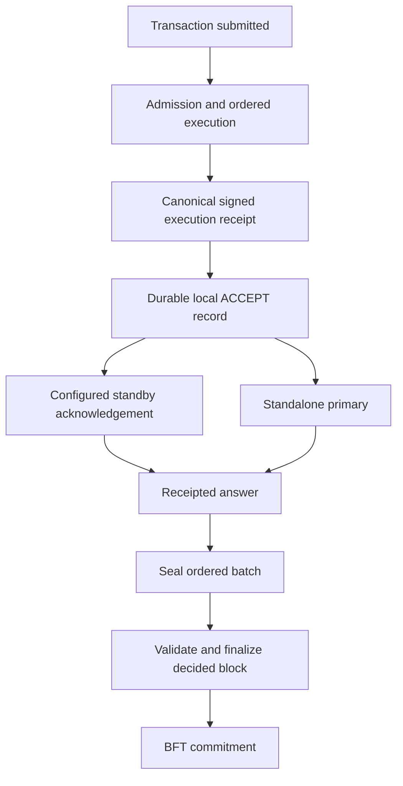

# Sequencer, receipts and consensus

The sequencer is embedded in `paxd`. [The daemon root command](../../../../daemon/paxd/cmd/root.go) constructs `node/sequencer.Node` and starts it against the application. Consensus commits blocks; receipt signing records ordered execution before commitment.

## Runtime and activation

[Runtime construction](../../../../node/sequencer/node.go) and [startup](../../../../node/sequencer/node_start.go) support primary and standby roles. With sequencing disabled, construction returns no sequencer runtime. Startup restores the WAL and receipts, checks key pins, recovers open and sealed state and establishes the required lease before enabling admission and application callbacks.

[Configuration](../../../../node/sequencer/config.go) includes `sequencer.enable`, `sequencer.role`, `sequencer.mode`, `sequencer.wal-dir`, `sequencer.receipt-key-file`, `sequencer.receipt-forward-url`, `sequencer.standby-address`, `sequencer.replication-timeout` and `sequencer.lease-duration`. The execution modes are `sequential` and `microbatch`; count, timing and nonce-queue bounds also belong to this configuration. Replicated operation requires the TLS certificate, roots, peer identity and key pin configured for each side.

The [sequencer keeper](../../../../modules/sequencer/keeper/keeper.go) persists activation height `S`; sequencing applies at heights `h >= S`. Genesis initialization defaults an unset activation height to the next height. The [merge handler](../../../../node/upgrades.go) defaults an unset activation height to `H + 1` for an upgrade at height `H` and requires receipt-key coverage at `H + 1`. An explicit activation height is validated with the supplied genesis. The governed leader schedule controls eligible sequencer proposers. Receipt keys and validator consensus keys are distinct.

## Receipt life cycle

The API rungs are `submitted`, `receipted` and `committed`, defined by [the receipt API](../../../../rpc/sequencer_receipt.go). A hash or submitted observation contains no signed execution proof. A receipted answer authenticates ordered execution when its signature and transaction binding verify. Only block commitment supplies finality.

[The receipt producer](../../../../node/sequencer/receipt.go) signs canonical receipt bytes using a dedicated Ed25519 key. The governed key ID and inclusive height range identify its authority. Clients verify the canonical encoding, raw transaction hash and fields, receipt JSON, return-data and log digests, sequence hash and signature. A signature can authenticate a reverted EVM result; callers must inspect the execution status separately.

[The accepter](../../../../node/sequencer/accepter.go) persists the accepted transaction and signed receipt before publication. A configured standby must acknowledge the release group; standalone primary operation uses local durability. Replication failure halts further receipt release until recovery rather than allowing an unacknowledged result to appear receipted.

Sequential and microbatch execution preserve the transaction order carried in the block. Validators execute that order; they do not reconstruct arrival timing. Signed transaction summaries use full block positions, while Ethereum `transactionIndex` is an EVM-only index.

## Proposal validation and finalization

A sequenced block contains `[encoded MsgSequenceBatch, tx1, ..., txN]`. [The consensus source](../../../../node/sequencer/consensus_source.go) seals the ordered block and supplies transaction zero. [Canonical batch types](../../../../modules/sequencer/types) define the encoding, transaction root and sequence fold.

[The application proposal handler](../../../../node/app.go) checks the following before optimistic processing:

1. Sequencing is active and transaction zero is a valid batch for the actual height.
2. `VerifyBatchTxs` binds the count, transaction root and final sequence hash to the following transactions.
3. `checkSequencerOrder` runs keeper validation on a disposable cache, preserving committed sequence state during proposal checks.
4. `checkSequencerProposer` validates membership in the governed leader schedule.
5. Block gas validation applies to the execution transactions while reserving the batch position.

The keeper enforces batch placement at transaction zero, one batch per height, valid field lengths, sequence continuity, the preceding sequence hash and a receipt-key signature authorized for the height. It updates sequence state only after those checks pass. An empty batch leaves the last sequence unchanged and uses the empty transaction root.

Finalization adopts a successful local sealed state only when it matches the decided block. Otherwise it executes the decided transactions. An invalid sequence batch stops delivery. [Commit notification](../../../../node/sequencer/node.go) records committed height, sequence and application hash in the WAL and advances receipt observations.

## WAL, replication and recovery

[The WAL](../../../../node/sequencer/wal/wal.go) uses versioned frames with CRC32C checks, an eight-byte frame header and an 8 MiB maximum entry. Group synchronization writes the group and synchronizes its durable storage before it can be released.

| Record | Payload |
|---|---|
| `OPEN` | Height, open time in milliseconds, base fee and optional proposer address |
| `ACCEPT` | Sequence, height, transaction bytes and canonical signed receipt bytes; optional return data, VM error and log data |
| `SEAL` | Height, first/last sequence and final sequence hash |
| `COMMITTED` | Height, last sequence and application hash |
| `LEASE` | Epoch, receipt key ID and expiry in milliseconds |

A sealed segment with corrupt data is refused. A torn or checksum-failing mutable head tail is truncated to its last good frame. Replay starts after the last committed record and compares reproduced receipt bytes with retained bytes; a mismatch stops recovery.

[Standby replication](../../../../node/sequencer/standby.go) checks continuity, persists fresh records and handles gaps by replaying the retained window. An acknowledgement contains status, last sequence, gap bounds and epoch; its base encoding is 33 bytes, with the defined refusal-reason extension. `AckOK` must cover the release group's maximum sequence. A durable acknowledgement may precede application replay when records await the local commit boundary; it is not a separate consensus commit.

[The replication transport](../../../../node/sequencer/dial.go) requires TLS 1.3 mutual authentication. Certificate roots, the peer's DNS identity and the SHA-256 pin of its SubjectPublicKeyInfo must all verify before the WAL stream is used.

## Promotion and fencing

Lease records persist the active epoch and key. A higher epoch fences an older primary; fenced execution refuses open, accept and seal operations. Planned handover fences the primary, drains retained records and lets the standby take a later lease. Failure to drain or acquire the new lease leaves the former primary fenced.

Recovery compares retained sequence and epoch evidence and refuses divergent receipt bytes. Historical accepts retain their original signed receipt; the standby uses its own governed receipt key for newly accepted execution after promotion. Restart recovery completes before admission resumes.

## Archive nodes and historical reads

An archive node follows committed blocks with historical retention. A sequencer standby follows the receipt WAL, including accepted execution that is not yet committed. These roles preserve different evidence.

[Archive configuration](../../../../node/params/config.go) enables query/state storage and sets `StateStore.KeepRecent = 0` and `MinRetainBlocks = 0`. These settings retain available history; they do not restore already-pruned blocks or state.

[The state API](../../../../rpc/state.go) serves `eth_getProof` using native `ProofOps` and hex values, rather than an Ethereum account-trie proof. Pending proofs are refused, and missing historical store versions return errors.

`pax_sequencerReceipt` uses a local source or a configured forwarder. An unknown transaction hash returns `null`; no source and no forwarder returns `-32000`. A committed observation requires covering keeper sequence state and an available block. Consumers still authenticate signed receipts and independently check commitment evidence when their trust model requires it. [Node-root px methods](px-node-root.md) expose receipt keys, commits, validators and sequence-batch proofs.
