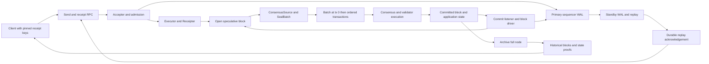
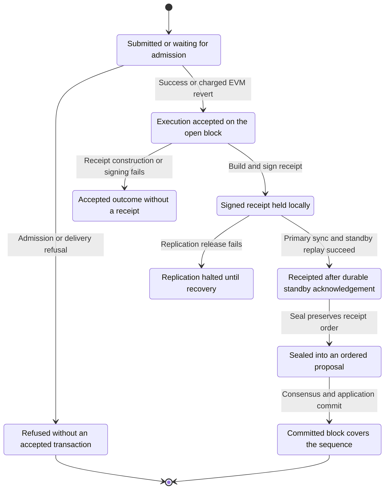
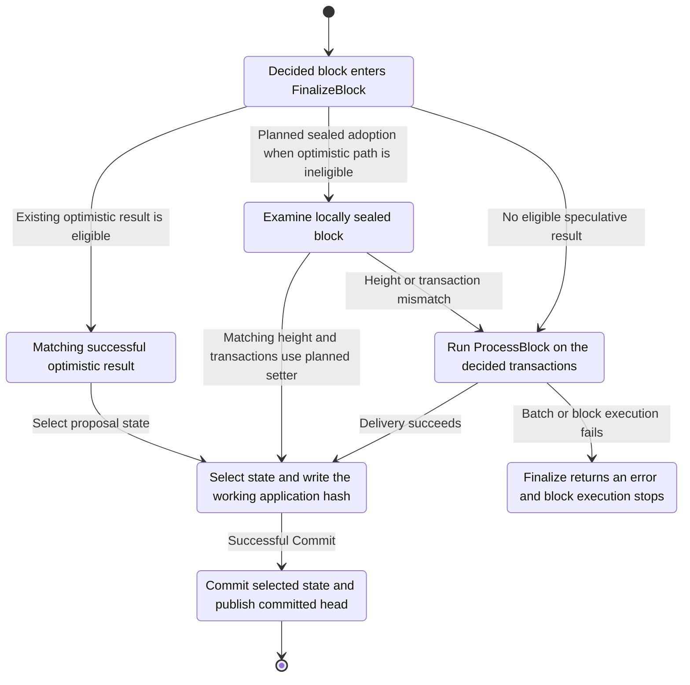
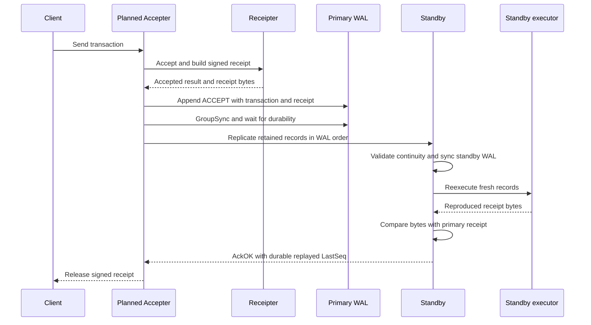
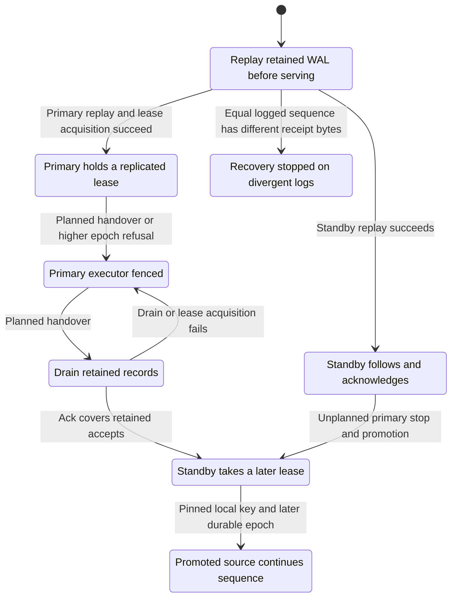

# Sequencer, receipts and consensus

This schematic describes the repository at revision `2a1033aa2` and the target behavior specified by the merged task blocks. **HEAD** means implemented code; **planned** means a pending task in `out/spec.kvx`. Diagrams show the target composition unless explicitly marked HEAD. They do not qualify the implementation or report tests as passed.

The sequencer executes transactions against an open speculative block, signs ProtocolReceipt v2, replicates its execution log to a standby, and supplies an ordered block to consensus. Consensus commits the block; archive nodes retain committed history for later reads and proofs. The RPC rungs are `submitted`, `receipted` and `committed` (`rpc/sequencer_receipt.go:28-37`).

## Components and production seams

The component implementations exist at HEAD: `NewExecutor` opens a speculative store (`node/sequencer/executor.go:226-259`), `Receipter.Accept` signs an accepted result (`node/sequencer/receipt.go:325-370`), `Replicator.Release` syncs locally and awaits the standby (`node/sequencer/standby.go:214-262`), and `ConsensusSource.Seal` constructs the signed tx-0 batch (`node/sequencer/consensus_source.go:56-109`). These components do not establish the production connections drawn above by themselves.

At HEAD the daemon reads and discards the sequencer config (`daemon/paxd/cmd/root.go:249-251`). Consensus attempts to obtain `types.SequencerSource` directly from the application (`consensus/node/node.go:263-264`), but `App.Sequenced(ctx, height)` has a different signature from `SequencerSource.Sequenced(height)` (`node/app.go:3099-3102`, `consensus/types/sequencer.go:10-16`). The daemon must assemble and install the runtime because the sequencer package already imports the application (`node/sequencer/consensus_source.go:13`).

| Planned connection | Task blocks |
|---|---|
| Application source, RPC option and commit-listener seams | `task.5.0.1` |
| Runtime assembly and handoff of the installed source to consensus | `task.5.5.12` |
| Key loading, replay before accepting sends, and runtime installation | `task.5.5.19` |
| Daemon starts the runtime from parsed config | `task.5.46.7` |
| Accepter releases a receipt after replication succeeds | `task.5.5.4` |
| HTTP and WebSocket options, pending reads and forwarding | `task.5.0.3`, `task.5.5.13`, `task.7.12.2` |
| Successful commit notification and the next block | `task.5.5.6`, `task.5.5.7` |

## Activation and leader schedule

Let `H` be the height that applies the merge plan, `S` the first sequenced height, `h` the current height and `r` the consensus round.

At HEAD `App.Sequenced` returns `done > 0 && h > done` (`node/app.go:3099-3102`), while the merge plan checks receipt-key coverage at `H` (`node/upgrades.go:458-463`). The existing upgrade-based leader helper uses a separate activation check (`node/upgrades.go:472-483`). A key ending at `H` therefore passes that coverage check but cannot sign the first batch at `H+1`.

The planned common authority is keeper state: `ActivationHeightKey = 0x07`, with `S > 0 && h >= S`. Genesis `activation_height = 0` defaults to the initialization height plus one; an upgrade at `H` therefore starts sequencing at `H+1`. This is decision `521`, implemented by `task.5.24.2`, `task.5.25.2`, `task.5.25.4` and the application delegation in `task.5.0.2`. `task.5.6.2` checks key coverage at `H+1`; `task.5.6.4` removes the old leader helper. A genesis-born merged chain is checked by `task.5.11.4`.

| Rule | Authority and implementation |
|---|---|
| Round leader is `L[r mod len(L)]` at pinned heights | HEAD `LeaderPin.Leader`, `consensus/internal/consensus/types/round_state.go:451-455` |
| Application checks proposer membership in `L` | Planned `task.5.1.2`; the current proposal request has no current-round field, `consensus/abci/types/plain_types.go:207-214` |
| Refresh schedule from committed state for each height; stop on schedule corruption | Planned `task.5.18.1`, `task.5.31.1`, `task.5.31.2`, `task.5.34.1` |
| Governance updates the leader list used at the next height | Planned `task.5.25.3`, `task.5.25.5`, decision `522` |
| Sequencer mode and Autobahn cannot be enabled together | Planned `task.5.32.1`, decision `526` |
| Use configured sequencer timeouts only at pinned heights; skip waiting for mempool traffic there | Planned `task.5.33.1`, `task.5.33.2` |
| Open time must be later than the previous block time | Planned `task.5.33.3`; HEAD proposals already carry the sealed open time, `consensus/internal/state/execution.go:266-275` |

The pin rotates over the full list. It does not filter non-validator keys; such a leader loses its propose round to timeout (decision `525`). The `service.sequencer` failure policy describes standby proposal at round 1, which requires the configured schedule to place that standby at `L[1]`. Promotion, valid receipt-key coverage and the leader schedule must all agree; a replication acknowledgement alone does not assign a consensus round.

## Receipt v2 life cycle

The public rung stays `receipted` during sealing; `Sealed` is an internal state in this diagram. `Receipter.Accept` produces bytes before replication; the planned Accepter adds the external release boundary. A signed receipt authenticates an execution result, including an EVM revert, before block commitment.

HEAD `sequential.Accept` decodes and delivers on a transaction cache. It writes the branch and advances sequence only for code zero or an EVM execution with a nonempty VM error (`node/sequencer/accept.go:16-78`, `node/sequencer/accept.go:96-99`). A recovered delivery panic becomes an error and drops the transaction branch (`node/sequencer/accept.go:84-93`). The index starts at one, reserving block position zero for the batch (`node/sequencer/accept.go:33`).

`ErrReceiptInvariant` is a distinct outcome: execution has already been accepted, but receipt construction or signing failed (`node/sequencer/receipt.go:363-368`). It cannot be described as an ordinary refusal that left the open block unchanged. Its production recovery policy is an open issue listed below.

| Receipt field or check | HEAD definition |
|---|---|
| Protocol version 2; structure tag `0x5201`; module layout version 1 | `node/sequencer/receipt.go:24-29` |
| EVM module ID 12, above reserved IDs through 11 | `node/app.go:3090-3092`, `node/sequencer/receipt.go:30-32` |
| EVM activity ID is transaction hash; other transactions use SHA-256 of encoded bytes | `node/sequencer/accept.go:43-48` |
| `seqHash = SHA256(domain || prevSeqHash || u64be(seq) || activityID)` | `node/sequencer/executor.go:37`, `node/sequencer/executor.go:342-352` |
| `batch_id` is 24 zero bytes followed by `u64be(height)` | `node/sequencer/receipt.go:231-232`, `modules/sequencer/keeper/receipt_keys.go:133-137` |
| `context_hash` is the pinned receipt key ID for that height | `node/sequencer/receiptkey.go:105-114` |
| Effect zero contains gas, block transaction index, contract address, sponsor, VM-error digest, output length, log count and fee denom | `node/sequencer/receipt.go:125-154` |
| Log effect ordinal is log index plus one; each effect binds log address, topics and data digest | `node/sequencer/receipt.go:180-190`, `node/sequencer/receipt.go:245-251` |
| Return-data digest is `activity_root`; status maps success to 0 and failed EVM execution to 1 | `node/sequencer/receipt.go:217-244` |
| Signature trailer is flag 1, `u32be(64)`, then Ed25519 signature over the canonical receipt digest | `node/sequencer/receiptkey.go:105-121`, `layerxproof/codec/domain.go:91-92` |

Receipt keys are separate from validator keys. Loading refuses exposed files, the same key file, a matching consensus public key, malformed pins and missing coverage (`node/sequencer/receiptkey.go:42-84`). Client verification resolves the receipt's `context_hash` and height against trusted `ReceiptKeys`, then verifies the signature (`modules/sequencer/keeper/receipt_keys.go:96-128`). Distinct primary and standby key ranges may overlap (`modules/sequencer/keeper/receipt_keys.go:74-76`); `task.5.5.16` refreshes the node's pins at each Open after governed rotation.

The signed summary index is the full block position. Ethereum RPC separately normalizes `transactionIndex` to the EVM-only position (`rpc/tx.go:640-657`). Equality checks must compare equivalent indices. `task.5.4.1` and `task.5.4.7` place sequential and micro-batch transactions through `SetTxPosition`.

Sequential execution is the initial mode; OCC micro-batches are a measured follow-on (decision `19`). HEAD groups micro-batches by arrival order, a timer or a count limit (`node/sequencer/microbatch.go:123-161`). The block carries the resulting transaction order; validators do not reconstruct a wall-clock grouping. Parity remains gated by `task.5.16.2` and `task.5.16.4`.

## Proposal validation and deterministic delivery

At a sequenced height the block is `[encoded MsgSequenceBatch, tx1, ..., txN]`. HEAD `CreateProposalBlock` obtains it from `SequencerSource.Seal`, passes it through `InjectSequenceBatch`, and preserves `OpenTime`; a source or injection error returns without producing the proposal (`consensus/internal/state/execution.go:266-275`). The source signs the batch and calls `SealBatch` (`node/sequencer/consensus_source.go:78-108`).

HEAD proposal validation checks that tx 0 exists and decodes, checks the transaction root, and applies total-block-gas validation to transactions after the batch (`node/app.go:1533-1585`). It then adds an undecoded slot for tx 0 and may begin optimistic processing (`node/app.go:1587-1604`). **It does not yet run the keeper's batch authentication and sequence-continuity checks before accepting the proposal.**

The planned order is:

1. Determine sequencing from keeper activation state and decode tx 0.
2. Decode the following transactions and derive their activity IDs in block order.
3. `VerifyBatchTxs` checks count, transaction root and the complete `seqHash` fold (`task.5.22.4`).
4. `checkSequencerOrder` runs `DeliverSequenceBatch` on a disposable cache context, so validation does not advance keeper state (`task.5.1.1`).
5. `checkSequencerProposer` checks membership in `L` (`task.5.1.2`). Consensus separately enforces the round leader.
6. Apply clean-context gas validation before optimistic execution. `task.5.0.2` installs the preceding checks and rejection counters; `task.5.2.1` supplies the instruments.

| Check | HEAD enforcement and planned earlier refusal |
|---|---|
| Batch only at tx 0, outside CheckTx; at most one per height | `modules/sequencer/keeper/keeper.go:44-75`; proposal cache check `task.5.1.1`, CheckTx codec refusal `task.5.14.1` |
| Height equals the actual block height; correct field lengths and empty range | `modules/sequencer/keeper/keeper.go:63-78`, `modules/sequencer/types/msgs.go:46-93`; proposal cache check `task.5.1.1` |
| `FromSeq = storedLastSeq + 1`; `PrevSeqHash = storedLastSeqHash` | `modules/sequencer/keeper/keeper.go:80-92`; proposal cache check `task.5.1.1` |
| Receipt key covers block height and batch signature verifies | `modules/sequencer/keeper/keeper.go:94-99`; proposal cache check `task.5.1.1` |
| Actual transaction count, root and final sequence hash agree with the batch | HEAD proposal root only, `node/app.go:1565-1569`; planned `task.5.22.4`, wired by `task.5.0.2` |
| Block byte and gas admission leaves room for tx 0 | Planned `task.5.4.3`; it must reject before execution accepts the transaction |

`MsgSequenceBatch` contains height, range, previous/final sequence hashes, transaction root, key ID and signature (`modules/sequencer/types/msgs.go:33-42`). An empty batch uses `FromSeq = lastSeq+1`, `ToSeq = lastSeq`, unchanged sequence hash and `SHA256(empty)` (`modules/sequencer/types/msgs.go:26-28`, `modules/sequencer/types/msgs.go:81-93`). `task.5.16.6` checks that an empty sequenced block commits without advancing sequence.

The keeper writes `LastSeq`, `LastSeqHash` and last batch height only after authentication succeeds (`modules/sequencer/keeper/keeper.go:98-104`). `task.5.22.1` through `task.5.22.3` move the hash, root and tx-0 codec into module types; `task.5.17.1` and `task.5.0.2` make their callers delegate to the canonical implementation.

### FinalizeBlock and commit

HEAD already adopts an optimistic proposal result when it was not aborted and its block hash matches the decided hash (`node/app.go:1681-1709`). Otherwise it calls `ProcessBlock`, propagates an execution error, or selects deliver state (`node/app.go:1715-1736`). This existing optimization is separate from adoption of the receipt-time executor's sealed store, which `task.5.19.3` adds through `task.15.0.3`'s `BaseApp.SetSealedStateToCommit`.

Validator re-execution runs `BeginBlock`, delivers the batch at index zero, executes the remaining transactions at their block positions, and inserts a zero-gas batch result (`node/app.go:2235-2275`). It then runs `MidBlock`, flushes Giga writes, sets EVM result/message lists, writes deferred balances, runs `EndBlock`, and routes collected fee tokens (`node/app.go:2278-2308`). `SealBatch` validates its fields on a branch and invokes the corresponding end-of-block helper before writing that branch (`node/sequencer/seal.go:133-188`, `node/sequencer/seal.go:61-100`). The helper-retirement conflict below must be resolved to preserve this order.

Stored votes make speculative and validator execution deterministic. HEAD executor `beginBlock` passes nil votes (`node/sequencer/executor.go:265-271`), while the application forwards its supplied votes to legacy BeginBlock (`node/abci.go:25-60`). Planned `task.5.23.1`, `task.5.23.2` and `task.5.9.1` store decided votes under `0x05 || u64be(height)`, keep two heights, and use the previous stored entry for sequenced BeginBlock. `task.5.19.3` also stores votes on sealed adoption; `task.5.9.2` compares distribution state on both paths.

Bad batch delivery currently escapes `FinalizeBlocker` as an error (`node/app.go:2253-2255`, `node/app.go:1723-1726`). Planned `task.5.2.2` and `task.5.0.2` name this `ErrSequencedBlockHalt` and increment the halt counter. Proposal rejection is the earlier prevention path; it does not replace the final delivery guard.

After successful BaseApp commit, HEAD publishes the stashed committed head (`node/abci.go:260-278`). Planned `task.5.5.6` then calls the commit listener; `task.5.5.7` records `COMMITTED`, opens the next height, records `OPEN`, and prunes the WAL according to configured retention. A listener failure cannot reverse an already successful application commit.

## WAL replication, replay and standby

The sequence uses existing `Release` (`node/sequencer/standby.go:214-262`) and standby `receive`, `persist` and `execute` (`node/sequencer/standby.go:616-689`), connected by planned `task.5.5.4`. The standby must reproduce the primary's bytes for historical accepts. Its distinct signing key is used for new receipts after promotion; replay must not replace a primary signature with a standby signature. The current standby test replayer returns a synthetic execution-result encoding (`node/sequencer/standby_test.go:28-51`), so those tests alone do not establish canonical signed-v2 replay with distinct host keys.

| WAL record | Payload at HEAD | Target caller |
|---|---|---|
| `OPEN` | Height, open time in milliseconds, base fee | `task.5.5.7` block driver |
| `ACCEPT` | Sequence, height, transaction bytes, canonical signed receipt bytes | `task.5.5.4` Accepter |
| `SEAL` | Height, first/last sequence, final sequence hash | `task.5.5.14` before returning a sealed proposal |
| `COMMITTED` | Height, last sequence, application hash | `task.5.5.7` after successful commit |
| `LEASE` | Epoch, key ID, expiry in milliseconds | `task.5.15.1`, `task.5.15.2`, `task.5.27.2` |

Record definitions are `node/sequencer/wal/wal.go:107-141`; kinds 1 through 5 and entry version 1 are `node/sequencer/wal/wal.go:36-80`. WAL frame checks include CRC32C, an eight-byte header and an 8 MiB maximum entry (`node/sequencer/wal/wal.go:38-49`, `node/sequencer/wal/wal.go:328-349`). `GroupSync` flushes a group, issues `fdatasync`, and fails the group on write or sync error (`node/sequencer/wal/wal.go:557-590`).

HEAD acknowledgements have status `AckOK`, `AckGap` or `AckRefused`, plus `LastSeq`, `GapFrom` and `GapTo`; their encoded size is 25 bytes (`node/sequencer/standby.go:25-29`, `node/sequencer/standby.go:52-97`). `AckOK` is usable only when `LastSeq` covers the released group's maximum sequence. An incomplete ack becomes `ErrNoAck`; a refusal becomes `ErrStandbyRefused` (`node/sequencer/standby.go:287-299`).

On a fresh connection, or a gap response on an existing connection, the primary resends its retained window within the replication timeout (`node/sequencer/standby.go:269-296`). The standby ignores records already covered by its cursor, requests gaps before admitting a discontinuity, and refuses stale lease or seal continuity (`node/sequencer/standby.go:419-462`). It persists fresh records before replay; a persistence or execution error latches `s.failed`, making later groups refuse (`node/sequencer/standby.go:616-652`).

Restart reads sealed segments and the mutable head. Corruption in a sealed segment refuses `OpenWAL` with `ErrCorruptSegment`; a torn or checksum-failing head tail is truncated to its last good frame and reported (`node/sequencer/wal/wal.go:478-510`). Entry decode failures remain errors rather than a generic license to discard history. `Replay` begins after the last `COMMITTED`, re-executes each `ACCEPT`, and stops on `ErrReceiptMismatch` (`node/sequencer/wal/wal.go:717-778`). `task.5.5.8` supplies the production application replayer; `task.5.5.19` completes replay before enabling admission.

### Promotion and fencing

HEAD `NewStandby` requires local WAL, executor and distinct primary/standby consensus and receipt keys (`node/sequencer/standby.go:494-521`). A lease record currently checks only whether its epoch is stale (`node/sequencer/standby.go:455-457`); that alone does not fence later accepts from a superseded primary.

The planned role transitions require the following tasks:

| Transition or invariant | Task and observable result |
|---|---|
| Recover lease across a `COMMITTED` boundary and restart | `task.5.26.1`, `task.5.26.2`; replay reports the last lease and standby restores its epoch |
| Compare two stopped hosts | `task.5.27.1`, `task.5.27.3`; prefer higher epoch, then longer last logged accept; divergent receipt bytes refuse recovery under decision `531` |
| Take a primary lease | `task.5.15.1`; release epoch plus one and refuse a higher held epoch |
| Renew lease | `task.5.15.2`; renew the same epoch when less than half the configured duration remains |
| Reject the superseded primary | `task.5.27.2`; `TakeLease` persists the new epoch and refuses later groups with `AckRefused` and `Epoch` |
| Stop writes after fencing | `task.5.15.3`, `task.5.15.4`; `Open`, `Accept` and `Seal` return `ErrLeaseFenced`; promoted source continues from the recovered sequence |
| Planned handover | `task.5.27.4`; validate standby key, Fence, Drain, then TakeLease; a failed drain or takeover leaves the old primary fenced |
| Receipt preservation under failover | `task.5.15.5`; rehearse that every previously returned receipt survives promotion |

`task.5.27.2` grows the ack from 25 to 33 bytes by adding the epoch. Both ends must use the same wire layout; no mixed-layout negotiation is specified. The target transport remains bounded TCP under decision `512` and `task.5.5.5`; the authentication comment on `ReplicatorConfig.Dial` (`node/sequencer/standby.go:167-170`) is not evidence that transport authentication exists.

## Archive node and historical reads

An archive node is the chain's full-node mode with historical retention. It independently follows committed blocks and serves history. The sequencer standby follows the receipt WAL and preserves uncommitted accepted execution. These roles carry different data and recovery obligations.

HEAD has `NodeModeArchive`: consensus uses full-node configuration (`node/params/config.go:130-136`), while application config enables query services/state storage and sets `StateStore.KeepRecent = 0` and `MinRetainBlocks = 0` (`node/params/config.go:149-176`). Those settings retain the history present in the node; they do not restore history already pruned. Operational provisioning must preserve historical state and block availability.

`eth_getProof` reads the requested committed block and state version, then asks the queryable store for `/key` proof operations at that height (`rpc/state.go:124-175`). Its `ProofResult` contains native `ProofOps` and hex values, rather than an Ethereum account-trie proof (`rpc/state.go:114-122`). Pending proofs return `ErrPendingProofRefused` (`rpc/state.go:129-130`); missing EVM/bank versions return errors (`rpc/utils.go:502-517`). Archive service is therefore needed for durable historical verification, while pending snapshots remain an execution-time read surface.

HEAD `pax_sequencerReceipt` starts with a local source or forwards. No source and no forwarding option returns RPC code `-32000`, and an unknown hash returns null (`rpc/sequencer_receipt.go:49`, `rpc/sequencer_receipt.go:232-245`, `rpc/sequencer_receipt.go:275-298`). A receipted answer can become committed only after the historical keeper search finds covering sequence state and the block can be fetched (`rpc/sequencer_receipt.go:257-270`). The search compares the exact sequence hash when the receipt is the final sequence in that block (`rpc/sequencer_receipt.go:304-355`). Clients must still authenticate receipts against pinned keys; JSON field/digest consistency or a server-reported rung alone is not independent block-commit verification.

Explorer kernel archives are another historical surface. HEAD still has live `/paxeer-x/anchors` and `/paxeer-x/receipts` routes (`services/explorer/backend/apps/block_scout_web/lib/block_scout_web/routers/api_router.ex:273-277`). Planned `task.14.23.1` and `task.14.23.2` expose frozen records under `/api/v2/paxeer-x/archive`; `task.14.23.3` retires the live routes with 404 responses. These archived kernel records do not create another rung for new sequencer receipts.

## Failure and refusal boundaries

| Trigger | Observable path | Evidence or pending owner |
|---|---|---|
| Malformed transaction, exhausted sequence or unopened executor | Return an admission/delivery error; no accepted sequence increment | `node/sequencer/accept.go:19-39` |
| Missing, exposed, shared or unpinned receipt key | Refuse key loading/signing before normal admission | `node/sequencer/receiptkey.go:42-99` |
| EVM execution reverts after charging fees | Retain accepted execution and sign failure status | `node/sequencer/accept.go:96-99`, `node/sequencer/receipt.go:217-224` |
| Accepted result cannot be encoded or signed | Return accepted outcome with `ErrReceiptInvariant`; recovery policy unresolved | `node/sequencer/receipt.go:363-368` |
| Primary sync, standby timeout, short ack or standby refusal | Release error; no public receipt from that attempt; planned Accepter latches `ErrReplicationHalted` until replay | `node/sequencer/standby.go:249-259`, `node/sequencer/standby.go:283-299`, `task.5.5.4` |
| Standby replay produces different bytes | `wal.ErrReceiptMismatch`; standby latches failure and refuses groups | `node/sequencer/standby.go:641-648`, `node/sequencer/standby.go:677-689` |
| Seal fails after executor closes the open block | Preserve pending batch for retry; refuse proposal until seal is durable | Planned `task.5.4.4`, `task.5.5.14`; HEAD closes at `node/sequencer/executor.go:283-285` |
| Proposal breaks sequence, signature, proposer membership, count or fold | Return ABCI `REJECT` before optimistic processing | Planned `task.5.0.2`, `task.5.1.1`, `task.5.1.2`, `task.5.22.4` |
| Invalid batch reaches final delivery | Return block-execution error and stop; do not discard tx 0 and continue | `node/app.go:2253-2255`, planned `task.5.2.2` |
| Local sealed transactions differ from the decided block | Re-execute the decided block | Planned `task.5.19.3` |
| Higher lease epoch or corrupt leader schedule | Fence executor or stop the consensus state machine | Planned `task.5.27.2`, `task.5.15.3`, `task.5.31.2` |
| Historical proof or commitment evidence is unavailable | Return the underlying error; do not promote the answer solely because the transaction was submitted | `rpc/state.go:139-152`, `rpc/sequencer_receipt.go:258-267` |

## Verification map and unresolved contract edges

All tasks cited here remain planned work. Relevant gates include `TestProcessProposalRejectsBrokenSeqChain` and `TestFinalizeBlockHaltsOnBadBatchSignature` (`task.5.0.2`); `TestAccepterReturnsReceiptAfterStandbyAck` and `TestAccepterHaltsAfterReleaseFailure` (`task.5.5.4`); `TestStartReplaysWALBeforeAccepting` (`task.5.5.19`); `TestFinalizeAdoptedBlockStoresVotes` (`task.5.19.3`); `TestFailoverRehearsalNoReceiptLost` (`task.5.15.5`); and `TestMergeRehearsalFirstSequencedBlock` (`task.5.16.3`). `task.5.0.9` is the domain completion gate. This document does not replace their acceptance criteria.

The following edges are unresolved in the merged input and are recorded for reconciliation:

| Edge | Required reconciliation |
|---|---|
| Receipt key identifier | `task.7.94.1` assumes `KeyID = digest(SigningKey)`, while HEAD `ReceiptKeyEntry.Validate` and `KeyForHeight` accept a separately pinned nonzero ID (`modules/sequencer/keeper/receipt_keys.go:50-105`). Resolve this before treating a returned signing key as authoritative. |
| Shared sealing helper | `task.5.17.2` deletes `endOfBlock`, but retained `SealBatch` calls it (`node/sequencer/seal.go:61`, `node/sequencer/seal.go:174`). Preserve or relocate the helper while retiring the old Layers path. |
| Standby replay signature | `task.5.5.8` describes re-accepting through a Receipter, whose HEAD implementation signs with its local key (`node/sequencer/receipt.go:366`, `node/sequencer/receiptkey.go:117-121`). `NewStandby` requires different host keys (`node/sequencer/standby.go:517-521`) and compares full receipt bytes (`node/sequencer/standby.go:686-687`). Specify verification/reconstruction of the original signed envelope without sharing the primary private key, and qualify it with signed-v2 records. |
| Accepted execution without receipt | `task.5.5.4` explicitly halts on Release failure, but does not specify recovery when `Receipter.Accept` returns an accepted outcome with `ErrReceiptInvariant` before WAL append (`node/sequencer/receipt.go:363-368`). Define the stop/recovery boundary so that execution cannot silently continue past an unlogged accept. |
| Adopted header | `task.5.19.3` passes `SealedLayer.Context` into the new BaseApp setter without explicitly replacing its speculative header with the decided request header. HEAD Open creates a partial header (`node/sequencer/executor.go:238-243`) and Commit reads the selected context's header (`sdk/baseapp/abci.go:282`). `task.5.4.5` adds prior hash/block ID but does not settle every decided-header field. |
| Replication authentication | Decision `512` records transport authentication as unresolved; `task.5.5.5` supplies bounded TCP. A later implementation must resolve the authenticated-link assumption without presenting it as already landed. |
| Archive service ownership | `service.sequencer` depends on `archive-node`; the merged input has no `service.archive-node` completion/operation record. Existing archive mode establishes the baseline, while deployment ownership and historical availability qualification remain unassigned in that service catalogue. |
