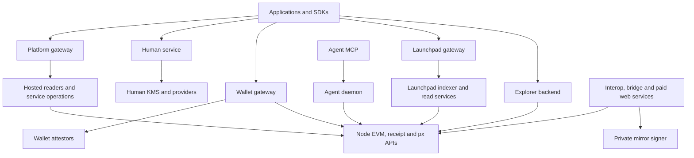

# Off-chain services topology

Off-chain services authenticate callers, sign under service-specific policy, relay transactions and maintain indexed views. Settlement and commitment belong to the Paxeer node. The sequencer runtime runs inside `paxd`; it is part of the node reached through chain APIs.

## Process and trust boundaries

Arrows identify request or data dependencies, not shared key custody. Read projections do not become chain state. A service's liveness response does not establish dependency readiness, indexed freshness, available signing quorum or verified commitment.

## Platform

[The platform workspace](../../../../services/platform/Cargo.toml) contains the hosted gateway, core, authority, indexer, registry, agent boundary, identity, faucet, webhooks, inference worker, evaluator, feeder, dashboard, testnet control and runtime clock. [AI artifacts](../../../../services/platform/hosted/ai-artifacts) has its own package manifest.

| Component | Responsibility | Source |
|---|---|---|
| Gateway | JSON-RPC relay, hosted operations, product HTTP/WebSocket routes and UI proxying | [gateway](../../../../services/platform/hosted/gateway), [OpenRPC contract](../../../../services/platform/hosted/gateway/openrpc.json) |
| Core | Funding/reset operations with durable transaction handling and configured signer authority | [core](../../../../services/platform/hosted/core) |
| Receipt authority | Authenticated receipt and committed-evidence reads | [authority](../../../../services/platform/hosted/authority) |
| Agent boundary | Authenticated agent-facing evidence and program reads | [agent-boundary](../../../../services/platform/hosted/agent-boundary) |
| Indexer | Account, history, asset and holder-record projections | [indexer](../../../../services/platform/hosted/indexer) |
| Program registry | Read views over program state | [registry](../../../../services/platform/hosted/registry) |
| Identity and faucet | Identity operations and policy-controlled funding | [identity](../../../../services/platform/hosted/identity), [faucet](../../../../services/platform/hosted/faucet) |
| Webhooks | Authenticated delivery of event facts | [webhooks](../../../../services/platform/hosted/webhooks) |
| Inference worker and evaluator | Program work and signed assessment/chain operations | [paxai-worker](../../../../services/platform/hosted/paxai-worker), [ai-evaluator](../../../../services/platform/hosted/ai-evaluator) |
| Artifacts | Artifact storage and retrieval | [ai-artifacts](../../../../services/platform/hosted/ai-artifacts) |
| Price feeder | Feed-key-authorized observations for pricefeed | [feeder](../../../../services/platform/hosted/feeder) |
| Dashboard and testnet control | Operational views and controlled testnet operations | [dashboard](../../../../services/platform/hosted/dashboard), [testnet](../../../../services/platform/hosted/testnet) |
| Runtime clock | Unix-socket wall/monotonic time authority | [runtime-clock](../../../../services/platform/hosted/runtime-clock) |

The gateway checks the target EVM chain ID before relaying. Node-root `px` reads and hosted operations remain distinct recipients; valid node registration/funding calls return the hosted-operation refusal described in [px methods](px-node-root.md).

The indexer exposes store health separately from source readiness. Registry and webhook readiness depend on their own data and delivery inputs. A route declaration does not establish that an upstream capability is available.

The runtime clock serves generation-bound wall and monotonic samples through a private Unix socket. A regression latches failure. It supplies time to service logic; it does not submit program or stream ticks to the chain.

## Agent

[The agent workspace](../../../../services/agent) contains the daemon, MCP integration, language SDKs and shared transaction/proof libraries. The daemon owns policy, approvals, sessions and its durable outbox. MCP forwards tool operations to the daemon and preserves operation errors.

Daemon connections require the configured mutually authenticated transport. Gateway credentials and daemon client certificates authorize different boundaries. Neither service credential substitutes for a transaction signature or an on-chain grant.

An unknown transaction outcome keeps the exact signed bytes in the outbox for resolution and safe replay. Recovery distinguishes an unobserved result from a rejected operation. [The shared client](../../../../services/agent/crates/layerx-client) handles chain calls, while [proof code](../../../../services/agent/crates/layerx-proof) validates receipt evidence.

## Human

[The human workspace](../../../../services/human/Cargo.toml) contains human service, identity provider, security provider, KMS, intents, network gateway and test support. The service composes authenticated user journeys; the network gateway uses the shared chain client. Intent construction reads chain state and preserves the authority of the resulting transaction.

[Human KMS](../../../../services/human/crates/layerx-human-kms) binds a TCP listener protected by mutual TLS and certificate pin checks. Its key material remains behind the signing boundary.

Human service exposes liveness separately from dependency readiness. The identity/security providers, KMS and wallet attestors retain separate responsibilities. A successful user session does not by itself prove that a signer or chain dependency is ready.

## Interop

[The interop workspace](../../../../services/interop/Cargo.toml) contains gateway and service adapters, bridge relayer, committed-proof verification, gas station, fiat, migration, mirror publisher/signer, portable evidence, UCP, Visa tap, AP2, x402 and x-websearch packages.

| Component | Authority and recovery boundary |
|---|---|
| Interop gateway/service | Dispatch protocol operations and resume durable operation state; payer-signed transaction authority remains explicit |
| Gas station | Quotes and sponsors authorized transactions, with budget, nonce and unknown-outcome handling |
| Bridge relayer | Reads remote vault and local bridge logs, obtains authorized signatures and submits bridge/release work |
| Mirror publisher | Reads committed history and publishes archive segments from its retained cursor |
| Mirror signer | Holds publisher signing keys behind a private owner/group Unix socket |
| Committed proof and portable evidence | Verify receipt/commit evidence against the caller's trusted keys and consensus state |
| x402 middleware | Gates paid operations on the required payment evidence |
| x-websearch | Searches/fetches, attests answers and submits fulfilment transactions |

The signer and publisher are separate components; a publisher or relayer does not need a public signing route. The [private signer](../../../../services/interop/crates/layerx-mirror-signer) checks its configured authority before signing.

[The web sidecar](../../../../services/interop/crates/x-websearch) separates attestor, transaction submitter and payment receiver key roles. Chain fulfilment uses xweb at `0x1019`; program fulfilment is validated by [the xweb keeper](../../../../modules/xweb/keeper/program_fulfil.go). Paid ledger operations use `0x101A`. Exact-HTTP and program-origin requests retain their separate fee and refund rules. Missing paid-route capability returns explicit unavailability.

## Wallet

[Wallet gateway](../../../../services/wallet/gateway) authenticates sessions, applies wallet and signing policy and orchestrates threshold signing. [Attestors](../../../../services/wallet/attestor) hold signing shares. Gateway-authorized signing and operator-authorized key operations are separate routes and authorities.

Gateway readiness checks attestor quorum, nonce storage, RPC availability and identity-provider readiness. Insufficient quorum prevents a signature even if the gateway process is live. The gateway broadcasts signed transaction bytes through its RPC pool and retains nonce/outcome state for recovery.

Receipt-key pins authenticate sequencer receipts. They are public verification inputs, separate from wallet shares, EVM transaction keys, TLS credentials and backup keys. The private sequencer receipt key remains in the embedded node runtime.

## Launchpad and market data

[Launchpad services](../../../../services/launchpad) provide gateway, indexer, API, discovery, user, metadata, social, livestream, ranking and notification components. The gateway exposes authenticated service routes and versioned streams. The indexer reads blocks and logs and decodes canonical factory, pool and role events into projections.

HTTP session tokens and webhook HMACs authenticate service traffic, not user trade authority. Trading uses wallet-signed calls to the registered launchpad roles. Missing upstream configuration returns an unavailable response; generated SDK operations do not make an unserved capability operational.

[Perps-data](../../../../services/platform/perps-data) maintains market and trading read models from contract reads and chain events. Market configuration, decimals, ticks, lots, caps and margin tiers derive from the served venue rather than static client assumptions. Settlement remains in [the market keepers](markets-and-launchpad.md).

## Explorer and archive reads

[Explorer](../../../../services/explorer) runs separately from the chain and uses block, log and RPC data to build its API and indexed views. Web and wallet clients consume those read models. Archived native records remain historical data rather than a receipt rung for new transactions.

Historical commitment checks require retained blocks, state versions and validator evidence. Archive nodes provide committed history; sequencer standbys provide WAL recovery. Neither an indexed row nor a process health response independently proves commitment.

## Failure and readiness

A signing failure returns an error without inventing a signature. An unavailable chain or indexer remains unavailable rather than an empty successful answer. Durable journals preserve exact transaction bytes and operation identity where retries need them. Readiness endpoints check their declared dependencies; liveness endpoints only establish that the process can answer.

A sequencer receipt signature authenticates the ordered execution result, including reverts. Independent committed verification additionally checks inclusion and consensus evidence. See [sequencer and consensus](sequencer-and-consensus.md) and [clients and SDKs](clients-and-sdks.md).
