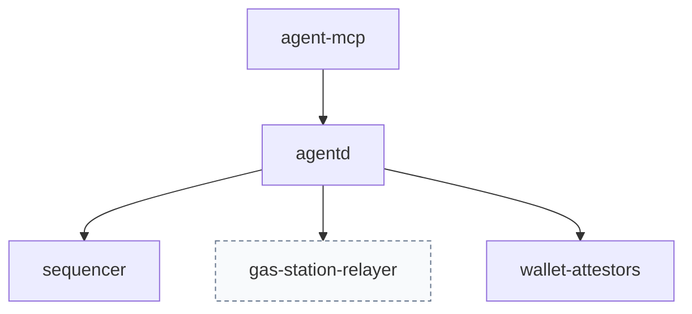
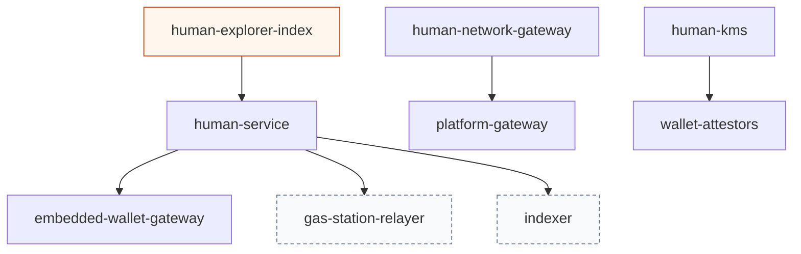
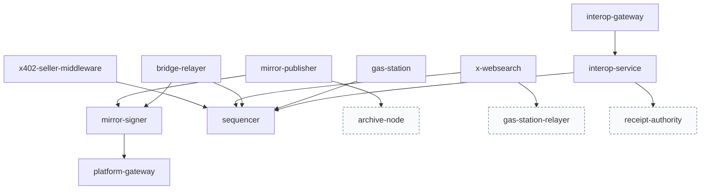
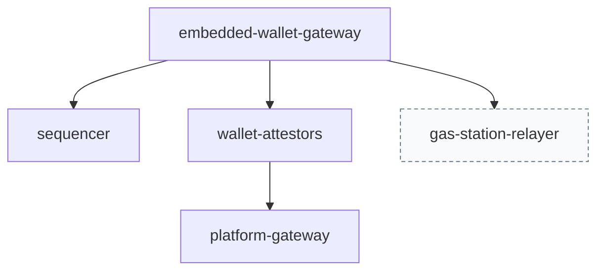
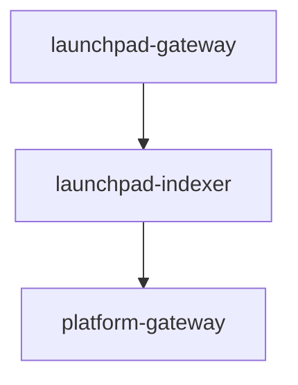
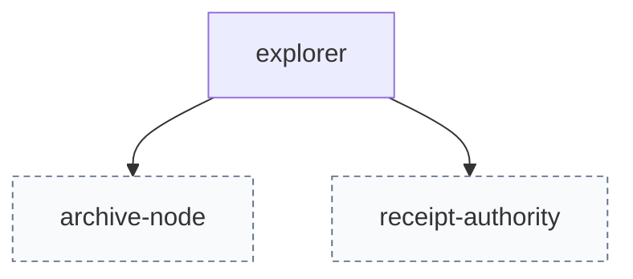
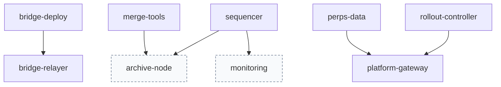

# Off-chain services topology

This schematic projects all 40 `[service.*]` blocks in the merged specification. Each service entry below reproduces its purpose, route, inputs, outputs, state, dependencies, failure policy, domain and two task references. The linked contracts define the interfaces; this document adds no service blocks or implementation tasks. The repository evidence was read at revision `2a1033aa2`.

The registry describes the intended service topology. Its referenced tasks are pending; an operation task is an implementation or conformance obligation, not proof that a process is running. Sections marked **HEAD evidence** describe code already present. **Registry flow** describes the requested chain integration and recovery behavior. The distinction matters where HEAD still uses a kernel client, a service is scheduled for retirement, or an operation task is a domain anchor.

Every arrow in every diagram means **the source lists the target as a dependency**. It does not imply a public route, a signing delegation, a startup sequence, or a transitive dependency. Solid-border nodes are registered service identifiers. Dashed-border nodes are literal dependency names or descriptions without an identically named service block. An orange node marks the recorded human explorer retirement conflict. Group diagrams include the outgoing dependencies of their own services; the full graph includes every declared dependency edge.

List-valued dependencies retain their exact names. String-valued dependencies remain one opaque description node, including any comma-separated terms. No alias is silently substituted. For example, the registry names `gas-station-relayer` while the registered service is `gas-station`; it names `receipt-authority` while another block is `platform-receipt-authority`. These unresolved names remain visible in the graph.

## Complete dependency graph

```mermaid
flowchart TB
  subgraph g_platform["Platform"]
    s19["platform-agent-boundary"]
    s20["platform-ai-artifacts"]
    s21["platform-ai-evaluator"]
    s22["platform-core-boundary"]
    s23["platform-dashboard"]
    s24["platform-faucet"]
    s25["platform-gateway"]
    s26["platform-identity"]
    s27["platform-indexer"]
    s28["platform-paxai-worker"]
    s29["platform-price-feeder"]
    s30["platform-program-registry"]
    s31["platform-receipt-authority"]
    s32["platform-runtime-clock"]
    s33["platform-testnet-control"]
    s34["platform-webhooks"]
  end
  subgraph g_agent["Agent"]
    s0["agent-mcp"]
    s1["agentd"]
  end
  subgraph g_human["Human"]
    s10["human-service"]
    s8["human-kms"]
    s9["human-network-gateway"]
    s7["human-explorer-index"]
  end
  subgraph g_interop["Interop"]
    s11["interop-gateway"]
    s12["interop-service"]
    s6["gas-station"]
    s3["bridge-relayer"]
    s16["mirror-publisher"]
    s17["mirror-signer"]
    s38["x-websearch"]
    s39["x402-seller-middleware"]
  end
  subgraph g_wallet["Wallet"]
    s4["embedded-wallet-gateway"]
    s37["wallet-attestors"]
  end
  subgraph g_launchpad["Launchpad"]
    s13["launchpad-gateway"]
    s14["launchpad-indexer"]
  end
  subgraph g_explorer["Explorer"]
    s5["explorer"]
  end
  subgraph g_support["Chain,<br/>market data and operations dependencies"]
    s36["sequencer"]
    s18["perps-data"]
    s2["bridge-deploy"]
    s15["merge-tools"]
    s35["rollout-controller"]
  end
  e0["Paxeer chain node JSON-RPC and WebSocket,<br/>consensus RPC,<br/>indexer,<br/>identity service,<br/>receipt authority"]
  e1["agent boundary internal receipts,<br/>KMS signing"]
  e2["ai-artifacts"]
  e3["archive-node"]
  e4["chain JSON-RPC eth_call at 0x101D"]
  e5["chain JSON-RPC pax_sequencerReceipt"]
  e6["chain JSON-RPC,<br/>local node relay"]
  e7["gas-station-relayer"]
  e8["identity,<br/>faucet,<br/>core boundary,<br/>receipt authority,<br/>gateway,<br/>paxeer chain,<br/>Redis"]
  e9["indexer"]
  e10["monitoring"]
  e11["paxeer chain JSON-RPC,<br/>consensus RPC,<br/>explorer API"]
  e12["paxeer chain JSON-RPC,<br/>local node relay"]
  e13["receipt-authority"]
  e14["unified-router"]
  s0 --> s1
  s1 --> s36
  s1 --> e7
  s1 --> s37
  s2 --> s3
  s3 --> s36
  s3 --> s17
  s4 --> s37
  s4 --> s36
  s4 --> e7
  s5 --> e3
  s5 --> e13
  s6 --> s36
  s7 --> s10
  s8 --> s37
  s9 --> s25
  s10 --> s4
  s10 --> e7
  s10 --> e9
  s11 --> s12
  s12 --> s36
  s12 --> e13
  s13 --> s14
  s14 --> s25
  s15 --> e3
  s16 --> s17
  s16 --> e3
  s17 --> s25
  s18 --> s25
  s19 --> e6
  s20 --> e3
  s21 --> s36
  s21 --> e7
  s22 --> e12
  s23 --> s25
  s24 --> e14
  s24 --> s36
  s24 --> e7
  s25 --> e0
  s26 --> e14
  s26 --> e7
  s27 --> e11
  s28 --> s36
  s28 --> e2
  s28 --> e7
  s29 --> s36
  s29 --> e7
  s30 --> e4
  s31 --> e5
  s32 --> s25
  s33 --> e8
  s34 --> e1
  s35 --> s25
  s36 --> e3
  s36 --> e10
  s37 --> s25
  s38 --> s36
  s38 --> e7
  s39 --> s36
  classDef external fill:#f8fafc,stroke:#64748b,stroke-dasharray:4 3
  class e0,e1,e2,e3,e4,e5,e6,e7,e8,e9,e10,e11,e12,e13,e14 external
  classDef conflict fill:#fff7ed,stroke:#c2410c
  class s7 conflict
```

## Chain reads, writes and signing boundaries

Registry flows converge on the sequencer for user-signed EVM transactions. A signature from a wallet, KMS, sponsor or service sender authorizes the transaction. A sequencer receipt signature attests the receipt and is verified against pinned public keys. These keys have different roles. Receipt consumers do not acquire transaction signing authority by loading a receipt-key list.

HEAD already separates the sequencer's Ed25519 receipt private key from the validator consensus key, rejects an exposed key file and requires a covering pin at startup (`node/sequencer/receiptkey.go:47`, `node/sequencer/receiptkey.go:42`). The on-chain `ReceiptKeys` list pins public keys over inclusive height ranges (`modules/sequencer/keeper/receipt_keys.go:18`, `modules/sequencer/keeper/receipt_keys.go:40`). Hosted receipt-key files in the registry are verification inputs; the private receipt key remains at the sequencer.

| Signing boundary | Key custody and HEAD evidence | Registry use |
|---|---|---|
| Platform receipt consumers | Gateway carries a `ReceiptKeyList`; `LAYERX_GATEWAY_RECEIPT_KEYS_FILE` is loaded by configuration (`services/platform/hosted/gateway/src/main.rs:99`, `services/platform/hosted/gateway/src/main.rs:1022`). | Gateway, authority and agent boundary verify receipt evidence; an unpinned or unverifiable receipt is refused. |
| Core funding | `build_send_with_signer` accepts a `TreasurySigner` held in process or reached through the treasury signer socket (`services/platform/hosted/core/src/lib.rs:139`). This is HEAD's native SEND path. | Core registry inputs instead name `LAYERX_CORE_FUNDING_SENDER_KEY_FILE` and chain JSON-RPC; journaled funding transactions are replayed on retry. |
| Evaluator | The Ed25519 assessment key and EVM sender prefix are separate (`services/platform/hosted/ai-evaluator/src/main.rs:76`, `services/platform/hosted/ai-evaluator/src/main.rs:99`). | Signed assessments and CommitScore/RevealScore calls. HEAD sends raw EVM transactions and polls `pax_sequencerReceipt` (`services/platform/hosted/ai-evaluator/src/main.rs:1226`, `services/platform/hosted/ai-evaluator/src/main.rs:1236`). |
| Price feeder | The sidecar loads its feed key through `PRICE_SIDECAR_FEED_KEY_FILE` (`services/platform/hosted/feeder/src/bin/price-sidecar/main.rs:192`); it validates the compressed public key (`services/platform/hosted/feeder/src/bin/price-sidecar/main.rs:182`). | Pricefeed observations target `0x1020`; the registry explicitly voids the old `0x1015` pushOracle path. |
| Inference worker | HEAD reads its configured delegate seed file into an Ed25519 `SigningKey` and checks the signed metadata against that delegate (`services/platform/hosted/paxai-worker/src/main.rs:73`, `services/platform/hosted/paxai-worker/src/main.rs:86`). | Per-operation chain calls; the registry does not define an EVM sender key for this service. |
| Webhook signer | HEAD advertises Ed25519 signatures over event identifier, timestamp and exact body bytes (`services/platform/hosted/webhooks/src/main.rs:588`). | The block names KMS signing as a dependency. This is webhook authentication, not a user EVM signature. |
| Agent daemon | HEAD constructs `AttestorSigner` from the configured signer (`services/agent/crates/layerx-agentd/src/main.rs:1138`). | Agent approvals authorize user or agent EVM transactions; the durable outbox owns unknown-outcome resolution. MCP forwards API calls and has no separately declared signing key. |
| Human KMS | HEAD's EVM wallet creates a secp256k1 signing key from a random seed and zeroizes the seed when dropped (`services/human/crates/layerx-human-kms/src/evm.rs:18`, `services/human/crates/layerx-human-kms/src/evm.rs:23`). | KMS signs EVM actions; identity/security providers and attestors remain separate boundaries. |
| Embedded wallet | Gateway signing delegates through `getMigrationAwareSigningAccountForRow` (`services/wallet/gateway/src/routes/sign.ts:103`). Attestor signing is registered at `/v1/sign`; gateway/operator authorities are separate (`services/wallet/attestor/internal/server/server.go:140`, `services/wallet/attestor/internal/server/server.go:147`). | Wallet attestors hold shares; below threshold no signature is produced. Gateway sessions do not constitute custody of the full signing key. |
| Gas station | `LocalSigner::from_config` uses the shared EVM sender loader with the configured prefix and either its key-file or KMS-key-id source (`services/interop/crates/layerx-gas-station/src/signer.rs:55`). | The sponsor signs type-4 transactions containing payer EIP-7702 authorizations; budgets and nonce outcomes remain journaled. |
| Mirror and bridge | The private signer loads secp256k1 publisher keys and optional Ed25519 publisher keys (`services/interop/crates/layerx-mirror-signer/src/lib.rs:427`). Its Unix socket is accessible to its owner and group with mode `0660` (`services/interop/crates/layerx-mirror-signer/src/lib.rs:120`, `services/interop/crates/layerx-mirror-signer/src/lib.rs:666`); bridge mode loads a separate manifest (`services/interop/crates/layerx-mirror-signer/src/lib.rs:676`). Relayer configuration uses remote signing handles (`services/interop/crates/layerx-bridge-relayer/src/config.rs:408`). | Mirror headers and remote bridge releases use signer responses. Neither publisher nor relayer needs a public signing route. |
| Xweb sidecar | Distinct file variables select attestor, submitter and receiver keys (`services/interop/crates/x-websearch/src/keys.rs:8`). Attestor and submitter use secp256k1; the receiver uses Ed25519 (`services/interop/crates/x-websearch/src/keys.rs:1`). | Attestation signatures, EVM fulfillment transactions and paid-HTTP draw authorization retain separate roles. |
| Launchpad edge and indexer | Edge configuration supplies the JWT secret to authentication (`services/launchpad/gateway/internal/app/app.go:147`). Indexer builds webhook targets with configured HMAC secrets (`services/launchpad/indexer/internal/app/app.go:184`). | HTTP session tokens and webhook authentication are separate from user transaction keys; both registered launchpad services are readers/proxies. |
| Explorer and other read planes | Their registry inputs are RPC blocks, logs, history or readiness. No transaction-signing key is declared for explorer, indexers, registry, dashboard or testnet control. | Reads and cached views do not authorize user writes. Testnet control forwards admin requests to core, whose signer owns funding. |

The service entries below preserve the declared failure policies. In particular, a successful process liveness probe is not evidence of chain readiness, committed indexing, an available signer, or an available signing quorum. Endpoint-specific evidence follows each group. A registry block without a health route does not acquire one from a diagram.

## Platform

**Registry flow.** `platform-gateway` is the public RPC, WebSocket, HTTP and UI proxy boundary. Core owns funding/reset transitions, agent boundary owns authenticated receipt and deployment-proof reads, authority admits receipts, indexer materializes history, registry reads program heads at `0x101D`, and webhooks delivers authenticated facts. Identity, faucet, workers, price feeding, artifacts, the runtime clock, dashboard and testnet control retain the exact dependencies listed in their entries. The long dependency descriptions in dashed nodes remain the string fields from the source blocks.

**HEAD evidence.** Product route bindings carry health, network and wire-version checks (`services/platform/hosted/gateway/src/routes.rs:34`); `/v1/agent/rpc` is a distinct bound route (`services/platform/hosted/gateway/src/routes.rs:12`). Gateway liveness and readiness handlers are separate (`services/platform/hosted/gateway/src/main.rs:3638`, `services/platform/hosted/gateway/src/main.rs:3648`). Core and agent boundary expose `/livez` and `/readyz` (`services/platform/hosted/core/src/main.rs:1643`, `services/platform/hosted/agent-boundary/src/main.rs:2160`). Indexer `/healthz` probes the store and `/readyz` returns 503 when source readiness fails (`services/platform/hosted/indexer/src/api.rs:285`, `services/platform/hosted/indexer/src/api.rs:291`). Authority has separate live/ready routes (`services/platform/hosted/authority/src/main.rs:1252`). Registry `/healthz` is defined in its route dispatcher (`services/platform/hosted/registry/src/routes.rs:300`). Webhooks `/healthz` returns its readiness result (`services/platform/hosted/webhooks/src/main.rs:580`). Evaluator `/healthz` and `/readyz` distinguish process response from readiness (`services/platform/hosted/ai-evaluator/src/main.rs:853`); feeder similarly separates `/healthz` from freshness-dependent `/readyz` (`services/platform/hosted/feeder/src/lib.rs:18`). Identity, faucet and testnet control each have `/livez` and `/readyz` (`services/platform/hosted/identity/src/main.rs:1249`, `services/platform/hosted/faucet/src/main.rs:1036`, `services/platform/hosted/testnet/src/main.rs:1153`). Dashboard `/healthz` returns 503 when its dashboard is not ready (`services/platform/hosted/dashboard/src/main.rs:193`). These observations do not prove the artifact service or inference worker has a ready probe.

HEAD runtime-clock is a Unix-socket wall/monotonic clock authority (`services/platform/hosted/runtime-clock/src/server.rs:57`, `services/platform/hosted/runtime-clock/src/server.rs:66`) whose samples fail after regression (`services/platform/hosted/runtime-clock/src/server.rs:24`). It is not evidence of the registry's committed-height program/stream tick submitter. That role discrepancy remains explicit pending registry-owner reconciliation.

**Activation and failure.** Block-level operation tasks for several platform services are `8.0.4`, the wave-5 hosted-reader gate, rather than dedicated daemon operation tasks. That binding is retained. Source readiness, pinned receipt keys, funding journal replay, stale-market behavior, withheld webhook delivery and quorum outcomes remain as stated below. HEAD still contains native treasury SEND construction and kernel-coupled worker configuration; the registry's chain-only target is gated by pending tasks.

```mermaid
flowchart TB
  s19["platform-agent-boundary"]
  s20["platform-ai-artifacts"]
  s21["platform-ai-evaluator"]
  s22["platform-core-boundary"]
  s23["platform-dashboard"]
  s24["platform-faucet"]
  s25["platform-gateway"]
  s26["platform-identity"]
  s27["platform-indexer"]
  s28["platform-paxai-worker"]
  s29["platform-price-feeder"]
  s30["platform-program-registry"]
  s31["platform-receipt-authority"]
  s32["platform-runtime-clock"]
  s33["platform-testnet-control"]
  s34["platform-webhooks"]
  s36["sequencer"]
  e0["Paxeer chain node JSON-RPC and WebSocket,<br/>consensus RPC,<br/>indexer,<br/>identity service,<br/>receipt authority"]
  e1["agent boundary internal receipts,<br/>KMS signing"]
  e2["ai-artifacts"]
  e3["archive-node"]
  e4["chain JSON-RPC eth_call at 0x101D"]
  e5["chain JSON-RPC pax_sequencerReceipt"]
  e6["chain JSON-RPC,<br/>local node relay"]
  e7["gas-station-relayer"]
  e8["identity,<br/>faucet,<br/>core boundary,<br/>receipt authority,<br/>gateway,<br/>paxeer chain,<br/>Redis"]
  e11["paxeer chain JSON-RPC,<br/>consensus RPC,<br/>explorer API"]
  e12["paxeer chain JSON-RPC,<br/>local node relay"]
  e14["unified-router"]
  s19 --> e6
  s20 --> e3
  s21 --> s36
  s21 --> e7
  s22 --> e12
  s23 --> s25
  s24 --> e14
  s24 --> s36
  s24 --> e7
  s25 --> e0
  s26 --> e14
  s26 --> e7
  s27 --> e11
  s28 --> s36
  s28 --> e2
  s28 --> e7
  s29 --> s36
  s29 --> e7
  s30 --> e4
  s31 --> e5
  s32 --> s25
  s33 --> e8
  s34 --> e1
  classDef external fill:#f8fafc,stroke:#64748b,stroke-dasharray:4 3
  class e0,e1,e2,e3,e4,e5,e6,e7,e8,e11,e12,e14 external
```

### `platform-agent-boundary`

Authenticated boundary between the gateway, registry and webhook planes and the chain for receipt and deployment-proof reads

| Registry field | Value |
|---|---|
| `route` | GET /v1/receipts/{id}, GET /internal/v1/receipts/{id}, GET /internal/v1/deployment-proof/{id}, GET /v1/protocol/account-state/head, /livez, /readyz |
| `inputs` | plane bearer tokens, LAYERX_AGENT_BOUNDARY_CHAIN_RPC_URL, LAYERX_AGENT_BOUNDARY_RECEIPT_KEYS_FILE, LAYERX_AGENT_BOUNDARY_NODE_URL |
| `outputs` | signed sequencer receipts and relayed account-state answers |
| `state` | state directory with journal and activity records |
| `dependencies` | chain JSON-RPC, local node relay |
| `failure_policy` | an unreachable chain answers node_unavailable 503 with retry; an unverifiable receipt is never relayed |
| `domain` | 8 |
| `operation_task` | `8.8.4` — wave 6; Remove the kernel session and the head attestation route from the agent boundary |
| `completion_task` | `8.0.9` — wave 7; Gate domain 8 completion on its retired surfaces and planned paths |
| `contract` | [contracts/platform-hosted.md#agent-boundary-http-routes](../../contracts/platform-hosted.md#agent-boundary-http-routes) |

Source block: `service.platform-agent-boundary`.

### `platform-ai-artifacts`

Encrypted model, dataset and evidence storage.

| Registry field | Value |
|---|---|
| `route` | artifact routes |
| `inputs` | payload uploads |
| `outputs` | payloads for reveal and challenge |
| `state` | replicated storage |
| `dependencies` | ["archive-node"] |
| `failure_policy` | restore from replicas |
| `domain` | 8 |
| `operation_task` | `8.0.4` — wave 5; Prove the hosted chain readers before the kernel switch-off |
| `completion_task` | `8.0.9` — wave 7; Gate domain 8 completion on its retired surfaces and planned paths |
| `contract` | [contracts/services.md#platform-ai-artifacts](../../contracts/services.md#platform-ai-artifacts) |

Source block: `service.platform-ai-artifacts`.

### `platform-ai-evaluator`

Signs assessments and commits and reveals scores for ai-market epochs.

| Registry field | Value |
|---|---|
| `route` | health endpoint |
| `inputs` | grants and epoch state |
| `outputs` | CommitScore and RevealScore calls |
| `state` | commitment journal |
| `dependencies` | ["sequencer", "gas-station-relayer"] |
| `failure_policy` | absent reveal forfeits; below quorum no result |
| `domain` | 8 |
| `operation_task` | `8.0.4` — wave 5; Prove the hosted chain readers before the kernel switch-off |
| `completion_task` | `8.0.9` — wave 7; Gate domain 8 completion on its retired surfaces and planned paths |
| `contract` | [contracts/services.md#platform-ai-evaluator](../../contracts/services.md#platform-ai-evaluator) |

Source block: `service.platform-ai-evaluator`.

### `platform-core-boundary`

Hosted core boundary: sequencer and state reads, receipts and the admin testnet fund and reset plane

| Registry field | Value |
|---|---|
| `route` | /livez, /readyz, GET /v1/sequencer, GET /v1/state, GET /v1/receipts/{id}, POST /admin/v1/testnet/fund, POST /admin/v1/testnet/reset |
| `inputs` | LAYERX_CORE_CHAIN_RPC_URL, LAYERX_CORE_FUNDING_SENDER_KEY_FILE, LAYERX_CORE_CLIENT_CA_DER, admin bearer tokens |
| `outputs` | sequencer, state and receipt answers; funding transaction hashes |
| `state` | journal directory of fund and reset transitions |
| `dependencies` | paxeer chain JSON-RPC, local node relay |
| `failure_policy` | an unreachable chain or sender answers treasury_unavailable 503 with retry; a retried fund replays the journaled transaction |
| `domain` | 8 |
| `operation_task` | `8.20.1` — wave 5; Retire the activity and program routes of the core boundary |
| `completion_task` | `8.0.9` — wave 7; Gate domain 8 completion on its retired surfaces and planned paths |
| `contract` | [contracts/platform-hosted.md#core-http-routes](../../contracts/platform-hosted.md#core-http-routes) |

Source block: `service.platform-core-boundary`.

### `platform-dashboard`

Operator dashboard of the hosted platform services.

| Registry field | Value |
|---|---|
| `route` | dashboard HTTP routes |
| `inputs` | service readiness and metrics endpoints |
| `outputs` | dashboard pages |
| `state` | stateless |
| `dependencies` | ["platform-gateway"] |
| `failure_policy` | an unreachable service is shown unavailable, never as healthy |
| `domain` | 8 |
| `operation_task` | `8.0.4` — wave 5; Prove the hosted chain readers before the kernel switch-off |
| `completion_task` | `8.0.9` — wave 7; Gate domain 8 completion on its retired surfaces and planned paths |
| `contract` | [contracts/services.md#platform-dashboard](../../contracts/services.md#platform-dashboard) |

Source block: `service.platform-dashboard`.

### `platform-faucet`

Funds admitted claims by an EVM bank send from the faucet account.

| Registry field | Value |
|---|---|
| `route` | router px_requestFunds over the claim path |
| `inputs` | claims with identity, address and network quotas |
| `outputs` | funding id; EVM transfer |
| `state` | claim journal |
| `dependencies` | ["unified-router", "sequencer", "gas-station-relayer"] |
| `failure_policy` | down or empty: 503; a pending or refused claim is never reported funded |
| `domain` | 8 |
| `operation_task` | `8.0.4` — wave 5; Prove the hosted chain readers before the kernel switch-off |
| `completion_task` | `8.0.9` — wave 7; Gate domain 8 completion on its retired surfaces and planned paths |
| `contract` | [contracts/services.md#platform-faucet](../../contracts/services.md#platform-faucet) |

Source block: `service.platform-faucet`.

### `platform-gateway`

Public router of the platform: JSON-RPC px_ methods, the relayed EVM namespaces, WebSocket subscriptions, HTTP product routes and UI proxies

| Registry field | Value |
|---|---|
| `route` | POST /rpc, GET /rpc/schema, /rpc/ws, /rpc/evm/ws, /livez, /readyz, /v1/settle, /v1/keys, UI proxy prefixes |
| `inputs` | client JSON-RPC and HTTP requests, LAYERX_GATEWAY_PAXEER_RPC_URLS, LAYERX_GATEWAY_PAXEER_WS_URL, LAYERX_GATEWAY_INDEXER_URL, LAYERX_GATEWAY_RECEIPT_KEYS_FILE |
| `outputs` | JSON-RPC answers, relayed node answers, readiness documents, settlement receipts |
| `state` | Redis durable store for keys, idempotency and event production |
| `dependencies` | Paxeer chain node JSON-RPC and WebSocket, consensus RPC, indexer, identity service, receipt authority |
| `failure_policy` | an unavailable upstream answers its named refusal (-32003 or 503) and is never replaced by fabricated data; readiness reports each dependency |
| `domain` | 8 |
| `operation_task` | `8.3.1` — wave 6; Answer -32601 for every lx_ JSON-RPC name on HTTP and WebSocket |
| `completion_task` | `8.0.9` — wave 7; Gate domain 8 completion on its retired surfaces and planned paths |
| `contract` | [contracts/platform-gateway.md#gateway-jsonrpc-methods](../../contracts/platform-gateway.md#gateway-jsonrpc-methods) |

Source block: `service.platform-gateway`.

### `platform-identity`

Registers tenants and keys and serves the binding for addr 0x1004 bindLayerX, through px_register.

| Registry field | Value |
|---|---|
| `route` | router px_register; identity service routes |
| `inputs` | registration requests |
| `outputs` | binding digest; starter credits |
| `state` | identity service database |
| `dependencies` | ["unified-router", "gas-station-relayer"] |
| `failure_policy` | down: 503 with no partial registration; a bind already submitted lands on its own |
| `domain` | 8 |
| `operation_task` | `8.0.4` — wave 5; Prove the hosted chain readers before the kernel switch-off |
| `completion_task` | `8.0.9` — wave 7; Gate domain 8 completion on its retired surfaces and planned paths |
| `contract` | [contracts/services.md#platform-identity](../../contracts/services.md#platform-identity) |

Source block: `service.platform-identity`.

### `platform-indexer`

Decodes paxeer chain blocks, logs and consensus events into account history, assets and holder records

| Registry field | Value |
|---|---|
| `route` | /healthz, /readyz, /v1/history, /v1/assets, /v1/assets/{id}, /v1/holders |
| `inputs` | LAYERX_INDEXER_EVM_URL, LAYERX_INDEXER_COMET_URL, LAYERX_INDEXER_EXPLORER_URL, the precompiles ABI directory |
| `outputs` | paginated history, asset and holder answers |
| `state` | SQLite store |
| `dependencies` | paxeer chain JSON-RPC, consensus RPC, explorer API |
| `failure_policy` | a stalled source makes readiness fail; a reorganised block is rolled back before its replacement is stored |
| `domain` | 8 |
| `operation_task` | `8.16.7` — wave 6; Retire the kernel relay source of the indexer |
| `completion_task` | `8.0.9` — wave 7; Gate domain 8 completion on its retired surfaces and planned paths |
| `contract` | [contracts/platform-hosted.md#indexer-http-routes](../../contracts/platform-hosted.md#indexer-http-routes) |

Source block: `service.platform-indexer`.

### `platform-paxai-worker`

Inference and embedding worker submitting ai-market operations.

| Registry field | Value |
|---|---|
| `route` | job submission path |
| `inputs` | tasks from ai-market state |
| `outputs` | call transactions per operation |
| `state` | job journal |
| `dependencies` | ["sequencer", "ai-artifacts", "gas-station-relayer"] |
| `failure_policy` | task timeout cancels with no reward; fenced re-dispatch |
| `domain` | 8 |
| `operation_task` | `8.0.4` — wave 5; Prove the hosted chain readers before the kernel switch-off |
| `completion_task` | `8.0.9` — wave 7; Gate domain 8 completion on its retired surfaces and planned paths |
| `contract` | [contracts/services.md#platform-paxai-worker](../../contracts/services.md#platform-paxai-worker) |

Source block: `service.platform-paxai-worker`.

### `platform-price-feeder`

Signs price observations and pushes them to pricefeed 0x1020 (decision.1702); the 0x1015 pushOracle path is void (decision.304).

| Registry field | Value |
|---|---|
| `route` | health endpoint |
| `inputs` | price sources |
| `outputs` | pricefeed observation transactions |
| `state` | last accepted push |
| `dependencies` | ["sequencer", "gas-station-relayer"] |
| `failure_policy` | markets go stale until the next accepted push |
| `domain` | 8 |
| `operation_task` | `8.0.4` — wave 5; Prove the hosted chain readers before the kernel switch-off |
| `completion_task` | `8.0.9` — wave 7; Gate domain 8 completion on its retired surfaces and planned paths |
| `contract` | [contracts/services.md#platform-price-feeder](../../contracts/services.md#platform-price-feeder) |

Source block: `service.platform-price-feeder`.

### `platform-program-registry`

Publishes verified program records and heads read from the programs construct

| Registry field | Value |
|---|---|
| `route` | POST /__registry/head, POST /__registry/deployments, registry read routes |
| `inputs` | LAYERX_REGISTRY_CHAIN_RPC_URL, source mirror and builder configuration |
| `outputs` | registry documents with heads and deployment records |
| `state` | registry journal, source mirror, verified builds |
| `dependencies` | chain JSON-RPC eth_call at 0x101D |
| `failure_policy` | an unreadable head answers protocol_state_unavailable 503 and keeps the last journaled head |
| `domain` | 8 |
| `operation_task` | `8.12.3` — wave 6; Remove the kernel socket and node-state proofs from the program registry |
| `completion_task` | `8.0.9` — wave 7; Gate domain 8 completion on its retired surfaces and planned paths |
| `contract` | [contracts/platform-hosted.md#registry-http-routes](../../contracts/platform-hosted.md#registry-http-routes) |

Source block: `service.platform-program-registry`.

### `platform-receipt-authority`

Admits and serves sequencer receipts for hosted clients after verifying them against pinned keys

| Registry field | Value |
|---|---|
| `route` | receipt admission and lookup routes of layerx-receipt-authority, /livez, /readyz |
| `inputs` | LAYERX_AUTHORITY_CHAIN_RPC_URL, LAYERX_AUTHORITY_RECEIPT_KEYS_FILE |
| `outputs` | verified receipts and refusals |
| `state` | authority receipt store |
| `dependencies` | chain JSON-RPC pax_sequencerReceipt |
| `failure_policy` | an unreachable chain answers unavailable; an unpinned key is refused, never admitted |
| `domain` | 8 |
| `operation_task` | `8.11.3` — wave 6; Remove the kernel socket from the receipt authority |
| `completion_task` | `8.0.9` — wave 7; Gate domain 8 completion on its retired surfaces and planned paths |
| `contract` | [contracts/platform-hosted.md#authority-http-routes](../../contracts/platform-hosted.md#authority-http-routes) |

Source block: `service.platform-receipt-authority`.

### `platform-runtime-clock`

Hosted runtime clock for program and stream ticks of the platform.

| Registry field | Value |
|---|---|
| `route` | internal |
| `inputs` | committed heights |
| `outputs` | tick submissions |
| `state` | last submitted height |
| `dependencies` | ["platform-gateway"] |
| `failure_policy` | a missed tick is resubmitted for the same height, never skipped |
| `domain` | 8 |
| `operation_task` | `8.0.4` — wave 5; Prove the hosted chain readers before the kernel switch-off |
| `completion_task` | `8.0.9` — wave 7; Gate domain 8 completion on its retired surfaces and planned paths |
| `contract` | [contracts/services.md#platform-runtime-clock](../../contracts/services.md#platform-runtime-clock) |

Source block: `service.platform-runtime-clock`.

### `platform-testnet-control`

Testnet control plane reporting journey readiness and forwarding funding and reset commands

| Registry field | Value |
|---|---|
| `route` | /livez, /readyz, /v1/status, /v1/parameters, POST /admin/v1/testnet/fund, POST /admin/v1/testnet/reset |
| `inputs` | dependency endpoints and admin bearer token |
| `outputs` | journey readiness documents and forwarded admin answers |
| `state` | none |
| `dependencies` | identity, faucet, core boundary, receipt authority, gateway, paxeer chain, Redis |
| `failure_policy` | a degraded journey names every failing dependency once and refuses its admin command |
| `domain` | 8 |
| `operation_task` | `8.14.4` — wave 6; Retire the programs journey and the registry dependency of testnet control |
| `completion_task` | `8.0.9` — wave 7; Gate domain 8 completion on its retired surfaces and planned paths |
| `contract` | [contracts/platform-hosted.md#testnet-http-routes](../../contracts/platform-hosted.md#testnet-http-routes) |

Source block: `service.platform-testnet-control`.

### `platform-webhooks`

Signs and delivers protocol event webhooks to registered endpoints

| Registry field | Value |
|---|---|
| `route` | webhook endpoint management and delivery routes of layerx-webhooks |
| `inputs` | protocol facts with verification levels, endpoint registrations |
| `outputs` | signed webhook deliveries |
| `state` | delivery and endpoint store |
| `dependencies` | agent boundary internal receipts, KMS signing |
| `failure_policy` | a delivery below the endpoint's minimum verification is held, never sent |
| `domain` | 8 |
| `operation_task` | `8.13.2` — wave 6; Retire the checkpoint and anchor finality words of webhook events |
| `completion_task` | `8.0.9` — wave 7; Gate domain 8 completion on its retired surfaces and planned paths |
| `contract` | [contracts/platform-hosted.md#webhooks-rust-pub-items](../../contracts/platform-hosted.md#webhooks-rust-pub-items) |

Source block: `service.platform-webhooks`.

## Agent

**Registry flow.** `agent-mcp` depends on `agentd` and returns daemon refusals unchanged. `agentd` owns policy, approvals, sessions and its durable outbox, with dependencies on the sequencer, wallet attestors and the unresolved name `gas-station-relayer`. A wallet or attestor signature authorizes a send; receipt verification resolves its result.

**HEAD evidence.** The configured agent RPC listener requires complete mutual-TLS material (`services/agent/crates/layerx-agentd/src/main.rs:985`). Its request parser admits `POST /rpc` and `GET /healthz` (`services/agent/crates/layerx-agentd/src/main.rs:1334`); the platform public binding is `/v1/agent/rpc`. Daemon health reads negotiated owner state (`services/agent/crates/layerx-agentd/src/main.rs:1519`). The unknown-outcome boundary explicitly resends stored signed bytes unchanged under the original idempotency key (`services/agent/crates/layerx-agentd/src/outbox/unknown.rs:49`) and resolves unknown submissions using receipt lookup (`services/agent/crates/layerx-agentd/src/outbox/unknown.rs:111`). The registry requires the resulting behavior for raw EVM transactions; it does not declare an independent MCP readiness endpoint.

### `agent-mcp`

MCP server exposing the agent API tools.

| Registry field | Value |
|---|---|
| `route` | MCP stdio and HTTP transports |
| `inputs` | MCP tool calls |
| `outputs` | agent API results |
| `state` | stateless |
| `dependencies` | ["agentd"] |
| `failure_policy` | an agentd refusal is returned as the tool error unchanged |
| `domain` | 9 |
| `operation_task` | `9.15.3` — wave 6; Serve approval and subscription tools with major-2 shapes |
| `completion_task` | `9.0.9` — wave 7; Gate domain 9 completion on its retired surfaces and planned paths |
| `contract` | [contracts/services.md#agent-mcp](../../contracts/services.md#agent-mcp) |

Source block: `service.agent-mcp`.

### `agentd`

Agent daemon and host: policy, approvals, sessions, outbox and web payer.

| Registry field | Value |
|---|---|
| `route` | agent RPC |
| `inputs` | agent requests |
| `outputs` | user or agent EVM transactions |
| `state` | outbox and sessions |
| `dependencies` | ["sequencer", "gas-station-relayer", "wallet-attestors"] |
| `failure_policy` | outbox Unknown keeps the exact raw transaction and resolves by idempotency |
| `domain` | 9 |
| `operation_task` | `9.11.3` — wave 6; Answer subscription operations with block-position cursors |
| `completion_task` | `9.0.9` — wave 7; Gate domain 9 completion on its retired surfaces and planned paths |
| `contract` | [contracts/services.md#agentd](../../contracts/services.md#agentd) |

Source block: `service.agentd`.

## Human

**Registry flow.** Human web journeys rebuild plans from chain state; KMS signs EVM actions and depends on wallet attestors. The network gateway reads/submits through `platform-gateway`. `human-service` still lists unresolved `indexer` and `gas-station-relayer` names; they are not renamed here.

**HEAD evidence.** Human service builds Unix component adapters (`services/human/crates/layerx-human-service/src/main.rs:53`) and exposes `/livez` plus dependency-sensitive `/readyz` (`services/human/crates/layerx-human-service/src/server/http.rs:455`, `services/human/crates/layerx-human-service/src/server/http.rs:463`). The KMS implementation itself binds a TCP listener (`services/human/crates/layerx-human-kms/src/server.rs:24`) and checks client certificate pins (`services/human/crates/layerx-human-kms/src/server.rs:74`), while the registry summarizes the KMS/provider group route as Unix sockets. The protected-file loader rejects unsafe ownership and permissions (`services/human/crates/layerx-human-kms/src/config.rs:60`). No HTTP health route is inferred for every provider from the service probe.

**Recorded registry conflict.** `service.human-explorer-index` is reproduced because it exists in the merged registry. Its operation task `10.27.1` deletes the explorer-index manifest and binary in wave 5; task `10.1.2` removes the retired member from the workspace manifest in wave 6 under decision `1081`. It cannot be treated as a required surviving daemon. The orange node and entry retain the registry faithfully pending owner reconciliation. The group-level Unix-socket summary also needs reconciliation with the HEAD KMS TCP/mTLS transport.

### `human-service`

Web home, moves, agents, approvals, statements, native send and onboarding.

| Registry field | Value |
|---|---|
| `route` | human web routes |
| `inputs` | user journeys |
| `outputs` | user EVM transfers through the sequencer |
| `state` | plans rebuilt from chain |
| `dependencies` | ["embedded-wallet-gateway", "gas-station-relayer", "indexer"] |
| `failure_policy` | restart; plans rebuilt from chain state |
| `domain` | 10 |
| `operation_task` | `10.1.2` — wave 6; Trim the human workspace manifest and gate the retired workspace members |
| `completion_task` | `10.0.9` — wave 7; Gate domain 10 completion on its retired surfaces and planned paths |
| `contract` | [contracts/services.md#human-service](../../contracts/services.md#human-service) |

Source block: `service.human-service`.

### `human-kms`

Identity provider, security provider and KMS over Unix sockets.

| Registry field | Value |
|---|---|
| `route` | Unix sockets |
| `inputs` | sign-in, step-up and signing requests |
| `outputs` | EVM actions signed by the KMS |
| `state` | provider state |
| `dependencies` | ["wallet-attestors"] |
| `failure_policy` | fail closed |
| `domain` | 10 |
| `operation_task` | `10.11.5` — wave 4; Authorize sends as EIP-1559 transactions and retire the kernel send signers |
| `completion_task` | `10.0.9` — wave 7; Gate domain 10 completion on its retired surfaces and planned paths |
| `contract` | [contracts/services.md#human-kms](../../contracts/services.md#human-kms) |

Source block: `service.human-kms`.

### `human-network-gateway`

Network gateway of the human services toward the chain.

| Registry field | Value |
|---|---|
| `route` | internal HTTP |
| `inputs` | human service requests |
| `outputs` | chain submissions and reads |
| `state` | stateless |
| `dependencies` | ["platform-gateway"] |
| `failure_policy` | an unavailable chain answers its refusal, never a fabricated result |
| `domain` | 10 |
| `operation_task` | `10.24.3` — wave 6; Decode px_getNetwork with the consensus head instead of the anchor head |
| `completion_task` | `10.0.9` — wave 7; Gate domain 10 completion on its retired surfaces and planned paths |
| `contract` | [contracts/services.md#human-network-gateway](../../contracts/services.md#human-network-gateway) |

Source block: `service.human-network-gateway`.

### `human-explorer-index`

Index of human identity events for the explorer.

| Registry field | Value |
|---|---|
| `route` | internal HTTP |
| `inputs` | committed logs |
| `outputs` | identity event rows |
| `state` | index store |
| `dependencies` | ["human-service"] |
| `failure_policy` | gaps are re-indexed from the last committed height |
| `domain` | 10 |
| `operation_task` | `10.27.1` — wave 5; Delete the explorer index manifest and binary entry point |
| `completion_task` | `10.0.9` — wave 7; Gate domain 10 completion on its retired surfaces and planned paths |
| `contract` | [contracts/services.md#human-explorer-index](../../contracts/services.md#human-explorer-index) |

Source block: `service.human-explorer-index`.

## Interop

**Registry flow.** The gateway delegates protocol requests to the interop service. Settlement accepts payer-signed transactions and verified sequencer receipts; the gas station sponsors authorized batches. The bridge relayer consumes remote vault logs and local BridgeOut logs, requests signatures from `mirror-signer`, and submits bridgeIn/release work. Mirror publisher archives committed headers; it resumes from the last finalized segment. The xweb sidecar searches/fetches, attests and fulfills requests. Seller middleware serves only after receipt verification. Private signer and background publisher/relayer routes stay private as declared.

**HEAD evidence.** Gateway routes include `/livez`, `/readyz`, `/v1/adapters`, operation resumption and transport-specific protocol routes (`services/interop/crates/layerx-interop-gateway/src/server.rs:196`). Gas station startup declares `POST /quote`, `/submit`, `/status` and `/retry` (`services/interop/crates/layerx-gas-station/src/main.rs:306`); the registry supplies no separate gas-station health endpoint. Mirror signer startup binds a private owner/group Unix socket and refuses configuration failure (`services/interop/crates/layerx-mirror-signer/src/lib.rs:666`, `services/interop/crates/layerx-mirror-signer/src/main.rs:26`). Xweb dispatch recognizes `/health`, `/xweb/health`, `/readyz`, `/search` and `/fetch` (`services/interop/crates/x-websearch/src/server.rs:709`); an uninstalled paid-route handler returns `route_unavailable` 503 (`services/interop/crates/x-websearch/src/server.rs:382`). A signer outage stops the signing caller; source-log replay instead follows the relevant journal policy in each service entry.

`mirror-signer` keeps operation task `11.0.4`, the deploy-template/documentation anchor. That source binding is not a signer-specific liveness test. The sidecar block's refund statement is limited to origin-1 requests; it is not extended to program-origin requests.

### `interop-gateway`

Public gateway of the interop protocols (x402, AP2, UCP, Visa TAP).

| Registry field | Value |
|---|---|
| `route` | interop HTTP routes |
| `inputs` | client HTTP |
| `outputs` | protocol answers |
| `state` | stateless |
| `dependencies` | ["interop-service"] |
| `failure_policy` | an unavailable backend answers 503 naming it |
| `domain` | 11 |
| `operation_task` | `11.15.2` — wave 6; Guard the workspace against the retired batch settlement path |
| `completion_task` | `11.0.9` — wave 7; Gate domain 11 completion on its retired surfaces and planned paths |
| `contract` | [contracts/services.md#interop-gateway](../../contracts/services.md#interop-gateway) |

Source block: `service.interop-gateway`.

### `interop-service`

Payment protocol service and adapters settling on layerxledger with sequencer receipts.

| Registry field | Value |
|---|---|
| `route` | interop service routes |
| `inputs` | payer-signed transactions and protocol payloads |
| `outputs` | settlement verification |
| `state` | settlement journal |
| `dependencies` | ["sequencer", "receipt-authority"] |
| `failure_policy` | down: payment refused, never relayed unsigned; retries reuse the idempotency key or payment reference |
| `domain` | 11 |
| `operation_task` | `11.12.2` — wave 5; Report settlement readiness from the sequencer instead of the hosted gateway |
| `completion_task` | `11.0.9` — wave 7; Gate domain 11 completion on its retired surfaces and planned paths |
| `contract` | [contracts/services.md#interop-service](../../contracts/services.md#interop-service) |

Source block: `service.interop-service`.

### `gas-station`

Sponsors user batches through BatchCallAndSponsor with per-DID budgets.

| Registry field | Value |
|---|---|
| `route` | /quote, /submit, /status, /retry |
| `inputs` | quote requests with EIP-7702 authorisations |
| `outputs` | type-4 sponsored transactions |
| `state` | journal of quotes and submissions |
| `dependencies` | ["sequencer"] |
| `failure_policy` | budgets fail closed; a refused send frees the nonce; no same-nonce replacement |
| `domain` | 11 |
| `operation_task` | `11.24.3` — wave 6; Check the gas station decoder against the shared receipt vector |
| `completion_task` | `11.0.9` — wave 7; Gate domain 11 completion on its retired surfaces and planned paths |
| `contract` | [contracts/services.md#gas-station](../../contracts/services.md#gas-station) |

Source block: `service.gas-station`.

### `bridge-relayer`

Relays attested remote deposits by bridgeIn and BridgeOut releases.

| Registry field | Value |
|---|---|
| `route` | none public |
| `inputs` | remote vault logs and BridgeOut logs |
| `outputs` | bridgeIn transactions and release requests |
| `state` | relayer journal |
| `dependencies` | ["sequencer", "mirror-signer"] |
| `failure_policy` | deposits wait; duplicates refused by isNullified |
| `domain` | 11 |
| `operation_task` | `11.22.4` — wave 6; Check the relayer receipt decoder against the shared receipt vector |
| `completion_task` | `11.0.9` — wave 7; Gate domain 11 completion on its retired surfaces and planned paths |
| `contract` | [contracts/services.md#bridge-relayer](../../contracts/services.md#bridge-relayer) |

Source block: `service.bridge-relayer`.

### `mirror-publisher`

Archives committed Paxeer headers and app hashes to Ethereum and Solana.

| Registry field | Value |
|---|---|
| `route` | none public |
| `inputs` | committed headers and commits |
| `outputs` | remote archive segments |
| `state` | last finalized segment |
| `dependencies` | ["mirror-signer", "archive-node"] |
| `failure_policy` | resume from last finalized segment |
| `domain` | 11 |
| `operation_task` | `11.27.1` — wave 6; Encode the Ethereum begin call with the committed height and block hash |
| `completion_task` | `11.0.9` — wave 7; Gate domain 11 completion on its retired surfaces and planned paths |
| `contract` | [contracts/services.md#mirror-publisher](../../contracts/services.md#mirror-publisher) |

Source block: `service.mirror-publisher`.

### `mirror-signer`

Private socket signer for the mirror and bridge.

| Registry field | Value |
|---|---|
| `route` | operator-only socket |
| `inputs` | signing requests |
| `outputs` | signatures |
| `state` | key files |
| `dependencies` | ["platform-gateway"] |
| `failure_policy` | callers fail closed; restart with the same key files |
| `domain` | 11 |
| `operation_task` | `11.0.4` — wave 5; Document the sequencer variables in the gateway deploy template and README |
| `completion_task` | `11.0.9` — wave 7; Gate domain 11 completion on its retired surfaces and planned paths |
| `contract` | [contracts/services.md#mirror-signer](../../contracts/services.md#mirror-signer) |

Source block: `service.mirror-signer`.

### `x-websearch`

Per-node sidecar: search, attest and fulfil xweb requests; paid HTTP settled by layerxledger draw.

| Registry field | Value |
|---|---|
| `route` | /search and /fetch per node; private listeners |
| `inputs` | xweb requests and paid HTTP requests |
| `outputs` | fulfil transactions; draws |
| `state` | index and journal |
| `dependencies` | ["sequencer", "gas-station-relayer"] |
| `failure_policy` | below threshold origin-1 requests refund after timeout; no receipt means no release |
| `domain` | 11 |
| `operation_task` | `11.34.7` — wave 6; Name the payer by EVM address in config and the LAYERX-PAYER-ADDRESS header |
| `completion_task` | `11.0.9` — wave 7; Gate domain 11 completion on its retired surfaces and planned paths |
| `contract` | [contracts/services.md#x-websearch](../../contracts/services.md#x-websearch) |

Source block: `service.x-websearch`.

### `x402-seller-middleware`

Merchant middleware verifying sequencer receipts before serving.

| Registry field | Value |
|---|---|
| `route` | merchant HTTP middleware |
| `inputs` | payment headers and receipts |
| `outputs` | serve or refuse |
| `state` | none |
| `dependencies` | ["sequencer"] |
| `failure_policy` | unverifiable receipt: request not served |
| `domain` | 11 |
| `operation_task` | `11.4.2` — wave 6; Report the committed rung from the x402 facilitator only with a committed proof |
| `completion_task` | `11.0.9` — wave 7; Gate domain 11 completion on its retired surfaces and planned paths |
| `contract` | [contracts/services.md#x402-seller-middleware](../../contracts/services.md#x402-seller-middleware) |

Source block: `service.x402-seller-middleware`.

## Wallet

**Registry flow.** The embedded-wallet gateway owns sessions and orchestrates threshold signing. `wallet-attestors` own shares and depend on `platform-gateway`; the wallet gateway additionally names the sequencer and unresolved `gas-station-relayer`. Attestor quorum loss prevents a signature, so a gateway process answering HTTP cannot imply signing availability.

**HEAD evidence.** Gateway route registration includes wallet, sponsorship and signing routes, with `/healthz` separately mounted (`services/wallet/gateway/src/index.ts:81`, `services/wallet/gateway/src/index.ts:91`). `/readyz` returns 503 unless its readiness report passes (`services/wallet/gateway/src/routes/readiness.ts:165`); the report explicitly covers attestors, nonce store, RPC pool and identity provider (`services/wallet/gateway/src/routes/readiness.ts:39`). Quorum readiness counts healthy attestors (`services/wallet/gateway/src/routes/readiness.ts:77`). Attestor serves `/health` (`services/wallet/attestor/internal/server/server.go:40`, `services/wallet/attestor/internal/server/server.go:150`) and separates gateway-authorized signing from operator-authorized key operations. Configuration distinguishes node identity, authority/inventory public keys, TLS credentials and backup keys (`services/wallet/attestor/internal/config/config.go:18`, `services/wallet/attestor/internal/config/config.go:28`, `services/wallet/attestor/internal/config/config.go:36`). These are separate key roles; no key material belongs in this topology.

### `embedded-wallet-gateway`

Embedded wallet API signing through the attestor quorum.

| Registry field | Value |
|---|---|
| `route` | wallet gateway routes |
| `inputs` | wallet requests |
| `outputs` | user EVM transactions |
| `state` | sessions |
| `dependencies` | ["wallet-attestors", "sequencer", "gas-station-relayer"] |
| `failure_policy` | quorum loss: no signing, fail closed |
| `domain` | 12 |
| `operation_task` | `12.13.2` — wave 6; Conformance: agent scheduler routes reach the served precompile 0x0905 |
| `completion_task` | `12.0.9` — wave 7; Gate domain 12 completion on its retired surfaces and planned paths |
| `contract` | [contracts/services.md#embedded-wallet-gateway](../../contracts/services.md#embedded-wallet-gateway) |

Source block: `service.embedded-wallet-gateway`.

### `wallet-attestors`

Key shards and threshold signing for the embedded wallet.

| Registry field | Value |
|---|---|
| `route` | attestor endpoints |
| `inputs` | signing requests |
| `outputs` | signature shares |
| `state` | key shares |
| `dependencies` | ["platform-gateway"] |
| `failure_policy` | below threshold no signature; restore shares from backup |
| `domain` | 12 |
| `operation_task` | `12.12.1` — wave 6; ATTESTOR_ACTIVITY_TYPES admits only the asset send type 0x10005 |
| `completion_task` | `12.0.9` — wave 7; Gate domain 12 completion on its retired surfaces and planned paths |
| `contract` | [contracts/services.md#wallet-attestors](../../contracts/services.md#wallet-attestors) |

Source block: `service.wallet-attestors`.

## Launchpad

**Registry flow.** Two blocks represent the launchpad service group: public `launchpad-gateway` and internal `launchpad-indexer`. They are aggregate registry boundaries, not a count of every executable in the launchpad tree. Gateway depends on indexer; indexer consumes committed launchpad logs via `platform-gateway` and writes its Postgres projections. Client user transactions remain signed outside these read/proxy services.

**HEAD evidence.** The gateway entrypoint describes REST and WebSocket authentication and delegates lifecycle to its application (`services/launchpad/gateway/cmd/mediagatewayd/main.go:17`). Its connected WebSocket route is `GET /v2/stream` (`services/launchpad/gateway/internal/proxy/connected_ws.go:63`). Gateway and indexer bypass authentication for `/health`, `/health/live`, `/health/ready` and `/metrics` in their HTTP wrappers (`services/launchpad/gateway/internal/app/app.go:626`, `services/launchpad/indexer/internal/app/app.go:829`). Indexer reads EVM logs and publishes HMAC-signed webhooks (`services/launchpad/indexer/cmd/indexerd/main.go:16`); its creation reader checks the MarketCreated factory topic and emitter identity (`services/launchpad/indexer/internal/chainreader/creation.go:63`, `services/launchpad/indexer/internal/chainreader/creation.go:70`).

The launchpad gateway block's `4.22.6` operation task freezes media-route catalog coverage, while `4.28.1` pins the indexer factory topic. These exact bindings do not independently qualify all launchpad liveness and recovery behavior. A gap/reorg recovery policy remains the block's committed-height replay policy. JWT and webhook HMAC secrets authenticate service traffic; they do not sign user EVM transactions.

### `launchpad-gateway`

Public gateway of the launchpad service set over the 0x1017 venue.

| Registry field | Value |
|---|---|
| `route` | launchpad v1/v2 HTTP and WebSocket routes |
| `inputs` | client HTTP |
| `outputs` | launchpad API answers |
| `state` | stateless |
| `dependencies` | ["launchpad-indexer"] |
| `failure_policy` | an unavailable backend answers 503 naming it |
| `domain` | 4 |
| `operation_task` | `4.22.6` — wave 5; Pin the gateway media route tables to the frozen media catalog |
| `completion_task` | `4.0.9` — wave 7; Gate domain 4 completion on its retired surfaces and planned paths |
| `contract` | [contracts/services.md#launchpad-gateway](../../contracts/services.md#launchpad-gateway) |

Source block: `service.launchpad-gateway`.

### `launchpad-indexer`

Indexes launchpad 0x1017 factory and pool events.

| Registry field | Value |
|---|---|
| `route` | internal |
| `inputs` | committed logs of the launchpad precompile |
| `outputs` | market and pool rows |
| `state` | Postgres store |
| `dependencies` | ["platform-gateway"] |
| `failure_policy` | a reorg or gap re-indexes from the last committed height |
| `domain` | 4 |
| `operation_task` | `4.28.1` — wave 4; Pin the indexer market creation topic to the factory ABI |
| `completion_task` | `4.0.9` — wave 7; Gate domain 4 completion on its retired surfaces and planned paths |
| `contract` | [contracts/services.md#launchpad-indexer](../../contracts/services.md#launchpad-indexer) |

Source block: `service.launchpad-indexer`.

## Explorer

**Registry flow.** The explorer is a read plane over one chain and its local database, exposed through the router UI proxy. Its dependencies remain literal `archive-node` and `receipt-authority`, neither of which has an identically named service block. Its recovery point is the last indexed height. It declares no transaction-signing key.

**HEAD evidence.** The API router currently exposes capabilities, anchors, receipts and market-feed routes under `/paxeer-x` (`services/explorer/backend/apps/block_scout_web/lib/block_scout_web/routers/api_router.ex:273`). Transaction status can read `pax_sequencerReceipt` (`services/explorer/backend/apps/block_scout_web/lib/block_scout_web/controllers/api/v2/paxeer_x/transaction_status_controller.ex:90`). The indexer-only health router separately mounts `/api/health/`, `/api/health/liveness` and `/api/health/readiness` (`services/explorer/backend/apps/block_scout_web/lib/block_scout_web/health_router.ex:8`). Pending task `14.23.5`, the block's operation task, replaces live kernel schemas with archive schemas; the current routes are HEAD observations, not a claim that retirement already landed. Receipt views verify evidence; they do not create receipts or sign transactions.

### `explorer`

Explorer fork and explorer index over one chain.

| Registry field | Value |
|---|---|
| `route` | explorer through the router UI proxy |
| `inputs` | node RPC blocks and logs |
| `outputs` | explorer pages and index reads |
| `state` | explorer database |
| `dependencies` | ["archive-node", "receipt-authority"] |
| `failure_policy` | re-index from last height |
| `domain` | 14 |
| `operation_task` | `14.23.5` — wave 6; Replace the kernel list schemas in the OpenAPI document with the archive schemas |
| `completion_task` | `14.0.9` — wave 7; Gate domain 14 completion on its retired surfaces and planned paths |
| `contract` | [contracts/services.md#explorer](../../contracts/services.md#explorer) |

Source block: `service.explorer`.

## Chain, market data and operations dependencies

These registered dependencies complete the graph without adding new service identities. Sequencer is the chain execution/receipt boundary; `perps-data` is a market-data projection; the other three entries are operator commands. `archive-node` and `monitoring` are unresolved external dependency names, not additional service blocks manufactured by this document.

**HEAD evidence.** Receipt-key custody and pinning are defined above. Perps-data registers separate `GET /healthz/live` and `GET /healthz/ready` handlers; readiness probes Postgres and configured custom checks and returns 503 on failure (`services/platform/perps-data/internal/httpx/health.go:31`). Its registry outputs are market/account/leaderboard reads, not transaction signatures. The command-line tools have an exit result and their declared abort/resume policy; no HTTP liveness endpoint is declared for them.

### `sequencer`

Proposer that executes each user-signed EVM transaction at receipt and returns a signed ProtocolReceipt v2; primary plus hot standby.

| Registry field | Value |
|---|---|
| `route` | node JSON-RPC eth_sendRawTransaction, pax_sequencerReceipt and pending-tag reads; private to the router and registered hosted senders |
| `inputs` | user-signed raw EVM transactions; committed state |
| `outputs` | ProtocolReceipt v2 per transaction; one block per height with MsgSequenceBatch as transaction 0 |
| `state` | receipt WAL replicated synchronously to the standby; ReceiptKeys list in chain state |
| `dependencies` | ["archive-node", "monitoring"] |
| `failure_policy` | standby proposes the replicated WAL slice at round 1; without the standby acknowledgement sends return an error, never a receipt |
| `domain` | 5 |
| `operation_task` | `5.4.6` — wave 5; Check fee-token charging at Accept against the block path |
| `completion_task` | `5.0.9` — wave 7; Gate domain 5 completion on its retired surfaces and planned paths |
| `contract` | [contracts/services.md#sequencer](../../contracts/services.md#sequencer) |

Source block: `service.sequencer`.

### `perps-data`

Indexes the perps 0x1015, pricefeed 0x1020 and spot 0x1021-0x1025 events into the market data API.

| Registry field | Value |
|---|---|
| `route` | GraphQL and HTTP market data routes |
| `inputs` | committed blocks and logs of the venue precompiles |
| `outputs` | market, account and leaderboard views |
| `state` | Postgres store rebuilt from chain events |
| `dependencies` | ["platform-gateway"] |
| `failure_policy` | a gap in indexed heights stops answers past the gap; data is rebuilt from chain, never synthesised |
| `domain` | 3 |
| `operation_task` | `3.42.6` — wave 6; Conformance: the seed migration matches getMarketConfig of the chain seed |
| `completion_task` | `3.0.9` — wave 7; Gate domain 3 completion on its retired surfaces and planned paths |
| `contract` | [contracts/services.md#perps-data](../../contracts/services.md#perps-data) |

Source block: `service.perps-data`.

### `bridge-deploy`

Bridge chain deployment and verification scripts with the relayer configuration.

| Registry field | Value |
|---|---|
| `route` | operator command line |
| `inputs` | attestors.json and chain configuration |
| `outputs` | deployed bridge contracts and verification reports |
| `state` | proposal files |
| `dependencies` | ["bridge-relayer"] |
| `failure_policy` | a failed verification stops the deployment |
| `domain` | 14 |
| `operation_task` | `14.53.5` — wave 5; Add a --check mode that reports app env vaults differing from the deployment records |
| `completion_task` | `14.0.9` — wave 7; Gate domain 14 completion on its retired surfaces and planned paths |
| `contract` | [contracts/services.md#bridge-deploy](../../contracts/services.md#bridge-deploy) |

Source block: `service.bridge-deploy`.

### `merge-tools`

One-shot tools run at the activation height.

| Registry field | Value |
|---|---|
| `route` | operator command line |
| `inputs` | addr 0x1004 bindings |
| `outputs` | mapping reports; upgrade handler state |
| `state` | none |
| `dependencies` | ["archive-node"] |
| `failure_policy` | abort and re-run at a new height |
| `domain` | 16 |
| `operation_task` | `16.9.4` — wave 5; Record the deleted daemon trees in the retired-callers catalogue |
| `completion_task` | `16.0.9` — wave 7; Gate domain 16 completion on its retired surfaces and planned paths |
| `contract` | [contracts/services.md#merge-tools](../../contracts/services.md#merge-tools) |

Source block: `service.merge-tools`.

### `rollout-controller`

Deploys services at pinned revisions in wave order.

| Registry field | Value |
|---|---|
| `route` | operator command line |
| `inputs` | rollout plan |
| `outputs` | deployments |
| `state` | plan |
| `dependencies` | ["platform-gateway"] |
| `failure_policy` | resume the halted wave |
| `domain` | 16 |
| `operation_task` | `16.9.1` — wave 0; Register paxeer-x gates in a committed registry instead of the deleted spec |
| `completion_task` | `16.0.9` — wave 7; Gate domain 16 completion on its retired surfaces and planned paths |
| `contract` | [contracts/services.md#rollout-controller](../../contracts/services.md#rollout-controller) |

Source block: `service.rollout-controller`.

## Registry limitations carried forward

The seven unmatched list dependency names are `ai-artifacts`, `archive-node`, `gas-station-relayer`, `indexer`, `monitoring`, `receipt-authority` and `unified-router`. Similar registered names exist for five of them, but a similarity is not an approved alias. The eight string-valued dependency fields are descriptive text, not normalized service-id lists. Their exact text remains in the diagrams and entries.

The human explorer retirement and KMS transport discrepancy are identified in the human group; the runtime-clock role discrepancy is identified in the platform group. `8.0.4` and `11.0.4` remain the source registry's operation-task bindings for several platform services and mirror signer. No daemon-specific operation proof is inferred from an anchor. Other operation-task titles are shown beside their ids so the reader can see whether they cover routes, migration, receipt verification or operation.

Services absent from the registry, including an archive-node process, monitoring, validator oracle feeders, a perps keeper and wallet application backends, have no independent service entry in this schematic. Unlisted launchpad executables are represented only by the two declared aggregate boundaries. No unregistered component is promoted to a fully specified service through a diagram.

This document records static architecture and source evidence. It is not a deployment inventory or runtime qualification record. Service completion remains subject to each registered completion task and the programme gate.
