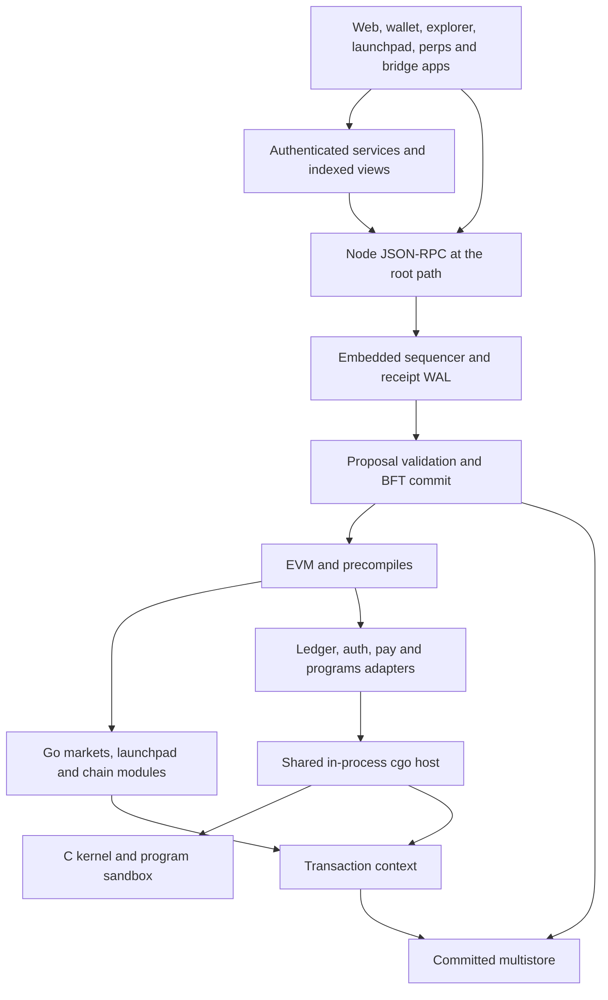

# System overview

Paxeer mainnet-beta is one BFT network. The `paxd` node contains the EVM, native Go modules, the sequencer runtime and the LayerX kernel. EVM chain ID 125 is `0x7d`; the default chain name is `hyperpax_125-1` in [EVM configuration](../../../../modules/evm/config/config.go). A transaction is final when its block is committed.

## Components and boundaries

The diagram shows caller and execution boundaries. The host and kernel run inside the node; services and client applications use network APIs. Writes to a transaction context remain subject to rollback and block commitment.

| Component | Responsibility | Sources |
|---|---|---|
| Node application | Constructs keepers and the shared host, registers modules, installs proposal and finalization handlers | [node/app.go](../../../../node/app.go), [precompile accessors](../../../../node/precompiles.go) |
| Sequencer | Orders admitted transactions, executes open blocks, persists signed receipts and seals batches | [node/sequencer](../../../../node/sequencer), [sequencer module](../../../../modules/sequencer) |
| Consensus | Proposes and validates blocks and commits the decided state | [consensus](../../../../consensus), [application handlers](../../../../node/app.go) |
| EVM and precompiles | Execute signed EVM transactions using contracts selected for the requested height | [EVM module](../../../../modules/evm), [constructor registry](../../../../precompiles/setup.go) |
| Kernel host | Restores branch state, invokes native activity execution and writes back sorted changes | [host](../../../../modules/lxphost/host.go), [branch context](../../../../modules/lxphost/ctx.go) |
| Programs | Execute guest code through versioned host imports and the linked sandbox | [programs](../../../../programs), [programs precompile](../../../../precompiles/layerxprograms) |
| Markets | Settle perps, spot and launchpad operations using Go keepers | [markets and launchpad](markets-and-launchpad.md) |
| RPC | Exposes EVM, receipt, account, history and consensus-evidence reads under configured namespaces | [RPC server](../../../../rpc/server.go), [px methods](px-node-root.md) |
| Off-chain services | Authenticate requests, sign under service policy, relay transactions and maintain read projections | [service topology](services.md) |
| Applications and SDKs | Construct calls, select transports, sign transactions and interpret receipt evidence | [clients and SDKs](clients-and-sdks.md) |

Tenant chains are database domains managed by [layerxchains](../../../../modules/layerxchains). The application connects the chain registry to EVM binding and launchpad. A tenant domain does not require another node process.

## Transaction and commitment flow

The daemon constructs and starts the embedded sequencer through [its root command](../../../../daemon/paxd/cmd/root.go). When sequencing is enabled, the runtime restores its WAL, receipts and lease state before admitting transactions. Its application callbacks supply open-block execution, sealing, receipt lookup and commit notification.

At a sequenced height, transaction zero carries `MsgSequenceBatch`; subsequent transactions follow the batch order. The application verifies the batch against the actual transactions, checks sequence continuity and receipt-key authority on a disposable cache, and checks the proposer before optimistic processing. Finalization adopts a matching sealed state or executes the decided block. The [sequencer and consensus page](sequencer-and-consensus.md) describes these boundaries.

EVM calls reach the height-selected precompile set. The Go perps venue is at `0x1015`, launchpad at `0x1017`, pricefeed at `0x1020`, and spot at `0x1021`–`0x1025`. Historical executors remain selected for earlier heights. Ledger, pay, auth, programs and chain-domain surfaces occupy `0x101A`–`0x101E`; agent-function surfaces occupy `0x0901`–`0x0908`.

Kernel-backed operations use the shared host constructed by the application. The host borrows a native worker, restores the relevant state from the supplied Cosmos context, validates authority, invokes the kernel and copies the result before the worker is reset. Native memory is execution scratch space. The chain context owns persistent state, including the ledger's bank mirror. See [kernel and chain execution](kernel-and-chain.md).

## Receipt evidence

The receipt API exposes `submitted`, `receipted` and `committed`. A transaction hash identifies a submitted transaction. A signed receipt binds the ordered execution result to a governed receipt key; that result can describe a successful or reverted EVM execution. A receipt signature alone does not prove a BFT commit.

Independent committed verification also checks transaction/batch and result inclusion, linked header evidence and the validator commit against trusted consensus state. Receipt signing uses an Ed25519 key distinct from the validator consensus key. Clients must keep execution success, receipt authentication and commitment separate.

## Service trust boundaries

The wallet gateway authenticates callers and applies signing policy before its attestor boundary signs. The node separately checks the signed transaction's authority. Service authentication does not grant arbitrary chain authority.

The platform gateway relays EVM calls and provides hosted operations. Node `px` methods provide local account and consensus reads; operations requiring hosted registration or funding return an explicit hosted-service refusal on the node. Method registration and dependency readiness are separate properties.

Explorer, launchpad and perps-data maintain indexed projections from chain reads and events. They report indexed data and freshness; settlement belongs to the chain's module stores. The interop web watcher submits observations that the on-chain xweb keeper validates. Off-chain acceptance is distinct from on-chain fulfilment.

## Activation and historical state

The `v7.0` merge plan activates the merge surfaces and initializes their stores and state. Constructor completeness, activation predicates and historical contract selection are separate checks. Queries below an activation height retain the corresponding historical behavior; genesis module registration provides the explicit activation case for a chain with no applied merge plan.

An archive node retains committed state and blocks. It is distinct from a sequencer standby, which follows the receipt WAL and preserves accepted execution during recovery. Archive retention does not recreate data already pruned. The [activation runbook](../activation-runbook.md) describes the activation sequence.
