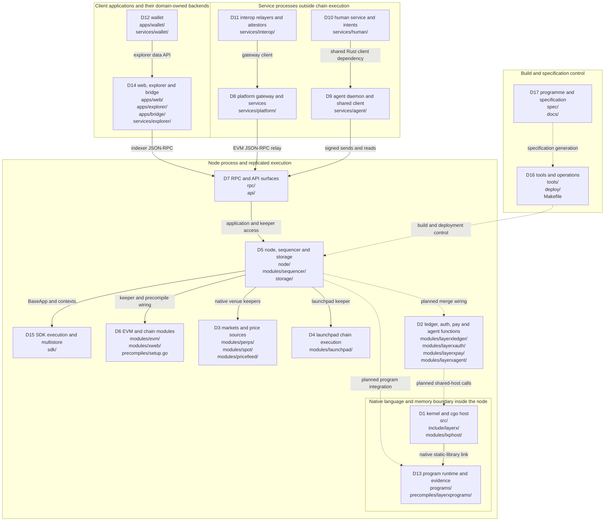
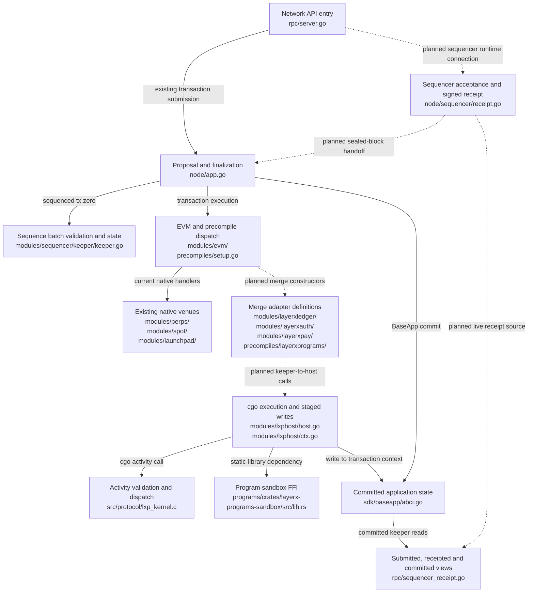
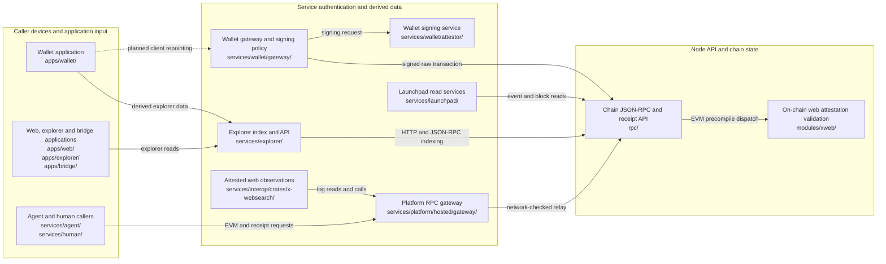

# System overview

This schematic describes the 17 specification domains at repository revision `2a1033aa2` and the merge work declared in the merged specification. Repository paths in boxes identify actual source trees. A domain is a file-ownership and delivery boundary; it is not necessarily a process or a security boundary. Wallet, launchpad and explorer domains each span more than one process.

The current node assembles the EVM and native keepers in `node/app.go:823` and `node/app.go:828`, registers module services in `node/app.go:1133`, and installs its proposal and finalization handlers in `node/app.go:1212`. The existing native host enters the C kernel through `modules/lxphost/host.go:678`. The merge specification plans the missing keeper, precompile and runtime connections around those existing pieces. The address registry alone does not establish a live connection: `precompiles/setup.go:124` skips entries without constructors.

## Domain map

Legend: solid arrows show existing source-level dependencies or network operations, as named on the edge. An arrow points from caller to callee; responses return over the same connection. Dotted arrows explicitly marked “planned” show merge work still declared by tasks. The other dotted arrows carry build or specification control, not transaction traffic. The chain enclosure identifies the node-side parts of each domain; client domains aggregate applications and their backends. The native enclosure is an in-process language boundary, not a remote kernel service. The process trust boundaries of D12's backend, D14's indexer and D4's read services are expanded below.

Walk-through: a wallet's explorer-data client sends HTTP requests in `apps/wallet/src/lib/data/client.ts:48`; the explorer backend reaches the node over HTTP and JSON-RPC as documented in `services/explorer/README.md:21`. D14's arrow includes that backend and does not imply every web screen uses an indexer. The platform gateway relays JSON-RPC through `services/platform/hosted/gateway/src/paxeer.rs:82`, while the agent shared client sends `eth_sendRawTransaction` in `services/agent/crates/layerx-client/src/sequencer.rs:321`. Human services declare shared agent-client dependencies at `services/human/Cargo.toml:31`; the interop web watcher constructs its gateway client at `services/interop/crates/x-websearch/src/watch.rs:123`. These are independently administered callers of node APIs, rather than participants in the node's state transition.

Inside the node, RPC construction receives the application and keeper handles at `rpc/server.go:167`. The application constructs perps, spot and pricefeed keepers at `node/app.go:841`, the launchpad keeper at `node/app.go:837`, and EVM execution at `node/app.go:823`. BaseApp commits through the multistore at `sdk/baseapp/abci.go:296`. The cgo linker inputs already include the C and program sandbox libraries in `modules/lxphost/host.go:7`; runtime integration is a separate delivery obligation. Tasks `2.3.1`, `2.6.1`, `2.10.1`, `2.11.1`, `5.0.3` and `13.0.3` cover the principal dotted merge connections. Build control is concrete: `Makefile:3145` establishes the node's native-library prerequisite, and `spec/specgen:5` invokes the specification generator.

## Transaction, kernel and commitment flow

Legend: solid edges are existing code paths or link dependencies. Dotted edges are planned runtime connections; the corresponding types or component implementations may already exist. “Write to transaction context” stages state within the chain transaction, while “BaseApp commit” establishes the committed state. The program FFI box represents existing exports and the linked library, not proof that program execution is already reachable through the served merge address.

Walk-through: `ProcessProposalHandler` decodes the sequence batch from transaction zero and checks the transaction root in `node/app.go:1547` and `node/app.go:1565`. Execution applies that batch through `modules/sequencer/keeper/keeper.go:56`, where position, height, sequence continuity and signature checks protect sequence state. This distinction matters at HEAD: those keeper checks do not establish that the proposal handler performs every check early. The node-runtime tasks supply the missing runtime assembly and proposal/adoption behavior; `5.5.12` assembles the sequencer runtime and `5.0.3` integrates the runtime-facing surfaces.

The served venues already use native Go keepers. The versioned map at `node/app.go:3528` chooses perps at `0x1015`, launchpad at `0x1017`, pricefeed at `0x1020`, and the spot set whose addresses are defined in `modules/spot/types/keys.go:12`. Decisions `301` and `334` preserve that topology. The future kernel-backed ledger, pay, auth and programs addresses are listed at `precompiles/setup.go:62`; their executors and node wiring remain planned. The registry's skip-on-missing-constructor branch at `precompiles/setup.go:124` is why the map shows that route dotted.

When a caller reaches `HostExecute`, the host loads the SDK branch, serializes access with its mutex, locks the operating-system thread, binds authority and assets, and enters the native activity executor (`modules/lxphost/host.go:678`, `modules/lxphost/host.go:718`). The C bridge calls `lxp_kernel_execute_activity` at `modules/lxphost/host.go:474`. It stages module and account changes through `modules/lxphost/ctx.go:232`, then returns the receipt after the writeback at `modules/lxphost/host.go:742`. Those writes remain in the transaction context until the chain's commit; `sdk/baseapp/abci.go:296` writes the selected state and commits the multistore. The Rust sandbox exports are retained by `programs/crates/layerx-programs-sandbox/src/lib.rs:18`; task `13.0.3` integrates them with the host.

The receipt response defines three rungs at `rpc/sequencer_receipt.go:33`: `submitted`, `receipted` and `committed`. An acceptance signature is evidence of receipt by the sequencer, with a separate committed-block condition. `ReceiptKeys.VerifyReceipt` checks canonical bytes, height coverage of the pinned key and the signature at `modules/sequencer/keeper/receipt_keys.go:112`; it does not itself execute a BaseApp commit. The local receipt producer calls `SignReceipt` at `node/sequencer/receipt.go:366`. Consumers must preserve the rung and trust distinction when presenting a result or authorizing a dependent action.

## Service and client trust boundaries

Legend: each enclosure marks a different input-validation responsibility; boxes are source components rather than a complete deployment inventory. Solid edges identify existing operations. The dotted wallet edge expresses planned client integration and does not assert that every wallet screen currently uses that gateway. The interop observation service is off-chain; the final acceptance of its answer belongs to the chain's xweb keeper. Derived explorer and launchpad data are read models, not the chain's state store.

Walk-through: wallet gateway routes are registered at `services/wallet/gateway/src/index.ts:91`; bearer authentication is enforced by `requireAuth` at `services/wallet/gateway/src/middleware/auth.ts:21`. The signing route imports the policy evaluator, signing client and RPC pool at `services/wallet/gateway/src/routes/sign.ts:20`. The pool broadcasts signed bytes using `eth_sendRawTransaction` at `services/wallet/gateway/src/rpc/pool.ts:347`. A caller's service identity and the authority of the resulting on-chain transaction are separate checks; authentication at the gateway is not a chain authorization grant. Wallet client repointing belongs to the domain-12 wave-5 anchor `12.0.4` and its prerequisites.

The platform gateway checks the target's `eth_chainId` before relaying at `services/platform/hosted/gateway/src/paxeer.rs:94`. Its response remains an RPC observation, with transport and method refusals handled at that boundary. Agent callers already encode EVM calls in `services/agent/crates/layerx-client/src/sequencer.rs:303`. HEAD also contains the human legacy contract-read client at `services/human/crates/layerx-paxeer-client/src/client.rs:359`; decision `1081` and the domain-10 retirement tasks remove that legacy dependency, so it is not presented as a required merge target.

The explorer is a separate set of processes speaking network APIs (`services/explorer/README.md:21`). The web application fetches explorer API responses at `apps/web/src/explorer/client.ts:99`, and the wallet data client fetches them at `apps/wallet/src/lib/data/client.ts:48`. The launchpad indexer requests `eth_getLogs` at `services/launchpad/indexer/internal/source/evm.go:221`. Its statistics service consumes webhook events and maintains read projections through the `services/launchpad/stats-workers/cmd/statsd/main.go:16` entrypoint; its cache is populated in `services/launchpad/stats-workers/internal/consumer/consumer.go:34`. Neither read service replaces the bank or module store.

For web observations, the interop watcher requests `eth_getLogs` at `services/interop/crates/x-websearch/src/watch.rs:580` and EVM reads at `services/interop/crates/x-websearch/src/watch.rs:164`. The chain-side validator is `FulfilProgram` at `modules/xweb/keeper/program_fulfil.go:117`, with signature validation defined at `modules/xweb/keeper/program_fulfil.go:44`. Program-origin wiring is planned work, represented by `13.0.3` and the associated xweb integration tasks; the existing Go function alone does not make every declared program precompile method reachable.

## Delivery and inventory interpretation

Waves describe implementation order rather than deployment topology: 0 foundations, 1 core logic, 2 public surfaces, 3 services, 4 integration, 5 clients, 6 conformance and retirement, 7 completion. Per-domain anchors are `N.0.1`, `N.0.2`, `N.0.3`, `N.0.4` and `N.0.9`; programme completion is `17.0.9`. The Hyperfide CLI (`cg`) consumes the specification and qualification evidence. A pending task's presence or a counted interface does not claim that its implementation or gate has run.

The following 17 tables count distinct merged `[interface.N.*]` blocks by their recorded `kind`, after the merge has applied interface status overrides. The scope is the specification inventory, including stable surfaces and declared retirements; counts are not a count of deployed methods or unique selectors. Generated exports and legacy snapshots remain separate entries when the specification gives them separate IDs. Planned entries can name files absent from HEAD; all diagram boxes instead name existing paths.

Columns S, C, N and R mean `stable`, `change`, `new` and `retire`. Covering waves are the union of the waves of tasks whose `interfaces` list explicitly names an interface in that row, accepting either bare IDs or the `interface.` prefix. A wave listed for a kind does not imply that every interface of that kind changes in that wave. A dash means that the kind has no modifying task and consists of stable inventory. Stable entries require no modifying task; integration and completion tasks may be counted in a domain's task summary without naming an interface. Zero-count kinds are omitted. Every non-stable entry has at least one explicit covering task in this snapshot.

The counts below are generated from the same merged snapshot; they do not use raw inventory totals or stale generators. No interface, task or other specification block is added by this schematic.

### Domain 1: Kernel

Paths: `src/`, `include/layerx/`, `modules/lxphost/`, `layerxproof/`, `custodyproof/`.

The native host is the adapter between SDK transaction state and C activity execution. `modules/lxphost/host.go:678` defines the host entry; `modules/lxphost/ctx.go:232` defines its state writeback. Keep the C memory/thread boundary inside the node trust boundary. The shared-host consumers and retirement of standalone kernel surfaces are specification work, rather than evidence that a remote kernel daemon is required.

Inventory: **2,755 interfaces**; **141 tasks**. Tasks by wave: 0: 18; 1: 17; 2: 19; 3: 7; 4: 9; 5: 19; 6: 51; 7: 1.

| Interface kind | Count | S | C | N | R | Covering waves |
| --- | ---: | ---: | ---: | ---: | ---: | --- |
| `c_symbol` | 2,294 | 1,726 | 62 | 15 | 491 | 0, 1, 2, 3, 4, 5, 6 |
| `error_code` | 132 | 128 | 0 | 3 | 1 | 0, 5 |
| `file_format` | 15 | 7 | 2 | 0 | 6 | 4, 5, 6 |
| `go_exported` | 308 | 227 | 10 | 4 | 67 | 0, 1, 2, 3, 5, 6 |
| `storage_key` | 6 | 5 | 0 | 0 | 1 | 5 |
| **Total** | 2,755 | 2,093 | 74 | 22 | 566 | 0, 1, 2, 3, 4, 5, 6 |

### Domain 2: Ledger, auth and pay

Paths: `modules/layerxledger/`, `modules/layerxauth/`, `modules/layerxpay/`, `modules/layerxagent/`.

This domain owns chain adapters for kernel accounts, authorization, payment constructs and agent functions. At HEAD the authorization implementation includes `LayerXScopeAuthorization.MsgTypeURL` at `modules/layerxauth/types/authorization.go:41`, and the payment payload types include `StreamOpen` at `modules/layerxpay/types/payload_stream.go:28`. The merge address declarations are at `precompiles/setup.go:62`; the planned keeper/executor work connects these surfaces to the shared host. A payload or registry entry is not proof of an activated keeper.

Inventory: **617 interfaces**; **153 tasks**. Tasks by wave: 0: 27; 1: 15; 2: 79; 4: 15; 5: 2; 6: 14; 7: 1.

| Interface kind | Count | S | C | N | R | Covering waves |
| --- | ---: | ---: | ---: | ---: | ---: | --- |
| `cli_command` | 4 | 0 | 0 | 4 | 0 | 2 |
| `cosmos_msg` | 4 | 0 | 2 | 2 | 0 | 0, 2 |
| `error_code` | 31 | 27 | 1 | 3 | 0 | 0 |
| `event` | 2 | 2 | 0 | 0 | 0 | — |
| `file_format` | 2 | 0 | 0 | 2 | 0 | 0 |
| `genesis_param` | 4 | 0 | 0 | 4 | 0 | 0 |
| `go_exported` | 349 | 180 | 10 | 157 | 2 | 0, 1, 2 |
| `grpc_query` | 4 | 0 | 0 | 4 | 0 | 0, 2 |
| `precompile_error` | 45 | 0 | 42 | 3 | 0 | 0 |
| `precompile_event` | 48 | 0 | 39 | 9 | 0 | 2, 4 |
| `precompile_method` | 85 | 0 | 71 | 14 | 0 | 2, 4 |
| `proto_message` | 21 | 8 | 1 | 12 | 0 | 0 |
| `sol_function` | 3 | 3 | 0 | 0 | 0 | — |
| `storage_key` | 15 | 12 | 0 | 0 | 3 | 0, 1 |
| **Total** | 617 | 232 | 166 | 214 | 5 | 0, 1, 2, 4 |

### Domain 3: Markets

Paths: `modules/perps/`, `modules/spot/`, `modules/pricefeed/`, `services/platform/perps-data/`.

The served perpetuals venue is native Go: its keeper owns the EVM collateral and pricefeed dependencies at `modules/perps/keeper/keeper.go:20`. Spot has its own five addresses at `modules/spot/types/keys.go:12`. The application constructs pricefeed, perps and spot together at `node/app.go:841`. The legacy exchange implementation is preserved only where the merged specification calls for historical replay; decisions `301` and `334` determine the served topology.

Inventory: **4,202 interfaces**; **170 tasks**. Tasks by wave: 0: 11; 1: 40; 2: 25; 3: 6; 4: 46; 5: 12; 6: 29; 7: 1.

| Interface kind | Count | S | C | N | R | Covering waves |
| --- | ---: | ---: | ---: | ---: | ---: | --- |
| `cli_command` | 37 | 29 | 1 | 7 | 0 | 5, 6 |
| `cosmos_msg` | 11 | 4 | 2 | 3 | 2 | 2, 4 |
| `env_var` | 54 | 53 | 1 | 0 | 0 | 1 |
| `error_code` | 176 | 116 | 59 | 1 | 0 | 0, 2 |
| `event` | 94 | 87 | 1 | 5 | 1 | 1, 2 |
| `file_format` | 6 | 6 | 0 | 0 | 0 | — |
| `genesis_param` | 49 | 39 | 10 | 0 | 0 | 1 |
| `go_exported` | 1,241 | 1,170 | 45 | 23 | 3 | 0, 1, 2, 3, 4, 5, 6 |
| `grpc_query` | 20 | 14 | 0 | 6 | 0 | 0 |
| `http_route` | 140 | 121 | 10 | 1 | 8 | 2, 3, 6 |
| `metric` | 30 | 27 | 0 | 3 | 0 | 3 |
| `precompile_error` | 166 | 162 | 4 | 0 | 0 | 2 |
| `precompile_event` | 81 | 81 | 0 | 0 | 0 | — |
| `precompile_method` | 302 | 300 | 2 | 0 | 0 | 4 |
| `proto_message` | 116 | 94 | 0 | 18 | 4 | 0, 2 |
| `rest_route` | 22 | 14 | 0 | 6 | 2 | 2 |
| `storage_key` | 122 | 114 | 3 | 5 | 0 | 0, 1, 6 |
| `ts_export` | 1,517 | 1,471 | 13 | 21 | 12 | 1, 5, 6 |
| `wasm_binding` | 3 | 3 | 0 | 0 | 0 | — |
| `ws_route` | 15 | 10 | 5 | 0 | 0 | 3 |
| **Total** | 4,202 | 3,915 | 156 | 99 | 32 | 0, 1, 2, 3, 4, 5, 6 |

### Domain 4: Launchpad

Paths: `modules/launchpad/`, `precompiles/launchpad/`, `services/launchpad/`, `apps/launchpad/`, `sdk/launchpad/`.

The chain launchpad and its service/read-model tree share domain ownership but have different trust boundaries. The precompile binds its address at `precompiles/launchpad/launchpad.go:37` and is backed by the keeper constructed at `node/app.go:837`. The statistics process starts at `services/launchpad/stats-workers/cmd/statsd/main.go:16`. Chain operations belong to the keeper; service projections support client reads and do not establish consensus state.

Inventory: **14,315 interfaces**; **186 tasks**. Tasks by wave: 0: 37; 1: 43; 2: 44; 3: 7; 4: 25; 5: 25; 6: 4; 7: 1.

| Interface kind | Count | S | C | N | R | Covering waves |
| --- | ---: | ---: | ---: | ---: | ---: | --- |
| `cli_command` | 309 | 278 | 8 | 18 | 5 | 0, 1, 2, 5 |
| `config_key` | 169 | 162 | 6 | 0 | 1 | 0, 1, 2 |
| `cosmos_msg` | 2 | 2 | 0 | 0 | 0 | — |
| `env_var` | 852 | 841 | 8 | 2 | 1 | 0, 1, 2 |
| `error_code` | 860 | 807 | 49 | 2 | 2 | 0, 2 |
| `event` | 67 | 65 | 2 | 0 | 0 | 2 |
| `file_format` | 102 | 95 | 6 | 0 | 1 | 0, 2 |
| `genesis_param` | 17 | 11 | 0 | 0 | 6 | 1 |
| `go_exported` | 4,864 | 4,784 | 19 | 37 | 24 | 0, 1, 2, 3, 4, 6 |
| `grpc_query` | 17 | 0 | 0 | 17 | 0 | 2 |
| `http_route` | 749 | 657 | 7 | 77 | 8 | 2, 3, 4 |
| `makefile_target` | 16 | 14 | 1 | 1 | 0 | 1, 2 |
| `metric` | 10 | 10 | 0 | 0 | 0 | — |
| `precompile_error` | 57 | 57 | 0 | 0 | 0 | — |
| `precompile_event` | 52 | 52 | 0 | 0 | 0 | — |
| `precompile_method` | 309 | 309 | 0 | 0 | 0 | — |
| `proto_message` | 16 | 6 | 0 | 10 | 0 | 0 |
| `rest_route` | 17 | 0 | 0 | 17 | 0 | 2 |
| `sol_event` | 452 | 452 | 0 | 0 | 0 | — |
| `sol_function` | 2,558 | 2,558 | 0 | 0 | 0 | — |
| `storage_key` | 24 | 23 | 0 | 1 | 0 | 1 |
| `ts_export` | 2,786 | 2,712 | 27 | 13 | 34 | 0, 1, 2, 3, 5, 6 |
| `ws_route` | 10 | 10 | 0 | 0 | 0 | — |
| **Total** | 14,315 | 13,905 | 133 | 195 | 82 | 0, 1, 2, 3, 4, 5, 6 |

### Domain 5: Node runtime

Paths: `node/`, `modules/sequencer/`, `modules/store/`, `storage/`, `engine/`, `consensus/`, `daemon/`.

This domain assembles execution, consensus hooks, receipt production and node persistence. `node/app.go:1212` installs the proposal handler and finalizer; `modules/sequencer/keeper/keeper.go:56` admits the committed sequence batch. The receipt producer exists at `node/sequencer/receipt.go:325`, while tasks such as `5.5.12` still supply runtime assembly. The domain contains the integration seam shared by the RPC, keeper and native-runtime layers.

Inventory: **2,946 interfaces**; **232 tasks**. Tasks by wave: 0: 15; 1: 44; 2: 38; 3: 27; 4: 31; 5: 42; 6: 34; 7: 1.

| Interface kind | Count | S | C | N | R | Covering waves |
| --- | ---: | ---: | ---: | ---: | ---: | --- |
| `cli_command` | 279 | 198 | 8 | 7 | 66 | 0, 2, 3, 4, 5, 6 |
| `config_key` | 214 | 180 | 21 | 13 | 0 | 1, 2, 4, 5 |
| `cosmos_msg` | 1 | 1 | 0 | 0 | 0 | — |
| `env_var` | 102 | 11 | 0 | 0 | 91 | 6 |
| `error_code` | 20 | 19 | 0 | 1 | 0 | 2 |
| `file_format` | 39 | 29 | 4 | 3 | 3 | 0, 2, 3, 4, 5, 6 |
| `genesis_param` | 12 | 11 | 0 | 1 | 0 | 1, 3 |
| `go_exported` | 1,781 | 1,629 | 62 | 74 | 16 | 0, 1, 2, 3, 4, 5, 6 |
| `grpc_service_method` | 4 | 4 | 0 | 0 | 0 | — |
| `metric` | 334 | 303 | 24 | 7 | 0 | 1 |
| `storage_key` | 130 | 121 | 5 | 3 | 1 | 0, 4, 6 |
| `wasm_binding` | 30 | 29 | 1 | 0 | 0 | 1 |
| **Total** | 2,946 | 2,535 | 125 | 109 | 177 | 0, 1, 2, 3, 4, 5, 6 |

### Domain 6: Chain modules

Paths: `modules/evm/`, `modules/tokenfactory/`, `modules/layerxbridge/`, `modules/xweb/`, `precompiles/setup.go`.

EVM execution, shared precompile registration and the remaining chain modules live here. `precompiles/setup.go:89` registers merge constructors and `precompiles/setup.go:117` builds the registered set. The xweb precompile is at `precompiles/xweb/xweb.go:59`; program-answer validation is defined at `modules/xweb/keeper/program_fulfil.go:117`. This is the on-chain authority boundary for bridge, token, governance and web-observation operations, independent of the off-chain submitter.

Inventory: **5,092 interfaces**; **253 tasks**. Tasks by wave: 0: 46; 1: 31; 2: 33; 3: 7; 4: 38; 5: 39; 6: 58; 7: 1.

| Interface kind | Count | S | C | N | R | Covering waves |
| --- | ---: | ---: | ---: | ---: | ---: | --- |
| `c_symbol` | 1 | 1 | 0 | 0 | 0 | — |
| `cli_command` | 173 | 136 | 9 | 11 | 17 | 2, 5, 6 |
| `config_key` | 110 | 86 | 19 | 4 | 1 | 0, 1, 2, 4, 5, 6 |
| `cosmos_msg` | 76 | 65 | 1 | 0 | 10 | 2 |
| `env_var` | 7 | 7 | 0 | 0 | 0 | — |
| `error_code` | 782 | 641 | 3 | 13 | 125 | 0, 2, 3, 5, 6 |
| `event` | 126 | 119 | 1 | 4 | 2 | 0, 1 |
| `file_format` | 26 | 23 | 0 | 0 | 3 | 6 |
| `genesis_param` | 83 | 75 | 2 | 6 | 0 | 0, 1, 2, 5 |
| `go_exported` | 1,783 | 1,708 | 26 | 46 | 3 | 0, 1, 2, 3, 4, 5, 6 |
| `grpc_query` | 63 | 55 | 0 | 8 | 0 | 0, 2 |
| `grpc_service_method` | 1 | 0 | 0 | 1 | 0 | 0 |
| `ibc_port` | 53 | 53 | 0 | 0 | 0 | — |
| `metric` | 14 | 13 | 1 | 0 | 0 | 1 |
| `precompile_error` | 44 | 39 | 2 | 3 | 0 | 2, 3, 4 |
| `precompile_event` | 50 | 18 | 0 | 14 | 18 | 0, 2 |
| `precompile_method` | 167 | 90 | 3 | 28 | 46 | 0, 2, 4, 6 |
| `proto_message` | 443 | 394 | 1 | 18 | 30 | 0, 1, 2 |
| `rest_route` | 80 | 70 | 0 | 10 | 0 | 0, 2 |
| `rust_pub_item` | 14 | 14 | 0 | 0 | 0 | — |
| `sol_event` | 134 | 67 | 0 | 0 | 67 | 2, 6 |
| `sol_function` | 722 | 346 | 5 | 0 | 371 | 2, 4, 5, 6 |
| `storage_key` | 67 | 63 | 1 | 1 | 2 | 0, 2, 3 |
| `wasm_binding` | 73 | 70 | 1 | 2 | 0 | 1, 2 |
| **Total** | 5,092 | 4,153 | 75 | 169 | 695 | 0, 1, 2, 3, 4, 5, 6 |

### Domain 7: RPC and API

Paths: `rpc/`, `api/`, `sdk/proto/`.

Node listeners expose chain reads, transaction submission, subscriptions and receipt observations. `rpc/server.go:220` registers the EVM namespace and `rpc/sequencer_receipt.go:26` fixes the receipt method name. The rung constants at `rpc/sequencer_receipt.go:33` keep a submitted transaction, a signed receipt and a committed transaction distinct. The caller-facing API depends on node-runtime option and source wiring to make the planned behavior reachable.

Inventory: **864 interfaces**; **116 tasks**. Tasks by wave: 0: 8; 1: 53; 2: 15; 3: 8; 4: 23; 5: 3; 6: 5; 7: 1.

| Interface kind | Count | S | C | N | R | Covering waves |
| --- | ---: | ---: | ---: | ---: | ---: | --- |
| `config_key` | 45 | 36 | 4 | 4 | 1 | 0, 2, 3, 5 |
| `cosmos_msg` | 23 | 23 | 0 | 0 | 0 | — |
| `env_var` | 1 | 1 | 0 | 0 | 0 | — |
| `error_code` | 6 | 4 | 0 | 2 | 0 | 3, 5 |
| `file_format` | 7 | 2 | 1 | 1 | 3 | 0, 1, 6 |
| `go_exported` | 37 | 26 | 5 | 4 | 2 | 0, 1, 2, 3, 4 |
| `grpc_query` | 59 | 59 | 0 | 0 | 0 | — |
| `grpc_service_method` | 22 | 22 | 0 | 0 | 0 | — |
| `http_route` | 1 | 0 | 1 | 0 | 0 | 5 |
| `jsonrpc_method` | 125 | 80 | 16 | 12 | 17 | 0, 1, 2, 3 |
| `metric` | 41 | 35 | 0 | 3 | 3 | 1, 2 |
| `proto_message` | 413 | 413 | 0 | 0 | 0 | — |
| `rest_route` | 80 | 78 | 0 | 2 | 0 | 0 |
| `ws_route` | 4 | 1 | 3 | 0 | 0 | 1, 2, 3, 4, 5 |
| **Total** | 864 | 780 | 30 | 28 | 26 | 0, 1, 2, 3, 4, 5, 6 |

### Domain 8: Platform

Paths: `services/platform/`, `tools/platform/`, `sdk/platform/`.

The platform workspace contains the gateway, core, authority, indexer and supporting service processes (`services/platform/Cargo.toml:2`). Its gateway relay checks the network and forwards RPC at `services/platform/hosted/gateway/src/paxeer.rs:82`. Service databases, caches and backend authentication are outside replicated chain execution; returned chain observations retain their receipt or committed-state semantics.

Inventory: **7,469 interfaces**; **200 tasks**. Tasks by wave: 0: 10; 1: 17; 2: 17; 3: 24; 4: 17; 5: 59; 6: 55; 7: 1.

| Interface kind | Count | S | C | N | R | Covering waves |
| --- | ---: | ---: | ---: | ---: | ---: | --- |
| `cli_command` | 828 | 717 | 40 | 3 | 68 | 0, 2, 3, 4, 5, 6 |
| `config_key` | 570 | 422 | 24 | 36 | 88 | 0, 1, 4, 5, 6 |
| `env_var` | 633 | 548 | 3 | 16 | 66 | 1, 2, 3, 5, 6 |
| `error_code` | 649 | 586 | 0 | 0 | 63 | 5, 6 |
| `file_format` | 321 | 251 | 33 | 5 | 32 | 0, 2, 3, 4, 5, 6 |
| `go_exported` | 3,326 | 2,662 | 429 | 4 | 231 | 1, 2, 4, 5, 6 |
| `http_route` | 409 | 346 | 9 | 2 | 52 | 3, 4, 5, 6 |
| `jsonrpc_method` | 67 | 33 | 0 | 7 | 27 | 2, 3, 6 |
| `metric` | 22 | 22 | 0 | 0 | 0 | — |
| `rust_pub_item` | 431 | 367 | 22 | 9 | 33 | 0, 1, 2, 3, 4, 5, 6 |
| `ts_export` | 211 | 131 | 58 | 11 | 11 | 0, 1, 2, 3, 5, 6 |
| `ws_route` | 2 | 2 | 0 | 0 | 0 | — |
| **Total** | 7,469 | 6,087 | 618 | 93 | 671 | 0, 1, 2, 3, 4, 5, 6 |

### Domain 9: Agent

Paths: `services/agent/`.

Agent applications and shared Rust clients call the node through network APIs. `services/agent/crates/layerx-client/src/sequencer.rs:303` implements EVM reads, `services/agent/crates/layerx-client/src/sequencer.rs:321` submits signed bytes, and `services/agent/crates/layerx-client/src/sequencer.rs:367` requests receipt keys. The table includes both the surviving client-facing surfaces and the separately inventoried legacy surfaces declared for retirement.

Inventory: **4,994 interfaces**; **148 tasks**. Tasks by wave: 0: 10; 1: 26; 2: 32; 3: 22; 4: 18; 5: 13; 6: 26; 7: 1.

| Interface kind | Count | S | C | N | R | Covering waves |
| --- | ---: | ---: | ---: | ---: | ---: | --- |
| `c_symbol` | 10 | 0 | 0 | 0 | 10 | 6 |
| `cli_command` | 57 | 31 | 23 | 0 | 3 | 2, 3, 4, 5, 6 |
| `config_key` | 69 | 64 | 5 | 0 | 0 | 1, 3, 5 |
| `env_var` | 134 | 112 | 5 | 3 | 14 | 0, 3, 4, 5, 6 |
| `error_code` | 194 | 185 | 7 | 1 | 1 | 1, 2, 6 |
| `file_format` | 32 | 13 | 17 | 0 | 2 | 0, 1, 2, 3, 5, 6 |
| `http_route` | 100 | 9 | 90 | 0 | 1 | 1, 2, 3, 4, 5, 6 |
| `jsonrpc_method` | 4 | 4 | 0 | 0 | 0 | — |
| `metric` | 90 | 83 | 7 | 0 | 0 | 2 |
| `proto_message` | 232 | 120 | 66 | 0 | 46 | 1, 2, 6 |
| `rust_pub_item` | 3,366 | 2,760 | 146 | 24 | 436 | 0, 1, 2, 3, 4, 5, 6 |
| `ts_export` | 706 | 668 | 31 | 1 | 6 | 1, 2, 3, 4, 5, 6 |
| **Total** | 4,994 | 4,049 | 397 | 29 | 519 | 0, 1, 2, 3, 4, 5, 6 |

### Domain 10: Human

Paths: `services/human/`.

Human identity, intents and application services reuse shared clients through workspace dependencies at `services/human/Cargo.toml:31`. HEAD also has the legacy contract-read boundary at `services/human/crates/layerx-paxeer-client/src/client.rs:359`. Decision `1081` removes that legacy workspace dependency during the retirement sequence; its presence in the inventory does not make it part of the target runtime.

Inventory: **2,554 interfaces**; **111 tasks**. Tasks by wave: 0: 6; 1: 19; 2: 12; 3: 7; 4: 15; 5: 38; 6: 13; 7: 1.

| Interface kind | Count | S | C | N | R | Covering waves |
| --- | ---: | ---: | ---: | ---: | ---: | --- |
| `cli_command` | 31 | 19 | 6 | 0 | 6 | 1, 3, 5, 6 |
| `config_key` | 30 | 21 | 9 | 0 | 0 | 1, 3 |
| `env_var` | 228 | 144 | 12 | 1 | 71 | 1, 3, 5, 6 |
| `error_code` | 58 | 37 | 0 | 1 | 20 | 1, 5 |
| `file_format` | 263 | 225 | 20 | 0 | 18 | 1, 2, 3, 4, 5, 6 |
| `http_route` | 106 | 72 | 17 | 0 | 17 | 1, 2, 3, 5 |
| `rust_pub_item` | 1,838 | 1,066 | 87 | 6 | 679 | 0, 1, 2, 3, 4, 5, 6 |
| **Total** | 2,554 | 1,584 | 151 | 8 | 811 | 0, 1, 2, 3, 4, 5, 6 |

### Domain 11: Interop

Paths: `services/interop/`.

Relayers, web attestors and other interoperability processes supply external observations and chain submissions. The web watcher performs EVM calls at `services/interop/crates/x-websearch/src/watch.rs:164` and reads logs at `services/interop/crates/x-websearch/src/watch.rs:580`. The receiving chain verifies observations through `modules/xweb/keeper/program_fulfil.go:117`; the service does not directly mutate the node store.

Inventory: **3,077 interfaces**; **125 tasks**. Tasks by wave: 0: 13; 1: 17; 2: 22; 3: 21; 4: 14; 5: 11; 6: 26; 7: 1.

| Interface kind | Count | S | C | N | R | Covering waves |
| --- | ---: | ---: | ---: | ---: | ---: | --- |
| `cli_command` | 17 | 11 | 5 | 0 | 1 | 0, 3, 4, 5, 6 |
| `config_key` | 366 | 330 | 19 | 8 | 9 | 0, 1, 2, 3, 4, 5, 6 |
| `env_var` | 70 | 41 | 8 | 2 | 19 | 1, 2, 3, 4, 6 |
| `error_code` | 280 | 257 | 20 | 3 | 0 | 0, 3, 4 |
| `file_format` | 252 | 218 | 16 | 7 | 11 | 0, 1, 2, 3, 4, 5, 6 |
| `http_route` | 51 | 28 | 18 | 2 | 3 | 1, 2, 3, 4, 5, 6 |
| `rust_pub_item` | 2,028 | 1,708 | 114 | 58 | 148 | 0, 1, 2, 3, 4, 5, 6 |
| `sol_event` | 3 | 2 | 1 | 0 | 0 | 0 |
| `sol_function` | 10 | 8 | 2 | 0 | 0 | 0, 6 |
| **Total** | 3,077 | 2,603 | 203 | 80 | 191 | 0, 1, 2, 3, 4, 5, 6 |

### Domain 12: Wallet

Paths: `services/wallet/`, `apps/wallet/`, `sdk/wallet/`.

Wallet UI, gateway and signing service span caller, application-service and signing boundaries. `services/wallet/gateway/src/index.ts:91` registers the routes, `services/wallet/gateway/src/middleware/auth.ts:21` authenticates service requests, and `services/wallet/gateway/src/rpc/pool.ts:347` broadcasts signed transactions. Node APIs, signing authorization and explorer-derived balances remain different sources of authority.

Inventory: **3,511 interfaces**; **117 tasks**. Tasks by wave: 0: 9; 1: 15; 2: 13; 3: 14; 4: 16; 5: 21; 6: 28; 7: 1.

| Interface kind | Count | S | C | N | R | Covering waves |
| --- | ---: | ---: | ---: | ---: | ---: | --- |
| `cli_command` | 58 | 56 | 2 | 0 | 0 | 3, 4 |
| `config_key` | 87 | 83 | 4 | 0 | 0 | 1, 6 |
| `env_var` | 208 | 199 | 2 | 2 | 5 | 0, 3, 4, 5, 6 |
| `error_code` | 297 | 278 | 6 | 0 | 13 | 3, 4, 5, 6 |
| `event` | 22 | 22 | 0 | 0 | 0 | — |
| `file_format` | 103 | 78 | 17 | 6 | 2 | 0, 1, 2, 4, 5, 6 |
| `go_exported` | 640 | 600 | 24 | 6 | 10 | 0, 1, 2, 3, 4, 5, 6 |
| `http_route` | 150 | 98 | 39 | 8 | 5 | 0, 1, 2, 3, 4, 5, 6 |
| `jsonrpc_method` | 55 | 35 | 7 | 3 | 10 | 1, 2, 3, 4, 5, 6 |
| `metric` | 8 | 3 | 5 | 0 | 0 | 0, 1 |
| `rust_pub_item` | 1 | 0 | 1 | 0 | 0 | 6 |
| `storage_key` | 67 | 56 | 3 | 2 | 6 | 2, 3, 5, 6 |
| `ts_export` | 1,815 | 1,613 | 139 | 27 | 36 | 0, 1, 2, 3, 4, 5, 6 |
| **Total** | 3,511 | 3,121 | 249 | 54 | 87 | 0, 1, 2, 3, 4, 5, 6 |

### Domain 13: Programs

Paths: `programs/`, `precompiles/layerxprograms/`.

The Rust program runtime, sandbox and evidence verifiers are native components with explicit host exports. `programs/crates/layerx-programs-sandbox/src/lib.rs:18` retains the FFI entrypoints, and `modules/lxphost/host.go:7` already links the sandbox library. Task `13.0.3` connects the runtime and host, while `13.22.1` builds the planned `0x101D` executor. A linked library and a declared address are separate from a served and activated execution path.

Inventory: **5,152 interfaces**; **127 tasks**. Tasks by wave: 0: 12; 1: 20; 2: 31; 3: 21; 4: 20; 5: 8; 6: 14; 7: 1.

| Interface kind | Count | S | C | N | R | Covering waves |
| --- | ---: | ---: | ---: | ---: | ---: | --- |
| `c_symbol` | 293 | 288 | 0 | 0 | 5 | 6 |
| `cli_command` | 21 | 20 | 1 | 0 | 0 | 6 |
| `config_key` | 106 | 105 | 1 | 0 | 0 | 6 |
| `cosmos_msg` | 4 | 4 | 0 | 0 | 0 | — |
| `env_var` | 31 | 30 | 1 | 0 | 0 | 4 |
| `error_code` | 211 | 211 | 0 | 0 | 0 | — |
| `file_format` | 54 | 53 | 0 | 1 | 0 | 3 |
| `go_exported` | 21 | 1 | 0 | 20 | 0 | 0, 1, 4 |
| `grpc_query` | 3 | 3 | 0 | 0 | 0 | — |
| `precompile_event` | 14 | 0 | 0 | 14 | 0 | 0 |
| `precompile_method` | 35 | 0 | 35 | 0 | 0 | 2 |
| `proto_message` | 25 | 25 | 0 | 0 | 0 | — |
| `rust_pub_item` | 3,935 | 3,759 | 101 | 28 | 47 | 0, 1, 2, 3, 4, 5, 6 |
| `sol_function` | 1 | 0 | 0 | 1 | 0 | 0 |
| `ts_export` | 289 | 289 | 0 | 0 | 0 | — |
| `wasm_binding` | 109 | 109 | 0 | 0 | 0 | — |
| **Total** | 5,152 | 4,897 | 139 | 64 | 52 | 0, 1, 2, 3, 4, 5, 6 |

### Domain 14: Web, explorer and bridge

Paths: `apps/web/`, `apps/explorer/`, `apps/bridge/`, `services/explorer/`, `services/bridge/`, `sdk/js/`.

These client applications and index services use node APIs rather than sharing the node executable. `services/explorer/README.md:21` records the process/network boundary, and `apps/web/src/explorer/client.ts:99` performs an explorer API fetch. Index projections serve application reads; the node retains authority for transaction execution and commitment.

Inventory: **7,355 interfaces**; **163 tasks**. Tasks by wave: 0: 11; 1: 32; 2: 35; 3: 22; 4: 17; 5: 28; 6: 17; 7: 1.

| Interface kind | Count | S | C | N | R | Covering waves |
| --- | ---: | ---: | ---: | ---: | ---: | --- |
| `cli_command` | 19 | 15 | 0 | 4 | 0 | 0, 2, 5 |
| `config_key` | 689 | 679 | 4 | 1 | 5 | 0, 2 |
| `env_var` | 1,210 | 1,143 | 10 | 3 | 54 | 1, 2, 3, 4, 5, 6 |
| `error_code` | 8 | 8 | 0 | 0 | 0 | — |
| `file_format` | 6 | 5 | 0 | 1 | 0 | 3 |
| `go_exported` | 83 | 77 | 0 | 6 | 0 | 1, 2, 4, 5 |
| `grpc_service_method` | 19 | 19 | 0 | 0 | 0 | — |
| `http_route` | 622 | 605 | 1 | 5 | 11 | 2, 3, 5, 6 |
| `jsonrpc_method` | 16 | 16 | 0 | 0 | 0 | — |
| `metric` | 65 | 65 | 0 | 0 | 0 | — |
| `rust_pub_item` | 1 | 0 | 0 | 1 | 0 | 1 |
| `storage_key` | 8 | 2 | 6 | 0 | 0 | 3, 5 |
| `ts_export` | 4,501 | 3,983 | 373 | 45 | 100 | 0, 1, 2, 3, 4, 5 |
| `ws_route` | 108 | 108 | 0 | 0 | 0 | — |
| **Total** | 7,355 | 6,725 | 394 | 66 | 170 | 0, 1, 2, 3, 4, 5, 6 |

### Domain 15: Cosmos fork

Paths: `sdk/`.

The in-tree SDK supplies BaseApp, contexts, module services and the multistore abstraction to the node. `sdk/baseapp/abci.go:254` selects the proposal state for commitment, and `sdk/baseapp/abci.go:269` implements Commit. Its exported client libraries are also inventoried here, so a large stable export count is not a count of node RPC endpoints. Kinds reflect the merged schema; exports represented under a generic kind remain in that kind.

Inventory: **6,070 interfaces**; **57 tasks**. Tasks by wave: 0: 1; 1: 22; 2: 1; 3: 1; 4: 1; 5: 13; 6: 17; 7: 1.

| Interface kind | Count | S | C | N | R | Covering waves |
| --- | ---: | ---: | ---: | ---: | ---: | --- |
| `c_symbol` | 28 | 28 | 0 | 0 | 0 | — |
| `cli_command` | 199 | 194 | 3 | 0 | 2 | 1, 2, 6 |
| `env_var` | 4 | 2 | 0 | 1 | 1 | 5 |
| `error_code` | 40 | 40 | 0 | 0 | 0 | — |
| `event` | 1 | 0 | 0 | 1 | 0 | 1, 4 |
| `file_format` | 4 | 0 | 1 | 0 | 3 | 2, 5 |
| `go_exported` | 4,574 | 4,556 | 5 | 12 | 1 | 0, 1, 2, 3, 4, 6 |
| `grpc_service_method` | 3 | 3 | 0 | 0 | 0 | — |
| `jsonrpc_method` | 35 | 22 | 13 | 0 | 0 | 1, 2, 3, 4, 5, 6 |
| `makefile_target` | 39 | 13 | 5 | 0 | 21 | 0, 1, 2, 3, 4, 5, 6 |
| `metric` | 254 | 189 | 0 | 2 | 63 | 1, 6 |
| `proto_message` | 184 | 184 | 0 | 0 | 0 | — |
| `rust_pub_item` | 209 | 209 | 0 | 0 | 0 | — |
| `ts_export` | 496 | 492 | 0 | 2 | 2 | 5 |
| **Total** | 6,070 | 5,932 | 27 | 18 | 93 | 0, 1, 2, 3, 4, 5, 6 |

### Domain 16: Tools and operations

Paths: `tools/`, `deploy/`, `docker/`, `scripts/`, `Makefile`, `chain.mk`.

Build, release, deployment and qualification tooling controls how executables and evidence are produced. `Makefile:3145` declares native prerequisites and `Makefile:3147` declares the node build target. These are control dependencies rather than transaction-processing hops. The covering waves include tooling interfaces explicitly named by implementation tasks, not every task that happens to run a tool.

Inventory: **6,709 interfaces**; **153 tasks**. Tasks by wave: 0: 14; 1: 20; 2: 9; 3: 6; 4: 6; 5: 64; 6: 33; 7: 1.

| Interface kind | Count | S | C | N | R | Covering waves |
| --- | ---: | ---: | ---: | ---: | ---: | --- |
| `c_symbol` | 17 | 9 | 0 | 2 | 6 | 0, 6 |
| `cli_command` | 1,576 | 1,461 | 83 | 14 | 18 | 0, 1, 2, 3, 4, 5, 6 |
| `config_key` | 1,425 | 1,416 | 2 | 5 | 2 | 0, 2, 5 |
| `env_var` | 2,104 | 2,083 | 0 | 4 | 17 | 1, 2, 5 |
| `file_format` | 447 | 420 | 13 | 3 | 11 | 0, 1, 2, 3, 4, 5, 6 |
| `go_exported` | 79 | 61 | 3 | 9 | 6 | 1, 2 |
| `http_route` | 21 | 21 | 0 | 0 | 0 | — |
| `makefile_target` | 974 | 795 | 55 | 2 | 122 | 0, 1, 2, 3, 4, 5, 6 |
| `metric` | 66 | 66 | 0 | 0 | 0 | — |
| **Total** | 6,709 | 6,332 | 156 | 39 | 182 | 0, 1, 2, 3, 4, 5, 6 |

### Domain 17: Programme

Paths: `spec/`, `docs/`, `GOTCHA.kvx`, `codify.kvx`.

The programme domain owns the specification, documentation and aggregate delivery gates. `spec/specgen:5` invokes the repository generator. Its wave-7 gate is `17.0.9`; domain completion anchors feed that gate after the preceding behavior and conformance work. This documentation/control boundary does not execute user transactions or turn pending task declarations into qualified results.

Inventory: **41 interfaces**; **65 tasks**. Tasks by wave: 0: 11; 1: 9; 2: 6; 3: 5; 4: 3; 5: 10; 6: 6; 7: 15.

| Interface kind | Count | S | C | N | R | Covering waves |
| --- | ---: | ---: | ---: | ---: | ---: | --- |
| `cli_command` | 3 | 3 | 0 | 0 | 0 | — |
| `config_key` | 2 | 2 | 0 | 0 | 0 | — |
| `file_format` | 35 | 10 | 9 | 16 | 0 | 0, 1, 2, 3, 4, 5 |
| `go_exported` | 1 | 1 | 0 | 0 | 0 | — |
| **Total** | 41 | 16 | 9 | 16 | 0 | 0, 1, 2, 3, 4, 5 |

## Snapshot totals and limits

The merged inventory contains **77,723 interfaces**: 68,959 stable, 3,102 change, 1,303 new and 4,359 retire. The task summaries contain **2,517 tasks**. These totals describe declared specification coverage. They do not certify deployment, gate execution, external observations or signing authority.

The snapshot preserves the interface kinds assigned by the merged specification. A kind can include a generic representation where the schema lacks a language-specific category; the schematic does not relabel those entries or infer additional interfaces from source scans. Later changes to the merged interfaces, status overrides or task interface lists require regeneration of these tables.

Merged specification SHA-256: `e9b2e8c6a6dd2f595ff940309be9dde91599acb79ebc9d2ea7383c62b9b51929`.
