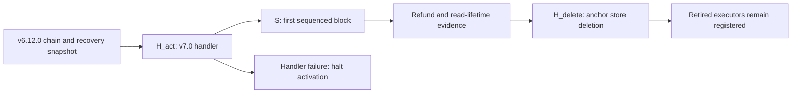

# Activation, migration rehearsal and retirement plan

This plan describes the activation boundary, the evidence required to cross it, and recovery for the eight implementation waves. The baseline is repository revision `2a1033aa2`; task and decision identifiers refer to the merged specification. Every implementation task remains pending until its declared gate has evidence. Commands below describe future execution in authorized implementation environments; this document records no completed migration or successful runtime qualification.

The merge brings the kernel modules into one chain. It does not import a second account ledger, create unbound-account claims, or invent opening balances. Existing chain balances still change through the explicit anchor refunds and custody release described below. Decision `642` supersedes the bond-return-only wording of decision `4`; decisions `5`, `521` and `631` govern account bring-up, the first sequenced height and anchor-read lifetime respectively.

## Heights and state transitions

Use these symbols in the activation manifest and every rehearsal record. Numeric heights are chosen in rehearsal and recorded with the candidate revision; the repository supplies plan names and rules, not a release height.

| Symbol | Meaning | Required relation |
|---|---|---|
| `H_act` | Height at which the `v7.0` merge handler succeeds | Positive; commit the completed plan before advancing |
| `S` | First sequenced block height stored by the sequencer keeper | `S = H_act + 1` for an upgraded chain whose input `activation_height` is zero |
| `H_delete` | Height of `v7.0-anchor-store-delete` | Later than `H_act`; refund, read-retirement and snapshot prerequisites must pass |
| `lastSeq`, `lastSeqHash` | Last accepted committed sequence position and its hash | Both zero at merge bring-up; preserve the nonzero pair on export and import |

At HEAD, `App.Sequenced` compares the requested height with the upgrade done height using strict `>` (`node/app.go:3099-3102`), while `sequencerPinnedLeader` uses the inclusive upgrade gate (`node/upgrades.go:472-483`, `sdk/x/upgrade/keeper/keeper.go:296-298`). The rebuilt implementation replaces that split: task `5.24.2` stores `ActivationHeightKey = 0x07`, task `5.25.2` defaults zero genesis activation to `ctx.BlockHeight()+1`, and task `5.0.2` delegates `App.Sequenced` to the keeper. Tasks `5.25.1` and `5.18.1` supply the keeper and application `LeaderSchedule`; task `5.6.4` removes the old `sequencerPinnedLeader` helper.

The receipt key used for the first block must cover `S`, inclusive of its first and last heights. HEAD instead tests coverage at `H_act` (`node/upgrades.go:458-463`); task `5.6.2` changes that test and its refusal to the first sequenced height. Reject a key that covers only `H_act`; accept a valid key starting at `S`. `ReceiptKey.Covers` implements the inclusive interval at `modules/sequencer/types/genesis.go:20-21`.

A chain created directly with the merged genesis follows the stored activation height, rather than synthesizing a completed upgrade record, under decision `514`. An explicit nonzero activation height must have a covering key under task `5.21.3`. Export/import retains that height under task `5.25.2`; it must not silently reset sequencing on restart.

## Upgrade plans and activation list

HEAD lists four file-recognized plans, in this order, in `knownUpgradePlans` (`node/upgrades.go:543-545`). Unknown names, completed plans, and the old activation plan on a full-genesis chain are refused as pending work (`node/upgrades.go:552-569`). Task `5.7.1` adds the fifth, second-stage deletion plan. The plan-data loader of task `17.1.1` must describe the baseline separately from the final list; its current prohibition on plans after `v7.0` is a recorded inconsistency.

| Plan | Handler and HEAD state | Required merged behavior |
|---|---|---|
| `v6.9` | `ActivationUpgrade`, `runActivationUpgrade`; initializes missing module state and requires initialized xweb (`node/upgrades.go:95`, `node/upgrades.go:299-310`) | Preserve existing activation; its module order is custody, anchor, exchange, bridge, launchpad, xweb (`node/upgrades.go:488-493`) |
| `v6.10` | `V610Upgrade`, `runV610Upgrade`; operating parameters, no store addition (`node/upgrades.go:104`, `node/upgrades.go:321`) | Preserve prerequisite chain configuration |
| `v6.12.0` | `V6120Upgrade`, `runV6120Upgrade`; adds perps, spot, pricefeed (`node/upgrades_v6120.go:32`, `node/upgrades_v6120.go:116`, `node/upgrades.go:410-413`) | Rehearsal starts after this plan; old exchange writes retire under its separate gate |
| `v7.0` | `MergeUpgrade`, `mergeUpgradePlan`; HEAD adds only the sequencer store (`node/upgrades.go:112`, `node/upgrades.go:418-421`, `node/upgrades.go:432`) | Task `5.6.5` also adds ledger, auth, pay, programs, agent and host stores; initialize shared host/keepers and constructors; refund bonds; release custody |
| `v7.0-anchor-store-delete` | Planned; no handler or constant at HEAD | Task `5.7.1` registers the handler, runs module migrations, removes the anchor store/module, and retains the 0x1014 executor |

Store identifiers added beside `SequencerStoreKey` by task `5.6.5` are `LayerXLedgerStoreKey`, `LayerXAuthStoreKey`, `LayerXPayStoreKey`, `LayerXProgramsStoreKey`, `LayerXAgentStoreKey` and `LayerXHostStoreKey`. Task `5.41.1` declares the missing agent key; task `5.41.2` includes the merged stores in the persistent store list. Task `5.6.4` extends the missing-store guard to the merge plan. The HEAD guard checks only `v6.9` and `v6.12.0` (`node/upgrades.go:655-664`), so a constructor table alone is not evidence that the stores are mounted.

There are three literal merge-name declarations at HEAD: `node/upgrades.go:112`, `precompiles/common/precompiles.go:30` and `precompiles/setup.go:50`. Task `5.6.1` derives the node constant from the common constant. Decision `51` preserves the setup declaration with an equality requirement; do not claim that the merged task set removes every duplicate literal. Task `17.1.5` records the declaration sites and tests node derivation.

The old activation gate has these eight addresses (`node/upgrades.go:501-512`). The last column states the merged disposition, not an assertion that retirement is already implemented.

| Address | Name | Activation module | Merge disposition |
|---|---|---|---|
| `0x1012` | layerxVerify | layerxanchor | All methods retired at `H_act`; registered executor remains |
| `0x1013` | layerxCustody | layerxcustody | All twenty methods retired at `H_act`; release stranded balances |
| `0x1014` | layerxAnchor | layerxanchor | Writes retire at `H_act`; nine reads remain until `H_delete` |
| `0x1015` | exchange address | layerxexchange | Native perps serves this address under decision `301`; old intent writes refuse from `v6.12.0` |
| `0x1016` | layerxBridge | layerxbridge | Retained outward bridge surface |
| `0x1017` | launchpad | launchpad | Retained native launchpad surface |
| `0x1018` | fee token | layerxbridge | Retained fee-token surface |
| `0x1019` | xweb | xweb | Retained; origin-2 program requests use the merge-gated surface |

The merge list is exactly the twelve entries below, from `MergeAddressTable` (`precompiles/setup.go:61-74`) and `mergePrecompileGate` (`node/upgrades.go:521-536`). Addresses are shown in their short form; every one is a twenty-byte EVM address with leading zero bytes.

| Address | Table name | Required module names |
|---|---|---|
| `0x101A` | layerxledger | `layerxledger` |
| `0x101B` | layerxpay | `layerxpay` |
| `0x101C` | layerxauth | `layerxauth` |
| `0x101D` | layerxprograms | `layerxprograms` at HEAD; final prerequisite must be reconciled with task `13.32.2` |
| `0x0901` | orob | `layerxagent` |
| `0x0902` | clearing | `layerxagent` |
| `0x0903` | oracle aggregator | `layerxagent`, `layerxexchange` |
| `0x0904` | pofq | `layerxagent` |
| `0x0905` | scheduler | `layerxagent` |
| `0x0906` | streams | `layerxpay` |
| `0x0907` | tee attestor | `layerxagent` |
| `0x0908` | eip712 | `layerxagent` |

HEAD skips an address without a registered merge constructor (`precompiles/setup.go:117-125`). Its merge address list is therefore an activation declaration, not a live-service result. Decision `1706` records that production serves none of the twelve at the baseline. Task `5.6.5` requires an explicit failure naming missing constructors or activation addresses lacking executors. The success golden must exercise the node-served addresses after keeper construction and precompile refresh, including production imports, and must prove they are absent below the gate.

Task `5.6.9` currently expects eleven served addresses and an absent `0x101D`, whereas task `13.32.2` expects active programs. This is an unresolved release prerequisite. Preserve both tests as evidence of the conflict until their owners agree on the actual programs gate; a successful eleven-address run cannot qualify the twelve-address merge list.

## Bring-up goldens

Tasks `17.1.1` through `17.1.6` build the activation data and generated runbook. Task `17.1.7` captures bring-up results; `17.1.8` adds custody and anchor results; `17.1.9` captures the order golden. Their data and tests under `spec/layerx-merge/programme/` are planned implementation outputs. Keep input fields, expected observation, one exact command, exit code, observed test count and candidate revision per case. A zero exit with zero selected tests is a failed gate under task `17.4.3`.

| Case | Input/action | Required observation and owning test |
|---|---|---|
| Accepted merge | Valid unique nonzero leaders, canonical distinct receipt keys, zero `lastSeq` and zero hash; key covers `S` | Real handler completes; `Sequenced(H_act)` false and `Sequenced(S)` true; `node/merge_rehearsal_test.go::TestMergeRehearsalFirstSequencedBlock` planned by `5.16.3` |
| Invalid genesis | Malformed or empty plan `Info` | Error wrapping `sequencer genesis`; no completed plan; baseline refusal harness is `node/upgrades_sequencer_test.go:146-183` |
| Invalid leaders | Empty, zero or duplicate leader key | `ErrInvalidGenesis`; exact baseline texts at `modules/sequencer/types/genesis.go:43-51`; retained validation is extracted by `5.21.2` |
| Invalid sequence start | Nonzero initial `lastSeq` or inconsistent sequence/hash pair | Refuse activation; baseline handler text `want 0` at `node/upgrades.go:456`; hash checks at `modules/sequencer/types/genesis.go:77-82` |
| No key for first block | Key ends at `H_act` or no key covers `S` | `TestMergePlanRefusesKeyCoveringOnlyActivationHeight` planned by `5.6.2`; target message names `first sequenced height` |
| Key starts at first block | Valid key interval begins at `S` | `TestMergePlanRequiresKeyForFirstSequencedHeight` planned by `5.6.2` succeeds |
| Missing constructor | Remove one required merge constructor | `TestMergePlanRefusesMissingMergeConstructors` planned by `5.6.5`; refusal names the address; no completed merge |
| Store mount failure | Start with a required merge store pending/unmounted | `TestUnmountedPlanStoresJudgesMergePlan` planned by `5.6.4`; refuse before migration writes |
| Guarantor refund | Posted bonds, pending unbondings and open challenge deposits | `TestMergePlanReturnsGuarantorBonds` and `TestMergeHandlerRetiresAnchor` planned by `5.6.5`/`6.33.2`; balances and escrow reconcile |
| Custody release | Pending claims and balances in each custody asset denom | `TestReleaseRetiredMovesEveryCustodiedBalanceToTheAuthority` and `TestReleaseRetiredCancelsPendingClaims` planned by `6.46.1`; no partial release |
| Anchor write refusal | Well-formed write after `H_act` | `TestRetiredWritesRevertAfterMerge` planned by `6.32.1`; retired revert, no value retained |
| Anchor read lifetime | Read before and after `H_delete` | `TestReadsServedUntilStoreDelete` and `TestReadsRevertFromStoreDelete` planned by `6.32.2`; only the second plan retires reads |
| Complete anchor refusal | Every selector after `H_delete` | `TestEveryAnchorSelectorRetired` planned by `6.32.3`; no event logs; golden must apply both plans |
| Receipt order | Valid batch, then swapped transactions, wrong count/root, gap and wrong previous hash | Preserve accepted sequence order and reject each mutation using the tests described in the next section |

`GenesisState.Validate` runs before the handler's explicit exported-state checks (`node/upgrades.go:435-456`). Some malformed inputs therefore fail under the wrapped validation error before reaching the later `carries no leader list` or `want 0` checks. Record the actual error path; do not demand an unreachable message from every invalid fixture. The two new key-coverage tests of task `5.6.2` do not replace the existing malformed-genesis and leader-refusal cases.

## Guarantor bond return and custody release

Anchor refund and custody release are different state operations. The custody authority policy does not redirect guarantor refunds away from their recorded owners.

`ReturnAllBonds` already exists at `modules/layerxanchor/keeper/bond_return.go:8`. It uses a cache context, refunds each guarantor's operator, refunds pending unbondings, returns open challenge bonds to challengers, resolves those challenges and adjusts open-challenge counts (`modules/layerxanchor/keeper/bond_return.go:10-61`). It requires the total refunded to equal the original module balance and the resulting module balance to be zero before writing the cache (`modules/layerxanchor/keeper/bond_return.go:63-70`). A bad address, insufficient balance, failed transfer or reconciliation mismatch must leave the cached changes unapplied.

Task `6.33.1` wraps this helper in `RetireAtMerge`, emits `layerx_anchor_retired` with the returned amount, and tests zero escrow and the balance invariant. Task `5.6.5` calls it after successful module migrations; task `6.33.2` tests the actual handler. Do not add a second refund implementation or report the existing helper as proof that activation wiring has landed. Keep anchor state and the nine views until `H_delete`; task `6.35.1` rehearses the full lifetime and export.

Under decision `642`, task `6.46.1` adds `ReleaseRetired`: cancel pending claims and their nullifiers, send each asset denom's custody module balance to `Keeper.Authority`, set `custodied` and `pending` to zero, increment `released`, and emit `EventRetiredRelease` with asset, recipient, amount, denom and cancelled-claim count. `Authority` already resolves the configured account or the governance module account (`modules/layerxcustody/keeper/keeper.go:86-90`); the asset iteration and totals setters are at `modules/layerxcustody/keeper/keeper.go:205-225`. Run the release atomically and require the solvency invariant after it. Task `6.47.2` checks post-release genesis round trips.

There is a handler-time authorization conflict in the merged tasks: `6.46.1` requires the plan already retired, but `5.6.5` calls `ReleaseRetired` inside the handler. `ApplyUpgrade` invokes that handler at `sdk/x/upgrade/keeper/keeper.go:375` and sets the done marker only at `sdk/x/upgrade/keeper/keeper.go:394`; the retired predicate needs that marker. Activation remains blocked until owner tasks provide a valid handler-time path and test the real `ApplyUpgrade` call without pre-setting `SetDone`. Do not hide this failure with a fixture that marks the plan done first.

## Receipt order equals block order

The invariant concerns the full block position, including Cosmos transactions and the sequence batch at position zero. It does not compare two different RPC index conventions.

1. At `S` and every sequenced height, position `0` contains `MsgSequenceBatch`; user transactions occupy positions `1..n` in receipt order. HEAD already sets `txIndex = len(open.txs)+1` (`node/sequencer/accept.go:33`). Tasks `5.4.1` and `5.4.7` pass each sequential and micro-batch execution context through `SetTxPosition`, so execution, the signed summary effect and committed receipt agree.
2. Batch `FromSeq` equals stored `lastSeq+1`; `PrevSeqHash` equals the stored hash; the receipt key covers the block height; and the signature verifies. The real keeper already checks these boundaries (`modules/sequencer/keeper/keeper.go:56-104`). Task `5.24.3` adds the first-height refusal.
3. Task `5.22.4` adds `VerifyBatchTxs`: compare count with the inclusive sequence range, recompute the transaction root, and fold the sequence hash over the ordered activity identifiers. It explicitly tests a swapped pair and a count mismatch. Task `5.0.2` runs this check, the keeper check on a cache branch, and the leader check in `ProcessProposal`; any error rejects the proposal. A failed sequence-batch delivery halts finalization.
4. Task `5.1.1` proves that proposal checks reject sequence gaps and previous-hash mismatch without committing speculative state. The accepted batch advances `lastSeq` and `lastSeqHash` only on the block path. A receipt released before seal must survive WAL replay and failover under tasks `5.5.20`, `5.5.21` and `5.15.5`.

The baseline block test already asserts receipt positions `1` and `2` (`node/sequenced_block_test.go:216-217`); the position test compares transient and committed receipt indices (`node/sequencer/position_test.go:395`, `node/sequencer/position_test.go:409`). The JSON-RPC receipt encoder instead normalizes to the EVM-only index (`rpc/tx.go:640-657`). Preserve that distinction in the golden: compare the signed full-block `txIndex` with the keeper-stored receipt and block position, and separately check the documented RPC projection.

Task `17.1.9` currently selects only `TestOrderCheckRefusesSeqGap` and `TestOrderCheckRefusesPrevSeqHashMismatch`, and still names the removed `sequencerPinnedLeader`. Those two negative cases do not establish the whole invariant. Bind the accepted golden to `LeaderSchedule` and keeper activation, and retain the root/fold/count, position, nonmutation and committed-state evidence above before treating the order gate as complete.

## Retired callers and their refusals

The previous retirement document is a discovery list, not an execution schedule. Its paths such as `agent/`, `human/wallet/` and `explorer/` have moved; its old wave numbering and claimed caller totals are not carried forward. The current component catalogue contains 47 keys (`tools/paxeer-x/retired_callers.json:2`), rechecked against current sources below. Each row provides a representative live reference, definition, build consumer or already-landed refusal, and the owning task route. It is not an exhaustive count of production callers.

Task `17.2.2` resolves the full current caller set and assigns each path to its domain. Task `17.2.6` compares the regenerated narrative with that inventory. Task `17.2.7` executes refusal tests and rejects zero selected tests; task `17.2.8` runs the full deleted-tree scan. The scanner prints each `path:line: component: symbol` finding and exits `1` for findings or `2` for an invalid catalogue (`tools/paxeer-x/tests/retired_callers_test.py:925-956`). A textual scan supplements real refusal and integration tests; absence of a scanned spelling is not proof that a renamed caller has migrated.

| Surface | Required refusal or replacement | Verification owner |
|---|---|---|
| `0x1012` | Registered executor returns ABI `Error(string)` with `LXP_MODULE_DISABLED` and `<name> retired` from `H_act` | `6.71.1` |
| `0x1013` | Same retired wire error for every well-formed method, including views; keeper `ErrModuleRetired` is code `29` | `6.45.1`, decision `654` |
| `0x1014` writes | Retired wire error from `H_act`; keeper `ErrModuleRetired` is code `19` | `6.31.1`, `6.32.1` |
| `0x1014` reads | Served until `H_delete`; then every selector refuses without reading the removed store | `6.32.2`, `6.32.3` |
| Old layerxexchange writes | `ErrRetired`, code `14`, `LXP_EXCHANGE_RETIRED` from `v6.12.0`; native perps owns `0x1015` | `3.27.1`, `3.27.3`, decision `301` |
| Gateway `lx_*` HTTP/WS JSON-RPC | `-32601 Method not found` before backend admission; delete old OpenRPC entries | `8.3.1` |
| Gateway program production/proxy routes | Gateway `not_found`; send program transactions to `0x101D` and read events through chain logs | `8.7.2`, `8.7.3` |
| Retired human operations | HTTP `410`, `operation-retired`, copy key `error.operation.retired`, retry `final`; reject before authorization and decoding | `10.0.2`, decision `1001` |
| Explorer live anchor/receipt routes | HTTP `404` under `/api/v2/paxeer-x`; archive routes remain | `14.23.3` |
| Deleted binaries, crates, SDK methods and deployment units | Absent from source/build/manifests after consumers move; no successful empty executor or dangling import | Per-component tasks below; `17.2.8` final scan |

`RetiredRevert` is already defined at `precompiles/common/retire.go:34-35`. The three retired addresses remain in the custom table (`precompiles/setup.go:178-180`). Decision `685` records that `Prepare` decodes before `Execute` (`precompiles/common/precompiles.go:198-207`): malformed or unknown calldata may return the normal decode/unknown-selector error instead of the retired text. The all-selector golden uses correctly encoded inputs and separately records malformed-input behavior. For custody, task `6.45.1` uses the wrapper's error-text path so `Run` does not overwrite the intended retired bytes.

### Component-to-caller map

| Component key | Verified HEAD reference | Migration, refusal and owning tasks |
|---|---|---|
| `verify` | `services/platform/hosted/indexer/src/abi.rs:36` | Indexer ABI reference; retain the registered 0x1012 executor with the retired revert; use committed-header and state-proof verification. Tasks `6.71.1` (w6). |
| `anchor` | `services/wallet/attestor/internal/policy/evm/decode.go:34` | Wallet decoder references 0x1014; move consumers to block/receipt proofs; retire writes at merge and reads only at the second plan. Tasks `6.32.1` (w2), `6.32.2` (w4), `5.7.1` (w6). |
| `custody-claims` | `services/human/crates/layerx-paxeer-client/src/custody.rs:345` | Human client still encodes withdrawal calldata; remove the two-domain client/journeys and refuse withdrawal, exit and deposit-root methods. Tasks `10.26.1` (w5), `6.45.1` (w2). |
| `custody-deposit` | `services/wallet/attestor/internal/policy/policy.go:674` | Attestor policy still admits depositToken; remove custody spend/decode policy and fund through native bank/ledger transfers. Tasks `12.2.3` (w6), `6.45.1` (w2). |
| `exchange-intents` | `precompiles/layerxexchange/layerxexchange.go:55` | The old precompile still names intent methods; stop old intent writes with LXP_EXCHANGE_RETIRED and use native perps orders/positions. Tasks `3.27.3` (w2). |
| `guarantor-runtime` | `docker/kernel/Dockerfile:15` | Container build still names guarantor artifacts; delete runtime/build/deployment consumers after the native path is ready. Tasks `5.51.1` (w6), `16.3.3` (w6). |
| `finality-authority` | `cmd/layerxd/lxp_daemon_process.c:110` | Daemon process retains authority state; remove old authority/evidence/handover runtime and use governed receipt keys plus pinned leaders. Tasks `5.50.4` (w6), `5.50.5` (w6). |
| `eth-relay` | `services/platform/hosted/node/deployment.yaml:9` | Hosted deployment retains relay configuration; remove its kernel/guarantor boundary. Preserve the node launcher until the replacement is operational under decision 819. Tasks `8.14.2` (w6), `16.3.3` (w6). |
| `da` | `cmd/layerxd/lxp_daemon_process.c:112` | Daemon retains an availability store; remove kernel bundles/proofs and consume block data from full/archive nodes. Tasks `1.34.1` (w6), `5.50.7` (w6). |
| `replica` | `docker/kernel/Dockerfile:365` | Container build includes relay-archive files; remove replica/archive runtime after chain archive access and sequencer WAL replication replace it. Tasks `1.33.1` (w6), `8.32.4` (w6). |
| `idempotency` | `src/protocol/lxp_kernel.c:3188` | Kernel still reads the replay table; delete that table and journal staging. Transaction hash and EVM nonce replace the transport replay mechanism. Tasks `1.2.3` (w6). |
| `batch-seal` | `cmd/layerxd/lxp_daemon_process.c:283` | Daemon retains the old batch WAL path; delete kernel seal/publish/WAL/signature consumers and preserve sequencer WAL and receipt continuity. Tasks `1.35.1` (w6), `5.50.2` (w6). |
| `oracle-web-roots` | `Makefile:822` | Build guard still names the oracle adapter; the old runtime citation does not identify a live call. Retire unwired adapter/root APIs while retaining needed perps encoders. Tasks `1.29.2` (w6), `1.29.3` (w5), `1.29.4` (w6), `1.29.5` (w6). |
| `feed-store` | `cmd/layerxd/lxp_daemon_process.c:2177` | Daemon ties a feed store to its canonical log; remove the store/reader edge and read events through height/index-ordered chain indexing. Tasks `1.15.2` (w6). |
| `fee-relay` | `cmd/layerxd/lxp_daemon_process.c:827` | Daemon invokes the fee-governance runtime; retire activity 0x00090008 and use the programs governance-authority message. Tasks `1.14.3` (w2). |
| `replay-golden` | `scripts/ci/replay-matrix.sh:25` | The replay matrix invokes the release gate. Keep and port the gate under decision 190; do not delete it with the kernel replay API. Tasks `16.98.1` (w5). |
| `custody-credit` | `src/protocol/lxp_module_ctx.c:1239` | Kernel module context retains credit staging; remove certified cross-domain credit/light-client paths. Retain custodyproof commit/header verification. Tasks `1.2.5` (w6), `1.37.1` (w6). |
| `custody-disclosure` | `services/agent/crates/layerx-crypto/src/disclosure.rs:1371` | Already-landed refusal: no_custody_credit_kind expects MalformedPayload. Do not recreate a deleted disclosure kind; native bank balances replace the concept. |
| `lni` | `services/agent/crates/layerx-agentd/src/compat.rs:3` | Agent daemon imports the LNI schema. Remove transport/framing/read callers after EVM submission, eth_call and sequencer receipts replace them. Tasks `9.24.7` (w6), `9.25.1` (w5). |
| `paxeer-verifier` | `services/human/crates/layerx-paxeer-client/Cargo.toml:9` | Human client manifest still depends on the verifier; remove consumer edges and the crate after committed-proof verification is available. Tasks `9.28.1` (w5), `10.26.1` (w5). |
| `handover-client` | `services/agent/crates/layerx-agentd/src/main.rs:1940` | Agent startup reads the handover-finality setting; remove this client trust-history path and read governed receipt keys at the receipt height. Tasks `9.12.6` (w6), `9.25.2` (w4). |
| `settlement-domain` | `services/agent/crates/layerx-agentd/src/main.rs:782` | Agent startup still names the settlement-domain export setting; replace export trust with chain identity, validator commit and native proofs. Tasks `9.26.3` (w6), `9.27.3` (w6). |
| `checkpoint-evidence` | `services/agent/crates/layerx-types/src/verify.rs:13` | Types retain SettlementAnchored; remove certificate/attestation evidence and express receipted/committed rungs. Tasks `9.26.1` (w0), `9.25.1` (w5). |
| `authorized-batch` | `services/agent/crates/layerx-agentd/src/human_runtime.rs:1379` | Human peer code still requests authorized batches; replace the route and facts with sequencer receipts and committed block evidence. Tasks `9.25.1` (w5), `11.9.3` (w6). |
| `availability-fetch` | `services/agent/crates/layerx-agentd/src/export.rs:811` | The current caller is fetch_availability, not the stale fetch_batch spelling. Repoint offline exports to block/archive retrieval and remove checkpoint chunk proofs. Tasks `9.27.3` (w6), `9.25.1` (w5). |
| `checkpoint-finality` | `services/platform/hosted/indexer/src/ai_market.rs:24` | Indexer AI projection imports kernel finality types; use committed headers/app hashes and native proofs for projections and snapshots. Tasks `8.16.4` (w5), `13.29.1` (w1). |
| `envelope-signing` | `services/agent/crates/layerx-agentd/src/sign.rs:10` | Agent signing imports sign_disclosed; move writes to secp256k1 EIP-1559. Retain ed25519 only where binding/DID proofs require it. Tasks `9.31.3` (w2). |
| `wire-codec` | `services/agent/crates/layerx-client/src/ai_market.rs:51` | Client still imports layerx_wire::activity; retire activity encoders and the C differential, while retaining the receipt codec under decision 910. Tasks `9.29.1` (w6), `9.18.2` (w6). |
| `indexer-kernel-half` | `services/platform/hosted/indexer/src/explorer.rs:635` | Chain indexer still references its kernel module; remove the relay source/config/imports and retain chain-derived indexing and historical projections. Tasks `8.16.7` (w6). |
| `layerxctl-port` | `cmd/layerxctl/lxp_ctl_main.c:36` | The C entry point still uses ordered_submit. Delete that separate C entry; retain the Rust operator client, which already uses SequencerEndpoint. Tasks `5.47.2` (w2), `5.52.4` (w6). |
| `intent-ingester` | `services/interop/Cargo.toml:8` | Interop workspace still includes the ingester; delete crate/member/images/deployment consumers because native execution settles synchronously. Tasks `11.30.1` (w4), `16.3.1` (w5). |
| `intent-vocabulary` | `services/human/crates/layerx-intents/src/precompile.rs:1133` | Intent decoder still routes legacy events. Remove custody/payout kinds and map retained native action disclosures to the current contract. Tasks `10.21.3` (w5). |
| `dual-market-ids` | `services/interop/crates/layerx-intent-ingester/src/submit.rs:60` | The ingester still defines MarketMap; delete it with the ingester and use the chain market identifier. Tasks `11.30.1` (w4). |
| `protocol-adapter` | `programs/Cargo.toml:5` | Programs workspace still includes the protocol adapter; repoint registry/agent readers to eth_call on 0x101D before removing the crate. Tasks `13.8.2` (w6), `8.96.4` (w5), `9.94.1` (w3). |
| `programs-ingress` | `services/agent/sdk/python/layerx_sdk/agent_http.py:60` | Python route adapter still posts program deployment to /v1/programs/deploy; replace client ingress with 0x101D transactions; old gateway route answers not_found. Tasks `8.7.3` (w6), `9.35.5` (w4). |
| `program-events` | `services/platform/hosted/gateway/src/rpc.rs:347` | Gateway still routes lx_getProgramEvents; answer -32601 and use eth_getLogs over programs/xweb events. Tasks `8.3.1` (w6). |
| `storage-keeper` | `services/platform/hosted/paxai-storage-keeper/Cargo.toml:2` | The standalone keeper package remains; remove it and its build entries. It is already absent from platform workspace membership. Tasks `8.17.1` (w5). |
| `kernel-web` | `src/modules/programs/call.c:155` | Programs call code still reads kernel web-answer storage; retire it and use xweb origin 2. The old host web_read returns LXP_ERR_MODULE_DISABLED under decision 104. Tasks `1.18.1` (w4), `13.32.1` (w4). |
| `websearch-kernel-relay` | `services/interop/crates/x-websearch/src/main.rs:19` | Websearch main imports KernelRelay/KernelWatcher; remove that runtime after the EVM origin-2 watcher/fulfilProgram path is operational. Tasks `11.36.1` (w5), `11.32.3` (w3). |
| `account-naming` | `services/interop/crates/x-websearch/src/payment.rs:64` | Payment code retains LAYERX-PAYER-DID; replace the kernel payer identity with the EVM address bound by addr 0x1004. Tasks `11.34.7` (w6). |
| `receive-grant` | `services/interop/crates/x-websearch/src/payment.rs:273` | Payment code still defines sign_draw for kernel settlement; retire kernel RECEIVE/GRANT and submit typed 0x101A payer-grant draws. Tasks `1.12.1` (w5), `11.34.3` (w3). |
| `wallet-caps` | `services/platform/hosted/gateway/src/rpc.rs:368` | Gateway still branches on lx_getWalletCaps; retire the RPC name and read pay/ledger/auth caps plus xweb fee from construct views. Tasks `8.3.1` (w6). |
| `router-joins` | `services/platform/hosted/gateway/src/rpc.rs:357` | Gateway still classifies px_listAssets as a kernel backend read; preserve supported px_ method names with one chain source and current schemas. Tasks `8.5.1` (w3), `8.5.2` (w4), `8.5.3` (w5). |
| `wallet-two-domain` | `services/wallet/gateway/src/routes/sign.ts:471` | Wallet gateway still mounts sign-custody; remove old routes/jobs and SDK activity signing; use EVM review, approval, send and receipt status. Tasks `12.0.3` (w4), `12.27.2` (w6). |
| `human-two-domain` | `services/human/Cargo.toml:8` | Human workspace retains the movement-provider member; remove retired crates/journeys and return operation-retired from the frozen operation surface. Tasks `10.0.2` (w2), `10.96.1` (w5). |
| `explorer-kernel-views` | `apps/explorer/lib/hooks/useNavItems.tsx:376` | Explorer navigation still links anchors; remove live kernel-only pages/routes, return the documented 404, and preserve archive views. Tasks `14.23.3` (w6), `14.31.1` (w5). |
| `mirror` | `services/interop/crates/layerx-mirror/src/runtime.rs:17` | Mirror still references the LNI archive source; retain the mirror service while replacing that source with committed coordinates, headers and app hashes. Tasks `11.25.4` (w3), `11.25.5` (w4). |

Four baseline corrections matter during execution. The storage keeper is a separate workspace, not a member to remove from the platform workspace (`services/platform/hosted/paxai-storage-keeper/Cargo.toml:2`, `services/platform/Cargo.toml:2-24`). The feeder library already describes a JSON-RPC client (`services/platform/hosted/feeder/src/lib.rs:1-2`), so its old import-line LNI citation is not current evidence. Rust `layerxctl` already sends through `SequencerEndpoint` and reads its receipt (`cmd/layerxctl/src/main.rs:195-208`); task `5.52.4` removes the separate old C entry point. Custody-credit disclosure is already refused by the `no_custody_credit_kind` test source (`services/agent/crates/layerx-crypto/src/disclosure.rs:1371-1380`); preserve that baseline instead of inventing another implementation task.

The replay golden is retained and ported by task `16.98.1` under decision `190`: the `test-replay-golden-local` call remains in the release matrix (`scripts/ci/replay-matrix.sh:25`). Do not implement the stale instruction to delete this release gate. Likewise, decision `681` keeps `ReentrancyLock` for the retained timelock while retiring the other kernel-only security/storage contracts. Mirror and bridge services remain, with committed headers, app hashes and native proofs replacing their kernel inputs.

Tasks `17.2.4` and the tools domain also inventory the incompatible `requires_sei` fixtures. Resolve them to retained compatible fixtures or explicit retirement before running the final application/Wasm conformance gates; do not treat a deleted daemon fixture as evidence of a working merged program path.

## Migration rehearsal procedure

The migration is an upgrade rehearsal of chain state and service callers. It does not import kernel account balances. Task `17.3.1` defines the ordered rehearsal data; `17.3.2` stops on the first failed step; `17.3.3` formats a failed finding; `17.3.4` runs the sequence on the merged candidate. The four formal programme steps are the first block, export/import, activation list and second-plan store deletion. The preparation and supplementary checks below are prerequisites for interpreting those steps.

1. Freeze the candidate revision, task graph, constructor inventory and activation manifest. Resolve the blocking discrepancies at the end of this document. Prepare an isolated `v6.12.0` chain with known balances, EVM nonces, leaders, receipt keys, posted guarantor bonds, pending unbondings, open challenge deposits and custody claims/assets. Keep the snapshot and runtime inventory in access-controlled evidence storage.
2. Choose `H_act`, `S` and `H_delete`; pin distinct primary/standby receipt keys that cover the first sequenced block and the rehearsal window. Record public key identifiers and coverage, never private signing material. Task `5.27.2` changes standby acknowledgements from 25 bytes to 33 by adding the epoch; HEAD's layout is at `node/sequencer/standby.go:22-29`. Upgrade primary and standby together to the same build, and test fencing and acknowledgement before admitting traffic. Retain the same-build constraint during rollback.
3. At a committed height immediately before activation, take and verify the recoverable state snapshot. Prepare the store loader for the planned height and required stores. HEAD's missing-store refusal states that the upgrade-info height must equal the last committed height plus one when the process starts (`node/upgrades.go:608-614`). Use the real scheduled plan with its validated sequencer genesis `Info`; the file-driven path currently constructs a plan without `Info` (`node/upgrades.go:616-618`) and cannot yet be published as a working merge procedure.
4. Apply `v7.0` through the actual upgrade keeper. Assert the required constructor/module/store set, zero opening sequence pair, keeper activation `S`, successful bond refunds and custody release, zero residual anchor escrow and reconciled custody totals. Exercise bad genesis, no key for `S`, missing constructor and failing transfer in separate restored fixtures. A failed handler halts the plan; no later rehearsal step runs.
5. Finalize `H_act` and then `S`. The activation block is not sequenced; `S` contains the signed sequence batch at position zero and its ordered user transactions. Assert the receipt-order invariant, root/sequence continuity, proposer membership, signature and app-state equality. Exercise crash after receipt/before seal, acknowledgement delay and standby failover using their declared tests.
6. Export and re-import after merge. Compare leader list, receipt key intervals, `lastSeq`, `lastSeqHash` and stored activation height. Preserve native balances, nonces and program state through each module's declared round-trip gate. The existing export entry point is `node/export.go:22`; the future node tests below exercise the actual app path.
7. Check every merge-list address below and above its gate through the node-served precompile set. Check old-address refusals, human operation refusals and gateway HTTP/WS refusals with the updated clients. Reconcile the `0x101D` expectation before accepting this step. Prove the nine anchor reads still work after refunds and before the deletion plan.
8. Take the second recovery snapshot; establish that every refund succeeded and that retained callers no longer need live anchor state. Schedule `v7.0-anchor-store-delete` strictly later than merge. Confirm migration execution, store deletion in persistent backends, no keeper/module construction requiring that store, and all-selector retired behavior at the still-registered `0x1014`. Test the archive routes independently.
9. Run the final retired-caller scan, refusal inventory and parity rows on the candidate revision. Any remaining production caller, deleted-tree reference or zero-test selector fails qualification. Keep archive and historical record readability where required; removing the live kernel service does not authorize erasing retained history.
10. Run each wave aggregate once for the candidate and the programme aggregate once. Record matching revisions and exit codes, retain logs, and publish only reviewed technical evidence. A successful rehearsal test is not permission to skip any domain completion gate or the final same-revision programme check.

These are exact task verification commands for the four formal steps; every test is planned. Run each only after its owning implementation task has created the real test and passed its bounded gate.

| Step and implementation task | Exact task verification command |
|---|---|
| First sequenced block, `5.16.3` | `go test -count=1 ./node/ -run '^(TestMergeRehearsalFirstSequencedBlock)$'` |
| Export and re-import, `5.6.8` | `go test -count=1 ./node/ -run '^(TestExportAfterMergeKeepsSequencerState)$'` |
| Merge address activation, `5.6.9` | `go test -count=1 ./node/ -run '^(TestMergePlanActivatesGatedPrecompiles)$'` |
| Second plan and retained executor, `5.7.1` | `go test -count=1 ./node/ -run '^(TestAnchorStoreDeletedAtStep\|TestAnchorPrecompileStaysRegisteredWithoutModule\|TestBankKeepersCarryNoLaunchpadBalanceHook)$'` |

A failed rehearsal yields a finding with `revision`, `command`, `exit_code`, `log_path` and `observed_and_assumption` under task `17.3.3`. Successful runs keep their evidence records without adding failure findings. A rollback does not erase the original failure log; the replacement candidate supplies new evidence.

## What each wave gate proves

Wave numbers describe implementation readiness, not on-chain heights. All tasks of a wave run in parallel except dependencies explicitly recorded in the merged graph. Start the next wave only after the current wave's task checks and aggregate gate succeed. Each task has one bounded build and one exact verification command; aggregate gates are run once at a wave boundary and once when expressly required by final qualification, rather than inside every task.

Task counts in the merged input are descriptive and do not qualify any work.

| Wave | Tasks |
|---|---:|
| `0` | 259 |
| `1` | 440 |
| `2` | 431 |
| `3` | 205 |
| `4` | 314 |
| `5` | 407 |
| `6` | 430 |
| `7` | 31 |
| Total | 2517 |

| Wave | Required proof before advancing | Domain anchors and evidence |
|---|---|---|
| `0` Foundations | ABI/proto/type/error/store-key freezes, real fixtures, activation names, evidence format and usable gate scripts exist; no activation-dependent service is presumed live | Every `N.0.1`; constructor/merge-table foundation; task `17.5.8` gate manifest |
| `1` Core logic | Key coverage at `S`, immutable activation height, leader validation, sequence/root fold, keeper state changes, refund/release failure atomicity and bounded execution pass their exact tests | Owning wave-1 tasks; task `6.33.1` remains uncalled in production until integration |
| `2` Surfaces | Real handlers, messages, precompiles, receipt/proposal checks, errors and routes implement the frozen contracts; retired-call errors are tested through wrappers | Every `N.0.2`; per-surface refusals and nonzero selected-test evidence |
| `3` Services | Service runtimes use the chain surfaces; receipt release, WAL replay, standby fencing and the 33-byte acknowledgement version agree | Wave-3 service tasks; no incompatible primary/standby mixture |
| `4` Integration | Actual app mounts stores, constructs keepers, imports constructors, registers gates and RPC options, applies refunds/release, and exposes the integrated node path | Every `N.0.3`; missing-constructor failure; real-handler bond/release tests |
| `5` Clients | Apps, SDKs, wallet, explorer and service consumers use unified chain reads/writes; migrated exports and receipt/failover rehearsals pass | Every `N.0.4`; deployment/container checks and route/client compatibility |
| `6` Conformance | Current caller inventory is empty for retired operations; old trees/build edges disappear; retained replay release gate is ported; parity, migration, store-delete and performance gates pass | Every wave-6 task feeds its domain `N.0.9`; scan uses `--deleted` and refusal tests run |
| `7` Completion | All 17 domain completions, bring-up/custody/order goldens, rehearsal, refusals, parity and aggregates pass at one candidate revision | `1.0.9` through `16.0.9`, then `17.0.9`; mixed revisions fail |

The aggregate script contents are planned by tasks `16.1.1` through `16.1.8`. Their Makefile targets already exist at the cited baseline: `workspace-build`, `workspace-test`, `workspace-lint`, `workspace-ci` (`Makefile:3309-3322`); `core-test-all`, `core-qualification-environment` (`Makefile:3276`, `Makefile:3294`); and the language/domain aggregates below. A `--list` check proves that command names resolve; it does not prove their runtime behavior.

| Gate and script-creation task | Ordered aggregate commands |
|---|---|
| `0`, `16.1.1` | `make -n build test`; `make workspace-build`; `make workspace-lint` |
| `1`, `16.1.2` | `make workspace-build`; `make workspace-test`; `make core-test-all`; `make test-sanitizer-suite` |
| `2`, `16.1.3` | `make workspace-build`; `make workspace-test`; `make core-test-all`; `make agent-test` |
| `3`, `16.1.4` | `make workspace-build`; `make workspace-test`; `make agent-test`; `make interop-test`; `make programs-test` |
| `4`, `16.1.5` | `make workspace-build`; `make workspace-test`; `make core-qualification-environment`; `make beta-driver-test` |
| `5`, `16.1.6` | `make workspace-build`; `make workspace-test`; `make human-test`; `tools/containers/check.sh` |
| `6`, `16.1.7` | `make workspace-build`; `make workspace-test`; `make workspace-lint`; `make core-test-all`; `python3 tools/paxeer-x/tests/retired_callers_test.py --deleted`; `make programs-test` |
| `programme`, `16.1.8` | `make workspace-ci`; `make beta-qualify`; `python3 tools/paxeer-x/tests/retired_callers_test.py --deleted`; `scripts/ci/beta-ledger-check.sh --revisions` |

Task `17.5.1` through `17.5.7` currently run in wave `7`, and each depends on the script qualification task `16.97.4` in wave `5`. Consequently, the task graph alone does not currently implement the required before-next-wave transitions. This scheduling gap is recorded for correction. The final rerun has a separate purpose: task `17.0.9` rejects mixed revisions and requires every final wave evidence line to name the same candidate. Historical transition evidence and final candidate evidence must not be confused or substituted for one another.

## Rollback by wave

The exact `rollback` value of each task is authoritative for its code changes. The table below quotes selected activation/migration-relevant keys from the merged document, with their actual waves; it does not grant permission to revert another domain's files. When a wave fails, retain failure evidence, stop dependent work, apply the owning tasks' rollback, restore a consistent candidate and rerun the affected gate. Do not remove an acceptance criterion, change a refusal to success, or relabel an unrun test to make a wave pass.

| Wave | Task and exact rollback key |
|---|---|
| `0` | `5.6.1`: Revert the files in touches; the change is confined to them and to the activation-gated sequenced path. |
| `1` | `6.33.1`: Delete modules/layerxanchor/keeper/retire_merge.go; nothing calls it before the wave-4 merge handler wiring. |
| `2` | `5.24.3`: Revert the ErrNotActivated check in modules/sequencer/keeper/keeper.go; no chain has applied the merge. |
| `3` | `5.27.2`: Revert node/sequencer/standby.go; primary and standby must run the same build because the ack grows by 8 bytes. |
| `4` | `5.6.5`: Revert the files in touches; the change is confined to them and to the activation-gated sequenced path. |
| `5` | `8.17.1`: Restore the keeper crate. |
| `6` | `5.7.1`: Revert node/app.go and node/upgrades.go before the plan is scheduled; once applied the deleted store is restored only from a snapshot taken before the plan height. |
| `7` | `17.0.9`: None needed; the programme gate writes evidence only. |

Before on-chain activation, code reversions and deployment rollback can keep the merge-gated path disabled. Once a plan has committed, reverting binaries is not a state rollback. In particular, task `5.7.1` explicitly requires restoration from a snapshot taken before the deletion height to recover a deleted store. The release changes balances and claim state; preserve a pre-plan snapshot and rehearse recovery rather than promising that a source revert reverses payouts. After receipts have been released, recovery must also preserve the WAL/sequence history and fence the superseded primary.

The acknowledgement format change of task `5.27.2` is an additional operational boundary: restore primary and standby together, preserving compatible WAL and lease state. After restoring a snapshot, verify chain id, height, app hash, leaders, receipt-key coverage, sequence position and native balances before accepting more transactions. Restart the ordered rehearsal from the restored boundary; retain both failed and successful evidence.

## Remaining activation prerequisites

This plan is complete as a specification narrative, while the following inconsistencies in the merged implementation tasks remain unresolved. They are tracked for correction; none is a qualified runtime result.

- Authorize and test custody release inside the real upgrade handler before the done marker exists (`5.6.5` versus `6.46.1`).
- Reconcile the programmes' four-plan/sequencer-only baseline data with the merged seven-store addition and later deletion plan (`17.1.1`, `5.6.5`, `5.7.1`), and update all first-key goldens to `S` (`17.1.3`, `5.6.2`).
- Resolve the eleven-versus-twelve served-address expectation and the actual `0x101D` module prerequisite (`5.6.9`, `13.32.2`).
- Replace the removed leader helper and expand the receipt-order golden's evidence; apply the second anchor plan before the all-selector golden (`17.1.9`, `17.1.8`).
- Correct the retired inventory's anchor/custody error-code distinction and old exchange refusal spelling (`17.2.3`, decision `654`, task `3.27.1`).
- Enforce transition-time wave gates separately from the final same-revision rerun (`17.5.1` through `17.5.7`).
- Qualify a plan-delivery route that carries the sequencer genesis; HEAD's file-driven `applyNamedUpgrade` omits `Info` (`node/upgrades.go:616-618`).

The authoritative callable details remain in the [address table](../../contracts/address-table.md), [sequencer contract](../../contracts/sequencer.md), [ledger/auth contract](../../contracts/ledger-auth.md), [pay contract](../../contracts/pay.md), [programs contract](../../contracts/programs.md), [markets contract](../../contracts/markets.md) and [web contract](../../contracts/web.md). This plan coordinates their activation and evidence without changing their owning tasks.
