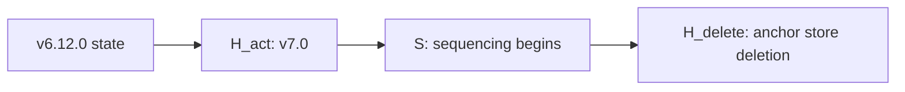

# Activation, migration rehearsal and retirement

The merge activates the kernel modules within the Paxeer BFT chain. EVM chain ID is
125 (`0x7d`); a receipt is final when its block is committed. The upgrade changes
module state, returns anchor bonds and releases custody balances. It does not
import a second account ledger or create opening balances for unbound accounts.

## Heights and persisted state

| Symbol | Meaning | Relation |
| --- | --- | --- |
| `H_act` | Height where the `v7.0` merge handler executes | Positive upgrade height |
| `S` | Persisted sequencer activation height | Defaults to `H_act + 1` when the merge input has zero `activation_height` |
| `H_delete` | Height of `v7.0-anchor-store-delete` | Greater than the completed merge height |
| `last_seq`, `last_seq_hash` | Committed sequence position and hash | Both zero at merge bring-up; exported state retains the stored pair |

[`App.Sequenced`](../../../../node/app.go) delegates to the sequencer keeper.
The keeper sequences a height when its persisted activation height is positive
and the requested height is at least that value. The height is stored under
`ActivationHeightKey` (`0x07`); setting the same height again succeeds, while
changing an established height is refused. See
[activation state](../../../../modules/sequencer/keeper/activation.go).

The merge handler reads `leaders`, `receipt_keys`, `last_seq`, `last_seq_hash` and
`activation_height` from the plan's JSON `Info`. It defaults zero activation to
`H_act + 1`, validates the sequencer genesis and requires a receipt key covering
`H_act + 1`. A nonzero activation height also needs a covering key. Receipt-key
intervals include both endpoints. Leaders must be nonempty, nonzero and distinct;
receipt key IDs must be nonzero and distinct, and public keys must be canonical
Ed25519 encodings. Merge input requires `last_seq = 0` with a zero hash.
See [genesis validation](../../../../modules/sequencer/types/genesis.go) and the
[merge handler](../../../../node/upgrades.go).

A chain initialized from genesis uses the keeper's activation state. A zero
genesis activation height resolves to the next block and must be covered by a
receipt key before state is written. Export and import preserve the activation
height and sequence position.

## Upgrade plans

`knownUpgradePlans` in [node/upgrades.go](../../../../node/upgrades.go) lists the
following plans in application order. Unknown and already completed plans are
not pending. The activation plan is also not pending when all its modules are
already present in the module version map.

| Plan | Constant | State transition |
| --- | --- | --- |
| `v6.9` | `ActivationUpgrade` | Initializes custody, anchor, exchange, bridge, launchpad and xweb state |
| `v6.10` | `V610Upgrade` | Applies operating parameters and xweb attestor configuration |
| `v6.12.0` | `V6120Upgrade` | Adds perps, spot and pricefeed stores |
| `v7.0` | `MergeUpgrade` | Adds the merged stores, initializes sequencing, returns anchor bonds and releases custody |
| `v7.0-anchor-store-delete` | `AnchorStoreDeleteUpgrade` | Runs migrations after the merge; its store loader deletes the anchor store |

The node and precompile `MergeUpgrade` constants derive from
`precompiles/common.MergeUpgrade`, whose value is `v7.0`.

`mergeStoreUpgrades` adds eight stores: `sequencer`, `layerxledger`, `layerxauth`,
`layerxpay`, `layerxchains`, `layerxprograms`, `layerxagent` and `lxphost`.
The merge handler validates constructors and activation executors before applying
its cached state transition. It checks the executing plan's name and height and,
when a plan is already scheduled, its `Info` as well. It runs module migrations,
retires anchor bonds, initializes sequencer genesis, releases custody, installs
launchpad role surfaces and installs Programs schedules with guest ABI version 5.
The cached transition is written only after these operations succeed.

## Merge precompiles

[`MergeAddressTable`](../../../../precompiles/setup.go) contains thirteen entries.
The activation module requirements come from `mergePrecompileGate` in
[node/upgrades.go](../../../../node/upgrades.go). Addresses below use short
notation for twenty-byte EVM addresses padded with leading zero bytes.

| Address | Table name | Required modules |
| --- | --- | --- |
| `0x101A` | layerxledger | `layerxledger` |
| `0x101B` | layerxpay | `layerxpay` |
| `0x101C` | layerxauth | `layerxauth` |
| `0x101D` | layerxprograms | `layerxprograms` |
| `0x101E` | layerxchains | `layerxchains` |
| `0x0901` | orob | `layerxagent` |
| `0x0902` | clearing | `layerxagent` |
| `0x0903` | oracle aggregator | `layerxagent`, `layerxexchange` |
| `0x0904` | pofq | `layerxagent` |
| `0x0905` | scheduler | `layerxagent` |
| `0x0906` | streams | `layerxpay` |
| `0x0907` | tee attestor | `layerxagent` |
| `0x0908` | eip712 | `layerxagent` |

A constructor must build the address and name declared by its table entry.
Registration refuses an address outside the table, a nil constructor or duplicate
registration. The merge handler refuses missing constructors or activation
addresses without executors.

## Anchor bonds and custody balances

[`ReturnAllBonds`](../../../../modules/layerxanchor/keeper/bond_return.go) returns
guarantor bonds and pending unbondings to their operators and open challenge
bonds to their challengers. It resolves those challenges, updates open-challenge
counts, and requires the total refunded to equal the original module balance
and the remaining module balance to be zero. Transfers and state updates use a
cache context. [`RetireAtMerge`](../../../../modules/layerxanchor/keeper/retire_merge.go)
wraps that operation and emits `layerx_anchor_retired` with the returned amount.

[`ReleaseRetired`](../../../../modules/layerxcustody/keeper/release.go) is a
separate atomic operation. It requires the scheduled merge plan to be executing
at the current height and refuses an already retired module. It cancels pending
claims and their nullifiers, synchronizes the exit checkpoint, and transfers each
registered asset denomination's custody balance to `Keeper.Authority`. The
governance authority uses a module-to-module transfer. For each asset it sets
`custodied` and `pending` to zero, adds the previous custodied total to `released`,
and emits `EventRetiredRelease` with asset, recipient, amount, denomination and
cancelled-claim count.

The second upgrade requires the merge to have completed at a lower height.
The anchor executor remains registered after its store is deleted. Anchor writes
retire at the merge; reads retire at the anchor-store deletion plan. The verify
and custody executors also retain their registered retirement responses.
See [anchor lifetime tests](../../../../node/store_delete_test.go).

## Receipt order and block order

At a sequenced height, block position zero contains `MsgSequenceBatch`. User
transactions occupy positions `1..n` in receipt order. Sequential and micro-batch
execution use `SetTxPosition` to carry those full-block positions through delivery.

`ProcessProposalHandler` in [node/app.go](../../../../node/app.go) decodes the
batch, verifies the ordered activity IDs with `VerifyBatchTxs`, checks sequence
continuity and checks the proposer against the leader schedule. The order check
runs on a cache branch. The keeper verifies the receipt key, signature,
`FromSeq = last_seq + 1` and `PrevSeqHash` before advancing the committed pair.
See [batch verification](../../../../modules/sequencer/types/batch_verify.go) and
[keeper delivery](../../../../modules/sequencer/keeper/keeper.go).

The signed receipt uses the full-block position. For ordinary EVM transactions,
[JSON-RPC receipts](../../../../rpc/tx.go) project that position to the EVM-only
`transactionIndex` and adjust log indexes for preceding EVM receipts. Synthetic
venue receipts use reserved positions after the block's transactions.

## Rehearsal coverage

The [rehearsal data](../../programme/data/rehearsal.kvx) names four focused tests:

| Behavior | Test |
| --- | --- |
| Apply the merge and seal the first sequenced block | `node/merge_rehearsal_test.go::TestMergeRehearsalFirstSequencedBlock` |
| Export and import sequencer state | `node/upgrade_export_test.go::TestExportAfterMergeKeepsSequencerState` |
| Activate merge precompiles | `node/upgrades_merge_activation_test.go::TestMergePlanActivatesGatedPrecompiles` |
| Delete the anchor store at the second plan | `node/store_delete_test.go::TestAnchorStoreDeletedAtStep` |

Additional coverage includes custody release and claim cancellation in
[custody tests](../../../../modules/layerxcustody/keeper/release_test.go), anchor
refunds in [retirement tests](../../../../modules/layerxanchor/keeper/retire_merge_test.go),
and sequence gaps, previous-hash mismatches and speculative-state isolation in
[proposal-order tests](../../../../node/process_proposal_order_test.go).
