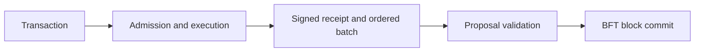

# Network orchestration

Paxeer runs the kernel, EVM and module keepers within one `paxd` BFT chain.
The node proposes and validates blocks; receipts become final when their blocks
are committed. EVM chain ID is 125 (`0x7d`).

## Application composition

[The application](../../../../node/app.go) mounts persistent stores and constructs
the EVM, sequencer and module keepers. Ledger, auth and pay share `LayerXHost`,
which connects the Go keepers to the native kernel through
[modules/lxphost](../../../../modules/lxphost/host.go). The host links the kernel
and Programs sandbox libraries. The chain registry keeper is connected to the
EVM and launchpad keepers.

[Precompile setup](../../../../precompiles/setup.go) constructs the registered
EVM executors. Merge entries carry the `v7.0` activation gate, and each entry's
address and name must match `MergeAddressTable`. The application validates
required constructors and executors before applying the merge.

## Transaction and proposal flow

[Sequential acceptance](../../../../node/sequencer/accept.go) decodes and admits
a transaction, executes it on a branch of the open layer, and assigns its
full-block position. Successful transactions and EVM reverts can produce receipts;
refusals leave the open layer and sequence counter unchanged. Receipt release,
write-ahead logging and standby replication are implemented in
[node/sequencer](../../../../node/sequencer).

At and above the persisted sequencer activation height, the first transaction of
a proposal is `MsgSequenceBatch`. The remaining transactions follow receipt order.
`ProcessProposalHandler` verifies the batch against the ordered activity IDs,
checks sequence continuity on a cache branch, checks the proposer and checks the
block gas limit before block execution. See
[proposal handling](../../../../node/app.go) and
[batch validation](../../../../modules/sequencer/types/batch_verify.go).

The sequencer keeper persists activation height, leaders, receipt keys and the
committed sequence/hash pair. Reconstructing the application retains the
sequencing boundary. Receipt key ranges are inclusive; batch verification binds
transaction count, transaction root and sequence hash to the supplied activity
order.

## Node and hosted APIs

The public node serves JSON-RPC at its root path. Its namespaces are `debug`,
`echo`, `eth`, `net`, `pax`, `test` and `txpool`. The `px_` methods belong to the
hosted gateway; its method contract is
[openrpc.json](../../../../services/platform/hosted/gateway/openrpc.json).
Node RPC implementations live in [rpc](../../../../rpc).

Hosted services live under [services/platform](../../../../services/platform).
Agent, human, wallet and interoperability services have their own package roots
under `services`. Applications and SDKs consume the corresponding chain and
service APIs; the [component overview](wave-plan.md) lists those roots.

## Activation and state lifetime

The merge handler installs the merged stores, initializes sequencing, returns
anchor bonds and releases custody balances. The subsequent
`v7.0-anchor-store-delete` plan requires an earlier completed merge and deletes
the anchor store while retaining the registered executor's retirement response.
[Activation and migration](activation-and-migration.md) describes these state
transitions, address gates and rehearsal cases.
