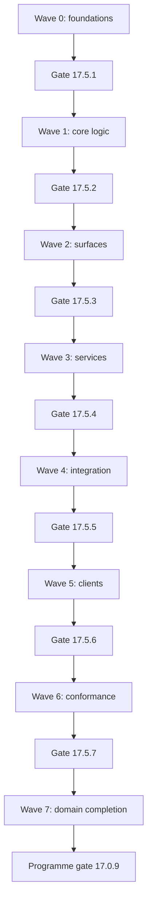

# Wave plan

The plan contains **2,517 pending tasks** in waves 0–7 across 17 domains. All eligible tasks of one wave run concurrently in separate sandboxes, up to 500 active tasks. Same-wave `requires` edges determine admission within a wave; later waves wait for the preceding wave gate.

**Dispatch is blocked by the merged dependency graph.** 8 cyclic components prevent 672 tasks from becoming ready even before wave barriers are imposed. The first cycles are in wave 2. The runners `17.5.1`, `17.5.2`, `17.5.3`, `17.5.4`, `17.5.5`, `17.5.6`, `17.5.7` are assigned after their target wave, and their current prerequisites include `16.97.4` in wave 5. Their placement cannot satisfy the rule that each wave gate passes before the next wave begins. These source defects require resolution before an executable elapsed-time forecast can be issued.

## Source and calculation basis

Counts, ownership, anchors, gate references and merged dependencies come from the generated `spec.kvx` task blocks. Repository baseline: revision `2a1033aa2`. This document describes planned implementation work; task gates have not been executed by writing this plan.

Merged source SHA-256: `e9b2e8c6a6dd2f595ff940309be9dde91599acb79ebc9d2ea7383c62b9b51929`. The generator also reconstructs the task `requires` lists from their source fragments before wiring expansion and verifies that task ids, waves, titles and file ownership match the merged document. Fragment input digest: `c96cfce479437b3c028adf607748ba19f6b3cf5e4cb400638f48b1d2ea313631`. Regenerate these calculations when task scheduling fields change.

A task receives one sandbox for 30 minutes, covering implementation and its bounded qualification. Dispatch requires all declared and wiring-expanded prerequisites to be complete. Each sandbox gets its task’s exact `touches`, `build_cmd`, `verify_cmd`, profile and rollback. One build and one focused verification run are allowed, with at most two repair cycles within the task limit; a failed or timed-out task holds the wave. An isolated workspace does not waive shared-file ownership.

## Task counts per domain and wave

| Domain | Owner role | W0 | W1 | W2 | W3 | W4 | W5 | W6 | W7 | Total |
|---|---|---:|---:|---:|---:|---:|---:|---:|---:|---:|
| 1: kernel | `fm-kernel` | 18 | 17 | 19 | 7 | 9 | 19 | 51 | 1 | 141 |
| 2: ledger-auth-pay | `fm-ledger-auth-pay` | 27 | 15 | 79 | 0 | 15 | 2 | 14 | 1 | 153 |
| 3: markets | `fm-markets` | 11 | 40 | 25 | 6 | 46 | 12 | 29 | 1 | 170 |
| 4: launchpad | `fm-launchpad` | 37 | 43 | 44 | 7 | 25 | 25 | 4 | 1 | 186 |
| 5: node-runtime | `fm-node-runtime` | 15 | 44 | 38 | 27 | 31 | 42 | 34 | 1 | 232 |
| 6: chain-modules | `fm-chain-modules` | 46 | 31 | 33 | 7 | 38 | 39 | 58 | 1 | 253 |
| 7: rpc-api | `fm-rpc-api` | 8 | 53 | 15 | 8 | 23 | 3 | 5 | 1 | 116 |
| 8: platform | `fm-platform` | 10 | 17 | 17 | 24 | 17 | 59 | 55 | 1 | 200 |
| 9: agent | `fm-agent` | 10 | 26 | 32 | 22 | 18 | 13 | 26 | 1 | 148 |
| 10: human | `fm-human` | 6 | 19 | 12 | 7 | 15 | 38 | 13 | 1 | 111 |
| 11: interop | `fm-interop` | 13 | 17 | 22 | 21 | 14 | 11 | 26 | 1 | 125 |
| 12: wallet | `fm-wallet` | 9 | 15 | 13 | 14 | 16 | 21 | 28 | 1 | 117 |
| 13: programs | `fm-programs` | 12 | 20 | 31 | 21 | 20 | 8 | 14 | 1 | 127 |
| 14: web-explorer-bridge | `fm-web-explorer-bridge` | 11 | 32 | 35 | 22 | 17 | 28 | 17 | 1 | 163 |
| 15: cosmos-fork | `fm-cosmos-fork` | 1 | 22 | 1 | 1 | 1 | 13 | 17 | 1 | 57 |
| 16: tools-ops | `fm-tools-ops` | 14 | 20 | 9 | 6 | 6 | 64 | 33 | 1 | 153 |
| 17: programme | `fm-programme` | 11 | 9 | 6 | 5 | 3 | 10 | 6 | 15 | 65 |
| **Total** | | **259** | **440** | **431** | **205** | **314** | **407** | **430** | **31** | **2517** |

## Capacity and duration

Every whole wave fits under the 500-sandbox limit. Capacity alone would require one 30-minute batch per wave, or 4 hours for eight barriers, while total task effort is 1,258.5 sandbox-hours. Dependencies require more than one batch. For an acyclic wave, define rank as one plus the maximum same-wave prerequisite rank, with rank 1 for tasks having no same-wave prerequisites. Run every task of a rank concurrently; the largest rank is the exact wave duration in 30-minute task slots because capacity cannot bind.

The table separates the merged graph from a diagnostic calculation over the declared fragment edges before wiring expansion. That projection has 42 serial slots across wave barriers, or **21 h**. It excludes the added wiring edges and does not repair the merged graph or move its aggregate gates. The merged plan has **no finite completion estimate** until the cycles and gate placement are resolved. Times exclude dispatch, merge, external provisioning and aggregate runtime beyond the modeled task allocation; a repair or a gate requiring more than its task allocation must be recorded and rescheduled.

| Wave | Tasks | Capacity-only minimum | Merged same-wave chain | Declared-edge slots | Declared-edge duration | Declared-edge cumulative finish |
|---|---:|---:|---|---:|---:|---:|
| 0 | 259 | 30 min | 4 tasks / 2 h | 4 | 2 h | 2 h |
| 1 | 440 | 30 min | 4 tasks / 2 h | 4 | 2 h | 4 h |
| 2 | 431 | 30 min | Cyclic; completion blocked | 7 | 3.5 h | 7.5 h |
| 3 | 205 | 30 min | 4 tasks / 2 h | 3 | 1.5 h | 9 h |
| 4 | 314 | 30 min | Cyclic; completion blocked | 6 | 3 h | 12 h |
| 5 | 407 | 30 min | Cyclic; completion blocked | 6 | 3 h | 15 h |
| 6 | 430 | 30 min | Cyclic; completion blocked | 7 | 3.5 h | 18.5 h |
| 7 | 31 | 30 min | 5 tasks / 2.5 h | 5 | 2.5 h | 21 h |

Merged durations for acyclic individual waves assume every preceding wave is already complete; they are not a programme schedule. Even wave 0 cannot release wave 1 under the current aggregate-gate placement.

## Wave flow

Each arrow means that all tasks of the preceding wave have qualified, its sandboxes have been merged, and its aggregate gate has passed. This is the required execution flow; the gate registry below records the placement conflict in the current task data.

## Anchors and aggregate gates

Every domain has five real anchor tasks. Foundation, surface, integration and client anchors close waves 0, 2, 4 and 5. Wave 1 uses the preceding foundation anchors; wave 3 uses the surface anchors; wave 6 follows the client anchors and qualifies its own conformance work. No extra fixed anchor is assigned to waves 1, 3 or 6. Completion anchors in wave 7 require the domain’s earlier anchors and its wave-6 work; completion does not follow merely from a task count.

| Domain | W0 foundation | W2 surface | W4 integrated | W5 clients | W7 completion |
|---|---|---|---|---|---|
| 1: kernel | `1.0.1` | `1.0.2` | `1.0.3` | `1.0.4` | `1.0.9` |
| 2: ledger-auth-pay | `2.0.1` | `2.0.2` | `2.0.3` | `2.0.4` | `2.0.9` |
| 3: markets | `3.0.1` | `3.0.2` | `3.0.3` | `3.0.4` | `3.0.9` |
| 4: launchpad | `4.0.1` | `4.0.2` | `4.0.3` | `4.0.4` | `4.0.9` |
| 5: node-runtime | `5.0.1` | `5.0.2` | `5.0.3` | `5.0.4` | `5.0.9` |
| 6: chain-modules | `6.0.1` | `6.0.2` | `6.0.3` | `6.0.4` | `6.0.9` |
| 7: rpc-api | `7.0.1` | `7.0.2` | `7.0.3` | `7.0.4` | `7.0.9` |
| 8: platform | `8.0.1` | `8.0.2` | `8.0.3` | `8.0.4` | `8.0.9` |
| 9: agent | `9.0.1` | `9.0.2` | `9.0.3` | `9.0.4` | `9.0.9` |
| 10: human | `10.0.1` | `10.0.2` | `10.0.3` | `10.0.4` | `10.0.9` |
| 11: interop | `11.0.1` | `11.0.2` | `11.0.3` | `11.0.4` | `11.0.9` |
| 12: wallet | `12.0.1` | `12.0.2` | `12.0.3` | `12.0.4` | `12.0.9` |
| 13: programs | `13.0.1` | `13.0.2` | `13.0.3` | `13.0.4` | `13.0.9` |
| 14: web-explorer-bridge | `14.0.1` | `14.0.2` | `14.0.3` | `14.0.4` | `14.0.9` |
| 15: cosmos-fork | `15.0.1` | `15.0.2` | `15.0.3` | `15.0.4` | `15.0.9` |
| 16: tools-ops | `16.0.1` | `16.0.2` | `16.0.3` | `16.0.4` | `16.0.9` |
| 17: programme | `17.0.1` | `17.0.2` | `17.0.3` | `17.0.4` | `17.0.9` |

The aggregate gate manifest and runner are created by `17.5.8` in wave 0. Script authoring tasks `16.1.1`–`16.1.8` are also in wave 0. Authoring a script does not mean that the aggregate passed. All seven aggregate execution tasks currently sit in wave 7 and require `16.97.4` in wave 5; they also lack a declared dependency that closes every task of their target wave. A dispatcher must enforce wave-wide closure in addition to the anchor dependencies. The programme gate `17.0.9` requires all seven aggregate runners and domain completion anchors `1.0.9`–`16.0.9`.

| Target wave | Execution task | Assigned wave | Script author task | Planned aggregate script |
|---|---|---:|---|---|
| 0 | `17.5.1` | 7 | `16.1.1` | `scripts/gates/wave-0.sh` |
| 1 | `17.5.2` | 7 | `16.1.2` | `scripts/gates/wave-1.sh` |
| 2 | `17.5.3` | 7 | `16.1.3` | `scripts/gates/wave-2.sh` |
| 3 | `17.5.4` | 7 | `16.1.4` | `scripts/gates/wave-3.sh` |
| 4 | `17.5.5` | 7 | `16.1.5` | `scripts/gates/wave-4.sh` |
| 5 | `17.5.6` | 7 | `16.1.6` | `scripts/gates/wave-5.sh` |
| 6 | `17.5.7` | 7 | `16.1.7` | `scripts/gates/wave-6.sh` |
| Programme | `17.0.9` | 7 | `16.1.8` | `scripts/gates/wave-programme.sh` |

Run aggregate suites once on the merged wave revision through the manifest’s runner and record revision, command, exit code and evidence location. A nonzero exit holds the wave. Final candidate evidence for waves 0–6 must also satisfy `17.0.9`’s same-revision requirement. Use the Hyperfide CLI (`cg`) to claim and complete tasks only when their declared qualification has passed. Evidence remains distinct from the `pending` task inventory reported here.

## Wave details and critical chains

Arrows in the following chains run prerequisite → dependent. A merged chain is a longest same-wave `requires` chain when that wave is acyclic. Declared-edge chains are diagnostic witnesses from the fragment graph before wiring expansion. Equal-length chains are resolved by numeric task id for reproducibility.

### Wave 0 — foundations

Freeze types, ABI and protocol shapes, error registries, fixtures and task harnesses; prepare planned files without exposing new user behavior.

Tasks: **259**; domain counts appear in the matrix above. Active shared-file claims: **157**; the ownership register lists every owner for this wave. All tasks use separate sandboxes and every ready, disjoint task may run concurrently. Actual starts still wait for same-wave prerequisites.

Anchors closing this wave: `1.0.1`, `2.0.1`, `3.0.1`, `4.0.1`, `5.0.1`, `6.0.1`, `7.0.1`, `8.0.1`, `9.0.1`, `10.0.1`, `11.0.1`, `12.0.1`, `13.0.1`, `14.0.1`, `15.0.1`, `16.0.1`, `17.0.1`.

Aggregate gate: `17.5.1`; its current assigned wave is 7, as recorded above.

Merged local critical chain: **4 tasks / 2 h**: `9.91.1` → `8.21.1` → `8.21.2` → `8.25.1`.

Declared-edge diagnostic chain: **4 tasks / 2 h**: `8.0.1` → `8.21.1` → `8.21.2` → `8.25.1`.

Declared-edge rank batch sizes: rank 1: 212; rank 2: 42; rank 3: 2; rank 4: 3.

### Wave 1 — core logic

Implement keeper, kernel and crate internals, state layouts and pure functions with their focused behavior gates.

Tasks: **440**; domain counts appear in the matrix above. Active shared-file claims: **256**; the ownership register lists every owner for this wave. All tasks use separate sandboxes and every ready, disjoint task may run concurrently. Actual starts still wait for same-wave prerequisites.

Anchors closing this wave: none; retain the preceding fixed anchors and close every scheduled task.

Aggregate gate: `17.5.2`; its current assigned wave is 7, as recorded above.

Merged local critical chain: **4 tasks / 2 h**: `2.3.1` → `2.3.2` → `2.3.4` → `2.3.5`.

Declared-edge diagnostic chain: **4 tasks / 2 h**: `2.3.1` → `2.3.2` → `2.3.4` → `2.3.5`.

Declared-edge rank batch sizes: rank 1: 409; rank 2: 26; rank 3: 4; rank 4: 1.

### Wave 2 — surfaces

Freeze callable precompile methods, message and query handlers, RPC and HTTP routes, CLI commands, events and errors.

Tasks: **431**; domain counts appear in the matrix above. Active shared-file claims: **263**; the ownership register lists every owner for this wave. All tasks use separate sandboxes and every ready, disjoint task may run concurrently. Actual starts still wait for same-wave prerequisites.

Anchors closing this wave: `1.0.2`, `2.0.2`, `3.0.2`, `4.0.2`, `5.0.2`, `6.0.2`, `7.0.2`, `8.0.2`, `9.0.2`, `10.0.2`, `11.0.2`, `12.0.2`, `13.0.2`, `14.0.2`, `15.0.2`, `16.0.2`, `17.0.2`.

Aggregate gate: `17.5.3`; its current assigned wave is 7, as recorded above.

Merged local critical path is blocked by **2 cyclic component(s)**. Their exact task ids and dependency edges are listed below.

Declared-edge diagnostic chain: **7 tasks / 3.5 h**: `2.9.1` → `2.9.2` → `2.9.3` → `2.0.2` → `6.28.2` → `6.0.2` → `17.93.1`.

Declared-edge rank batch sizes: rank 1: 338; rank 2: 55; rank 3: 17; rank 4: 8; rank 5: 10; rank 6: 1; rank 7: 2.

### Wave 3 — services

Move off-chain services and daemons to the frozen surfaces and qualify their service behavior.

Tasks: **205**; domain counts appear in the matrix above. Active shared-file claims: **229**; the ownership register lists every owner for this wave. All tasks use separate sandboxes and every ready, disjoint task may run concurrently. Actual starts still wait for same-wave prerequisites.

Anchors closing this wave: none; retain the preceding fixed anchors and close every scheduled task.

Aggregate gate: `17.5.4`; its current assigned wave is 7, as recorded above.

Merged local critical chain: **4 tasks / 2 h**: `6.94.3` → `11.32.1` → `11.32.3` → `11.34.3`.

Declared-edge diagnostic chain: **3 tasks / 1.5 h**: `13.2.1` → `13.3.1` → `13.3.4`.

Declared-edge rank batch sizes: rank 1: 180; rank 2: 21; rank 3: 4.

### Wave 4 — integration

Join node registration, activation, genesis, parameters, generated SDK surfaces and cross-domain consumers.

Tasks: **314**; domain counts appear in the matrix above. Active shared-file claims: **198**; the ownership register lists every owner for this wave. All tasks use separate sandboxes and every ready, disjoint task may run concurrently. Actual starts still wait for same-wave prerequisites.

Anchors closing this wave: `1.0.3`, `2.0.3`, `3.0.3`, `4.0.3`, `5.0.3`, `6.0.3`, `7.0.3`, `8.0.3`, `9.0.3`, `10.0.3`, `11.0.3`, `12.0.3`, `13.0.3`, `14.0.3`, `15.0.3`, `16.0.3`, `17.0.3`.

Aggregate gate: `17.5.5`; its current assigned wave is 7, as recorded above.

Merged local critical path is blocked by **1 cyclic component(s)**. Their exact task ids and dependency edges are listed below.

Declared-edge diagnostic chain: **6 tasks / 3 h**: `1.18.1` → `1.0.3` → `13.0.3` → `6.12.4` → `6.0.3` → `17.0.3`.

Declared-edge rank batch sizes: rank 1: 236; rank 2: 37; rank 3: 24; rank 4: 11; rank 5: 2; rank 6: 4.

### Wave 5 — clients

Repoint applications, SDKs, wallets and explorers to integrated surfaces and remove displaced client paths.

Tasks: **407**; domain counts appear in the matrix above. Active shared-file claims: **242**; the ownership register lists every owner for this wave. All tasks use separate sandboxes and every ready, disjoint task may run concurrently. Actual starts still wait for same-wave prerequisites.

Anchors closing this wave: `1.0.4`, `2.0.4`, `3.0.4`, `4.0.4`, `5.0.4`, `6.0.4`, `7.0.4`, `8.0.4`, `9.0.4`, `10.0.4`, `11.0.4`, `12.0.4`, `13.0.4`, `14.0.4`, `15.0.4`, `16.0.4`, `17.0.4`.

Aggregate gate: `17.5.6`; its current assigned wave is 7, as recorded above.

Merged local critical path is blocked by **1 cyclic component(s)**. Their exact task ids and dependency edges are listed below.

Declared-edge diagnostic chain: **6 tasks / 3 h**: `10.6.2` → `10.6.1` → `10.20.5` → `10.26.1` → `10.26.15` → `10.21.3`.

Declared-edge rank batch sizes: rank 1: 221; rank 2: 77; rank 3: 74; rank 4: 10; rank 5: 24; rank 6: 1.

### Wave 6 — conformance

Close parity goldens, remaining retirements, migration rehearsals, cross-language checks and performance bounds.

Tasks: **430**; domain counts appear in the matrix above. Active shared-file claims: **258**; the ownership register lists every owner for this wave. All tasks use separate sandboxes and every ready, disjoint task may run concurrently. Actual starts still wait for same-wave prerequisites.

Anchors closing this wave: none; retain the preceding fixed anchors and close every scheduled task.

Aggregate gate: `17.5.7`; its current assigned wave is 7, as recorded above.

Merged local critical path is blocked by **4 cyclic component(s)**. Their exact task ids and dependency edges are listed below.

Declared-edge diagnostic chain: **7 tasks / 3.5 h**: `9.1.4` → `9.18.2` → `9.18.7` → `9.30.1` → `9.29.1` → `9.27.4` → `9.26.3`.

Declared-edge rank batch sizes: rank 1: 316; rank 2: 62; rank 3: 27; rank 4: 13; rank 5: 8; rank 6: 3; rank 7: 1.

### Wave 7 — completion

Qualify each domain completion anchor and then the programme candidate, including aggregate evidence and release records.

Tasks: **31**; domain counts appear in the matrix above. Active shared-file claims: **6**; the ownership register lists every owner for this wave. All tasks use separate sandboxes and every ready, disjoint task may run concurrently. Actual starts still wait for same-wave prerequisites.

Anchors closing this wave: `1.0.9`, `2.0.9`, `3.0.9`, `4.0.9`, `5.0.9`, `6.0.9`, `7.0.9`, `8.0.9`, `9.0.9`, `10.0.9`, `11.0.9`, `12.0.9`, `13.0.9`, `14.0.9`, `15.0.9`, `16.0.9`, `17.0.9`.

Aggregate gate: `17.0.9`, after all domain completion anchors and the seven wave aggregate runners.

Merged local critical chain: **5 tasks / 2.5 h**: `5.0.9` → `17.1.7` → `17.1.8` → `17.1.9` → `17.0.9`.

Declared-edge diagnostic chain: **5 tasks / 2.5 h**: `5.0.9` → `17.1.7` → `17.1.8` → `17.1.9` → `17.0.9`.

Declared-edge rank batch sizes: rank 1: 23; rank 2: 4; rank 3: 2; rank 4: 1; rank 5: 1.

## Programme critical path and blockers

The merged `requires` graph has 8 strongly connected components containing dependency cycles. No task in one of those components can become ready. Counting those tasks and all tasks transitively waiting for them gives 672 blocked tasks; imposing wave barriers can block progression further. This is a dependency result, independent of the number of available sandboxes.

| Wave | Tasks blocked by cycles before barriers |
|---|---:|
| 0 | 0 |
| 1 | 0 |
| 2 | 10 |
| 3 | 18 |
| 4 | 69 |
| 5 | 233 |
| 6 | 313 |
| 7 | 29 |

For the cyclic-component register only, arrows run **dependent → prerequisite**, directly matching each task’s `requires` list. Every listed edge is present in the merged document.

| Component | Wave | Members | Internal dependency edges |
|---|---:|---|---|
| C1 | 6 | `1.36.1`, `1.36.3`, `1.37.1`, `1.97.1`, `5.50.7`, `5.51.1`, `5.51.4`, `5.97.1`, `8.19.1` | `1.36.1` → `1.37.1`; `1.36.3` → `1.36.1`; `1.37.1` → `5.97.1`; `1.97.1` → `1.36.3`; `5.50.7` → `1.97.1`; `5.51.1` → `8.19.1`; `5.51.4` → `8.19.1`; `5.97.1` → `5.50.7`; `5.97.1` → `5.51.1`; `5.97.1` → `5.51.4`; `8.19.1` → `5.97.1` |
| C2 | 4 | `2.95.2`, `6.0.3`, `6.22.8` | `2.95.2` → `6.0.3`; `6.0.3` → `6.22.8`; `6.22.8` → `2.95.2` |
| C3 | 6 | `5.54.9`, `6.60.2`, `6.60.3`, `6.97.2` | `5.54.9` → `6.97.2`; `6.60.2` → `5.54.9`; `6.60.3` → `5.54.9`; `6.97.2` → `6.60.2`; `6.97.2` → `6.60.3` |
| C4 | 6 | `5.55.5`, `8.47.7` | `5.55.5` → `8.47.7`; `8.47.7` → `5.55.5` |
| C5 | 2 | `6.0.2`, `6.2.1`, `17.93.1` | `6.0.2` → `6.2.1`; `6.2.1` → `17.93.1`; `17.93.1` → `6.0.2` |
| C6 | 2 | `8.93.1`, `14.0.2`, `14.21.2`, `14.22.5`, `14.30.2`, `16.93.1` | `8.93.1` → `14.0.2`; `14.0.2` → `14.21.2`; `14.0.2` → `14.22.5`; `14.0.2` → `14.30.2`; `14.21.2` → `8.93.1`; `14.22.5` → `16.93.1`; `14.30.2` → `16.93.1`; `16.93.1` → `14.0.2` |
| C7 | 5 | `10.26.1`, `10.96.1` | `10.26.1` → `10.96.1`; `10.96.1` → `10.26.1` |
| C8 | 6 | `16.33.5`, `16.97.5` | `16.33.5` → `16.97.5`; `16.97.5` → `16.33.5` |

The declared-edge fragment graph is acyclic. Its longest literal `requires` chain is **24 tasks**, or **12 h** with no global wave-barrier delay. The full task-id witness follows; each task requires its predecessor. This chain is a diagnostic projection; merged dispatch status is recorded above.

| Step | Task | Wave | Task title |
|---|---|---:|---|
| 1 | `2.0.1` | 0 | Freeze the kernel result-code mapping of the layerxledger and layerxauth keepers |
| 2 | `2.6.1` | 1 | Construct the layerxauth keeper over the shared host, authz and EVM keepers |
| 3 | `2.6.2` | 1 | Resolve the EVM caller to its bound DID as the auth actor |
| 4 | `2.6.4` | 1 | Submit governance authority activities to the kernel host |
| 5 | `2.6.5` | 2 | Decode authority receipts into the 0x101C event set |
| 6 | `2.7.3` | 2 | Revoke grants through governance sub-op 6 and advance the grantor revocation sequence |
| 7 | `2.11.3` | 2 | Serve revokeGrant on 0x101C |
| 8 | `2.0.2` | 2 | Freeze the served 0x101A and 0x101C method surfaces |
| 9 | `6.28.2` | 2 | Route the layerxpay MsgUpdateParams pause through LayerXProposal |
| 10 | `6.0.2` | 2 | Gate the domain-6 surface wave on the revert-reason paths |
| 11 | `13.32.2` | 4 | Activate 0x101D at the merge upgrade through the node keepers and import |
| 12 | `13.0.3` | 4 | Integrate the sandbox staticlib exports with the kernel host at the merged height |
| 13 | `6.12.4` | 4 | Serve 0x101D layerxprograms from the merge plan height through the activation list |
| 14 | `6.0.3` | 4 | Gate the domain-6 integration wave on activation and registration |
| 15 | `8.5.2` | 4 | Answer px_listAssets from the indexer asset list and chain metadata |
| 16 | `8.0.4` | 5 | Prove the hosted chain readers before the kernel switch-off |
| 17 | `8.3.1` | 6 | Answer -32601 for every lx_ JSON-RPC name on HTTP and WebSocket |
| 18 | `8.7.3` | 6 | Retire the kernel activity and program production routes of the gateway |
| 19 | `8.7.4` | 6 | Retire the kernel activity scripts of the gateway tests |
| 20 | `8.19.5` | 6 | Delete the kernel lifecycle test of the gateway local harness |
| 21 | `8.20.2` | 6 | Delete the kernel daemon tests of the core boundary |
| 22 | `8.0.9` | 7 | Gate domain 8 completion on its retired surfaces and planned paths |
| 23 | `17.4.6` | 7 | Run the parity inventory once on the merged revision |
| 24 | `17.0.9` | 7 | Run the programme gate once on the merged candidate |

The 12 h literal-chain projection and 21 h wave-barrier projection measure different constraints. Each wave can have a longest chain in a different domain; barriers concatenate those wave maxima even when no literal `requires` edge joins them. Neither projection constitutes a successful qualification or an executable forecast for the merged graph.

## Shared-file ownership per wave

A file has one task owner in each wave in which it is touched. The merged task inventory has **zero same-wave file ownership collisions**. A shared file below means an exact `touches` path named by more than one task across the programme; there are **615** such files. Path ownership remains with its feature manager across waves. Request changes outside that domain through wiring and let its owning task make the edit.

The central-file matrix also includes reserved shared paths with no scheduled writer. A dash means no task writes that file in that wave; it does not delegate the file to another domain. Generated protocol files remain with their module owner, while `api/**` definitions follow the domain allocation and `buf.gen.yaml` remains with domain 7.

| Central file | Domain owner | W0 | W1 | W2 | W3 | W4 | W5 | W6 | W7 |
|---|---:|---|---|---|---|---|---|---|---|
| `node/app.go` | 5 | `5.0.1` | `5.19.1` | `5.0.2` | `5.19.2` | `5.0.3` | `5.19.3` | `5.7.1` | — |
| `node/precompiles.go` | 5 | — | — | — | `5.94.2` | `5.19.4` | `5.7.2` | — | — |
| `node/precompiles_v6120.go` | 5 | — | — | — | — | — | — | — | — |
| `node/giga_v6120.go` | 5 | — | `5.8.1` | — | — | — | — | — | — |
| `precompiles/setup.go` | 6 | `6.6.1` | `6.6.2` | `6.6.3` | `6.6.4` | `6.6.5` | `6.6.9` | — | — |
| `go.mod` | 5 | — | — | — | — | — | — | — | — |
| `go.sum` | 5 | — | — | — | — | — | — | — | — |
| `Makefile` | 16 | `16.2.1` | `16.2.2` | `16.0.2` | `16.2.3` | `16.0.3` | `16.0.4` | `16.2.4` | — |
| `chain.mk` | 16 | — | — | — | — | — | — | — | — |
| `buf.gen.yaml` | 7 | — | — | — | — | — | — | — | — |
| `services/platform/Cargo.lock` | 8 | `8.28.1` | — | — | — | — | `8.20.3` | `8.9.2` | — |

The complete register below includes existing and planned files exactly as declared in task metadata. Each assignment is `wave: task`; the domain prefix of a task maps to the owner-role column of the domain matrix. A planned file remains subject to the task’s path policy when implemented. This register makes no changes to any file ownership.

| Shared file | Owners by wave |
|---|---|
| `.github/workflows/platform.yml` | W1: `16.5.6`; W3: `16.4.2` |
| `Makefile` | W0: `16.2.1`; W1: `16.2.2`; W2: `16.0.2`; W3: `16.2.3`; W4: `16.0.3`; W5: `16.0.4`; W6: `16.2.4` |
| `api/tokenfactory/query.proto` | W0: `6.23.1`; W1: `6.92.3` |
| `apps/bridge/package.json` | W0: `14.41.2`; W1: `14.56.1` |
| `apps/bridge/pnpm-lock.yaml` | W0: `14.41.2`; W1: `14.56.1` |
| `apps/bridge/src/components/bridge/bridge-card.tsx` | W2: `14.47.1`; W3: `14.47.2`; W4: `14.47.4`; W5: `14.54.3` |
| `apps/bridge/src/components/bridge/transfer-actions.spec.ts` | W1: `14.46.1`; W2: `14.46.2` |
| `apps/bridge/src/components/bridge/transfer-actions.ts` | W1: `14.46.1`; W2: `14.46.2` |
| `apps/bridge/src/components/bridge/transfers-panel.tsx` | W2: `14.48.2`; W3: `14.48.3`; W4: `14.48.4`; W5: `14.59.1` |
| `apps/bridge/src/lib/bridge/attestation-api.spec.ts` | W1: `14.44.1`; W2: `14.44.3` |
| `apps/bridge/src/lib/bridge/attestation-api.ts` | W1: `14.44.1`; W2: `14.44.3`; W3: `14.44.4` |
| `apps/bridge/src/lib/bridge/config.ts` | W1: `14.50.1`; W2: `14.57.1` |
| `apps/bridge/src/lib/bridge/import.spec.ts` | W1: `14.48.1`; W3: `14.48.3` |
| `apps/bridge/src/lib/bridge/import.ts` | W1: `14.48.1`; W3: `14.48.3` |
| `apps/bridge/src/lib/bridge/solana.spec.ts` | W1: `14.54.1`; W3: `14.54.2`; W4: `14.54.4` |
| `apps/bridge/src/lib/bridge/solana.ts` | W1: `14.54.1`; W3: `14.54.2` |
| `apps/bridge/src/lib/bridge/use-bridge-state.ts` | W2: `14.44.3`; W3: `14.54.2` |
| `apps/bridge/src/test/manifest.spec.ts` | W0: `14.41.2`; W1: `14.56.1` |
| `apps/explorer/lib/api/services/general/paxeerXLists.ts` | W5: `14.34.1`; W6: `14.32.1` |
| `apps/explorer/stubs/paxeerXLists.ts` | W5: `14.31.1`; W6: `14.32.1` |
| `apps/explorer/types/api/paxeerX.ts` | W5: `14.33.1`; W6: `14.21.3` |
| `apps/explorer/types/api/paxeerXLists.ts` | W5: `14.31.1`; W6: `14.32.1` |
| `apps/launchpad/mobile/src/runtime/routes/account.ts` | W1: `4.46.2`; W5: `4.46.4` |
| `apps/launchpad/mobile/src/runtime/routes/activity.ts` | W1: `4.46.2`; W5: `4.46.7`; W6: `4.47.3` |
| `apps/launchpad/mobile/src/runtime/routes/chat.ts` | W1: `4.46.2`; W5: `4.46.6` |
| `apps/launchpad/mobile/src/runtime/routes/market.ts` | W1: `4.46.2`; W5: `4.46.3` |
| `apps/launchpad/mobile/src/runtime/routes/notifications.ts` | W1: `4.46.2`; W5: `4.46.5` |
| `apps/launchpad/mobile/src/runtime/service-client.ts` | W1: `4.46.2`; W6: `4.47.3` |
| `apps/launchpad/web/next.config.ts` | W0: `4.41.1`; W1: `4.41.2`; W2: `4.41.3` |
| `apps/launchpad/web/src/core/next-build-config.test.ts` | W0: `4.41.1`; W1: `4.41.2`; W2: `4.41.3` |
| `apps/launchpad/web/src/core/next-build-config.ts` | W0: `4.41.1`; W1: `4.41.2`; W2: `4.41.3` |
| `apps/launchpad/web/src/widgets/trading/transaction-controls/providers.ts` | W5: `4.43.4`; W6: `4.43.5` |
| `apps/perps/src/core/perps/orderPlan.ts` | W1: `3.48.2`; W5: `3.48.5` |
| `apps/perps/src/core/perps/perpetual.graphql` | W5: `3.48.7`; W6: `3.43.3` |
| `apps/perps/src/hooks/perps/useSubgraph.ts` | W5: `3.48.7`; W6: `3.43.3` |
| `apps/perps/src/widgets/mobile/MobileSecondaryTabContent.tsx` | W5: `3.48.11`; W6: `3.59.1` |
| `apps/perps/src/widgets/portfolio/PortfolioPositionsPanel.tsx` | W5: `3.48.14`; W6: `3.59.1` |
| `apps/perps/src/widgets/trading/PerpsPositionsPanel.tsx` | W5: `3.48.14`; W6: `3.59.1` |
| `apps/perps/tests/graphql-operations.test.ts` | W5: `3.48.7`; W6: `3.43.3` |
| `apps/wallet/e2e/send.spec.ts` | W5: `12.35.2`; W6: `12.35.3` |
| `apps/wallet/src/account/StatusLadder.test.tsx` | W1: `12.34.1`; W6: `12.34.2` |
| `apps/wallet/src/account/StatusLadder.tsx` | W1: `12.34.1`; W6: `12.34.2` |
| `apps/wallet/src/account/test/endpoint.test.ts` | W0: `12.31.1`; W6: `12.34.10` |
| `apps/wallet/src/account/test/endpoint.ts` | W0: `12.31.1`; W5: `12.34.6`; W6: `12.34.10` |
| `apps/wallet/src/surfaces/test/chain.tsx` | W0: `12.31.2`; W6: `12.33.6` |
| `apps/wallet/src/surfaces/useSurface.ts` | W1: `12.33.1`; W3: `12.33.2`; W4: `12.33.3`; W6: `12.33.6` |
| `apps/web/copy/catalog.ts` | W0: `14.10.1`; W4: `14.10.2`; W5: `14.0.4`; W6: `14.10.3` |
| `apps/web/copy/messages.generated.ts` | W0: `14.10.1`; W4: `14.10.2`; W5: `14.0.4`; W6: `14.10.3` |
| `apps/web/e2e/browser/explorer.spec.ts` | W1: `14.5.1`; W4: `14.6.4` |
| `apps/web/e2e/explorer-admission.test.ts` | W1: `14.5.1`; W5: `14.6.2` |
| `apps/web/e2e/explorer.spec.ts` | W1: `14.5.1`; W4: `14.6.4` |
| `apps/web/package.json` | W3: `14.7.2`; W4: `14.6.4` |
| `apps/web/src/api/wallet.ts` | W0: `14.11.1`; W3: `14.4.1`; W4: `14.4.3` |
| `apps/web/src/explorer/client.ts` | W3: `14.5.3`; W4: `14.5.4`; W5: `14.6.2` |
| `apps/web/src/explorer/links.ts` | W1: `14.5.1`; W4: `14.6.3` |
| `apps/web/src/journeys/custody/handoff.ts` | W0: `14.11.1`; W5: `14.7.4` |
| `apps/web/src/perf/budgets.ts` | W2: `14.7.1`; W4: `14.6.3` |
| `apps/web/src/settings/wallet/bridge.ts` | W1: `14.11.2`; W2: `14.8.1` |
| `apps/web/src/settings/wallet/wallet-screen.tsx` | W1: `14.11.2`; W2: `14.8.1` |
| `apps/web/src/states/matrix.ts` | W2: `14.7.1`; W4: `14.6.3` |
| `cmd/layerx-genesis/lxp_genesis_build_cli.c` | W2: `5.49.1`; W3: `5.49.2` |
| `cmd/layerx-genesis/lxp_genesis_builder.c` | W2: `5.49.1`; W3: `5.49.2`; W4: `5.49.3` |
| `cmd/layerx-genesis/test_builder_cli.py` | W2: `5.49.1`; W3: `5.49.2`; W4: `5.49.3` |
| `cmd/layerx-module-registry/main.c` | W2: `5.48.1`; W3: `5.48.2`; W5: `5.97.4` |
| `cmd/layerx-module-registry/test_registry_cli.py` | W2: `5.48.1`; W3: `5.48.2` |
| `cmd/layerxctl/Cargo.lock` | W0: `5.47.1`; W2: `5.47.2`; W5: `5.47.3` |
| `cmd/layerxctl/Cargo.toml` | W0: `5.47.1`; W2: `5.47.2`; W5: `5.47.3` |
| `cmd/layerxctl/src/main.rs` | W0: `5.47.1`; W2: `5.47.2`; W5: `5.47.3` |
| `cmd/layerxctl/tests/files.rs` | W0: `5.47.1`; W2: `5.47.2`; W5: `5.47.3`; W6: `5.47.4` |
| `consensus/Makefile` | W0: `5.62.1`; W1: `5.61.2`; W2: `5.62.2`; W3: `5.62.3`; W4: `5.62.4`; W5: `5.62.5`; W6: `5.62.6` |
| `consensus/internal/consensus/state.go` | W1: `5.31.2`; W2: `5.33.1`; W3: `5.33.2` |
| `consensus/internal/p2p/giga_router.go` | W1: `5.67.1`; W2: `5.67.3` |
| `consensus/internal/rpc/core/blocks.go` | W1: `5.64.2`; W2: `5.64.11`; W3: `5.64.12`; W4: `5.64.13`; W5: `5.64.14`; W6: `5.64.16` |
| `consensus/internal/rpc/core/blocks_autobahn_header_test.go` | W2: `5.64.11`; W3: `5.64.12` |
| `consensus/internal/rpc/core/consensus.go` | W1: `5.64.8`; W2: `5.64.9`; W5: `5.64.14` |
| `consensus/internal/rpc/core/consensus_autobahn_test.go` | W1: `5.64.8`; W2: `5.64.9` |
| `consensus/internal/rpc/core/status.go` | W1: `5.64.5`; W3: `5.64.6`; W5: `5.64.14` |
| `consensus/internal/rpc/core/status_autobahn_test.go` | W1: `5.64.5`; W3: `5.64.6` |
| `consensus/internal/rpc/core/tx.go` | W1: `5.64.3`; W2: `5.64.4` |
| `consensus/internal/rpc/core/tx_autobahn_prove_test.go` | W1: `5.64.3`; W2: `5.64.4` |
| `consensus/node/node.go` | W2: `5.34.1`; W3: `5.94.1`; W4: `5.5.12` |
| `consensus/test/Makefile` | W1: `5.63.1`; W2: `5.63.2`; W3: `5.63.3` |
| `consensus/test/maketargets/consensus_makefile_test.go` | W0: `5.62.1`; W1: `5.61.2`; W2: `5.62.2`; W3: `5.62.3`; W4: `5.62.4`; W5: `5.62.5`; W6: `5.62.6` |
| `consensus/test/maketargets/test_makefile_test.go` | W1: `5.63.1`; W2: `5.63.2`; W3: `5.63.3` |
| `contracts/launchpad/scripts/lib/native-surface.js` | W0: `4.12.1`; W5: `4.12.2` |
| `daemon/paxd/cmd/root.go` | W1: `5.46.1`; W2: `5.46.2`; W3: `5.46.6`; W4: `5.46.7` |
| `docker/human-service/Dockerfile` | W5: `16.96.3`; W6: `16.3.6` |
| `docker/kernel/Dockerfile` | W5: `16.96.3`; W6: `16.3.2` |
| `docker/kernel/init.sh` | W5: `16.96.3`; W6: `16.3.3` |
| `docker/platform-node/Dockerfile` | W5: `16.96.3`; W6: `16.3.4` |
| `include/layerx/lx_asset.h` | W1: `1.11.1`; W3: `1.19.1`; W5: `1.12.1` |
| `include/layerx/lxp_gateway.h` | W2: `1.30.1`; W5: `1.12.1` |
| `include/layerx/lxp_genesis_builder.h` | W2: `1.19.2`; W3: `1.17.3` |
| `include/layerx/lxp_kernel.h` | W1: `1.17.1`; W2: `1.16.3`; W5: `1.4.5`; W6: `1.2.4` |
| `include/layerx/lxp_kernel_host.h` | W1: `1.3.1`; W2: `1.3.2` |
| `include/layerx/lxp_ledger.h` | W1: `1.11.1`; W5: `1.12.1` |
| `include/layerx/lxp_result.h` | W0: `1.1.1`; W1: `1.1.2`; W2: `1.1.3`; W5: `1.1.5` |
| `include/layerx/programs.h` | W2: `1.14.1`; W3: `1.16.1`; W4: `1.14.5`; W6: `1.15.2` |
| `modules/evm/client/cli/tx.go` | W2: `6.8.3`; W5: `6.8.4` |
| `modules/evm/genesis.go` | W2: `6.7.7`; W3: `6.7.9` |
| `modules/launchpad/keeper/history.go` | W1: `4.8.1`; W6: `4.8.4` |
| `modules/launchpad/keeper/market.go` | W1: `4.9.2`; W2: `4.6.1` |
| `modules/launchpad/module.go` | W1: `4.11.1`; W2: `4.5.1`; W4: `4.0.3` |
| `modules/launchpad/types/genesis_test.go` | W1: `4.8.2`; W6: `4.8.5` |
| `modules/layerxauth/types/authorization.go` | W0: `2.1.8`; W2: `2.8.1` |
| `modules/layerxauth/types/authorization_test.go` | W0: `2.1.8`; W2: `2.8.1` |
| `modules/layerxcustody/keeper/claims.go` | W1: `6.42.1`; W5: `6.96.2` |
| `modules/layerxexchange/keeper/intents.go` | W1: `3.92.1`; W2: `3.27.3` |
| `modules/layerxgov/types/proposal.go` | W0: `6.28.1`; W1: `6.92.2`; W2: `6.28.2`; W4: `6.95.1` |
| `modules/layerxledger/types/expected_keepers.go` | W1: `2.3.1`; W4: `2.95.2` |
| `modules/lxphost/ctx.go` | W0: `1.91.1`; W1: `1.22.1`; W5: `1.25.1` |
| `modules/lxphost/host.go` | W0: `1.21.3`; W1: `1.22.1`; W2: `1.23.1`; W3: `1.23.3`; W4: `1.24.1`; W5: `1.25.1`; W6: `1.26.1` |
| `modules/lxphost/read.go` | W0: `1.91.2`; W1: `1.92.1`; W2: `1.22.2`; W5: `1.25.2`; W6: `1.26.1` |
| `modules/perps/keeper/msg_server.go` | W2: `3.1.4`; W4: `3.6.12` |
| `modules/perps/module.go` | W2: `3.0.2`; W4: `3.5.2` |
| `modules/pricefeed/module.go` | W1: `3.11.1`; W2: `3.16.5`; W5: `3.0.4` |
| `modules/sequencer/keeper/keeper.go` | W2: `5.24.3`; W3: `5.25.2` |
| `modules/sequencer/keeper/receipt_keys.go` | W1: `5.24.1`; W2: `5.25.3` |
| `modules/sequencer/module.go` | W3: `5.25.4`; W4: `5.25.5` |
| `modules/sequencer/module_test.go` | W3: `5.25.4`; W4: `5.25.5` |
| `modules/spot/keeper/execute_test.go` | W1: `3.24.1`; W4: `3.22.7` |
| `modules/spot/keeper/migrations_test.go` | W2: `3.22.5`; W6: `3.22.8` |
| `modules/spot/module_test.go` | W1: `3.22.4`; W2: `3.24.2` |
| `modules/tokenfactory/client/cli/query.go` | W2: `6.23.3`; W5: `6.23.4` |
| `modules/tokenfactory/keeper/msg_server.go` | W0: `6.24.1`; W2: `6.22.6` |
| `modules/tokenfactory/types/events.go` | W0: `6.24.1`; W1: `6.22.5` |
| `modules/tokenfactory/types/expected_keepers.go` | W0: `6.26.3`; W4: `6.26.2` |
| `modules/tokenfactory/types/genesis.go` | W0: `6.22.1`; W1: `6.21.2` |
| `modules/tokenfactory/types/query.pb.go` | W0: `6.23.1`; W1: `6.92.3` |
| `modules/tokenfactory/types/query.pb.gw.go` | W0: `6.23.1`; W1: `6.92.3` |
| `modules/xweb/keeper/keeper.go` | W0: `6.61.1`; W1: `6.64.2` |
| `modules/xweb/keeper/program.go` | W0: `6.64.1`; W1: `6.63.2`; W4: `6.61.2` |
| `modules/xweb/keeper/program_fulfil.go` | W0: `6.64.1`; W1: `6.63.3`; W4: `6.61.3` |
| `modules/xweb/module.go` | W2: `6.69.4`; W4: `6.75.1` |
| `node/abci.go` | W1: `5.14.1`; W3: `5.9.1`; W4: `5.5.6` |
| `node/app.go` | W0: `5.0.1`; W1: `5.19.1`; W2: `5.0.2`; W3: `5.19.2`; W4: `5.0.3`; W5: `5.19.3`; W6: `5.7.1` |
| `node/legacyabci/end_block.go` | W3: `5.10.1`; W4: `5.95.1` |
| `node/paxdb.go` | W1: `5.12.1`; W2: `5.12.2` |
| `node/precompiles.go` | W3: `5.94.2`; W4: `5.19.4`; W5: `5.7.2` |
| `node/sequencer/accept.go` | W1: `5.4.1`; W2: `5.4.3`; W4: `5.15.3` |
| `node/sequencer/config.go` | W1: `5.5.1`; W2: `5.5.15` |
| `node/sequencer/consensus_source.go` | W1: `5.4.4`; W2: `5.5.14`; W5: `5.15.4` |
| `node/sequencer/executor.go` | W1: `5.4.2`; W2: `5.17.1`; W3: `5.4.5`; W4: `5.15.3` |
| `node/sequencer/microbatch.go` | W2: `5.4.7`; W4: `5.15.3` |
| `node/sequencer/standby.go` | W1: `5.92.1`; W2: `5.26.2`; W3: `5.27.2` |
| `node/sequencer/standby_test.go` | W2: `5.26.2`; W3: `5.27.2` |
| `node/sequencer/wal/wal.go` | W1: `5.26.1`; W2: `5.27.1` |
| `node/sequencer/wal/wal_test.go` | W1: `5.26.1`; W2: `5.27.1` |
| `node/upgrades.go` | W0: `5.6.1`; W1: `5.6.2`; W3: `5.6.4`; W4: `5.6.5`; W6: `5.7.1` |
| `node/upgrades_sequencer_test.go` | W1: `5.6.2`; W3: `5.6.4` |
| `node/wasmbinding/queries.go` | W1: `5.13.1`; W2: `5.13.2` |
| `precompiles/bank/bank.go` | W0: `6.3.4`; W1: `6.3.1`; W2: `6.3.2`; W3: `6.3.3`; W4: `6.3.5` |
| `precompiles/common/lxp_errors.go` | W0: `6.91.1`; W1: `6.92.1`; W2: `6.2.1`; W3: `6.2.2`; W5: `6.97.3` |
| `precompiles/common/precompiles.go` | W0: `6.1.1`; W1: `6.1.3`; W2: `6.1.2` |
| `precompiles/layerxanchor/layerxanchor.go` | W2: `6.32.1`; W4: `6.32.2`; W5: `6.96.1`; W6: `6.34.1` |
| `precompiles/layerxprograms/layerxprograms.go` | W1: `13.22.1`; W4: `13.32.1` |
| `precompiles/layerxverify/layerxverify.go` | W5: `6.96.2`; W6: `6.71.1` |
| `precompiles/setup.go` | W0: `6.6.1`; W1: `6.6.2`; W2: `6.6.3`; W3: `6.6.4`; W4: `6.6.5`; W5: `6.6.9` |
| `precompiles/setup_test.go` | W0: `6.0.1`; W4: `6.0.3` |
| `precompiles/spot/setup.go` | W0: `3.21.1`; W6: `3.21.4` |
| `precompiles/spot/spot.go` | W2: `3.93.2`; W6: `3.21.4` |
| `precompiles/xweb/xweb.go` | W0: `6.65.1`; W2: `6.65.2`; W3: `6.94.3`; W4: `6.65.3` |
| `programs/Cargo.lock` | W0: `13.0.1`; W3: `13.2.6`; W6: `13.8.2` |
| `programs/crates/layerx-programs-ai-market/src/queries.rs` | W1: `13.29.1`; W2: `13.29.2` |
| `programs/crates/layerx-programs-ai-market/tests/view_binding.rs` | W1: `13.29.1`; W2: `13.29.2`; W5: `13.29.3` |
| `programs/crates/layerx-programs-arbiter/src/authority.rs` | W1: `13.30.2`; W2: `13.30.3` |
| `programs/crates/layerx-programs-arbiter/src/lib.rs` | W0: `13.30.1`; W1: `13.30.2`; W2: `13.30.3` |
| `programs/crates/layerx-programs-arbiter/src/step.rs` | W1: `13.30.2`; W3: `13.30.4` |
| `programs/crates/layerx-programs-registry/Cargo.toml` | W0: `13.0.1`; W6: `13.8.2` |
| `programs/crates/layerx-programs-registry/src/chain_proof.rs` | W0: `13.0.1`; W2: `13.1.9` |
| `programs/crates/layerx-programs-registry/src/lib.rs` | W0: `13.0.1`; W2: `13.0.2`; W6: `13.4.6` |
| `programs/crates/layerx-programs-registry/src/protocol_evidence.rs` | W2: `13.0.2`; W5: `13.4.5`; W6: `13.4.6` |
| `programs/crates/layerx-programs-registry/tests/chain_fixture.rs` | W3: `13.2.1`; W6: `13.9.1` |
| `programs/crates/layerx-programs-registry/tests/chain_verifier_switch.rs` | W5: `13.4.5`; W6: `13.4.6` |
| `programs/crates/layerx-programs-runtime/src/ffi_call.rs` | W1: `13.7.2`; W2: `13.7.3`; W3: `13.7.4`; W6: `13.7.5` |
| `programs/crates/layerx-programs-runtime/src/lib.rs` | W1: `13.7.2`; W6: `13.7.5` |
| `programs/crates/layerx-programs-sandbox/src/activity.rs` | W4: `13.6.2`; W5: `13.6.5` |
| `programs/crates/layerx-programs-sandbox/src/expiry.rs` | W0: `13.6.1`; W4: `13.6.4`; W5: `13.6.7` |
| `programs/crates/layerx-programs-sandbox/src/lease.rs` | W4: `13.6.3`; W5: `13.6.6` |
| `programs/crates/layerx-programs-sandbox/src/lib.rs` | W3: `13.3.10`; W4: `13.0.3` |
| `programs/crates/layerx-programs-sandbox/tests/activity_chain.rs` | W4: `13.6.2`; W5: `13.6.5` |
| `programs/crates/layerx-programs-sandbox/tests/expiry_chain.rs` | W4: `13.6.4`; W5: `13.6.7` |
| `programs/crates/layerx-programs-sandbox/tests/lease_chain.rs` | W4: `13.6.3`; W5: `13.6.6` |
| `programs/fuzz/src/main.rs` | W3: `13.2.6`; W4: `13.2.9`; W5: `13.2.7` |
| `rpc/block.go` | W1: `7.15.1`; W2: `7.11.1`; W3: `7.11.2` |
| `rpc/config/config.go` | W0: `7.13.5`; W1: `7.13.1`; W2: `7.13.2`; W3: `7.13.6` |
| `rpc/config/config_test.go` | W0: `7.13.5`; W2: `7.13.2` |
| `rpc/filter.go` | W0: `7.2.3`; W1: `7.2.1`; W2: `7.17.1`; W3: `7.17.2` |
| `rpc/info.go` | W1: `7.2.2`; W2: `7.14.1` |
| `rpc/notifier_internal_test.go` | W1: `7.10.1`; W2: `7.10.2`; W3: `7.10.3` |
| `rpc/rpcstack.go` | W0: `7.0.1`; W1: `7.2.1`; W3: `7.9.1`; W5: `7.13.4` |
| `rpc/send_sync.go` | W2: `7.8.1`; W3: `7.8.2` |
| `rpc/server.go` | W0: `7.2.3`; W1: `7.2.1`; W2: `7.9.2`; W3: `7.9.1`; W4: `7.12.2`; W5: `7.13.4` |
| `rpc/setup_test.go` | W1: `7.4.2`; W5: `7.13.4` |
| `rpc/subscribe.go` | W1: `7.10.1`; W2: `7.10.2`; W3: `7.10.3`; W4: `7.10.4`; W5: `7.10.5` |
| `rpc/tracers.go` | W1: `7.3.1`; W2: `7.18.1` |
| `rpc/tx.go` | W1: `7.14.5`; W2: `7.11.3` |
| `rpc/utils.go` | W1: `7.15.1`; W2: `7.14.4` |
| `scripts/ci/xweb-workflow-check.sh` | W5: `16.96.5`; W6: `16.5.2` |
| `scripts/qualification/paxeer-x/program-http-producer.py` | W5: `16.0.4`; W6: `16.5.5` |
| `sdk/baseapp/abci.go` | W4: `15.0.3`; W6: `15.3.15` |
| `sdk/baseapp/baseapp.go` | W1: `15.1.5`; W6: `15.3.16` |
| `sdk/js/dist/cjs/encoding/tendermint/abci/types.js` | W2: `14.3.1`; W3: `14.3.8` |
| `sdk/js/dist/esm/encoding/tendermint/abci/types.js` | W2: `14.3.1`; W3: `14.3.8` |
| `sdk/js/dist/types/encoding/tendermint/abci/types.d.ts` | W2: `14.3.1`; W3: `14.3.8` |
| `sdk/launchpad/packages/sdk/src/operations.ts` | W1: `4.48.2`; W2: `4.48.3`; W3: `4.48.4` |
| `sdk/launchpad/packages/sdk/src/served-routes.ts` | W0: `4.48.1`; W3: `4.48.4` |
| `sdk/platform/conformance/fixtures/generate_native_lifecycle_fixtures.py` | W2: `8.47.2`; W3: `8.47.9` |
| `sdk/platform/conformance/operations.json` | W4: `8.46.1`; W5: `8.46.3`; W6: `8.46.2` |
| `sdk/platform/dotnet/Generated/OperationCatalog.cs` | W4: `8.46.5`; W6: `8.46.8` |
| `sdk/platform/dotnet/Transport.cs` | W5: `8.43.4`; W6: `8.43.6` |
| `sdk/platform/dotnet/Verifier.cs` | W1: `8.43.1`; W6: `8.43.5` |
| `sdk/platform/dotnet/tests/LayerX.Sdk.Tests/PortableReceiptTests.cs` | W3: `8.43.7`; W6: `8.43.8` |
| `sdk/platform/dotnet/tests/LayerX.Sdk.Tests/SequencerReceiptTests.cs` | W1: `8.43.1`; W6: `8.43.8` |
| `sdk/platform/generators/receipt.kvx` | W0: `8.45.1`; W6: `8.45.3` |
| `sdk/platform/generators/src/main.rs` | W0: `8.45.1`; W6: `8.45.3` |
| `sdk/platform/go/cmd/conformance/main.go` | W5: `8.46.3`; W6: `8.41.8` |
| `sdk/platform/go/generated.go` | W4: `8.46.1`; W6: `8.46.2` |
| `sdk/platform/go/http.go` | W5: `8.41.4`; W6: `8.41.6` |
| `sdk/platform/go/verify.go` | W1: `8.41.1`; W6: `8.41.5` |
| `sdk/platform/jvm/src/main/java/com/sidiora/layerx/sdk/GeneratedSchema.java` | W4: `8.46.4`; W5: `8.46.6`; W6: `8.46.7` |
| `sdk/platform/jvm/src/main/java/com/sidiora/layerx/sdk/HttpProductionTransport.java` | W5: `8.42.4`; W6: `8.42.6` |
| `sdk/platform/jvm/src/main/java/com/sidiora/layerx/sdk/verify/LocalVerifier.java` | W1: `8.42.1`; W6: `8.42.5` |
| `sdk/platform/jvm/src/test/java/com/sidiora/layerx/sdk/PortableReceiptTest.java` | W3: `8.42.7`; W6: `8.42.8` |
| `sdk/platform/jvm/src/test/java/com/sidiora/layerx/sdk/SequencerReceiptTest.java` | W1: `8.42.1`; W6: `8.42.8` |
| `sdk/platform/swift/Sources/LayerXSDK/Generated/OperationCatalog.swift` | W4: `8.46.5`; W6: `8.46.8` |
| `sdk/platform/swift/Sources/LayerXSDK/Transport.swift` | W5: `8.44.4`; W6: `8.44.6` |
| `sdk/platform/swift/Sources/LayerXSDK/Verifier.swift` | W1: `8.44.1`; W6: `8.44.5` |
| `sdk/platform/swift/Tests/LayerXSDKTests/PortableReceiptTests.swift` | W3: `8.44.7`; W6: `8.44.8` |
| `sdk/platform/swift/Tests/LayerXSDKTests/SequencerReceiptTests.swift` | W1: `8.44.1`; W6: `8.44.8` |
| `sdk/store/types/gas.go` | W1: `15.1.4`; W6: `15.3.14` |
| `sdk/tasks/scheduler.go` | W1: `15.1.6`; W6: `15.3.12` |
| `sdk/wallet/src/endpoint.ts` | W1: `12.24.1`; W2: `12.24.2`; W3: `12.24.3`; W4: `12.24.4`; W5: `12.24.5`; W6: `12.24.6` |
| `sdk/wallet/src/human.ts` | W3: `12.29.1`; W4: `12.29.2` |
| `sdk/wallet/src/index.ts` | W1: `12.23.1`; W2: `12.23.3`; W5: `12.27.1`; W6: `12.27.2` |
| `sdk/wallet/src/kernel.ts` | W1: `12.25.1`; W3: `12.25.2`; W4: `12.25.3`; W5: `12.25.4` |
| `sdk/wallet/src/ladder.ts` | W1: `12.22.1`; W2: `12.22.2`; W3: `12.22.3`; W4: `12.22.4`; W5: `12.22.5` |
| `sdk/wallet/src/modules/gas-station.ts` | W4: `12.26.1`; W5: `12.26.3` |
| `sdk/wallet/src/provider.ts` | W2: `12.23.4`; W4: `12.26.2`; W6: `12.28.1` |
| `sdk/wallet/src/receipt.ts` | W1: `12.23.1`; W2: `12.23.2` |
| `sdk/wallet/src/types.ts` | W0: `12.21.1`; W1: `12.24.1`; W2: `12.22.2`; W3: `12.29.1`; W4: `12.29.2`; W5: `12.24.5`; W6: `12.21.3` |
| `sdk/wallet/test/gas-station.test.ts` | W4: `12.26.1`; W5: `12.26.3` |
| `sdk/wallet/test/human-binding.test.ts` | W3: `12.29.1`; W4: `12.29.2` |
| `sdk/wallet/test/kernel-reads.test.ts` | W3: `12.25.2`; W4: `12.25.3` |
| `sdk/wallet/test/ladder.test.ts` | W1: `12.22.1`; W2: `12.22.2`; W3: `12.22.3`; W4: `12.22.4`; W5: `12.22.5` |
| `sdk/wallet/test/merged-types.test.ts` | W0: `12.21.1`; W6: `12.21.3` |
| `sdk/wallet/test/provider.test.ts` | W2: `12.23.4`; W4: `12.26.2`; W6: `12.28.1` |
| `sdk/wallet/test/receipt.test.ts` | W1: `12.23.1`; W2: `12.23.2` |
| `services/agent/Cargo.lock` | W1: `9.21.3`; W3: `9.94.1`; W5: `9.28.1` |
| `services/agent/crates/layerx-agent-api/src/error.rs` | W0: `9.0.1`; W1: `9.1.2`; W6: `9.1.4` |
| `services/agent/crates/layerx-agent-api/src/generated.rs` | W0: `9.1.3`; W6: `9.1.4` |
| `services/agent/crates/layerx-agent-api/src/lib.rs` | W0: `9.0.1`; W6: `9.1.4` |
| `services/agent/crates/layerx-agentd-host/Cargo.toml` | W2: `9.12.4`; W3: `9.94.1`; W4: `9.0.3`; W5: `9.28.1`; W6: `9.12.6` |
| `services/agent/crates/layerx-agentd/Cargo.toml` | W3: `9.94.1`; W5: `9.28.1` |
| `services/agent/crates/layerx-agentd/host-tests/runtime_mode.rs` | W3: `9.12.5`; W5: `9.28.1` |
| `services/agent/crates/layerx-agentd/src/agent_rpc.rs` | W2: `9.0.2`; W4: `9.7.3` |
| `services/agent/crates/layerx-agentd/src/agent_rpc_adapters.rs` | W1: `9.11.1`; W2: `9.2.3`; W3: `9.5.6`; W4: `9.9.3`; W5: `9.10.2`; W6: `9.11.3` |
| `services/agent/crates/layerx-agentd/src/agent_rpc_dispatch.rs` | W1: `9.92.2`; W2: `9.2.3`; W3: `9.5.6`; W4: `9.7.3`; W6: `9.1.5` |
| `services/agent/crates/layerx-agentd/src/human.rs` | W0: `9.13.1`; W2: `9.13.2`; W6: `9.13.3` |
| `services/agent/crates/layerx-agentd/src/human_runtime.rs` | W2: `9.2.3`; W3: `9.5.6`; W4: `9.9.3`; W5: `9.10.2`; W6: `9.1.5` |
| `services/agent/crates/layerx-agentd/src/main.rs` | W2: `9.12.4`; W3: `9.12.5`; W4: `9.16.2`; W5: `9.15.4`; W6: `9.12.6` |
| `services/agent/crates/layerx-agentd/src/ops/program.rs` | W2: `9.10.1`; W3: `9.94.1` |
| `services/agent/crates/layerx-agentd/src/read/checkpoint.rs` | W1: `9.5.4`; W2: `9.5.5` |
| `services/agent/crates/layerx-agentd/tests/native_reads_daemon.rs` | W3: `9.5.7`; W4: `9.95.1` |
| `services/agent/crates/layerx-agentd/tests/program_balances_eth_call.rs` | W2: `9.5.8`; W3: `9.94.1` |
| `services/agent/crates/layerx-client/Cargo.toml` | W1: `9.21.3`; W5: `9.28.1` |
| `services/agent/crates/layerx-client/src/ai_market.rs` | W3: `9.23.7`; W4: `9.23.6`; W5: `9.96.2` |
| `services/agent/crates/layerx-client/src/evidence.rs` | W3: `9.24.3`; W4: `9.25.2`; W5: `9.25.1` |
| `services/agent/crates/layerx-client/src/lib.rs` | W0: `9.21.6`; W3: `9.24.3`; W4: `9.25.2`; W5: `9.25.1`; W6: `9.24.7` |
| `services/agent/crates/layerx-client/src/px.rs` | W0: `9.21.6`; W3: `9.21.4` |
| `services/agent/crates/layerx-client/src/rpc/account.rs` | W0: `9.21.6`; W2: `9.22.1` |
| `services/agent/crates/layerx-client/src/rpc/batch.rs` | W0: `9.21.6`; W2: `9.23.4` |
| `services/agent/crates/layerx-client/src/rpc/evidence.rs` | W1: `9.21.7`; W3: `9.23.5` |
| `services/agent/crates/layerx-client/src/rpc/history.rs` | W1: `9.21.7`; W4: `9.22.3` |
| `services/agent/crates/layerx-client/src/rpc/mod.rs` | W0: `9.21.6`; W1: `9.21.7` |
| `services/agent/crates/layerx-client/src/rpc/module_state.rs` | W0: `9.21.6`; W2: `9.22.2` |
| `services/agent/crates/layerx-client/src/rpc/payments.rs` | W1: `9.21.7`; W4: `9.22.4` |
| `services/agent/crates/layerx-client/src/rpc/receipt.rs` | W1: `9.21.7`; W3: `9.23.2` |
| `services/agent/crates/layerx-client/src/rpc/stream.rs` | W1: `9.21.7`; W3: `9.23.3` |
| `services/agent/crates/layerx-client/src/rpc/submit.rs` | W0: `9.21.6`; W2: `9.23.1` |
| `services/agent/crates/layerx-client/src/rpc/withdrawal.rs` | W1: `9.21.7`; W4: `9.22.5` |
| `services/agent/crates/layerx-client/src/sequencer.rs` | W0: `9.21.1`; W1: `9.21.2`; W2: `9.21.5`; W3: `9.21.4` |
| `services/agent/crates/layerx-client/src/subscription.rs` | W0: `9.21.6`; W1: `9.21.3` |
| `services/agent/crates/layerx-client/tests/committed_caps.rs` | W2: `9.24.1`; W4: `9.24.4`; W6: `9.24.6` |
| `services/agent/crates/layerx-client/tests/sequencer.rs` | W0: `9.21.1`; W3: `9.24.3`; W4: `9.25.2`; W5: `9.25.1`; W6: `9.24.7` |
| `services/agent/crates/layerx-crypto/src/disclosure.rs` | W0: `9.31.1`; W5: `9.35.1` |
| `services/agent/crates/layerx-crypto/src/send.rs` | W2: `9.31.2`; W5: `9.35.1` |
| `services/agent/crates/layerx-crypto/src/signer.rs` | W2: `9.31.3`; W5: `9.35.1` |
| `services/agent/crates/layerx-mcp/src/binding.rs` | W2: `9.14.1`; W3: `9.16.1`; W5: `9.15.4` |
| `services/agent/crates/layerx-mcp/src/catalogue.rs` | W2: `9.14.1`; W3: `9.16.1`; W4: `9.15.2`; W6: `9.15.3` |
| `services/agent/crates/layerx-mcp/src/server.rs` | W2: `9.14.1`; W3: `9.15.1` |
| `services/agent/crates/layerx-proof/examples/offline_export.rs` | W2: `9.27.2`; W6: `9.27.3` |
| `services/agent/crates/layerx-proof/src/evidence.rs` | W1: `9.27.1`; W6: `9.27.4` |
| `services/agent/crates/layerx-proof/src/export.rs` | W2: `9.27.2`; W6: `9.27.3` |
| `services/agent/crates/layerx-proof/src/level.rs` | W1: `9.27.1`; W6: `9.27.4` |
| `services/agent/crates/layerx-proof/src/receipt.rs` | W1: `9.27.1`; W6: `9.27.5` |
| `services/agent/crates/layerx-proof/tests/checkpoint.rs` | W5: `9.28.2`; W6: `9.27.4` |
| `services/agent/crates/layerx-proof/tests/export_complete.rs` | W2: `9.27.2`; W6: `9.27.3` |
| `services/agent/crates/layerx-proof/tests/inclusion.rs` | W1: `9.27.1`; W6: `9.27.4` |
| `services/agent/crates/layerx-sdk/src/production.rs` | W2: `9.32.4`; W5: `9.35.2` |
| `services/agent/fuzz/Cargo.lock` | W5: `9.28.1`; W6: `9.30.1` |
| `services/agent/schema/agent-api/golden/v1.kvx` | W0: `9.1.3`; W6: `9.1.4` |
| `services/agent/schema/agent-api/v1.kvx` | W0: `9.1.3`; W6: `9.1.4` |
| `services/agent/sdk/typescript/src/verifier.ts` | W1: `9.92.1`; W4: `9.34.2` |
| `services/agent/sdk/typescript/src/x402/activity.ts` | W2: `9.34.4`; W3: `9.34.5` |
| `services/agent/tests/boundary/cases.rs` | W5: `9.18.1`; W6: `9.97.5` |
| `services/agent/tools/run-real-node-tests.sh` | W5: `9.96.3`; W6: `9.18.6` |
| `services/bridge/deploy/appenv/appenv.go` | W1: `14.53.1`; W2: `14.53.2`; W3: `14.53.3`; W4: `14.53.6`; W5: `14.53.5` |
| `services/bridge/deploy/appenv/appenv_test.go` | W1: `14.53.1`; W2: `14.53.2`; W3: `14.53.3`; W4: `14.53.6`; W5: `14.53.5` |
| `services/bridge/deploy/cmd/paxeer-bridge-app-env/main.go` | W2: `14.53.2`; W5: `14.53.5` |
| `services/explorer/backend/apps/block_scout_web/lib/block_scout_web/controllers/api/v2/paxeer_x/transaction_signature_controller.ex` | W2: `14.22.5`; W3: `14.22.6` |
| `services/explorer/backend/apps/block_scout_web/lib/block_scout_web/routers/api_router.ex` | W2: `14.22.5`; W3: `14.23.2`; W6: `14.23.3` |
| `services/explorer/backend/apps/block_scout_web/lib/block_scout_web/schemas/api/v2/paxeer_x/transaction_signature.ex` | W0: `14.22.4`; W3: `14.22.6` |
| `services/explorer/backend/apps/ethereum_jsonrpc/lib/ethereum_jsonrpc/paxeer_x.ex` | W4: `14.28.1`; W5: `14.28.2` |
| `services/explorer/services/sig-provider/sig-provider/src/sources/precompiles.rs` | W1: `14.30.1`; W4: `14.30.3` |
| `services/human/crates/layerx-human-kms/src/attestor.rs` | W1: `10.11.2`; W4: `10.11.5`; W6: `10.97.1` |
| `services/human/crates/layerx-human-kms/src/server.rs` | W2: `10.11.7`; W6: `10.97.1` |
| `services/human/crates/layerx-human-kms/src/store.rs` | W2: `10.11.3`; W3: `10.11.4`; W4: `10.11.5` |
| `services/human/crates/layerx-human-kms/src/wire.rs` | W2: `10.11.3`; W3: `10.11.4`; W4: `10.11.5` |
| `services/human/crates/layerx-human-kms/tests/provider.rs` | W1: `10.4.2`; W3: `10.11.4`; W6: `10.21.4` |
| `services/human/crates/layerx-human-service/src/activity/mod.rs` | W1: `10.2.1`; W2: `10.3.1` |
| `services/human/crates/layerx-human-service/src/agents/create.rs` | W1: `10.13.1`; W6: `10.97.1` |
| `services/human/crates/layerx-human-service/src/agents/reclaim.rs` | W1: `10.13.7`; W5: `10.2.4` |
| `services/human/crates/layerx-human-service/src/custody/gateway.rs` | W1: `10.4.1`; W6: `10.97.1` |
| `services/human/crates/layerx-human-service/src/custody/signer.rs` | W3: `10.20.3`; W5: `10.17.1` |
| `services/human/crates/layerx-human-service/src/journeys/engine.rs` | W4: `10.13.5`; W5: `10.2.4` |
| `services/human/crates/layerx-human-service/src/journeys/intent_submit.rs` | W2: `10.7.1`; W3: `10.20.3`; W4: `10.0.3` |
| `services/human/crates/layerx-human-service/src/journeys/mod.rs` | W3: `10.20.3`; W5: `10.2.4` |
| `services/human/crates/layerx-human-service/src/lib.rs` | W0: `10.0.1`; W4: `10.9.1`; W6: `10.1.2` |
| `services/human/crates/layerx-human-service/src/onboarding/mod.rs` | W2: `10.12.1`; W5: `10.2.4` |
| `services/human/crates/layerx-human-service/src/server/agent_runtime.rs` | W0: `10.13.3`; W3: `10.13.4`; W4: `10.13.5`; W5: `10.2.4` |
| `services/human/crates/layerx-human-service/src/server/backend.rs` | W1: `10.4.4`; W2: `10.0.2` |
| `services/human/crates/layerx-human-service/src/server/component.rs` | W1: `10.4.4`; W2: `10.0.2` |
| `services/human/crates/layerx-human-service/src/server/mod.rs` | W1: `10.4.4`; W5: `10.20.5` |
| `services/human/crates/layerx-human-service/src/server/onboarding_sponsor.rs` | W3: `10.12.2`; W5: `10.96.2` |
| `services/human/crates/layerx-human-service/src/server/production_components.rs` | W1: `10.20.1`; W2: `10.3.1`; W3: `10.20.3`; W4: `10.0.3`; W5: `10.20.5`; W6: `10.14.1` |
| `services/human/crates/layerx-human-service/src/server/production_reads.rs` | W1: `10.92.1`; W5: `10.2.4` |
| `services/human/crates/layerx-human-service/src/server/schema.rs` | W2: `10.0.2`; W6: `10.14.1` |
| `services/human/crates/layerx-human-test-support/Cargo.toml` | W0: `10.25.5`; W1: `10.25.3` |
| `services/human/crates/layerx-human-test-support/src/evidence_node.rs` | W1: `10.25.3`; W6: `10.25.4` |
| `services/human/crates/layerx-human-test-support/src/lib.rs` | W0: `10.25.5`; W1: `10.25.3`; W2: `10.25.1`; W3: `10.25.2` |
| `services/human/crates/layerx-intents/src/compile.rs` | W4: `10.21.1`; W5: `10.21.3` |
| `services/human/crates/layerx-intents/src/disclosure.rs` | W4: `10.21.1`; W5: `10.21.3` |
| `services/human/crates/layerx-intents/src/lib.rs` | W4: `10.21.2`; W5: `10.21.3`; W6: `10.21.4` |
| `services/human/crates/layerx-intents/src/vocabulary.rs` | W4: `10.21.1`; W5: `10.21.3` |
| `services/human/crates/layerx-network-gateway/src/lib.rs` | W4: `10.24.1`; W5: `10.24.2`; W6: `10.24.3` |
| `services/human/schema/human-api/baseline.kvx` | W1: `10.15.2`; W2: `10.15.3`; W3: `10.15.4` |
| `services/human/schema/human-api/identity.kvx` | W1: `10.15.2`; W3: `10.15.4` |
| `services/human/schema/human-api/movement.kvx` | W1: `10.15.2`; W3: `10.15.4` |
| `services/human/schema/human-api/v1.kvx` | W1: `10.15.2`; W3: `10.15.4` |
| `services/human/tools/schema-check/src/lib.rs` | W0: `10.15.1`; W1: `10.16.3` |
| `services/interop/Cargo.lock` | W0: `11.15.1`; W3: `11.22.2`; W4: `11.30.1`; W6: `11.26.4` |
| `services/interop/Cargo.toml` | W0: `11.15.1`; W4: `11.30.1` |
| `services/interop/PORTABILITY.md` | W0: `11.10.1`; W4: `11.10.2` |
| `services/interop/crates/layerx-ap2/src/adapter.rs` | W2: `11.7.1`; W3: `11.7.2` |
| `services/interop/crates/layerx-ap2/tests/portability_v2.rs` | W0: `11.10.1`; W4: `11.10.2` |
| `services/interop/crates/layerx-ap2/tests/sequencer_settlement.rs` | W2: `11.7.1`; W3: `11.7.2` |
| `services/interop/crates/layerx-bridge-relayer/Cargo.toml` | W0: `11.15.1`; W3: `11.22.2` |
| `services/interop/crates/layerx-bridge-relayer/src/attestation_api.rs` | W2: `11.38.1`; W3: `11.38.2`; W5: `11.38.4`; W6: `11.38.5` |
| `services/interop/crates/layerx-bridge-relayer/src/config.rs` | W2: `11.21.3`; W5: `11.38.4`; W6: `11.38.5` |
| `services/interop/crates/layerx-bridge-relayer/src/lib.rs` | W0: `11.21.1`; W1: `11.22.1`; W2: `11.38.1` |
| `services/interop/crates/layerx-bridge-relayer/src/main.rs` | W5: `11.38.4`; W6: `11.38.5` |
| `services/interop/crates/layerx-bridge-relayer/src/relayer.rs` | W3: `11.22.3`; W4: `11.38.3` |
| `services/interop/crates/layerx-bridge-relayer/tests/attestation_api.rs` | W2: `11.38.1`; W3: `11.38.2` |
| `services/interop/crates/layerx-bridge-relayer/tests/attestation_server.rs` | W5: `11.38.4`; W6: `11.38.5` |
| `services/interop/crates/layerx-bridge-relayer/tests/loops.rs` | W3: `11.22.3`; W4: `11.38.3` |
| `services/interop/crates/layerx-bridge-relayer/tests/operator_config.rs` | W2: `11.21.3`; W5: `11.38.4` |
| `services/interop/crates/layerx-bridge-relayer/tests/sequencer_receipt.rs` | W1: `11.22.1`; W6: `11.22.4` |
| `services/interop/crates/layerx-committed-proof/src/lib.rs` | W0: `11.15.1`; W1: `11.2.2`; W2: `11.2.3`; W3: `11.2.4`; W5: `11.2.6`; W6: `11.2.5` |
| `services/interop/crates/layerx-fiat/src/lib.rs` | W2: `11.8.1`; W3: `11.8.2` |
| `services/interop/crates/layerx-fiat/tests/sequencer_settlement.rs` | W2: `11.8.1`; W3: `11.8.2` |
| `services/interop/crates/layerx-gas-station/src/policy.rs` | W1: `11.23.1`; W2: `11.23.2` |
| `services/interop/crates/layerx-gas-station/src/service.rs` | W1: `11.23.1`; W3: `11.24.2`; W4: `11.23.3` |
| `services/interop/crates/layerx-gas-station/tests/did_budget.rs` | W1: `11.23.1`; W2: `11.23.2` |
| `services/interop/crates/layerx-gas-station/tests/sequencer_receipt.rs` | W1: `11.24.1`; W6: `11.24.3` |
| `services/interop/crates/layerx-gas-station/tests/service.rs` | W1: `11.23.1`; W3: `11.24.2`; W4: `11.23.3` |
| `services/interop/crates/layerx-interop-gateway/src/gateway.rs` | W1: `11.1.1`; W6: `11.1.4` |
| `services/interop/crates/layerx-interop-gateway/tests/workspace_lock.rs` | W0: `11.15.1`; W6: `11.15.2` |
| `services/interop/crates/layerx-interop-service/src/config.rs` | W1: `11.12.1`; W2: `11.12.4`; W3: `11.12.5`; W6: `11.18.1` |
| `services/interop/crates/layerx-interop-service/src/main.rs` | W0: `11.11.1`; W1: `11.11.2`; W4: `11.0.3`; W6: `11.18.1` |
| `services/interop/crates/layerx-interop-service/src/relay.rs` | W1: `11.11.2`; W2: `11.11.3`; W3: `11.11.4` |
| `services/interop/crates/layerx-interop-service/src/server.rs` | W1: `11.16.1`; W2: `11.16.2`; W3: `11.16.3`; W4: `11.16.4`; W5: `11.12.2`; W6: `11.18.1` |
| `services/interop/crates/layerx-mirror/src/committed.rs` | W0: `11.25.1`; W1: `11.25.2`; W2: `11.25.3` |
| `services/interop/crates/layerx-mirror/src/ethereum.rs` | W5: `11.26.2`; W6: `11.27.1` |
| `services/interop/crates/layerx-mirror/src/lib.rs` | W0: `11.25.1`; W4: `11.25.5`; W5: `11.26.2` |
| `services/interop/crates/layerx-mirror/src/publisher.rs` | W1: `11.26.1`; W3: `11.37.2`; W4: `11.25.5`; W5: `11.26.2`; W6: `11.26.4` |
| `services/interop/crates/layerx-mirror/src/runtime.rs` | W3: `11.25.4`; W4: `11.25.5`; W5: `11.26.2` |
| `services/interop/crates/layerx-mirror/src/solana.rs` | W5: `11.26.2`; W6: `11.27.2` |
| `services/interop/crates/layerx-mirror/src/verify.rs` | W2: `11.37.1`; W4: `11.25.5`; W5: `11.26.2`; W6: `11.26.4` |
| `services/interop/crates/layerx-mirror/tests/committed_freshness.rs` | W5: `11.26.2`; W6: `11.26.4` |
| `services/interop/crates/layerx-mirror/tests/committed_source.rs` | W0: `11.25.1`; W1: `11.25.2`; W2: `11.25.3` |
| `services/interop/crates/layerx-mirror/tests/fixtures/committed_blocks.json` | W0: `11.25.1`; W1: `11.25.2`; W2: `11.25.3` |
| `services/interop/crates/layerx-mirror/tests/publish.rs` | W4: `11.25.5`; W6: `11.26.4` |
| `services/interop/crates/layerx-portable/src/receipt.rs` | W1: `11.29.1`; W2: `11.29.2`; W4: `11.29.4` |
| `services/interop/crates/layerx-portable/tests/receipt_vectors.rs` | W1: `11.29.1`; W4: `11.29.4` |
| `services/interop/crates/layerx-portable/tests/sequencer_vectors.rs` | W1: `11.29.1`; W2: `11.29.2` |
| `services/interop/crates/layerx-ucp/src/lib.rs` | W2: `11.9.1`; W3: `11.9.2`; W4: `11.9.4` |
| `services/interop/crates/layerx-ucp/tests/sequencer_checkout.rs` | W2: `11.9.1`; W3: `11.9.2`; W4: `11.9.4` |
| `services/interop/crates/layerx-visa-tap/src/lib.rs` | W2: `11.17.1`; W3: `11.17.2` |
| `services/interop/crates/layerx-visa-tap/tests/sequencer_result.rs` | W2: `11.17.1`; W3: `11.17.2` |
| `services/interop/crates/layerx-x402/src/buyer.rs` | W1: `11.6.2`; W2: `11.5.1`; W6: `11.5.2` |
| `services/interop/crates/layerx-x402/src/facilitator.rs` | W2: `11.4.1`; W6: `11.4.2` |
| `services/interop/crates/layerx-x402/src/model.rs` | W0: `11.6.1`; W4: `11.6.3` |
| `services/interop/crates/layerx-x402/src/seller.rs` | W0: `11.6.1`; W2: `11.3.1`; W3: `11.3.2`; W4: `11.3.3` |
| `services/interop/crates/layerx-x402/tests/buyer_sequencer.rs` | W2: `11.5.1`; W6: `11.5.2` |
| `services/interop/crates/layerx-x402/tests/errors.rs` | W0: `11.6.1`; W4: `11.6.3` |
| `services/interop/crates/layerx-x402/tests/facilitator_evidence.rs` | W2: `11.4.1`; W6: `11.4.2` |
| `services/interop/crates/layerx-x402/tests/seller.rs` | W2: `11.3.1`; W3: `11.3.2`; W4: `11.3.3` |
| `services/interop/crates/layerx-x402/tests/sequenced_vectors.rs` | W0: `11.14.1`; W6: `11.14.6` |
| `services/interop/crates/x-websearch/src/config.rs` | W0: `11.31.1`; W1: `11.31.2`; W5: `11.36.2`; W6: `11.34.7` |
| `services/interop/crates/x-websearch/src/kernel.rs` | W0: `11.31.1`; W2: `11.33.1`; W5: `11.36.1` |
| `services/interop/crates/x-websearch/src/lib.rs` | W1: `11.34.1`; W2: `11.33.1`; W5: `11.36.1`; W6: `11.36.3` |
| `services/interop/crates/x-websearch/src/main.rs` | W0: `11.31.1`; W1: `11.31.2`; W2: `11.33.1`; W3: `11.32.3`; W4: `11.34.4`; W5: `11.36.1` |
| `services/interop/crates/x-websearch/src/payment.rs` | W0: `11.31.1`; W2: `11.34.2`; W3: `11.34.3`; W4: `11.34.5`; W5: `11.34.6`; W6: `11.34.7` |
| `services/interop/crates/x-websearch/src/program.rs` | W2: `11.33.1`; W3: `11.32.3`; W4: `11.35.2` |
| `services/interop/crates/x-websearch/src/server.rs` | W1: `11.35.1`; W4: `11.35.2` |
| `services/interop/crates/x-websearch/src/watch.rs` | W1: `11.31.2`; W3: `11.32.1` |
| `services/interop/crates/x-websearch/tests/binary.rs` | W3: `11.34.3`; W4: `11.34.4`; W5: `11.36.1`; W6: `11.36.3` |
| `services/interop/crates/x-websearch/tests/config.rs` | W0: `11.31.1`; W1: `11.31.2`; W5: `11.36.2`; W6: `11.34.7` |
| `services/interop/crates/x-websearch/tests/fixtures/gateway/metered.json` | W2: `11.34.2`; W3: `11.34.3` |
| `services/interop/crates/x-websearch/tests/payment.rs` | W0: `11.31.1`; W2: `11.34.2`; W3: `11.34.3`; W4: `11.34.5`; W5: `11.34.6`; W6: `11.34.7` |
| `services/interop/crates/x-websearch/tests/program.rs` | W2: `11.33.1`; W3: `11.32.3` |
| `services/interop/crates/x-websearch/tests/submit.rs` | W1: `11.31.2`; W3: `11.32.2` |
| `services/interop/deploy/gateway/README.md` | W5: `11.0.4`; W6: `11.13.3` |
| `services/interop/deploy/gateway/railway.env.example` | W5: `11.0.4`; W6: `11.13.7` |
| `services/interop/deploy/gateway/render.py` | W5: `11.13.2`; W6: `11.13.7` |
| `services/interop/deploy/gateway/tests/test_render_receipt_keys.py` | W5: `11.13.2`; W6: `11.13.7` |
| `services/interop/deploy/mirror/tests/render-config-check.sh` | W0: `11.13.1`; W3: `11.13.4` |
| `services/interop/deploy/mirror/tests/test_render_check_arguments.py` | W0: `11.13.1`; W3: `11.13.4` |
| `services/interop/specs/conformance/x402/README.md` | W0: `11.14.1`; W6: `11.14.6` |
| `services/interop/specs/conformance/x402/sequenced-settlement.json` | W0: `11.14.1`; W6: `11.14.6` |
| `services/launchpad/Makefile` | W0: `4.21.1`; W1: `4.21.2`; W2: `4.21.3` |
| `services/launchpad/api/internal/app/app.go` | W2: `4.24.5`; W3: `4.24.6`; W4: `4.24.8` |
| `services/launchpad/api/internal/app/production_unserved.go` | W1: `4.24.4`; W2: `4.24.5` |
| `services/launchpad/discovery/http.go` | W0: `4.26.1`; W2: `4.26.4`; W3: `4.36.3` |
| `services/launchpad/gateway/internal/proxy/connected.go` | W2: `4.22.2`; W3: `4.22.4`; W4: `4.22.5` |
| `services/launchpad/livestream/internal/streams/handlers.go` | W2: `4.30.4`; W3: `4.30.5`; W4: `4.30.6` |
| `services/launchpad/notifications/http.go` | W0: `4.27.1`; W2: `4.27.4` |
| `services/launchpad/security/supplychain/test_workspace_gates.py` | W0: `4.21.1`; W1: `4.21.2`; W2: `4.21.3` |
| `services/launchpad/social/internal/social/moderation.go` | W2: `4.32.2`; W3: `4.32.3` |
| `services/platform/Cargo.lock` | W0: `8.28.1`; W5: `8.20.3`; W6: `8.9.2` |
| `services/platform/Makefile.inc` | W5: `8.96.3`; W6: `8.19.3` |
| `services/platform/hosted/agent-boundary/src/chain_receipt.rs` | W3: `8.8.1`; W4: `8.8.2` |
| `services/platform/hosted/agent-boundary/src/main.rs` | W3: `8.8.1`; W5: `8.8.3`; W6: `8.8.4` |
| `services/platform/hosted/agent-boundary/tests/chain_receipt.rs` | W3: `8.8.1`; W4: `8.8.2`; W6: `8.8.4` |
| `services/platform/hosted/authority/Cargo.toml` | W5: `8.20.3`; W6: `8.9.2` |
| `services/platform/hosted/authority/src/main.rs` | W3: `8.11.1`; W6: `8.11.3` |
| `services/platform/hosted/authority/src/trust.rs` | W4: `8.11.2`; W5: `8.20.3`; W6: `8.11.3` |
| `services/platform/hosted/authority/tests/chain_receipts.rs` | W3: `8.11.1`; W4: `8.11.2`; W6: `8.11.3` |
| `services/platform/hosted/core/src/chain_fund.rs` | W3: `8.10.1`; W4: `8.10.2` |
| `services/platform/hosted/core/src/main.rs` | W3: `8.10.1`; W4: `8.10.2`; W5: `8.20.1` |
| `services/platform/hosted/core/tests/chain_fund.rs` | W3: `8.10.1`; W4: `8.10.2`; W5: `8.20.1` |
| `services/platform/hosted/gateway/openrpc.json` | W2: `8.0.2`; W3: `8.5.1`; W4: `8.5.2`; W5: `8.5.3`; W6: `8.3.1` |
| `services/platform/hosted/gateway/src/capabilities.rs` | W2: `8.4.2`; W4: `8.4.3` |
| `services/platform/hosted/gateway/src/chain_reads.rs` | W2: `8.1.2`; W3: `8.1.3`; W5: `8.5.3` |
| `services/platform/hosted/gateway/src/evm.rs` | W1: `8.4.1`; W2: `8.1.4`; W4: `8.5.2`; W5: `8.4.4` |
| `services/platform/hosted/gateway/src/explorer_proxy.rs` | W2: `8.93.1`; W5: `8.6.1` |
| `services/platform/hosted/gateway/src/history.rs` | W3: `8.2.2`; W6: `8.3.1` |
| `services/platform/hosted/gateway/src/lib.rs` | W0: `8.0.1`; W2: `8.1.2`; W3: `8.94.3`; W5: `8.7.2`; W6: `8.7.3` |
| `services/platform/hosted/gateway/src/main.rs` | W1: `8.1.1`; W2: `8.1.2`; W4: `8.7.1`; W5: `8.7.2`; W6: `8.7.3` |
| `services/platform/hosted/gateway/src/paxeer.rs` | W2: `8.1.4`; W3: `8.5.1`; W4: `8.5.2`; W5: `8.5.3` |
| `services/platform/hosted/gateway/src/rpc.rs` | W2: `8.1.2`; W3: `8.2.1`; W6: `8.3.1` |
| `services/platform/hosted/gateway/src/rpc_faucet.rs` | W3: `8.2.1`; W6: `8.3.1` |
| `services/platform/hosted/gateway/tests/chain_reads.rs` | W2: `8.1.2`; W3: `8.1.3`; W4: `8.7.1` |
| `services/platform/hosted/gateway/tests/degraded.rs` | W1: `8.1.1`; W6: `8.3.1` |
| `services/platform/hosted/gateway/tests/fixtures/paxeer-abi-vectors.json` | W1: `8.4.1`; W5: `8.4.4` |
| `services/platform/hosted/gateway/tests/local/funding.rs` | W3: `8.94.3`; W6: `8.19.5` |
| `services/platform/hosted/gateway/tests/local/withdrawal.rs` | W3: `8.94.3`; W5: `8.96.1`; W6: `8.19.5` |
| `services/platform/hosted/gateway/tests/one_source_reads.rs` | W3: `8.5.1`; W4: `8.5.2`; W5: `8.5.3` |
| `services/platform/hosted/gateway/tests/router_surface.rs` | W4: `8.0.3`; W5: `8.0.4` |
| `services/platform/hosted/gateway/tests/unified_service_paths.rs` | W5: `8.7.2`; W6: `8.3.1` |
| `services/platform/hosted/human/provision.py` | W5: `8.19.10`; W6: `8.19.4` |
| `services/platform/hosted/human/test_material.py` | W5: `8.19.9`; W6: `8.19.4` |
| `services/platform/hosted/human/test_provision.py` | W5: `8.19.10`; W6: `8.19.4` |
| `services/platform/hosted/indexer/Cargo.toml` | W5: `8.20.3`; W6: `8.9.2` |
| `services/platform/hosted/indexer/src/abi.rs` | W1: `8.16.1`; W3: `8.16.5`; W4: `8.16.6`; W5: `8.16.3` |
| `services/platform/hosted/indexer/src/config.rs` | W3: `8.16.2`; W5: `8.16.4`; W6: `8.16.7` |
| `services/platform/hosted/indexer/src/layerx.rs` | W5: `8.16.4`; W6: `8.16.7` |
| `services/platform/hosted/indexer/src/lib.rs` | W5: `8.16.4`; W6: `8.16.7` |
| `services/platform/hosted/indexer/src/store.rs` | W5: `8.16.4`; W6: `8.16.7` |
| `services/platform/hosted/indexer/tests/ingest.rs` | W5: `8.16.3`; W6: `8.16.7` |
| `services/platform/hosted/registry/Cargo.toml` | W5: `8.96.4`; W6: `8.9.2` |
| `services/platform/hosted/registry/src/main.rs` | W3: `8.12.1`; W6: `8.12.3` |
| `services/platform/hosted/registry/src/programs_chain.rs` | W3: `8.12.1`; W4: `8.12.2` |
| `services/platform/hosted/registry/src/routes.rs` | W3: `8.12.1`; W4: `8.12.2`; W5: `8.96.4`; W6: `8.12.3` |
| `services/platform/hosted/registry/tests/programs_chain.rs` | W3: `8.12.1`; W4: `8.12.2`; W6: `8.12.3` |
| `services/platform/hosted/tests/beta-cluster.sh` | W5: `8.19.8`; W6: `8.14.2` |
| `services/platform/hosted/tests/test_workspace_manifest.py` | W0: `8.9.1`; W5: `8.20.3`; W6: `8.9.2` |
| `services/platform/hosted/webhooks/src/ai_market.rs` | W5: `8.96.2`; W6: `8.13.2` |
| `services/platform/hosted/webhooks/src/events.rs` | W1: `8.13.1`; W6: `8.13.2` |
| `services/platform/middleware/agent/src/index.ts` | W0: `8.24.1`; W1: `8.24.2`; W2: `8.24.3`; W3: `8.24.4` |
| `services/platform/middleware/buyer/src/index.ts` | W0: `8.23.1`; W1: `8.23.2`; W2: `8.23.3` |
| `services/platform/middleware/buyer/test/protocol-selection.test.mjs` | W0: `8.23.1`; W1: `8.23.2` |
| `services/platform/middleware/merchant/src/index.ts` | W0: `8.25.1`; W2: `8.25.2` |
| `services/platform/middleware/seller/src/commitment.ts` | W0: `8.21.2`; W1: `8.22.2` |
| `services/platform/middleware/seller/src/index.ts` | W0: `8.21.2`; W1: `8.22.1`; W2: `8.22.4`; W6: `8.22.6` |
| `services/platform/middleware/seller/src/rpc.ts` | W0: `8.21.2`; W1: `8.22.3`; W6: `8.22.6` |
| `services/platform/perps-data/e2e_test.go` | W4: `3.54.1`; W6: `3.54.4` |
| `services/platform/perps-data/internal/explorer/server.go` | W1: `3.50.1`; W3: `3.45.2` |
| `services/platform/perps-data/internal/graphql/markets_test.go` | W2: `3.42.4`; W3: `3.42.9` |
| `services/platform/perps-data/internal/graphql/perps.go` | W2: `3.42.4`; W3: `3.42.9` |
| `services/platform/perps-data/internal/graphql/schema.go` | W2: `3.42.4`; W3: `3.42.9`; W6: `3.43.1` |
| `services/platform/perps-data/internal/markets/markets.go` | W1: `3.42.2`; W2: `3.42.7`; W3: `3.42.3`; W4: `3.42.5` |
| `services/platform/perps-data/internal/markets/markets_test.go` | W1: `3.42.2`; W2: `3.42.7`; W3: `3.42.3`; W4: `3.42.5`; W6: `3.42.6` |
| `services/platform/perps-data/internal/records/records.go` | W1: `3.41.1`; W3: `3.41.3` |
| `services/platform/perps-data/internal/rest/spotusers.go` | W2: `3.41.2`; W3: `3.46.3`; W6: `3.46.4` |
| `services/platform/perps-data/internal/rest/spotusers_test.go` | W3: `3.46.3`; W6: `3.46.4` |
| `services/platform/perps-data/internal/store/projections.go` | W1: `3.44.1`; W2: `3.46.2`; W6: `3.45.4` |
| `services/platform/perps-data/internal/store/projections_test.go` | W1: `3.44.1`; W6: `3.45.4` |
| `services/platform/ramps/reference/src/main.rs` | W4: `8.30.1`; W5: `8.30.2`; W6: `8.30.3` |
| `services/platform/ramps/toolkit/Cargo.toml` | W0: `8.28.1`; W6: `8.31.2` |
| `services/platform/ramps/toolkit/src/clients.rs` | W1: `8.28.3`; W2: `8.28.4`; W3: `8.29.3` |
| `services/platform/ramps/toolkit/src/engine.rs` | W3: `8.29.1`; W4: `8.29.2` |
| `services/platform/ramps/toolkit/src/journal.rs` | W3: `8.29.1`; W4: `8.29.2` |
| `services/platform/ramps/toolkit/src/lib.rs` | W0: `8.28.1`; W1: `8.28.2`; W6: `8.31.2` |
| `services/platform/ramps/toolkit/tests/contracts.rs` | W1: `8.28.2`; W3: `8.29.3`; W4: `8.29.2`; W6: `8.31.2` |
| `services/wallet/attestor/cmd/attestor/main_test.go` | W3: `12.4.2`; W5: `12.3.4`; W6: `12.19.3` |
| `services/wallet/attestor/internal/policy/evm/decode.go` | W1: `12.2.1`; W2: `12.2.2`; W6: `12.2.3` |
| `services/wallet/attestor/internal/policy/evm/evm_test.go` | W1: `12.2.1`; W2: `12.2.2`; W6: `12.2.3` |
| `services/wallet/attestor/internal/policy/kinds.go` | W1: `12.3.1`; W6: `12.3.3` |
| `services/wallet/attestor/internal/policy/kinds_test.go` | W1: `12.3.1`; W6: `12.3.3` |
| `services/wallet/attestor/internal/policy/lx/lx.go` | W1: `12.3.1`; W6: `12.3.3` |
| `services/wallet/attestor/internal/policy/lx/lx_test.go` | W1: `12.3.1`; W6: `12.3.3` |
| `services/wallet/attestor/internal/policy/lx/testdata/kernelvectors/Cargo.toml` | W4: `12.95.1`; W6: `12.18.2` |
| `services/wallet/attestor/internal/policy/lx/testdata/kernelvectors/src/main.rs` | W4: `12.95.1`; W6: `12.18.2` |
| `services/wallet/attestor/internal/policy/policy.go` | W2: `12.8.1`; W3: `12.8.2`; W6: `12.2.3` |
| `services/wallet/attestor/internal/policy/policy_test.go` | W1: `12.3.1`; W2: `12.8.1`; W3: `12.8.2` |
| `services/wallet/attestor/internal/server/e2e_test.go` | W5: `12.11.3`; W6: `12.19.1` |
| `services/wallet/attestor/internal/server/errors.go` | W0: `12.4.1`; W4: `12.4.4` |
| `services/wallet/attestor/internal/server/server.go` | W0: `12.4.1`; W2: `12.0.2`; W3: `12.4.2` |
| `services/wallet/attestor/internal/server/server_test.go` | W0: `12.1.1`; W4: `12.1.2` |
| `services/wallet/attestor/internal/server/sign.go` | W1: `12.3.1`; W5: `12.11.3`; W6: `12.14.2` |
| `services/wallet/deploy/attestor-policy.json` | W1: `12.3.1`; W2: `12.8.1`; W3: `12.8.2`; W6: `12.3.3` |
| `services/wallet/deploy/env` | W0: `12.16.1`; W1: `12.16.2`; W4: `12.0.3`; W5: `12.16.3` |
| `services/wallet/deploy/railway.env.example` | W0: `12.16.1`; W5: `12.16.3` |
| `services/wallet/gateway/src/agent/actions/orchestrator.ts` | W3: `12.7.1`; W4: `12.5.6` |
| `services/wallet/gateway/src/attestor/client.ts` | W2: `12.10.1`; W4: `12.11.2`; W6: `12.14.3` |
| `services/wallet/gateway/src/db/actions.ts` | W4: `12.0.3`; W5: `12.7.2` |
| `services/wallet/gateway/src/env.ts` | W0: `12.0.1`; W3: `12.7.1`; W4: `12.0.3` |
| `services/wallet/gateway/src/provision/bind.ts` | W1: `12.6.1`; W2: `12.6.2` |
| `services/wallet/gateway/src/routes/evmApprovals.ts` | W3: `12.10.3`; W4: `12.10.4` |
| `services/wallet/gateway/src/routes/sign.ts` | W2: `12.5.3`; W4: `12.11.2`; W5: `12.14.1` |
| `services/wallet/gateway/src/routes/wallet.ts` | W0: `12.9.1`; W3: `12.6.3`; W4: `12.9.2`; W5: `12.9.3` |
| `services/wallet/gateway/test/agent-actions-retired.test.ts` | W3: `12.7.1`; W5: `12.7.2` |
| `services/wallet/gateway/test/deploy-env.test.ts` | W0: `12.16.1`; W1: `12.16.2`; W5: `12.16.3` |
| `services/wallet/schema/attestor-api/v1.kvx` | W0: `12.1.1`; W4: `12.1.2`; W5: `12.11.3`; W6: `12.14.2` |
| `spec/layerx-merge/programme/activation.py` | W0: `17.1.1`; W1: `17.1.2`; W4: `17.1.5`; W5: `17.1.6`; W7: `17.1.7` |
| `spec/layerx-merge/programme/data/activation-plan.kvx` | W0: `17.1.1`; W2: `17.0.2`; W4: `17.1.5` |
| `spec/layerx-merge/programme/data/decisions.kvx` | W0: `17.8.1`; W2: `17.0.2` |
| `spec/layerx-merge/programme/data/goldens/merge-bringup.kvx` | W1: `17.1.3`; W7: `17.1.8` |
| `spec/layerx-merge/programme/data/parity.kvx` | W0: `17.4.1`; W2: `17.0.2` |
| `spec/layerx-merge/programme/data/rehearsal.kvx` | W0: `17.3.1`; W2: `17.0.2` |
| `spec/layerx-merge/programme/data/retired.kvx` | W0: `17.2.1`; W2: `17.0.2`; W3: `17.2.4` |
| `spec/layerx-merge/programme/data/sandbox-profiles.kvx` | W0: `17.6.1`; W2: `17.0.2`; W3: `17.6.3` |
| `spec/layerx-merge/programme/data/wave-gates.kvx` | W0: `17.5.8`; W2: `17.0.2` |
| `spec/layerx-merge/programme/decisions.py` | W0: `17.8.1`; W6: `17.8.6` |
| `spec/layerx-merge/programme/gates.py` | W0: `17.5.8`; W7: `17.0.9` |
| `spec/layerx-merge/programme/kvx.py` | W0: `17.0.1`; W2: `17.0.2`; W4: `17.0.3` |
| `spec/layerx-merge/programme/parity.py` | W1: `17.4.2`; W2: `17.4.3`; W5: `17.4.4`; W6: `17.4.5`; W7: `17.4.6` |
| `spec/layerx-merge/programme/rehearsal.py` | W1: `17.3.2`; W3: `17.3.3` |
| `spec/layerx-merge/programme/retired.py` | W0: `17.2.1`; W1: `17.2.2`; W5: `17.2.5`; W6: `17.2.6`; W7: `17.2.7` |
| `spec/layerx-merge/programme/runcards.py` | W0: `17.7.1`; W2: `17.7.4`; W6: `17.7.5` |
| `spec/layerx-merge/programme/services.py` | W3: `17.9.1`; W5: `17.9.2` |
| `spec/layerx-merge/qualification.kvx` | W0: `17.10.1`; W4: `17.10.2`; W7: `17.3.4` |
| `src/modules/asset/lx_asset_execution.h` | W1: `1.11.1`; W5: `1.12.1` |
| `src/modules/asset/lx_asset_registry.c` | W1: `1.11.1`; W5: `1.12.1` |
| `src/modules/programs/call.c` | W4: `1.18.1`; W6: `1.17.4` |
| `src/modules/programs/occupancy.c` | W3: `1.16.1`; W6: `1.15.2` |
| `src/modules/programs/sandbox.c` | W2: `1.14.1`; W3: `1.14.2` |
| `src/network/lx_oracle_adapter.c` | W1: `1.29.1`; W6: `1.29.2` |
| `src/protocol/lxp_genesis.c` | W1: `1.17.1`; W2: `1.11.3`; W4: `1.18.1` |
| `src/protocol/lxp_kernel.c` | W1: `1.17.1`; W2: `1.15.1`; W3: `1.2.1`; W4: `1.18.1`; W5: `1.5.2`; W6: `1.2.4` |
| `src/protocol/lxp_kernel_host.c` | W1: `1.3.1`; W2: `1.3.2` |
| `src/protocol/lxp_module_ctx.c` | W2: `1.11.2`; W3: `1.2.1`; W6: `1.2.4` |
| `src/protocol/lxp_result.c` | W1: `1.1.2`; W2: `1.1.3` |
| `src/state/lxp_journal.c` | W5: `1.6.2`; W6: `1.2.3` |
| `src/state/lxp_snapshot.c` | W4: `1.2.2`; W6: `1.2.3` |
| `storage/common/keys/store_keys.go` | W0: `5.41.1`; W4: `5.41.2`; W6: `5.41.3` |
| `storage/common/keys/store_keys_test.go` | W0: `5.41.1`; W4: `5.41.2`; W6: `5.41.3` |
| `tests/codec/lxp_test_surface_frozen.c` | W2: `1.0.2`; W5: `1.1.5` |
| `tests/daemon/handover-chain.py` | W5: `5.96.1`; W6: `5.54.3` |
| `tests/explorer/paxeer-x-data-boundary.py` | W5: `14.29.3`; W6: `14.29.4` |
| `tests/explorer_fixture_test.py` | W0: `14.29.1`; W6: `14.29.2` |
| `tests/programs/test_balance_read.c` | W5: `16.96.1`; W6: `16.33.5` |
| `tests/programs/test_blob_admission.c` | W5: `16.96.1`; W6: `16.34.1` |
| `tests/programs/test_occupancy_batch.c` | W5: `16.96.1`; W6: `16.33.5` |
| `tests/programs/test_paxai_native_gaps.c` | W5: `16.96.1`; W6: `16.34.1` |
| `tests/programs/test_paxai_storage_continuity.c` | W5: `16.96.1`; W6: `16.34.1` |
| `tests/protocol/lxp_test_terminal_rejection.c` | W5: `16.96.2`; W6: `16.32.10` |
| `tests/test_bridge_withdraw.c` | W3: `16.94.1`; W5: `16.33.2` |
| `tests/test_emergency_exit.c` | W3: `16.94.1`; W5: `16.32.5` |
| `tests/test_receipt_offline.c` | W4: `16.95.1`; W5: `16.32.3` |
| `tools/benchmark/loadtest/config.json` | W1: `16.26.2`; W2: `16.26.3` |
| `tools/benchmark/loadtest/main.go` | W1: `16.26.2`; W2: `16.26.3` |
| `tools/benchmark/loadtest/types.go` | W1: `16.26.2`; W2: `16.26.3` |
| `tools/bringup/kernel-genesis.sh` | W5: `16.96.4`; W6: `16.7.2` |
| `tools/bringup/tests/paxeer-x-fixture-foundation.py` | W5: `16.96.4`; W6: `16.7.3` |
| `tools/containers/check.sh` | W2: `16.93.2`; W5: `16.96.8`; W6: `16.3.4` |
| `tools/launchpad/production/interfaces/contracts/client-deployment.test.cjs` | W0: `4.45.1`; W1: `4.45.2` |
| `tools/loadtest/main.go` | W1: `16.24.2`; W2: `16.24.3` |
| `tools/paxeer-x/gates/registry.kvx` | W0: `16.9.1`; W5: `16.8.6` |
| `tools/paxeer-x/route-catalogue.json` | W2: `16.93.1`; W5: `16.96.7`; W6: `16.9.3` |
| `tools/platform/cli/src/main.rs` | W4: `8.49.3`; W5: `8.49.1`; W6: `8.49.2` |
| `tools/platform/cli/src/programs.rs` | W3: `8.94.2`; W4: `8.49.3`; W5: `8.49.1`; W6: `8.49.2` |
| `tools/platform/cli/src/rpc.rs` | W3: `8.50.1`; W4: `8.48.1`; W5: `8.50.3`; W6: `8.50.4` |
| `tools/platform/cli/src/wallet.rs` | W3: `8.94.3`; W4: `8.48.1`; W5: `8.48.2`; W6: `8.48.3` |
| `tools/platform/cli/src/wallet_send.rs` | W3: `8.94.3`; W5: `8.48.2` |
| `tools/platform/cli/src/wallet_signing.rs` | W3: `8.94.3`; W5: `8.48.2` |
| `tools/platform/emulator/core/emulator_core.c` | W5: `8.96.5`; W6: `8.51.1` |
| `tools/qualification/beta_driver.py` | W5: `16.0.4`; W6: `16.11.15` |
| `tools/qualification/paxeer-x/event-delivery-contract.py` | W1: `16.10.1`; W5: `16.11.9` |
| `tools/qualification/paxeer-x/interop-archive-contract.py` | W1: `16.10.2`; W5: `16.11.6` |
| `tools/qualification/paxeer-x/movement-custody-profile.py` | W5: `16.0.4`; W6: `16.11.11` |
| `tools/qualification/paxeer-x/programs_accounts_winddown.py` | W5: `16.0.4`; W6: `16.11.11` |
| `tools/qualification/paxeer-x/registry-contract.py` | W5: `16.0.4`; W6: `16.11.15` |

## Wave admission and closure

Before dispatch, resolve the cyclic dependency components and place aggregate execution where the required wave barriers can be honored. Refresh this plan from the resulting merged task graph; preserve the declared acceptance criteria and gates while resolving the graph.

Within a wave, admit a pending task only after every effective prerequisite is done, its sandbox is available, and its exact file claim is held. Integrate only tasks with successful bounded qualification and evidence. Once every scheduled task and closing anchor is complete on the merged wave revision, execute the wave aggregate and retain its result. Failed qualification, failed aggregate, or unresolved prerequisite holds advancement and follows the task’s rollback and finding policy. Wave 7 closes only after all domain completion gates and `17.0.9` pass.
