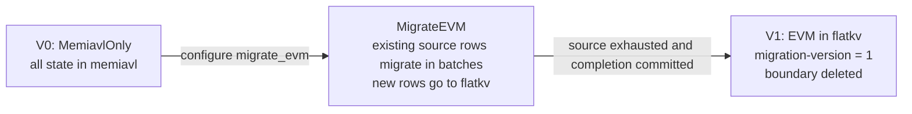

# MigrateEVM operations

This guide describes the local `MigrateEVM` state-commitment transition
(V0 → V1), its restart behavior and the available database inspection tools.
See [README.md](README.md) for the full migration state machine.

## Scope and configuration

MigrateEVM moves the `evm` store from memiavl to flatkv. Other registered modules
remain in memiavl. [migration_versions.go](migration_versions.go) defines
`Version0_MemiavlOnly = 0` and `Version1_MigrateEVM = 1`. Select `migrate_evm`
through [WriteMode](../../../config/write_mode.go); configure the batch size with
`StateCommitConfig.KeysToMigratePerBlock` in
[sc_config.go](../../../config/sc_config.go).

`Router`, `ModuleRouter` and `MigrationManager` dispatch local storage operations
inside the node. They do not change the network's execution or consensus rules.
The `MigrateAllButBank` and `MigrateBank` transitions select different source
modules; EVM-only inspections apply to `MigrateEVM`.

## Lifecycle and reads



[BuildRouter](router_builder.go) constructs the storage handle after backend
load. Migration completion changes metadata, while the configured write mode
stays the same. `MigrateEVM` remains usable at V1 after restart; `EVMMigrated`
selects direct steady-state dispatch.

The metadata store is `migration` in flatkv. An absent migration-version key
selects the manager's start version, zero. A stored version must match the
start or target version. An absent boundary means not started unless version 1
already establishes completion. The manager rejects malformed metadata.

| Stage | memiavl EVM | flatkv EVM | Access |
|---|---|---|---|
| V0 with `MemiavlOnly` | All EVM rows | No active flatkv backend | memiavl passthrough |
| `MigrateEVM` in progress | Existing source rows not yet walked | Migrated rows and new rows | Boundary-aware manager |
| V1 with `MigrateEVM` | Source drained by migration | EVM state | Completed manager forwards to flatkv |
| V1 with `EVMMigrated` | Other modules remain here | EVM state | Direct module dispatch |

[MigrationManager.Read](migration_manager.go) reads flatkv at or below the
boundary. Above the boundary it reads memiavl first, then flatkv on a miss.
Writes to migrated keys go to flatkv. Above the boundary, writes stay in memiavl
only while the key exists there; new keys go directly to flatkv. Consequently,
new flatkv keys may lie beyond the cursor.

The boundary compares module names lexicographically and keys bytewise, with
equality on the migrated side. The EVM module identifier is `evm`.
[MigrationBoundary](migration_boundary.go) encodes the status byte and, for an
in-progress cursor, a four-byte big-endian module-name length, the module name
and raw key bytes.

## Writes and restart

On the first flush in a block, the manager advances the source iterator,
stages copied values and source deletions, then overlays caller changes.
A caller update or deletion in that batch takes precedence over the copied
value. Later flushes route writes without advancing migration. The composite
store resets this once-per-block state after commit and writable load/rollback.

[MigrationManager.ApplyChangeSets](migration_manager.go) calls the memiavl
writer, then the flatkv writer, synchronously. An error from the old writer
returns before invoking the new writer. The [Router contract](migration_types.go)
requires shutdown and crash recovery after a write error; the same in-memory
handle is not reusable for retry.

[ModuleRouter](module_router.go) validates store names before dispatching any
writes. It invokes route writers sequentially in registration order, including
routes without caller changes, then joins their errors. The
[thread-safe wrapper](thread_safe_router.go) excludes reads and proofs during a
write. These calls do not form an atomic transaction across both backends.

[CompositeCommitStore.Commit](../composite/store.go) commits memiavl before
flatkv and checks that their returned versions match. Writable
`LoadVersion(0, false)` loads the latest versions and rolls the ahead backend
back to the lower nonzero version when both backends have committed.
Reconciliation depends on retained recovery data and successful rollback.
When either version is zero, this rollback branch does not run. With fresh
flatkv and an existing memiavl version, a separate load-latest step seeds the
next flatkv commit version. Explicit-height loads do not use load-latest
reconciliation.

The storage handle is rebuilt from loaded metadata, resetting uncommitted
cursor state. `CleanupCrashArtifacts` removes orphaned flatkv working
directories before startup. Preserve both backend directories, their snapshots
and WAL together for recovery. A compatible complete backup or state-sync
snapshot supplies state when local recovery cannot open a coherent database.

## Snapshots and state inspection

[SnapshotExporter](../composite/exporter.go) concatenates the memiavl stream
and the self-describing physical `flatkv` stream. During migration both
backends participate. [SnapshotImporter](../composite/importer.go) sends the
`flatkv` section to flatkv and the other module sections to memiavl. Import
preserves the supplied backend data; it does not synthesize migration completion.
Use the complete stream and compatible backend configuration at the same height.

Logical EVM state is the union selected by the manager's read rules, including
new flatkv rows above the cursor. Flatkv physical keys and packed account values
need translation before comparison with memiavl's logical EVM rows. Compare
normalized values at a common committed height with a trusted state source.
Version 1 and an absent boundary describe completion metadata; content
comparison establishes state equality.

After migration, the source EVM rows have been removed from memiavl.
`import-flatkv-from-memiavl` imports the source rows that remain; use a complete
backup or compatible state-sync source to restore migrated state. Retain
source and destination data together before any maintenance that changes it.

## Available inspection tools

The command registry is [paxdb/main.go](../../../tools/cmd/paxdb/main.go).
Relevant implemented commands include:

| Command | Current capability / limit |
|---|---|
| [`migrate-evm-status`](../../../tools/cmd/paxdb/operations/migrate_evm_status.go) | Reads flatkv migration metadata and emits JSON; no memiavl scan or content verification. |
| [`dump-iavl`](../../../tools/cmd/paxdb/operations/dump_iavl.go) | Dumps memiavl modules using `--db-dir`, `--output-dir`, `--height`, `--module`. |
| [`dump-flatkv`](../../../tools/cmd/paxdb/operations/dump_flatkv.go) | Dumps physical flatkv buckets with `--db-dir`, `--output-dir`, `--height`, optional `--bucket`. |
| [`state-size`](../../../tools/cmd/paxdb/operations/state_size.go) | Size analysis with `--db-dir`, `--height`, `--module` and optional `--flatkv-dir`; not a migration consistency check. |
| [`prune`](../../../tools/cmd/paxdb/operations/prune.go) | Version pruning for SS; not source-module cleanup. |
| [`replay-changelog`](../../../tools/cmd/paxdb/operations/replay_changelog.go) | Scans the State Store changelog; `--no-dry-run` reapplies the selected offsets to the PebbleDB State Store. |
| [`import-flatkv-from-memiavl`](../../../tools/cmd/paxdb/operations/import_flatkv_from_memiavl.go) | Restore-style EVM-only import; resets the destination, requires `--force` over committed flatkv data, and does not mark migration complete. |

Flatkv size analysis is library code used by `state-size`. Snapshot export/import APIs exist in
[composite/store.go](../composite/store.go) and [flatkv/store.go](../flatkv/store.go);
they do not constitute a migration-aware operator repair command.

For an already built `paxdb`, the status command accepts a **flatkv database
directory**, not a node home:

```bash
paxdb migrate-evm-status --db-dir /path/to/flatkv --height 0
```

`--height 0` selects the latest available version. Its JSON fields are
`version_at`, `migration_version`, `migrate_evm_complete`, `boundary_present`,
optional `boundary_hex`, and optional `version_raw_hex`. Completion is computed
as decoded migration version ≥ 1, so it does not distinguish V1 from later
layouts. Absent version bytes produce zero; a present value of the wrong length
also leaves decoded version zero but is included in `version_raw_hex`. Inspect
the raw bytes before interpreting zero as V0. Missing `--db-dir`, an open error or a JSON output error causes a panic.

The [flatkv tooling open path](../../../tools/cmd/paxdb/operations/flatkv_open.go)
creates a temporary clone inside the database directory, hardlinks snapshot
files, copies the WAL and opens the clone. It avoids the live writer lock but
requires temporary disk space and directory write access. “Read-only” here means
inspection of a cloned database, not success on a read-only mounted source.
It does not provide a coherent two-backend snapshot or verify boundary encoding.
