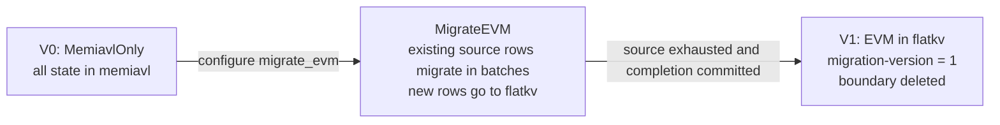

# MigrateEVM Operations Roadmap

This is the operational companion to [README.md](README.md), scoped to the
`MigrateEVM` transition (V0 → V1). It describes the current local storage path,
recovery limits, existing inspection tools and proposed additions. The proposed
commands and flags in section 6 are design work, except for the narrower status
command explicitly identified as implemented. They are not incident runbooks
that can be executed today.

## 1. Scope

MigrateEVM moves the `evm` store from memiavl to flatkv. Other registered modules
remain in memiavl. The version constants are in
[migration_versions.go](migration_versions.go): `Version0_MemiavlOnly = 0` and
`Version1_MigrateEVM = 1`. The configuration mode is `MigrateEVM` (`migrate_evm`)
in [write_mode.go](../../../config/write_mode.go); the batch size is
`StateCommitConfig.KeysToMigratePerBlock` in
[sc_config.go](../../../config/sc_config.go).

The `Router`, `ModuleRouter` and `MigrationManager` types discussed here are
in-process database dispatch code inside the node. They do not introduce a
network routing service or change the merged network's execution or finality.
This roadmap does not cover EVM execution semantics or public API behavior.
MigrateAllButBank and MigrateBank have their own module selection; do not apply
EVM-only inspections to those transitions without adapting them.

## 2. Lifecycle Reference



[BuildRouter](router_builder.go) constructs storage handles for all modes,
including terminal `MemiavlOnly` and `FlatKVOnly` passthrough handles. The composite
store calls it after backend load. Finishing a migration updates metadata; it
does not change the configured write mode. `MigrateEVM` remains usable at V1,
including after restart; `EVMMigrated` is the direct steady-state alternative.

Migration metadata lives in flatkv's reserved `MigrationStore` (`migration`).
For this transition an absent version means the start version, zero. A persisted
version must match the manager's start or target version; malformed or unexpected
versions cause initialization errors. A missing boundary means not started,
unless the target version already establishes completion.

| Stage | memiavl EVM | flatkv EVM | Metadata / access |
|---|---|---|---|
| V0 with `MemiavlOnly` | All EVM rows | No active flatkv backend | memiavl passthrough handle |
| `MigrateEVM` in progress | Existing source rows not yet walked | Migrated rows **and new rows regardless of cursor position** | Boundary in flatkv; manager reads/writes as described below |
| V1 with `MigrateEVM` | Source drained on the normal path | EVM state | Version 1, boundary deleted; completed manager forwards to flatkv |
| V1 with `EVMMigrated` | Other modules remain here | EVM state | Module dispatch sends EVM directly to flatkv |

The cursor marks progress through existing source rows, not an exclusive physical
partition of all rows. [MigrationManager.Read](migration_manager.go) reads flatkv
for a key at or below the boundary. For a key above it, the manager reads memiavl
first and falls back to flatkv on a miss. Caller writes to migrated keys go to
flatkv; writes above the boundary stay in memiavl only if the key still exists
there. New keys go directly to flatkv so new account/log growth cannot extend
the source tail forever.

Within a first flush, the manager advances the iterator, stages migrated values
and source deletions, then overlays caller changes. A caller update/delete of a
key in the same batch wins over the copied value. Later flushes route caller
writes without advancing the cursor. The composite store resets this
once-per-block gate after a successful commit and on writable load/rollback.

The boundary format and comparison rules are in
[migration_boundary.go](migration_boundary.go): module name then raw key, with
equality considered migrated. For EVM the module name is `evm`, not `evm/`.
Flatkv physical keys/encoded account values are not directly comparable to
memiavl's logical EVM rows without translation.

## 3. Atomicity & Crash-Safety Statement

[MigrationManager.ApplyChangeSets](migration_manager.go) invokes the **old
(memiavl) writer first, then the new (flatkv) writer**, synchronously. It does not
launch parallel writer goroutines. If the old writer fails, it returns before
calling the new writer. A failure from either writer is fatal for that handle:
the [Router contract](migration_types.go) requires shutdown and crash recovery,
not retry of `ApplyChangeSets` against its advanced in-memory boundary.

[ModuleRouter](module_router.go) also dispatches sequentially, in route
registration order, and joins errors after calling the route writers. It first
validates store names, so an unknown store prevents any route from writing.
Routes with no caller changes are still invoked, allowing migration to advance
on empty blocks. The [thread-safe wrapper](thread_safe_router.go) prevents
external reads/proofs from overlapping a write; it does not make the two
backends transactional.

Application of change sets is distinct from durable commit:

- The manager stages source deletions and source-side caller writes in memiavl.
- It then stages copied values, destination-side caller writes and metadata in
  flatkv. Completion stages version 1 and boundary deletion together there.
- [CompositeCommitStore.Commit](../composite/store.go) commits memiavl first,
  then flatkv, and checks that their returned versions agree.
- Writable `LoadVersion(0, false)` reconciles different **nonzero** backend
  versions by rolling the ahead backend back to the lower version. Fresh flatkv
  migration entry has a separate initial-version seeding path. Explicit-height
  loads do not use the load-latest reconciliation branch.
- The storage handle is rebuilt from loaded metadata; uncommitted cursor state
  and the first-flush gate are reset. `CleanupCrashArtifacts` cleans orphaned
  flatkv working directories; it is not data reconstruction.

There is no two-phase commit in `MigrationManager`. The composite recovery path
handles the version mismatch from an interrupted cross-backend commit, subject
to the backends' retained recovery data and successful rollback. Do not equate a
crash between *apply* calls with permanent deletion of a durably committed
batch. Conversely, equal versions or a status flag do not prove content integrity
following media corruption or manual modification.

## 4. Failure Mode Catalog

These cases distinguish normal crash recovery from corruption that requires an
external state source. Inspections must use the same committed height and the
configured mode. Preserve a copy of both backends and their metadata before
investigating damage. The tools proposed in section 6 are not available repairs.

### A1 -- Interrupted old-to-new write or commit

- **Trigger**: an apply error, or process death between memiavl and flatkv work.
- **Disk symptom**: uncommitted work may be discarded; death between durable
  commits can leave memiavl ahead of flatkv. An actual missing batch at a common
  committed height is a different, stronger corruption signal.
- **User symptom**: startup recovery/replay may be needed. Missing authoritative
  EVM rows after recovery can surface as absent state or failed calls.
- **Self-recoverable?** The composite load-latest path reconciles nonzero version
  mismatches before rebuilding the handle. Recovery can fail; the manager alone
  does not reconstruct missing data.
- **Detection signal**: recovery errors/version-reconciliation logs; compare
  logical state to a trusted reference at the recovered height if loss is
  suspected. An internal two-database scan cannot discover a key absent from both
  without an external expected set or digest.
- **Recovery path**: use the normal composite restart path. If rollback or
  content validation fails, restore a consistent backup or use a compatible
  state-sync source and replay. Do not retry on the failed in-memory manager or
  use raw changelog replay as a substitute for cross-backend recovery.

### A2 -- Stale memiavl residue

- **Trigger**: inconsistent restore, manual edits or a backend durability failure
  can leave a migrated key in both stores. This is not an outcome of two parallel
  manager goroutines: the current manager has none.
- **Disk symptom**: source rows at/below the cursor, or source EVM rows at V1.
  Flatkv rows above the cursor alone are expected new-key traffic, not residue.
- **User symptom**: reads at/below the cursor go to flatkv; stale source data can
  therefore be invisible to ordinary queries while still affecting storage
  inspection or commitment state.
- **Self-recoverable?** Do not rely on migration to revisit rows behind its cursor.
- **Detection signal**: translated comparison of both stores at a common height,
  using boundary/version and provenance rather than a cursor-only partition.
- **Recovery path**: retain evidence and restore/replay from a consistent state
  if needed. The source-cleanup tool in T3 is proposed. Deleting source rows can
  change memiavl's root; it is not an automatically safe disk-only repair.

### A3 -- Boundary key corruption

- **Trigger**: damaged or manually changed `migration-boundary` bytes in flatkv.
- **Disk symptom**: deserialization fails, or a valid encoding describes a cursor
  inconsistent with source migration progress.
- **User symptom**: the manager rejects malformed metadata on initialization;
  plausible but wrong metadata can select the wrong authoritative backend.
- **Self-recoverable?** No general reconstruction is implemented by the manager.
- **Detection signal**: startup decode error or disagreement with trusted logical
  state. The existing status tool prints boundary hex but does not decode it.
- **Recovery path**: restore trusted metadata with its matching backend state,
  or restore/state-sync a coherent database. Do not set the cursor to the maximum
  flatkv key: new keys can exist beyond migration progress. T3 reconstruction
  needs additional provenance and must refuse ambiguous states.

### B1 -- Mid-migration snapshot creation

- **Current path**: [CompositeCommitStore.Exporter](../composite/store.go)
  includes each non-nil backend. In MigrateEVM both are present.
  [SnapshotExporter](../composite/exporter.go) concatenates the memiavl stream
  and the self-describing physical flatkv stream headed by `flatkv`.
- **Risk**: a partial export, mixed heights or missing metadata cannot describe
  equivalent migration state. A layout of “only keys below the cursor in flatkv”
  is already incorrect because new rows may be beyond it.
- **Detection / qualification**: restore the complete stream at the same height,
  verify logical reads, version/boundary bytes and commitment data, then resume
  migration and compare against the source. Exporter presence alone is not that
  evidence; this documentation task does not run snapshot qualification.
- **Recovery path**: keep a known compatible snapshot until the candidate's
  complete export/import/resume path is qualified for the deployment.

### B2 -- Mid-migration state-sync receive

- **Current path**: [CompositeCommitStore.Importer](../composite/store.go) opens
  importers for active backends. [SnapshotImporter](../composite/importer.go)
  sends the `flatkv` section to flatkv and other module sections to memiavl;
  it does not route logical EVM rows according to the current cursor.
- **Risk**: wrong backend configuration, an incomplete snapshot or manually
  importing only EVM cannot establish the intended lifecycle state. The composite
  importer itself does not synthesize version 1 merely because import ended.
- **Detection / recovery**: verify the restored metadata, both backend heights,
  logical state and resumed migration before serving from the restored node.
  Re-import a compatible complete snapshot if they disagree. Do not use a
  proposed residue-cleanup command as an assumed state-sync step.

### C1 -- flatkv corruption after V1

After normal completion memiavl no longer has the EVM source data. Loss of the
flatkv state requires a compatible backup/state-sync source, or a complete
pre-migration state plus replay. `import-flatkv-from-memiavl` cannot recover
post-migration EVM state from an already drained source. A failure to open flatkv
or missing state is evidence to investigate, not permission to reset it.

### C2 -- memiavl evm residue after V1 (lingering A2)

Version 1 makes EVM reads use flatkv, but does not prove memiavl has no EVM rows.
Inspect both backends at the same height. Residue needs provenance and
commitment checks before any deletion; the proposed T3 tool is not shipped.

### C3 -- V1 completion audit

The desired invariant is that logical EVM state at V1 equals the pre-migration
state evolved by all intervening writes and deletes. Version 1 with no boundary
is a completion signal, not a proof of this invariant. Compare state or a
canonically computed digest with a trusted source at the same height. Account
packing and key translation must be normalized; raw physical-key counts are not
logical-key counts.

## 5. Existing Tooling Inventory

The command registry is [paxdb/main.go](../../../tools/cmd/paxdb/main.go).
Relevant implemented commands include:

| Command | Current capability / limit |
|---|---|
| [`migrate-evm-status`](../../../tools/cmd/paxdb/operations/migrate_evm_status.go) | Reads flatkv migration metadata and emits JSON; no memiavl scan or content verification. |
| [`dump-iavl`](../../../tools/cmd/paxdb/operations/dump_iavl.go) | Dumps memiavl modules using `--db-dir`, `--output-dir`, `--height`, `--module`. |
| [`dump-flatkv`](../../../tools/cmd/paxdb/operations/dump_flatkv.go) | Dumps physical flatkv buckets with `--db-dir`, `--output-dir`, `--height`, optional `--bucket`. |
| [`state-size`](../../../tools/cmd/paxdb/operations/state_size.go) | Size analysis with `--db-dir`, `--height`, `--module` and optional `--flatkv-dir`; not a migration consistency check. |
| [`prune`](../../../tools/cmd/paxdb/operations/prune.go) | Version pruning for SS; not source-module cleanup. |
| [`replay-changelog`](../../../tools/cmd/paxdb/operations/replay_changelog.go) | memiavl changelog inspection/reapplication; not joint backend recovery. |
| [`import-flatkv-from-memiavl`](../../../tools/cmd/paxdb/operations/import_flatkv_from_memiavl.go) | Restore-style EVM-only import; resets the destination, requires `--force` over committed flatkv data, and does not mark migration complete. |

Flatkv size analysis is library code used by `state-size`, not a separate
registered `flatkv-state-size` subcommand. Snapshot export/import APIs exist in
[composite/store.go](../composite/store.go) and [flatkv/store.go](../flatkv/store.go);
they do not constitute a migration-aware operator repair command.

For an already built `paxdb`, the status command accepts a **flatkv database
directory**, not a node home:

```bash
paxdb migrate-evm-status --db-dir /path/to/flatkv --height 0
```

`--height 0` selects the latest available version. Its JSON fields are
`version_at`, `migration_version`, `migrate_evm_complete`, `boundary_present`,
optional `boundary_hex`, and optional `version_raw_hex`. Completion is computed
as decoded migration version ≥ 1, so it does not distinguish V1 from later
layouts. Absent version bytes produce zero; a present value of the wrong length
also leaves decoded version zero but is included in `version_raw_hex`. Inspect
the raw bytes before interpreting zero as healthy V0. Open/argument failures
currently panic; this is not the richer typed diagnostic contract proposed below.

The [flatkv tooling open path](../../../tools/cmd/paxdb/operations/flatkv_open.go)
creates a temporary clone inside the database directory, hardlinks snapshot
files, copies the WAL and opens the clone. It avoids the live writer lock but
requires temporary disk space and directory write access. “Read-only” here means
inspection of a cloned database, not success on a read-only mounted source.
It does not provide a coherent two-backend snapshot or verify boundary encoding.

## 6. Tool Roadmap

The following are **proposals**, not available commands or flags. Acceptance
criteria describe future implementation work and have not been executed by this
documentation rewrite. Keep current status JSON compatible if extending it.

### T1 -- `paxdb migrate-evm-status`

The existing command in section 5 supplies metadata-only status. Proposed
extensions add validated lifecycle classification, source/destination inspection
at one height and explicit diagnostics for absent, malformed or unexpected
metadata. A shared migration-package decoder can avoid duplicating private
`readVersionFromDB` / `readMigrationBoundary` logic.

Proposed inputs include coordinated backend locations and a target height.
Output should distinguish unknown/invalid state from V0, report logical row
counts and residue samples when requested, and label unavailable checks. Lost
keys cannot be counted without trusted expected state. Preserve raw metadata in
diagnostics. The current `--db-dir` and JSON contract remain the implemented
interface until an extension lands.

Proposed acceptance criteria:

1. Distinguish clean V0, in-progress and completed V1 using mode, version and
   decoded boundary rather than absence alone.
2. Reject malformed version lengths and boundary encodings with explicit errors.
3. Report logical row counts separately from physical flatkv bucket counts.
4. Do not flag new flatkv rows above the cursor as migration corruption.
5. Make diagnostics deterministic and preserve existing JSON consumers.
6. Leave source state unchanged and document clone-space/write-access needs.
7. Return a controlled error when either required backend cannot be inspected.

### T2 -- `paxdb migrate-evm-verify`

This command is not registered. Proposed modes are `completion-check`,
`union-invariant` and `ground-truth`, with explicit common height, optional
trusted digest and a bounded deterministic divergence sample count.

- **completion-check**: require V1 metadata with no boundary, inspect remaining
  source EVM rows and report destination logical state. Report residue without
  implying deletion is safe.
- **union-invariant**: check source migration progress and authoritative reads
  across both backends. It must allow new destination keys above the cursor;
  it must not require flatkv to equal the cursor's lower partition. Duplicates,
  values and deletes need provenance-aware classification.
- **ground-truth**: compare normalized logical EVM state at the target height
  with a trusted reference/digest. Only this external reference can reveal keys
  missing from both stores.

Potential library dependencies are the boundary decoder, memiavl exporter,
flatkv raw iteration and import translation. Flatkv's LtHash over physical
encoded values and a logical EVM digest are different contracts; define the
normalization before comparing them. Successful inspection alone is not a proof
of equivalence.

Proposed acceptance criteria:

1. Pass completion checks for a real fully migrated store and identify residue.
2. Accept healthy in-progress state containing new keys beyond the cursor.
3. Detect a changed value or missing authoritative row against trusted state.
4. Reject inconsistent backend heights and incompatible digest formats.
5. Emit bounded samples in deterministic logical-key order and exit nonzero on
   failed invariants.
6. Document each mode's limits, including undetectable loss without a reference.
7. Perform inspection without modifying either backend's committed state.

### T3 -- `paxdb migrate-evm-reconcile`

This command is not registered. Proposed operations are `clean-stale-memiavl`
and `recompute-boundary`, with dry-run as the default and explicit `--apply`
plus destructive confirmation for writes. They would require an offline node,
verified backup, exclusive writable access and post-repair verification.

`clean-stale-memiavl` would identify obsolete source rows using trusted migration
state. Deleting memiavl rows changes a committed tree; design must account for
AppHash, version alignment, replay and restart before this becomes an operator
procedure. It must not silently treat every duplicate as safe to delete.

`recompute-boundary` cannot infer progress from `max(flatkv keys)` because new
keys bypass the cursor. It needs trusted batch history or a verified prior
checkpoint, and must refuse when it cannot prove a unique valid cursor. No
proposal authorizes overwriting good destination data to fit a guessed cursor.

Proposed acceptance criteria:

1. Dry-run leaves both databases unchanged and emits an exact repair plan.
2. Apply requires exclusive access, explicit confirmation and a matching backup.
3. Refuse ambiguous metadata, conflicting values or missing trusted provenance.
4. Apply only the verified plan; demonstrate idempotence and resumable recovery
   after an interrupted repair.
5. Prove commitment/version consistency and logical state after restart.
6. Verify effects with T2 against trusted state, not merely the same repair logic.
7. Document refusal and restoration paths before publishing a writable command.

### T4 -- `import-flatkv-from-memiavl` extension flags

The import command exists; the following flags **do not**. Proposed fixture
extensions are `--mark-as-migrated=evm` and `--up-to-boundary=<hex>`. The current
flags remain `--home`, `--data-dir`, `--modules`, `--height` and `--force`.

`--mark-as-migrated` would write version 1 and remove any boundary only after a
successful import. It would not itself remove source EVM rows, so a clean V1
fixture must also arrange consistent source state and commitments.
`--up-to-boundary` would construct a partial migration fixture with the matching
source deletions and destination metadata, rather than merely filtering inserts.
A realistic fixture must also exercise new destination keys beyond the cursor.
The two lifecycle fixture modes should be mutually exclusive.

Proposed acceptance criteria:

1. Preserve the existing import behavior when no new flag is supplied.
2. Mark completion only after the import and its metadata commit succeed.
3. Never mark a failed or aborted import as completed.
4. Build partial fixtures with matching source, destination and boundary at a
   common height; verify reads, deletes, resume and commitment behavior.
5. Include destination keys above the cursor without misclassifying them.
6. Reject incompatible flag combinations and overwrites without explicit consent.
7. Document that fixture creation is not automatic disaster recovery.

## 7. Suggested Sequencing

1. Extend T1 metadata validation and define shared decoding/common-height access
   while preserving the shipped JSON contract.
2. Implement T2 completion checks before adding writable repair tools.
3. Implement T2 in-progress checks with new-key, update and deletion workloads.
4. Add T4 fixture support and prove stop/reopen/resume on real backends.
5. Define trusted digest provenance and normalization for T2 ground-truth checks.
6. Design T3 cleanup with commitment and restart evidence; keep ambiguous cursor
   reconstruction unavailable until provenance makes it provable.

Each stage needs its own implementation and qualification. These proposed checks
are not evidence that existing databases have been verified.

## 8. Open Design Questions (deferred to PR-time)

- **Snapshot qualification**: which deployment test proves complete two-backend
  export/import at an in-progress height, metadata preservation and resumed
  migration against trusted logical state? Snapshot sections must include new
  destination keys beyond the cursor.
- **Digest provenance**: who supplies the trusted reference, at which height,
  with which canonical representation and authentication? Raw physical LtHash
  cannot silently stand in for a logical-state digest.
- **Irreconcilable state**: what verified recovery history can disambiguate
  conflicting duplicates or a lost cursor? Default to refusing mutation when
  state cannot be proven, rather than choosing a backend by guesswork.
- **Offline vs online tooling**: metadata-only cloned flatkv status already
  exists. Coordinated repair requires offline exclusive access; any online
  two-backend inspection needs a separate consistent-height contract. An
  RWMutex around routing is not that contract.
- **Module-level cleanup**: if a future general module cleanup primitive serves
  later migration phases, define store inventory, commitment and recovery
  semantics before exposing it as a shared command.

The roadmap changes no Go behavior. Use the current implementation links above
for available functionality and qualify each proposed tool separately before
turning its design into an operational procedure.
