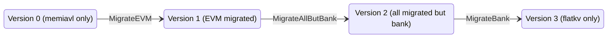

# Migration

This package moves local state commitment data from memiavl to flatkv in three
transitions: EVM, all remaining modules except bank, then bank. It is part of the
node's storage path in the merged Paxeer network. The Go `Router` types here
select local database backends; they are not a network gateway or an additional
service. See [OPERATIONS.md](OPERATIONS.md) for MigrateEVM recovery behavior,
existing inspection tools and proposed tooling.

[BuildRouter](router_builder.go) handles every supported
[WriteMode](../../../config/write_mode.go), including the terminal modes
`MemiavlOnly` and `FlatKVOnly`. The composite store builds its storage handle
after loading the backends; it does not bypass this package at V0 or V3.

## State machine

The on-disk migration version and configured write mode are separate values.
[migration_versions.go](migration_versions.go) defines versions 0 through 3;
[write_mode.go](../../../config/write_mode.go) defines both steady-state and
transition modes:

| Mode constant | Configuration value | Layout / transition |
|---|---|---|
| `MemiavlOnly` | `memiavl_only` | V0: all modules in memiavl |
| `MigrateEVM` | `migrate_evm` | V0 → V1; remains usable after completion |
| `EVMMigrated` | `evm_migrated` | V1: EVM in flatkv; other modules in memiavl |
| `MigrateAllButBank` | `migrate_all_but_bank` | V1 → V2; remains usable after completion |
| `AllMigratedButBank` | `all_migrated_but_bank` | V2: bank in memiavl; other modules in flatkv |
| `MigrateBank` | `migrate_bank` | V2 → V3; remains usable after completion |
| `FlatKVOnly` | `flatkv_only` | V3: all modules in flatkv |
| `TestOnlyDualWrite` | `test_only_dual_write` | Test-only EVM dual writes; never a production migration mode |

Module/store identifiers are `evm` and `bank` (without a trailing slash), from
[storage/common/keys](../../../common/keys/store_keys.go). Mixed-mode builders
use that package's module inventory and reject traffic to unregistered stores.
The inventory includes the merged network's module stores; database migration
does not introduce another network or tenant-specific node infrastructure.

## Phases

### Version 0: pre-migration (V0)

`Version0_MemiavlOnly` is the initial layout. `BuildRouter` with `MemiavlOnly`
returns a [passthrough handle](passthrough_router.go) backed by memiavl. No
`MigrationManager` or `ModuleRouter` is needed for this mode, but the storage
handle is still constructed. An absent migration-version key is interpreted as
version zero by `IsAtVersion`; this helper does not select the configured mode.

### MigrateEVM (V0 -> V1)

`buildMigrateEVMRouter` sends `evm` traffic through a
[MigrationManager](migration_manager.go), while other modules remain in memiavl.
Existing source keys are walked forward in batches. Already-migrated keys and
new keys absent from memiavl are written to flatkv. Reads above the boundary
check memiavl first, then flatkv on a miss. Thus flatkv can contain new keys
above the boundary; the cursor does not describe an exclusive physical partition.

### Version 1: EVMMigrated (V1)

`Version1_MigrateEVM` records completion. In `EVMMigrated` mode,
`buildEVMMigratedRouter` sends `evm` directly to flatkv and all other registered
modules directly to memiavl. If the configured mode is still `MigrateEVM`, the
manager recognizes the stored target version on restart and forwards its EVM
traffic to flatkv without further migration.

### MigrateAllButBank (V1 -> V2)

`buildMigrateAllButBankRouter` keeps `bank` in memiavl and `evm` in flatkv. All
other registered modules use a manager targeting `Version2_MigrateAllButBank`.
Its iterator excludes EVM and bank. The same boundary, new-key and once-per-block
rules apply to these migrating modules.

### Version 2: AllMigratedButBank (V2)

`buildAllMigratedButBankRouter` sends `bank` to memiavl and every other registered
module to flatkv. This is `AllMigratedButBank` mode with layout
`Version2_MigrateAllButBank`. A completed `MigrateAllButBank` manager also remains
usable without changing the mode immediately.

### MigrateBank (V2 -> V3)

`buildMigrateBankRouter` sends `bank` through a manager targeting
`Version3_FlatKVOnly`; all other registered modules stay in flatkv. Completion
writes the target version and deletes the boundary in the flatkv change set.

### Version 3: post-migration (V3)

`FlatKVOnly` is an explicit write mode. `buildFlatKVOnlyRouter` constructs a
passthrough handle backed by flatkv, with no `ModuleRouter` or manager. A node
still configured with `MigrateBank` instead retains both backends and its
completed manager until the configuration changes. Completion does not itself
switch the configured mode.

## Migration manager and routers

The local data path consists of:

- [migration_manager.go](migration_manager.go): boundary-aware reads, caller
  writes and batch migration. Batches advance only on
  `ApplyChangeSets(changesets, firstBatchInBlock=true)`. Later flushes in the
  same block route writes without advancing or rewriting migration metadata.
- [module_router.go](module_router.go): store-to-route dispatch. It validates
  all incoming store names before writing, invokes writers sequentially in
  registration order (including routes with no caller changes), and joins
  writer errors. This permits migration to advance on an otherwise empty block.
- [router_builder.go](router_builder.go): per-mode construction and backend
  validation. Transition modes require both backends and a positive batch size.
- [thread_safe_router.go](thread_safe_router.go): an RWMutex wrapper for mixed
  modes, including test dual-write. Writes exclude reads/proof calls; reads and
  proof calls may run together. Terminal passthrough handles are returned
  directly and rely on their backends' concurrency behavior.

`MigrationManager` alone is not safe for concurrent use. Iteration is outside
this `Router` interface; the composite store joins backend iterators separately.
The composite caller tracks the first flush and resets that state after commit
or a writable load/rollback. `StateCommitConfig.KeysToMigratePerBlock` controls
the batch size (default 1024); see [sc_config.go](../../../config/sc_config.go).

`ApplyChangeSets` is not an atomic cross-backend transaction. The manager calls
the old writer first, then the new writer; the composite store also commits
memiavl before flatkv. On a write error, the `Router` contract requires shutdown
and crash recovery rather than retry on the same handle. Recovery details and
version reconciliation are described in [OPERATIONS.md](OPERATIONS.md).

Migration-manager proofs and direct flatkv proofs are unsupported by these
handles; memiavl routes use the memiavl proof builder. See the implementation's
returned errors before choosing a proof-dependent workflow.

## Migration metadata

[migration_keys.go](migration_keys.go) reserves store `migration` for metadata
owned by the manager in flatkv. External manager reads and writes to this store
are rejected. `MigrationVersionKey` (`migration-version`) is an 8-byte big-endian
`uint64`. `MigrationBoundaryKey` (`migration-boundary`) stores the serialized
[MigrationBoundary](migration_boundary.go): a status byte, and for an
in-progress boundary a 4-byte big-endian module-name length followed by the
module name and raw key bytes.

The boundary compares module names lexicographically and keys bytewise, with
equality on the migrated side. It tracks migration of existing source rows;
new writes may be in flatkv beyond it. The memiavl iterator fixes its source tree
list at construction, excludes the reserved store, and resumes strictly after
the boundary. Newly added trees are not automatically added to that iterator.

On a first flush before completion, the new-backend batch includes the updated
boundary. On completion it includes the target version and deletion of the
boundary. A manager accepts a stored start or target version, rejects other
stored versions, and initializes as complete when the target version is present.
An absent version falls back to the mode's start version; an absent boundary
means not started unless the target version already establishes completion.
Metadata is durable with its backend commit, not merely when a change set is
assembled.
